# Bayesian Model Discovery with Language Models: Closing the Loop between Hypotheses and Experiments

JooKyung Yuh1 Byungmin Park1,∗ Eunseo Choi1,∗ Jinheon Baek2 Junmo Cho2 Kyu Hyun Choi3 Sung Ju Hwang2 Kyong Hwan Jin1,† Hae Beom Lee1,†

1Korea University 2KAIST 3KETI

∗Equal contribution as second authors. †Corresponding authors.

JooKyung Yuh: johnlu0410@korea.ac.kr Hae Beom Lee: haebeomlee@korea.ac.kr

## Abstract

Scientific model discovery requires proposing candidate models of an unknown system and designing experiments that discriminate among them. However, LLM-based approaches typically rely on in-context learning to predict outcomes and select experiments, lacking explicit model evaluation to systematically guide hypothesis search, while Bayesian approaches enable principled model comparison but are confined to a predefined candidate set which results in limited search spaces. To this end, we introduce Bayesian Model Discovery (BMD), which closes the loop between LLM-driven hypothesis generation and Bayesian experimental design. Specifically, an LLM proposes model families, while a numerical engine fits their parameters, weighs them by model evidence, and averages their predictions. Then, BMD chooses the next experimental conditions by maximizing the joint expected information gain over families and their parameters, while feeding the updated beliefs and residual diagnostics back to the LLM to guide its next proposals. Across four scientific discovery benchmarks, BMD achieves lower final prediction error than in-context learning and LLM-based scientific agents while recovering exact functional forms more often, with ablations supporting numerical feedback and the joint objective.

## 1 Introduction

Many scientific advances take the form of mathematical models that describe how a system responds to experimental conditions (Langley et al., 1987; Schmidt and Lipson, 2009; Wang et al., 2023). Discovering such models alternates between proposing candidate models and designing experiments that discriminate among them (Box and Hill, 1967; Blei, 2014). For example, a scientist studying how a drug slows down an enzyme may consider two candidate models: the drug either competes with the molecule the enzyme acts on or attaches elsewhere on the enzyme. Both models may fit the initial measurements equally well, but the scientist can tell them apart with an experiment that adds a large amount of this molecule, as the two predict different reaction rates. Recently, Large Language Models (LLMs) have shown promise in automating this process (Boiko et al., 2023; Romera-Paredes et al., 2024; Yang et al., 2024; Lu et al., 2024; Shojaee et al., 2025; Baek et al., 2025), owing to their broad scientific knowledge and reasoning abilities.

One common approach is in-context learning (ICL) (Brown et al., 2020), where the LLM directly predicts responses and selects experiments from observations (Gandhi et al., 2025). While this approach exploits the prior knowledge of LLMs, it does not commit to explicit models fitted to data, leaving the LLM to make every prediction and choose experiments without quantifying which explanations remain plausible (Gupta et al., 2025).

In contrast, explicit probabilistic models address both issues by expressing each candidate explanation as an equation, called a modelfamily, whose functional form (e.g., competitive inhibition) contains unknown parameters (e.g., the maximum reaction rate). Specifically, once these parameters are estimated, the equation can predict responses at untested conditions, allowing a suitable family to generalize from few observations. In addition, these models guide experiment selection, as Bayesian inference quantifies how plausible each family and its parameters remain (Kass and Raftery, 1995; Hoeting et al., 1999), which Bayesian experimental design (Lindley, 1956; Chaloner and Verdinelli, 1995; Rainforth et al., 2024) uses to select the most informative experiment to run next.

However, explicit modeling alone is not sufficient, as Gandhi et al. (2025) find no consistent benefit from augmenting an LLM with a statistical model. Moreover, Bayesian inference over a fixed set of candidates cannot recover a family missing from it, while LLMs can propose new families (Li et al., 2024; Shojaee et al., 2025) that remain unverified until they are fitted against the data. The central challenge, therefore, lies in connecting family search, parameter inference, and experiment selection such that each step informs the others.

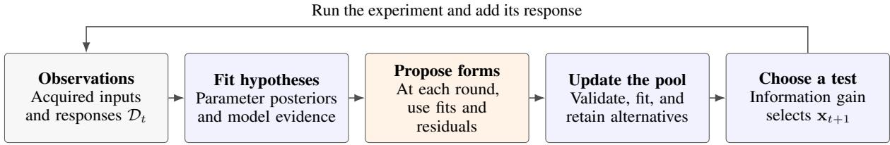  
Figure 1: Overview of Bayesian Model Discovery. Given the observations D , the numerical engine fits each candidate family and returns the resulting beliefs and residual diagnostics to the LLM, which proposes new families. These proposals are validated, fitted, and compared with the existing families, after which the updated pool selects the next experimental conditions $\mathbf { x } _ { t + 1 }$ by maximizing the joint expected information gain.

To address this, we present Bayesian Model Discovery (BMD), a framework that closes the loop between LLM-driven hypothesis generation and Bayesian experimental design (Figure 1). Our key insight is that LLMs and Bayesian inference have complementary strengths: LLMs can draw on domain knowledge to propose plausible functional forms, whereas Bayesian inference can quantify how well each form explains the data. Specifically, BMD employs an LLM to propose model families, while a numerical engine fits their parameters, weighs each family by its model evidence, and averages their predictions. Then, since a new observation can distinguish competing families, refine their parameters, or both, BMD chooses the next experimental conditions by maximizing the joint expected information gain over families and their parameters (Borth, 1975; McGree, 2017), while feeding the updated beliefs and residual diagnostics back to the LLM to inform its next proposals.

We validate BMD on four scientific discovery benchmarks, namely ChemBench (Kabra et al., 2026), BoxingGym (Gandhi et al., 2025), ForceBench (Wiemann et al., 2026), and Newton-Bench (Zheng et al., 2026). BMD achieves the lowest final prediction error on every benchmark against direct ICL and recent LLM-based scientific agents, while also recovering exact functional forms more often. Our analyses further show that numerical feedback to the LLM improves prediction and that the joint objective outperforms targeting either families or parameters alone. These findings suggest that LLMs are most effective as hypothesis generators within a closed loop of explicit model fitting and experimental design, rather than as standalone predictors of experimental results.

## 2 Related Work

LLM-assisted model discovery. Symbolic regression searches for interpretable equations from observations (Schmidt and Lipson, 2009; Brunton et al., 2016; Cranmer, 2023). LLM-SR combines language-model proposals with numerical parameter optimization (Shojaee et al., 2025), while BoxLM iterates probabilistic-program generation, fitting, and criticism (Li et al., 2024). Other methods weight LLM-proposed models by their marginal likelihood (Domke, 2025; Wahl et al., 2026). Box’s Apprentice and LLM-AutoSciLab extend model-based reasoning to interactive experimentation (Gandhi et al., 2025; Kabra et al., 2026). Other closed-loop approaches select experiments by information gain over LLM-proposed hypotheses, such as natural-language rules (Piriyakulkij et al., 2024) or cognitive models (Prystawski et al., 2026). BMD searches over functional-form families using numerical parameter posteriors and evidence-weighted predictions.

Bayesian experimental design. Bayesian experimental design selects observations to reduce uncertainty (Lindley, 1956; Chaloner and Verdinelli, 1995; Rainforth et al., 2024). Established criteria include joint model discrimination and parameter estimation (Hill et al., 1968; Borth, 1975; Mc-Gree, 2017), and expected predictive information gain (EPIG) (Bickford Smith et al., 2023). BMD uses joint EIG within an evolving pool of LLMproposed families to value both model discrimination and parameter refinement. We also evaluate EPIG, which instead targets predictions at inputs of interest. Recent work also applies EIG to LLM question asking, but estimates it from the predictive distribution of the LLM itself rather than from fitted models (Choudhury et al., 2026).

Concurrent work: Model Discovery Agent. Model Discovery Agent (MDA; Murphy, 2026) similarly combines LLM proposals, Bayesian inference, adaptive experimentation, and numerical feedback. The cited MDA implementation uses a variance-based surrogate for EIG, including a parameter-aware variant. BMD instead estimates joint model–parameter EIG from fitted predictive likelihoods. A second difference is the context supplied to the proposer. MDA conditions proposals on domain context, whereas we anonymize variable names and withhold task descriptions and semantic metadata on ChemBench, BoxingGym, and NewtonBench. Numerical ranges and the modeling interface remain available; ForceBench retains physical task metadata (Section 4). This evaluates discovery from observations and feedback with fewer supplied domain cues.

## 3 Approach

Our Bayesian Model Discovery (BMD) combines the flexibility of LLMs in proposing diverse functional forms with the strengths of Bayesian inference in evaluating hypotheses and quantifying uncertainty. By integrating these complementary capabilities, BMD iteratively discovers and refines scientific models through hypothesis generation, numerical evaluation, and experimental design (Figure 1; Algorithm 1).

## 3.1 Problem setup and overview

An experimental design $\mathbf { x } \in \mathcal { X }$ specifies controllable conditions, where X is the set of allowed designs. The response y is the outcome measured under design x and can be multi-dimensional.

A model family m specifies a functional form, such as a linear or saturating function. $\pmb { \theta } _ { m }$ denotes a parameter vector associated with m. We assume that likelihood family is fixed for each task (e.g., Gaussian). m, $\pmb { \theta } _ { m }$ , and likelihood together define the conditional response distribution $p _ { m } ( y \mid \mathbf { x } , \pmb { \theta } _ { m } )$ , expressed as a probability density or mass function. For each task, the true family $m ^ { \star }$ and its parameter vector $\pmb { \theta } ^ { \star }$ remain fixed and we can define

$$
p ^ { \star } ( y \mid \mathbf { x } ) : = p _ { m ^ { \star } } ( y \mid \mathbf { x } , \pmb { \theta } ^ { \star } ) .
$$

The agent observes samples from this distribution but is not given $m ^ { \star }$ or $\pmb { \theta } ^ { \star }$

The initial dataset $\mathcal { D } _ { 0 }$ contains $n _ { 0 }$ observed design–response pairs. With a budget of B additional experiments, at round $t = 1 , \ldots , B$ , the agent chooses $\mathbf { x } _ { t } \in \mathcal { X }$ using $\mathcal { D } _ { t - 1 }$ and observes $y _ { t } \ \sim \ p ^ { \star } ( \cdot \ | \ \mathbf { x } _ { t } )$ . The available data are then $\mathcal { D } _ { t } = \mathcal { D } _ { 0 } \cup \{ ( \mathbf { x } _ { s } , y _ { s } ) \} _ { s = 1 } ^ { t }$ . The goals are accurate prediction at untested designs as well as recovery of the underlying true functional form $m ^ { \star }$ and its parameter $\pmb { \theta } ^ { \star }$

## 3.2 Parameter inference and model evidence

Unlike previous ICL-based approaches, our BMD separates the roles of the LLM and numerical inference. The LLM proposes candidate model families, while the numerical engine estimates the parameter posterior and model evidence for each candidate.

We first discuss posterior inference of model parameters within each candidate model family. We specify a prior $\pi _ { m } ( \pmb { \theta } _ { m } )$ using fixed coefficient-role rules. Examples include $\mathcal { N } ( 0 , 1 )$ for signed coefficients and LogNormal(0, 1) for positive coefficients. The numerical engine assumes conditional independence of responses given their designs and parameters, giving the likelihood

$$
L _ { m , t } ( \pmb \theta _ { m } ) = \prod _ { ( \mathbf x , y ) \in \mathscr D _ { t } } p _ { m } ( y \mid \mathbf x , \pmb \theta _ { m } ) .\tag{1}
$$

Then, Bayes’ rule yields the parameter posterior and its normalizing constant $Z _ { m , t } = p ( \mathcal { D } _ { t } \mid m )$ called the model evidence:

$$
\begin{array} { c } { { \displaystyle p ( \pmb { \theta } _ { m } \mid \mathcal { D } _ { t } , m ) = \frac { \pi _ { m } ( \pmb { \theta } _ { m } ) L _ { m , t } ( \pmb { \theta } _ { m } ) } { Z _ { m , t } } , } } \\ { { \displaystyle Z _ { m , t } = \int \pi _ { m } ( \pmb { \theta } _ { m } ) L _ { m , t } ( \pmb { \theta } _ { m } ) \mathrm { d } \pmb { \theta } _ { m } . } } \end{array}\tag{2}
$$

The posterior $p ( \pmb \theta _ { m } \mid \mathcal { D } _ { t } , m )$ describes the uncertainty of $\pmb { \theta } _ { m }$ within the family m, given the data $\mathcal { D } _ { t }$ . The evidence $Z _ { m , t }$ measures its support by averaging the likelihood over the prior. Evidence thus depends on the specified prior as well as the functional form. We use sequential Monte Carlo (SMC) (Del Moral et al., 2006) to obtain posterior samples and an evidence estimate $\widehat { Z } _ { m , t } .$ . Those posterior samples and evidence estimate are the core ingredients of BMD, which we explain in the next subsections. Appendix B gives the numerical settings.

## 3.3 Model comparison and prediction

We next discuss posterior inference over candidate model families to assess which functional forms are more plausible given the observations. For the retained pool $\mathcal { M } _ { t } ,$ equal family-level prior weights give the posterior model probabilities

Algorithm 1 Bayesian Model Discovery (BMD)   
Require: Initial data $\mathcal { D } _ { 0 } ,$ , design space X , budget B, pool   
capacity $K .$   
1: Initialize candidate set C with LLM proposals from   
$\mathcal { D } _ { 0 } .$   
2: for $t = 0 , \ldots , B$ do   
3: Fit hypotheses: infer parameter posteriors and   
model evidence for $\mathcal { C }$ using $\mathcal { D } _ { t }$   
4: Propose forms: for $t \geq 1 ,$ expand C with fit- and   
diagnostic-guided LLM proposals.   
5: Update the pool: fit new proposals and retain up   
to K highest-evidence families as $\mathcal { M } _ { t } .$   
6: Form the predictive mixture $q _ { t }$ over $\mathcal { M } _ { t } .$   
7: $\mathbf i \mathbf f t < B$ then   
8: Choose a test: optimize $a _ { t }$ over X to select   
$\mathbf { x } _ { t + 1 } .$   
9: Observe $y _ { t + 1 }$ and add $\left( \mathbf { x } _ { t + 1 } , y _ { t + 1 } \right)$ to $\mathcal { D } _ { t }$ to   
obtain $\mathcal { D } _ { t + 1 } .$   
10: Set $\mathcal { C }  \mathcal { M } _ { t }$   
11: end if   
12: end for   
13: return $q _ { B } , \mathcal { M } _ { B }$ , and its highest-evidence family.

$$
w _ { m , t } = \frac { \widehat { Z } _ { m , t } } { \sum _ { j \in \mathcal { M } _ { t } } \widehat { Z } _ { j , t } } , \qquad m \in \mathcal { M } _ { t } ,\tag{3}
$$

These probabilities are defined within the current fixed-sized model pool, rather than over all possible functional forms. Restricting inference to a finite pool makes model comparison tractable, although the true family need not belong to the pool. Section 3.5 explains how the pool evolves through LLM-generated proposals.

To predict while accounting for parameter uncertainty, each family averages its likelihood over its posterior, giving the posterior predictive distribution $q _ { m , t } \mathrm { . }$

$$
\begin{array} { r } { q _ { m , t } ( y \mid \mathbf { x } ) = \int p _ { m } ( y \mid \mathbf { x } , \pmb { \theta } _ { m } ) \qquad } \\ { \times p ( \pmb { \theta } _ { m } \mid \mathcal { D } _ { t } , m ) \mathrm { d } \pmb { \theta } _ { m } . } \end{array}\tag{4}
$$

Bayesian model averaging (BMA) also accounts for uncertainty about the family (Hoeting et al., 1999):

$$
q _ { t } ( y \mid \mathbf { x } ) = \sum _ { m \in \mathcal { M } _ { t } } w _ { m , t } q _ { m , t } ( y \mid \mathbf { x } ) .\tag{5}
$$

For mean-response targets, BMD predicts with the mean of $q _ { t }$ . For structural evaluation, it returns the highest-evidence family.

## 3.4 Information-based experimental design

BMD selects experiments using joint expected information gain (EIG), which targets uncertainty in both the model family and its parameters.

Joint model–parameter EIG. For a candidate design x, let M be a random family drawn from $\mathcal { M } _ { t }$ with probabilities $w _ { m , t } .$ . Conditional on M = $m ,$ draw its parameter vector $\Theta _ { M }$ from $p ( \pmb \theta _ { m } \mid$ $\mathcal { D } _ { t } , m )$ , and then draw a hypothetical response $Y _ { \mathbf { x } }$ from $p _ { M } ( \cdot \mid \mathbf { x } , \Theta _ { M } )$ . Its marginal distribution is $q _ { t } ( \cdot \textbf { | x } )$ . Using I for mutual information, joint EIG is

$$
\begin{array} { r l } & { a _ { t } ( \mathbf { x } ) = I ( Y _ { \mathbf { x } } ; M , \boldsymbol { \Theta } _ { M } \mid \mathcal { D } _ { t } ) } \\ & { \quad \quad = \mathbb { E } \left[ \log \frac { p _ { M } ( Y _ { \mathbf { x } } \mid \mathbf { x } , \boldsymbol { \Theta } _ { M } ) } { q _ { t } ( Y _ { \mathbf { x } } \mid \mathbf { x } ) } \right] , } \end{array}\tag{6}
$$

where the expectation is over these draws. The numerator evaluates an outcome under one family and parameter setting; the denominator averages over the alternatives. The expected log ratio, $a _ { t } ( \mathbf { x } )$ thus measures how informative an observation at x would be about the model family and its parameters.

The mutual-information chain rule separates the two information sources:

$$
\begin{array} { r } { a _ { t } ( \mathbf { x } ) = \underbrace { I ( Y _ { \mathbf { x } } ; M \mid \mathcal { D } _ { t } ) } _ { \mathrm { i n f o r m a t i o n ~ a b o u t ~ t h e ~ f a m i l y } } } \\ { + \underbrace { I ( Y _ { \mathbf { x } } ; \Theta _ { M } \mid M , \mathcal { D } _ { t } ) } _ { \mathrm { i n f o r m a t i o n ~ a b o u t ~ i t s ~ p a r a m e t e r s } } . } \end{array}\tag{7}
$$

The first term favors designs that distinguish families, such as the linear and saturating forms above. The second favors designs that reduce parameter uncertainty within each family, weighted by its posterior model probability $w _ { m , t }$ . We estimate joint EIG $a _ { t } ( \mathbf { x } )$ by Monte Carlo averaging the log likelihood ratios, using SMC posterior samples to approximate the evidence-weighted predictive distribution in the denominator. See Appendix F for estimating $a _ { t }$

Design optimization. For each round, we seek

$$
\mathbf { x } _ { t + 1 } \in \underset { \mathbf { x } \in \mathcal { X } } { \arg \operatorname* { m a x } } a _ { t } ( \mathbf { x } ) .\tag{8}
$$

We optimize the estimated acquisition $a _ { t }$ over the feasible design space, keeping the fitted pool fixed throughout each search. For instance, we perform gradient ascent from five random initializations and pick the best one. See Appendix B for more details about solving Eq. (8). See Algorithm 1 for the overall procedure of BMD.

## 3.5 LLM-guided model pool expansion

The preceding sections describe parameter and model inference, BMA prediction, and informationbased experiment selection. However, all these operations are defined within the current model pool. If the true functional form is missing, updating posteriors and collecting further observations do not by themselves introduce it. Discovery therefore requires a mechanism for proposing new functional forms.

<table><tr><td>Benchmark</td><td>Scientific setting</td><td>Design → observation</td><td>Evaluation target</td></tr><tr><td>ChemBench</td><td>Enzyme kinetics</td><td>Reaction conditions → rate</td><td>Noise-free observation mean (nMSLE)</td></tr><tr><td>BoxingGym</td><td>Ecological/statistical processes</td><td>Task inputs → noisy responses</td><td>Noise-free response mean (nMSE)</td></tr><tr><td>ForceBench</td><td>Force and motion laws</td><td>Conditions → trajectories</td><td>Shifted-design trajectories (nMSE)</td></tr><tr><td>NewtonBench</td><td>Counterfactual physical laws</td><td>Settings → physical responses</td><td>Noise-free governing law (nMSLE)</td></tr></table>

Table 1: Overview of the four scientific discovery benchmarks.

Bayesian inference can be extended to search over symbolic expressions, but such methods typically rely on a predefined grammar and can be computationally expensive. BMD instead draws on an LLM’s learned mathematical knowledge to propose new forms without exhaustively enumerating expressions. Numerical feedback is supplied in context to guide these proposals toward what the current candidates fail to explain.

At each round t ≥ 1, after acquiring a new observation, the engine refits the families in $\mathcal { M } _ { t } .$ −1 on the updated dataset Dt. The LLM then receives the accumulated observations, candidate functional forms, and two types of numerical feedback: belief information, including model evidence, posterior model probabilities, parameter posterior summaries, and one-step predictive log scores; and diagnostics, including model-wise standardized residuals. Belief information indicates which models the data support, while diagnostics reveal where their predictions fall short. For example, systematic curvature in a linear model’s residuals may motivate a nonlinear alternative. The LLM uses this feedback to propose new functional forms.

The engine validates and deduplicates the proposals and fits them on the same $\mathcal { D } _ { t }$ . It retains up to K highest-evidence families from the existing and newly proposed candidates to form $\mathcal { M } _ { t } ,$ where K is the pool capacity. Model probabilities and BMA predictions are then recomputed, and the updated mixture guides the next experiment. The resulting observation informs the next round of numerical inference and LLM proposals, closing the loop between hypothesis generation and experimentation. Appendix B gives implementation details, including periodic reconsideration of retired models; Appendix G provides the prompts.

## 4 Experiments

We first evaluate BMD’s predictive accuracy and functional-form recovery, then examine the source of performance improvements.

Benchmarks and baselines. We use four simulated scientific discovery benchmarks: Chem-Bench (Kabra et al., 2026), BoxingGym (Gandhi et al., 2025), ForceBench (Wiemann et al., 2026), and NewtonBench (Zheng et al., 2026). Table 1 summarizes these benchmarks. For baselines, we first consider in-context learning (ICL), which selects experiments and predicts directly from observations without fitting explicit models. Our primary baseline, LLM-AutoSciLab (Kabra et al., 2026), maintains LLM-proposed hypotheses but fits them by regression and selects experiments by prediction disagreement rather than evidence and EIG. We also compare with Box’s Apprentice (Gandhi et al., 2025) and DP-Agent (Wiemann et al., 2026), the reference agents of BoxingGym and ForceBench, respectively. All methods use Claude Opus 5.5 for their LLM calls.

Information supplied to the agents. BMD and all baselines receive the same numerical ranges of the design variables, with variable names anonymized. Task descriptions and semantic metadata are withheld. This eliminates explicit domainspecific semantic cues, allowing us to better assess model discovery driven primarily by observations and numerical feedback. The exception is ForceBench, which is specifically designed to use physical task metadata. We retain this information for all methods to preserve the intended benchmark setting. Appendix A details the information and observation interfaces for each agent and benchmark.

Evaluation protocol. The main BMD runs use joint EIG. We report error against the total observation count, using normalized mean squared logarithmic error (nMSLE) or normalized mean squared error (nMSE) for the targets in Table 1. Appendix A specifies baseline schedules, missingrun exclusions, metrics, and aggregation.

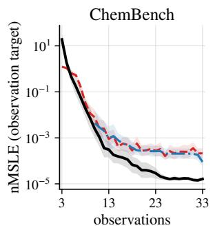

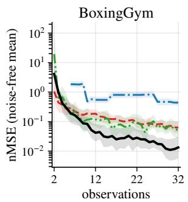

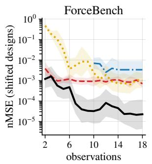

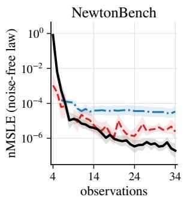  
Ours ICL AutoSciLab Box's Apprentice DP-Agent

Figure 2: Predictive performance. Lower is better. Lines show geometric-mean prediction error, aggregated over seeds within each task and then across tasks. Shaded bands indicate seed dispersion in log space. The x-axis shows the total number of observations. AutoSciLab curves start later because additional observations are required before its first executable model is available. Appendix A details the evaluation protocol, aggregation, and exclusions.  
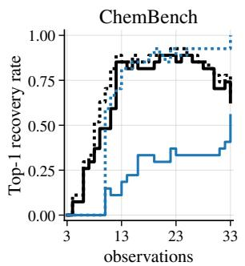

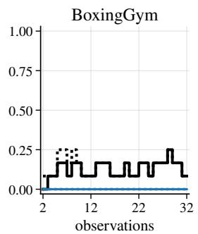

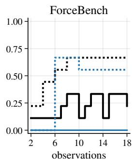

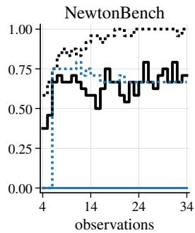  
Figure 3: Strict recovery and ground-truth containment. Each curve shows the fraction of runs in which the selected top-1 model satisfies the corresponding criterion. Strict recovery (solid lines) requires structural equivalence to the ground-truth functional form. Containment (dotted lines) counts more general model families that can represent the ground truth as a special case. For example, a quadratic family contains a linear family when its quadratic coefficient is set to zero. Thus, containment does not necessarily imply recovery of the exact functional form. Appendix C details the evaluation criteria, including numerical checks.

## 4.1 Predictive performance and sample efficiency

We evaluate predictive performance and sample efficiency by tracking prediction error as observations accumulate (Figure 2). Across all four benchmarks, BMD generally achieves lower error at comparable observation budgets while also attaining the lowest final error. Overall, these results demonstrate BMD’s superior predictive performance and sample efficiency.

## 4.2 Recovery of functional forms

Accurate prediction alone does not establish that an agent has identified the underlying law. We therefore evaluate strict recovery (solid lines), which requires certified structural equivalence to the true family, and ground-truth containment (dotted lines), which also accepts a broader family capable of representing the true law.

At each observation budget, we evaluate BMD’s highest-evidence family and LLM-AutoSciLab’s current hypothesis under both criteria. Figure 3 reports the fraction of runs that satisfy each criterion, denoted as Top-1 recovery rate. Appendix C provides the evaluation details.

BMD demonstrates a clear advantage in exactform discovery. On BoxingGym, ForceBench, and NewtonBench, BMD successfully recovers true functional forms, whereas AutoSciLab achieves no strict recovery. On ChemBench, BMD identifies the correct structure much earlier and maintains higher strict recovery at the final budget. BMD also achieves higher containment on BoxingGym and NewtonBench. The NewtonBench results are particularly revealing: AutoSciLab frequently selects families that contain the ground truth but never passes the strict criterion, whereas BMD achieves high recovery under both criteria. These results demonstrate that BMD’s advantage extends beyond predictive accuracy to structural recovery.

<table><tr><td></td><td colspan="3">Components</td><td colspan="5">Relative error (A = 1, ↓)</td><td colspan="5">GT identification (%, ↑)</td></tr><tr><td></td><td>Model Explicit</td><td>SMC fit</td><td>Evidence</td><td>Chem</td><td>Boxing</td><td>Force</td><td>Newton</td><td>Overall</td><td>Chem</td><td>Boxing</td><td>Force</td><td>Newton</td><td>Overall</td></tr><tr><td>A</td><td>X</td><td>X</td><td>X</td><td>1.000</td><td>1.000</td><td>1.000</td><td>1.000</td><td>1.000</td><td></td><td>一</td><td></td><td></td><td></td></tr><tr><td>B</td><td>O</td><td>X</td><td>X</td><td>0.917</td><td>0.868</td><td>0.230</td><td>0.777</td><td>0.613</td><td>98.9</td><td>18.5</td><td>50.0</td><td>90.0</td><td>79.3</td></tr><tr><td>C</td><td>O</td><td>0</td><td>X</td><td>0.351</td><td>1.388</td><td>0.174</td><td>0.219</td><td>0.369</td><td>98.9</td><td>18.5</td><td>50.0</td><td>90.0</td><td>79.3</td></tr><tr><td>D</td><td>0</td><td>0</td><td>0</td><td>0.349</td><td>0.667</td><td>0.036</td><td>0.247</td><td>0.214</td><td>96.7</td><td>63.0</td><td>83.3</td><td>78.6</td><td>84.8</td></tr></table>

Table 2: The role of numerical model evaluation. The methods progressively introduce (B) explicit model-based prediction using an LLM-selected family and parameters, (C) Bayesian parameter fitting via SMC for the family selected by B, and (D) evidence-based selection instead of LLM selection. Prediction errors are normalized by direct ICL (A) within each benchmark; Overall is the geometric mean across benchmarks.

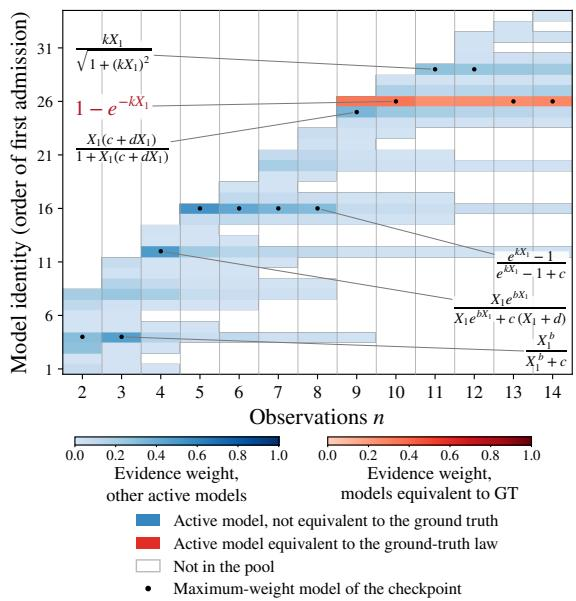  
Figure 4: Exploring the model pool. Rows follow firstadmission order; shading gives normalized evidence weights. Red marks ground-truth-equivalent models, blue other active models, and white absence from the pool. Black dots mark the highest-weight model. Annotations show candidate functional forms; $X _ { 1 }$ is the anonymized input, and letters denote coefficients.

A discovery trajectory. Figure 4 shows how the candidate pool evolves through experiments. The pool initially does not contain the ground-truth family, but at $n = 9$ it introduces the ground-truth family $1 - e ^ { - k X _ { 1 } }$ . This candidate becomes the highestevidence model, remains in the pool when another candidate temporarily leads, and later returns to the top. This example illustrates how BMD introduces missing functional forms and revises their support as observations accumulate.

## 4.3 The role of numerical model evaluation

BMD uses the LLM to propose model families but delegates parameter fitting and model comparison to a numerical engine. Complementing the end-toend results in Figure 2, we test whether this division of labor improves upon the LLM’s own parameter estimates and model choices.

Experimental setup. For each world–seed pair, we collect 20 random-design observations. Using only the first 10, Claude Opus 5.5 proposes 11 alternative families, which we combine with the ground-truth (GT) family into a fixed pool of $K =$ 12 candidates. All methods share this pool and the full observation set.

Models. We consider the following methods.

• A (Direct ICL): The LLM predicts responses directly from the observations and the pool.

• B (LLM model selection + LLM parameters): The LLM selects a family from the pool and specifies its parameter values based on the observations; the resulting model is used for prediction.

• C (LLM model selection + Bayesian parameter fitting): Retains B’s selected family but infers its parameter posterior using SMC and predicts with the posterior predictive mean.

• D (Evidence-based model selection + Bayesian parameter fitting): Selects the highest-evidence family among SMC-fitted candidates and predicts with its posterior predictive mean.

B–C compares parameter inference within the same family, while C–D compares model selection under the same SMC parameter-fitting procedure. We report error on shared held-out points and GT identification by structural equivalence of the selected family.

Results. Table 2 shows progressively lower crossbenchmark geometric-mean error from A to B to C to D, revealing three complementary benefits.

First, A–B shows that predicting through an explicit model improves upon direct ICL, even when the LLM itself selects the family and specifies its parameters. Second, B–C shows that Bayesian parameter fitting further improves prediction without changing the selected family, highlighting the importance of numerical parameter inference. Third, C–D shows that replacing LLM model selection with evidence-based model selection improves aggregate prediction and pooled top-1 GT identification (79.3% to 84.8%).

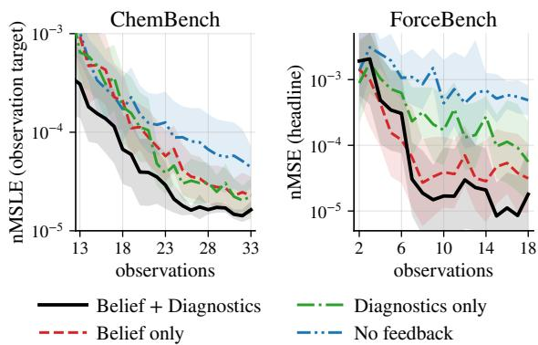

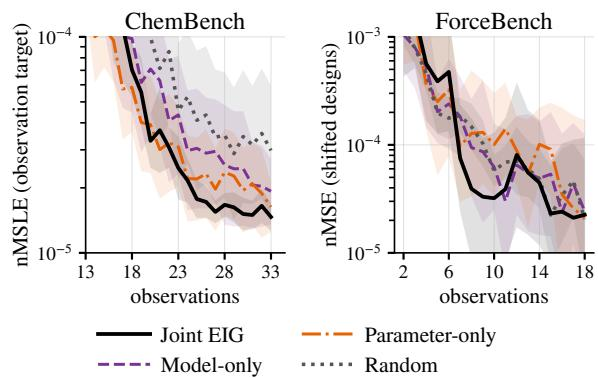  
Figure 5: Joint EIG and its information components.  
Figure 6: Belief and diagnostic feedback.

Overall, D reduces prediction error by a factor of 4.7 relative to A. These results show that predicting through explicit models improves aggregate accuracy over direct ICL. Once such models are introduced, however, selecting the right family and fitting its parameters become critical. Numerical parameter fitting and evidence-based selection further improve performance over the LLM’s own estimates and choices. This motivates BMD’s division of labor: the LLM proposes functional forms, while the numerical engine fits and compares them.

## 4.4 The value of joint EIG

An informative experiment may distinguish competing model families, refine their parameters, or both. Figure 5 compares our Joint EIG acquisition function against Model-only EIG, Parameteronly EIG, and Random design (random selection of the next design point $\mathbf { x } _ { t + 1 } )$ . Model-only EIG and Parameter-only EIG correspond to the terms in Equation (7).

Joint EIG achieves the lowest final prediction error on both benchmarks. On ChemBench, it maintains a clear advantage over the alternatives through much of the later observation budgets. On ForceBench, Joint EIG reduces prediction error substantially faster at intermediate budgets, although the other methods eventually approach its performance. These results highlight the benefit of jointly targeting model discrimination and parameter refinement, suggesting that accounting for both sources of uncertainty can lead to more effective experimental designs.

## 4.5 What feedback helps hypothesis discovery?

Finally, beyond fitting and comparing candidate models, BMD feeds numerical inference results back to the LLM to guide subsequent hypothesis generation. We examine whether this feedback improves discovery through a $2 \times 2$ ablation: Full (belief + diagnostics), Belief-only, Diagnostics-only, and No feedback. Belief feedback includes model evidence, posterior weights, and parameter summaries, while diagnostics provide model-wise predictive residuals. All variants share the same initialization and retain Bayesian inference and joint-EIG experimental design.

Figure 6 shows that Full achieves the lowest final prediction error on both ChemBench and ForceBench, while No feedback performs worst. Either feedback type generally improves prediction, although their relative contributions vary across benchmarks. These results suggest that numerical inference is valuable not only for evaluating existing hypotheses but also for guiding the LLM toward better subsequent proposals, supporting BMD’s closed-loop design.

## 5 Conclusion

BMD connects LLM hypothesis generation, Bayesian model evaluation, and informationtheoretic experimental design. Across four simulated benchmarks, it improves prediction, sample efficiency, and exact-form recovery. Controlled comparisons favor explicit modeling over direct ICL, with further gains from Bayesian fitting and evidence-based selection. Acquisition comparisons favor joint model–parameter EIG, while feedback ablations show that returning numerical beliefs and diagnostics to the LLM improves downstream prediction, reinforcing BMD’s closed-loop design.

## Limitations

Our experiments focus on simulated scientific tasks; validation in real-world experimental settings remains future work. Such evaluation would help assess robustness beyond the observation models and experimental conditions considered here. BMD’s uncertainty estimates are conditional on its current finite candidate pool rather than the space of all possible laws. Although the pool evolves through LLM proposals, discovery still depends on generating suitable model families, and our structural-recovery evaluation covers only targets expressible in the modeling interface.

## Ethical Considerations

Our experiments are conducted in simulated scientific environments without human participants. While BMD aims to assist scientific discovery, automatically generated hypotheses may be inaccurate or misleading, potentially leading to incorrect scientific conclusions. Real-world applications should therefore involve independent validation of discovered models and appropriate human oversight before conducting consequential experiments.

## References

Jinheon Baek, Sujay Kumar Jauhar, Silviu Cucerzan, and Sung Ju Hwang. 2025. Researchagent: Iterative research idea generation over scientific literature with large language models. In Proceedings ofthe 2025 Conference of the Nations of the Americas Chapter of the Associationfor Computational Linguistics: Human Language Technologies, NAACL 2025 - Volume 1: Long Papers, Albuquerque, New Mexico, USA, April 29 - May 4, 2025, pages 6709–6738. Association for Computational Linguistics.

Freddie Bickford Smith, Andreas Kirsch, Sebastian Farquhar, Yarin Gal, Adam Foster, and Tom Rainforth. 2023. Prediction-oriented bayesian active learning. In Proceedings of the 26th International Conference on Artificial Intelligence and Statistics, volume 206 of Proceedings of Machine Learning Research, pages 7331–7348. PMLR.

David M. Blei. 2014. Build, compute, critique, repeat: Data analysis with latent variable models. Annual Review ofStatistics and Its Application, 1:203–232.

Daniil A. Boiko, Robert MacKnight, Ben Kline, and Gabe Gomes. 2023. Autonomous chemical research with large language models. Nature, 624(7992):570– 578.

David M. Borth. 1975. A total entropy criterion for the dual problem of model discrimination and parameter estimation. Journal ofthe Royal Statistical Society: Series B (Methodological), 37(1):77–87.

G. E. P. Box and W. J. Hill. 1967. Discrimination among mechanistic models. Technometrics, 9(1):57–71.

Tom Brown, Benjamin Mann, Nick Ryder, Melanie Subbiah, Jared D. Kaplan, Prafulla Dhariwal, Arvind Neelakantan, Pranav Shyam, Girish Sastry, Amanda Askell, Sandhini Agarwal, Ariel Herbert-Voss, Gretchen Krueger, Tom Henighan, Rewon Child, Aditya Ramesh, Daniel Ziegler, Jeffrey Wu, Clemens Winter, and 12 others. 2020. Language models are few-shot learners. In Advances in Neural Information Processing Systems, volume 33, pages 1877–1901. Curran Associates, Inc.

Steven L. Brunton, Joshua L. Proctor, and J. Nathan Kutz. 2016. Discovering governing equations from data by sparse identification of nonlinear dynamical systems. Proceedings of the National Academy of Sciences, 113(15):3932–3937.

Kathryn Chaloner and Isabella Verdinelli. 1995. Bayesian experimental design: A review. Statistical Science, 10(3):273–304.

Deepro Choudhury, Sinead Williamson, Adam Golinski,´ Ning Miao, Freddie Bickford Smith, Michael Kirchhof, Yizhe Zhang, and Tom Rainforth. 2026. BED-LLM: Intelligent information gathering with LLMs and Bayesian experimental design. In The Fourteenth International Conference on Learning Representations, pages 84375–84405.

Miles Cranmer. 2023. Interpretable machine learning for science with PySR and SymbolicRegression.jl. arXiv preprint arXiv:2305.01582.

Pierre Del Moral, Arnaud Doucet, and Ajay Jasra. 2006. Sequential monte carlo samplers. Journal ofthe Royal Statistical Society: Series B (Statistical Methodology), 68(3):411–436.

Justin Domke. 2025. Large language Bayes. In Advances in Neural Information Processing Systems, volume 38, pages 7149–7211. Curran Associates, Inc.

Kanishk Gandhi, Michael Y. Li, Lyle Goodyear, Agam Bhatia, Louise Li, Aditi Bhaskar, Mohammed Zaman, and Noah D. Goodman. 2025. BoxingGym: Benchmarking progress in automated experimental design and model discovery. arXiv preprint arXiv:2501.01540.

Rushil Gupta, Jason Hartford, and Bang Liu. 2025. LLMs for Bayesian optimization in scientific domains: Are we there yet? In Findings of the Associationfor Computational Linguistics: EMNLP 2025, pages 15482–15510, Suzhou, China. Association for Computational Linguistics.

William J. Hill, William G. Hunter, and Dean W. Wichern. 1968. A joint design criterion for the dual problem of model discrimination and parameter estimation. Technometrics, 10(1):145–160.

Jennifer A. Hoeting, David Madigan, Adrian E. Raftery, and Chris T. Volinsky. 1999. Bayesian model averaging: A tutorial. Statistical Science, 14(4):382–417.

Sanchit Kabra, Nikhil Abhyankar, Saaketh Desai, Prasad Iyer, and Chandan K. Reddy. 2026. LLM-AutoSciLab: Closed-loop scientific discovery via active experimentation with LLMs. arXiv preprint arXiv:2605.24043.

Robert E. Kass and Adrian E. Raftery. 1995. Bayes factors. Journal ofthe American Statistical Association, 90(430):773–795.

Patrick W. Langley, Herbert A. Simon, Gary Bradshaw, and Jan M. Zytkow. 1987. Scientific Discovery: Computational Explorations ofthe Creative Process. MIT Press.

Michael Y. Li, Emily Fox, and Noah Goodman. 2024. Automated statistical model discovery with language models. In Proceedings of the 41st International Conference on Machine Learning, volume 235 of Proceedings of Machine Learning Research, pages 27791–27807. PMLR.

D. V. Lindley. 1956. On a measure of the information provided by an experiment. The Annals ofMathematical Statistics, 27(4):986–1005.

Chris Lu, Cong Lu, Robert Tjarko Lange, Jakob Foerster, Jeff Clune, and David Ha. 2024. The AI scientist: Towards fully automated open-ended scientific discovery. arXiv preprint arXiv:2408.06292.

J. M. McGree. 2017. Developments of the total entropy utility function for the dual purpose of model discrimination and parameter estimation in Bayesian design. Computational Statistics & Data Analysis, 113:207–225.

Kevin Murphy. 2026. Model discovery agent: LLMassisted bayesian experiment design for data-efficient discovery of mechanistic world models. arXiv preprint arXiv:2608.09696. Version 5; versioned protocol comparison.

Wasu Top Piriyakulkij, Cassidy Langenfeld, Tuan Anh Le, and Kevin Ellis. 2024. Doing experiments and revising rules with natural language and probabilistic reasoning. In Advances in Neural Information Processing Systems, volume 37, pages 53102–53137. Curran Associates, Inc.

Ben Prystawski, Kushin Mukherjee, Daniel Wurgaft, Linas Nasvytis, Michael Y. Li, Noah D. Goodman, and Michael C. Frank. 2026. auto-psych: Automating the science of mind using agent-driven theory discovery and experimentation. arXiv preprint arXiv:2606.26460.

Tom Rainforth, Adam Foster, Desi R. Ivanova, and Freddie Bickford Smith. 2024. Modern Bayesian experimental design. Statistical Science, 39(1):100– 114.

Bernardino Romera-Paredes, Mohammadamin Barekatain, Alexander Novikov, Matej Balog, M. Pawan Kumar, Emilien Dupont, Francisco J. R. Ruiz, Jordan S. Ellenberg, Pengming Wang, Omar Fawzi, Pushmeet Kohli, and Alhussein Fawzi. 2024. Mathematical discoveries from program search with large language models. Nature, 625(7995):468–475.

Michael Schmidt and Hod Lipson. 2009. Distilling freeform natural laws from experimental data. Science, 324(5923):81–85.

Parshin Shojaee, Kazem Meidani, Shashank Gupta, Amir Barati Farimani, and Chandan K. Reddy. 2025. LLM-SR: Scientific equation discovery via programming with large language models. In The Thirteenth International Conference on Learning Representations.

Stefan Wahl, Raphaela Schenk, Ali Farnoud, Jakob H. Macke, and Daniel Gedon. 2026. A probabilistic framework for LLM-based model discovery. arXiv preprint arXiv:2602.18266.

Hanchen Wang, Tianfan Fu, Yuanqi Du, Wenhao Gao, Kexin Huang, Ziming Liu, Payal Chandak, Shengchao Liu, Peter Van Katwyk, Andreea Deac, Anima Anandkumar, Karianne Bergen, Carla P. Gomes, Shirley Ho, Pushmeet Kohli, Joan Lasenby, Jure Leskovec, Tie-Yan Liu, Arjun Manrai, and 11 others. 2023. Scientific discovery in the age of artificial intelligence. Nature, 620(7972):47–60.

Matt L. Wiemann, Lindsay M. Smith, Peter Melchior, Siddharth Mishra-Sharma, Andrew Gordon Wilson, Pavel Izmailov, and Carolina Cuesta-Lázaro. 2026. DiscoverPhysics: Benchmarking LLMs for out-of-the-box scientific thinking. arXiv preprint arXiv:2605.26087. Version 2, August 31, 2026.

Zonglin Yang, Xinya Du, Junxian Li, Jie Zheng, Soujanya Poria, and Erik Cambria. 2024. Large language models for automated open-domain scientific hypotheses discovery. In Findings of the Associationfor Computational Linguistics: ACL 2024, pages 13545–13565, Bangkok, Thailand. Association for Computational Linguistics.

Tianshi Zheng, Kelvin Kiu-Wai Tam, Newt Hue-Nam K. Nguyen, Baixuan Xu, Zhaowei Wang, Jiayang Cheng, Hong Ting Tsang, Weiqi Wang, Jiaxin Bai, Tianqing Fang, Yangqiu Song, Ginny Y. Wong, and Simon See. 2026. NewtonBench: Benchmarking generalizable scientific law discovery in LLM agents. In The Fourteenth International Conference on Learning Representations.

## A Experimental Protocol and Metrics

Tasks, runs, and observation counts. A task specifies a generating mechanism; a world also fixes its parameters and observation process. A run is one execution with a particular seed. Table 3 lists the task sets for the sequential prediction and recovery experiments in Sections 4.1 and 4.2. The shared-candidate study in Section 4.3 uses a separate 217-run cohort, specified in Appendix D; its run counts should not be substituted for those of the sequential experiments. ChemBench, ForceBench, and NewtonBench keep each task’s law and constants fixed across seeds. BoxingGym instead draws parameters for each task–seed world. Seeds control numerical randomness and, where randomized, initial observations. The three standard seeds are 31, 37, and 41; BoxingGym uses 31, 41, and 47 for peregrines and 43, 53, and 61 for survival. The peregrines substitution avoids degenerate initial data.

With $n _ { 0 }$ initial observations and t additional responses, the plotted count is $n = n _ { 0 } + t .$ One ForceBench trajectory counts as one observation, not one observation per time point. Repeated designs generate fresh noise on BoxingGym and ForceBench, but return the same response on Chem-Bench and NewtonBench, whose noise is a deterministic function of the input. These simulator rules differ from the conditional-independence assumption used for numerical fitting.

Information supplied to the agents. BMD and all baselines receive the same numerical ranges of the design variables, with variable names anonymized on all four benchmarks. Task descriptions and semantic metadata are withheld on Chem-Bench, BoxingGym, and NewtonBench; BMD’s modeling interface remains available. ForceBench is the exception to metadata withholding: all methods retain the same physical task metadata to preserve the intended benchmark setting, while variable identifiers remain anonymized. There, the interface identifies separation, elapsed time, and inertial mass, and specifies how a force expression produces trajectories. For position vector $\mathbf { r } ,$ the declared acceleration is $- f _ { m } / X _ { 3 }$ along $\mathbf { r } / \lVert \mathbf { r } \rVert$ where $f _ { m }$ is the proposed expression and $X _ { 3 }$ is the inertial-mass input. The initial position and velocity and the velocity-Verlet grid $( \Delta t = 0 . 0 0 5 )$ are supplied. Each trajectory contains two coordinates at ten measurement times. No world name, force law, or law catalogue is supplied to the proposer. In BMD’s discovery runs, all initial candidates are LLM proposals; assigning a canonical catalogue name to a matching expression does not insert that expression. The fixed-pool diagnostic in Section 4.3 is the explicit exception: it inserts the GT family to separate model evaluation from candidate-generation success.

Baseline interfaces and schedules. All methods use Claude Opus 5.5 for their LLM calls. LLM-AutoSciLab uses an every-round variant for predictive curves: one experiment and one equationlearning step per round, with the same LLM and reasoning effort as BMD. It follows the same anonymization and metadata policy described above: in particular, it does not receive native variable names or chemical task metadata on Chem-Bench. Its NewtonBench recovery curve uses the released schedule, with the first law at $n = 1 6$

The ForceBench comparisons use the rerun with a common information and observation interface for BMD, direct ICL, LLM-AutoSciLab, and DP-Agent. All receive the same physical task metadata and design constraints, observe trajectories through the same interface, and are evaluated using the same targets and scorer. Each trajectory counts as one observation for every method. The agents may choose different designs and hence observe different responses, but they do not receive different types of experimental measurements.

Box’s Apprentice on BoxingGym and DP-Agent on ForceBench also use every-round variants. Direct ICL chooses experimental designs from its observation history and receives separate prediction requests at each observation count; these requests do not change that history. Different experiment-selection policies are part of the comparison, whereas Section 4.3 holds the realized observations and candidate families fixed across methods.

Prediction targets. Let Q be the empirical distribution of evaluation inputs, $h ( \mathbf { x } )$ the evaluation target, and $\widehat { \mu } _ { n } ( \mathbf { x } )$ the prediction after n observations. For nonnegative targets,

$$
\mathrm { n M S L E } _ { Q } = \frac { \mathbb { E } _ { Q } [ ( \log ( 1 + \widehat { \mu } _ { n } ) - \log ( 1 + h ) ) ^ { 2 } ] } { \operatorname { V a r } _ { Q } [ \log ( 1 + h ) ] } .\tag{9}
$$

The nMSE divides the mean squared error by the benchmark’s fixed variance normalizer, averaging over the prescribed coordinates and time points for trajectories. Normalizers are specific to the target

Table 3: Main experimental tasks and budgets. Structural recovery uses only targets representable in the interface; predictive evaluation retains all tasks. Each task has three seeds
<table><tr><td></td><td>ChemBench</td><td>BoxingGym</td><td>ForceBench</td><td>NewtonBench</td></tr><tr><td>Tasks</td><td>Michaelis-Menten, product inhibition, ping-pong; each easy/medium/hard</td><td>Death, dugongs, hyperbolic, peregrines, survival</td><td>Gravity, Yukawa, Coulomb (easy), oscillator, extra</td><td>Magnetic force, Fourier, Snell, radioactive decay, Malus, sound speed, Hooke, Bose-Einstein,</td></tr><tr><td>BMD runs</td><td>27</td><td>15</td><td>15</td><td>heat transfer (medium) 27</td></tr><tr><td>Recovery runs n0 / additional / final</td><td>27 3 / 30 / 33</td><td>12  $2 / 3 0 / 3 2$ </td><td>9</td><td>24</td></tr><tr><td>n</td><td></td><td></td><td> $2 / 1 6 / 1 8$ </td><td>4 / 30 / 34</td></tr><tr><td>Design space</td><td>7 continuous reaction conditions</td><td>Task-specific; hyperbolic has 3 integer in [0.1, 10]2 inputs, survival a</td><td></td><td>2 continuous parameters Task-specific continuous inputs</td></tr><tr><td>Prediction scored</td><td>After proposals</td><td>discrete patient menu Before proposals</td><td>Before proposals</td><td>After proposals</td></tr></table>

and evaluation set.

ChemBench evaluates the noise-free observation mean $g ^ { \star } ( \mathbf { x } ) = f ^ { \star } ( \mathbf { x } ) s ( T , \mathrm { p H } )$ , including environmental effects s, rather than the primary kinetic law $f ^ { \star }$ alone. BoxingGym uses noise-free responsemean nMSE, including survival. NewtonBench evaluates its noise-free governing law by nMSLE. ChemBench and NewtonBench use 256 fixed evaluation inputs per task, shared across methods and seeds. BoxingGym draws 256 inputs per world and excludes observed designs. ForceBench evaluates trajectory nMSE on six fixed parameter settings, $p _ { 1 } \in \{ 3 , 4 , 5 \}$ and $p _ { 2 } \in \{ 3 , 5 \}$ , inside the acquisition box. These settings are our evaluation set, not the benchmark’s three standard scoring designs; the normalizer is the benchmark’s per-world variance constant, with a fixed scoring seed.

The targets matter: low observation-mean error need not imply low primary-law error. For $u \ : = \ :$ log $( 1 + f ^ { \star } ) , v = \log ( 1 + g ^ { \star } )$ , and $\widehat { v } = \log ( 1 + \widehat { \mu } _ { n } )$

$$
\begin{array} { r l } & { \mathbb { E } _ { Q } ( \widehat { v } - u ) ^ { 2 } = \mathbb { E } _ { Q } ( \widehat { v } - v ) ^ { 2 } + \mathbb { E } _ { Q } ( v - u ) ^ { 2 } } \\ & { \qquad + 2 \mathbb { E } _ { Q } [ ( \widehat { v } - v ) ( v - u ) ] . } \end{array}\tag{10}
$$

The cross term can have either sign; Appendix H gives a concrete example.

Evaluation timing. Prediction uses the state in Table 3; structural recovery always uses the retained pool after proposals. Both are evaluated independently at each observation count, not as bestso-far scores. Ground-truth forms are excluded from the discovery loop, and held-out evaluation responses are excluded from all fitting and design. The GT-containing diagnostic is specified separately in Appendix D. Hypothetical acquisition responses come from the fitted model, not additional

simulator calls.

Curve aggregation. For method $^ { a , }$ let $e _ { a , j , s } ( n )$ be the error of task $j$ and seed s, and $S _ { j }$ its included seeds. With J tasks, define

$$
\begin{array} { l } { \displaystyle \ell _ { a , j } ( n ) = \frac { 1 } { | S _ { j } | } \sum _ { s \in S _ { j } } \log e _ { a , j , s } ( n ) , } \\ { \displaystyle \bar { \ell } _ { a } ( n ) = \frac { 1 } { J } \sum _ { j = 1 } ^ { J } \ell _ { a , j } ( n ) , } \\ { \displaystyle v _ { a } ( n ) = \frac { 1 } { J ^ { 2 } } \sum _ { j = 1 } ^ { J } \mathrm { V a r } _ { s \in S _ { j } } [ \log e _ { a , j , s } ( n ) ] . } \end{array}\tag{11}
$$

Lines show $\exp ( \bar { \ell } _ { a } ) ;$ ; bands show exp $( \bar { \ell } _ { a } \pm \sqrt { v _ { a } } )$ Variance is the sample variance within each task (zero for a single included seed). These bands summarize seed dispersion, not confidence intervals for paired improvements. Each plotted point requires a prediction from every included run. AutoSciLab’s curves can therefore begin after the initial observation budget because it needs additional observations before proposing its first executable model. The fixed-pool comparison instead uses the normalization and aggregation in Appendix D.

At the first ForceBench observation budget, predictions use the fitted initial LLM proposals before any adaptive experiment is selected. Performance at that point reflects the initial observations and fitted pool, not an effect of an EIG-selected experiment.

Missing and early-terminated runs. BMD and ICL use all runs in Table 3. AutoSciLab’s predictive curves use 26/27 ChemBench and 8/15 BoxingGym runs; Box’s Apprentice uses 10/15 BoxingGym runs. All plotted methods use the full

ForceBench and NewtonBench sets. The exclusions are:

• AutoSciLab: ChemBench ping-pong medium, seed 37; BoxingGym death (all three seeds), survival 61 (first law too late), hyperbolic 31 (overflow), and peregrines 31/41 (no finite values).

• Box’s Apprentice: death 41, dugongs 31, and all three hyperbolic runs; hyperbolic 31 terminated at its cost cap.

Thus some curves summarize different task–seed sets. Five NewtonBench AutoSciLab runs stopped with a confidence-based termination after 12–20 observations (Snell 31, Malus 31, sound speed 37, Hooke 31/37); their last law is carried to $n = 3 4$ for predictive evaluation. Crashed BMD runs were rerun under the same seed with the cause recorded. Missing predictions were not assigned zero error. Proposal rejection, fit failure, and unavailable agent predictions are recorded separately.

The available-run counts above concern the sequential experiments only. The 90/27/30/70 runs in Table 2 belong to the separate fixed-pool diagnostic; they are not a revised denominator for Figures 2 and 3.

## B Numerical Implementation

Model representation and validation. Each candidate specifies a functional expression and its coefficient roles and domains. As in Section 3.1, the observation-distribution family is fixed for each task; it is not a hypothesis-search dimension. The task interface supplies this likelihood and the link or forward model. Prediction uses the responsespace conditional mean, not the raw expression when the link is nonlinear. ChemBench, Boxing-Gym, and NewtonBench allow $+ , - , \times , / ,$ ∗∗ and exp, log, sqrt, tanh, square, and power, with at most six expression coefficients and fifteen operators. ForceBench additionally allows cos and sin, but its engine enforces three free constants and ten operators. Noise parameters are not counted as expression coefficients.

Validation checks syntax, coefficient roles, consistency with the fixed task likelihood, and finite predictions under 64 prior draws (on BoxingGym, at 16 probe inputs). Canonicalization normalizes expression syntax, roles, and family, including equivalent power notations. ForceBench also checks numerical duplicates on a probe grid. These online duplicate tests are not the full structural judge of Appendix C. Rejected proposals and failed fits retain their failure reasons rather than receiving an artificial evidence value.

Proposal and pool settings. The proposer uses Claude Opus 5.5 with medium reasoning effort, 16,000 output tokens, and a 120-second timeout. SDK retries are disabled; a validation failure permits one repair turn. Initialization requests 12 candidates and permits two refill waves. Later rounds request three candidates without refill. The pool retains up to 12 valid fitted model families by evidence, with equal family-level prior weights. Every fifth round, the proposer may nominate up to two retired candidates; each is refitted from its original prior on all current data before competing for retention. All failed proposals and retirements remain in the archive.

Role priors and observation models. Chem-Bench and BoxingGym’s death, dugongs, peregrines, and survival tasks use independent default role priors:

$$
\begin{array} { r l } & { \theta _ { \mathrm { i n t e r c e p t } } \sim \mathcal { N } ( 0 , 2 ^ { 2 } ) , } \\ & { \theta _ { \mathrm { s i g n e d } } \sim \mathcal { N } ( 0 , 1 ) , } \\ & { \theta _ { \mathrm { p o s i t i v e } } \sim \mathrm { L o g N o r m a l } ( 0 , 1 ) , } \\ & { \theta _ { \mathrm { s h a p e } } \sim \mathrm { G a m m a } ( 2 , 1 ) . } \end{array}\tag{12}
$$

Gamma uses shape and rate. NewtonBench and BoxingGym’s hyperbolic task use a wide prior: intercept $\mathcal { N } ( 0 , 4 ^ { 2 } )$ , signed $\mathcal { N } ( 0 , 2 ^ { 2 } )$ , positive LogNormal(0, 2), and shape Gamma $( 2 , { \frac { 1 } { 2 } } )$ ForceBench uses the two priors in Table 4.

For a LogNormal response, let $\eta _ { m }$ be the loglink expression and $s _ { 0 }$ the response unit computed from $\mathcal { D } _ { 0 }$ . Then

$$
\begin{array} { r l } & { ~ \mu _ { m } ( \mathbf { x } ; \pmb { \theta } _ { m } ) = s _ { 0 } \exp \{ \eta _ { m } ( \mathbf { x } ; \pmb { \theta } _ { m } ) \} , } \\ & { ~ \quad \quad \quad \quad Y \mid \mathbf { x } , \pmb { \theta } _ { m } , m } \\ & { \sim \mathrm { L o g N o r m a l } ( \log \mu _ { m } - \sigma _ { m } ^ { 2 } / 2 , \sigma _ { m } ) , } \\ & { ~ \quad \quad \quad \quad \sigma _ { m } \sim \mathrm { H a l f N o r m a l } ( 1 ) . } \end{array}\tag{13}
$$

Here $\mu _ { m }$ is the response mean, not the median. The response unit is the initial sample mean on Chem-Bench and BoxingGym’s positive-response path, and the initial geometric mean on NewtonBench. It remains fixed, so evidence is conditional on this initial calibration.

ChemBench and NewtonBench use the fixed LogNormal observation family. BoxingGym uses the likelihood assigned to each task; ForceBench uses the task’s fixed likelihood on trajectory coordinates. Candidates do not change this distributional family, although parameters of the specified likelihood can be inferred. The fitted likelihood can differ from the simulator noise; ChemBench, for example, generates relative Gaussian noise. Equivalent expressions need not induce equivalent priors when the same numerical role prior is used under a different parameterization.

Table 4: Benchmark-specific settings for the main BMD runs. Common proposal and SMC settings are given in the text. Appendices E and F specify analysis-specific differences.
<table><tr><td></td><td>ChemBench</td><td>BoxingGym</td><td>ForceBench</td><td>NewtonBench</td></tr><tr><td>Initial data Coefficient prior</td><td>3 fixed designs Default</td><td>2 random designs Default; hyperbolic:</td><td>2 trajectories Signed N(0, 1);</td><td>4 random designs Wide</td></tr><tr><td></td><td></td><td>wide</td><td>positive LogNormal(0, 1)</td><td></td></tr><tr><td>Observation family</td><td>Fixed LogNormal</td><td>Fixed per task</td><td>Fixed trajectory likelihood</td><td>Fixed LogNormal</td></tr><tr><td>Archive review EIG draws</td><td>Every 5 rounds to 30 128 posterior draws</td><td>Every 5 rounds to 30 128; count tasks use</td><td>Rounds 5, 10, 15 128 outer and 128 inner</td><td>Every 5 rounds to 30 128 posterior draws</td></tr><tr><td></td><td></td><td>outcome tables</td><td>draws</td><td></td></tr><tr><td>Search starts</td><td>5 uniform</td><td>5 best candidate designs; survival enumerated</td><td>5 uniform</td><td>5 uniform</td></tr><tr><td>Optimizer</td><td>Projected finite differences; 20–500 steps</td><td>Compass search; at most 40 steps</td><td>Adam, learning rate 0.15; 40 steps</td><td>As ChemBench</td></tr><tr><td>Paid-call cap</td><td>160</td><td>100</td><td>100</td><td>160</td></tr></table>

SMC and prediction. SMC bridges densities proportional to $\pi _ { m } ( \pmb { \theta } _ { m } ) L _ { m , t } ( \pmb { \theta } _ { m } ) ^ { \beta }$ , increasing β from zero to one (Del Moral et al., 2006). Each refit starts from the original prior and uses all current data. All benchmarks use 500 particles per chain and two chains, with an effective-samplesize target of 0.5N and resampling at each tempering stage. ChemBench, BoxingGym, and Newton-Bench use PyMC 5.13.1, two worker cores, and independent-Metropolis moves with adaptive move counts (correlation threshold 0.01). Fit timeouts are 600 seconds on ChemBench and NewtonBench; BoxingGym has no such timeout.

ForceBench uses JAX, runs the chains sequentially, and takes three random-walk Metropolis moves per tempering stage. The fitting configuration specifies a 5,000-stage/1,800-second limit.

For C chains, the documented combination rule averages evidence estimates, not their logarithms:

$$
\log \widehat { Z } _ { m , t } = \mathrm { l o g s u m e x p } _ { c = 1 } ^ { C } \log \widehat { Z } _ { m , t } ^ { ( c ) } - \log C .\tag{14}
$$

Posterior particles are concatenated with equal weights. With $N _ { m }$ stored particles, the family predictive is

$$
q _ { m , t } ( y \mid \mathbf { x } ) \simeq \frac { 1 } { N _ { m } } \sum _ { k = 1 } ^ { N _ { m } } p _ { m } ( y \mid \mathbf { x } , \pmb { \theta } _ { m } ^ { ( k ) } ) .
$$

Point predictions average conditional response means over these particles and then over families using evidence weights.

Joint-EIG estimation and search. The estimator samples a family, posterior parameters, and a hypothetical outcome, then compares its conditional likelihood with the weighted predictive mixture. Density calculations use log-sum-exp arithmetic. Invalid components are tracked; an all-invalid query is a failure, not zero information. Negative finite-sample estimates are not clipped. The component estimators appear in Appendix F.

ChemBench and NewtonBench start five searches uniformly in the scaled unit box and select the best endpoint under the search draws. The 256- point pools declared for other comparison methods are not used by these runs. ChemBench uses log coordinates for designated positive inputs and affine coordinates otherwise. For iteration $k ,$ its randomsign finite-difference schedules are

$$
a _ { k } = \frac { 0 . 2 } { ( 1 0 + k ) ^ { 0 . 6 0 2 } } , \qquad c _ { k } = \frac { 0 . 0 5 } { k ^ { 0 . 1 0 1 } } ,
$$

with clipped probes and updates, 20–500 steps, and a ten-step movement window. BoxingGym scores a 100-point candidate pool (75 for hyperbolic) and starts compass search from the best five points; it reevaluates the pool maximum and search endpoints together. Survival instead scores every unobserved patient.

ForceBench uses five uniform starts and Adam ascent. One set of random draws is shared across all starts and steps within a round; endpoints are reestimated with independent draws before selection.

Every search respects the design constraints and keeps the fitted model pool fixed.

EPIG implementation. The separate exploratory EPIG comparison in Appendix F uses the same predictive-mixture construction and feasible domain. Its settings below describe that auxiliary comparison, not a replacement for joint EIG in the main runs. BoxingGym samples 32 target inputs once per run from its evaluation-input distribution, disjoint from evaluation points (128 targets on hyperbolic; uniform resampling of the 100-patient pool on survival). Search uses the same compass procedure, or enumeration on survival. Continuous outcomes use 64 predictive-quantile intervals including tails. Bounded counts are enumerated; unbounded counts are enumerated to 100,000 with an aggregated tail at tolerance $1 0 ^ { - 1 2 }$ and a 256 MiB working-memory limit. The resulting mutual information is computed on finite probability tables. ForceBench uses 32 uniform target designs, Adam search, and $1 2 8 \times 1 2 8$ nested Monte Carlo draws without a quantile grid. No evaluation responses are used in either acquisition.

## C Strict Recovery and Ground-Truth Containment

Criteria and selected models. The two curves in Figure 3 evaluate the same top-1 model at each observation budget: BMD’s highest-evidence retained family or AutoSciLab’s current hypothesis. They neither search the archive for a better answer nor count earlier successes cumulatively. BMD breaks evidence ties by the smallest canonical model identifier. A missing AutoSciLab law counts as no recovery; direct ICL has no structural output, so its recovery is not applicable rather than zero.

For run i, let $\mathcal { F } _ { i } ^ { \star }$ be the target family over its admissible coefficient domain and $\mathcal { F } _ { i } ( m )$ the candidate family on the benchmark’s comparison scale. The intended relations are

$$
\begin{array} { r } { \mathrm { s t r i c t : ~ } \mathcal { F } _ { i } ( m ) = \mathcal { F } _ { i } ^ { \star } , } \\ { \mathrm { c o n t a i n m e n t : ~ } \mathcal { F } _ { i } ^ { \star } \subseteq \mathcal { F } _ { i } ( m ) . } \end{array}\tag{15}
$$

The plotted indicators record the outcomes of the checks below. Containment includes strict success, so the curve gap counts accepted containment cases without certified strict equivalence. Some of these comparisons remain symbolically unresolved; the gap is not a count of proven non-equivalent families. Neither criterion requires recovery of the actual fitted coefficients or of the observation-noise distribution.

String identity is unnecessary. For positive domains, ${ a x } / ( b + x ) = x / ( \theta _ { 1 } + \theta _ { 2 } x )$ with $\theta _ { 1 } = b / a$ and $\theta _ { 2 } = 1 / a$ is an invertible reparameterization. By contrast, $c _ { 2 } x ^ { 2 } + c _ { 1 } x + c _ { 0 }$ contains $a x + b$ by setting $c _ { 2 } = 0$ , but has a free quadratic term. The declared coefficient domains matter; small estimated coefficients are not deleted after fitting.

Equivalence and containment checks. A deterministic judge (version 1.3) first applies the task’s link, input transformations, and target conventions. It uses neither an LLM nor the agents’ held-out prediction scores. Strict equivalence requires matching canonical expression trees, a coefficient mapping solved in both directions, a 30-digit numerical spot check, and admissible coefficients reproducing the true and diagnostic parameter settings. Canonicalization splits exponentials of sums and logarithms of products, merges powers, normalizes fractions, extracts leading coefficients, and applies trigonometric addition formulas. Diagnostic settings comprise the true setting plus two additional settings on ChemBench, NewtonBench, and ForceBench, or three on BoxingGym.

The judge marks non-equivalence for incompatible input dependence, coefficient-Jacobian rank, or coefficient domains, or for failure to reproduce a target member within $1 0 ^ { - 3 }$ under an eight-start refit. Containment is recorded separately. Its checks include up to 60 simplifying substitutions (coefficients set to 0, 1, or a limiting ∞, or tied together), a solved mapping into a higher-dimensional family, and wider coefficient domains. When no symbolic witness is found, a numerical check fits diagnostic members and requires error within $1 0 ^ { - 6 }$ on separate check inputs. This last check is evidence of numerical representability on those inputs, not a symbolic proof of inclusion everywhere.

Symbolically unproved, numerically ambiguous, timed-out, or non-identifiable cases remain unresolved. They fail strict recovery but can pass the separate containment check. Thus counting strict certificates is conservative; failure to obtain a certificate does not itself prove non-equivalence. These truth-assisted checks are evaluation-only and never alter the discovered candidates or their fitted predictions.

Benchmark targets and exclusions. The counts below refer to the sequential recovery experiment in Figure 3. The separate fixed-pool study uses the same notion of structural equivalence, with its own evaluation cohort and denominators (Appendix D).

ChemBench judges the primary kinetic law up to a positive overall factor on the slice $\mathrm { p H } = 7$ and T = 310 K (the latter is not fixed for Arrhenius tasks). Candidate nuisance terms are recorded but not judged. All 27 runs are included.

BoxingGym judges the expression behind the link: $1 - e ^ { - \theta x }$ for death, $a - b c ^ { x }$ for dugongs, the cubic log-mean for peregrines, and $\lambda _ { 0 } t e ^ { \beta m }$ on the logit scale for survival at both treatment values. Hyperbolic requires the normal cumulative distribution function, absent from the grammar, leaving 12 representable runs.

ForceBench judges acceleration $F / p _ { 2 }$ as a function of separation, time, and the two parameters. Simulator force softening and periodic background terms are excluded from the target; candidates adding them can count as containment. Yukawa’s Bessel function and the extra-dimensions image sum are outside the interface, leaving 9 runs.

NewtonBench judges the law after its log link, up to a positive factor, with literal exponents fixed and named constants free. Malus requires sine and cosine, absent from this grammar, leaving 24 runs. Snell and Bose–Einstein use small-argument surrogate comparisons on the tested input boxes: these can pass containment while remaining unresolved for strict recovery. They are not exact-law certificates. All excluded structural targets remain in predictive evaluation.

Agent schedules and interpretation. AutoSciLab uses every-round updates on ChemBench, BoxingGym, and ForceBench, but its released NewtonBench schedule produces no law before $n ~ = ~ 1 6$ This differs from the every-round NewtonBench predictive curve. Recovery uses the after-proposal model recorded at each budget. Averaging per-seed-slot fractions equals pooling because each slot has the same number of eligible runs. A correct earlier model can later be displaced, so recovery can decrease. These curves alone do not distinguish failure to propose a target family from failure to select it. Section 4.3 addresses the latter question by including the GT family in every candidate pool, without changing the shared-pool selection problem. The earlier primary-family classifier used in Appendix H is broader than this strict criterion and its results are reported separately.

## D Numerical Evaluation on Shared Candidates

Purpose and data. Section 4.3 separates explicit prediction, parameter inference, and model selection from differences in hypothesis generation and experimental design. For each world–seed pair, we collect 20 random-design observations, denoted by D. This budget applies to all four benchmarks in this diagnostic, including ForceBench; it is separate from the sequential budgets in Table 3. The reported cohort contains 90 ChemBench, 27 Boxing-Gym, 30 ForceBench, and 70 NewtonBench runs, for a total of 217. A–D share the same data and evaluation inputs within each run. No additional observations or adaptive experiments are acquired during this comparison.

Candidate construction. Given only the first 10 observations, Claude Opus 5.5 proposes 11 alternative model families. We combine them with the ground-truth (GT) family to form a fixed candidate list $\mathcal { L }$ of size $K \ : = \ : 1 2$ The GT insertion makes the correct functional form available for selection; it does not select that family on behalf of any method. All methods then receive the same list and use all 20 observations. The pool can differ between world–seed pairs but is fixed across A–D within a pair. Likelihood families are fixed per task, as in Section 3.1.

LLM prediction and selection. A predicts responses directly from the observations and candidate list. B jointly selects a family $m _ { L } \in { \mathcal { L } }$ and estimates its parameters $\widetilde { \pmb { \theta } } _ { m _ { L } } ;$ the resulting model is executed at the evaluation inputs. A and B do not use SMC parameter estimates, model evidence, or residual feedback. A receives prediction queries, whereas B produces an executable model. Thus A–B compares direct numerical prediction with prediction through an explicit model, not an isolated change to the LLM’s internal representation.

Shared fits and predictions. The numerical engine fits every candidate on the full D using SMC and the task priors, independently of B’s parameter estimates. For a candidate m, define its conditional response mean $\mu _ { m } ( \mathbf { x } ; \pmb { \theta } _ { m } ) = \mathbb { E } [ Y \mid \mathbf { x } , \pmb { \theta } _ { m } , m ]$ and its posterior predictive mean

$$
\begin{array} { r } { \overline { { \mu } } _ { m } ( \mathbf { x } ) = \mathbb { E } _ { \pmb { \theta } _ { m } | \mathcal { D } , m } [ \mu _ { m } ( \mathbf { x } ; \pmb { \theta } _ { m } ) ] . } \end{array}\tag{16}
$$

Let $\widehat { Z } ( m )$ denote its estimated marginal likelihood and let $m _ { E } \in$ arg $\operatorname* { m a x } _ { m \in \mathcal { L } }$ log $\bar { \hat { Z } } ( m )$ be the

evidence-selected family. The three explicit predictors are

$$
\begin{array} { r l } & { \widehat { \mu } _ { \mathrm { B } } ( \mathbf { x } ) = \mu _ { m _ { L } } ( \mathbf { x } ; \widetilde { \pmb \theta } _ { m _ { L } } ) , } \\ & { \widehat { \mu } _ { \mathrm { C } } ( \mathbf { x } ) = \overline { { \mu } } _ { m _ { L } } ( \mathbf { x } ) , } \\ & { \widehat { \mu } _ { \mathrm { D } } ( \mathbf { x } ) = \overline { { \mu } } _ { m _ { E } } ( \mathbf { x } ) . } \end{array}\tag{17}
$$

C retains B’s selected family. C and D reuse the same fitted candidates and posterior predictions, so matching family selections give identical predictions. Posterior prediction averages conditional response means, not parameters before nonlinear execution. B–C therefore compares within-family inference, while C–D changes only family selection. D uses one family; it is neither Bayesian model averaging nor a run of the complete BMD discovery loop.

Prediction targets. All four methods use the same held-out inputs, targets, and scorer within each run. ChemBench and NewtonBench use 256 evaluation inputs with nMSLE; BoxingGym uses 256 inputs with nMSE. ForceBench uses nMSE over two-dimensional trajectories at 10 measurement times under six evaluation designs. The response targets and metric normalizers follow $\mathsf { A p - }$ pendix A. In particular, the BoxingGym summary uses nMSE throughout, rather than mixing nMSE and Brier scores.

Error aggregation and normalization. For benchmark b, let $W _ { b }$ be its number of evaluated worlds, $S _ { b , j }$ the included seeds of world j, and $e _ { a , b , j , \varepsilon }$ the prediction error of method a. The benchmark aggregate is

$$
\begin{array} { l } { \ell _ { a , b , j } = \displaystyle \frac { 1 } { | S _ { b , j } | } \sum _ { s \in S _ { b , j } } \log \operatorname* { m a x } ( e _ { a , b , j , s } , 1 0 ^ { - 6 } ) , } \\ { E _ { a , b } = \displaystyle \exp \left\{ \frac { 1 } { W _ { b } } \sum _ { j = 1 } ^ { W _ { b } } \ell _ { a , b , j } \right\} . } \end{array}\tag{18}
$$

Errors are first geometrically averaged over seeds within each world, then over worlds. Table 2 reports relative errors $R _ { a , b } = E _ { a , b } / E _ { \mathrm { A } , b }$ , making direct ICL equal to one in every benchmark. The overall relative error is

$$
R _ { a } ^ { \mathrm { o v e r a l l } } = \exp \left\{ \frac { 1 } { 4 } \sum _ { b = 1 } ^ { 4 } \log R _ { a , b } \right\} .\tag{19}
$$

This gives equal weight to each benchmark, not to every run across all benchmarks. Table 5 gives the reported absolute errors before normalization, and Table 6 gives the identification counts. Values are shown at the precision supplied in the result summaries.

Top-1 GT identification. A hit requires structural equivalence of the selected family to the GT, using the criterion in Appendix $\mathrm { C } ;$ merely containing the GT as a special case is not sufficient. B and C have identical identification outcomes because they select the same family. D is evaluated using its highest-evidence family. Identification is not applicable to A, which does not return a selected model. The overall rate pools all 217 runs: B/C identify the GT in 172/217 runs (79.3%), and D in 184/217 (84.8%). Unlike the error aggregate, this overall rate is weighted by each benchmark’s number of runs.

Interpretation. The cross-benchmark error decreases from A to B to C to D. The paired comparisons support explicit model execution over direct ICL, Bayesian fitting within the selected family, and evidence-based comparison of fitted families, respectively. Together, they support the division of labor described in Section 4.3. The GT-containing pool makes this a test of model evaluation when a correct candidate is available, rather than a test of generating that candidate or choosing experiments.

## E Belief and Diagnostic Feedback

Purpose and conditions. Section 4.5 tests whether numerical feedback helps the LLM propose subsequent hypotheses, beyond the numerical engine’s role in fitting and comparing existing models. Let $b , d \in \{ 0 , 1 \}$ indicate whether belief and diagnostic feedback are exposed to the proposer. The 2×2 ablation compares Full (1, 1), Belief-only (1, 0), Diagnostics-only (0, 1), and No feedback (0, 0). All variants retain parameter inference, evidence weighting, Bayesian model averaging, candidate generation, and joint-EIG design. Only the feedback available to the proposer changes; “No feedback” does not remove the numerical engine.

Feedback masking. Table 7 specifies the feedback bundles. Candidates and archive entries are listed in canonical-identifier order. Removing belief also removes evidence rankings, best-model annotations, and evidence-based retirement explanations from structured fields, prose, and conversation history. Retired-model evidence values remain only when belief is visible. The composition and archive-review instructions use neutral wording (Appendix G). Diagnostics provide modelwise residuals rather than selecting only a preferred model. Removing a bundle does not remove the observed data, candidate identities, or active-pool membership.

Table 5: Absolute prediction errors for the shared-candidate study in Table 2, before normalization by A. Entries are geometric means over seeds within worlds and then over worlds; the overall row is the reported geometric mean across benchmarks. Lower is better.
<table><tr><td>Benchmark (metric)</td><td>A</td><td>B</td><td>C</td><td>D</td></tr><tr><td>ChemBench (nMSLE)</td><td> $8 . 4 7 \times 1 0 ^ { - 4 }$ </td><td> $7 . 7 7 \times 1 0 ^ { - 4 }$ </td><td> $2 . 9 7 \times 1 0 ^ { - 4 }$ </td><td> $2 . 9 6 \times 1 0 ^ { - 4 }$ </td></tr><tr><td>BoxingGym (nMSE)</td><td> $4 . 1 7 \times 1 0 ^ { - 2 }$ </td><td> $3 . 6 2 \times 1 0 ^ { - 2 }$ </td><td> $5 . 7 9 \times 1 0 ^ { - 2 }$ </td><td> $2 . 7 8 \times 1 0 ^ { - 2 }$ </td></tr><tr><td>ForceBench (nMSE)</td><td> $1 . 0 0 \times 1 0 ^ { - 3 }$ </td><td> $2 . 3 0 \times 1 0 ^ { - 4 }$ </td><td> $1 . 7 4 \times 1 0 ^ { - 4 }$ </td><td> $3 . 5 8 \times 1 0 ^ { - 5 }$ </td></tr><tr><td>NewtonBench (nMSLE)</td><td> $9 . 3 4 \times 1 0 ^ { - 6 }$ </td><td> $7 . 2 6 \times 1 0 ^ { - 6 }$ </td><td> $2 . 0 5 \times 1 0 ^ { - 6 }$ </td><td> $2 . 3 1 \times 1 0 ^ { - 6 }$ </td></tr><tr><td>Overall (geomean)</td><td> $7 . 5 8 \times 1 0 ^ { - 4 }$ </td><td> $4 . 6 5 \times 1 0 ^ { - 4 }$ </td><td> $2 . 8 0 \times 1 0 ^ { - 4 }$ </td><td> $1 . 6 2 \times 1 0 ^ { - 4 }$ </td></tr></table>

Table 6: Top-1 GT identification in the fixed-pool study (correct / evaluated runs). B and C select the same family. A has no structural output.
<table><tr><td>Benchmark</td><td>B/C</td><td>D</td></tr><tr><td>ChemBench</td><td>89/90</td><td>87/90</td></tr><tr><td>BoxingGym</td><td>5/27</td><td>17/27</td></tr><tr><td>ForceBench</td><td>15/30</td><td>25/30</td></tr><tr><td>NewtonBench</td><td>63/70</td><td>55/70</td></tr><tr><td>Overall</td><td>172/217</td><td>184/217</td></tr></table>

One-step predictive scores are computed from predictions made before the corresponding response is observed. Residuals use each model’s predictive scale. Even with explicit belief fields removed, residuals can reveal relative fit quality, and pool membership reflects numerical selection. The ablation therefore tests these feedback bundles, not the elimination of all indirect evidence about candidate quality.

Initialization and execution. Figure 6 compares nine ChemBench tasks and five ForceBench worlds, each with three seeds (27 and 15 runs per variant). Within each task–seed group, all four variants start from the same initial observations $\mathcal { D } _ { 0 }$ , initial candidate pool, and fitted state, including parameter posteriors and evidence estimates. A saved round-0 state is replayed to keep this initialization identical. From the first feedback-guided proposal onward, each variant follows its own trajectory: it proposes families, chooses experiments, obtains observations, and updates its fitted pool. Likelihoods, priors, grammar, pool capacity, proposal counts, and archive-review eligibility are otherwise kept fixed.

This is a sequential feedback ablation, not the fixed-data comparison of Section 4.3. Subsequent datasets and model pools need not match, even though initialization and the numerical inference and design procedures are shared.

Evaluation and interpretation. The horizontal axis is the total number of observations. ChemBench uses observation-mean nMSLE, and ForceBench uses trajectory nMSE on the shared evaluation designs. The target definitions and geometric aggregation follow Appendix A. The ChemBench panel displays observations 13–33; ForceBench displays 2–18.

In Figure 6, Full has the lowest final error on both benchmarks, while No feedback has the highest. Either feedback bundle generally improves prediction over No feedback. These results support returning numerical beliefs and residual diagnostics to the LLM, rather than using numerical inference only to score its existing hypotheses. Because proposals and observations subsequently evolve, the measured effect is on downstream prediction in the discovery loop, not an isolated score of individual proposal quality. The plotted bands summarize seed dispersion, not confidence intervals for paired gains.

## F Joint EIG and Its Information Components

Objectives and estimator. With a fixed dataset and fitted pool, the compared objectives are

$$
\begin{array} { r l } & { a _ { \mathrm { J } , t } ( \mathbf { x } ) = I ( Y _ { \mathbf { x } } ; M , \Theta _ { M } \mid \mathcal { D } _ { t } ) , } \\ & { a _ { \mathrm { M } , t } ( \mathbf { x } ) = I ( Y _ { \mathbf { x } } ; M \mid \mathcal { D } _ { t } ) , } \\ & { a _ { \mathrm { P } , t } ( \mathbf { x } ) = \displaystyle \sum _ { m } w _ { m , t } I ( Y _ { \mathbf { x } } ; \Theta _ { m } \mid \mathcal { D } _ { t } , M = m ) . } \end{array}\tag{20}
$$

Parameter-only averages over all families; Modelonly uses parameter-integrated predictions, not point estimates. Random samples from the declared design distribution. For S shared draws $( m _ { s } , \theta _ { s } , y _ { s } )$ , define $r _ { s } = p _ { m _ { s } } ( y _ { s } \mid \mathbf { x } , \pmb { \theta } _ { s } ) , u _ { s } =$ $q _ { m _ { s } , t } ( y _ { s } \mid \mathbf { x } )$ , and $v _ { s } = q _ { t } ( y _ { s } \mid \mathbf { x } )$ . The estimates are

Table 7: Information shown to the proposer in the feedback ablation. Numerical inference remains active in all four variants.
<table><tr><td>Bundle</td><td>Contents</td><td>Visible in</td></tr><tr><td>Common</td><td>Observations, task interface, candidate expressions, coefficient roles, grammar, structural duplicate history, syntax/repair status, and eligible retired identifiers</td><td>All variants</td></tr><tr><td>Belief</td><td>Log evidence, model weights, best-model marker, parameter posterior summaries, b = 1 pre-observation predictive log scores, and archived evidence values</td><td></td></tr><tr><td>Diagnostics</td><td>Standardized predictive residuals for every active model at the acquired observations, d = 1 identified by model</td><td></td></tr></table>

$$
\begin{array} { r l } & { \widehat { a } _ { { \bf J } , t } = S ^ { - 1 } \displaystyle \sum _ { s } \log ( r _ { s } / v _ { s } ) , } \\ & { \widehat { a } _ { { \bf M } , t } = S ^ { - 1 } \displaystyle \sum _ { s } \log ( u _ { s } / v _ { s } ) , } \\ & { \widehat { a } _ { { \bf P } , t } = S ^ { - 1 } \displaystyle \sum _ { s } \log ( r _ { s } / u _ { s } ) . } \end{array}\tag{21}
$$

Identical draws and density evaluations preserve $\widehat { a } _ { \mathrm { J } } = \widehat { a } _ { \mathrm { M } } + \widehat { a } _ { \mathrm { P } }$ up to arithmetic error. Separately clipping estimates or removing different invalid components breaks this identity; the identity itself does not establish convergence.

Prediction-oriented EPIG. Expected predictive information gain (EPIG) targets responses at inputs of interest (Bickford Smith et al., 2023). $\mathrm { L e t } \mathbf { x } ^ { \prime } \sim$ ν be a feasible target input sampled as specified in Appendix B. The prospective response at x and target response at $\mathbf { x } ^ { \prime }$ share the same sampled family and parameters but are conditionally independent given them:

$$
\begin{array} { r l } & { q _ { t } ^ { ( 2 ) } ( y , y ^ { \prime } \mid \mathbf { x } , \mathbf { x } ^ { \prime } ) } \\ & { \ = \mathbb { E } _ { M , \Theta _ { M } } \bigl [ p _ { M } ( y \mid \mathbf { x } , \Theta _ { M } ) p _ { M } ( y ^ { \prime } \mid \mathbf { x } ^ { \prime } , \Theta _ { M } ) \bigr ] . } \end{array}\tag{22}
$$

Then

$$
\begin{array} { r l } & { a _ { \mathrm { E P I G } , t } ( \mathbf { x } ) = \mathbb { E } _ { \mathbf { x } ^ { \prime } \sim \nu } I ( Y _ { \mathbf { x } } ; Y _ { \mathbf { x } ^ { \prime } } ^ { \prime } \mid \mathcal { D } _ { t } ) } \\ & { \quad \quad \quad = \mathbb { E } \log \frac { q _ { t } ^ { ( 2 ) } ( y , y ^ { \prime } \mid \mathbf { x } , \mathbf { x } ^ { \prime } ) } { q _ { t } ( y \mid \mathbf { x } ) q _ { t } ( y ^ { \prime } \mid \mathbf { x } ^ { \prime } ) } . } \end{array}\tag{23}
$$

The second expectation samples $\mathbf { x } ^ { \prime } \sim \nu$ and then $( y , y ^ { \prime } ) \sim q _ { t } ^ { ( 2 ) }$ . Independent latent draws would remove the predictive dependence of interest. These responses are hypothetical; EPIG does not query held-out labels.

Current joint-EIG comparison. Figure 5 compares Joint EIG, Model-only EIG, Parameter-only EIG, and Random on ChemBench and ForceBench, as described in Section 4.4. The comparison uses nine ChemBench tasks and five ForceBench worlds with three seeds each. Candidate generation, Bayesian fitting, evidence weighting, and posterior prediction are retained in every variant; the experimental-design objective changes. The parameter-only objective averages within-family information using the same model weights, rather than conditioning on a single selected family.

Each acquisition policy chooses designs in the feasible space and updates its own observations and candidate pool. Holding the fitted state fixed while optimizing one next experiment should not be confused with fixing that state for the entire sequential run. The ChemBench panel displays observations 13–33, and ForceBench displays 2–18; targets and geometric aggregation follow Appendix A. The figure supports the benefit of jointly targeting model and parameter uncertainty: Joint EIG maintains lower error through much of the later ChemBench budgets and reduces ForceBench error faster at intermediate budgets, with closer performance at the end.

Separate exploratory EPIG comparison. The supplied auxiliary acquisition results also compare EPIG with the EIG objectives. Table 8 reports these earlier runs separately: 27 ChemBench, 15 BoxingGym, and 15 ForceBench runs per evaluated objective. EPIG was evaluated on BoxingGym and ForceBench, not ChemBench. This auxiliary study uses the earlier feedback configuration, with residuals for the best model, evidence-ordered candidates, and the original composition and archive instructions. Its ForceBench runs predate the later SMC fit limit. These are not the runs plotted in Figure 5 or Figure 6.

Within this auxiliary study, likelihood settings, priors, proposal rules, fitting resources, and designsearch settings are held fixed apart from the acquisition objective. Each variant generates its own initial pool, so the realized pools, subsequent data, and proposals need not coincide. The values below are retained as the supplied separate EPIG evaluation, not as final values for the current joint-EIG figure or as measurements from the unified baseline rerun.

Table 8: Earlier auxiliary acquisition comparison, separate from Figure 5. Entries are final geometric-mean errors; ChemBench uses $n = 3 3 .$ , BoxingGym $n = 3 2$ and ForceBench $n = 1 8 .$ . The feedback and initialization configuration is described in the text.
<table><tr><td>Objective</td><td>ChemBench</td><td>BoxingGym ForceBench</td><td></td></tr><tr><td>Joint EIG</td><td> $1 . 4 7 \times 1 0 ^ { - 5 }$ </td><td>0.0101</td><td> $8 . 8 \times 1 0 ^ { - 8 }$ </td></tr><tr><td>Model-only</td><td> $1 . 9 3 \times 1 0 ^ { - 5 }$ </td><td>0.0111</td><td> $8 . 2 \times 1 0 ^ { - 6 }$ </td></tr><tr><td>Parameter-only</td><td> $1 . 6 3 \times 1 0 ^ { - 5 }$ </td><td>0.0168</td><td> $3 . 6 \times 1 0 ^ { - 6 }$ </td></tr><tr><td>Random</td><td> $2 . 9 8 \times 1 0 ^ { - 5 }$ </td><td>0.0570</td><td> $3 . 6 \times 1 0 ^ { - 5 }$ </td></tr><tr><td>EPIG</td><td></td><td>0.0132</td><td> $9 . 5 \times 1 0 ^ { - 7 }$ </td></tr></table>

In this auxiliary comparison, EPIG has lower final error than Random on BoxingGym and ForceBench, while Joint EIG has lower error than EPIG. These results supplement the comparison of information objectives; they should not be used to reconstruct the curves or effect sizes of the current main experiments. No NewtonBench acquisition result is reported.

## G Proposer Prompt Components

The proposer combines the supplied full-feedback base instruction (FA–C-R) with the three-candidate and archive-review extensions below. Each request also supplies the task interface, observations, feedback, and task-specific constraints. The base asks for one candidate; the composition extension overrides this output format with {limit} set to three. FA–C-R provides residuals for all active models. The auxiliary comparison in Appendix F uses the older FA–C base and earlier extensions, which differ from the current full-feedback configuration.

Task constraints and terminology. In the supplied prompt schema, the field named family denotes the observation-distribution family, whereas “model family” in the paper denotes the functional form. The experiments described in Section 3.1 hold the observation-distribution family fixed per task. Accordingly, the schema’s conditional support for family\_expansion does not make likelihood-family search part of the reported method: this flag is disabled, and family must match the task’s fixed distribution.

Task constraints also specify coefficient roles, expression operators, and the link or forward model.

ForceBench includes cos and sin; the engine applies its task-specific limits of three free constants and ten operators. The generic base text below includes the six-coefficient/fifteen-operator limits used for the other interfaces. The task-specific constraint block and validation enforce the applicable limits. Parameter priors are assigned by coefficient role rather than written numerically by the LLM.

Initialization and feedback variants. Discovery initialization requests candidate forms from the initial observations, with the candidate/refill settings in Appendix B. The GT-containing pool of Section 4.3 is a separate controlled construction, not a prompt used to initialize the end-to-end discovery runs. In the feedback ablation, all four variants replay the same initial fitted state before receiving their respective feedback bundles. Belief-only removes model-wise residuals; Diagnostics-only removes belief fields and their ranking cues; No feedback removes both bundles. The masking covers structured fields, accompanying prose, and history as specified in Appendix E. The observed data, candidate identities, and modeling interface remain available.

## Full-feedback base prompt.

# prompt\_version: v2.9.FA-C-R   
Propose one new candidate model for the   
process described only by the data   
and the structured fields in the   
user message. A Bayesian engine fits   
and scores every candidate.   
The user message is a JSON belief packet:   
interface (outcome type and support,   
input names and ranges, the fixed   
link), observations (all public data   
so far), pool (each active model   
with expression, family, evidence   
weight, log evidence, one-step   
predictive log-score history, and   
posterior mean and sd of each   
coefficient), residuals\_by\_model (   
for every active model, the   
standardized residual of each public   
observation under that model’s   
posterior predictive, keyed by model   
id and sorted by input), archive (   
every earlier proposal in this run   
with its outcome), and constraints.   
Nothing in the packet comes from   
held-out data. A large fitted   
dispersion makes standardized   
residuals look small even when the   
mean form is wrong.   
the one (expression family)

Propose the one (expression, family)   
pair that you judge most likely to   
have generated all of the   
observations and that is not in the   
pool or the archive; if your first

choice is already there, propose   
your next. Judge a form by how much   
of the data it would leave   
unexplained, not by how few edits   
separate it from the current best   
model. Inputs may combine through   
products, ratios or nested functions   
as well as through sums of separate   
terms.   
Link   
Under a log link, expression is log(   
mean / response\_unit): a factor f of   
the mean enters expression as + log   
(f) and a divisor g as - log(g).   
Inside log a raw input with a wide   
positive range is safe; outside log,   
such an input times a coefficient,   
or raised to a coefficient power,   
can overflow exp and is rejected.   
Checks   
predicted\_diagnostic: where your model   
should fit the observations better   
than the current best model, as {"   
input": <one input name>, "low": <   
number>, "high": <number>}. The two   
fitted models are compared on the   
observations whose value of that   
input lies between low and high.   
closest\_archived\_model: the expression   
in the pool or the archive that is   
most similar to yours, copied   
exactly.   
Rules   
expression is the argument of the   
fixed link. Use only coefficient   
names declared in parameters, the   
input names given in interface, real   
literals, the operators + - \* / \*\*,   
and exp, log, sqrt, tanh, square,   
power(x, k). At most 6 coefficients   
and 15 operators.   
Count operators as the engine does:   
each +, -, \*, /, \*\* and each unary   
minus counts 1, and each call of exp,   
log, sqrt, tanh, square or power   
counts 1; names and numbers count 0.   
For example c\*tanh(w) counts 2, and   
each further term c f(x + k) added   
to a sum costs 4. If your count is   
above 15, simplify the expression   
before replying.   
parameters maps every coefficient used   
in expression to exactly one of:   
intercept, signed, positive, shape (   
at most one intercept). Priors are   
fixed by these labels; never write   
numeric priors. Family dispersion   
parameters belong to the family;   
never list them.   
family must be one of constraints.   
allowed\_families. If constraints.   
structure\_expansion is false,   
expression must be verbatim one of   
constraints.initial\_structures and   
only family may change. If   
constraints.family\_expansion is   
false, family must equal constraints.

initial\_family.   
- Your whole reply is one raw JSON   
object - its first character is {   
and its last is } - with the keys {"   
expression": ..., "family": ..., II   
parameters": {...}, "   
predicted\_diagnostic": {...}, "   
closest\_archived\_model": ...}: no   
code fence and no text before or   
after it. If it fails validation you   
receive the error once and may   
reply once more.

## Three-candidate extension.

Return a JSON array of exactly {limit}   
candidate objects, each with exactly   
the keys specified above and   
nothing else. Propose three distinct,   
non-equivalent hypotheses. At least   
two of the three candidates should   
differ meaningfully in their primary   
functional composition, rather than   
merely in parameterization or by   
adding or removing a correction term.   
At most one candidate may be a   
nested or incremental refinement of   
a model already in the pool, and   
only if the public observations   
specifically call for that   
refinement.

Archive-review extension. Every fifth round, the extension below also allows up to two retired model IDs. Each nominated model is refitted from its prior on current data, rather than restored with an old evidence value.

This is an archive review round. Besides   
your {limit} new candidates, you   
may ask for up to two archived   
models to be re-fit: choose only   
among archive entries whose outcome   
is retired and whose form you now   
judge likely given all current   
public observations. Each model you   
name is re-fit from its prior on all   
current public data and takes part   
in the pool like any other model.   
Reply with one raw JSON object {"   
candidates": [...], "revive": [...]}:   
candidates is the array described   
above, and revive lists the chosen   
archive model\_id strings exactly as   
given, or is empty when nothing in   
the archive deserves another fit.

## H Earlier ChemBench Diagnostics

Scope. These earlier ChemBench diagnostics examine prediction targets, parameter fitting, and calibration in a separate development cohort. They are not the runs underlying Figures 2–6 or Table 2, and their longer budgets, aggregation, and supplied-form controls should not be substituted for the current experimental protocols. They cover Michaelis–Menten (c0), product inhibition (c2), and ping-pong bi-substrate (c5), each at three difficulties, with seeds 31, 37, and 41 and three ICL repetitions. Runs use three initial and 60 additional observations $( n = 6 3 )$ . Task tables use 256 evaluation inputs; detailed ping-pong reconstructions and supplied-form controls use the official 1,000-input set.

Prediction target and aggregation. Table 9 gives arithmetic seed means for each task. Development aggregates take their geometric mean, unlike the main figures, which average log errors over seeds first. Observation-target aggregates are EIG $4 . 5 2 \times 1 0 ^ { - 6 }$ , Random $2 . 6 9 \times 1 0 ^ { - 5 }$ , and ICL $3 . 9 2 \times 1 0 ^ { - 4 }$ , with EIG lowest on all nine tasks. Primary-target aggregates are $2 . 1 5 \times 1 0 ^ { - 4 }$ $3 . 7 6 \times 1 0 ^ { - 4 }$ , and $2 . 9 7 \times 1 0 ^ { - 4 }$ , with the lowest error on 4, 1, and 4 tasks, respectively. EIG improves observation error over Random in 19/27 seed comparisons, not every seed. Removing the productinhibition hard task in a recorded sensitivity check changes the EIG/Random ratio from 0.571 to 0.941 for the primary target and from 0.168 to 0.362 for the observation target. The task remains included.

A discovered family and its fitted predictor. Table 10 records first admission of a ping-pong primary family. This older classifier accepts additional nuisance terms and is a containment diagnostic, not the current strict judge. For EIG seed 31, the round-9 expression $( n = 1 2 )$ is

$$
\begin{array} { r } { \eta ( \mathbf { x } ) = a + \log X _ { 5 } + \log X _ { 1 } + \log X _ { 3 } } \\ { - \log \{ K X _ { 3 } + X _ { 1 } ( X _ { 3 } + K _ { a } ) \} , } \end{array}\tag{24}
$$

where $X _ { 1 } , X _ { 3 }$ are substrate inputs and $X _ { 5 }$ is enzyme concentration; its link is Equation (13). Posterior means $K = 1 . 0 3 2$ and $K _ { a } = 2 . 0 6 0$ are close to true values 1 and 2, with particle standard deviations 0.061 and 0.140. Family weight exceeds 0.9999996 at first admission in all six histories.

A reconstruction of 26 saved fits reproduces primary scores within $1 . 1 1 \times 1 0 ^ { - 1 6 }$ . Admission coincides with new data and refitting, so error changes do not isolate its causal effect. The illustration uses the lowest seed, not a random success. Stable dominance requires total classified-family weight to remain at least 0.5 thereafter, not continued retention of one expression: the first EIG seed-31 model retires at round 28. Across six histories, 46–66 models enter the pool and the top-weight model changes 29–44 times. All 54 runs in the larger development set end with 12 active models and none of their original models. These counts describe pool turnover, not additional recoveries.

On the 1,000-input ping-pong-easy set, the exact observation mean itself has primary nMSLE $2 . 7 8 3 7 7 \times 1 0 ^ { - 4 }$ . The final EIG primary errors are near this value despite much lower observation error. This explains a target-dependent plateau, not a lower bound: omitting nuisance effects can bring a prediction closer to the primary law.

Supplying the form versus fitting its constants. Table 11 uses 27 frozen 63-observation histories per difficulty (nine prompt/design conditions and three seeds). These earlier histories used a gpt-4o proposer rather than Opus; no proposer is called during the supplied-form fits. The supplied log-mean is

$$
\begin{array} { r } { b _ { 0 } + \log ( \mathrm { E n z } ) + \log C _ { A } + \log C _ { B } } \\ { - \log ( b _ { 1 } C _ { B } + b _ { 2 } C _ { A } + C _ { A } C _ { B } ) , } \end{array}
$$

where $C _ { A } , C _ { B }$ are substrates and Enz is enzyme input. The free condition estimates $b _ { 1 } , b _ { 2 } ;$ the fixed condition supplies them but still fits $b _ { 0 }$ and noise. In the hard case, median error is $3 . 1 1 \times 1 0 ^ { - 2 }$ with free constants versus $9 . 5 4 \times 1 0 ^ { - 6 }$ with supplied constants. For the constant whose truth is 50, posterior medians range 10.70–27.61 and all 27 reported 5th–95th percentile intervals exclude 50. This concerns the combined prior, parameterization, data, and inference procedure, not SMC alone.

Prediction versus calibration. On ping-pongeasy (seed 31), EIG and Random have heldout negative log likelihoods (NLLs) of −5.173 and −5.167, 90% interval coverages of 0.771 and 0.901, and mean widths of 0.03917 and 0.05506, respectively. Across three seeds, EIGminus-Random NLL differences are −0.00546, −0.00765, and −0.00235 nats per observation. These point-error and log-score gains do not establish calibrated uncertainty across worlds.

Table 9: Earlier ChemBench diagnostic nMSLE at $n = 6 3$ on 256 evaluation inputs. These are not per-task values for the current main figure.
<table><tr><td>Task</td><td></td><td>Primary EIG Primary random</td><td> $\mathrm { P r i m a r y ~ I C L }$ </td><td> $_ { \mathrm { O b s . E I G } }$ </td><td> $\mathrm { O b s . \ r a n d o m }$ </td><td> ${ \mathrm { O b s . ~ I C L } }$ </td></tr><tr><td>c0 easy</td><td> $2 . 1 3 \times 1 0 ^ { - 4 }$ </td><td> $2 . 1 4 \times 1 0 ^ { - 4 }$ </td><td> $2 . 0 8 \times 1 0 ^ { - 4 }$ </td><td> $1 . 6 9 \times 1 0 ^ { - 6 }$ </td><td> $1 . 1 1 \times 1 0 ^ { - 5 }$ </td><td> $1 . 9 6 \times 1 0 ^ { - 4 }$ </td></tr><tr><td>c0 medium</td><td> $2 . 1 8 \times 1 0 ^ { - 4 }$ </td><td> $2 . 7 9 \times 1 0 ^ { - 4 }$ </td><td> $2 . 2 9 \times 1 0 ^ { - 5 }$ </td><td> $2 . 8 8 \times 1 0 ^ { - 6 }$ </td><td> $1 . 3 6 \times 1 0 ^ { - 5 }$ </td><td> $2 . 4 5 \times 1 0 ^ { - 4 }$ </td></tr><tr><td>c0 hard</td><td> $2 . 1 7 \times 1 0 ^ { - 4 }$ </td><td> $2 . 4 6 \times 1 0 ^ { - 4 }$ </td><td> $2 . 9 9 \times 1 0 ^ { - 5 }$ </td><td> $5 . 9 9 \times 1 0 ^ { - 6 }$ </td><td> $8 . 6 2 \times 1 0 ^ { - 6 }$ </td><td> $2 . 8 1 \times 1 0 ^ { - 4 }$ </td></tr><tr><td>c2 easy</td><td> $1 . 9 5 \times 1 0 ^ { - 4 }$ </td><td> $2 . 0 1 \times 1 0 ^ { - 4 }$ </td><td> $3 . 6 5 \times 1 0 ^ { - 4 }$ </td><td> $5 . 7 8 \times 1 0 ^ { - 6 }$ </td><td> $6 . 2 6 \times 1 0 ^ { - 6 }$ </td><td> $6 . 6 2 \times 1 0 ^ { - 5 }$ </td></tr><tr><td>c2 medium</td><td> $2 . 0 1 \times 1 0 ^ { - 4 }$ </td><td> $2 . 2 5 \times 1 0 ^ { - 4 }$ </td><td> $1 . 7 2 \times 1 0 ^ { - 4 }$ </td><td> $8 . 7 2 \times 1 0 ^ { - 7 }$ </td><td> $1 . 2 2 \times 1 0 ^ { - 5 }$ </td><td> $2 . 0 2 \times 1 0 ^ { - 4 }$ </td></tr><tr><td>c2 hard</td><td> $1 . 9 4 \times 1 0 ^ { - 4 }$ </td><td> $1 . 8 5 \times 1 0 ^ { - 2 }$ </td><td> $2 . 2 9 \times 1 0 ^ { - 4 }$ </td><td> $6 . 7 1 \times 1 0 ^ { - 6 }$ </td><td> $1 . 8 2 \times 1 0 ^ { - 2 }$ </td><td> $1 . 5 7 \times 1 0 ^ { - 4 }$ </td></tr><tr><td>c5 easy</td><td> $2 . 4 1 \times 1 0 ^ { - 4 }$ </td><td> $2 . 1 8 \times 1 0 ^ { - 4 }$ </td><td> $3 . 6 9 \times 1 0 ^ { - 3 }$ </td><td> $9 . 3 5 \times 1 0 ^ { - 6 }$ </td><td> $1 . 2 6 \times 1 0 ^ { - 5 }$ </td><td> $3 . 5 6 \times 1 0 ^ { - 3 }$ </td></tr><tr><td>c5 medium</td><td> $2 . 1 6 \times 1 0 ^ { - 4 }$ </td><td> $2 . 3 0 \times 1 0 ^ { - 4 }$ </td><td> $3 . 6 0 \times 1 0 ^ { - 4 }$ </td><td> $9 . 8 8 \times 1 0 ^ { - 6 }$ </td><td> $1 . 1 8 \times 1 0 ^ { - 5 }$ </td><td> $3 . 1 8 \times 1 0 ^ { - 4 }$ </td></tr><tr><td>c5 hard</td><td> $2 . 4 1 \times 1 0 ^ { - 4 }$ </td><td> $2 . 4 3 \times 1 0 ^ { - 4 }$ </td><td> $6 . 6 8 \times 1 0 ^ { - 3 }$ </td><td> $8 . 6 7 \times 1 0 ^ { - 6 }$ </td><td> $2 . 7 2 \times 1 0 ^ { - 5 }$ </td><td> $6 . 7 8 \times 1 0 ^ { - 3 }$ </td></tr></table>

Entries are arithmetic means of three algorithm seeds or ICL replicates. c0 is Michaelis–Menten, c2 product inhibition, and c5 ping-pong bi-substrate. Algorithm seeds do not change the ChemBench truth world in this cohort.

Table 10: Earlier ping-pong-easy fitted histories on the official 1,000-input set. Entry and stable dominance concern the broader primary-family classifier. All errors are nMSLE. Final values use $n = 6 3 ;$ admission rounds count observations acquired after $n _ { 0 } = 3 .$
<table><tr><td></td><td></td><td>Entry</td><td>Stable</td><td colspan="2">Primary error at admission</td><td colspan="2">Final error</td></tr><tr><td>Policy</td><td>Seed</td><td>round</td><td>round</td><td>Before</td><td>After</td><td>Primary</td><td>Observation</td></tr><tr><td>EIG</td><td>31</td><td>9</td><td>9</td><td> $8 . 1 8 \times 1 0 ^ { - 1 }$ </td><td> $1 . 6 4 \times 1 0 ^ { - 4 }$ </td><td> $2 . 7 2 \times 1 0 ^ { - 4 }$ </td><td> $2 . 9 0 \times 1 0 ^ { - 6 }$ </td></tr><tr><td>EIG</td><td>37</td><td>7</td><td>7</td><td> $8 . 4 8 \times 1 0 ^ { - 1 }$ </td><td> $4 . 8 4 \times 1 0 ^ { - 4 }$ </td><td> $2 . 8 6 \times 1 0 ^ { - 4 }$ </td><td> $1 . 2 9 \times 1 0 ^ { - 5 }$ </td></tr><tr><td>EIG</td><td>41</td><td>18</td><td>18</td><td> $3 . 1 2 \times 1 0 ^ { - 3 }$ </td><td> $4 . 6 5 \times 1 0 ^ { - 5 }$ </td><td> $2 . 7 8 \times 1 0 ^ { - 4 }$ </td><td> $1 . 0 4 \times 1 0 ^ { - 5 }$ </td></tr><tr><td>Random</td><td>31</td><td>9</td><td>9</td><td> $1 . 3 1 \times 1 0 ^ { - 1 }$ </td><td> $9 . 2 9 \times 1 0 ^ { - 5 }$ </td><td> $2 . 7 6 \times 1 0 ^ { - 4 }$ </td><td> $1 . 0 5 \times 1 0 ^ { - 5 }$ </td></tr><tr><td>Random</td><td>37</td><td>5</td><td>17</td><td> $5 . 6 5 \times 1 0 ^ { - 1 }$ </td><td> $5 . 2 7 \times 1 0 ^ { - 5 }$ </td><td> $2 . 2 9 \times 1 0 ^ { - 4 }$ </td><td> $1 . 3 9 \times 1 0 ^ { - 5 }$ </td></tr><tr><td>Random</td><td>41</td><td>7</td><td>7</td><td> $2 . 6 6 \times 1 0 ^ { - 1 }$ </td><td> $2 . 0 7 \times 1 0 ^ { - 4 }$ </td><td> $2 . 5 5 \times 1 0 ^ { - 4 }$ </td><td> $1 . 1 9 \times 1 0 ^ { - 5 }$ </td></tr></table>

Table 11: Previously completed supplied-primary-form controls on frozen c5 histories, evaluated on 1,000 inputs. All entries are primary nMSLE.
<table><tr><td>Difficulty</td><td>Control</td><td>Histories</td><td>Minimum</td><td>Median</td><td>Maximum</td></tr><tr><td>Easy</td><td>Constants estimated</td><td>27</td><td> $7 . 2 0 \times 1 0 ^ { - 7 }$ </td><td> $1 . 2 0 \times 1 0 ^ { - 5 }$ </td><td> $6 . 0 2 \times 1 0 ^ { - 5 }$ </td></tr><tr><td>Easy</td><td>Constants supplied</td><td>27</td><td> $1 . 2 2 \times 1 0 ^ { - 9 }$ </td><td> $8 . 2 1 \times 1 0 ^ { - 6 }$ </td><td> $4 . 0 8 \times 1 0 ^ { - 5 }$ </td></tr><tr><td>Hard</td><td>Constants estimated</td><td>27</td><td> $9 . 1 9 \times 1 0 ^ { - 3 }$ </td><td> $3 . 1 1 \times 1 0 ^ { - 2 }$ </td><td> $6 . 8 2 \times 1 0 ^ { - 2 }$ </td></tr><tr><td>Hard</td><td>Constants supplied</td><td>27</td><td> $3 . 8 5 \times 1 0 ^ { - 7 }$ </td><td> $9 . 5 4 \times 1 0 ^ { - 6 }$ </td><td> $4 . 4 4 \times 1 0 ^ { - 5 }$ </td></tr></table>

The same 27 saved histories per difficulty are used in each free/fixed pair. The scale/intercept and observation noise remain fitted in the supplied-constants condition. These older controls are not current-cohort measurements; they are reported separately from the main experiments.