# CIS-Transolver: A Cross-Layer Incremental-State Neural Operator for Fine-Scale Automotive Aerodynamic Flow Prediction

Jianglong Liu, Zhicheng Zhu, Jia Hao, Liangyue Jia\*

School of Mechanical Engineering, Beijing Institute of Technology, Beijing 100081, China Correspondence to Liangyue Jia (jly1117@bit.edu.cn)

## Abstract

Neural operators offer an efficient data-driven approach to rapid prediction of complex automotive aerodynamic flows. However, spectral bias and other factors limit accurate reconstruction of fine-scale flow variations near complex geometries. Existing studies improve the representation and fitting of fine-scale information mainly through information extraction and training objectives. Further study is needed to determine how extracted local details can be used continually in subsequent operator computations and contribute effectively to the overall flow-field representation. We propose CIS-Transolver, a cross-layer incremental-state neural operator that extends fine-scale modeling from local information extraction to its use across layers. The method extracts fine-scale information through local multiscale analysis and encodes it as geometric moment states that are propagated and updated across layers. By combining information from previous layers with feedback to the value representations in Physics-Attention, the method allows local details to contribute continually to subsequent modeling of global physical correlations. We systematically evaluate CIS-Transolver on three public automotive aerodynamics benchmarks, ShapeNet-Car, AhmedML, and DrivAerNet++, covering surface pressure fields and volumetric pressure and velocity fields. CIS-Transolver achieves the lowest mean relative $L _ { 2 }$ error among the evaluated methods for all five prediction metrics across the three benchmarks. The relative error reductions average 8.72% across the five metrics compared with the best baseline for each metric, reaching 16.38% for ShapeNet-Car pressure prediction and 15.60% for AhmedML velocity prediction. These results provide a new approach to fine-scale flow prediction for complex geometries.

Keywords

Automotive aerodynamic flow prediction; Neural operators; Fine-scale representations; Cross-layer incremental states

## 1. Introduction

Local changes in vehicle geometry can substantially alter the surface pressure distribution and downstream wake structure, so each change to the vehicle body shape during aerodynamic design and optimization may require a new assessment of the flow response. Fast and accurate prediction of external vehicle flows within the time available for design iterations is therefore essential for efficient aerodynamic development and large-scale design screening. High-fidelity computational fluid dynamics (CFD) remains the primary tool for computing flow fields around vehicle bodies. However, repeated mesh generation, numerical discretization, and iterative solution for different geometries incur substantial computational costs, limiting its use in rapid design [1,2]. Data-driven methods increasingly support rapid flow-field prediction. Neural operators learn mappings between function spaces and can directly map vehicle geometry and operating conditions to aerodynamic flow fields, providing efficient surrogates for costly CFD simulations [3–5]. Advances in Fourier neural operators, Transformers, and graph neural operators improve the treatment of complex boundaries, irregular discretizations, and large computational domains, enabling rapid prediction of surface pressure fields and volumetric velocity and pressure fields [6–8]. Transolver++ [9] and AB-UPT [10] further extend these advances to high-resolution automotive aerodynamics.

A major challenge for neural operators is their limited accuracy in predicting local flow details [11–14]. This limitation largely stems from spectral bias, which leads models to prioritize low-frequency components that dominate the energy content and vary smoothly in space, while underfitting rapidly varying local components and producing overly smooth predictions. In external vehicle flows, even when a model achieves low global prediction error, excessive smoothing of local flow structures can obscure aerodynamic differences between designs and reduce the usefulness of predictions for design assessment and optimization.

Existing studies improve fine-scale prediction mainly through information extraction and training objectives. Multiscale modeling [15–17] and learning of local spatial correlations [18–

20] improve sensitivity to local geometry and spatial variations. Loss functions that penalize errors in spatial derivatives provide additional supervision of local variations [21,22]. These approaches strengthen the representation and fitting of fine-scale variations.

However, accurately representing and fitting local flow variations does not necessarily mean that the extracted information is fully utilized in global flow-field prediction. Local flow variations do not occur in isolation but are closely linked to the surrounding flow and downstream flow structures. Fine-scale modeling therefore depends not only on identifying and learning local variations, but also on integrating this information into the modeling of flow interactions across broader spatial regions. This raises an important question:

How can we develop an effective mechanism that allows the extracted local details to contribute fully to the construction of a global flow-field representation?

Iterative refinement and state evolution across layers offer relevant approaches to improving flow representations. PDE-Refiner repeatedly corrects predictions through multistep denoising, improving the modeling of non-dominant spatial frequency components [23]. CoEvol-NO uses an error-driven predictor–corrector mechanism to jointly update persistent latent states and mesh representations, coupling recurrent state updates with pointwise feedback [24]. These studies on prediction refinement and state evolution show that the organization, updating, and use of information offer further ways to improve flow-field modeling, alongside stronger feature representations and training supervision.

We propose CIS-Transolver, a cross-layer incremental-state neural operator for fine-scale automotive aerodynamic flow prediction. Built on the compressed attention mechanism in Transolver, which aggregates pointwise representations into physical states, the method extracts fine-scale information through local multiscale analysis and organizes it into incremental states updated across layers. The model combines current fine-scale representations with incremental states from previous layers and uses the updated states to correct the value representations in Physics-Attention. This allows local details to contribute throughout subsequent modeling of global physical correlations. We evaluate CIS-Transolver on three widely recognized public automotive aerodynamics benchmarks, AhmedML [25], DrivAerNet++ [26], and ShapeNet-Car [27], and systematically compare it with representative state-of-the-art neural operators,

including Transolver and CoEvol-NO. CIS-Transolver achieves the lowest relative error among the evaluated methods on all five prediction tasks, with an average error reduction of 8.72% relative to the strongest baseline for each task. The main contributions of this work are summarized as follows:

1) This work examines how fine-scale representations can be used across network layers to sustain the modeling of local details, and ablation experiments demonstrate the effectiveness of integrating information from previous layers for fine-scale flow prediction.

2) CIS-Transolver strengthens fine-scale representations through local multiscale analysis and organizes local details into incremental states that are updated across layers. By combining historical states with feedback corrections, it allows fine-scale information to contribute to subsequent modeling of global physical correlations.

3) A systematic evaluation on AhmedML, DrivAerNet++, and ShapeNet-Car spans different geometries and field types, covering surface pressure fields and volumetric velocity and pressure fields. Global prediction errors, local flow comparisons, and spatial spectral analysis jointly assess prediction accuracy and the recovery of fine-scale structures.

## 2. Related Work

## 2.1 Automotive aerodynamic surrogate modeling and geometric representations

Early automotive aerodynamic surrogate models rely mainly on parameterization and model reduction to reduce the complexity of the learning problem. PolyCube map parameterization and multifidelity POD–Kriging enable rapid prediction through a common geometric domain and low-dimensional flow modes, respectively [27,28]. PCA-based side-profile generation and drag prediction, low-dimensional aerodynamic manifolds constructed with nonlinear autoencoders, and drag estimation using limited high-fidelity data supplemented by physical fields on wake cross-sections further connect surrogate modeling with design optimization [29–31]. For lowcost drag assessment, XGBoost, LSTM–LASSO, methods based on depth and normal renderings, DragSolver, and interactive two-dimensional profile models learn aerodynamic responses from geometric parameters or projected views [32–36]. Geodesic CNN and MeshSDF provide tools for differentiable geometric representation and shape optimization [37,38]. These methods are suitable for conceptual design and rapid screening, but their effectiveness generally depends on predefined design spaces, low-dimensional modes, or specific geometric parameterizations.

To predict full physical fields, subsequent approaches use richer geometric representations. SDF-U-Net, three-dimensional CNNs, and convolutional surrogate models for bus aerodynamics represent vehicles and their surrounding fluid domains using voxels, distance fields, or Cartesian grids to directly predict drag, velocity fields, and pressure fields [39–41]. Other approaches retain the unstructured nature of point clouds or meshes. PointNet, PointNet++, and DGCNN establish foundations for learning from unordered three-dimensional geometry through symmetric aggregation, hierarchical neighborhoods, and dynamic graph construction, respectively [42–44]. Structured representations support established convolution operations, whereas unstructured representations more directly preserve surface topology and local geometry. The trade-off between accuracy and efficiency motivates the development of neural operators for complex vehicle geometries. Overall, surrogate modeling extends from predicting low-dimensional aerodynamic quantities to reconstructing full flow fields, while geometric representations expand from predefined parameterizations to voxels, point clouds, and unstructured meshes. However, parameterized or grid-based representations often depend on specific design spaces and discretizations, whereas directly processing high-resolution unstructured geometry substantially increases modeling and computational costs. An important challenge for subsequent methods is therefore to learn scalable mappings from geometry to flow fields while retaining the ability to represent complex shapes.

## 2.2 Neural operators for complex vehicle geometries

Neural operators learn mappings between function spaces, providing a unified framework for flow-field prediction across geometries and discretizations. DeepONet and FNO provide representative formulations based on branch and trunk networks and integral kernels parameterized in the Fourier domain, respectively. Subsequent work systematically develops the theoretical foundations and parameterizations of neural operators [3–5]. For irregular computational domains, Geo-FNO extends Fourier operators to general geometries by learning a geometric deformation from the physical domain to a regular latent domain [45]. GINO combines graph-based integration with Fourier operations on a regular latent grid to predict

physical fields on large-scale three-dimensional geometries [6]. FIGConv, DoMINO, and GeoFormer further improve scalability for industrial-scale prediction through factorized implicit global convolution, decomposable multiscale iterative point-cloud operators, and meshindependent geometry-to-flow alignment, respectively [46–48].

Another class of methods models physical relationships directly on unstructured discretizations or within compact latent states. MeshGraphNets and its extensions capture local interactions through message passing on meshes [49–51], while GNOT uses heterogeneous normalized attention and geometric gating to handle irregular meshes and soft domain decomposition [52]. UPT and Latent Neural Operator perform operator learning in compact latent spaces through an encoder–latent propagation–decoder architecture and physics crossattention, respectively [53,54]. Transolver uses Physics-Attention to aggregate discrete points into learnable physical states and models long-range correlations in the state space [7]. In automotive aerodynamics, AeroGTO combines graph message passing with global linear attention [8], Transolver++ scales to geometries with millions of points through parallel computation and locally adaptive state extraction [9], and AB-UPT supports high-resolution surface and volume field prediction using an anchored multibranch physics Transformer [10]. Recent methods, including MNO, GeoTransolver, AdaField, and GA-Field, further explore multiscale operators, geometry-aware physics attention, physics-informed pretraining with flowconditioned adaptation, and global geometry injection with coarse-to-fine field reconstruction [55–58]. By advancing geometry encoding, local and global interactions, and computational scalability, these methods improve the ability of neural operators to handle complex geometries, unstructured discretizations, and large computational domains, enabling high-resolution automotive flow-field prediction. However, their primary design focus remains on geometry encoding, global physical relationships, and computational scalability. As discrete points are aggregated, compressed, and processed through multiple layers of global or latent-space interactions, information about local high gradients and fine-scale flow structures may be progressively attenuated during representation updates. Despite these advances in geometry encoding and global physical relationships, neural operators remain subject to the spectral bias of neural networks: smooth, low-frequency flow components are generally easier to fit, whereas local high gradients and fine-scale flow variations near complex geometries are often harder to recover accurately.

## 2.3 Fine-scale flow representation and refinement

Fourier feature mappings and periodic activation functions improve the representation of oscillatory functions and their local variations by modifying input encoding and network nonlinearities, respectively [59,60]. In operator learning, multiwavelet operators and WNO exploit the multiresolution and spatial localization properties of wavelets to represent variations at different scales [61,62]. U-WNO further combines a U-Net branch with residual connections to improve the propagation of local features [63], while MscaleFNO uses parallel Fourier branches with different input scalings to improve approximation in problems with highfrequency oscillations [64]. These methods enhance the representation of high-frequency and multiscale components by modifying the representation basis or introducing multiscale computational paths. However, these methods focus primarily on effectively representing variations across scales. How this information can contribute more effectively to modeling the overall flow field warrants further investigation.

Local interactions and training supervision improve fine-scale prediction through spatial relationships and error constraints. For vehicle surface-field prediction, SATO combines physics attention with serialized local attention to model global physical relationships and local spatial variations, respectively. This improves local representations on complex geometries while controlling computational cost [20]. HANO combines hierarchical attention with empirical supervision, incorporating spatial derivative errors into the training objective while establishing cross-scale relationships to mitigate spectral bias in multiscale operator learning [21]. These approaches extend fine-scale learning beyond frequency representations to neighborhood interactions and gradient constraints, allowing models to capture and fit local structures more directly. However, enhancing local information or providing additional supervision does not ensure that it is retained through subsequent operator layers. Fine-scale information may still be progressively attenuated as representations are aggregated and updated.

Iterative refinement introduces prediction correction into physical-field learning. PDE-Refiner uses multistep denoising to refine predictions, improving the representation of lowamplitude spatial frequency components and reducing long-term rollout errors [23]. Generative methods recover non-dominant flow components through super-resolution, conditional generation, or progressive sampling [65,66]. Beyond iterative refinement in the output space,

CoEvol-NO introduces persistent latent states and jointly updates these states and mesh representations through an error-driven predictor–corrector mechanism, allowing accumulated corrections to contribute to subsequent operator computations [24]. These studies show that explicit prediction correction and recurrent state updates offer ways to retain and reuse information. Prediction refinement and state evolution thus provide different perspectives on updating and using flow-field information. Building on these ideas and the preceding work on representing and learning local variations, this work investigates fine-scale flow modeling from the perspective of information use, exploring how extracted local details can contribute more effectively to the construction of overall flow-field representations.

## 3. CIS-Transolver

The overall architecture of CIS-Transolver is illustrated in Fig. 1. The model first integrates point coordinates, geometric attributes, and operating conditions through a geometry-aware encoder to construct the initial hidden representation. Stacked CIS operator layers then update the features through two coupled pathways. The main pathway uses Physics-Attention to model global dependencies among compact physical states, while the fine-scale pathway extracts local variations through multiscale analysis and encodes them as geometric moments of orders zero to two. The current geometric moments are fused with historical information to form a cross-layer memory. The memory readout combines this memory with the current hidden features to generate a feature correction, which is fed back into the Value branch of Physics-Attention, allowing local details to contribute continuously to global physical dependency modeling in subsequent layers. Finally, the field decoder maps the updated hidden representation to surface pressure fields or volumetric velocity and pressure fields.

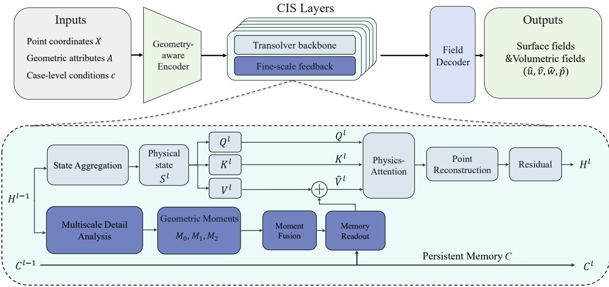  
Figure 1 Overall architecture of CIS-Transolver. The upper part illustrates the prediction pipeline consisting of a geometryaware encoder, stacked CIS operator layers, and a field decoder, while the lower part details the computation within a single CIS operator layer. The main pathway models global physical dependencies through state aggregation and Physics-Attention. The finescale pathway extracts multiscale local features, encodes them as geometric moments, and fuses them with historical memory. The feature correction generated by the memory readout is aggregated and injected into the Value branch of Physics-Attention, followed by pointwise reconstruction and a residual connection to produce the layer output. The cross-layer memory is propagated between operator layers and updated at designated layers.

## 3.1 Problem formulation and geometry-aware feature encoding

Let $\boldsymbol { X } \in \mathbb { R } ^ { N \times 3 }$ denote the three-dimensional coordinates of � sampling points, � the corresponding pointwise attributes, and � the case-level geometric descriptors and operating conditions. CIS-Transolver learns a mapping from (�, �, �) to the predicted field �̂ . For the surface task, the model predicts pressure at each point; for the volumetric task, it jointly predicts three velocity components and pressure.

The encoder maps pointwise attributes, explicit geometric features, and case-level conditions through separate branches and fuses them into the initial hidden representation $H ^ { 0 }$ . Explicit geometric features comprise flow-aligned coordinates, a near-wall distance response, and a downstream position response. Availability masks control the corresponding encoding branches when geometric attributes are missing. All three datasets share the same backbone input feature dimension; the input fields and branch configurations are given in Appendix B.1.

## 3.2 Geometry-based multiscale analysis

Multiscale analysis constructs local feature differences using geometric anchors. Let $P _ { g } \in$ $\mathbb { R } ^ { N \times M _ { g } }$ denote the sparse anchor-to-point interpolation matrix for � sample points and $M _ { \mathrm { g } }$ anchors. The interpolation weights depend on distances between points and their neighboring anchors and are normalized for each point. The point-to-anchor aggregation and anchor-domain smoothing operators are defined as

$$
D _ { \mathbf { g } } = \mathrm { d i a g } \big ( P _ { \mathbf { g } } ^ { \mathrm { T } } 1 _ { N } \big ) , \ R _ { \mathbf { g } } = D _ { \mathbf { g } } ^ { - 1 } P _ { \mathbf { g } } ^ { \mathrm { T } } , \ K _ { \mathbf { g } } = R _ { \mathbf { g } } P _ { \mathbf { g } }\tag{1}
$$

Here, $D _ { g }$ is the diagonal matrix of total weights received by the anchors, $R _ { g }$ aggregates pointwise features at the anchors, and $K _ { g }$ performs local smoothing in the anchor domain. We use 64 anchors and connect each point to its three nearest anchors. Dataset-specific anchor selection and interpolation weights are given in Appendix B.1.

At layer � , the pointwise hidden representation $H ^ { l - 1 }$ is normalized and projected across channels to obtain $F ^ { l }$ . The same geometric support is used to compute the mid-scale and fine-scale observations:

$$
\begin{array} { r } { B _ { \mathrm { m i d } } ^ { l } = P _ { \mathrm { g } } \left( I _ { M _ { \mathrm { g } } } - K _ { \mathrm { g } } \right) R _ { \mathrm { g } } F ^ { l } } \\ { B _ { \mathrm { f i n e } } ^ { l } = F ^ { l } - \mathcal { L } _ { \mathrm { g } } ( F ^ { l } ) \quad } \end{array}\tag{2}
$$

In Eq. (2), $I _ { M _ { \mathbf { g } } }$ is the identity operator in the anchor domain, and $\mathcal { L } _ { \mathrm { g } }$ denotes local reconstruction in the point domain. The mid-scale observation captures the difference between anchor features and their further smoothed representation, whereas the fine-scale observation captures the difference between pointwise features and their local reconstruction. Depending on the dataset, local reconstruction uses either feature sampling at the anchor locations or weighted aggregation. Both approaches yield fine-scale differences in the point domain, as detailed in Appendix B.1.

## 3.3 Cross-layer geometric moment memory

Local observations are further encoded into moment memory indexed by geometric anchors. CIS-Transolver computes zeroth- to second-order moments separately for mid-scale and fine-scale observations, organizing the amplitude, directional structure, and spatial distribution of local responses into a state carried across layers.

For anchor �, the corresponding row of $R _ { g }$ defines normalized local weights used to compute the coordinate center and scale. The standardized coordinate of point � relative to the anchor is denoted by $\xi _ { i a }$ . The geometric bases of orders zero to two are

$$
\begin{array} { c } { { \varphi _ { i a } ^ { ( 0 ) } = 1 , \qquad \varphi _ { i a } ^ { ( 1 ) } = \xi _ { i a } , } } \\ { { \varphi _ { i a } ^ { ( 2 ) } = \mathrm { v e c } _ { s \mathrm { y m } } \big ( \xi _ { i a } \xi _ { i a } ^ { \phantom { } \mathrm { T } } - \Sigma _ { a } \big ) . } } \end{array}\tag{3}
$$

The second-order basis uses centered quadratic terms, and $\mathtt { v e c } _ { \mathtt { s y m } }$ extracts the six independent components of a symmetric matrix. The three bases contain 1, 3, and 6 components, respectively. For each sample, the geometric support and coordinate bases are shared across backbone layers. The scale normalization is detailed in Appendix B.2.

Projecting the local observations at both scales onto the corresponding geometric bases yields anchor-level moment statistics, which are then mapped separately by order into observation encodings of fixed width:

$$
\begin{array} { r } { M _ { a , s } ^ { l , ( k ) } = \displaystyle \sum _ { i = 1 } ^ { N } \bigl ( R _ { g } \bigr ) _ { a i } \varphi _ { i a } ^ { ( k ) } \bigl ( b _ { i , s } ^ { l } \bigr ) ^ { \mathrm { T } } \in \mathbb { R } ^ { d _ { k } \times r } , } \\ { \quad o _ { a , s } ^ { l , ( k ) } = \displaystyle \mathcal { E } _ { k } ^ { l } \left( \mathrm { v e c } \Bigl ( M _ { a , s } ^ { l , ( k ) } \Bigr ) \right) \in \mathbb { R } ^ { r } , \quad k = 0 , 1 , 2 . } \end{array}\tag{4}
$$

The zeroth-order moment represents the local weighted mean, the first-order moment captures correlations between observations and spatial directions, and the second-order moment captures correlations with quadratic spatial structure. The three encodings retain their momentorder identities, with separate memories maintained for the mid-scale and fine-scale observations.

## 3.4 Memory-conditioned physics attention

Cross-layer moment memory contributes to physics attention through the value branch. The current hidden representation determines point-to-state assignments and the query–key interactions between physical states, while memory readout supplies additional local features to the state values. Global interactions can therefore incorporate local information accumulated across preceding layers.

At layer �, the moment memory $C ^ { l }$ , comprising the mid-scale and fine-scale components, is mapped to anchor-domain modulation $A ^ { l }$ and bias $B ^ { l }$ . Together with the layer input $H ^ { l - 1 }$ , these parameters produce a pointwise correction $\varDelta ^ { l }$

$$
( A ^ { l } , B ^ { l } ) = \varPsi ^ { l } ( C ^ { l } ) , \qquad \varDelta ^ { l } = \mathscr { F } _ { \mathrm { r e a d } } ^ { l } ( H ^ { l - 1 } ; A ^ { l } , B ^ { l } ) .\tag{7}
$$

Here, $\psi ^ { l }$ maps moment memory to anchor-level modulation parameters, while $\mathcal { F } _ { \mathrm { r e a d } } ^ { l }$ performs anchor-to-point interpolation, feature modulation, gating, and magnitude matching. At memory refresh layers, an anchor-domain high-pass operation is applied to the bias branch. The full memory-readout computation is given in Eqs. (B.4) and (B.5) of Appendix B.2.

The pointwise values $V _ { p t } ^ { l }$ and corrections $\varDelta ^ { l }$ are aggregated using the same state-assignment matrix $W ^ { l }$ with state-mass normalization, yielding the physical states and their values:

$$
S ^ { l } = { \mathrm { P o o l } } _ { W ^ { l } } \bigl ( V _ { \mathrm { p t } } ^ { l } \bigr ) , \qquad V ^ { l } = \phi _ { V } ( S ^ { l } ) + { \mathrm { P o o l } } _ { W ^ { l } } ( \varDelta ^ { l } ) .\tag{8}
$$

Here, $\mathsf { P o o l } _ { W } \iota$ denotes point-to-state aggregation normalized by state mass, and $S ^ { l }$ denotes the backbone physical states. The state-attention outputs are projected back to points and passed through a feed-forward update to obtain the next hidden representation. The final decoder predicts the flow field. The full computation and training objective are detailed in Appendix B.2.

## 4 Experimental results and analysis

## 4.1 Datasets and experimental setup

We evaluate surface pressure prediction on ShapeNet-Car and volumetric pressure and three-component velocity prediction on AhmedML and DrivAerNet++. Given the storage requirements of volumetric flow data and the computational cost of model training, we use fixed subsets of cases for the two volumetric tasks. For each task, the data are split into training, validation, and test sets at the level of complete geometry cases. Training and evaluation use the valid points retained after preprocessing: 3,586 points per case for ShapeNet-Car and approximately 32,000 points per case for each volumetric task. Appendix A details the case splits and counts, input features, and preprocessing rules.

The comparison includes MeshGraphNet [49], Geo-FNO [45], GINO [6], Transolver [7], Transolver++ [9], AeroGTO [8], SATO [20], AB-UPT [10], and CoEvol-NO [24]. All models are evaluated on the same test cases for each task, with their respective input encodings and training configurations retained. Appendix B details the training budgets, loss configurations, and validation-based model selection criteria for each method.

Quantitative evaluation uses the discrete relative L₂ error defined in Section 3.4. For each case, the error is computed over all valid points, with the three velocity components concatenated to calculate the velocity error. Pressure and velocity metrics are reported for their respective fields, and the tabulated results are the arithmetic means of the per-case errors. All metrics are calculated directly from predictions at the valid evaluation points. Fine-scale error evaluation is presented in Section 4.3.

## 4.2 Predictive performance on benchmark datasets

Table 1 summarizes the mean relative errors of all models for the five prediction metrics. CIS-Transolver achieves the lowest error for all five metrics, with an average error reduction of 8.72% relative to the best baseline for each metric. These results indicate good overall predictive accuracy across different vehicle geometries and target fields, with performance gains that extend across datasets and prediction tasks.

Specifically, CIS-Transolver reduces the surface pressure prediction error on ShapeNet-Car by 16.4% relative to the best baseline. On AhmedML, the pressure and velocity errors decrease by 6.0% and 15.6%, respectively; on DrivAerNet++, which features more complex geometries, the corresponding reductions are 3.0% and 2.5%. The largest accuracy gains occur in surface pressure prediction on ShapeNet-Car and volumetric velocity prediction on AhmedML. Although the magnitude of improvement varies across datasets and fields, CIS-Transolver achieves the lowest error for every metric, indicating consistent accuracy gains across multiple automotive flow prediction tasks. These results demonstrate the predictive performance of the method for both surface pressure and volumetric flow fields.

Table 1Mean relative $L _ { 2 }$ errors of different neural operators on three automotive aerodynamics benchmarks.

<table><tr><td rowspan="2">Method</td><td rowspan="2">ShapeNet-Car  $\mathrm { r e l } _ { p } \downarrow$ </td><td colspan="2">AhmedML</td><td colspan="2">DrivAerNet++</td></tr><tr><td> $\mathrm { r e l } _ { p } \downarrow$ </td><td> $\mathrm { r e l } _ { \mathbf { U } } \downarrow$ </td><td> $\mathrm { r e l } _ { p } \downarrow$ </td><td> $\mathrm { r e l } _ { \mathbf { U } } \downarrow$ </td></tr><tr><td>MeshGraphNet</td><td>0.2829</td><td>0.1529</td><td>0.0972</td><td>0.1693</td><td>0.1722</td></tr><tr><td>Geo-FNO</td><td>0.3856</td><td>0.1160</td><td>0.0965</td><td>0.2003</td><td>0.1994</td></tr><tr><td>GINO</td><td>0.5130</td><td>0.1593</td><td>0.1273</td><td>0.2999</td><td>0.2519</td></tr><tr><td>Transolver</td><td>0.1490</td><td>0.0812</td><td>0.0766</td><td>0.1501</td><td>0.1428</td></tr><tr><td>Transolver++</td><td>0.1875</td><td>0.0803</td><td>0.0761</td><td>0.1493</td><td>0.1459</td></tr><tr><td>AeroGTO</td><td>0.2213</td><td>0.1087</td><td>0.0868</td><td>0.1517</td><td>0.1671</td></tr><tr><td>SATO</td><td>0.2158</td><td>0.0820</td><td>0.0772</td><td>0.1531</td><td>0.1427</td></tr><tr><td>AB-UPT</td><td>0.1584</td><td>0.1131</td><td>0.0774</td><td>0.2072</td><td>0.1793</td></tr><tr><td>CoEvol-NO</td><td>0.1571</td><td>0.0796</td><td>0.0750</td><td>0.1449</td><td>0.1421</td></tr><tr><td>CIS-Transolver</td><td>0.1246</td><td>0.0748</td><td>0.0633</td><td>0.1405</td><td>0.1385</td></tr></table>

N : ₂ ; . N -Car provides only surface pressure fields, so only pressure error is reported. Each metric is averaged with equal weight across test geometry cases. Bold and underlined values indicate the lowest and second-lowest errors in each column, respectively.

To identify the regions where CIS-Transolver improves prediction, we select a representative test vehicle from DrivAerNet++ and visually compare the reference velocity field with predictions from Transolver, CoEvol-NO, and CIS-Transolver. The absolute error distributions reveal differences in reconstruction across the overall flow field and near local geometric features, as shown in Fig. 2. The figure compares velocity magnitude predictions and their absolute errors. All three models recover the main spatial distribution of the reference field; the differences lie primarily in the magnitude and spatial extent of local errors. Compared with Transolver and CoEvol-NO, CIS-Transolver exhibits a smaller region of high error near the visible front wheel arch and lower local error peaks at the front of the hood. It also reduces the extent of the contiguous high-error region along the lower body edge adjacent to the front wheel compared with CoEvol-NO. These local changes indicate improved reconstruction of velocity magnitude near geometric details while preserving the overall velocity distribution. Appendix A presents the predicted fields and corresponding error distributions for ShapeNet-Car and AhmedML.

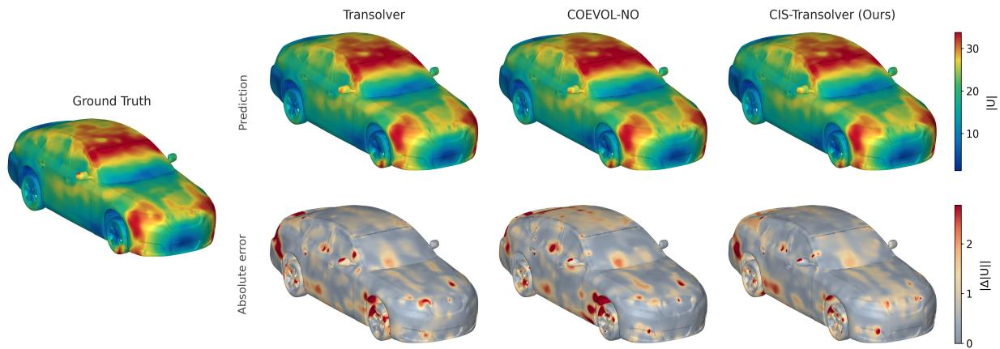  
Figure 2 Velocity magnitude and error visualization for a DrivAerNet++ example. The reference field is shown on the left. On the right, the top row shows velocity magnitude predictions from Transolver, CoEvol-NO, and CIS-Transolver, from left to right; the bottom row shows the corresponding absolute errors in velocity magnitude. The prediction panels share one color scale, and the error panels share another.

To examine the predictive performance of CIS-Transolver near geometric details of the vehicle body, we focus on DrivAerNet++, which retains mirrors, wheels, and body transition features. We compare CIS-Transolver with the base model Transolver and CoEvol-NO, the bestperforming baseline on this dataset in Table 1.

Full-field error summarizes deviations across the entire prediction domain, whereas identifying improvements near individual components requires examining the spatial error distribution. Fig. 3 therefore shows the reference velocity magnitude and prediction errors of the three models for the same test vehicle, with enlarged views of the mirror and front-wheel regions. All models use the same viewpoint, local regions, and error color scale to allow direct comparison at corresponding locations.

Near the mirror, Transolver exhibits strong error patches above the mirror and on the adjacent body, while CoEvol-NO shows an extensive region of high error on the body beside and below the mirror. CIS-Transolver reduces these nearby error patches and confines high errors to smaller regions. A similar pattern appears near the front wheel: both baselines exhibit relatively continuous regions of high error along the upper wheel edge and adjacent body, whereas CIS-Transolver reduces their extent and weakens some error patches on the nearby body. Together, the two enlarged views show that improvements for this vehicle occur at local components and the adjacent body, where local improvements are difficult to distinguish from overall error values alone. The smaller high-error regions and weaker nearby error patches indicate reduced velocity reconstruction errors at these locations.

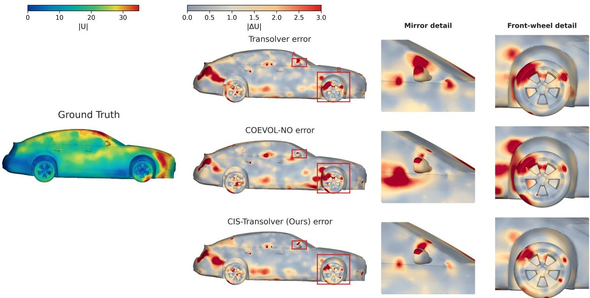  
Figure 3 Velocity magnitude and local prediction errors for a DrivAerNet++ test vehicle. The reference velocity magnitude is shown on the left. The center column shows the velocity prediction error distributions of Transolver, CoEvol-NO, and CIS-Transolver, and the two rightmost columns show enlarged views of the mirror and front-wheel regions, respectively. All models use the same viewpoint, local regions, and error color scale.

To further quantify spatial variations in prediction error near the vehicle body, we complement the local flow visualizations with comparisons of normalized pressure and velocity errors along the body centerline (Fig. 4). Continuous error profiles show prediction deviations at different spatial locations, while the enlarged views reveal differences at error peaks and in adjacent segments, allowing further assessment of the local flow reconstruction accuracy of CIS-Transolver.

The pressure prediction gains of CIS-Transolver are reflected in lower local error peaks at several locations along the centerline (Fig. 4b). Within the enlarged interval, Transolver and CoEvol-NO both exhibit pronounced error peaks, whereas CIS-Transolver substantially reduces the corresponding peak values and maintains lower errors in the segment beyond the peak. The reductions at the local peak and in adjacent segments further indicate more accurate reconstruction of the pressure field near the vehicle body.

The enlarged velocity error profiles show corresponding accuracy gains (Fig. 4c). Within the same interval, CIS-Transolver has a lower maximum error than both baselines and reduces prediction deviations in the segment where the error rises. Compared with Transolver, it also reduces the persistently elevated errors beyond the peak, indicating that the improvement extends across the local error peak and several surrounding spatial locations.

The lower local peaks in the centerline error profiles are consistent with the smaller higherror regions in Fig. 3.Together with the overall prediction results in Table 1, these findings show that the accuracy gains of CIS-Transolver extend to both the full flow field and local predictions near the vehicle body, reducing local prediction deviations and improving pressure and velocity reconstruction. Overall, CIS-Transolver achieves the lowest mean error for all five field prediction metrics across the three benchmarks and improves local reconstruction of pressure and velocity near complex vehicle bodies. These results demonstrate that the method combines overall predictive accuracy with local detail reconstruction in surface pressure and volumetric flow prediction tasks.

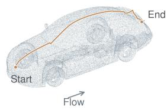  
Centreline (schematic)  
(a) Geometry and centreline

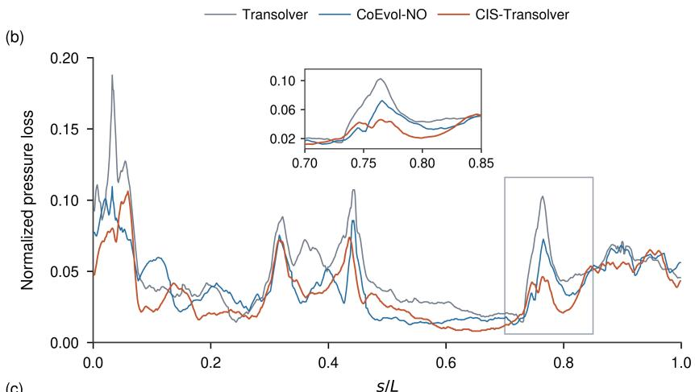  
(c)

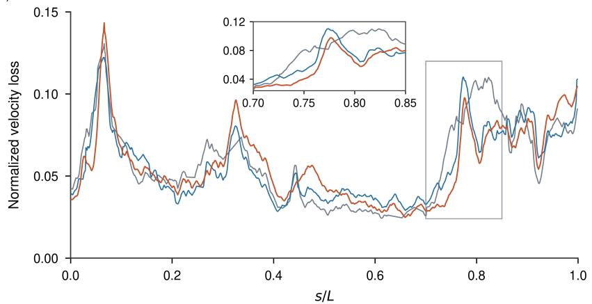  
Figure 4 Pressure and velocity prediction errors along the vehicle body centerline. (a) DrivAerNet++ vehicle geometry and schematic centerline path; (b) normalized pressure error; (c) normalized velocity error. The horizontal axis is the normalized path coordinate s/L. The insets enlarge the interval $0 . 7 0 \leq \mathbf { s } / \mathrm { L } \leq 0 . 8 5 .$ , marked by rectangles in the main plots.

## 4.3 Spatial spectral analysis

The full-field error evaluation, local visualizations, and near-wall statistics in Section 4.2 show that CIS-Transolver improves overall prediction accuracy and flow-field reconstruction near complex geometries. Beyond overall prediction errors and local error distributions, reconstruction accuracy for flow variations at different spatial scales is also important for assessing fine-scale prediction. We therefore conduct spatial spectral analysis to examine the prediction accuracy of CIS-Transolver at different spatial frequencies, focusing on the recovery of shorter-wavelength flow variations. We compare the spatial spectra of pressure and threecomponent velocity predicted by CIS-Transolver, Transolver, and CoEvol-NO at the same 32,000 valid points in each of the 10 DrivAerNet++ test cases. After inverse standardization, each field is centered by subtracting its weighted mean and evaluated using a densitycompensated direct nonuniform Fourier transform. Point weights are the cubed distances to the

16th nearest neighbor, clipped at the 5th and 95th percentiles and normalized. All fields use coordinates centered at the same weighted centroid, with no additional window function. We define the dimensionless spatial frequency as $k = f L$ , where $f$ is the spatial frequency and � is the vehicle length along the freestream direction. The corresponding wavelength is $\lambda = L / k$ . We evaluate $k = 1 , \dots , 2 4$ along 16 Fibonacci-sphere directions. For case �, the Fourier coefficient of field � along direction $d _ { j }$ is

$$
\begin{array} { r } { \mathcal { F } _ { s , j } [ a ] ( k ) = \sum _ { i = 1 } ^ { N _ { s } } { w _ { s , i } \big ( a _ { s , i } - \bar { a } _ { s } \big ) } \mathrm { e x p } \left[ - 2 \pi \mathrm { i } k \mathbf { d } _ { j } ^ { \textrm { T } } \frac { \mathbf { x } _ { s , i } - \bar { \mathbf { x } } _ { s } } { L _ { s } } \right] } \end{array}\tag{9}
$$

where $N _ { s } = 3 2 { , } 0 0 0$ and overbars denote weighted means. The direction-averaged power is

$$
\begin{array} { r } { P _ { a , s } ( k ) = \frac { 1 } { 1 6 } \sum _ { j = 1 } ^ { 1 6 } \bigl \| \mathcal { F } _ { s , j } [ a ] ( k ) \bigr \| _ { 2 } ^ { 2 } } \end{array}\tag{10}
$$

Pressure uses scalar coefficients; velocity power sums the squared coefficient magnitudes over all three components. For each case, reference and predicted spectra are normalized by the total reference power over all 24 frequencies. The relative spectral error is

$$
\begin{array} { r } { e _ { s } ( k ) = \sqrt { \frac { P _ { \widehat { q } - q , s } ( k ) } { \operatorname* { m a x } \left( P _ { q , s } ( k ) , \varepsilon \right) } } , \varepsilon = 1 0 ^ { - 1 2 } } \end{array}\tag{11}
$$

where $q$ and $\hat { q }$ denote the reference and predicted fields, respectively. The spectral error is computed from differences between complex Fourier coefficients and is therefore sensitive to both amplitude and phase mismatches. We compute the metric for each case and then average it with equal weight across cases. Higher frequencies remain sensitive to sampling, so the following comparisons apply to the common discrete evaluation on 32,000 points.

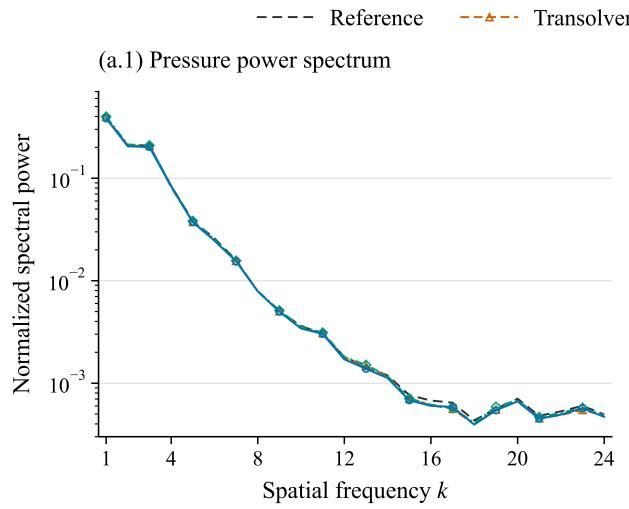

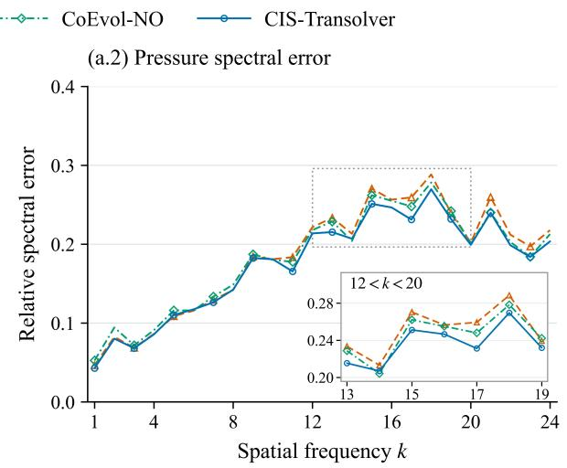

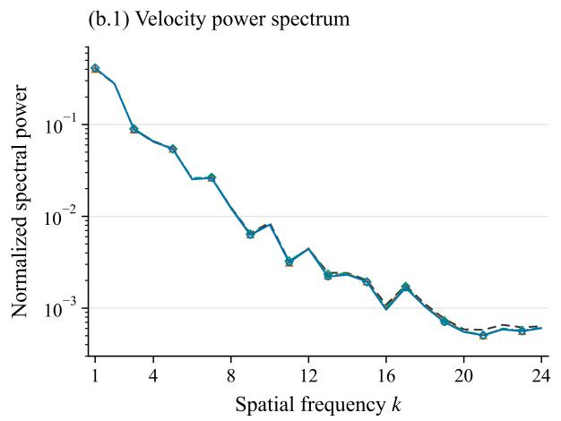

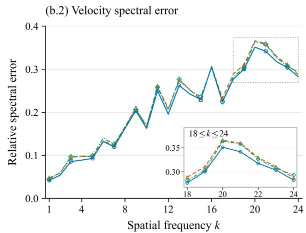  
Figure 5 Spatial power spectra and relative spectral errors on DrivAerNet++.

Figure 5 shows the spatial power spectra and relative spectral errors of the pressure and velocity fields on DrivAerNet++. Figure 5(a.1,b.1) shows that all models reproduce the main decay trends of the reference power spectra well, and the predicted spectra remain close to the reference spectra over most of the frequency range. However, the relative spectral error reveals differences in prediction accuracy among models at individual spatial frequencies. Averaged with equal weight over all 24 frequencies, the pressure spectral error of CIS-Transolver is 0.1748, which is 4.69% lower than that of Transolver and 3.52% lower than that of CoEvol-NO. Its velocity spectral error is 0.2095, with corresponding reductions of 3.53% and 3.18%. In the enlarged regions in Fig. 5(a.2,b.2), CIS-Transolver generally exhibits lower relative spectral errors in the higher spatial frequency ranges $1 2 < k < 2 0$ for pressure and $1 8 \leq k \leq 2 4$ for velocity, indicating that its accuracy advantage also extends to the examined shorter-wavelength components.

These results show that, although all three models recover the main spatial power distributions of the flow fields well, agreement between power spectra does not imply equal prediction accuracy for each spatial frequency component. Compared with the power spectrum, the relative spectral error captures both amplitude and phase deviations of the complex Fourier coefficients, providing further insight into reconstruction differences for flow variations at different spatial scales. The lower spectral errors of CIS-Transolver over both the full frequency range and the examined higher-frequency intervals show that it reproduces the main spatial spectral distributions while fitting high-frequency flow components more accurately. This improves predictions of rapid spatial variations and demonstrates its advantage in fine-scale flow-field prediction.

## 4.4 Ablation and capacity analysis

Component ablation and model-capacity comparisons examine the overall contribution of the CIS branch, the effect of cross-layer state reuse, and the relationship between performance gains and parameter count. All comparisons use the same 10 DrivAerNet++ test cases. Errors are computed for each case as defined in Section 4.1 and then averaged with equal weight across cases. The near-wall region is defined by $d / H \leq 0 . 0 5$

Component ablation. To assess the effectiveness of the information utilization mechanism in CIS, we consider two ablated variants. The first removes the entire CIS branch and its auxiliary supervision, retaining the Transolver backbone with the same geometric inputs to assess the overall contribution of the CIS mechanism. The second retains local detail extraction and Value feedback at the current layer but removes cross-layer memory fusion and reuse, allowing us to assess the additional benefit of using information across layers compared with using it only within the current layer. Each variant is trained independently.

Table 2 Component ablation on DrivAerNet++
<table><tr><td rowspan="2">Model</td><td colspan="2">Relative  $L _ { 2 }$ </td><td colspan="2">Spectral error</td></tr><tr><td>p↓</td><td>u↓</td><td>p↓</td><td>u↓</td></tr><tr><td>Without CIS branch</td><td>0.1459</td><td>0.1445</td><td>0.3117</td><td>0.2709</td></tr><tr><td>Without cross-layer state reuse</td><td>0.1420</td><td>0.1397</td><td>0.3054</td><td>0.2680</td></tr><tr><td>CIS-Transolver</td><td>0.1405</td><td>0.1385</td><td>0.2946</td><td>0.2649</td></tr></table>

Note: High-frequency spectral error is the mean relative spectral error over the dimensionless spatial frequency range $1 3 \leq k \leq 2 4$ , computed using the spatial spectral evaluation method in Section 4.3.

Table 2 shows how the CIS information utilization mechanism contributes to overall flowfield prediction and the reconstruction of high-frequency components. Compared with the model without the CIS branch, the full CIS-Transolver model reduces domain-wide pressure and velocity errors by 3.66% and 4.14%, respectively, and high-frequency pressure and velocity spectral errors by approximately 5.5% and 2.2%. The reductions in both overall prediction error and high-frequency spectral error indicate that the CIS mechanism improves overall flow-field accuracy and the reconstruction of high-frequency flow variations.

When local multiscale observations and Value feedback at the current layer are retained, removing cross-layer state reuse still improves prediction, but the resulting accuracy remains below that of the full model. Compared with this ablated variant, the full model further reduces domain-wide pressure and velocity errors, with high-frequency pressure and velocity spectral errors decreasing by approximately 3.5% and 1.2%, respectively. These results show that the benefits of modeling local details extend beyond their extraction and use within the current layer, with cross-layer state reuse providing additional accuracy gains. Together, these experiments validate the proposed information utilization mechanism, showing that it makes more effective use of local details in overall flow-field modeling and further improves both overall predictive accuracy and the reconstruction of high-frequency components.

Model-capacity comparison. To test whether increasing backbone capacity yields comparable predictive accuracy, we use the model without the CIS branch in Table 2 as a reference. We retain the eight-layer backbone, geometric inputs, and training configuration, and increase the hidden width from 256 to 272 to obtain a Transolver variant with approximately the same parameter count as CIS-Transolver.

Table 3 Model-capacity comparison on DrivAerNet++
<table><tr><td>Model</td><td>Parameters (M)</td><td> $\operatorname { r e l } _ { p } \downarrow$ </td><td> $\mathrm { r e l } _ { U } \downarrow$ </td></tr><tr><td>Transolver</td><td>3.865</td><td>0.1501</td><td>0.1428</td></tr><tr><td>Transolver-L</td><td>4.361</td><td>0.1488</td><td>0.1465</td></tr><tr><td>CIS-Transolver</td><td>4.320</td><td>0.1405</td><td>0.1385</td></tr></table>

Table 3 compares flow-field prediction performance at different model capacities. With network depth, geometric inputs, and training configuration held fixed, increasing the hidden width of Transolver from 256 to 272 raises the parameter count by 12.83%. This expansion reduces the pressure prediction error by 0.87% but increases the velocity error by 2.59%, failing to improve both flow variables simultaneously. CIS-Transolver achieves higher accuracy for both pressure and velocity with slightly fewer parameters (4.320M), reducing the two errors by 5.58% and 5.46%, respectively, compared with Transolver-L. These results indicate that improvements in flow-field prediction depend on both model capacity and how information is organized and used. Compared with simply widening the backbone, the proposed mechanism for using fine-scale information makes more effective use of local flow information at a similar parameter count, further improving overall flow-field prediction accuracy.

## 4.5 Computational cost

Figure 6 compares the floating-point operation counts for a single forward pass of each model on DrivAerNet++. The input contains 32,000 volume sampling points, with a batch size of 1 and BF16 mixed precision. One multiply-add counts as two floating-point operations. Operations are counted after the geometry cache is built, excluding data loading, input preprocessing, and initial cache construction.

Forward computational costs range from 59.8 to 1046.5 GFLOPs across the models. CIS-Transolver requires 295.0 GFLOPs, placing it in the middle of the group. Compared with GINO, AeroGTO, AB-UPT, and MeshGraphNet, CIS-Transolver reduces the operation count by approximately 23.6%–71.8% while achieving lower errors on the prediction tasks listed in Table 1. Thus, higher predictive accuracy does not require the most computationally expensive model in this comparison.

Relative to the base Transolver model, CIS-Transolver increases the forward operation count from 259.2 to 295.0 GFLOPs, an increase of 13.8%, while reducing the relative pressure and velocity errors on DrivAerNet++ by 6.3% and 3.0%, respectively. Table 1 further shows improvements over Transolver in all five field-prediction metrics across AhmedML, DrivAerNet++, and ShapeNet-Car. The accuracy gains therefore extend across different geometries and field-prediction tasks. At the evaluated DrivAerNet++ input size, these gains incur only 13.8% additional forward computation, indicating a favorable trade-off between predictive accuracy and computational cost for fine-scale modeling.

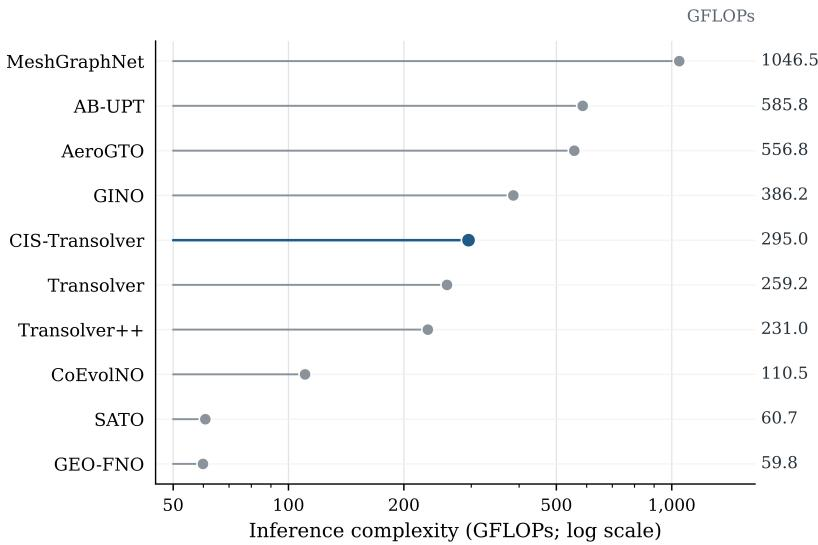  
Figure 6 Forward computational cost of each model on DrivAerNet++. The input contains 32,000 volume sampling points, with a batch size of 1. The horizontal axis uses a logarithmic scale, and the corresponding GFLOPs values appear on the right. Blue denotes CIS-Transolver. One multiply-add counts as two floating-point operations. Counts cover a single forward pass after the geometry cache is built.

## Conclusion

To address the difficulty of accurately reconstructing fine-scale flow structures in complex external flows around vehicles, we propose a neural operator modeling approach centered on the sustained use of local information. Beyond extracting and enhancing local features, we focus on how fine-scale information contributes to global flow-field representations and introduce CIS-Transolver, a cross-layer incremental state neural operator. The method captures fine-scale variations through local multiscale analysis and organizes them into incremental states that evolve across layers. By fusing historical information and providing feedback through physics attention, CIS-Transolver preserves and updates extracted local details across successive layers, allowing them to contribute continuously to the modeling of global physical correlations. This design integrates local detail extraction with sustained information use across layers.

Systematic experiments on three public automotive aerodynamics benchmarks, ShapeNet-Car, AhmedML and DrivAerNet++, show that CIS-Transolver achieves the best performance on all five flow-field prediction metrics, reducing prediction errors by an average of 8.72% relative to the strongest baseline for each metric. Local flow-field visualizations and near-wall error

analyses show that the method more accurately reconstructs pressure and velocity variations near complex geometries. Spatial spectral analysis further shows lower spectral errors across both the full frequency range and the high-frequency range examined. Ablation experiments highlight the importance of information use across layers: cross-layer state reuse provides additional accuracy gains when local detail extraction and within-layer feedback are retained, whereas increasing the number of backbone parameters alone does not yield comparable gains.

These findings indicate that improving fine-scale flow-field prediction requires not only better capture and representation of local variations but also effective mechanisms that allow this information to contribute continuously to the construction of the overall flow field. CIS-Transolver implements this principle through the organization, evolution and feedback of incremental states across layers. It provides a new approach to fine-scale flow-field prediction around complex geometries and a promising direction for jointly modeling local information and global physical correlations in neural operators.

## References

[1] Hucho, W.H. (Ed.), 2013. Aerodynamics of Road Vehicles: From Fluid Mechanics to Vehicle Engineering. Elsevier, Amsterdam.

[2] Brunton, S.L., Noack, B.R., Koumoutsakos, P., 2020. Machine learning for fluid mechanics. Annual Review of Fluid Mechanics 52, 477–508. https://doi.org/10.1146/annurev-fluid-010719-060214

[3] Lu, L., Jin, P., Pang, G., Zhang, Z., Karniadakis, G.E., 2021. Learning nonlinear operators via DeepONet based on the universal approximation theorem of operators. Nature Machine Intelligence 3, 218–229. https://doi.org/10.1038/s42256-021-00302-5

[4] Li, Z., Kovachki, N., Azizzadenesheli, K., Liu, B., Bhattacharya, K., Stuart, A., Anandkumar, A., 2021. Fourier neural operator for parametric partial differential equations, in: International Conference on Learning Representations. https://openreview.net/forum?id=c8P9NQVtmnO

[5] Kovachki, N., Li, Z., Liu, B., Azizzadenesheli, K., Bhattacharya, K., Stuart, A., Anandkumar, A., 2023. Neural operator: Learning maps between function spaces with applications to PDEs. Journal of Machine Learning Research 24, 1–97. https://www.jmlr.org/papers/v24/21-1524.html

[6] Li, Z., Kovachki, N., Choy, C., Li, B., Kossaifi, J., Otta, S., Nabian, M.A., Stadler, M., Hundt, C., Azizzadenesheli, K., Anandkumar, A., 2023. Geometry-informed neural operator for large-scale 3D PDEs, in: Advances in Neural Information Processing Systems 36, pp. 35836–35854. https://doi.org/10.52202/075280-1556

[7] Wu, H., Luo, H., Wang, H., Wang, J., Long, M., 2024. Transolver: A fast transformer solver for PDEs on general geometries, in: Proceedings of the 41st International Conference on Machine Learning. Proceedings of Machine Learning Research 235, pp. 53681–53705. https://proceedings.mlr.press/v235/wu24r.html

[8] Liu, P., Wang, P., Ren, X., Yuan, H., Hao, Z., Xu, C., Cai, S., Ni, D., 2025. AeroGTO: An efficient graph-transformer operator for learning large-scale aerodynamics of 3D vehicle geometries, in: Proceedings of the AAAI Conference on Artificial Intelligence 39, pp. 18924–18932. https://doi.org/10.1609/aaai.v39i18.34083

[9] Luo, H., Wu, H., Zhou, H., Xing, L., Di, Y., Wang, J., Long, M., 2025. Transolver++: An accurate neural solver for PDEs on million-scale geometries, in: Proceedings of the 42nd International Conference on Machine Learning. Proceedings of Machine Learning Research 267, pp. 41432–41449. https://proceedings.mlr.press/v267/luo25o.html

[10] Alkin, B., Bleeker, M., Kurle, R., Kronlachner, T., Sonnleitner, R., Dorfer, M., Brandstetter, J., 2025. AB-UPT: Scaling neural CFD surrogates for high-fidelity automotive aerodynamics simulations via anchored-branched universal physics transformers. Transactions on Machine Learning Research. https://mlanthology.org/tmlr/2025/alkin2025tmlr-abupt/

[11] Rahaman, N., Baratin, A., Arpit, D., Draxler, F., Lin, M., Hamprecht, F.A., Bengio, Y., Courville, A., 2019. On the spectral bias of neural networks, in: Proceedings of the 36th International Conference on Machine Learning. Proceedings of Machine Learning Research 97, pp. 5301–5310. https://proceedings.mlr.press/v97/rahaman19a.html

[12] Xu, Z.-Q.J., Zhang, Y., Luo, T., Xiao, Y., Ma, Z., 2020. Frequency principle: Fourier analysis sheds light on deep neural networks. Communications in Computational Physics 28, 1746–1767. https://doi.org/10.4208/cicp.OA-2020-0085

[13] Wang, S., Wang, H., Perdikaris, P., 2021. On the eigenvector bias of Fourier feature networks: From regression to solving multi-scale PDEs with physics-informed neural networks. Computer Methods in Applied Mechanics and Engineering 384, 113938. https://doi.org/10.1016/j.cma.2021.113938

[14] Xu, Z.-Q.J., Zhang, L., Cai, W., 2025. On understanding and overcoming spectral biases of deep neural network learning methods for solving PDEs. Journal of Computational Physics 530, 113905. https://doi.org/10.1016/j.jcp.2025.113905

[15] Li, Z., Kovachki, N., Azizzadenesheli, K., Liu, B., Stuart, A., Bhattacharya, K., Anandkumar, A., 2020. Multipole graph neural operator for parametric partial differential equations, in: Advances in Neural Information Processing Systems 33, pp. 6755–6766. https://proceedings.neurips.cc/paper/2020/hash/4b21cf96d4cf612f239a6c322b10c8fe-Abstract.html

[16] Raonic, B., Molinaro, R., De Ryck, T., Rohner, T., Bartolucci, F., Alaifari, R., Mishra, S., de Bézenac, E., 2023. Convolutional neural operators for robust and accurate learning of PDEs. Advances in Neural Information Processing Systems 36, 77187– 77200. https://doi.org/10.52202/075280-3376

[17] He, J., Liu, X., Xu, J., 2024. MgNO: Efficient parameterization of linear operators via multigrid, in: International Conference on Learning Representations. https://proceedings.iclr.cc/paper\_files/paper/2024/hash/eb3c8135137c8a60425a032086 9ad87e-Abstract-Conference.html

[18] Li, H., Ye, X., Jiang, P., Qin, G., Wang, T., 2024. Local neural operator for solving transient partial differential equations on varied domains. Computer Methods in Applied Mechanics and Engineering 427, 117062. https://doi.org/10.1016/j.cma.2024.117062

[19] Ye, X., Li, H., Huang, J., Qin, G., 2024. On the locality of local neural operator in learning fluid dynamics. Computer Methods in Applied Mechanics and Engineering 427, 117035. https://doi.org/10.1016/j.cma.2024.117035

[20] Yang, H., Gu, J., Chen, Y., Bin, Y., Wang, J., Chen, S., 2026. Spatially-aware transformer operator for real-time aerodynamic evaluations of arbitrary threedimensional vehicles. Journal of Computational Physics 545, 114456. https://doi.org/10.1016/j.jcp.2025.114456

[21] Liu, X., Xu, B., Cao, S., Zhang, L., 2024. Mitigating spectral bias for the multiscale operator learning. Journal of Computational Physics 506, 112944. https://doi.org/10.1016/j.jcp.2024.112944

[22] Czarnecki, W.M., Osindero, S., Jaderberg, M., Swirszcz, G., Pascanu, R., 2017. Sobolev training for neural networks, in: Advances in Neural Information Processing

Systems 30, pp. 4278–4287. https://papers.neurips.cc/paper/2017/hash/758a06618c69880a6cee5314ee42d52f-Abstract.html

[23] Lippe, P., Veeling, B.S., Perdikaris, P., Turner, R.E., Brandstetter, J., 2023. PDE-Refiner: Achieving accurate long rollouts with neural PDE solvers, in: Advances in Neural Information Processing Systems 36, pp. 67398–67433. https://doi.org/10.52202/075280-2946

[24] Zeng, J., Wang, R., Liu, Y., Xiong, H., Yan, J., 2026. CoEvol-NO: State and coordinate co-evolution with an error-driven predictor-corrector paradigm for neural operator transformer, in: Proceedings of the 43rd International Conference on Machine Learning. Proceedings of Machine Learning Research 306, pp. 153614–153640. https://proceedings.mlr.press/v306/zeng26r.html

[25] Ashton, N., Maddix, D.C., Gundry, S., Shabestari, P.M., 2024. AhmedML: High-Fidelity Computational Fluid Dynamics Dataset for Incompressible, Low-Speed Bluff Body Aerodynamics. arXiv:2407.20801. https://doi.org/10.48550/arXiv.2407.20801

[26] Elrefaie, M., Morar, F., Dai, A., Ahmed, F., 2024. DrivAerNet++: A Large-Scale Multimodal Car Dataset with Computational Fluid Dynamics Simulations and Deep Learning Benchmarks, in: Advances in Neural Information Processing Systems 37, pp. 499–536. https://doi.org/10.52202/079017-0016

[27] Umetani, N., Bickel, B., 2018. Learning three-dimensional flow for interactive aerodynamic design. ACM Transactions on Graphics 37, 1–10. https://doi.org/10.1145/3197517.3201325

[28] Bertram, A., Othmer, C., Zimmermann, R., 2018. Towards real-time vehicle aerodynamic design via multi-fidelity data-driven reduced order modeling, in: 2018 AIAA/ASCE/AHS/ASC Structures, Structural Dynamics, and Materials Conference, AIAA 2018-0916. https://doi.org/10.2514/6.2018-0916

[29] Gunpinar, E., Coskun, U.C., Ozsipahi, M., Gunpinar, S., 2019. A generative design and drag coefficient prediction system for sedan car side silhouettes based on computational fluid dynamics. Computer-Aided Design 111, 65–79. https://doi.org/10.1016/j.cad.2019.02.003

[30] Tran, J., Fukami, K., Inada, K., Umehara, D., Ono, Y., Ogawa, K., Taira, K., 2024. Aerodynamics-guided machine learning for design optimization of electric vehicles. Communications Engineering 3, 174. https://doi.org/10.1038/s44172-024-00322-0

[31] Naffer-Chevassier, K., De Vuyst, F., Goardou, Y., 2024. Enhanced drag force estimation in automotive design: A surrogate model leveraging limited full-order model drag data and comprehensive physical field integration. Computation 12, 207. https://doi.org/10.3390/computation12100207

[32] Fu, Z., Liu, C., Peng, J., Peng, L., Qin, S., 2023. Prediction of automobile aerodynamic drag coefficient for SUV cars based on a novel XGBoost model. Iranian Journal of Science and Technology, Transactions of Mechanical Engineering 47, 1349–1364. https://doi.org/10.1007/s40997-022-00581-2

[33] Shen, S., Han, T., Pang, J., 2024. Car drag coefficient prediction using long–short term memory neural network and LASSO. Measurement 225, 113982. https://doi.org/10.1016/j.measurement.2023.113982

[34] Song, B., Yuan, C., Permenter, F., Arechiga, N., Ahmed, F., 2024. Data-driven car drag prediction with depth and normal renderings. Journal of Mechanical Design 146, 051714. https://doi.org/10.1115/1.4065063

[35] Liu, Y., Chen, Y., 2025. DragSolver: A multi-scale transformer for real-world automotive drag coefficient estimation, in: Proceedings of the 42nd International Conference on Machine Learning. Proceedings of Machine Learning Research 267, pp. 38102–38118. https://proceedings.mlr.press/v267/liu25c.html

[36] Rosset, N., Cordonnier, G., Duvigneau, R., Bousseau, A., 2023. Interactive design of 2D car profiles with aerodynamic feedback. Computer Graphics Forum 42, 427–437. https://doi.org/10.1111/cgf.14772

[37] Baqué, P., Remelli, E., Fleuret, F., Fua, P., 2018. Geodesic convolutional shape optimization, in: Proceedings of the 35th International Conference on Machine Learning. Proceedings of Machine Learning Research 80, pp. 472–481. https://proceedings.mlr.press/v80/baque18a.html

[38] Remelli, E., Lukoianov, A., Richter, S., Guillard, B., Bagautdinov, T., Baqué, P., Fua, P., 2020. MeshSDF: Differentiable iso-surface extraction, in: Advances in Neural Information Processing Systems 33, pp. 22468–22478.

[39] Jacob, S.J., Mrosek, M., Othmer, C., Köstler, H., 2022. Deep learning for real-time aerodynamic evaluations of arbitrary vehicle shapes. SAE International Journal of Passenger Vehicle Systems 15, 77–90. https://doi.org/10.4271/15-15-02-0006

[40] Chen, F., Akasaka, K., 2021. 3D flow field estimation around a vehicle using convolutional neural networks, in: Proceedings of the British Machine Vision Conference 2021, Paper 272. https://doi.org/10.5244/C.35.272

[41] Garcia-Fernandez, R., Portal-Porras, K., Irigaray, O., Ansa, Z., Fernandez-Gamiz, U., 2023. CNN-based flow field prediction for bus aerodynamics analysis. Scientific Reports 13, 21213. https://doi.org/10.1038/s41598-023-48419-4

[42] Qi, C.R., Su, H., Mo, K., Guibas, L.J., 2017. PointNet: Deep learning on point sets for 3D classification and segmentation, in: Proceedings of the IEEE Conference on Computer Vision and Pattern Recognition, pp. 652–660. https://doi.org/10.1109/CVPR.2017.16

[43] Qi, C.R., Yi, L., Su, H., Guibas, L.J., 2017. PointNet++: Deep hierarchical feature learning on point sets in a metric space, in: Advances in Neural Information Processing Systems 30, pp. 5099–5108.

[44] Wang, Y., Sun, Y., Liu, Z., Sarma, S.E., Bronstein, M.M., Solomon, J.M., 2019. Dynamic graph CNN for learning on point clouds. ACM Transactions on Graphics 38, 1–12. https://doi.org/10.1145/3326362

[45] Li, Z., Huang, D.Z., Liu, B., Anandkumar, A., 2023. Fourier neural operator with learned deformations for PDEs on general geometries. Journal of Machine Learning Research 24 (388), 1–26. https://www.jmlr.org/papers/v24/23-0064.html

[46] Choy, C., Kamenev, A., Kossaifi, J., Rietmann, M., Kautz, J., Azizzadenesheli, K., 2025. Factorized implicit global convolution for automotive computational fluid dynamics prediction. arXiv:2502.04317. https://doi.org/10.48550/arXiv.2502.04317

[47] Ranade, R., Nabian, M.A., Tangsali, K., Kamenev, A., Hennigh, O., Cherukuri, R., Choudhry, S., 2025. DoMINO: A decomposable multi-scale iterative neural operator for modeling large scale engineering simulations. arXiv:2501.13350. https://doi.org/10.48550/arXiv.2501.13350

[48] Gu, J., Chen, Y., Bin, Y., Chen, S., 2026. GeoFormer: Mesh-free geometry-to-flow alignment framework for real-time aerodynamics on non-watertight vehicle geometries. Physics of Fluids 38, 015153. https://doi.org/10.1063/5.0307919

[49] Pfaff, T., Fortunato, M., Sanchez-Gonzalez, A., Battaglia, P.W., 2021. Learning meshbased simulation with graph networks, in: International Conference on Learning Representations. https://openreview.net/forum?id=roNqYL0\_XP

[50] Roznowicz, D., Stabile, G., Demo, N., Fransos, D., Rozza, G., 2024. Large-scale graph-machine-learning surrogate models for 3D-flowfield prediction in external aerodynamics. Advanced Modeling and Simulation in Engineering Sciences 11, 6. https://doi.org/10.1186/s40323-024-00259-1

[51] Nabian, M.A., Liu, C., Ranade, R., Choudhry, S., 2024. X-MeshGraphNet: Scalable multi-scale graph neural networks for physics simulation. arXiv:2411.17164. https://doi.org/10.48550/arXiv.2411.17164

[52] Hao, Z., Wang, Z., Su, H., Ying, C., Dong, Y., Liu, S., Cheng, Z., Song, J., Zhu, J., 2023. GNOT: A general neural operator transformer for operator learning, in: Proceedings of the 40th International Conference on Machine Learning. Proceedings of Machine Learning Research 202, pp. 12556–12569. https://proceedings.mlr.press/v202/hao23c.html

[53] Alkin, B., Fürst, A., Schmid, S., Gruber, L., Holzleitner, M., Brandstetter, J., 2024. Universal physics transformers: A framework for efficiently scaling neural operators, in: Advances in Neural Information Processing Systems 37, pp. 25152–25194. https://doi.org/10.52202/079017-0793

[54] Wang, T., Wang, C., 2024. Latent neural operator for solving forward and inverse PDE problems, in: Advances in Neural Information Processing Systems 37, pp. 33085– 33107. https://doi.org/10.52202/079017-1042

[55] Wang, Q., Wang, C., Zhang, M., Sun, J., Yang, P., Tang, S., Xiang, S., 2026. MNO: Multiscale neural operator for 3D computational fluid dynamics. arXiv:2510.16071. https://doi.org/10.48550/arXiv.2510.16071

[56] Adams, C., Ranade, R., Cherukuri, R., Choudhry, S., 2025. GeoTransolver: Learning physics on irregular domains using multi-scale geometry-aware physics attention transformer. arXiv:2512.20399. https://doi.org/10.48550/arXiv.2512.20399

[57] Zou, J., Qiu, W., Sun, Z., Zhang, X., Zhang, Z., Zhu, X., 2026. AdaField: Generalizable surface pressure modeling with physics-informed pre-training and flowconditioned adaptation. arXiv:2601.07139. https://doi.org/10.48550/arXiv.2601.07139

[58] Zheng, Z., Zhang, L., Zou, J., Liu, S., Lei, Z., Zhu, X., Liu, Z., 2026. GA-Field: Geometry-aware vehicle aerodynamic field prediction. arXiv:2602.20609. https://doi.org/10.48550/arXiv.2602.20609

[59] Tancik, M., Srinivasan, P.P., Mildenhall, B., Fridovich-Keil, S., Raghavan, N., Singhal, U., Ramamoorthi, R., Barron, J.T., Ng, R., 2020. Fourier features let networks learn

high frequency functions in low dimensional domains, in: Advances in Neural Information Processing Systems 33, pp. 7537–7547.

[60] Sitzmann, V., Martel, J.N.P., Bergman, A.W., Lindell, D.B., Wetzstein, G., 2020. Implicit neural representations with periodic activation functions, in: Advances in Neural Information Processing Systems 33, pp. 7462–7473.

[61] Gupta, G., Xiao, X., Bogdan, P., 2021. Multiwavelet-based operator learning for differential equations, in: Advances in Neural Information Processing Systems 34.

[62] Tripura, T., Chakraborty, S., 2023. Wavelet neural operator for solving parametric partial differential equations in computational mechanics problems. Computer Methods in Applied Mechanics and Engineering 404, 115783. https://doi.org/10.1016/j.cma.2022.115783

[63] Lei, W.-M., Li, H.-B., 2025. U-WNO: U-Net enhanced wavelet neural operator for solving parametric partial differential equations. Computers & Mathematics with Applications 194, 272–287. https://doi.org/10.1016/j.camwa.2025.06.024

[64] You, Z., Xu, Z., Cai, W., 2026. MscaleFNO: Multi-scale Fourier neural operator learning for oscillatory functions and wave scattering problems. Journal of Computational Physics 547, 114530. https://doi.org/10.1016/j.jcp.2025.114530

[65] Oommen, V., Khodakarami, S., Bora, A., Wang, Z., Karniadakis, G.E., 2026. Learning turbulent flows with generative models for super resolution and sparse flow reconstruction. Nature Communications 17, 3707. https://doi.org/10.1038/s41467-026- 70145-4

[66] Kim, J., Yang, S., Kang, N., 2026. Point-wise conditional diffusion models for physical systems with shape variations: Applications to spatio-temporal and large-scale systems. Neural Networks 203, 109186. https://doi.org/10.1016/j.neunet.2026.109186

## Appendix A. Supplementary experimental details and results

This appendix provides details of data processing, training configurations for the main experiments, and evaluation protocols. Flow-field visualizations, paired case-level statistics, and state-refresh scheduling experiments examine the local predictive performance of CIS-Transolver and the scope of these findings.

## A.1 Experimental details

Each dataset is split into training, validation, and test sets by complete geometry case. AhmedML and DrivAerNet++ use fixed subsets of cases. Table A.1(a) lists the number of cases in each split and the number of input points per case. The latter refers to the valid point set retained after preprocessing, rather than the original CFD mesh size. Appendix B.1 describes the input fields and encoding interfaces for each task.

For AhmedML, pressure is first centered by subtracting its mean over the valid fluid points of each case. ShapeNet-Car and DrivAerNet++ retain the pressure reference of the source data. The four target channels in AhmedML and the pressure channel in ShapeNet-Car are clipped channel-wise at the 0.1st and 99.9th percentiles of the training set, then standardized using the means and standard deviations of the clipped training targets. DrivAerNet++ does not use this target clipping. Clipping thresholds and standardization statistics are estimated solely from the training set and held fixed for validation and testing. Inverse standardization before evaluation restores the scale of the preprocessed target fields but does not reverse pressure-reference adjustments or target clipping.

Table A.1(a). Dataset splits and input point sets.
<table><tr><td>Dataset</td><td>Train / validation / test</td><td>Input points per case</td><td>Target fields</td></tr><tr><td>ShapeNet-Car</td><td>637 / 50 / 111</td><td>3,586</td><td>Surface pressure</td></tr><tr><td>AhmedML</td><td>100 / 20 / 20</td><td>32,000</td><td>Volumetric pressure and velocity</td></tr><tr><td>DrivAerNet++</td><td>180 / 10 / 10</td><td>32,000</td><td>Volumetric pressure and velocity</td></tr></table>

CIS-Transolver uses AdamW for the main experiments on all three datasets, with a global batch size of 2, one gradient accumulation step, and training seed 0. The base learning rate is $1 . 8 \times 1 0 ^ { - 4 }$ , the weight decay is $8 \times 1 0 ^ { - 5 }$ , and the minimum learning rate is $5 \times 1 0 ^ { - 7 }$ Training uses BF16 automatic mixed precision and TF32, with linear warmup followed by cosine decay. Early stopping based on stalled validation performance is disabled. Table A.1(b) gives the dataset-specific settings for the main experiments; the bounded-update variant is described separately in Section A.3.

The base field loss is computed in the standardized output space. For volumetric tasks, mean squared errors are reduced separately for the three velocity components as one group and pressure as the other, then combined using the weights in Table A.1(b). The region-weighted term is an additional point-weighted field error, with weights constructed from the modelprovided region-of-interest scores and normalized to a mean of 1. The graph auxiliary terms use eight nearest neighbors. They are computed on standardized fields for ShapeNet-Car and AhmedML and on inverse-standardized fields for DrivAerNet++, which additionally includes velocity and pressure relative-error terms, each with weight 0.50. The graph auxiliary terms are gradually enabled during warmup, evaluated at the intervals in the table, and multiplied by the corresponding interval to compensate for their reduced evaluation frequency.

The memory auxiliary objectives follow Eq. (B.9). The weights for moment supervision, fine-scale remaining error, the coarse-scale response constraint, response consistency, and remaining moments are 0.05, 0.02, 0.01, 0.02, and 0.025, respectively. Auxiliary supervision is periodically enabled once every 4 training forward passes for ShapeNet-Car and AhmedML and once every 8 passes for DrivAerNet++, with its contribution multiplied by the corresponding interval. Additional auxiliary forward passes triggered by diagnostics contribute with unit weight. Losses are averaged equally across refresh layers. The auxiliary-supervision frequency does not alter memory refresh at layers 1, 4, and 8 or memory readout at every layer.

Model selection uses the validation set after each epoch. For ShapeNet-Car, the selection criterion is the case-averaged pressure relative error. For AhmedML, it is the arithmetic mean of the case-averaged pressure and velocity relative errors. Both criteria are minimized. For DrivAerNet++, the joint score from the archived implementation is retained, and the checkpoint with the lowest score is selected:

$$
s = \mathrm { m a x } ( e _ { \mathrm { U } } , e _ { \mathrm { p } } ) + 0 . 1 0 \sqrt { \frac { e _ { \mathrm { U } } \mathrm { ^ 2 } + { e _ { \mathrm { p } } } ^ { 2 } } { 2 } } + 0 . 0 5 e _ { \mathrm { a l l } }\tag{A.1}
$$

Here, $e _ { \mathrm { U } }$ and $e _ { \mathrm { p } }$ are the mean velocity and pressure relative errors over validation cases, respectively. The term $e _ { \mathrm { a l l } }$ is the case average of the relative error computed by concatenating the velocity and pressure channels after inverse standardization within each case. This term is used only for model selection during training; performance comparisons report pressure and velocity relative errors separately. For each task, a single checkpoint is selected using the validation set and then evaluated on the corresponding test set.

Table A.1(b). Main-experiment training configuration of CIS-Transolver.
<table><tr><td>Setting</td><td>ShapeNet-Car</td><td>AhmedML</td><td>DrivAerNet++</td></tr><tr><td>Training budget (epochs)</td><td>900</td><td>900</td><td>520</td></tr><tr><td>Cosine schedule length (epochs)</td><td>900</td><td>900</td><td>460</td></tr><tr><td>Warmup fraction</td><td>4%</td><td>4%</td><td>3.5%</td></tr><tr><td>AdamW momentum coefficients</td><td>(0.9, 0.999)</td><td>(0.9, 0.999)</td><td>(0.9, 0.95)</td></tr><tr><td>Gradient-norm clipping threshold</td><td>0.8</td><td>0.8</td><td>1.0</td></tr><tr><td>Base field MSE weight</td><td>1.20</td><td>1.20</td><td>1.00</td></tr><tr><td>Velocity / pressure group weights</td><td>Pressure only</td><td>0.55 / 0.45</td><td>0.50 / 0.50</td></tr><tr><td>Region-weighted field loss coefficient</td><td>0.20</td><td>0.25</td><td>0.20</td></tr><tr><td>Region-weight amplification factor</td><td>2.00</td><td>2.00</td><td>1.75</td></tr><tr><td>Graph mid-scale / fine-scale / gradient coefficients</td><td>0.030 / 0.025 / 0.025</td><td>0.040 / 0.030 / 0.030</td><td>0.010 / 0.010 / 0.005</td></tr><tr><td>Graph-scale / gradient sample points</td><td>2,048 / 1,024</td><td>1,024 / 1,024</td><td>768 / 768</td></tr><tr><td>Graph auxiliary interval (steps)</td><td>4</td><td>4</td><td>8</td></tr><tr><td>Memory supervision interval (forward passes)</td><td>4</td><td>4</td><td>8</td></tr></table>

Note: The warmup fraction is defined relative to the length of the corresponding learning-rate schedule. For DrivAerNet++, the learning rate remains at its minimum after epoch 460, and pressure and velocity

continue to be optimized jointly. No separate velocity-training stage with frozen pressure parameters is used.   
The training budget differs from the epoch of the best checkpoint selected for testing.

Quantitative evaluation uses the relative error with equal point weights defined in Section 4.1. Errors are first computed on the original valid points of each case and then averaged equally across cases. The velocity error jointly includes all three components at all valid points and is distinct from the velocity-magnitude error. Surface mapping, interpolation, and other display transformations used for visualization do not enter these metric calculations.

All methods are evaluated on the same test cases for each task, while retaining their respective input encodings and training configurations. On DrivAerNet++, CIS-Transolver uses local and global geometric descriptors in addition to coordinates and distance information, whereas the archived baseline configurations use coordinates and distance information. The cross-model results therefore compare the complete methods. The contribution of the CIS branch is examined through the controlled ablations in Section 4.4.

## A.2 Additional flow-field comparisons and case-level statistics

Figures A.1–A.4 show surface pressure on ShapeNet-Car, pressure and velocity magnitude on AhmedML, and pressure and velocity components on DrivAerNet++, respectively. Each figure compares the models on the same geometry in the order Transolver, CoEvol-NO, and CIS-Transolver. A common color scale is used across models for each displayed variable. These visualizations show the spatial distribution of local errors in the selected cases. Table A.2 further reports paired statistics of full-field errors over the 10 shared test cases.

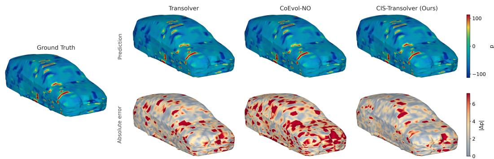  
Fig. A.1. Surface-pressure predictions and errors on ShapeNet-Car. The left column shows the reference pressure field; the upper and lower rows on the right show model predictions and absolute errors, respectively. Prediction maps share one color scale, and error maps share another.

All three models capture the main pressure distribution, with differences appearing primarily in the spatial extent of local errors. CIS-Transolver shows fewer high-error patches on the sides of the vehicle and in parts of the windshield and hood, particularly reducing the more continuous high-error regions in CoEvol-NO. Residual deviations remain at the front of the vehicle. The gains in this case therefore arise mainly from improvements in the local pressure distribution.

In Fig. A.2, CIS-Transolver reduces the regions of high velocity-magnitude error on the side and the end face shown on the right, while also reducing centered-pressure errors over parts of the end faces. Clear deviations remain along the upper edges, indicating that the improvements are spatially selective. Velocity-magnitude maps reveal local differences in flow speed; predictions of the individual directional components require separate assessment.

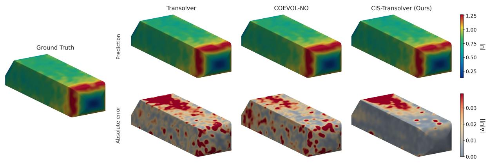

(a) Velocity magnitude and its absolute error  
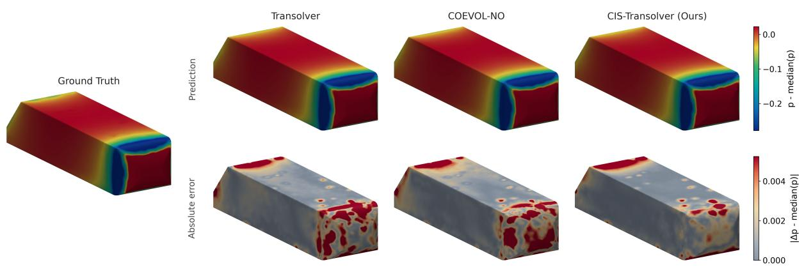  
(b) Median-centered pressure and its absolute error

Fig. A.2. Velocity-magnitude and pressure comparisons on AhmedML. (a) Velocity magnitude; (b) median-centered pressure. In each panel, the left column shows the reference field, and the upper and lower rows on the right show predictions and absolute

errors, respectively. Pressure errors are computed for the centered fields and do not reflect global offsets in the original pressure.   
Velocity-magnitude errors differ from errors computed jointly over all three components.

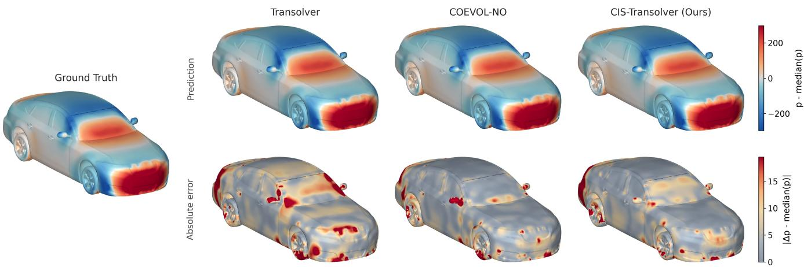  
Fig. A.3. Pressure predictions and errors on DrivAerNet++. The left column shows the reference field, and the upper and lower rows on the right show predictions and absolute errors, respectively. Pressure is displayed after median centering, and errors are computed in the same representation. Color scales are shared across models.

Compared with Transolver, CIS-Transolver reduces high-error patches around the windshield, near the side mirrors, and in parts of the vehicle front. Compared with CoEvol-NO, improvements are more localized. Residual errors remain at the rear, wheels, and lower body edges, indicating scope for further improvement in pressure prediction near complex geometry.

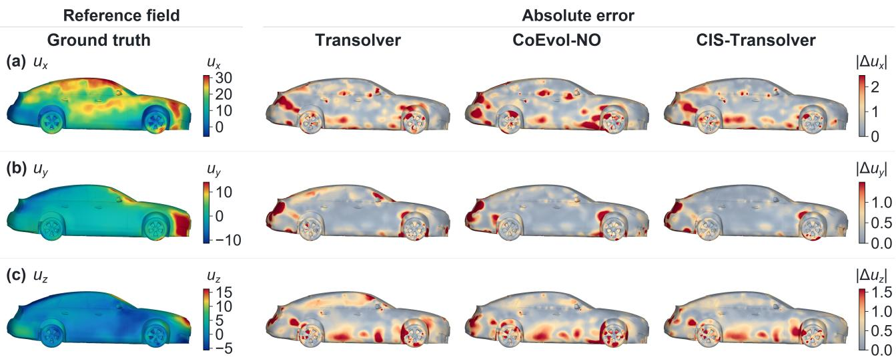  
Fig. A.4. Component-wise velocity errors on DrivAerNet++.Components (a) $u _ { x } ,$ (b) $u _ { y }$ , and ${ \bf ( c ) } u _ { z }$ for the same case. The first column shows the reference component, and the remaining three columns show the corresponding absolute errors. The nearwall volumetric field is mapped onto the geometric surface for display; the maps do not represent the original wall velocity. Each row uses a common error color scale, with ranges set independently for the different components

The component-wise comparisons further show that CIS-Transolver reduces errors in $u _ { y }$ and $u _ { z }$ over parts of the roof and sides, whereas improvements in $u _ { x }$ are more localized. Large component errors remain near the wheels and lower body. These comparisons locate improvements in velocity prediction in specific directions and spatial regions.

Case-level statistics use the 10 DrivAerNet++ test cases shared by all three models, with identifiers 0194–0203. After pairing by case identifier, 20,000 bootstrap samples are drawn with replacement, each containing 10 cases and using the same sampled indices for all models. The error reduction is defined as the difference between the case-averaged errors of the comparison model and CIS-Transolver, divided by the mean error of the comparison model. Table A.2 reports the original case means and error reductions. The 2.5th and 97.5th percentiles of the resampled reductions define the 95% confidence intervals. Relative to Transolver, CIS-Transolver reduces mean pressure and velocity errors by 6.34% and 3.01%, respectively; relative to CoEvol-NO, the reductions are 2.97% and 2.55%. All four 95% confidence intervals lie above zero, providing paired resampling evidence for the advantage in case-averaged accuracy at the current fixed checkpoints and complementing the local error distributions in the flow-field visualizations.

Table A.2. Paired case-level comparisons on DrivAerNet++.
<table><tr><td>Comparison model</td><td>Field</td><td>Comparison error</td><td>CIS error</td><td>Reduction (%)</td><td>95% CI (%)</td></tr><tr><td>Transolver</td><td>Pressure</td><td>0.1501</td><td>0.1405</td><td>6.34</td><td>[4.85, 8.05]</td></tr><tr><td>Transolver</td><td>Velocity</td><td>0.1428</td><td>0.1385</td><td>3.01</td><td>[1.88, 4.31]</td></tr><tr><td>CoEvol-NO</td><td>Pressure</td><td>0.1449</td><td>0.1405</td><td>2.97</td><td>[0.39, 5.95]</td></tr><tr><td>CoEvol-NO</td><td>Velocity</td><td>0.1421</td><td>0.1385</td><td>2.55</td><td>[1.47, 3.70]</td></tr></table>

Note: Means are rounded to four decimal places; reductions and intervals are computed from unrounded case errors. Cases are sorted by identifier, and resampling uses the PCG64 random number generator with seed 20261013. The intervals reflect only uncertainty from case resampling at fixed checkpoints and exclude variability from repeated training.

## A.3 Sensitivity to state-refresh scheduling

To examine how state-observation frequency affects full-field accuracy and high-frequency reconstruction, this section compares three refresh schedules in a bounded incremental-update variant: at layers 1 and 8, at layers 1, 4, and 8, and at all eight layers. All three settings read the current memory through the Value path at every backbone layer, with the first-layer refresh initializing memory. This variant uses the bounded updates and final-layer auxiliary supervision described below.

This variant caps the root mean square of the observation and history-state encodings at 2 for each moment order. It also limits the root mean square of the aggregated Value correction to 0.1 times that of the main-branch Value and initializes the feedback gate to 0.1. Moment-content, detail-feedback, and feedback-constraint terms are applied only at the final layer, with weights of 0.02, 0.02, and 0.01, respectively. All three schedules use the same DrivAerNet++ case splits, normalization statistics, and training configuration. Each uses an eight-layer backbone with 4.320M parameters and is trained in a single independent run of 520 epochs with random seed 0.

Table A.3. State-refresh scheduling in the bounded-update variant.
<table><tr><td>Refresh layers</td><td> $\operatorname { r e l } _ { p } \downarrow$ </td><td> $\mathrm { r e l } _ { U } \downarrow$ </td><td> $E _ { p } ^ { \mathrm { H F } } \downarrow$ </td><td> $E _ { U } ^ { \mathrm { H F } } \downarrow$ </td></tr><tr><td>1,8</td><td>0.1432</td><td>0.1397</td><td>0.2295</td><td>0.2885</td></tr><tr><td>1,4,8</td><td>0.1415</td><td>0.1392</td><td>0.2280</td><td>0.2875</td></tr><tr><td>1-8</td><td>0.1428</td><td>0.1386</td><td>0.2284</td><td>0.2877</td></tr></table>

Note: Full-field errors are taken from the original test records, while high-frequency spectral errors are computed in a supplementary evaluation of the corresponding fixed checkpoints. Spectral evaluation follows the 32,000- point protocol in Section 4.3 and averages equally over the 12 frequencies $k = 1 3 , \dots , 2 4$ and the same 10 test cases to obtain the high-frequency pressure and velocity spectral errors. Boldface denotes the lowest error in each column.

Refreshing at layers 1, 4, and 8 yields the lowest full-field pressure error and both highfrequency spectral errors among the three schedules. Compared with refreshing at layers 1 and 8, it reduces the high-frequency pressure and velocity spectral errors by 0.65% and 0.34%, respectively. Refreshing at every layer further reduces the full-field velocity error, but both highfrequency spectral errors are slightly higher than with three refreshes. Thus, full-field error and high-frequency reconstruction accuracy respond differently to refresh frequency. In this variant, three refreshes, including an intermediate-layer observation, balance pressure accuracy and highfrequency reconstruction.

## Appendix B. Model implementation and auxiliary objectives

This appendix presents the discrete implementations of input encoding, geometric operators, moment memory, and Value readout in Section 3, together with the training objectives and optimization settings for the main experiments. Local observations and historical memory share the same geometric anchor support. Corrections retrieved from memory enter the attention Value through a separate assignment to learnable physical states, allowing local statistics to inform representation updates in subsequent layers. Forward computation is driven by the input geometry, case-level conditions, and current hidden state, while reference flow fields provide training supervision. Dataset splits, target-field preprocessing, evaluation protocols, and additional results are provided in Appendix A.

For brevity, this appendix uses $P = P _ { g }$ and $R = R _ { g }$ for the anchor-to-point prolongation and point-to-anchor restriction operators in the main text, respectively, with the anchor-domain smoothing kernel $K _ { g } = R P$ . The local reconstruction operator in Eq. (2) is denoted by � here. The numbers of geometric anchors and learnable physical states are $M _ { g }$ and $M _ { p }$ , respectively, with separate indexing and assignments.

## B.1 Input encoding and geometric operators

All datasets share the same hidden dimension and state-interaction backbone, while their input encoders account for differences in the available geometric fields. Query coordinates form a separate three-dimensional input and are excluded from the point-attribute dimensions in Table B.1. For ShapeNet-Car and AhmedML, case-level conditions are both broadcast to the point attributes and passed to the condition branch. DrivAerNet++ encodes local surface descriptors and case-level conditions separately. These geometric and conditional inputs provide a common backbone interface for all tasks.

Table B.1. Dataset-specific input interfaces and encoder configurations.
<table><tr><td>Setting</td><td>ShapeNet-Car</td><td>AhmedML</td><td>DrivAerNet++</td></tr><tr><td>Point attributes</td><td>Normal (3) Condition (6)</td><td>SDF (1), fluid (1) Condition (8)</td><td>SDF (1), surface (3) Normal (3), direction (3) Curvature (2), sharpness (1)</td></tr><tr><td>Attribute / condition dimension</td><td>9/6</td><td>10/ 8</td><td>13 / 9</td></tr><tr><td>Raw branch width</td><td>256</td><td>256</td><td>128</td></tr><tr><td>Geometry / condition width</td><td>64/256</td><td>64/256</td><td>32 /24</td></tr><tr><td>Encoder output width</td><td>256</td><td>256</td><td>256</td></tr><tr><td>Anchor selection</td><td>Index-spaced</td><td>Index-spaced</td><td>Farthest-point</td></tr><tr><td>Interpolation weights</td><td>Inverse distance</td><td>Inverse distance</td><td>Local Gaussian</td></tr><tr><td>Fine reconstruction</td><td> $P S _ { a } F$ </td><td> $P S _ { a } F$ </td><td>PRF</td></tr></table>

Note: Fields are concatenated in the order shown, with channel indices starting at 1. For ShapeNet-Car, channels 1–3 contain normals and channels 4–9 contain conditions. For AhmedML, channels 1 and 2 contain SDF and the fluid mask, respectively, and channels 3–10 contain conditions. For DrivAerNet++, channels 1, 2–4, 5–7, 8– 10, 11–12, and 13 contain SDF, nearest-surface-point coordinates, surface normals, distance directions, principal curvatures, and surface sharpness, respectively. SDF denotes signed distance; surface contains the normalized coordinates of the nearest surface point; and direction is the unit vector from that point to the query point. $S _ { a }$ denotes direct sampling at the selected anchors, and � denotes weighted aggregation.

The six conditions for ShapeNet-Car are ordered as length, width, height, length-to-width ratio, length-to-height ratio, and width-to-height ratio. The eight conditions in the AhmedML source data are body-length, body-height, body-width, front-arc-diameter, slant-angle-length, slant-angle-height, slant-surface-length, and slant-angle-degrees, in that order. The first seven are geometric lengths, and the last is an angle. When loaded, these conditions are aligned to the sequence of named fields recorded in the training statistics, which is fixed for validation and testing. The nine conditions for DrivAerNet++ are the ratios of the bounding-box spans along the three coordinate axes to vehicle height, the ratio of truncation distance to vehicle height, normalized surface area, normalized volume, a normalized frontal-area proxy, bounding-box compactness, and a volume-validity indicator, in that order. The corresponding field names are extent\_x\_over\_H, extent\_y\_over\_H, extent\_z\_over\_H, dmax\_over\_H, surface\_area\_over\_H2, volume\_over\_H3, frontal\_proxy\_over\_H2, bbox\_compactness, and volume\_valid. Areas and volumes are normalized by the square and cube of vehicle height, respectively, and volumerelated quantities are used together with the validity indicator.

Continuous conditions for ShapeNet-Car and AhmedML are standardized using training-set means and standard deviations, with these statistics fixed for validation and testing. The nine conditions for DrivAerNet++ use the geometric nondimensionalization described above, with the final entry clipped to the validity range. Its surface coordinates are mapped from $[ 0 , 1 ] ^ { 3 }$ to

$[ - 1 , 1 ] ^ { 3 }$ , and normals and distance directions are each normalized to unit length. The stored principal curvatures, which are already multiplied by vehicle height, are transformed as asinh(clip(�, −20,20))/asinh(20). Surface sharpness is clipped to [0, 1] and describes the consistency of surface normals.

Query coordinates are normalized using a common length scale within each case. ShapeNet-Car and AhmedML use the center of the point-set bounding box and half its longestaxis span. DrivAerNet++ uses the center of the vehicle bounding box and the sum of half its longest-axis span and the truncation distance. The input SDF is scaled by the truncation distance for AhmedML and by vehicle height for DrivAerNet++, followed by the encoder RMS normalization described below. Geometric scales for each case are computed from the current input, separately from condition and target-field statistics estimated from the training set.

The encoder also constructs inflow-aligned coordinates and soft geometric basis functions. ShapeNet-Car and AhmedML use the center of the query-point bounding box as the origin and half its longest-axis span as a common scale. DrivAerNet++ centers the inflow-aligned coordinates at the point-set mean and scales them by the overall root mean square (RMS) of the centered coordinates. The coordinates along the inflow direction and two orthogonal transverse axes are denoted by $\xi , \eta _ { 1 } , \eta _ { 2 }$ , with $\rho ^ { 2 } = \eta _ { 1 } ^ { 2 } + \eta _ { 2 } ^ { 2 }$ . The normalized distance � is obtained by dividing the input SDF by its RMS with gradients stopped and clipping the result to [−8,8]. The RMS floor is $1 0 ^ { - 3 }$ for the first two datasets and $1 0 ^ { - 4 }$ for DrivAerNet++.

For ShapeNet-Car and AhmedML, the three sets of near-wall and wake basis functions are $\begin{array} { r } { a _ { d } \exp \left( - \frac { | d | } { s _ { j } } \right) } \end{array}$ and $\begin{array} { r } { \sigma \left( k _ { j } \big ( \xi - c _ { j } \big ) \right) \exp \left( - \frac { \rho ^ { 2 } } { r _ { j } } \right) } \end{array}$ , respectively, where $a _ { d }$ indicates distance availability. The scales use Softplus parameterization with respective additive offsets of 0.04, 0.08, and 0.50. Their effective initial values are (0.16, 0.39, 0.94), (0.36, 0.68, 1.23), and (1.75, 2.75, 4.00), respectively. The centers are bounded by tanh, with initial values of $( - 0 . 1 5 , 0 . 1 0 , 0 . 3 2 )$ for the unconstrained parameters. DrivAerNet++ uses exp $\left( - \frac { | d | } { s } \right)$ and $\sigma \left( { \frac { \xi - c } { t } } \right) \exp \left( - { \frac { \rho ^ { 2 } } { r ^ { 2 } } } \right)$ , with positive scales initialized to $s = 0 . 5 5 , t = 0 . 3 5$ , and $r = 0 . 7 5$ . The center � = 1.5tanh(�) is initialized to 0.35. These learnable geometric weights provide continuous encodings of near-wall distance and downstream position.

The input branches handle missing fields through availability indicators. When distance or normal information is missing, its indicator is set to zero and the corresponding relational components are disabled. If the fluid mask is missing, all points are treated as fluid by default. ShapeNet-Car disables the near-wall basis because it has no distance input. For ShapeNet-Car and AhmedML, the raw-input branch uses GELU, the geometry branch contains two residual blocks, and the condition and surface-relation branches use SiLU. The branch outputs are normalized and added to form a 256-dimensional representation, and the direct geometry mapping is initialized with zero weights. DrivAerNet++ instead concatenates raw attributes, analytical geometric quantities, and condition embeddings, maps them to 256 dimensions, and adds a bounded surface-relation correction. The two encoding paths preserve task-specific geometric information while sharing the downstream state-interaction interface.

The local support uses 64 anchors, with each query point connected to its three nearest anchors. ShapeNet-Car and AhmedML select anchors at equally spaced input indices and use $( d _ { i a } + 1 0 ^ { - 4 } ) ^ { - 1 }$ as the unnormalized weight. Anchor identities are determined by the preprocessed point ordering. DrivAerNet++ uses deterministic farthest-point sampling, starting from the point farthest from the point-set centroid, with unnormalized weights exp $[ - ( d _ { i a } / s _ { g } ) ^ { 2 } ]$ The bandwidth $s _ { g }$ is the maximum distance over all connections between points and their three neighboring anchors within the same sample, with a floor of $1 0 ^ { - 3 }$ . All query points in a sample share this bandwidth. Weights outside these neighborhoods are zero. The normalized interpolation matrix $P \in \mathbb { R } ^ { N \times M _ { g } }$ satisfies

$$
\begin{array} { c } { { { \displaystyle \sum _ { a } } P _ { i a } = 1 , ~ m _ { a } = { \operatorname* { m a x } } ( \sum _ { i } P _ { i a } , \varepsilon ) , } } \\ { { R = \mathrm { d i a g } ( m ) ^ { - 1 } P ^ { \top } , ~ \varepsilon = 1 0 ^ { - 6 } . } } \end{array}\tag{B.1}
$$

Thus, $P$ is normalized over the anchors connected to each query point, whereas � is normalized over the point weights received by each anchor. The matrices and mass denominators are computed in FP32. Let � denote pointwise features obtained by applying layer normalization and a learnable channel projection to the current layer's input hidden representation (the layer index is omitted below). The mid-scale and fine-scale observations are

$$
\begin{array} { r } { D _ { \mathrm { m i d } } = P ( I - R P ) R F , } \\ { D _ { \mathrm { f i n e } } = F - \mathcal { S } F . \quad } \end{array}\tag{B.2}
$$

where the choice of $\cdot \mathcal { S }$ is specified in Table B.1. The mid-scale term also equals $P R F -$ $( P R ) ^ { 2 } F$ . The two observations describe feature differences at two levels of geometric smoothing. The geometric support is reused across layers within a forward pass, and the current features are reanalyzed only at memory-refresh layers. DrivAerNet++ can reuse the neighborhood topology while recomputing the weights, provided that point identities, ordering, and geometric relationships remain unchanged. The graph is rebuilt when sampling or ordering changes.

## B.2 Moment-memory implementation and auxiliary objectives

Moment analysis uses the geometric support defined above. The inflow-aligned coordinates are first centered at the point-set mean and divided by the maximum absolute displacement along each axis, with a denominator floor of $1 0 ^ { - 4 }$ , yielding ${ \bar { x } } _ { i }$ . The weighted center and scale along each axis are computed for every anchor as

$$
\begin{array} { r l r } { \displaystyle } & { \displaystyle \mu _ { a } = \sum _ { i } R _ { a i } \overline { { x } } _ { i } , } & \\ { \displaystyle \sigma _ { a j } = \sqrt { \operatorname* { m a x } ( \sum _ { i } R _ { a i } \overline { { x } } _ { i j } ^ { 2 } - \mu _ { a j } ^ { 2 } , 0 . 0 1 ) , } } & { \displaystyle \xi _ { i a , j } = \frac { \overline { { x } } _ { i j } - \mu _ { a j } } { \sigma _ { a j } } . } \end{array}\tag{B.3}
$$

The zeroth-, first-, and second-order bases contain 1, 3, and 6 components, respectively. The second-order components follow the order $x x , x y , x z , y y , y z ,$ �� and are centered by subtracting their weighted means over the same support. Each order is encoded with width $r =$ 8, giving a concatenated memory width of 3�. The full memory tensor has shape $8 \times 6 4 \times 2 \times 2 4$ , with axes corresponding to attention head, anchor, scale, and encoded channel; the batch dimension is omitted. LayerNorm is applied separately to the observation and history encodings over all $3 r$ channels. A $6 r  3$ gating map then produces an update rate for each order. Within a given layer and head, the map is shared across anchors and scales; different layers and heads use independent parameters.

The initial history memory is zero. The zeroth-order encoding map and the history maps for individual orders are initialized as identity matrices. The update-gate weights are initialized to zero and the bias to log(0.7/0.3). The eight-layer network refreshes memory at layers 1, 4, and 8 and retains it at the other layers. Every layer reads the current memory, with refresh preceding readout within the same layer. The final-layer refresh updates local observations before output

and contributes to the current-layer prediction. Moment memory is updated directly from the geometric moments of current hidden features and the history encodings.

The schedule in Table B.2 applies to the main model in the main text. Appendix A.3 compares refresh frequencies within a bounded-update variant, with each formulation using its own update parameterization and training settings.

For readout, the memories at the two scales of each anchor are concatenated into a $6 r .$ dimensional vector. A linear map produces a modulation vector and a bias, each of dimension �. At refresh layers, the bias passes through the anchor-domain difference operator $I - R P$ . Both outputs are then mapped back to the point domain by �. Let $a _ { i } ^ { l } , b _ { i } ^ { l }$ denote the pointwise outputs, and let the current hidden representation $h _ { i } ^ { l }$ have low-rank projection $z _ { i } ^ { l }$ . Synthesis and gated readout with amplitude matching are defined as

$$
\begin{array} { c } { { q _ { i } ^ { l } = \displaystyle \frac { 1 } { 2 } \mathrm { t a n h } ( a _ { i } ^ { l } ) \odot z _ { i } ^ { l } + \displaystyle \frac { 1 } { 2 } b _ { i } ^ { l } , } } \\ { { u _ { i } ^ { l } = \phi _ { \mathrm { o u t } } ^ { l } ( q _ { i } ^ { l } ) , \quad \Delta v _ { i } ^ { l } = \gamma _ { l } g _ { i } ^ { l } s _ { i } ^ { l } u _ { i } ^ { l } . } } \end{array}\tag{B.4}
$$

Here, $g _ { i } ^ { l }$ is a pointwise tanh gate whose inputs are stop-gradient amplitude ratios derived from the low-rank reference, the synthesized representation, and their difference. The gate parameters are initialized to zero. The readout map is initialized as the transpose of the content projection. Amplitude matching and the depth-dependent gain are defined by

$$
\begin{array} { r } { { s } _ { i } ^ { l } = { s } \mathrm { g } ( \mathrm { c l i p } ( \frac { \mathrm { R M S } ( h _ { i } ^ { l } ) } { \mathrm { R M S } ( u _ { i } ^ { l } ) } , \frac { 1 } { 4 } , 4 ) ) , } \\ { \gamma _ { l } = 0 . 7 2 \sigma ( b ) \mathrm { s o f t m a x } ( \beta ) _ { l } . } \end{array}\tag{B.5}
$$

RMS is computed over the channels of a single head with a numerical floor, and sg denotes the stop-gradient operation. The total gain 0.72�(�) is initialized to 0.51. For ShapeNet-Car and AhmedML, the initial depth weights at refresh layers are 32 times those at other layers; DrivAerNet++ uses uniform initialization. This gain allocation sets a learnable initial scale for memory readout at each depth.

Here, $h _ { i } ^ { l }$ denotes the pointwise vector of input hidden features for layer � over the channels of a single head, and the pointwise correction matrix $\varDelta V ^ { l }$ corresponds to $\varDelta ^ { l }$ in the main text.

Equation (B.5) clips the amplitude-matching coefficient to the specified interval. Together with the pointwise gate and layer gain, this coefficient controls the scale of the memory correction.

Let $W ^ { l }$ denote the assignment matrix from points to learnable physical states, distinct from the geometric support �. Assignments use softmax over the state dimension, with temperature softplus $( t _ { l } ) + 0 . 0 5$ initialized to 0.7. State masses are clipped elementwise without adding a diagonal regularization term. For a single attention head, the interface is

$$
\begin{array} { c } { { \varLambda ^ { l } = \mathrm { d i a g } ( \mathrm { m a x } ( ( W ^ { l } ) ^ { \top } { \bf 1 } , \varepsilon ) ) , } } \\ { { \varLambda ^ { l } = ( \varLambda ^ { l } ) ^ { - 1 } ( W ^ { l } ) ^ { \top } V ^ { l } , \quad \varLambda S ^ { l } = ( \varLambda ^ { l } ) ^ { - 1 } ( W ^ { l } ) ^ { \top } \varLambda V ^ { l } , } } \\ { { \varLambda ^ { l } = \mathrm { A t t n } ( \varPhi _ { Q } ( S ^ { l } ) , \varPhi _ { K } ( S ^ { l } ) , \varPhi _ { V } ( S ^ { l } ) + \varDelta S ^ { l } ) + \chi S ^ { l } . } } \end{array}\tag{B.6}
$$

In Eq. (B.6), $\Phi _ { Q } , \Phi _ { K }$ , and $\phi _ { V }$ denote the state-domain Query, Key, and Value projections, respectively; the incremental feedback to Value corresponds to Eq. (8) in the main text. Here, $V ^ { l }$ denotes the pointwise $V _ { p t } ^ { l }$ in the main text, and $T ^ { l }$ denotes the state-attention output $O ^ { l }$ . The correction is added after the state Value projection, while Query and Key are generated from the current uncorrected states. This description applies to the direct interface within the same layer; assignments in later layers can still be affected by changes in the hidden representation. ShapeNet-Car and AhmedML use $\chi = 0$ , and DrivAerNet++ uses $\chi = 1$ . The head outputs are mapped back to the point domain through $W ^ { l } T ^ { l }$ , concatenated, and passed through an output projection, followed by the hidden residual and feed-forward updates. Table B.2 summarizes the shared configuration.

Table B.2. Shared configuration of geometric operators and moment memory.
<table><tr><td>Component</td><td>Configuration</td></tr><tr><td>Backbone</td><td>8 layers; width 256; 8 heads; 32 states/head</td></tr><tr><td>Feed-forward block</td><td>Width 512; GELU; pre-LayerNorm</td></tr><tr><td>Geometric support</td><td>64 anchors; 3 anchors/query; 2 scales</td></tr><tr><td>Moment representation</td><td>Orders 0–2; rank 8/order; memory width 24</td></tr><tr><td>Memory schedule</td><td>Refresh at layers 1, 4, 8; read at every layer</td></tr><tr><td>Update / read gate initialization</td><td>0.7 / 0</td></tr><tr><td>Assignment temperature</td><td>Initial 0.7; lower offset 0.05</td></tr><tr><td>Numerical safeguards</td><td>Mass floor  $1 0 ^ { - 6 } ;$  variance floor 0.01</td></tr></table>

A forward pass first encodes the inputs and constructs the geometric support. At the designated layers, it analyzes the current features and updates moment memory. The current memory then generates pointwise corrections, which are aggregated into the state Value branch before state interaction and feed-forward updates. Finally, the task decoder produces the physical field. The surface task predicts pressure, whereas the volumetric tasks decode three-component velocity and pressure separately. During inference, the task decoder directly outputs the physical field.

The auxiliary objectives constrain the information that can be read from memory and its realized response in the backbone. The same task decoder reads the input and output of each refresh layer only during forward passes with auxiliary supervision enabled; these decoded outputs are denoted by $y _ { - } ^ { l }$ and $y _ { + } ^ { l }$ , respectively. The reference residual and actual layer response are defined as

$$
e ^ { l } = { \ s g ( y - y _ { - } ^ { l } ) } , \delta y ^ { l } = y _ { + } ^ { l } - y _ { - } ^ { l } .\tag{B.7}
$$

Here, $\delta y ^ { l }$ summarizes the field response induced by state interaction and feed-forward updates across the entire layer. During training, a separate probe uses the layer-input hidden representation with gradients stopped as a reference. It decodes this representation both before and after adding the concatenated multihead result of $W ^ { l } \varDelta S ^ { l }$ , and the difference defines the empirical proxy target $\delta y _ { * } ^ { l }$ . This lightweight probe directly reads out the field change associated with the Value increment. The response-consistency term uses this target to guide the full-layer response, linking the local information readable from memory to backbone updates. Field decoding provides training supervision, while moment memory is updated along the hiddenfeature path.

Let $\mathcal { H } _ { g } = I - P R$ . Local moment analysis acts on the geometric smoothing residual. With $\varphi _ { i a }$ denoting the ten-dimensional basis comprising a constant term, standardized linear terms, and centered quadratic terms, the analysis operator is

$$
\left[ \mathcal { A } f \right] _ { a , k } = \sum _ { i } R _ { a i } \varphi _ { i a , k } [ \mathcal { H } _ { g } f ] _ { i } , k = 1 , \ldots , 1 0 .\tag{B.8}
$$

The updated memory is averaged over heads and scales. A linear readout $3 r \to 1 0 q$ , shared across layers, produces the predicted moments $\widehat { m } ^ { l }$ , where � is the number of output channels. Let

ℰ denote the mean squared error with validity masks and nonnegative point weights, and ${ \mathcal { E } } _ { m }$ the corresponding moment error. The five auxiliary constraints are

$$
\begin{array} { r l } & { \mathcal { L } _ { \mathrm { m o m e n t } } = \mathcal { E } _ { m } ( \widehat { m } ^ { l } - { s } \mathbf { g } ( \mathcal { A } e ^ { l } ) ) , } \\ & { \mathcal { L } _ { \mathrm { d e t a i l } } = \mathcal { E } ( \mathcal { H } _ { g } ( e ^ { l } - \delta y ^ { l } ) ) , \mathcal { L } _ { \mathrm { g u a r d } } = \mathcal { E } ( P R \delta y ^ { l } ) , } \\ & { \mathcal { L } _ { \mathrm { r e a l i z a t i o n } } = \mathcal { E } ( \delta y ^ { l } - { s } \mathbf { g } ( \delta y _ { * } ^ { l } ) ) , \mathcal { L } _ { \mathrm { r e m a i n i n g } } = \mathcal { E } _ { m } ( \mathcal { A } ( e ^ { l } - \delta y ^ { l } ) ) . } \end{array}\tag{B.9}
$$

The five auxiliary losses in Eq. (B.9) are computed in the normalized output space of each task. Residuals in invalid channels are first set to zero. A channel contributes to moment supervision only where its validity mask, after anchor aggregation, exceeds 0.999. For volumetric tasks, the weighted mean squared errors are reduced separately for the three velocity channels as one group and the pressure channel as the other, and the two group losses are then averaged with equal weights. The surface task uses pressure alone. Moment errors are first reduced over the components and valid supports within each order, then averaged equally across the three orders. This prevents second-order terms from receiving greater weight solely because they contain more components. Losses are averaged equally across refresh layers.

Moment supervision constrains the memory readout to recover local moments of the current reference error. The fine-scale term constrains the geometric smoothing residual after the layer update. The guard term limits the geometric coarse-scale component of the full-layer response. The realization term regularizes the actual layer response using the empirical proxy target, and the remaining term constrains the local moments that persist after the update. The guard term is evaluated on the coarse-scale field response. Both the fine-scale and remaining terms retain gradients with respect to $\delta y ^ { l } .$ . These five terms constitute the moment-memory auxiliary objective defined below, with coefficients $\lambda _ { m } = 0 . 0 5 , \lambda _ { d } = 0 . 0 2 , \lambda _ { g } = 0 . 0 1 , \lambda _ { r } = 0 . 0 2$ , and $\frac { \lambda _ { m } } { 2 } = 0 . 0 2 5$ , respectively. Moment-memory auxiliary supervision is enabled once every 4 training forward passes for ShapeNet-Car and AhmedML and once every $8$ passes for DrivAerNet++, with the periodic auxiliary losses multiplied by the corresponding interval. Additional auxiliary forward passes triggered by diagnostics are included with unit weight. Losses are averaged equally over layers 1, 4, and 8. Supervision sampling does not change the memory-refresh or per-layer readout rules.

Combining the primary prediction objective with the moment-memory auxiliary constraints, the total training loss for the main experiments is

$$
\begin{array} { r } { \mathcal { L } _ { \mathrm { t r a i n } } = \mathcal { L } _ { \mathrm { b a s e } } + \mathcal { L } _ { \mathrm { m e m } } , } \\ { \mathcal { L } _ { \mathrm { m e m } } = \lambda _ { m } \mathcal { L } _ { \mathrm { m o m e n t } } + \lambda _ { d } \mathcal { L } _ { \mathrm { d e t a i l } } + \lambda _ { g } \mathcal { L } _ { \mathrm { g u a r d } } } \\ { + \lambda _ { r } \mathcal { L } _ { \mathrm { r e a l i z a t i o n } } + \displaystyle \frac { \lambda _ { m } } { 2 } \mathcal { L } _ { \mathrm { r e m a i n i n g } } . } \end{array}\tag{B.10}
$$

Here, $\mathcal { L } _ { \mathrm { b a s e } }$ includes the field mean-squared error, region-weighted loss, graphneighborhood multiscale and gradient terms listed in Table B.3, as well as the relative-error terms used for DrivAerNet++. The corresponding weights and evaluation intervals are given in the training configuration below. $\mathcal { L } _ { \mathrm { m e m } }$ denotes the five moment-memory auxiliary constraints in Eq. (B.9), with the coefficients specified above; the remaining-moment term carries half the weight of the moment-supervision term. Auxiliary constraints are used during training only; inference directly uses the predictions of the main model.

## Training configuration and model selection for the main experiments

All three datasets use AdamW with a global batch size of 2, one gradient-accumulation step, and training random seed 0. The initial learning rate is $1 . 8 \times 1 0 ^ { - 4 }$ , weight decay is $8 \times 1 0 ^ { - 5 }$ and the minimum learning rate is $5 \times 1 0 ^ { - 7 }$ . Linear warmup is followed by cosine learning-rate decay. Training uses BF16 automatic mixed precision and TF32, with no early stopping based on a validation-performance plateau. Table B.3 summarizes the task-specific settings for the main model. The field loss is computed in the standardized output space. For volumetric tasks, mean squared errors are reduced separately for the three velocity components as one group and pressure as the other, then combined using the group weights in Table B.3. The surface task uses pressure alone. The region-weighted term is an additional field error with point weights derived from the regional focus scores provided by the model and normalized to a mean of 1. On an eight-nearest-neighbor support, the graph auxiliary terms compare the difference between one and two smoothing passes, the difference between the original field and one smoothing pass, and field differences between neighboring points. Each term is normalized by the corresponding reference response. These terms are introduced gradually during warmup, evaluated at the intervals in the table, and multiplied by those intervals for compensation.

Table B.3. CIS-Transolver training configuration for the main experiments.
<table><tr><td>Setting</td><td>ShapeNet-Car</td><td>AhmedML</td><td>DrivAerNet++</td></tr><tr><td>Training epochs</td><td>900</td><td>900</td><td>520</td></tr><tr><td>Cosine schedule (epochs)</td><td>900</td><td>900</td><td>460</td></tr><tr><td>Warmup fraction</td><td>4%</td><td>4%</td><td>3.5%</td></tr><tr><td>AdamW betas</td><td>(0.9, 0.999)</td><td>(0.9, 0.999)</td><td>(0.9, 0.95)</td></tr><tr><td>Gradient-norm limit</td><td>0.8</td><td>0.8</td><td>1.0</td></tr><tr><td>Base field MSE weight</td><td>1.20</td><td>1.20</td><td>1.00</td></tr><tr><td>Velocity / pressure weights</td><td>Pressure only</td><td>0.55 / 0.45</td><td>0.50 / 0.50</td></tr><tr><td>Region-loss coefficient</td><td>0.20</td><td>0.25</td><td>0.20</td></tr><tr><td>Region amplification</td><td>2.00</td><td>2.00</td><td>1.75</td></tr><tr><td>Graph mid / fine / gradient weights 0.030 / 0.025 / 0.025</td><td></td><td>0.040 / 0.030 / 0.030</td><td>0.010 / 0.010 / 0.005</td></tr><tr><td>Graph / gradient points</td><td>2,048 / 1,024</td><td>1,024 /1,024</td><td>768/768</td></tr><tr><td>Graph-loss interval (steps)</td><td>4</td><td>4</td><td>8</td></tr><tr><td>Memory-loss interval (forwards)</td><td>4</td><td>4</td><td>8</td></tr></table>

Note: The warmup fraction is relative to the length of the corresponding learning-rate schedule. For DrivAerNet++, the cosine schedule lasts 460 epochs, after which the learning rate remains at its minimum through epoch 520. Pressure and velocity are optimized jointly throughout training. The training budget differs from the epoch of the final selected checkpoint. These settings apply to the main model in the main text; Appendix A.3 provides the separate configuration of the bounded-update variant.

The graph auxiliary terms use standardized fields for ShapeNet-Car and AhmedML and fields transformed back to their original scale for DrivAerNet++. For DrivAerNet++, the loss also includes velocity and pressure relative-error terms, each with a weight of 0.50. The velocity/pressure group weights in the field loss are defined separately from the equal weighting of the two groups in the auxiliary errors in Eq. (B.9). Pressure-reference, clipping, and standardization rules for the target fields are provided in Appendix A.1.

Checkpoints are selected using the validation set after each training epoch. ShapeNet-Car minimizes the case-averaged pressure relative error, while AhmedML minimizes the arithmetic mean of the case-averaged pressure and velocity relative errors. DrivAerNet++ retains the joint selection score archived for the main experiments:

$$
s = \mathrm { m a x } ( e _ { \mathrm { U } } , e _ { \mathrm { p } } ) + 0 . 1 0 \sqrt { \frac { e _ { \mathrm { U } } \mathrm { ^ 2 } + { e _ { \mathrm { p } } } ^ { 2 } } { 2 } } + 0 . 0 5 e _ { \mathrm { a l l } }\tag{B.11}
$$

Here, $e _ { U }$ and $e _ { p }$ are the mean velocity and pressure relative errors over validation cases, respectively. For $e _ { a l l }$ , the velocity and pressure channels are concatenated after reversing standardization, the relative error is computed for each case, and these errors are averaged across cases. This joint score is used for validation-based model selection, while pressure and velocity metrics are reported separately in the main text. The selected checkpoint for each task is then evaluated on the test set.