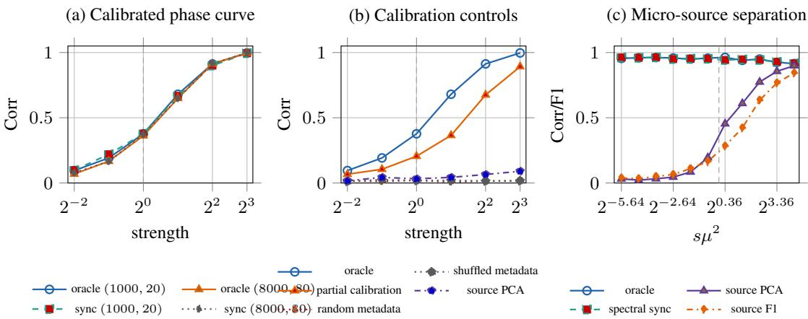

# Can Metadata Fix the Gauge? Calibration Turns Sparse Multi-Source Learning from Sparse PCA into Sparse Mean Recovery

Yirong Xiang Air Force Medical Center yirong\_xiang@163.com

Yibo Zhou∗ Beihang University ybzhou@buaa.edu.cn

## Abstract

Source labels tell us where a sample came from, but not how that source oriented its coordinates. In a sparse Gaussian multi-source model with source-specific sign gauges, that distinction changes the learning problem. Without calibration, pooling across sources erases the mean signal, and the source-labelled experiment reduces to sparse PCA. With task-independent relative-gauge metadata, synchronization aligns sources and the same observations become a sparse mean problem. We formalize the value of metadata through aligned mass, which quantifies how much first-order signal a metadata-induced alignment restores. Source labels create only limited aligned mass, whereas valid calibration can create aligned mass proportional to the full sample size. This yields a statistical separation in micro-source regimes and, under standard sparse-PCA hardness assumptions, a computational separation as well. Synthetic experiments check the predicted scaling; controlled real-feature and physical sensor studies examine sign cancellation, separately acquired calibration, and reuse across tasks.

## 1 Introduction

Multi-source learning is written as if every source uses the same coordinate convention. In practice this convention can fail. A sensor polarity may be reversed, a scanner pipeline may reflect a latent factor, or a client representation may flip the sign of a hidden component. Within each source the signal may be coherent, but across sources naive pooling can cancel it. This paper asks when metadata can fix such a source-specific gauge, and why this is different from merely knowing source labels.

A concrete example is a sensor whose mounting reverses the sign of a measured axis. Source identity tells us which recordings share a mounting, but not whether two mountings use the same or opposite axis convention. A separately recorded reference motion can provide that comparison before any downstream task is observed. In our physical sensor study (Section E.5), these same/opposite records are synchronized once and reused across four classification tasks. Here synchronization means estimating consistent source orientations up to one global sign; linearization means averaging after this alignment to restore a mean signal. We study this question in a stylized sparse Gaussian model. Each source observes the same unknown sparse direction, but through an unknown source-specific sign gauge. Source labels tell the learner which samples belong together, yet they do not reveal how one source is oriented relative to another. Calibration metadata is different: relative polarity logs, orientation edges, or noisy absolute orientation records can carry information about the source gauges. Such metadata can be synchronized into a common convention, using ideas related to synchronization over $\mathbb { Z } _ { 2 }$ and other groups [5, 17]. The main message is that these two kinds of side information induce different statistical experiments. With only source labels, the learner can aggregate within each source, but the unknown gauges remove first-order signal across sources. The resulting sourcelabelled experiment is exactly sparse PCA, plus residual Gaussian noise independent of the task direction. With valid relative-gauge metadata, synchronization selects a gauge section and restores first-order structure. Conditional on source amplitudes, the same downstream observations become a sparse mean problem. Thus labels identify groups, whereas calibration identifies orientation.

Source identifiers, group labels, and institution tags are useful for organizing data and modeling heterogeneity [3, 6, 13, 14, 16, 24],but they do not by themselves specify how source-specific coordinate conventions should be aligned. Calibration metadata plays a narrower role: it provides information about nuisance source conventions rather than the downstream task. In our model, this distinction changes the statistical experiment: the available signal changes from second-order to first-order, leading to different statistical and computational thresholds.

To quantify the value of metadata, we introduce aligned mass. Given metadata-induced sample weights $q$ and the hidden gauge vector $^ { g , }$ aligned mass is n times their squared cosine similarity. In the constant-amplitude companion model, $\theta ^ { 2 } M _ { q } ( g )$ is exactly the squared first-order signal strength. In the source-Gaussian model it still controls the nominal first-order signal, while an aligned-sourcecount condition controls concentration of random source amplitudes. This viewpoint makes the comparison sharp: source labels can create only limited aligned mass because they know which samples share a source but not which way that source points; valid relative-gauge metadata can create aligned mass proportional to the full sample size.

The resulting separation is most transparent in the micro-source regime, where each source is individually weak. Calibrated recovery succeeds at the sparse-mean scale, while source-labelled uncalibrated recovery is statistically insufficient at the corresponding sparse-PCA scale. Under standard sparse-PCA hardness assumptions [8, 11], there is also a conditional computational separation: calibrated recovery is polynomial-time after synchronization, whereas source-labelled recovery remains as hard as sparse PCA through the usual hard window.

A useful feature of calibration metadata is that it is task-independent. It fixes a source convention rather than revealing the downstream sparse direction. One relative-gauge graph can therefore be collected and synchronized once, then reused across many independent downstream tasks sharing the same source gauges. This differs from feature- or label-derived alignment, which may be useful but uses task-coupled information rather than external calibration. Our contributions are:

1. We identify a sparse multi-source setting in which source-labelled uncalibrated data is statistically equivalent to sparse PCA, while calibrated data becomes sparse mean recovery.

2. We introduce aligned mass as a quantitative measure of the first-order value of metadata-induced alignment, and show that source labels cannot reliably create extensive aligned mass whereas valid relative-gauge metadata can.

3. We derive an unconditional statistical separation in micro-source regimes and a conditional computational separation under standard sparse-PCA hardness. Experiments check phase transitions, uninformative or mismatched metadata controls, calibration reuse, and controlled real-feature behavior.

Spectral synchronization, weighted averaging, and top-k thresholding are standard components. Our contribution is the experiment-level converse without calibration, together with the quantitative link from noisy calibration to restored first-order signal, rather than a new synchronization algorithm.

## 2 Model, metadata, and alignment

## 2.1 A sparse multi-source model

Let $\mathcal { V } _ { d , k } = \{ v \in \{ 0 , \pm 1 / \sqrt { k } \} ^ { d } : \| v \| _ { 0 } = k \} , K _ { \mathrm { s p } } = k \log ( e d / k )$ . There are $L$ sources, each contributing s samples, so the total sample size is $n = L s$ . The unknown sparse direction is $V \in \mathcal { V } _ { d , k }$ . Source ℓ has an unknown sign gauge $\sigma _ { \ell } \stackrel { \mathrm { i . i . d . } } { \sim }$ Unif{±1} and a nonnegative amplitude $R _ { \ell } \stackrel { \mathrm { i . i . d . } } { \sim } | N ( 0 , 1 ) |$ , independent of $\sigma _ { \ell } .$ . Writing $a _ { \ell } = \sigma _ { \ell } R _ { \ell } \sim N ( 0 , 1 )$ , the observation model is

$$
\begin{array} { r } { W _ { \ell r } = \theta R _ { \ell } \sigma _ { \ell } V + \varepsilon _ { \ell r } , \qquad \varepsilon _ { \ell r } \sim N ( 0 , I _ { d } ) , \qquad \ell = 1 , \dots , L , r = 1 , \dots , s . } \end{array}
$$

Here $\theta > 0$ is the signal magnitude, $\Vert \boldsymbol { v } \Vert _ { 0 }$ counts nonzero coordinates, and $K _ { \mathrm { s p } } = k \log ( e d / k )$ is the sparse-complexity term, with e Euler’s number and log the natural logarithm. The feature noises are mutually independent and independent of $V , \sigma , R$ . The Rademacher gauge prior means that each source sign is independently and uniformly sampled from $\{ - 1 , + 1 \}$ . The downstream theoretical task is to recover $\dot { V }$ up to a global sign, or its support supp $\dot { V } ) = \{ j : V _ { j } \neq 0 \}$ . We write $\gtrsim , \lesssim$ , and ≍ for inequalities or equivalence up to universal positive constants. The same statistic arises from a simple two-view classification model; the derivation appears in Appendix B. The model separates two roles that are easy to conflate:

• σ $\sigma _ { \ell }$ is a coordinate convention. This is the part calibration metadata may reveal.

$R _ { \ell }$ is a source amplitude. This is nuisance randomness and is not something valid metadata should depend on.

Probabilities involving σ are with respect to this Rademacher prior. We also use the constantamplitude companion $W _ { \ell r } = \theta \sigma _ { \ell } V + \varepsilon _ { \ell r }$ , where aligned mass is exact.

## 2.2 What counts as valid calibration metadata?

Source labels identify which samples belong to the same source. Calibration metadata instead provides information about source signs. A relative-polarity log or orientation edge is a noisy record of whether two sources use the same or opposite sign convention; a noisy absolute orientation record compares one source with a known reference.

Let E contain only exogenous source-side structure, such as source identities, source sizes, calibrationgraph topology, and a pre-specified calibration design. In the theoretical model, E is fixed or sampled independently of $\sigma , R , V$ and task randomness; it cannot encode downstream labels or features. Let $D _ { \mathrm { t a s k } }$ collect downstream observations, their feature noise, and any downstream labels. In the two-view example, these labels are $Y _ { \ell r } ;$ the main recovery model requires no additional labels.

Definition 1 (Valid calibration metadata). A metadata channel M is valid calibration metadata if

$$
P ( \mathfrak { M } \mid V , R , D _ { \mathrm { t a s k } } , \sigma , E ) = P ( \mathfrak { M } \mid \sigma , E ) .
$$

Thus, conditional on source signs and the exogenous source design, calibration is independent ofthe downstream direction, amplitudes, observations, labels, andfeature noise.

Validity concerns task independence, not accuracy. Random metadata can be valid but uninformative; missing or independently corrupted calibration records can also remain valid. Conversely, feature- or label-derived alignment can be useful while violating task independence.

With externally collected valid calibration, weights are estimated without using any downstream observations, so scarce micro-source samples need not be split to estimate alignment. Sample splitting is relevant to task-derived comparison procedures: it can separate weight estimation from the noise in a final statistic, but does not make that alignment task-independent or reusable calibration.

## 2.3 aligned mass: how much first-order signal metadata restores

Let $q \in \mathbb { R } ^ { n }$ be nonzero sample weights constructed from calibration metadata and source structure. For example, estimated source signs $\widehat { \sigma } _ { \ell }$ give $q _ { \ell r } = \widehat { \sigma } _ { \ell } ;$ spectral synchronization can instead supply real-valued source weights. We also call such metadata-derived weights a section. At the sample level, the hidden sign vector is $g _ { \ell r } = \sigma _ { \ell }$

The constant-amplitude companion model makes the role of these weights explicit:

$$
X _ { q } = \frac { \sum _ { \ell , r } q _ { \ell r } W _ { \ell r } } { \| q \| _ { 2 } } = \theta \frac { q ^ { \top } g } { \| q \| _ { 2 } } V + Z , \qquad Z \sim N ( 0 , I _ { d } ) .
$$

This motivates

$$
M _ { q } ( g ) = \frac { ( q ^ { \top } g ) ^ { 2 } } { \left\| q \right\| _ { 2 } ^ { 2 } } ,
$$

because $\theta ^ { 2 } M _ { q } ( g )$ is exactly the squared restored mean-shift strength. Since $\left\| g \right\| _ { 2 } ^ { 2 } = n$

$$
0 \leq M _ { q } ( g ) \leq n , \qquad { \frac { M _ { q } ( g ) } { n } } = { \frac { ( q ^ { \top } g ) ^ { 2 } } { \left\| q \right\| _ { 2 } ^ { 2 } \left\| g \right\| _ { 2 } ^ { 2 } } } = \cos ^ { 2 } ( q , g ) .
$$

Thus aligned mass is an effective first-order sample size, and $M _ { q } ( g ) / n$ is normalized alignment. No assumption $\| q \| _ { 2 } = \| g \| _ { 2 }$ is needed. Exact aligned mass is a theoretical and evaluation quantity, not an algorithm input: the algorithm uses q, not the unknown $g .$ . Planted signs are available for evaluation in simulations; recorded mounting signs in the physical study are used only for alignment evaluation and the oracle control.

For equal source size $s ,$ we can also quantify the metadata channel’s posterior expected alignment. Define the posterior source-sign correlation matrix

$$
\Gamma ( \mathfrak { M } , E ) = \mathbb { E } [ \sigma \sigma ^ { \top } \mid \mathfrak { M } , E ] \in \mathbb { R } ^ { L \times L } ,
$$

and its alignment capacity

$$
{ \mathcal { C } } ( { \mathfrak { M } } , E ) = \operatorname* { s u p } _ { q = q ( { \mathfrak { M } } , E ) \neq 0 } \mathbb { E } [ M _ { q } ( g ) \mid { \mathfrak { M } } , E ] .
$$

The supremum is over deterministic metadata-measurable weights; independent algorithmic randomness may be conditioned on.

Proposition 2 (Posterior alignment capacity). For equal source size s,

$$
\begin{array} { r } { \mathcal { C } ( \mathfrak { M } , E ) = s \lambda _ { \operatorname* { m a x } } ( \Gamma ( \mathfrak { M } , E ) ) , } \end{array}
$$

where $\lambda _ { \mathrm { m a x } }$ denotes the largest eigenvalue. An optimal source-level weighting is a top eigenvector of $\Gamma ( \mathfrak { M } , E )$

Under the independent Rademacher prior, source labels give $\Gamma = I _ { L }$ , whereas perfect relative calibration determines σσ⊤, even though the global sign remains unknown. Consequently,

$$
{ \mathrm { L A B E L S : } } \ { \mathcal { C } } = s \qquad { \mathrm { C A L I B R A T I O N : } } \ { \mathcal { C } } = n .
$$

This is a posterior expectation statement; the synchronization result below controls realized alignment with high probability.

In the source-Gaussian model, amplitudes vary across sources. Write

$$
Q _ { \ell } ( q ) = \sum _ { r = 1 } ^ { s } q _ { \ell r } ,
$$

and define the aligned source count

$$
N _ { \mathrm { s r c } } ( q , g ) = \frac { \left( \sum _ { \ell = 1 } ^ { L } Q _ { \ell } ( q ) \sigma _ { \ell } \right) ^ { 2 } } { \sum _ { \ell = 1 } ^ { L } Q _ { \ell } ( q ) ^ { 2 } } ,
$$

with value zero when the denominator vanishes. aligned mass controls the nominal first-order signal, while $N _ { \mathrm { s r c } }$ controls concentration of the weighted random amplitudes around their mean. High aligned mass concentrated on too few sources need not produce a stable realized signal.

## 3 Main results

We first show that source labels alone expose only second-order information. We then show how calibration metadata restores first-order structure.

## 3.1 Source labels alone reduce to sparse PCA

If source labels are available but gauges are not aligned, the sufficient source statistic is $X _ { \ell } =$ $\begin{array} { r } { s ^ { - 1 / 2 } \sum _ { r } W _ { \ell r } = \theta \sqrt { s } a _ { \ell } V + Z _ { \ell } } \end{array}$ , with $Z _ { \ell } \sim N ( 0 , I _ { d } )$ . Since $a _ { \ell } \sim N ( 0 , 1 ) , X _ { \ell } \sim N ( 0 , I _ { d } \mathrm { + } \lambda V V ^ { \top } )$ where $\lambda = \theta ^ { 2 } s$

Proposition 3 (Source-labelled data is sparse PCA). In the source-Gaussian model with equal source size s under the Rademacher gauge prior, the source-labelled uncalibrated observations are statistically equivalent to

$$
X _ { \ell } \sim { \cal N } ( 0 , I _ { d } + \lambda V V ^ { \top } ) , \qquad \ell = 1 , \ldots , L , \qquad \lambda = \theta ^ { 2 } s ,
$$

together with residual Gaussian noise independent ofV. Hence any source-labelled uncalibrated estimator can be simulatedfrom L sparse PCA samples plus V-independent randomness.

Under the Rademacher-gauge experiment, this is an equivalence of statistical experiments, not a statement about a particular algorithm or a particular linear statistic. Consequently it already covers arbitrary feature-dependent procedures applied to the source-labelled uncalibrated samples, including attempts to infer source signs or align sources from the downstream features themselves. Such procedures can only use the sparse-PCA information in the source aggregates $X _ { \ell }$ together with V-independent residual noise. In this sense, feature-derived self-alignment from the uncalibrated task data is not external calibration metadata; if it succeeds in the corresponding hard regime, it is exploiting or solving the sparse-PCA instance exposed by Proposition 3.

Thus marginalizing the gauges removes first-order signal and leaves only the second-order spike.

## 3.2 Calibration turns the same observations into a sparse mean problem

Now suppose metadata supplies a section q. Form the weighted linear statistic

$$
X _ { q } = \frac { \sum _ { \ell , r } q _ { \ell r } W _ { \ell r } } { \| q \| _ { 2 } } .
$$

Conditional on $q , \sigma , R , V ,$ , we obtain

$$
X _ { q } = \theta A _ { q } V + Z , \qquad Z \sim N ( 0 , I _ { d } ) , \qquad A _ { q } = \frac { \sum _ { \ell , r } q _ { \ell r } R _ { \ell } \sigma _ { \ell } } { \left\| q \right\| _ { 2 } } .
$$

So after gauge selection, the problem is sparse mean recovery.

In the constant-amplitude model, $A _ { q } ^ { 2 } = M _ { q } ( g )$ exactly. In the source-Gaussian model, aligned mass still governs the nominal signal and aligned source count guarantees concentration.

Theorem 4 (Calibration linearizes sparse recovery). Let $q \neq 0$ be constructed exclusivelyfrom valid calibration metadata and $E ,$ , with independent algorithmic randomness, and let $0 < \varepsilon _ { \mathrm { r e c } } , \delta < 1 / 2$ Conditional on $q , \sigma , E , V _ { \mathrm { { i } } }$ , suppose

$$
\theta ^ { 2 } \kappa _ { 1 } ^ { 2 } M _ { q } ( g ) \gtrsim \varepsilon _ { \mathrm { r e c } } ^ { - 2 } \big ( K _ { \mathrm { s p } } + \log ( 2 / \delta ) \big ) , \qquad \kappa _ { 1 } = \sqrt { 2 / \pi } ,
$$

and

$$
N _ { \mathrm { s r c } } ( q , g ) \gtrsim \log ( 2 / \delta ) .
$$

Then top-k thresholding of $X _ { q } ,$ , with observed coordinate signs, returns $\widehat { V }$ satisfying

$$
| \left. \widehat { V } , V \right. | \geq 1 - \varepsilon _ { \mathrm { r e c } }
$$

with probability at least $1 - \delta$ over the source amplitudes and downstream feature noise, up to universal constants.

The proof combines a standard sparse-mean thresholding bound with a weighted half-normal concentration lemma; both are given in Appendix C.

## 3.3 Why source labels cannot create enough aligned mass

The next lemma formalizes a simple but decisive limitation: if a weighting rule only knows source labels and not source gauges, then its correlation with the hidden gauge vector behaves like a Rademacher sum.

Lemma 5 (Source labels do not choose a gauge). Assume equal source size s and the Rademacher gauge prior. Let q be any possibly randomized section measurable with respect to source labels and independent randomness, but independent ofthe unknown gauges σ. Then,for every $0 < \delta < 1$

$$
\mathbb { P } _ { \sigma } \left( M _ { q } ( g ) \leq 2 s \log \frac { 2 } { \delta } \bigg | \ q \right) \geq 1 - \delta .
$$

Thus source labels alone cannot reliably create aligned mass $M _ { q } ( g ) = \Theta ( n )$ unless $s = \Theta ( n )$

Thus labels group samples but do not choose their orientation.

## 3.4 Relative-gauge metadata creates extensive aligned mass

A natural calibration channel is a noisy relative-sign graph over sources. For each $1 \leq \ell < m \leq L$ let $A _ { \ell m } \sim \mathrm { B e r } ( p )$ independently, where $\operatorname { B e r } ( p )$ is the Bernoulli distribution with success probability $p ,$ with $A _ { m \ell } = A _ { \ell m }$ and $A _ { \ell \ell } = 0$ . On observed edges $A _ { \ell m } = 1$ , we observe

$$
C _ { \ell m } = \sigma _ { \ell } \sigma _ { m } \nu _ { \ell m } , \qquad { \mathbb P } ( \nu _ { \ell m } = 1 ) = 1 - \epsilon , \qquad \alpha = 1 - 2 \epsilon > 0 .
$$

Set $C _ { m \ell } = C _ { \ell m }$ , and define the signed adjacency matrix

$$
B _ { \ell m } = A _ { \ell m } C _ { \ell m } \quad ( \ell \neq m ) , \qquad B _ { \ell \ell } = 0 .
$$

Then

$$
\mathbb { E } [ B \mid \sigma ] = p \alpha ( \sigma \sigma ^ { \top } - I ) .
$$

Let $\widehat { u }$ be a unit-norm top eigenvector of $B .$ The edge noises $\nu _ { \ell m }$ are independent across unordered source pairs and independent of the graph indicators, source variables, and downstream feature noise.

Lemma 6 (Spectral synchronization). There exist universal constants $C , c > 0$ such that $i f$

$$
p L \ge C \log ( L / \delta ) , \qquad \alpha ^ { 2 } p L \ge C ,
$$

then with probability at least $1 - \delta ,$

$$
\beta ^ { 2 } : = \left| \left. \widehat { u } , \frac { \sigma } { \sqrt { L } } \right. \right| ^ { 2 } \geq 1 - \frac { C } { \alpha ^ { 2 } p L } .
$$

Assign each sample in source ℓ the weight $q _ { \ell r } = \widehat { u } _ { \ell }$ . Then

$$
M _ { q } ( g ) = \beta ^ { 2 } n , \qquad N _ { \mathrm { s r c } } ( q , g ) = \beta ^ { 2 } L .
$$

So synchronization lifts the effective sample size from $O ( s )$ , which is the best source-label sections can do, to $\Theta ( n )$ whenever the synchronized section has constant overlap with the hidden gauges.

Corollary 7 (Calibrated recovery scale). Forfixed recovery tolerance $0 < \varepsilon _ { \mathrm { r e c } } < 1 / 2$ andfailure probability $0 < \delta < 1 / 2$ , ifsynchronization yields $\beta ^ { 2 } = \Omega ( \mathrm { i } )$ and $\beta ^ { 2 } L \gtrsim \log ( 1 / \delta )$ , then calibrated top-k recovery succeeds once

$$
\theta ^ { 2 } \beta ^ { 2 } n \gtrsim k \log ( e d / k ) ,
$$

up to universal constants. Under the two-view parametrization $\theta ^ { 2 } = 2 \mu ^ { 2 }$ , this is equivalently

$$
\mu ^ { 2 } \beta ^ { 2 } n \gtrsim k \log ( e d / k ) .
$$

Metadata budget. The calibrated and uncalibrated experiments use the same downstream feature sample size $n = L s$ , but calibration also uses a task-independent metadata resource. In the relativesign graph model the expected number of calibration edges is

$$
m = \mathbb { E } | \{ ( \ell , m ) : A _ { \ell m } = 1 , \ell < m \} | = p { \binom { L } { 2 } } .
$$

Thus the elementary spectral guarantee above uses

$$
m = O { \left( L \operatorname* { m a x } \{ \log ( L / \delta ) , \alpha ^ { - 2 } \} \right) }
$$

calibration edges to reach the overlap level certified by Lemma $^ { 6 , }$ up to universal constants, when p is chosen at the stated threshold. To certify $\beta ^ { 2 } \ge 1 - \varepsilon ,$ , the same lemma gives the sufficient additional degree condition

$$
\alpha ^ { 2 } p L \gtrsim \varepsilon ^ { - 1 } ,
$$

together with the stated logarithmic degree requirement. This cost is separate from downstream feature samples and can be paid once and reused across tasks sharing the same source gauges. The separation therefore compares two metadata channels: source labels have alignment capacity s, whereas relative-gauge metadata, at the stated calibration-edge budget, can produce realized aligned mass $\Theta ( n )$

## 3.5 A separation in the micro-source regime

The calibration result above follows the sparse-mean scale. By contrast, Proposition 3 shows that source labels alone give a sparse PCA problem with

$$
N = L = \frac { n } { s } , \qquad \lambda = \theta ^ { 2 } s .
$$

Its information scale is therefore

$$
N \lambda ^ { 2 } = \theta ^ { 4 } n s \asymp \mu ^ { 4 } n s .
$$

The following lower bound turns that heuristic into a support-recovery statement.

Theorem 8 (High-F1 lower bound for source labels). Assume $1 \leq k \leq d / 2$ and $K _ { \mathrm { s p } } \geq C _ { 0 } f o r$ a sufficiently large universal constant $C _ { 0 } .$ . In the source-Gaussian model, let V be uniform on the sparse support packing constructed in Appendix C. Define

$$
I _ { \mathrm { s r c } } = \frac { L } { 2 } \big [ \lambda - \log ( 1 + \lambda ) \big ] , \qquad \lambda = \theta ^ { 2 } s .
$$

There exist universal constants $c , \tau > 0$ such that $i f I _ { \mathrm { s r c } } \leq c K _ { \mathrm { s p } } ,$ , then every estimator using source labels alone satisfies

$$
\mathbb { P } \big ( \mathrm { S u p p o r t F 1 } ( \widehat { V } , V ) \geq 1 - \tau \big ) \leq \frac { 1 } { 2 } .
$$

In the weak-source regime $\lambda \leq 1$ , this condition becomes $\mu ^ { 4 } n s \lesssim K _ { \mathrm { s p } }$

Remark 9 (Bayes prior and fixed gauges). The Rademacher prior on σ is used to obtain a hard average-case gauge ensemble. The lower bound also implies a worst-casefixed-gauge statement: if the success probability averaged over σ is at most $1 / 2 ,$ then there exists afixed gauge vector $\boldsymbol { \sigma } ^ { \star } f o r$ which the same estimator has success probability at most $1 / 2 .$ . Equivalently, the Bayes lower bound under the Rademacher gauge prior implies a minimax lower bound overfixed unknown gauges. We do not claim that everyfixed gauge is equally hard;for example, ifall sources happen to be already aligned,first-order pooling is possible. The lower bound concerns the absence ofcalibration in the random-gauge average-case andfixed-gauge minimax senses.

Together, Theorem 4 and Theorem 8 give an unconditional statistical separation. In the micro-source regime $s \mu ^ { 2 } \ll 1$ , there is a window where

$$
\mu ^ { 2 } n \stackrel { > } { \sim } K _ { \mathrm { s p } } \qquad \mathrm { b u t } \qquad \mu ^ { 4 } n s \stackrel { < } { \sim } K _ { \mathrm { s p } } .
$$

In this window, calibrated recovery succeeds while source-labelled recovery is statistically insufficient for high-F1 support recovery.

## 3.6 A conditional computational separation

The statistical gap above does not rely on computational assumptions. A computational separation appears when the source-labelled experiment is interpreted through standard sparse-PCA hardness.

Conjecture 10 (Sparse PCA constant-advantage hardness, informal). Consider the testing problem

$$
N ( 0 , I _ { d } ) ^ { \otimes N } \quad \nu e r s u s \quad N ( 0 , I _ { d } + \lambda V V ^ { \top } ) ^ { \otimes N } , \qquad V \in \mathscr { V } _ { d , k } .
$$

In the standard sparse-PCA hard regime, no polynomial-time algorithm distinguishes the two hypotheses with constant advantage throughout $K _ { \mathrm { s p } } \ll N \lambda ^ { 2 } \ll k ^ { 2 }$ , up to logarithmic and standard polynomial-scaling qualifications. High-overlap recovery implies detection by sample splitting and a held-out variance test.

Corollary 11 (Metadata–computation separation). Assume Conjecture 10. $f s \mu ^ { 2 } \ll 1 , K _ { \mathrm { s p } } \ll k ^ { 2 }$ and polynomial-time synchronization of valid calibration metadata yields $\beta ^ { 2 } = \Omega ( 1 )$ , then at

$$
n _ { \mathrm { c a l } } \asymp K _ { \mathrm { s p } } / \mu ^ { 2 }
$$

calibration enables polynomial-time high-overlap recovery, while source labels alone are statistically insufficient. Moreover,for larger uncalibrated sample size $n _ { \mathrm { m i x } } .$ , source-labelled recovery remains computationally hard throughout the sparse-PCA window

$$
\frac { K _ { \mathrm { s p } } } { s \mu ^ { 4 } } \ll n _ { \mathrm { m i x } } \ll \frac { k ^ { 2 } } { s \mu ^ { 4 } } ,
$$

up to constants and logarithmicfactors.

Thus the calibrated and uncalibrated observations fall into different algorithmic regimes: sparse mean recovery after synchronization versus sparse PCA without calibration.

## 3.7 One calibration, many downstream tasks

Calibration metadata concerns source gauges, not the downstream sparse direction. It can therefore be reused across tasks sharing the same source gauges and calibration graph.

Remark 12 (Task-independence and reuse). Let $V _ { 1 } , \dots , V _ { T }$ be independent sparse directions, sampled independently $o f ( \sigma , E )$ . If the metadata satisfies

$$
P ( \mathfrak { M } \mid V _ { 1 } , \ldots , V _ { T } , \sigma , E ) = P ( \mathfrak { M } \mid \sigma , E ) ,
$$

then I(M; $V _ { 1 } , \dots , V _ { T } \mid \sigma , E ) = 0$ . Nevertheless, if the metadata induces a section q with $M _ { q } ( g ) =$ $\Omega ( n )$ and sufficient aligned source count, then the same q linearizes every task:

$$
X _ { q } ^ { ( t ) } = \theta A _ { q } ^ { ( t ) } V _ { t } + Z ^ { ( t ) } .
$$

Thus calibration is reusable: it fixes a shared source convention without revealing any task-specific support.

The resulting algorithm, GSL (Gauge–Synchronize–Linearize), is immediate from the theory. It synchronizes the valid relative-gauge graph to obtain source weights $\widehat { u } _ { \ell }$ . For sample $i ,$ let $e _ { i } \in$ $\{ 1 , \ldots , L \}$ denote its source label, and set $q _ { i } = \widehat { u } _ { e _ { i } }$ on the downstream estimation samples. No downstream samples are used to estimate these calibration weights. The algorithm then forms

$$
X _ { q } = \frac { \sum _ { i } q _ { i } W _ { i } } { \| q \| _ { 2 } } ,
$$

and returns the top-k coordinates of $| X _ { q } |$ . In the two-view model, where $A _ { i } , B _ { i }$ are the two views and $Y _ { i } \in \{ \pm 1 \}$ is the label, $W _ { i } = ( A _ { i } + \hat { Y _ { i } } B _ { i } ) / \sqrt { 2 }$ , and the recovered direction is used in the bilinear classifier $h ( A , B ) = \mathrm { s i g n } ( ( { \widehat V } ^ { \top } A ) ( { \widehat V } ^ { \top } B ) )$ ). Pseudocode is deferred to Appendix A.

The exact separation assumes sign gauges, equal-magnitude sparse signals, Gaussian source amplitudes, isotropic Gaussian noise, and task-independent calibration. Appendix D gives a non-isotropic Gaussian extension and clarifies the limits of the sparse-PCA hardness comparison.

## 4 Experiments

Experiments check finite-sample predictions rather than prove the experiment equivalence. Synthetic studies test the predicted recovery scales; controlled real-feature studies test sign cancellation and restoration. Separately acquired physical calibration and reuse are reported in Appendix E.5. Unless stated otherwise, $\theta ^ { 2 } = 2 \mu ^ { 2 }$ . Synthetic recovery is measured by Corr $= | \langle \widehat { V } , V \rangle$ and support F1, with corresponding success threshold 0.9. The plotted strength is $\rho _ { \mathrm { c a l } } = \theta ^ { 2 } \ddot { n } / K _ { \mathrm { s p } }$ . Pseudocode is in Appendix $\operatorname { A } ;$ experimental records and standard-error units are in Appendix E.

## 4.1 Synthetic mechanism tests

Figure 1(a) tests the sparse-mean scaling predicted by Theorem 4: oracle calibration and spectral synchronization nearly coincide across problem sizes. Figure 1(b) compares calibration quality: informative records shift the transition, random and shuffled controls remain near chance, and partial calibration gives an intermediate transition. These controls need not violate task independence. Figure 1(c) fixes the calibrated first-order scale and varies $s \mu ^ { 2 }$ . Calibrated recovery remains strong for weak sources, whereas source-label PCA improves as the second-order quantity $\dot { \mu ^ { 4 } } n s / K _ { \mathrm { s p } }$ increases.

## 4.2 Additional mechanism checks

Aligned source count. Theory separates signal from amplitude concentration. We fix $M _ { q } ( g ) =$ 4096 and vary $N _ { \mathrm { s r c } }$ . Table 1 confirms that aligned mass alone is not enough when concentrated on too few sources: as $N _ { \mathrm { s r c } }$ grows, $A _ { q } / \sqrt { M _ { q } }$ stabilizes near the half-normal scale and recovery improves. This matches the role of $N _ { \mathrm { s r c } }$ in Theorem 4: it controls whether source amplitudes concentrate around their mean rather than being dominated by a few lucky or unlucky sources.

  
Figure 1: Mechanism tests. Calibration follows sparse-mean scaling; uninformative or mismatched metadata fails to restore alignment. The calibrated/source-label gap is largest for weak sources. Gray dashed lines mark unit strength.

Table 1: At fixed aligned mass, increasing aligned source count stabilizes amplitude and improves recovery. Entries are mean ± SE over 100 seeds.
<table><tr><td> $N _ { \mathrm { s r c } }$ </td><td> $A _ { q } / \sqrt { M _ { q } }$ </td><td>Corr</td><td>Succ90</td></tr><tr><td>1</td><td> $0 . 8 2 5 \pm 0 . 0 6 8$ </td><td> $0 . 6 3 2 \pm 0 . 0 3 8$ </td><td> $0 . 4 6 0 \pm 0 . 0 5 0$ </td></tr><tr><td>4</td><td> $0 . 8 2 8 \pm 0 . 0 3 1$ </td><td> $0 . 8 3 2 \pm 0 . 0 2 4$ </td><td> $0 . 6 3 0 \pm 0 . 0 4 9$ </td></tr><tr><td>16</td><td> $0 . 7 8 3 \pm 0 . 0 1 5$ </td><td> $0 . 8 8 0 \pm 0 . 0 1 1$ </td><td> $0 . 6 0 0 \pm 0 . 0 4 9$ </td></tr><tr><td>32</td><td> $0 . 8 0 0 \pm 0 . 0 1 1$ </td><td> $0 . 9 1 7 \pm 0 . 0 0 8$ </td><td> $0 . 8 0 0 \pm 0 . 0 4 0$ </td></tr><tr><td>128</td><td> $0 . 7 9 0 \pm 0 . 0 0 5$ </td><td> $0 . 9 1 6 \pm 0 . 0 0 6$ </td><td> $0 . 7 7 0 \pm 0 . 0 4 2$ </td></tr></table>

Reusable calibration. We test Remark 12 by synchronizing one relative-gauge graph before sampling any downstream task and reusing it for $T = 3 2$ independent sparse tasks. Table 2 shows that the reused section matches oracle calibration; the downstream directions are distinct, so the gain is not due to task similarity. This illustrates the main distinction between calibration and supervision: the graph fixes a shared source convention once, and that convention can then be applied to new tasks without revealing their supports.

Controlled real features. Finally, we use real features and labels while synthetically imposing source gauges and calibration logs. Table 3 shows valid calibration restores clean no-gauge performance on digits and breast-cancer data, while random or shuffled metadata does not. These are controlled mechanism checks: gauges and calibration logs are imposed synthetically, while the feature distributions and labels are real. Source-label task alignment uses downstream labels and is therefore a supervised control.

## 5 Related work

Our work connects sparse PCA, synchronization, orbit recovery, and metadata-aware robust learning. Sparse PCA is a standard model for high-dimensional statistical and computational gaps [2, 8, 11, 12]; here it arises instead as the exact experiment induced by source-labelled uncalibrated observations. Our calibration step is closely related to synchronization over groups such as $\mathbb { Z } _ { 2 } , S O ( d )$ , and U(1) [5, 17], with additional connections to community-detection and graph-based recovery phenomena [1]; here synchronization is used to turn task-independent gauge metadata into restored first-order signal. The model is also related to orbit recovery and multi-reference alignment, where latent group actions suppress first-order information [7], and to related high-order-moment phenomena in spiked models [15]. More broadly, the paper complements work on invariant learning, robustness under group or domain shift, and metadata-aware pipelines [3, 14, 16, 19, 20, 25]. Related phenomena arise in attribute recognition, where label co-occurrence bias and heterogeneous feature distributions induce spurious correlations that downstream methods must remove or balance [21–24]. Our focus is narrower: metadata that identifies nuisance coordinate conventions rather than providing downstream supervision.

Table 2: One calibration graph reused across 32 independent sparse tasks. Entries are mean ± task-level SE conditional on the graph.
<table><tr><td>Method</td><td>Corr</td><td>F1</td></tr><tr><td>Oracle calibration</td><td>0.928±0.002</td><td>0.928±0.002</td></tr><tr><td>Same sync reused</td><td>0.928±0.002</td><td>0.928±0.002</td></tr><tr><td>No calibration Random metadata</td><td>0.018±0.001</td><td>0.019±0.001</td></tr><tr><td>reused</td><td>0.020±0.002</td><td>0.021±0.002</td></tr><tr><td>Shuffled metadata reused</td><td>0.022±0.001</td><td>0.023±0.001</td></tr><tr><td>Source diagonal PCA</td><td>0.040±0.002</td><td> $0 . 0 4 9 { \pm } 0 . 0 0 2$ </td></tr></table>

Table 3: Controlled real-feature experiments. Features and labels are real; source gauges and calibration metadata are imposed. Entries are mean ± SE over 30 seeds.
<table><tr><td>Method</td><td>Digits Acc.</td><td>Digits  $M _ { q } / n$ </td><td>Breast Acc.</td><td>Breast  $M _ { q } / n$ </td></tr><tr><td>Clean no gauge</td><td> $0 . 9 6 8 \pm 0 . 0 0 1$ </td><td> $1 . 0 0 0 \pm 0 . 0 0 0$ </td><td> $0 . 9 3 3 \pm 0 . 0 0 3$ </td><td> $1 . 0 0 0 \pm 0 . 0 0 0$ </td></tr><tr><td>Oracle calibration</td><td> $0 . 9 6 8 \pm 0 . 0 0 1$ </td><td> $1 . 0 0 0 \pm 0 . 0 0 0$ </td><td> $0 . 9 3 3 \pm 0 . 0 0 3$ </td><td> $1 . 0 0 0 \pm 0 . 0 0 0$ </td></tr><tr><td>Relative sync calibration</td><td> $0 . 9 6 8 \pm 0 . 0 0 1$ </td><td> $1 . 0 0 0 \pm 0 . 0 0 0$ </td><td> $0 . 9 3 2 \pm 0 . 0 0 3$ </td><td> $0 . 9 9 7 \pm 0 . 0 0 3$ </td></tr><tr><td>Noisy abs. calibration, 10% flips</td><td> $0 . 8 7 4 \pm 0 . 0 0 6$ </td><td> $0 . 6 5 0 \pm 0 . 0 1 8$ </td><td> $0 . 8 5 1 \pm 0 . 0 1 1$ </td><td> $0 . 6 6 7 \pm 0 . 0 3 1$ </td></tr><tr><td>No calibration</td><td> $0 . 5 0 0 \pm 0 . 0 0 4$ </td><td> $0 . 0 0 3 \pm 0 . 0 0 0$ </td><td> $0 . 5 0 1 \pm 0 . 0 0 5$ </td><td> $( 1 . 1 8 0 \pm 0 . 2 3 4 ) \times 1 0 ^ { - 5 }$ </td></tr><tr><td>Random metadata</td><td> $0 . 5 2 5 \pm 0 . 0 0 5$ </td><td> $0 . 0 1 1 \pm 0 . 0 0 2$ </td><td> $0 . 5 5 6 \pm 0 . 0 0 8$ </td><td> $0 . 0 2 2 \pm 0 . 0 0 5$ </td></tr><tr><td>Shuffled metadata</td><td> $0 . 5 3 3 \pm 0 . 0 0 7$ </td><td> $0 . 0 1 6 \pm 0 . 0 0 3$ </td><td> $0 . 5 5 7 \pm 0 . 0 0 7$ </td><td> $0 . 0 2 4 \pm 0 . 0 0 5$ </td></tr><tr><td>Source-label task alignment</td><td> $0 . 8 1 8 \pm 0 . 0 0 8$ </td><td> $0 . 7 0 4 \pm 0 . 0 1 8$ </td><td> $0 . 9 3 3 \pm 0 . 0 0 3$ </td><td> $1 . 0 0 0 \pm 0 . 0 0 0$ </td></tr></table>

## 6 Conclusion

This paper isolates a basic distinction in multi-source learning. Source labels tell us which samples belong together, but they do not tell us how different sources orient the same latent signal. In our stylized sparse model, that distinction changes the problem completely. Without calibration, the experiment is sparse PCA; with valid relative-gauge metadata, synchronization restores a first-order sparse mean signal. The aligned-mass viewpoint makes this change measurable and leads to clear statistical and computational separations in weak-source regimes. More broadly, the paper highlights a simple principle: metadata can matter not because it labels the task, but because it fixes the coordinate system in which the task becomes visible. This suggests treating calibration as a distinct resource from supervision or grouping information. Extending this viewpoint to richer transformation groups and approximately valid metadata is a natural next step.

## Acknowledgments and Disclosure of Funding

We declare that this work received no external funding and that the authors have no competing interests to disclose.

## References

[1] Emmanuel Abbe, Afonso S. Bandeira, and Georgina Hall. Exact recovery in the stochastic block model. IEEE Transactions on Information Theory, 62(1):471–487, 2016. doi: 10.1109/ TIT.2015.2490670.

[2] Arash A. Amini and Martin J. Wainwright. High-dimensional analysis of semidefinite relaxations for sparse principal components. The Annals of Statistics, 37(5B):2877–2921, 2009. doi: 10.1214/08-AOS664.

[3] Martin Arjovsky, Léon Bottou, Ishaan Gulrajani, and David Lopez-Paz. Invariant risk minimization. arXiv preprint arXiv:1907.02893, 2019. URL https://arxiv.org/abs/1907.02893.

[4] Afonso S. Bandeira and Ramon van Handel. Sharp nonasymptotic bounds on the norm of random matrices with independent entries. The Annals ofProbability, 44(4):2479–2506, 2016. doi: 10.1214/15-AOP1025.

[5] Afonso S. Bandeira, Amit Singer, and Daniel A. Spielman. A cheeger inequality for the graph connection laplacian. SIAM Journal on Matrix Analysis and Applications, 34(4):1611–1630, 2013. doi: 10.1137/120875338.

[6] Shai Ben-David, John Blitzer, Koby Crammer, Alex Kulesza, Fernando Pereira, and Jennifer Wortman Vaughan. A theory of learning from different domains. Machine Learning, 79(1–2): 151–175, 2010. doi: 10.1007/s10994-009-5152-4.

[7] Tamir Bendory, Nicolas Boumal, Chao Ma, Zhizhen Zhao, and Amit Singer. Bispectrum inversion with application to multireference alignment. IEEE Transactions on Signal Processing, 66(4):1037–1050, 2018. doi: 10.1109/TSP.2017.2775591.

[8] Quentin Berthet and Philippe Rigollet. Complexity theoretic lower bounds for sparse principal component detection. In Proceedings of the 26th Annual Conference on Learning Theory, volume 30 of Proceedings of Machine Learning Research, pages 1046–1066, 2013.

[9] Stéphane Boucheron, Gábor Lugosi, and Pascal Massart. Concentration Inequalities: A Nonasymptotic Theory of Independence. Oxford University Press, 2013. ISBN 978-0-19- 953525-5. doi: 10.1093/acprof:oso/9780199535255.001.0001.

[10] Thomas M. Cover and Joy A. Thomas. Elements ofInformation Theory. Wiley-Interscience, 2 edition, 2006. ISBN 978-0-471-24195-9. doi: 10.1002/047174882X.

[11] Yash Deshpande and Andrea Montanari. Sparse PCA via covariance thresholding. In Advances in Neural Information Processing Systems 27, pages 334– 342, 2014. URL https://proceedings.neurips.cc/paper/2014/hash/ 07a45842fcab1f6116c50549a437c254-Abstract.html.

[12] Iain M. Johnstone and Arthur Yu Lu. On consistency and sparsity for principal components analysis in high dimensions. Journal ofthe American Statistical Association, 104(486):682–693, 2009. doi: 10.1198/jasa.2009.0121.

[13] Peter Kairouz, H. Brendan McMahan, et al. Advances and open problems in federated learning. Foundations and Trends in Machine Learning, 14(1–2):1–210, 2021. doi: 10.1561/2200000083.

[14] Pang Wei Koh, Shiori Sagawa, Henrik Marklund, Sang Michael Xie, Marvin Zhang, Akshay Balsubramani, Weihua Hu, Michihiro Yasunaga, Richard Lanas Phillips, Irena Gao, Tony Lee, Etienne David, Ian Stavness, Wei Guo, Berton Earnshaw, Imran Haque, Sara M. Beery, Jure Leskovec, Anshul Kundaje, Emma Pierson, Sergey Levine, Chelsea Finn, and Percy Liang. WILDS: A benchmark of in-the-wild distribution shifts. In Proceedings ofthe 38th International Conference on Machine Learning, volume 139 of Proceedings ofMachine Learning Research, pages 5637–5664, 2021.

[15] Amelia Perry, Alexander S. Wein, and Afonso S. Bandeira. Statistical limits of spiked tensor models. Annales de l’Institut Henri Poincaré, Probabilités et Statistiques, 56(1):230–264, 2020. doi: 10.1214/19-AIHP960.

[16] Shiori Sagawa, Pang Wei Koh, Tatsunori B. Hashimoto, and Percy Liang. Distributionally robust neural networks. In International Conference on Learning Representations, 2020. URL https://openreview.net/forum?id=ryxGuJrFvS.

[17] Amit Singer. Angular synchronization by eigenvectors and semidefinite programming. Applied and Computational Harmonic Analysis, 30(1):20–36, 2011. doi: 10.1016/j.acha.2010.02.001.

[18] Yi Yu, Tengyao Wang, and Richard J. Samworth. A useful variant of the Davis–Kahan theorem for statisticians. Biometrika, 102(2):315–323, 2015. doi: 10.1093/biomet/asv008.

[19] Kaiyang Zhou, Ziwei Liu, Yu Qiao, Tao Xiang, and Chen Change Loy. Domain generalization: A survey. IEEE Transactions on Pattern Analysis and Machine Intelligence, 45(4):4396–4415, 2023. doi: 10.1109/TPAMI.2022.3195549.

[20] Yibo Zhou. Rethinking reconstruction autoencoder-based out-of-distribution detection. In Proceedings ofthe IEEE/CVF Conference on Computer Vision and Pattern Recognition (CVPR), pages 7379–7387, 2022. doi: 10.1109/CVPR52688.2022.00723. URL https://doi.org/10. 1109/CVPR52688.2022.00723.

[21] Yibo Zhou, Hai-Miao Hu, Jinzuo Yu, Zhenbo Xu, Weiqing Lu, and Yuran Cao. A solution to cooccurence bias: Attributes disentanglement via mutual information minimization for pedestrian attribute recognition. In Edith Elkind, editor, Proceedings of the Thirty-Second International Joint Conference on Artificial Intelligence, IJCAI-23, pages 1831–1839. International Joint Conferences on Artificial Intelligence Organization, 8 2023. doi: 10.24963/ijcai.2023/203. URL https://doi.org/10.24963/ijcai.2023/203. Main Track.

[22] Yibo Zhou, Hai-Miao Hu, Yirong Xiang, Xiaokang Zhang, and Haotian Wu. Pedestrian attribute recognition as label-balanced multi-label learning. In Ruslan Salakhutdinov, Zico Kolter, Katherine Heller, Adrian Weller, Nuria Oliver, Jonathan Scarlett, and Felix Berkenkamp, editors, Proceedings ofthe 41st International Conference on Machine Learning, volume 235 of Proceedings ofMachine Learning Research, pages 61964–61978. PMLR, 21–27 Jul 2024. URL https://proceedings.mlr.press/v235/zhou24j.html.

[23] Yibo Zhou, Hai-Miao Hu, Jinzuo Yu, Haotian Wu, Shiliang Pu, and Hanzi Wang. A solution to co-occurrence bias in pedestrian attribute recognition: Theory, algorithms, and improvements. International Journal of Computer Vision, 133(7):4712–4726, 2025. doi: 10.1007/s11263-025-02405-7. URL https://doi.org/10.1007/s11263-025-02405-7.

[24] Yibo Zhou, Bo Li, Hai-Miao Hu, Xiaokang Zhang, Dongping Zhang, and Hanzi Wang. Heterogeneous feature re-sampling for balanced pedestrian attribute recognition. IEEE Transactions on Pattern Analysis and Machine Intelligence, 47(4):2706–2722, 2025. doi: 10.1109/TPAMI.2025.3526930. URL https://doi.org/10.1109/TPAMI.2025.3526930.

[25] Yibo Zhou, Bo Li, Hai-Miao Hu, Hanzi Wang, Xiaokang Zhang, and Ruifan Zhang. Is spurious correlation removal always learnable?, 2026. URL https://arxiv.org/abs/2606.12930.

## A Deferred algorithm

## A.1 GSL pseudocode

Algorithm 1 GSL: Gauge–Synchronize–Linearize   
Require: Linearization samples $( W _ { i } , e _ { i } )$ , where $e _ { i } \in \{ 1 , \ldots , L \}$ is the source label of sample i;   
valid calibration metadata M; sparsity k   
1: Construct a signed source calibration graph from M   
2: Run $\mathbb { Z } _ { 2 }$ synchronization to obtain source weights $\widehat { u } _ { \ell }$   
3: Set $q _ { i } = \widehat { u } _ { e _ { i } }$ for each downstream sample i   
4: Compute $\begin{array} { r } { \bar { X _ { q } } = \sum _ { i } q _ { i } W _ { i } / \| q \| _ { 2 } } \end{array}$   
5: Top-k threshold $| X _ { q } |$ to obtain $\widehat { V }$   
6: return $\widehat { V }$

In the two-view setting of Appendix B, the linearization samples are obtained from $W _ { i } = ( A _ { i } +$ $Y _ { i } B _ { i } ) / { \sqrt { 2 } } ,$ , where $A _ { i }$ and $B _ { i }$ are the two views and $Y _ { i } \in \{ \pm 1 \}$ is the label. After recovering $\widehat { V }$ prediction uses $h ( A , B ) = \mathrm { s i g n } ( ( { \widehat V } ^ { \top } A ) ( { \widehat V } ^ { \top } B ) )$ ).

## B Two-view origin

The source-Gaussian statistic arises from a simple two-view classification model. Let $a _ { \ell } \overset { \mathrm { i . i . d . } } { \sim } N ( 0 , 1 )$ and let

$$
\xi _ { \ell r } , \zeta _ { \ell r } \overset { \mathrm { i . i . d . } } { \sim } N ( 0 , I _ { d } ) , \qquad Y _ { \ell r } \sim \mathrm { U n i f } \{ \pm 1 \} ,
$$

with all variables independent of $a \ell$ and V. Define

$$
A _ { \ell r } = \mu a _ { \ell } V + \xi _ { \ell r } , \qquad B _ { \ell r } = \mu Y _ { \ell r } a _ { \ell } V + \zeta _ { \ell r } .
$$

Then

$$
W _ { \ell r } = \frac { A _ { \ell r } + Y _ { \ell r } B _ { \ell r } } { \sqrt 2 } = \theta a _ { \ell } V + \varepsilon _ { \ell r } , \qquad \theta = \sqrt 2 \mu ,
$$

where

$$
\varepsilon _ { \ell r } = \frac { \xi _ { \ell r } + Y _ { \ell r } \zeta _ { \ell r } } { \sqrt { 2 } } \sim N ( 0 , I _ { d } ) .
$$

The orthogonal combination

$$
\frac { A _ { \ell r } - Y _ { \ell r } B _ { \ell r } } { \sqrt { 2 } }
$$

is pure Gaussian noise. Recovering V in the main text therefore corresponds to recovering the discriminative sparse direction used by the bilinear classifier.

## C Proofs

## C.1 Proof of Proposition 2

Fix (M, E). For a sample-level weighting q, let

$$
Q _ { \ell } = \sum _ { r = 1 } ^ { s } q _ { \ell r } .
$$

Then

$$
\boldsymbol { q } ^ { \intercal } \boldsymbol { g } = \sum _ { \ell = 1 } ^ { L } Q _ { \ell } \boldsymbol { \sigma } _ { \ell } = \boldsymbol { Q } ^ { \intercal } \boldsymbol { \sigma } .
$$

By Cauchy’s inequality within each source,

$$
Q _ { \ell } ^ { 2 } \leq s \sum _ { r = 1 } ^ { s } q _ { \ell r } ^ { 2 } ,
$$

and hence

$$
\left\| q \right\| _ { 2 } ^ { 2 } \geq \frac { 1 } { s } \left\| Q \right\| _ { 2 } ^ { 2 } .
$$

If $Q = 0 ,$ , the expected aligned mass is zero, so the desired upper bound is immediate. We therefore assume $Q \neq 0$ in the following Rayleigh quotient calculation. Therefore, conditional on (M, E),

$$
\mathbb { E } [ M _ { q } ( g ) \mid \mathfrak { M } , E ] = \frac { Q ^ { \top } \Gamma ( \mathfrak { M } , E ) Q } { \left\| q \right\| _ { 2 } ^ { 2 } } \leq s \frac { Q ^ { \top } \Gamma ( \mathfrak { M } , E ) Q } { \left\| Q \right\| _ { 2 } ^ { 2 } } \leq s \lambda _ { \operatorname* { m a x } } ( \Gamma ( \mathfrak { M } , E ) ) .
$$

The upper bound is attained by taking $Q$ to be a top eigenvector of $\Gamma ( \mathfrak { M } , E )$ and spreading the weight uniformly within each source, for instance $q _ { \ell r } = Q _ { \ell } / s$ . This gives

$$
\mathbb { E } [ M _ { q } ( g ) \mid \mathfrak { M } , E ] = s \lambda _ { \operatorname* { m a x } } ( \Gamma ( \mathfrak { M } , E ) ) .
$$

This proves the claim.

## C.2 Bayes-to-minimax consequence for fixed gauges

Let $S ( \widehat { V } , V )$ denote the success event, for example

$$
S ( \widehat { V } , V ) = \{ \mathrm { S u p p o r t F } 1 ( \widehat { V } , V ) \geq 1 - \tau \} .
$$

Suppose that for an arbitrary estimator $\widehat { V }$

$$
\mathbb { E } _ { \sigma } \operatorname* { P r } \Big ( S ( \widehat { V } , V ) \mid \sigma \Big ) \leq \frac { 1 } { 2 } ,
$$

where the outer expectation is over the uniform Rademacher prior on $\sigma$ . Then there exists at least one fixed gauge vector $\sigma ^ { \star }$ such that

$$
\operatorname* { P r } \left( S ( { \widehat { V } } , V ) \mid \sigma = \sigma ^ { \star } \right) \leq { \frac { 1 } { 2 } } .
$$

Equivalently,

$$
\mathrm { P r } \Big ( S ( \widehat { V } , V ) ^ { c } \ | \ \sigma = \sigma ^ { \star } \Big ) \geq \frac { 1 } { 2 } .
$$

Since this holds for every estimator, the Bayes lower bound under the Rademacher gauge prior implies the corresponding minimax lower bound over fixed unknown gauges.

## C.3 Unequal source sizes

For completeness we record the source-label aligned-mass bound for unequal source sizes. Let source $\ell$ contain $s _ { \ell }$ samples and let $s _ { \mathrm { m a x } } = \operatorname* { m a x } _ { \ell } s _ { \ell } .$ . If q is measurable with respect to source labels and independent of the unknown gauges, then conditional on $q ,$

$$
\boldsymbol { q } ^ { \intercal } \boldsymbol { g } = \sum _ { \ell = 1 } ^ { L } Q _ { \ell } \sigma _ { \ell } , \qquad Q _ { \ell } = \sum _ { r = 1 } ^ { s _ { \ell } } q _ { \ell r } .
$$

Hoeffding’s inequality gives

$$
\mathbb { P } _ { \sigma } \left( \left| \sum _ { \ell = 1 } ^ { L } Q _ { \ell } \sigma _ { \ell } \right| \geq t \Bigg | q \right) \leq 2 \exp \left( - \frac { t ^ { 2 } } { 2 \sum _ { \ell } Q _ { \ell } ^ { 2 } } \right) .
$$

Moreover,

so

$$
Q _ { \ell } ^ { 2 } \leq s _ { \ell } \sum _ { r = 1 } ^ { s _ { \ell } } q _ { \ell r } ^ { 2 } \leq s _ { \mathrm { m a x } } \sum _ { r = 1 } ^ { s _ { \ell } } q _ { \ell r } ^ { 2 } ,
$$

$$
\sum _ { \ell } Q _ { \ell } ^ { 2 } \leq s _ { \mathrm { m a x } } \left\| q \right\| _ { 2 } ^ { 2 } .
$$

Taking

$$
t = \| q \| _ { 2 } \sqrt { 2 s _ { \operatorname* { m a x } } \log ( 2 / \delta ) }
$$

yields

$$
\mathbb { P } _ { \sigma } \left( M _ { q } ( g ) \leq 2 s _ { \operatorname* { m a x } } \log \frac { 2 } { \delta } \Bigg | \Bigg . q \right) \geq 1 - \delta .
$$

Thus source-label-measurable first-order sections cannot produce extensive aligned mass unless one source already contains a constant fraction of the samples.

## C.4 Proof of Proposition 3

Fix a source ℓ. Since $W _ { \ell r } = \theta a _ { \ell } V + \varepsilon _ { \ell r }$

$$
X _ { \ell } = \frac { 1 } { \sqrt { s } } \sum _ { r = 1 } ^ { s } W _ { \ell r } = \theta \sqrt { s } a _ { \ell } V + Z _ { \ell } , \qquad Z _ { \ell } \sim N ( 0 , I _ { d } ) .
$$

Because $a _ { \ell } \sim N ( 0 , 1 )$

$$
X _ { \ell } \sim { \cal N } ( 0 , I _ { d } + \theta ^ { 2 } s V V ^ { \top } ) .
$$

Now decompose the s samples within each source into the all-ones direction and its orthogonal complement. The all-ones direction is exactly $X _ { \ell } .$ . Every orthogonal contrast cancels the common source signal and is pure Gaussian noise independent of V . This proves equivalence to sparse PCA samples plus V -independent Gaussian residuals.

## C.5 A standard sparse-mean recovery lemma

Lemma 13 (Top-k sparse mean recovery). Let

$$
X = \gamma V + Z , \qquad Z \sim N ( 0 , I _ { d } ) , \qquad V \in \mathcal { V } _ { d , k } .
$$

Let $\widehat { V } \in \arg \operatorname* { m a x } _ { v \in \mathcal { V } _ { d , k } } | \langle X , v \rangle$ |, equivalently top-k threshold $| X _ { j } |$ and use observed signs. There is a universal constant $\dot { C } > 0$ such that,for $0 < \varepsilon , \delta < 1 , i f$

$$
\gamma ^ { 2 } \geq C \varepsilon ^ { - 2 } \left( k \log \frac { 2 e d } { k } + \log \frac { 2 } { \delta } \right) ,
$$

then

$$
\begin{array} { r } { \mathbb { P } \left( | \left. \widehat { V } , V \right. | \geq 1 - \varepsilon \right) \geq 1 - \delta . } \end{array}
$$

Proof. Let

$$
\eta = \operatorname* { s u p } _ { v \in \mathcal { V } _ { d , k } } | \langle Z , v \rangle | .
$$

Since

$$
| \mathcal { V } _ { d , k } | \leq { \binom { d } { k } } 2 ^ { k } \leq \left( \frac { 2 e d } { k } \right) ^ { k } ,
$$

a union bound over Gaussian tails gives, with probability at least $1 - \delta .$

$$
\eta \leq C \sqrt { k \log \frac { 2 e d } { k } + \log \frac { 2 } { \delta } } .
$$

On this event, optimality of $\widehat { V }$ implies

$$
| \left. X , { \widehat { V } } \right. | \geq | \left. X , V \right. | \geq | \gamma | - \eta ,
$$

while also

$$
| \left. X , { \widehat { V } } \right. | \leq | { \gamma } | \} \left. V , { \widehat { V } } \right. | + \eta .
$$

Hence

$$
| \left. V , \widehat { V } \right. | | \geq 1 - \frac { 2 \eta } { | \gamma | } .
$$

The stated condition ensures $2 \eta / | \gamma | \leq \varepsilon$

## C.6 Weighted half-normal concentration

Lemma 14 (Weighted half-normal concentration). Let $G _ { 1 } , \ldots , G _ { L } \stackrel { \mathrm { i . i . d . } } { \sim } N ( 0 , 1 )$ , set $R _ { \ell } = | G _ { \ell } |$ , and let $w _ { \ell }$ befixed real weights. Put

$$
S = \sum _ { \ell } w _ { \ell } , \qquad B ^ { 2 } = \sum _ { \ell } w _ { \ell } ^ { 2 } , \qquad \kappa _ { 1 } = \mathbb { E } R _ { \ell } = { \sqrt { 2 / \pi } } .
$$

There exist universal constants $c , C > 0$ such that

$$
\mathbb { P } \left( \left| \sum _ { \ell } w _ { \ell } ( R _ { \ell } - \kappa _ { 1 } ) \right| \geq t \right) \leq 2 \exp \left( - c \frac { t ^ { 2 } } { B ^ { 2 } } \right)
$$

for all $t \geq 0 .$ . Consequently, $i f S ^ { 2 } / B ^ { 2 } \ge C \log ( 2 / \delta )$ , then with probability at least $1 - \delta ,$

$$
\left| \sum _ { \ell } w _ { \ell } R _ { \ell } \right| \geq \frac { \kappa _ { 1 } } { 2 } | S | .
$$

Proof. The case $B = 0$ is trivial. Otherwise, the function

$$
F ( G _ { 1 } , \dots , G _ { L } ) = \sum _ { \ell } w _ { \ell } | G _ { \ell } |
$$

is B-Lipschitz in Euclidean norm, and $\mathbb { E } F = \kappa _ { 1 } S$ . Gaussian concentration for Lipschitz functions [9] therefore gives

$$
\mathbb { P } \big ( | F - \kappa _ { 1 } S | \ge t \big ) \le 2 \exp \left( - \frac { t ^ { 2 } } { 2 B ^ { 2 } } \right) .
$$

Taking $t \ = \ \kappa _ { 1 } | S | / 2$ and using $| F | \ge \kappa _ { 1 } | S | - | F - \kappa _ { 1 } S |$ proves the second claim whenever $S ^ { 2 } / \bar { B ^ { 2 } } \ge C \log \dot { ( 2 / \delta ) }$ □

## C.7 Proof of Theorem 4

Conditional on $q , \sigma , R , V ,$

$$
X _ { q } = \theta \frac { \sum _ { \ell , r } q _ { \ell r } R _ { \ell } \sigma _ { \ell } } { \Vert q \Vert _ { 2 } } V + \frac { \sum _ { \ell , r } q _ { \ell r } \varepsilon _ { \ell r } } { \Vert q \Vert _ { 2 } } .
$$

Because valid calibration makes q independent of the downstream feature noise conditional on the source signs and design,

$$
\frac { \sum _ { \ell , r } q _ { \ell r } \varepsilon _ { \ell r } } { \| q \| _ { 2 } } \sim N ( 0 , I _ { d } ) .
$$

Thus $X _ { q }$ has the sparse-mean form.

In the constant-amplitude model,

$$
A _ { q } ^ { 2 } = \frac { ( q ^ { \top } g ) ^ { 2 } } { \Vert q \Vert _ { 2 } ^ { 2 } } = M _ { q } ( g ) .
$$

For source-Gaussian amplitudes, write $\begin{array} { r } { Q _ { \ell } = \sum _ { r } q _ { \ell r } } \end{array}$ and $w _ { \ell } = Q _ { \ell } \sigma _ { \ell }$ . Then

$$
M _ { q } ( g ) = \frac { S ^ { 2 } } { \left\| q \right\| _ { 2 } ^ { 2 } } , \qquad N _ { \mathrm { s r c } } ( q , g ) = \frac { S ^ { 2 } } { B ^ { 2 } } ,
$$

where $\begin{array} { r } { S = \sum _ { \ell } w _ { \ell } } \end{array}$ and $\begin{array} { r } { B ^ { 2 } = \sum _ { \ell } w _ { \ell } ^ { 2 } } \end{array}$ . By Lemma 14,

$$
\left| \sum _ { \ell } w _ { \ell } R _ { \ell } \right| \geq \frac { \kappa _ { 1 } } { 2 } | S |
$$

with probability at least $1 - \delta$ whenever $N _ { \mathrm { s r c } } ( q , g ) \gtrsim \log ( 2 / \delta )$ . Therefore

$$
| A _ { q } | \geq \frac { \kappa _ { 1 } } { 2 } \sqrt { M _ { q } ( g ) } .
$$

The factor $1 / 4$ in $\theta ^ { 2 } A _ { a } ^ { 2 }$ is absorbed into ${ \gtrsim } .$ . Using failure probability $\delta / 2$ for the half-normal event and $\delta / 2$ for Lemma 13, and adjusting constants, completes the proof.

## C.8 Proof of Lemma 5

Conditional on q, define $\begin{array} { r } { Q _ { \ell } = \sum _ { r = 1 } ^ { s } q _ { \ell r } } \end{array}$ . Then

$$
\boldsymbol { q } ^ { \intercal } \boldsymbol { g } = \sum _ { \ell = 1 } ^ { L } Q _ { \ell } \boldsymbol { \sigma } _ { \ell } .
$$

This is a Rademacher sum. Hoeffding’s inequality gives

$$
\mathbb { P } _ { \sigma } \left( \left| \sum _ { \ell = 1 } ^ { L } Q _ { \ell } \sigma _ { \ell } \right| \geq t \Bigg | q \right) \leq 2 \exp \left( - \frac { t ^ { 2 } } { 2 \sum _ { \ell } Q _ { \ell } ^ { 2 } } \right) .
$$

By Cauchy,

$$
\sum _ { \ell } Q _ { \ell } ^ { 2 } \leq s \sum _ { \ell , r } q _ { \ell r } ^ { 2 } = s \left. q \right. _ { 2 } ^ { 2 } .
$$

Taking $t = \| q \| _ { 2 } \sqrt { 2 s \log ( 2 / \delta ) }$ yields the claim.

## C.9 Proof of Lemma 6

Conditional on σ, put

$$
H = B - \mathbb { E } [ B \mid \sigma ] .
$$

The upper-triangular entries of H are independent and centered. Moreover,

$$
| H _ { \ell m } | \leq 2 , \qquad \operatorname* { m a x } _ { \ell } \sum _ { m } \mathbb { E } [ H _ { \ell m } ^ { 2 } \ | \ \sigma ] \leq p L .
$$

We use the sharp bounded-entry spectral-norm estimate for symmetric matrices with independent centered upper-triangular entries [4]. In the present notation, its bounded-entry consequence, with symmetrization if the entry distributions are not symmetric, gives

$$
\begin{array} { r } { \mathbb { P } \Big ( \| H \| _ { \mathrm { o p } } > C \left( \sqrt { p L } + \sqrt { \log ( 2 L / \delta ) } \right) \Big | \sigma \Big ) \leq \delta . } \end{array}
$$

Here $\left\| \cdot \right\| _ { \mathrm { o p } }$ is the operator norm. Under $p L \ge C \log ( L / \delta )$ , this yields

$$
\| H \| _ { \mathrm { o p } } \le C \sqrt { p L }
$$

with probability at least $1 - \delta$ . This sharp bound, rather than a direct application of standard matrix Bernstein, is what removes the multiplicative logarithmic factor.

The population matrix

$$
\mathbb { E } [ B \mid \sigma ] = p \alpha ( \sigma \sigma ^ { \top } - I )
$$

has leading eigenvector $\sigma / { \sqrt { L } } ,$ , leading eigenvalue pα $( L - 1 )$ , and all remaining eigenvalues equal to $- p \alpha$ . Its eigengap is therefore exactly $\alpha p L$ . If $\alpha ^ { 2 } p L$ exceeds a sufficiently large universal constant, then $\| H \| _ { \mathrm { o p } } \leq \dot { \alpha } \dot { p } L / 4$ . The Davis–Kahan eigenvector perturbation bound [18] consequently gives

$$
1 - \beta ^ { 2 } \leq C \frac { \left\| H \right\| _ { \mathrm { o p } } ^ { 2 } } { ( \alpha p L ) ^ { 2 } } \leq \frac { C } { \alpha ^ { 2 } p L } .
$$

This proves the lemma without changing its stated degree conditions.

## C.10 Proof of Theorem 8

Support packing. Write $[ d ] = \{ 1 , \dotsc , d \}$ , and set $\rho = 1 / 6 4$ . A greedy construction on all k-subsets of $[ d ]$ , deleting after each selection every support obtained by replacing at most $\lfloor \rho k \rfloor$ coordinates, gives supports $S _ { 1 } , \ldots , S _ { M }$ satisfying

$$
| S _ { i } | = k , \qquad | S _ { i } \triangle S _ { j } | > 2 \rho k \quad ( i \neq j ) ,
$$

and

$$
M \geq \frac { { \binom { d } { k } } } { \displaystyle \sum _ { j = 0 } ^ { \lfloor \rho k \rfloor } { \binom { k } { j } } { \binom { d - k } { j } } } .
$$

Here $\bigtriangleup$ denotes symmetric difference. For completeness, let $h ( x ) = - x \log x - ( 1 - x ) \log ( 1 - x )$ The denominator is at most

$$
\exp \biggl ( k h ( \rho ) + ( d - k ) h \biggl ( \frac { \rho k } { d - k } \biggr ) \biggr ) \leq \exp ( \rho k \log ( d / k ) + 2 \rho k \log ( e / \rho ) ) .
$$

Using ${ \binom { d } { k } } \geq ( d / k ) ^ { k }$ and $d / k \geq 2 ,$ we obtain

$$
\log M \geq ( 1 - \rho ) k \log ( d / k ) - 2 \rho k \log ( e / \rho ) \geq c _ { 1 } K _ { \mathrm { s p } }
$$

for a universal $c _ { 1 } > 0$ , for example $c _ { 1 } = 1 / 4$ . Choose $C _ { 0 }$ sufficiently large that log $M \geq 4 \log 2 .$ . Let $J$ be uniform on $\{ 1 , \ldots , M \}$ and set

$$
V _ { J } = k ^ { - 1 / 2 } \mathbf { 1 } _ { S _ { J } } \in \mathcal { V } _ { d , k } .
$$

From high F1 to index recovery. For any estimated support ${ \widehat { S } } ,$ define

$$
\mathrm { F 1 } ( \widehat { S } , S _ { J } ) = \frac { 2 | \widehat { S } \cap S _ { J } | } { | \widehat { S } | + k } .
$$

If this is at least $1 - \tau .$ , then, writing $D = | \widehat { S } \triangle S _ { J } |$

$$
D \leq \tau ( | \widehat { S } | + k ) \leq \tau ( 2 k + D ) ,
$$

so

$$
D \leq { \frac { 2 \tau k } { 1 - \tau } } .
$$

Choose the universal constant $\tau > 0$ so that $2 \tau / ( 1 - \tau ) < \rho$ . Then $D < \rho k$ , whereas distinct packing supports have distance greater than $2 \rho k$ . Thus nearest-support decoding in symmetric-difference distance uniquely recovers J. This argument does not require $| { \widehat { S } } | = k$

Information bound and Fano. By Proposition 3, the observations reduce to L independent samples with covariance $I _ { d } + \lambda V _ { J } V _ { J } ^ { \top }$ , together with independent residual noise whose distribution does not depend on $J .$ Let $P _ { j }$ denote the aggregate-sample distribution under $J = j$ , and let $P _ { 0 } = N ( 0 , I _ { d } ) ^ { \otimes L }$ The Gaussian KL formula gives

$$
\mathrm { K L } ( P _ { j } \| P _ { 0 } ) = \frac { L } { 2 } \left[ \mathrm { t r } ( \lambda V _ { j } V _ { j } ^ { \top } ) - \log \operatorname* { d e t } ( I _ { d } + \lambda V _ { j } V _ { j } ^ { \top } ) \right] = \frac { L } { 2 } [ \lambda - \log ( 1 + \lambda ) ] .
$$

Consequently,

$$
\mathrm { I } ( J ; \mathsf { o b s e r v a t i o n s } ) = \mathrm { I } ( J ; X _ { 1 : L } ) \leq \frac { 1 } { M } \sum _ { j = 1 } ^ { M } \mathrm { K L } ( P _ { j } \| P _ { 0 } ) = I _ { \mathrm { s r c } } .
$$

Fano’s inequality [10] implies, for every index decoder ${ \widehat { J } } ,$

$$
\mathbb { P } ( \widehat { J } = J ) \leq \frac { I _ { \mathrm { s r c } } + \log 2 } { \log M } .
$$

If $I _ { \mathrm { s r c } } \leq c K _ { \mathrm { s p } }$ with $c \leq c _ { 1 } / 4$ , the right-hand side is at most $1 / 2 ,$ since log $M \geq 4 \log 2 .$ The decoding implication above proves the high-F1 lower bound.

Finally, for $0 \leq \lambda \leq 1$

$$
\frac { \lambda ^ { 2 } } { 4 } \leq \lambda - \log ( 1 + \lambda ) = \int _ { 0 } ^ { \lambda } \frac { t } { 1 + t } d t \leq \frac { \lambda ^ { 2 } } { 2 } .
$$

Hence

$$
I _ { \mathrm { s r c } } \asymp L \lambda ^ { 2 } = \theta ^ { 4 } n s \asymp \mu ^ { 4 } n s ,
$$

which gives the stated weak-source condition.

## C.11 Proof of Remark 12

The mutual-information statement follows from conditional independence:

$$
\begin{array} { r } { P ( \mathfrak { M } , V _ { 1 : T } \mid \sigma , E ) = P ( \mathfrak { M } \mid \sigma , E ) P ( V _ { 1 : T } \mid \sigma , E ) . } \end{array}
$$

Therefore $\operatorname { I } ( { \mathfrak { M } } ; V _ { 1 : T } \mid \sigma , E ) = 0$ . For each task t, conditional on the same metadata-induced section $q ,$ Theorem 4 applies with ${ \dot { V } } = V _ { t }$ , giving

$$
X _ { q } ^ { ( t ) } = \theta A _ { q } ^ { ( t ) } V _ { t } + Z ^ { ( t ) } .
$$

## C.12 Proof of Corollary 11

The calibrated claim follows from Theorem 4 with $M _ { q } ( g ) = \beta ^ { 2 } n$ . Source-label statistical insufficiency follows from Theorem 8. For larger uncalibrated sample size $n _ { \mathrm { m i x } }$ , the compressed source experiment has

$$
N = \frac { n _ { \mathrm { m i x } } } { s } , \qquad \lambda = \theta ^ { 2 } s , \qquad N \lambda ^ { 2 } = \theta ^ { 4 } n _ { \mathrm { m i x } } s .
$$

The stated window is exactly the sparse-PCA hardness window under Conjecture 10, up to constants and logarithmic factors. High-overlap recovery would imply detection by splitting independent sources into two groups, estimating $\widehat { V }$ from the source aggregates in one group, and testing the variance along $\widehat { V }$ using the independent aggregates in the other group. The split is across sources, not across repeated observations sharing the same source amplitude.

## D Noise extension and scope

The first-order versus second-order distinction has a limited extension beyond isotropic noise. Suppose independently across samples

$$
\varepsilon _ { \ell r } \sim N ( 0 , \Sigma _ { \ell } ) ,
$$

where the source covariances $\Sigma _ { \ell }$ are fixed and do not depend on $V .$ . Retain the source-amplitude model and valid calibration assumptions from the main text. Conditional on the calibration weights and source variables,

$$
X _ { q } = \theta A _ { q } V + Z _ { q } , \qquad Z _ { q } \sim N ( 0 , \Sigma _ { q } ) , \qquad \Sigma _ { q } = \frac { \sum _ { \ell , r } q _ { \ell r } ^ { 2 } \Sigma _ { \ell } } { \left\| q \right\| _ { 2 } ^ { 2 } } .
$$

Thus calibration still restores a first-order mean signal, although its noise covariance is no longer the identity.

A sufficient support-recovery bound. Let

$$
v _ { q } = \operatorname* { m a x } _ { j } ( \Sigma _ { q } ) _ { j j } .
$$

For $0 < \delta < 1 / 2$ , a sufficient condition for exact support recovery by top-k thresholding is

$$
N _ { \mathrm { s r c } } ( q , g ) \gtrsim \log ( 4 / \delta ) , \qquad \theta ^ { 2 } M _ { q } ( g ) \gtrsim k v _ { q } \log ( 4 d / \delta ) .
$$

To see this, coordinatewise Gaussian tails and a union bound give

$$
\begin{array} { r } { \mathbb { P } \bigg ( \operatorname* { m a x } _ { j } | ( Z _ { q } ) _ { j } | > \sqrt { 2 v _ { q } \log ( 4 d / \delta ) } \bigg | q , \sigma , R , V , E \bigg ) \leq \delta / 2 . } \end{array}
$$

No independence between feature coordinates is needed for this step. Lemma 14, with failure probability $\delta / 2$ , also gives

$$
| A _ { q } | \geq \frac { \kappa _ { 1 } } { 2 } \sqrt { M _ { q } ( g ) }
$$

under the stated aligned-source-count condition. Since every nonzero entry of $V$ has magnitude $1 / { \sqrt { k } } .$ , a sufficiently large universal constant in the signal condition makes every signal coordinate more than twice the displayed noise bound. The top-k support is therefore correct with probability at least $1 - \delta$

If

$$
\left\| \Sigma _ { \ell } - I _ { d } \right\| _ { \mathrm { o p } } \leq \eta \qquad { \mathrm { f o r e v e r y s o u r c e } } \ell ,
$$

then $\Sigma _ { q }$ is a convex combination of the source covariances, so

$$
\begin{array} { r } { \| \Sigma _ { q } - I _ { d } \| _ { \mathrm { o p } } \leq \eta , \qquad v _ { q } \leq 1 + \eta . } \end{array}
$$

Here $\left\| \cdot \right\| _ { \mathrm { o p } }$ denotes the operator norm.

The uncalibrated experiment. Without calibration, the source aggregate has distribution

$$
\begin{array} { r } { X _ { \ell } \sim N ( 0 , \Sigma _ { \ell } + \theta ^ { 2 } s V V ^ { \top } ) . } \end{array}
$$

The remaining s−1 orthogonal within-source contrasts are independent background observations with distribution $N ( 0 , \Sigma _ { \ell } )$ , and are independent of $X _ { \ell } .$ . Their distributions do not depend on $V$ , but they can help estimate unknown source covariances. The uncalibrated experiment is therefore a generalized, possibly heteroscedastic spiked-covariance experiment with background-only observations, not standard identity-background sparse PCA. Its dependence on V remains second-order, but sharp thresholds and computational hardness for arbitrary unknown $\Sigma _ { \ell }$ are not established here.

Calibration validity concerns the information channel producing $q ;$ noise covariance concerns the downstream observations after q is fixed. These are separate assumptions. This extension does not establish robustness to task-dependent metadata, approximate sparsity, or richer source transformations.

## E Additional experimental details

Simulation records use deterministic base seed

$$
\mathsf { b a s e \_ s e e d } = 1 2 3 4 5
$$

and per-cell seeds generated by

stable\_seed(base\_seed, experiment, configuration, seed, method).

Unless stated otherwise, repeated-run cells use $B \ = \ 3 0$ independent randomized runs. The aligned-source-count experiment uses $B = 1 0 0 .$ . The controlled real-feature experiments use seeds 12345, . . . , 12374.

Role of the experiments. The methods are calibration-information controls rather than claims of general algorithmic superiority: oracle signs represent perfect calibration, relative synchronization represents noisy calibration, source labels alone represent the uncalibrated experiment, and random or shuffled records represent uninformative or mismatched metadata. Synthetic experiments test finite-sample scaling predictions. The scikit-learn studies test cancellation and restoration on real features with imposed source signs. The physical study tests separately acquired calibration and task reuse. These experiments do not prove the statistical equivalence in Proposition 3.

Meaning and unit of SE. SE means standard error, not squared error. If $m _ { b }$ is the aggregated metric from randomized run b, then

$$
\mathrm { S E } = { \frac { \mathrm { s d } ( m _ { 1 } , \ldots , m _ { B } ) } { \sqrt { B } } } ,
$$

where sd is the sample standard deviation. For digits, each $m _ { b }$ first averages test accuracy across the five digit-pair tasks; SE is then computed across the 30 run-level averages. For breast cancer, it is computed across 30 randomized-run test accuracies.

The reuse experiment instead fixes one calibration graph and reports mean and SE across 32 indepen dently sampled downstream tasks, conditional on that shared graph. These are not 30-seed estimates or uncertainty across calibration graphs. For the physical study, SE is the sample standard deviation of source-cluster bootstrap replicate estimates, as described in Appendix E.5; it is not divided by the square root of the number of bootstrap replicates. These uncertainty units are distinct.

Tables 4 and 5 provide the numerical records underlying Figure 1(a) and Figure 1(c), respectively, including additional phase-curve configurations.

## E.1 Compute environment

All experiments were run on the following hardware:

• GPU: NVIDIA V100 (32GB)

• CPU: Intel Xeon Gold 6248 (2.5GHz, 20 cores)

• RAM: 256GB DDR4

• Storage: NVMe SSD

The retained real-data log used Python 3.6.9, NumPy 1.19.5, and scikit-learn 0.24.2.

## E.2 Source-Gaussian calibrated phase transition

Table 4 reports the full numerical records underlying Figure 1(a). Its purpose is twofold: first, to make the phase-transition plot fully auditable at the level of individual experimental cells; and second, to show that the calibrated transition is stable across several ambient dimensions and sparsity levels. The main pattern is the same as in the figure: once the nominal calibrated strength is large enough, spectral synchronization closely tracks oracle calibration, supporting the sparse-mean scaling predicted by Corollary 7.

Table 4: Source-Gaussian calibrated phase transition. Corr entries are mean ± SE, and Succ90 is reported in adjacent columns. Each entry uses 30 seeds.
<table><tr><td>(d, k)</td><td> $\rho _ { \mathrm { c a l } }$ </td><td>n</td><td>Oracle Corr</td><td>Oracle Succ90</td><td>Sync Corr</td><td>Sync Succ90</td></tr><tr><td rowspan="6">(1000,20)</td><td>0.250</td><td>242</td><td> $0 . 0 9 5 \pm 0 . 0 1 0$ </td><td>0.000</td><td> $0 . 0 9 8 \pm 0 . 0 1 3$ </td><td>0.000</td></tr><tr><td>0.500</td><td>484</td><td> $0 . 1 9 2 \pm 0 . 0 1 2$ </td><td>0.000</td><td> $0 . 2 2 0 \pm 0 . 0 1 8$ </td><td>0.000</td></tr><tr><td>1.000</td><td>966</td><td> $0 . 3 7 7 \pm 0 . 0 2 1$ </td><td>0.000</td><td> $0 . 3 7 8 \pm 0 . 0 1 6$ </td><td>0.000</td></tr><tr><td>2.000</td><td>1930</td><td> $0 . 6 8 0 \pm 0 . 0 1 6$ </td><td>0.033</td><td> $0 . 6 6 8 \pm 0 . 0 1 4$ </td><td>0.000</td></tr><tr><td>4.000</td><td>3858</td><td> $0 . 9 1 3 \pm 0 . 0 0 8$ </td><td>0.833</td><td> $0 . 9 0 0 \pm 0 . 0 0 8$ </td><td>0.700</td></tr><tr><td>8.000</td><td>7716</td><td> $0 . 9 9 7 \pm 0 . 0 0 2$ </td><td>1.000</td><td> $0 . 9 9 5 \pm 0 . 0 0 3$ </td><td>1.000</td></tr><tr><td rowspan="6">(3000, 50)</td><td>0.250</td><td>626</td><td> $0 . 0 9 0 \pm 0 . 0 0 6$ </td><td>0.000</td><td> $0 . 0 9 5 \pm 0 . 0 0 9$ </td><td>0.000</td></tr><tr><td>0.500</td><td>1252</td><td> $0 . 1 9 5 \pm 0 . 0 1 0$ </td><td>0.000</td><td> $0 . 1 7 9 \pm 0 . 0 1 0$ </td><td>0.000</td></tr><tr><td>1.000</td><td>2502</td><td> $0 . 3 6 9 \pm 0 . 0 1 1$ </td><td>0.000</td><td> $0 . 3 8 6 \pm 0 . 0 1 0$ </td><td>0.000</td></tr><tr><td>2.000</td><td>5002</td><td> $0 . 6 6 1 \pm 0 . 0 0 9$ </td><td>0.000</td><td> $0 . 6 5 7 \pm 0 . 0 1 0$ </td><td>0.000</td></tr><tr><td>4.000</td><td>10004</td><td> $0 . 9 0 8 \pm 0 . 0 0 7$ </td><td>0.667</td><td> $0 . 9 0 8 \pm 0 . 0 0 5$ </td><td>0.700</td></tr><tr><td>8.000</td><td>20006</td><td> $0 . 9 9 5 \pm 0 . 0 0 2$ </td><td>1.000</td><td> $0 . 9 9 4 \pm 0 . 0 0 2$ </td><td>1.000</td></tr><tr><td rowspan="6">(8000,80)</td><td>0.250</td><td>1102</td><td> $0 . 0 6 9 \pm 0 . 0 0 5$ </td><td>0.000</td><td> $0 . 0 7 8 \pm 0 . 0 0 6$ </td><td>0.000</td></tr><tr><td>0.500</td><td>2202</td><td> $0 . 1 6 7 \pm 0 . 0 0 8$ </td><td>0.000</td><td></td><td>0.000</td></tr><tr><td>1.000</td><td>4404</td><td> $0 . 3 6 2 \pm 0 . 0 0 8$ </td><td>0.000</td><td> $0 . 1 6 5 \pm 0 . 0 0 8$   $0 . 3 7 2 \pm 0 . 0 0 8$ </td><td>0.000</td></tr><tr><td>2.000</td><td>8806</td><td> $0 . 6 4 9 \pm 0 . 0 0 8$ </td><td>0.000</td><td> $0 . 6 4 8 \pm 0 . 0 0 8$ </td><td>0.000</td></tr><tr><td>4.000</td><td>17610</td><td> $0 . 9 1 3 \pm 0 . 0 0 5$ </td><td>0.833</td><td> $0 . 9 1 5 \pm 0 . 0 0 4$ </td><td>0.800</td></tr><tr><td>8.000</td><td>35220</td><td> $0 . 9 9 6 \pm 0 . 0 0 1$ </td><td>1.000</td><td> $0 . 9 9 7 \pm 0 . 0 0 1$ </td><td>1.000</td></tr></table>

## E.3 Micro-source separation

Table 5 gives the full numerical records for Figure 1(c), where the calibrated first-order scale is held fixed while the per-source strength $s \mu ^ { 2 }$ varies. Here Diag+PCA is sparse PCA on $X _ { \ell } =$ $s ^ { - 1 / 2 } \textstyle \sum _ { \ell r } W _ { \ell r }$ . The table makes the separation especially transparent: in the weak-source regime, calibrated methods remain strong, whereas source-label baselines improve only when the second-order sparse-PCA quantity $\mu ^ { 4 }$ ns becomes sufficiently large. The explicit column $\dot { \mu ^ { 4 } } n s / K _ { \mathrm { s p } }$ is included to show how the empirical transition aligns with the information scale highlighted in Theorem 8.

Table 5: Source-Gaussian micro-source separation. Entries are mean ± SE, except Sync Succ90, which reports the success rate. Each entry uses 30 seeds.
<table><tr><td>S</td><td> $s \mu ^ { 2 }$ </td><td>L</td><td> $\mu ^ { 4 } n s / K _ { \mathrm { s p } }$ </td><td>Oracle</td><td>Sync</td><td>Diag+PCA</td><td>Diag F1</td><td>Sync Succ90</td></tr><tr><td>1</td><td>0.020</td><td>19649</td><td>0.080</td><td></td><td></td><td> $0 . 9 5 5 \pm 0 . 0 0 4 0 . 9 6 2 \pm 0 . 0 0 7 0 . 0 3 1 \pm 0 . 0 0 9 0 . 0 3 8 \pm 0 . 0 0 9$ </td><td></td><td>1.000</td></tr><tr><td>2</td><td>0.040</td><td>9824</td><td>0.160</td><td></td><td></td><td> $0 . 9 6 0 \pm 0 . 0 0 6 0 . 9 6 0 \pm 0 . 0 0 7 0 . 0 2 2 \pm 0 . 0 0 6 0 . 0 3 3 \pm 0 . 0 0 7$ </td><td></td><td>0.967</td></tr><tr><td>4</td><td>0.080</td><td>4912</td><td>0.320</td><td></td><td></td><td> $0 . 9 6 2 \pm 0 . 0 0 6 \ 0 . 9 6 3 \pm 0 . 0 0 6 \ 0 . 0 3 2 \pm 0 . 0 0 7 \ 0 . 0 5 0 \pm 0 . 0 0 9$ </td><td></td><td>1.000</td></tr><tr><td>8</td><td>0.160</td><td>2456</td><td>0.640</td><td></td><td></td><td> $0 . 9 5 8 \pm 0 . 0 0 8 0 . 9 5 0 \pm 0 . 0 0 5 0 . 0 4 5 \pm 0 . 0 1 0 0 . 0 6 5 \pm 0 . 0 1 1$ </td><td></td><td>1.000</td></tr><tr><td>16</td><td>0.320</td><td>1228</td><td>1.280</td><td></td><td></td><td> $0 . 9 5 0 \pm 0 . 0 0 7 0 . 9 5 3 \pm 0 . 0 0 7 0 . 0 8 4 \pm 0 . 0 1 2 0 . 1 1 0 \pm 0 . 0 1 2$ </td><td></td><td>0.967</td></tr><tr><td>32</td><td>0.640</td><td>614</td><td>2.560</td><td></td><td></td><td> $0 . 9 5 7 \pm 0 . 0 0 8 0 . 9 5 2 \pm 0 . 0 0 7 0 . 1 9 4 \pm 0 . 0 2 4 0 . 1 6 5 \pm 0 . 0 1 3$ </td><td></td><td>0.967</td></tr><tr><td>64</td><td>1.280</td><td>307</td><td>5.120</td><td></td><td></td><td> $0 . 9 6 3 \pm 0 . 0 0 7 \ 0 . 9 4 3 \pm 0 . 0 0 6 \ 0 . 4 5 4 \pm 0 . 0 2 4 \ 0 . 2 8 3 \pm 0 . 0 1 6$ </td><td></td><td>0.967</td></tr><tr><td>128</td><td>2.560</td><td>154</td><td>10.273</td><td></td><td></td><td> $0 . 9 4 0 \pm 0 . 0 0 7 \ 0 . 9 4 7 \pm 0 . 0 0 8 \ 0 . 6 1 0 \pm 0 . 0 1 8 \ 0 . 4 2 2 \pm 0 . 0 1 8$ </td><td></td><td>0.933</td></tr><tr><td>256</td><td>5.120</td><td>77</td><td>20.547</td><td></td><td></td><td> $0 . 9 5 0 \pm 0 . 0 0 7 0 . 9 4 3 \pm 0 . 0 1 1 0 . 7 7 4 \pm 0 . 0 1 7 0 . 6 3 5 \pm 0 . 0 2 5$ </td><td></td><td>0.900</td></tr><tr><td>512</td><td>10.240</td><td>38</td><td>40.560</td><td></td><td></td><td> $0 . 9 2 5 \pm 0 . 0 1 9 0 . 9 2 8 \pm 0 . 0 1 5 0 . 8 5 6 \pm 0 . 0 1 9 0 . 7 6 7 \pm 0 . 0 2 9$ </td><td></td><td>0.767</td></tr><tr><td></td><td>102420.480</td><td>19</td><td>81.119</td><td></td><td></td><td> $0 . 9 1 5 \pm 0 . 0 1 6 \ 0 . 9 1 7 \pm 0 . 0 1 6 \ 0 . 8 9 9 \pm 0 . 0 1 8 \ 0 . 8 4 3 \pm 0 . 0 2 7$ </td><td></td><td>0.733</td></tr></table>

## E.4 Controlled real-feature setup

Digits use the scikit-learn handwritten-digits dataset with 1797 images, 64-dimensional pixel features, and five binary digit-pair tasks: 0 vs 6, 1 vs 7, 2 vs 5, 3 vs 8, and 4 vs 9. Breast cancer predicts malignant versus benign using the scikit-learn breast-cancer dataset with 569 examples and 30 real-valued features. In both cases, examples are randomly partitioned into sources, source gauges and calibration logs are imposed synthetically, and labels and non-gauge feature processing are otherwise unchanged; calibration graphs use the same relative-sign model as in Section 3.

## E.5 Separately acquired physical calibration

The physical study tests whether source calibration can be acquired separately and reused across tasks.   
It is not a test of the exact Gaussian model or evidence for arbitrary multi-source transformations.

Calibration acquisition. We use 24 fixed device–mounting sources with physically induced axissign conventions, rather than signs imposed on stored features. Each source contributes 10 separately recorded reference-motion trials, giving 240 calibration trials in total. The time-normalized calibration traces are aggregated into one reference trace per source. Pairwise correlation signs produce a complete graph with

$$
{ \binom { 2 4 } { 2 } } = 2 7 6
$$

same/opposite records. No downstream labels, recordings, or task-derived features enter this graph. It is synchronized once, and the resulting source alignment is reused unchanged across four positiveversus-negative directed-motion classification tasks. Recorded mounting signs are used only for alignment evaluation and the oracle control, not for relative graph construction, synchronization, or ordinary downstream classifier training

Downstream split. The downstream dataset contains

$$
2 4 \times 4 \times 2 \times 2 0 = 3 8 4 0
$$

complete trials. Within every source–task–class combination, the 20 trials are split $1 2 / 4 / 4$ into training/validation/test sets before window extraction, giving 2304/768/768 complete trials. Windows from the same trial never cross splits. No downstream observations are used to estimate the calibration weights.

Results and uncertainty. Table 6 reports macro balanced test accuracy across the four tasks. Relative calibration gives per-task balanced accuracies 0.928, 0.905, 0.892, and 0.883. Reported SE is the sample standard deviation of source-cluster bootstrap replicate estimates, resampling the 24 device–mounting sources rather than individual trials or windows.

Table 6: Physical calibration reused across four tasks. Entries are estimates ± source-cluster bootstrap SE. Mounting signs are unavailable to the relative-calibration procedure.
<table><tr><td>Method</td><td>Balanced test accuracy</td><td> $M _ { q } / n$ </td></tr><tr><td>Oracle mounting polarity</td><td> $0 . 9 2 1 \pm 0 . 0 0 4$ </td><td> $1 . 0 0 0 \pm 0 . 0 0 0$ </td></tr><tr><td>Relative calibration + synchronization</td><td> $0 . 9 0 2 \pm 0 . 0 0 6$ </td><td> $0 . 9 1 6 \pm 0 . 0 1 5$ </td></tr><tr><td>No calibration</td><td> $0 . 5 5 8 \pm 0 . 0 1 1$ </td><td> $0 . 0 4 4 \pm 0 . 0 1 0$ </td></tr><tr><td>Shuffled metadata</td><td> $0 . 5 5 3 \pm 0 . 0 1 2$ </td><td> $0 . 0 4 0 \pm 0 . 0 0 9$ </td></tr></table>

The 276 graph records are derived from 240 calibration trials; they are not 276 independent physical acquisitions. Edges sharing reference traces can have dependent errors. Consequently, this experiment supports the acquisition-and-reuse mechanism, but does not verify the independent-edge graph law or exact satisfaction of the theoretical metadata-validity condition.

## F Limitations

The main analysis isolates a minimal source ambiguity: one sign bit can erase a first moment and leave a covariance spike. Its sharp separation uses exactly sparse equal-magnitude signals, independent

Gaussian source amplitudes, isotropic Gaussian feature noise, and task-independent calibration. The non-isotropic Gaussian extension in Appendix D gives observation formulas and a sufficient support-recovery bound, not sharp thresholds or computational hardness for arbitrary unknown source covariances. Rotations, permutations, nonlinear transformations, approximate sparsity, and task-dependent drift require additional arguments; imperfect alignment under richer transformations need not preserve coordinate sparsity. A practical heuristic for unequal marginal noise scales is to estimate coordinatewise variances from within-source centered residuals, combine them using normalized squared calibration weights, and standardize the calibrated aggregate before selection. This is variance normalization, not whitening or a general covariance-adaptive guarantee. It ignores off-diagonal geometry and can be inefficient for highly correlated features. Estimates can be unstable with few repeats; when $s = 1$ , they require additional structure, pooling, or separate noise-only repeats. Full whitening is not a drop-in solution because covariance estimation is difficult in the micro-source regime and whitening can destroy coordinate sparsity. Task-independent missing or corrupted calibration can reduce alignment while remaining valid. Dependence on downstream features, labels, or amplitudes is a different issue: approximate validity is not analyzed. The synthetic studies test the formal model, the controlled real-feature studies impose source signs, and the physical study supplies one concrete acquisition-and-reuse setting. It does not establish applicability to general multi-source transformations or exact satisfaction of the theoretical channel assumptions. Finally, the computational separation remains conditional on sparse-PCA hardness.

## G Broader impact

This work studies the statistical value of calibration metadata in a stylized multi-source setting. The positive motivation is straightforward. In scientific sensing, distributed monitoring, medical measurement pipelines, and federated systems, source-specific conventions can hide a signal that is present in every source. Understanding when lightweight metadata can recover that signal may reduce data waste, improve robustness across institutions, and lower the need for expensive task-specific relabeling. At the same time, any method that uses source metadata deserves care. Metadata can encode operational details, institution identity, or deployment structure. In real systems, this may create privacy, governance, or fairness concerns if calibration channels reveal sensitive attributes or if metadata quality differs systematically across groups. A second risk is conceptual: invalid metadata can quietly act like supervision. The paper therefore explicitly separates reusable calibration from task-specific alignment.

The present work is theoretical and does not introduce a new surveillance or decision pipeline. Still, if similar methods are deployed in practice, we recommend: (i) auditing what metadata is collected and why, (ii) documenting whether the metadata is task-independent, (iii) checking whether calibration quality differs across subpopulations, and (iv) reporting failure modes when metadata is missing, corrupted, or strategically manipulated. Finally, the compute footprint of our experiments is modest by current machine learning standards. The method itself consists of spectral synchronization, weighted averaging, and thresholding, rather than large-scale model training.

## NeurIPS Paper Checklist

## 1. Claims

Question: Do the main claims made in the abstract and introduction accurately reflect the paper’s contributions and scope?

Answer: [Yes]

Justification: In the abstract and introduction, we state the same claims that we prove and test in the paper: source-labelled uncalibrated data reduces to sparse PCA, calibration restores a sparse-mean signal, and this leads to statistical and conditional computational separations in the micro-source regime. We also state the scope of the paper through the sparse Gaussian hard-core model introduced in Section 2.

## 2. Limitations

Question: Does the paper discuss the limitations of the work performed by the authors?

Answer: [Yes]

Justification: We discuss limitations explicitly in Appendix F. In particular, we note the stylized $\mathbb { Z } _ { 2 }$ gauge model, the validity assumptions on metadata, the simplifying assumptions used in several results, and the controlled nature of the experiments.

## 3. Theory assumptions and proofs

Question: For each theoretical result, does the paper provide the full set of assumptions and a complete (and correct) proof?

Answer: [Yes]

Justification: We state the model assumptions in Section 2, and each theorem and lemma gives the assumptions needed for the result. Full proofs are provided in Appendix C, and we clearly mark the computational separation as conditional on Conjecture 10.

## 4. Experimental result reproducibility

Question: Does the paper fully disclose all the information needed to reproduce the main experimental results of the paper to the extent that it affects the main claims and/or conclusions of the paper (regardless of whether the code and data are provided or not)?

Answer: [Yes]

Justification: We describe the experimental pipeline in Section 2, report the main settings and outcomes in Section 4, and give detailed records in Appendix E. We also provide complete experimental reproduction code in the supplemental material.

## 5. Open access to data and code

Question: Does the paper provide open access to the data and code, with sufficient instructions to faithfully reproduce the main experimental results, as described in supplemental material?

Answer: [Yes]

Justification: We provide anonymized reproduction code and instructions in the supplemental material. The synthetic experiments are generated from the stated model, and the real-feature experiments use public scikit-learn datasets described in Appendix E.

## 6. Experimental setting/details

Question: Does the paper specify all the training and test details (e.g., data splits, hyperparameters, how they were chosen, type of optimizer) necessary to understand the results?

Answer: [Yes]

Justification: We specify the algorithm in Algorithm 1 and describe the experimental settings, datasets, seeds, metrics, and task constructions in Section 4 and Appendix E. Our method does not rely on iterative optimization, so there are no optimizer choices to report.

## 7. Experiment statistical significance

Question: Does the paper report error bars suitably and correctly defined or other appropriate information about the statistical significance of the experiments?

Answer: [Yes]

Justification: Throughout the experimental section and appendix, we report means together with standard errors or success rates, and we state the number of random seeds used in each experiment. Appendix E also makes clear that the reported error bars are standard errors.

## 8. Experiments compute resources

Question: For each experiment, does the paper provide sufficient information on the computer resources (type of compute workers, memory, time of execution) needed to reproduce the experiments?

Answer: [Yes]

Justification: We report the hardware and software environment in Appendix E, including GPU, CPU, RAM, storage, and library versions.

## 9. Code of ethics

Question: Does the research conducted in the paper conform, in every respect, with the NeurIPS Code of Ethics https://neurips.cc/public/EthicsGuidelines?

Answer: [Yes]

Justification: To the best of our knowledge, yes. This work is primarily theoretical, uses synthetic data and public datasets, does not involve human subjects, and preserves anonymity in the submission.

## 10. Broader impacts

Question: Does the paper discuss both potential positive societal impacts and negative societal impacts of the work performed?

Answer: [Yes]

Justification: We discuss broader impacts in Appendix G. There we describe possible benefits in multi-source sensing and measurement settings, as well as risks related to privacy, governance, fairness, and misuse of metadata.

## 11. Safeguards

Question: Does the paper describe safeguards that have been put in place for responsible release of data or models that have a high risk for misuse (e.g., pre-trained language models, image generators, or scraped datasets)?

Answer: [N/A]

Justification: Our release does not include high-risk generative models, scraped datasets, or similar assets that would require special safeguards of that kind. The released asset is reproduction code for the theory-driven experiments in the paper.

## 12. Licenses for existing assets

Question: Are the creators or original owners of assets (e.g., code, data, models), used in the paper, properly credited and are the license and terms of use explicitly mentioned and properly respected?

Answer: [Yes]

Justification: We cite the public datasets and software packages we use, including the scikit-learn datasets and package versions in Appendix E.

## 13. New assets

Question: Are new assets introduced in the paper well documented and is the documentation provided alongside the assets?

Answer: [Yes]

Justification: We provide complete experimental reproduction code together with instructions in the supplemental material. We do not introduce a new dataset or pretrained model beyond this code release.

## 14. Crowdsourcing and research with human subjects

Question: For crowdsourcing experiments and research with human subjects, does the paper include the full text of instructions given to participants and screenshots, if applicable, as well as details about compensation (if any)?

Answer: [N/A]

Justification: This paper does not involve crowdsourcing or research with human subjects.

15. Institutional review board (IRB) approvals or equivalent for research with human subjects Question: Does the paper describe potential risks incurred by study participants, whether such risks were disclosed to the subjects, and whether Institutional Review Board (IRB) approvals

(or an equivalent approval/review based on the requirements of your country or institution) were obtained?

Answer: [N/A]

Justification: This paper does not involve crowdsourcing or research with human subjects.

## 16. Declaration of LLM usage

Question: Does the paper describe the usage of LLMs if it is an important, original, or non-standard component of the core methods in this research? Note that if the LLM is used only for writing, editing, or formatting purposes and does not impact the core methodology, scientific rigor, or originality of the research, declaration is not required.

## Answer: [N/A]

Justification: LLMs are not part of the core methods, experiments, or theoretical development in this research.