# Cognitively Decoupled Meta-Induction for Out-of-Distribution Generalization

Yuqian Wang1 Yuanzheng Wang2 Chaojun Xiao3,† Ke Xu4 Bingxiang He3 Jinghan Tan5 Zijun Chen6 Lu Chen3,† Yi-Xin Huo1,7 Maosong Sun3,†

1Beijing Institute of Technology 2University of Chinese Academy of Sciences

3Department of Computer Science and Technology, Tsinghua University

4Peking University 5Beijing University of Aeronautics and Astronautics

6Renmin University of China 7Muyuan Laboratory

3220252125@bit.edu.cn, xcjthu@gmail.com, chenlu6v@gmail.com, sms@tsinghua.edu.cn

## Abstract

In-context learning (ICL) tackles downstream tasks conditioned on demonstrations. This paradigm relies heavily on neighbor-based matching between queries and demonstrations, limiting out-of-distribution (OOD) per formance. For better generalization, rulebased inductive reasoning derives task-level regularities, which we term task-level inductive representations (TIR), before directly answering. However, existing methods lack generalizable inductive ability across diverse tasks. Inspired by meta-learning, we propose Cognitive-Decoupling meta-Induction (CoDI) for TIR-based inductive reasoning on general tasks. CoDI comprises a Cognitive-Decoupling Framework for query-blind TIR induction, and a Dual-Loop Meta-Inductive Learning method for cross-task inducer optimization. Empirically, CoDI achieves substantial performance gains on five ID and OOD benchmarks, and preserves OOD gains without explicit induction at inference. Code is available at https://github.com/Yuqian-Wang2277/ codi-meta-induction.

## 1 Introduction

In-context learning (ICL) is a prevalent paradigm for tackling downstream tasks, allowing large language models (LLMs) to solve new queries conditioned on limited contextual labeled demonstrations (Brown et al., 2020). Despite achieving promising performance, ICL can rely heavily on demonstration format, label space, and nearestneighbor-style similarity between queries and demonstrations (Min et al., 2022b; Li et al., 2025). Under distribution shifts and unseen task functions, such similarity-dominated behavior often suffers substantial performance degradation (Wang et al., 2025).

To address this limitation, rule-based inductive reasoning derives generalizable principles for straight answering, which we name task-level inductive representations (TIR). The difference between ICL and TIR-based reasoning is shown in Figure 1. The former relies on surface matching with certain demonstrations, while the latter learns universal task patterns from all supports for better transfer. Some works elicit intermediate reasoning through chain-of-thought (CoT) prompting and structured reasoning plans (Wei et al., 2022; Zhou et al., 2024). Yet these reasoning structures are usually produced at inference time for the prompted query or task context, so they are not learned as a reusable cross-task inducer (Li et al., 2025; Zhou et al., 2024). A complementary direction pursues task-level rules via automated prompt optimization (Zhou et al., 2023; Fernando et al., 2024; Agrawal et al., 2026), but such methods optimize prompts per task or system and must re-optimize when the task setting changes.

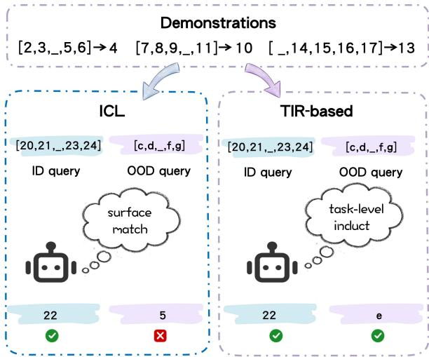  
Figure 1: ICL (left) surface-matches and fails OOD. TIR-based reasoning (right) induces a task-level rule that generalizes to both ID and OOD.

In comparison, human concept learning can infer compact, program-like rules from very few examples (Lake et al., 2015), suggesting an inductionbefore-straight-answering pattern even on unfamiliar tasks. We refer to this cross-task TIR inference capability as meta-induction. Recent work finds that LLMs are weak at this capability (Li et al., 2025), as their inductive behavior is dominated by neighbor-based matching rather than reusable abstract rules. However, instilling this capacity in LLMs presents two challenges: i) ensuring metainduction generalizes across tasks without overfitting to instance-specific patterns or task-local rules; ii) learning TIR in the absence of ground-truth labels and established evaluation criteria.

To address these challenges, we propose Cognitively Decoupled meta-Induction (CoDI), a TIR-based inductive reasoning method on general tasks. As shown in Figure 2, CoDI comprises a Cognitive-Decoupling Framework and Dual-Loop Meta-Inductive Learning method. In the Cognitive-Decoupling Framework, a query-blind inducer induces TIR solely from demonstrations, and an executor executes TIR for each query. Based on the above framework, Dual-Loop Meta-Inductive Learning optimizes the inducer across tasks via meta-RL, guided by execution feedback without ground-truth TIR labels, where an inner loop applies candidate TIR and an outer loop refines induction via two complementary rewards for extrinsic correctness and intrinsic certainty.

Experiments on BBH (Suzgun et al., 2023), BIG-Bench (Srivastava et al., 2023), MATH-500 (Lightman et al., 2024), StrategyQA (Geva et al., 2021), and ReClor (Yu et al., 2020) show that CoDI (Qwen3-4B) outperforms ICL on in-distribution (ID) and out-of-distribution (OOD) evaluations. On BIG-Bench, CoDI achieves +120% and +18% gains on ID and OOD splits, respectively. Furthermore, a smaller trained inducer surpasses a larger untrained one on OOD tasks, confirming TIR quality as an independently optimizable capability orthogonal to model scale. Notably, OOD gains persist even without the induction step at inference, indicating that meta-inductive training internalizes inductive priors into model parameters.

In summary, our contributions are as follows:

• We formulate TIR-based inductive reasoning as a learning problem that requires inferring reusable task rules from support examples alone before execution.

• We present CoDI to instill meta-induction without TIR supervision, decoupling rule induction from straight answering and optimizing inducers across tasks via reinforcement learning on execution feedback.

• Experiments on five benchmarks show CoDI outperforming few-shot ICL in- and out-ofdistribution, with smaller trained inducers beating larger untrained ones and OOD gains persisting without inference-time induction.

## 2 Problem Statement

In this section, we formalize the task of TIR-based inductive reasoning.

Notation. Let T denote a task space. Each task $\tau \sim P ( \mathcal { T } )$ has a K-shot demonstration set $\mathcal { D } _ { \mathrm { s u p p } } ^ { ( \tau ) } = \{ ( x _ { i } , y _ { i } ) \} _ { i = 1 } ^ { K }$ and query set ${ \mathcal { D } } _ { \mathrm { q r y } } ^ { ( \tau ) }$ of pairs $( x , y ^ { * } )$ . The TIR of τ is a natural-language strategy s induced from $\mathcal { D } _ { \mathrm { s u p p } } ^ { ( \tau ) }$ , and $\pi _ { \mathrm { i n d } }$ denotes the inducer policy, where ind abbreviates inducer.

Task. Given $\mathcal { D } _ { \mathrm { s u p p } } ^ { ( \tau ) }$ and query x, TIR-based inductive reasoning samples $s \sim \pi _ { \mathrm { i n d } } ( \cdot \mid \mathcal { D } _ { \mathrm { s u p p } } ^ { ( \tau ) } )$ as the TIR and uses an executor to predict ${ \hat { y } } ( s , x )$ for $y ^ { * }$ . The optimization objective is

$$
\begin{array} { r l } & { \mathcal { I } = \underset { \pi _ { \mathrm { i n d } } } { \operatorname* { m a x } } ~ \mathbb { E } _ { \tau , \mathcal { D } _ { \mathrm { s u p p } } ^ { ( \tau ) } , ( x , y ^ { * } ) } \bigg [ } \\ & { \quad \quad \mathbb { E } _ { s \sim \pi _ { \mathrm { i n d } } ( \cdot | \mathcal { D } _ { \mathrm { s u p p } } ^ { ( \tau ) } ) } \big [ \mathbf { 1 } \big [ \hat { y } ( s , x ) = y ^ { * } \big ] \big ] \bigg ] . } \end{array}\tag{1}
$$

where 1[·] is the indicator function, the outer expectation is over tasks, supports, and queries, and the inner expectation is over $s \sim \pi _ { \mathrm { i n d } }$

## 3 CoDI

In this section, we present the proposed CoDI for TIR-based inductive reasoning, built on a cognitivedecoupling architecture (§3.2) and a dual-loop meta-inductive learning scheme (§3.3).

## 3.1 Overview

The proposed CoDI employs a cognitivedecoupling induction–execution framework: the query-blind inducer abstracts TIR and the executor solves new query based on it. To enhance the inductive reasoning ability for general tasks, a dual-loop meta-inductive learning approach is proposed: the inner loop is executed based on TIR, and improves answers through ICL; the outer loop is based on the feedback signal from the inner loop execution, and optimizes the abstraction of TIR through RL. This design is overviewed in Figure 2.

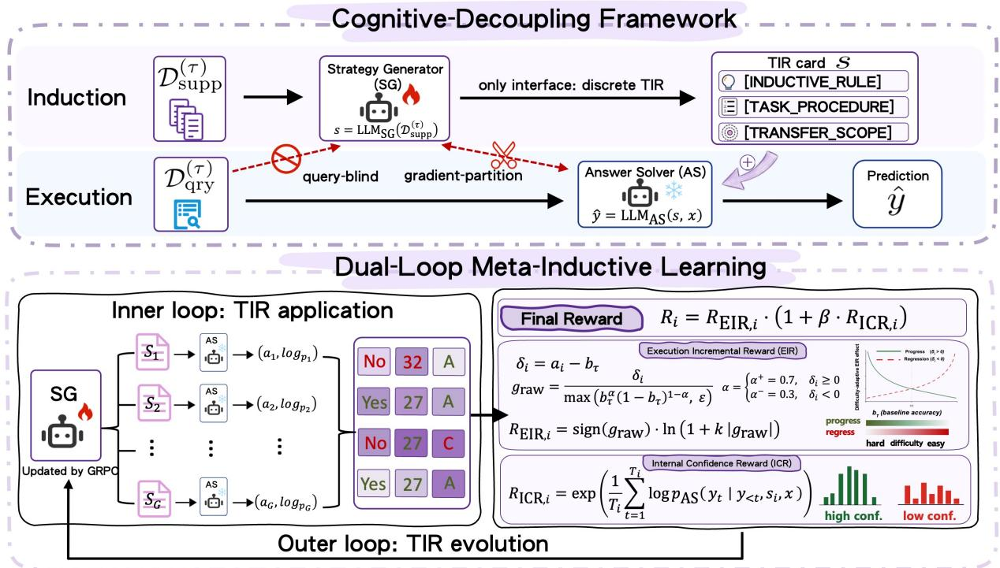  
Figure 2: Overview of CoDI. The Cognitive-Decoupling Framework induces query-blind TIR with SG and executes each query with AS. Dual-Loop Meta-Inductive Learning applies candidate TIRs in the inner loop and optimizes SG across tasks in the outer loop via GRPO with EIR and ICR.

## 3.2 Cognitive-Decoupling Framework

CoDI cognitively decouples induction and execution through two modules. The Strategy Generator (SG) induces TIR from few-shot demonstrations alone, and the Answer Solver (AS) answers each query by executing the TIR.

Inducer (SG). The SG induces a naturallanguage strategy s from $\mathcal { D } _ { \mathrm { s u p p } } ^ { ( \tau ) }$ alone, where s serves as the TIR of task τ. The query-blind interface isolates reusable task regularities from query-specific cues. Specifically, s comprises [INDUCTIVE\_RULE], [TASK\_PROCEDURE] (3–6 executable steps), and [TRANSFER\_SCOPE] (Appendix B). Each section plays a distinct role: [INDUCTIVE\_RULE] states verifiable task-family regularities; [TASK\_PROCEDURE] operationalizes them as executable steps; and [TRANSFER\_SCOPE] specifies applicability boundaries. This semistructured format yields comparable rollouts across candidates and enables format validation during training. The induction step is formalized as

$$
s = \mathrm { L L M } _ { \mathrm { S G } } ( \mathcal { D } _ { \mathrm { s u p p } } ^ { ( \tau ) } ) .\tag{2}
$$

Executor (AS). The AS applies s to query x via the concatenated prompt $( s , x )$ . It remains frozen throughout training; gradient partitioning blocks

back-propagation to SG, so SG is updated only through the discrete strategy interface. The execution step is formalized as

$$
\begin{array} { r } { \hat { y } = \operatorname { L L M } _ { \mathrm { A S } } ( s , x ) . } \end{array}\tag{3}
$$

Gradient partitioning confines updates to πSG. Without this barrier, gradients from queryconditioned execution would leak into the inducer and blur the TIR interface, conflating reusable task regularities with instance-specific matching. Because AS remains frozen, execution accuracy reflects each TIR’s transfer value rather than coadaptation between modules.

## 3.3 Dual-Loop Meta-Inductive Learning

Building on the cognitive-decoupling framework, dual-loop meta-inductive learning evolves TIR when no strategy labels are available. Execution under a frozen AS provides a weak, task-agnostic supervision signal for πSG. πSG is first warmed up via SFT on teacher demonstrations to satisfy the schema. During RL, format-invalid rollouts receive zero reward and are excluded from AS execution.

Inner loop: TIR application. At each training step, SG induces G TIR candidates $\{ s _ { i } \} _ { i = 1 } ^ { G }$ from the support set $\mathcal { D } _ { \mathrm { s u p p } } ^ { ( \tau ) }$ . The frozen AS applies each $s _ { i }$ to query x through in-context prompting on $( s _ { i } , x )$ , without updating parameters. This step tests whether each induced TIR generalizes beyond the few-shot demonstrations. Execution yields a prediction and per-token log-probabilities; the resultant accuracy $a _ { i }$ and decoding distribution serve as reward signals for the outer loop.

Outer loop: TIR evolution. The outer loop optimizes $\pi _ { \mathrm { S G } }$ via cross-task GRPO with two complementary rewards:

• Execution Incremental Reward (EIR) measures difficulty-adaptive accuracy gain. Let $a _ { i } \in$ [0, 1] be the answer accuracy of AS under $s _ { i } ,$ $\delta _ { i } = a _ { i } - b _ { \tau }$ its deviation from a per-task cached baseline $b _ { \tau }$ (fixed before the G-rollout group; updated via exponential moving average to prevent within-group leakage), and $g _ { \mathrm { r a w } }$ the difficultynormalized gain (log-smoothing constant k; Appendix F):

$$
\delta _ { i } = a _ { i } - b _ { \tau } , \quad g _ { \mathrm { r a w } } = \frac { \delta _ { i } } { \operatorname* { m a x } \left( b _ { \tau } ^ { \alpha } ( 1 - b _ { \tau } ) ^ { 1 - \alpha } , \ \varepsilon \right) }\tag{4}
$$

where $\alpha = \alpha ^ { + }$ if $\delta _ { i } \geq 0$ , else $\alpha ^ { - } \ ( \alpha ^ { + } > \alpha ^ { - } ;$ Appendix A.3):

$$
R _ { \mathrm { E I R } , i } = \mathrm { s i g n } ( g _ { \mathrm { r a w } } ) \cdot \ln ( 1 + k | g _ { \mathrm { r a w } } | ) .\tag{5}
$$

For positive $\delta _ { i } ,$ , EIR sets $\alpha { = } \alpha ^ { + }$ , down-weighting gains on easy tasks; for negative $\delta _ { i } .$ it sets $\alpha { = } \alpha ^ { - }$ amplifying penalties on high-baseline regressions (Appendix A.3).

• Internal Confidence Reward (ICR) measures the extent to which $s _ { i }$ concentrates AS’s decoding distribution, distinguishing systematic accuracy from chance-level correctness. RICR,i ∈ (0, 1] is the geometric mean of per-token probabilities under AS, normalized by output length $T _ { i }$

$$
R _ { { \mathrm { I C R } } , i } = \exp \Bigl ( \frac { 1 } { T _ { i } } \sum _ { t = 1 } ^ { T _ { i } } \log p _ { \mathrm { A S } } \bigl ( y _ { t } \mid y _ { < t } , s _ { i } , x \bigr ) \Bigr ) .\tag{6}
$$

EIR and ICR are combined via multiplicative gating:

$$
R _ { i } = R _ { \mathrm { E I R } , i } \cdot \big ( 1 + \beta \cdot R _ { \mathrm { I C R } , i } \big ) ,\tag{7}
$$

where $\beta$ is set in Appendix F. The factor $( 1 + \beta R _ { \mathrm { I C R } , i } ) > 0$ up-weights positive EIR proportionally to prediction confidence without reversing the sign of negative EIR. EIR normalizes rewards by per-task difficulty so that πSG is not biased toward easy tasks. ICR complements EIR by up-weighting strategies whose frozen AS decoding is concentrated, separating systematic correctness from lucky hits. Together, EIR and ICR supply complementary, label-free signals for metainductive training; the full SFT→RL pipeline and hyperparameters are in Appendix A.

## 4 Experiments

## 4.1 Experimental Setup

Baselines. FS (few-shot ICL) prepends K demonstrations for decoding (Dong et al., 2024). S-FS (strategy-based few-shot; untrained-inducer baseline) induces a strategy before straight answering (Gao et al., 2024), sharing the query-blind interface without cross-task RL. MetaICL (Min et al., 2022a) performs cross-task meta-training under equal compute without explicit induction. GEPA (Agrawal et al., 2026) performs inferencetime prompt optimization. Gemini-3-flash and GPT-5 are closed-source upper bounds. See Appendix A for details.

Datasets and Metrics. Training data are drawn from StrategyBench (Tan et al., 2026), a curated subset of BIG-Bench (Srivastava et al., 2023) filtered according to five inducibility criteria (Appendix I.1) using Qwen3-32B scoring with author spot-checks. We use execution-filtered demonstrations from this corpus for SFT (Appendix I). Evaluation covers BIG-Bench ID/OOD splits (Appendix J), BBH (Suzgun et al., 2023), MATH-500 (Lightman et al., 2024), StrategyQA (Geva et al., 2021), and ReClor (Yu et al., 2020), with exact-match accuracy throughout. ∆% denotes relative change from the same-backbone FS baseline: $\Delta = ( \mathrm { s c o r e - F S ) / F S \times 1 0 0 \% }$ ; absolute accuracy differences are reported in percentage points (pp); Avg. in Table 1 averages the five benchmarks.

## 4.2 Main Results

To isolate what enables transferable TIR, we compare methods in Table 1 and obtain three findings.

Cross-task training alone cannot yield TIR. Under equal training budgets, MetaICL scores below the untrained FS baseline on OOD and trails CoDI by over 34 points, showing cross-task parameter updates alone fail to produce reusable tasklevel strategies. GEPA improves over FS on indistribution tasks, but its gains derive from queryconditioned prompt evolution rather than querydecoupled strategy induction, placing it structurally apart from the reusable TIR that CoDI targets.

<table><tr><td rowspan="2">Model</td><td rowspan="2">Method BBH (∆%)</td><td rowspan="2"></td><td colspan="2">BIG-Bench</td><td rowspan="2"></td><td rowspan="2">MATH-500 (∆%) StratQA (∆%)</td><td rowspan="2">ReClor (∆%)</td><td rowspan="2">Avg.</td></tr><tr><td>ID (∆%)</td><td>OOD (∆%)</td></tr><tr><td rowspan="5">wWvfin ing</td><td>Gemma-3-4B</td><td>FS S-FS</td><td>37.41 25.00-33%</td><td>26.00 18.33-30%</td><td>45.00 28.00-38%</td><td>54.00 60.00+11.1%</td><td>58.95 59.97+1.7%</td><td>48.00 46.40-3.3%</td><td>44.89 39.62</td></tr><tr><td>Qwen3-4B</td><td>FS S-FS GEPA§</td><td>35.56 27.78-22%</td><td>29.33 30.00+2%</td><td>53.33 38.33-28%</td><td>63.13 65.20+3.3%</td><td>69.97 64.19-8.3%</td><td>83.60 81.20-2.9%</td><td>55.82 51.12</td></tr><tr><td>Llama-3.1-8B</td><td>FS S-FS</td><td>79.59 31.11 21.30-32%</td><td>61.65 20.00 13.33-33%</td><td>56.88 44.33</td><td>61.20 43.40</td><td>71.32 70.60</td><td>79.80 39.40</td><td>68.41 41.47</td></tr><tr><td>Gemini-3-flash†</td><td>FS S-FS</td><td>95.37</td><td>84.67</td><td>23.00-48% 84.00</td><td>37.80-12.9% 65.93</td><td>53.13-24.7% 83.50</td><td>40.60+3.0% 84.53</td><td>31.53 83.00</td></tr><tr><td>GPT-5†</td><td>FS</td><td>91.67-4% 94.44</td><td>76.00-10%  $\begin{array} { c } { 8 0 . 3 3 } \\ { 6 3 . 0 0 - 2 2 \% } \end{array}$ </td><td>78.67-6% 73.67</td><td>60.60-8.1% 71.40</td><td>87.29+4.5% 85.54</td><td>85.00+0.6% 97.93</td><td>79.87 83.89</td></tr><tr><td rowspan="4">W/uining</td><td>Gemma-3-4B</td><td>S-FS FS</td><td>88.89-6% 40.00+7%</td><td> $4 3 . 0 0 + 6 5 \%$ </td><td>61.67-16%  $\frac { 5 0 . 3 3 + 1 2 \% } { 5 5 . 6 7 + 2 4 \% }$ </td><td>68.00-4.8%  $6 1 . 6 0 + 1 4 . 1 \%$ </td><td>97.93+14.5% 69.72+18.3%</td><td>98.00+0.1% 49.20+2.5%</td><td>79.58 50.36</td></tr><tr><td>Qwen3-4B</td><td>CoDI FS CoDI</td><td>42.67+14% 40.93+15% 82.22+131% 64.67+120%</td><td>41.33+41%</td><td>55.56+4.2% 63.00+18%</td><td>65.80+4.2% 76.15+20.6%</td><td>67.98+15.3%  $\begin{array} { c } { { 7 3 . 5 3 + 5 . 1 \% } } \\ { { 7 7 . 4 4 + 1 0 . 7 \% } } \\ { { 5 8 . 9 5 } } \end{array}$ </td><td>65.60+36.7% 85.80+2.6% 86.60+3.6%</td><td>56.19 60.49</td></tr><tr><td>Llama-3.1-8B</td><td>MetaICL FS</td><td>33.52 32.22+4%</td><td>32.00 22.11+11%</td><td>28.67 45.56+3%</td><td>16.80 50.00+15.2%</td><td>81.51+15.5%</td><td>72.00 45.60+15.7%</td><td>75.01 40.32</td></tr><tr><td></td><td>CoDI</td><td>41.67+34%</td><td>23.00+15%</td><td>48.33+9%</td><td>47.80+10.1%</td><td>73.94+4.7%</td><td>48.00+21.8%</td><td>46.17 47.12</td></tr></table>

Table 1: Exact-match accuracy comparing CoDI with FS, S-FS, GEPA, MetaICL, and closed-source APIs on BBH, BIG-Bench ID/OOD, MATH-500, StrategyQA, and ReClor (w/o and w/ training). ∆%= (score − FS)/FS × 100; red/blue = gain/loss. †Unfine-tuned; Gemini-3-flash = gemini-3-flash-preview. §GEPA: gemini-3-flash-preview optimizer, Qwen3-4B executor, four reflective iterations.

Query-blind interface alone is insufficient. To disentangle interface from meta-inductive training, we compare S-FS with FS under the same backbone. S-FS retains CoDI’s query-blind interface but excludes cross-task RL. On OOD, S-FS trails FS across all three backbones and remains far below trained CoDI, showing query-blind decoupling alone is insufficient for generalizable TIR.

Explicit TIR-aligned training drives gains. CoDI consistently outperforms all baselines under full TIR-aligned training. On Qwen3-4B, it raises OOD accuracy by +18% over the untrained FS baseline, with especially pronounced gains on BBH and BIG-Bench ID. Positive OOD improvements hold across all three open-source backbones and extend to MATH-500, StrategyQA, and ReClor. These results confirm that optimizing explicitly for TIR generalizes task-level strategy induction across diverse backbones and domains.

## 4.3 Ablation Study

To verify what drives generalizable TIR, we ablate core components on Qwen3-4B (Table 2, 3).

Reward design and training pipeline. We analyze the effect of reward design, training stages, and architectural decoupling on Qwen3-4B. As shown in Table 2, the full model achieves 63.00 OOD accuracy. Removing ICR preserves ID but reduces OOD by 9.3 pp, indicating ICR supports cross-task generalization. Without EIR, ID falls to 49.00, as rewards without difficulty-adaptive normalization conflate task difficulty with strategy quality. Rawaccuracy and LLM-judge rewards, SFT-only training, and end-to-end non-decoupled training all trail substantially, indicating that neither alternative rewards nor query-coupled optimization suffices for generalizable TIR induction.

<table><tr><td>Configuration</td><td>ID</td><td>BBH</td><td>OOD</td></tr><tr><td>CoDI (EIR+ICR, full)</td><td>64.67</td><td>82.22</td><td>63.00</td></tr><tr><td>Reward component ablation</td><td></td><td></td><td></td></tr><tr><td>w/o ICR (β=0, EIR only)</td><td>62.67</td><td>69.81</td><td>53.67</td></tr><tr><td>w/o EIR (ICR only)</td><td>49.00</td><td>69.07</td><td>53.67</td></tr><tr><td>w/ raw Acc reward</td><td>31.67</td><td>48.15</td><td>56.67</td></tr><tr><td>w/ LLM Judge reward</td><td>49.00</td><td>69.44</td><td>57.33</td></tr><tr><td>Training pipeline ablation</td><td></td><td></td><td></td></tr><tr><td>w/o SFT (RL only)</td><td>60.67</td><td>78.70</td><td>55.00</td></tr><tr><td>w/o RL (SFT only)</td><td>31.67</td><td>33.89</td><td>40.00</td></tr><tr><td>Decoupled architecture</td><td></td><td></td><td></td></tr><tr><td>w/o decoupled arch. (e2e training)</td><td>33.67</td><td>38.52</td><td>40.33</td></tr></table>

Table 2: Qwen3-4B component ablations.

Strategy format. Table 3 compares TIR formats; the semi-structured schema outperforms free-form and CoT-style alternatives on ID, BBH, OOD, and ICR. Removing [TASK\_PROCEDURE] collapses OOD to 2.67, the largest impact among its three sections; ablating [INDUCTIVE\_RULE] or [TRANSFER\_SCOPE] lowers OOD by over 20 pp each, showing that both the induced rule and transfer scope are required for generalization.

<table><tr><td>Strategy Format</td><td>ID</td><td>BBH</td><td>OOD</td><td>ICR</td></tr><tr><td>CoDI (semi-structured)</td><td>64.67</td><td>82.22</td><td>63.00</td><td>84.73</td></tr><tr><td>Free-form (no schema)</td><td>46.00</td><td>53.52</td><td>40.00</td><td>75.59</td></tr><tr><td>CoT-style (implicit structure)</td><td>59.56</td><td>72.84</td><td>49.33</td><td>75.57</td></tr><tr><td colspan="3">Semi-structured section ablation</td><td></td><td></td></tr><tr><td>w/o [INDUCTIVE_RULE]</td><td>42.33</td><td>49.44</td><td>39.67</td><td>74.27</td></tr><tr><td>w/o [TASK_PROCEDURE]</td><td>1.33</td><td>1.48</td><td>2.67</td><td>71.67</td></tr><tr><td>w/o [TRANSFER_SCOPE]</td><td>31.67</td><td>36.85</td><td>33.67</td><td>80.35</td></tr></table>

Table 3: Qwen3-4B ablation comparing alternative TIR formats and individual schema sections.

## 5 Analysis

## 5.1 What Drives the Gains?

Gains exceed scale. Analysis reveals that OOD improvements primarily reflect TIR optimization rather than pretrained capacity alone. With AS fixed to Qwen3-4B, untuned SG OOD accuracy rises from 0.12 (1.7B) to 0.57 (32B), confirming that scale remains helpful. Trained CoDI-4B nonetheless reaches 0.62 and exceeds the 32B baseline by 9% despite 8× fewer parameters (Figure 3). Because the gap persists after untuned scaling saturates, TIR quality functions as a distinct optimization target orthogonal to model size.

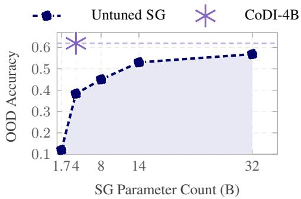  
Figure 3: Trained CoDI-4B exceeds untuned 32B SG on BIG-Bench OOD with 8× fewer parameters.

Induction becomes cross-example. We next test whether CoDI induces rules from multiple supports rather than copying individual examples. If rules still depended on single demonstrations, leave-one-out (LOO) removal should strongly alter [INDUCTIVE\_RULE] semantics. On matched evaluation tasks, we regenerate each induced rule after removing one of K=3 supports and measure embedding shift (Appendix H). Mean LOO sensitivity drops from 0.325 to 0.087 across 10 task types (Figure 4). Accordingly, the gains reflect cross-example abstraction rather than instance memorization.

<table><tr><td rowspan="5"></td><td colspan="2">Pre-CoDI (base model)</td><td colspan="2">-73.4%</td><td colspan="3">7 Post-CoDI (CoDI fine-tuned)</td><td>LOO</td></tr><tr><td>Ex1</td><td>Ex2</td><td>Ex3</td><td></td><td>Ex1</td><td>Ex2</td><td>Ex3</td><td>sensitivity</td></tr><tr><td>T01</td><td>0.459</td><td>0.445</td><td>0.500</td><td>0.082</td><td>0.088</td><td>0.085</td><td>0.5</td></tr><tr><td>T02</td><td>0.452</td><td>0.500</td><td>0.455</td><td>0.170</td><td>0.176</td><td>0.181</td><td>_</td></tr><tr><td>T03</td><td>0.353</td><td>0.377</td><td>0.364</td><td>0.081</td><td>0.080</td><td>0.088</td><td>0.4</td></tr><tr><td>T04</td><td>0.288</td><td>0.295</td><td>0.304</td><td>0.054</td><td>0.051</td><td>0.060</td><td></td></tr><tr><td>T05</td><td>0.281</td><td>0.275</td><td>0.302</td><td>0.065</td><td>0.070</td><td>0.062</td><td>0.3</td></tr><tr><td>T06</td><td>0.325</td><td>0.304</td><td>0.357</td><td>0.117</td><td>0.122</td><td>0.114</td><td></td></tr><tr><td>T07</td><td>0.247</td><td>0.265</td><td>0.232</td><td>0.039</td><td>0.039</td><td>0.039</td><td>0.2</td></tr><tr><td>T08</td><td>0.282</td><td>0.290</td><td>0.272</td><td>0.087</td><td>0.083</td><td>0.089</td><td></td></tr><tr><td>T09</td><td>0.248</td><td>0.245</td><td>0.245</td><td>0.071</td><td>0.064</td><td>0.073</td><td>0.1</td></tr><tr><td>T10</td><td>0.270</td><td>0.255</td><td>0.273</td><td>0.093</td><td>0.097</td><td>0.082</td><td></td></tr><tr><td colspan="4">mean = 0.325</td><td colspan="3">mean = 0.087</td><td>0.0</td></tr></table>

Figure 4: Mean LOO rule sensitivity drops 73.4% after training, supporting cross-example abstraction.

## 5.2 What Does Meta-Induction Reshape?

Reasoning turns rule-directed. OOD gains cooccur with shorter, rule-directed traces rather than longer CoT. Unlike the main protocol (Table 1), mechanistic analysis uses thinking-enabled ICL on a trace-paired matched OOD subset, labeling <think> spans with E/D/P/R units (Appendix D). On this subset, OOD accuracy rises 104% while trace length falls 21%; example-recitation units fall 51% and D→P transitions rise 42% (Figure 5), indicating demonstrations anchor rule formation rather than copied text. Varying K on BIG-Bench OOD (Figure 6), CoDI leads by 12 pp at K=1 but the margin narrows with more demonstrations, so OOD gains reflect a parametric meta-inductive prior rather than richer contexts alone.

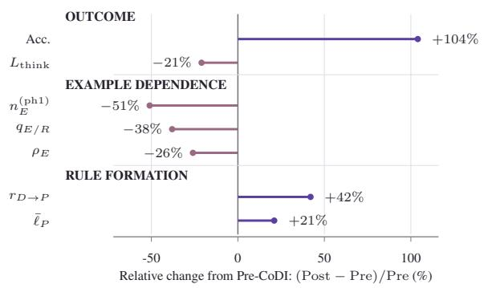  
Figure 5: Post-CoDI raises OOD accuracy while shortening traces and example recitation, refuting a lengthdriven account and supporting rule-directed reasoning.

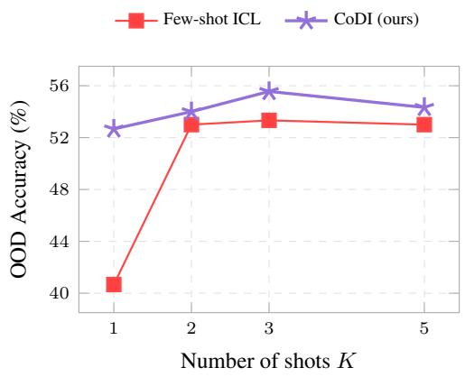  
Figure 6: BIG-Bench OOD accuracy (%) vs. shot count K on Qwen3-4B (CoDI vs. few-shot ICL). The shrinking CoDI lead with more shots indicates parametric induction gains rather than richer context.

Strategies favor rule-based modes. We further find that performance gains concentrate on ruleoriented induction modes rather than extending uniformly across all strategy types. Gemini-3- flash scores Pre- and Post-CoDI strategies on six induction dimensions (Appendix C). Post-CoDI improves on Constraint, Procedural and Schema but declines on Analogical and Pattern (Figure 7). This asymmetric split is consistent with classic distinctions between rule- and schema-based induction and analogical mapping (Holland et al., 1986; Gentner, 1983); we treat pattern extrapolation as an operational category, and CoDI’s execution feedback further biases the inducer toward explicit procedures. Accordingly, the Analogical and Pattern declines mark a disclosed capability boundary rather than a uniform claim of meta-inductive superiority across all reasoning types. Taken together with the trace analysis, the shifts support rule-driven over example-recitation induction.

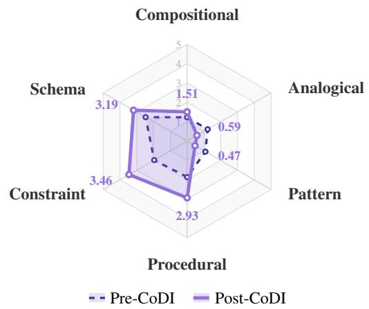  
Figure 7: Radar chart of Pre- and Post-CoDI strategy scores on six induction modes (Gemini-3-flash).

Case study. Table 4 instantiates the trace and induction-mode shifts above on one BIG-Bench Navigate episode with K=3 supports and a test query unseen in the supports. FS treats the query as most similar to Ex3 and reuses its Yes label, which aligns with the example-recitation pattern in Figure 5 and with surface matching in §1. S-FS induces a strategy without seeing the query, yet its rule restates the Ex3 trajectory and yields the same wrong Yes answer, so query-blind decoupling alone does not yield a task-family rule. CoDI abstracts coordinate updates verified on all three supports and executes them to reach (2, 2), which yields the correct No answer and aligns with the Procedural and Constraint gains in Figure 7. Accordingly, this case supports the hypothesis that generalization to unseen instances depends on rules verified across all supports rather than on query decoupling or surface matching alone.

## 5.3 What Do Induced Strategies Achieve?

Correctness and transferability lead. We assess induced strategy quality by comparing CoDI-Qwen3-4B and GPT-5 strategies via pairwise GPT-5 judgments on four dimensions (Appendix C; Figure 8). CoDI is preferred on Correctness and especially Transferability, indicating that label-free RL yields portable, execution-grounded TIR. Under the same objective, Executability and Conciseness are less favored because CoDI optimizes transferable rules for a fixed 4B executor rather than GPT-5-native phrasing, and GPT-5 self-judging may amplify this asymmetry (§7).

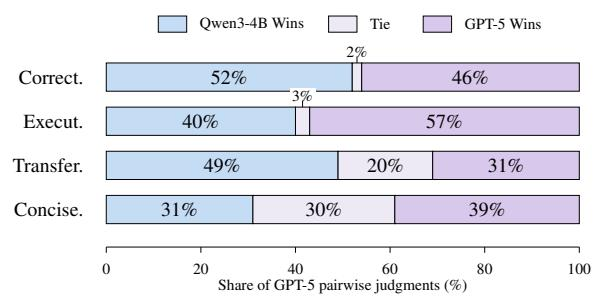  
Figure 8: Pairwise GPT-5 judgments favor CoDI on Correctness and Transferability but not on Executability or Conciseness, defining the polish-oriented boundary of RL-optimized TIR.

Gains transfer to OOD execution. Analysis reveals that induced strategies raise OOD accuracy under a fixed solver, with the largest margins on rule-transfer-critical task types and limited gains where baselines already saturate. We hold Qwen3- 4B AS fixed and vary only strategy source across five OOD types (Table 5). CoDI achieves the largest margin on Ctx.Param.Conf. (+15.0 pp over the best closed-source baseline). On Elem.Math, Track.Shuf., and Bool.Expr., gains are modest because strong closed-source FS baselines already approach ceiling performance. These patterns nevertheless show that label-free induced TIR improves a fixed 4B executor most where portable rules are essential, confirming transfer beyond training tasks. Details appear in Appendix G.

<table><tr><td colspan="2">Few-shot (K=3). BIG-Bench Navigate; decide return to  ${ \mathrm { o r i g i n . } }$   $\mathrm { E x 1 } \ \mathrm { N } 2 , \mathrm { S } 2 \mathrm {  Y e s } ; \mathrm { E x 2 } \ \mathrm { E } 3 , \mathrm { W } 3 \mathrm {  Y e s } ;$ </td><td colspan="2">Test query. N4,S2,E3,W1. Move combination unseen in supports; return to start? Gold No (final  $( 2 , 2 ) \neq ( 0 , 0 ) )$ </td></tr><tr><td colspan="2">Ex3 N1,S1,E2,W2→Yes (4 moves, returns). Method</td><td></td><td>Pred. Behavior</td></tr><tr><td>FS</td><td colspan="2">Solving process Compare query with all supports in context. Select Ex3 as the nearest match (four moves). Reuse the Yes Yes label from Ex3 without coordinate tracking. Apply an action-count shortcut rather than origin X logic, never checking whether the final position returns to (0, 0).</td><td>surface matching</td></tr><tr><td></td><td colspan="2">S-FS Induce a strategy from supports only without seeing the query. Rule text states track N/S/E/W and test Yes the origin. At solve time, pattern-matches the test query to Ex3 and copies that move sequence instead ¬x</td><td>example recitation</td></tr><tr><td></td><td colspan="2">of applying the rule. Output Yes without independent coordinate calculation or endpoint verification. CoDI SG induces a coordinate rule verified on Ex1–Ex3. AS initializes (0, 0) and parses four instructions. No Updates coordinates to (0, 4), (0, 2), (3, 2), and (2, 2). Tests  $( 2 , 2 ) \neq ( 0 , 0 )$  and outputs No. √</td><td>task-level regularity</td></tr></table>

Table 4: Navigate case study on a matched BIG-Bench Navigate episode $( K { = } 3 ;$ untrained FS/S-FS, trained CoDI, Qwen3-4B). Rows compare solver processes on the same episode. ✗/✓mark incorrect and correct predictions.

<table><tr><td>Task Type</td><td>Gem.-Flash FS/S-FS</td><td>GPT-5 FS/S-FS</td><td>Qw3-4B (CoDI)</td></tr><tr><td>Ctx.Param.Conf.</td><td>75.00/65.00</td><td>70.00/65.00</td><td>90.00</td></tr><tr><td>VitaminC</td><td>85.00/80.00</td><td>65.00/40.00</td><td>78.33</td></tr><tr><td>Elem.Math</td><td>99.00/89.00</td><td>95.00/75.00</td><td>97.67</td></tr><tr><td>Track.Shuf.</td><td>100.00/91.67</td><td>85.00/90.00</td><td>99.44</td></tr><tr><td>Bool.Expr.</td><td>90.00/95.00</td><td>100.00/85.00</td><td>98.33</td></tr></table>

Table 5: CoDI-induced strategies yield the largest OOD gains on rule-transfer-critical types under a fixed Qwen3-4B AS.

## 6 Related Work

Meta-learning and in-context adaptation. MAML (Finn et al., 2017) adapts parameters via gradient updates without explicit cross-instance strategies. MetaICL (Min et al., 2022a) likewise meta-trains in-context learning at the parameter level. Mirage (Li et al., 2025) shows that ICL often follows neighbor-based matching rather than recovering reusable abstract rules. Motivated by these limitations, our work introduces a Cognitive-Decoupling Framework for discrete, query-blind TIR, decoupling induction from frozen execution.

Induction from examples and prompt optimization. StrategyLLM (Gao et al., 2024) induces and selects task-level strategies, while Self-Discover (Zhou et al., 2024) composes reasoning structures for prompted tasks. Induct-Learn (Chen et al., 2024) and LEAP (Zhang et al., 2024) derive instructions or principles from few-shot supports, but remain inference-time prompting methods rather than a trained cross-task inducer. CoT (Wei et al., 2022), STaR (Zelikman et al., 2022), and DeepSeek-R1 (Guo et al., 2025) improve reasoning traces or reasoning policies; GEPA (Agrawal et al., 2026) optimizes prompts via reflective search at the task level. Our work builds upon this broader paradigm with Dual-Loop Meta-Inductive Learning, optimizing query-blind TIR via cross-task RL and EIR×ICR feedback for reasoning episodes.

ICL under distribution shift. Standard ICL is highly sensitive to demonstration choice, format, label space, and input distribution, which can degrade under task-family or domain mismatch (Min et al., 2022b; Schoch and Ji, 2025; de Wynter, 2026). Inference-time remedies such as CCL (Byun et al., 2025) improve OOD robustness via domain-invariant demonstration selection but remain per-query interventions rather than training a reusable inducer. Mechanistic and theoretical work further suggests that OOD generalization in ICL depends strongly on task-distribution coverage, low-test-error preferences, and subspace alignment (Wang et al., 2025; Goddard et al., 2025; Kwon et al., 2026). In contrast, CoDI trains a query-blind inducer to learn transferable TIR from supports via cross-task RL, offering a reusable alternative to inference-time demonstration engineering for OOD few-shot generalization.

## 7 Conclusion

Few-shot OOD generalization demands explicit, optimizable task-level induction beyond execution scale. To this end, we presented CoDI, combining a Cognitive-Decoupling Framework for query-blind TIR with Dual-Loop Meta-Inductive Learning for label-free cross-task inducer optimization. Experiments show that neither parameter-level adaptation nor query-blind decoupling alone yields reusable TIR, yet TIR-aligned training drives systematic OOD gains across benchmarks. Accordingly, metainduction constitutes a trainable capability complementary to model scale. Future work may evaluate finer task-level shifts, strengthen analogical and pattern induction, and study strategy–solver co-adaptation across languages and modalities.

## Limitations

Computational cost. Each training episode requires G × M = 32 frozen AS forward passes, roughly 32× standard SFT compute. Training completes in 12–24 hours on 8×A800 GPUs; future work may reduce cost via adaptive rollout schedules, cached solver verification, or distillation from the trained SG.

Benchmark scope and confounds. We evaluate only on English text-reasoning benchmarks, leaving broader language, modality, and distribution shifts untested. Gemini-3-flash both proposes SFT strategies and annotates mechanistic traces, and ID/OOD splits share the StrategyBench construction pipeline, but GPT-5 cross-annotation (Appendix E) and gains on MATH-500, StrategyQA, and ReClor partially address these concerns.

Strategy–solver coupling. We fix AS during training and update SG via execution feedback for stable credit assignment. TIR is natural-language and interface-decoupled, yet effective quality depends on the training-time executor. Under a fixed executor (Table 5), substitution gains favor rulegoverned over analogical or pattern modes and support portable structure, while strategy–solver co-adaptation remains out of scope.

## Acknowledgments

This work is supported by the AI9Stars community, the Foundation of Muyuan Laboratory (Program ID: 11116022401), and the National Natural Science Foundation of China (Grant No. 32370095). Chaojun Xiao is supported by the China National Postdoctoral Program for Innovative Talents (grant no. BX20250388).

## References

Lakshya A Agrawal, Shangyin Tan, Dilara Soylu, Noah Ziems, Rishi Khare, Krista Opsahl-Ong, Arnav Singhvi, Herumb Shandilya, Michael J Ryan, Meng Jiang, Christopher Potts, Koushik Sen, Alexandros G. Dimakis, Ion Stoica, Dan Klein, Matei Zaharia, and Omar Khattab. 2026. GEPA: Reflective Prompt Evolution Can Outperform Reinforcement Learning. In International Conference on Learning Representations. ArXiv:2507.19457.

Tom Brown, Benjamin Mann, Nick Ryder, Melanie Subbiah, Jared D Kaplan, Prafulla Dhariwal, Arvind Neelakantan, Pranav Shyam, Girish Sastry, Amanda Askell, Sandhini Agarwal, Ariel Herbert-Voss, Gretchen Krueger, Tom Henighan, Rewon Child, Aditya Ramesh, Daniel Ziegler, Jeffrey Wu, Clemens Winter, and 12 others. 2020. Language models are few-shot learners. In Advances in Neural Information Processing Systems, volume 33, pages 1877–1901. Curran Associates, Inc.

Hoyoon Byun, Gyeongdeok Seo, Joonseong Kang, Taero Kim, Jihee Kim, and Kyungwoo Song. 2025. CCL: Causal-aware in-context learning for out-ofdistribution generalization. In Advances in Neural Information Processing Systems, volume 38.

Po-Chun Chen, Sheng-Lun Wei, Hen-Hsen Huang, and Hsin-Hsi Chen. 2024. Induct-learn: Short phrase prompting with instruction induction. In Proceedings of the 2024 Conference on Empirical Methods in Natural Language Processing, pages 5204–5231, Miami, Florida, USA. Association for Computational Linguistics.

Adrian de Wynter. 2026. Is in-context learning learning? In The Fourteenth International Conference on Learning Representations. ArXiv:2509.10414.

Qingxiu Dong, Lei Li, Damai Dai, Ce Zheng, Jingyuan Ma, Rui Li, Heming Xia, Jingjing Xu, Zhiyong Wu, Baobao Chang, Xu Sun, Lei Li, and Zhifang Sui. 2024. A survey on in-context learning. In Proceedings ofthe 2024 Conference on Empirical Methods in Natural Language Processing, pages 1107–1128.

Chrisantha Fernando, Dylan Sunil Banarse, Henryk Michalewski, Simon Osindero, and Tim Rocktäschel. 2024. Promptbreeder: Self-referential selfimprovement via prompt evolution. In Proceedings of the 41st International Conference on Machine

Learning, volume 235 of Proceedings of Machine Learning Research, pages 13481–13544. PMLR.

Chelsea Finn, Pieter Abbeel, and Sergey Levine. 2017. Model-agnostic meta-learning for fast adaptation of deep networks. In Proceedings ofthe 34th International Conference on Machine Learning, volume 70 of Proceedings of Machine Learning Research, pages 1126–1135. PMLR.

Chang Gao, Haiyun Jiang, Deng Cai, Shuming Shi, and Wai Lam. 2024. StrategyLLM: Large Language Models as Strategy Generators, Executors, Optimizers, and Evaluators for Problem Solving. In Neural Information Processing Systems.

Dedre Gentner. 1983. Structure-mapping: A theoretical framework for analogy. Cognitive Science, 7(2):155– 170.

Mor Geva, Daniel Khashabi, Elad Segal, Tushar Khot, Dan Roth, and Jonathan Berant. 2021. Did aristotle use a laptop? A question answering benchmark with implicit reasoning strategies. Transactions of the Association for Computational Linguistics, 9:346– 361.

Chase Goddard, Lindsay M. Smith, Vudtiwat Ngampruetikorn, and David J. Schwab. 2025. When can incontext learning generalize out of task distribution? In Proceedings ofthe 42nd International Conference on Machine Learning, volume 267 of Proceedings ofMachine Learning Research, pages 19585–19599. PMLR.

Google DeepMind. 2025a. Gemini 3 Flash Model Card. Model card. Experiments use the Google AI preview model ID gemini-3-flash-preview.

Google DeepMind. 2025b. gemma-3-4b-it. Hugging Face model.

Aaron Grattafiori, Abhimanyu Dubey, Abhinav Jauhri, Abhinav Pandey, Abhishek Kadian, Ahmad Al-Dahle, Aiesha Letman, Akhil Mathur, Alan Schelten, Alex Vaughan, Amy Yang, Angela Fan, Anirudh Goyal, Anthony Hartshorn, Aobo Yang, Archi Mitra, Archie Sravankumar, Artem Korenev, Arthur Hinsvark, and 542 others. 2024. The llama 3 herd of models. Preprint, arXiv:2407.21783.

Daya Guo, Dejian Yang, Haowei Zhang, Junxiao Song, Peiyi Wang, Qihao Zhu, Runxin Xu, Ruoyu Zhang, Shirong Ma, Xiao Bi, Xiaokang Zhang, Xingkai Yu, Yu Wu, Z. F. Wu, Zhibin Gou, Zhihong Shao, Zhuoshu Li, Ziyi Gao, Aixin Liu, and 175 others. 2025. Deepseek-r1 incentivizes reasoning in llms through reinforcement learning. Nature, 645(8081):633–638.

John H. Holland, Keith J. Holyoak, Richard E. Nisbett, and Paul R. Thagard. 1986. Induction: Processes of Inference, Learning, and Discovery. MIT Press, Cambridge, MA.

Soo Min Kwon, Alec S. Xu, Can Yaras, Laura Balzano, and Qing Qu. 2026. Out-of-distribution generalization of in-context learning: A low-dimensional subspace perspective. Preprint, arXiv:2505.14808. Accepted to AISTATS 2026.

Brenden M. Lake, Ruslan Salakhutdinov, and Joshua B. Tenenbaum. 2015. Human-level concept learning through probabilistic program induction. Science, 350(6266):1332–1338.

Jiachun Li, Pengfei Cao, Zhuoran Jin, Yubo Chen, Kang Liu, and Jun Zhao. 2025. MIRAGE: Evaluating and explaining inductive reasoning process in language models. In International Conference on Learning Representations (ICLR). ArXiv:2410.09542.

Hunter Lightman, Vineet Kosaraju, Yuri Burda, Harrison Edwards, Bowen Baker, Teddy Lee, Jan Leike, John Schulman, Ilya Sutskever, and Karl Cobbe. 2024. Let’s verify step by step. In International Conference on Learning Representations. ArXiv:2305.20050.

Meta. 2024. Llama-3.1-8B-Instruct. Hugging Face model.

Sewon Min, Mike Lewis, Luke Zettlemoyer, and Hannaneh Hajishirzi. 2022a. MetaICL: Learning to learn in context. In Proceedings of the 2022 Conference of the North American Chapter ofthe Associationfor Computational Linguistics: Human Language Technologies, pages 2791–2809, Seattle, United States. Association for Computational Linguistics.

Sewon Min, Xinxi Lyu, Ari Holtzman, Mikel Artetxe, Mike Lewis, Hannaneh Hajishirzi, and Luke Zettlemoyer. 2022b. Rethinking the role of demonstrations: What makes in-context learning work? In Proceedings ofthe 2022 Conference on Empirical Methods in Natural Language Processing, pages 11048–11064, Abu Dhabi, United Arab Emirates. Association for Computational Linguistics.

OpenAI. 2025. GPT-5 System Card. System card.

Stephanie Schoch and Yangfeng Ji. 2025. The good, the bad, and the debatable: A survey on the impacts of data for in-context learning. In Proceedings of the 2025 Conference on Empirical Methods in Natural Language Processing, pages 29798–29812, Suzhou, China. Association for Computational Linguistics.

Aarohi Srivastava, Abhinav Rastogi, Abhishek Rao, Abu Awal Md Shoeb, Abubakar Abid, Adam Fisch, Adam R. Brown, Adam Santoro, Aditya Gupta, Adrià Garriga-Alonso, Agnieszka Kluska, Aitor Lewkowycz, Akshat Agarwal, Alethea Power, Alex Ray, Alex Warstadt, Alexander W. Kocurek, Ali Safaya, Ali Tazarv, and 431 others. 2023. Beyond the imitation game: Quantifying and extrapolating the capabilities of language models. Transactions on Machine Learning Research. Featured Certification.

Mirac Suzgun, Nathan Scales, Nathanael Schärli, Sebastian Gehrmann, Yi Tay, Hyung Won Chung,

Aakanksha Chowdhery, Quoc V. Le, Ed H. Chi, Denny Zhou, and Jason Wei. 2023. Challenging BIG-Bench tasks and whether chain-of-thought can solve them. In Findings of the Association for Computa tional Linguistics: ACL 2023, pages 13003–13051.

Jinghan Tan, Yuanzheng Wang, Lu Chen, Zijun Chen, Yuqian Wang, and Maosong Sun. 2026. Strategy-Bench: Evaluating explicit strategy induction in large language models. Preprint, arXiv:2608.23475.

Gemma Team, Aishwarya Kamath, Johan Ferret, Shreya Pathak, Nino Vieillard, Ramona Merhej, Sarah Perrin, Tatiana Matejovicova, Alexandre Ramé, Morgane Rivière, Louis Rouillard, Thomas Mesnard, Geoffrey Cideron, Jean bastien Grill, Sabela Ramos, Edouard Yvinec, Michelle Casbon, Etienne Pot, Ivo Penchev, and 197 others. 2025. Gemma 3 technical report. Preprint, arXiv:2503.19786.

Qixun Wang, Yifei Wang, Xianghua Ying, and Yisen Wang. 2025. Can in-context learning really generalize to out-of-distribution tasks? In The Thirteenth International Conference on Learning Representations. ArXiv:2410.09695.

Jason Wei, Xuezhi Wang, Dale Schuurmans, Maarten Bosma, Brian Ichter, Fei Xia, Ed Chi, Quoc V Le, and Denny Zhou. 2022. Chain-of-thought prompting elicits reasoning in large language models. In Advances in Neural Information Processing Systems, volume 35, pages 24824–24837. Curran Associates, Inc.

An Yang, Anfeng Li, Baosong Yang, Beichen Zhang, Binyuan Hui, Bo Zheng, Bowen Yu, Chang Gao, Chengen Huang, Chenxu Lv, Chujie Zheng, Dayiheng Liu, Fan Zhou, Fei Huang, Feng Hu, Hao Ge, Haoran Wei, Huan Lin, Jialong Tang, and 41 others. 2025. Qwen3 technical report. Preprint, arXiv:2505.09388.

Qinyuan Ye, Harvey Fu, Xiang Ren, and Robin Jia. 2023. How predictable are large language model capabilities? a case study on BIG-bench. In Findings of the Association for Computational Linguistics: EMNLP 2023, pages 7493–7517, Singapore. Association for Computational Linguistics.

Weihao Yu, Zihang Jiang, Yanfei Dong, and Jiashi Feng. 2020. ReClor: A reading comprehension dataset requiring logical reasoning. In International Conference on Learning Representations.

Eric Zelikman, Yuhuai Wu, Jesse Mu, and Noah Goodman. 2022. Star: Bootstrapping reasoning with reasoning. In Advances in Neural Information Processing Systems, volume 35, pages 15476–15488. Curran Associates, Inc.

Tianjun Zhang, Aman Madaan, Luyu Gao, Steven Zheng, Swaroop Mishra, Yiming Yang, Niket Tandon, and Uri Alon. 2024. In-context principle learning from mistakes. Preprint, arXiv:2402.05403.

Pei Zhou, Jay Pujara, Xiang Ren, Xinyun Chen, Heng-Tze Cheng, Quoc V. Le, Ed H. Chi, Denny Zhou, Swaroop Mishra, and Huaixiu Steven Zheng. 2024. SELF-DISCOVER: Large language models self-compose reasoning structures. In Advances in Neural Information Processing Systems, volume 37. NeurIPS 2024 Main Conference Track; arXiv:2402.03620.

Yongchao Zhou, Andrei Ioan Muresanu, Ziwen Han, Keiran Paster, Silviu Pitis, Harris Chan, and Jimmy Ba. 2023. Large Language Models Are Human-Level Prompt Engineers. In International Conference on Learning Representations. ArXiv:2211.01910.

## A Implementation Details

Pretrained backbones and source datasets follow their public licenses (Qwen3, Llama 3.1, Gemma 3, and BIG-Bench). CoDI training code is linked in the abstract and released under the MIT License. StrategyBench construction scripts and task-level splits are given in Appendix I.

## A.1 Models, Evaluation Protocols, and Baselines

Models and APIs. We train and evaluate CoDI on Qwen3-4B (Yang et al., 2025), Llama-3.1- 8B (Grattafiori et al., 2024), and Gemma-3- 4B (Team et al., 2025). Qwen3-8B uses the same recipe and is omitted from the main table for space. Closed-source APIs (Gemini-3-flash (Google DeepMind, 2025a) and GPT-5 (OpenAI, 2025)) are inference-time upper bounds and are not fine-tuned. Gemini-3-flash denotes Google AI model ID gemini-3-flash-preview. It proposes SFT reference strategies and serves as the primary annotator in mechanistic analysis. It is not used for task filtering or ID/OOD split construction. Task filtering, categorization, and split assignment use Qwen3- 32B scoring with author spot-checks (Appendix I). Gemma-3-4B denotes gemma-3-4b-it (Google DeepMind, 2025b) and Llama-3.1-8B denotes Llama-3.1-8B-Instruct (Meta, 2024).

Baselines and implementation. MetaICL and GEPA are described in §4.1. GEPA uses gemini-3-flash-preview as the optimizer and Qwen3-4B as the executor, with four reflective iterations. Defaults are G=8, K=3, and β=0.5 on 8×A800 GPUs; full hyperparameters are in Table 6 and the training pipeline below.

Numeric format. Reported accuracies are percentages (e.g., 45.00 denotes 45.00%); ∆% is the relative change from the same-backbone FS baseline (§4.1).

## A.2 Hyperparameters

Table 6 lists the default training configuration used in all main experiments.

<table><tr><td>Hyperparameter</td><td>Value</td></tr><tr><td>Model configuration</td><td></td></tr><tr><td>Strategy Generator (SG)</td><td>Qwen3-4B (trainable)</td></tr><tr><td>Answer Solver (AS)</td><td>Qwen3-4B (frozen, non-thinking mode)</td></tr><tr><td>SFT demonstrations</td><td>Gemini-3-flash proposals, execution-filtered</td></tr><tr><td>Task filtering / splits</td><td>Qwen3-32B scoring + author spot-checks</td></tr><tr><td>Hardware</td><td>8×A800 (80 GB)</td></tr><tr><td>Training time</td><td>~12–24 h (one full CoDI run)</td></tr><tr><td>Training hyperparameters</td><td></td></tr><tr><td>Rollout count G</td><td>8</td></tr><tr><td>Few-shot shots K</td><td>3</td></tr><tr><td>Learning rate</td><td>1 × 10−6 (AdamW)</td></tr><tr><td>Max generation length</td><td>16,384 tokens</td></tr><tr><td>Training data</td><td>~20K samples</td></tr><tr><td>Reward parameters</td><td></td></tr><tr><td>Asymm. weight α+ (positive gain)</td><td>0.7</td></tr><tr><td>Asymm. weight α− (negative gain)</td><td>0.3</td></tr><tr><td>ICR amplification β</td><td>0.5</td></tr><tr><td>Log-smoothing constant k</td><td>10</td></tr><tr><td>Lower-bound cutoff ε</td><td>0.05</td></tr><tr><td>Baseline EMA decay γ</td><td>0.9</td></tr></table>

Table 6: Hyperparameters for CoDI training.

Two-stage pipeline. CoDI training comprises Phase 1 (SFT warm-up) and Phase 2 (inductive alignment).

Phase 1 SFT warm-up. πSG is fine-tuned on teacher-constructed demonstrations to emit formatcompliant strategies. Supervision targets schema validity rather than task accuracy. After a few hundred steps (>90% format-valid rate), $\pi _ { \mathrm { S G } } ^ { ( 0 ) }$ initializes per-task EIR baselines $\{ b _ { \tau } \}$ from inference accuracies on training tasks.

Phase 2 inductive alignment. We optimize πSG with the joint reward in Eq. (7) via cross-task GRPO while AS remains frozen. Format-invalid rollouts are excluded from AS execution and receive a reward of zero, as specified in the format gate below. Each episode samples one task type uniformly at random.

Format gating. A binary check tests whether all required schema sections are present and structurally valid. Format-invalid strategies receive $R _ { i } ~ = ~ 0$ and are not passed to AS, so EIR and ICR are not computed. A zero reward, rather than a negative penalty, avoids inflating reward variance while withholding credit for malformed outputs, which lets GRPO move away from format violations without destabilizing training.

## A.3 EIR: Difficulty-Adaptive Normalizer

The normalizer $c ( b _ { \tau } )$ in Eq. (4) is defined as

$$
c ( b _ { \tau } ) = \mathrm { m a x } \big ( b _ { \tau } ^ { \alpha } ( 1 - b _ { \tau } ) ^ { 1 - \alpha } , \varepsilon \big )\tag{8}
$$

where α is selected by the sign of $\delta _ { i }$ and $\varepsilon = 0 . 0 5$ lower-bounds the denominator when $b _ { \tau }$ approaches 0 or 1.

Mathematical properties. The function $b ^ { \alpha } ( 1 -$ $b ) ^ { 1 - \alpha }$ on $\begin{array} { r l r } { b } & { { } \in } & { [ 0 , 1 ] } \end{array}$ is an unnormalized Beta $( \alpha + 1 , 2 - \alpha )$ density, maximized uniquely at $b = \alpha$ . When $b _ { \tau } = \alpha , c ( b _ { \tau } )$ is largest and $| g _ { \mathrm { r a w } } |$ is smallest; as $b _ { \tau }$ moves toward easy $( b _ { \tau } ~  ~ 1 )$ or hard $( b _ { \tau } ~  ~ 0 )$ extremes, $c ( b _ { \tau } )$ shrinks and $| g _ { \mathrm { r a w } } |$ grows, up-weighting deviations on extremedifficulty tasks.

Role of asymmetric α. With $\alpha ^ { + } = 0 . 7 > \alpha ^ { - } =$ 0.3, EIR applies two difficulty calibrations:

• Positive $( \delta _ { i } \ge 0 , \alpha = \alpha ^ { + } ) \colon c ( b _ { \tau } )$ peaks at $b _ { \tau } =$ 0.7, giving mid-to-high difficulty tasks a natural baseline while amplifying gains on very hard tasks $( b _ { \tau } \ll 0 . 7 )$

• Negative $( \delta _ { i } < 0 , \alpha = \alpha ^ { - } ) \colon c ( b _ { \tau } )$ peaks at $b _ { \tau } ~ = ~ 0 . 3 ;$ regressions on high-baseline tasks $( b _ { \tau } \gg 0 . 3 )$ receive stronger penalties, whereas low-baseline regressions retain larger $c ( b _ { \tau } )$ and preserve early exploration.

Ablation. Setting $\alpha ^ { + } = \alpha ^ { - } = 0 . 5$ causes nearcomplete training collapse (BBH 4.26, OOD 3.67; Table 11), confirming that asymmetric EIR weighting is necessary for stable cross-task GRPO.

## B Full Strategy Schema and Format Comparison

This section compares three strategy formats, specifies the CoDI semi-structured template, and gives two cross-task examples. Ablation numbers are in Table 3.

## B.1 Format comparison, specification, and examples

We use BIG-Bench Navigate (grid tracking, decide whether the agent returns to the origin) to compare Free-form, CoT-style, and Semi-structured (CoDI) formats, matching Table 3. The table also ablates the mandatory sections [INDUCTIVE\_RULE], [TASK\_PROCEDURE], and [TRANSFER\_SCOPE].

Free-form (unstructured). The inducer is prompted as follows.

Based on the following examples,   
generate a strategy to solve this type   
of problem.   
[few-shot examples]   
Strategy:

A typical SG output is as follows.

Track coordinates. North +y, South -y,   
East +x, West -x. Check if (x,y) = (0,0)   
at end.

Limitation: Output is unconstrained in length and structure, so token-level log-probability baselines are incomparable across rollouts and ICR is ill-defined. SG often paraphrases specific examples rather than stating verifiable task-family rules, yielding the weakest OOD generalization.

CoT-style (implicit structure). The inducer is prompted as follows.

Based on the following examples, analyze   
the pattern and generate a step-by-step   
strategy for solving this type of   
problem. Think carefully and reason step   
by step.   
[few-shot examples]   
Strategy:

A typical SG output is as follows.

Let me analyze the examples:   
Example 1: coordinates update with each   
direction... - Example 2: same pattern   
confirmed...   
General approach: 1. Initialize   
position (0,0) 2. Parse each   
instruction... 3. Check if final   
position is origin   
This should work for similar grid   
navigation problems, though diagonal   
movements might need special handling.

Limitation: Reasoning steps appear, but rules and procedures are interleaved and boundary conditions are ad hoc. Without fixed section headers, AS sees variable prompts, ICR is only moderately reliable, and OOD transfer is weaker than under semi-structured control.

## Semi-structured prompt of CoDI:

Based on the following examples,   
generate a strategy using EXACTLY the   
following sections: [INDUCTIVE\_RULE] /   
[TASK\_PROCEDURE] / [TRANSFER\_SCOPE]   
[few-shot examples]   
Strategy:

## Typical SG output:

[INDUCTIVE\_RULE] Update coordinates:   
North (+y), South (-y), East (+x), West   
(-x). Decide whether the endpoint equals   
the origin (0,0).   
[TASK\_PROCEDURE] 1. Initialize   
(x,y)=(0,0) 2. Parse each instruction   
for direction and steps 3. Update

coordinates 4. Output Yes if   
(x,y)==(0,0), else No   
[TRANSFER\_SCOPE] Applies when   
directional moves are given and   
the query asks about returning to the   
start. Not applicable when diagonal   
moves or conditional branches appear;   
extend Step 2 accordingly.

Advantage: Fixed section headers yield comparable token-level baselines and measurable ICR; INDUCTIVE\_RULE enforces explicit induction and TRANSFER\_SCOPE manages boundaries, giving the strongest OOD performance.

Semi-structured specification. CoDI requires SG to emit three named sections; we define their semantics and format violations below.

Mandatory sections. Each strategy must contain three sections delimited by header lines:

• [INDUCTIVE\_RULE]: Task-family regularities inferred from K examples, verifiable against supports but not tied to any single instance. Boundary cases belong in [TRANSFER\_SCOPE].

• [TASK\_PROCEDURE]: Three to six numbered, executable steps covering parsing, reasoning, and output formatting.

• [TRANSFER\_SCOPE]: Scope specification with trigger conditions, at least one non-applicable case, and any exceptions to the inductive rule.

Format violations (missing sections, misspelled headers, or empty section bodies) assign Ri = 0 and exclude the strategy from AS execution (format gating above).

Worked example (Navigate). The following Navigate strategy illustrates the three-section template.

[INDUCTIVE\_RULE]   
From the examples: each instruction   
has the form “walk {steps} steps   
{direction}.” Update North (+y), South   
(-y), East (+x), West (-x); test whether   
the final point is (0,0).   
[TASK\_PROCEDURE]   
1. Initialize (x, y) = (0, 0). 2.   
Parse each instruction for direction   
and step count. 3. Update coordinates   
accordingly. 4. After all instructions,   
check whether (x, y) = (0, 0). 5. Output   
“Yes” if true, otherwise “No.”   
[TRANSFER\_SCOPE]   
Trigger: a sequence of directional   
moves with a return-to-start

query. Application: apply the coordinate-tracking steps directly. Non-applicable: (1) diagonal moves; (2) conditional branches (e.g., “if ..., then go north”), which require extra parsing in Step 2.

Worked example (Word sorting). The following Word Sorting example shows the same schema on a different task family.

[INDUCTIVE\_RULE]

Sort the given word list alphabetically (case-insensitive). Compare characters left to right; digits precede letters; special characters follow ASCII order.

[TASK\_PROCEDURE]

1. Lowercase all words for comparison. 2. Sort by alphabetical order with character-wise comparison. 3. If prefixes match, place the shorter word first. 4. Output the sorted list as comma-separated tokens.

[TRANSFER\_SCOPE]

Trigger: unordered word list requiring   
alphabetical output. Application:   
follow Steps 1–4. Non-applicable: (1)   
frequency- or semantics-based sorting   
requires a new criterion in Step 2; (2)   
multi-word phrases must be treated as   
single tokens in Step 1.

## C Annotation and Evaluation Prompts

Figures 9–12 collect the full templates used for mechanistic scoring. They appear at the end of the appendix in single-column layout.

Six-mode scoring. Figure 9 is the Gemini-3- flash rubric for six induction modes (integer scores 0–5). The rubric is an operationalization inspired by classic accounts of induction and analogy (Holland et al., 1986; Gentner, 1983). Compositional and Procedural scores target [TASK\_PROCEDURE]; Analogical and Pattern Extrapolation target [INDUCTIVE\_RULE]; Constraintbased and Schema target [TRANSFER\_SCOPE].

Think-unit tagging. Figure 10 tags sentencelevel <think> units as E/D/P/R.

Strategy quality. Figure 11 is the GPT-5 pairwise judge for Correctness, Executability, Transferability, and Conciseness, with models presented as A and B.

Inductive-rule judging. Figure 12 scores each [INDUCTIVE\_RULE] on abstraction, coverage, copying, and transferability. Aggregate judge means are not reported; the template is included so the LOO qualitative protocol can be reproduced.

## D Thinking-Unit Taxonomy and Trace Metrics

This section supports §5.2 and Figure 5. Unlike Table 1, which uses strategy-then-answer with thinking disabled, this analysis uses thinking-enabled direct ICL on a trace-paired matched OOD subset (episodes where both Pre and Post checkpoints emit a valid <think> span). We split each <think> span into sentence-level units and assign E/D/P/R labels with Gemini-3-flash (Figure 10).

## D.1 Unit taxonomy (E/D/P/R)

Table 7 defines the four sentence-level tags used in this section. E and D are non-inductive. P marks a newly stated rule. R marks application of a rule already stated in the same trace.

<table><tr><td>Tag</td><td>Name</td><td>Ind.?</td><td>Description</td></tr><tr><td>E</td><td>Example-recitation</td><td>No</td><td>The unit recalls, quotes, or closely paraphrases a specific support ex- ample without abstracting beyond</td></tr><tr><td>D</td><td>Direct-application</td><td>No</td><td>it. The unit applies facts or procedures to the current instance without first</td></tr><tr><td>P</td><td>Pattern-abstraction</td><td>Yes</td><td>stating a cross-example pattern. The unit states a general rule or in- variant intended to hold across in-</td></tr><tr><td></td><td>R Rule-application</td><td>Yes</td><td>stances (inductive content). The unit applies a rule or pattern that was already stated earlier in the trace.</td></tr></table>

Table 7: Cognitive tags for sentence-level units inside <think>. “Ind.?” indicates inductive (rule-level) content; descriptions define the annotation target.

Phase-1 prefix. Let the labeled unit sequence be $( y _ { 1 } , \ldots , y _ { n } )$ . Phase-1 is the maximal prefix of consecutive E labels at the start of the trace: indices $\{ 1 , \ldots , t \}$ where $y _ { 1 } = \cdot \cdot \cdot = y _ { t } = E$ and either $t = n { \mathrm { ~ o r ~ } } y _ { t + 1 } \neq E$ . We report $n _ { E } ^ { \mathrm { ( p h 1 ) } } =$ $\textstyle \sum _ { i \leq t } { \mathbf { 1 } } [ y _ { i } = E ]$ , which equals t on this definition. Figure 5 plots this prefix length, not the total E count $n _ { E }$ used in $q _ { E / R }$ and $\rho _ { E }$

## D.2 Trace metrics and statistical tests

Let $( y _ { 1 } , \ldots , y _ { n } )$ be labels after dropping empty segments; n is the number of units. Denote counts $\begin{array} { r } { n _ { c } ~ = ~ \sum _ { i } { \bf 1 } [ y _ { i } = c ] } \end{array}$ for $c ~ \in ~ \{ E , D , P , R \}$ , and $n _ { P \cup R } = n _ { P } + n _ { R }$ . Example-to-rule ratio. Whenever $n _ { P \cup R } > 0$ , define $q _ { E / R } = n _ { E } / n _ { P \cup R }$ . Example share. $\rho _ { E } = n _ { E } / n ,$ reported as a percentage. Think length. $L _ { \mathrm { t h i n k } }$ is the character length of the full <think> span (including whitespace). D→P rate. $\begin{array} { r l r } { r _ { D \to P } } & { { } = } & { { \frac { 1 } { n - 1 } } \sum _ { i = 1 } ^ { n - 1 } { \bf 1 } [ y _ { i } = D , y _ { i + 1 } = P ] } \end{array}$ (percentage of adjacent pairs). Mean P length.

$\bar { \ell } _ { P } \ =$ mean $\{ \ln ( \mathrm { u n i t } _ { i } ) | y _ { i } { = } P \}$ (characters); undefined if $n _ { P } { = } 0$ (those samples are excluded from $\bar { \ell } _ { P }$ averages only). Accuracy. $\mathrm { A c c _ { O O D } ^ { m a t c h e d } }$ is exact-match accuracy on the same thinkingenabled matched subset as Fig. 5, not the full OOD split in Table 1.

Inference and testing. All sentence labels are produced by Gemini-3-flash with temperature 0. GPT-5 re-annotation on a random subsample of 40 matched OOD tasks (180 sentence-level units) yields Cohen’s $\kappa { = } 0 . 7 9$ on E/D/P/R labels and Pearson $r { = } 0 . 9 1$ on six-mode scores (Appendix E; Tables 9 and 10). Unless otherwise noted, p-values are two-sided paired tests at the trajectory level over matched tasks (Pre vs. Post). Table 8 reports the primary process metrics. Matched accuracy rises from 45.2 to 92.4 while think length and the phase-1 recitation prefix fall, and D→P transitions and mean P length rise.

<table><tr><td>Metric</td><td>Pre Post</td><td>∆ p</td></tr><tr><td> $L _ { \mathrm { t h i n k } }$ </td><td>5276 4171-1105</td><td> $< 1 0 ^ { - 3 }$ </td></tr><tr><td>qE/R</td><td></td><td>1.079 0.674 −0.405 3.0×10−4</td></tr><tr><td> $r _ { D  P } ( \% )$ </td><td>4.36 6.21 +1.85</td><td> $4 . 0 \times 1 0 ^ { - 5 }$ </td></tr><tr><td> $\bar { \ell } _ { P }$ </td><td>89.4 108.6 +19.2</td><td> $8 \times 1 0 ^ { - 6 }$ </td></tr><tr><td>AccooD</td><td></td><td></td></tr><tr><td>(matched, %)</td><td>45.2 92.4 +47.2</td><td> $< 1 0 ^ { - 3 }$ </td></tr><tr><td> $n _ { E } ^ { \mathrm { ( p h 1 ) } }$ </td><td>18.54 9.06 -9.48</td><td> $2 . 1 \times 1 0 ^ { - 4 }$ </td></tr><tr><td>ρE (%)</td><td>16.50 12.14 -4.36</td><td> $1 . 3 { \times } 1 0 ^ { - 3 }$ </td></tr></table>

Table 8: Pre/Post-CoDI trace metrics on Qwen3-4B matched OOD tasks with valid thinking traces $( K { = } 3 ;$ subset of Table 1 OOD). Acc.: McNemar; $n _ { E } ^ { \mathrm { ( p h 1 ) } }$ , ρE : paired t; remaining metrics: paired trajectory tests.

## E GPT-5 Cross-Annotation Check

To test whether mechanistic conclusions reflect Gemini-3-flash annotation preferences, GPT-5 rescores strategies and re-annotates traces on a random subsample of 40 matched OOD tasks (180 sentence-level units), using the rubrics in Appendix C and Fig. 10. The six-mode rubric treats the six dimensions as distinct (Holland et al., 1986; Gentner, 1983), so a high score on one mode does not imply a high score on another.

Six-mode strategy scores. Table 9 reports Pre-/Post-CoDI scores on the six induction modes. Gemini-3-flash columns repeat the full-cohort scores of Figure 7. GPT-5 columns are the n=40 subsample. Rule-oriented modes (Procedural, Constraint, Schema) rise after training under both annotators, whereas Analogical and Pattern decline.

Every Post−Pre $\Delta$ keeps the same sign, which is a sign check rather than a claim of equal sample size.
<table><tr><td>Mode</td><td></td><td>Gem. Pre Gem. Post G5 Pre</td><td>G5 Post</td></tr><tr><td>Compositional</td><td>1.23</td><td>1.51 1.18</td><td>1.46</td></tr><tr><td>Procedural</td><td>1.86</td><td>2.93 1.81</td><td>2.86</td></tr><tr><td>Constraint</td><td>1.96</td><td>3.46 1.88</td><td>3.38</td></tr><tr><td>Schema</td><td>2.47</td><td>3.19 2.41</td><td>3.12</td></tr><tr><td>Analogical</td><td>1.22</td><td>0.59 1.15</td><td>0.54</td></tr><tr><td>Pattern</td><td>1.09</td><td>0.47 1.14</td><td>0.53</td></tr></table>

Table 9: Pre-/Post-CoDI six-mode scores (Gem.: full cohort, Fig. 7; G5: n=40). All six Post−Pre ∆ share the same sign across annotators.

Trace-level Post−Pre deltas. Table 10 reports Post−Pre changes for Gemini-3-flash on the full matched cohort (Table 8) and for GPT-5 on the n=40 subsample (180 units). All continuously scored metrics keep the same sign, as do the sixmode Post−Pre directions in Table 9. The comparison is a sign check rather than a matched-pair test on identical items.

<table><tr><td>Metric</td><td>Gem. ∆</td><td>G5∆</td><td>Sign</td></tr><tr><td> $L _ { \mathrm { t h i n k } }$ </td><td>-1105</td><td>-968</td><td>√</td></tr><tr><td>qE/R</td><td>-0.405</td><td>-0.382</td><td>√</td></tr><tr><td> $r _ { D  P }$ </td><td>+1.85</td><td>+1.72</td><td>√</td></tr><tr><td> $\bar { \ell } _ { P }$ </td><td>+19.2</td><td>+18.6</td><td>√</td></tr><tr><td> $n _ { E } ^ { \mathrm { ( p h 1 ) } } / \rho _ { E }$ </td><td>-9.48 /-4.36</td><td>-9.12 /-4.08</td><td>√</td></tr><tr><td>Six-mode signs</td><td>6/6</td><td>6/6</td><td>√</td></tr></table>

Table 10: Post−Pre trace deltas: Gem. (full cohort) vs. G5 (n=40). Sign agreement only (Appendix D.2).

## F Sensitivity Analysis

Table 11 reports hyperparameter sensitivity for K (shot count in the strategy-then-answer pipeline of Table 1), $\beta , \alpha ,$ and k (log-smoothing constant in EIR) on Qwen3-4B. This K sweep is distinct from the evaluation-time shot curve in Figure 6. ⋆ marks the default in main experiments.

Shot count K. Performance peaks at K=3 (BBH 82.22, OOD 63.00) and drops slightly at K=5 (BBH 78.52, OOD 57.67). The largest singlestep gain is K=1→2 (+24.32 BBH). At $K { = } 1$ OOD is 34.71, below the untrained FS baseline of 53.33 in Table 1, so one-shot training is insufficient for the full strategy-then-answer pipeline.

ICR amplification β. β=0.5 is optimal across all metrics. Performance degrades at both β=0.3 (BBH 44.20, OOD 44.67) and $\beta { = } 0 . 7$ (BBH 48.89,

<table><tr><td>Parameter</td><td>Value</td><td>ID</td><td>BBH</td><td>OOD</td></tr><tr><td rowspan="3">K (shots)</td><td>1</td><td>48.89</td><td>44.20</td><td>34.71</td></tr><tr><td>2</td><td>55.67</td><td>68.52</td><td>48.00</td></tr><tr><td>3* 5</td><td>64.67 63.67</td><td>82.22 78.52</td><td>63.00 57.67</td></tr><tr><td rowspan="2">β (ICR weight)</td><td>0.3</td><td>50.00</td><td>44.20</td><td>44.67</td></tr><tr><td>0.5* 0.7</td><td>64.67 39.00</td><td>82.22 48.89</td><td>63.00 47.00</td></tr><tr><td> $\alpha ^ { - } / \alpha ^ { + }$ </td><td>0.1/0.9 0.3/0.7* 0.5/0.5</td><td>55.67 64.67 4.00</td><td>71.85 82.22 4.26</td><td>47.33 63.00 3.67</td></tr><tr><td>k (log-smooth.)</td><td>1 5 10* 20</td><td>30.00 37.33 64.67 41.67</td><td>35.00 41.85 82.22 49.81</td><td>34.00 36.67 63.00 36.00</td></tr></table>

Table 11: Hyperparameter sensitivity on Qwen3-4B for K, β, α, and k (⋆: default; exact-match accuracy, %).

OOD 47.00). Too little amplification under-weights the inductive signal, while too much distorts the reward landscape and destabilizes GRPO.

EIR asymmetry α. Asymmetric weighting $( \alpha ^ { + } , \alpha ^ { - } ) = ( 0 . 7 , 0 . 3 )$ yields the best result (OOD 63.00). The symmetric setting (0.5, 0.5) causes near-complete training collapse (BBH 4.26, OOD 3.67), so the asymmetric design is needed for GRPO stability across task difficulties. A more extreme pair $( \alpha ^ { - } , \alpha ^ { + } ) = ( 0 . 1 , 0 . 9 )$ is worse (OOD 47.33), which suggests that over-penalizing negative outcomes suppresses exploration on hard tasks.

Log-smoothing constant k. k controls logarithmic compression of the difficulty-normalized gain $g _ { \mathrm { r a w } }$ in EIR and is distinct from shot count K. The default $k { = } 1 0$ is best across splits (BBH 82.22, OOD 63.00). At k=1, insufficient smoothing yields noisy rewards and unstable training (BBH 35.00, OOD 34.00). Performance rises at k=5 (BBH 41.85, OOD 36.67) and peaks at k=10. Increasing k to 20 over-compresses difficulty gradients (BBH 49.81, OOD 36.00). Weak or strong compression both hurt; k=10 is the main default.

## G Solver Transferability

Table 12 fixes CoDI-4B SG and swaps AS to test strategy transfer across executors.

The 4B row (61.93) follows the swap protocol, not the main-table OOD (63.00). 4B, 8B, and 32B AS remain close to that reference (61.93, 62.89, and 61.30), whereas 14B drops to 51.14. The 14B dip may reflect instruction-tuning mismatch. Solver compatibility is left to future work.

<table><tr><td>SG</td><td>AS</td><td>OOD↑</td><td>Δ vs. CoDI-4B AS</td></tr><tr><td rowspan="5">CoDI-4B</td><td>4B</td><td>61.93</td><td>-1.07</td></tr><tr><td>8B</td><td>62.89</td><td>-0.11</td></tr><tr><td>14B</td><td>51.14</td><td>-11.86</td></tr><tr><td>32B</td><td>61.30</td><td>-1.70</td></tr><tr><td></td><td></td><td></td></tr></table>

Table 12: Solver transfer with a fixed CoDI-4B SG. Deltas are absolute OOD points relative to the maintable CoDI-4B AS score of 63.00. The 4B row is a rerun under the swap protocol and need not equal 63.00.

## H LOO Rule Sensitivity and Inductive-Rule LLM Judging

Figure 4 reports embedding-based leave-one-out (LOO) sensitivity of the [INDUCTIVE\_RULE] span on matched evaluation tasks with K=3. The fourdimension GPT-5 rubric is given in Fig. 12 for reproducibility; we do not report aggregate judge means. Table 13 maps heatmap rows T01–T10 to task types and splits. T01 and T05 are ID. T02 and T07 are OOD-subtask (Table 15). T10 (Date understanding) is a BBH diagnostic rather than an ID or OOD-subtask inventory item.

<table><tr><td>Row</td><td>Task type</td><td>Split</td></tr><tr><td>T01</td><td>Movie recommendation</td><td>ID</td></tr><tr><td>T02</td><td>Dyck languages</td><td>OOD-subtask</td></tr><tr><td>T03</td><td>Penguins in a table</td><td>ID</td></tr><tr><td>T04</td><td>Geometric shapes</td><td>ID</td></tr><tr><td>T05</td><td>Formal fallacies</td><td>ID</td></tr><tr><td>T06</td><td>Temporal sequences</td><td>ID</td></tr><tr><td>T07</td><td>Nonsense-word grammar</td><td>OOD-subtask</td></tr><tr><td>T08</td><td>Logical deduction</td><td>ID</td></tr><tr><td>T09</td><td>Salient translation error detection</td><td>ID</td></tr><tr><td>T10</td><td>Date understanding</td><td>BBH</td></tr></table>

Table 13: Task index for the rows in Fig. 4. Split labels follow Appendix J; T10 is a BBH diagnostic.

Stratified sampling and rule generation. We stratify by problem\_type, draw evaluation shards, and use vLLM to sample M=5 independent [INDUCTIVE\_RULE] texts per task under full fewshot conditioning.

LOO sensitivity and heatmap cells. Let $\mathbf { e } _ { i }$ be the bge-m3 embedding of rule i, and ${ \bf e } _ { i } ^ { \{ - j \} }$ the embedding after re-generating the rule with support example $j$ removed. Per-rule sensitivity is $\bar { s } _ { i j } \ = \ 1 \ \bar { - } \ \cos ( \mathbf { e } _ { i } , \mathbf { e } _ { i } ^ { \{ - j \} } )$ . Figure 4 plots tasklevel values $\begin{array} { r } { \bar { s } _ { \tau j } = \frac { 1 } { M } \sum _ { i = 1 } ^ { M } s _ { i j } } \end{array}$ for ten representative tasks τ and slots $j { \in } \{ 1 , 2 , 3 \}$ . Cell colors are clipped at $v _ { \mathrm { m a x } } { = } 0 . 5$ for readability. The headline means $\bar { s } _ { \mathrm { L O O } }$ are the averages of these 30 cells (Pre 0.325, Post 0.087).

Optional softmax attribution. Softmax weights $a _ { i j } = \mathrm { s o f t m a x } ( s _ { i 1 } , s _ { i 2 } , s _ { i 3 } ) _ { j }$ are useful for perrule attribution summaries; the heatmap cells in Fig. 4 use the raw cosine-based sensitivities averaged over rules as above.

LLM-as-judge protocol. GPT-5 assigns integer scores in $\{ 1 , \ldots , 5 \}$ with a one-sentence justification per dimension, using the template in Fig. 12. A higher copying\_score is worse.

## I StrategyBench Dataset

StrategyBench evaluates strategy induction and strategy application in in-context learning. It is built from BIG-Bench (Srivastava et al., 2023) by task filtering, format standardization, categorization, and split construction. The target setting is few-shot induction of a reusable solution method and application to unseen queries.

Data format. Each example uses a unified input– output structure. The input field holds the task instruction and query instance. The output field holds the target answer for automatic evaluation. Strategy-based episodes also include a small demonstration set used either to induce a strategy or as in-context examples for direct inference. Construction scripts and split files are in the public code release cited at the end of this section.

## I.1 Five-Criterion Task Filtering

To keep training data suitable for strategy induction and reinforcement learning, BIG-Bench tasks are retained only if they meet five operational criteria.

1. Objective evaluability. Answers must be automatically checkable. Tasks with subjective judgments, open-ended opinions, ethical preferences, or unstable answer boundaries are excluded.

2. Format stability. After standardization, input– output formats must support a consistent episode layout for demonstrations, strategies, and predictions.

3. Rule inductibility. A small support set must suffice to infer a pattern, rule, mapping, or procedure. Tasks that mainly require memorized facts or arbitrary labels are excluded.

4. Low external-knowledge dependency. The query plus demonstrations should be sufficient. Tasks that require substantial world knowledge are excluded so that scores reflect induction rather than recall.

5. Transfer potential. The induced method must apply to new instances of the same family or under a documented shift.

Unsuitable tasks are removed. Retained tasks are standardized into training, validation, and test episodes. As BIG-Bench-derived synthetic reasoning tasks, our data do not contain personally identifying information; tasks with subjective or potentially sensitive content were excluded during filtering.

Teacher scoring. Retained tasks are processed for SFT warm-up. Gemini-3-flash proposes candidate reference strategies, and only strategies that pass execution-accuracy filtering on the frozen solver enter Phase 1 SFT. Task filtering, categorization, and ID/OOD split assignment use Qwen3- 32B scores with author spot-checks, not Gemini.

Code and splits. The public code release at https://anonymous.4open.science/r/ StrategyBench-D53C/ contains the five-criterion filtering pipeline, the standardized episode format, and the ID/OOD split definitions used in §4.1.

## J Task-Level ID/OOD Partition

## J.1 In-Distribution (ID) Split

The ID split comprises tasks or subtasks present in the training data, with test instances held out from training instances. It evaluates whether a model can induce and apply strategies when task rules, input–output formats, and demonstration patterns resemble those seen during training.

## J.2 Out-of-Distribution (OOD) Split

The OOD split is created by completely holding out certain tasks, subtasks, or task categories from training and using them only for evaluation. OOD examples differ more strongly from training data in task source, input–output format, reasoning structure, or required capabilities.

Granularity levels. StrategyBench also defines finer diagnostic splits. OOD-subtask holds out subtasks under related sources. OOD-task holds out tasks with related ability requirements. OODcategory holds out coarse categories with larger shifts. BBH denotes selected Big-Bench Hard tasks used as an external diagnostic, reported as a separate column in Table 1 rather than as the main OOD aggregate. Unless noted, this paper reports task-level ID and OOD.

Quantifying distributional shift. Following Ye et al. (2023), we train an MLP on per-task fewshot accuracies from ID tasks and evaluate how well it forecasts held-out OOD accuracy. Table 14 summarizes predictability $( R ^ { 2 } )$ , rule overlap, ability-profile Jaccard, and mean absolute error across split levels. Lower $R ^ { 2 }$ indicates a capability gap rather than a shared formatting artifact. Rule overlap is 0% on all OOD rows by construction. Ability-profile Jaccard is a separate similarity (0.74, 0.51, 0.29 at OOD-subtask, OOD-task, and OOD-category) and decreases as structural distance grows.

<table><tr><td>Split</td><td>Hold-out</td><td>Rule ovlp.</td><td> $R ^ { 2 }$ </td><td>Jacc. MAE</td><td>(pp)</td></tr><tr><td>ID (ref.)</td><td>same subtasks</td><td>100%</td><td>0.91</td><td></td><td>3.1</td></tr><tr><td>OOD-subtask</td><td>28 subtasks</td><td>0%</td><td>0.68</td><td>0.74</td><td>6.2</td></tr><tr><td>OOD-task</td><td>19 tasks</td><td>0%</td><td>0.38</td><td>0.51</td><td>9.4</td></tr><tr><td>OOD-category</td><td>7 categories</td><td>0%</td><td>0.15</td><td>0.29</td><td>12.8</td></tr></table>

Table 14: OOD shift on StrategyBench split levels (Qwen3-4B FS baseline). Rule overlap is template overlap with ID training. Jaccard is ability-profile similarity, not rule overlap. ID keeps the same subtasks with disjoint instances; MAE is mean absolute error in percentage points.

ID and OOD-subtask inventories. Table 15 lists the ID and OOD-subtask inventories used for maintext BIG-Bench evaluation. The full split definitions and construction scripts are in the Strategy-Bench repository (Appendix I).

ID subtasks (training + eval)   
Navigate, Word Sorting, Tracking Shuffled Objects,   
Boolean Expressions, Contextual Parametric Conflicts,   
Elementary Math, Formal Fallacies, Geometric Shapes,   
Hyperbaton, Implicatures, Logical Deduction, Movie   
Recommendation, Penguins in a Table, Reasoning about   
Colored Objects, Salient Translation Error Detection,   
Snarks, Sports Understanding, Temporal Sequences,   
Tracking Shuffled Objects (three objects), Web of Lies,   
Winowhy, and related BIG-Bench subtasks   
OOD-subtask (held out, 28 subtasks)   
Dyck Languages, Causal Judgment, Disambiguation QA,   
Epistemic Reasoning, Intent Recognition, Linguistic   
mappings, Nonsense-word grammar, Play Dialog Same or   
Different, Ruin Names, Strange Stories, Symbol   
Interpretation, Unit Conversion, and 16 additional held-out   
subtasks (full list in repository)  
Table 15: Representative ID and OOD-subtask inventories for main-text BIG-Bench evaluation; remaining names in the 28-subtask hold-out are in the public release. Date understanding (Fig. 4, T10) is a BBH diagnostic and is not listed in either inventory.

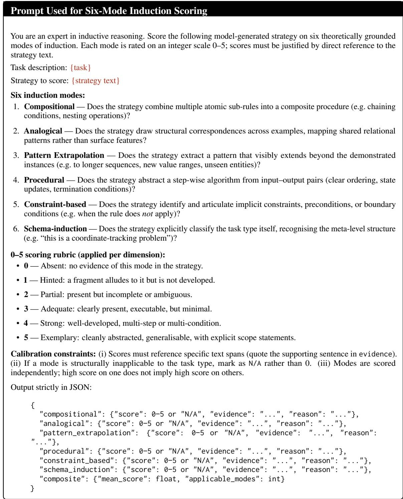  
Figure 9: Prompt used for six-mode induction scoring. Each strategy receives an independent 0–5 score per mode; the composite is the mean over applicable modes (N/A modes excluded from averaging).

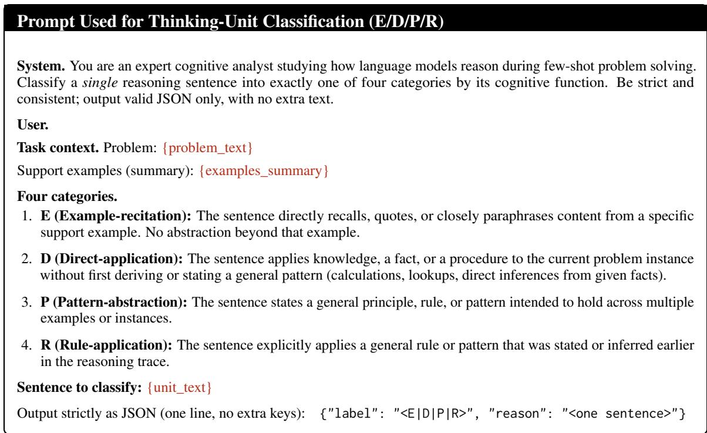  
Figure 10: Prompt for Gemini-3-flash sentence-level tagging of <think> units.

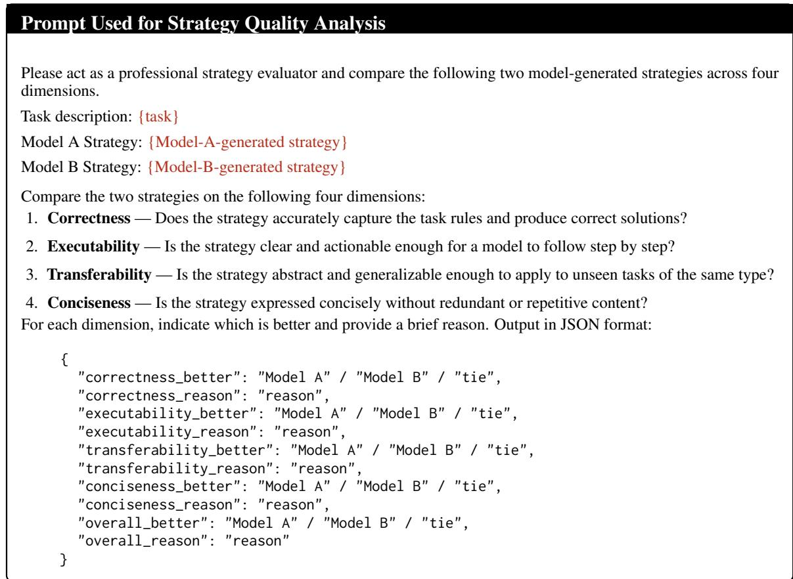  
Figure 11: Prompt used for strategy quality analysis.

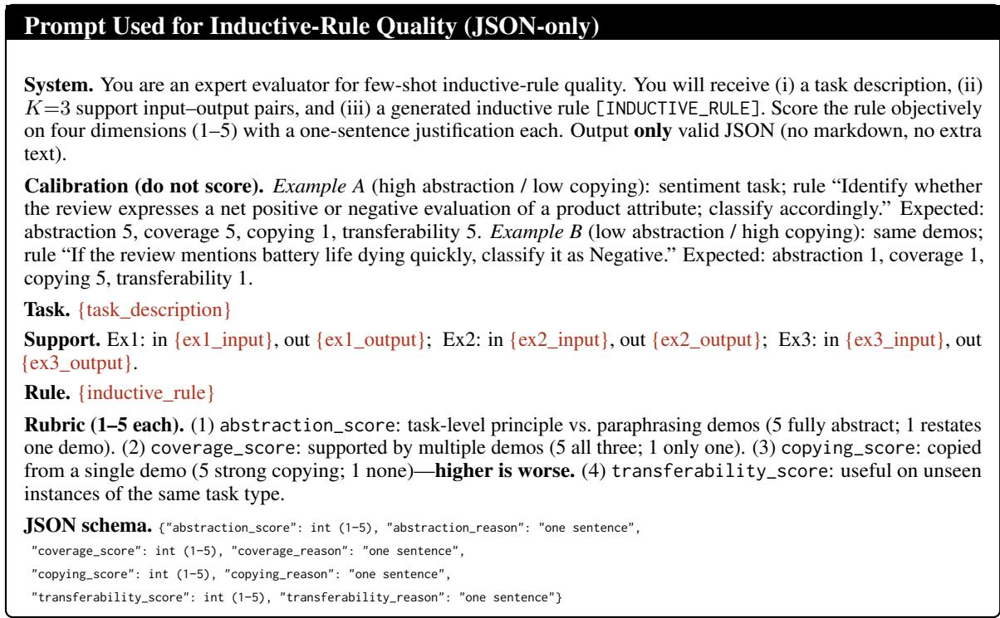  
Figure 12: GPT-5 prompt for scoring each [INDUCTIVE\_RULE] on abstraction, coverage, copying (reverse-scored), and transferability.