# Conditional Average Treatment Effect Distillation for Hypothetical State-Intervention Targeting Under Budget Constraints

Vasundhara Acharya1, B¨ulent Yener2

1 Rensselaer Polytechnic Institute, Troy, USA (e-mail: acharv2@rpi.edu)   
2 Rensselaer Polytechnic Institute, Troy, USA (e-mail: yener@cs.rpi.edu)

## Abstract

Personalized public-health targeting requires methods that capture heterogeneous intervention benefit while remaining interpretable under resource constraints. Flexible causal-effect models can be difficult to translate into operational rules, whereas coarse subgroup policies may lose individualized treatment-effect information. We study budget-constrained hypothetical state interventions in observational data without a logged historical decision policy. For obesity, elevated glucose, and lifetime smoking-history states, causal-structure-informed pretreatment covariates are prespecified before policy learning, and intervention capacity is capped at 70% of individuals observed in the adverse exposure state. We evaluate a causal distillation framework in which causal forest and Bayesian Causal Forest (BCF) teachers estimate conditional average treatment effects (CATEs), and decision tree (DT) and random forest (RF) students approximate the resulting benefit surfaces. Individualized policies are compared with an unsupervised K-means subgroup policy and a supervised causal-tree policy with leaf count matched to the number of K-means clusters. All observational policies are evaluated on held-out data using a doubly robust estimator, bootstrap uncertainty, and decision-focused teacher–student fidelity measures. Across the PIMA obesity and glucose experiments and the NHANES smoking-history experiment, every distilled student was within 0.011 absolute utility of its corresponding teacher, with allocation Jaccard similarities of 0.738–0.937. K-means and causal-tree policies were also competitive, and the highest point-estimate policy varied across applications. Prespecified paired comparisons were not significant after Holm adjustment, while agreement near the budget boundary was less stable than global fidelity in some teacher–student pairs. Across 10 semi-synthetic IHDP realizations with known potential outcomes, BCF showed the strongest teacher performance. These results support causal distillation as a practical approach for translating flexible causal-effect models into simpler budgeted targeting rules, while emphasizing that policy value, allocation agreement, and boundary fidelity should be assessed alongside predictive fit. Observational estimates remain contingent on causal-identification assumptions and require longitudinal or prospective validation.

Keywords: Causal inference; Heterogeneous treatment effects; Causal distillation; Policy learning

## 1 Introduction

Many clinical and public-health interventions are guided by individualized treatment rules that recommend treatment as a function of a patient’s pre-treatment

covariates [1] [2] [3]. A standard causal framework formalizes this through the conditional average treatment effect (CATE) and seeks policies that treat individuals with large, positive CATEs [4]. Modern machine-learning methods such as causal forests and meta-learners [5] [6] can flexibly estimate heterogeneous treatment effects from observational data, i.e., individual-specific variation in expected intervention benefit driven by pre-treatment covariates [7] [8]. Still, the resulting models are often complex, difficult to interpret, and expensive to deploy.

In supervised prediction, knowledge distillation compresses a large teacher model into a smaller student by training the student to mimic the teacher’s outputs. We adapt this idea to the causal setting and study causal distillation, in which we compress a high-capacity CATE estimator into simpler student models and their corresponding treatment policies. Here, the teachers are causal forest [5] and Bayesian causal forest (BCF) [9] models fitted to observational data, and their outputs are individualized CATE estimates. The students are simple tree-based models trained to regress on the teacher’s CATEs and then define treatment policies by thresholding predicted benefits. We focus on clinically interpretable state interventions targeting modifiable risk-factor states (e.g., obesity, elevated glucose), where the observed exposure indicates baseline risk-factor status and the targeting rules are ranked by the construct.

Causal distillation is substantially more delicate than standard distillation for predictive risk. First, the ground-truth individual treatment effect is never observed in an observational dataset [10], so we cannot directly measure the accuracy of either the teacher or the students. Second, in practice we care about the policy induced by a model which deals with who is treated and with what expected outcome rather than the CATE surface itself.

In this study, we address the following questions:

• How do unsupervised and supervised subgroup policies compare with individualized causal policies?

• Can DT/RF students preserve teacher policy value and allocation behavior while reducing complexity?

• Do these conclusions persist when true treatment effects and oracle policies are available in IHDP?

To address these questions, we evaluate a set of subgroup-level and individualized targeting policies motivated by hypothetical state interventions. For the observational-data experiments, intervention eligibility, adjustment variables, and effect modifiers are specified from the assumed causal structure before policy learning rather than being learned as part of the proposed framework. Because the observed data arise from natural exposure assignments rather than a deployed historical decision policy, we evaluate the resulting hypothetical state-intervention policies using held-out doubly robust estimation under standard causal-identification assumptions. This work makes the following contributions:

• We construct K-means subgroups using pretreatment covariates alone and subsequently rank these groups using estimated treatment benefit under a common intervention budget. We compare this unsupervised subgroup construction with a supervised causal-tree comparator matched in subgroup complexity, as well as with individualized policies learned from causal forests and BCF.

• We distill treatment-effect estimates from both causal-forest and Bayesian-causal-forest teachers into simpler decision-tree and random-forest students. Beyond predictive fidelity, we evaluate whether the students preserve the teachers’ treatment-effect rankings, budget-constrained allocation decisions, and held-out policy utility, thereby quantifying the tradeoff between structural simplicity and policy fidelity.

• We evaluate teacher, student, and subgroup policies using a common selective-shift doubly robust estimator on held-out data. This permits direct comparison of policies that differ substantially in how they represent heterogeneity from coarse pretreatment-defined subgroups to individualized treatment-effect rankings while maintaining the same intervention eligibility and budget.

• Using multiple Infant Health and Development Program (IHDP) realizations with known potential outcomes, we complement the observational-data analysis with evaluation based on precision in the estimation of heterogeneous effects (PEHE), true policy value, policy regret, treatment-effect ranking agreement, and overlap with the oracle top-q policy. We further show theoretically in the Supplementary Material why treatment-effect estimation error and policy performance provide complementary information, relating policy regret to both CATE-estimation error and disagreement with the oracle policy.

The term ground-truth individual treatment effect (ITE) specifically refers to oracle individual effects available only in synthetic or randomized benchmarks. In the observational setting, the ITE reported by teachers or students corresponds to a CATE estimate.

The remainder of this paper is organized as follows. Section 2 reviews related work. Section 3 presents the proposed workflow. Section 4 describes the experimental setup. Section 5 reports and analyzes the results. Section 6 revisits the research questions introduced in Section 1. Section 7 discusses limitations and future research directions. Finally, Section 8 concludes the paper.

## 2 Related Work

Estimating how the causal effect of an intervention varies across individuals or subgroups is central to personalized medicine and targeted policymaking. Flexible heterogeneous treatment-effect estimators can capture complex variation in treatment response, but state-of-the-art approaches often rely on ensemble methods or deep learning models, both of which present substantial challenges to interpretability. This situation creates a trade-off between the flexibility required for accurate conditional average treatment effect (CATE) estimation and the transparency required for treatment targeting and clinical decision-making.

Subgroup identification for heterogeneous treatment effects has been studied using several supervised and effect-informed approaches. Foster et al. [11] introduced the Virtual Twins procedure, which first predicts each individual’s outcome under treatment and control and then models the resulting treatment contrast to identify subgroups with enhanced effects. Athey and Imbens [12] proposed causal trees, which recursively partition the pretreatment covariate space to identify regions with differing treatment effects. Causal forests extend this approach through ensembles of honest trees, providing flexible, nonparametric CATE estimates [5]. Chernozhukov et al. [13] instead form groups by ranking individuals according to a machine-learning proxy for treatment benefit and then estimate group-level effects using sample splitting. Related effect-informed clustering methods include Causal K-Means, which clusters individuals according to estimated counterfactual response functions rather than similarity in observed baseline covariates [14].

Although these methods can identify treatment-effect heterogeneity, their resulting models or subgroup structures often remain difficult to interpret or deploy. Causal distillation addresses this limitation by transferring the estimated treatment-effect structure of a flexible teacher into a simpler student model with the goal of preserving treatment ranking and policy performance. In this context, causal distillation links flexible heterogeneous treatment effect (HTE) estimation with the construction of auditable treatment-assignment rules.

Makar et al. [15] introduced a two-stage distillation approach for individual treatment-effect estimation. A rich teacher model first used a broad set of covariates to adjust for confounding and estimate heterogeneous effects. A student model was then trained using a smaller set of features sufficient for predicting the estimated ITE. This approach separated ITE discovery, which may require many covariates, from ITE prediction for new individuals, which may depend primarily on a smaller set of effect modifiers. By distilling the complex model into a simpler model based on selected features, DEITEE achieved accurate ITE estimates with reduced data requirements, although the approach relied on the assumption that the relevant effect modifiers could be identified.

Rehill et al. [16] proposed a distilled causal tree for interpretable HTE estimation. Their method first fitted a causal-forest teacher to obtain CATE predictions and then trained a single decision-tree student using a regression-to-teacher objective. To preserve causal validity, the distilled tree was treated as an adaptively selected partition, and leaf-level treatment effects were re-estimated on held-out data using a doubly robust augmented inverse probability weighting (AIPW) estimator. The authors also examined tree-search procedures intended to improve stability and fidelity, and reported strong performance in noisy and high-dimensional settings.

Huang, Tang, and Kenney [17] introduced Causal Distillation Trees, a two-stage approach for obtaining interpretable subgroups from black-box ITE models. A flexible teacher was first used to estimate individual treatment effects, after which a decision-tree student was trained on the estimated effects to recover meaningful treatment-effect subgroups. Their objective was not merely to improve predictive accuracy, but to improve the theoretical consistency for the recovered subgroups and demonstrated the approach using clinical-trial data.

Related uses of causal distillation have also appeared in adjacent application areas. Sun et al. [18] proposed KDSM for uplift modeling in marketing, in which an interpretable uplift-tree teacher transfers incremental-outcome information to a neural-network student. The method also uses counterfactual sample matching within tree leaves to augment training data. Liu et al. [19] introduced KDCRec for recommender systems, where a teacher trained on less biased data guides a student trained on biased observational data. More broadly, causal concepts have been incorporated into knowledge distillation for language modeling, bias mitigation, and continual learning [20–23]. These applications demonstrate the broad applicability of causal distillation.

Once heterogeneous treatment effects have been estimated and distilled into a treatment rule, a separate question concerns how the resulting rule should be evaluated in practice.

Evaluating individual treatment-effect estimators is challenging in observational data because the true individual treatment effects are unobserved. In semi-synthetic or benchmark settings with known counterfactual outcomes, estimators can be evaluated using measures such as mean squared error, precision in the estimation of heterogeneous effects (PEHE), and error in the average treatment effect (ATE). For example, Shalit et al. [24] used PEHE and (ATE) error on the Infant Health and Development Program benchmark. When ground-truth individual effects are unavailable, policy-based

evaluation provides an alternative by assessing the expected outcome or utility induced by treatment decisions based on the the estimated effects for the target population.

Policy value may be estimated using outcome-regression, inverse-propensity-weighted, or doubly robust estimators. Doubly robust evaluation combines outcome-model predictions with a propensity-weighted residual correction and remains consistent when either the outcome model or the propensity model is correctly specified. Dud´ık et al. [25] established doubly robust methods for policy evaluation and learning, while Sverdrup et al. [26] combined doubly robust scores with sample splitting and cross-fitting for policy learning using observational data.

A related, but distinct, literature directly optimizes treatment-assignment rules rather than first estimating and distilling individual effects. Kitagawa and Tetenov [27] proposed empirical welfare maximization over constrained policy classes, which is particularly relevant when treatment rules must remain interpretable or are subject to resource constraints. In multi-action settings, Zhou et al. [28] constructed cross-fitted doubly robust scores and optimized them over interpretable estimated welfare. In contrast, our study first estimates heterogeneous treatment effects and then evaluates whether the resulting information can be transferred from a flexible teacher model to an interpretable student model while preserving held-out policy value.

The reliability of the final treatment rule also depends on decisions made before HTE estimation. In observational data, one such decision is the selection of covariates used for confounding adjustment. Because the adjustment set in our framework is informed by a discovered causal graph, the stability of causal discovery is therefore relevant to the overall analytical pipeline. Ensemble learning strategies are increasingly employed in causal discovery to mitigate the instability, overfitting, and hyperparameter sensitivity often exhibited by individual structure-learning algorithms [29–32]. By aggregating results across multiple data partitions, bootstrap samples, or diverse algorithmic outputs, these frameworks aim to reduce false-positive edges and improve the stability of the inferred causal graph [33–38].

Taken together, these bodies of literature provide flexible HTE estimators, interpretable distillation procedures, policy-evaluation methods, and tools for improving causal-discovery stability. However, comparatively limited work integrates these components into an end-to-end framework for observational public health targeting.

Prior causal-distillation methods commonly assume interventional supervision, such as randomized-trial data, or rely on a fixed, analyst-specified adjustment set. They are also frequently evaluated using ground-truth ITE metrics on synthetic or semi-synthetic benchmarks [16, 39]. In contrast, observational public-health applications require confounding adjustment using an estimated treatment mechanism, may involve complex survey designs, and often lack a historical logged decision policy [40]. Nevertheless, they require actionable and auditable treatment rules over modifiable exposure states, such as obesity or elevated glucose [41].

There remains limited end-to-end work that combines data-informed identification of adjustment variables, confounding-adjusted HTE estimation, interpretable distillation, and held-out policy evaluation in this setting. Existing studies also rarely evaluate distillation using decision-focused criteria such as treatment agreement, ranking stability, and policy value, particularly near an intervention threshold where small approximation errors can change treatment assignment. Our framework addresses these gaps by integrating covariate selection informed by causal structure, selection, flexible teacher estimation, interpretable student models, and held-out doubly robust policy evaluation.

## 3 Methodology

The proposed framework is evaluated across observational and semi-synthetic datasets using separate discovery and evaluation cohorts. Model fitting, subgroup construction, and policy formation are conducted on the discovery data, after which the resulting policies are fixed and assessed on the held-out evaluation cohort. Observational policies are evaluated using doubly robust estimation, while the semi-synthetic benchmark also allows for comparison with known counterfactual outcomes and oracle policies. The following subsections outline the datasets, policy construction, causal estimators, subgroup comparators, distillation procedure, and evaluation criteria.

## 3.1 Datasets

This study utilizes the PIMA Indians Diabetes Dataset [42], sourced from the National Institute of Diabetes and Digestive and Kidney Diseases, and the National Health and Nutrition Examination Survey (NHANES) 2015–2020 pre-pandemic data [43, 44]. The PIMA Indians Diabetes dataset is publicly available at

https://www.kaggle.com/datasets/mdssh784/pima-indians-diabetes-dataset, and the NHANES public-use data files are available at

https://wwwn.cdc.gov/nchs/nhanes/. Detailed descriptions of the datasets,

variables, and analytic cohorts are provided in the Supplementary Material. We also present our results using the 10 publicly available NPCI realizations from the CEVAE repository [45], which have been adopted at the same scale in prior work [46–48].

To avoid introducing additional assumptions associated with simple imputation procedures such as mean or median imputation, observations with missing values in variables required for a given analysis were excluded, resulting in complete-case analytic cohorts [49]. For the NHANES smoking-history policy, to obtain a continuous Euclidean representation suitable for K-means clustering, these variables were one-hot encoded and transformed using Multiple Correspondence Analysis (MCA) [50–52]. For the NHANES smoking-history subgroup analysis, the first seven MCA dimensions were retained as a fixed lower-dimensional representation for downstream clustering.

NHANES survey weights were not incorporated in the present policy-learning analysis. Accordingly, the reported NHANES results characterize the constructed analytic sample and should not be interpreted as survey-weighted, nationally representative estimates of the U.S. population.

## 3.1.1 Data access and identifiability

This study is a secondary analysis of publicly available, de-identified datasets. The observational analyses used the NHANES 2015–2020 pre-pandemic public-use files and the PIMA Indians Diabetes Dataset. The NHANES data were accessed for research purposes on 21 August 2024, and the PIMA Indians Diabetes Dataset was accessed on 15 July 2025. We additionally used the publicly available semi-synthetic Infant Health and Development Program (IHDP) benchmark, specifically the 10 NPCI realizations distributed through the CEVAE repository. The IHDP benchmark combines observed pretreatment covariates with simulated potential outcomes, thereby providing known counterfactual outcomes and treatment effects for methodological evaluation. The IHDP data was accessed on 15th May, 2026. All datasets used in this study were publicly available and contained no direct participant identifiers accessible to the authors. The authors did not have access to information that could identify individual participants at any time during or after the analyses.

## 3.1.2 Causal-structure-informed covariate specification

Candidate pretreatment covariates, adjustment variables, and effect modifiers were specified using the three-stage ensemble causal-structure discovery procedure developed in our previous work [53]. Briefly, the procedure combines multiple causal-discovery algorithms with adaptive bootstrapping to estimate stable edge-confidence scores, resolve directional conflicts and cycles, and aggregate algorithm-specific graphs into a consensus directed acyclic graph. The resulting structure was further reviewed using clinical expertise and evidence from the epidemiologic literature.

For PIMA, the ensemble incorporated Fast Causal Inference (FCI) and Peter–Clark (PC) with kernel conditional-independence testing, nonlinear NOTEARS, Pillai’s test, and supplementary additive-noise-model direction tests [54–57]. For NHANES, the ensemble combined PC with discrete conditional-independence tests, greedy hill climbing under multiple discrete-data scores, and Fast Greedy Equivalence Search (FGES) with the Bayesian Dirichlet equivalent uniform score (BDeu) score [58–60]. Full algorithmic details, bootstrap procedures, confidence aggregation, and graph-validation analyses are reported in [53].

In the present study, the resulting causal structures are treated as prespecified design-stage inputs rather than as outputs of the distillation framework. They are used only to inform the selection and roles of pretreatment covariates for each policy experiment. Causal discovery is not repeated within individual discovery–evaluation splits. The prespecified adjustment set is held fixed for teacher estimation and policy evaluation, while the designated deployable pretreatment features are supplied to the student models and subgroup-policy comparators.

Because the graph is treated as a fixed design input, uncertainty in its structure is not propagated through the downstream evaluations. Possible graph misspecification may therefore affect the selected covariate roles and remains a limitation of the analysis.

## 3.2 Budgeted Selective State-Shift Policies

We evaluate hypothetical interventions on modifiable or clinically interpretable exposure states rather than treatments assigned by a historical decision rule. The formal intervention-specific doubly robust policy-value estimator used here was developed in our previous work [49], building on framework of Wen et al. [61]. Here, we summarize the policy estimand and specify its application to the body mass index (BMI), glucose, and smoking-history experiments.

Let $T _ { i } \in \{ 0 , 1 \}$ denote the experiment-specific exposure state, where $T _ { i } = 1$ represents the adverse state and defines eligibility for the hypothetical intervention, and let $T _ { i } = 0$ denote the corresponding lower-risk state. Let $X _ { i }$ denote the pre-treatment variables, $L _ { i }$ the pre-treatment adjustment variables used for causal evaluation, and $Y _ { i } ( t )$ the potential outcome under exposure state t. In the present analyses, $Y _ { i } = 1$ denotes an adverse binary outcome. In the estimator and algorithm notation below, we use $Z _ { i } \equiv L _ { i }$ to denote this same adjustment-variable set.

A learned policy π induces a shift probability $s _ { \pi } ( X _ { i } ) \in [ 0 , 1 ]$ . The intervention is activated only for individuals observed in the adverse state. Specifically,

$$
T _ { i } ^ { \pi } = T _ { i } \left( 1 - S _ { i } ^ { \pi } \right) , \qquad S _ { i } ^ { \pi } \sim \mathrm { B e r n o u l l i } ( s _ { \pi } ( X _ { i } ) ) \quad \mathrm { o n l y ~ w h e n ~ } T _ { i } = 1 .\tag{1}
$$

Thus, a prioritized eligible individual may be shifted from $T _ { i } = 1$ to $T _ { i } = 0$ , whereas individuals already observed with $T _ { i } = 0$ remain in their factual state. For deterministic individualized policies, $s _ { \pi } ( X _ { i } )$ is generally zero or one. For group-based policies, a fractional value may arise when the intervention budget ends within a boundary subgroup.

The intervention budget is defined relative to the eligible population. For an evaluation cohort containing

$$
N _ { \mathrm { e l i g } } = \sum _ { i } \mathbb { 1 } \{ T _ { i } = 1 \} ,\tag{2}
$$

the maximum intervention capacity is

$$
B _ { q } = \mathrm { r o u n d } \left( q N _ { \mathrm { e l i g } } \right) ,\tag{3}
$$

where $q \in ( 0 , 1 ]$ denotes the prespecified budget fraction. The budget is a maximum capacity rather than a compulsory quota. Individuals or subgroups with nonpositive estimated benefit are not selected merely to exhaust the available budget.

For a candidate policy π, the policy-risk estimand is the expected adverse outcome under the induced selective state shift,

$$
R ( \pi ) = \mathbb { E } [ Y _ { i } ^ { \pi } ] = \mathbb { E } [ Y _ { i } ( T _ { i } ^ { \pi } ) ] .\tag{4}
$$

Importantly, eligibility determines who may be shifted. It does not restrict policy-value evaluation to individuals with $T _ { i } = 1$ . Individuals already observed in the lower-risk state remain part of the evaluation population and contribute information about the target-state outcome distribution.

Under consistency, no interference, conditional exchangeability given $L _ { i } ,$ and positivity, the selective state-shift risk is identified from the observational data. As in our previous work [49], we estimate policy value on the held-out evaluation cohort using an intervention-specific doubly robust score. To reduce instability from extreme propensity scores, evaluation is restricted to observations satisfying

$$
A _ { i } = \mathbb { 1 } \left\{ \alpha \leq { \widehat e } ( L _ { i } ) \leq 1 - \alpha \right\} ,\tag{5}
$$

where $e ( L _ { i } ) = P ( T _ { i } = 1 \mid L _ { i } )$ and $\alpha = 0 . 0 5$ in the primary analyses. Accordingly, the reported policy-risk estimand is

$$
R _ { A } ( \pi ) = \mathbb { E } \left[ Y _ { i } ^ { \pi } \mid A _ { i } = 1 \right] ,\tag{6}
$$

and, because the outcomes considered here are adverse binary outcomes, policy utility is defined as

$$
U _ { A } ( \pi ) = 1 - R _ { A } ( \pi ) .\tag{7}
$$

All individualized teacher policies, distilled-student policies, and group-based comparators are evaluated under this same held-out estimand and doubly robust evaluation procedure.

## 3.3 Hypothetical State-Shift Policies

For the PIMA dataset, we consider two policy experiments involving modifiable metabolic risk-factor states: obesity and elevated glucose. These experiments are motivated by randomized diabetes-prevention evidence demonstrating that weight and glycemic status are modifiable and strongly associated with subsequent diabetes risk. In the Diabetes Prevention Program, intensive lifestyle intervention targeting weight reduction and physical activity substantially reduced incident type 2 diabetes [62], with weight loss emerging as an important predictor of risk reduction [63]. Interventions targeting impaired glucose tolerance have similarly produced sustained reductions in diabetes incidence [64], and regression from prediabetes to normal glucose regulation has been associated with substantially lower subsequent diabetes risk [65]. These

findings motivate the state contrasts considered here. For the NHANES experiment, the adverse-state indicator is based on reported lifetime smoking history. However, the evaluated policies should nevertheless be interpreted as hypothetical state interventions rather than specific clinical treatment regimens.

BMI policy. For the BMI experiment, the adverse-state indicator is

$$
T _ { i } : = T _ { \mathrm { B M I } , i } = \mathbb { 1 } \left\{ \mathrm { B M I } _ { i } \geq 3 0 \mathrm { ~ k g } / \mathrm { m } ^ { 2 } \right\} .\tag{8}
$$

Thus, $T _ { i } = 1$ denotes obesity and defines eligibility for the hypothetical $1  0$ state shift, whereas $T _ { i } = 0$ denotes the non-obese state. The threshold follows the standard adult definition of obesity [66].

Glucose policy. For the glucose experiment, we define

$$
T _ { i } : = T _ { \mathrm { G l u c o s e } , i } = 1 \left\{ \mathrm { G l u c o s e } _ { i } \geq 1 4 0 \log / \mathrm { d L } \right\} .\tag{9}
$$

Here, $T _ { i } = 1$ denotes the elevated-glucose state and defines eligibility for the hypothetical shift, whereas $T _ { i } = 0$ denotes the lower-glucose state. The 140 $\mathrm { m g / d L }$ threshold corresponds to the lower boundary of impaired glucose tolerance for the two-hour oral glucose tolerance test [67].

For both PIMA experiments, the outcome is diabetes status, with $Y _ { i } = 1$ denoting diabetes. The intervention budget is applied only to individuals observed in the corresponding adverse state, while policy risk and utility are evaluated over the overlap-restricted held-out cohort according to Eqs. (6) and (7).

Smoking policy. For the NHANES Smoking experiment, we define

$T _ { i } : = T _ { \mathrm { S m o k i n g } , i } = \mathbb { 1 }$ {reported smoking at least 100 cigarettes during the lifetime} .

(10)

Thus, $T _ { i } = 1$ denotes the lifetime-smoking-history state and defines eligibility for policy allocation, whereas $T _ { i } = 0$ denotes the corresponding non-smoking-history state. Because this exposure captures lifetime smoking history rather than current smoking status, the hypothetical $1  0$ contrast should not be interpreted as an acute smoking-cessation intervention. Instead, it represents a counterfactual contrast between the established lifetime-smoking and non-smoking-history states among prioritized eligible individuals.

The outcome is sleep disturbance, with $Y _ { i } = 1$ denoting the adverse outcome. The intervention budget is again defined relative to the eligible $T _ { i } = 1$ population, while both adverse- and lower-risk-state individuals contribute to held-out policy-value estimation under the common selective state-shift estimand in Eq. (6).

## 3.4 Group-Based Policy Comparators

To compare the individualized teacher–student policies with simpler group-based decision rules, we consider two subgroup-policy comparators: unsupervised K-means clustering and a supervised Causal Tree. Both methods use the same downstream gain-based ranking, intervention budget, and held-out policy-evaluation procedure. They differ primarily in how the subgroup structure is learned.

Unsupervised K-means subgroup policy K-means clustering is performed using only prespecified pre-treatment covariates, without treatment, outcome, or estimated treatment-effect information. Thus, treatment-effect information is introduced only after the clusters have been formed. This design is intended to represent a simple phenotype-based unsupervised comparator rather than a causal HTE estimator. Such unsupervised clustering approaches have been used to identify clinically relevant patient phenotypes and subgroups, including in oncology [68], and have also been investigated specifically for assessing heterogeneity of treatment effects across baseline patient phenotypes [69]. Accordingly, K-means provides a clinically motivated benchmark for assessing whether effect-informed individualized or supervised subgroup policies offer additional value beyond grouping patients according to pretreatment characteristics alone.

Clustering variables are standardized using discovery-cohort means and standard deviations, with the fitted transformation subsequently applied to the evaluation cohort [70, 71]. The number of clusters is selected using the silhouette score [72], evaluating candidate values $K = 2 , \ldots , 9$ on the discovery cohort only. The complete silhouette-score profile is provided in the supplementary files.

After fixing the K-means partition, treatment-stratified out-of-fold (OOF) outcome models are used to obtain discovery-cohort benefit scores as shown in the Eq.11.

$$
\widehat { \tau } _ { i } = \widehat { \mu } _ { 1 } ( Z _ { i } ) - \widehat { \mu } _ { 0 } ( Z _ { i } ) ,\tag{11}
$$

where positive values indicate estimated benefit from the one-way shift $T = 1  T = 0$ for the adverse binary outcomes considered here.

Supervised Causal Tree. As a supervised subgroup comparator, we additionally fit a Causal Tree [12]. Unlike K-means, the tree uses treatment and outcome information to construct subgroups with heterogeneous treatment effects. To provide comparable subgroup complexity, the maximum number of terminal leaves is fixed to the same K selected for K-means, with each terminal leaf treated as a subgroup. The discovery cohort is internally split for tree-structure learning and honest leaf-effect estimation using cross-fitted AIPW effect scores. After fixing the partition, mean leaf benefit is estimated among eligible individuals, and leaves are ranked by aggregate discovery gain. Only positive-gain leaves are eligible for allocation, and the resulting partition and ranking are frozen before held-out evaluation.

Common subgroup policy. For either method, let g denote a K-means cluster or Causal Tree leaf. The individual benefit score is method-specific: K-means uses the treatment-stratified out-of-fold outcome-model contrast in Eq. 11, whereas the Causal Tree uses the cross-fitted AIPW effect score from the honest leaf-estimation sample. Among eligible discovery-cohort individuals, these scores are averaged within subgroup g to obtain the subgroup mean benefit $\widehat { \tau } _ { g }$ in Eq. 12.

$$
\widehat { \tau } _ { g } = \frac { 1 } { n _ { g } } \sum _ { i : G _ { i } = g , \ : T _ { i } = 1 } \widehat { \tau } _ { i } ,\tag{12}
$$

and the aggregate gain is computed using the Eq. 13.

$$
\widehat { G } _ { g } = n _ { g } \widehat { \tau } _ { g } ,\tag{13}
$$

where $n _ { g }$ is the number of eligible discovery individuals in subgroup g. Only subgroups with strictly positive gain are considered, and these are ranked in descending order of ${ \widehat { G } } _ { g }$

The subgroup ranking is frozen before evaluation. In the held-out evaluation cohort, positively ranked subgroups are allocated sequentially up to the maximum budget as shown in the Eq.3.

In the present analysis, subgroup allocation is intentionally based on the estimated mean benefit and aggregate gain alone. The within-subgroup variance of the estimated benefits is not incorporated into the ranking or budget-allocation rule. Thus, the subgroup comparators considered here are point-estimate-based policies rather than uncertainty-gated policies. Extensions that explicitly incorporate subgroup-level estimation uncertainty, including an Empirical Bernstein safety gate and a fully Bayesian hierarchical pooling gate, are developed and evaluated separately in our related work [49].

Subgroups that fit within the remaining budget are fully selected. If the budget boundary falls within a subgroup, all members of that subgroup are assigned the corresponding common fractional shift probability. Subgroups below the boundary or with nonpositive discovery gain receive zero shift probability. The intervention itself is active only for currently eligible individuals $( T _ { i } = 1 )$ , and q is treated as a maximum capacity rather than a compulsory quota.

## 3.5 Teacher and Student Models

Our distillation framework includes two teacher models and two student models. The teacher models are a causal forest and a BCF [9], both of which estimate a continuous conditional average treatment effect (CATE) for each individual. The student models are a decision tree and a random forest trained to approximate the CATE surface estimated by the corresponding teacher. Thus, the same two student architectures are evaluated separately using targets generated by each teacher.

## 3.5.1 Causal-Forest Teacher

Causal forests extend Breiman’s random forests to estimate heterogeneous treatment effects nonparametrically. Under standard unconfoundedness and regularity assumptions, causal forests yield point-consistent CATE estimates with asymptotically normal sampling distributions, thereby supporting the construction of confidence intervals for τ(x) [5]. By adaptively partitioning the covariate space, causal forests can capture nonlinear relationships and high-order interactions between covariates and treatment without requiring a prespecified parametric treatment-effect model. They have also been shown empirically to outperform classical approaches, such as nearest-neighbor matching, in settings containing irrelevant covariates [5].

In our implementation, the causal forest is estimated using a double machine learning (DML) formulation with orthogonalization. The treatment and outcome nuisance functions are estimated separately, and the resulting residualization reduces the sensitivity of the treatment-effect estimates to misspecification of either nuisance model. Causal forests have been successfully applied in biomedical and clinical research to investigate treatment-effect heterogeneity [73], supporting their use as a flexible and well-studied teacher model in our distillation framework.

## 3.5.2 Bayesian-Causal-Forest Teacher

As a complementary teacher model, we use BCF [9]. BCF decomposes the conditional response surface into a prognostic component and a treatment-effect component. This decomposition allows the treatment-effect surface to be regularized separately from the prognostic surface. Such separation is particularly useful in observational causal inference because treatment-effect heterogeneity may be weak relative to the overall

variation in the outcome. Under the BCF parametrization, weak or noisy heterogeneity can be shrunk toward a more homogeneous treatment-effect surface, potentially producing more stable CATE estimates than response-surface models that do not directly control regularization of the treatment-effect component [9].

Let $\tau _ { i } ^ { ( s ) }$ denote the s-th posterior draw of the individual-level CATE for evaluation individual $i ,$ where $s = 1 , \ldots , S$ . To maintain comparability with the main causal-forest distillation pipeline, in which each student is trained using a point-valued CATE target, we distill the BCF posterior mean CATE:

$$
\bar { \tau } _ { i } = \mathbb { E } [ \tau _ { i } \mid \mathcal { D } ] \approx \frac { 1 } { S } \sum _ { s = 1 } ^ { S } \tau _ { i } ^ { ( s ) } .\tag{14}
$$

This produces a single continuous target for each individual and therefore permits a direct comparison between the BCF- and causal-forest-based distillation pipelines.

## 3.5.3 Student Models

For each teacher model, we train two student models: a single decision tree (DT) [74] and a random forest (RF) [75]. Both students receive only the pretreatment covariates X as inputs and are trained to regress on the CATE targets generated by the teacher. For the causal-forest teacher, the target is the estimated point-valued CATE, $\hat { \tau } _ { i } ^ { \mathrm { C F } }$ . For the BCF teacher, the target is the posterior mean CATE, $\bar { \tau } _ { i } ^ { \mathrm { B C F } }$ , defined in Equation (14).

Accordingly, the student models are not causal estimators in their own right. They do not directly model treatment assignment or observed outcomes, and they do not optimize a causal identification or policy-value objective. Instead, they should be interpreted as compact approximations to the treatment-effect surface learned by the corresponding causal teacher.

The decision-tree student provides a particularly transparent representation of the teacher through a collection of hierarchical if–then decision rules. The random-forest student can capture a more flexible approximation to the teacher’s CATE surface while allowing variable-importance and tree-based summaries to be examined. Although the random forest is less directly interpretable than a single tree, both models offer substantially simpler predictive representations than the original causal teachers [41, 76].

Algorithm 1 summarizes the proposed framework. To characterize the learned heterogeneity in a clinically readable form, we inspect representative decision regions from the distilled student models. For the decision-tree student, terminal-node paths provide exact rules, and we report one representative rule for each policy-status category: fully prioritized, capacity-boundary, and positive-benefit but outside the current intervention capacity. For the random-forest student, which does not admit a single exact decision rule, we use shallow tree-based surrogate regions to summarize the predictions of the full ensemble. These surrogate rules are used only for interpretation and do not determine policy allocation.

## 3.6 Metrics for Evaluation

## • Policy risk and utility:

For the observational PIMA and NHANES analyses, individual counterfactual outcomes are not jointly observed, so treatment-effect accuracy cannot be evaluated directly [24]. We therefore evaluate the policies induced by the estimated heterogeneous effects on the held-out evaluation cohort, after all models and policy rules have been fixed using the discovery cohort.

Algorithm 1 Teacher–Student Causal Policy Learning and Held-out Evaluation   
1: Input: Discovery data ${ \mathcal { D } } _ { \mathrm { d i s c } } = \{ ( X _ { i } , Z _ { i } , T _ { i } , Y _ { i } ) \}$ ; evaluation data $\mathcal { D } _ { \mathrm { e v a l } } ;$ teacher   
models $\mathcal { M } _ { T } = \{ \mathrm { C F } , \mathrm { B C F } \}$ ; student models $\mathcal { M } _ { S } = \{ \mathrm { D T } , \mathrm { R F } \}$ ; budget cap q; number   
of OOF folds $K _ { O O F } .$   
2: Output: Teacher and student benefit scores, learned policies, student–teacher   
fidelity measures, and held-out policy risk/utility.   
3: for each teacher $m \in \mathcal { M } _ { T }$ do   
4: Partition $\mathcal { D } _ { \mathrm { d i s c } }$ into K treatment-stratified folds.   
5: Initialize OOF teacher-benefit vector $\widehat { \tau } _ { \mathrm { O O F } } ^ { ( m ) }$   
6: for $k = 1 , \ldots , K$ do   
7: Fit teacher m on $\mathcal { D } _ { \mathrm { d i s c } } \backslash \mathcal { T } _ { k }$ using $( Y , T , X , Z )$ as required by the teacher model.   
8: Predict treatment-benefit estimates for observations in $\mathcal { T } _ { k }$ and store them in   
$\widehat { \tau } _ { \mathrm { O O F } } ^ { ( m ) }$   
9: end for   
10: Fit the final teacher m on the complete discovery cohort.   
11: Predict teacher benefit scores on the evaluation cohort:   
${ \hat { \tau } } _ { i } ^ { ( m ) } ,$ $i \in \mathcal { D } _ { \mathrm { e v a l } } .$   
12: for each student $s \in \mathcal { M } _ { S }$ do   
13: Fit the non-causal student using only   
$X _ { i } \longrightarrow { \widehat { \tau } } _ { \mathrm { O O F } , i } ^ { ( m ) } , \qquad i \in { \mathcal { D } } _ { \mathrm { d i s c } } .$   
14: Predict student benefit scores on the evaluation cohort:   
$\widehat { \tau } _ { i } ^ { ( m , s ) } = M _ { s } ( X _ { i } ) .$   
15: end for   
16: Construct a policy for the teacher and each student by ranking currently eligible   
individuals $( T _ { i } = 1 )$ by predicted benefit.   
17: Retain only individuals with strictly positive predicted benefit and select up to   
the budget   
$B _ { q } = \mathrm { r o u n d } \left( q N _ { \mathrm { e l i g } } \right)$   
18: If multiple individuals share the budget-boundary score, assign the common   
fractional boundary shift probability required to satisfy the budget in expectation.   
19: Freeze all teacher and student policies before outcome evaluation.   
20: Estimate policy risk on $\mathcal { D } _ { \mathrm { e v a l } }$ using the common cross-fitted selective one-way  
shift doubly robust estimator with propensity adjustment and overlap trimming.   
21: For adverse binary outcomes, compute   
$\widehat { U } ( \pi ) = 1 - \widehat { R } ( \pi ) .$   
22: Obtain 95% bootstrap confidence intervals and paired teacher–student utility   
differences using common evaluation resamples.   
23: Compute student–teacher fidelity and policy-agreement measures on the evalua  
tion cohort.   
24: end for   
25: return teacher/student policies, held-out policy risk and utility, confidence intervals,   
and fidelity measures.

Under the selective state-shift estimand defined in Section 3.2, policy risk is estimated using the cross-fitted doubly robust estimator (DR)

$$
\widehat { R } _ { \mathrm { D R } } ( \pi ) = \frac { 1 } { n _ { \mathrm { o v } } } \sum _ { i \in \mathcal { I } _ { \mathrm { o v } } } \left[ ( 1 - T _ { i } s _ { i } ) Y _ { i } + T _ { i } s _ { i } \widehat { \mu } _ { 0 } ( Z _ { i } ) + ( 1 - T _ { i } ) s _ { i } \frac { \widehat { e } ( Z _ { i } ) } { 1 - \widehat { e } ( Z _ { i } ) } \left\{ Y _ { i } - \widehat { \mu } _ { 0 } ( Z _ { i } ) \right\} \right] ,\tag{15}
$$

where $s _ { i } = s _ { \pi } ( X _ { i } ) , \widehat { e } ( Z _ { i } ) = P ( T _ { i } = 1 \mid Z _ { i } )$ is the estimated propensity score, $\widehat { \mu } _ { 0 } ( Z _ { i } ) = E [ Y _ { i } \mid T _ { i } = 0 , Z _ { i } ]$ is the outcome regression under the target state, and $\mathcal { T } _ { \mathrm { o v } }$ denotes the overlap-restricted evaluation sample. Nuisance functions are estimated using five-fold treatment-stratified cross-fitting. The estimator is doubly robust under the standard identification conditions $[ 7 7 ]$

Because $Y = 1$ denotes an adverse outcome, policy utility is shown as in the equation 16.

$$
\begin{array} { r } { U ( \pi ) = 1 - \widehat { R } _ { \mathrm { D R } } ( \pi ) . } \end{array}\tag{16}
$$

We additionally report the no-shift and shift-all-eligible reference policies. Learned policies are evaluated primarily under the prespecified $q = 0 . 7 0$ maximum eligible-population intervention budget.

## • Policy agreement:

For teacher–student comparisons, let $S _ { T }$ and $S _ { S }$ denote the eligible individuals selected by the teacher and student, respectively, at the prespecified budget. Selected-set agreement is measured using the Jaccard index,

$$
J ( S _ { T } , S _ { S } ) = \frac { \left| S _ { T } \cap S _ { S } \right| } { \left| S _ { T } \cup S _ { S } \right| } .\tag{17}
$$

The same measure is used when comparing selected populations from other policies.

## • Teacher–student fidelity:

We assess how closely each student reproduces the heterogeneous-effect signal estimated by its corresponding teacher. Prediction fidelity is measured using the coefficient of determination $( R ^ { 2 } )$ between the teacher and student estimated benefit scores.

Because policy allocation depends on the ordering of estimated benefit, we also assess ranking fidelity using Spearman’s rank correlation coefficient [78] and Kendall’s $\tau _ { b }$ [79, 80]. To evaluate agreement near the operational allocation threshold, we additionally compute Kendall’s $\tau _ { b }$ within a prespecified ±0.05 quantile neighborhood around the teacher’s budget boundary.

## • Paired comparison of policy utilities:

Held-out utility differences are evaluated using a paired nonparametric bootstrap. For policy $\pi _ { m }$ and reference policy $\pi _ { \mathrm { r e f } }$

$$
\Delta U _ { m , \mathrm { r e f } } = U ( \pi _ { m } ) - U ( \pi _ { \mathrm { r e f } } ) .\tag{18}
$$

Evaluation individuals are resampled jointly for all policies within each bootstrap replicate, preserving the pairing of policy values. The corresponding teacher serves as the reference for teacher–student comparisons, whereas K-means serves as the reference for subgroup-policy comparisons. Because eight comparisons were prespecified within each observational policy experiment, Holm’s procedure [81] is applied to the paired-bootstrap p-values to control the family-wise error rate.

## • Ground-truth metrics for semi-synthetic experiments:

For IHDP, where simulated potential outcomes and true treatment effects are available, we additionally report true policy value, policy regret, agreement with the oracle budget-constrained policy, and treatment-effect estimation accuracy using PEHE.

## • Model complexity:

Structural complexity is summarized by terminal-leaf count. For a single decision tree, complexity is its number of terminal leaves. For a random forest or causal forest containing B trees,

$$
C _ { \mathrm { f o r e s t } } = \sum _ { b = 1 } ^ { B } L _ { b } ,\tag{19}
$$

where $L _ { b }$ is the number of terminal leaves in tree b [82].

For BCF [9], we measure complexity using the treatment-effect forest because this is the component distilled by the student models. For posterior draw $m ,$

$$
C _ { \tau } ^ { ( m ) } = \sum _ { b = 1 } ^ { B _ { \tau } } L _ { \tau b } ^ { ( m ) } ,\tag{20}
$$

where $B _ { \tau }$ is the number of treatment-effect trees and $L _ { \tau b } ^ { ( m ) }$ is the number of terminal leaves in tree b. We summarize this quantity across retained posterior draws using its posterior mean and interval.

## 3.7 Ablation Studies

## 3.7.1 Sensitivity Analysis: Nuisance-model replacement

To examine whether the estimated policy values were sensitive to the nuisance-model specification used in the doubly robust (DR) evaluator, we performed a sensitivity analysis in which the logistic-regression outcome nuisance model was replaced with a HistGradientBoosting classifier.

## 3.7.2 Split stability

To assess sensitivity to the discovery–evaluation split, we repeated the entire analysis over different independent random splits. Across repetitions, only the split assignment was varied, and everything else remained unchanged.

## 3.7.3 Sensitivity to score-policy encoding

For individualized teacher and student policies, the intervention budget is defined among individuals observed in the eligible adverse state (T = 1). As a sensitivity analysis, we additionally represented the resulting policy as an explicit score-threshold rule defined over the complete held-out evaluation cohort. We performed this analysis on the representative discovery–evaluation split while holding everything else fixed.

## 3.7.4 Semi-Synthetic Evaluation with the IHDP Dataset

The proposed framework is further evaluated using the semi-synthetic Infant Health and Development Program (IHDP) benchmark [45]. Analysis is performed across 10 simulated realizations of the dataset to assess the stability of findings under varying outcome-generating processes. The complete set of variables, their definitions, and the preprocessing procedures are detailed in the supplementary files. The IHDP covariates contain a mixture of continuous and binary or categorical variables. Accordingly, we replaced K-means with K-Prototypes [83] as the unsupervised subgroup-policy comparator. The number of clusters was selected on the discovery cohort by maximizing the average silhouette coefficient computed from the Gower dissimilarity matrix [84].

In contrast to the PIMA and NHANES analyses, where individual counterfactual outcomes and true treatment effects are unobserved, the semi-synthetic IHDP benchmark provides access to simulated potential outcomes. As a result, ground-truth individual treatment effects are available and can be used to directly evaluate the learned policies. For each simulation, an oracle policy is constructed by prioritizing individuals according to their true treatment benefits under the same intervention-budget constraint as the evaluated policies. The oracle policy thus represents the optimal allocation achievable under the known data-generating mechanism and specified budget.

The policy value achieved by the proposed framework is compared with that of the corresponding oracle policy. This approach enables direct calculation of policy regret, defined as the difference between the oracle policy value and the value achieved by the learned policy. The overlap between individuals selected by the proposed framework and those selected by the oracle policy is also evaluated using policy-allocation agreement measures. Such oracle-based comparisons are not feasible in the PIMA and NHANES applications because the true individual treatment effects and counterfactual outcomes are unknown. The IHDP experiments therefore complement the real-data analyses by providing a controlled setting in which both the value and allocation accuracy of the learned policies can be assessed against known ground truth.

## 4 Experimental Setup

For each observational policy experiment, the policy-specific complete-case analytic cohort was randomly partitioned into 60% discovery and 40% held-out evaluation data. This discovery–evaluation split follows our previous framework for separating data-adaptive subgroup-policy construction from held-out policy evaluation [49].

The resulting cohort sizes are summarized in Table 1.

Table 1. Analytic cohorts and intervention capacity across observational policy experiments.
<table><tr><td>Policy experi- ment</td><td>Analytic N</td><td>Discovery N</td><td>Evaluation N</td><td>Eval_eligible N</td><td>Max_budget  $B _ { q }$ </td></tr><tr><td>PIMA BMI</td><td>757</td><td>454</td><td>303</td><td>190</td><td>133</td></tr><tr><td>PIMA glucose</td><td>752</td><td>451</td><td>301</td><td>76</td><td>53</td></tr><tr><td>NHANES smok-</td><td>7,217</td><td>4,330</td><td>2,887</td><td>1,273</td><td>891</td></tr></table>

We implemented BCF using the StochTree [85] library and Causal Forest using EconML [86]. For the causal-forest teacher, hyperparameters were selected on the discovery cohort using the out-of-sample R-score criterion, since ground-truth treatment effects are unavailable. Student-model hyperparameters were selected using five-fold cross-validation to maximize $R ^ { 2 }$ fidelity to the out-of-fold teacher CATE estimates. In contrast, the BCF teacher was not data-tuned. We retained the standard literature-guided BCF prior and ensemble settings following Hahn et al. [9], which regularize the treatment-effect component separately from the prognostic component [9]. Similar BCF-based specifications have also been used in subsequent applications and extensions [87]. The same decision-tree and random-forest configurations were subsequently retained for the BCF teacher rather than retuned separately, so that changes in student fidelity and policy performance primarily reflect the change in teacher signal rather than changes in student-model capacity.

The hyperparameters for the glucose, BMI, smoking history policies and IHDP experiments are tabulated in the table 3, 2, 4 and 5.

Table 2. PIMA BMI policy: Model hyperparameters used in the teacher–student and subgroup-policy analyses. The same decision-tree and random-forest configurations were subsequently retained for the Bayesian causal forest teacher rather than retuned separately, so that changes in student fidelity and policy performance primarily reflect the change in teacher signal rather than changes in student-model capacity.

Model Hyperparameters used   
Causal Forest teacher n = 300, max depth = None, min samples split = 10, min samples leaf = 5   
Decision Tree student max depth = 6, min samples leaf = 10, max leaf nodes = 12   
Random Forest student n = 6, max depth = 6, min samples leaf = 4, max leaf nodes = None   
BCF teacher Binary probit outcome model; prognostic forest: 200 trees, α = 0.95, β = 2,   
min samples leaf = 5, max depth = 8; treatment-effect forest: 50 trees, α = 0.25, β = 3,   
min samples leaf = 5, max depth = 5; 1000 Markov chain Monte Carlo (MCMC) draws   
K-means subgroup policy Number of clusters K = 3   
Teacher–student training OOF teacher-target generation: K = 5 folds   
Causal Tree subgroup policy Causal splitting criterion: causal mse; max leaf nodes = 3; honest discovery split: 50%/50%   
for structure learning and leaf-effect estimation; 5-fold cross-fitted AIPW leaf-effect scores;

Table 3. PIMA Glucose policy: Model hyperparameters used in the teacher–student and subgroup-policy analyses.  
Model Hyperparameters / Training Settings   
Causal Forest Teacher n = 400, max depth = None, min samples split = 10, min samples leaf =   
5   
BCF Teacher Binary probit outcome model; prognostic forest: 200 trees, α = 0.95, β = 2,   
min samples leaf = 5, max depth = 8; treatment-effect forest: 50 trees, α = 0.25,   
β = 3, min samples leaf = 5, max depth = 5; 1000 MCMC draws   
Decision Tree max depth = 4, min samples leaf = 10, max leaf nodes = 12   
Random Forest n = 5, max depth = 6, min samples leaf = 3, max leaf nodes = None   
K-means subgroup policy number of clusters = 4   
Causal Tree subgroup policy Causal splitting criterion: causal mse; max leaf nodes = 4; honest discovery split:   
50%/50% for structure learning and leaf-effect estimation; 5-fold cross-fitted AIPW   
leaf-effect scores;   
Teacher–student training OOF teacher-target generation: K = 5 folds

## 5 Results

We evaluated all PIMA and NHANES dataset-based policies at a 70% inclusion rate. Following prior work, we view the inclusion rate as a context-specific budget parameter that should be chosen based on external considerations such as available resources, intervention cost, and fairness constraints, rather than as a fixed optimal value determined purely by the model [88].

## 5.0.1 Prespecified covariate roles across datasets

Table 6 summarizes the prespecified roles of the pretreatment covariates used in each policy experiment.

Table 4. NHANES smoking-history policy: Model hyperparameters used in the teacher–student and subgroup-policy analyses.  
Model Hyperparameters used   
Causal Forest teacher n = 200, max depth = 10, min samples split = 20, min samples leaf = 20,   
max samples = 0.45   
Decision Tree student max depth = 4, min samples leaf = 25, max leaf nodes = 10   
Random Forest student n = 8, max depth = 5, min samples leaf = 50, max leaf nodes = 12   
BCF teacher Binary probit outcome model; prognostic forest: 200 trees, α = 0.95, β = 2,   
min samples leaf = 5, max depth = 8; treatment-effect forest: 50 trees, $\alpha = 0 . 2 5 , \beta = 3 ,$   
min samples leaf = 5, max depth = 5; 10 GFR initialization sweeps and 1000 MCMC   
draws   
K-means subgroup policy Number of clusters K = 6; n = 50; K-means++ initialization; clustering performed on   
the 7-component discovery-fitted MCA representation   
Teacher–student training OOF teacher-target generation: K = 5 folds   
Causal Tree subgroup policy Causal splitting criterion: causal mse; max leaf nodes = 6; honest discovery split: 50%/50%   
for structure learning and leaf-effect estimation; 5-fold cross-fitted AIPW leaf-effect scores;

Table 5. IHDP experiment: Model hyperparameters and training settings used in the teacher–student and subgroup-policy analyses.  
Model Hyperparameters used   
Causal Forest teacher n = 400, max depth = None, min samples leaf = 5, max samples = 0.45,   
max features = None   
Decision Tree student max depth = 3, min samples leaf = 30, max leaf nodes = 8   
Random Forest student n = 6, max depth = 6, min samples leaf = 4   
BCF teacher Continuous outcome model; prognostic forest: 200 trees, α = 0.95, β = 2,   
min samples leaf = 5, max depth = 8; treatment-effect forest: 50 trees, α = 0.25, β = 3,   
min samples leaf = 5, max depth = 5; adaptive coding enabled; 10 GFR warm-start draws   
and 1000 MCMC draws   
K-Prototypes subgroup policy Number of clusters K = 3   
Teacher–student training OOF teacher-target generation: $K _ { \mathrm { O O F } } = 5$ folds   
Causal Tree subgroup policy max leaf nodes = 3 (matched to K-Prototypes); honest discovery split: 50%/50%; 5-fold   
cross-fitted AIPW leaf-effect estimation

Table 6. Prespecified covariate roles used in the policy experiments. For PIMA and NHANES, these roles were informed by the fixed causal structures developed in our previous work [53]. For IHDP, we did not estimate a causal graph using the proposed causal-discovery procedure. All available pretreatment covariates were used for confounding adjustment and treatment-effect modeling. The overlap between the adjustment-variable and effect-modifier sets is intentional, because a pretreatment covariate may contribute to confounding control while also modifying the conditional treatment effect.
<table><tr><td>Dataset/policy</td><td>Treatment</td><td>Adjustment variables</td><td>Candidate effect modifiers</td></tr><tr><td>PIMA-BMI</td><td>Obesity status</td><td>Age, Pregnancies,1 Diabetes- PedigreeFunction(DPF)</td><td>Age, Pregnancies, DPF</td></tr><tr><td>PIMA-Glucose</td><td>Elevated glucose</td><td>Age, BMI, DPF</td><td>Age, BMI, DPF</td></tr><tr><td>NHANES Smoking</td><td>Smoking history</td><td>Gender, Income, Age, Race</td><td>Gender, Income, Age, Race, Epilepsy, Education</td></tr></table>

## 5.1 PIMA Indian Diabetes Dataset-BMI Policy

We evaluated K = 2–9 on the discovery cohort and selected K = 3. The complete silhouette-score profiles and descriptive summaries of the resulting K-means clusters are provided in the supplementary files. Held-out policy performance, teacher–student fidelity, structural complexity, and paired utility comparisons are summarized in Table 7, Table 8, and Figs. 1, 2, and 3. Teacher–student utility differences were small, and none of the eight prespecified comparisons remained significant after Holm adjustment.

The learned rules as shown in the table 9 also admit a plausible clinical interpretation. In the BMI experiment, several highly prioritized DT and RF regions combined obesity with higher values of the DPF, a marker of familial susceptibility to diabetes. This is qualitatively consistent with the established importance of obesity and family history as diabetes risk factors [89, 90]. Pregnancy count and age further partitioned these profiles, potentially capturing differences in reproductive and cumulative metabolic history. This was consistent with large-scale observational evidence that the association between obesity and subsequent diabetes development differs across age groups [91].

We emphasize, however, that the numerical thresholds were learned from the data and should not be interpreted as established clinical cutoffs or treatment guidelines. Rather, the rules provide an interpretable description of the heterogeneity learned by the teacher and retained by the student models. Table 10 provides representative clinician-facing examples for the students distilled from the BCF teacher. Despite differences in the exact data-adaptive split thresholds, the CF- and BCF-distilled students showed qualitatively consistent high-benefit profiles. In particular, both RF students identified a fully prioritized region characterized by relatively few pregnancies and high DPF values. The DT students similarly placed elevated DPF values among their higher-benefit prioritized leaves. Conversely, very low DPF values appeared in positive-benefit regions that fell outside the 70% intervention capacity for both teacher families. Thus, the two teachers produced broadly concordant qualitative prioritization patterns, although their exact student-tree thresholds were not identical.

Table 7. PIMA BMI policy: Held-out performances. Among the budget-constrained learned policies, the Causal Tree subgroup policy achieved the highest point-estimate utility, followed closely by the BCF teacher , causal forest teacher, and their distilled students. K-means achieved a lower point-estimate utility. The 95% confidence intervals overlapped substantially across the learned policies, so the observed ordering should be interpreted descriptively rather than as evidence of statistically significant superiority.
<table><tr><td>Policy family</td><td>Policy</td><td>Distillation source</td><td>Policy risk</td><td>Policy utility</td><td>95% CI for utility</td></tr><tr><td>Reference</td><td>Shift all eligible</td><td></td><td>0.1629</td><td>0.837</td><td>[0.7613,0.8988]</td></tr><tr><td>Reference</td><td>No shift</td><td></td><td>0.3267</td><td>0.6733</td><td>[0.6205,0.7294]</td></tr><tr><td>Causal forest</td><td>Teacher</td><td>Causal forest</td><td>0.2142</td><td>0.7858</td><td>[0.7201, 0.8511]</td></tr><tr><td>Causal forest</td><td>Decision-tree student</td><td>Causal forest</td><td>0.2146</td><td>0.7854</td><td>[0.7197, 0.8460]</td></tr><tr><td>Causal forest</td><td>Random-forest student</td><td>Causal forest</td><td>0.2244</td><td>0.7756</td><td>[0.7096, 0.8433]</td></tr><tr><td>BCF</td><td>Teacher</td><td>BCF</td><td>0.2099</td><td>0.7901</td><td>[0.7249, 0.8533]</td></tr><tr><td>BCF</td><td>Decision-tree student</td><td>BCF</td><td>0.2156</td><td>0.7844</td><td>[0.7188, 0.8490]</td></tr><tr><td>BCF</td><td>Random-forest student</td><td>BCF</td><td>0.2203</td><td>0.7797</td><td>[0.7164, 0.8475]</td></tr><tr><td>Unsupervised subgroup policy</td><td>K-means</td><td>Not applicable</td><td>0.2424</td><td>0.7575</td><td>[0.6841,0.8244]</td></tr><tr><td>Supervised subgroup policy</td><td>Causal tree</td><td>Not applicable</td><td>0.2076</td><td>0.7923</td><td>[0.7176,0.8545]</td></tr></table>

Table 8. PIMA BMI policy: Teacher–student decision overlap and ranking fidelity at the prespecified eligible-population inclusion rate $q = 0 . 7 0$ . Global agreement was generally high, with decision Jaccard similarities ranging from 0.7500 to 0.8472 and eligible-population Spearman correlations ranging from 0.8315 to 0.8977. The BCF-distilled decision tree achieved the highest decision overlap, whereas the BCF-distilled random forest achieved the strongest global rank correlation. In contrast, Kendall τ near the allocation boundary was weak or negative for three of the four students, indicating that local ordering around the treatment cutoff was less stable than the overall ranking.
<table><tr><td>Teacher</td><td>Student</td><td>Fidelity (R2)</td><td>Decision Jaccard</td><td>Spearman</td><td>Kendall τb</td><td>Boundary Kendall τb</td></tr><tr><td>Causal forest</td><td>Decision tree</td><td>0.7089</td><td>0.7500</td><td>0.8315</td><td>0.6805</td><td>0.1188</td></tr><tr><td>Causal forest</td><td>Random forest</td><td>0.7855</td><td>0.7733</td><td>0.8930</td><td>0.7245</td><td>-0.1534</td></tr><tr><td>BCF</td><td>Decision tree</td><td>0.7306</td><td>0.8472</td><td>0.8650</td><td>0.7138</td><td>-0.0259</td></tr><tr><td>BCF</td><td>Random forest</td><td>0.801</td><td>0.8095</td><td>0.8977</td><td>0.7340</td><td>-0.1056</td></tr></table>

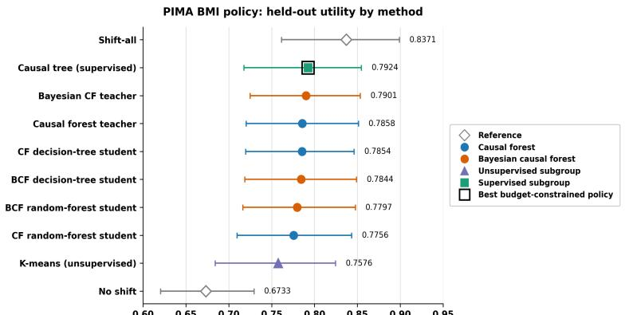  
Fig 1. PIMA BMI policy: The causal-tree comparator achieved the highest utility among budget-constrained policies, closely followed by the BCF teacher, causal forest teacher, and distilled decision-tree students. All learned policies outperformed the no-shift reference, while shift-all achieved the highest overall utility

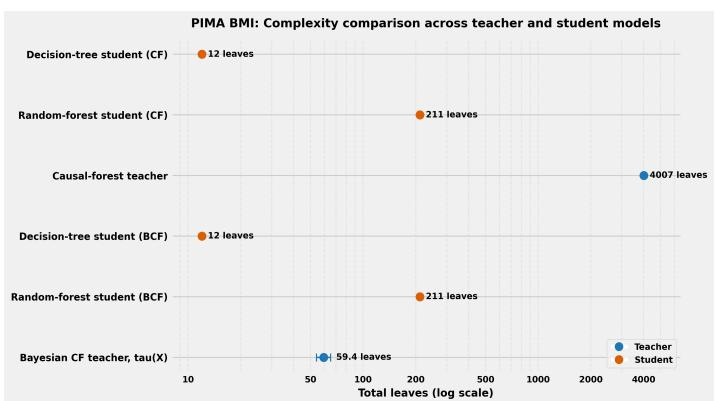  
Fig 2. PIMA BMI policy: Structural complexity of teacher and distilled student models. The distilled decision-tree students provide the most compact representations, while the causal-forest teacher is substantially more complex

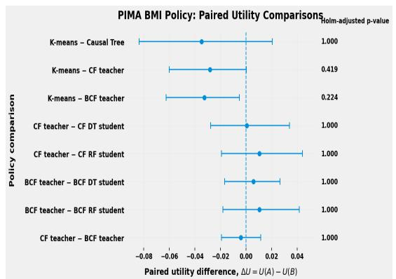  
Fig 3. PIMA BMI policy: Paired differences in held-out policy utility at the prespecified 70% eligible-individual intervention budget.

Table 9. PIMA BMI policy: Representative clinician-facing examples from the distilled decision-tree and random-forest students. The shallow RF surrogate showed good fidelity to the full random-forest predictions $\left( R ^ { 2 } = 0 . 8 9 2 \right)$
<table><tr><td>Student</td><td>Readable rule</td><td>Eligible N</td><td>Student benefit</td><td>CF teacher benefit</td><td>Policy status</td><td>Illustrative interpretation</td></tr><tr><td>DT</td><td>Pregnancies ≤ 3.5 and DPF &gt; 0.738</td><td>21</td><td>44.9 pp</td><td>45.7 pp</td><td>Fully prioritized</td><td>This is an exact DT path. An eligible individual satisfying both thresholds is assigned directly to this leaf, which predicts high positive benefit and is fully included within the 70% inter-</td></tr><tr><td>DT</td><td>Age &gt; 28.5 and 0.190 &lt; DPF ≤ 0.426</td><td>45</td><td>23.0 pp</td><td>23.3 pp</td><td>Capacity bound- ary</td><td>vention capacity. The exact rule identifies a positive- benefit leaf at which the available capacity is exhausted. The rule therefore identifies the boundary sub- group, while final allocation follows</td></tr><tr><td>DT</td><td>Age ≤ 42.5 and DPF ≤ 0.190</td><td>19</td><td>19.2 pp</td><td>17.2 pp</td><td>Positive benefit, outside capacity</td><td>policy. The rule predicts positive benefit, but this leaf lies below the current capacity cutoff. The individual is therefore not prioritized at the pre- specified budget despite positive es-</td></tr><tr><td>gate</td><td>Pregnancies ≤ 3.5 and DPF &gt; 0.745</td><td></td><td>44.4 pp</td><td>45.8 pp</td><td>Fully prioritized RF region</td><td>This surrogate region summarizes a portion of the full RF in which all eligible held-out individuals were selected. It provides a concise, clinician-readable description of the RF behavior, although the actual</td></tr><tr><td>gate</td><td>RF surro- 0.190 &lt; DPF ≤ 0.426</td><td>80</td><td>25.1 pp</td><td>25.2 pp</td><td>Partially priori- tized RF region</td><td>full RF ensemble. The surrogate identifies a broad positive-benefit region, but the full RF makes different policy decisions within it. Thus, the rule explains the general covariate pattern associated with prioritization without replacing</td></tr><tr><td>gate</td><td>0.190</td><td></td><td></td><td>17.2 pp</td><td>Positive region, outside capacity</td><td>the full RF decision. The surrogate identifies a region with positive RF benefit, but the full RF does not prioritize these profiles at the current 70% capacity. The rule therefore provides a readable expla- nation for a lower-priority region of the RF policy.</td></tr></table>

Table 10. PIMA BMI policy: Representative clinician-facing examples from the BCF-distilled decision-tree and random-forest students. The shallow RF surrogate achieved an $R ^ { 2 }$ of 0.792 with respect to the full BCF-distilled RF predictions and is used only for interpretation, not for policy allocation.
<table><tr><td>Student</td><td>Readable rule</td><td>Eligible N</td><td>Student benefit</td><td>BCF teacher benefit</td><td>Policy status</td><td>Illustrative interpretation</td></tr><tr><td>DT</td><td>0.5 &lt; Pregnancies ≤ 5.5 and 0.589 &lt; DPF ≤ 1.280</td><td>23</td><td>33.1 pp</td><td>34.3 pp</td><td>Fully prioritized</td><td>This is an exact DT path. An eligible individual satisfying these thresholds is assigned directly to this terminal leaf, which predicts positive benefit and is fully included within the pre-</td></tr><tr><td>DT</td><td>Age &gt; 40.5, Pregnancies &gt; 5.5, and DPF &gt; 0.304</td><td>15</td><td>22.5 pp</td><td>22.8 pp</td><td>Capacity bound- ary</td><td>specified 70% intervention capacity. The exact DT rule identifies a positive-benefit leaf at which the in- tervention capacity is exhausted. At the prespecified budget, 60% of eligi- ble individuals in this leaf receive al-</td></tr><tr><td>DT</td><td>Age &gt; 24.5 and DPF ≤ 0.182</td><td>21</td><td>19.8 pp</td><td>19.0 pp</td><td>Positive benefit, outside capacity</td><td>anism. The rule predicts positive benefit, but the leaf falls below the current capac- ity cutoff.</td></tr><tr><td>RF surro- gate</td><td>Pregnancies ≤ 4.5 and DPF &gt; 0.735</td><td>24</td><td>36.3 pp</td><td>36.9 pp</td><td>Fully prioritized RF region</td><td>The surrogate identifies a readable region in which all eligible evaluation profiles were selected by the full RF.</td></tr><tr><td>RF surro- gate</td><td>Age ≤ 40.5 and 0.318 &lt; DPF ≤ 0.735</td><td>67</td><td>28.7 pp</td><td>29.5 pp</td><td>Partially priori- tized RF region</td><td>The surrogate identifies a positive- benefit region in which the full RF prioritized approximately 98.5% of eligible individuals. .</td></tr><tr><td>gate</td><td>RF surro- Age &gt; 24.5 and DPF ≤ 0.182</td><td>21</td><td>20.4 pp</td><td>19.0 pp</td><td>Positive region, outside capacity</td><td>The surrogate identifies a region with positive mean RF benefit, but none of the eligible profiles in this region are prioritized under the current 70% intervention capacity.</td></tr></table>

## 5.2 PIMA Indian Diabetes Dataset-Glucose Policy

Table 11 and Fig. 4 summarize held-out glucose-policy performance. Utilities were similar across the learned policies, with substantially overlapping 95% confidence intervals. Teacher–student decision overlap was generally high despite the simpler student models (Table 12), although prediction fidelity, ranking agreement, and policy overlap were not necessarily maximized by the same student. Distillation substantially reduced structural complexity, and none of the prespecified paired utility comparisons remained significant after Holm adjustment (Figs. 5 and 6). The learned rules for the glucose policy (Tables 14 and 13) were broadly compatible with established diabetes physiology. Across both the causal-forest and Bayesian-causal-forest distillation analyses, higher-priority regions tended to involve moderately high to high BMI values, consistent with the well-established relationship between adiposity, insulin resistance, and type 2 diabetes risk [92]. This BMI-related pattern was therefore relatively stable to the choice of teacher. Under the Bayesian causal forest, however, the association was not strictly monotonic. The highest-BMI decision-tree leaf (BMI > 43.100 and DPF ≤ 1.011) had a lower mean estimated benefit (28.8 pp) than the adjacent moderately high-BMI leaf (BMI 33.250–43.100; 32.4 pp). Because the former leaf contained only six eligible individuals and the corresponding random-forest surrogate did not reproduce this decrease, we interpret it cautiously as possible local heterogeneity or estimation variability rather than evidence of a biological threshold.

DPF also appeared repeatedly in the learned rules, indicating that familial susceptibility contributed to the estimated heterogeneity in benefit, but its role was less stable across teachers. Under the BCF, DPF acted primarily as a broad threshold condition, with the high-DPF region among those examined showing comparatively lower estimated benefit. Under the causal forest, DPF appeared more frequently as a splitting variable and its relationship with estimated benefit depended on combinations with age and BMI rather than following a single monotonic direction. We therefore regard the BMI-related pattern as the more reproducible cross-teacher feature, whereas the specific DPF pattern observed under the BCF is better interpreted as teacher-dependent and hypothesis-generating rather than as an established physiological finding. It is important to note that the numerical thresholds in these rules are data-driven partitions of the estimated treatment-effect surface and should not be interpreted as clinical cutoffs.

Table 11. PIMA glucose policy: Held-out performance of the causal-forest and Bayesian-causal-forest teachers, their distilled decision-tree and random-forest students, and the K-means and causal-tree subgroup policies. Among the learned policies, the causal-tree subgroup policy achieved the highest point-estimate utility, followed closely by K-means and the causal-forest-distilled decision-tree student. The remaining teacher and student policies also produced similar point estimates. The 95% confidence intervals overlapped across all learned policies.
<table><tr><td>Policy family</td><td>Policy</td><td>Distillation source</td><td>Policy risk</td><td>Policy utility</td><td>95% CI for utility</td></tr><tr><td>Reference Reference</td><td>Shift all eligible No shift</td><td></td><td>0.2375 0.3522</td><td>0.7625 0.6478</td><td>[0.7010, 0.8204] [0.5847, 0.6977]</td></tr><tr><td>Causal forest Causal forest Causal forest</td><td>Teacher Decision-tree student Random-forest student</td><td>Causal forest Causal forest Causal forest</td><td>0.2730 0.2693 0.2712</td><td>0.7270 0.7307 0.7288</td><td>[0.6607, 0.7814] [0.6720, 0.7841] [0.6649, 0.7820]</td></tr><tr><td>BCF BCF</td><td>Teacher Decision-tree student</td><td>BCF BCF</td><td>0.2735 0.2722</td><td>0.7265 0.7278</td><td>[0.6656, 0.7800] [0.6733, 0.7886]</td></tr><tr><td></td><td></td><td></td><td></td><td></td><td></td></tr><tr><td></td><td></td><td></td><td></td><td></td><td></td></tr><tr><td>BCF</td><td>Random-forest student</td><td>BCF</td><td>0.2758</td><td>0.7242</td><td>[0.6586, 0.7797]</td></tr><tr><td></td><td></td><td></td><td></td><td></td><td></td></tr><tr><td>Unsupervised subgroup policy</td><td>K-means</td><td>Not applicable</td><td>0.2681</td><td>0.7319</td><td>[0.6706, 0.7875]</td></tr><tr><td></td><td></td><td></td><td></td><td></td><td></td></tr><tr><td>Supervised subgroup policy</td><td>Causal tree</td><td>Not applicable</td><td>0.2652</td><td>0.7348</td><td>[0.6719, 0.7908]</td></tr></table>

## 5.3 NHANES Smoking Policy

Held-out smoking-policy performance, teacher–student fidelity, structural complexity, and paired utility comparisons are summarized in Table 15, Table 16, and Figs. 7–9. Utilities were similar across the learned policies, while the BCF-distilled students

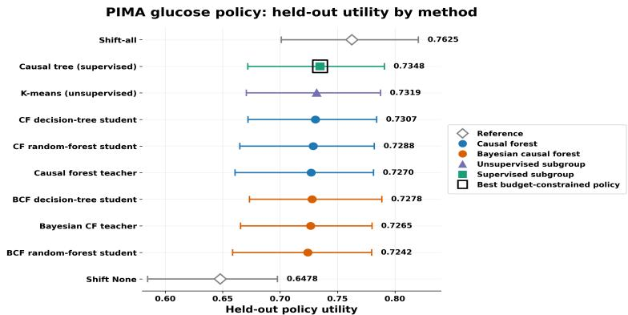  
Fig 4. PIMA glucose policy: The causal-tree comparator achieved the highest utility among the budget-constrained learned policies, followed closely by K-means and the causal-forest-distilled decision-tree student.

Table 12. PIMA glucose policy: Teacher–student decision overlap and ranking fidelity at the prespecified eligible-population inclusion rate. Decision overlap was generally high, with policy Jaccard similarities ranging from 0.7377 to 0.8596. The CF-distilled random forest and BCF-distilled decision tree achieved the highest decision overlap, while the CF-distilled random forest showed the strongest global rank agreement with its teacher. The BCF-distilled random forest achieved the highest teacher–student prediction fidelity $( R ^ { 2 } = 0 . 7 6 3 4 )$ , although its policy overlap and rank correlations were lower than those of the BCF-distilled decision tree.
<table><tr><td>Teacher</td><td>Student</td><td>Fidelity (R2)</td><td>Decision Jaccard</td><td>Spearman</td><td>Kendall τb</td><td>Boundary Kendall τb</td></tr><tr><td>Causal forest</td><td>Decision tree</td><td>0.6108</td><td>0.7377</td><td>0.7313</td><td>0.5672</td><td>0.402911</td></tr><tr><td>Causal forest</td><td>Random forest</td><td>0.7078</td><td>0.8596</td><td>0.8007</td><td>0.6118</td><td>0.642857</td></tr><tr><td>BCF</td><td>Decision tree</td><td>0.7398</td><td>0.8596</td><td>0.7234</td><td>0.5889</td><td>0.267261</td></tr><tr><td>BCF</td><td>Random forest</td><td>0.7634</td><td>0.7667</td><td>0.6778</td><td>0.5435</td><td>-0.254588</td></tr></table>

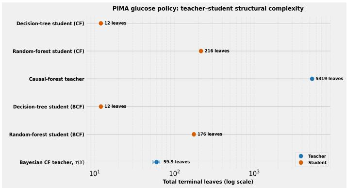  
Fig 5. PIMA glucose policy: Teacher–student structural complexity. Both distilled student models exhibit substantially fewer terminal leaves compared to the causal-forest teacher. The decision-tree student is also more compact than the BCF treatment-effect forest, according to the reported per-draw measure, while the BCF-distilled random forest has more leaves.

showed strong teacher agreement with substantially simpler representations. None of the prespecified paired comparisons remained significant after Holm adjustment.

Across the clinician-facing rules as shown in the table 17 and 18, age emerged as a consistent policy-relevant feature across both causal teachers. In the CF-distilled

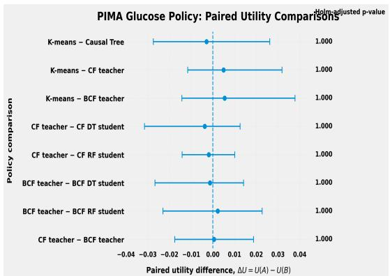  
Fig 6. PIMA glucose policy: Paired differences in held-out policy utility at the prespecified eligible-individual intervention budget. Positive values favor policy A and negative values favor policy B. Holm-adjusted p-values are shown at the right to account for multiplicity across the eight prespecified comparisons. All confidence intervals include zero, and none of the comparisons are statistically significant after Holm adjustment.

Table 13. PIMA glucose policy: Representative clinician-facing examples from the causal-forest-distilled decision-tree and random-forest students. The shallow RF surrogate achieved an $R ^ { 2 }$ of 0.782 with respect to the full causal-forest-distilled RF predictions and is used only for interpretation, not for policy allocation.
<table><tr><td>Student</td><td>Readable rule</td><td>Eligible N</td><td>Student benefit</td><td>CF teacher benefit</td><td>Policy status</td><td>Illustrative interpretation</td></tr><tr><td>DT</td><td>33.700 &lt; BMI ≤ 41.800 and DPF ≤ 0.440</td><td>13</td><td>37.1 pp</td><td>38.8 pp</td><td>Fully prioritized</td><td>This is an exact DT path. An eligible individual satisfying these thresholds is assigned directly to this terminal leaf, which predicts positive benefit and is</td></tr><tr><td>DT</td><td>Age ≤ 48.000, BMI &gt; 30.750, and DPF &gt; 0.440</td><td>21</td><td>27.5 pp</td><td>28.7 pp</td><td>Capacity boundary</td><td>70% intervention capacity. This exact DT leaf lies at the intervention-capacity boundary. Indi- viduals within the leaf receive the same DT benefit score, and approximately 42.9% of eligible profiles in this leaf</td></tr><tr><td>DT</td><td>25.500 &lt; Age ≤ 46.500 and 26.750 &lt; BMI ≤ 30.750</td><td>9</td><td>24.0 pp</td><td>20.8 pp</td><td>Positive benefit, outside capacity</td><td>allocation mechanism. The exact DT rule predicts positive benefit, but the leaf falls below the current capacity cutoff and none of its eligible evaluation profiles are priori-</td></tr><tr><td>RF surro- gate</td><td>33.750 &lt; BMI ≤ 43.050 and DPF ≤ 0.440</td><td>12</td><td>37.0 pp</td><td>39.1 pp</td><td>Fully prioritized RF region</td><td>The surrogate identifies a readable re- gion in which all eligible evaluation profiles were selected by the full RF. Because this is a surrogate region, the rule summarizes rather than exactly</td></tr><tr><td>gate</td><td>24.500 &lt; Age ≤ 46.500 and BMI ≤ 33.750</td><td>19</td><td>28.0 pp</td><td>27.1 pp</td><td>Partially prioritized RF region</td><td>reproduces the ensemble. The surrogate identifies a positive- benefit region in which the full RF pri- oritizes approximately 47.4% of eligible profiles, demonstrating within-region variation in individual RF allocation</td></tr><tr><td>RF surro- gate</td><td>Age ≤ 24.500 and 30.150 &lt; BMI ≤ 33.750</td><td>3</td><td>24.8 pp</td><td>23.8 pp</td><td>Positive region, out- side capacity</td><td>decisions. The surrogate identifies a region with positive mean RF-estimated benefit, but none of the eligible profiles in this region are prioritized under the current 70% intervention capacity.</td></tr></table>

students, fully prioritized regions generally involved individuals aged 60 years or younger, whereas positive-benefit regions among those older than 60 years appeared near or outside the allocation boundary. A similar pattern was evident for the BCF-distilled students, in which predicted benefit decreased across the illustrative age strata from younger than 40 years to 40–60 years and then to older than 60 years. This qualitative agreement suggests that age-related heterogeneity was recovered under both teacher models, although the specific subgroup definitions differed. Race/ethnicity and educational attainment also appeared in the rules derived from both teachers, while

Table 14. PIMA glucose policy: Representative clinician-facing examples from the BCF-distilled decision-tree and random-forest students. The shallow RF surrogate achieved an $R ^ { 2 }$ of 0.899 with respect to the full BCF-distilled RF predictions and is used only for interpretation, not for policy allocation.
<table><tr><td>Student</td><td>Readable rule</td><td>Eligible N</td><td>Student benefit</td><td>BCF teacher benefit</td><td>Policy status</td><td>Illustrative interpretation</td></tr><tr><td>DT</td><td>33.250 &lt; BMI ≤ 43.100 and DPF ≤ 1.011</td><td>30</td><td>32.4 pp</td><td>32.7 pp</td><td>Fully prioritized</td><td>This is an exact DT path. An eligible individual satisfying these thresholds is assigned directly to this terminal leaf, which predicts positive benefit and is</td></tr><tr><td>DT</td><td>Age &gt; 24.500, 28.750 &lt; BMI ≤ 33.250, and DPF ≤ 1.011</td><td>19</td><td>30.0 pp</td><td>31.0 pp</td><td>Capacity boundary</td><td>70% intervention capacity. This exact DT leaf lies at the intervention-capacity boundary. Indi- viduals within the leaf receive the same DT benefit score, and approximately 94.7% of eligible profiles in this leaf are</td></tr><tr><td>DT</td><td>BMI &gt; 43.100 and DPF ≤ 1.011</td><td>6</td><td>28.8 pp</td><td>27.6 pp</td><td>Positive benefit, outside capacity</td><td>tion mechanism. The exact DT rule predicts positive benefit, but the leaf falls below the current capacity cutoff and none of its eligible evaluation profiles are priori-</td></tr><tr><td>RF surro- gate</td><td>BMI &gt; 32.850 and DPF &lt; 1.086</td><td>38</td><td>31.9 pp</td><td>31.8 pp</td><td>Predominantly pri- oritized RF region</td><td>The surrogate identifies a readable positive-benefit region in which the full RF prioritizes approximately 94.7% of eligible profiles. Because this is a sur- rogate region, individual RF decisions</td></tr><tr><td>gate</td><td>28.750 &lt; BMI ≤ 32.850 and DPF ≤ 1.086</td><td>19</td><td>29.7 pp</td><td>31.0 pp</td><td>Partially prioritized RF region</td><td>may still differ within the region. The surrogate identifies a positive- benefit region in which the full RF prioritizes approximately 68.4% of eli- gible profiles, illustrating within-region variation in the ensemble&#x27;s individual</td></tr><tr><td>gate</td><td>RF surro- BMI &gt; 28.750 and DPF &gt; 1.086</td><td>6</td><td>21.2 pp</td><td>18.2 pp</td><td>Positive region, out- side capacity</td><td>allocation decisions. The surrogate identifies a region with positive mean RF-estimated benefit, but none of the eligible profiles in this region are prioritized under the current 70% intervention capacity.</td></tr></table>

income was prominent in the CF-derived rules and gender appeared in the BCF-derived rules. We interpret these demographic and socioeconomic partitions in the context of established social and structural determinants of sleep-health disparities [93], rather than as evidence of direct biological mechanisms. We regard these finer subgroup distinctions as model-dependent rather than established clinical findings. More generally, the reported thresholds are data-driven decision boundaries and should not be interpreted as validated clinical cutoffs.

Table 15. NHANES smoking-history policy: Held-out performances. Among the learned policies evaluated under the $q = 0 . 7 0$ maximum eligible-population budget, K-means achieved the highest point-estimate utility (0.7754), followed closely by the causal-forest teacher (0.7739). The Bayesian causal-forest teacher and its distilled students achieved similar utility (0.7706–0.7716), while the Causal Tree achieved utility 0.7701. The shift-all policy is shown only as an unconstrained reference and shifts all eligible individuals. Confidence intervals substantially overlapped across the learned policies.
<table><tr><td>Policy family</td><td>Policy</td><td>Distillation source</td><td>Policy risk</td><td>Policy utility</td><td>95% CI for utility</td></tr><tr><td>Reference Reference</td><td>Shift all eligible No shift</td><td></td><td>0.2182 0.2490</td><td>0.7818 0.7510</td><td>[0.7581, 0.7984] [0.7333, 0.7669]</td></tr><tr><td>Causal forest Causal forest</td><td>Teacher Decision-tree student</td><td>Causal forest Causal forest</td><td>0.2261 0.2336</td><td>0.7739 0.7664</td><td>[0.7530, 0.7889] [0.7450, 0.7820]</td></tr><tr><td>Causal forest BCF</td><td>Random-forest student Teacher</td><td>Causal forest BCF</td><td>0.2335 0.2294</td><td>0.7665 0.7706</td><td>[0.7453, 0.7821] [0.7507, 0.7853]</td></tr><tr><td>BCF</td><td>Decision-tree student</td><td>BCF</td><td>0.2284</td><td>0.7716</td><td>[0.7515, 0.7866]</td></tr><tr><td></td><td></td><td></td><td></td><td></td><td></td></tr><tr><td>BCF</td><td>Random-forest student</td><td>BCF</td><td>0.2284</td><td>0.7716</td><td>[0.7522, 0.7870]</td></tr><tr><td></td><td></td><td></td><td></td><td></td><td></td></tr><tr><td>Unsupervised subgroup policy</td><td>K-means</td><td>Not applicable</td><td>0.2246</td><td>0.7754</td><td>[0.7546, 0.7920]</td></tr><tr><td>Supervised subgroup policy</td><td>Causal Tree</td><td>Not applicable</td><td>0.2299</td><td>0.7701</td><td>[0.7492, 0.7869]</td></tr></table>

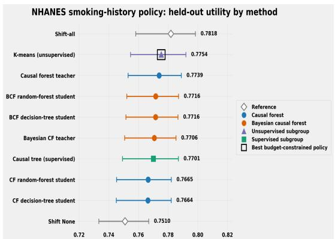  
Fig 7. NHANES smoking-history policy: held-out utility by method. Among the budget-constrained learned policies, K-means achieved the highest point-estimate utility (0.7754), followed by the causal-forest teacher (0.7739).

Table 16. NHANES smoking-history policy: Teacher–student decision overlap and ranking fidelity at the prespecified eligible-population inclusion rate $q = 0 . 7 0 .$ Teacher–student decision overlap was high across all distilled policies, with Jaccard similarities ranging from 0.7749 to 0.9370. The BCF-distilled random forest achieved the highest decision overlap, the strongest global rank agreement with its teacher, and the highest boundary-region rank agreement. The BCF-distilled decision tree also showed strong agreement with its teacher. Boundary-region rank agreement was positive for the BCF-distilled students but negative for the CF-distilled students.
<table><tr><td>Teacher</td><td>Student</td><td>Fidelity (R2)</td><td>Decision Jaccard</td><td>Spearman</td><td>Kendall τb</td><td>Boundary Kendall τb</td></tr><tr><td>Causal forest</td><td>Decision tree</td><td>0.6272</td><td>0.7749</td><td>0.7663</td><td>0.6029</td><td>-0.3686</td></tr><tr><td>Causal forest</td><td>Random forest</td><td>0.6923</td><td>0.7856</td><td>0.7813</td><td>0.6151</td><td>-0.2872</td></tr><tr><td>BCF</td><td>Decision tree</td><td>0.8503</td><td>0.9120</td><td>0.9316</td><td>0.8118</td><td>0.5985</td></tr><tr><td>BCF</td><td>Random forest</td><td>0.8512</td><td>0.9370</td><td>0.9468</td><td>0.8227</td><td>0.6301</td></tr></table>

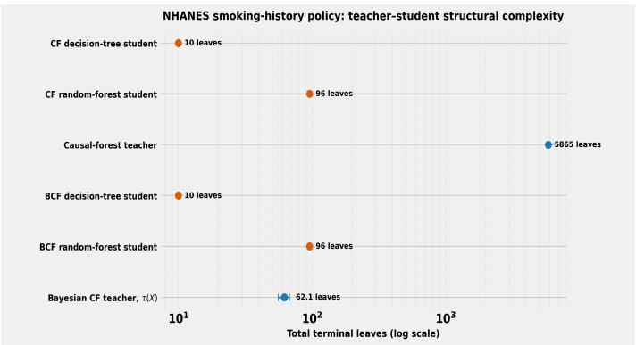  
Fig 8. NHANES smoking-history policy: teacher–student structural complexity. Structural complexity is summarized using the total number of terminal leaves on a logarithmic scale. Variation in realized leaf count of BCF reflects the adaptively learned posterior tree structures.

## 5.4 Ablation Study Results

## 5.4.1 Sensitivity to the outcome nuisance-model specification

Figure 10 shows the change in held-out policy utility when the logistic outcome nuisance regression in the DR evaluator was replaced with a HistGradientBoosting classifier.

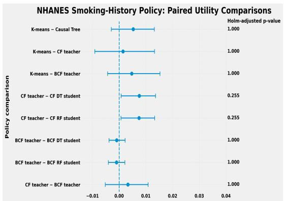  
Fig 9. NHANES smoking-history policy: paired utility comparisons. Paired held-out utility differences are shown for the prespecified policy comparisons, with 95% paired-bootstrap confidence intervals and Holm-adjusted p-values. Differences are defined as $\Delta U = U ( A ) - U ( B )$ , such that positive values favor the first policy named in each comparison. None of the comparisons remained statistically significant after Holm adjustment at the 0.05 level.

Table 17. NHANES smoking-history policy: Representative clinician-facing examples from the causal-forest-distilled decision-tree and random-forest students. The shallow RF surrogate achieved an R2 of 0.797 with respect to the full causal-forest-distilled RF predictions and is used only for interpretation, not for policy allocation.
<table><tr><td>Student</td><td>Readable rule</td><td>Eligible N</td><td>Student benefit (pp)</td><td>CF teacher benefit (pp)</td><td>Policy status</td><td>Illustrative interpretation</td></tr><tr><td>Decision tree</td><td>Age ≤ 60 years, race/ethnicity other than non-Hispanic White, and high- school education or less</td><td>245</td><td>8.33</td><td>7.87</td><td>Fully prioritized</td><td>This subgroup had comparatively high predicted benefit and was fully priori- tized under the q = 0.70 intervention</td></tr><tr><td>Decision tree</td><td>Age &gt; 60 years, moderate-to-high in- come (PIR &gt; 2), and race/ethnicity other than non-Hispanic White</td><td>88</td><td>1.89</td><td>1.36</td><td>Capacity boundary</td><td>budget. This subgroup had positive predicted benefit but lay near the intervention capacity boundary, so only part of the</td></tr><tr><td>Decision tree</td><td>Age &gt; 60 years, low income (PIR &lt; 2), and high-school education</td><td>65</td><td>1.53</td><td>0.68</td><td>Outside capacity</td><td>subgroup was selected. Predicted benefit remained positive, but the subgroup was not prioritized within the available intervention capac-</td></tr><tr><td>Random forest</td><td>Age ≤ 60 years, race/ethnicity other than non-Hispanic White, and high-</td><td>245</td><td>8.20</td><td>7.87</td><td>Fully prioritized</td><td>ity. This surrogate region represents indi- viduals with comparatively high pre- dicted benefit who were consistently</td></tr><tr><td>Random forest</td><td>Age ≤ 60 years, race/ethnicity other than non-Hispanic White, and more</td><td>229</td><td>2.26</td><td>2.00</td><td>Intermediate mixed</td><td>prioritized by the RF policy. This surrogate region contained indi- viduals with positive benefit but mixed allocation decisions around the policy</td></tr><tr><td>Random forest</td><td>Age &gt; 60 years, moderate-to-high in- come (PIR ≥ 2), and race/ethnicity</td><td>88</td><td>1.97</td><td></td><td>Outside capacity</td><td>boundary. Although the region showed positive predicted benefit, it fell outside the allocation capacity of the RF policy.</td></tr></table>

Across the BMI policies, the resulting changes were modest, ranging from −0.30 to −1.69 percentage points. The mean absolute change in utility was 1.02 percentage points and the maximum absolute change was 1.69 percentage points. HistGradientBoosting yielded slightly lower utility estimates for all policies in this experiment. Although the exact point-estimate ordering of several closely performing policies changed, the overall magnitude and pattern of policy performance remained broadly similar.

Figure 11 shows the change in held-out policy utility when the logistic outcome nuisance regression in the DR evaluator was replaced with a HistGradientBoosting classifier. Across the glucose policies, the changes ranged from −1.51 to +0.34 percentage points. The mean absolute change in utility was 0.90 percentage points, and the maximum absolute change was 1.51 percentage points. HistGradientBoosting yielded slightly lower utility estimates for most policies, while the CF teacher and CF random-forest student showed small increases of 0.12 and 0.34 percentage points, respectively. Although the exact point-estimate ranking changed among several closely performing policies, the absolute changes in estimated utility were small, with no policy changing by more than approximately 1.5 percentage points.

Table 18. NHANES smoking-history policy: Representative clinician-facing examples from the BCF-distilled decision-tree and random-forest students. The shallow RF surrogate achieved an $R ^ { 2 }$ of 0.897 with respect to the full BCF-distilled RF predictions and is used only for interpretation, not for policy allocation.
<table><tr><td>Student</td><td>Readable rule</td><td>Eligible N</td><td>Student benefit (pp)</td><td>BCF teacher benefit (pp)</td><td>Policy status</td><td>Illustrative interpretation</td></tr><tr><td>Decision tree</td><td>Age &lt; 40 years, at least high-school ed- ucation, and race/ethnicity other than Mexican American</td><td>274</td><td>6.07</td><td>6.04</td><td>Fully prioritized</td><td>This subgroup had comparatively high predicted benefit and was fully priori- tized under the q = 0.70 intervention</td></tr><tr><td>Decision tree</td><td>Age 40–60 years, at least high-school education, and male</td><td>170</td><td>3.58</td><td>3.84</td><td>Capacity boundary</td><td>budget. This subgroup had positive predicted benefit but lay near the intervention capacity boundary, so only part of the</td></tr><tr><td>Decision tree</td><td>Age &gt; 60 years, at least high-school education, and female</td><td>157</td><td>3.02</td><td>2.30</td><td>Outside capacity</td><td>subgroup was selected. Predicted benefit remained positive, but the subgroup was not prioritized within the available intervention capac-</td></tr><tr><td>Random forest</td><td>Age &lt; 40 years and at least high-school education</td><td>309</td><td>5.94</td><td>5.82</td><td>Fully prioritized</td><td>ity. This surrogate region represents indi- viduals with comparatively high pre- dicted benefit who were consistently</td></tr><tr><td>Random forest</td><td>Age 40–60 years and at least high- school education</td><td>373</td><td>4.38</td><td>4.43</td><td>Intermediate mixed</td><td>prioritized by the RF policy. This surrogate region contained indi- viduals with positive benefit but mixed allocation decisions near the policy</td></tr><tr><td>Random forest</td><td>Age &gt; 60 years, at least high-school education, and male</td><td>182</td><td>1.52</td><td>1.11</td><td>Outside capacity</td><td>boundary. Although the region showed positive predicted benefit, it fell outside the allocation capacity of the RF policy.</td></tr></table>

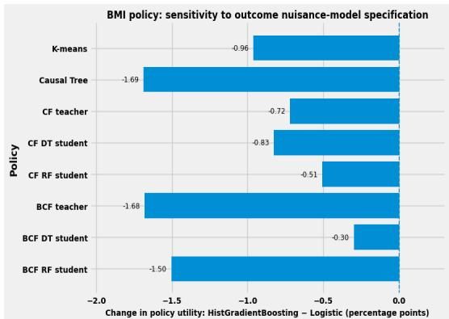  
Fig 10. BMI policy: sensitivity to the outcome nuisance-model specification. Change in held-out policy utility after replacing the logistic-regression outcome nuisance model in the doubly robust evaluator with a HistGradientBoosting classifier. The dashed vertical line at zero indicates no change in estimated utility. Negative values indicate lower utility estimates under the HistGradientBoosting outcome nuisance model.Changes are shown in percentage points for visual readability.

Figure 12 shows the change in held-out policy utility when the logistic outcome nuisance regression in the DR evaluator was replaced with a HistGradientBoosting classifier while all learned policies and other evaluation settings were held fixed. Across the smoking-history policies, the changes were uniformly small and negative, ranging from approximately −0.17 to −0.01 percentage points. Based on the displayed values, the mean absolute change in utility was approximately 0.10 percentage points, and the maximum absolute change was approximately 0.17 percentage points. The K-means and Causal Tree policies were essentially unchanged, while the largest decreases were observed for the CF random-forest student (−0.17 percentage points) and CF decision-tree student (−0.16 percentage points). Overall, replacing the logistic outcome nuisance model with HistGradientBoosting produced only minor downward shifts in estimated utility, indicating that the held-out smoking-policy evaluation was comparatively insensitive to this nuisance-model specification

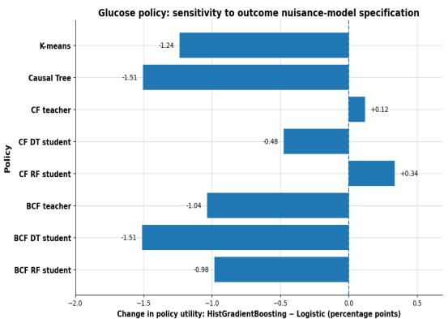  
Fig 11. Glucose policy: sensitivity to the outcome nuisance-model specification. The dashed vertical line at zero indicates no change in estimated utility. Negative values indicate lower utility estimates under the HistGradientBoosting outcome nuisance model.Changes are shown in percentage points for visual readability.

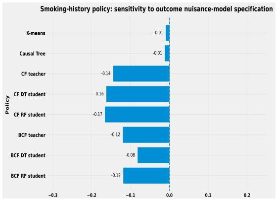  
Fig 12. Smoking policy: sensitivity to the outcome nuisance-model specification. The dashed vertical line at zero indicates no change in estimated utility. Negative values indicate lower utility estimates under the HistGradientBoosting outcome nuisance model.Changes are shown in percentage points for visual readability.

## 5.4.2 Sensitivity to the Discovery–Evaluation Split

We assessed sensitivity to the discovery–evaluation partition across five independent random splits while holding all other analysis settings fixed. Mean held-out utilities were broadly similar across splits and qualitatively consistent with the representative split (Figs. 13–15). The highest mean point estimate varied by application, with BCF highest for BMI and smoking-history and K-means highest for glucose.

These differences are descriptive comparisons of point estimates across the examined splits. The standard-deviation bars quantify split-to-split variability rather than inferential uncertainty.

## 5.4.3 Sensitivity of policy utility to score-policy encoding

As shown in Fig. 16, this modification left the allocation among the eligible individuals for the BMI policy unchanged for all six teacher and student policies. Changes in held-out policy utility were small, with a mean absolute change of 0.0064 and a maximum absolute change of 0.0178. The 95% bootstrap confidence intervals for the utility change included zero for all policies, indicating that the BMI policy-value results were insensitive to this alternative extension of the score policy to T = 0 observations.

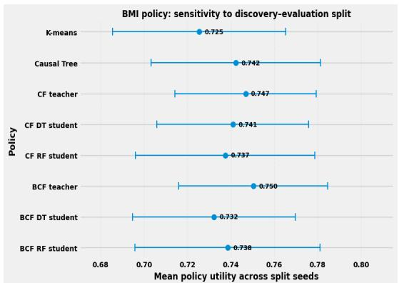  
Fig 13. BMI policy: sensitivity of held-out policy utility to the discovery–evaluation split. Points show the mean held-out policy utility across the independent discovery–evaluation splits, and horizontal error bars show one standard deviation across splits. The BCF teacher achieved the highest mean utility point estimate followed closely by the CF teacher.

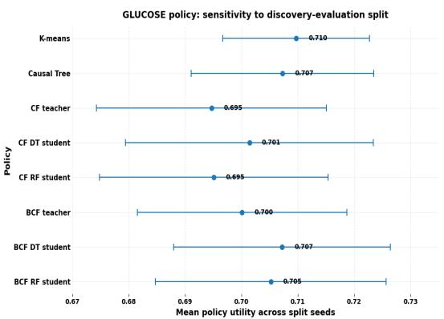  
Fig 14. Glucose policy: sensitivity of held-out policy utility to the discovery–evaluation split. K-means attained the highest mean utility point estimate followed closely by the Causal Tree. Overall, the mean utilities were relatively similar across policies, with overlapping split-to-split variability. Error bars summarize variability across discovery–evaluation splits and are not confidence intervals.

As shown in Fig. 17, extending the learned score policy left the allocation among eligible individuals unchanged for all six glucose teacher and student policies. Changes in held-out policy utility were small, with a mean absolute change of 0.0044 and a maximum absolute change of 0.0105. As shown in Fig. 18, extending the learned score policy left the allocation among eligible individuals unchanged for all six smoking teacher and student policies. Changes in held-out policy utility were negligible, with a mean absolute change of 0.00004 and a maximum absolute change of 0.00023.

## 5.4.4 IHDP Dataset Results

As the IHDP benchmark provides the ground-truth potential-outcome functions, we evaluated policy performance using the true policy value rather than an estimated doubly robust value. Specifically, each method was used to rank individuals, and the corresponding policy was constructed under the common 70% budget constraint. Its value was then computed from the known counterfactual outcomes.

While PEHE and policy value are related, they are not redundant. A formal decomposition (Supplementary Note 1, Section 0.2–0.3) shows that policy regret is jointly bounded by CATE-estimation error and the disagreement rate between the learned and oracle policies. We therefore report PEHE, true policy value, and oracle top-q Jaccard jointly rather than PEHE alone.

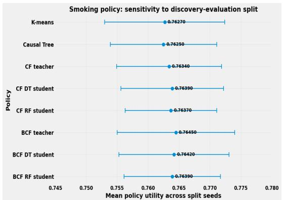  
Fig 15. Smoking policy: sensitivity of held-out policy utility to the discovery–evaluation split. The BCF teacher attained the highest mean utility point estimate, followed closely by the BCF DT student. Overall, the policies showed closely comparable mean performance with substantial overlap in split-to-split variability. Error bars summarize variability across discovery–evaluation splits and are not confidence intervals.

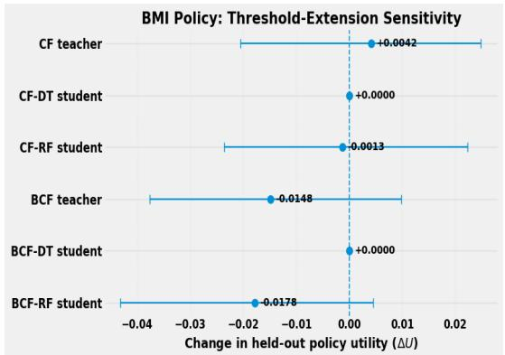  
Fig 16. BMI policy: sensitivity to score-policy threshold extension. Horizontal bars denote 95% bootstrap confidence intervals, and the dashed vertical line indicates no change in utility. Changes were small across all models

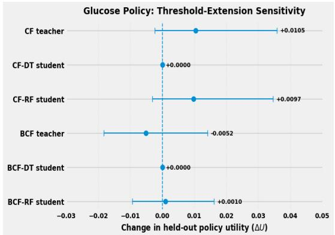  
Fig 17. Glucose policy: sensitivity to score-policy threshold extension. Horizontal bars denote 95% bootstrap confidence intervals, and the dashed vertical line indicates no change in utility. Changes were small across all models

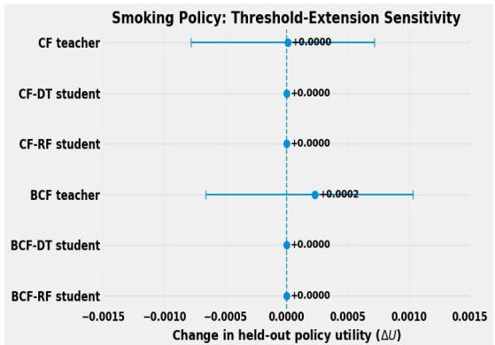  
Fig 18. Smoking policy: sensitivity to score-policy threshold extension. Horizontal bars denote 95% bootstrap confidence intervals, and the dashed vertical line indicates no change in utility. Changes were small across all models

Across the 10 IHDP realizations, the BCF teacher demonstrated the strongest overall performance among the teacher models. It achieved a lower mean PEHE and a higher mean true policy value than the causal forest teacher (Table 19). This advantage was also reflected in the ground-truth agreement measures. BCF attained higher mean Spearman and Kendall correlations with the true CATE ranking and greater overlap with the oracle top-q policy than the causal forest teacher (Table 20). Therefore, within this IHDP analysis, BCF served as the more accurate teacher for both treatment-effect estimation and for identifying individuals prioritized by the oracle budget-constrained policy.

Among the distilled models, the BCF random-forest student demonstrated the best overall performance. It attained the lowest mean PEHE and the highest mean true policy value among the student models, while also exhibiting the strongest agreement with both its teacher and the known ground truth. In particular, it achieved the highest teacher-ranking correlations, teacher top-q Jaccard, true-CATE rank correlations, and oracle top-q Jaccard among the distilled students. Within both teacher families, the random-forest students generally preserved their teachers’ rankings and selected populations more closely than the corresponding decision-tree students.

The K-Prototypes results should be interpreted in light of the weak cluster separation observed in the IHDP covariate space. Gower-based silhouette coefficients were low across the prespecified candidate range, with the maximum attained at K = 3. Thus, K = 3 represented the best-supported solution among the candidates considered, but the absolute silhouette value did not indicate three sharply separated natural subgroups. One contributing factor may be the composition of the IHDP covariate set, which contains 19 binary and six continuous variables. It is likely that the substantial overlap in the binary covariate profiles may have reduced the contrast between within-cluster and between-cluster dissimilarities. More broadly, prior work has shown that pairwise-distance contrast can deteriorate as dimensionality increases and that this behavior depends on the selected distance metric [94, 95]. In terms of performance, K-Prototypes achieved a slightly lower mean PEHE and a slightly higher mean true policy value, whereas the causal tree attained somewhat higher correlations with the true CATE ranking and greater overlap with the oracle top-q population. These results therefore do not indicate a clear overall advantage of supervised over unsupervised

subgroup construction. Rather, the single causal tree showed somewhat better recovery of the oracle-prioritized subgroup, while K-Prototypes showed slightly better average treatment-effect estimation and policy-value performance. The causal-tree comparator consisted of one interpretable, shallow tree rather than an ensemble.

Table 19. IHDP semi-synthetic analysis: Performance averaged across 10 IHDP realizations, reported as mean ± standard deviation where available. True policy value denotes the average ground-truth outcome under the semi-synthetic IHDP outcome-generating process if treatment were assigned according to the policy, with higher values indicating better performance. Policy regret is the difference between the oracle policy value and the value achieved by the evaluated policy, with lower values indicating performance closer to the oracle and zero denoting the oracle itself. The selective BCF policy achieved a higher true policy value than the unrestricted treat-all reference because budgeted targeting can avoid allocating treatment to individuals with low or negative treatment benefit. The absolute magnitude of policy value does not have a direct clinical interpretation and is used for comparative evaluation within the benchmark. The oracle positive-benefit policy under the 70% budget cap achieved a mean value of 14.3667 ± 16.4195. PEHE is not applicable to the reference policies. The comparatively large standard deviations reflect known variation in the scale of the original IHDP outcome simulations across realizations [96].
<table><tr><td>Method</td><td>Method family</td><td>√PEHE</td><td>True policy value</td><td>Mean policy regret</td></tr><tr><td>Causal Forest teacher</td><td>Causal Forest</td><td>3.2190 ± 5.4669</td><td>14.0385 ± 15.8533</td><td>0.3282</td></tr><tr><td>CF Decision Tree student</td><td>CF distillation</td><td>3.7957 ± 6.5949</td><td>13.8532 ± 15.5185</td><td>0.5135</td></tr><tr><td>CF Random Forest student</td><td>CF distillation</td><td>3.5699 ± 6.1307</td><td>13.9602 ± 15.7249</td><td>0.4065</td></tr><tr><td>BCF teacher</td><td>BCF</td><td>1.8410 ± 3.4889</td><td>14.2940 ± 16.3010</td><td>0.0727</td></tr><tr><td>BCF Decision Tree student</td><td>BCF distillation</td><td>3.2212 ± 5.6655</td><td>13.9773 ± 15.7715</td><td>0.3894</td></tr><tr><td>BCF Random Forest student</td><td>BCF distillation</td><td>2.4207 ± 4.4021</td><td>14.1724 ± 16.0666</td><td>0.1943</td></tr><tr><td>K-Prototypes subgroup</td><td>Unsupervised subgroup</td><td>4.0196 ± 6.8354</td><td>13.2687 ± 15.0508</td><td>1.0980</td></tr><tr><td>Causal Tree subgroup</td><td>Supervised subgroup</td><td>4.4614 ± 8.2784</td><td>13.1436 ± 13.8546</td><td>1.2231</td></tr><tr><td>Oracle positive-benefit budget cap</td><td>Reference</td><td></td><td>14.3667 ± 16.4195</td><td>0.0000</td></tr><tr><td>Treat none</td><td>Reference</td><td></td><td>9.4531 ± 12.2658</td><td>4.9136</td></tr><tr><td>Treat all (unrestricted reference)</td><td>Reference</td><td></td><td>14.0893 ± 13.8702</td><td>0.2774</td></tr></table>

Table 20. IHDP ranking fidelity and policy overlap: Results are averaged across 10 IHDP realizations and reported as mean ± standard deviation. Spearman and Kendall coefficients measure agreement in the complete treatment-benefit ranking, whereas top-q Jaccard measures overlap between the populations selected under the 70% treatment budget. Teacher-agreement measures are reported only for distilled students.
<table><tr><td rowspan="2">Method</td><td rowspan="2">Teacher</td><td colspan="3">Agreement with teacher</td><td colspan="3">Agreement with ground truth</td></tr><tr><td>Spearman</td><td>Kendall</td><td>Top-q Jaccard</td><td>Spearman</td><td>Kendall</td><td>Oracle top-q Jaccard</td></tr><tr><td>Causal Forest teacher</td><td></td><td></td><td></td><td></td><td>0.7607 ± 0.1310</td><td>0.5760 ± 0.1190</td><td>0.7681 ± 0.0526</td></tr><tr><td>CF Decision Tree student</td><td>Causal Forest</td><td>0.8172 ± 0.1189</td><td>0.6775 ± 0.1332</td><td>0.8112 ± 0.0788</td><td>0.6694 ± 0.1882</td><td>0.5283 ± 0.1598</td><td>0.7361 ± 0.0754</td></tr><tr><td>CF Random Forest student</td><td>Causal Forest</td><td>0.9001 ± 0.0719</td><td>0.7432 ± 0.1018</td><td>0.8621 ± 0.0590</td><td>0.7308 ± 0.1353</td><td>0.5477 ± 0.1171</td><td>0.7555 ± 0.0361</td></tr><tr><td>BCF teacher</td><td></td><td></td><td></td><td></td><td>0.8572 ± 0.1573</td><td>0.7016 ± 0.1643</td><td>0.8601 ± 0.0548</td></tr><tr><td>BCF Decision Tree student</td><td>BCF</td><td>0.7864 ± 0.0710</td><td>0.6359 ± 0.0824</td><td>0.8052 ± 0.0625</td><td>0.7252 ± 0.1312</td><td>0.5792 ± 0.1307</td><td>0.7742 ± 0.0402</td></tr><tr><td>BCF Random Forest student</td><td>BCF</td><td>0.9236 ± 0.0379</td><td>0.7767 ± 0.0636</td><td>0.8778 ± 0.0417</td><td>0.8261 ± 0.1353</td><td>0.6577 ± 0.1322</td><td>0.8153 ± 0.0452</td></tr><tr><td>K-Prototypes subgroup</td><td></td><td></td><td></td><td></td><td>0.4070 ± 0.2602</td><td>0.3204 ± 0.2081</td><td>0.5421 ± 0.0713</td></tr><tr><td>Causal Tree subgroup</td><td></td><td></td><td></td><td></td><td>0.4269 ± 0.2550</td><td>0.3380 ± 0.2067</td><td>0.6283 ± 0.0822</td></tr></table>

## 6 Discussion

The primary finding is that no single policy representation consistently outperformed others across all applications. Various approaches achieved comparable aggregate policy values, yet differed in structural complexity, allocation granularity, and fidelity near the intervention boundary. Therefore, policy representations should be assessed not only by average utility but also by the specific decisions they generate.

The BMI experiment demonstrated most clearly that a flexible causal teacher model can be compressed without substantial loss in policy performance. The causal-tree

comparator achieved the highest point-estimate utility among budget-constrained policies, closely followed by the BCF teacher, the causal forest teacher, and several distilled student models. The principal conclusion from this experiment is not a statistically significant ranking of methods, but rather that both relatively simple subgroup policies and distilled student models can attain policy performance comparable to that of more complex causal models.

The clinician-facing rules further indicated that certain qualitative aspects of treatment-effect structure remained stable across different teacher models, despite variations in exact data-adaptive thresholds. Specifically, elevated DPF values were consistently observed in higher-benefit regions identified by both CF and BCF teachers. Both random-forest student models identified highly prioritized profiles characterized by relatively few pregnancies and elevated familial-risk values. However, the exact split locations and secondary modifiers varied between teacher models.

The glucose experiment yielded a different ranking of methods. In this case, the shallow causal-tree subgroup comparator attained the highest held-out point-estimate utility, closely followed by K-means and the CF-distilled decision tree, while the remaining teacher and student policies also demonstrated similar performance. This finding cautions against assuming that increased model flexibility necessarily results in higher policy value across all applications. When treatment-effect heterogeneity can be adequately captured by a small number of partitions, a simple subgroup rule may perform comparably to an individualized ensemble model.

Nevertheless, the glucose rules revealed meaningful structural similarities across teacher models. Moderately high to high BMI values were consistently present in higher-priority regions identified by both CF and BCF distillation, whereas the role of DPF was less stable and depended more strongly on the teacher and the accompanying covariate partitions. Thus, the glucose experiment further illustrates the importance of comparing across plausible teacher models rather than interpreting a single fitted tree in isolation. Recurrent qualitative features provide stronger descriptive evidence than reliance on any single numerical threshold.

The smoking-history experiment provides perhaps the clearest example of the distinction between aggregate policy value and individual allocation. K-means obtained the highest held-out point-estimate utility among the budget-constrained policies, but the causal forest, BCF family, causal tree, and distilled students achieved closely related values. Therefore, aggregate utility alone would suggest relatively little distinction among the approaches.

The allocation-disagreement analysis gives a different view. K-means and the causal-forest policy used the same expected intervention capacity but agreed on only part of the selected population. The individuals selected by one policy but not the other also differed systematically in their covariate profiles and CF-estimated benefits. In particular, the K-means-only group had negative mean benefit under the CF scoring function, whereas the CF-only group had positive mean CF-estimated benefit, as shown in the supplementary files. Since these contrasts are evaluated using the CF teacher’s own effect estimates, they are not independent evidence that the CF allocation is causally superior.

The smoking-history clinician-facing rules further showed both stability and teacher dependence. Age emerged repeatedly under both CF and BCF, with younger or middle-aged groups tending to occur in more highly prioritized regions and older groups appearing more frequently near or outside the allocation boundary.

Taken together, the subgroup experiments do not support a simple conclusion that supervised subgroup construction is uniformly superior to unsupervised clustering. The causal tree could isolate sharper high- and negative-benefit regions in some experiments because treatment-effect information informs its partitioning, whereas K-means

constructs groups solely from pretreatment covariate similarity. However, this additional supervision can also create small leaves with unstable effect estimates, and the causal tree did not consistently achieve higher held-out utility than K-means. More broadly, the subgroup policies considered here rank clusters or leaves using point-estimated mean benefit and aggregate gain without incorporating estimation uncertainty into subgroup admission. In settings where an incorrect allocation may carry substantial clinical cost, a favorable point estimate alone may provide insufficient evidence for intervention, particularly for small or heterogeneous subgroups. Uncertainty-aware admission criteria, such as lower-confidence-bound or posterior-probability rules [49] therefore represent an important extension for higher-risk applications.

The more important distinction is therefore between group-level and individualized resolution. Unsupervised clustering has an important practical advantage. It can generate a small number of recognizable pretreatment profiles without using outcome or estimated treatment-effect information to construct those groups. Such policies can be easy to describe, audit, and implement. However, the disagreement analyses demonstrate what this simplicity can cost. Individuals assigned to the same subgroup receive the same or a common fractional allocation even when an individualized causal model places them at different positions in the benefit ranking. Consequently, similar aggregate utility does not imply similar allocation or equivalent clinical interpretation. Another important distinction concerns how learned policies are transferred to the evaluation cohort. In the cases of K-means and the Causal Tree, subgroup definitions and subgroup priority ordering remain fixed based on the discovery cohort. In contrast, for the teacher and distilled-student policies, the learned benefit-scoring function is fixed and subsequently applied to the evaluation cohort to rank eligible individuals according to the budget constraint.

The teacher-student analyses indicate a practical middle ground between these two extremes. A flexible causal teacher can be used offline to estimate a confounding-adjusted treatment-effect surface, after which a simpler student can approximate the treatment ranking used for deployment. The decision-tree students provide the strongest structural simplification and explicit root-to-leaf rules, whereas random-forest students retain greater flexibility at the cost of reduced direct interpretability. The appropriate student therefore depends on the desired balance between transparency and fidelity rather than on predictive R2 alone.

The structural-complexity results also require some attention. Compression was particularly large relative to the causal-forest teachers, whose ensembles contained many more terminal leaves than the students. In contrast, the BCF treatment-effect forest is itself strongly regularized and can have relatively few terminal leaves. Consequently, an RF student is not guaranteed to contain fewer raw leaves than the BCF treatment-effect component. Its deployment advantage instead arises from replacing a posterior distribution over causal forests with a single fixed prediction rule. Thus, terminal-leaf count is one useful measure of structural complexity, but should be interpreted together with whether inference requires an ensemble, posterior sampling, and additional prognostic components.

A key implication of the distillation results is that global teacher–student agreement is not sufficient to determine whether a student can operationally replace its teacher. Policy decisions under a fixed budget are determined by relative ordering near the allocation cutoff. A student can therefore achieve a high global R2, Spearman correlation, or Kendall coefficient while reversing the order of individuals immediately above and below the operational threshold. Such errors may have little influence on global fidelity statistics but directly change who receives the intervention.

For this reason, boundary-restricted Kendall agreement should be considered a decision-focused diagnostic rather than an ancillary prediction metric. The BMI

experiment demonstrated weak or negative local ordering for several student models despite substantially stronger global rank agreement. The smoking experiment provided an especially informative contrast. The BCF-distilled student models preserved positive local ordering near the boundary, whereas the CF-distilled student models exhibited negative boundary Kendall coefficients despite positive global correlations. These results suggest that replacing a causal teacher with a student model based solely on global predictive fidelity is not advisable. Approximation should instead demonstrate acceptable policy value, selected-set agreement, global ranking fidelity, and local ordering around the intended operating threshold. When local fidelity is poor, it is more defensible to retain the teacher model for borderline cases [97] or to report the student model as an approximation rather than as an interchangeable replacement.

The paired-bootstrap analyses reinforce this interpretation. Point-estimate rankings differed across the BMI, glucose, and smoking-history experiments, but the prespecified comparisons did not remain statistically significant after Holm adjustment. Therefore, the observed ordering of learned policies should be interpreted descriptively rather than as evidence that the highest-ranked method is generally superior. Importantly, lack of a significant paired difference does not establish equivalence [98]. Instead, the results may reflect both genuinely small differences in aggregate policy value and limited precision. Modest held-out sample sizes and variability in doubly robust estimation limit the resolution of small differences. These findings make decision-focused properties, including interpretability, allocation overlap, boundary fidelity, and structural complexity, particularly relevant when several policies achieve comparable estimated value.

The sensitivity analyses broadly supported the stability of the observational results. Replacing the logistic-regression outcome nuisance model with HistGradientBoosting produced only modest changes in held-out utility, with the smallest changes observed for the smoking-history policy. Similarly, across five discovery and evaluation splits, relative performance remained broadly consistent, although the highest mean-utility method differed across BMI, glucose, and smoking. These findings indicate that the overall conclusions are not driven by a particular nuisance-model specification or a single data split. Small differences in point-estimate utility should be interpreted descriptively rather than as stable evidence of superiority. The score-policy encoding sensitivity analysis provided additional reassurance. Extending the learned score thresholds to T = 0 observations while preserving the eligible T = 1 allocation produced only small utility changes for BMI and glucose and negligible changes for smoking. It thus supported the robustness of the policy-value conclusions to this alternative score-policy representation.

The semi-synthetic IHDP experiments provide an important complement to the observational analyses because true potential outcomes and treatment effects are available. Across the ten realizations, BCF achieved the strongest combination of treatment-effect estimation accuracy, true policy value, and agreement with the oracle allocation among the teachers. Among the distilled models, the BCF random-forest student model provided the strongest overall performance and more closely preserved both teacher and oracle rankings than the corresponding decision-tree student models. These findings provide ground-truth evidence that the teacher-student strategy can retain much of the decision-relevant information in a high-quality causal teacher model, rather than merely reproducing its estimated value under an observational evaluator.

Another way to compare is to use a random allocation that fits the budget. The expected value of randomly treating 70% of individuals is the same as the value when no one is treated plus 0.70 times the difference between treating everyone and treating no one, which is about 12.70 when calculated using the average values in Table 19 [3]. All of the learned policies did better than this value on average. This shows that the

CATE-based and subgroup-based rankings were able to find real differences in benefit that a random allocation without covariates would miss. This comparison uses averages from different runs. A paired comparison for each run, using each policy’s actual proportion treated, still needs to be done.

The IHDP experiments also clarify why treatment-effect prediction accuracy should not be used as the sole criterion for policy selection. As derived in the Supplementary Material, policy regret depends jointly on treatment-effect estimation error and disagreement between the learned and oracle policies. Thus, PEHE measures the numerical accuracy of the estimated treatment effects, whereas policy value, policy regret, ranking agreement, and top-q overlap measure consequences for the downstream allocation. Two estimators can have different PEHE yet induce similar treatment rankings, while comparatively small numerical errors can have substantial impact when they occur around the budget boundary. This theoretical relationship is consistent with the empirical teacher-student analyses and provides an additional rationale for reporting decision-focused fidelity measures alongside conventional treatment-effect prediction metrics.

The results therefore favor neither purely supervised nor purely unsupervised policy construction in all settings. If the principal requirement is a small, highly transparent set of population-level rules, pretreatment subgroup policies remain useful and can attain competitive average utility. A supervised causal tree provides an alternative when effect-informed subgroup construction is acceptable, although small-leaf instability must be monitored. When the primary objective is to preserve individual treatment-effect heterogeneity and allocate a constrained intervention as efficiently as possible, the IHDP results favor first estimating effects with a flexible causal teacher model and then considering distillation for deployment.

Within that strategy, the simplest student model should not automatically be selected. The deployment model should be chosen using a hierarchy of criteria including held-out policy value and uncertainty, teacher-student allocation overlap, global ranking agreement, local fidelity around the operational boundary, and finally structural and rule complexity. A shallow decision tree is preferable when transparent rules are paramount and these fidelity criteria remain acceptable. A small random forest is preferable when modest additional complexity produces materially better preservation of teacher ranking or allocation. If neither student model preserves the teacher model near the decision boundary, the teacher model should not be regarded as fully replaceable.

## 7 Limitations and Future Work

This study is subject to several important limitations. The primary analyses rely on observational data, so causal relationships and heterogeneous treatment-effect estimates should be interpreted as conditional on the assumed causal structure and identification assumptions, rather than as definitive causal evidence. Identification depends on standard assumptions, including unconfoundedness (ignorability), consistency, and positivity. Violations of these assumptions, such as residual or unmeasured confounding or insufficient treatment overlap, may bias both the estimated CATEs and subsequent policy evaluations. Dataset-specific limitations are also present. In the NHANES analyses, each respondent is treated as a single observational unit, and survey weights are not incorporated to produce population-representative point estimates. The uncertainty quantification does not fully account for the complexity of the NHANES sampling design, including stratification and clustering. Therefore, the reported estimates and confidence intervals should not be interpreted as fully design-based, nationally representative NHANES estimates. The IHDP analysis is limited by reduced empirical overlap in certain regions of the covariate space under the standard

de-randomized benchmark construction. As a result, IHDP is used primarily to evaluate CATE estimation, policy ranking, and ground-truth policy value, rather than to claim that full-population CATEs would necessarily be identifiable in a real observational study with similarly limited overlap. The policy experiments should be interpreted as hypothetical state interventions, not as evaluations of a known historical decision policy. For modifiable risk-factor exposures such as obesity and elevated glucose, the policies represent counterfactual changes in exposure state among prioritized eligible individuals and do not correspond to an implemented clinical program or bandit logging policy. The NHANES smoking exposure presents an additional limitation because it is defined using an ever-smoking criterion, which does not distinguish current from former smokers. The corresponding intervention should therefore be interpreted as a hypothetical change in smoking-history state, not as an acute smoking-cessation intervention among current smokers. Mixing current and former smokers within the exposed group may attenuate estimated effects and policy-value differences, limiting the clinical specificity of this intervention. Additional limitations relate to subgroup construction and subgroup-level effect estimation. K-means clustering produces hard cluster assignments and does not quantify uncertainty in cluster membership. Individuals near cluster boundaries may therefore be assigned somewhat arbitrarily under the primary hard-clustering analysis. Finally, the distilled student models are supervised regressors trained to approximate CATE surfaces estimated by the causal-forest and BCF teachers. The decision-tree and random-forest students do not estimate causal effects independently or optimize a causal objective. Their causal interpretation is inherited from the corresponding teacher and may therefore inherit biases arising from teacher misspecification.

Despite good empirical performance across multiple policies, our study identifies several directions to strengthen causal validity, improve deployability, and broaden applicability beyond the current binary state-intervention setting. Our distillation experiments focus on two interpretable student families, decision trees and random forests, and a broader exploration of the teacher–student design space remains open. Future work could also consider uncertainty-aware distillation targets, such as the posterior standard deviation of the CATE, a lower credible bound, or the posterior probability of benefit. Such targets would allow student models to approximate not only the teacher’s mean effect surface but also aspects of its uncertainty-aware decision structure. As an additional effect-discretization baseline, we plan to apply the method presented in [99] to partition the teacher’s CATE surface into a small number of effect levels and evaluate the policies induced by these discretized representations. Several extensions could also strengthen the empirical design. The causal structures and treatment-effect patterns examined here are based primarily on cross-sectional data. An important next step is to evaluate whether the same relationships and patterns persist in longitudinal datasets, where temporal ordering can be represented more explicitly, and time-varying exposures and outcomes can be studied. Our current handling of missing data is based on complete-case analysis, which can reduce the effective sample size and may introduce selection bias when missingness is not completely random. Future work could therefore investigate causal-structure-informed imputation strategies that use prespecified causal relationships to guide imputation while avoiding inappropriate conditioning or the introduction of spurious dependencies. For NHANES specifically, future analyses will incorporate survey-statistical variance estimators that explicitly account for strata and primary sampling units, together with appropriate survey weights where population-representative inference is desired. Finally, we plan to extend the framework to additional clinically motivated intervention settings. One example is antiseizure-medication (ASM) optimization, motivated by evidence that ASMs can alter sleep architecture and may contribute to sleep disturbance in some settings [100–103]. More broadly, future work could extend the framework beyond

binary exposure-state modifications to include multivalued, continuous, or longitudinal intervention policies, thereby allowing a wider range of clinically relevant treatment and risk-factor optimization problems to be considered.

## 8 Conclusion

Overall, the experiments suggest that interpretable causal policy design is best viewed as a tradeoff among causal estimation, allocation resolution, and deployment complexity rather than as a contest between a single supervised and unsupervised algorithm. Unsupervised subgroup policies offer transparent population-level decisions but can mask within-group heterogeneity. Causal trees provide effect-informed but still coarse partitions. Flexible causal teacher models provide individualized rankings but are more difficult to deploy. Distillation can recover much of their decision structure in simpler models. The most consequential approximation errors are those that change allocation near the operating threshold, motivating evaluation of policy agreement and local ranking fidelity in addition to conventional prediction metrics. Under this view, the role of the causal teacher model is to estimate the heterogeneous intervention signal, while the role of the student model is to provide the simplest deployment representation that preserves the decision-relevant features of that signal.

## Acknowledgements

The authors express their gratitude to Madeline C. Fields and Lara V. Marcuse of the Icahn School of Medicine at Mount Sinai and the Mount Sinai Hospital, New York, NY, USA, for their assistance in elucidating potential causal relationships relevant to this study. Appreciation is also extended to Dr. Vishwas D. Pai of Pai Onco Care Center and Hubli Scan Center, India, for his valuable guidance and support.

## References

1. Murphy SA. Optimal dynamic treatment regimes. Journal of the Royal Statistical Society Series B: Statistical Methodology. 2003;65(2):331-55.

2. Qian M, Nahum-Shani I, Murphy SA. Dynamic treatment regimes. In: Modern Clinical Trial Analysis. Springer; 2012. p. 127-48.

3. Imai K, Li ML. Experimental evaluation of individualized treatment rules. Journal of the American Statistical Association. 2023;118(541):242-56.

4. Athey S, Wager S. Policy learning with observational data. Econometrica. 2021;89(1):133-61.

5. Wager S, Athey S. Estimation and inference of heterogeneous treatment effects using random forests. Journal of the American Statistical Association. 2018;113(523):1228-42.

6. Chernozhukov V, Chetverikov D, Demirer M, Duflo E, Hansen C, Newey W, et al.. Double/debiased machine learning for treatment and structural parameters. Oxford University Press Oxford, UK; 2018.

7. Varadhan R, Seeger JD. Estimation and reporting of heterogeneity of treatment effects. In: Developing a protocol for observational comparative effectiveness research: A user’s guide. Agency for Healthcare Research and Quality (US); 2013. .

8. Yarnell CJ, Fralick M. Heterogeneity of treatment effect—an evolution in subgroup analysis. Massachusetts Medical Society; 2024.

9. Hahn PR, Murray JS, Carvalho CM. Bayesian Regression Tree Models for Causal Inference: Regularization, Confounding, and Heterogeneous Effects. Bayesian Analysis. 2020;15(3):965-1056.

10. Alaa A, Schaar M. Limits of estimating heterogeneous treatment effects: Guidelines for practical algorithm design. In: International Conference on Machine Learning. PMLR; 2018. p. 129-38.

11. Foster JC, Taylor JM, Ruberg SJ. Subgroup identification from randomized clinical trial data. Statistics in medicine. 2011;30(24):2867-80.

12. Athey S, Imbens G. Recursive partitioning for heterogeneous causal effects. Proceedings of the National Academy of Sciences. 2016;113(27):7353-60.

13. Chernozhukov V, Demirer M, Duflo E, Fernandez-Val I. Generic machine learning inference on heterogeneous treatment effects in randomized experiments, with an application to immunization in India. National Bureau of Economic Research; 2018.

14. Kim K, Kim J, Kennedy EH. Causal K-means clustering. Journal of the Royal Statistical Society Series B: Statistical Methodology. 2026:qkag068.

15. Makar M, Swaminathan A, Kıcıman E. A distillation approach to data efficient individual treatment effect estimation. In: Proceedings of the AAAI Conference on Artificial Intelligence. vol. 33; 2019. p. 4544-51.

16. Rehill P. Distilling interpretable causal trees from causal forests. arXiv preprint arXiv:240801023. 2024.

17. Huang M, Tang TM, Kenney AM. Distilling heterogeneous treatment effects: Stable subgroup estimation in causal inference. arXiv preprint arXiv:250207275. 2025.

18. Sun C, Li Q, Wang G, Xu S, Liu Y. KDSM: An uplift modeling framework based on knowledge distillation and sample matching. arXiv preprint arXiv:230302980. 2023.

19. Bai T, Chen W, Yang C, Shi C. Invariant debiasing learning for recommendation via biased imputation. Information Processing & Management. 2025;62(3):104028.

20. Wu Z, Geiger A, Rozner J, Kreiss E, Lu H, Icard T, et al. Causal Distillation for Language Models. In: Carpuat M, de Marneffe MC, Meza Ruiz IV, editors. Proceedings of the 2022 Conference of the North American Chapter of the Association for Computational Linguistics: Human Language Technologies. Seattle, United States: Association for Computational Linguistics; 2022. p. 4288-95. Available from: https://aclanthology.org/2022.naacl-main.318/. doi:10.18653/v1/2022.naacl-main.318.

21. Starshak T. Few-Shot Causal Distillation; 2024. Stanford University CS224N Custom Project Report. Available from: https: //web.stanford.edu/class/cs224n/reports/final\_reports/133.pdf.

22. Deng X, Zhang Z. Comprehensive knowledge distillation with causal intervention. Advances in Neural Information Processing Systems. 2021;34:22158-70.

23. Hu X, Tang K, Miao C, Hua XS, Zhang H. Distilling causal effect of data in class-incremental learning. In: Proceedings of the IEEE/CVF conference on Computer Vision and Pattern Recognition; 2021. p. 3957-66.

24. Shalit U, Johansson FD, Sontag D. Estimating individual treatment effect: generalization bounds and algorithms. In: International conference on machine learning. PMLR; 2017. p. 3076-85.

25. Dud´ık M, Langford J, Li L. Doubly robust policy evaluation and learning. arXiv preprint arXiv:11034601. 2011.

26. Sverdrup E, Kanodia A, Zhou Z, Athey S, Wager S. policytree: Policy learning via doubly robust empirical welfare maximization over trees. Journal of Open Source Software. 2020;5(50):2232.

27. Kitagawa T, Tetenov A. Who should be treated? empirical welfare maximization methods for treatment choice. Econometrica. 2018;86(2):591-616.

28. Zhou Z, Athey S, Wager S. Offline multi-action policy learning: Generalization and optimization. Operations Research. 2023;71(1):148-83.

29. Guo P, Ofonedu A, Wang J. Scalable and hybrid ensemble-based causality discovery. In: 2020 IEEE International Conference on Smart Data Services (SMDS). IEEE; 2020. p. 72-80.

30. Li M, Zhang R, Liu K. A new ensemble learning algorithm combined with causal analysis for bayesian network structural learning. Symmetry. 2020;12(12):2054.

31. Wang K, Liu C, Lu Y. Ensemble Bayesian Network for root cause analysis of product defects via learning from historical production data. Journal of Manufacturing Systems. 2024;75:102-15.

32. Dai H, Li G, Zhou ZH. Ensembling mml causal discovery. In: Pacific-Asia Conference on Knowledge Discovery and Data Mining. Springer; 2004. p. 260-71.

33. Zhang M, Zhang X, Dai M, Wu L, Liu K, Wang H, et al. Development and validation of a Multi-Causal investigation and discovery framework for knowledge harmonization (MINDMerge): A case study with acute kidney injury risk factor discovery using electronic medical records. International Journal of Medical Informatics. 2024;191:105588.

34. Giammei L. Integrating causal graphs and potential outcomes: theory, applications and a novel method [Doctoral Dissertation]. Rome, Italy: Sapienza - Universit\`a di Roma; 2022.

35. Wang R, Peng J. Learning directed acyclic graphs via bootstrap aggregating. arXiv preprint arXiv:14062098. 2014.

36. Ramanan N, Natarajan S. Work-in-Progress: Ensemble Causal Learning for Modeling Post-partum Depression. Palo Alto, CA. 2019.

37. Zhang Q, Zhang Y, Ding Y, Chen Y, Song S, Wu S. A weighted ensemble causal discovery method for effective connectivity estimation. In: 2023 IEEE Smart World Congress (SWC). IEEE; 2023. p. 1-8.

38. Yang Y, Bom S, Shen X. A hierarchical ensemble causal structure learning approach for wafer manufacturing. Journal of Intelligent Manufacturing. 2024;35(6):2961-78.

39. Shalit U, Johansson FD, Sontag D. Estimating individual treatment effect: generalization bounds and algorithms. In: International conference on machine learning. PMLR; 2017. p. 3076-85.

40. Austin PC. An introduction to propensity score methods for reducing the effects of confounding in observational studies. Multivariate behavioral research. 2011;46(3):399-424.

41. Rudin C. Stop explaining black box machine learning models for high stakes decisions and use interpretable models instead. Nature machine intelligence. 2019;1(5):206-15.

42. Smith JW, Everhart JE, Dickson WC, Knowler WC, Johannes RS. Using the ADAP learning algorithm to forecast the onset of diabetes mellitus. In: Proceedings of the annual symposium on computer application in medical care; 1988. p. 261.

43. Centers for Disease Control and Prevention (CDC), National Center for Health Statistics (NCHS). National Health and Nutrition Examination Survey (NHANES), 2017–March 2020 Prepandemic Data; 2021. Accessed 2024-10-1. CDC NHANES website. Available from: https://wwwn.cdc.gov/nchs/ nhanes/continuousnhanes/default.aspx?Cycle=2017-2020.

44. Akinbami LJ, Chen TC, Davy O, Ogden CL, Fink S, Clark J, et al. National Health and Nutrition Examination Survey, 2017–March 2020 Prepandemic File: Sample Design, Estimation, and Analytic Guidelines. Hyattsville, MD: National Center for Health Statistics; 2022. 190. Accessed 2024-10-1. Available from: https://www.cdc.gov/nchs/data/series/sr\_02/sr02-190.pdf. doi:10.15620/cdc:115434.

45. Louizos C, Shalit U, Mooij JM, Sontag D, Zemel R, Welling M. Causal effect inference with deep latent-variable models. Advances in neural information processing systems. 2017;30.

46. Rovai F. CIVeX: Causal Intervention Verification for Language Agents. arXiv preprint arXiv:260509168. 2026.

47. Vo TV, Lee Y, Leong TY. Federated causal inference from observational data. Machine Learning. 2025;114(8):194.

48. Ashman M, Ma C, Hilmkil A, Jennings J, Zhang C. Causal reasoning in the presence of latent confounders via neural ADMG learning. arXiv preprint arXiv:230312703. 2023.

49. Acharya V, Yener B. From Unsupervised Subgroups to Hypothetical State-Intervention Policies: An Evaluation of Selected Subgrouping Methods in Observational Health Data. arXiv preprint arXiv:260726521. 2026.

50. Greenacre MJ. Theory and Applications of Correspondence Analysis. Academic Press; 1984.

51. Greenacre MJ, Blasius J, editors. Multiple Correspondence Analysis and Related Methods. Chapman and Hall/CRC; 2006.

52. Abdi H, Valentin D. Multiple Correspondence Analysis. Encyclopedia of Measurement and Statistics. 2007.

53. Acharya V, Yener B, Fields MC, Marcuse LV. Understanding the Impact of Epilepsy and Depression on Sleep Disorder: Beyond Associations. In: 2025 IEEE EMBS International Conference on Biomedical and Health Informatics (BHI). IEEE; 2025. p. 1-7.

54. Spirtes P. An anytime algorithm for causal inference. In: International Workshop on Artificial Intelligence and Statistics. PMLR; 2001. p. 278-85.

55. Zheng X, Dan C, Aragam B, Ravikumar P, Xing E. Learning sparse nonparametric dags. In: International conference on artificial intelligence and statistics. Pmlr; 2020. p. 3414-25.

56. Ankan A, Textor J. A simple unified approach to testing high-dimensional conditional independences for categorical and ordinal data. In: Proceedings of the AAAI Conference on Artificial Intelligence. vol. 37; 2023. p. 12180-8.

57. Hoyer P, Janzing D, Mooij JM, Peters J, Sch¨olkopf B. Nonlinear causal discovery with additive noise models. Advances in neural information processing systems. 2008;21.

58. Spirtes P, Glymour C. An algorithm for fast recovery of sparse causal graphs. Social science computer review. 1991;9(1):62-72.

59. Wang R, Peng J. Learning directed acyclic graphs via bootstrap aggregating. arXiv preprint arXiv:14062098. 2014.

60. Ramsey J, Glymour M, Sanchez-Romero R, Glymour C. A million variables and more: the fast greedy equivalence search algorithm for learning high-dimensional graphical causal models, with an application to functional magnetic resonance images. International journal of data science and analytics. 2017;3:121-9.

61. Wen L, Marcus JL, Young JG. Intervention treatment distributions that depend on the observed treatment process and model double robustness in causal survival analysis. Statistical methods in medical research. 2023;32(3):509-23.

62. Group DPPR. Reduction in the incidence of type 2 diabetes with lifestyle intervention or metformin. New England journal of medicine. 2002;346(6):393-403.

63. Hamman RF, Wing RR, Edelstein SL, Lachin JM, Bray GA, Delahanty L, et al. Effect of weight loss with lifestyle intervention on risk of diabetes. Diabetes care. 2006;29(9):2102-7.

64. Li G, Zhang P, Wang J, Gregg EW, Yang W, Gong Q, et al. The long-term effect of lifestyle interventions to prevent diabetes in the China Da Qing Diabetes Prevention Study: a 20-year follow-up study. The Lancet. 2008;371(9626):1783-9.

65. Perreault L, Pan Q, Mather KJ, Watson KE, Hamman RF, Kahn SE. Effect of regression from prediabetes to normal glucose regulation on long-term reduction in diabetes risk: results from the Diabetes Prevention Program Outcomes Study. The Lancet. 2012;379(9833):2243-51.

66. Purnell JQ. Definitions, classification, and epidemiology of obesity; 2015.

67. Bansal N. Prediabetes diagnosis and treatment: A review. World journal of diabetes. 2015;6(2):296.

68. Xu H, Mohamed M, Flannery M, Peppone L, Ramsdale E, Loh KP, et al. An unsupervised machine learning approach to evaluating the association of symptom clusters with adverse outcomes among older adults with advanced cancer: a secondary analysis of a randomized clinical trial. JAMA network open. 2023;6(3):e234198.

69. Bellavia A, Ran X, Zimerman A, Antman EM, Giugliano RP, Morrow DA, et al. Unsupervised clustering approach to assess heterogeneity of treatment effects across patient phenotypes in randomized clinical trials. Contemporary Clinical Trials. 2025;148:107778.

70. Aguilar EJ, Barbosa VC. Shape complexity in cluster analysis. Plos one. 2023;18(5):e0286312.

71. Wongoutong C. The impact of neglecting feature scaling in k-means clustering. PloS one. 2024;19(12):e0310839.

72. Shahapure KR, Nicholas C. Cluster quality analysis using silhouette score. In: 2020 IEEE 7th international conference on data science and advanced analytics (DSAA). IEEE; 2020. p. 747-8.

73. Sverdrup E, Petukhova M, Wager S. Estimating treatment effect heterogeneity in Psychiatry: A review and tutorial with causal forests. International Journal of Methods in Psychiatric Research. 2025;34(2):e70015.

74. Loh WY. Classification and regression trees. Wiley interdisciplinary reviews: data mining and knowledge discovery. 2011;1(1):14-23.

75. Breiman L. Random forests. Machine learning. 2001;45(1):5-32.

76. Guidotti R, Monreale A, Ruggieri S, Turini F, Giannotti F, Pedreschi D. A survey of methods for explaining black box models. ACM computing surveys (CSUR). 2018;51(5):1-42.

77. Dud´ık M, Langford J, Li L. Doubly robust policy evaluation and learning. In: Proceedings of the 28th International Conference on International Conference on Machine Learning. ICML’11. Madison, WI, USA: Omnipress; 2011. p. 1097–1104.

78. Schober P, Boer C, Schwarte LA. Correlation coefficients: appropriate use and interpretation. Anesthesia & analgesia. 2018;126(5):1763-8.

79. Arndt S, Turvey C, Andreasen NC. Correlating and predicting psychiatric symptom ratings: Spearmans r versus Kendalls tau correlation. Journal of psychiatric research. 1999;33(2):97-104.

80. Croux C, Dehon C. Influence functions of the Spearman and Kendall correlation measures. Statistical methods & applications. 2010;19(4):497-515.

81. Holm S. A simple sequentially rejective multiple test procedure. Scandinavian journal of statistics. 1979:65-70.

82. Therneau TM, Atkinson EJ, et al. An introduction to recursive partitioning using the RPART routines. Technical report Mayo Foundation; 1997.

83. Huang Z. Extensions to the k-means algorithm for clustering large data sets with categorical values. Data mining and knowledge discovery. 1998;2(3):283-304.

84. Gower JC. A general coefficient of similarity and some of its properties. Biometrics. 1971:857-71.

85. Herren A, Hahn PR, Murray J, Carvalho C. StochTree: BART-based modeling in R and Python. arXiv preprint arXiv:251212051. 2025.

86. Battocchi K, Dillon E, Hei M, Lewis G, Oka P, Oprescu M, et al.. EconML: A Python Package for ML-Based Heterogeneous Treatment Effects Estimation; 2019. Version 0.x. https://github.com/py-why/EconML.

87. Prevot E, H¨aring DA, Nichols TE, Holmes CC, Ganjgahi H. A hierarchical modelling approach for Bayesian Causal Forests on longitudinal data: A Case Study in Multiple Sclerosis Clinical Trials. arXiv preprint arXiv:250808418. 2025.

88. Fern´andez-Lor´ıa C, Provost F. Causal classification: Treatment effect estimation vs. outcome prediction. Journal of Machine Learning Research. 2022;23(59):1-35.

89. robert scott@ mrc-epid cam ac uk IC. The link between family history and risk of type 2 diabetes is not explained by anthropometric, lifestyle or genetic risk factors: the EPIC-InterAct study. Diabetologia. 2013;56(1):60-9.

90. Wikner C, Gigante B, Hell´enius ML, de Faire U, Leander K. The risk of type 2 diabetes in men is synergistically affected by parental history of diabetes and overweight. PloS one. 2013;8(4):e61763.

91. Yoo TK, Han KD, Kim YH, Nam GE, Park SH, Rhee EJ, et al. Differential impact of obesity on the risk of diabetes development in two age groups: analysis from the National Health Screening Program. Diabetes & Metabolism Journal. 2023;47(6):846-58.

92. Kahn SE, Hull RL, Utzschneider KM. Mechanisms linking obesity to insulin resistance and type 2 diabetes. Nature. 2006;444(7121):840-6.

93. Grandner MA, Williams NJ, Knutson KL, Roberts D, Jean-Louis G. Sleep disparity, race/ethnicity, and socioeconomic position. Sleep medicine. 2016;18:7-18.

94. Beyer K, Goldstein J, Ramakrishnan R, Shaft U. When is “nearest neighbor” meaningful? In: International conference on database theory. Springer; 1999. p. 217-35.

95. Aggarwal CC, Hinneburg A, Keim DA. On the surprising behavior of distance metrics in high dimensional space. In: International conference on database theory. Springer; 2001. p. 420-34.

96. Curth A, Svensson D, Weatherall J, Van Der Schaar M. Really doing great at estimating cate? a critical look at ml benchmarking practices in treatment effect estimation. In: Thirty-fifth conference on neural information processing systems datasets and benchmarks track (round 2); 2021. .

97. Rawat AS, Zaheer M, Menon AK, Ahmed A, Kumar S. When in doubt, summon the titans: Efficient inference with large models. arXiv preprint arXiv:211010305. 2021.

98. Piaggio G, Elbourne DR, Altman DG, Pocock SJ, Evans SJ, CONSORT Group ft, et al. Reporting of noninferiority and equivalence randomized trials: an extension of the CONSORT statement. Jama. 2006;295(10):1152-60.

99. Mavroudeas G, Magdon-Ismail M, Bennett KP, Kuruzovich J. Consistent Causal Inference of Group Effects in Non-Targeted Trials with Finitely Many Effect Levels. arXiv preprint arXiv:250415854. 2025.

100. Jain SV, Glauser TA. Effects of epilepsy treatments on sleep architecture and daytime sleepiness: an evidence-based review of objective sleep metrics. Epilepsia. 2014;55(1):26-37.

101. Bazil CW. Sleep and epilepsy. Seminars in Neurology. 2002;22(03):321-7. doi:10.1055/s-2002-36651.

102. Placidi F, Diomedi M, Scalise A, Marciani MG, Romigi A, Gigli GL. Effect of anticonvulsants on nocturnal sleep in epilepsy. Neurology. 2000;54(5):S25-32.

103. Liguori C, Toledo M, Kothare S. Effects of anti-seizure medications on sleep architecture and daytime sleepiness in patients with epilepsy: a literature review. Sleep Medicine Reviews. 2021;60:101559.