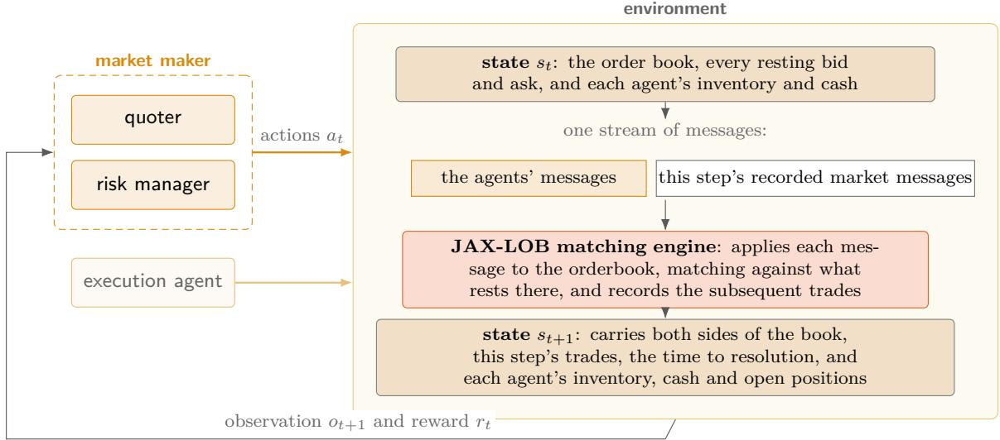
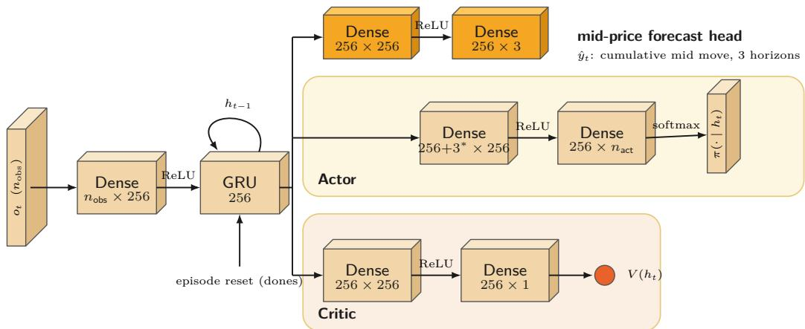
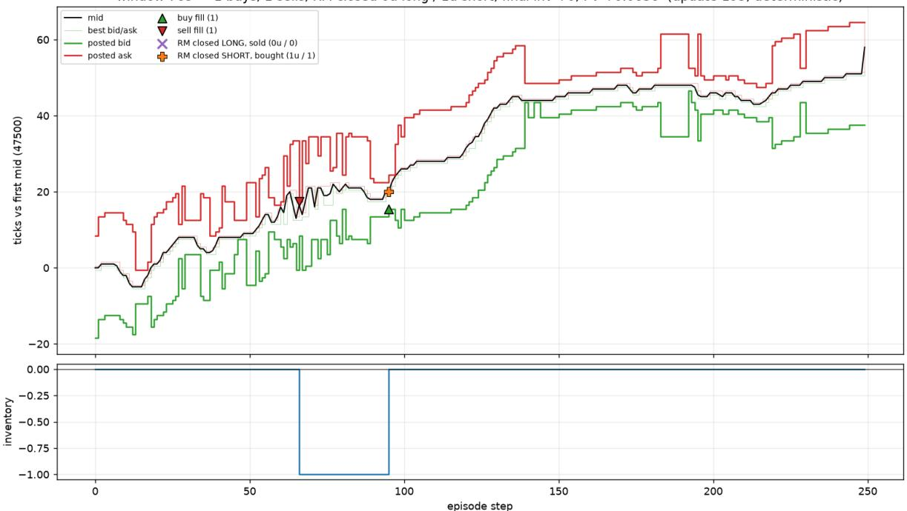
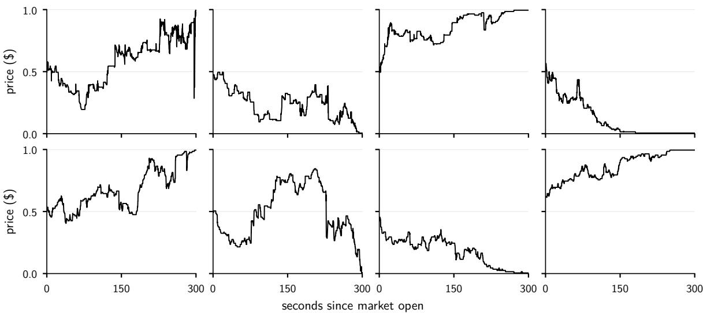
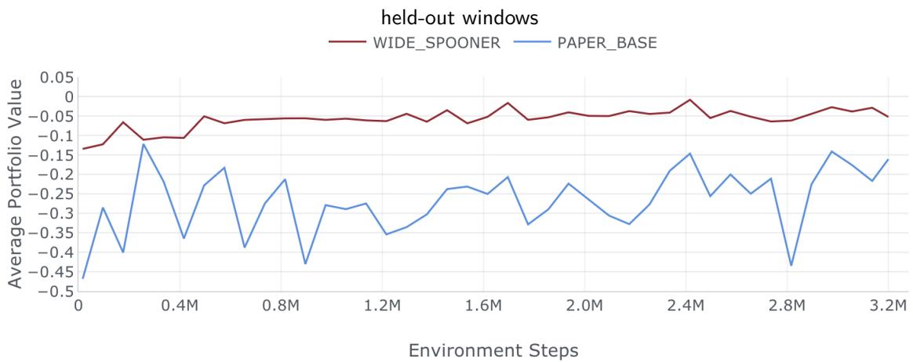
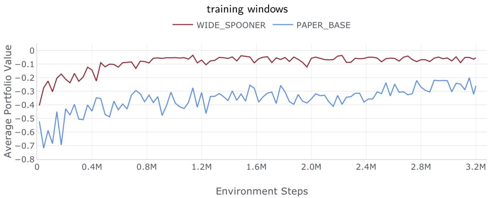
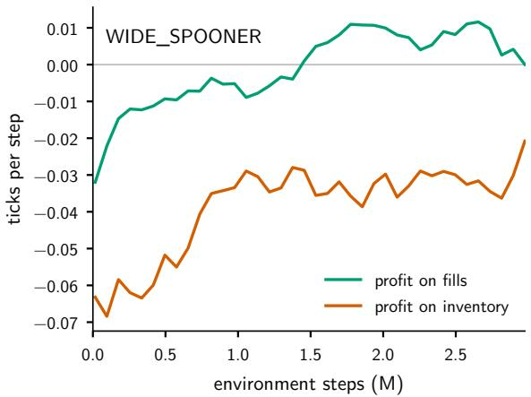
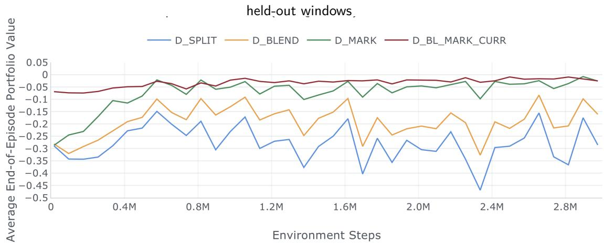
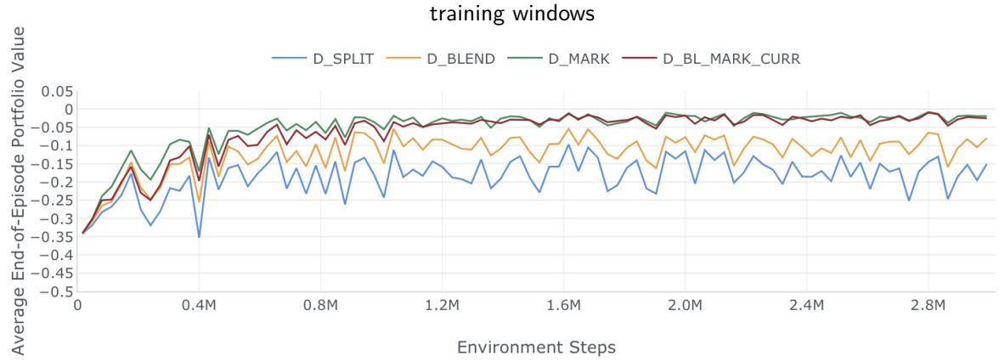
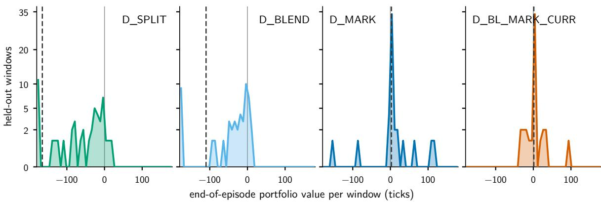

# Cooperative Multi-Agent Market Making on Prediction-Market Order Books

Skander Lejmi Department of Statistics London School of Economics and Political Science

A thesis submitted for the degree of

MSc Statistics (Research)

Lent Term, 2026

Supervised by Professor Tengyao Wang

## Abstract

A market maker’s objective is the provision of liquidity. To do so, it quotes prices to buy and to sell a given asset, earning the gap between them (spread), and carrying the risk of the position it builds up. We study market makers trained with multi-agent reinforcement learning on prediction markets, specifically Polymarket. These exchanges are characterized by their relatively thin order books whose binary contracts pay exactly 0 or 1 at a known resolution date.

Three challenges underpin this research. Firstly, a maker faces adverse selection: the trades it receives come disproportionately from better-informed traders, so a policy trained on real data may learn to stop quoting. The consequences of a given quote may arrive many steps after the action. And prediction markets L2 data does not cover individual orders that a sophisticated simulator may require.

We address these challenges by building a pipeline in order to reconstruct LOBSTER data from Polymarket. This data pipeline subsequently allows for the training of various market-making agents in the JaxMARL-HFT environment on 417 real markets. We focus on improving the market making capabilities of the default configuration in JaxMARL-HFT, through enriching the observation space with the book and the recent flow. We additionally make contributions with regard to reward shaping, and crucially propose a novel multiagent decomposition of the market-making agent into a quoter and a risk manager, enabling a more sophisticated treatment of the inventory risk. We find that decomposition alone performs poorly, while reward designs intended to mitigate multi-agent credit-assignment dificulties substantially improve the resulting desk relative to the unshaped decomposition in our experiments.

Our redesigned single-agent market maker quotes more frequently and incurs smaller heldout losses than the JaxMARL-HFT baseline retrained on the same data; the contributions of its jointly changed observations, actions and risk constraints are not separately identified. Our multi-agent decomposition of the seat presents our central result: careful design of the reward split gives us our best result. Our models are scored on realised end-of-episode value on the held-out set of markets. None establishes positive average portfolio value in periodic held-out evaluation, and each configuration was trained with one seed.

The environment, data and protocol are the foundation for makers that quote many linked markets at once.

## Contents

Abstract i   
1 Introduction 1   
2 Related Work 4   
2.1 Stochastic control problem . 4   
2.2 Reinforcement learning . 5   
2.3 Multi-agent reinforcement learning 6   
3 Preliminaries 8   
3.1 Limit order books and binary contracts 8   
3.2 The decision model 9   
3.3 The simulator 9   
3.4 State space 10   
3.5 Observation space 11   
3.5.1 Observations in the desk . 12   
3.6 Action space 12   
3.6.1 The quote table . 13   
3.6.2 The no-trade action 14   
3.6.3 The desk action space 14   
3.7 Reward function 15   
3.7.1 The basic reward . 15   
3.7.2 Where the basic reward falls short 15   
3.7.3 Enhancements 16   
3.7.4 The reward in a multi-agent desk 17   
4 Methodology 19   
4.1 Single-agent architecture . 19   
4.1.1 Why a policy gradient 19   
4.1.2 Proximal policy optimisation with a recurrent policy 20   
4.2 Multi-agent proximal policy optimisation 22   
4.2.1 Independent versus central learning 22   
5 Experimental Setup 24   
5.1 Market assumptions 24   
5.2 The simulation environment 24   
5.3 Data 26   
5.3.1 Market choice and split 26   
5.3.2 From book updates to order messages 27   
5.4 Models . 27   
5.5 Experiment settings 28   
5.6 Evaluation criteria 30   
6 Results 31   
6.1 Non-desk models 31   
6.2 Desk models . . 33   
6.3 Performance comparison . 36   
6.4 Limitations 36   
7 Conclusion 38   
Bibliography 44

## List of Figures

1 One step of the environment . 10   
2 The network . . 21   
3 A held-out episode traded by the desk 25   
4 Eight of the five-minute markets 26   
5 Single-book training curves 32   
6 The two parts of the reward 33   
7 Desk training curves . 34   
8 Held-out results window by window 35

## List of Tables

1 Quantities fixed across every configuration. 25   
2 The stack shared by our models. 28   
3 Settings common to every model 29   
4 Forecast-head settings. . 29   
5 Desk alignment terms 29   
6 Non-desk results 36   
7 Desk results . 36

## 1 Introduction

High-frequency trading in financial markets is fundamentally a problem of sequential decision making under uncertainty. Whether the objective is to capture some market-orthogonal return (alpha), provide liquidity to the markets (market making) or allocate capital across diferent markets based on one’s risk tolerance (portfolio optimisation), permeating all three is a central challenge: prices form endogenously and evolve continuously as a function of the decisions of millions of market participants, each acting on private (and often partial) information. It is in this precise sense that the market price is often referred to as an information aggregator.

A market maker supplies liquidity to markets by continuously quoting prices at which it would be willing to buy (bid) and sell (ask) a given asset. In doing so, it seeks to maximise its net profits while simultaneously managing the inventory risk of its filled positions. Given the dynamic nature of financial markets this is a non-trivial challenge, as the price of the asset may move against whatever the maker is holding. With the advent of electronic trading, the move to automate market making has produced a range of approaches, from closed-form stochastic control to learned policies; we review them in section 2.

Information aggregation is prominently the value proposition of recently established prediction markets: exchanges ofering binary, fixed-term contracts on a far wider range of events than the financial system covers. These venues have attracted academic attention in large part due to the novelty of their contractual ofering; the term combinatorial arbitrage has emerged for configurations in which two or more contracts are logically constrained by one another, and participants appear to exploit such structures to extract substantial edge (Saguillo et al., 2025). Liquidity provision on these venues is independently quite interesting: given the relative thinness of their books, a competent maker is a service the exchange could benefit from (as evidenced by their recent \$1 million contribution to rebates for market making on the very markets we are considering (Polymarket, 2026)). This makes market making the natural first problem to study on these novel exchanges. They also publish full historical L2-orderbook data, as well as a breadth of other freely available microstructure data that could ultimately support training foundation market-making models. This study trades a single book at a time, and in doing so lays the foundation for future work on collaborative multi-agent learners that infer and exploit the constraints linking the many books of such a venue (Saguillo et al., 2025; Kroer et al., 2016).

Given the structure of the problem, it is unsurprising that reinforcement learning (RL) has been a paradigm shift for this literature. Cast as a partially observable Markov decision process, single-agent RL market making inherits the complexity of the underlying system while introducing its own family of challenges: environment design, reward specification, and often-times degenerate policies. The degeneracy that dominates this environment is the collapse to no trading, in which the agent learns not to quote, since inaction incurs a direct zero-variance return path that is otherwise costly to attain through exploration (Mohl et al., 2025; Wang et al., 2023). Two further dificulties shape this study. Credit assignment is temporal: a quote posted now has consequences that arrive only when the position it opened is closed, many steps later, thus disentangling the temporal credit assignment problem is nontrivial. And the environment itself is a modelling decision: simulators that model the market using Brownian mid-prices, fill probabilities, synthetic counterparties, tend to understate adverse selection in ways that may result in an overestimation of performance, widening the Sim2Real gap, a widely acknowledged limitation in the literature (Noble et al., 2026; Lalor and Swishchuk, 2024), while the venues we trade publish only book updates, not the order-level data a faithful replay simulator needs.

More recent multi-agent work has shown evidence of adversarial training improving the performance of market-making agents relative to training alone or against static rule-based participants (Spooner and Savani, 2020; Gašperov and Kostanjčar, 2021). In line with Shoham et al. (2007), “if multi-agent learning is the answer, what is the question?”, our agenda here is two-fold, both prescriptive and computational: we adopt multi-agent reinforcement learning as an approach to market making in adversarial settings, which in turn requires careful consideration of agent behaviour and learning under complex, partially observable stochastic game (POSG) conditions (Becker and Sunberg, 2024).

Building on the novel paradigm of deep reinforcement learning at scale (Lu et al., 2022), we use JaxMARL-HFT (Mohl et al., 2025), a GPU-accelerated multi-agent environment that replays recorded order flow through a full matching engine and cuts end-to-end training time by up to 240 times against the reference implementations they compare to, ABIDES-MARL (Cheridito et al., 2025) and PyMarketSim (Mascioli et al., 2024). The scope of their research was predominantly focused on framework design, while we focus on determining improvements to their baseline market making performance in the adversarial setting. We address two obstacles in particular, noted in their paper. The first is the no-trade collapse, which we treat as a property of the environment design, in particular the reward and the action space, rather than of the learner. The second is the entanglement of quoting and inventory management in one policy, which we disentangle into a cooperative multi-agent desk: one agent quotes continuously, the other manages the quoter’s inventory position, and a reward split we control divides the desk’s profit between them. The aim of the study is to design an environment and setting conducive to legitimate market-making learning across thinly liquid and volatile markets.

We use two methods to evaluate our approach. Firstly, our experimental setup scores every model on held-out (i.e. not in training) end-of-episode portfolio value. This is compared against the baseline market maker configuration of JaxMARL-HFT, retrained on the same data. Our configurations are built to isolate the efect of each design choice and thereby gain evaluative insights; what we tried and did not pursue at scale is stated, with justifications, in section 4.

Our contributions are:

• An enriched observation space, giving the market maker the book and its recent flow rather than the spread and its own inventory (section 3.5).

• A wider action space, admitting skewed and one-sided quotes alongside the no-trade action (section 3.6).

• Inventory control outside the reward, through a cap and a loss stop rather than

a penalty, so that the reward does not pay for inaction (section 3.7.3).

• A multi-agent decomposition of the market maker into a quoter and a risk manager, trained as independent learners, giving inventory risk its own agent and objective (sections 3.6.3 and 4.2.1).

• A reward design for the desk: a general-sum split, a blend toward the desk total, and a markout term that charges the quoter for the mid’s move after each fill, which together mitigate the credit-assignment problem the split creates (section 3.7.4).

• Order-level data for prediction markets, inferred from Polymarket’s L2 book updates and written in LOBSTER format (Huang and Polak, 2011) (section 5.3).

The remainder of the paper is organised as follows. Section 2 reviews the stochasticcontrol, single-agent and multi-agent literature pertaining to market making. Section 3 defines our problem, including the environment, the state, observation, action and reward spaces. It also includes our own refinements used to address challenges pervasive in the literature. Section 4 presents the learners, single-agent and multi-agent. Section 5 gives the experimental setup alongside assumptions, simulator, data, models and settings and section 6 discusses the outcome of our experimentation. The section 7 conclusion sets out limitations and future work.

## 2 Related Work

The central market maker problem arises from the endogenous and thereby stochastic nature of market prices. As market makers aim to capture and thereby profit from the bid-ask spread, there is no guarantee of both of their quotes getting filled, which may result in the accumulation of unwanted inventory (Fodra and Labadie, 2012). With adverse price movements in the market there is uncertainty regarding the future price of this held inventory (inventory risk (O’Hara and Oldfield, 1986)) thus requiring careful management of filled positions. The issue is further exacerbated by the adverse selection problem observed by Glosten and Milgrom (1985): informed traders exploit private information unknown to the market maker, and this information asymmetry produces adverse fills as the price rallies in a given direction.

## 2.1 Stochastic control problem

Modelling the theoretical problem of market making as a stochastic dynamic program, Ho and Stoll (1981) began the approach of deriving optimal bid-ask quotes for a monopolistic dealer in a single stock that maximise an objective function: the utility of the market maker’s expected terminal wealth. A significant refinement of this approach was ofered by Avellaneda and Stoikov (2008), who combined this utility framework with the microstructure of limit order books. In particular, they leveraged notable results from the econophysics literature pertaining to the size distribution of market orders (Maslov and Mills, 2001; Weber and Rosenow, 2005; Gabaix et al., 2006) and their temporary price impact (Bouchaud et al., 2002; Weber and Rosenow, 2005) in order to model the arrival of buy and sell orders as Poisson processes tied to the market maker’s quotes, founded on Garman (1976). They first compute the agent’s closed-form reservation price, a mid-price adjusted with respect to held inventory to reflect indiference, and then derive closed-form expressions for the optimal bid and ask quotes as distances from that reservation price.

Crucially, this framework relies on parametric, memoryless Poisson rate processes, creating a distinct Sim2Real gap. While mathematically tractable, such models inevitably abstract away real-world microstructural features such as queue dynamics, latency and volatility clustering, and this reality gap in limit order book simulation leads to distorted execution costs and profit profiles that might trivialize the performance of the market maker in real-world scenarios. (Noble et al., 2026). Lalor and Swishchuk (2024) show the sharper consequence: simulating prices and order flow independently of one another omits endogenous adverse fills, thus inflating apparent profitability of such methods, and performing in an incommensurate manner in live markets.

To bridge this gap while preserving mathematical tractability, subsequent literature expounded on the underlying asset dynamics in order to capture more complex, observable market states. Guéant et al. (2013) solved the market making problem under inventory constraints across arbitrary time horizons using a stochastic control change of variables. Fodra and Labadie (2012) further extended these frameworks to a broader class of mid-price models, including arithmetic Brownian motion with drift and mean-reverting Ornstein-Uhlenbeck processes, under both exponential and linear utility functions, while introducing a terminal inventory-risk penalty. These solutions remain bound to the model that makes them solvable, given that every quote is optimal with respect to the assumed dynamics, not the observed ones. To bypass this bottleneck of restrictive closed-form solutions, the quantitative literature has been converging toward reinforcement learning (Bai et al., 2025).

## 2.2 Reinforcement learning

Chan and Shelton (2001) were the first to formalise market making as a reinforcement learning problem. Their agent’s state includes both its own information such as inventory, as well as market characteristics including the imbalance of buy and sell orders, the bid-ask spread and price changes between trades. Its discretized action space allows the agent to set quote prices and sizes, while its reward mixes profit with an inventory penalty. They populate their simulated market with informed and uninformed traders whose orderflow responds to the maker’s quotes, so the elements of the problem we study, namely: partial information, informed flow, and a reward balancing profit against inventory, are all present in that formulation. This laid the foundation for further exploration of RL for MM.

Subsequent single-agent literature explores how risk management and diferent learners within the broad framework established by Chan and Shelton (2001). On the value-based side, Mani et al. (2019) replace a SARSA learner with double SARSA as well as a customised temporal-diference update for the Q-function, reducing the variance of the reward and reaching higher profit at lower inventory than the policy of Chan and Shelton (2001). Spooner et al. (2018) leverage tile-coding to discretize the action space and reshape the reward itself with an asymmetrically dampened profit term paying the agent for providing liquidity rather than for speculating with inventory. This reward is inherited by our baseline configuration (section 3.7.1). Selser et al. (2021) instead explore a penalization term for the estimated variance of the agent’s wealth, demonstrating that a deep Q-network under this reward outperforms the closed-form benchmark of Avellaneda and Stoikov (2008). Moving from value-based learners to policy gradients, Guéant and Manziuk (2019) use an actor-critic method for multi-asset market making and scale it to a hundred corporate bonds, a dimensionality the partial-diferential-equation methods cannot reach (this lays the foundation for future work pertaining to scaled multi-agent systems across combinations of loosely correlated prediction market assets). We set out our own reasons for preferring the on-policy policy-gradient family over value-based learning in section 4.1.1.

These methods difer as much in their environments as in their learners. Most train inside model-driven simulators, with a Brownian or mean-reverting mid-price with fill probabilities supplied by a model, similar to what was discussed in the previous section, where fills are cheap and adverse selection is a consequence of the rigour of the modelling. On the other hand, on real, replayed order flow fills are disproportionately informed, and a maker trained there often learns to stop quoting altogether, the collapse JaxMARL-HFT documents and that we address in section 3.6.2 (Mohl et al., 2025). Wang et al. (2023) reach a consistent conclusion from the model-driven side: relaxing the standing assumption that a maker quotes both sides continuously and instead allowing it to abstain, or to quote one side only, improves returns and risk-adjusted returns. This justifies our explicit no-trade and one-sided actions in our action space for the market maker. (section 3.6).

## 2.3 Multi-agent reinforcement learning

Reinforcement-learning for market making has been extended to several agents in three broad directions (Bai et al., 2025). The first is adversarial: Spooner and Savani (2020) train the maker against an adversary controlling the parameterization of the market model itself, allowing the learned policy to become robust to model misspecification; Gašperov and Kostanjčar (2021) let the adversary displace the maker’s quotes directly, reducing inventory risk and improving profit relative to training without one. Spooner and Savani (2020) deliberately choose market dynamics modelled by the optimal-control approach, allowing them to conduct clean single-stage analysis and avoids the biases of historical data. Our choice is precisely the opposite, we accept the analytical inferiority related to recorded data and instead focus on improving the performance against real flow, given our focus is on real performance. The second direction is competitive: Ganesh et al. (2019) place the learner in a dealer market against competing market makers, showing that it learns their pricing distributions from only their own observations, thereby pricing near-optimally against competitors whose parameters it never sees. The third decomposes the market-making decision: Patel (2018) splits this hierarchically between a macro-agent choosing direction and a micro-agent placing the orders in the book. Our desk (section 3.7.4) is also a decomposition of one seat into two learners, a quoter and a risk manager, but the two act simultaneously as peers on real flow, under a reward split we control, instead of in a hierarchy.

The environments these systems train in divide the same way as the single-agent ones, and the division decides what a result means. Agent-based discrete-event simulators, most prominently ABIDES (Byrd et al., 2020) and its reinforcement-learning interface (Amrouni et al., 2021), populate a matching engine with modelled background traders: the market reacts to the agent, which cannot be said for historical replay, but on the other hand every counterparty is synthetic, so what the agent learns is bounded by the quality of the background agent’s imitation of real flow. Optimal-control markets model the dynamics in the manner previously described. JAX-LOB (Frey et al., 2023) takes a diferent path: it replays recorded order flow, order message by order message, through a full price-time-priority matching engine, and JaxMARL-HFT (Mohl et al., 2025) extends this approach to several learning agents, building on JaxMARL (Rutherford et al., 2024). We thus chose to build on JaxMARL-HFT for two reasons. The first is realism: fills come from recorded orders resting in a real orderbook rather than from a fill-probability model or synthetic agent-based counterparties, so the adverse selection faced by our agents is reflective of the markets itself. The second is scale: ascribing to the hyper-scale paradigm recently unlocked by this line of work (Lu et al., 2022; Rutherford et al., 2024), the engine and learner compile as one JAX program, so thousands of books can step in parallel on a single GPU. This is what made our experiment matrix and broader experimentation possible.

Within this environment, our taken direction is hitherto untried: a cooperative decomposition of the market-making seat itself. In line with the new unlock of reinforcement learning at hyper scale, we aim to improve upon the market maker proposed in JaxMARL-HFT, ofering a refinement within its simulation environment that might further the research herein.

## 3 Preliminaries

This section describes the pre-requisite foundations that the method is predicated on: how a limit order book works, what the ofered prediction market assets/contracts are, and the four factors that define our learning problem: the state, the observations, the actions and the reward. Section 4 builds directly on the formalism introduced here.

## 3.1 Limit order books and binary contracts

An exchange matches buyers and sellers of a given asset through a limit order book. A limit order names a side (bid/ask), a price and a size, and rests in the book until it gets filled (i.e. trades) or is cancelled. A market order trades immediately against the best resting orders on the opposite side, identical to an immediate-or-cancel (IOC) order, with the added feature that IOC’s will discard any quotes not traded immediately. Limit orders resting at the same price get filled in the order that they arrived, it is in this sense that the book runs under price-time priority. Polymarket uses a central limit order book (CLOB) with a matching engine that uses price-time priority, thus aligning with our own matching engine. At time t the highest resting buy price is the best bid $b _ { t }$ and the lowest resting sell price is the best ask $a _ { t }$ . Their midpoint $m _ { t } = ( a _ { t } + b _ { t } ) / 2$ is referred to as the mid price and $a _ { t } - b _ { t }$ is referred to as the spread. Prices move at minimum increments called ticks (these are stated for each market on Polymarket).

A market maker quotes a bid and an ask price at the same time. If both fill it earns the distance between them (spread), if only one fills it holds a position that moves with the value of the mid (mark-to-market). Its profit therefore has two parts: the spread captured on completed round trips, and the gain or loss on inventory carried between fills. The second part is the more challenging to manage. As previously established, a fill occurs because another participant chose to trade at the price quoted by the market maker, and the participants timing their trades prior to mid price moves based on private information are those a market maker would like to avoid given the potential for adverse selection(Glosten and Milgrom, 1985). The quality of a fill, and of the market maker’s quoting, therefore is predominantly revealed by the subsequent movement of the mid-price.

The contracts ofered on Polymarket are binary: each pays one unit if a named event occurs by the resolution date and otherwise pays nothing. It is similar in this sense to a Cash-or-Nothing digital option, except that the trigger condition is not necessarily a function of an underlying asset price. Its price sits in the unit interval with the minimum tick δ as the discrete increment,

$$
p \in \{ 0 , \delta , 2 \delta , . . . , 1 \} \subset [ 0 , 1 ] ,\tag{1}
$$

and reads directly as the market’s implied probability of that event. It resolves at a known deadline to zero or one. One consequence matters: time to resolution counts as much as price, given time-decay characterises these markets.

## 3.2 The decision model

Market making is a sequential decision problem under uncertainty. At each step t the environment holds a state $s _ { t } .$ , the agent receives the observation $o _ { t } ,$ choosing an action $a _ { t }$ . The environment accordingly returns a reward $r _ { t }$ and then updates its state to $s _ { t + 1 }$

In our context, the agent does not see the state. Since the state contains every resting order, every market participants’ intentions, and the private information that the other market participants act on, while the agent sees the book and other quantities computed from it. Each learner is trained under the single-agent view of the market, thus it is in this sense that we model our learning as a partially observable Markov decision process (POMDP) (Kaelbling et al., 1998). The agent’s observations are obtained by treating the other participants as part of the environment, in that the observations only hold a partial view of the entire market state. Thus, the agent cannot act on exclusively $o _ { t }$ . Instead, rather than using the full history $h _ { t } = ( o _ { 0 } , \ldots , o _ { t } )$ , our policy conditions on a recurrent summary of it, which consists of a learned approximation of the distribution over states implied by the history. Given the other learners are simultaneously adapting to each other’s policies, the environment faced by the agents is not stationary.

The partial observability here is inherent to the endogenous price formation in markets. The information asymmetry that generates the order flow is itself the unobserved part of the state, and inferring how informed the flow arriving now is precisely the substance of the market maker’s problem. This holds against the replayed participants but not within our desk configuration since the two agents of section 3.5.1 are given each other’s positions by construction.

Forcing the agent to close its position at every step would make each step’s profit selfcontained and restore a memoryless problem, but it would also inevitably restrict the set of policies that the agent can represent, and the best policy of the unrestricted problem, which holds a position while it works, may not lie inside the restricted set. We therefore let inventory carry across steps, thus requiring a more careful attention to the temporal credit assignment challenge: a quote placed now has consequences that appear only when the resulting position closes, possibly many steps later.

Given our context, we clear the recurrent summary at every episode boundary. In particular, this is done given that we have modelled each episode as one market window, and the environment subsequently draws the next window at random instead of continuing on the same market, so clearing ensures that the recurrent state does not carry over a history from an unrelated market.

## 3.3 The simulator

Everything in this work runs in the aforementioned simulation environment, on two frameworks. The matching engine is JAX-LOB (Frey et al., 2023): a limit order book written in JAX. JaxMARL-HFT (Mohl et al., 2025) inherits the matching engine to supply multi-agent reinforcement-learning environment. Several agents learn on one book simultaneously. Each agent’s action is converted into an order message, those messages join the recorded fixed stream of messages for a given timestep, and the matching engine processes this combined stream; fig. 1 illustrates one such step in our simulator. From the subsequent state, the environment computes agent’s reward and subsequent observations.

  
Each agent’s message is comprised with a withdrawal of what it no longer wants resting (i.e. quotes to cancel) and posts its preferred quotes. A quote repeated at the same price and size of a past quote is left in place to retain its queue priority. The agent messages are shufled between them before entering the matching engine, so no agent has systematic priority over another (i.e. no model of latency advantage).  
Figure 1: One step. All agents get their observations of the state and act on it simultaneously, receiving their reward from their actions. The desk is interchangeable with the single-agent, where the single-agent would perform both jobs. A step is a fixed number of messages rather than a fixed duration, meaning its length in market time varies by how busy the market is.

## 3.4 State space

The state collects two parts: a shared description of the market, and a private record for each agent.

The shared part is the state described in Frey et al. (2023): both sides of the resting orderbook, each as an array of orders carrying a price, size, timestamp and an identifier for the trader who placed it. The trades executed during the step, the episode’s start time and the current clock, a counter that issues identifiers to new orders, and finally the index of the market being traded together with the step counter. JaxMARL-HFT extend this with three quantities a market maker needs: the path of the best bid and ask after every message of the step, the mid price, and the amount of time that has been covered by the steps. Our own addition is smaller and serves the desk: four fields through which an agent type can read the other agent’s position, which is used by section 3.5.1.

The private part, per agent, holds the signed inventory, the cash balance, the running profit, the volume-weighted price at which the open position was entered, the distances of the agent’s own resting quotes from the mid, and two short histories used to build features, recent mid prices, and a per-step bar of open, high, low, close, volume and trade imbalance. The desk adds a table of the open positions: each row carrying a signed size, the price it was opened at, and its age in steps.

Everything that changes the book arrives as a message,

$$
\mathbf { m } = [ T , S , Q , P , O I D , T I D , T _ { s } , T _ { n s } ] ,\tag{2}
$$

giving the type $T$ i.e. a limit order, a cancellation, a deletion or a market order, the side S, the size $Q ,$ the price P, an identifier for the order and the corresponding trader, and the time in seconds and nanoseconds. The trader identifier is what lets each fill be matched to the corresponding agent. See Frey et al. (2023) for the full specification.

The agent observes none of this directly, but rather observes a vector built from these quantities.

## 3.5 Observation space

The market maker of JaxMARL-HFT observes the spread and its own inventory. Given that this limited observation gives no substantial information to the agent as to the nature of the book and possible movements of the mid-price, the policy can only condition on its own exposure but not the dynamic market its quoting into, which we note as a significant limitation. We accordingly chose a richer observation space in order to remove that limit, it is comprised of three blocks.

The book. For each of the five levels $i = 1 , \ldots , 5$ on each side of the book, the observation carries the distance from mid, in ticks, and the size on each level.

$$
o _ { i , t } ^ { a } = \frac { p _ { i , t } ^ { a } - m _ { t } } { \Delta } , \qquad o _ { i , t } ^ { b } = \frac { m _ { t } - p _ { i , t } ^ { b } } { \Delta } , \qquad v _ { i , t } ^ { a } , ~ v _ { i , t } ^ { b } ,\tag{3}
$$

where $v _ { i , t } ^ { a }$ and $\boldsymbol { v } _ { i , t } ^ { b }$ are the total resting size at that given price. A level that does not exist is reported as zero.

The flow. Order imbalance indicates which side has a larger density of resting orders, thereby signalling possible movements in mid price

$$
\iota _ { t } = \frac { \sum _ { i } v _ { i , t } ^ { b } - \sum _ { i } v _ { i , t } ^ { a } } { \sum _ { i } v _ { i , t } ^ { b } + \sum _ { i } v _ { i , t } ^ { a } } .\tag{4}
$$

Two further terms are used to describe recent prices: a relative-strength measure over the last mid prices, as well as the standard deviation of their step-to-step changes in ticks. A summary of the step is added to these: the range, return and closing price of the step’s high-low bar, its share of traded volume that did not get filled, the drift across the window, and the average of the signed shares over the step.

The agent’s own situation. Inventory $q _ { t } .$ , the spread, the step counter, and, given the theta decay inherent to this market, the fraction of the episode remaining. The open position is marked against the mid.

This tells the agent whether its current holdings are winning or losing (not covered by the raw inventory).

We accept the much wider observation space given the structural blindness of the alternative (spread + inventory). In addition, this exact space was the conclusion of preliminary experimentation.

## 3.5.1 Observations in the desk

The desk is built in order to mirror the separation of work in real market making desks. One quoting agent and another managing the underlying risk. We refer to them as the quoter and the risk manager.

Two agents sharing one book would have to coordinate, and a possible approach to this would be communication actions, or shared parameters or messages. We do not take that approach given concerns about multi-agent credit assignment and instead augment each agent’s observations with a block describing their partner’s actions. Coordination is therefore expected to be inferred from what the partner’s actions together with the reward function design. This implicit communication required the following choices in the observation space.

We denote $o _ { t } ^ { \mathrm { m k t } }$ as the observations in section 3.5: the market, plus the agent’s own inventory and position mark, which both desk agents receive. The desk’s two observations are then

$$
o _ { t } ^ { \mathrm { q u o t e r } } = \big [ o _ { t } ^ { \mathrm { m k t } } , o _ { t } ^ { \mathrm { o w n } } , o _ { t } ^ { \mathrm { c l o s e d } } \big ] ,\tag{5}
$$

$$
\begin{array} { r } { \sigma _ { t } ^ { \mathrm { r i s k } } = \big [ ~ o _ { t } ^ { \mathrm { m k t } } , ~ o _ { t } ^ { \mathrm { n e t } } , ~ o _ { t } ^ { \mathrm { o w n } } ( \mathrm { p a r t n e r } ) , ~ o _ { t } ^ { \mathrm { l o t s } } \big ] , } \end{array}\tag{6}
$$

Where $o ^ { \mathrm { o w n } } \in \mathbb { R } ^ { 4 }$ are the agents positions split into long and short units with their entry ofsets, and for the quoter $o ^ { \mathrm { c l o s e d } } \in \mathbb { R } ^ { 4 }$ is the units and profit the risk manager closed in the previous step (an implicit form of communication/feedback). For the risk manager, $o ^ { \mathrm { n e t } } \in \mathbb { R } ^ { 2 }$ is the quoter’s inventory and the desk’s net position (i.e. the combined position), and $o ^ { \mathrm { l o t s } } \in \mathbb { R } ^ { 8 \times 4 }$ is the quoter’s open-position table. The environment records at most eight open positions, each row of the table holds one of these positions. Rows without a position are zeroed such that the volume is zero so the agent cannot conflate it for a real open position. Each row carries four numbers: the position’s size $s _ { r } ,$ , its entry ofset from the mid $( p _ { r } - m _ { t } ) / \Delta$ , the number of steps since it was opened, and its mark against the mid,

$$
\pi _ { r , t } = \frac { s _ { r } \left( m _ { t } - p _ { r } \right) } { \Delta } ,\tag{7}
$$

with the positions ordered worst to best such that $r = 1$ is always the one losing most. The risk manager’s view is thus more tailored to inventory and risk management in a manner that the quoter does not have. Together with the action space and the reward design, this allows us to break down the market making problem into a tractably richer problem with more narrow focuses on each underlying challenge to market making.

## 3.6 Action space

The design of the action space is non-trivial as it fixes the range of possible policies available to the agent. A discretized space of possible quote placements, for instance, can only express policies built from those placements. This implies that learning can then converge only to the best of that constricted action space. In contrast, a continuous space of ofsets (against the mid) allows the exploration of a broader set of candidate policies: one that may contain the game’s global optimum (subject to the constraints of the problem and the observations). As such, a richer action space is more likely to contain a globally superior policy evaluated on portfolio value, but the cost incurred is learning, in particular that a larger space needs more interaction data and makes approximation much more challenging.

We thus settled on two choices inside this trade-of. Firstly, we kept the action space discrete. The reasoning for this choice was two-fold. Firstly, the large size of our observation space paired with a continuous action space would have likely made the learning intractable, which corroborates the pervasive use of discretization in the literature. Secondly, with a wider and suficiently granular discretization (namely tick-level), which is aforded to us by the abundance of Polymarket data and the JAX accelerated framework, we can attain a comparatively rich action space without requiring full continuity.

## 3.6.1 The quote table

At each step the agent selects one row k, carrying a bid ofset, an ask ofset and a size on each side, from the following table: $( \delta _ { k } ^ { b } , \delta _ { k } ^ { a } , q _ { k } ^ { b } , q _ { k } ^ { a } )$ , and the ofsets are applied to the best bid/best ask in ticks,

$$
p _ { k } ^ { b } = b _ { t } - \delta _ { k } ^ { b } \Delta , \qquad p _ { k } ^ { a } = a _ { t } + \delta _ { k } ^ { a } \Delta ,\tag{8}
$$

at sizes $q _ { k } ^ { b }$ and $q _ { k } ^ { a }$ denominated in units of the contract. The best bid and ask in eq. (8) are recomputed with the agent’s own resting orders removed, ensuring it does not quote relative to itself. A row with a size of zero on a side sends no message on that side at all, rather than an order of zero size. That is the mechanism behind both the one-sided rows and the row that posts nothing.

The table given to the agent dictates its range of possible actions. JaxMARL-HFT’s action table (that performed the best) has nine rows, every one two-sided, reaching at most five units from the best bid and best ask. We propose a wider table of seventeen rows, written as ofset pairs $( \delta ^ { b } , \delta ^ { a } )$ with both sides at unit size unless a size is shown:

• symmetric (seven): (0, 0), (1, 1), (2, 2), (4, 4), (6, 6), (9, 9), (13, 13);

• skewed (six), pairing a near side with a far one: (0, 2), (2, 0), (1, 4), (4, 1), (2, 6), (6, 2);

• one-sided (four), in full $( \delta ^ { b } , \delta ^ { a } , q ^ { b } , q ^ { a } )$ form: $( 0 , 0 , 1 , 0 ) , ~ ( 0 , 0 , 0 , 1 )$ , (4, 0, 1, 0), (0, 4, 0, 1) — the zero size is the instruction not to quote that side.

While a market maker is expected to show both sides, there are states in which quoting only one is a better and legal (with respect to exchange market making regulations) action: for instance a maker that is already long as the price falls has no reason to keep bidding. The one-sided rows allow the policy to express such a strategy. The two diferences that matter (relative to JaxMARL-HFT) are the reach, thirteen ticks against five, and the one-sided rows. Together with the row posting no trade appended, the head is ten actions wide for the baseline and eighteen for ours.

## 3.6.2 The no-trade action

In JaxMARL-HFT, the trained market maker selects the no-trade action between 61.1% and 97.7% of the time across three seeds (Mohl et al., 2025). We refer to this as the no-trade collapse. We decide to keep this action row for three reasons. Firstly, standing aside is part of the market making role and should thus be reflected in the action space of our agent. Even in exchanges that have formally imposed market making obligations, this is legally permissible: the London Stock Exchange requires registered market makers to quote for at least 90% of continuous trading during the mandatory period, and Deutsche Börse’s cash market requires quotes during 50% of daily trading hours on a monthly average, with the requirement lifted in defined exceptional conditions (Wang et al., 2023). Our exchange has no regulation for market makers at all, so our context is especially validated.

Secondly, removing this action does not change the underlying behavior leading to the no-trade collapse. If inaction is what the reward rewards, the policy will simply search for inaction out of whatever the action space provides. We deleted the row from the baseline and it did exactly that, moving most of its action mass onto the widest symmetric rows and quoting several ticks outside a book two ticks wide, where nothing fills — an observation from our preliminary experimentation.

Thirdly, the reward design is particularly responsible for making inaction a desirable policy JaxMARL-HFT attribute part of the collapse in their own agent to the inventory penalty, which charges the agent for the size of the position it holds. That charge is smallest when the position is zero and thus causes a term intended to control risk to instead result in a reward for inaction (Mohl et al., 2025). The no-trade collapse is therefore a reward problem that we aim to address in section 3.7.

## 3.6.3 The desk action space

A real trading desk typically comprises a quoting agent and a risk-management agent who operate on the same book. We give the two agents action sets that reflect this intuitive division of labour. The motivation for this separation has been aforementioned.

The quoter uses the table of section 3.6.1, while the risk manager never quotes at all. Instead, its action space is defined by managing the book of the quoter.

$$
\begin{array} { r l } & { \mathcal { A } ^ { \mathrm { r i s k } } = \underbrace { \left\{ \mathrm { n o t h i n g } \right\} } _ { 1 } \cup \underbrace { \left\{ \mathrm { a ~ q u a r t e r } , \mathrm { ~ a ~ h a l f } , \mathrm { ~ a l l } \right\} \times \left\{ \mathrm { l o s i n g } , \mathrm { ~ w i n n i n g } , \mathrm { ~ l o n g } , \mathrm { ~ s h o r t } \right\} } _ { 1 2 } } \\ & { \cup \underbrace { \left\{ \mathrm { c l o s e ~ p o s i t i o n } 1 , \dots , 8 \right\} } _ { 8 } . } \end{array}\tag{9}
$$

Closing a share of one of the four groups (losing, winning, long, short) is tantamount to liquidation in that the desk sells part of what it holds, (or buys it back if the position is short) immediately. The action becomes an immediate-or-cancel (IOC) order on the opposite side of the position, priced at the best bid or best ask: it trades at once against what is resting there, and any part that cannot trade is discarded rather than left in the book. That order is stamped with the quoter’s identifier instead of the risk manager’s, so it reduces the quoter’s position directly. The eight named positions are the rows of the quoter’s book ordered worst to best, the same ordering described in eq. (7).

This leads to two multi-agent credit-assignment problems. Firstly, the cost of crossing the spread to liquidate the position is charged to the quoter, which did not choose to cross. Secondly, the implicit consequences (with regard to unrealised PnL) of the quoter’s actions are reflected in the reward of the risk manager. It is in this sense that the reward design is non-trivial (section 3.7.4), as it is there that we disentangle these opposing forces by allowing the agents to implicitly recognize the consequences of their own actions.

## 3.7 Reward function

## 3.7.1 The basic reward

The objective of a market maker ought to be profit, so the natural reward is the profit and loss its trades produce. This is the form adopted by Spooner et al. (2018), and consequently by JaxMARL-HFT (Mohl et al., 2025). It sums the realised edge on fills (relative to the mid price) as well as the unrealized marked-to-market inventory held.

Buy and ${ \mathrm { S e l l } } _ { t }$ denote the executed volume/fills against the agent’s bid and ask since the previous step, at prices $p _ { t } ^ { b }$ and $p _ { t } ^ { a }$ , and $q _ { t }$ for the held inventory after the step. The spread captured on fills, measured against the mid, is

$$
\psi _ { t } ^ { b } = \mathrm { B u y } _ { t } \cdot ( m _ { t } - p _ { t } ^ { b } ) , \qquad \psi _ { t } ^ { a } = \mathrm { S e l l } _ { t } \cdot ( p _ { t } ^ { a } - m _ { t } ) .\tag{10}
$$

Each term is the distance between the price the agent paid or received and the mid at the time, so it is positive whenever the agent bought below the mid or sold above it. The inventory the agent already held is revalued as the mid moves, and the reward is the sum of the two,

$$
\Phi _ { t } = q _ { t - 1 } \bigl ( m _ { t } - m _ { t - 1 } \bigr ) , \qquad r _ { t } = \psi _ { t } ^ { b } + \psi _ { t } ^ { a } + \Phi _ { t } .\tag{11}
$$

This is aligned with the quantity the agent is judged on: its portfolio value $V _ { t } = c _ { t } + q _ { t } m _ { t }$ is its cash plus its inventory marked at the mid. Summed over an episode, eq. (11) amounts to $V _ { T } - V _ { 0 }$ , meaning that the more granular per-step reward and the end-of-episode evaluation measure agree. Our implementation marks fills against the step’s average mid, which is the more appropriate price for a fill that may have happened at any point throughout the step.

## 3.7.2 Where the basic reward falls short

The form is simple and matches the real-world objective, but contains three properties that encourage the agent to converge to policies we do not want.

• It is dominated by price noise. The revaluation term follows the step-to-step movement of the mid and thus the variance of this unrealised PnL term grows with the position. This causes the reward to be dominated by short term price fluctuations that dampen the valid signal telling the agent whether it quoted appropriately or not.

• It does not charge for inventory magnitude. Nothing in eq. (11) costs the agent anything for holding a large position beyond the price moving against it, so inventory can accumulate until the mid price move is significant, causing greater reward volatility.

• It mishandles temporal credit assignment. The spread capture is rewarded in eq. (10), yet the identical action’s temporal consequences a few steps out are inside $\Phi _ { t }$ With incommensurate weights, the agent may become more averse to risks taken in the present given it is not suficiently rewarded for the consequences of the action a few steps later. Thus, it naturally may collapse into "No Trade".

The standard remedy for the second problem, an inventory penalty, further exacerbates the other two stated problems. By charging the agent for held inventory, the agent during learning may opt to drive that charge predictably to zero as a possible policy. The mid moves on almost every step, so the revaluation term is noisy provided the agent holds any inventory. Therefore a policy that quotes anything at all would receive both that noisy mark-to-market and be further exacerbated by the penalty: encouraging the policy to stand aside.

## 3.7.3 Enhancements

The literature’s standard responses to these problems act through the reward itself. Spooner et al. (2018) damp the inventory term asymmetrically: with $\gamma \in ( 0 , 1 ]$ and $\eta \in [ 0 , 1 )$ ,

$$
r _ { t } = \psi _ { t } ^ { b } + \psi _ { t } ^ { a } + \gamma \Big ( \Phi _ { t } - \operatorname* { m a x } \big ( 0 , \ \eta \Phi _ { t } \big ) \Big ) ,\tag{12}
$$

so that a favourable revaluation is credited at less than an adverse one is charged, and holding inventory stops being a source of profit, thus encouraging direct profits from spread capture. The quadratic inventory penalty − $\cdot \nu q _ { t } ^ { 2 }$ charges inventory directly. Both, however, inherit the dificulty the previous subsection describes given that any charge routed through the reward for holding inventory is smallest at zero inventory thereby leading to the degenerate policy.

We therefore control inventory outside the reward instead:

A hard inventory cap prevents the position from exceeding a fixed number of units, thus limiting inventory without implicitly discouraging trading in the reward function. This ensures a more stable reward variance and discourages the "No Trade" collapse, at the expense of a more constrained set of feasible actions.

Secondly, we have a loss stop with an annealed threshold. When an episode’s accumulated loss (measured in PnL terms) crosses a given threshold, the agent stops quoting new positions and instead is restrained to closing its current positions. The threshold starts loose and tightens over training in order to ensure that the policy can learn through trading early on and progressively learn a more disciplined method of inventory management later.

JaxMARL-HFT propose one further remedy for the no-trade collapse, namely having the reward be scaled as a function of the volume traded by the agent, thereby reducing the incentive for inaction. Having tested this approach to no avail, we opt for above two solutions.

Despite these solutions, the third problem of temporal credit assignment remains, which in turn motivates our multi-agent formulation.

## 3.7.4 The reward in a multi-agent desk

A single agent holding one reward is required to trade of the quality of their quoting against the feedback on their inventory carry (often referred to as unrealised PnL). Given the two are measured in the same reward, the gradient update cannot separate the two practically diferent objectives/terms. Thus, splitting the desk gives each agent a smaller problem with a cleaner objective, making the problem both more tractable and closer to the intuitive separation of the roles.

Rewarding both agents in a common-sum manner following the same single-agent reward would detract from the diverging policies and feedback we wish the respective agents to leverage. Yet rewarding each of them exclusively for spread capture and unrealized PnL would equally create moral hazard problems. namely, for instance a quoter rewarded for spread capture reinforces quoting without accounting for the quality of the position, with the cost of the carry accruing exclusively to the risk manager.

The split. The quoter is rewarded the spread capture on its filled quotes. The risk manager is paid the unrealised PnL of the positions those fills open (i.e. the inventory marked-tomarket), and is penalized with the cost of its own closing orders (to ensure it does not collapse to a degenerate policy of always liquidating all inventory). Both rewards are measured in ticks. Writing $\psi _ { t } ^ { b } + \psi _ { t } ^ { a }$ for the spread captured, $\Phi _ { t }$ for the unrealised PnL and $c _ { t } \geq 0$ for the cost of the closes:

$$
\tilde { r } _ { t } ^ { Q } = \psi _ { t } ^ { b } + \psi _ { t } ^ { a } , \qquad \tilde { r } _ { t } ^ { R } = \Phi _ { t } - c _ { t } .\tag{13}
$$

The two rewards sum to the desk’s change in portfolio value.

The blend. Equation (13) leaves one incentive untreated: the quoter is paid at the instant it trades therefore a policy that keeps prioritising fills at any cost (thereby being filled disproportionately on toxic flow from informed traders) profits at the expense of the risk manager, on whom the adverse move lands through $\Phi _ { t }$ . A blend coeficient $\lambda$ pays each agent a share of the desk total $D _ { t } = \psi _ { t } ^ { b } + \psi _ { t } ^ { a } + \Phi _ { t } - c _ { t }$ alongside its own term,

$$
r _ { t } ^ { Q } = \left( 1 - \lambda \right) \tilde { r } _ { t } ^ { Q } + \lambda \frac { D _ { t } } { 2 } , \qquad r _ { t } ^ { R } = \left( 1 - \lambda \right) \tilde { r } _ { t } ^ { R } + \lambda \frac { D _ { t } } { 2 } .\tag{14}
$$

Such a design encourages the quoter to diferentiate between the diferent types of flow and thus improve its overall quoting. At λ = 0 the rewards are fully separate and the moral hazard is at its fullest. At λ = 1 the game becomes fully common-sum and allows for little diferentiation between the two roles through the reward function. Intermediate λ trades one against the other. The sum is preserved at every $\lambda ,$ since both agents receive $\lambda D _ { t } / 2 ,$ so the blend redistributes a fixed total rather than changing it.

Shaping Two further terms are added to improve the shaping of the reward in eq. (14). Firstly, a markout which directly encourages the quoter to improve the quality of its fills by including how the mid moves over the steps that follow each fill, in proportion to the net amount it just traded. A fill followed by an adverse move is penalised even though it captured spread, so the quoter is judged on the quality of its fills rather than exclusively on spread capture. The second is an exit credit: the risk manager is rewarded on the quality of its closes by how the mid moves after the close (e.g. if it liquidates a long and the mid price increases, it is penalized). This helps further discourage constant undiferentiated liquidation. Both terms are designed to mitigate temporal and multi-agent credit-assignment dificulties by looking forward and more directly attributing outcomes to individual responsibilities.

Curriculum Finally, the strongest configuration anneals the markout terms so as to prevent excessively restrictive policy during the initial phase of learning. The markout coeficient is gradually increased from zero over the early part of training, so the quoter learns to quote before it is judged on the quality of its fills. The coeficients and schedules are given in section 5.5.

## 4 Methodology

Section 3 defined our problem including the spaces, rewards, the desk and reasoning behind those design choices. With this requisite information covered, this section covers the learners trained on it, and justifies our design choices.

We retain JaxMARL-HFT’s actor-critic foundation, including its PPO update rule and optimiser. Our changes predominantly lie in the problem definition as expounded in the preliminaries section. We also add an auxiliary prediction head (for the mid price movement). We maintain the same optimization such that improvements can be attributed to the design of the problem rather than a better-tuned learner. We also keep the recurrent trunk of their architecture as it stands, given the gated recurrent unit (GRU) performs comparably to similar alternatives (long short-term memory (LSTM)) on these tasks while carrying significantly fewer parameters and costing less per step (Chung et al., 2014; Cho et al., 2014). This decision was made in favour of allowing for more rapid iterations of experiments. We favour computational eficiency since our focus is once again on the problem design as a potential solution.

## 4.1 Single-agent architecture

## 4.1.1 Why a policy gradient

Tabular learning would evidently be an intractable given the size of the observation and action spaces. As such, we first considered a value-based learner, given these methods are pervasive in the market-making literature, from the tile-coded temporal diference learners of Spooner et al. (2018) onward. A deep value-based learner uses an underlying neural network that takes the observation history as input and outputs an estimated action value for each possible action, trained to match a target built from the reward actually received plus its own estimate of the best next action’s value, the policy acts greedily on the estimates, exploring with probability ϵ. We chose not to use this approach for the following reasons:

• The deadly triad. We want to avoid the deadly triad of reinforcement learning: the combination of function approximation, bootstrapped targets and of-policy maximisation (Sutton and Barto, 2018). A deep Q-network in this context would have all three components. Its target $y _ { t } = r _ { t } + \gamma \operatorname* { m a x } _ { a ^ { \prime } } Q ( s _ { t + 1 } , a ^ { \prime } ; \theta )$ contains the network’s own estimate of the best next action, and a parameter update can subsequently raise that estimate for an action the policy never actually takes. Never visited, the overestimation is never corrected, its value can diverge, and the divergence spreads into every other estimate that uses it as part of its target. We therefore chose an on-policy method: targets are built from the actions the current policy takes, so an overestimation is corrected once the pair is visited again.

• Catastrophic forgetting. The observations a learner sees in this environment are partly generated by its current policy, thereby shifting the distribution of its experience as its policy changes. This is particularly salient with our fixed-time markets given that the optimal policy halfway through the market’s life is diferent to the optimal policy close to resolution (where time-to-resolution dominates the value). A network fitted to the most recent experiences then overwrites what it learned from earlier experiences, a term denoted as catastrophic forgetting (Sutton and Barto, 2018). Unlike policy-gradient methods, value-based learning is more exposed to this issue given that its targets are bootstrapped from a function approximator, so updates on visited observations also shift the targets of unvisited ones. Training many market windows in parallel, each at a diferent point of a diferent market’s life, mitigates this risk for our on-policy method.

• Expressiveness. An ϵ-greedy policy commits to one action per observation and spreads the remaining probability uniformly over the rest of the actions for exploration. A policy-gradient method instead parametrises the policy directly and can represent any distribution over the quote table, This matters firstly because the optimal policy may genuinely be stochastic given the latent nature of order-flow toxicity. Secondly, because its exploration will be concentrated around its current policy carrying a lower real monetary cost in a live market relative to a random uniform exploration (from ϵ-greedy).

The drawback we accept from this approach is added variance to the gradient estimates.

## 4.1.2 Proximal policy optimisation with a recurrent policy

Proximal policy optimisation (Schulman et al., 2017) is a refinement of the actor-critic framework: an actor, the parameterised policy, chooses actions, and a critic estimates the value of an observation, thereby reinforcing an action outcome based on its advantage $\hat { A } _ { t }$ (the return obtained relative to the critic’s estimate).

A single gradient step on the policy can substantially change it and thereby degrade performance. Trust-region methods (Schulman et al., 2015) addressed this limitation by constraining each update to a region wherein the policy changes little, but this afected computational eficiency given a constrained optimisation (or a penalty term) had to be applied at each step. PPO therefore refined this by replacing the constraint with a clipped surrogate objective. Each sample is weighted by the importance ratio $\rho _ { t } ( \phi ) = \pi ( a _ { t } \mid h _ { t } ; \phi ) / \pi ( a _ { t } \mid h _ { t } ; \phi _ { \mathrm { o l d } } )$ 7 of the current policy relative to the previous policy. Clipping the ratio to $[ 1 - \epsilon , 1 + \epsilon ]$ and taking the minimum of the two terms bounds how far any update can move the policy.

$$
\mathcal { L } ( \phi _ { i } ) = \mathbb { E } \Big [ \operatorname* { m i n } \big ( \rho _ { t } \hat { A } _ { t } , \ \mathrm { c l i p } ( \rho _ { t } , 1 - \epsilon , 1 + \epsilon ) \hat { A } _ { t } \big ) \Big ] - c _ { v } \mathcal { L } ^ { V } ( \theta _ { i } ) + c _ { e } \mathbb { E } \big [ H ( \pi ( \cdot \mid h _ { t } ; \phi _ { i } ) ) \big ] .\tag{15}
$$

Our context is characterized by a noisy reward signal, suficiently so that a single batch could suggest a large step in the wrong direction, making the clipping particularly important. The critic’s loss $\mathcal { L } ^ { V }$ , its squared error to a bootstrapped target, is clipped on the same principle. The entropy bonus H discourages collapse onto a single action which is equally important in our setting given the degenerate "No Trade" collapse.

Generalised Advantage Estimation The advantage is estimated with generalised advantage estimation (Schulman et al., 2016), which weights a reward arriving n steps after an action by $( \gamma \lambda ) ^ { n }$ . With γ efectively one, λ sets how far back credit reaches, and so directly addresses the aforementioned temporal credit assignment problem. We set to be higher than the inherited value from JaxMARL-HFT, allowing for credit assignment commensurate with the holding times that we measured in our markets. The exact value is given in section 5.5.

  
Figure 2: Our network difers from Frey et al. (2023) in three respects: the layers are 256 wide rather than 128, given the significantly larger observation. The actor’s head is a softmax over the quote table (instead of multivariate normal) since the action space is discrete. A third head outputs the mid’s cumulative move, in ticks, one, five and ten steps ahead (section 5.5), trained by squared error against the realised move, weighted at 0.1 in eq. (15), dropping windows that cross a rollout/episode boundary rather than zeroing them. In some configurations noted in section 5.5 its forecast is also appended to the actor’s input under a stop-gradient to encourage the policy to act on the forecast. The $+ 3 ^ { * }$ term is present only in those configurations; otherwise the actor receives the 256-dimensional recurrent representation. The stop-gradient ensures that the head remains trained on its own target. $n _ { \mathrm { o b s } }$ and $n _ { \mathrm { a c t } }$ vary by seat as given in section 3.5 and section 3.6.

The network. The architecture follows the RNN-PPO network from Frey et al. (2023) illustrated in fig. 2. This recurrence is required given section 3.2 established that the state is not fully observed. The third head in fig. 2 forecasts the mid price at several step horizons. It is designed to give the agent visibility on where the mid is going and thereby inform their quoting and inventory management. In the multi-agent context, it is suited to complement the quoter and the risk managers’ markout and exit credit terms respectively, since both these terms (section 3.7) judge the agent by where the mid goes after it trades. The head is an auxiliary task inspired by Jaderberg et al. (2017). Its prediction error is backpropagated into the shared layers such that the embedding and GRU learn to encode the information that is predictive of mid price movement (which is fed into the actor and the critic). The observation (section 3.5) already contains order imbalance, the feature most predictive of short-term mid price movements (Cont et al., 2014), so this head serves simply to ensure that the recurrent unit learns to use this information rather than discard it. In the configurations noted in section 5.5 the forecast is also appended to the actor’s input, so that the policy can condition on it directly.

## 4.2 Multi-agent proximal policy optimisation

Independent learners. We use independent proximal policy optimisation $( \mathrm { I P P O } )$ to train our agents. This method allows for a simple extension of single-agent algorithms to a multiagent setting, namely by running one copy of the algorithm per agent and letting them treat each other as part of their environment. This approach is a stronger baseline in cooperative settings than its simplicity suggests (de Witt et al., 2020). Concretely, each agent type has its own network and its own optimiser.

Formulation. Agent i has policy $\pi ( \cdot ; \phi _ { i } )$ and critic $V ( \cdot ; \theta _ { i } )$ . Both terms are conditioned on $h _ { t } ^ { i } .$ , the recurrent state of section 4.1.2 summarising agent i’s observations so far (i.e. at time t) in the episode. Under independent learning each agent runs single-agent PPO on its own trajectory: the gradient is taken with respect to $\phi _ { i }$ alone,

$$
\nabla _ { \phi _ { i } } J ( \phi _ { i } ) \propto \mathbb { E } \Big [ \hat { A } _ { i } \big ( h _ { t } ^ { i } , a _ { i } \big ) \nabla _ { \phi _ { i } } \log \pi ( a _ { i } \mid h _ { t } ^ { i } ; \phi _ { i } ) \Big ] ,\tag{16}
$$

Where $\hat { A } _ { i }$ denotes the GAE of section 4.1.2 (computed from agent i’s own rewards and critic). This is an approximation of the multi-agent policy gradient theorem (Lowe et al., 2017; Foerster et al., 2018; Kuba et al., 2021; Lyu et al., 2023), whose exact form credits the joint action of all agents given their joint history, which no agent observes given this formulation.

## 4.2.1 Independent versus central learning

A central learner instead treats all agents as a single decision maker choosing a joint action. It largely circumvents the challenges of non-stationarity and credit assignment that arise in independent learning. We rejected it given that the joint action space would be the product of the individual action spaces of the quoter and the risk manager, which would become computationally intractable with our stated action spaces in section 3.6.3. Independence keeps each agent’s action space rich (section 3.6.1) and lets the design scale, at two costs.

• Non-stationarity. A central learner controls a joint policy and thereby does not face the specific non-stationarity issue faced by the independent learner. Namely, an independent learner’s environment contains the other agents, whose policies change as they learn. This can produce cyclic co-adaptation whereby an agent changes its policy to adjust for the other agent’s policy, and in turn the other agents change their policies in response, and so on. This therefore removes any convergence guarantee and could lead to instability during learning. We opt not to correct for it given that JaxMARL-HFT reports convergence for market-making and execution agents in this setting (Mohl et al., 2025). Although real markets are themselves non-stationary, the source here is simultaneous policy adaptation and should not be interpreted as a faithful model of market adaptation. The remaining risk is that agents co-adapt to a few learned participants rather than the whole order flow; rectifying this is left for future work.

• Credit assignment. Temporal credit assignment is already hard for one agent as has been widely addressed in the previous sections. Multiple agents add the question of whose actions earned the reward (Foerster et al., 2018). A central learner can condition value estimates on the joint action, allowing outcomes associated with one agent’s action to be distinguished across diferent actions of its partner and thereby providing richer information for multi-agent credit assignment. Independent learners do not explicitly represent these joint-action values (as described in section 3.7.4), and this also motivated the general-sum split of section 3.7.4 as well as the isolated rewards of the markout and exit credit. Independent learners could be given communication actions (Foerster et al., 2016) to explicitly model collaboration, but these would widen the action space and add a further layer of credit assignment given that an agent must infer the meaning of a received message and learn which message to send, which would require a further layer of reward design complexity (to ensure rewarded communication actions are disentangled from rewards earned through the agent’s own decisions). Instead each agent observes a block describing its partner (section 3.5.1) and infers coordination from what the partner’s actions did. The environment is our implicit communication channel as previously stated.

The market maker shares its book with a learned execution agent that optimizes the execution of a scheduled order (inherited from (Mohl et al., 2025)), amounting to a mixedmotive game. We chose to keep this because an adapting learner is a more demanding opponent than replayed historical flow or a zero-intelligence agent and thereby may robustify our agents’ policies.

## 5 Experimental Setup

This section instantiates the problem described in section 3 and the method in section 4 as a concrete experiment.

## 5.1 Market assumptions

We build on JaxMARL-HFT and inherit its market assumptions along with their subsequent limitations. This results in the following limitations acknowledged below:

• No transaction costs. No fee is charged for trading which is at odds with the venue’s published rules. This was chosen in order to keep the scope of the research tractable.

• Non-reactive flow. While the matching engine matches historical orders against the quotes of the agent(s), the recorded market participants do not behaviorally respond to the agents’ actions. Specifically, the endogenous behavioural response to another market participants (the agents) is absent in the historical messages: no market participant is re-pricing, withdrawing or changing its behaviour as a function of what our agents quote. This is tantamount to the assumption of negligible price impact in the market which simplifies our simulation. The execution agent partly remedies this, since it is the one participant that does continually adapts to the agents’ quotes.

• The reconstructed book’s queue composition is an assumption of the data, not something the data records. This is expounded upon in section 5.3.

## 5.2 The simulation environment

Section 3.3 described the simulator, this section fixes the quantities our experiments run it at, collected in table 1.

An episode corresponds to the replay of one five-minute market from its recorded messages, ending at the markets resolution. Each step advances 400 recorded messages, and an episode is 250 steps, so the stretch of recorded messages it replays (referred to as its window), is 100,000 messages long. The agents’ own messages are inserted among these and do not count toward the window. Given that a step is a fixed number of messages rather than a fixed duration, the market time an episode covers depends on how message-dense the market is. A typical held-out episode spans roughly its final two minutes. Training runs 64 parallel environments (independent copies of the simulator that take simultaneous steps and pool their transitions into a single update). Each environment then draws its next window at random from the pool of training markets. Held-out markets are never seen in training (to prevent leakage). Figure 3 shows one held-out episode as the desk trades it.

The observation, action and reward spaces, and the division of labour inside the desk, are as defined in sections 3 and 4.

window 765 — 1 buys, 1 sells, RM closed 0u long / 1u short, final inv +0, PV +0.0636 (update 195, deterministic)  
  
Figure 3: One held-out episode (window 765 of the 1,152 held-out windows), traded by a D\_MARK checkpoint. Prices are in ticks relative to the window’s first mid; the black line is the mid, the thin lines the venue’s best bid and ask, and the green/red steps the desk’s posted bid and ask. A sell fill opens a one-unit short (lower panel: inventory), which the risk manager later buys back, ending the episode flat. PV is the episode’s end-of-episode portfolio value in ticks.

Table 1: Quantities fixed across every configuration.
<table><tr><td>quantity</td><td>value</td></tr><tr><td>recorded messages per step</td><td>400</td></tr><tr><td>episode length</td><td>250 steps (100,000 messages)</td></tr><tr><td>book depth</td><td>10 levels a side loaded, 5 observed</td></tr><tr><td>parallel environments</td><td>64</td></tr><tr><td>transitions per update</td><td>64 × 250, in 2 minibatches, 4 epochs</td></tr><tr><td>configured budget</td><td>3.2 million environment steps (200 updates)</td></tr><tr><td>hardware</td><td>one NVIDIA RTX 4090 GPU, one AMD Ryzen 7 9800x3d</td></tr><tr><td>data</td><td>the markets and split of section 5.3</td></tr></table>

## 5.3 Data

## 5.3.1 Market choice and split

The instrument. We trade Polymarket’s BTC up/down five-minute binary markets. A new market opens every five minutes, resolves at a deadline fixed when it opens, and pays exactly 0 or 1. Each market compares the price of Bitcoin across five minutes and bets are placed on whether the final price is higher or lower than a reference price (BTC’s last-traded price set five minutes before resolution), making it precisely a cash-or-nothing digital option on Bitcoin. While markets open earlier than five minutes before resolution, we restrict ourselves to the final five minutes given that this is when the reference price becomes known and the market gains volume and liquidity. Prices lie between \$0.01 and \$0.99. We settled on this instrument after first working on a deeply liquid and slow-paced federal rate prediction which had a much longer time-horizon and may have been influenced by institutional participants hedging risk. We favor our choice of market since firstly exposing our agent to the full breadth of the market up until resolution allows us to train it on hundreds of diferent markets and thereby against hundreds of diferent endogenous price formation scenarios, giving it a more comprehensive view of possible situations in markets. Secondly, the liquidity provision on these particular markets is thin and thus motivates the need for servicing these markets. Figure 4 shows eight of these markets.

  
Figure 4: Eight of the five-minute markets: one from each training day (top row, in date order) and four from the held-out day (bottom row). Each panel is the Up token’s mid price from open to settlement.

Source and split. We capture eight hours of markets a day, from 12:00 to 20:00 UTC. Training uses four days (22 and 28 April, 14 and 28 May 2026). The held-out set is one whole day two weeks later, 11 June 2026. We split by whole day since markets five minutes apart share the same Bitcoin path and the same participants, so a market whose neighbour is in the other set may not be a suficiently representative evaluation test.

Tokens. A market trades through two tokens, Up and Down, and we use both. Each market yields two message streams, one per token. This gives 640 training and 192 held-out streams and balances the settled outcomes, with half settling at 1.

## 5.3.2 From book updates to order messages

The simulator requires market-by-order (MBO) level data (every individual order carrying an identifier). Polymarket only publishes and collects L2-orderbook data (the total resting size at each price level). We decided to remain within this framework and infer MBO data from the L2 data. Since the exchange itself only publishes and stores L2 historical orderbook data (and no MBO), this tradeof was appropriate given the matching engine’s realism and the speed with which it runs on the hardware.

Reconstruction. The raw L2 data (the full L2 order-book at every order-book update stamped in milliseconds) was obtained from PMXT, a data provider for prediction markets. In order to validate the integrity of their data, although its archive has already been used in published research (Nechepurenko, 2026), we separately validated its historical data against Polymarket’s own API websockets and found the two to be consistent. From timestamped L2 data one can infer an order arrival when a level’s total size rises, and an order departure when the size falls, while an accompanying trade print allows us to diferentiate the order departures between cancels and fills. Since the simulator requires the individual orders behind each total (each message is an order), we synthesize them using this inference detailed above. Each observed increase becomes one order message carrying the observed time, price and size, so the output stream is the recorded feed re-encoded as orders, and the reconstructed totals equal the reported totals throughout. Only the order identities are invented, and they matter for queue position. Price-time priority fixes two of the three update rules exactly: an arrival joins the back of its queue, and a fill consumes the front. The one assumption is the cancellation: which order (in the queue) is cancelled is not in the data and with nothing to favour one position we remove one drawn uniformly at random. This is a limitation of the work, though not a departure from the simulator’s own practice: JaxLOB initialises each window from an L2 snapshot by treating every level as a single order of the summed volume (Frey et al., 2023), the same kind of assumption applied to the opening book rather than to every cancellation. A more faithful reconstruction is left to future work. The output is written as LOBSTER message and order-book file pairs (Huang and Polak, 2011) with the message vector of eq. (2), commensurate with the requirements of the (Frey et al., 2023) engine.

## 5.4 Models

Six model configurations are compared: one baseline, one non-desk model of ours, and four desk configurations. Our models share the stack of table 2 and each is named for what it changes, thereby allowing every comparison to isolate a single design choice.Every configuration, the baseline included, trains alongside a learned execution agent quoting into the same book.

## Baseline

• PAPER\_BASE: the JaxMARL-HFT market maker reproduced verbatim and retrained on our data: its nine-row quote table, its two-number observation (spread and inventory),

Table 2: The stack shared by our models.
<table><tr><td>component</td><td>setting</td></tr><tr><td>quote table</td><td>the seventeen-row wide table of section 3.6.1, plus stand-aside</td></tr><tr><td>observation</td><td>the book-and-flow vector of section 3.5</td></tr><tr><td>inventory cap</td><td>auxiliary head the mid-price forecast head of section 4.1.2, coefficient 0.1</td></tr><tr><td>network</td><td>4 units 256 recurrent units, 256 per dense layer</td></tr></table>

its asymmetrically damped reward with a quadratic inventory penalty (this defines the best-performing configuration from their paper (Mohl et al., 2025)), as well as an inventory cap of twenty units.

## Non-desk models.

• WIDE\_SPOONER: our full stack with the richer observation and action spaces. Under the reference’s reward, so its comparison with PAPER\_BASE is controlled for the objective.

Desk models. Each is the split desk of section 3.7.4 plus one change, except the last, which combines the two repairs.

• D\_SPLIT: quoter and risk manager under the general-sum split detailed in section 3.7.4.

• D\_BLEND: the split with a blend that moves a share of each agent’s reward toward the desk total.

• D\_MARK: the split with the quoter additionally rewarded a markout on its fills as in section 3.7.4.

• D\_BL\_MARK\_CURR: both blend and markout alongside the training curriculum of section 3.7.4, at the settings given in section 5.5.

## 5.5 Experiment settings

Table 3 gives the optimisation settings shared by every model.

Hyperparameters. At λ = 0.97 the efective credit horizon of the GAE trace is roughly thirty-three steps, longer than the holding times we measure (section 4.1.2); the cost is variance, since a longer horizon sums more noise into every estimate. This and ten other hyperparameters were searched with Bayesian optimisation via Weights & Biases sweeps: the three loss-stop settings, the blend, markout and forecast coeficients, the learning rate, entropy coeficient, update epochs and inventory cap. Trials ran at reduced scale, 32 environments for 60 updates, so fractional annealing schedules were defined relative to the duration of each run.

Forecast head. Every model of ours carries the mid-price forecast head at coeficient 0.1; table 4 gives the horizons and whether the forecast is appended to the actor’s input. The head is switched per run, not per agent, so every learner in a run carries it.

Table 3: Settings common to every model. Where a value difers by agent type, both are given (i.e. market maker, execution). The quoter and risk manager take the market maker’s value unless otherwise specified.
<table><tr><td>setting</td><td>value</td></tr><tr><td>optimiser</td><td>Adam, learning rate  $2 . 5 \times 1 0 ^ { - 4 }$  , constant</td></tr><tr><td>discount γ</td><td>≈ 1 (market making, risk manager); 0.999 (execution)</td></tr><tr><td>GAE trace λ</td><td>0.97 (market making, risk manager); 0.9 (execution)</td></tr><tr><td>clipping €</td><td>0.2</td></tr><tr><td>entropy coefficient</td><td>0.01</td></tr><tr><td>value coefficient</td><td>0.5</td></tr><tr><td>maximum gradient norm</td><td>0.5</td></tr><tr><td>recurrent width / layer width</td><td>256 / 256, ReLU</td></tr><tr><td>update epochs / minibatches</td><td>4/2</td></tr><tr><td>environments × steps</td><td>64 × 250 per update</td></tr><tr><td>total environment steps</td><td>3 200 000, i.e. 200 updates</td></tr><tr><td>held-out evaluation</td><td>every fifth update, a full 250-step rollout</td></tr></table>

Table 4: Forecast-head settings.
<table><tr><td>model</td><td>horizons (steps)</td><td>forecast to actor</td></tr><tr><td>D_SPLIT, D_BLEND, D_MARK</td><td>1, 5, 10</td><td>no</td></tr><tr><td>WIDE_SPOONER</td><td>1, 5, 10</td><td>yes</td></tr><tr><td>D_BL_MARK_CURR</td><td>1, 10, 60</td><td>yes</td></tr></table>

Loss stop. A loss stop halts the opening of new risk for the rest of a window once the episode’s loss passes a threshold in ticks (section 3.7.3), annealed from a first value to a second over a fraction of the run. WIDE\_SPOONER runs 120 → 30 over the first 30%; D\_BL\_MARK\_CURR runs 240 → 15 over the first 40%. No other model carries one.

Desk reward terms. Table 5 gives the blend and markout per desk model. Every desk model’s risk manager additionally receives the exit credit of section 3.7.4 at 0.01 over a ten-step horizon.

Table 5: Desk alignment terms. Markout is given as a coeficient (that is applied to the markout term in the quoter’s reward), where it is valid, it applies with a step horizon of 5. Ramped means the coeficient is scaled in linearly over the first 30% of the run.
<table><tr><td>model</td><td>blend</td><td>markout</td></tr><tr><td>D_SPLIT</td><td>0</td><td></td></tr><tr><td>D_BLEND</td><td>0.3</td><td></td></tr><tr><td>D_MARK</td><td>0</td><td>0.3 / 5</td></tr><tr><td>D_BL_MARK_CURR</td><td>0.3</td><td>0.15 / 5, ramped</td></tr></table>

Each model was run once at a fixed seed, so the dispersions reported in section 6 are across held-out windows, not seeds. The models build on the public JaxMARL-HFT Github repository, with our modifications clearly specified in our previous sections. Full training configurations and implementations are available upon request.

## 5.6 Evaluation criteria

Given the difering reward functions and configurations across models, we cannot directly compare the performance of the models directly against their rewards. Instead, we opt for evaluating each model on a proxy metric that reflects the performance of the market-maker at the end of each market: end-of-episode portfolio value, the cash a model holds once an episode ends and any remaining position is closed. JaxMARL-HFT report average end-ofepisode portfolio value as a training curve. We include this, and additionally score our models on mean end-of-episode portfolio value measured on held-out windows (i.e. our validation windows) to compare the performance of our models against unseen data.

• Level and settling. We evaluate held-out portfolio value every fifth update over 64 held-out windows. We report the mean of the last five evaluations as the model’s conclusive level, and the standard deviation of the last ten serves to indicate the stability of the training process. Training curves are included where the learning process itself is of interest.

• No-trade share. Portfolio value is trivially improved by not trading as previously described. We therefore report alongside every portfolio value the share of steps on which the model selects the no-trade action, and treat an improvement accompanied by a large rise in that share as withdrawal from trading rather than successful learning.

• Reward decomposition. Portfolio value is separated into spread capture and profit on held inventory. This directly reflects whether a model’s quoting or its carry determines its result.

• Distribution across windows. For our desk models, we additionally evaluate their final policy deterministically on held-out windows and report the resulting distribution of end-of-episode portfolio value. This allows for a more granular evaluation of the performance of our design choices.

These methods collectively give us an understanding of the consequences of our design choices expounded in the previous sections. Each model is run once at a fixed seed, so every dispersion is across windows rather than seeds (section 6.4).

## 6 Results

We report two comparisons, each testing the design choices that motivated them. The first covers single market making agents (non-desk), against the most successful published architecture in (Mohl et al., 2025). We seek firstly to determine whether the richer observation and action spaces of sections 3.5 and 3.6 are tractable, improve learning, and whether, combine sections 3.5 and 3.6 with controlling inventory, (outside the reward) this prevents the no-trade collapse. The second covers the desk configurations and asks whether the reward design of section 3.7.4 resolves the multi-agent credit-assignment problem that the split creates and whether independent learning remains stable (despite non-stationarity) in practice. Every desk model inherits the single-book stack of table 2.

## 6.1 Non-desk models

Two configurations trade the same held-out windows under the same reward. PAPER\_BASE is the IPPO-RNN market maker of JaxMARL-HFT retrained on our data. WIDE\_SPOONER keeps its reward and replaces its observation and action spaces with the stack of table 2, so the comparison holds the reward objective fixed while evaluating the changes to observations, actions, and inventory controls.

Clearly our model outperforms the baseline, finishing at −9.6 ticks per episode against −46.1 (fig. 5, table 6) in the held-out windows. In fig. 5, the bottom panel shows that the variance of the portfolio value throughout training is less volatile in our model than that of the paper baseline. While this could naively be attributed to the inventory cap and the loss stop, we note that WIDE\_SPOONER rises from −101 to −23 ticks within the first 0.8M steps (the majority of its eventual gain) and settles near −16, while PAPER\_BASE rises from −130 to −64 over the full budget and stays noisy. The learned gain is thus larger for our model (85 ticks, against 66) and clearly learns faster, which could not be explained by the inventory cap alone. Notably, this is corroborated by the held-out evaluation, which demonstrates our model generalizing to held-out unseen market windows with far more stability than the baseline and steadily improving throughout training. In contrast, while the baseline policy seems to be converging in training, its evaluation on unseen data is consistent with the richer specification supporting better generalization, thus putting into question the quality of its learned policy.

Since the reward is shared, the held-out performance diference is consistent with the redesigned configuration supporting better generalisation. However, the observation and action spaces change alongside inventory controls, so these experiments cannot identify which component accounts for the diference or establish how much additional market structure was learned.

Another factor that would contradict our analysis is the no-trade collapse, since a higher portfolio value attained through withdrawal from trading would not be a meaningful improvement. However, WIDE\_SPOONER selects the no-trade action on 4.4% of steps during training while the baseline picks this action 19.2%, which elucidates that the improvement does not come at the expense of direct withdrawal from trading. The redesigned configuration therefore trades more frequently while losing less on these held-out windows. A likely mechanism beyond the improved learning from the observation space could be the action space: PAPER\_BASE’s nine symmetric rows quote both sides evenly or not at all, whereas ours admits a less restrictive possible space of actions. Together with the aforementioned reasons, this empirically validates the design choices of sections 3.5 and 3.6 and the stack of table 2.

  
Figure 5: End-of-episode portfolio value during training for WIDE\_SPOONER and PAPER\_BASE, on held-out windows (top, evaluated every fifth update) and training windows (bottom, every update). One seed per model.

Portfolio value nonetheless remains negative, and the plot in fig. 6 illustrates the possible reasoning behind this. The realized PnL (previously also referred to as spread capture) turns positive (per step i.e. per decision) for our model during training, but is disproportionately dampened by the increasing but still negative unrealized PnL (previously also referred to as inventory mark-to-market) term. It is this measurement that motivated the desk formulation of the problem by separating these two underlying components of the reward.

  
Figure 6: The two parts of WIDE\_SPOONER’s reward during training, under the same marking convention. Spread capture turns positive, the inventory term stays negative and is the larger of the two throughout, so it decides the total.

## 6.2 Desk models

Our comparison tests two claims. Section 3.7.4 argued that the bare split would cause a multi-agent credit assignment issue leading to moral hazard, and that the blend would partly restore this alignment, while the markout would explicitly restore it for the quoting agent. We further further seek to verify whether the non-stationarity of independent learning (with co-adapting agents) would cause unstable learning under our design.

Comparing the training performance of the desk configurations. D\_SPLIT finishes at −72.3 ticks per episode, below PAPER\_BASE and the worst configuration of our paper. This can partly be attributed to the multi-agent credit-assignment problem since the quoter is rewarded for spread capture while the risk manager is penalized for the inherited inventory, thus not allowing the quoter to diferentiate between temporally profitable and unprofitable fills. Figure 7 provides preliminary evidence of this being learned. After approximately 0.8M environment steps, held-out end-of-episode PV exhibits a negative trend for both D\_SPLIT and D\_BLEND. Between 0.816M and the environment step endpoint, PV falls from −47.3 to −71.5 for D\_SPLIT and from −24.3 to −40.3 for D\_BLEND, despite continued improvement in their training objectives. For D\_SPLIT, this deterioration coincides with a 21% increase in mean absolute inventory and a 27% increase in traded quantity relative to the 0.4-0.8M-step interval. These observations would be consistent with the split objective encouraging excessive trading and inventory exposure that does not generalize out of sample. In the bottom panel we see that D\_BLEND performs comparatively better than the alternative D\_SPLIT. Since a part of the desk’s result now returns to the quoter, which lifts the level but does not stop the decay in held-out PV nor the variance exhibited in the training PV. D\_MARK’s performance in contrast demonstrates steeper learning in the training process, and contains a policy that generalizes in the held-out set. This is tangible evidence that the markout term improves the quality of the agents’ fills in this configuration. The price move after a fill enters the objective of the quoter that took the fill, which adds the missing information without diluting either reward. This is the ordering we predicted section 3.7.4 and clearly demonstrates that the markout term is the most efective of the two reward modifications.

  
Figure 7: End-of-episode portfolio value during training for the desk configurations of table 5, on held-out windows (top, evaluated every fifth update) and training windows (bottom, every update). One seed per model.

The curriculum results in the best performance. D\_BL\_MARK\_CURR finishes its held-out evaluation at a PV of −4.3 ticks, the best in the paper, at the smallest evaluation spread of any configuration we ran (1.7 against D\_SPLIT’s 17.6). It also starts at −17 where the other three start near −72, because its loss stop additionally bounds what an untrained policy can lose from the first update. Measured as the gain from start to finish, D\_MARK learns more. What the combination visibly adds is stability, not level.

Independent learning did not destabilise the desk. The configurations with careful reward design clearly lead to stable learning. The two that degrade do so only in the held-out set and under a reward we have argued is misaligned. With one seed per configuration this is an observation, not a guarantee.

  
Figure 8: Held-out results window by window, one panel per desk configuration, identical axes, 48 windows each. The dashed line marks each distribution’s mean; windows beyond the axis are shown at its edge, ten, eight, zero and zero from left to right.

Figure 8 shows the same four configurations window by window. D\_SPLIT loses in 45 of 48 windows and D\_BLEND in 39, with ten and eight windows respectively beyond the axis. D\_MARK loses in 6 and D\_BL\_MARK\_CURR in 8, both finish positive in aggregate (+133 and +67 ticks over the 48), and neither has a window beyond the axis. The repairs collapse a wide, left-heavy distribution onto zero. This is the tail-risk channel the shaping terms were designed to close, and it is closed by the markout: D\_MARK, which carries no curriculum, removes as many losing windows as the combination, so the curriculum cannot be credited with the tail on this evidence. Its visible contribution is the narrower spread around zero in the rightmost panel.

## 6.3 Performance comparison

Table 6: Non-desk configurations. Portfolio value is the held-out end-of-episode value in ticks, averaged over the last five evaluations; spread is its standard deviation over the last ten, so a smaller figure is a run that has settled. No-trade is the share of training steps on which the policy selects the no-trade action. One seed per configuration.
<table><tr><td>configuration</td><td>PV (ticks)</td><td>spread</td><td>(units/step)</td><td>volume no-trade (%)</td><td>|inv| (units)</td></tr><tr><td>PAPER_BASE</td><td>-46.1</td><td>19.4</td><td>0.056</td><td>19.2</td><td>1.108</td></tr><tr><td>WIDE_SPOONER</td><td>-9.6</td><td>3.1</td><td>0.032</td><td>4.4</td><td>0.366</td></tr></table>

Table 7: Desk configurations, same columns. The middle two rows each add one term to D\_SPLIT; the last combines both with the loss-stop curriculum.
<table><tr><td>configuration</td><td>PV spread (ticks)</td><td>(units/step)</td><td>volume no-trade</td><td>(%)</td><td>|inv| (units)</td></tr><tr><td>D_SPLIT</td><td>-72.3</td><td>17.6</td><td>0.112</td><td>1.6</td><td>0.241</td></tr><tr><td>D_BLEND</td><td>-41.0</td><td>12.3</td><td>0.068</td><td>4.7</td><td>0.172</td></tr><tr><td>D_MARK</td><td>-5.9</td><td>3.5</td><td>0.032</td><td>20.4</td><td>0.082</td></tr><tr><td>D_BL_MARK_CURR</td><td>-4.3</td><td>1.7</td><td>0.022</td><td>19.7</td><td>0.060</td></tr></table>

Read against the design, the results fall as follows. The wider observation and action spaces are tractable, and the harder learning problem we accepted for them turned out faster and steadier than the baseline’s: the wide configuration reaches its level in a quarter of the update budget and settles at a sixth of the baseline’s spread. The redesigned configuration has a lower no-trade share, but the comparison does not isolate whether inventory control outside the reward caused this diference. Independent learning did not prevent the adequately rewarded desk from settling. The bare split turns that into moral hazard, which the blend partly and the markout largely repair, in the order the reward design predicted. The repairs act on the tail of the distribution rather than its mean, and the curriculum contributes stability rather than level.

## 6.4 Limitations

The shortcomings of the method and of the data are the following:

The counterparty. Every learned configuration trains against a learned execution agent, which makes the environment non-stationary from the market maker’s perspective and means the comparisons hold under that setting rather than against replayed flow alone. A control without the execution agent was staged but cut from the scope of the paper.

The data. One instrument family on one venue, four training days and a held-out day two weeks later. While our holdout is far later and prevents leakage, the breadth across instruments, regimes and venues is untested.

The evaluation. Inference is over held-out windows, not over training seeds: every reported configuration is a single seed. Since Deep RL is notoriously seed-sensitive (Henderson et al., 2018), this is noted as a limitation and a possible avenue of future work.

The reconstructed book. Although inferred order-level messages reproduce reported aggregate depth at each update, order identities and queue positions are synthetic. Fill dynamics therefore depend on the reconstruction assumptions and cannot be equated with observed historical execution.

## 7 Conclusion

Our study brings multi-agent reinforcement learning to market making on prediction markets. On extracted Polymarket data, we refined (Mohl et al., 2025)’s single-book market maker with book-and-flow observations, a less restrictive action space with explicit no-trade and one-sided actions, and various reward designs. We further introduced a cooperative decomposition of the market maker problem into two seats: a quoter and a risk manager, designing appropriate rewards to mitigate multi-agent credit assignment challenges. Every configuration was scored on held-out end-of-episode portfolio value and other metrics, evaluated against the published market maker (Mohl et al., 2025) which was retrained on the same data at a matched update budget. Our results support four insights:

• The redesigned single-seat configuration improves held-out results. WIDE\_SPOONER finishes at −9.6 ticks per episode against −46.1 for PAPER\_BASE, reaches its level in a quarter of the budget, and settles at a sixth of the baseline’s spread. The gain is not bought by withdrawal: it selects the no-trade action on 4.4% of steps against the baseline’s 19.2%, so controlling inventory outside the reward prevents the no-trade collapse without paying for inaction.

• The desk decomposition is successful when properly designed. The bare split is the worst configuration in the paper at −72.3 ticks, below the baseline, because the quoter is paid for fills whose losses land on the risk manager. The blend partly repairs this (−41.0), the markout largely (−5.9), and their combination under the curriculum gives the best result we have (−4.3), in the order the reward design predicted.

• The repairs act disproportionately on the tail. Losing held-out windows fall from 45 of 48 under the bare split and 39 under the blend to 6 and 8 under the markout configurations, which finish positive in aggregate (+133 and +67 ticks over the 48). These deterministic-window aggregates do not establish positive expected profitability, and all configurations retain negative mean portfolio value under periodic held-out evaluation. The curriculum does not reduce the tail further. Its contribution is stability.

• Independent learning did not destabilise the desk. Every adequately rewarded configuration converges, and the better configurations are also the settled ones: spread falls from 19.4 to 3.1 ticks across the non-desk comparison and from 17.6 to 1.7 across the desk ladder.

This study is built to be continued, and several directions follow directly from it:

• Cross-market collaboration. The venue lists many markets whose prices are logically constrained by one another as mentioned in the related work section. A collaborative desk quoting several linked books at once, leveraging the design seen in this implementation, is an interesting avenue of research.

• Richer multi-agent system Giving risk manager access to other correlated instruments to hedge the risk of the market making agent.

• Training Foundation Model. Training a foundation model using the abundance of available Polymarket data together with the GPU-accelerated framework. This would allow us thereafter to investigate possible fine-tuning strategies for specific markets or types of markets.

• Policy self-play and adversarial curricula. Leveraging policy self-play in order to investigate whether this results in more robust, generalizable policies and faster learning would complement well with the previous two points.

Each of these is a study of its own, and the environment, data pipeline and evaluation protocol built here are the ground they would stand on.

## Bibliography

Amrouni, S., Moulin, A., Vann, J., Vyetrenko, S., Balch, T. and Veloso, M. (2021), ABIDESgym: Gym environments for multi-agent discrete event simulation and application to financial markets, in ‘Proceedings of the Second ACM International Conference on AI in Finance’. 6

Avellaneda, M. and Stoikov, S. (2008), ‘High-frequency trading in a limit order book’, Quantitative Finance 8(3), 217–224. 4, 5

Bai, Y., Gao, Y., Wan, R., Zhang, S. and Song, R. (2025), ‘A review of reinforcement learning in financial applications’, Annual Review of Statistics and Its Application 12. arXiv:2411.12746. 5, 6

Becker, T. and Sunberg, Z. (2024), ‘Bridging the gap between partially observable stochastic games and sparse POMDP methods’, arXiv preprint arXiv:2405.18703 . 2

Bouchaud, J.-P., Mézard, M. and Potters, M. (2002), ‘Statistical properties of stock order books: empirical results and models’, Quantitative Finance 2(4), 251–256. 4

Byrd, D., Hybinette, M. and Balch, T. H. (2020), ABIDES: Towards high-fidelity multi-agent market simulation, in ‘Proceedings of the 2020 ACM SIGSIM Conference on Principles of Advanced Discrete Simulation’, pp. 11–22. 6

Chan, N. T. and Shelton, C. (2001), An electronic market-maker, AI Memo 2001-005, MIT Artificial Intelligence Laboratory. 5

Cheridito, P., Dupret, J.-L. and Wu, Z. (2025), ‘ABIDES-MARL: A multi-agent reinforcement learning environment for optimal execution with endogenous liquidity’, arXiv preprint arXiv:2511.02016 . 2

Cho, K., van Merriënboer, B., Gulcehre, C., Bahdanau, D., Bougares, F., Schwenk, H. and Bengio, Y. (2014), Learning phrase representations using RNN encoder–decoder for statistical machine translation, in ‘Proceedings of the 2014 Conference on Empirical Methods in Natural Language Processing (EMNLP)’, pp. 1724–1734. 19

Chung, J., Gulcehre, C., Cho, K. and Bengio, Y. (2014), ‘Empirical evaluation of gated recurrent neural networks on sequence modeling’, arXiv preprint arXiv:1412.3555 . 19

Cont, R., Kukanov, A. and Stoikov, S. (2014), ‘The price impact of order book events’, Journal of Financial Econometrics 12(1), 47–88. 21

de Witt, C. S., Gupta, T., Makoviichuk, D., Makoviychuk, V., Torr, P. H. S., Sun, M. and Whiteson, S. (2020), ‘Is independent learning all you need in the StarCraft multi-agent challenge?’, arXiv preprint arXiv:2011.09533 . 22

Fodra, P. and Labadie, M. (2012), ‘High-frequency market-making with inventory constraints and directional bets’, arXiv preprint arXiv:1206.4810 . 4

Foerster, J., Farquhar, G., Afouras, T., Nardelli, N. and Whiteson, S. (2018), Counterfactual multi-agent policy gradients, in ‘AAAI Conference on Artificial Intelligence (AAAI)’. 22, 23

Foerster, J. N., Assael, Y. M., de Freitas, N. and Whiteson, S. (2016), Learning to communicate with deep multi-agent reinforcement learning, in ‘Advances in Neural Information Processing Systems 29’. 23

Frey, S., Li, K., Nagy, P., Sapora, S., Lu, C., Zohren, S., Foerster, J. and Calinescu, A. (2023), JAX-LOB: A GPU-accelerated limit order book simulator to unlock large scale reinforcement learning for trading, in ‘Proceedings of the 4th ACM International Conference on AI in Finance (ICAIF)’. 6, 9, 10, 11, 21, 27

Gabaix, X., Gopikrishnan, P., Plerou, V. and Stanley, H. E. (2006), ‘Institutional investors and stock market volatility’, Quarterly Journal of Economics 121(2), 461–504. 4

Ganesh, S., Vadori, N., Xu, M., Zheng, H., Reddy, P. and Veloso, M. (2019), ‘Reinforcement learning for market making in a multi-agent dealer market’, arXiv preprint arXiv:1911.05892 . 6

Garman, M. B. (1976), ‘Market microstructure’, Journal of Financial Economics 3(3), 257– 275. 4

Gašperov, B. and Kostanjčar, Z. (2021), ‘Market making with signals through deep reinforcement learning’, IEEE Access 9, 61611–61622. 2, 6

Glosten, L. R. and Milgrom, P. R. (1985), ‘Bid, ask and transaction prices in a specialist market with heterogeneously informed traders’, Journal of Financial Economics 14(1), 71– 100. 4, 8

Guéant, O., Lehalle, C.-A. and Fernandez-Tapia, J. (2013), ‘Dealing with the inventory risk: a solution to the market making problem’, Mathematics and Financial Economics 7(4), 477–507. 4

Guéant, O. and Manziuk, I. (2019), ‘Deep reinforcement learning for market making in corporate bonds: Beating the curse of dimensionality’, Applied Mathematical Finance 26(5), 387– 452. 5

Henderson, P., Islam, R., Bachman, P., Pineau, J., Precup, D. and Meger, D. (2018), Deep reinforcement learning that matters, in ‘Proceedings of the AAAI Conference on Artificial Intelligence’. 37

Ho, T. and Stoll, H. R. (1981), ‘Optimal dealer pricing under transactions and return uncertainty’, Journal of Financial Economics 9(1), 47–73. 4

Huang, R. and Polak, T. (2011), ‘LOBSTER: Limit order book reconstruction system’, Available at SSRN 1977207 . 3, 27

Jaderberg, M., Mnih, V., Czarnecki, W. M., Schaul, T., Leibo, J. Z., Silver, D. and Kavukcuoglu, K. (2017), Reinforcement learning with unsupervised auxiliary tasks, in ‘International Conference on Learning Representations (ICLR)’. 21

Kaelbling, L. P., Littman, M. L. and Cassandra, A. R. (1998), ‘Planning and acting in partially observable stochastic domains’, Artificial Intelligence 101(1–2), 99–134. 9

Kroer, C., Dudík, M., Lahaie, S. and Balakrishnan, S. (2016), Arbitrage-free combinatorial market making via integer programming, in ‘Proceedings of the 2016 ACM Conference on Economics and Computation’. 1

Kuba, J. G., Wen, M., Meng, L., Gu, S., Zhang, H., Mguni, D. H., Wang, J. and Yang, Y. (2021), Settling the variance of multi-agent policy gradients, in ‘Advances in Neural Information Processing Systems’, Vol. 34. 22

Lalor, L. and Swishchuk, A. (2024), ‘Market simulation under adverse selection’, arXiv preprint arXiv:2409.12721 . 2, 4

Lowe, R., Wu, Y., Tamar, A., Harb, J., Abbeel, P. and Mordatch, I. (2017), Multi-agent actorcritic for mixed cooperative-competitive environments, in ‘Advances in Neural Information Processing Systems’, Vol. 30. 22

Lu, C., Kuba, J. G., Letcher, A., Metz, L., Schroeder de Witt, C. and Foerster, J. (2022), Discovered policy optimisation, in ‘Advances in Neural Information Processing Systems’, Vol. 35. 2, 6

Lyu, X., Baisero, A., Xiao, Y., Daley, B. and Amato, C. (2023), ‘On centralized critics in multi-agent reinforcement learning’, Journal of Artificial Intelligence Research 77, 295–354. 22

Mani, M., Phelps, S. and Parsons, S. (2019), Applications of reinforcement learning in automated market-making, in ‘Proceedings of the GAIW: Games, Agents and Incentives Workshops’, Montreal, Canada. 5

Mascioli, C. et al. (2024), A financial market simulation environment for trading agents using deep reinforcement learning, in ‘Proceedings of the Fifth ACM International Conference on AI in Finance’. 2

Maslov, S. and Mills, M. (2001), ‘Price fluctuations from the order book perspective — empirical facts and a simple model’, Physica A: Statistical Mechanics and its Applications 299(1–2), 234–246. 4

Mohl, V., Frey, S., Leyland, R., Li, K., Nigmatulin, G., Cucuringu, M., Zohren, S., Foerster, J. and Calinescu, A. (2025), JaxMARL-HFT: GPU-accelerated large-scale multi-agent reinforcement learning for high-frequency trading, in ‘Proceedings of the Sixth ACM International Conference on AI in Finance’. arXiv:2511.02136. 1, 2, 5, 6, 9, 14, 15, 22, 23, 28, 31, 38

Nechepurenko, M. (2026), ‘Resolution-aware perpetual futures on binary prediction markets: Failure modes and mechanical stress tests using polymarket data’, arXiv preprint arXiv:2605.10400 . 27

Noble, P., Rosenbaum, M. and Souilmi, S. (2026), ‘Bridging the reality gap in limit order book simulation’, arXiv preprint arXiv:2603.24137 . 2, 4

O’Hara, M. and Oldfield, G. S. (1986), ‘The microeconomics of market making’, Journal of Financial and Quantitative Analysis 21(4), 361–376. 4

Patel, Y. (2018), ‘Optimizing market making using multi-agent reinforcement learning’, arXiv preprint arXiv:1812.10252 . 6

Polymarket (2026), ‘Liquidity rewards program: Crypto TWAP rewards’, https://docs. polymarket.com/programs/liquidity-rewards. Accessed 2 September 2026. 1

Rutherford, A., Ellis, B., Gallici, M., Cook, J., Lupu, A., Ingvarsson, G., Willi, T., Hammond, R., Khan, A., Schroeder de Witt, C. et al. (2024), JaxMARL: Multi-agent RL environments and algorithms in JAX, in ‘Advances in Neural Information Processing Systems, Datasets and Benchmarks Track’. 6

Saguillo, O., Ghafouri, V., Kifer, L. and Suarez-Tangil, G. (2025), ‘Unravelling the probabilistic forest: Arbitrage in prediction markets’, arXiv preprint arXiv:2508.03474 . 1

Schulman, J., Levine, S., Abbeel, P., Jordan, M. and Moritz, P. (2015), Trust region policy optimization, in ‘International Conference on Machine Learning (ICML)’, pp. 1889–1897. 20

Schulman, J., Moritz, P., Levine, S., Jordan, M. and Abbeel, P. (2016), High-dimensional continuous control using generalized advantage estimation, in ‘International Conference on Learning Representations (ICLR)’. 20

Schulman, J., Wolski, F., Dhariwal, P., Radford, A. and Klimov, O. (2017), ‘Proximal policy optimization algorithms’, arXiv preprint arXiv:1707.06347 . 20

Selser, M., Kreiner, J. and Maurette, M. (2021), ‘Optimal market making by reinforcement learning’, arXiv preprint arXiv:2104.04036 . 5

Shoham, Y., Powers, R. and Grenager, T. (2007), ‘If multi-agent learning is the answer, what is the question?’, Artificial Intelligence 171(7), 365–377. 2

Spooner, T., Fearnley, J., Savani, R. and Koukorinis, A. (2018), Market making via reinforcement learning, in ‘Proceedings of the 17th International Conference on Autonomous Agents and MultiAgent Systems (AAMAS)’, pp. 434–442. 5, 15, 16, 19

Spooner, T. and Savani, R. (2020), Robust market making via adversarial reinforcement learning, in ‘Proceedings of the 29th International Joint Conference on Artificial Intelligence (IJCAI)’, pp. 4590–4596. 2, 6

Sutton, R. S. and Barto, A. G. (2018), Reinforcement Learning: An Introduction (2nd edition), MIT Press, Cambridge, MA. 19, 20

Wang, Z., Ventre, C. and Polukarov, M. (2023), Robust market making: To quote, or not to quote, in ‘Proceedings of the Fourth ACM International Conference on AI in Finance’. 1, 5, 14

Weber, P. and Rosenow, B. (2005), ‘Order book approach to price impact’, Quantitative Finance 5(4), 357–364. 4