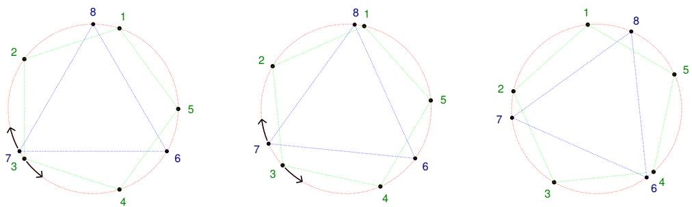
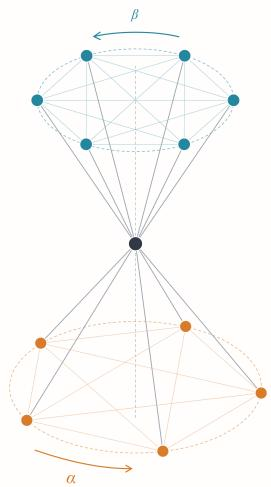

# DEGREE BOUNDS FOR SEPARATING POLYNOMIAL AND NEURAL INVARIANTS FOR POINT CLOUDS

Snir Hordan1,∗ Harm Derksen2, Mircea Petrache3, Nadav Dym1

1Technion – Israel Institute of Technology

2Northeastern University

3Pontificia Universidad Catolica de Chile´

## ABSTRACT

Neural networks that respect the symmetries of point clouds commonly compute high-order representations of the rotation group to improve their expressivity. Such models are known to be universal, and thus able to separate any pair of point clouds, when using representations of sufficiently high order, yet no precise bound on this order, as a function of the number of points, was previously known. We establish the first quadratic lower and upper degree bounds for polynomials that separate point clouds of n points up to rotations and permutations. By showing Tensor Field Networks and MACE can express all invariant polynomials of a given degree with sufficient representation order, we additionally derive the first explicit, quadratic bound on the representation order sufficient for these architectures to be complete, replacing previous existence results with concrete guarantees. We further show that, under local regularity assumptions, point cloud separation can be achieved with a message-passing-based model using invariants whose degree depends only on the size of a local neighborhood, rather than on the size of the full point cloud. Finally, we provide counterexamples showing MACE must compute high order irreducible representations to separate locally regular point clouds.

## 1 INTRODUCTION

Learning functions that are invariant, or equivariant, to a group of symmetries is a central problem in geometric deep learning (Bronstein et al., 2021). One of the most important instances of this problem is the case of point clouds, or finite sets of points, that efficiently represent molecules, particle systems and 3D shapes, where the relevant symmetry group is generated by permutations of the points together with the rigid motions of the ambient space (Guo et al., 2019; Han et al., 2022; Sanchez-Gonzalez et al., 2020). Here the goal is to design architectures whose internal mechanisms respect the symmetries of point clouds, that is point ordering and orientation in space, and whose predictions depend only on the underlying geometry rather than on ambiguous choices of point order or choice of frame of reference (Schutt et al., 2017; Thomas et al., 2018).¨

A natural theoretical desideratum of invariant architectures is completeness: informally, a family of invariant functions is complete if it can separate every pair of inputs that are not related by a symmetry, that is, that do not lie in the same group orbit. This follows from completeness being a necessary and sufficient condition for the family to be able to approximate every continuous invariant function, and hence for the corresponding architecture to be a universal approximator of invariant functions (Chen et al., 2019; Dym & Gortler, 2025).

The completeness of invariant architectures for point clouds has consequently received a great deal of attention. For example, the DeepSets model family was proven to be complete on set-structured data (Zaheer et al., 2017), while message-passing neural networks for graphs are not (Morris et al., 2023). For point clouds, it is known that distance-based message-passing approaches are not complete (Pozdnyakov & Ceriotti, 2022), while high-order invariant graph neural networks can attain completeness (Hordan et al., 2024b; Rose et al., 2023; Li et al., 2023). Yet, these approaches suffer from high computational cost, making them difficult to scale.

A popular methodology to increase the expressive power of geometric message passing neural networks while maintaining tractable runtime is to use higher order tensor representations of the rotation group. This approach is successfully used in many modern day models for point clouds such as MACE (Batatia et al., 2022) and Equiformer (Liao & Smidt, 2023). In Dym & Maron (2021) it is shown that these higher order approaches are complete. The mechanism behind these results is the following: an arbitrarily high-order representation can express polynomials of an arbitrarily high degree, and the class of invariant polynomials of sufficiently high degree is complete. What has been missing, up to this work, is any quantitative control on how high the representation order needs to be for completeness to hold.

In this work we provide the first answer to this question, in the form of explicit degree bounds for separating polynomial invariants of the relevant group action, that is the minimal polynomial degree needed to separate all orbits (defined precisely in Section 2). For point clouds of n points in $\mathbb { R } ^ { d }$ we show that the separation degree is lower bounded by a bound proportional to $n ^ { 2 }$ (Theorem 1), and upper bounded by a bound proportional to $d n ^ { 2 }$ (Theorem 4). Thus, in the main case of interest where $d = 3$ , this bound is tight, up to a constant. As a corollary, we deduce a quadratic lower bound and a cubic upper bound for the polynomial degree sufficient for separating weighted graphs (Proposition 5).

We then use our bounds to derive concrete completeness guarantees for existing invariant architectures: as we show in Section 3, it upgrades classical results in the geometric deep learning literature, which established completeness only for some sufficiently high, unspecified, representation order, into an explicit quadratic bound on that order for models such as Tensor Field Networks (Thomas et al., 2018) and MACE (Batatia et al., 2022). Moreover, we show that, under locality assumptions on the point cloud, our results can be leveraged to obtain completeness for MACE with a representation order that depends quadratically only on the size of local neighborhood rather than on the size of the entire point cloud. We then show, by a counterexample construction, that if the representation order and correlation degree aren’t sufficiently high then MACE cannot separate locally regular configurations (Proposition 12).

In summary, the main results of this paper are:

1. Tight quadratic degree bounds for separation of 3D point clouds by polynomials.

2. First quantitative completeness results for MACE and TFN, with quadratic dependence on point cloud cardinality.

3. Under locality assumptions on point clouds, an improvement of this bound to quadratic in the neighborhood size, and a lower bound showing that, with bounded depth and correlation order, the irreducible order must grow at least linearly in the neighborhood size.

## 1.1 RELATED WORK

Invariant Theory The origins of Invariant Theory, which is the study of invariant polynomials, go back to the $1 { \dot { 9 } } ^ { \mathrm { t h } }$ century. Its goal is to understand invariant polynomials, including explicit description of the generators of the invariant ring, or bounds on the degree of these generators. A celebrated result by Hilbert (1890) states that the ring of invariant polynomials is generated by a finite number of polynomials. Classical results in invariant theory focus on explicit derivation of these generators for specific group actions, or on bounding the cardinality or maximal degree of these generators. More recently there has been growing interest in the notion of separating invariants, which for compact groups are identical to the notion of complete invariants defined here. Generators are also separating invariants, and as a result the degree needed for separation cannot be larger than the maximal degree of the generators.

To the best of our knowledge, there are no known results regarding the separation degree for point clouds. For weighted graphs, Thiery (2000) proved an ´ $O ( \bar { n } ^ { 4 } )$ upper bound on the degree of the generators. A bound with similar asymptotics can also be obtained from a general bound on permu tation groups (Gobel, 1995). In this paper we discuss the separation degree of weighted graphs, and ¨ prove a quadratic lower bound and a cubic upper bound.

For more background on invariant theory and further related work see Appendix F and Appendix A.

## 1.2 NOTATION

We consider the setting of a group G acting on a set $V .$ . We denote the orbit of an element $v \in V$ by $[ v ] : = \{ g v | g \in G \}$ and say that $q : V $ R is G invariant if $q ( u ) = q ( v )$ for all $v \in V , u \in [ v ]$ Let Q be a family of G invariant functions from V to R. We say that Q is $( G , V )$ complete, if for all $v , u \in V \mathrm { ~ w i t h ~ } [ v ] \neq [ u ]$ , there exists a function $q \in \mathcal { Q }$ such that $q ( v ) \neq q ( u )$

Now assume additionally that V is a finite dimensional real vector space, so that the notion of polynomials is defined. We denote the set of all polynomials $p : V  \mathbb { R }$ with real coefficients by R[V ], and the subset of polynomials of degree $\le \ D$ by $\mathbb { R } [ V ] _ { \leq D }$ . The subset of G invariant polynomials (of degree $\le \ D )$ are denoted by $\mathbb { R } [ V ] ^ { G }$ (and $\mathbb { R } [ V ] _ { \leq D } ^ { G } \ )$ . The separation degree of $( G , V )$ , denoted by $D ( G , V )$ , is the smallest nonnegative integer $D$ such that $\mathbb { R } [ V ] _ { \leq D } ^ { G } { \mathrm { i s } } \ ( G , V )$ complete.

Our interest in this paper will be in completeness and separation degree for point clouds. A point cloud with n points in $\mathbf { \mathbb { R } } ^ { d }$ is a tuple $X = ( x _ { 1 } , \ldots , x _ { n } )$ residing in the vector space $V = \mathbb { R } ^ { d \times \hat { n } }$ . We are interested in the action of rigid motions and permutations on this space. Explicitly, for a vector $t \in \mathbb { R } ^ { d }$ , an orthogonal matrix $\bar { R ( ) } \in { \cal O } ( d )$ , and a permutation $\sigma \in S _ { n }$ , this action is defined by

$$
( t , R , \sigma ) \cdot X : = \big ( R ( x _ { \sigma ^ { - 1 } \left( 1 \right) } - t ) , . . . , R ( x _ { \sigma ^ { - 1 } \left( n \right) } - t ) \big ) .
$$

We are interested in four variants of this problem, which come up in different applications: we will consider groups of the form $G = H \times S _ { n }$ where $H = E ( d )$ (all rigid motions), $H = O ( d )$ (the translation component t is set to zero), $H = S O ( d )$ (no translations, only proper rotations), and $H = S E ( d )$ (with translations, only proper rotations). For each of these groups, we will derive bounds for the separation degree $D ( \bar { G } , \mathbb { R } ^ { d \times n } )$ .

We will also be interested in the related notion of separation for weighted graphs. A weighted graph is a symmetric $n \times n$ matrix with real coefficients. We denote the set of such matrices by ${ \mathcal { H } } _ { n }$ . The permutation group $S _ { n }$ acts on ${ \mathcal { H } } _ { n }$ by conjugation. Namely, $\mathrm { i f } \tau \in S _ { n }$ and $A \in \mathcal { H } _ { n }$ then $\tau \cdot A$ is the matrix defined by

$$
\left( \tau \cdot A \right) _ { i j } = A _ { \tau ^ { - 1 } \left( i \right) , \tau ^ { - 1 } \left( j \right) } .
$$

If A is a (weighted) adjacency matrix of a graph with some fixed node ordering, then $\tau \cdot A$ is the adjacency matrix of the same graph, with its nodes reordered by τ . We use $1 _ { n } \left( \operatorname { o r } 0 _ { n } \right)$ to denote the n-dimensional vector whose entries are all 1 (or 0).

## 2 DEGREE BOUNDS FOR SEPARATING POLYNOMIALS ON POINT CLOUDS

In this section we answer the following questions: what is a polynomial degree required for separation and what polynomial degree is sufficient for separation of point clouds? We derive a lower bound for the polynomial degree of separation for point clouds, which is proportional to $n ^ { 2 }$ (Subsection 2.1), and an upper bound proportional to $d n ^ { 2 }$ (Subsection 2.2). From this we derive a quadratic lower bound and a cubic upper bound on the separation degree for weighted graphs (Section 2.3).

## 2.1 LOWER BOUND FOR POINT CLOUDS

We begin by stating our lower bound, that is a polynomial degree required for separating point clouds.

Theorem 1. Let $d \geq 2 , n \geq 3 .$ Consider the action of $G = H \times S _ { n }$ on $V ~ = ~ \mathbb { R } ^ { d \times n }$ , where $H \in \{ E ( d ) , S E ( d ) , O ( d ) , S O ( d ) \}$ . Then the separation degree is lower bounded by

$$
D ( G , V ) \geq n ^ { 2 } / 4 - 1 .
$$

The remainder of this subsection is devoted to proving this theorem. We begin with some preliminaries. Firstly, the following lemma establishes a simple relationship between the separation degree with and without translations:

Lemma 2. Let $V = \mathbb { R } ^ { d \times n }$ and $V _ { \mathrm { c e n t } }$ denote the subspace of point clouds $X \in \mathbb { R } ^ { d \times n }$ with $X 1 _ { n } =$ $0 _ { d } .$ Then

$$
D ( E ( d ) \times S _ { n } , V ) = D ( O ( d ) \times S _ { n } , V _ { \mathrm { c e n t } } ) \leq D ( O ( d ) \times S _ { n } , V )\tag{1}
$$

$$
D ( S E ( d ) \times S _ { n } , V ) = D ( S O ( d ) \times S _ { n } , V _ { \mathrm { c e n t } } ) \leq D ( S O ( d ) \times S _ { n } , V )\tag{2}
$$

Proofidea. Equation 1 follows from the fact that two point clouds $X , Y$ are in the same $E ( d ) \times S _ { n }$ orbit, if and only if the centralized point clouds $X \ { \overset { . } { - } } \ { \frac { 1 } { n } } X 1 _ { n } 1 _ { n } ^ { T } , Y \ - \ { \frac { 1 } { n } } Y 1 _ { n } 1 _ { n } ^ { T }$ are in the same $O ( d ) \times S _ { n }$ orbit. The proof for equation 2 is identical. □

The proof of the theorem is strongly based on the following proposition:

Proposition 3. Let G be a compact group acting orthogonally on a finite dimensional real inner product space V . Let $k \geq 1$ be an integer. Suppose there exists a 2-dimensional subspace $W \subseteq V$ and an element $g \in G$ such that $g \cdot W \subseteq W$ and $g$ acts by rotation over 2π/k on W. If the unit circle $S ( W ) \subset \bar { W }$ contains more than 1 orbit, then we have $D ( G , V ) \geq k$

Proof. We choose an orthonormal basis of W and identify $\mathbb { R } [ W ] \cong \mathbb { R } [ x _ { 1 } , x _ { 2 } ]$ . Restricting polynomials gives a surjective ring homomorphism $\mathbb { R } [ V ] \to \mathbb { R } [ x _ { 1 } , x _ { 2 } ] .$ Let H be the subgroup of G generated by $g .$ It is well-known that the invariant ring $\mathbb { R } [ \dot { \boldsymbol { x } } _ { 1 } , \dot { \boldsymbol { x } } _ { 2 } ] ^ { \dot { \boldsymbol { H } } }$ is generated by $x _ { 1 } ^ { \breve { 2 } } + x _ { 2 } ^ { 2 }$ and the polynomials $f _ { 1 } , f _ { 2 } \in \mathbb { R } [ x _ { 1 } , x _ { 2 } ] ^ { H }$ of degree k given by $( x _ { 1 } \dot { + } i x _ { 2 } ) ^ { \bar { k } } = f _ { 1 } + i \dot { f } _ { 2 }$ (see for example Yasinsky, 2022). In particular, every element of $\mathbb { R } [ \dot { \boldsymbol { x } } _ { 1 } , \boldsymbol { x } _ { 2 } ] ^ { H }$ of degree $< k$ is a polynomial in $\bar { x } _ { 1 } ^ { 2 } + x _ { 2 } ^ { 2 }$ and is constant on $S ( W )$ Since not all elements in $S ( W )$ lie in the same G-orbit, there exists an invariant $f \in \mathbb { R } [ V ] ^ { G }$ of degree $\leq D ( G , V )$ ) that is not constant on $S ( W )$ . If $f ^ { \prime }$ is the restriction of f to W, then $\mathbf { \check { \it f } ^ { \prime } } \in \mathbb { R } [ W ] ^ { \mathbf { \check { \it H } } } = \mathbf { \bar { \mathbb { R } } } [ x _ { 1 } , x _ { 2 } ] ^ { \mathbf { \dot { \it H } } }$ is not constant on $S ( W )$ , so we have $D ( G , V ) \geq \deg ( f ) \geq \deg ( f ^ { \prime } ) \geq k .$ □

We now return to the proof of Theorem 1. By Lemma 2 it is sufficient to prove a bound for all four groups in the lemma, by considering the two groups $G = O ( d ) \times S _ { n }$ or $\bar { G } = S O ( d ) \times S _ { n }$ , and the vector space $V _ { \mathrm { c e n t } ^ { - } }$ the space of centralized point clouds. Throughout, we will assume G is one of these two groups.

We first consider the case $d = 2$ . We identify $\mathbb { R } ^ { 2 }$ with C and $\mathbb { R } ^ { 2 \times n }$ with $\mathbb { C } ^ { n }$ . If $n = 2 m$ is even, we define $p = m + 1 , q = m - 1 , u = 1$ and $r = m . \mathrm { I f } n = 2 m + 1$ then we define $p = m + 1 , q = m .$ $u = 2$ and $r = 2 m + 1$ . We have $n = p + q , r = u p - 1 = u q + 1$ and $p q \ge n ^ { 2 } / 4 - 1$ . For $t \in \mathbb { R }$ and all $j \in \mathbb { Z } ,$ , define

$$
a _ { j } ( t ) = e ^ { i ( 2 \pi j / p + t ) } \quad \mathrm { a n d } \quad b _ { j } ( t ) = e ^ { i ( \pi / 2 - 2 \pi j / q - t ) } .
$$

So $a _ { 1 } ( t ) , a _ { 2 } ( t ) , \ldots , a _ { p } ( t )$ are the counterclockwise consecutive vertices of a regular p-gon centered around the origin. The vertices $b _ { 1 } ( t ) , b _ { 2 } ( t ) , \dots , b _ { q } ( t )$ are clockwise consecutive vertices of a regular q-gon. As t increases, the p-gon rotates counter-clockwise and the q-gon rotates clockwise. We easily verify that $\begin{array} { r } { a _ { j } ( t + \frac { \pi } { 2 } ) = i a _ { j } ( t ) , b _ { j } ( t + \frac { \pi } { 2 } ) = - i b _ { j } ( t ) , a _ { j + p } ( t ) = \bar { a } _ { j } ( t ) , b _ { j + q } ( t ) = b _ { j } ( t ) } \end{array}$ and

$$
\begin{array} { r l r } { a _ { j } ( s + t ) } & { = } & { e ^ { i s } a _ { j } ( t ) = ( \cos ( s ) + i \sin ( s ) ) a _ { j } ( t ) = \cos ( s ) a _ { j } ( t ) + \sin ( s ) a _ { j } ( t + \frac { \pi } { 2 } ) } \end{array}
$$

$$
\begin{array} { r l r } { b _ { j } ( s + t ) } & { = } & { e ^ { - i s } b _ { j } ( t ) = ( \cos ( s ) - i \sin ( s ) ) b _ { j } ( t ) = \cos ( s ) b _ { j } ( t ) + \sin ( s ) b _ { j } ( t + \frac { \pi } { 2 } ) } \end{array}
$$

Define

$$
w ( t ) = ( a _ { 1 } ( t ) \quad a _ { 2 } ( t ) \quad \cdots \quad a _ { p } ( t ) \quad b _ { 1 } ( t ) \quad b _ { 2 } ( t ) \quad \cdots \quad b _ { q } ( t ) ) .
$$

The coordinates of $w ( t )$ form a point cloud in the complex plane (see figure 1) and this point cloud is centralized. We have $\begin{array} { r } { w ( t + s \bar { ) } = \cos ( s ) w ( t ) + \sin ( \bar { s } ) w ( \bar { t } + \frac { \pi } { 2 } ) } \end{array}$ . This shows that $w ( t )$ lies in the real span of the two linearly independent matrices $w ( 0 )$ and $\begin{array} { r } { w ( \frac { \pi } { 2 } ) } \end{array}$ . Now we take $\begin{array} { r } { s = { \frac { 2 \pi } { p q } } } \end{array}$ . Because $r = u p - 1 = u q + 1$ , we have

$$
\begin{array} { r l r } { a _ { i } \big ( t + \frac { 2 \pi } { p q } \big ) } & { = } & { a _ { i } \big ( t + \frac { 2 \pi r } { p q } - \frac { 2 \pi u } { p } \big ) = a _ { i - u } \big ( t + \frac { 2 \pi r } { p q } \big ) = e ^ { 2 \pi i r / p q } a _ { i - u } ( t ) } \end{array}
$$

$$
\begin{array} { r l r } { b _ { j } \big ( t + \frac { 2 \pi } { p q } \big ) } & { = } & { b _ { j } \big ( t - \frac { 2 \pi r } { p q } + \frac { 2 \pi u } { q } \big ) = b _ { j + u } \big ( t - \frac { 2 \pi r } { p q } \big ) = e ^ { 2 \pi i r / p q } b _ { j + u } ( t ) } \end{array}
$$

and

$$
\begin{array} { r } { w \big ( t + \frac { 2 \pi } { p q } \big ) = e ^ { 2 \pi i r / p q } \left( a _ { 1 - u } ( t ) \quad a _ { 2 - u } ( t ) \quad \cdots \quad a _ { p - u } ( t ) \quad b _ { 1 + u } ( t ) \quad b _ { 2 + u } ( t ) \quad \cdots \quad b _ { q + u } ( t ) \right) } \end{array}
$$

The action of $\mathrm { S O } ( 2 )$ on $\mathbb { R } ^ { 2 \times n } \cong \mathbb { C } ^ { n }$ is just multiplication with unit scalars in C. The permutation

$$
\sigma = ( 1 2 \ \dots p ) ^ { u } ( p + 1 \ p + 2 \ \cdots p + q ) ^ { - u } \in S _ { n }
$$

acts on $\mathbb { C } ^ { n }$ by permuting the entries (or permuting the columns in $\mathbb { R } ^ { 2 \times n } )$ . For $g = ( e ^ { 2 \pi i r / p q } , \sigma ) \in$ $S { \mathrm { O } } ( 2 ) \times S _ { n } \subseteq { \overline { { G } } }$ we have $\begin{array} { r } { g \cdot w ( t ) = w ( \dot { t } + \frac { 2 \pi } { p q } ) } \end{array}$ . Recall that $W$ is the span of $w ( 0 )$ and $\begin{array} { r } { w \big ( \frac { \pi } { 2 } \big ) } \end{array}$ . From this it is clear that $g \cdot W \subseteq W$ . If we restrict the action of $g \in G$ to the subspace $W$ , then it is just rotation over the angle $2 \pi / p q$

  
Figure 1: From left to right we have plotted the coordinates of $w ( 0 ) , w ( 0 . 1 )$ and $\textstyle w ( { \frac { 2 \pi } { 1 5 } } ) =$ $w ( 0 . 4 1 8 9 )$ in the complex plane for $n = 8$ We have $p \ = \ 5 , \ q \ = \ 3$ and $r \ = \ 4$ As t goes from 0 to 0.1 the pentagon moves counterclockwise and the triangle moves clockwise. The point clouds of $w ( 0 )$ and $w \big ( \frac { 2 \overline { { \pi } } } { 1 5 } \big )$ are isometric. The latter is obtained from the first by rotation over $\frac { 8 \dot { \pi } } { 1 5 }$ and applying the permutation $( 1 2 3 4 5 ) ( 8 7 6 )$ to the columns of w.

If we forget about the labeling of the vertices, then $w ( t )$ is a point cloud consisting of the union of the vertices of a p-gon and the vertices of a q-gon. Now $w ( t )$ is obtained from $w ( 0 )$ by rotating the $p { \mathrm { - } } \mathrm { g o n }$ counterclockwise and the $q \mathrm { - g o n }$ clockwise. From this it is clear that for small $t > 0 , w ( 0 )$ and $w ( t )$ are not isometric point clouds. This proves that not all the elements of $S ( W ) \subset W$ lie in the same ${ \mathrm { O } } ( 2 ) \times S _ { n }$ -orbit. By Proposition 3 we get $D ( G , V ) \geq p q \geq n ^ { 2 } / 4 - 1$

Now assume that $d > 2 .$ . We view $\mathbb { R } ^ { 2 \times n }$ as the subspace of $\mathbb { R } ^ { d \times n }$ of $d \times n$ matrices whose rows $3 , \ldots , d$ are all equal to 0, and let $W \subseteq \mathbb { R } ^ { 2 \times n }$ be the 2-dimensional subspace that was constructed in the $d = 2$ case. Now there is again an element $g \in \mathrm { S O } ( 2 ) \times S _ { n } \subseteq G \subseteq \mathrm { O } ( d ) \times S _ { n }$ that acts on W by rotation over the angle $2 \pi / p q$ . For similar reasons as before, not all elements of $S ( W ) \subset W$ lie in the same ${ \mathrm { O } } ( d ) \times S _ { n }$ -orbit. So we again can apply Proposition 3 to conclude that $D ( G , V ) \geq p q \geq n ^ { 2 } / 4 - 1$

## 2.2 UPPER BOUND FOR POINT CLOUDS

Having established a lower bound on the degree required for separation of point clouds, we proceed to provide an upper bound. In the proof of Theorem 4, we introduce a polynomial construction with degree that depends linearly on the dimension d and quadratically on the number of points that separates d-dimensional point clouds, thereby establishing an upper bound on the degree sufficient for separation.

Theorem 4. Let $n \geq 2$ and $1 \leq d \leq n$ . Then

$$
\begin{array} { r l r } { D \big ( H \times S _ { n } , \mathbb { R } ^ { d \times n } \big ) } & { \le \mathsf { 6 } d n ^ { 2 } - 4 d n - d ( d - 1 ) ( n - 1 ) , } & { f o r { \cal H } \in \{ \mathrm { O } ( d ) , E ( d ) \} } \\ { \quad D \big ( H \times S _ { n } , \mathbb { R } ^ { d \times n } \big ) } & { \le \mathsf { 6 } d n ^ { 2 } - 4 d n - d ( d - 1 ) ( n - 1 ) + d , } & { f o r { \cal H } \in \{ \mathrm { S O } ( d ) , S E ( d ) \} } \end{array}
$$

Proofidea. By Lemma 2 it is sufficient to prove the claim for $O ( d ) \times S _ { n }$ and $S O ( d ) \times S _ { n }$ . The goal is to find, for any given $X , Y \in \mathbb { R } ^ { d \times \bar { n } }$ from different orbits, an invariant polynomial of the advertised degree that separates them. Since two clouds are ${ \mathrm { O } } ( d ) \times S _ { n }$ -equivalent iff their Gram matrices $A = \overline { { X ^ { T } X } } , B \stackrel { \bullet } { = } Y ^ { T } Y$ are equal up to simultaneous row/column permutation, it suffices to separate A and B by an $S _ { n }$ -invariant polynomial Q (at the cost of doubling the degree). We choose a polynomial of the form

$$
Q ( C ) = \sum _ { \tau \in S _ { n } } \chi ( \tau \cdot C )
$$

where $\chi$ is a polynomial which takes values in $\{ 0 , 1 \}$ on the $S _ { n }$ -orbits of A and $B ,$ , with $\chi ( A ) = 1$ and $\chi ( \boldsymbol { \tau } \cdot \boldsymbol { B } ) \dot { = 0 }$ for all permutations τ . The task is thus reduced to realizing such an indicator $\chi$ by a low-degree polynomial. Clouds of different rank are separated by $\operatorname { t r } ( ( X ^ { T } X ) ^ { k } )$ for some $k \leq n$ so we may assume rank $( A ) = \operatorname { r a n k } ( B ) = r \leq d .$ . Then A can be relabeled so that its leading $r \times r$ block is nonsingular, and among matrices of rank r it is determined by its first r rows, so at most $d \cdot n$ entries must be checked. Each entry is checked by a Lagrange polynomial of degree $< n$ interpolating on the values of the corresponding row of $A$ , which is valid thanks to a row indicator of degree $\bar { O ( n ^ { 2 } ) }$ (via power sums), which ensures the row of $\tau \cdot C$ is a rearrangement of that of A. The total degree is $O ( d n ^ { 2 } )$ . For $\mathrm { S O } ( d )$ , if the point clouds have rank $d ,$ we multiply each summand by an affine function of the determinant of the first d points, which detects orientation and adds $d$ to the degree; if their rank is smaller than $d ,$ the ${ \mathrm { S O } } ( d ) \times { \bar { S } } _ { n }$ -orbit of $X$ is equal to its ${ \mathrm { O } } ( d ) \times S _ { n }$ -orbit, and the polynomial for $\mathrm { O } ( d )$ separates them. □

Theorem 4 shows that it is possible to obtain separating invariants of degree quadratic in n for point clouds. It follows that neural networks that are able to express polynomials up to that degree bound can provably separate point clouds with n points. Many popular machine learning equivariant models are able to express high order polynomials using tensor representations, allowing us to show how this upper bound proves the separation capabilities of prominent such models in Section 3.

## 2.3 DEGREE BOUNDS FOR WEIGHTED GRAPHS

Our degree bounds for point clouds automatically imply degree bounds for weighted graphs (see definition in Subsection 1.2).

Proposition 5. For any natural $n ,$ we have that $D ( O ( n ) \times S _ { n } , \mathbb { R } ^ { n \times n } ) = 2 D ( S _ { n } , \mathcal { H } _ { n } )$ . In particular itfollowsfrom Theorem 1 and Theorem 4, thatfor $n \geq 3 ,$

$$
\frac { 1 } { 2 } ( n ^ { 2 } / 4 - 1 ) \leq D ( S _ { n } , \mathcal { H } _ { n } ) \leq \frac { 1 } { 2 } \left( 5 n ^ { 3 } - 2 n ^ { 2 } - n \right)
$$

Proofidea. The proof that $D ( O ( n ) \times S _ { n } , \mathbb { R } ^ { n \times n } ) = 2 D ( S _ { n } , \mathcal { H } _ { n } )$ is based on the observation that two positive semi-definite weighted graphs $A , B$ are in the same $S _ { n }$ orbit, if and only if there are ${ \cal O } ( n ) \times { \cal S } _ { n }$ equivalent point clouds $\check { X , Y }$ satisfying $X ^ { T } X = A , Y ^ { T } Y = B$ . The full proof is in the appendix. □

## 3 QUANTITATIVE APPROXIMATION BOUNDS FOR INVARIANT MODELS

Our upper bound in Theorem 4 shows universality and separation for $S E ( d ) \times S _ { n }$ invariant polynomials of degree proportional to $d \cdot n ^ { 2 }$ These results can be extended to similar quantitative universality results for $S E ( d ) \times S _ { n }$ invariant architectures which are based on message passing and high dimensional representations of the rotation group, since such architectures can construct invariant polynomials. We give two specific architectures for which such results can be obtained: Tensor Field Networks (TFN) and $\mathbf { M A C E }$

In this section we will often specialize to the case $d = 3$ , since this is the most relevant dimension in practice, and as a result many invariant models, including TFN and MACE, are defined for $d = 3$ only.

## 3.1 TENSOR FIELD NETWORKS

Tensor Field Networks (TFN) (Thomas et al., 2018) pioneered the approach of using highdimensional representations of the rotation group for $S \bar { E } ( 3 ) \times S _ { n }$ invariant models. We give a brief background on this approach.

A real representation of $S O ( 3 )$ is a real vector space on which $S O ( 3 )$ acts linearly. A standard example is the action of $S O ( 3 )$ on $\mathbb { R } ^ { 3 }$ by matrix multiplication. More generally, for every $\ell =$ $0 , 1 , 2 , \ldots$ , there is a $2 \ell + 1$ dimensional representation $\dot { W } _ { \ell } \cong \mathbb { R } ^ { 2 \ell + 1 }$ of $S O ( 3 )$ . This representation is obtained via spherical harmonics: For a fixed ℓ, the ℓ-th spherical harmonics are a collection of $2 \ell + 1$ polynomials $Y _ { \ell } ^ { m } \ : \ \mathbb { R } ^ { 3 }  \ \mathbb { R } , m \ = \ - \ell , \dots , \ell$ which are (a) ℓ-homogeneous and (b) are harmonic and satisfy that the mapping $x \mapsto ( Y _ { \ell } ^ { m } ( x ) , m = - \ell , \ldots , \ell )$ is a rotation equivariant function mapping the standard representation $\mathbb { R } ^ { 3 } \cong W _ { 1 }$ into a high dimensional representation $W _ { \ell } .$

To what extent does the employment of higher dimensional features increase the expressive power of the model? In Pozdnyakov & Ceriotti (2022) it was shown that methods which use geometric message passing on the distances only (corresponding to $\ell \ = \ 0$ features) are not complete. In contrast, in Dym & Maron (2021) it was shown that TFN can construct all invariant polynomials up to degree D, if the feature order and depth are proportional to D. Specifically, the following is a simple corollary of Theorem 2 in that paper:

Proposition 6. Let $D \in \mathbb { N } . A n y S E ( 3 ) \times S _ { n }$ invariant polynomial $p : \mathbb { R } ^ { 3 \times n } $ R can be expressed by a TFN model with 2D layers, and irreduciblefeatures ofmaximal order $\ell _ { \mathrm { m a x } } = D$

In Dym & Maron (2021), this proposition was used to prove that one can always obtain a complete model if the maximal irreducible order is taken to be arbitrarily large, where this result is based on the observation that invariant polynomials can approximate all continuous invariant functions. With our result, Theorem 4, we can now for the first time obtain a bound on the order of $\ell _ { \mathrm { m a x } }$ needed:

Corollary 7. Let $n \in \mathbb N$ and set $D = 1 8 n ^ { 2 } - 1 8 n + 9 .$ . Then an invariant TFN model with 2D layers, and irreducible features of order $\mathit { \Theta } \leq D ,$ , is $( S E ( 3 ) \times S _ { n } , \mathbb { R } ^ { 3 \times n } )$ complete.

The derivation of Proposition 6 from the results in Dym & Maron (2021), and some more details of the TFN model used, are discussed in Appendix D.1.

## 3.2 MACE

MACE (Batatia et al., 2022) is a very successful $S E ( 3 ) \times S _ { n }$ invariant model. Its main innovation is the employment of tensor products of several high order features. Namely, ${ \mathrm { i f } } \ A _ { 1 } , \ldots , A _ { \nu }$ are features in $W _ { \ell _ { 1 } } , \ldots , W _ { \ell _ { \nu } }$ respectively, then one can obtain a new feature $A _ { 1 } \otimes A _ { 2 } \otimes . . . \otimes A _ { \nu }$ in the tensor product representation $W _ { \ell _ { 1 } } \otimes W _ { \ell _ { 2 } } \otimes \ldots \otimes W _ { \ell _ { \nu } }$ . Moreover, using the Clebsch-Gordan coefficients, this tensor product representation can be mapped equivariantly to a direct sum of $W _ { \ell }$ representations. While previous works like TFN employed such tensor products between pairs of tensors $( \nu = 2 )$ MACE was the first model to use such decompositions for $\nu > 2$ Our next proposition gives an explanation for the effectiveness of this procedure, by showing that unlike TFN, for which the construction of Dym & Maron (2021) uses depth 2D to express invariant polynomials of degree $D ,$ MACE can do this with depth=1, as long as the maximal number of tensor products (known as the body order) $\nu _ { \mathrm { m a x } } .$ , and the maximal representation order $\ell _ { \mathrm { m a x } }$ , satisfy $\nu _ { \mathrm { m a x } } = \operatorname* { m i n } \{ D , n - 1 \}$ and $\ell _ { \mathrm { { m a x } } } = \lfloor D / 2 \rfloor$ , respectively.

We modify the step of MACE that forms tensor products of the aggregated features so that it follows the atomic cluster expansion (ACE) (Drautz, 2019): each factor of the tensor product has its own channel mixing, as each factor of an ACE basis function has its own radial index. This modification, and the other differences from the original model, are detailed in Appendix D.2.

Proposition 8. MACE with $\nu _ { \mathrm { m a x } } = \operatorname* { m i n } \{ D , n - 1 \}$ and $\ell _ { \mathrm { { m a x } } } = \lfloor D / 2 \rfloor$ can express any $S E ( 3 ) \times S _ { n }$ invariant polynomial ofdegree $\le D$

As a corollary of this proposition and Theorem 4, we obtain the following completeness result for MACE

Corollary 9. Let $n \in \mathbb N$ and set $D = 1 8 n ^ { 2 } - 1 8 n + 9$ . Then a MACE model with depth 1, $\nu _ { \mathrm { m a x } } = n - 1$ and $\ell _ { \mathrm { { m a x } } } = \lfloor D / 2 \rfloor$ is $( S E ( 3 ) \times S _ { n } , \mathbb { R } ^ { 3 \times n } )$ complete.

The details of the MACE model used for Proposition 8, and the proof of the proposition, are given in Appendix D.2. In Appendix D.3 we show that when message passing is on all points, more iterations can be used instead of a high body order, for example $\nu _ { \mathrm { m a x } } = 2$ with $\log _ { 2 } ( n + 1 ) - 1$ iterations (Corollary 30).

## 3.3 IMPROVED MACE COMPLETENESS FOR LOCALLY REGULAR POINT CLOUDS

The completeness results of Section 3 require invariants of degree $1 8 n ^ { 2 } - 1 8 n + 9$ , a quantity that grows with the number of points in the cloud. This degree is likely too high for most practical MACE implementations. Moreover, MACE typically applies message passing only within a fixed cutoff radius (Batatia et al., 2022). Accordingly, the relevant scale is not n but the maximal number K of points inside a single cutoff ball. In this subsection we isolate a set of properties of a point cloud which make this precise: on the class of clouds satisfying them, a local model of MACE type is complete using irreducible features and invariants of degree at most $6 d K ^ { 2 }$ , a bound independent of n and of the depth of the model. Restricted to such a class, this strengthens the MACE completeness corollary of Section 3. Conversely, on a similar class, we prove a lower bound showing that MACE cannot separate without irreducibles and correlation orders whose total degree is $\sim K ^ { \breve { 2 } }$

Below we will fix a cutoff radius $\rho > 0$ and an integer K. In order to focus on applications to $\mathrm { { \bf M A C E } , }$ we will set the dimension to $d = 3$ . Proofs are given in Appendix E and they are written for general $d \geq 2 ,$ , except where the constants are specific to $d = 3$

Environments. Let $\boldsymbol { X } = ( x _ { 1 } , \ldots , x _ { n } ) \in \mathbb { R } ^ { d \times n }$ and write $[ n ] : = \{ 1 , \dots , n \}$ . For $i \in [ n ]$ let

$$
\mathcal { B } _ { 1 } ^ { X } ( i ) : = \{ j \in [ n ] : \| x _ { j } - x _ { i } \| \leq \rho \}
$$

be the set of indices in the cutoff ball at $x _ { i }$ . Two indices $i , j \in [ n ]$ are ρ-adjacent if $0 < \| x _ { i } - x _ { j } \| \leq \rho$ and the columns indexed by $B _ { 1 } ^ { X } ( i ) \cap B _ { 1 } ^ { X } ( j )$ contain $d + 1$ affinely independent points.

Definition 10 (locally regular point clouds). A matrix $\boldsymbol { X } = ( x _ { 1 } , \ldots , x _ { n } ) \in \mathbb { R } ^ { d \times n }$ with $n \geq 2$ is $( \rho , K )$ -regular $i f$

(D) the columns $x _ { 1 } , \ldots , x _ { n }$ are pairwise distinct;

(K) $\left| \left\{ j \in [ n ] : \| x _ { j } - y \| \leq \rho \right\} \right| \leq K$ for every $y \in \mathbb { R } ^ { d } .$

(O) the ρ-adjacency graph on [n] is connected.

We say that $X \in \mathbb { R } ^ { d \times n } i s \left( \rho , K \right)$ - strongly regular, ifX is $( \rho , K )$ regular, and additionally, X does not contain two different ordered subsets of $\hphantom { 0 0 0 } \partial ^ { \aa } + 1$ points which are congruent. Here two ordered subsets $( p _ { 0 } , \ldots , p _ { d } )$ and $( p _ { 0 } ^ { \prime } , \ldots , p _ { d } ^ { \prime } )$ are congruent if there exist $g \in O ( d )$ and $b \in \mathbb { R } ^ { d }$ such that $p _ { s } ^ { \prime } = g p _ { s } + b f o r$ all $s = 0 , \ldots , d .$ We denote the collection of $( \rho , K )$ regular and $( \rho , K )$ strongly regular point clouds by $\mathcal { R } _ { \rho , K }$ and $\mathcal { R } _ { \rho , K } ^ { S } ,$ , respectively.

Hypothesis (K) bounds the local multiplicity from above and is what keeps environments small. Hypothesis (O) bounds it from below and is what makes the environments rigid: connectivity lets information propagate through the cloud, while the overlap requirement built into ρ-adjacency forces the cutoff balls of adjacent points to meet in a set of full affine dimension.

Our main result of this section states that, for $( \rho , K )$ strongly regular point clouds, a single iteration of local MACE with irreducible order $\sim K ^ { 2 }$ is already complete, and that further iterations preserve completeness:

Theorem 11. Let $K \leq n$ be natural numbers and $\rho > 0 ,$ , and let $G = S E ( 3 ) \times S _ { n }$ . Set

$$
D ( j ) = 1 8 j ^ { 2 } - 1 8 j + 9 , \qquad D = D ( K ) .
$$

Then local MACE with cutoff $\rho , T \geq 1$ iterations, $\nu _ { \operatorname* { m a x } } = K - 1$ and $\ell _ { \mathrm { m a x } } = \lfloor D / 2 \rfloor , i s \left( G , \mathcal { R } _ { \rho , K } ^ { S } \right)$ complete.

ProofIdea. The main idea is that, after a single MACE iteration, one obtains a set of node features $\{ E _ { i } ( X ) , i = 1 \ldots , n \}$ . These features are invariants, so reconstructing an environment from one of them is a separation problem for point clouds of K points, and this is where Theorem 4 enters: it bounds the degree at which invariants separate such clouds by $D = D ( K )$ , and Corollary $^ { 9 , }$ which is that theorem combined with the expressivity of one MACE layer, turns the bound into the degree assumption made here. Accordingly $B _ { 1 } ^ { X } ( i )$ , the local environment of each node i, can be reconstructed from $E _ { i } ( X )$ , up to a rotation and a translation. Strong regularity then implies that, whenever the two environments share $d + 1$ affinely independent points (up to congruence), these points can be identified with each other; by the overlap requirement in the definition of ρ-adjacency this is the case for every adjacent pair $i , j$ , so the environments of adjacent nodes can be glued. Since the ρ-adjacency graph is connected, and the intersections contain $\bar { d + 1 }$ affinely independent points, the whole point cloud can be reconstructed uniquely. A full proof is given in the appendix. □

We accompany the above by the following lower bound. In this lower bound, the hyperparameters $\ell _ { \mathrm { m a x } } , \nu _ { \mathrm { m a x } }$ correspond to the maximal irreducible order and maximal correlations used in the MACE iterations, and $\nu _ { \mathrm { r e a d } }$ denotes the correlations used in the final readout stage.

Proposition 12 (proved in Appendix E.2). Let $K \geq 7 ,$ and let a local MACE model with cutoff $\rho ,$ message-passing depth T and hyperparameters $\ell _ { \mathrm { m a x } } , \nu _ { \mathrm { m a x } } , \nu _ { \mathrm { r e a d } }$ be $( S E ( 3 ) \times S _ { n } , \mathcal { R } _ { \rho , K } )$ complete on clouds ofK points. Then

$$
\nu _ { \mathrm { r e a d } } \cdot \ell _ { \mathrm { m a x } } \cdot \sum _ { t = 1 } ^ { T } \nu _ { \mathrm { m a x } } ^ { t } \geq 2 \Big \lfloor \frac { K - 1 } { 2 } \Big \rfloor ,
$$

and ifthe readout is that ofequation 6–equation 7, afunction ofthe invariant channels at each point followed by a sum, then already $\begin{array} { r } { \ell _ { \operatorname* { m a x } } \sum _ { t = 1 } ^ { T } \nu _ { \operatorname* { m a x } } ^ { t } \geq 2 \lfloor ( K - 1 ) / 2 \rfloor } \end{array}$

Proofidea. The counterexample is a local version of the counter-rotating polygons of Theorem 1: for $p , q \geq 3$ we form a family of clouds of $K = p + q + 1$ points in $\mathbb { R } ^ { 3 }$ , each consisting of a point at the origin and two rings of $p$ and q points with free phases $\alpha , \beta$ around a common axis (see Figure 2). The cutoff radius is such that every distance the model can read is constant along the family, the cross-ring distances that do vary all exceeding the cutoff, so only angular resolution is at stake, while the sole invariant $\alpha - \beta$ is defined modulo $2 \pi / \mathrm { l c m } ( p , q )$ . Each spherical harmonic of degree ℓ in a message contributes at most ℓ to the frequency in $( \alpha , \beta )$ of the features, and products of $\nu _ { \mathrm { m a x } }$ messages add frequencies, which gives the budget on the left. Shifting $\beta \ : \mathsf { b y } \ : 2 \pi / q$ leaves the cloud and each point of the first ring fixed, and a rotation about the axis shifts α and β together, so the output at such a point is constant unless one of its Fourier modes $( m _ { 1 } , m _ { 2 } )$ has $| m _ { 1 } | + | \bar { m } _ { 2 } | \geq 2 q ;$ symmetrically, $2 p$ for the second ring, and more for the center. A model whose point outputs are all constant separates nothing, and choosing $p$ and q as equal as possible gives $2 \dot { \operatorname * { m i n } } ( p , q ) \dot { = } 2 \lfloor ( K -$ $1 ) / 2 ]$ □

The significance of this proposition is that MACE with the modestly sized hyperparameters usually selected in practice is not complete even under the regularity assumptions. To illustrate this: for $\ell _ { \mathrm { { m a x } } } ~ = ~ \nu _ { \mathrm { { m a x } } } ~ = ~ 3$ and the readout of equation $^ { 6 , }$ the family is not separated once $K \ \geq \ 1 1$ for $T \ = \ 1 , \ K \ \geq \ 3 9$ for $T \ = \ 2$ and $\dot { \kappa } \geq 1 1 9$ for $T \ = \ 3$ . Figure 2 shows a 12-point configuration whose relative polygon rotations can be distinguished by MACE only if

$$
\nu _ { \mathrm { r e a d } } \ell _ { \mathrm { m a x } } \sum _ { i = 1 } ^ { T } \nu _ { \mathrm { m a x } } ^ { i } \geq 2 \Big \lfloor \frac { 1 1 } { 2 } \Big \rfloor = 1 0 .
$$

## 4 CONCLUSION, LIMITATIONS AND FUTURE WORK

In this paper we showed that the degree of separation for point clouds is lower bounded by $\sim n ^ { 2 }$ and upper bounded $\mathbf { b y } \sim d n ^ { 2 }$ . We showed this implies $\mathbf { a } \sim n ^ { 2 }$ lower bound and $\sim n ^ { 3 }$ upper bound for weighted graphs, and used the upper bound for point clouds to derive completeness results for TFN and MACE with irreducible order which grows quadratically in $n ,$ or under additional assumptions, quadratically in the maximal neighborhood size. We also provide a lower bound for the MACE architecture. To the best of our knowledge these are the first quantitative results of this kind.

In the context of polynomial separation, the remaining gap is that the upper bound exceeds the lower bound by a factor of order d. This is essentially equivalent to closing the gap between the quadratic lower bound and cubic upper bound attained for weighted graphs. In the context of invariant networks there is a more substantial gap: Our results used the fact that TFN and MACE can construct invariant polynomials up to a degree determined by the irreducibles used. However, these models can also express non-polynomial functions. Thus, we do not have tight lower bounds for these models. An interesting open question is to give tight upper and lower bounds on the degree of sep-

Figure 2: A family of regular point clouds which cannot be separated by mace without high degree/correlation order. See Proposition 12 for details.

aration of these models. In particular, are MACE and TFN complete with an irreducible degree that does not depend on $n ?$ For regular point clouds Proposition 12 answers it in part: with bounded depth and correlation order the irreducible degree must grow at least linearly in the neighborhood size. Whether linear growth suffices, the question for the class of all point clouds, and the case of MACE architectures with unrestricted neighborhoods, remain open.

## AI USE STATEMENT

We used generative AI tools to edit and improve the writing, check manuscript formatting, and assist in verifying the correctness of our results. We did not use generative AI tools for research ideation. All AI-assisted suggestions and checks were reviewed by the authors. The authors take full responsibility for the final content of this work, including all claims, proofs, and conclusions.

## ACKNOWLEDGMENTS

S.H. and N.D. acknowledge funding by the Israel Science Foundation grant no. 272/23 and DFG-ISF grant no. 3597/26. S.H. is supported by the Gloria and Ken Levy Foundation Fellowship. H.D. was partially supported by a Simons Foundation International grant administered by the Simons Foundation (SFI-MPS-SFM-00010862). M.P. was supported by the Chilean ANID basal center CenIA, code FB210017.

## REFERENCES

Tal Amir, Steven Gortler, Ilai Avni, Ravina Ravina, and Nadav Dym. Neural injective functions for multisets, measures and graphs via a finite witness theorem. Advances in Neural Information Processing Systems, 36:42516–42551, 2023.

Ilyes Batatia, David P Kovacs, Gregor Simm, Christoph Ortner, and Gabor Csanyi. Mace: Higher order equivariant message passing neural networks for fast and accurate force fields. In S. Koyejo, S. Mohamed, A. Agarwal, D. Belgrave, K. Cho, and A. Oh (eds.), Advances in Neural Information Processing Systems, volume 35, pp. 11423–11436. Curran Associates, Inc., 2022. doi: 10.52202/ 068431-0830. URL https://proceedings.neurips.cc/paper\_files/paper/ 2022/file/4a36c3c51af11ed9f34615b81edb5bbc-Paper-Conference.pdf.

Michael M. Bronstein, Joan Bruna, Taco Cohen, and Petar Velickoviˇ c. Geometric Deep Learning:´ Grids, Groups, Graphs, Geodesics, and Gauges. arXiv preprint arXiv:2104.13478, 2021.

Zhengdao Chen, Soledad Villar, Lei Chen, and Joan Bruna. On the equivalence between graph isomorphism testing and function approximation with gnns. Advances in neural information processing systems, 32, 2019.

Feng Dai and Yuan Xu. Approximation Theory and Harmonic Analysis on Spheres and Balls. 01 2013. ISBN 978-1-4614-6659-8. doi: 10.1007/978-1-4614-6660-4.

Harm Derksen and Gregor Kemper. Computational invariant theory. Springer, 2015.

Ralf Drautz. Atomic cluster expansion for accurate and transferable interatomic potentials. Phys. Rev. B, 99:014104, Jan 2019. doi: 10.1103/PhysRevB.99.014104. URL https://link.aps. org/doi/10.1103/PhysRevB.99.014104.

Weitao Du, He Zhang, Yuanqi Du, Qi Meng, Wei Chen, Nanning Zheng, Bin Shao, and Tie-Yan Liu. SE(3) equivariant graph neural networks with complete local frames. In Kamalika Chaudhuri, Stefanie Jegelka, Le Song, Csaba Szepesvari, Gang Niu, and Sivan Sabato (eds.), Proceedings of the 39th International Conference on Machine Learning, volume 162 of Proceedings ofMachine Learning Research, pp. 5583–5608. PMLR, 17–23 Jul 2022. URL https://proceedings. mlr.press/v162/du22e.html.

Nadav Dym and Steven J Gortler. Low-dimensional invariant embeddings for universal geometric learning. Foundations ofComputational Mathematics, 25(2):375–415, 2025.

Nadav Dym and Haggai Maron. On the universality of rotation equivariant point cloud networks. In ICLR, 2021. URL https://openreview.net/forum?id=6NFBvWlRXaG.

Ben Finkelshtein, Chaim Baskin, Haggai Maron, and Nadav Dym. A simple and universal rotation equivariant point-cloud network. In Alexander Cloninger, Timothy Doster, Tegan Emerson, Manohar Kaul, Ira Ktena, Henry Kvinge, Nina Miolane, Bastian Rieck, Sarah Tymochko, and Guy Wolf (eds.), Proceedings of Topological, Algebraic, and Geometric Learning Workshops 2022, volume 196 of Proceedings ofMachine Learning Research, pp. 107–115. PMLR, 25 Feb– 22 Jul 2022. URL https://proceedings.mlr.press/v196/finkelshtein22a. html.

Johannes Gasteiger, Florian Becker, and Stephan Gunnemann. Gemnet: Universal directional¨ graph neural networks for molecules. In Conference on Neural Information Processing Systems (NeurIPS), 2021.

Manfred Gobel. Computing bases for rings of permutation-invariant polynomials. ¨ Journal of Symbolic Computation, 19(4):285–291, 1995.

Yulan Guo, Hanyun Wang, Qingyong Hu, Hao Liu, Li Liu, and Mohammed Bennamoun. Deep learning for 3d point clouds: A survey. arXiv preprint arXiv:1912.12033, 2019.

Louis Guttman. Enlargement methods for computing the inverse matrix. Annals of Mathematical Statistics, 17:336–343, 1946.

Jiaqi Han, Yu Rong, Tingyang Xu, and Wenbing Huang. Geometrically equivariant graph neural networks: A survey. arXiv preprint arXiv:2202.07230, 2022.

David Hilbert. Ueber die theorie der algebraischen formen. Mathematische Annalen, 36(4):473– 534, 1890.

Snir Hordan, Tal Amir, and Nadav Dym. Weisfeiler leman for euclidean equivariant machine learning. In Ruslan Salakhutdinov, Zico Kolter, Katherine A. Heller, Adrian Weller, Nuria Oliver, Jonathan Scarlett, and Felix Berkenkamp (eds.), Forty-first International Conference on Machine Learning, ICML 2024, Vienna, Austria, July 21-27, 2024, volume 235 of Proceedings of Machine Learning Research, pp. 18749–18784. PMLR / OpenReview.net, 2024a. URL https://proceedings.mlr.press/v235/hordan24a.html.

Snir Hordan, Tal Amir, Steven J. Gortler, and Nadav Dym. Complete neural networks for complete euclidean graphs. In Michael J. Wooldridge, Jennifer G. Dy, and Sriraam Natarajan (eds.), Thirty-Eighth AAAI Conference on Artificial Intelligence, AAAI 2024, Thirty-Sixth Conference on Innovative Applications of Artificial Intelligence, IAAI 2024, Fourteenth Symposium on Educational Advances in Artificial Intelligence, EAAI 2024, February 20-27, 2024, Vancouver, Canada, pp. 12482–12490. AAAI Press, 2024b. doi: 10.1609/AAAI.V38I11.29141. URL https://doi.org/10.1609/aaai.v38i11.29141.

Gregor Kemper. Separating invariants. Journal of Symbolic Computation, 44(9):1212–1222, 2009. doi: 10.1016/j.jsc.2008.02.012.

Zian Li, Xiyuan Wang, Yinan Huang, and Muhan Zhang. Is distance matrix enough for geometric deep learning? In Alice Oh, Tristan Naumann, Amir Globerson, Kate Saenko, Moritz Hardt, and Sergey Levine (eds.), Advances in Neural Information Processing Systems 36: Annual Conference on Neural Information Processing Systems 2023, NeurIPS 2023, New Orleans, LA, USA, December 10 - 16, 2023, 2023. URL http://papers.nips.cc/paper\_files/paper/2023/hash/ 75f1a165c7561e028c41d42fa6286a76-Abstract-Conference.html.

Yi-Lun Liao and Tess Smidt. Equiformer: Equivariant graph attention transformer for 3d atomistic graphs. In The Eleventh International Conference on Learning Representations, 2023. URL https://openreview.net/forum?id=KwmPfARgOTD.

Ian G. Macdonald. Symmetric Functions and Hall Polynomials. Oxford University Press, 2 edition, 1995.

Christopher Morris, Yaron Lipman, Haggai Maron, Bastian Rieck, Nils M. Kriege, Martin Grohe, Matthias Fey, and Karsten Borgwardt. Weisfeiler and leman go machine learning: The story so far. Journal of Machine Learning Research, 24(333):1–59, 2023. URL http://jmlr.org/ papers/v24/22-0240.html.

Jigyasa Nigam, Sergey N. Pozdnyakov, Kevin K. Huguenin-Dumittan, and Michele Ceriotti. Completeness of atomic structure representations. APL Machine Learning, 2(1), February 2024. ISSN 2770-9019. doi: 10.1063/5.0160740. URL http://dx.doi.org/10.1063/5.0160740.

Emmy Noether. Der endlichkeitssatz der invarianten endlicher gruppen. Mathematische Annalen, 77:89–92, 1916.

Arkadij L. Onishchik and Ernest B. Vinberg. Lie Groups and Algebraic Groups. Springer Series in Soviet Mathematics. Springer-Verlag, Berlin, 1990. ISBN 978-3-540-50614-0. doi: 10.1007/ 978-3-642-74334-4.

Sergey N Pozdnyakov and Michele Ceriotti. Incompleteness of graph neural networks for points clouds in three dimensions. Machine Learning: Science and Technology, 3(4):045020, nov 2022. doi: 10.1088/2632-2153/aca1f8. URL https://doi.org/10.1088/2632-2153/ aca1f8.

Sergey N. Pozdnyakov, Michael J. Willatt, Albert P. Bartok, Christoph Ortner, G ´ abor Cs ´ anyi, and ´ Michele Ceriotti. Incompleteness of atomic structure representations. Phys. Rev. Lett., 125: 166001, Oct 2020. doi: 10.1103/PhysRevLett.125.166001. URL https://link.aps.org/ doi/10.1103/PhysRevLett.125.166001.

Valentino Delle Rose, Alexander Kozachinskiy, Cristobal Rojas, Mircea Petrache, and Pablo Barcelo. Three iterations of (d - 1)-wl test distinguish non isometric clouds of d-dimensional points.´ In Alice Oh, Tristan Naumann, Amir Globerson, Kate Saenko, Moritz Hardt, and Sergey Levine (eds.), Advances in Neural Information Processing Systems 36: Annual Conference on Neural Information Processing Systems 2023, NeurIPS 2023, New Orleans, LA, USA, December 10 - 16, 2023, 2023. URL http://papers.nips.cc/paper\_files/paper/2023/hash/ 1e6cf8f77bd8e907f53babcd7664c710-Abstract-Conference.html.

Alvaro Sanchez-Gonzalez, Jonathan Godwin, Tobias Pfaff, Rex Ying, Jure Leskovec, and Peter Battaglia. Learning to simulate complex physics with graph networks. In Hal Daume III and Aarti´ Singh (eds.), Proceedings ofthe 37th International Conference on Machine Learning, volume 119 of Proceedings of Machine Learning Research, pp. 8459–8468. PMLR, 13–18 Jul 2020. URL https://proceedings.mlr.press/v119/sanchez-gonzalez20a.html.

Kristof T Schutt, Farhad Arbabzadah, Stefan Chmiela, Klaus R M¨ uller, and Alexandre Tkatchenko.¨ Quantum-chemical insights from deep tensor neural networks. Nature communications, 8(1): 13890, 2017.

Nimrod Segol and Yaron Lipman. On universal equivariant set networks. In International Conference on Learning Representations, 2020. URL https://openreview.net/forum?id= HkxTwkrKDB.

Nicolas M Thiery. Algebraic invariants of graphs; a study based on computer exploration. ´ ACM SIGSAM Bulletin, 34(3):9–20, 2000.

Nathaniel Thomas, Tess Smidt, Steven Kearnes, Lusann Yang, Li Li, Kai Kohlhoff, and Patrick Riley. Tensor field networks: Rotation- and translation-equivariant neural networks for 3d point clouds, 2018. URL https://arxiv.org/abs/1802.08219.

Hermann Weyl. The Classical Groups: Their Invariants and Representations. Princeton University Press, 2 edition, 1946.

Egor Yasinsky. Automorphisms of real del Pezzo surfaces and the real plane Cremona group. Annales de l’Institut Fourier, 72(2):831–899, 2022. doi: 10.5802/aif.3460.

Manzil Zaheer, Satwik Kottur, Siamak Ravanbakhsh, Barnabas Poczos, Russ R Salakhutdinov, and Alexander Smola. Deep sets. In I. Guyon, U. Von Luxburg, S. Bengio, H. Wallach, R. Fergus, S. Vishwanathan, and R. Garnett (eds.), Advances in Neural Information Processing Systems, volume 30. Curran Associates, Inc., 2017. URL https://proceedings.neurips.cc/paper\_files/paper/2017/file/ f22e4747da1aa27e363d86d40ff442fe-Paper.pdf.

## A FURTHER RELATED WORK

Completeness and universality in Geometric Deep Learning Understanding the expressive power of machine learning models for point clouds allows researchers to have a benchmark for model comparison. Dym & Maron (2021) characterized the polynomial expressivity of models that utilize high-dimensional tensors, often termed equivariant geometric machine learning models, and proved such models are universal at the limit of tensor order (e.g., Thomas et al., 2018). Subsequent work used tools developed there to prove universality of novel architectures (Du et al., 2022; Gasteiger et al., 2021; Finkelshtein et al., 2022).

Universality was also proven for sufficiently high-order geometric graph neural networks (GNNs), which process pairwise invariants and computes high-order correlations among them (Hordan et al., 2024a;b; Rose et al., 2023; Li et al., 2023). Yet equivariant models and GNNs are structured differently, with nonlinearities embedded throughout the components of GNNs, in contrast with equivariant models which are composed of linear maps except for the radial functions and readout aggregation, so those results do not carry over to equivariant GNNs. High order GNNs incur high computational cost and poor scalability compared with equivariant models (Batatia et al., 2022), leaving quantitative completeness in equivariant models an open question, up to this manuscript.

## B MISSING PROOFS

Lemma 2. Let $V = \mathbb { R } ^ { d \times n }$ and $V _ { \mathrm { c e n t } }$ denote the subspace of point clouds $X \in \mathbb { R } ^ { d \times n }$ with $X 1 _ { n } =$ $0 _ { d } .$ . Then

$$
D ( E ( d ) \times S _ { n } , V ) = D ( O ( d ) \times S _ { n } , V _ { \mathrm { c e n t } } ) \leq D ( O ( d ) \times S _ { n } , V )\tag{1}
$$

$$
D ( S E ( d ) \times S _ { n } , V ) = D ( S O ( d ) \times S _ { n } , V _ { \mathrm { c e n t } } ) \leq D ( S O ( d ) \times S _ { n } , V )\tag{2}
$$

Proof. Throughout, let $H _ { 0 } \in \{ O ( d ) , S O ( d ) \}$ , and let H denote the corresponding group with translations, i.e. $H = E ( d ) { \mathrm { i f } } H _ { 0 } { \stackrel { } { = } } O ( d )$ and $H = S E ( d )$ if $H _ { 0 } = S O ( d )$ . We prove

$$
D ( H \times S _ { n } , V ) = D ( H _ { 0 } \times S _ { n } , V _ { \mathrm { c e n t } } ) \leq D ( H _ { 0 } \times S _ { n } , V ) ,
$$

which gives equation 1 and equation 2 simultaneously.

Matrix form of the action. For $\sigma \in S _ { n }$ let $P _ { \sigma }$ be the permutation matrix with $P _ { \sigma } e _ { j } = e _ { \sigma ( j ) }$ . The j-th column of $X P _ { \sigma } ^ { T }$ is $x _ { \sigma ^ { - 1 } \left( j \right) }$ , so the action defined in Section 1.2 reads

$$
( t , R , \sigma ) \cdot X \ : = \ : R ( X - t 1 _ { n } ^ { T } ) P _ { \sigma } ^ { T } ,
$$

and $H _ { 0 } \times S _ { n }$ is identified with the subgroup $\{ ( 0 , R , \sigma ) \}$ } of $H \times S _ { n }$ . Note that $P _ { \sigma } 1 _ { n } = 1 _ { n }$ and hence also $1 _ { n } ^ { \check { T } } P _ { \sigma } ^ { T } = 1 _ { n } ^ { T }$

The centering map. Let $\begin{array} { r } { C : = I _ { n } - \frac { 1 } { n } 1 _ { n } 1 _ { n } ^ { T } } \end{array}$ and define the linear map $c : V  V , c ( X ) : = X C =$ $\begin{array} { r } { X - \frac { 1 } { n } X \mathbb { 1 } _ { n } \mathbb { 1 } _ { n } ^ { T } } \end{array}$ . We record four properties.

(i) $c ( V ) \subseteq V _ { \mathrm { c e n t } }$ and c(X) = X for X ∈ Vcent.

(ii) X and $c ( X )$ lie in the same $H \times S _ { n }$ -orbit.

(iii) c is equivariant: $c { \big ( } ( t , R , \sigma ) \cdot X { \big ) } = ( 0 , R , \sigma ) \cdot c ( X ) { \mathrm { ~ f o r ~ a l l ~ } } ( t , R , \sigma ) \in H \times S _ { n }$

(iv) $V _ { \mathrm { c e n t } }$ is $H _ { 0 } \times S _ { n }$ -invariant: if $X 1 _ { n } = 0$ then RX $P _ { \sigma } ^ { T } \mathrm { 1 } _ { n } = R X \mathrm { 1 } _ { n } = 0$

Claim: $X , Y \in V$ lie in the same $H \times S _ { n }$ -orbit if and only $i f c ( X ) , c ( Y )$ lie in the same $H _ { 0 } \times S _ { n }$ orbit.

If $Y = ( t , R , \sigma )$ · X, then $\boldsymbol { c } ( \boldsymbol { Y } ) = ( 0 , \boldsymbol { R } , \sigma ) \cdot \boldsymbol { c } ( \boldsymbol { X } )$ by (iii). Conversely, if $\boldsymbol { c } ( \boldsymbol { Y } ) = ( 0 , \boldsymbol { R } , \sigma ) \cdot \boldsymbol { c } ( \boldsymbol { X } )$ then $c ( X )$ and $\overset { \cdot } { c } ( Y )$ lie in the same $H \times S _ { n }$ -orbit, since $H _ { 0 } \times S _ { n } \subseteq { \dot { H } } \times { \dot { S _ { n } } }$ . By (ii), X lies in the orbit of $c ( X )$ and Y lies in the orbit of $c ( Y )$ , so X and Y lie in the same $H \times S _ { n } – \mathrm { o r b i t }$

We will repeatedly use that composing a polynomial with a linear map, or restricting it to a linear subspace, yields a polynomial of no larger degree.

We now show that $D ( H \times S _ { n } , V ) = D ( H _ { 0 } \times S _ { n } , V _ { \mathrm { c e n t } } )$ by proving inequality in both directions Step $l \colon D ( H \times S _ { n } , V ) \leq D ( H _ { 0 } \times S _ { n } , V _ { \mathrm { c e n t } } ) ,$ . Set $D : = D ( H _ { 0 } \times S _ { n } , V _ { \mathrm { c e n t } } )$ and let $X , Y \in V$ lie in different $H \times S _ { n ^ { - 0 } }$ rbits. By the claim, $c ( X ) , c ( Y ) \in V _ { \mathrm { c e n t } }$ lie in different $H _ { 0 } \times S _ { n }$ -orbits, so there is $p \in \mathbb { R } [ V _ { \mathrm { c e n t } } ] _ { < D } ^ { H _ { 0 } \times S _ { n } }$ with $p ( c ( X ) ) \neq p ( c ( Y ) )$ . Set $q : = p \circ c \in \mathbb { R } [ V ] _ { \leq D }$ . By (iii), for all $( t , R , \sigma ) \in H \times S _ { n } $

$$
q { \big ( } ( t , R , \sigma ) \cdot X { \big ) } = p { \big ( } ( 0 , R , \sigma ) \cdot c ( X ) { \big ) } = p ( c ( X ) ) = q ( X ) ,
$$

so q is $H \times S _ { n }$ -invariant and separates X from Y. Hence $\mathbb { R } [ V ] _ { < D } ^ { H \times S _ { n } } { \mathrm { i s } } ( H \times S _ { n } , V )$ complete.

Step $2 \colon D ( H _ { 0 } \times S _ { n } , V _ { \mathrm { c e n t } } ) \leq D ( H \times S _ { n } , V )$ . Set $D ^ { \prime } : = D ( H \times S _ { n } , V )$ and let $X , Y \in V _ { \mathrm { c e n t } }$ lie in different $H _ { 0 } \times S _ { n } – \mathrm { o r b i t s }$ . By $( \mathrm { i } ) , c ( X ) = X$ and $c ( Y ) { \big / } = Y ,$ so by the claim $X , Y$ lie in different $H \times S _ { n }$ -orbits of V. Hence there is $q \in \mathbb { R } [ V ] _ { < D ^ { \prime } } ^ { H \times S _ { n } }$ with $q ( X ) \neq q ( Y )$ . Its restriction $q | _ { V _ { \mathrm { c e n t } } }$ is a polynomial on $V _ { \mathrm { c e n t } }$ of degree $\leq D ^ { \prime }$ . It is $H _ { 0 } \times \bar { S } _ { r }$ -invariant, because $V _ { \mathrm { c e n t } }$ is $H _ { 0 } \times S _ { n } -$ invariant by (iv) and $H _ { 0 } \times S _ { n } \subseteq H \times S _ { n }$ . Also $q | _ { V _ { \mathrm { c e n t } } } ( X ) \neq q | _ { V _ { \mathrm { c e n t } } } ( Y )$ . Hence $\mathbb { R } [ V _ { \mathrm { c e n t } } ] _ { < D ^ { \prime } } ^ { H _ { 0 } \times S _ { n } }$ is $( H _ { 0 } \times S _ { n } , V _ { \mathrm { c e n t } } )$ complete.

Finally, the inequality $D ( H _ { 0 } \times S _ { n } , V _ { \mathrm { c e n t } } ) \le D ( H _ { 0 } \times S _ { n } , V )$ follows directly from the fact that $V _ { \mathrm { c e n t } }$ is an invariant subspace of V . □

Proposition 5. For any natural n, we have that $D ( O ( n ) \times S _ { n } , \mathbb { R } ^ { n \times n } ) = 2 D ( S _ { n } , \mathcal { H } _ { n } )$ . In particular itfollowsfrom Theorem 1 and Theorem 4, thatfor $n \geq 3$

$$
\frac { 1 } { 2 } ( n ^ { 2 } / 4 - 1 ) \leq D ( S _ { n } , \mathcal { H } _ { n } ) \leq \frac { 1 } { 2 } \left( 5 n ^ { 3 } - 2 n ^ { 2 } - n \right)
$$

Proof. We first prove $D ( O ( n ) \times S _ { n } , \mathbb { R } ^ { n \times n } ) \leq 2 D ( S _ { n } , \mathcal { H } _ { n } )$ . Let $X , Y \in \mathbb { R } ^ { n \times n }$ from different $O ( n ) \times S _ { n }$ orbits. Then the Gram matrices $X ^ { T } X$ and $Y ^ { T } \dot { Y }$ are not in the same $S _ { n }$ orbit, since otherwise, we would have that $X ^ { T } X = P ^ { T } Y ^ { T } Y P$ for some permutation matrix $P ,$ , implying that X and $Y P$ have the same Gram matrix, and thus there exists an orthogonal matrix $R \in O ( n )$ such that $X = R Y P$ , contradicting the assumption that $X , Y$ are not from the same orbit. It follows that there exists an $S _ { n }$ invariant polynomial p of degree $\leq D ( S _ { n } , \mathcal { H } _ { n } )$ such that $p ( X ^ { T } X ) \neq p ( Y ^ { T } Y )$ The mapping $X \mapsto p ( X ^ { T } X )$ is a $O ( n ) \times S _ { n }$ invariant polynomial of degree $2 \deg ( p )$ and thus we have $D ( O ( n ) \times S _ { n } , \mathbb { R } ^ { n \times n } ) \leq 2 D ( S _ { n } , \mathcal { H } _ { n } )$

We now prove the converse direction $D ( O ( n ) \times S _ { n } , \mathbb { R } ^ { n \times n } ) \geq 2 D ( S _ { n } , \mathcal { H } _ { n } )$ . Let $A , B \in \mathcal { H } _ { n }$ which are not from the same $S _ { n }$ orbit. There exists some $t > 0$ such that $A + t I _ { n }$ and $B + t I _ { n }$ are both positive definite. It follows that for some $X , Y \in \mathbb { R } ^ { n \times n }$

$$
A + t I _ { n } = X ^ { T } X , B + t I _ { n } = Y ^ { T } Y .
$$

$X , Y$ are not in the same $O ( n ) \times S _ { n }$ orbit (for that would imply that A, B are in the same $S _ { n }$ orbit). Therefore there exists an ${ \cal O } ( n ) \times { \cal S } _ { n }$ invariant polynomial p of degree $\leq D ( O ( n ) \times S _ { n } , \mathbb { R } ^ { n \times n } )$ such that $p ( X ) \neq p ( Y )$ By the First Fundamental Theorem of Invariant Theory for $O ( n )$ , any $O ( n )$ invariant polynomial is a polynomial in the inner products of columns of X, or in other words, $p ( \dot { X } ) = \phi ( X ^ { T } \dot { X } )$ for an appropriate polynomial ϕ. The polynomial ϕ is $S _ { n }$ invariant on all positive definite matrices, and since these form an open subset of ${ \mathcal { H } } _ { n }$ , it follows that ϕ is $S _ { n }$ invariant on all of ${ \mathcal { H } } _ { n }$ . Finally we have that

$$
\phi ( A + t I _ { n } ) = \phi ( X ^ { T } X ) \neq \phi ( Y ^ { T } Y ) = \phi ( B + t I _ { n } )
$$

and so the polynomial $A \mapsto \phi ( A + t I _ { n } )$ separates A from B and has degree

$$
\deg ( \phi ) = { \frac { \deg ( p ) } { 2 } } \leq { \frac { D ( O ( n ) \times S _ { n } , \mathbb { R } ^ { n \times n } ) } { 2 } } .
$$

## C UPPER BOUND

## C.1 PROOFS OF ELEMENTARY STATEMENTS

Proposition 13. For $X , Y \in \mathbb { R } ^ { d \times n }$ we have $\Phi ( X ) = \Phi ( Y )$ if and only $i f Y = R X$ for some $R \in \mathrm { O } ( d )$

Proof. If $Y = R X$ with $R \in \mathrm { O } ( d )$ , then $Y ^ { T } Y = X ^ { T } R ^ { T } R X = X ^ { T } X$ . Conversely, suppose $X ^ { T } \dot { X } = Y ^ { T } Y$ , and let $x _ { 1 } , \ldots , x _ { n }$ and $y _ { 1 } , \ldots , y _ { n }$ denote the columns of X and Y, so that $\langle x _ { i } , x _ { j } \rangle =$ $\left. y _ { i } , y _ { j } \right.$ for all $i , j$ . The assignment $\textstyle \sum _ { i } c _ { i } x _ { i } \mapsto \sum _ { i } c _ { i } y _ { i }$ is a well-defined linear isometry T from span $\mathsf { \Pi } _ { 1 } ( x _ { 1 } , \ldots , x _ { n } )$ onto span $\left( y _ { 1 } , \ldots , y _ { n } \right)$ : for every $\bar { c } \in \mathbb { R } ^ { n }$

$$
{ \biggl \| } \sum _ { i } c _ { i } y _ { i } { \biggr \| } ^ { 2 } = c ^ { T } Y ^ { T } Y c = c ^ { T } X ^ { T } X c = { \biggl \| } \sum _ { i } c _ { i } x _ { i } { \biggr \| } ^ { 2 } ,
$$

which gives both well-definedness (take $\textstyle \sum _ { i } c _ { i } x _ { i } = 0 )$ and preservation of norms. Since ker $Z =$ $\ker ( Z ^ { \hat { T } } Z )$ for any real matrix $Z ,$ both spans have dimension $\operatorname { r a n k } ( X ^ { T } X ) = \operatorname { r a n k } ( Y ^ { T } Y )$ , hence their orthogonal complements in $\mathbb { R } ^ { d }$ have equal dimension as well; extending T by any linear isometry between these complements produces $R \in \mathrm { O } ( d )$ with $R X = Y$ □

Proposition 14 (Equivariance of the Gram map). For all $X \in \mathbb { R } ^ { d \times n } , R \in \operatorname { O } ( d )$ and $\tau \in S _ { n }$ we have

$$
\Phi \big ( ( R , \tau ) \cdot X \big ) \ = \ \tau \cdot \Phi ( X ) .
$$

In particular, Φ $i s \mathrm { O } ( d )$ -invariant and intertwines the $S _ { n }$ -actions on $\mathbb { R } ^ { d \times n }$ and on $\mathcal { H } _ { n } .$

$$
P r o o f . ~ ( R X P _ { \tau } ^ { T } ) ^ { T } ( R X P _ { \tau } ^ { T } ) = P _ { \tau } X ^ { T } R ^ { T } R X P _ { \tau } ^ { T } = P _ { \tau } ( X ^ { T } X ) P _ { \tau } ^ { T } .
$$

Lemma 15 (The first r rows determine a rank-r matrix). Let $C \in \mathcal { H } _ { n }$ be a rank-r symmetric matrix whose leading $r \times r b l o c k C _ { 1 1 }$ is nonsingular. Then the first r rows determine $C ;$ that $i s ,$ writing

$$
C = \left( { C _ { 1 1 } } ^ { T } \right. \left. C _ { 1 2 } \right) , \qquad C _ { 2 2 } = C _ { 1 2 } ^ { T } C _ { 1 1 } ^ { - 1 } C _ { 1 2 } .
$$

Proof. Setting $S = C _ { 2 2 } - C _ { 1 2 } ^ { T } C _ { 1 1 } ^ { - 1 } C _ { 1 2 }$ , block multiplication verifies the congruence

$$
C = \left( { \begin{array} { c c } { I } & { 0 } \\ { C _ { 1 2 } ^ { T } C _ { 1 1 } ^ { - 1 } } & { I } \end{array} } \right) \left( { \begin{array} { c c } { C _ { 1 1 } } & { 0 } \\ { 0 } & { S } \end{array} } \right) \left( { \begin{array} { c c } { I } & { C _ { 1 1 } ^ { - 1 } C _ { 1 2 } } \\ { 0 } & { I } \end{array} } \right) ,
$$

so that $\operatorname { r a n k } ( C ) = \operatorname { r a n k } ( C _ { 1 1 } ) + \operatorname { r a n k } ( S )$ (rank additivity of the Schur complement, Guttman, 1946). As both sides of the first equality are r, we get rank $\mathbf { \xi } ( S ) = 0 , \operatorname { i . e . } S = 0$ . Note that positive semidefiniteness is not needed. □

The point of Lemma 15 is that it localizes disagreement between non-equivalent matrices to the first r rows, whose positions number

$$
| \mathcal { P } _ { r } | = \sum _ { i = 1 } ^ { r } ( n - i + 1 ) = r n - { \binom { r } { 2 } } = N _ { r } \leq N _ { d } , \qquad \mathcal { P } _ { r } : = \{ ( i , j ) : 1 \leq i \leq r , \ i \leq j \leq n \} .
$$

Lemma 16 (Witness lemma). Let $A , B \in \mathcal { H } _ { n }$ be rank-r matrices in different $S _ { n } – o r b i t s ,$ , with the leading $r \times r$ block of A nonsingular. Then for every $\sigma \in S _ { n }$ there exists $( i , j ) \in \mathcal { P } _ { r }$ such that $( \sigma \cdot B ) _ { i j } \neq A _ { i j }$

Proof. Suppose otherwise, so that $\sigma \cdot B$ agrees with A on the first r rows. In particular its leading $r \times r$ block equals that of A and is therefore nonsingular, while rank $\mathbf { \sigma } : ( \sigma \cdot B ) = \operatorname { r a n k } ( B ) = r ,$ Lemma 15 thus applies to both A and $\sigma \cdot B$ , and since they share the same first r rows they share the same completion: $\sigma \cdot B = A$ , contradicting that A and B lie in different orbits. □

Lemma 17 (Row power sums detect rows up to reordering). For $u \in \mathbb { R } ^ { n }$ define

$$
\mathrm { p w } ( u ) \ = \ \Big ( \sum _ { l = 1 } ^ { n } u _ { l } , \ \sum _ { l = 1 } ^ { n } u _ { l } ^ { 2 } , \ \ldots , \ \sum _ { l = 1 } ^ { n } u _ { l } ^ { n } \Big ) \in \mathbb { R } ^ { n } ,
$$

and for $C \in \mathcal { H } _ { n }$ let $\operatorname { p w } _ { i } ( C ) : = \operatorname { p w } ( C _ { i 1 } , \dots , C _ { i n } )$ , a polynomial map whose components have degree $\leq n$ in the entries ofC. Then:

(a) $\mathrm { p w } ( u ) = \mathrm { p w } ( v )$ ifand only ifu and v agree up to a permutation oftheir entries;

$$
\begin{array} { r } { ( b ) \ p \mathbf { w } _ { i } ( \tau \cdot C ) = \mathbf { p w } _ { \tau ^ { - 1 } ( i ) } ( C ) f o r a l l \tau \in S _ { n } a n d C \in \mathcal { H } _ { n } . } \end{array}
$$

Proof. (a) Power sums are symmetric in the entries, so agreement up to permutation implies $\mathrm { p w } ( u ) = \mathrm { p w } ( v )$ . Conversely, in characteristic zero Newton’s identities (Macdonald, 1995, Ch. I, $\ S 2 )$ determine the elementary symmetric polynomials $e _ { 1 } , \ldots , e _ { n }$ of $u _ { 1 } , \ldots , u _ { n }$ from the power sums $p _ { 1 } , \ldots , p _ { n } ;$ hence $\mathrm { p w } ( u )$ determines the polynomial $\begin{array} { r } { \prod _ { l = 1 } ^ { n ^ { \prime } } ( t - u _ { l } ) = t ^ { n } - e _ { 1 } t ^ { n - 1 } + \cdot \cdot \cdot \dot { + } ( - 1 ) ^ { n } e _ { n } . } \end{array}$ whose multiset of roots is $\{ u _ { 1 } , \ldots , u _ { n } \}$ . (b) The i-th row of $\tau \cdot C$ is $\left( C _ { \tau ^ { - 1 } \left( i \right) , \tau ^ { - 1 } \left( j \right) } \right) _ { j = 1 } ^ { n } ;$ as j runs over $\{ 1 , \ldots , n \}$ , so does $\tau ^ { - 1 } ( j )$ , so this row is a reordering of the $\tau ^ { - 1 } ( i ) \ – { \mathrm { t h } }$ row of $C$ , and power sums are invariant under reordering. □

We will use the fact that a rank-r Gram matrix contains a nonsingular $r \times r$ principal submatrix: writing ${ \boldsymbol { C } } = { \boldsymbol { Z } } ^ { T } { \boldsymbol { Z } }$ with $Z \in \mathbb { R } ^ { r \times n }$ and choosing r linearly independent columns of $Z ,$ , the principal submatrix indexed by those columns is their Gram matrix, which is nonsingular. Principality matters here, because $S _ { n }$ acts by simultaneous row and column permutations, so only a principal submatrix can be moved to the leading position. As invariant polynomials are constant on orbits, we may replace A by any element of its orbit, and hence assume that the leading $r \times r$ block of A is nonsingular. No assumption on B is needed.

The Gram map Φ $\colon \mathbb { R } ^ { d \times n }  \mathcal { H } _ { n } , \Phi ( X ) = X ^ { T } X$ , records the pairwise inner products of the points of the cloud, and its image is the cone $\mathcal { G } _ { d } = \{ C \in \mathcal { H } _ { n } : C \succeq 0$ , rank $( C ) \leq { \bar { d } } \}$

Corollary 18. Two matrices $X , Y \in \mathbb { R } ^ { d \times n }$ lie in the same $\mathrm { O } ( d ) \times S _ { n }$ -orbit $i f$ and only $i f \Phi ( X )$ and $\Phi ( Y )$ lie in the same $S _ { n }$ -orbit in ${ \mathcal { H } } _ { n }$ . Consequently, $i f Q \ : \ \mathcal { H } _ { n } \  \ \mathbb { R }$ is an $S _ { n }$ -invariant polynomial with $Q ( \Phi ( X ) ) \neq Q ( \Phi ( Y ) )$ , then $p : = Q \circ \Phi$ is an ${ \mathrm { O } } ( d ) \times S _ { n }$ -invariant polynomial with $p ( X ) \neq p ( Y )$ and $\deg ( p ) \leq 2 \deg ( Q )$

Proof. If $Y = \left( R , \tau \right) \cdot X$ , then $\Phi ( Y ) = \tau \cdot \Phi ( X )$ by Proposition 14. Conversely, if $\Phi ( Y ) =$ $\tau \cdot \dot { \Phi ( X ) } = \Phi ( \dot { X } P _ { \tau } ^ { T } )$ , then Proposition 13 provides $R \doteq \mathrm { O } ( { \bar { d } } )$ with $Y = R ( X P _ { \tau } ^ { T } ) \dot { = } ( R , \dot { \tau } ) \cdot X$ For the second statement: $p$ is $\mathrm { O } ( d )$ -invariant because Φ is, and $S _ { n }$ -invariant because $Q$ is and Φ intertwines the two $S _ { n }$ -actions (Proposition 14); every entry of $\Phi ( X )$ is a polynomial of degree 2 in the entries of $X ,$ so $\deg ( p ) \leq 2 \deg ( Q )$ □

Remark 19. By Weyl’s first fundamental theorem for $\mathrm { O } ( d )$ (Weyl, 1946, Theorem $2 . 9 . A ) ,$ , this reduction is lossless: every ${ \mathrm { O } } ( d ) \times S _ { n }$ -invariant polynomial on $\mathbb { R } ^ { d \times n }$ is a polynomial in the pairwise inner products $( X ^ { T } X ) _ { i j } .$ For the upper bound below, however, only the elementary direction is used, namely Corollary 18.

Corollary 18 reduces Theorem 4 to a statement about Gram matrices: it suffices to separate any two matrices $A , B \in \mathcal G _ { d }$ lying in different $S _ { n } { \mathrm { - o r b i t s } }$ by an $S _ { n }$ -invariant polynomial of degree $\leq$ $d n ( 2 n - 1 ) + N _ { d } ( n - 1 )$ in the Gram entries. We will introduce some preliminary lemmas and claims before embarking on a full proof.

Lemma 20. $I f \operatorname { r a n k } ( A ) \neq \operatorname { r a n k } ( B )$ then there exists $k \leq n$ such that $\operatorname { t r } ( A ^ { k } ) \neq \operatorname { t r } ( B ^ { k } )$ . Therefore, a polynomial ofdegree $\leq n$ can separate A and B.

Proof of this lemma follows from the power sum polynomials being a determining set for the elementary symmetric polynomials in characteristic zero (Newton’s identities, Macdonald, 1995, Ch. I, $\ S 2 ) .$ , combined with the trace of the k-th power of a symmetric matrix being the k-th power sum of its eigenvalues: if $\operatorname { t r } ( A ^ { k } ) = \operatorname { t r } ( B ^ { k } )$ for all $k \leq n$ then A and B have the same characteristic polynomial, hence the same number of nonzero eigenvalues. The power sums are of maximal degree $n ,$ and each $\operatorname { t r } ( C ^ { k } )$ is $S _ { n }$ -invariant since conjugation by a permutation matrix is a similarity. Since rank is likewise constant on orbits, from now on we may assume $\operatorname { r a n k } ( A ) = \operatorname { r a n k } ( B ) = r \leq d$ More generally, if A and B are not similar, then there exists $k \leq n$ such that $\operatorname { t r } ( A ^ { k } ) ^ { \prime } \neq \operatorname { t r } ( B ^ { k } )$ since symmetric matrices are diagonalizable, so two of them are similar if and only if they have the same characteristic polynomial.

Lemma 21 (Row indicators). Let $A , B \in \mathcal { H } _ { n }$ and $1 \leq i \leq n$ . There exists a polynomial $\delta _ { i } : \mathcal { H } _ { n } $ R with $\deg ( \delta _ { i } ) \leq n ( 2 n - 1 )$ such that for every $\tau \in S _ { n }$ and every $C \in \{ A , \bar { B } \}$

$\delta _ { i } ( \tau \cdot C ) = \biggl \{ \ L _ { 0 } ^ { 1 }$ if the i-th row $o f \tau \cdot C$ agrees with the i-th row of A up to reordering, otherwise.

Proof. Let ${ \mathcal { N } } = \{ { \mathrm { p w } } _ { i } ( A ) : 1 \leq j \leq n \} \cup \{ { \mathrm { p w } } _ { i } ( B ) : 1 \leq j \leq n \} \subset { \mathbb { R } } ^ { n }$ , a set of $m : = | \mathcal { N } | \leq 2 n$ distinct vectors. There is a linear functional $\pi : \mathbb { R } ^ { n }  \mathbb { R }$ that is injective on ${ \mathcal { N } } \colon$ for each pair v ̸= w in ${ \mathcal { N } } .$ , the functionals with $\pi ( v ) = \pi ( w )$ form a proper linear subspace of the dual space $\bar { ( } \mathbb { R } ^ { n } ) ^ { * }$ , and a vector space over an infinite field is not a union of finitely many proper subspaces. Let $L _ { i }$ be the univariate Lagrange polynomial of degree $\leq m - 1 \leq 2 n - 1$ taking the value 1 at $\pi ( \operatorname { p w } _ { i } ( A ) )$ and 0 at the $m - 1$ remaining points of $\pi ( \bar { \mathcal { N } } )$ , and set

$$
\delta _ { i } : = L _ { i } \circ \pi \circ \mathrm { p w } _ { i } .
$$

Since $\pi \circ \mathrm { p w } _ { i }$ is a polynomial of degree $\leq n$ in the entries of C, we get deg $( \delta _ { i } ) \leq n ( 2 n - 1 )$

Now let $\tau \in S _ { n }$ and $C \in \{ A , B \}$ . By Lemma 17(b), $\begin{array} { r } { \mathrm { p w } _ { i } ( \tau \cdot C ) = \mathrm { p w } _ { \tau ^ { - 1 } ( i ) } ( C ) \in \mathcal { N } . } \end{array}$ , so $\delta _ { i } ( \tau \cdot C ) \in \{ 0 , 1 \}$ ; as $\pi$ is injective on ${ \mathcal { N } } .$ , the value is 1 exactly when $\mathrm { p w } _ { i } ( \tau \cdot C ) = \mathrm { p w } _ { i } ( A )$ , which by Lemma 17(a) happens exactly when the i-th row of $\tau \cdot C$ agrees with the i-th row of A up to reordering. □

We fix the conventions used below. On ${ \mathcal { H } } _ { n }$ the action is $( \tau \cdot C ) _ { i j } = C _ { \tau ^ { - 1 } ( i ) \tau ^ { - 1 } ( j ) }$ , and on $\mathbb { R } ^ { d \times n }$ it is $( R , \tau ) \cdot Z = R Z P _ { \tau } ^ { T }$ (Proposition 14), where $P _ { \tau }$ is the permutation matrix with $P _ { \tau } e _ { j } = e _ { \tau ( j ) }$ so that $P _ { \tau \sigma } = P _ { \tau } P _ { \sigma }$ . We write $\tau \cdot Z : = Z P _ { \tau } ^ { T }$ and RZ for the actions of the two factors, so that $( R , \tau ) \cdot Z = R ( \tau \cdot Z ) = \tau \cdot ( R Z )$ . The j-th column of $\tau \cdot Z$ is $z _ { \tau ^ { - 1 } ( j ) } \colon$ this is the action of the Notation section, and it is the convention under which Proposition 14 holds, since $\Phi ( \tau \cdot Z ) _ { i j } =$ $\left. z _ { \tau ^ { - 1 } ( i ) } , z _ { \tau ^ { - 1 } ( j ) } \right. = ( \tau \cdot \Phi ( Z ) ) _ { i j }$ . Consequently $\tau \cdot ( \sigma \cdot Z ) = ( \tau \sigma ) \cdot Z \mathrm { o n } \mathbb { R } ^ { d \times n }$ , and likewise on ${ \mathcal { H } } _ { n }$ Moreover rank ${ \mathrm { : } } ( \Phi ( Z ) ) = \operatorname { r a n k } ( Z )$ , because ker $Z = \ker ( Z ^ { T } Z )$ . Finally, for $d \leq n$ and $Z \in \mathbb { R } ^ { d \times n }$ we let $Z _ { [ d ] } \in \mathbb { R } ^ { \dot { d } \times \dot { d } }$ denote the matrix formed by the first d columns of Z. Thus $( \tau \cdot Z ) _ { [ d ] }$ has columns $\mathfrak { z } _ { \tau ^ { - 1 } ( 1 ) } , \dotsc , \mathfrak { z } _ { \tau ^ { - 1 } ( d ) }$ , and $( \tau \cdot Z ) _ { [ d ] } ^ { T } ( \tau \cdot Z ) _ { [ d ] }$ is the leading $d \times d$ block of $\Phi ( \tau \cdot Z ) = \tau \cdot \Phi ( Z )$

Lemma 22 (Rank-deficient clouds). Let $X \in \mathbb { R } ^ { d \times n } w i t h \operatorname { r a n k } ( X ) < d .$ . Then the ${ \mathrm { S O } } ( d ) \times S _ { n }$ -orbit $o f X$ equals its $\mathrm { O } ( d ) \times S _ { n } – o r b i t .$ In particular, $i f Y \in \mathbb { R } ^ { d \times n }$ lies in the ${ \mathrm { O } } ( d ) \times S _ { n } – o r b i t$ ofX, then Y lies in the ${ \mathrm { S O } } ( d ) \times S _ { n }$ -orbit of X.

Proof. The columns of X span a subspace $U \subseteq \mathbb { R } ^ { d }$ of dimension rank $( X ) < d ,$ , so there is a unit vector $u \in \mathbb { R } ^ { d }$ orthogonal to U. Let $\begin{array} { r } { \dot { M } : = I _ { d } - 2 u u ^ { T } } \end{array}$ be the reflection in the hyperplane $u ^ { \perp } \supseteq U$ Then $M ^ { T } M = I _ { d } ,$ so ${ \cal M } \in \mathrm { O } ( d ) ; { \cal M } u = - u$ and $M v = v$ for $v \perp u ,$ , so det $( M ) = - 1 ;$ and $M x = x$ for every $x \in U .$ , so ${ \dot { M } } { \dot { X } } = X$ . Now let $( R , \tau ) \in \mathrm { O } ( d ) \times S _ { n }$ . If det $( R ) { \bf \bar { \Psi } } = 1$ there is nothing to show. If $\operatorname* { d e t } ( R ) = - 1$ , then

$$
( R , \tau ) \cdot X \ = \ R X P _ { \tau } ^ { T } \ = \ R M X P _ { \tau } ^ { T } \ = \ ( R M , \tau ) \cdot X , \qquad \operatorname * { d e t } ( R M ) = 1 .
$$

Hence every element of the ${ \mathrm { O } } ( d ) \times S _ { n }$ -orbit of X lies in its ${ \mathrm { S O } } ( d ) \times S _ { n }$ -orbit; the reverse inclusion is trivial. □

Lemma 23 (Stabiliser sign). Let $d \leq n ,$ let $X \in \mathbb { R } ^ { d \times n }$ have rank d, and set $A : = \Phi ( X )$ . Let $\tau \in S _ { n }$ satisfy $\tau \cdot A = A$

(a) There is a unique $R _ { \tau } \in \operatorname { O } ( d )$ with $\tau \cdot X = R _ { \tau } X$ , and det $( \tau \cdot X ) _ { [ d ] } = \operatorname* { d e t } ( R _ { \tau } ) \operatorname* { d e t } X _ { [ d ] }$

(b) For every $\begin{array} { r } { M \quad \in \quad { \mathrm { O } } ( d ) } \end{array}$ we have $\begin{array} { r l r } { \Phi ( M X ) } & { { } = } & { A } \end{array}$ and det $\begin{array} { r l } { ( \tau ~ \cdot ~ M X ) _ { [ d ] } } & { { } = } \end{array}$ det(M) det $( R _ { \tau } )$ det $X _ { [ d ] }$

(c) $I f \mathrm { d e t } ( R _ { \tau } ) = - 1$ , then MX lies in the ${ \mathrm { S O } } ( d ) \times S _ { n }$ -orbit of X for every $M \in \operatorname { O } ( d )$ with $\operatorname* { d e t } ( M ) = - 1 .$

Proof. (a) By Proposition 14, $\Phi ( \tau \cdot X ) = \tau \cdot \Phi ( X ) = \tau \cdot A = A = \Phi ( X )$ , so Proposition 13 provides $R _ { \tau } \in \operatorname { O } ( d )$ with $\tau \cdot X = R _ { \tau } X$ . If also $\tau \cdot X = R ^ { \prime } X$ with $R ^ { \prime } \in \mathrm { O } ( d )$ , then $( R _ { \tau } - R ^ { \prime } ) \bar { X } = 0 $ so $R _ { \tau } - { \cal R } ^ { \prime }$ vanishes on the span of the columns of X, which is $\mathbb { R } ^ { d }$ because rank $X ) = d ;$ hence ${ \cal R } ^ { \prime } = { \cal R } _ { \tau }$ . The first d columns of $R _ { \tau } X$ are R times the first d columns of X, so $( \tau \cdot X ) _ { [ d ] } =$ $( R _ { \tau } X ) _ { [ d ] } = R _ { \tau } X _ { [ d ] }$ , and det is multiplicative.

(b) $\Phi ( M X ) ~ = ~ \Phi ( X ) ~ = ~ A$ by Proposition 14. The two actions commute: $\tau \cdot ( M X ) \ =$ $M X \dot { P } _ { \tau } ^ { T } = \dot { M } ( \tau \cdot \dot { X } ) \dot { = } M R _ { \tau } X$ by (a). Hence $( \tau \cdot M X ) _ { [ d ] } = M R _ { \tau } X _ { [ d ] }$ and det $( \tau \cdot \dot { M } X ) _ { [ d ] } =$ det $ { \left( M \right) \operatorname* { d e t } } ( R _ { \tau } ) \operatorname* { d e t } X _ { [ d ] }$

(c) By (a), MX = MR−1(RτX) = MR−1(τ · X) = MR−1XPT = (MR−1, τ) · X, and det $( M R _ { \tau } ^ { - 1 } ) = \operatorname* { d e t } ( M ) / \operatorname* { d e t } ( R _ { \tau } ) = 1 .$ □

ProofofTheorem 4. For $1 \leq r \leq d$ set $c _ { r } : = r n ( 2 n - 1 ) + N _ { r } ( n - 1 )$ . We show that any two $X , \bar { Y } \in \mathbb { R } ^ { d \times n }$ in different ${ \mathrm { O } } ( d ) \times S _ { n }$ -orbits are separated by an ${ \dot { \mathrm { O } } } ( d ) \times { \dot { \mathrm { S } } } _ { n }$ -invariant polynomial of degree $\leq 2 c _ { d }$ , and that any two in different ${ \mathrm { S O } } ( d ) \times S _ { n }$ -orbits are separated by an ${ \mathrm { S } } { \bar { \mathrm { O } } } ( { \bar { d } } ) \times S _ { n } .$ invariant polynomial of degre $: \leq 2 c _ { d } + d .$ The two bounds of the theorem then follow from the identity $2 c _ { d } = 6 d n ^ { 2 } - 4 d n - d ( d - 1 ) ( n - 1 )$ verified at the end.

Reductions. Let $X , Y ~ \in ~ \mathbb { R } ^ { d \times n }$ lie in different ${ \mathrm { O } } ( d ) \times S _ { n }$ -orbits, or in different ${ \mathrm { S O } } ( d ) \times S _ { n } -$ orbits, and set $A _ { 0 } : = \Phi ( X ) , B : = \Phi ( Y )$ . If $\mathrm { r a n k } ( \tilde { A _ { 0 } } ) \neq \mathrm { r a n k } ( B )$ , Lemma 20 gives $k \leq n$ with $\operatorname { t r } ( A _ { 0 } ^ { k } ) \neq \operatorname { t r } ( B ^ { k } ) . \operatorname { A s } C \mapsto \operatorname { t r } ( C ^ { k } )$ is an $S _ { n }$ -invariant polynomial on ${ \mathcal { H } } _ { n }$ of degree k, Corollary 18 shows that $Z \mapsto { \mathrm { i r } } ( \Phi ( Z ) ^ { k } )$ is an ${ \dot { \mathrm { O } } } ( d ) \times S _ { n }$ -invariant, hence also ${ \mathrm { S O } } ( d ) \times S _ { n }$ -invariant, polynomial of degree $\leq 2 n$ separating X from Y. So assume rank $\mathbf { \dot { \zeta } } ( A _ { 0 } ) = \operatorname { r a n k } ( { \dot { B } } ) { \dot { = } } \mathbf { \zeta } r .$ . Then $r = \operatorname { r a n k } ( X ) =$ $\operatorname { r a n k } ( Y ) \leq \operatorname* { m i n } ( d , n )$ , and $r \geq 1$ , since $\Phi ( X ) = 0$ forces $X = 0$ and $r = 0$ would give $X = Y =$ 0. Choose r linearly independent columns $x _ { j _ { 1 } } , \dotsc , x _ { j _ { \tau } }$ of X and $\sigma _ { 0 } \in S _ { n }$ with $\sigma _ { 0 } ( j _ { i } ) = i$ for $i \leq r .$ The i-th column of $\sigma _ { 0 } \cdot X$ is $x _ { \sigma _ { 0 } ^ { - 1 } ( i ) } = x _ { j _ { i } }$ , so the leading $r \times r$ block of $\Phi ( \sigma _ { 0 } \cdot X ) = \sigma _ { 0 } \cdot A _ { 0 }$ (Proposition 14) is the Gram matrix of $x _ { j _ { 1 } } , \ldots , x _ { j _ { r } }$ , which is nonsingular. Since $\sigma _ { 0 } \cdot X$ lies in the $S _ { n }$ -orbit of $X ,$ replacing X by $\sigma _ { 0 } \cdot X$ changes neither the hypothesis on the pair $( X , Y )$ nor the value at X of any $\mathbf { \bar { S } O } ( d ) \times S _ { n }$ -invariant polynomial. We may therefore assume that ${ \dot { A } } : = { \dot { \Phi } } ( X )$ has a nonsingular leading $r \times r$ block $A _ { 1 1 }$ , where $B = \Phi ( Y )$ ) and $\operatorname { r a n k } ( A ) = \operatorname { r a n k } ( B ) = r \geq 1$

Step 1: an $S _ { n }$ -invariant polynomial on $\mathcal { H } _ { n } .$ . Let $\delta _ { 1 } , \ldots , \delta _ { r }$ be the row indicators of Lemma 21 for the pair $( A , B )$ ; each has degree $\leq n ( 2 n - 1 )$ . For $( i , j ) \in \mathcal { P } _ { i }$ r let

$$
\Lambda _ { i } : = \{ A _ { i l } : 1 \le l \le n \}
$$

be the set of values in the i-th row of A, and let $\ell _ { i j }$ be the univariate Lagrange polynomial with $\ell _ { i j } ( A _ { i j } ) = 1$ and $\ell _ { i j } ( \lambda ) = 0$ for all $\lambda \in \Lambda _ { i } \setminus \{ A _ { i j } \}$ ; its degree $\mathrm { i s } \le \left| \Lambda _ { i } \right| - \bar { 1 } \le \bar { n } - 1$ . For $C \in \mathcal { H } _ { n }$ define

$$
\chi ( C ) : = \prod _ { i = 1 } ^ { r } \delta _ { i } ( C ) \prod _ { ( i , j ) \in { \mathscr P } _ { r } } \ell _ { i j } \bigl ( C _ { i j } \bigr ) , \qquad Q ( C ) : = \sum _ { \tau \in S _ { n } } \chi ( \tau \cdot C ) .
$$

The polynomial χ has degree $\begin{array} { r } { \leq \sum _ { i < r } \deg ( \delta _ { i } ) + \sum _ { ( i , j ) \in \mathcal { P } _ { r } } \deg ( \ell _ { i j } ) \leq r n ( 2 n - 1 ) + N _ { r } ( n - 1 ) = c _ { r } . } \end{array}$ and since $C \mapsto \tau \cdot C$ is linear, so does $Q .$ . For $\sigma \in S _ { n }$ we have $\tau \cdot ( \sigma \cdot C ) = ( \tau \sigma ) \cdot C$ , hence $\chi ( \tau \cdot ( \sigma \cdot C ) ) = \chi ( ( \tau \sigma ) \cdot C )$ ; as $\tau \mapsto$ τσ is a bijection of $S _ { n }$ , replacing C by $\sigma \cdot C$ merely reindexes the sum, and Q is $S _ { n } .$ -invariant.

We claim that for $C \in \{ A , B \}$ and $\tau \in S _ { n }$

$$
\chi ( \tau \cdot C ) \in \{ 0 , 1 \} , \qquad \mathrm { a n d } \qquad \chi ( \tau \cdot C ) = 1 \iff \tau \cdot C = A .\tag{∗}
$$

Fix such C and $\tau . \mathrm { I f } \delta _ { i } ( \tau \cdot C ) = 0$ for some $i \leq r$ , then $\chi ( \tau \cdot C ) = 0$ (an exact zero annihilates the product), and $\tau \cdot C \neq A .$ , because $\delta _ { i } ( A ) = 1$ by Lemma 21. Otherwise $\delta _ { i } ( \tau \cdot C ) = 1$ for all $i \leq r ,$ , so by Lemma 21 every row $i \leq r \ \mathrm { o f } \ \tau \cdot C$ is a reordering of row i of A. Then $( \tau \cdot C ) _ { i j } \in \Lambda _ { i }$ for every $( \dot { i } , j ) \in \mathcal { P } _ { r } ,$ where $\ell _ { i j }$ takes values in $\{ 0 , 1 \}$ , with value 1 exactly when $( \tau \cdot C ) _ { i j } = A _ { i j }$ . (Off its node set a Lagrange factor is uncontrolled — possibly negative or large — which is why the exact vanishing of a δ-factor is what disposes of the mismatched terms.) Hence $\chi ( \tau \cdot C ) \in \{ 0 , 1 \}$ , and $\chi ( \tau \cdot C ) \overline { { = 1 } }$ if and only if $( \tau \cdot C ) _ { i j } = A _ { i j }$ for all $( i , j ) \in \mathcal { P } _ { r }$ , that is, by symmetry, if and only if $\tau \cdot C$ and A have the same first r rows. I $\mathbf { f } { \boldsymbol { \tau } } \cdot { \boldsymbol { C } } = A $ this holds. Conversely, if the first r rows agree, then $\tau \cdot C$ and A share the nonsingular leading block $A _ { 1 1 }$ , and both have rank r (conjugation by a permutation matrix preserves rank), so Lemma 15 applies to both and yields the same completion: $\tau \cdot C = A$ . This proves (∗).

Writing Sta $\mathfrak { b } ( A ) : = \{ \tau \in S _ { n } : \tau \cdot A = A \}$ , (∗) gives

$$
Q ( A ) = | { \mathrm { S t a b } } ( A ) | \geq 1 , \qquad Q ( B ) = { \big | } \{ \tau \in S _ { n } : \tau \cdot B = A \} { \big | } ,
$$

so $Q ( B ) = 0$ whenever A and B lie in different $S _ { n }$ -orbits (cf. Lemma 16). The polynomial $Q$ is used in Steps 2 and 3, the polynomial χ in Step 4.

Step $2 \colon { \mathrm { O } } ( d ) \times S _ { n }$ . Let $X , Y$ lie in different ${ \mathrm { O } } ( d ) \times S _ { n }$ -orbits. By Corollary 18, A and B lie in different $S _ { n }$ -orbits, so $Q ( A ) \geq 1 > 0 = Q ( \dot { B } )$ by Step 1. By Corollary 18 again, $Q \circ \Phi$ is an ${ \mathrm { O } } ( d ) \times S _ { n }$ -invariant polynomial of degree $\leq 2 c _ { r } \leq 2 c _ { d }$ with $Q ( \Phi ( X ) ) = Q ( A ) \neq Q ( B ) =$ $Q ( \Phi ( Y ) )$

Step 3: $\mathrm { S O } ( d ) \times S _ { n } , r < d .$ . Let $X , Y$ lie in different ${ \mathrm { S O } } ( d ) \times S _ { n }$ -orbits, with $r < d .$ If Y lay in the $\mathrm { O } ( d ) \times { \dot { S } } _ { n }$ -orbit of X, Lemma 22, applicable because rank $( X ) = r < d ,$ , would place Y in the ${ \mathrm { S O } } ( d ) \times S _ { n }$ -orbit of X. Hence X, Y lie in different $\mathrm { O } ( d ) \times S _ { n } ^ { \cdot }$ -orbits, and the polynomial $Q \circ \Phi$ of Step 2 separates them. Being $\mathrm { O } ( d ) \times S _ { n }$ -invariant, it is ${ \mathrm { S O } } ( d ) \times S _ { n }$ -invariant, and its degree is $\leq 2 c _ { d }$

Step $4 \colon \operatorname { S O } ( d ) \times S _ { n } , r = d .$ . Let $X , Y$ lie in different ${ \mathrm { S O } } ( d ) \times S _ { n }$ -orbits, with $r = d ;$ then $d \leq n$ and X has rank d. By the conventions above, $X _ { [ d ] } ^ { T } X _ { [ d ] } = \dot { A } _ { 1 1 }$ , so (det $X _ { [ d ] } ) ^ { 2 } =$ det $A _ { 1 1 } \neq 0$ . Let

$$
\kappa ( t ) : = { \textstyle \frac { 1 } { 2 } } \Big ( 1 + { \frac { t } { \operatorname* { d e t } { X _ { [ d ] } } } } \Big )
$$

be the affine function with κ(det $X _ { [ d ] } ) = 1$ and $\kappa \big ( - \operatorname* { d e t } X _ { [ d ] } \big ) = 0$ , and define, for $Z \in \mathbb { R } ^ { d \times n }$

$$
\begin{array} { r } { p ( Z ) : = \displaystyle \sum _ { \tau \in S _ { n } } \kappa \big ( \operatorname* { d e t } ( \tau \cdot Z ) _ { [ d ] } \big ) \chi \big ( \Phi ( \tau \cdot Z ) \big ) } \\ { = \displaystyle \sum _ { \tau \in S _ { n } } \kappa \big ( \operatorname* { d e t } ( \tau \cdot Z ) _ { [ d ] } \big ) \chi \big ( \tau \cdot \Phi ( Z ) \big ) , } \end{array}
$$

where the second expression uses $\Phi ( \tau \cdot Z ) = \tau \cdot \Phi ( Z )$ (Proposition 14). Thus p is a polynomial on $\mathbb { R } ^ { d \times n }$ whose τ-summand is the τ-summand of $Q \circ \Phi$ multiplied by a determinant factor; the latter does not factor through Φ.

Invariance. In the first expression, the τ-summand depends on Z only through $\tau \cdot Z .$ . For $\sigma \in S _ { n }$ we have $\tau \cdot ( \sigma \cdot Z ) = ( \bar { \tau \sigma } ) \cdot Z .$ so the τ-summand of $p ( \sigma \cdot Z )$ is the τσ-summand of $p ( Z )$ , and $p ( \sigma \cdot Z ) = p ( Z )$ . For $\dot { R } \in \operatorname { O } ( d )$ we have $\tau \cdot ( R Z ) = \dot { R } ( \tau \cdot Z )$ , hence $\Phi ( \tau \cdot R Z ) = \Phi \dot { ( } \dot { \tau } \cdot \dot { Z } )$ by Proposition 14 and $( \tau \cdot R Z ) _ { [ d ] } { } = R ( \tau \cdot Z ) _ { [ d ] }$ , so that

$$
p ( R Z ) = \sum _ { \tau \in S _ { n } } \kappa \bigl ( \operatorname * { d e t } ( R ) \operatorname * { d e t } ( \tau \cdot Z ) _ { [ d ] } \bigr ) \chi \bigl ( \tau \cdot \Phi ( Z ) \bigr ) .
$$

For det $( R ) = 1$ this is $p ( Z )$ . Hence p is ${ \mathrm { S O } } ( d ) \times S _ { n }$ -invariant. For det $( R ) = - 1$ the argument of κ changes sign, so p need not be $\mathrm { O } ( d )$ -invariant; this is the only place where p can distinguish a cloud from its mirror image.

Values. Let $Z \in \mathbb { R } ^ { d \times n }$ satisfy $\Phi ( Z ) = A$ . By $( * ) , \chi ( \tau \cdot A ) = 1$ for $\tau \in \operatorname { S t a b } ( A )$ and $\chi ( \tau \cdot A ) = 0$ otherwise, so

$$
p ( Z ) = \sum _ { \tau \in \mathrm { S t a b } ( A ) } \kappa \bigl ( \operatorname* { d e t } ( \tau \cdot Z ) _ { [ d ] } \bigr ) .
$$

For $Z \ = \ X$ , Lemma 23(a) gives de $\natural ( \tau \cdot X ) _ { [ d ] } \ = \ \operatorname* { d e t } ( R _ { \tau } )$ det $X _ { [ d ] }$ with det $( R _ { \tau } ) \ = \ \pm 1$ , so each term is κ(± det $X _ { [ d ] } ) ~ \in ~ \{ 0 , 1 \}$ . Fix $M \ \in \ \mathrm { O } ( d )$ with $\operatorname* { d e t } ( \boldsymbol { M } ) \dot { } = - 1$ , for instance $M =$ $\mathrm { d i a g ( - 1 , 1 , \ldots , 1 ) }$ . By Lemma 23(b), $\Phi ( M X ) = A $ and det $( \tau \cdot M X ) _ { [ d ] } = - \operatorname* { d e t } ( R _ { \tau } ) \operatorname* { d e t } X _ { [ d ] }$ Therefore

$$
\begin{array} { r l } & { p ( X ) \ = \ \# \{ \tau \in \mathrm { S t a b } ( A ) : \operatorname* { d e t } ( R _ { \tau } ) = + 1 \} \ \geq \ 1 , } \\ & { p ( M X ) \ = \ \# \{ \tau \in \mathrm { S t a b } ( A ) : \operatorname* { d e t } ( R _ { \tau } ) = - 1 \} , } \end{array}
$$

where $p ( X ) \geq 1$ because id $\in { \mathrm { S t a b } } ( A )$ and $R _ { \mathrm { i d } } = I _ { d }$ by the uniqueness in Lemma 23(a). Finally, if A and B lie in different $S _ { n } { \mathrm { - o r b i t s } }$ , then $\chi ( \tau \cdot B ) = 0$ for every $\tau \ \mathrm { b y \ ( * ) }$ , and $\Phi ( { \boldsymbol { Y } } ) = B$ gives $p ( Y ) = 0$

Separation. If Y lies outside the ${ \mathrm { O } } ( d ) \times S _ { n }$ -orbit of X, then A and B lie in different $S _ { n }$ -orbits by Corollary 18, and $p ( X ) \geq 1 > 0 = { \overset { } { p } } ( Y )$ . Otherwise $Y = \left( R ^ { \prime } , \sigma \right) \cdot X$ with $R ^ { \prime } \in \mathrm { O } ( d )$ and $\sigma \in S _ { n }$ Every such Y has the form $( R , \sigma ) \cdot X$ or $( R , \sigma ) \cdot M X$ with $\dot { R } \in \operatorname { S O } ( d )$ : take $R = R ^ { \prime }$ if det $( R ^ { \prime } ) = 1$ and otherwise $R = R ^ { \prime } M ^ { - 1 } \in \dot { \mathrm { S O } } ( d )$ , for which $( R , \sigma ) \cdot M X = \dot { R ^ { \prime } } M ^ { - 1 } M X P _ { \sigma } ^ { T } = Y$ . The first form is excluded, since $Y$ is not in the $\mathrm { S O } ( d ) \times S _ { n }$ -orbit of X. So $Y = ( R , \sigma ) { \cdot } M X$ with $R \in { \mathrm { S O } } ( d )$ and $p ( Y ) = p ( M X )$ by invariance. Moreover Y and MX lie in the same $\operatorname { S O } ( d ) \times S _ { n } – \mathbf { o r b i }$ t, so MX does not lie in the $\mathop { \mathrm { S O } } ( d ) \times S _ { n }$ -orbit of X; by Lemma 23(c), no $\tau \in \operatorname { S t a b } ( A )$ has det $( R _ { \tau } ) = - 1$ and the value formula gives $p ( M X ) = 0$ . Thus $p ( X ) \geq 1 > 0 = p ( Y )$ in this case too. In either case $p$ is an $\mathrm { S O } ( d ) \times S _ { n }$ -invariant polynomial separating X from $Y$

Degree. Since $N _ { r + 1 } - N _ { r } = n - r$ , we have $c _ { r + 1 } - c _ { r } = n ( 2 n - 1 ) + ( n - 1 ) ( n - r ) > 0 \mathrm { f o r } r < n ,$ so $c _ { r }$ is increasing in r and $c _ { r } \leq c _ { d } = d n ( 2 n - 1 ) + N _ { d } ( n - 1 )$ for all $r \leq d ;$ also $2 n \leq 2 c _ { 1 } \leq 2 c _ { d }$ Hence the polynomials of the rank reduction and of Steps 2 and 3 have degree $\leq 2 c _ { d }$ . In Step $4 _ { i }$ every entry of $\Phi ( Z )$ is quadratic in the entries of $Z ,$ so ${ \bar { Z } } \mapsto \chi ( \Phi ( \tau \cdot Z ) )$ has degree $\leq 2 c _ { d } ;$ and κ is affine while de $\langle \dot { \tau } \cdot \bar { Z } \rangle _ { [ d ] }$ , the determinant of the $d \times d$ matrix with columns $\mathfrak { z } _ { \tau ^ { - 1 } ( 1 ) } , \dotsc , \mathfrak { z } _ { \tau ^ { - 1 } ( d ) }$ is a homogeneous polynomial of degree d in the entries of Z. Hence $\deg ( p ) \leq 2 c _ { d } + d .$ . Using $2 N _ { d } ( n - \bar { 1 } ) = 2 d \bar { n } ( \bar { n } - 1 ) - d ( d - \bar { 1 } ) ( n - 1 ) = 2 d n ^ { 2 } - 2 d n - d ( d - 1 ) ( \bar { n } - 1 )$

$$
\begin{array} { l } { { 2 c _ { d } = 2 d n ( 2 n - 1 ) + 2 N _ { d } ( n - 1 ) } } \\ { { \ = ( 4 d n ^ { 2 } - 2 d n ) + ( 2 d n ^ { 2 } - 2 d n ) - d ( d - 1 ) ( n - 1 ) = 6 d n ^ { 2 } - 4 d n - d ( d - 1 ) ( n - 1 ) . } } \end{array}
$$

Therefore $D ( \operatorname { O } ( d ) \times S _ { n } , \mathbb { R } ^ { d \times n } ) \leq 6 d n ^ { 2 } - 4 d n - d ( d - 1 ) ( n - 1 )$ by Step 2, and $D ( \mathrm { S O } ( d ) \times$ $S _ { n } , \mathbb { R } ^ { d \times n } ) \leq 6 \dot { d } \dot { n } ^ { 2 } - 4 \dot { d } n - \dot { d } ( d - 1 ) ( n - 1 ) + d$ by Steps 3 and 4. By Lemma 2, $\dot { D } ( E ( d ) \times \quad$ $S _ { n } , \mathbb { R } ^ { d \times n } \big ) \leq D ( \mathrm { O } ( d ) \times S _ { n } , \mathbb { R } ^ { d \times n } )$ and $D ( \dot { S } E ( d ) \mathbin { \dot { \times } } S _ { n } , \mathbf { \dot { \mathbb { R } } } ^ { d \times n } ) \leq D ( \dot { \mathrm { S O } } ( d ) \times S _ { n } , \mathbb { R } ^ { d \times n } )$ , so the same two bounds hold for $E ( d )$ and $S \dot { E } ( d )$ . Both bounds are at most $6 d n ^ { 2 }$ , because $d \ \leq$ $4 d n + d ( d - 1 ) ( n - 1 )$ for $n \geq 1$ □

## D CONSTRUCTING INVARIANT POLYNOMIALS VIA INVARIANT MODELS

## D.1 TENSOR FIELD NETWORKS

Here we add some details on the construction of $S E ( 3 ) \times S _ { n }$ invariant polynomials by TFN (Proposition 6). First we discuss our assumptions: the TFN model we refer to is the one defined in Dym & Maron (2021). It differs from the original TFN models only in that it allows the radial functions in the TFN model to be polynomial rather than MLPs. This allows the TFN models to exactly express polynomials. In the MLP version, the word express can be replaced with ’approximate on a compact $\bar { \mathrm { s e t } ^ { \circ } }$ , since MLPs can approximate any polynomial on a compact set. This is discussed in detail in Dym & Maron (2021).

In our analysis we assume that TFN produces a permutation invariant global feature by summing over all node features.

Now we explain how Proposition 6 follows from the results in Dym & Maron (2021). The first part of Theorem 2 in that paper, in the special case where $W _ { T }$ is the trivial representation $W _ { 0 } = \mathbb { R }$ , gives the following result:

Proposition 24 (Taken from Theorem 2 in Dym & Maron, 2021). For all $n , D \in \mathbb { N } ,$ , every polynomial $p : \mathbb { R } ^ { 3 \times n }  \mathbb { R } ^ { n }$ which is rotation and translation invariant, and permutation equivariant, can be expressed using TFN with irreduciblefeatures oforder D, and 2D layers.

It remains only to show that this claim can be translated from equivariant polynomials to invariant polynomials. This is easily done: let $q : \mathbb { R } ^ { 3 \times n }  \mathbb { R }$ be $\phantom { } _ { 1 } S E ( 3 ) \phantom { } \times \phantom { } S _ { n }$ invariant polynomial of degree $D _ { \bullet }$ . Then $p ( X ) = n ^ { - 1 } q ( { \dot { X } } ) 1 _ { n }$ is a rotation and translation invariant, and permutation equivariant, polynomial. And therefore p can be expressed as a TFN model of the advertised size. By applying sum pooling we obtain $q ,$ that is $\textstyle q ( X ) { \dot { = } } \sum _ { j = 1 } ^ { n } p _ { j } ( X )$

## D.2 MACE

Here we give the details regarding the construction of $S E ( 3 ) \times S _ { n }$ invariant polynomials by MACE (Proposition 8).

We consider the original MACE (Batatia et al., 2022) architecture with the following simplifications: (a) we take a single iteration $t = 1 \left( \mathbf { b } \right)$ we remove from the input the $z _ { i }$ features discussed in MACE (representing the atom numbers) (c) For every point i we perform message passing on all points and not only on points within a given distance threshold. We also make two changes (a) as in the TFN model, we allow the functions $R _ { k \ell }$ to be any continuous functions, and (b) following ACE (Drautz, 2019), in which each factor of a basis function has its own radial index, we use weights $w _ { k \tilde { k } \xi }$ that depend on the position ξ of the factor, instead of $w _ { k \tilde { k } \ell _ { \xi } }$ of Batatia et al. (2022).

This extends MACE: with $w _ { \boldsymbol { k } \tilde { k } \ell _ { \xi } }$ , factors of equal order in the same channel coincide, so couplings antisymmetric in them vanish, e.g. the triple product det $( v , v , v ) = 0$ of three equal factors of order 1. In particular, if $w _ { k \tilde { k } \xi } = 1$ for $\tilde { k } = k _ { \xi }$ and $w _ { k \tilde { k } \xi } = 0$ otherwise, as in the proof below, then equation 4 becomes $\begin{array} { r } { \sum _ { \ell m } \mathcal { C } _ { \eta _ { \nu } , \ell m } ^ { L M } \prod _ { \xi = 1 } ^ { \nu } A _ { i , k _ { \xi } \ell _ { \xi } m _ { \xi } } } \end{array}$ , which has the form of an ACE basis function (Drautz, 2019), with the channel $k _ { \xi }$ in the role of the radial index of the ξ-th factor. Finally, the Clebsch–Gordan coefficients in equation 4, and in equation 12 below, range over all couplings of representations of SO(3), without the parity selection rule of the $O ( 3 )$ -equivariant implementation of Batatia et al. (2022), which makes the model invariant under $X \mapsto - { \bar { X } } ;$ ; with this rule, the same argument gives $( E ( 3 ) \times S _ { n } , \mathbb { R } ^ { 3 \times n } )$ completeness with $D = 1 8 n ^ { 2 } - 1 8 n + 6$ , since only couplings with $\ell _ { 1 } + \cdots + \ell _ { \nu }$ even are then needed.

With these changes, the MACE model is of the form:

$$
A _ { i , k \ell m } = \sum _ { j \neq i } R _ { k \ell } ( | x _ { j } - x _ { i } | ) Y _ { \ell } ^ { m } \left( { \frac { x _ { j } - x _ { i } } { | x _ { j } - x _ { i } | } } \right)\tag{3}
$$

$$
B _ { i , \eta _ { \nu } k L M } = \sum _ { \ell m } \mathcal { C } _ { \eta _ { \nu } , \ell m } ^ { L M } \prod _ { \ell = 1 } ^ { \nu } \sum _ { \tilde { k } } w _ { k \tilde { k } \xi } A _ { i , \tilde { k } \ell _ { \xi } m _ { \xi } } , \qquad \ell m = ( \ell _ { 1 } m _ { 1 } , \dots , \ell _ { \nu } m _ { \nu } )\tag{4}
$$

$$
m _ { i , k L M } = \sum _ { \nu } \sum _ { \eta _ { \nu } } W _ { k L , \eta _ { \nu } } B _ { i , \eta _ { \nu } k L M } ,\tag{5}
$$

$$
E _ { i } = \mathrm { M L P } \left( m _ { i k 0 0 } , k = 1 , \dots , K _ { \operatorname* { m a x } } \right)\tag{6}
$$

$$
E = \sum _ { i = 1 } ^ { n } E _ { i }\tag{7}
$$

Important hyperparameters of this model are: $\ell _ { \mathrm { m a x } } .$ , the maximal irreducible degree used throughout the model. $\nu _ { \mathrm { m a x } } ,$ the maximal ‘body order’, and $K _ { \mathrm { m a x } } .$ , the number of ‘channels’.

We now explain this in more detail. In equation 3 we define $K _ { \mathrm { m a x } }$ high dimensional features $A _ { i , k } , k = \bar { 1 , } . . . , K _ { \operatorname* { m a x } }$ for each point $x _ { i }$ . Each such feature is in $W _ { 0 }$ ⊕ $\bar { W } _ { 1 } \oplus . . . \oplus W _ { \ell _ { \mathrm { m a x } } }$ , and so is indexed by $A _ { i , k , \ell , m }$ where ℓ denotes the representation and m is the internal index inside the representation. The functions $R _ { k \ell }$ are generally chosen to be some parametric model, and in our analysis we will choose them to be polynomial functions, as will be seen in the proof.

In Equation 4 new features $B _ { i , k }$ are obtained by taking tensor products of $\nu \leq \nu _ { \mathrm { m a x } }$ linear combinations of $A _ { i , \tilde { k } }$ features, and the using the Clebsch-Gordan coefficients $\mathcal { C } _ { \eta _ { \nu } , l m } ^ { L M }$ to decompose these tensor products back to $W _ { 0 } ^ { r _ { 0 } } \oplus W _ { 1 } ^ { r _ { 1 } } \oplus . . . \oplus W _ { \ell _ { \operatorname* { m a x } } } ^ { r _ { \ell _ { \operatorname* { m a x } } } }$ (the tensor product could have components in $W _ { \ell }$ with $\ell > \ell _ { \mathrm { m a x } }$ but these components are discarded). The features $B _ { i , \eta _ { \nu } k L M }$ are indexed similarly to the $A _ { i , k \ell m }$ features, but now we have an additional index $\eta _ { \nu }$ due to the possible multiplicity $r _ { \ell } > 1$ of the features.

Equation 5 is a linear pooling step over multiplicities and body orders. As can be seen in the next equation, in our setting only the $\bar { L = } 0 , m = \bar { 0 }$ components are of interest in this step.

Equation 6 obtains a rotation invariant feature per node $E _ { i }$ by applying an MLP (Multi-Layer Perceptron) to the $\ell = 0 , m = 0$ features, for which the action of $S O ( 3 )$ is trivial, namely $D _ { \ell } ( R ) = 1$ when $\ell = 0$

Finally, Equation 7 produces a permutation invariant feature by summing over $E _ { i }$ . Thus $E = E ( X )$ is a $S E ( 3 ) \times S _ { n }$ invariant function. We now recall and prove Proposition 8:

Proposition 8. MACE with $\nu _ { \mathrm { m a x } } = \mathrm { m i n } \{ D , n - 1 \}$ and $\ell _ { \mathrm { { m a x } } } = \lfloor D / 2 \rfloor$ can express any $S E ( 3 ) \times S _ { n }$ invariant polynomial of degree $\leq D$

In other words, this means that if we choose the MACE hyperparameters to be $\nu _ { \mathrm { m a x } } = \mathrm { m i n } \{ D , n -$ 1} and $\ell _ { \mathrm { m a x } } = \lfloor D / 2 \rfloor$ , and choose some appropriate $K _ { \operatorname* { m a x } } = K _ { \operatorname* { m a x } } ( D )$ , then there exists a choice of the functions $R _ { k l }$ and their parameters $w _ { k \tilde { k } \eta } , W _ { k L \eta _ { \nu } }$ of MACE such that $E ( X ) = q ( X )$ .

The proof of the proposition will be based on the following proposition:

Proposition 25. Let $p : \mathbb { R } ^ { 3 \times n }  \mathbb { R } ^ { n }$ be a polynomial with degree at most $D$ that is invariant to rotations and translations, and equivariant to permutations. That is, that the coordinates $p _ { j } ( X )$ are rotation and translation invariant, and

$$
( p _ { 1 } ( \tau ( X ) ) , \ldots , p _ { n } ( \tau ( X ) ) ) = \left( p _ { \tau ^ { - 1 } ( 1 ) } ( X ) , \ldots , p _ { \tau ^ { - 1 } ( n ) } ( X ) \right) , \quad \forall \tau \in S _ { n } .\tag{8}
$$

Then there exists a single layer MACE architecture with $\nu _ { \operatorname* { m a x } } =$ min $\{ D , n - 1 \}$ and $\ell _ { \mathrm { { m a x } } } = \lfloor D / 2 \rfloor$ such that the nodefeatures $E _ { i } = E _ { i } ( X )$ from the MACE architecture satisfy

$$
E _ { i } ( X ) = p _ { i } ( X ) , \forall i = 1 \dots , n
$$

This proposition easily implies the original proposition 8, for if $q : \mathbb { R } ^ { 3 \times n } $ R is of degree $\le D$ and $\dot { S } E ( 3 ) \times S _ { r }$ invariant, then we can apply Proposition 25 for the equivariant polynomial $p =$ $n ^ { - 1 } ( q , q , \ldots , q )$ to obtain a MACE architecture with $E _ { i } ( X ) = n ^ { - 1 } q ( X )$ , and so $\bar { E ( X ) } = q ( X ) \bar { ( X ) }$

In the proof we will use the following lemma, which shows that a product of many sums over the same points can be written using products of fewer sums.

Lemma 26. Let $u _ { 1 } , \ldots , u _ { M } \in \mathbb { R } ^ { 3 }$ and let $N \geq M$ . For a function $f : \mathbb { R } ^ { 3 } $ R denote $P ( f ) =$ $\textstyle \sum _ { j = 1 } ^ { M } f ( u _ { j } )$ . Then for every $f _ { 0 } , \ldots , f _ { N } : \mathbb { R } ^ { 3 } \to \mathbb { R }$ , the product $P ( f _ { 0 } ) P ( f _ { 1 } ) \cdot \cdot \cdot P ( f _ { N } )$ is a linear combination of products of the form

$$
P \Big ( \prod _ { s \in c _ { 1 } } f _ { s } \Big ) \cdot P \Big ( \prod _ { s \in c _ { 2 } } f _ { s } \Big ) \cdot \cdot \cdot P \Big ( \prod _ { s \in c _ { r } } f _ { s } \Big ) ,
$$

where $c _ { 1 } , \ldots , c _ { r }$ is a partition of $\{ 0 , \ldots , N \}$ into $r \leq N$ sets. The coefficients depend only on the partition, and not on the functions $f _ { s } ,$ , the points $u _ { j }$ or M.

Proof. We first show that

$$
\sum _ { \sigma \in S _ { N + 1 } } \operatorname { s g n } ( \sigma ) \prod _ { c } P \Big ( \prod _ { s \in c } f _ { s } \Big ) = 0 ,\tag{9}
$$

where $\sigma$ is a permutation of $\{ 0 , \ldots , N \}$ and the product is over the cycles c of σ (including fixed points). Expanding the sums, the product over the cycles of σ is equal to $\begin{array} { r } { \sum _ { \psi } \prod _ { s = 0 } ^ { N } f _ { s } ( u _ { \psi ( s ) } ) } \end{array}$ , where the sum is over all functions $\psi : \{ 0 , \dots , N \} \to \{ 1 , \dots , M \}$ which are constant on the cycles of $\sigma _ { \mathrm { { : } } }$ that is $\psi \circ \sigma = \psi$ . Changing the order of summation, the left hand side of equation 9 is equal to

$$
\sum _ { \psi } \prod _ { s = 0 } ^ { N } f _ { s } ( u _ { \psi ( s ) } ) \sum _ { \sigma : \psi \circ \sigma = \psi } \operatorname { s g n } ( \sigma ) .
$$

Since $N + 1 > M$ , for every ψ there exist $s \neq s ^ { \prime }$ with $\psi ( s ) = \psi ( s ^ { \prime } )$ . Let $\tau$ be the transposition of s and $s ^ { \prime }$ . Then $\sigma \mapsto \sigma \circ \tau$ is a bijection of the set $\{ \sigma : \psi \circ \sigma = \psi \}$ to itself which changes the sign, so the inner sum is zero. This proves equation 9.

The term of the identity permutation in equation 9 is $P ( f _ { 0 } ) P ( f _ { 1 } ) \cdot \cdot \cdot P ( f _ { N } )$ , and every other permutation has at most $\dot { N }$ cycles. Moving these terms to the other side we obtain the claim. The coefficient of a partition is minus the sum of the signs of the permutations whose cycles are the sets of the partition, so it depends only on the partition. □

Proof of Proposition 25. The proof is based on the characterization of $S E ( 3 ) \times S _ { n }$ equivariant and invariant polynomials in Dym & Maron (2021).

Now fix some $i \in \{ 1 , \ldots , n \}$ and consider the i-th coordinate $p _ { i } : \mathbb { R } ^ { 3 \times n }  \mathbb { R }$ . The permutation equivariance of p implies (see Segol & Lipman, 2020, Theorem 2) that $p _ { i }$ is a linear combination of monomials of the form

$$
\sum _ { i _ { 2 } , i _ { 3 } , . . . , i _ { r } = 1 } ^ { n } x _ { i } ^ { \alpha _ { 1 } } x _ { i _ { 2 } } ^ { \alpha _ { 2 } } \cdot \cdot \cdot x _ { i _ { r } } ^ { \alpha _ { r } }
$$

where $r \geq 1$ , each $\alpha _ { j } = ( \alpha _ { 1 j } , \alpha _ { 2 j } , \alpha _ { 3 j } )$ is a multi-index and the total degree $\textstyle \sum _ { j = 1 } ^ { r } \| \alpha _ { j } \| _ { 1 }$ is at most D. Since $p _ { i }$ is translation invariant, it is unaffected by translating all entry columns by the column $x _ { i }$ , showing that it is in fact a linear combination of expressions of the form

$$
\sum _ { i _ { 2 } , i _ { 3 } , . . . , i _ { r } = 1 } ^ { n } ( x _ { i _ { 2 } } - x _ { i } ) ^ { \alpha _ { 2 } } \cdot \cdot \cdot ( x _ { i _ { r } } - x _ { i } ) ^ { \alpha _ { r } } = \left( \sum _ { j \neq i } ( x _ { j } - x _ { i } ) ^ { \alpha _ { 2 } } \right) \cdot \cdot \cdot \left( \sum _ { j \neq i } ( x _ { j } - x _ { i } ) ^ { \alpha _ { r } } \right)
$$

Noting that factors with $\alpha _ { t } ~ = ~ 0$ are constants and are absorbed into the coefficients and every remaining factor has degree $\geq 1$ , so the number of factors in the product above is at most $\sum _ { t } | \alpha _ { t } | \overset { \cdot } { \leq }$ D. Moreover, each of the sums is over the $n - 1$ points $x _ { j } - x _ { i } , j \neq i$ . Therefore, by applying Lemma 26 repeatedly, a product of more than $n - 1$ such sums is a linear combination of products of at most $n - 1$ sums of the same form, where the new multi-indices are sums of the original $\alpha _ { t } ,$ so the total degree does not change. The coefficients of this linear combination do not depend on i. Thus we can assume that the number of factors is at most min $\{ D , n - 1 \}$

Next, we leverage the fact that every polynomial $q : \mathbb { R } ^ { 3 }  \mathbb { R }$ of degree D can be written as linear combination of polynomials of the form $\| x \| ^ { 2 k } Y _ { \ell } ^ { \hat { m } } ( x )$ with ${ \ell + 2 k } \overset { \cdot } { \le } D$ (Dai & Xu, 2013). As a result, we deduce that every expression of the form $\left( \sum _ { j \neq i } ( x _ { j } - x _ { i } ) ^ { \alpha } \right)$ above can be rewritten as a linear combination of polynomials of the form

$$
a _ { i , k \ell m } ( X ) = \sum _ { j \neq i } ^ { n } \| x _ { j } - x _ { i } \| ^ { 2 k } Y _ { \ell } ^ { m } ( x _ { j } - x _ { i } )
$$

and therefore $p _ { i }$ is a linear combination of polynomials of the form

$$
\displaystyle c _ { i , k , l , m } ( X ) = a _ { i , k _ { 1 } , \ell _ { 1 } , m _ { 1 } } ( X ) \cdot a _ { i , k _ { 2 } , \ell _ { 2 } , m _ { 2 } } ( X ) \cdot . . . \cdot a _ { i , k _ { \nu } , \ell _ { \nu } , m _ { \nu } } ( X )
$$

where

$$
\pmb { k } = ( k _ { 1 } , \ldots , k _ { \nu } ) , l = ( \ell _ { 1 } , \ldots , \ell _ { \nu } ) , \pmb { m } = ( m _ { 1 } , \ldots , m _ { \nu } ) .
$$

This gives that each $\textstyle \sum _ { j } ( x _ { j } - x _ { i } ) ^ { \alpha }$ is homogeneous of degree $| \alpha | .$ , so its expansion uses only $2 k + l =$ $| \alpha |$ , therefore every product $c _ { i , k , l , m }$ in the expansion of $p _ { i }$ satisfies $\begin{array} { r } { \sum _ { s } ( 2 k _ { s } + l _ { s } ) \le D } \end{array}$ . Now, let $c _ { i , k } ( X )$ be the tensor containing all entries $c _ { i , k , l , m } ( X )$ , and let

$$
b _ { i , k } ( X ) = \mathcal { C } c _ { i , k } ( X )
$$

where C is the linear equivariant invertible map mapping the tensor product domain to a direct sum of irreducibles which we denote by $W = \bar { W _ { 0 } ^ { r _ { 0 } } } \bar { \oplus \bar { W } } _ { 1 } ^ { r _ { 1 } ^ { - } } \oplus . . . \oplus \bar { W _ { D } ^ { r _ { D } } }$ (whose coordinates are the Clebsch-Gordan coefficients).

Since $\textstyle \sum _ { s } l _ { s } \leq D ,$ the irreducibles in $W$ are labeled at most by D. We deduce that for appropriate linear $\overline { { \Lambda } } _ { k } : W \to \mathbb { R }$

$$
p _ { i } ( X ) = \sum _ { k } \Lambda _ { k } \left( b _ { i , k } ( X ) \right)\tag{10}
$$

Moreover, if $p _ { i }$ is additionally rotation invariant, then an averaging argument (see the proof of Theorem 1 in Dym & Maron, 2021) shows that the $\Lambda _ { k }$ are rotation invariant. It follows almost directly from Schur’s lemma (see Lemma 5 in Dym & Maron, 2021 for details) that $\Lambda _ { k }$ only operates on the components of $b _ { i , k }$ in the trivial representation $W _ { 0 } ^ { r _ { 0 } }$ . Namely, if a general element in the tensor $b _ { i , k }$ is indexed by $b _ { i , k , \eta , \ell , m } ,$ , where η ranges from 1 to $r _ { \ell } .$ , the multiplicity of $W _ { \ell }$ in $W$ , then

$$
\Lambda _ { k } \left( b _ { i , k } \right) = \sum _ { \eta = 1 } ^ { r _ { 0 } } \lambda _ { k , \eta } b _ { i , k \eta 0 0 } { \mathrm { ~ f o r ~ s o m e ~ v e c t o r ~ } } \lambda _ { k } = ( \lambda _ { k , 1 } , \ldots , \lambda _ { k , r _ { 0 } } )\tag{11}
$$

Since $\Lambda _ { k }$ reads only the $W _ { 0 }$ -components of $b _ { i , k }$ , a term $c _ { i , k , l , m }$ contributes to $p _ { i }$ only if $W _ { 0 }$ occurs in $W _ { \ell _ { 1 } } \otimes \cdots \otimes W _ { \ell _ { \nu } }$ . A tensor product of irreducibles contains no $W _ { J }$ with J larger than the sum of its labels (iterate the Clebsch–Gordan rule $W _ { a } \otimes W _ { b } = \bigoplus _ { c = | a - b | } ^ { a + b } W _ { c } ) ,$ so if $W _ { 0 } \subseteq W _ { \ell _ { \xi } }$ ⊗ $\textstyle \left( \bigotimes _ { \xi ^ { \prime } \neq \xi } W _ { \ell _ { \xi ^ { \prime } } } \right)$ then $\begin{array} { r } { \ell _ { \xi } \le \sum _ { \xi ^ { \prime } \ne \xi } \ell _ { \xi ^ { \prime } } } \end{array}$ for every ξ, thus $\begin{array} { r } { 2 \ell _ { \xi } \le \sum _ { \xi } \ell _ { \xi } \le \sum _ { \xi } ( 2 k _ { \xi } + \ell _ { \xi } ) \le D } \end{array}$ . All other terms may be dropped from the expansion of $p _ { i }$ , and we assume from now on that $\ell _ { \xi } \le \lfloor D / 2 \rfloor$ and $k \xi \leq \lfloor D / 2 \rfloor$ for every factor.

We now explain how MACE can express $p _ { i }$ . First note that we can express $\boldsymbol { a } _ { i , k l m }$ using $A _ { i , k l m }$ , by choosing $R _ { k l } ( | x _ { j } - x _ { i } | ) = | x _ { j } - x _ { i } | ^ { 2 k + l }$ to obtain

$$
A _ { i , k l m } ( X ) = \sum _ { j \neq i } | x _ { j } - x _ { i } | ^ { 2 k + l } Y _ { l } ^ { m } \left( \frac { x _ { j } - x _ { i } } { | x _ { j } - x _ { i } | } \right) \stackrel { ( * ) } = \sum _ { j \neq i } | x _ { j } - x _ { i } | ^ { 2 k } Y _ { l } ^ { m } \left( x _ { j } - x _ { i } \right) = a _ { i , k l m } ( X ) ,
$$

where (\*) follows from the fact that $Y _ { \ell } ^ { m }$ is a degree ℓ homogeneous polynomial and above $A _ { i }$ ,klm features have $\lfloor D / 2 \rfloor + 1$ channels indexed by $k = 0 , \ldots , \lfloor D / 2 \rfloor$ , with $R _ { k l } ( r ) = r ^ { 2 k + l }$ for $l \ \leq$ $\lfloor D / 2 \rfloor$

Next, we choose

$$
w _ { k \tilde { k } \xi } = \left\{ \begin{array} { l l } { { 1 } } & { { \mathrm { i f ~ } \tilde { k } = k _ { \xi } } } \\ { { 0 } } & { { \mathrm { i f ~ } \tilde { k } \not = k _ { \xi } } } \end{array} \right. \mathrm { , ~ s o ~ t h a t ~ } \sum _ { \tilde { k } } w _ { k \tilde { k } \xi } A _ { i , \tilde { k } l _ { \xi } m _ { \xi } } = A _ { i , k _ { \xi } l _ { \xi } m _ { \xi } }
$$

and we can then obtain that

$$
\begin{array} { l } { { \displaystyle B _ { i , k } = \sum _ { l m } { \mathcal C } _ { \eta _ { \nu } , l m } ^ { L M } \prod _ { \xi = 1 } ^ { \nu } \sum _ { \tilde { k } } w _ { k \tilde { k } \xi } A _ { i , \tilde { k } l _ { \xi } m _ { \xi } } } } \\ { ~ } \\ { { \displaystyle \ = \sum _ { l m } { \mathcal C } _ { \eta _ { \nu } , l m } ^ { L M } \prod _ { \xi = 1 } ^ { \nu } A _ { i , k _ { \xi } l _ { \xi } m _ { \xi } } } } \\ { { \displaystyle \ = { \mathcal C } \left( a _ { i , k _ { 1 } } \otimes a _ { i , k _ { 2 } } \otimes . . . \otimes a _ { i , k _ { \nu } } \right) } } \end{array}
$$

where C is the linear mapping defined by the Clebsch-Gordan coefficients $\mathcal { C } _ { \eta _ { \nu } , l m } ^ { L M }$ . The $B _ { i , k }$ are indexed by the tuple $\pmb { k } = ( k _ { 1 } , \ldots , k _ { \nu } )$ and there are $K _ { \operatorname* { m a x } } ( D )$ valid tuples, that is those with $k _ { i } \le \lfloor D / 2 \rfloor$ and $\nu \leq \operatorname* { m i n } \{ D , n - 1 \}$ , which are those we iterate over so that $w _ { k \tilde { k } \xi }$ has a well-defined index range. The $L = 0$ components of $B _ { i , k }$ coincide with those of $b _ { i , k }$ used in Equation (11), a fact we use below.

Thus, choosing $W _ { k 0 \eta } = \lambda _ { k \eta }$ and $W _ { k L \eta } = 0$ for $L > 0$ , and choosing the MLP in the definition of $E _ { i }$ to just sum over all coordinates k, we obtain

$$
p _ { i } ( { \boldsymbol X } ) \overset { e q u a t i o n ~ 1 0 } { = } \sum _ { k } \Lambda _ { k } \left( b _ { i , k } ( { \boldsymbol X } ) \right) \overset { e q u a t i o n ~ 1 1 } { = } \sum _ { k } \sum _ { \eta = 1 } ^ { r _ { 0 } } \lambda _ { k , \eta } b _ { i , k \eta 0 0 } = E _ { i } ( { \boldsymbol X } )
$$

## D.3 MACE WITH MULTIPLE ITERATIONS

So far we considered MACE with a single iteration. We now explain how the results above extend to MACE with $T \geq 1$ iterations. As above, we perform message passing on all points, so there is no underlying graph. In the MACE architecture (Batatia et al., 2022) with T iterations, every point $x _ { i }$ has a hidden state $h _ { i } ^ { ( t ) }$ , where $h _ { i } ^ { ( 0 ) } = 1$ , and the hidden states are updated by

$$
A _ { i , k \ell _ { 3 } m _ { 3 } } ^ { ( t ) } = \sum _ { \ell _ { 1 } m _ { 1 } , \ell _ { 2 } m _ { 2 } } C _ { \ell _ { 1 } m _ { 1 } , \ell _ { 2 } m _ { 2 } } ^ { \ell _ { 3 } m _ { 3 } } \sum _ { j \neq i } R _ { k \ell _ { 1 } \ell _ { 2 } \ell _ { 3 } } ^ { ( t ) } ( | x _ { j } - x _ { i } | ) Y _ { \ell _ { 1 } } ^ { m _ { 1 } } \left( \frac { x _ { j } - x _ { i } } { | x _ { j } - x _ { i } | } \right) \sum _ { \hat { k } } W _ { k \bar { k } \ell _ { 2 } } ^ { ( t ) } \ : h _ { j , \bar { k } \ell _ { 2 } m _ { 2 } } ^ { ( t ) } ( | x _ { j } - x _ { i } | ) Y _ { \bar { k } } ^ { m _ { 2 } m _ { 3 } } ( | x _ { j } - x _ { i } | ) .\tag{12}
$$

$$
h _ { i , k L M } ^ { ( t + 1 ) } = \sum _ { \tilde { k } } { U _ { k L , \tilde { k } } ^ { ( t ) } m _ { i , \tilde { k } L M } ^ { ( t ) } } + \sum _ { \tilde { k } } { \tilde { U } _ { k L , \tilde { k } } ^ { ( t ) } h _ { i , \tilde { k } L M } ^ { ( t ) } }\tag{13}
$$

for $t = 0 , \ldots , T - 1$ , where $B _ { i } ^ { ( t ) }$ and $m _ { i } ^ { ( t ) }$ are computed from $A _ { i } ^ { ( t ) }$ as in equation 4 and equation $5 ,$ and the node feature $E _ { i }$ is obtained by applying the MLP to the features $h _ { i , k 0 0 } ^ { ( T ) }$ . Note that for $t = 0$ we have $h _ { j } ^ { ( 0 ) } = 1$ , so only $\ell _ { 2 } = 0$ appears and equation 12 is the same as equation 3. Therefore the single iteration model above is obtained by choosing $T = 1 , U ^ { ( 0 ) }$ to be the identity and $\tilde { U } ^ { ( 0 ) } = 0$

Proposition 27. Let $T \geq 1$ . For every MACE model with a single iteration, there exists a MACE model with T iterations and the same $\nu _ { \mathrm { m a x } } , \ell _ { \mathrm { m a x } }$ and $K _ { \mathrm { m a x } } ,$ , which has the same nodefeatures $E _ { i }$ In particular, Proposition 8 and Proposition 25 holdfor MACE with T iterations. The same is true when the summation in equation 3 and equation 12 is only over the points at distance at most ρfrom $x _ { i }$

Proof. In the first iteration we choose the parameters of the single iteration model, $U ^ { ( 0 ) }$ to be the identity and $\tilde { U } ^ { ( 0 ) } = 0$ , so that $h _ { i } ^ { ( 1 ) } = m _ { i } ^ { ( 0 ) }$ . For $t \geq 1$ we choose $U ^ { ( t ) } = 0$ and $\tilde { U } ^ { ( t ) }$ to be the identity, so that $h _ { i } ^ { ( t + 1 ) } = h _ { i } ^ { ( t ) }$ . We obtain that $h _ { i } ^ { ( T ) } = h _ { i } ^ { ( 1 ) }$ , and therefore the node features $E _ { i }$ are the same as in the single iteration model. The same argument applies when the summation in equation 12 is only over the points at distance at most $\rho$ from $x _ { i }$ □

In the proof of Proposition 27 the additional iterations are not used. We now show that also when all iterations are used, features with $\ell > \lfloor D / 2 \rfloor$ do not contribute to polynomials of degree $\le D$ . As in the proof of Proposition 25, we consider radial functions of the form $R _ { k \ell _ { 1 } \ell _ { 2 } \ell _ { 3 } } ^ { ( t ) } ( r ) = c r ^ { 2 a + \ell _ { 1 } }$ where $a \geq 0$ is an integer, so that $R ( | x | ) Y _ { \ell _ { 1 } } ^ { m _ { 1 } } ( x / | x | ) = c | x | ^ { 2 a } Y _ { \ell _ { 1 } } ^ { m _ { 1 } } ( x )$ is a homogeneous polynomial of degree $2 a + \ell _ { 1 }$ . We also assume that in each of equation 12, equation 4, equation 5 and equation 13, all the terms in the sum which defines a given coordinate are homogeneous polynomials in X of the same degree. A model whose radial functions are linear combinations of the functions $r ^ { 2 a + \ell _ { 1 } }$ and in particular the model in the proof of Proposition 25, can be brought to this form without changing T and $\nu _ { \mathrm { m a x } } .$ , by splitting every channel according to the degrees, since the radial functions can be chosen separately for every channel and the weights can select a single term in each of these sums. We say that a coordinate of $A _ { i } ^ { ( t ) } , B _ { i } ^ { ( t ) } , m _ { i } ^ { ( t ) } \ \mathrm { o r } \ \bar { h } _ { i } ^ { ( t ) }$ is of type $( e , L )$ if it is a homogeneous polynomial of degree e and it is a coordinate of a feature in $W _ { L }$

Lemma 28. Consider a MACE model with $T \geq 1$ iterations as above, with no restriction on $\ell ,$ where $E _ { i }$ is a linear combination of the coordinates $h _ { i , k 0 0 } ^ { ( T ) } .$ Let $E _ { i } ^ { \leq D }$ be the sum of the terms in this linear combination whose degree is at most D. Then $E _ { i } ^ { \leq D }$ does not change if we discard the spherical harmonics with $\ell _ { 1 } > | \breve { D } / 2 |$ ⌋from equation 12, and the coordinates with $\dot { \ell } > \lfloor D / 2 \rfloor$ from all the features $A _ { i } ^ { ( t ) } , B _ { i } ^ { ( t ) } , m _ { i } ^ { ( t ) } \bar { { \bf { a } } } n \bar { d } h _ { i } ^ { ( \bar { t } ) }$ . In particular, $i f E _ { i }$ is a polynomial of $d e g r e e \le D$ then it can be expressed with $\bar { \ell } _ { \mathrm { m a x } } \doteq \lfloor D / 2 \rfloor$

Proof. We first note that every coordinate of type $( e , L )$ satisfies $L \leq e $ . This holds for $h _ { i } ^ { ( 0 ) } = 1$ which is of type $( 0 , 0 )$ . In equation 12, a term which is obtained from a spherical harmonic of degree $\ell _ { 1 }$ , a radial function $c r ^ { 2 a + \ell _ { 1 } }$ and a coordinate of ${ h } _ { i } ^ { ( t ) }$ of type $( e _ { 2 } , \ell _ { 2 } )$ with $\ell _ { 2 } \leq e _ { 2 }$ , is of type $( e _ { 3 } , \ell _ { 3 } )$ with $e _ { 3 } = 2 a + \ell _ { 1 } + e _ { 2 } \geq \ell _ { 1 } + \ell _ { 2 } \geq \ell _ { 3 } .$ . In equation 4, a product of coordinates of types $( e _ { \xi } , \ell _ { \xi } )$ with $\ell _ { \xi } \leq e _ { \xi }$ is of type $( e , L )$ with $\begin{array} { r } { e = \sum _ { \xi } e _ { \xi } \overset { \cdot } { \geq } \sum _ { \xi } \ell _ { \xi } \geq \overset { \cdot } { L } } \end{array}$ . Finally, equation 5 and equation 13 do not change the type.

We say that a coordinate of type $( e , L )$ is useful if $e + L \leq D$ . A useful coordinate satisfies $2 L \leq \bar { e } + L \leq D$ and therefore $\dot { L } \le \lfloor D / 2 \rfloor$ We claim that a useful coordinate is computed only from useful coordinates, and from spherical harmonics with $\ell _ { 1 } \leq \lfloor D / 2 \rfloor$ . For equation 5 and equation 13 this is clear. For equation $^ { 4 , }$ if $W _ { L }$ occurs in $W _ { \ell _ { 1 } } \otimes \cdots \otimes { \mathsf { \bar { W } } } _ { \ell _ { \nu } }$ then by the Clebsch– Gordan rule $\begin{array} { r } { \ell _ { \xi } \le L + \sum _ { \xi ^ { \prime } \ne \xi } \ell _ { \xi ^ { \prime } } } \end{array}$ for every ξ, and therefore

$$
e _ { \xi } + \ell _ { \xi } \le e _ { \xi } + L + \sum _ { \xi ^ { \prime } \ne \xi } \ell _ { \xi ^ { \prime } } \le L + \sum _ { \xi ^ { \prime } } e _ { \xi ^ { \prime } } = e + L \le D .
$$

For equation 12 we have $\ell _ { 2 } \leq \ell _ { 1 } + \ell _ { 3 }$ and $\ell _ { 1 } \leq \ell _ { 2 } + \ell _ { 3 }$ , and therefore

$$
e _ { 2 } + \ell _ { 2 } \leq e _ { 2 } + \ell _ { 1 } + \ell _ { 3 } \leq e _ { 3 } + \ell _ { 3 } \leq D \quad \mathrm { a n d } \quad 2 \ell _ { 1 } \leq \ell _ { 1 } + \ell _ { 2 } + \ell _ { 3 } \leq e _ { 3 } + \ell _ { 3 } \leq D .
$$

It follows by induction on t that the useful coordinates do not change when we discard the coordinates with $\ell > \lfloor D / 2 \rfloor$ , since these coordinates are not useful. The coordinates $h _ { i , k 0 0 } ^ { ( T ) }$ of $\mathrm { d e g r e e } \le D$ are of type $( e , 0 )$ with $e \leq D$ , so they are useful, and thus $E _ { i } ^ { \leq D }$ does not change. Finally, if $E _ { i }$ is a polynomial of degree $\leq D$ then the terms of degree larger than D cancel out, so $E _ { i } = E _ { i } ^ { \leq D }$ , and we can choose the coefficients of these terms to be zero. □

We now show that when the summation is over all points, more iterations can be used instead of a higher $\nu _ { \mathrm { m a x } }$ . For $\nu \geq 1$ we define $\mu _ { 0 } ~ = ~ 0$ and $\mu _ { t } = \nu ( \mu _ { t - 1 } + 1 )$ for $t \geq 1$ , that is $\begin{array} { r l } { \mu _ { t } } & { { } = } \end{array}$ $\nu + \nu ^ { 2 } + \dots + \nu ^ { t }$ . In particular $\mu _ { 1 } = \nu ,$ for $\nu = 1$ we have $\mu _ { t } \ = \ t$ , and for $\nu = 2$ we have $\mu _ { t } = 2 ^ { t + 1 } - 2$

Proposition 29. Let $n \geq 2$ and let $\nu , T \geq 1$ be such that $\mu _ { T } \geq \operatorname* { m i n } \{ D , n - 1 \}$ . Then Proposition 8 and Proposition 25 hold also for MACE with T iterations, $\nu _ { \mathrm { m a x } } = \nu$ and $\ell _ { \mathrm { { m a x } } } = \lfloor D / 2 \rfloor$ , when the summation in equation 12 is over all points.

As a corollary of this proposition and Theorem 4, we obtain the following variant of Corollary 9: Corollary 30. Let $n \geq 2$ and set $D = 1 8 n ^ { 2 } - 1 8 n + 9$ . Let $\nu , T \geq 1$ be such that $\mu _ { T } \geq n - 1$ Then a MACE model with T iterations, $\nu _ { \mathrm { m a x } } = \nu$ and $\ell _ { \mathrm { m a x } } = \lfloor D / 2 \rfloor$ , in which the summation in equation 12 is over all points, is $( S E ( 3 ) \times S _ { n } , \mathbb { R } ^ { 3 \times n } )$ complete. In particular, this holds for $\nu _ { \mathrm { m a x } } = n - 1$ and $T = 1 , f o r \nu _ { \mathrm { m a x } } = 2$ and $T \geq \log _ { 2 } ( n + 1 ) - 1$ , andfor $\nu _ { \mathrm { m a x } } = 1$ and $T \geq n - 1$

Proof of Proposition 29. For $m \geq 0$ and a polynomial $H : ( \mathbb { R } ^ { 3 } ) ^ { m } \to W _ { L }$ of $\mathrm { d e g r e e } \le D$ we denote

$$
S _ { i } ( H ) = \sum _ { j _ { 1 } , \ldots , j _ { m } = 1 } ^ { n } H ( x _ { j _ { 1 } } - x _ { i } , \ldots , x _ { j _ { m } } - x _ { i } ) ,
$$

and if H is equivariant we say that $S _ { i } ( H )$ is an m-point sum centered at $x _ { i }$ (for $m = 0$ these are the constants in $W _ { 0 } )$ . Note that an m-point sum is also an $m ^ { \prime } .$ -point sum for every $m ^ { \prime } \geq m$ , since if H does not depend on the last $m ^ { \prime } - m$ points then the sum over these points gives the constant $n ^ { m ^ { \prime } - m }$ . We prove by induction on t that we can choose the parameters of the first t iterations such that for every $i ,$ every $\mu _ { t } { \mathrm { - } } \operatorname { p o i n t }$ sum centered at $x _ { i }$ is a linear combination of the features $h _ { i , k L M } ^ { ( t ) } ,$ with coefficients which do not depend on i. For $t = 0$ this holds since $h _ { i } ^ { ( 0 ) } = 1$

Now assume that this holds for t, and denote $m = \mu _ { t }$ . Fix i and denote $u _ { j } = x _ { j } - x _ { i }$ , so that $u _ { i } = 0$ . Let $\phi : \mathbb { R } ^ { 3 }  W _ { \ell _ { 1 } }$ and $H : ( \mathbb { R } ^ { 3 } ) ^ { m } \to W _ { \ell _ { 2 } }$ be equivariant polynomials. Then $\phi ( x ) = $ $R ( | x | ) Y _ { \ell _ { 1 } } ( x / | x | )$ , where $Y _ { \ell _ { 1 } }$ is the vector of the spherical harmonics of degree $\ell _ { 1 }$ and $R$ is a linear combination of the functions $r ^ { 2 a + \ell _ { 1 } }$ , and by the induction hypothesis $S _ { j } ( H )$ is a linear combination of the features ${ h } _ { j } ^ { ( t ) }$ . Therefore in equation 12 we can obtain the features

$$
\sum _ { j \ne i } \phi ( u _ { j } ) \otimes S _ { j } ( H ) = \sum _ { j \ne i } \sum _ { j _ { 1 } , \ldots , j _ { m } = 1 } ^ { n } \phi ( u _ { j } ) \otimes H ( u _ { j _ { 1 } } - u _ { j } , \ldots , u _ { j _ { m } } - u _ { j } ) = S _ { i } ( \tilde { H } ) - S _ { i } ( \tilde { H } _ { 0 } ) ,
$$

where

$$
\tilde { H } ( u , w _ { 1 } , \ldots , w _ { m } ) = \phi ( u ) \otimes H ( w _ { 1 } - u , \ldots , w _ { m } - u ) , \quad \tilde { H } _ { 0 } ( w _ { 1 } , \ldots , w _ { m } ) = \tilde { H } ( 0 , w _ { 1 } , \ldots , w _ { m } ) ,
$$

and the tensor product is decomposed into the components in $W _ { \ell _ { 3 } }$ using the Clebsch-Gordan coefficients. Here we used $x _ { j _ { s } } - x _ { j } = u _ { j _ { s } } - u _ { j }$ , and the fact that the term of $j = i \mathrm { ~ i n ~ } S _ { i } ( \tilde { H } )$ is $S _ { i } ( \tilde { H } _ { 0 } )$ . Recall that every equivariant polynomial of degree $\le \ D$ in two groups of points is a linear combination of products of equivariant polynomials in each of the groups, decomposed using the Clebsch-Gordan coefficients, since the polynomials in both groups are the tensor product of the polynomials in each group. The same holds for ν groups of points, with the generalized Clebsch-Gordan coefficients of equation 4. Since $( u , w _ { 1 } , \ldots , w _ { m } ) \mapsto ( u , w _ { 1 } - u , \ldots , w _ { m } - u )$ is an invertible linear map which commutes with the rotations, it follows that every equivariant polynomial $G : ( \mathbb { R } ^ { 3 } ) ^ { m + 1 } \to W _ { L }$ of degree $\leq D$ is a linear combination of polynomials of the form $\tilde { H }$ and thus we obtain $S _ { i } ( G ) - S _ { i } ( G _ { 0 } )$ for every such G, where $G _ { 0 } ( w _ { 1 } , \dots , w _ { m } ) = G ( 0 , w _ { 1 } , \dots , w _ { m } )$ If G does not depend on u then $S _ { i } ( G ) = n S _ { i } ( G _ { 0 } )$ , so we obtain $( n - 1 ) S _ { i } ( G _ { 0 } )$ , and since $\iota \geq 2$ we obtain all m-point sums. It follows that every $( m + 1 )$ -point sum is a linear combination of the features $A _ { i } ^ { ( t ) }$ . In equation 4 we obtain products of ν such sums, which are the $\nu ( m + 1 )$ -point sums $S _ { i } ( H _ { 1 } \otimes \cdots \otimes H _ { \nu } )$ , where $H _ { \xi }$ depends on the ξ-th group of $m + 1$ points. Every equivariant polynomial of $\mathrm { d e g r e e } \le D$ in $\nu ( \bar { m _ { } } + 1 )$ points is a linear combination of such products, and therefore every $\mu _ { t + 1 }$ -point sum is a linear combination of the features $h _ { i } ^ { ( t + 1 ) }$

Finally, let $p$ be as in Proposition 25. By the proof of that proposition, $p _ { i }$ is a linear combination of products of at most min $\{ D , n - 1 \} ~ \mathbf { \Sigma } \leq \mu _ { T } ^ { - }$ sums of the form $\textstyle \sum _ { j \neq i } ( x _ { j } - x _ { i } ) ^ { \alpha }$ with $\alpha \neq 0 ,$ with coefficients which do not depend on i. The term of $j = i$ is zero, so these sums are equal to $\begin{array} { r } { \sum _ { j = 1 } ^ { n } ( x _ { j } - x _ { i } ) ^ { \alpha } } \end{array}$ . Therefore $p _ { i } = S _ { i } ( H )$ for a polynomial ${ \cal H } : ( \mathbb { R } ^ { 3 } ) ^ { \mu _ { T } } $ R of degree $\le D$ which does not depend on i, and since $p _ { i }$ is rotation invariant we can choose $H$ to be rotation invariant by averaging over the rotations. Thus $p _ { i }$ is a $\mu _ { T } { \mathrm { - p o i n t } }$ sum, so it is a linear combination of the features $h _ { i , k 0 0 } ^ { ( T ) }$ , and we choose the MLP to be this linear combination. In this construction all the polynomials can be chosen to be homogeneous, with a separate channel for every polynomial (if $\phi$ and H are homogeneous then $\tilde { H }$ is homogeneous of degree deg ϕ + deg H, and $\tilde { H } _ { 0 } \ne 0$ only if ϕ is constant), so the assumptions of Lemma 28 hold, and therefore $\ell _ { \mathrm { m a x } } = \lfloor D / 2 \rfloor$ is sufficient. Proposition 8 follows as in the case of a single iteration. □

We now give an example which illustrates Proposition 29 for $\nu = 2$ and $T = 2$ . For $n \geq 4 ,$ , the polynomial in this example cannot be expressed by a single iteration with $\nu _ { \mathrm { m a x } } = 2$ and a linear readout as in Lemma 28.

Example 31. Fix i and denote $u _ { j } = x _ { j } - x _ { i }$ . Let $\begin{array} { r } { v _ { i } = \sum _ { j \neq i } u _ { j } } \end{array}$ and $\begin{array} { r } { M _ { i } = \sum _ { j \neq i } u _ { j } u _ { j } ^ { T } } \end{array}$ , and consider the invariant polynomial

$$
q _ { i } ( X ) = v _ { i } ^ { T } M _ { i } v _ { i } = \sum _ { j _ { 1 } , j _ { 2 } , j _ { 3 } \neq i } \langle u _ { j _ { 1 } } , u _ { j _ { 2 } } \rangle \langle u _ { j _ { 2 } } , u _ { j _ { 3 } } \rangle .
$$

A single iteration ofMACE with $\nu _ { \mathrm { m a x } } = 3$ can express $q _ { i } ,$ , since it is a linear combination of products of three of the features $a _ { i , k \ell m }$ . For $n \geq 4 ,$ , a single iteration with $\nu _ { \mathrm { m a x } } = 2$ in which $E _ { i }$ is a linear combination of the features $m _ { i , k 0 0 }$ cannot express $q _ { i } .$ : these features are sums of functions which depend on at most two ofthe points $u _ { j }$ , while $q _ { i }$ contains the monomials of $\langle u _ { j _ { 1 } } , u _ { j _ { 2 } } \rangle \langle u _ { j _ { 2 } } , u _ { j _ { 3 } } \rangle$ with $j _ { 1 } , j _ { 2 } , j _ { 3 }$ distinct.

We now show that two iterations with $\nu _ { \mathrm { m a x } } = 2$ and $\ell _ { \mathrm { m a x } } = 2$ can express $q _ { i } .$ . In the first iteration we compute for every point xj the feature $\begin{array} { r } { v _ { j } = \sum _ { j ^ { \prime } \neq j } ( x _ { j ^ { \prime } } - x _ { j } ) } \end{array}$ , using $\nu = 1 , \ell = 1$ and $R ( r ) = r ,$ and we keep the constant feature $h _ { j } ^ { ( 0 ) } = 1$ using $\tilde { U } ^ { ( 0 ) }$ . Since the summation is over all points, we have

$$
v _ { j } = \sum _ { j ^ { \prime } = 1 } ^ { n } ( x _ { j ^ { \prime } } - x _ { i } ) - n ( x _ { j } - x _ { i } ) = v _ { i } - n u _ { j } .
$$

Therefore in the second iteration, choosing $\ell _ { 1 } = \ell _ { 2 } = 1$ and $R ( r ) = r$ in equation $^ { 1 2 , }$ we obtain the entries of

$$
\sum _ { j \neq i } u _ { j } \otimes v _ { j } = v _ { i } \otimes v _ { i } - n M _ { i } ,
$$

and choosing $\ell _ { 2 } = 0 , \ell _ { 1 } \in \{ 0 , 2 \}$ and $R ( r ) = r ^ { 2 }$ we obtain the entries of $M _ { i }$ . Using $\nu = 2$ we obtain

$$
\langle M _ { i } , v _ { i } \otimes v _ { i } - n M _ { i } \rangle + n \langle M _ { i } , M _ { i } \rangle = v _ { i } ^ { T } M _ { i } v _ { i } = q _ { i } ( X ) .
$$

Remark 32. The proof of Proposition 29 uses the fact that the summation is over all points. For $t \geq 1$ the features $A _ { i } ^ { ( t ) }$ in equation 12 are computed from the hidden states $h _ { j } ^ { ( t ) }$ of the other points, while $h _ { i } ^ { ( t ) }$ itself only appears in the linear term of equation 13, so the sums from the previous iterations are centered at the points $x _ { j }$ . In the proof we rewrote them as sums centered at $x _ { i }$ . When the summation in equation $^ { 1 2 }$ is only over the points at distance at most ρ from $x _ { i } ,$ in general the neighbors of $x _ { j }$ are different from the neighbors of $x _ { i } ,$ and this argument does not apply.

## E LOCAL MODELS: PROOF OF THEOREM 11

Here we prove Theorem 11. We begin by restating the theorem.

Theorem 11. Let $K \leq n$ be natural numbers and $\rho > 0 ,$ , and let $G = S E ( 3 ) \times S _ { n }$ . Set

$$
D ( j ) = 1 8 j ^ { 2 } - 1 8 j + 9 , \qquad D = D ( K ) .
$$

Then local MACE with cutoff $\rho , T \geq 1$ iterations, $\nu _ { \mathrm { m a x } } = K - 1 a n d \ell _ { \mathrm { m a x } } = \lfloor D / 2 \rfloor , i s \left( G , \mathcal { R } _ { \rho , K } ^ { S } \right)$ complete.

## E.1 PROOF OF THEOREM 11

The equations for a single MACE iteration are those given above, with the only difference that the summation in equation 3 is over the points at distance at most $\rho$ from $x _ { i }$ rather than over all points. In this subsection we call this version MACE, or local MACE, and refer to the option of summing over all points as global MACE. The theorem rests on the following lemma.

Lemma 33. There exists an instantiation ofMACE with $T = 1 , \nu _ { \mathrm { m a x } } = K - 1$ and $\ell _ { \mathrm { { m a x } } } = \lfloor D / 2 \rfloor$ where $D = D ( K ) = 1 8 K ^ { 2 } - 1 8 K + 9 _ { \mathit { \Omega } }$ , such that, ifX, Y are $( \rho , K )$ regular, then

1. For all $1 \leq i , k \leq n , i f E _ { i } ( X ) = E _ { k } ( Y )$ then there exists a rotation $R \in S O ( d )$ , such that

$$
\begin{array} { r } { \{ x _ { j } - x _ { i } | \quad \| x _ { j } - x _ { i } \| \leq \rho \} = \{ R ( y _ { j } - y _ { k } ) | \quad \| y _ { j } - y _ { k } \| \leq \rho \} . } \end{array}
$$

2. If $E ( X ) = E ( Y )$ then the node features of X and Y are equal, up to permutation, namely we have the multiset equality

$$
\{ E _ { i } ( X ) , i = 1 , \ldots , n \} = \{ E _ { i } ( Y ) , i = 1 , \ldots , n \}
$$

ProofofLemma 33. To prove the first part of the lemma, we note that if we remove from X and Y the points which are at distance more than $\rho$ from $x _ { i }$ and $y _ { k }$ , this does not influence the features $E _ { i } ( X )$ and $E _ { k } ( Y )$ obtained from the first iteration of MACE. Moreover, the feature $A _ { i , 0 0 0 }$ with $R _ { 0 0 } = 1$ counts the number of points, so point clouds with a different number of points are separated. Accordingly, it is sufficient to consider point clouds $X , Y$ which have the same number of points $n \leq K$ (and $n \geq d { + } 1$ by (O) together with the overlap requirement in the definition of ρ-adjacency), all of them at distance at most $\rho$ from $x _ { i }$ and $y _ { k }$ respectively. To prove this, it is sufficient to show that we can choose an instantiation of global MACE such that, if there exists some point clouds $X , Y \in \mathbb { R } ^ { d \times n }$ and $i , k \in [ n ]$ such that

$$
\begin{array} { r } { \{ x _ { j } - x _ { i } | \quad j \in [ n ] \} \neq \{ R ( y _ { j } - y _ { k } ) | \quad j \in [ n ] \} , \quad \forall R \in S O ( d ) , } \end{array}
$$

en $E _ { i } ( X ) \neq E _ { k } ( Y )$ . This follows from our results on global MACE and invariant polynomials.

Indeed, by Theorem 4 there exists an $S O ( d ) \times S _ { n }$ invariant polynomial $\phi : \mathbb { R } ^ { d \times n }  \mathbb { R }$ of degree $\leq D ( n ) \leq D ( K )$ such that

$$
\phi ( x _ { 1 } - x _ { i } , \ldots , x _ { n } - x _ { i } ) \neq \phi ( y _ { 1 } - y _ { k } , \ldots , y _ { n } - y _ { k } ) .
$$

Using this, we can define a permutation equivariant and rotation and translation invariant polynomial $p : \mathbb { R } ^ { \mathbf { \breve { d } } \times n } \to \mathbb { R } ^ { n }$ whose coordinates are given by

$$
p _ { i } ( Z ) = \phi ( z _ { 1 } - z _ { i } , \ldots , z _ { n } - z _ { i } )
$$

By Proposition 25, there exists a global MACE model with the prescribed size, such that $p ( Z ) =$ $( \dot { E } _ { 1 } ( Z ) , \dots , E _ { n } ( Z ) )$ , and then

$$
E _ { i } ( X ) = \phi ( x _ { 1 } - x _ { i } , \ldots , x _ { n } - x _ { i } ) \neq \phi ( y _ { 1 } - y _ { k } , \ldots , y _ { n } - y _ { k } ) = E _ { k } ( Y )
$$

This concludes the proof of the first part of the claim (note that we in fact proved pairwise separation by a MACE architecture, but since the polynomials of bounded degree have a finite space, the extension to global separation is immediate. The same architecture can be used for all $n \leq K$ : we choose the node feature $E _ { i }$ to be the vector of all the invariant features $B _ { i , \eta _ { \nu } k 0 0 }$ with $\nu \leq K - 1$ from the proof of Proposition 25, which include the feature $A _ { i , 0 0 0 }$ above, using a separate channel in equation 5 for every $\eta _ { \nu }$ . Then by equation 10 and equation 11 all the polynomials $p _ { i }$ above are linear combinations of the coordinates of $E _ { i } )$

The second part of the claim follows from the fact that there exist MLPs such that the mapping $\begin{array} { r } { ( E _ { 1 } , \dots , E _ { n } ) \mapsto \sum _ { i = 1 } ^ { n } \mathrm { M L P } ( E _ { i } ) } \end{array}$ is injective as a function of multisets (see Amir et al., 2023).

ProofofTheorem $1 l .$ We choose the MACE architecture that satisfies the conditions of Lemma 33. For $T > 1$ iterations, by Proposition 27 there exists a MACE architecture with $T$ iterations which has the same node features, so it is sufficient to consider $T = 1$ . It remains to show that these conditions imply completeness on the subset of strongly regular point clouds. To do this, it is sufficient to show that, if we are given a multiset of node features

$$
\{ E _ { 1 } , \ldots , E _ { n } \}
$$

obtained from applying MACE to some strongly regular $X$ , then we can uniquely reconstruct $X$ up to an $S O ( d ) \times \mathbf { \bar { \cal S } } _ { n }$ transformation. The lemma immediately allows us to reconstruct from each feature $E _ { i }$ , a subset $X [ i ]$ of $\le K$ point of $X$ , up to rigid motion. What remains to show is that there is a unique reconstruction up to a single rigid motion.

We perform this reconstruction as follows: at a first step, we choose some arbitrary node feature and name it $E _ { 1 }$ . We choose some arbitrary orientation for $X [ 1 ]$ , the subset inferred from $E _ { 1 }$ . It now remains to show that the remainder of X is uniquely defined by this choice. This is done iteratively:

First, we go over all $E _ { j }$ : from each $E _ { j }$ we can reconstruct $X [ j ]$ up to rigid motion. We can then check whether $X [ j ]$ has a subset of cardinality $d + 1$ which is congruent to a subset of $d { \pm } 1$ points in $X [ 1 ]$ , which is a finite combinatorial search problem. If so, then by strong regularity these congruent points are in fact identical, and so we know their position. Once these points are fixed, we can deduce where all of the $X [ j ]$ points are, since by assumption these $d + 1$ points are affine independent, and we know $X [ j ]$ up to rigid motion. By the overlap requirement in the definition of ρ-adjacency, the reconstruction step will succeed for all $j$ which are adjacent to 1.

In the next step, we repeat this, now comparing each not yet reconstructed set $X [ j ]$ with all the sets which were already reconstructed. We continue iteratively. Since we assume that the $\rho \mathrm { - }$ -adjacency graph is connected, this procedure will terminate with the full reconstruction of X. □

## E.2 LOWER BOUNDS ON HYPERPARAMETERS

Throughout this subsection a local MACE model with cutoff $\rho ,$ depth $T$ and hyperparameters $\ell _ { \mathrm { m a x } } , \nu _ { \mathrm { m a x } } , \nu _ { \mathrm { r e a d } }$ is the model equation 3–equation 7 iterated $T$ times, with the sum in equation 3 restricted to $x _ { j } \in B ( x , \rho ) \cap X$ for $\boldsymbol { x } \ : = \ : \boldsymbol { x } _ { i }$ and the neighbour’s feature of the previous iteration inserted in it: the feature vector of any $x \in X$ at step t is denoted $h ^ { ( t ) } ( x )$ and lies in a finite sum of copies of $W _ { 0 } \oplus \cdots \oplus W _ { \ell _ { \mathrm { m a x } } }$ , one iteration is a polynomial of degree at most $\nu _ { \mathrm { m a x } }$ in the aggregated features $A ,$ the site output is an invariant polynomial of degree at most $\nu _ { \mathrm { r e a d } }$ in $h ^ { ( T ) } ( x )$ , and the cloud output is an arbitrary function of the multiset of site outputs. The radial functions $R _ { k \ell }$ are arbitrary continuous functions, the number of channels is unrestricted, and arbitrary continuous functions may be applied to invariant channels at any stage, so that the MLPs of equation 6 are covered.

The following family is the local form of the counter-rotating polygons used to prove Theorem 1. Its whole point is that all the distances a model can read are constant along it, so that the radial functions carry no information whatsoever and only the angular resolution of the model is at stake.

Definition 34. Let $p , q \geq 3 .$ . For $\alpha , \beta \in \mathbb { R }$ we define $Y ( \alpha , \beta ) \subset \mathbb { R } ^ { 3 }$ to be the set containing the origin c together with

$$
\begin{array} { r } { a _ { j } = \Big ( \frac { 9 } { 2 0 } \cos ( \frac { 2 \pi j } { p } + \alpha ) , \ \frac { 9 } { 2 0 } \sin ( \frac { 2 \pi j } { p } + \alpha ) , \ - \frac { 3 } { 5 } \Big ) , \quad b _ { k } = \Big ( \frac { 7 } { 2 0 } \cos ( \frac { 2 \pi k } { q } + \beta ) , \ \frac { 7 } { 2 0 } \sin ( \frac { 2 \pi k } { q } + \beta ) , \ \frac { 3 } { 5 } \Big ) , } \end{array}
$$

$f o r j \le p$ and $k \leq q ,$ and let $y _ { p , q } : = \{ Y ( \alpha , \beta ) : \alpha , \beta \in \mathbb { R } \}$ , a family of clouds of $n = p + q + 1$ points.

Lemma 35. Every $Y \in \mathcal { V } _ { p , q } \ i s \ ( 1 , n )$ -regular. Its cutoff balls are $B _ { 1 } ^ { Y } ( c ) = Y , B _ { 1 } ^ { Y } ( a _ { j } ) = \{ c \} \cup$ $\{ a _ { 1 } , \ldots , a _ { p } \}$ and $B _ { 1 } ^ { Y } ( b _ { k } ) \stackrel {  } { = } \{ c \} \cup \{ b _ { 1 } , \ldots , b _ { q } \}$ . Moreover $Y ( \alpha , \beta )$ and $Y ( \alpha ^ { \prime } , \beta ^ { \prime } )$ lie in the same $S E ( 3 ) \times \mathring { S } _ { n } { \cdot } o r b i t$ if and only $i f \alpha - \beta \equiv \alpha ^ { \prime } - \beta ^ { \prime }$ (mod $2 \pi / \mathrm { l c m } \dot { ( } p , q \dot { ) } )$ , so $\mathcal { V } _ { p , q }$ meets infinitely many orbits.

Proof. We note that for all choices of indices ${ j , j ^ { \prime } , k , k ^ { \prime } }$ there holds $\begin{array} { r l r } { \| c { \mathrm { ~  ~ - ~ } } a _ { j } \| } & { { } = } & { } \end{array}$ $\sqrt { ( 9 / 2 0 ) ^ { 2 } + ( 3 / 5 ) ^ { 2 } } ~ = ~ 3 / 4 , ~ \| c - b _ { k } \| ~ = ~ \sqrt { ( 7 / 2 0 ) ^ { 2 } + ( 3 / 5 ) ^ { 2 } } ~ < ~ 3 / 4 , ~ \| a _ { j } - a _ { j ^ { \prime } } \| ~ \le ~ 9 / 1 0 ,$ $\| b _ { k } - b _ { k ^ { \prime } } \| \leq 7 / 1 0$ and $\| a _ { j } - b _ { k } \| \geq 6 / 5$ . This gives the three cutoff balls $B _ { 1 } ^ { Y } ( \cdot )$ as claimed, and $( \mathrm { D } ) , ( \mathrm { K } )$ with $K = n$ are immediate. For (O), the ball of $a _ { j }$ meets the ball of c in $\{ c , a _ { 1 } , \ldots , a _ { p } \}$ which contains three non-collinear points of the plane $z = - 3 / 5$ together with $c ,$ hence four affinely independent points, so $a _ { j }$ and c are $\rho \mathrm { - }$ adjacent; the same holds for each $b _ { k }$ , and the adjacency graph is connected.

For the second claim, c is the only point of $Y$ at distance $3 / 4$ from p points of a common plane and $< 3 / 4$ from q points of another, so any isometry carrying $\dot { Y } ( \alpha , \beta )$ to $\mathrm { \bar { \boldsymbol { Y } } } ( \alpha ^ { \prime } , \beta ^ { \prime } )$ fixes c and, the two rings having different cardinalities, radii and heights, maps each ring to the corresponding one. It therefore preserves the axis and each ring plane and, being orientation preserving, is the rotation by some angle s about the axis, denoted $g _ { s }$ . Since the ring phases are defined modulo 2π/p and $2 \pi / q$ this says $\begin{array} { r } { \overline { { \alpha ^ { \prime } } } - \alpha \in s + { \frac { 2 \pi } { p } } \mathbb { Z } } \end{array}$ and $\begin{array} { r } { \beta ^ { \prime } - \bar { \beta } \in s + \frac { 2 \pi } { q } \mathbb { Z } . } \end{array}$ , whence $\begin{array} { r } { ( \alpha ^ { \prime } - \beta ^ { \prime } ) - ( \alpha - \beta ) \in \frac { 2 ^ { \prime } } { p } \mathbb { Z } + \frac { 2 \pi } { q } \mathbb { Z } \overset { \cdot } { = } } \end{array}$ $\frac { 2 \pi } { \operatorname { l c m } ( p , q ) } \mathbb { Z } .$ . The converse is clear. □

Lemma 36 (frequency budget). Let a local MACE model be applied to elements of $\mathcal { V } _ { p , q } ,$ and suppose that the continuous functions it applies to invariant channels are applied only to channels that are constant on $\mathcal { V } _ { p , q } ;$ by the proof of Theorem 37, this holds automatically whenever $\begin{array} { r } { \ell _ { \operatorname* { m a x } } \sum _ { i = 1 } ^ { T } \nu _ { \operatorname* { m a x } } ^ { i } < 2 \operatorname* { m i n } ( p , q ) } \end{array}$ . Then every component of every $h ^ { ( t ) } ( x )$ is a trigonometric $p o l y -$ nomial in $( \alpha , \beta )$ with Fourier support contained in $\{ ( m _ { 1 } , m _ { 2 } ) \in \mathbb { Z } ^ { 2 } : | m _ { 1 } | + | m _ { 2 } | \le \omega _ { t } \}$ , where $\omega _ { 0 } = 0$ and $\omega _ { t } = \nu _ { \mathrm { m a x } } ( \ell _ { \mathrm { m a x } } + \omega _ { t - 1 } )$ , so that $\begin{array} { r } { \omega _ { T } = \ell _ { \mathrm { m a x } } \sum _ { i = 1 } ^ { T } \nu _ { \mathrm { m a x } } ^ { i } ; } \end{array}$ and the site outputs have Fourier support in $| m _ { 1 } | + | m _ { 2 } | \leq \nu _ { \mathrm { r e a d } } \omega _ { T }$

Proof. By Lemma 35 every pair of points within the cutoff consists of c and a ring point or of two points of the same ring. The length of such a pair does not depend on $( \alpha , \beta )$ , so every $R _ { k \ell }$ in equation 3 contributes a constant. Its direction is $g _ { \alpha } \hat { u }$ for a fixed uˆ (and where $g _ { s }$ denotes the rotation about the axis of $Y ( \alpha , \beta )$ by angle $s )$ when both points belong to ring $A$ or to {c}∪ring A, because increasing α by s rotates that part of the cloud rigidly by $g _ { s } ;$ and it is $g _ { \beta } \hat { u }$ in the two symmetric cases. Since $Y _ { \ell } ^ { m } ( g _ { \alpha } \hat { u } ) = e ^ { \mathrm { i } m \alpha } Y _ { \ell } ^ { m } ( \hat { u } )$ for the rotation about the axis, each such factor has Fourier support $\vert m _ { 1 } \vert \leq \ell \leq \ell _ { \mathrm { m a x } } , m _ { 2 } = 0 \ \mathrm { o r } \ \vert m _ { 2 } \vert \leq \ell \leq \ell _ { \mathrm { m a x } } , m _ { 1 } = 0$ . Hence each summand of equation 3, being a product of a constant, such a factor and a feature of the previous iteration, has support bounded by $\ell _ { \mathrm { m a x } } + \omega _ { t - 1 }$ , and the same holds for the total sum of these terms. Passing to equation 4 multiplies at most $\nu _ { \mathrm { m a x } }$ such objects and supports add under multiplication, giving $\omega _ { t } \leq \nu _ { \operatorname* { m a x } } ( \ell _ { \operatorname* { m a x } } + \omega _ { t - 1 } )$ ; equation 5 is linear, and by assumption the continuous functions applied to invariant channels only produce constants. The site output is an invariant polynomial of degree at most $\nu _ { \mathrm { r e a d } }$ in $h ^ { ( T ) } ( x )$ , so the same argument bounds its support by $\nu _ { \mathrm { r e a d } } \omega _ { T }$ □

The site outputs are constrained by the symmetries of the family in a way that depends on the site. Write $s _ { x } ( \alpha , \beta )$ for the output at the site x. Increasing $\beta$ by $2 \pi / q$ leaves the cloud unchanged and fixes c and every $a _ { j } ,$ so $s _ { c }$ and $s _ { a _ { j } }$ are $2 \pi / q \cdot$ -periodic in $\beta ;$ increasing α by $2 \pi / p$ leaves the cloud unchanged and fixes c but carries $a _ { j }$ to $a _ { j + 1 } , \mathrm { s o } s _ { c } \mathrm { i s } 2 \pi / p \mathrm { - }$ -periodic in α whereas $s _ { a _ { j } } ( \alpha { + } 2 \pi / p , \beta ) =$ $s _ { a _ { j + 1 } } ( \alpha , \beta )$ : the multiset of ring outputs is periodic, an individual ring output is not. Finally every site output is unchanged by the rotation $g _ { s }$ , which carries $Y ( \alpha , \beta )$ to $\bar { Y } ( \alpha + s , \beta + s )$

Theorem 37. Let $p , q \geq 3 .$ If a local MACE model separates $\mathcal { V } _ { p , q }$ then

$$
\nu _ { \mathrm { r e a d } } \cdot \ell _ { \mathrm { m a x } } \cdot \sum _ { i = 1 } ^ { T } \nu _ { \mathrm { m a x } } ^ { i } \ \geq \ 2 \operatorname* { m i n } ( p , q ) ,
$$

and if its readout is that of equation 6–equation $^ { 7 , }$ an arbitrary function of the invariant channels at each point followed by a sum, then already $\ell _ { \operatorname* { m a x } } \sum _ { i = 1 } ^ { T } \nu _ { \operatorname* { m a x } } ^ { i } ~ \geq ~ 2 \operatorname* { m i n } ( p , q )$ . Consequently, on $\mathcal { R } _ { \rho , K }$ with $K \geq 7 ,$ completeness requires $\nu _ { \mathrm { r e a d } } \ell$ max $\textstyle \sum _ { i \leq T } \nu _ { \operatorname* { m a x } } ^ { i } \geq 2 \lfloor ( K - 1 ) / 2 \rfloor$ and $\begin{array} { r } { \ell _ { \operatorname* { m a x } } \sum _ { i \leq T } \nu _ { \operatorname* { m a x } } ^ { i } \geq 2 \lfloor ( K - 1 ) / 2 \rfloor } \end{array}$ for the readout ofequation 6.

Proof. Both bounds hold if $\omega _ { T } = \ell _ { \mathrm { m a x } } \sum _ { i = 1 } ^ { T } \nu _ { \mathrm { m a x } } ^ { i } \geq 2 \mathrm { m i n } ( p , q )$ , since $\nu _ { \mathrm { r e a d } } \geq 1$ , so we may assume that $\omega _ { T } < 2 \operatorname* { m i n } ( p , q )$ . We first check that Lemma 36 then applies. An invariant channel of $h ^ { ( t ) } ( x )$ is invariant under the rotation $g _ { s }$ and under the shifts of $\alpha$ and $\beta$ that fix $x ,$ exactly as the site outputs above, so, by the argument below, it is constant unless one of its modes has $| m _ { 1 } | + | m _ { 2 } | \geq 2 \operatorname* { m i n } ( p , q )$ . By induction on $t \leq T$ , the continuous functions applied in the first t iterations act on constant channels, so the invariant channels of $\overline { { h ^ { ( t ) } ( x ) } }$ have support in $| m _ { 1 } | { + } | m _ { 2 } | \leq$ $\omega _ { t } \le \omega _ { T } < 2 \operatorname* { m i n } ( p , q )$ and are therefore constant as well. Hence the hypothesis of Lemma 36 holds.

If every site output were constant on $\mathcal { \scriptsize { V } } _ { p , q }$ the cloud output would be constant too, against Lemma 35. Let $s _ { x }$ be a non-constant site output and $( m _ { 1 } , m _ { 2 } ) \neq ( 0 , 0 )$ a mode in its support. Rotation invariance gives $m _ { 1 } + m _ { 2 } = 0$ at every site. If $x = a _ { j }$ , periodicity in $\beta$ gives $m _ { 2 } \equiv 0$ (mod $q )$ , so $| m _ { 1 } | + | m _ { 2 } | = 2 | m _ { 2 } | \geq 2 q ; { \mathrm { i f ~ } } x = b _ { k }$ , symmetrically $| m _ { 1 } | + | m _ { 2 } | \geq 2 p ;$ and if $x = c$ , both periodicities apply and $m _ { 1 } = - m _ { 2 }$ is a multiple of lcm $( p , q )$ . In all cases $| m _ { 1 } | + | m _ { 2 } | \geq 2$ min(p, q), and Lemma 36 gives the first bound. For the readout equation 6–equation 7, the site output is a function of the invariant channels of $h ^ { ( T ) } ( x )$ , which have support bounded by $\omega _ { T }$ and are therefore all constant unless $\omega _ { T } \ge 2 \operatorname* { m i n } ( p , q ) ;$ a function of constants is constant. For the consequences, Lemma 35 places $\mathcal { V } _ { p , q }$ inside $\mathscr { R } _ { \rho , p + q + 1 } ;$ take $p = q = ( K - 1 ) / 2$ if K is odd and $p , q = ( K - 2 ) / 2 , K / 2$ if K is even, so that 2 min $\mathsf { \iota } ( \dot { p } , q ) = 2 \lfloor ( K - 1 ) / 2 \rfloor$ □

Remark 38 (why the bound is linear). Along $\mathcal { V } _ { p , q }$ the orbit invariant $\alpha - \beta$ is defined modulo $2 \pi / \mathrm { l c m } ( p , q )$ , and the output at the centre c is accordingly constant unless its frequency reaches lcm(p, q), quadratic in K for p, q coprime. This does not give a quadratic bound on the model, because the outputs at the ring points are not subject to the α-periodicity individually, only as a multiset, and a nonlinear readout summed over a ring that the symmetry permutes turns afrequency into a multiple of it: for coprime p, q,

$$
\sum _ { j = 1 } ^ { p } \cos ^ { p } \bigl ( q ( \alpha - \beta ) + \frac { 2 \pi q j } { p } \bigr ) = \frac { p } { 2 ^ { p - 1 } } \cos \bigl ( p q ( \alpha - \beta ) \bigr ) + c o n s t .
$$

The sum of per-point MLPs in equation 6–equation 7 does exactly this, so the quadratic bound of Theorem 1 does not transfer to MACE; only the linear bound of Theorem 37, which rests on the periodicity that doesfix the ring points, does.

Corollary 39. A local MACE model whose depth and body orders are bounded independently ofK cannot be complete on $\mathcal { R } _ { \rho , K }$ with an irreducible degree bounded independently of K: one needs $\ell _ { \mathrm { m a x } } = \Omega ( K )$ .

Remark 40 (the range of K). Two rings offewer than threepoints cannot be used in Definition 34: a ring point must be ρ-adjacent to c, which requiresfour affinely independent points among the points it sees, while its ring seen together with points ofthe axis spans a plane when the ring has two points and a line when it has one; points of the other ring cannot be added without making the distances depend on $\alpha - \beta .$ . This is why the family starts at $K = 7 .$ . On the other hand, no counterexample can have $K \leq 3 \colon i f K \leq 3 ,$ , a ball ofradius ρ never containsfour affinely independent points ofthe cloud, so no two points are ρ-adjacent, and (O) forces the cloud to consist of a single point. Thus the only values ofK not covered by the rings are $K = 4 , 5 , 6 ,$ , and thefollowing lemma covers them, and every larger K, for the models that cannot produce a pseudoscalar.

Lemma 41 (parity). Consider MACE with the readout equation 6–equation 7 and T iterations, and suppose that $\ell _ { \mathrm { m a x } } = 0 ,$ , or $T = 1$ and $\nu _ { \mathrm { m a x } } \leq 2 ,$ or $T = 2$ and $\nu _ { \operatorname* { m a x } } = 1$ . Then every invariant channel $h _ { i , k 0 0 } ^ { ( T ) } ,$ , and hence the output ofthe model, takes the same value on X and $o n - X$ Consequently such a model is not $( S E ( 3 ) \times S _ { n } , \mathcal { R } _ { \rho , K } )$ )-complete on clouds of K points for any $K \geq 4$

Proof. Under $X \mapsto - X$ every relative vector changes sign and every distance is unchanged, so a product of spherical harmonics $Y _ { \ell _ { 1 } } \cdots Y _ { \ell _ { s } }$ of relative directions, weighted by radial functions, is multiplied by $( - 1 ) ^ { \ell _ { 1 } + \dots + \ell _ { s } }$ . Call a coordinate of type $W _ { L }$ natural if it is multiplied by $( - 1 ) ^ { L }$ . The channel mixings in equation 4, equation 5, equation 12 and equation 13 are linear and preserve the type, so they preserve naturality. If $\ell _ { \mathrm { m a x } } = 0$ every feature is a function of distances and there is nothing to prove. If $T = 1$ , the coordinates of $A ^ { ( 0 ) }$ are natural, and a coordinate of type $W _ { 0 }$ of $B ^ { ( 0 ) }$ is either a coordinate of $A ^ { ( 0 ) }$ of type $W _ { 0 } .$ , when $\nu = 1$ , or, when $\nu = 2 ,$ a Clebsch–Gordan contraction of two coordinates of the same type $W _ { \ell }$ , which is multiplied by $( - 1 ) ^ { 2 \ell } = 1 ;$ ; hence every $h _ { i , k 0 0 } ^ { ( 1 ) }$ is inversion invariant. If $T = 2$ and $\nu _ { \mathrm { m a x } } = 1$ , then $B ^ { ( 0 ) } = A ^ { ( 0 ) }$ , so every coordinate of $h ^ { ( 1 ) }$ is natural; in equation 12 a coordinate of type $W _ { 0 }$ of $A ^ { ( 1 ) }$ contracts $Y _ { \ell _ { 1 } }$ with a coordinate of $h ^ { ( 1 ) }$ of type $W _ { \ell _ { 2 } }$ , which requires $\ell _ { 1 } = \ell _ { 2 }$ and is therefore multiplied by $( - 1 ) ^ { \bar { 2 } \ell _ { 1 } } = 1 ;$ ; since $B ^ { ( 1 ) } = A ^ { ( 1 ) }$ every $h _ { i , k 0 0 } ^ { ( 2 ) }$ is inversion invariant.

For the consequence, let X consist of $K \geq 4$ points, not all in a plane, with pairwise distinct mutual distances all at most $\rho .$ . Then X and $- X$ satisfy (D), (K) and $( \mathrm { O } ) .$ , every ball around a point containing all K points, so both lie in ${ \mathcal R } _ { \rho , K } . \operatorname { I f } g ( - X )$ were a relabelling of X for some $g \in S \bar { E } ( 3 )$ the isometry $x \mapsto g ( - x )$ would map X onto itself preserving all distances; as these are distinct it would fix every point of X, hence, fixing four affinely independent points, it would be the identity, which is impossible since its linear part has determinant −1. So X and $- X$ lie in different orbits and receive the same output. □

The hypotheses of Lemma 41 are sharp for MACE as defined in Subsection D.3: with $\ell _ { \mathrm { m a x } } \geq 1$ , a pseudoscalar arises for $T = 1$ and $\nu _ { \mathrm { m a x } } = 3$ from the triple product $1 \otimes 1 \otimes 1  0$ , for $T = 2$ and $\nu _ { \mathrm { m a x } } = 2$ from the cross product $1 \otimes 1  1$ in the first iteration followed by the contraction with $Y _ { 1 }$ in equation 12, and for $T = 3$ and $\nu _ { \mathrm { m a x } } = 1$ from two consecutive couplings in equation 12. With the parity selection rule discussed in Subsection D.2, instead, every feature carries a parity ±1, by which it is multiplied under $X \mapsto - X$ , and the invariant channels have parity +1, so the conclusion of Lemma 41 holds for all $\ell _ { \mathrm { m a x } } , \nu _ { \mathrm { m a x } }$ and T.

Remark 42 (small counterexamples in the literature). Known degeneracies of low body order are local and do not improve on these values. The three-body descriptors of an atomic environment are complete for at most three neighbors and have degenerate pairs as soon as there are four (Pozdnyakov et al., 2020), and degeneracies of the four-body descriptors are known for environments of seven neighbors (Nigam et al., 2024). These are statements about the environment ofone atom, and they are mitigated when, as in equation 7, the output sums contributionsfrom every atom; the threebody case is in any event subsumed by Lemma $\bar { 4 } I ,$ which already gives $K = 4 ,$ , the least possible value.

Corollary 43. Let MACE with the readout equation 6 be $( S E ( 3 ) \times S _ { n } , \mathcal { R } _ { \rho , K } )$ -complete on clouds ofK points. Then

$$
\begin{array} { c } { \ell _ { \mathrm { m a x } } \geq \frac { 2 \left\lfloor \left( K - 1 \right) / 2 \right\rfloor } { \nu _ { \mathrm { m a x } } } ( T = 1 ) , \qquad \ell _ { \mathrm { m a x } } \geq \frac { 2 \left\lfloor \left( K - 1 \right) / 2 \right\rfloor } { \nu _ { \mathrm { m a x } } ( 1 + \nu _ { \mathrm { m a x } } ) } ( T = 2 ) , } \\ { \ell _ { \mathrm { m a x } } \geq \frac { 2 \left\lfloor \left( K - 1 \right) / 2 \right\rfloor } { \nu _ { \mathrm { m a x } } ( 1 + \nu _ { \mathrm { m a x } } + \nu _ { \mathrm { m a x } } ^ { 2 } ) } ( T = 3 ) . } \end{array}
$$

Equivalently, combining Theorem 37 with Lemma 41, the model fails to be complete as soon as $\bar { K \geq 4 } i f i t$ satisfies the hypotheses of Lemma 41, and otherwise as soon as

$$
\begin{array} { r } { K \geq \operatorname* { m a x } \Bigl \{ 7 , 2 \Bigl \lfloor \frac { 1 } { 2 } \ell _ { \operatorname* { m a x } } \sum _ { i = 1 } ^ { T } \nu _ { \operatorname* { m a x } } ^ { i } \Bigr \rfloor + 3 \Bigr \} ; } \end{array}
$$

these thresholds are listed in Table 1 for $0 \leq \ell _ { \mathrm { m a x } } , \nu _ { \mathrm { m a x } } \leq 4 .$

<table><tr><td>lmax\νmax</td><td>1</td><td>2</td><td>3</td><td>4</td></tr><tr><td>1</td><td> $\overline { { 4 ^ { \dag } / 4 ^ { \ast } / 7 } }$ </td><td> $\overline { { { \bf 4 } ^ { \dag } / { \bf 9 } / { \bf 1 7 } } }$ </td><td> $\overline { { 7 / 1 5 / 4 1 } }$ </td><td> $\overline { { { \bf 7 } / 2 3 / 8 7 } }$ </td></tr><tr><td>2</td><td>4†/4*/94†/15/31</td><td></td><td> $\mathbf { 9 / 2 7 / 8 1 }$ </td><td> $\mathbf { 1 1 / 4 3 / 1 7 1 }$ </td></tr><tr><td>3</td><td></td><td></td><td>4†/4*/11 4†/21/45 11/39/119 15/63/255</td><td></td></tr><tr><td>4</td><td></td><td>4†/4*/15 4†/27/59 15/51/159 19/83/339</td><td></td><td></td></tr></table>

Table 1: Smallest number K of points per cutoff ball from which local MACE with the readout equation 6–equation 7, irreducible degree $\ell _ { \mathrm { m a x } }$ (rows), correlation order $\nu _ { \mathrm { m a x } }$ (columns) and T iterations is provably not $( S E ( 3 ) \times S _ { n } , \bar { \mathcal { R } } _ { \rho , K } )$ -complete, by Corollary 43. Each cell lists the thresholds for $\mathbf { T } = \mathbf { \bar { 1 } } / \mathbf { T } = \mathbf { \bar { 2 } } / \mathbf { T } = \mathbf { 3 }$ , in this order. All entries equal to 4 come from Lemma 41: the invariant channels of the model are unchanged under $X \mapsto - X$ , so it cannot tell a chiral cloud from its mirror image; 4 is the least possible value, since $\mathcal { R } _ { \rho , K }$ contains only one-point clouds when $K \leq 3 ( { \mathrm { R e } } .$ mark 40). Entries marked 4† were known before this work: with $T = 1$ the invariant channels are functions of distances $( \nu _ { \operatorname* { m a x } } = 1 )$ or three-body invariants $( \nu _ { \operatorname* { m a x } } = 2 )$ , which are classically inversion invariant. Entries marked 4∗ rest on the same known mechanism, but the observation that two iterations with $\nu _ { \operatorname* { m a x } } = 1$ still produce no pseudoscalar is stated here. Entries in bold are new: they come from the two-ring family of Definition 34 and Theorem 37, apply to models that can produce pseudoscalars, and grow linearly in $\ell _ { \mathrm { m a x } }$ and like $\nu _ { \operatorname* { m a x } } ^ { T }$ in $\nu _ { \mathrm { m a x } }$

Remark 44. Lower bounds of this kind in the learning literature are for one fixed order at a time: the counterexamples of Pozdnyakov & Ceriotti (2022) exhibit pairs of clouds that a given body order cannot tell apart. The rings add a bound that grows with the size of the neighbourhood, by the mechanism of Theorem 1 with the azimuthal frequency in the role of the polynomial degree. Theorem 11 spends an irreducible degree quadratic in K on one iteration; whether this can be brought down to linear is open.

## F INVARIANT THEORY BACKGROUND

Suppose that G is a group that acts a vector space V . In Invariant Theory one studies polynomial functions on V that are constant on orbits. The origins of Invariant Theory go back to the $1 \dot { 9 } ^ { \mathrm { t h } }$ century. Historically, one often works over C, but many results have been extended to arbitrary fields, including fields with positive characteristic. For our applications we will work over R. Suppose V is an n-dimensional R-vector space. We denote the ring of all polynomial functions $V $ R by R[V]. If $x _ { 1 } , x _ { 2 } , \ldots , x _ { n }$ are linearly independent coordinate functions on $V ,$ , then we can identify V with $\mathbb { R } ^ { n }$ and $\mathbb { R } [ V ]$ is just the polynomial ring $\mathbb { R } [ x _ { 1 } , x _ { 2 } , \ldots , x _ { n } ]$ . Suppose that a group G acts on V . For $v \in V , \operatorname { l e t } \ [ v ] = \{ g \cdot v \mid g \in G \}$ be the G-orbit of v. A polynomial invariant is a polynomial function $V  \mathbb { R }$ that is constant on orbits. The invariant ring $\mathbb { R } [ V ] ^ { G }$ is the set of all polynomial invariants.

Suppose that G is a Lie group and $\rho : G \to { \mathrm { G L } } ( V )$ is an orthogonal representation, i.e., ρ is a continuous homomorphism of groups. Then G acts on V via $g \cdot v = \rho ( g ) v$ for all $v \in V$ and $g \in G$ If G is compact, then one can choose a basis of V such that $\rho ( G )$ is contained in the orthogonal group ${ \mathrm { O } } ( n )$

Theorem 45 (Hilbert, 1890). If G is compact then invariant ring $\mathbb { R } [ V ] ^ { G }$ is generated by finitely many invariants $f _ { 1 } , f _ { 2 } , \ldots , f _ { r }$ . So every invariant polynomial is of the form $p ( { \bar { f } } _ { 1 } , f _ { 2 } , \dots , { \bar { f } } _ { r } )$ where $p \in \mathbb { R } [ y _ { 1 } , y _ { 2 } , \ldots , y _ { r } ]$ is a polynomial with coefficients in R.

If the group $G$ is not compact, then the invariant ring may not be finitely generated. The following well-known result can be found in (Onishchik & Vinberg, 1990, Ch. $3 , \ S 4 , 3 ^ { \circ }$ , Thm. 3):

Theorem 46. Suppose that G is compact, $u , v \in V$ and $[ u ] \ne [ v ]$ . Then there exists an invariant $f \in \mathbb { C } [ V ] ^ { G }$ with $f ( u ) \neq f ( v ) . { } I f f _ { 1 } , f _ { 2 } , . . . , f _ { r }$ are the generators from Theorem 45, then $f _ { i } ( u ) \neq$ $f _ { i } ( v ) f { \bar { o } } r$ some i.

We next recollect the definition of completeness from the main text:

Definition 47. A set $\mathcal { Q } \subseteq \mathbb { R } [ V ] ^ { G }$ is called (G, V )-complete if

$$
\forall q \in \mathcal { Q } q ( u ) = q ( v ) \quad \Leftrightarrow \quad [ u ] = [ v ] .
$$

Theorem 46 states the sets $\mathbb { C } [ V ] ^ { G }$ and the set $\{ f _ { 1 } , f _ { 2 } , \ldots , f _ { r } \}$ of generates are both $( G , V )$ complete.

If G is not compact, then a $( G , V )$ -complete set of invariants may not exist. Take for example the action of $\operatorname { G L } ( V )$ on $V$ where $n \geq 1$ . There are two orbits in $V ,$ namely {0} and $V \setminus \{ 0 \}$ . Every polynomial invariant is constant on $V \backslash \{ 0 \}$ and by continuity also constant on V. So no polynomial invariant can separate the two orbits. To take into account this situation, we recall the general notion of separating invariants in Invariant Theory:

Definition 48. A set $\mathcal { Q } \subseteq \mathbb { R } [ V ] ^ { G }$ is called separating if for all $u , v \in V$ we have

$$
\forall q \in \mathcal { Q } q ( u ) = q ( v ) \quad \Leftrightarrow \quad \forall f \in \mathbb { R } [ V ] ^ { G } f ( u ) = f ( v ) .
$$

For compact $G ,$ the notion of completeness and separation are equivalent.

Tautologically, $\mathbb { R } [ V ] ^ { G }$ is separating, but it may not be finitely generated. However, we have:

Theorem 49. There exists a finite set of separating invariants.

A proof is given in (Derksen & Kemper, 2015, Theorem 2.4.8) (the assumption that the base field is algebraically closed is not necessary there), or see (Kemper, 2009, Theorem 12) for a more general statement. Note that if the set $\mathbb { R } [ V ] ^ { \check { G } }$ of all invariants is $( { \bar { G } } , V )$ -complete, then any set of separating invariants is $( G , V )$ -complete. In particular, there exists a finite $( G , V )$ -complete set of invariants in that case.

The separating degree $D ( G , V )$ is the smallest nonnegative integer d such that the space $K [ V ] _ { < d } ^ { G }$ of invariants of $\deg \mathrm { r e e } \leq d$ is a separating set for the action of $G$ on $V .$ . In this manuscript we work over $K = \mathbb { R }$ . Complexification is introduced below when discussing bounds on the degrees of generators.

If any (G, V)-complete set of invariant polynomials exists, then $D ( G , V )$ is also the smallest nonnegative integer for which $K [ V ] _ { \leq d } ^ { G }$ is $( G , V )$ -complete. We have $D ( { \tilde { G } } , V ) \leq \beta ( G , V )$ where $\beta ( G , V )$ is the smallest nonnegative integer d such that $K [ V ] ^ { G }$ is generated by $K [ V ] _ { < d } ^ { G }$ Upper bounds for $\beta ( G , V )$ have been studied extensively. If $G$ is a compact Lie group and $\rho : G $ $\operatorname { G L } ( n , \mathbb { R } )$ is a real representation, then $\rho$ extends to a complex representation $\rho _ { \mathbb { C } } : G _ { \mathbb { C } } \to { \mathrm { G L } } ( n , \mathbb { C } )$ where $G _ { \mathbb { C } }$ is the complexification of $G .$ . Now $G _ { \mathbb { C } }$ is a complex reductive group. We have $\beta ( G , \mathbb { R } ^ { n } ) = \beta ( G _ { \mathbb { C } } , \mathbb { C } ^ { n } )$ and upper bounds are discussed in (Derksen & Kemper, 2015, §3.2, §3.10, $\ S 4 . 7 )$ . Emmy Noether proved the bound $\beta ( G , V ) \leq | G |$ for finite groups G (Noether, 1916). For permutation actions one has upper bounds for $\beta ( G , V )$ that often are sharper. Suppose that G acts on $V = \mathbb { R } ^ { n }$ by permuting the basis vectors $e _ { 1 } , e _ { 2 } , \ldots , e _ { n }$ of $V = \mathbb { R } ^ { n }$ . In this case we have

$$
\beta ( G , V ) \le \operatorname* { m a x } \left\{ n _ { 1 } , n _ { 2 } , \ldots , n _ { r } , { \binom { n _ { 1 } } { 2 } } + { \binom { n _ { 2 } } { 2 } } + \cdots + { \binom { n _ { r } } { 2 } } \right\} \le \operatorname* { m a x } \left\{ n , { \binom { n } { 2 } } \right\} ,\tag{14}
$$

where $n _ { 1 } , n _ { 2 } , \ldots , n _ { r }$ are the cardinalities of the orbits for the action of $G$ on $\{ e _ { 1 } , e _ { 2 } , \ldots , e _ { n } \}$ . This follows for example from Gobel’s algorithm (see G ¨ obel, 1995).¨

For weighted graphs with n vertices we consider the action of the symmetric group $S _ { n }$ on the space $\mathcal { H } _ { n } \subseteq \bar { \mathbb { R } } ^ { n \times n }$ of symmetric $n \times n$ matrices by conjugation. Thiery (2000) gave the following upper ´ bound

$$
D ( S _ { n } , \mathcal { H } _ { n } ) \leq \beta ( S _ { n } , \mathcal { H } _ { n } ) \leq { \binom { { \binom { n } { 2 } } } { 2 } } - \mu _ { n } = \frac { n ^ { 4 } } { 8 } + O ( n ^ { 3 } ) ,
$$

where $\mu _ { n } = 0$ if n is even and $\mu _ { n } = \lceil \frac { 3 } { 4 } ( n - 1 ) \rceil$ if n is odd. This bound is slightly sharper than the one obtained from (14) with $n _ { 1 } = { \binom { n } { 2 } }$ and $n _ { 2 } = n$ . In this paper we improve the upper bound for $D ( S _ { n } , \mathcal { H } _ { n } )$ to

$$
D ( S _ { n } , \mathcal { H } _ { n } ) \leq \frac { 5 n ^ { 3 } } { 2 } - n ^ { 2 } - \frac { n } { 2 } = O ( n ^ { 3 } )
$$

and also provide a lower bound proportional to $n ^ { 2 }$