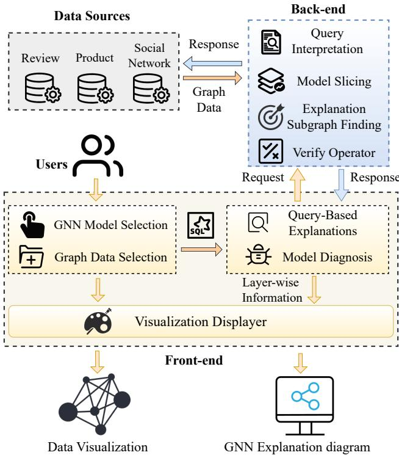
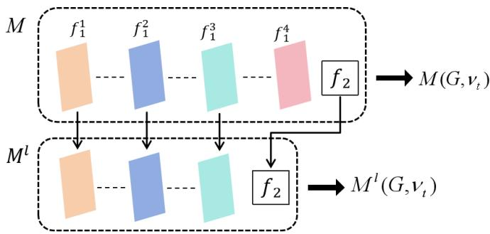
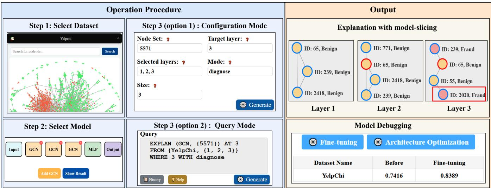
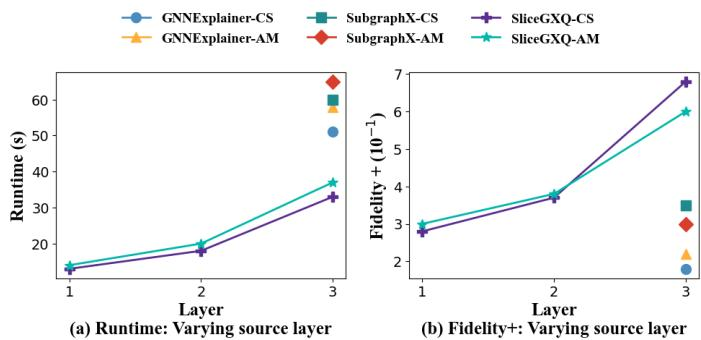

# Declarative Explanations for Graph Neural Networks: A Demonstration

Cibo Yu∗, Haitong Tang∗, Yinghui Wu†, Arijit Khan‡, Tingting Zhu∗, Tingyang Chen∗, and Xiangyu Ke∗

Zhejiang University, Hangzhou, China

{cbyu, tht, tingtingzhu, chenty, xiangyu.ke}@zju.edu.cn

† Case Western Reserve University, Cleveland, USA

yxw1650@case.edu

‡ Bowling Green State University, Bowling Green, USA arijitk@bgsu.edu

Abstract—Graph Neural Networks (GNNs) have proven effective for graph analytical tasks, yet their “black-box” nature complicates the understanding of their layer-wise behavior and hinders their application to large graphs. We demonstrate SliceGXQ, an end-to-end declarative and interactive system for querying and exploring layer-wise explanations for GNNs over large-scale graphs. In particular, SliceGXQ provides (1) an interactive graphical user interface for dataset, model, and explanation configuration; (2) a lightweight SPARQL-like parser that allows users to specify target nodes, layers, explanation modes, and constraints; and (3) an integrated execution and visualization workflow that invokes SliceGX [1] as its underlying explanation engine. We demonstrate how users can diagnose a misclassified node, identify problematic layers and influential messages, and perform targeted model debugging, together with large-scale graph interpretation and fraud-detection analysis. Our demonstration video and source code are available at https://github.com/jinzhaoqet/SliceGXQ.

Index Terms—graph neural networks, explainability, declarative queries, model diagnosis, interactive visualization

## I. INTRODUCTION

Graph Neural Networks (GNNs) have demonstrated remarkable success across various tasks, including node classification. By leveraging message passing and node feature aggregation, GNNs effectively learn node representations by integrating graph structural information with node features. This capability has enabled the widespread applications of GNNs in domains such as social network analysis, cyber threat analysis, bioinformatics, and recommendation systems.

Due to complex message-passing mechanisms and end-toend learning, GNNs are often queried and accessed as “blackboxes”, making their decision-making process opaque to users. Recent efforts in explainable graph learning [2] have developed various GNN explainers e.g., [3]–[5]. These methods identify essential substructures and data features responsible for GNNs’ outputs, and their influence and impact.

Nevertheless, existing GNN explanation techniques exhibit several limitations [6], [7]: (1) Most of them provide static, one-time explanations that focus solely on the final outputs rather than insights into how a GNN processes information progressively. This lack of fine-grained mechanisms for interpretation and manipulation hinders users’ ability to localize and explore the internal reasoning behavior of GNNs. (2) Many explainers are themselves “black-box”, making it difficult to validate their outputs; and (3) Users often need to tailor explanations to specific requirements, such as filtering for particular substructures in the output or focusing on specific layers of the model, which typically requires manual intervention and domain expertise. Hence, a declarative explanation system is essential for users to efficiently specify queries and easily customize explanations according to their needs.

To this end, we introduce a declarative framework that supports a class of SPARQL-like explanatory queries, called SliceGX queries, to support layer-wise explanations1 of GNNs. A SliceGXQ query Q follows a general structured format:

$$
\begin{array} { r l } & { \mathbf { E X P L A I N } \left( \mathcal { M } , V _ { T } \right) \mathbf { A T } \mid _ { t } } \\ & { \mathbf { F R O M } \{ G , \mathrm { t } \} } \\ & { \mathbf { W H E R E } \lor { P } , k \mathbf { W I T H } m o d e } \end{array}
$$

Specifically, the following declarative operators are integral to SliceGXQ queries: (1) EXPLAIN specifies the primary objective of the query, which is to generate explanations for a pre-trained GNN model (M) and test nodes of interest (VT); (2) AT allows users to inspect a specific layer (lt) within the GNN to interact with, enabling fine-grained, progressive analysis; (3) FROM defines the graph dataset (G) and selected layers (Ł) to generate explanations for model behaviors at l ; (4) WHERE applies “shape” constraints on the explanations as subgraphs, such as filtering by a graph/path pattern (P), as seen in SPARQL queries; or limiting the result size (k); and (5) WITH specifies the explanation mode (e.g., model diagnosis vs. interpretation, as detailed in §III). Moreover, SliceGXQ supports SQL-like aggregators, such as ORDER BY, allowing users to sort the generated explanations by specific utility.WHERE supports graph/path-pattern constraints, k bounds the explanation size, and ORDER BY ranks explanations by their explainability scores.

SliceGXQ addresses critical challenges in GNN explanation, including limited granularity, interactivity, and customization by introducing a declarative paradigm that allows users to access layer-wise explanations through SPARQL-like queries. Different from SliceGX [1], SliceGXQ focuses on the declarative query interface, interactive visualization, and end-to-end explanation workflow built upon the SliceGX engine.The key contributions of SliceGXQ are summarized as follows.

  
Fig. 1. SliceGXQ workflow. Users select a graph and a GNN model, submit an explanation request, and inspect the layer-wise results returned.

• SliceGXQ enables a declarative workflow to generate explanations throughout the decision-making process of GNNs at any specific, segmented layers, and allows users to construct flexible, configurable queries tailored to application needs.

• SliceGXQ contains an interactive visualization toolkit for the configuration of explanation context, inference-time explanation browsing, and statistical analysis. This interactive interface empowers users to gain finer-grained layer-wise insights into both data properties and model behavior.

• We demonstrate the effectiveness of SliceGXQ through layer-wise model diagnosis and debugging scenarios. By visualizing how the model processes information at each layer, users can identify potential error sources and refine the model accordingly.

## II. SYSTEM OVERVIEW

The workflow of SliceGXQ is shown in Figure 1. The front end consists of four modules: Graph Data Selection, GNN Model Selection, Query-Based Explanations, and Interactive Visualization. The Query-Based Explanations module connects the front end with four back-end modules: Query Interpretation, Model Slicing, Explanation Subgraph Finding, and Verification Operator. These modules process user configurations, generate layer-wise explanations, and return verified results for interactive inspection.

Configuration: The Graph Data Selection module allows users to select a dataset and specify target nodes. The GNN Model Selection module supports model and architecture configuration. These selections are passed to the Query-Based Explanations module, where users specify the target layer, explanation mode, size bound, and optional structural constraints. The results are displayed through Interactive Visualization.

Query-Based Explanations: This module supports Configuration Mode for novice users and Query Mode for advanced users. The former provides a graphical form, whereas the latter supports customized SPARQL-like statements. Both modes share the same query representation and execution pipeline. Representative statements are shown in Figure 2. The backend modules are executed as follows.

(1) Query Interpretation parses and validates a query and translates it into an executable task. Invalid datasets, models, nodes, layers, or constraints produce an error message before explanation generation. A valid query is translated into a configuration $\mathcal { C } ~ = ~ ( G , \mathcal { M } , V _ { T } , \mathtt { L } , l _ { t } , P , k , m o d e )$ , where G specifies the graph, M is a selected GNN, $V _ { T }$ is the targetnode set, Ł contains the source layers, $l _ { t }$ is the target layer, P specifies structural constraints, k bounds the explanation size, and mode allows users to switch between “interpretation” or “diagnosis” modes, which localizes explanations responsible for correct or incorrect outputs, respectively.

(2) Model Slicing constructs a layer-specific sliced model from the selected GNN and target layer. It preserves the computation up to that layer and provides the intermediate representations required for explanation generation.

(3) Explanation Subgraph Finding invokes the underlying SliceGX procedure and employs a greedy strategy to identify high-quality explanatory nodes. It constructs a connected explanation subgraph that satisfies the specified size and structural constraints.

(4) Verifier checks whether a candidate explanation satisfies the factual or counterfactual properties defined in §III for the underlying configuration. Only verified explanations are returned for layer-wise comparison and visual analysis.

Model Diagnosis and Debugging: Users can inspect the explanations to identify layers or nodes associated with incorrect predictions. They may then initiate layer fine-tuning or architecture optimization and compare the model behavior before and after debugging. These operations are user-initiated rather than automatically applied by the explanation engine.

## III. EXPLANATION ENGINE

We briefly introduce the SliceGX explanation engine underlying SliceGXQ; further algorithmic details are provided in [1]. Given a pre-trained GNN model $\mathcal { M } ,$ a graph $G ,$ and a target node $v _ { t }$ whose output $\mathcal { M } ( G , v _ { t } )$ is to be explained, the engine returns a set of explanatory nodes that clarify the model behavior at a selected layer, together with a connector set $V _ { c }$ that preserves the connectivity of the explanation subgraph.

Model Slicing. Given a GNN model M with an L-layer encoder $f _ { 1 }$ and a predictor $f _ { 2 } ,$ the l-sliced model $\mathcal { M } ^ { l } .$ , for $l \in [ 1 , L ]$ , retains the first l encoder layers and feeds their output embeddings to the original predictor. As illustrated in Figure 3, this construction allows users to inspect the model behavior at a particular layer without retraining the model. Because the sliced and original models may exhibit inconsistent behavior, the verification operator checks the reliability of the generated explanations.

<table><tr><td rowspan=1 colspan=1> $Q _ { 1 }$ </td><td rowspan=1 colspan=1>EXPLAIN (M, {ν}) At 3 FROM {G, {1}WHERE4</td></tr><tr><td rowspan=1 colspan=1> $Q _ { 2 }$ </td><td rowspan=1 colspan=1>EXPLAIN (M, {v}) At 3 FROM {G,φ}WITH diagnose</td></tr><tr><td rowspan=1 colspan=1> $Q _ { 3 }$ </td><td rowspan=1 colspan=1>EXPLAIN (M, {v1, V2}) At 3 FROM {G, φ}WITH interpret</td></tr><tr><td rowspan=1 colspan=1> $Q _ { 4 }$ </td><td rowspan=1 colspan=1>EXPLAIN (M, {ν}) At 3 FROM {G, {1, 2}}WHERE  Frauđ&#x27;,&#x27;–&#x27;,&#x27; Fraud&#x27;&gt;</td></tr><tr><td rowspan=1 colspan=1> $Q _ { 5 }$ </td><td rowspan=1 colspan=1>EXPLAIN (M, {ν1, ν2}) At 3 FROM {G, {1, 2}ORDER BY node.idÄSC</td></tr></table>

Fig. 2. Examples of SPARQL-like SliceGXQ statements.

Verify Operator. For a target layer l, the operator checks an explanation subgraph $G _ { s } ^ { l } \subseteq G$ against both the original model M and the sliced model Ml. A factual explanation preserves the relevant predictions when the models are evaluated on $G _ { s } ^ { l }$ , whereas a counterfactual explanation identifies a subgraph whose removal changes the relevant prediction. The operator also checks that the original and sliced models are behaviorally consistent on the full graph. Only explanation subgraphs satisfying the requested factual or counterfactual condition are returned by SliceGXQ. A quantitative analysis of verification rejection rates is left for future evaluation.

Explanation Generation. The underlying engine employs a greedy strategy to construct a high-quality explanation subgraph for $\mathcal { M } ( G , v _ { t } )$ at each selected layer. It uses a bicriteria explainability score that combines relative influence and embedding diversity.

Given an explanation subgraph $G _ { s } ^ { l }$ with explanatory-node set $V _ { s } ^ { l }$ , its explainability at layer l is defined as

$$
f ( G _ { s } ^ { l } ) = \gamma I ( V _ { s } ^ { l } ) + ( 1 - \gamma ) D ( V _ { s } ^ { l } ) ,\tag{1}
$$

where $I ( V _ { s } ^ { l } )$ measures the relative influence of the explanatory nodes, $D ( V _ { s } ^ { l } )$ measures their embedding diversity, and $\gamma \in [ 0 , 1 ]$ balances the two criteria. This score captures layerspecific intermediate representations.

Diagnosis and Interpretation Modes. SliceGXQ exposes two explanation modes through its declarative interface. Diagnose Mode identifies layers and explanatory nodes associated with an incorrect prediction, whereas Interpret Mode inspects how the model’s internal representations evolve across layers.

## IV. DEMONSTRATION SCENARIOS

We demonstrate SliceGXQ through an end-to-end workflow covering dataset/model selection, declarative queries, layerwise explanation, model diagnosis, and user-initiated debugging. For each scenario, we describe the analysis question, system operations, and returned results.

Scenario 1: Workflow Walkthrough. As illustrated in Figure 4, a user completes an explanation task in three steps. Step 1: Dataset Selection. The user selects a graph dataset, inspects its node and edge statistics, and specifies target nodes by entering their identifiers or clicking them in the graph view. Step 2: Model Selection. The user selects a pretrained GNN model, inspects its architecture, and browses its prediction results. Step 3: SliceGXQ Query. A novice user specifies the target layer, explanation mode, size bound, and constraints through Configuration Mode, whereas an advanced user directly submits a SPARQL-like query through Query Mode. Both modes share the same back-end pipeline, which returns visualized layer-wise subgraphs for inspection and follow-up queries.

  
Fig. 3. An example of a sliced model for l = 3.

Scenario 2: Model Diagnosis. We consider a fraud-detection task on the YelpChi graph, where the GNN distinguishes “Benign” and “Fraud” instances. The user’s goal is to determine how the returned explanation changes across layers and which layer-specific nodes should be inspected for diagnosing the target prediction.

In the example shown in Figure 4, the user selects node 5571 as the query target, layers 1–3 as the source layers, layer 3 as the target layer, a size bound of 3, and Diagnose Mode. This request follows the diagnosis-query pattern represented by $Q _ { 2 }$ in Figure 2. After the query is submitted, SliceGXQ performs query interpretation, model slicing, explanationsubgraph generation, and verification, and then displays the layer-wise explanation subgraphs.

The displayed class of node 239 remains “Benign” in the explanations for layers 1 and 2 but changes to “Fraud” when the third layer is included. The layer-3 result also contains node 2020, a “Fraud”-labeled connector node that links the returned explanation structure. Because the returned explanation exhibits this change only when the third layer is included, the user treats the third-layer aggregation as the primary diagnosis target. The user then inspects nodes 239 and 2020 and their relationships, narrowing the analysis to the third layer and a compact node set. Rather than directly attributing the prediction error to a single node, the diagnosis prioritizes a small set of layer-specific structures for subsequent user inspection and debugging.

Scenario 3: Scalability of Explanation Generation. We next evaluate progressive explanation generation on two graph scales. Coauthor CS is a co-authorship benchmark containing 18 333 nodes and 163 788 edges, while Amazon is a million-node product graph containing 1 569 960 nodes and 264 339 468 edges. The analysis question is whether SliceGXQ can generate useful layer-wise explanations as the graph and the model’s receptive field become larger.

  
Fig. 4. End-to-end workflow of SliceGXQ. The left panels show dataset and model selection and the two query input modes; the right panel show layer-wise explanation results and user-initiated model debugging. In the output panel, red and yellow nodes indicate predictions of “Fraud” and “Benign”, respectively; blue-bordered and red-bordered nodes are explanatory and connector nodes, respectively.

  
Fig. 5. Explanation-generation time and fidelity of SliceGXQ across GNN layers on an NVIDIA GeForce RTX 3080 GPU. GNNExplainer and SubgraphX appear only at Layer 3 as final-output explainers.

We issue interpretation queries for layers 1–3, following the query pattern represented by $Q _ { 3 }$ in Figure 2, and report explanation-generation time and fidelity in Figure 5. As the selected layer increases, fidelity improves as more of the inference process is covered, while generation time increases moderately; the reported time excludes front-end interaction.

Further algorithmic evaluations are available in [1].

Scenario 4: Model Debugging. Scenario 2 identifies the third layer as the primary diagnosis target based on changes in the returned explanation. We next show how SliceGXQ helps users assess whether modifying this layer can improve the model while keeping the remaining layers unchanged. Based on the diagnosis, the user selects the third layer and initiates the finetuning operation from the debugging panel in Figure 4.

The interface presents the model performance before and after the operation. In the shown example, fine-tuning the diagnosed third layer increases test accuracy from 0.7416 to 0.8389, illustrating the workflow rather than a causal advantage of this layer. The user can compare the updated performance with the original result and rerun the same explanation query on the updated model. The resulting layerwise explanations allow the user to examine whether the diagnosed behavior has changed after fine-tuning, completing an iterative diagnosis-and-debugging loop. This diagnosisto-debugging workflow illustrates how declarative layer-wise explanations can guide a targeted model refinement decision.

## V. CONCLUSION

We develop SliceGXQ, a user-friendly, interactive, and declarative platform for accessing configurable and queryable GNN explanations via model slicing and a class of structured explanatory query operators. Built on SliceGX as its underlying explanation engine, our demonstration provides human experts with a comprehensive visual and operational tool for exploring layer-wise explanations and understanding the model’s internal behavior for model interpretation and diagnosis. Additionally, it allows users to identify problematic layers and influential explanatory nodes for targeted model debugging, while configuring and customizing explanations across diverse application scenarios.

## VI. AI-GENERATED CONTENT ACKNOWLEDGEMENT

This paper has no AI-generated content.

## REFERENCES

[1] C. Yu, T. Zhu, T. Chen, Y. Wu, A. Khan, and X. Ke, “Slicegx: Layer-wise gnn explanation with model-slicing,” in The Web Conference, 2026.

[2] A. Khan, X. Ke, and Y. Wu, “Graph data management and graph machine learning: Synergies and opportunities,” SIGMOD Rec., vol. 54, no. 2, p. 28–42, 2025.

[3] Z. Ying, D. Bourgeois, J. You, M. Zitnik, and J. Leskovec, “Gnnexplainer: Generating explanations for graph neural networks,” in NeurIPS, 2019.

[4] H. Yuan, H. Yu, J. Wang, K. Li, and S. Ji, “On explainability of graph neural networks via subgraph explorations,” in ICML, 2021.

[5] H. Yuan, J. Tang, X. Hu, and S. Ji, “Xgnn: Towards model-level explanations of graph neural networks,” in KDD, 2020.

[6] A. Khan, X. Ke, Y. Wu, and F. Bonchi, “GNN explainers 2.0: User-centric and data-driven insights,” in WSDM, 2026, pp. 1359–1362.

[7] T. Chen, D. Qiu, Y. Wu, A. Khan, X. Ke, and Y. Gao, “View-based explanations for graph neural networks,” Proc. ACM Manag. Data, vol. 2, no. 1, pp. 40:1–40:27, 2024.