# Deep Pontryagin Learning for Continuous-Time Stochastic Control with Jumps

Jean-Loup Dupreta,∗, Patrick Cheriditoa

aDepartment of Mathematics and RiskLab, ETH Zurich, Rämistrasse 101, Zurich, 8092, Switzerland

## Abstract

We develop a deep Pontryagin learning framework for high-dimensional continuous-time stochastic control problems that naturally accommodates jump-difusions. In contrast to direct policy optimization, which repeatedly diferentiates the objective through the entire time-discretized dynamics, our method separates adjoint learning from policy improvement by explicitly incorporating state-sensitivity information from the Pontryagin stochastic maximum principle. For a fixed Markov control, we first compute pathwise adjoint labels by backpropagating the reward through time along simulated state trajectories, and project these labels onto the Markov state through a supervised regression step. The control is then updated by enforcing the pointwise Hamiltonian stationarity condition. We prove that the resulting projected adjoint process satisfies a discrete-time Pontryagin principle and converges, as the time step tends to zero, to the solution of the corresponding continuous-time adjoint backward stochastic diferential equation. Numerical experiments illustrate the accuracy, stability, and scalability of the approach.

Keywords: Stochastic optimal control, Pontryagin stochastic maximum principle, Policy improvement, Deep learning, Jump difusions, Optimal investment-consumption

## 1. Introduction

Stochastic control problems are central in many areas of applied mathematics, finance, insurance, engineering and operations research. In continuous time, they are classically characterized either by the dynamic programming principle (Fleming and Soner, 2006), which leads to a Hamilton–Jacobi–Bellman (HJB) partial diferential equation (PDE), or by the Pontryagin stochastic maximum principle (PMP) (Peng, 1990), which leads to a system of forward–backward stochastic diferential equations (FBSDE). While these characterizations are theoretically powerful, their numerical implementation remains challenging in high dimension. Grid-based methods for HJB equations (Bonnans and Zidani, 2003; Oberman, 2006; Beard et al., 1997; Boulbrachene and Haiour, 2001) sufer from the curse of dimensionality, and classical tree or regression-based BSDE methods (Ma et al., 2002; Gobet et al., 2005) often become prohibitively expensive in the PMP framework when the state dimension or the number of time steps is large.

Recent progress in deep learning has opened new possibilities for solving high-dimensional stochastic control problems (Hu and Lauriere, 2023). A first class of methods is based on the HJB–PDE and approximates the value function globally, for instance through physics-informed neural networks (Raissi et al., 2017; Sirignano and Spiliopoulos, 2018; Duarte et al., 2024; Dupret and Hainaut, 2026), continuous-time Bellman updating (Cheridito et al., 2026; Dupret et al., 2026) or constrained Gaussian process regressions (Chen et al., 2021; Hainaut and Dupret, 2026). These methods are attractive because they can provide a global approximation of the value function and the optimal feedback control over the entire space-time domain. This is useful when one needs a reusable solution over many initial time-space conditions. However, when the goal is to solve the control problem for a fixed initial state or along the optimal state trajectory, computing a global space-time solution may be unnecessarily expensive.

In contrast to global PDE-based approaches, another stream of literature adopts a simulation-based viewpoint. The controlled dynamics are discretized in time, and neural networks are trained on simulated state trajectories to approximate the feedback control, the value function, or related adjoint quantities (Han and E, 2016; Han et al., 2017, 2018; Han and Hu, 2021; Huré et al., 2021; Beck et al., 2021; Bachouch et al., 2022; Ji et al., 2022; van Staden et al., 2024; Alasseur et al., 2024). Particularly popular is the direct policy optimization (DPO) of Han and E (2016), which extends ideas from the earlier neural-network control literature for deterministic nonlinear systems (Psaltis et al., 1988; Hunt et al., 1992). In DPO, the control is parameterized directly by a neural network and trained by diferentiating an empirical approximation of the objective functional. This avoids the explicit solution of the HJB equation and is therefore simple to implement. However, DPO has important limitations. Since the loss is defined through long simulated trajectories, gradients have to be propagated through the full time-discretized dynamics. This can lead to memory-intensive training, accumulation of discretization and approximation errors over time and vanishing/exploding gradients on long time horizons (Bachouch et al., 2022). As a consequence, DPO and related simulation-based time-discretized methods may be unstable and may converge to poor local minima, especially in high-dimensional or strongly nonlinear problems.

To avoid the aforementioned dificulty that a local change in the control afects the entire future state trajectory, adjoint sensitivity methods (Pontryagin et al., 1962; Peng, 1990) instead introduce auxiliary adjoint state that propagates the state sensitivities of the objective backwards in time. Once the adjoint is known, optimality reduces to a pointwise maximization of the Hamiltonian with respect to the control, along the state trajectory; see Theorem 2.2. In the PDE-constrained optimization literature (Plessix, 2006; Hinze et al., 2009), adjoint equations are widely used in a deterministic setting to compute gradients eficiently, since their computational cost scales linearly with the problem dimension and have low memory cost. Closely related ideas have also been used in scientific machine learning to improve the training of neural ODEs and neural PDE solvers (Chen et al., 2018; Mowlavi and Nabi, 2023; Nzoyem Ngueguin et al., 2023; Yin et al., 2024; Hintermüller and Korolev, 2026). Recent work has extended these adjoint-based techniques to continuous-time stochastic portfolio optimization via backpropagation through time (Huh et al., 2025a,b). However, the resulting Pontryagin-Guided Direct Policy Optimization method remains computationally expensive because they rely on a preliminary DPO stage and require nested Monte Carlo simulations to estimate state-dependent adjoint quantities. Nevertheless, adjoint sensitivity methods demonstrate that incorporating state sensitivity information can substantially improve learning by providing first-order information about how future rewards depend on current states.

In this paper, we propose a deep stochastic Pontryagin maximum principle (deep PMP) framework that avoids the nested simulation bottleneck of Huh et al. (2025a,b) and which contrasts with existing deterministic Pontryagin-based methods (Jin et al., 2020; Böttcher et al., 2022). The idea is to compute pathwise adjoint labels by backpropagation through time (BPTT) of the objective along simulated state trajectories. For each simulated trajectory, diferentiating the realized future payof with respect to intermediate states yields noisy but cheap estimates of the discrete-time adjoint variables. These labels are then projected onto the Markov state through a supervised regression step, producing a neural approximation of the discretetime adjoint process. The control network is subsequently trained by enforcing the pointwise Hamiltonian stationarity condition from the PMP. In this way, the method separates the learning of adjoint sensitivities from the learning of the control and avoids repeated backpropagation through the full empirical objective as in Han and E (2016); Ji et al. (2022); Alasseur et al. (2024).

The proposed approach therefore combines several advantages. First, the control is updated through a pointwise Hamiltonian optimization, thereby avoiding the stability issues associated with end-to-end policy training by backpropagation through the full time-discretized dynamics. Second, it incorporates the adjoint/sensitivity structure of the continuous-time stochastic control problem through PMP, improving convergence of the scheme. Third, the BPTT adjoint labels are obtained from a single set of simulated trajectories and do not require nested Monte Carlo simulations; only a supervised regression step is needed instead. Fourth, the proposed framework naturally accommodates controlled jump-difusions, where the adjoint BSDE contains both Brownian and jump martingale components and for which deep-learning methods remain comparatively scarce. Finally, we prove that the projected BPTT discrete adjoint process satisfy a discrete-time analogue of the PMP and converge, as time step tends to zero, to the continuous-time adjoint BSDE associated with the limiting controlled jump-difusion.

## 2. Preliminaries

Let $T > 0$ be a fixed finite time horizon and let $( \Omega , \mathcal { F } , \mathbb { F } = ( \mathcal { F } _ { t } ) _ { 0 \leq t \leq T } , \mathbb { P } )$ be a filtered probability space satisfying the usual conditions. We assume that F is the usual augmentation of the filtration jointly generated by a d-dimensional Brownian motion $W$ and a Poisson random measure N on $[ 0 , T ] \times E$ , where $E : = \mathbb { R } ^ { \ell } \backslash \{ 0 \}$ is equipped with its Borel σ-algebra $B ( E )$ . The random measure N is assumed to be independent of W and to have deterministic compensator $\lambda ( t ) \nu ( d z ) d t$ , where ν is a Lévy measure on $E ,$ that is, $\begin{array} { r } { \int _ { E } ( 1 \wedge | z | ^ { 2 } ) \nu ( d z ) < \infty . } \end{array}$ , and $\lambda : [ 0 , T ]  ( 0 , \infty )$ is deterministic and continuous. We then denote the associated compensated Poisson random measure by $\widetilde N ( d t , d z ) : = N ( d t , d z ) - \lambda ( t ) \nu ( d z ) d t$ . In this paper, we consider control problems of the form

$$
\operatorname* { s u p } _ { \alpha \in \mathcal { A } } J ( \alpha ) , \qquad J ( \alpha ) : = \mathbb { E } \left[ \int _ { 0 } ^ { T } f ( t , X _ { t } ^ { \alpha } , \alpha _ { t } ) d t + F ( X _ { T } ^ { \alpha } ) \right] ,\tag{2.1}
$$

such that $\alpha = ( \alpha _ { t } ) _ { 0 \leq t \leq T } \in \mathcal { A }$ for the set of admissible controls A given by

$$
\mathcal { A } : = \Big \{ \alpha : [ 0 , T ] \times \Omega \to A \subseteq \mathbb { R } ^ { m } \big | \alpha \mathrm { i s } \mathbb { F } \mathrm { - p r e d i c t a b l e ~ a n d } \mathbb { E } \Big [ \int _ { 0 } ^ { T } | \alpha _ { t } | ^ { 2 } d t \Big ] < \infty \Big \} .\tag{2.2}
$$

The controlled process $X ^ { \alpha }$ then evolves in $\mathbb { R } ^ { n }$ according to

$$
d X _ { t } ^ { \alpha } = b ( t , X _ { t } ^ { \alpha } , \alpha _ { t } ) d t + \sigma ( t , X _ { t } ^ { \alpha } , \alpha _ { t } ) d W _ { t } + \int _ { E } \gamma ( t , X _ { t - } ^ { \alpha } , z , \alpha _ { t } ) \widetilde { N } ( d t , d z ) , \quad X _ { 0 } ^ { \alpha } = x _ { 0 } \in \mathbb { R } ^ { n } ,\tag{2.3}
$$

for suitable functions $b \colon [ 0 , T ] \times \mathbb { R } ^ { n } \times A \to \mathbb { R } ^ { n } , \sigma \colon [ 0 , T ] \times \mathbb { R } ^ { n } \times A \to \mathbb { R } ^ { n \times d } , \gamma \colon [ 0 , T ] \times \mathbb { R } ^ { n } \times E \times A \to \mathbb { R } ^ { n }$ The functions $f \colon [ 0 , T ] \times \mathbb { R } ^ { n } \times A \to \mathbb { R }$ and $F \colon \mathbb { R } ^ { n }  \mathbb { R }$ then model the running reward and the final reward, respectively. For $k \in \mathbb N ,$ we use the following spaces

$$
\begin{array} { r } { \mathcal { S } _ { \mathbb { F } } ^ { 2 } ( 0 , T ; \mathbb { R } ^ { k } ) : = \{ Y : [ 0 , T ] \times \Omega  \mathbb { R } ^ { k } \bigg | Y \mathrm { ~ i s ~ c a d l a g ~ a n d ~ \mathbb { F } \mathrm { - } a d a p t e d , } \mathbb { E } \big [ \underset { 0 \leq t \leq T } { \operatorname* { s u p } } | Y _ { t } | ^ { 2 } \big ] < \infty \} , } \end{array}
$$

$$
L _ { \mathbb { F } } ^ { 2 } ( 0 , T ; \mathbb { R } ^ { k } ) : = \left\{ Z : \left[ 0 , T \right] \times \Omega \to \mathbb { R } ^ { k } \mid Z { \mathrm { ~ i s ~ } } \mathbb { F } { \mathrm { - p r e d i c t a b l e ~ a n d ~ } } \mathbb { E } \left[ \int _ { 0 } ^ { T } | Z _ { t } | ^ { 2 } d t \right] < \infty \right\} ,
$$

$$
L _ { \nu , \mathbb { F } } ^ { 2 } ( 0 , T ; \mathbb { R } ^ { k } ) : = \Big \{ R : [ 0 , T ] \times \Omega \times E \to \mathbb { R } ^ { k } \big | R \mathrm { i s } \mathcal { P } \otimes \mathcal { B } ( E ) \mathrm { - m e a s u r a b l e , ~ } \mathbb { E } \Big [ \int _ { 0 } ^ { T } \int _ { E } | R _ { t } ( z ) | ^ { 2 } \nu ( d z ) \lambda ( t ) d t \Big ] < \infty \Big \} .
$$

Here $\mathcal { P }$ denotes the predictable σ-algebra on $[ 0 , T ] \times \Omega$ , and we use the standard spaces $L ^ { 2 } ( \Omega , \mathcal { F } ; \mathbb { R } ^ { k } ) : =$ $L ^ { 2 } ( \Omega , \mathcal { F } , \mathbb { P } ; \mathbb { R } ^ { k } )$ and $L ^ { 2 } ( \Omega \times [ 0 , T ] ; \mathbb { R } ^ { k } ) : = L ^ { 2 } ( \Omega \times [ 0 , T ] , { \mathcal { F } } \otimes { \mathcal { B } } ( [ 0 , T ] ) , \mathbb { P } \otimes d t ; \mathbb { R } ^ { k } )$ , which do not impose any adaptedness or predictability. Throughout, | · | denotes the Euclidean norm for vectors and the Frobenius norm for matrices. For a measurable function $g : E \to \mathbb { R } ^ { k }$ , we also write

$$
\| g \| _ { L ^ { 2 } ( E , \nu ) } : = \left( \int _ { E } | g ( z ) | ^ { 2 } \nu ( d z ) \right) ^ { 1 / 2 } .
$$

If $\alpha \in { \mathcal { A } }$ and $X ^ { \alpha } \in { \mathcal { S } } _ { \mathbb { F } } ^ { 2 } ( 0 , T ; \mathbb { R } ^ { n } )$ is the corresponding càdlàg solution of (2.3), we call $( X ^ { \alpha } , \alpha )$ an admissible pair. Our stochastic control problem (2.1) can be stated as maximizing $J ( \alpha )$ over ${ \mathcal { A } } .$ The goal is then to find a control $\alpha ^ { * } \in { \mathcal { A } }$ (if it exists) such that

$$
J ( \alpha ^ { * } ) = \operatorname* { s u p } _ { \alpha \in \mathcal { A } } J ( \alpha ) .\tag{2.4}
$$

We impose the following regularity and growth assumptions on the coeficients.

## Assumption 2.1. The following conditions hold.

(i) The maps $b , \sigma , \gamma$ are measurable and $C ^ { 1 }$ in x. Moreover, there exist constants $L , L _ { x } > 0$ such that, for every $( t , x , a ) \in [ 0 , T ] \times \mathbb { R } ^ { n } \times A ,$

$$
| b ( t , 0 , a ) | + | \sigma ( t , 0 , a ) | + \| \gamma ( t , 0 , \cdot , a ) \| _ { L ^ { 2 } ( E , \nu ) } \leq L ( 1 + | a | ) ,
$$

and

$$
| \nabla _ { x } b ( t , x , a ) | + | \nabla _ { x } \sigma ( t , x , a ) | + \| \nabla _ { x } \gamma ( t , x , \cdot , a ) \| _ { L ^ { 2 } ( E , \nu ) } \leq L _ { x } .
$$

(ii) The reward functions $f , F$ are measurable and $C ^ { 1 }$ in $x .$ . Moreover, there exists a constant $C > 0$ such that,for every $( t , x , a ) \in [ 0 , T ] \times \mathbb { R } ^ { n } \times A ,$

$$
| f ( t , 0 , a ) | \leq C ( 1 + | a | ^ { 2 } ) , \qquad | F ( 0 ) | \leq C ,
$$

and

$$
| \nabla _ { x } f ( t , x , a ) | \leq C ( 1 + | x | + | a | ) , \qquad | \nabla _ { x } F ( x ) | \leq C ( 1 + | x | ) .
$$

Under Assumption 2.1(i), the coeficients of the state equation are globally Lipschitz continuous in $x ,$ uniformly in $( t , a )$ , and they satisfy the growth estimate

$$
\begin{array} { r } { | b ( t , x , a ) | + | \sigma ( t , x , a ) | + \| \gamma ( t , x , \cdot , a ) \| _ { L ^ { 2 } ( E , \nu ) } \leq C \bigl ( 1 + | x | + | a | \bigr ) . } \end{array}
$$

Consequently, for every control $\alpha \in { \mathcal { A } }$ and every deterministic initial condition $x _ { 0 } \in \mathbb { R } ^ { n }$ , equation (2.3) admits a unique càdlàg strong solution $X ^ { \alpha } \in { \mathcal { S } } _ { \mathbb { F } } ^ { 2 } ( 0 , T ; \mathbb { R } ^ { n } )$ . Moreover,

$$
\mathbb { E } \left[ \operatorname* { s u p } _ { 0 \leq t \leq T } | X _ { t } ^ { \alpha } | ^ { 2 } \right] \leq C \left( 1 + | x _ { 0 } | ^ { 2 } + \mathbb { E } \left[ \int _ { 0 } ^ { T } | \alpha _ { t } | ^ { 2 } d t \right] \right) ,
$$

and hence $( X ^ { \alpha } , \alpha )$ is an admissible pair, see also Bouchard (2007); Applebaum (2009)1. Assumption 2.1(ii) further implies that $| f ( t , x , a ) | \leq C \big ( 1 + | x | ^ { 2 } + | a | ^ { 2 } \big )$ and $| F ( x ) | \le C \bigl ( 1 + | x | ^ { 2 } \bigr )$ . It then follows that

$$
\mathbb { E } \left[ \int _ { 0 } ^ { T } | f ( t , X _ { t - } ^ { \alpha } , \alpha _ { t } ) | d t + | F ( X _ { T } ^ { \alpha } ) | \right] < \infty .
$$

Thus, $J ( \alpha )$ is well defined and finite for every $\alpha \in { \mathcal { A } }$

We then define the Hamiltonian $H : [ 0 , T ] \times \mathbb { R } ^ { n } \times A \times \mathbb { R } ^ { n } \times \mathbb { R } ^ { n \times d } \times L ^ { 2 } ( E , \nu ; \mathbb { R } ^ { n } ) \to$ R by,

$$
H ( t , x , a , p , q , r ) : = f ( t , x , a ) + b ( t , x , a ) ^ { \top } p + \operatorname { T r } \left[ \sigma ( t , x , a ) ^ { \top } q \right] + \lambda ( t ) \int _ { E } \gamma ( t , x , z , a ) ^ { \top } r ( z ) \nu ( d z ) .
$$

The last integral is finite by Cauchy-Schwarz inequality since $\gamma ( t , x , \cdot , a ) , r \in L ^ { 2 } ( E , \nu ; \mathbb { R } ^ { n } )$ . Given an admissible pair $( X ^ { \alpha } , \alpha )$ , the adjoint equation is the BSDE

$$
\left\{ \begin{array} { l } { \displaystyle d p _ { t } = - \nabla _ { x } H ( t , X _ { t - } ^ { \alpha } , \alpha _ { t } , p _ { t } , q _ { t } , r _ { t } ( \cdot ) ) d t + q _ { t } d W _ { t } + \int _ { E } r _ { t } ( z ) \widetilde { N } ( d t , d z ) , } \\ { \displaystyle p _ { T } = \nabla _ { x } F ( X _ { T } ^ { \alpha } ) . } \end{array} \right.\tag{2.5}
$$

We call an adapted solution of (2.5) a triplet

$$
( p , q , r ) \in \mathcal S _ { \mathbb F } ^ { 2 } ( 0 , T ; \mathbb R ^ { n } ) \times L _ { \mathbb F } ^ { 2 } ( 0 , T ; \mathbb R ^ { n \times d } ) \times L _ { \nu , \mathbb F } ^ { 2 } ( 0 , T ; \mathbb R ^ { n } )
$$

satisfying (2.5). Assumption 2.1, together with the boundedness1 of $\lambda$ and square-integrability of $X ^ { \alpha }$ and $\alpha .$ implies that the driver $( p , q , r ) \mapsto \nabla _ { x } H ( t , X _ { t - } ^ { \alpha } , \alpha _ { t } , p , q , r )$ is uniformly Lipschitz in $( p , q , r )$ and satisfies

$$
\mathbb { E } \left[ \int _ { 0 } ^ { T } \left| \nabla _ { x } H ( t , X _ { t - } ^ { \alpha } , \alpha _ { t } , 0 , 0 , 0 ) \right| ^ { 2 } d t + | \nabla _ { x } F ( X _ { T } ^ { \alpha } ) | ^ { 2 } \right] < \infty .
$$

Therefore, the standard well-posedness theory for BSDEs driven by Brownian motion and compensated Poisson measure yields a unique adapted solution of (2.5) for every admissible pair $( X ^ { \alpha } , \alpha ) \in { \mathcal { S } } _ { \mathbb { F } } ^ { 2 } ( 0 , T ; \mathbb { R } ^ { n } ) { \times } { \cal A }$ see e.g. Theorem 2 of Rong (1997).

The following result extends Theorem 2.1 of Framstad et al. (2004) and gives suficient conditions for admissible pairs to be optimal in our setting with time-dependent jump intensity $\lambda ( t )$

Theorem 2.2 (Pontryagin’s stochastic Maximum Principle). Let Assumption 2.1 hold and suppose that F is concave. Let $( \hat { X } , \hat { \alpha } )$ be an admissible pair to the state equation (2.3) and let $( \widehat { p } , \widehat { q } , \widehat { r } )$ be the unique adapted solution of the associated adjoint BSDE (2.5). Assume that the following conditions hold:

(i) (Integrability condition) Thefollowing conditions holdfor all $\alpha \in { \mathcal { A } } .$

$$
\begin{array} { r l r } {  { \mathbb { E } [ \int _ { 0 } ^ { T } | ( \hat { X } _ { t } - X _ { t } ^ { \alpha } ) ^ { \top } \hat { q } _ { t } | ^ { 2 } d t + \int _ { 0 } ^ { T } \int _ { E } | ( \hat { X } _ { t - } - X _ { t - } ^ { \alpha } ) ^ { \top } \hat { r } _ { t } ( z ) | ^ { 2 } \lambda ( t ) \nu ( d z ) d t ] < \infty , } } \\ & { } & { \displaystyle { \mathbb { E } [ \int _ { 0 } ^ { T } | \hat { p } _ { t - } ^ { \top } \big ( \sigma ( t , X _ { t - } ^ { \alpha } , \alpha _ { t } ) - \sigma ( t , \hat { X } _ { t - } , \hat { \alpha } _ { t } ) \big ) | ^ { 2 } d t }  } \\ & { } & { \displaystyle +  \int _ { 0 } ^ { T } \int _ { E } | \hat { p } _ { t - } ^ { \top } \big ( \gamma ( t , X _ { t - } ^ { \alpha } , z , \alpha _ { t } ) - \gamma ( t , \hat { X } _ { t - } , z , \hat { \alpha } _ { t } ) \big ) | ^ { 2 } \lambda ( t ) \nu ( d z ) d t ] < \infty . } \end{array}\tag{2.6}
$$

(ii) (Maximum principle) For dt $\otimes d \mathbb { P } \cdot a . e . \left( t , \omega \right) \in [ 0 , T ] \times \Omega ,$

$$
H ( t , \hat { X } _ { t - } , \hat { \alpha } _ { t } , \widehat { p } _ { t } , \widehat { q } _ { t } , \hat { r } _ { t } ( \cdot ) ) = \operatorname* { s u p } _ { a \in A } H ( t , \hat { X } _ { t - } , a , \widehat { p } _ { t } , \widehat { q } _ { t } , \hat { r } _ { t } ( \cdot ) ) ,\tag{2.7}
$$

(iii) (Arrow condition) For $d t \otimes d \mathbb { P } \mathrm { - } a . e . ~ ( t , \omega ) \in [ 0 , T ] \times \Omega$ , thefunction

$$
\hat { H } : \mathbb { R } ^ { n } \to \mathbb { R } ; x \mapsto \hat { H } ( x ) : = \operatorname* { s u p } _ { a \in A } H ( t , x , a , \widehat { p } _ { t } ( \omega ) , \hat { q } _ { t } ( \omega ) , \hat { r } _ { t } ( \cdot ) ( \omega ) ) ,\tag{2.8}
$$

isfinite-valued and concave on $\mathbb { R } ^ { n }$

Then, $( \hat { X } , \hat { \alpha } )$ is an optimal pair, that is, $J ( \hat { \alpha } ) = \operatorname* { s u p } _ { \alpha \in \mathcal { A } } J ( \alpha )$

The detailed proof is deferred in Appendix 7.1. We next describe the connection between dynamic programming and the stochastic maximum principle. We define the state-dependent reward functional

$$
J ( t , x ; \alpha ) : = \mathbb { E } \left[ \int _ { t } ^ { T } f ( s , X _ { s } ^ { \alpha } , \alpha _ { s } ) d s + F ( X _ { T } ^ { \alpha } ) \Bigm | X _ { t } = x \right] .\tag{2.9}
$$

The corresponding value function is then

$$
V ( t , x ) : = \operatorname* { s u p } _ { \alpha \in \mathcal { A } } J ( t , x ; \alpha ) .\tag{2.10}
$$

In view of the Markovian nature of the dynamics (2.3) and of the reward functions f and F, the control problem is Markovian. Under mild assumptions, see e.g. Theorem 11.2.3 of Oksendal (2013), restricting the optimization to admissible Markov feedback controls does not change the value function. Accordingly, we restrict attention in the remainder of the paper to controls of the form $\alpha _ { s } ~ = ~ \alpha ( s , X _ { s - } ^ { \alpha } )$ , where $\alpha : [ 0 , T ] \times \mathbb { R } ^ { n }  A$ is measurable and the resulting control admissible. With slight abuse of notation, we retain the notation A for the admissible control class and define the value function by (2.10). The following result identifies the adjoint processes in terms of spatial derivatives of this value function $V ( t , x )$

Theorem 2.3 (Relation with dynamic programming principle). Suppose that the following conditions hold.

1. The value function $V \in C ^ { 1 , 3 } ( [ 0 , T ) \times \mathbb { R } ^ { n } ) \cap C ^ { 0 , 1 } ( [ 0 , T ] \times \mathbb { R } ^ { n } )$ is a classical solution of the HJB equation

$$
\partial _ { t } V ( t , x ) + \operatorname* { s u p } _ { a \in A } \bigg \{ f ( t , x , a ) + b ( t , x , a ) ^ { \top } \nabla _ { x } V ( t , x ) + \frac { 1 } { 2 } \operatorname { T r } \Big [ \sigma ( t , x , a ) \sigma ( t , x , a ) ^ { \top } \nabla _ { x } ^ { 2 } V ( t , x ) \Big ] \bigg \} = 0 .
$$

$$
+ \lambda ( t ) \int _ { E } \Bigl [ V \bigl ( t , x + \gamma ( t , x , z , a ) \bigr ) - V ( t , x ) - \nabla _ { x } V ( t , x ) ^ { \top } \gamma ( t , x , z , a ) \Bigr ] \nu ( d z ) \Biggr \} = 0 ,\tag{2.11}
$$

for every $( t , x ) \in [ 0 , T ) \times \mathbb { R } ^ { n }$ , with terminal condition $V ( T , x ) = F ( x )$ . Moreover, the nonlocal integral in (2.11) is finite for every $( t , x , a ) \in [ 0 , T ) \times \mathbb { R } ^ { n } \times A .$

2. There exists an optimal admissible Markov feedback control $\alpha _ { t } ^ { * } = \alpha ^ { * } ( t , X _ { t - } ^ { * } )$ such that $\alpha ^ { * } ( t , x )$ attains the supremum in (2.11) for all $( t , x ) \in [ 0 , T ] \times \mathbb { R } ^ { n }$ , and such that the feedback control $\alpha _ { t } ^ { * } = \alpha ^ { * } ( t , X _ { t - } ^ { * } )$ is admissible.

3. The processes defined by (2.12)–(2.14) belong to $S _ { \mathbb { F } } ^ { 2 } ( 0 , T ; \mathbb { R } ^ { n } ) \times L _ { \mathbb { F } } ^ { 2 } ( 0 , T ; \mathbb { R } ^ { n \times d } ) \times L _ { \nu , \mathbb { F } } ^ { 2 } ( 0 , T ; \mathbb { R } ^ { n } )$ Then, the adjoint processes

$$
p _ { t } ^ { * } = \nabla _ { x } V ( t , X _ { t } ^ { * } )\tag{2.12}
$$

$$
q _ { t } ^ { * } = \nabla _ { x } ^ { 2 } V ( t , X _ { t - } ^ { * } ) \sigma ( t , X _ { t - } ^ { * } , \alpha ^ { * } ( t , X _ { t - } ^ { * } ) ) ,\tag{2.13}
$$

$$
r _ { t } ^ { * } ( z ) = \nabla _ { x } V ( t , X _ { t - } ^ { * } + \gamma ( t , X _ { t - } ^ { * } , z , \alpha ^ { * } ( t , X _ { t - } ^ { * } ) ) ) - \nabla _ { x } V ( t , X _ { t - } ^ { * } )\tag{2.14}
$$

solve the adjoint BSDE (2.5) corresponding to the optimal pair $( X ^ { * } , \alpha ^ { * } )$

This theorem is stated without proof as it is an immediate1 consequence of Theorem 3.1. of Framstad et al. (2004). It follows from Theorem 2.3 that, upon defining the decoupling field $p : [ 0 , T ] \times \mathbb { R } ^ { n } $ $\mathbb { R } ^ { n } , p ( t , x ) : = \nabla _ { x } V ( t , x )$ , the adjoint processes can be represented as

$$
\begin{array} { r l } & { \qquad q _ { t } ^ { * } = \nabla _ { x } p ( t , X _ { t - } ^ { * } ) \sigma ( t , X _ { t - } ^ { * } , \alpha ^ { * } ( t , X _ { t - } ^ { * } ) ) } \\ & { r _ { t } ^ { * } ( z ) = p ( t , X _ { t - } ^ { * } + \gamma ( t , X _ { t - } ^ { * } , z , \alpha ^ { * } ( t , X _ { t - } ^ { * } ) ) ) - p ( t , X _ { t - } ^ { * } ) . } \end{array}
$$

These identities will play a key role in the construction of our numerical algorithm. Although Theorem 2.3 identifies the adjoint processes through spatial derivatives of the value function, computing these quantities directly through automatic diferentiation is typically expensive. Evaluating $V ( t , x )$ at a given state $( t , x )$ indeed requires estimating a conditional expectation by simulating many trajectories starting from $( t , x )$ . Therefore, if the states $X _ { t } ^ { \alpha }$ themselves are generated by an outer simulation, then approximating $\nabla _ { x } V ( t , X _ { t } ^ { \alpha } )$ leads to a nested Monte Carlo procedure: for each outer sample path and each time step, a new collection of inner trajectories must be simulated from the current state. This computational bottleneck motivates the pathwise BPTT construction developed below. Instead of estimating $\nabla _ { x } V ( t , x )$ separately at every state, we diferentiate the realized (pathwise) reward along each simulated state trajectory. We show in the following section that these pathwise state derivatives provide cheap noisy targets, whose conditional expectation recovers a discrete-time adjoint process that converges in the limit $\Delta t \to 0$ to the true adapted adjoint satisfying the BSDE (2.5) and its Markov representation (2.12).

## 3. Methodology

Fix a Markov feedback control $\alpha : [ 0 , T ] \times \mathbb { R } ^ { n }  A$ and a time grid $t _ { i } = i \Delta t , i = 0 , \ldots , N$ with $t _ { N } = T$ and define

$$
\Delta W _ { i } : = W _ { t _ { i + 1 } } - W _ { t _ { i } } , \qquad \tilde { N } _ { i } ( d z ) : = \tilde { N } ( ( t _ { i } , t _ { i + 1 } ] , d z ) .
$$

Let $( X _ { i } ) _ { i = 0 } ^ { N }$ denote the Euler–Maruyama2 discretization of the state equation (2.3),

$$
X _ { i + 1 } = X _ { i } + b ( t _ { i } , X _ { i } , a _ { i } ) \Delta t + \sigma ( t _ { i } , X _ { i } , a _ { i } ) \Delta W _ { i } + \int _ { E } \gamma ( t _ { i } , X _ { i } , z , a _ { i } ) \widetilde { N } _ { i } ( d z ) , \quad i = 0 , \dots , N - 1 ,
$$

with $a _ { i } : = \alpha ( t _ { i } , X _ { i } )$ . To compute state sensitivities while keeping the realized controls fixed, we introduce the stop-gradient control

$$
a _ { i } ^ { \mathrm { s g } } : = \alpha ( t _ { i } , \mathrm { s g } [ X _ { i } ] ) .\tag{3.1}
$$

The stop-gradient operator sg acts as the identity in the forward pass but has zero derivative in the backward pass. Consequently, $a _ { i } ^ { \mathrm { s g } }$ and $a _ { i }$ have the same numerical value, but no derivative is propagated through the map $x \mapsto \alpha ( t _ { i } , x )$ . For $i \in \{ 0 , \ldots , N \}$ and $x \in \mathbb { R } ^ { n }$ , let $( X _ { j } ^ { i , x } ) _ { j = i , \dots , N }$ be thefrozen-control continuation starting from x at time $t _ { i }$ . It is defined for $j = i , \ldots , N - 1$ b

$$
X _ { j + 1 } ^ { i , x } = X _ { j } ^ { i , x } + b ( t _ { j } , X _ { j } ^ { i , x } , a _ { j } ^ { \mathrm { s g } } ) \Delta t + \sigma ( t _ { j } , X _ { j } ^ { i , x } , a _ { j } ^ { \mathrm { s g } } ) \Delta W _ { j } + \int _ { E } \gamma ( t _ { j } , X _ { j } ^ { i , x } , z , a _ { j } ^ { \mathrm { s g } } ) \widetilde { N } _ { j } ( d z )\tag{3.2}
$$

with $X _ { i } ^ { i , x } = x$ . Hence, the continuation $( X _ { j } ^ { i , x } ) _ { j = i } ^ { N }$ uses the same future noise increments $( \Delta W _ { j } , \widetilde { N } _ { j } ) _ { j = i } ^ { N - 1 }$ and the same realized action sequence $( a _ { j } ^ { \mathrm { s g } } ) _ { j = i } ^ { N - 1 }$ as the reference trajectory, but has diferent gradients $\nabla _ { x }$

In particular, since the stop-gradient operation does not change the forward values, it follows pathwise that $X _ { j } ^ { i , X _ { i } } = X _ { j } , j = i , . . . , N .$ . We then define the random future payof at $( t _ { i } , x )$

$$
\widehat { J } _ { i } ^ { \Delta } ( x ) : = \sum _ { j = i } ^ { N - 1 } f \Bigl ( t _ { j } , X _ { j } ^ { i , x } , a _ { j } ^ { \mathrm { s g } } \Bigr ) \Delta t + F ( X _ { N } ^ { i , x } ) .\tag{3.3}
$$

For every fixed $x \in \mathbb { R } ^ { n } , \widehat { J } _ { i } ^ { \Delta } ( x )$ is an ${ \mathcal { F } } _ { T }$ -measurable random variable. The associated pathwise BPTT labels are defined by

$$
\widehat { p } _ { i } = \nabla _ { x } \widehat { J } _ { i } ^ { \Delta } ( x ) \Big | _ { x = X _ { i } } , \quad i = 0 , \dots , N .\tag{3.4}
$$

Thus, each $\widehat { p } _ { i }$ is the $\mathcal { F } _ { T }$ -measurable pathwise sensitivity of the frozen future payof with respect to the state $X _ { i }$ at time $t _ { i } ,$ with all subsequent realized controls and noise increments held fixed. By the pathwise chain rule, the BPTT labels satisfy the backward recursion

$$
\begin{array} { r } { \widehat { p } _ { i } = \nabla _ { x } f ( t _ { i } , X _ { i } , a _ { i } ^ { \mathrm { s g } } ) \Delta t + \left( \nabla _ { x } X _ { i + 1 } ^ { i , X _ { i } } \right) ^ { \top } \widehat { p } _ { i + 1 } , \qquad i = N - 1 , \ldots , 0 , } \end{array}\tag{3.5}
$$

with terminal condition ${ \widehat { p } } _ { N } = \nabla _ { { x } } F ( X _ { N } )$ , and where we use

$$
\nabla _ { x } X _ { i + 1 } ^ { i , X _ { i } } = I + \nabla _ { x } b ( t _ { i } , X _ { i } , a _ { i } ^ { \mathrm { s g } } ) \Delta t + \nabla _ { x } \sigma ( t _ { i } , X _ { i } , a _ { i } ^ { \mathrm { s g } } ) \Delta W _ { i } + \int _ { E } \nabla _ { x } \gamma ( t _ { i } , X _ { i } , z , a _ { i } ^ { \mathrm { s g } } ) \widetilde { N } _ { i } ( d z ) .
$$

The next result shows that projecting the pathwise BPTT labels onto the current state produces an $\mathcal { F } _ { t _ { i } } .$ measurable Markovian quantity.

Proposition 3.1. Suppose that $\widehat { p _ { i } } \in L ^ { 2 } ( \Omega , \mathcal { F } _ { T } ; \mathbb { R } ^ { n } )$ and define

$$
p _ { i } : = \mathbb { E } [ \widehat { p _ { i } } | \sigma ( X _ { i } ) ] .
$$

Then there exists a Borelfunction $p _ { i } ^ { \Delta } : \mathbb { R } ^ { n }  \mathbb { R } ^ { n }$ , unique $\mathbb { P } _ { X _ { i } - a . e . }$ , such that

$$
p _ { i } = p _ { i } ^ { \Delta } ( X _ { i } ) , \qquad { \mathbb { P } } \mathrm { - } a . s .\tag{3.6}
$$

In particular, $p _ { i } \in L ^ { 2 } ( \Omega , \mathcal { F } _ { t _ { i } } ; \mathbb { R } ^ { n } )$ . Moreover, $p _ { i } ^ { \Delta }$ is the unique minimizer $g ^ { * } : \mathbb { R } ^ { n }  \mathbb { R } ^ { n }$ of the regression

$$
\operatorname* { i n f } _ { g } \mathbb { E } \left[ | g ( X _ { i } ) - \widehat { p _ { i } } | _ { 2 } ^ { 2 } \right] ,\tag{3.7}
$$

where the infimum is taken over all Borelfunctions $g : \mathbb { R } ^ { n }  \mathbb { R } ^ { n }$ . Equivalently, $p _ { i } = g ^ { * } ( X _ { i } ) , \mathbb { P } \mathrm { - } a . s .$

See Appendix 7.2 for the proof. We emphasize that the interpretation of $p _ { i } ^ { \Delta }$ as the state sensitivity of a discrete value function is only valid under strong additional smoothness and integrability assumptions. Such an identification is however not required in our construction since the adjoint field $p _ { i } ^ { \Delta }$ is defined directly through the conditional L2-projection (3.6). In the remainder, we use the notation $\mathbb { E } _ { i } [ \cdot ] : = \mathbb { E } [ \cdot | \mathcal { F } _ { t _ { i } } ]$ and focus on the discretized adjoint process $( p _ { i } ) _ { i \in \mathbb { N } }$ , which admits the following predictable representation.

Proposition 3.2. Let $i \in \{ 0 , \ldots , N - 1 \}$ and $p _ { i + 1 } \in L ^ { 2 } ( \Omega , \mathcal { F } _ { t _ { i + 1 } } ; \mathbb { R } ^ { n } )$

(i) Then there exist unique predictable processes

$$
\begin{array} { r } { q ^ { i + 1 } \in L _ { \mathbb { F } } ^ { 2 } ( t _ { i } , t _ { i + 1 } ; \mathbb { R } ^ { n \times d } ) , \qquad r ^ { i + 1 } \in L _ { \nu , \mathbb { F } } ^ { 2 } ( t _ { i } , t _ { i + 1 } ; \mathbb { R } ^ { n } ) , } \end{array}\tag{3.8}
$$

such that

$$
p _ { i + 1 } = \mathbb { E } _ { i } [ p _ { i + 1 } ] + \int _ { t _ { i } } ^ { t _ { i + 1 } } q _ { s } ^ { i + 1 } d W _ { s } + \int _ { t _ { i } } ^ { t _ { i + 1 } } \int _ { E } r _ { s } ^ { i + 1 } ( z ) \widetilde { N } ( d s , d z ) .\tag{3.9}
$$

(ii) Define the step-averaged Brownian coeficient by

$$
{ { \bar { q } } _ { i + 1 } } : = \frac { 1 } { { \Delta t } } \mathbb { E } _ { i } \Big [ { p _ { i + 1 } } \Delta { W _ { i } ^ { \top } } \Big ] \mathrm { ~ . ~ }\tag{3.10}
$$

Then, $\bar { q } _ { i + 1 } \in L ^ { 2 } ( \Omega , \mathcal { F } _ { t _ { i } } ; \mathbb { R } ^ { n \times d } )$ and

$$
\bar { q } _ { i + 1 } = \frac { 1 } { \Delta t } \mathbb { E } _ { i } \left[ \int _ { t _ { i } } ^ { t _ { i + 1 } } q _ { s } ^ { i + 1 } d s \right] .\tag{3.11}
$$

(iii) Let $\begin{array} { r } { \Lambda _ { i } : = \int _ { t _ { i } } ^ { t _ { i + 1 } } \lambda ( s ) d s > 0 } \end{array}$ . Then there exists a unique element $\bar { r } _ { i + 1 } \in L ^ { 2 } \left( \Omega , \mathcal { F } _ { t _ { i } } ; L ^ { 2 } ( E , \nu ; \mathbb { R } ^ { n } ) \right)$ such that,for every $h \in L ^ { 2 } \left( \Omega , \mathcal { F } _ { t _ { i } } ; L ^ { 2 } ( E , \nu ; \mathbb { R } ^ { n } ) \right)$

$$
{ \mathbb E } _ { i } \left[ \left. p _ { i + 1 } , \int _ { E } h ( z ) \widetilde { N } _ { i } ( d z ) \right. \right] = \Lambda _ { i } \int _ { E } \left. \bar { r } _ { i + 1 } ( z ) , h ( z ) \right. \nu ( d z ) , \qquad { \mathbb P } \ - a . s .\tag{3.12}
$$

Moreover, $\bar { r } _ { i + 1 }$ is given by

$$
\bar { r } _ { i + 1 } = \frac 1 { \Lambda _ { i } } \mathbb { E } _ { i } \left[ \int _ { t _ { i } } ^ { t _ { i + 1 } } \lambda ( s ) r _ { s } ^ { i + 1 } ( \cdot ) d s \right] .\tag{3.13}
$$

See Appendix 7.3 for the proof. Thus, $\bar { q } _ { i + 1 }$ is the conditional time average of the Brownian martingale coeficient over $\left( t _ { i } , t _ { i + 1 } \right]$ , whereas $\bar { r } _ { i + 1 }$ is its jump counterpart, obtained as a conditional intensity-weighted time average. We now show that the projected BPTT adjoint $( p _ { i } ) _ { i = 0 } ^ { N }$ satisfies a discrete backward recursion with the same structural form as the continuous-time PMP adjoint BSDE (2.5) from Theorem 2.2.

Proposition 3.3. Define the discrete Hamiltonian

$$
H _ { i } ^ { \Delta } ( x , a , p , q , r ) : = f ( t _ { i } , x , a ) + b ( t _ { i } , x , a ) ^ { \top } p + \mathrm { T r } \Big [ \sigma ( t _ { i } , x , a ) ^ { \top } q \Big ] + \frac { \Lambda _ { i } } { \Delta t } \int _ { E } \gamma ( t _ { i } , x , z , a ) ^ { \top } r ( z ) \nu ( d z ) .
$$

Then the discretized adjoint process satisfies

$$
p _ { i } = \mathbb { E } _ { i } [ p _ { i + 1 } ] + \nabla _ { x } H _ { i } ^ { \Delta } \big ( X _ { i } , a _ { i } ^ { \mathrm { s g } } , \mathbb { E } _ { i } [ p _ { i + 1 } ] , \bar { q } _ { i + 1 } , \bar { r } _ { i + 1 } \big ) \Delta t .\tag{3.14}
$$

Consequently, using the predictable representation (3.9),

$$
p _ { i + 1 } = p _ { i } - \nabla _ { x } H _ { i } ^ { \Delta } \big ( X _ { i } , a _ { i } ^ { s s } , \mathbb { E } _ { i } [ p _ { i + 1 } ] , \bar { q } _ { i + 1 } , \bar { r } _ { i + 1 } \big ) \Delta t + \int _ { t _ { i } } ^ { t _ { i + 1 } } q _ { s } ^ { i + 1 } d W _ { s } + \int _ { t _ { i } } ^ { t _ { i + 1 } } \int _ { E } r _ { s } ^ { i + 1 } ( z ) \widetilde { N } ( d s , d z ) \ .\tag{3.15}
$$

We refer to Appendix 7.4 for the proof. We finally show that, as $\Delta t \to 0$ , the discrete-time adjoint process $( p _ { i } ) _ { i = 0 } ^ { N }$ converges weakly to the solution of the continuous-time PMP adjoint equation (2.5).

Proposition 3.4. Let $\Delta t = T / N , t _ { i } = i \Delta t ,$ and define the piecewise-constant interpolations

$$
\bar { X } _ { t } ^ { \Delta } : = X _ { i } , \qquad \bar { a } _ { t } ^ { \Delta } : = a _ { i } ^ { \mathrm { s g } } , \qquad \bar { p } _ { t } ^ { \Delta } : = p _ { i } , \qquad t \in [ t _ { i } , t _ { i + 1 } ) ,
$$

with $\bar { p } _ { T } ^ { \Delta } : = p _ { N }$ . Define the interpolations of the martingale coeficients (3.8) by

$$
\widehat { q } _ { t } ^ { \Delta } : = q _ { t } ^ { i + 1 } , \qquad \widehat { r } _ { t } ^ { \Delta } : = r _ { t } ^ { i + 1 } , \qquad t \in [ t _ { i } , t _ { i + 1 } ) ,
$$

and the piecewise-constant interpolations ofthe averaged coeficients (3.11)–(3.13) by

$$
\bar { q } _ { t } ^ { \Delta } : = \bar { q } _ { i + 1 } , \qquad \bar { r } _ { t } ^ { \Delta } : = \bar { r } _ { i + 1 } , \qquad t \in [ t _ { i } , t _ { i + 1 } ) .
$$

Assume that the following conditions hold.

(i) Assumption 2.1 holds. In addition, the maps $( t , x , a ) \mapsto \nabla _ { x } b ( t , x , a ) , \nabla _ { x } \sigma ( t , x , a ) , \nabla _ { x } \gamma ( t , x , \cdot , a )$ $\nabla _ { x } f ( t , x , a )$ are jointly continuous, and $x \mapsto \nabla _ { x } F ( x )$ is continuous.

(ii) There exist $X \in { \mathcal { S } } _ { \mathbb { F } } ^ { 2 } ( 0 , T ; \mathbb { R } ^ { n } )$ and $a \in L _ { \mathbb { F } } ^ { 2 } ( 0 , T ; \mathbb { R } ^ { m } )$ such that

$$
\bar { X } ^ { \Delta }  X _ { - } \quad i n L ^ { 2 } ( \Omega \times [ 0 , T ] ; \mathbb { R } ^ { n } ) , \quad X _ { N } \longrightarrow X _ { T } \quad i n L ^ { 2 } ( \Omega , \mathcal { F } _ { T } ; \mathbb { R } ^ { n } ) ,
$$

and

$$
\bar { a } ^ { \Delta } \to a i n L ^ { 2 } ( \Omega \times [ 0 , T ] ; \mathbb { R } ^ { m } ) .
$$

Moreover, the limiting control is Markovian: there exists a measurable feedback map $\alpha : [ 0 , T ] \times$ $\mathbb { R } ^ { n } \to A$ such that $a _ { t } = \alpha ( t , X _ { t - } ) d t \otimes d \mathbb { P } \mathrm { - } a . e$

Then there exist predictable processes $q \in L _ { \mathbb { F } } ^ { 2 } ( 0 , T ; \mathbb { R } ^ { n \times d } ) , r \in L _ { \nu , \mathbb { F } } ^ { 2 } ( 0 , T ; \mathbb { R } ^ { n } )$ , and an adapted process $p ,$ such that

$$
\bar { p } ^ { \Delta }  p \quad w e a k l y i n L ^ { 2 } ( \Omega \times [ 0 , T ] ; \mathbb { R } ^ { n } ) ,
$$

$$
\widehat { q } ^ { \Delta } , \bar { q } ^ { \Delta }  q \quad w e a k l y i n L _ { \mathbb { F } } ^ { 2 } ( 0 , T ; \mathbb { R } ^ { n \times d } ) ,
$$

$$
{ \widehat { r } } ^ { \Delta } , { \bar { r } } ^ { \Delta }  r \quad w e a k l y i n L _ { \nu , \mathbb { F } } ^ { 2 } ( 0 , T ; \mathbb { R } ^ { n } ) .
$$

The limiting adjoint process admits a càdlàg adapted modification, relabeled by p, such that $( p , q , r ) \in$ $S _ { \mathbb { F } } ^ { 2 } ( 0 , T ; \mathbb { R } ^ { n } ) \times L _ { \mathbb { F } } ^ { 2 } ( 0 , T ; \mathbb { R } ^ { n \times d } ) \times L _ { \nu , \mathbb { F } } ^ { 2 } ( 0 , T ; \mathbb { R } ^ { n } )$ is the unique adapted solution ofthe PMP adjoint BSDE

$$
d p _ { t } = - \nabla _ { x } H ( t , X _ { t - } , a _ { t } , p _ { t } , q _ { t } , r _ { t } ) d t + q _ { t } d W _ { t } + \int _ { E } r _ { t } ( z ) \widetilde { N } ( d t , d z ) , \qquad p _ { T } = \nabla _ { x } F ( X _ { T } ) .
$$

If, in addition, the limiting Markov adjoint admits a smooth decoupling field $p \in C ^ { 1 , 2 } ( [ 0 , T ] \times \mathbb { R } ^ { n } )$ , so that $p _ { t } = p ( t , X _ { t } )$ , then for dt $\otimes d \mathbb { P } \otimes \nu ( d z ) \ – a . e . \ ( t , \omega , z )$ , we have

$$
q _ { t } = \nabla _ { x } p ( t , X _ { t ^ { - } } ) \sigma ( t , X _ { t ^ { - } } , a _ { t } ) ,\tag{3.16}
$$

$$
r _ { t } ( z ) = p ( t , X _ { t - } + \gamma ( t , X _ { t - } , z , a _ { t } ) ) - p ( t , X _ { t - } ) .\tag{3.17}
$$

See Appendix 7.5 for the proof. Establishing strong convergence in Proposition 3.4 would require additional and restrictive grid-consistency assumptions that are generally dificult to verify in practice, see Huh et al. (2025b). More precisely, this requires that the terminal error converges strongly, $\mathbb { E } | p _ { N } - p _ { T } | ^ { 2 } \to 0$ , and that the continuous-time adjoint admits a time-discrete recursion consistent with the discrete BPTT–PMP scheme, with accumulated truncation error converging to zero in $L ^ { 2 }$ . Moreover, the convergence result should be understood as a time-discretization result for the ideal projected adjoint process. It does not directly imply convergence of the fully trained neural-network algorithm, since the latter also involves statistical error, neural approximation error, and optimization error. A complete convergence theory for full neural jump-FBSDE solvers still remains largely open (Alasseur et al., 2024).

From these theoretical results, we now introduce our numerical algorithm which relies on a continuoustime policy-improvement principle (Jacka and Mijatović, 2017). Starting from a current Markov feedback control $\alpha ^ { k }$ , one first evaluates the corresponding adjoint quantities of the value function induced by $\alpha ^ { k }$ and then defines an improved policy $\alpha ^ { k + 1 }$ by maximizing the Hamiltonian pointwise with respect to the control. Our method can be viewed as an approximate, data-driven implementation of this principle. In the first step, the current adjoint field $p ^ { \Delta }$ is estimated from the $L ^ { 2 } \mathrm { - p r o j e c t i o n } \left( 3 . 7 \right)$ . In the second step, the Hamiltonian maximization condition (2.7) is enforced through a pointwise stationarity loss.

## 4. Numerical method

Step 1: Discrete adjoint approximation through supervised regression. Our numerical scheme first builds on Proposition 3.1, which provides a computationally eficient procedure for approximating the discrete adjoint process $( p _ { i } ) _ { i = 0 } ^ { N }$ satisfying the discrete-time adjoint recursion (3.15). More precisely, from a single set of $M$ simulated trajectories with $N$ time steps, one obtains the supervised samples

$$
\left( t _ { i } , X _ { i } ^ { ( m ) } , \widehat { p } _ { i } ^ { ( m ) } : = \nabla _ { x } \widehat { J } _ { i } ^ { \Delta } ( x ) \big | _ { x = X _ { i } ^ { ( m ) } } \right) , \qquad m = 1 , \dots , M , \quad i = 0 , \dots , N .
$$

Thus, the pathwise BPTT labels provide $M ( N + 1 )$ adjoint targets $\widehat { p } _ { i } ^ { ( m ) }$ from only M simulated rollouts, without requiring a separate nested MC simulation from each individual state $( t _ { i } , X _ { i } ^ { ( m ) } )$ ). We approximate the discrete Markov adjoint field $p _ { i } ^ { \Delta } ( x )$ by a single global-in-time neural network

$$
p _ { \phi } ^ { \Delta } : [ 0 , T ] \times \mathbb { R } ^ { n }  \mathbb { R } ^ { n } .
$$

In view of the conditional $L ^ { 2 } .$ -projection from Proposition 3.1, its parameters are trained by solving

$$
\phi ^ { * } \in \arg \operatorname* { m i n } _ { \phi } \mathcal { L } _ { \mathrm { r e g } } ( \phi ) , \qquad \mathcal { L } _ { \mathrm { r e g } } ( \phi ) : = \frac { 1 } { M ( N + 1 ) } \sum _ { m = 1 } ^ { M } \sum _ { i = 0 } ^ { N } \left| p _ { \phi } ^ { \Delta } ( t _ { i } , X _ { i } ^ { ( m ) } ) - \widehat { p } _ { i } ^ { ( m ) } \right| ^ { 2 } .\tag{4.1}
$$

Therefore, this regression problem together with Proposition 3.3 ensures that the neural network $p _ { \phi } ^ { \Delta }$ approximates the solution of a discrete-time version of the adjoint BSDE.

Step 2: Control update via Hamiltonian stationarity. The pointwise maximization condition (2.7) implies that, whenever A is open, the maximizing action lies in the interior of $A .$ , and the Hamiltonian is diferentiable with respect to the control, the optimal feedback $\alpha ^ { * }$ satisfies

$$
\begin{array} { r l } & { 0 = \nabla _ { a } H \big ( t , x , \alpha ^ { * } ( t , x ) , p ( t , x ) , q ( t , x ) , r ( t , x , \cdot ) \big ) } \\ & { \quad = \nabla _ { a } f ( t , x , \alpha ^ { * } ( t , x ) ) + \nabla _ { a } b ( t , x , \alpha ^ { * } ( t , x ) ) ^ { \top } p ( t , x ) } \\ & { \qquad + \operatorname { T r } [ \nabla _ { a } \sigma ( t , x , \alpha ^ { * } ( t , x ) ) ^ { \top } q ( t , x ) ] + \lambda ( t ) \displaystyle \int _ { E } \nabla _ { a } \gamma ( t , x , z , \alpha ^ { * } ( t , x ) ) ^ { \top } r ( t , x , z ) \nu ( d z ) . } \end{array}
$$

For a constrained control set, this condition can instead be replaced by the corresponding Karush–Kuhn– Tucker condition3. We approximate the Markov feedback control by a neural network

$$
\alpha _ { \theta } : [ 0 , T ) \times \mathbb { R } ^ { n }  A .
$$

Once the adjoint network $p _ { \phi ^ { * } } ^ { \Delta }$ has been trained, its parameters are kept fixed during the control-update step. Using Theorem 2.3 and Proposition 3.4, we then reconstruct the Brownian and jump adjoint coeficients from this learned adjoint $p _ { \phi } ^ { \Delta }$ by setting

$$
q _ { \phi , \theta } ( t , x ) : = \nabla _ { x } p _ { \phi } ^ { \Delta } ( t , x ) \sigma ( t , x , \alpha _ { \theta } ( t , x ) ) ,\tag{4.2}
$$

$$
r _ { \phi , \theta } ( t , x , z ) : = p _ { \phi } ^ { \Delta } \big ( t , x + \gamma ( t , x , z , \alpha _ { \theta } ( t , x ) ) \big ) - p _ { \phi } ^ { \Delta } ( t , x ) .\tag{4.3}
$$

To enforce this pointwise stationary condition along the simulated state trajectories, we define $X _ { i } ^ { \mathrm { s g } , ( m ) } : =$ $\mathrm { s g } [ X _ { i } ^ { ( m ) } ]$ where sg again denotes the stop-gradient operator with respect to x. This prevents gradients

from being propagated through the simulated state trajectories, while preserving diferentiation through the control network $\alpha \theta$ . We then minimize the empirical stationarity loss

$$
\begin{array} { r l r } {  { \mathcal { L } _ { \mathrm { s t a t } } ( \theta ) : = } } \\ & { } & { \frac { 1 } { M N } \sum _ { m = 1 } ^ { M } \sum _ { i = 0 } ^ { N - 1 } | \nabla _ { a } H ( l _ { i } , X _ { i } ^ { \mathrm { s g } , ( m ) } , \alpha _ { \theta } ( l _ { i } , X _ { i } ^ { \mathrm { s g } , ( m ) } ) , p _ { \phi } ^ { \Delta } ( l _ { i } , X _ { i } ^ { \mathrm { s g } , ( m ) } ) , q _ { \phi , \theta } ( l _ { i } , X _ { i } ^ { \mathrm { s g } , ( m ) } ) , r _ { \phi , \theta } ( l _ { i } , X _ { i } ^ { \mathrm { s g } , ( m ) } , \cdot ) ) | ^ { 2 } , } \end{array}\tag{4.4}
$$

by solving

$$
\theta ^ { * } \in \arg \operatorname* { m i n } _ { \theta } \mathcal { L } _ { \mathrm { s t a t } } ( \theta ) .
$$

The full Deep PMP scheme is summarized in Algorithm 1.

Algorithm 1 Deep PMP with BPTT adjoint regression   
1: Input: Number of epochs $k ^ { * }$ , batch size $M _ { 1 }$ , number of time steps $N ,$ jump quadrature size $M _ { 2 } .$ , initial-state   
distribution $\rho ,$ initial network parameters $\phi ^ { ( 0 ) }$ and $\theta ^ { ( 0 ) }$ , and learning rates $\eta _ { p } , \eta _ { \alpha } > 0 .$   
2: Set $\begin{array} { r } { \Delta t : = T / N , t _ { i } = i \Delta t , \Lambda _ { i } : = \int _ { t _ { i } } ^ { t _ { i + 1 } } \lambda ( s ) d s , i = 0 , \dots , N - 1 } \end{array}$   
3: Let $\bar { \nu } : = \nu ( E ) , \mu ( d z ) : = \nu ( d z ) / \bar { \nu } .$   
4: for epoch $k = 0$ to $k ^ { * } - 1$ do   
Step 1: Approximate the discrete adjoint through supervised regression.   
5: for $m = 1$ to $M _ { 1 }$ do   
6: Sample $X _ { 0 } ^ { ( m ) } \sim \rho .$   
7: for $i = 0$ to $N - 1$ do   
8: Evaluate the fixed control at step k with stopped state gradient, $a _ { i } ^ { \mathrm { s g } , ( m ) } : = \alpha _ { \theta ^ { ( k ) } } \Big ( t _ { i } , \mathrm { s g } [ X _ { i } ^ { ( m ) } ] \Big )$   
9: Sample $\Delta W _ { i } ^ { ( m ) } \sim \mathcal { N } ( 0 , \Delta t I _ { d } ) , N _ { i } ^ { ( m ) }$ ∼ Poisson $\left( \Lambda _ { i } \hat { \nu } \right)$ , and $Z _ { i , 1 } ^ { ( m ) } , \ldots , Z _ { i , N _ { i } ^ { ( m ) } } ^ { ( m ) } \stackrel { \mathrm { i . i . d . } } { \sim } \mu .$   
10: Sample independent quadrature points $\zeta _ { i , 1 } ^ { ( m ) } , \ldots , \zeta _ { i , M _ { 2 } } ^ { ( m ) \mathrm { i . i . d . } } \mu$ and approximate the compensator by   
$\widehat { \Gamma } _ { i } ^ { ( m ) } : = \frac { \bar { \nu } } { M _ { 2 } } \sum _ { j = 1 } ^ { M _ { 2 } } \gamma \Big ( t _ { i } , X _ { i } ^ { ( m ) } , \zeta _ { i , j } ^ { ( m ) } , a _ { i } ^ { \mathrm { s g } , ( m ) } \Big )$   
11: Update the state by the compensated jump scheme   
$N _ { i } ^ { ( m ) }$   
$X _ { i + 1 } ^ { ( m ) } = X _ { i } ^ { ( m ) } + b ( t _ { i } , X _ { i } ^ { ( m ) } , a _ { i } ^ { s s , ( m ) } ) \Delta t + \sigma ( t _ { i } , X _ { i } ^ { ( m ) } , a _ { i } ^ { s s , ( m ) } ) \Delta W _ { i } ^ { ( m ) } + \sum _ { s , \ q } ^ { \cdots _ { i } } \gamma ( t _ { i } , X _ { i } ^ { ( m ) } , Z _ { i , \ell } ^ { ( m ) } , a _ { i } ^ { s s , ( m ) } ) - \Lambda _ { i } \widehat { \Gamma } _ { i } ^ { ( m ) } .$   
ℓ=1   
12: end for   
13: Compute the realized payof: $\begin{array} { r } { \widehat { J } ^ { \Delta , ( m ) } = \sum _ { i = 0 } ^ { N - 1 } f ( t _ { i } , X _ { i } ^ { ( m ) } , a _ { i } ^ { \mathrm { s g } , ( m ) } ) \Delta t + F ( X _ { N } ^ { ( m ) } ) . } \end{array}$   
14: Compute the BPTT adjoint targets by reverse-mode AD: $\boldsymbol { { \widehat { p } } } _ { i } ^ { ( m ) } = \nabla _ { \boldsymbol { x } } \boldsymbol { { \widehat { J } } } ^ { \Delta , ( m ) } \Big | _ { \boldsymbol { x } = \boldsymbol { X } _ { i } ^ { ( m ) } } , i = { N , \dots , 0 } .$   
15: end for   
16: Update the adjoint network for fixed control weights $\theta ^ { ( k ) }$   
$\phi ^ { ( k + 1 ) } = \phi ^ { ( k ) } - \eta _ { p } \nabla _ { \phi } \widehat { \mathcal { L } } _ { \mathrm { r e g } } ( \phi ^ { ( k ) } ) , \qquad \widehat { \mathcal { L } } _ { \mathrm { r e g } } ( \phi ) : = \frac { 1 } { M _ { 1 } ( N + 1 ) } \sum _ { m = 1 } ^ { M _ { 1 } } \sum _ { i = 0 } ^ { N } \left| p _ { \phi } ^ { \Delta } ( t _ { i } , X _ { i } ^ { ( m ) } ) - \widehat { p } _ { i } ^ { ( m ) } \right| ^ { 2 } .$   
Step 2: Train the feedback control by PMP stationarity.   
17: for $m = 1$ to $M _ { 1 }$ and $i = 0$ to $N - 1$ do   
18: Let $X _ { i } ^ { \mathrm { s g } , ( m ) } = \mathrm { s g } [ X _ { i } ^ { ( m ) } ]$ and the current control $a _ { i } ^ { \mathrm { s g } , ( m ) } : = \alpha _ { \theta ^ { ( k ) } } \Big ( t _ { i } , X _ { i } ^ { \mathrm { s g } , ( m ) } \Big )$   
19: Compute the Hamiltonian-stationarity residual   
$\nabla _ { a } H _ { i } ^ { ( m ) } : = \nabla _ { a } f ( t _ { i } , X _ { i } ^ { \mathrm { s g } , ( m ) } , a _ { i } ^ { \mathrm { s g } , ( m ) } ) + \nabla _ { a } b ( t _ { i } , X _ { i } ^ { \mathrm { s g } , ( m ) } , a _ { i } ^ { \mathrm { s g } , ( m ) } ) ^ { \top } p _ { \phi ( k + 1 ) } ^ { \Delta } ( t _ { i } , X _ { i } ^ { \mathrm { s g } , ( m ) } )$   
$+ \mathrm { T r } \Big [ \nabla _ { a } \sigma ( t _ { i } , X _ { i } ^ { \mathrm { s g , ( m ) } } , a _ { i } ^ { \mathrm { s g , ( m ) } } ) ^ { \top } \nabla _ { x } p _ { \phi ^ { ( k + 1 ) } } ^ { \Delta } \big ( t _ { i } , X _ { i } ^ { \mathrm { s g , ( m ) } } \big ) \sigma \big ( t _ { i } , X _ { i } ^ { \mathrm { s g , ( m ) } } , a _ { i } ^ { \mathrm { s g , ( m ) } } \big ) \Big ]$ (4.5)   
$+ \frac { \lambda ( t _ { i } ) \bar { \nu } } { M _ { 2 } } \sum _ { i = 1 } ^ { M _ { 2 } } \nabla _ { \alpha } \gamma ( t _ { i } , X _ { i } ^ { \mathrm { s g . } ( m ) } , \zeta _ { i , j } ^ { ( m ) } , a _ { i } ^ { \mathrm { s g . } ( m ) } ) ^ { \top } \Big ( p _ { \phi ( k + 1 ) } ^ { \Delta } \Big ( t _ { i } , X _ { i } ^ { \mathrm { s g . } ( m ) } + \gamma ( t _ { i } , X _ { i } ^ { \mathrm { s g . } ( m ) } , \zeta _ { i , j } ^ { ( m ) } , a _ { i } ^ { \mathrm { s g . } ( m ) } ) \Big ) - p _ { \phi ( k + 1 ) } ^ { \Delta } \big ( t _ { i } , X _ { i } ^ { \mathrm { s g . } ( m ) } \big ) \Big )$   
20: end for   
21: Update the control network for fixed adjoint weights $\phi ^ { ( k + 1 ) }$   
$\theta ^ { ( k + 1 ) } = \theta ^ { ( k ) } - \eta _ { \alpha } \nabla _ { \theta } \widehat { \mathcal { L } } _ { \mathrm { s t a t } } ( \theta ^ { ( k ) } ) , \qquad \widehat { \mathcal { L } } _ { \mathrm { s t a t } } ( \theta ) : = \frac { 1 } { M _ { 1 } N } \sum _ { m = 1 } ^ { M _ { 1 } } \sum _ { i = 0 } ^ { N - 1 } \left| \nabla _ { a } H _ { i } ^ { ( m ) } \right| ^ { 2 } .$   
22: end for   
23: return Trained networks $p _ { \phi ^ { ( k ^ { * } ) } } ^ { \Delta }$ and $\alpha _ { \theta } ( k ^ { * } )$

Remark 1. Because the discretized dynamics are causal, the reward terms accumulated before time $t _ { i }$ do not depend on the intermediate state ${ \dot { X } } _ { i } ^ { ( m ) }$ . Consequently, a single reverse-mode automatic diferentiation (AD) pass of the realized objective $\widehat { J } ^ { \Delta , ( m ) }$ along the computational graph of the trajectory yields directly all labels $\boldsymbol { \widehat { p } } _ { i } ^ { ( m ) } = \nabla _ { \boldsymbol { x } } \widehat { J } _ { i } ^ { \Delta } ( \boldsymbol { x } ) \big | _ { \boldsymbol { x } = \boldsymbol { X } _ { \ast } ^ { ( m ) } } , i = 0 , \dots , N$ . Thus, BPTT does not require a separate backward pass for each time index, but only one backward pass per simulated trajectory m.

Remark 2. When updating the control network $\alpha _ { \theta }$ , the sampled states $X _ { i } ^ { \mathrm { s g } , ( m ) } = \mathrm { s g } [ X _ { i } ^ { ( m ) } ]$ are treated as fixed/frozen collocation points using the stop-gradient operator sg. Hence, we do not backpropagate through the simulated state dynamics. Instead, the $\theta \mathrm { - }$ -gradients are then only propagated through the current action $a _ { i } ^ { \mathrm { s g } , ( m ) } = \alpha _ { \theta } ( t _ { i } , X _ { i } ^ { \mathrm { s g } , ( m ) } )$ and through the quantities that depend on this action. In particular, these gradients flow directly through the coeficients $f , b , \sigma , \gamma$ , and also indirectly through the induced coeficients $q _ { \phi , \theta }$ and $r _ { \phi , \theta }$ via their dependence on $a _ { i } ^ { \mathrm { s g } , ( m ) }$ , see Eq. (4.5). This indeed corresponds to the pointwise enforcement of the Pontryagin stationarity condition (2.7) through the loss (4.4) and avoids the unstable BPTT through the full rollout objective and the state dynamics.

Remark 3. The proposed Deep PMP algorithm difers from DPO methods (Han and E, 2016) in the way gradient information is generated and used. In DPO, the control network is trained by minimizing the empirical rollout cost ${ \widehat { J } } ^ { \Delta , ( m ) }$ directly. Hence, every gradient update requires diferentiating through the full time-discretized dynamics $X _ { 0 }  X _ { 1 }  \cdot \cdot \cdot  X _ { N }$ . With M simulated trajectories and N time steps, each update has a computational graph of depth N and memory requirements proportional to the full collection of simulated states and network activations. By contrast, Deep PMP separates adjoint estimation from control optimization, which has several practical advantages:

(i) The pathwise adjoint targets $\left( \widehat { p } _ { i } ^ { ( m ) } \right) _ { i = 0 } ^ { N }$ are obtained from a single reverse-mode BPTT pass along each simulated trajectory. The Markov adjoint field is then learned through a standard supervised regression problem based on these targets, which is more stable than DPO on long-horizon objectives.

(ii) The repeated control updates do not require backpropagation through the full time-discretized state dynamics. This reduces memory requirements, shortens the depth of the computational graph, and improves optimization stability when the number of time steps N is large, mitigating error accumulation as well as vanishing or exploding gradients over long horizons.

(iii) Our method explicitly incorporates the PMP into the learning procedure through the conditional $L ^ { 2 } \mathrm { - p r o j e c t i o n }$ in Proposition 3.1 and the discrete adjoint recursion in Proposition 3.3. This allows the neural networks to learn adjoint information that is consistent with the physical and variational structure of the controlled process, and to improve convergence and stability of the numerical scheme.

Remark 4. Step 1 of Algorithm 1 relies on MC estimates to approximate the compensator term associated with the jumps. When the jump-mark distribution has additional structure, alternative quadrature rules may be used, such as Gauss–Hermite quadrature for Gaussian marks or suitable transformations of lognormal marks. Thus, Deep PMP does not eliminate the numerical approximation of the jump integral. However, the Markovian representation (3.17) makes their incorporation particularly natural: the jump contribution is evaluated locally through the learned adjoint $p _ { \phi } ^ { \Delta }$ within the pointwise Pontryagin stationarity condition. This contrasts with DPO, where each control update requires backpropagation through the full time-discretized jump SDE, including all subsequent jump realizations and compensator terms.

## 5. Numerical experiments

## 5.1. Mean-variance portfolio optimization

We first consider a one-dimensional optimal control problem from Framstad et al. (2004) as a simple benchmark for the proposed deep PMP method 1. Let $A , E = \mathbb { R }$ , and consider the wealth process of a portfolio with one risk-free asset and one risky asset,

$$
d X _ { t } ^ { \alpha } = \left( \rho X _ { t } ^ { \alpha } + ( \mu - \rho ) \alpha _ { t } \right) d t + \sigma \alpha _ { t } d W _ { t } + \int _ { \mathbb { R } } z \alpha _ { t } \tilde { N } ( d z , d t ) , \qquad t \in [ 0 , T ] ,
$$

with $X _ { 0 } \sim \mathcal { U } ( [ 0 . 5 , 2 ] ) , T = 1 , \rho = 0 . 0 5 , \mu = 0 . 1 , \sigma = 0 . 2 5$ . Here, $\tilde { N }$ denotes the corresponding compensated Poisson random measure with compensator $\lambda \nu ( d z ) d t$ , where $\lambda = 2$ and ν is the jump-size law of $Z = \exp ( Y ) - 1$ with $Y \sim \mathcal { N } \left( 0 . 1 5 , 0 . 1 5 ^ { 2 } \right)$ . The agent aims at minimizing the quadratic terminal cost

$$
J ( \alpha ) = \mathbb { E } \left[ \left( X _ { T } ^ { \alpha } - c \right) ^ { 2 } / 2 \right]
$$

with target value $c = 1 . 5 .$ . In this case, the Hamiltonian is given by

$$
H ( t , x , a , p , q , r ) = ( \rho x + ( \mu - \rho ) a ) p + \sigma a q + \lambda \mathbb { E } ^ { \nu } \left[ a Z r ( Z ) \right] .
$$

Under this minimization framework, the corresponding adjoint BSDE is

$$
\left\{ \begin{array} { l l } { \displaystyle d p _ { t } } & { = - \rho p _ { t } d t + q _ { t } d W _ { t } + \int _ { \mathbb R } r _ { t } ( z ) \tilde { N } ( d t , d z ) , } \\ { \displaystyle p _ { T } } & { = - ( X _ { T } ^ { \alpha } - c ) . } \end{array} \right.\tag{5.1}
$$

By Theorem 4.1 in Framstad et al. (2004), the pair $( \alpha ^ { * } , X ^ { * } )$ satisfying

$$
\alpha _ { t } ^ { * } = \alpha ^ { * } ( t , X _ { t } ^ { * } ) = \frac { \rho - \mu } { \Lambda } \left( X _ { t } ^ { * } - c e ^ { - \rho ( T - t ) } \right)\tag{5.2}
$$

is optimal for the mean-variance portfolio selection problem, where $\Lambda = \sigma ^ { 2 } + \lambda \mathbb { E } ^ { \nu } [ Z ^ { 2 } ]$ . We implement the deep PMP algorithm with $N = 2 5$ time steps and train for $k ^ { * } = 5 0 0 0$ epochs. Figure 5.1 compares the distribution of the terminal cost $0 . 5 ( X _ { T } ^ { \alpha } - c ) ^ { 2 }$ under the learned PMP control $\alpha _ { \theta ^ { k } }$ ∗ and the true optimal control $\alpha ^ { * }$ , for the fixed initial condition $X _ { 0 } = 1$ . Figure 5.2 provides the corresponding comparison for the mean state trajectory $( \mathbb { E } [ X _ { t } ^ { \alpha } ] ) _ { 0 \leq t \leq T }$ and for one representative sample trajectory $( X _ { t } ^ { \alpha } ( \omega ) ) _ { 0 \leq t \leq T }$ , also including the DPO method of Han and E (2016). These results show that the proposed Deep PMP algorithm more accurately recovers the optimal control and the associated state dynamics.

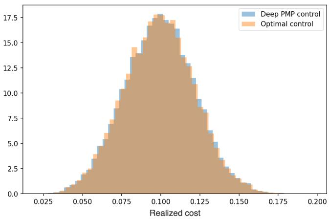  
Figure 5.1: Distribution of the terminal cost $0 . 5 ( X _ { T } ^ { \alpha } - c ) ^ { 2 }$ under the learned control via Algorithm 1 (blue) and under the optimal control (5.2) (orange).

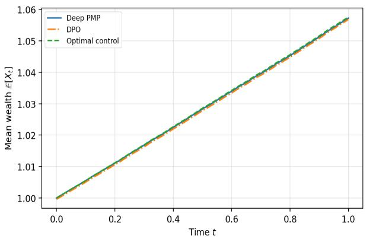

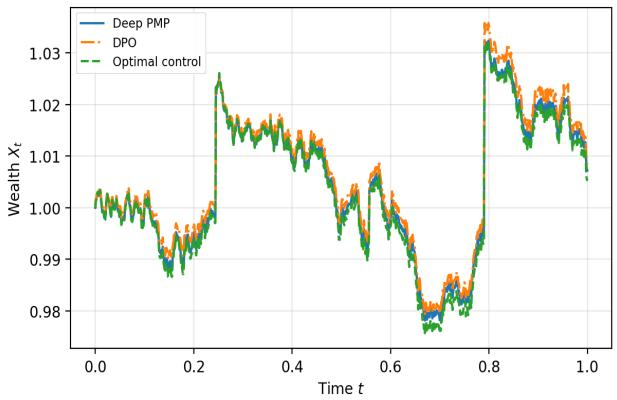  
Figure 5.2: Comparison of the mean state trajectory $( \mathbb { E } [ X _ { t } ^ { \alpha } ] ) _ { 0 \leq t \leq T }$ (left) and of a given state trajectory $( X _ { t } ^ { \alpha } ) _ { 0 \leq t \leq T }$ (right) under the learned control via Algorithm 1 (blue), via the DPO method (orange) and under the optimal control (5.2) (dashed green).

Every 50 epochs, we also evaluate the cost functional $J ( \alpha )$ in Figure 5.3 (left) using the learned control from Algorithm 1, the one from DPO, and the closed-form optimal control (5.2). At evaluation time, the initial condition is fixed at $X _ { 0 } = 1$ , and the time discretization uses $N = 1 0 0 0 \mathrm { s t e p s }$ . Figure 5.3 (right) then reports the control mean absolute error (MAE), computed along simulated validation trajectories initialized with $X _ { 0 } ^ { ( m ) } \sim \mathcal { U } ( [ 0 . 5 , 2 . 0 ] )$ , as

$$
\mathrm { M A E } _ { \alpha } = \frac { 1 } { M _ { 1 } N } \sum _ { m = 1 } ^ { M _ { 1 } } \sum _ { i = 0 } ^ { N - 1 } \left| \alpha _ { \theta ^ { k } } ( t _ { i } , X _ { i } ^ { ( m ) } ) - \alpha ^ { * } ( t _ { i } , X _ { i } ^ { ( m ) } ) \right| ,\tag{5.3}
$$

where $\alpha _ { \theta ^ { k } }$ denotes the learned control at epoch k and $\alpha ^ { * }$ the closed-form optimal control. The plotted curve shows the mean control MAE over 10 independent runs of each algorithm, while the shaded region represents $\pm \mathrm { \ o n e }$ standard deviation. These figures again confirm the efectiveness of the Deep PMP method, which outperforms DPO even in this one-dimensional benchmark.

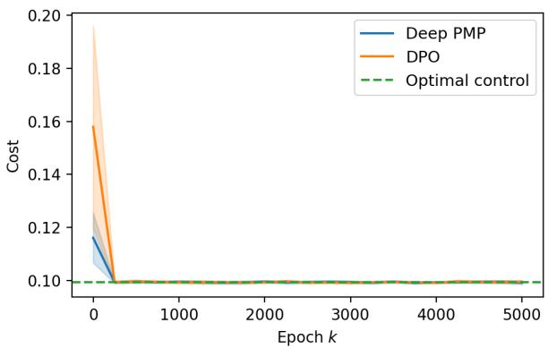

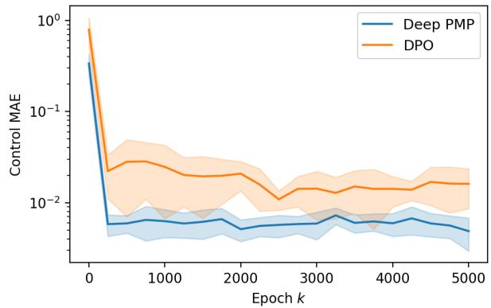  
Figure 5.3: Left: Cost functional $J ( \alpha )$ as a function of the training epoch k, evaluated using the learned control from Algorithm 1 (blue), the DPO method (orange), and the closed-form optimal control (5.2) (dashed line). Right: $\mathrm { M A E } _ { \alpha }$ between the learned Deep PMP control (blue) and the learned DPO control (orange). Solid curves represent averages over 10 independent runs, and shaded regions indicate ± one standard deviation.

## 5.2. Optimal Consumption-Investment with Jumps

We now study a multi-dimensional extension of the previous mean-variance portfolio example. We first consider the optimal consumption-investment problem in a market with constant coeficients, where the risk-free asset evolves according to

$$
d S _ { t } ^ { 0 } = r _ { f } S _ { t } ^ { 0 } d t ,
$$

for a constant interest rate $r _ { f } \in \mathbb { R }$ , and where each stock $i = 1 , \ldots , n$ follows

$$
\frac { d S _ { t } ^ { i } } { S _ { t - } ^ { i } } = \mu ^ { i } d t + \sigma ^ { i } \sum _ { k = 1 } ^ { n } L _ { i k } d B _ { t } ^ { k } + d \sum _ { j = 1 } ^ { N _ { t } ^ { i } } \left( e ^ { Z _ { j } ^ { i } } - 1 \right) ,\tag{5.4}
$$

for constant drifts $\boldsymbol { \mu } ^ { i } \in \mathbb { R }$ and volatilities $\sigma ^ { i } \in \mathbb { R } _ { + }$ , an n-dimensional standard Brownian motion B, a correlation matrix $\Sigma = L L ^ { \top }$ , independent Poisson processes $N ^ { i }$ with constant intensities $\lambda ^ { i } \geq 0$ and i.i.d. normal random variables $Z _ { 1 } ^ { i } , Z _ { 2 } ^ { i } , \ldots \sim \nu ^ { i } = \mathcal { N } ( \mu _ { Z } ^ { i } , \sigma _ { Z } ^ { i } )$ with $\mu _ { Z } ^ { i } \in \mathbb { R }$ and $\sigma _ { Z } ^ { i } \in \mathbb { R } _ { + }$ . The corresponding compensated Poisson measure is then written $\tilde { N } ^ { i } ( d t , d z ) : = N ^ { i } ( d t , d z ) - \lambda ^ { i } \nu ^ { i } ( d z ) d t$ . Suppose an investor starts with an initial endowment of $X _ { 0 } > 0$ , consumes at rate $c _ { t } X _ { t - } ^ { \alpha }$ and invests $\pi _ { t } ^ { i } X _ { t - } ^ { \alpha }$ in each of the n stocks. If the risk-free asset is used to balance the transactions and writing $\boldsymbol { \mu } = ( \mu ^ { 1 } , \dots , \mu ^ { n } ) ^ { \top }$ $\boldsymbol \sigma = \mathrm { d i a g } ( \sigma ^ { 1 } , \dots , \sigma ^ { n } )$ , the resulting wealth evolves according to

$$
\frac { d X _ { t } ^ { \alpha } } { X _ { t - } ^ { \alpha } } = \left( r _ { f } + \pi _ { t } ^ { \top } ( \mu - r _ { f } { \bf 1 } ) - c _ { t } \right) d t + \pi _ { t } ^ { \top } \sigma L d B _ { t } + \sum _ { i = 1 } ^ { n } \pi _ { t } ^ { i } d \left( \sum _ { j = 1 } ^ { N _ { t } ^ { i } } ( e ^ { Z _ { j } ^ { i } } - 1 ) \right) .\tag{5.5}
$$

We consider admissible controls $\alpha _ { t } = ( c _ { t } , \pi _ { t } )$ , where $c _ { t } \geq 0 , \pi _ { t } \in \mathbb { R } ^ { n }$ , and

$$
1 + \pi _ { t } ^ { i } ( e ^ { Z _ { 1 } ^ { i } } - 1 ) > 0 \quad \mathrm { a . s . ~ f o r ~ a l l } \ i = 1 , \ldots , n ,
$$

so that wealth remains strictly positive after jumps, and we assume the investor maximizes

$$
J ( \alpha ) = \mathbb { E } \left[ \int _ { 0 } ^ { T } e ^ { - \rho s } \frac { \left( c _ { s } X _ { s } ^ { \alpha } \right) ^ { \delta } } { \delta } d s + e ^ { - \rho T } \frac { \left( X _ { T } ^ { \alpha } \right) ^ { \delta } } { \delta } \right] ,\tag{5.6}
$$

for a discount factor $\rho \in \mathbb { R }$ and a constant relative risk aversion $\gamma > 0 , \gamma \neq 1$ with $\delta : = 1 - \gamma .$ Since the driving noise in (5.5) has stationary and independent increments, it is enough to consider strategies of the form $c _ { t } = c ( t , X _ { t - } ^ { \alpha } )$ and $\pi _ { t } ^ { i } = \pi ^ { i } ( t , X _ { t - } ^ { \alpha } )$ for functions $c , \pi ^ { i } \colon [ 0 , T ) \times \mathbb { R } _ { + } \to \mathbb { R } _ { + } , \mathbb { R }$ and $i = 1 , \ldots , n$ . It is known from Oksendal (2013) that the optimal fractions of wealth is a vector of constants $\pi _ { t } ^ { * } = \pi ^ { * } : = ( \pi ^ { 1 , * } , \cdot \cdot \cdot , \pi ^ { n , * } ) ^ { \top }$ satisfying

$$
\begin{array} { r } { 0 = ( \mu - r _ { f } { \bf 1 } ) + ( \delta - 1 ) \sigma \Sigma \sigma \pi ^ { * } + \left( \begin{array} { c } { \lambda ^ { 1 } \mathbb { E } \Big [ \big ( 1 + \pi ^ { 1 , * } ( e ^ { Z _ { 1 } ^ { 1 } } - 1 ) \big ) ^ { \delta - 1 } ( e ^ { Z _ { 1 } ^ { 1 } } - 1 ) \Big ] } \\ { \vdots } \\ { \lambda ^ { n } \mathbb { E } \Big [ \big ( 1 + \pi ^ { n , * } ( e ^ { Z _ { 1 } ^ { n } } - 1 ) \big ) ^ { \delta - 1 } ( e ^ { Z _ { 1 } ^ { n } } - 1 ) \Big ] } \end{array} \right) , } \end{array}\tag{5.7}
$$

while the value function $V ( t , x ) = \operatorname* { s u p } _ { \alpha } J ( t , x , \alpha )$ and the optimal consumption rate $c ^ { * }$ are given, respectively, by

$$
V ( t , x ) = A ( t ) x ^ { \delta } / \delta \quad \mathrm { a n d } \quad c _ { t } ^ { * } = A ( t ) ^ { 1 / ( \delta - 1 ) } ,\tag{5.8}
$$

where $A : \mathbb { R } ^ { + }  \mathbb { R } ^ { + }$ satisfies the ODE

$$
\begin{array} { l } { \displaystyle \frac { A ^ { \prime } ( t ) } { A ( t ) } = \rho - \delta \left( r _ { f } + ( \mu - r _ { f } { \bf 1 } ) ^ { \top } \pi ^ { * } \right) - \frac { 1 } { 2 } \delta ( \delta - 1 ) \pi ^ { * \top } \sigma \Sigma \sigma ^ { \top } \pi ^ { * } } \\ { \displaystyle - \sum _ { i = 1 } ^ { n } \lambda ^ { i } \mathbb { E } \left[ \left( 1 + \pi ^ { * , i } ( e ^ { Z _ { 1 } ^ { i } } - 1 ) \right) ^ { \delta } - 1 \right] - ( 1 - \delta ) A ( t ) ^ { 1 / ( \delta - 1 ) } , } \end{array}\tag{5.9}
$$

with terminal condition $A ( T ) = 1$ , which can be solved numerically using an ODE solver, e.g. Runge–Kutta method of order 5(4). Finally, we derive the corresponding PMP. The Hamiltonian is

$$
\begin{array} { r } { H ( t , x , a , p , q , r ) = e ^ { - \rho t } \displaystyle \frac { ( c x ) ^ { \delta } } { \delta } + x \Big ( { r _ { f } } + \pi ^ { \top } ( \mu - { r _ { f } } { \bf 1 } ) - c \Big ) p + x \pi ^ { \top } \sigma L q } \\ { + x \displaystyle \sum _ { i = 1 } ^ { n } \lambda ^ { i } \pi ^ { i } \kappa ^ { i } p + x \displaystyle \sum _ { i = 1 } ^ { n } \lambda ^ { i } \pi ^ { i } \displaystyle \int _ { \mathbb R } ( e ^ { z } - 1 ) r ^ { i } ( z ) \nu ^ { i } ( d z ) , } \end{array}\tag{5.10}
$$

where $p \in \mathbb R , q = ( q _ { 1 } , \dots , q _ { n } ) \in \mathbb R ^ { n }$ , and $r = ( r ^ { 1 } , \ldots , r ^ { n } )$ with $r ^ { i } : \mathbb { R }  \mathbb { R }$ . The corresponding adjoint equation is the BSDE

$$
d p _ { t } = - \nabla _ { x } H \big ( t , X _ { t - } ^ { \alpha ^ { * } } , \alpha _ { t } ^ { * } , p _ { t } , q _ { t } , r _ { t } \big ) d t + q _ { t } ^ { \top } d B _ { t } + \sum _ { i = 1 } ^ { n } \int _ { \mathbb { R } } r _ { t } ^ { i } ( z ) \tilde { N } ^ { i } ( d t , d z ) ,\tag{5.11}
$$

with terminal condition $p _ { T } = e ^ { - \rho T } ( X _ { T } ^ { \alpha ^ { * } } ) ^ { \delta - 1 }$ . Finally, the stationary condition is given by

$$
\nabla _ { a } H ( t , x , a , p , q , r ) = \left( \begin{array} { l } { \partial _ { c } H ( t , x , a , p , q , r ) } \\ { \nabla _ { \pi } H ( t , x , a , p , q , r ) } \end{array} \right) = 0 ,
$$

where

$$
\partial _ { c } H ( t , x , a , p , q , r ) = e ^ { - \rho t } x ^ { \delta } c ^ { \delta - 1 } - x p ,
$$

and $\nabla _ { \pi } H ( \cdot ) = ( \partial _ { \pi ^ { 1 } } H ( \cdot ) , \cdot \cdot . . , \partial _ { \pi ^ { n } } H ( \cdot ) ) ^ { \top }$ , with for $i = 1 , \ldots , n ,$

$$
\partial _ { \pi ^ { i } } H ( t , x , a , p , q , r ) = x \left( ( \mu ^ { i } - r _ { f } ) p + \sigma ^ { i } \sum _ { k = 1 } ^ { n } L _ { i k } q _ { k } + \lambda ^ { i } \kappa ^ { i } p + \lambda ^ { i } \int _ { \mathbb R } ( e ^ { z } - 1 ) r ^ { i } ( z ) \nu ^ { i } ( d z ) \right) .
$$

For the numerical experiments, we set $n = 1 0 0 , T = 1 , r _ { f } = \rho = 0 . 0 1 , \delta = 0 . 2 5$ and randomly sampled $\bar { \mu } , \bar { \sigma } , \bar { \lambda } , \bar { \mu } _ { Z } , \bar { \sigma } _ { Z } , L$ . During training, we fix $N = 5 0$ discretization steps and the initial wealth used for the Deep PMP rollouts is sampled from $X _ { 0 } \sim \mathcal { U } ( [ 0 . 5 , 1 . 5 ] )$ . We then compare in Figure 5.4 the learned feedback control $\alpha _ { \theta ^ { k } }$ ∗ from the deep PMP, the DPO baseline and the reference consumption-investment strategy $\alpha ^ { * } = ( c ^ { * } , \pi ^ { * } )$ in $( 5 . 7 ) \mathrm { - } ( 5 . 8 )$ . Every 500 epochs, we also evaluate in Figure 5.6 (left) the reward functional $J ( \alpha )$ on independent validation trajectories with fixed initial wealth $X _ { 0 } = 1$ and $N = 1 0 0 0$ steps. Figure 5.6 (right) then compares the control MAE (5.3) for an initial wealth $X _ { 0 } \sim \mathcal { U } ( [ 0 . 5 , 1 . 5 ] )$ These figures again confirm that the deep PMP approaches the reference value accurately and consistently outperforms DPO.

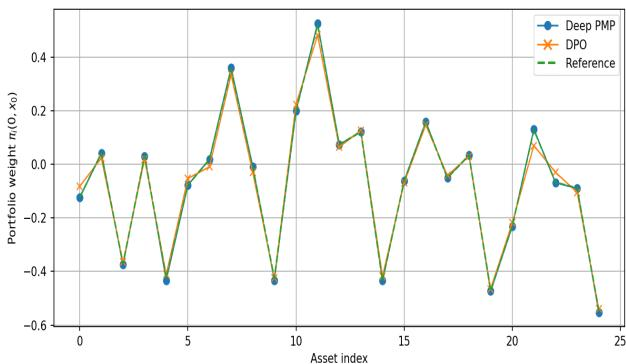

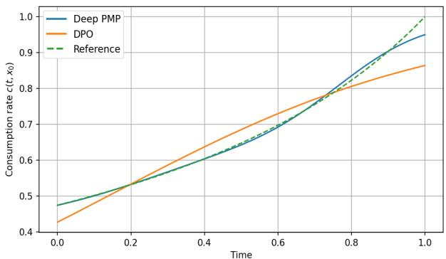  
Figure 5.4: Left: Portfolio weights $\pi _ { i } ( t _ { 0 } , x _ { 0 } )$ for $t _ { 0 } = 0 , x _ { 0 } = 1$ and the first 25 assets $i = 1 , \ldots , 2 5 .$ . Right: consumption rate $c ( t , x _ { 0 } )$ at $x _ { 0 } = 1$ in function of time $t \in [ 0 ,$ 1]. Comparison of the deep PMP (blue), the DPO (orange) and the reference solution (5.7)–(5.8) (dashed green).

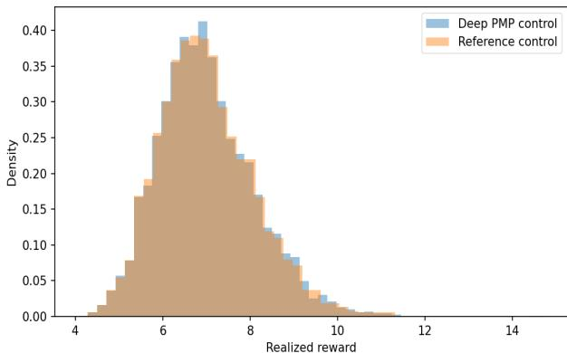

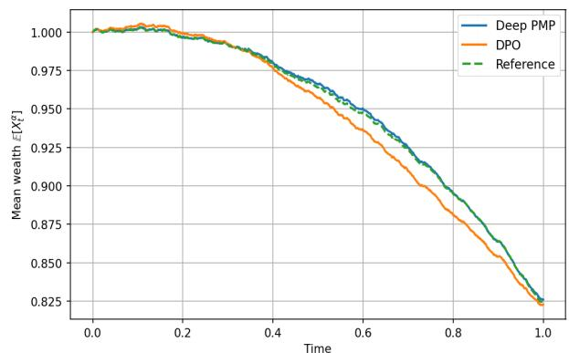  
Figure 5.5: Left: Distribution of the reward in (5.6) under the learned deep PMP control (blue) and under the reference contro (5.7)–(5.8) (orange). Right: Comparison of the mean state trajectory $( \mathbb { E } [ X _ { t } ^ { \alpha } ] ) _ { 0 \leq t \leq T }$ under the learned control via the deep PMP (blue), the DPO method (orange) and under the reference control (dashed green).

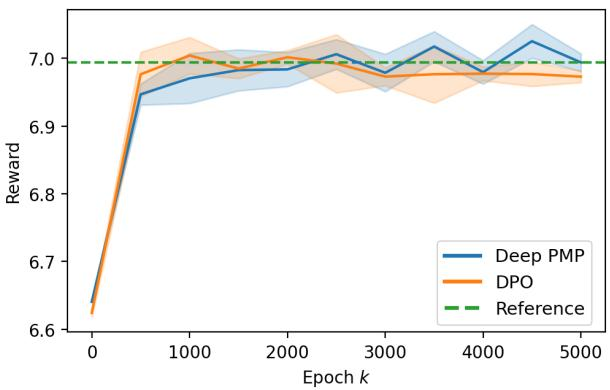

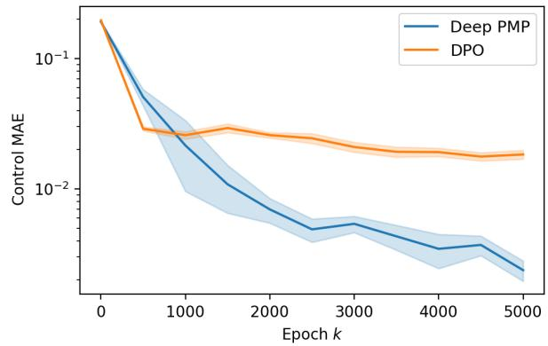  
Figure 5.6: Left: Reward functional J(α) (5.6) as a function of the training epoch k, evaluated using the learned control from Algorithm 1 (blue), the DPO method (orange), and the optimal control (5.7)–(5.8) (green dashed line). Right: $\mathrm { M A E } _ { \alpha }$ between the learned Deep PMP control (blue) and the learned DPO control (orange). Solid curves represent averages over 10 independent runs, and shaded regions indicate ± one standard deviation

## 5.3. LQR with marked Poisson controlledjumps

Consider the controlled jump-difusion system

$$
d X _ { t } ^ { \alpha } = ( A X _ { t } ^ { \alpha } + B \alpha _ { t } ) d t + F d W _ { t } + \int _ { E } ( C X _ { t ^ { - } } ^ { \alpha } + D \alpha _ { t } ) z N ( d t , d z ) ,\tag{5.12}
$$

where $X _ { t } ^ { \alpha } \in \mathbb { R } ^ { n } , \alpha _ { t } \in \mathbb { R } ^ { m }$ , W is a d-dimensional standard Brownian motion, and $N ( d t , d z )$ is a Poisson random measure on $E = \mathbb { R } ^ { n }$ with compensator $\lambda \nu ( d z ) d t , \lambda > 0$ . We assume that the first two mark moments are finite and define

$$
\mu _ { 1 } : = \lambda \int _ { E } z \nu ( d z ) , \qquad \mu _ { 2 } : = \lambda \int _ { E } z ^ { 2 } \nu ( d z ) .\tag{5.13}
$$

The matrices $A , B , C , D , F$ are assumed to have compatible dimensions. The goal is to minimize the finite-horizon quadratic cost

$$
J ( \alpha ) = \mathbb { E } \left[ X _ { T } ^ { \alpha \top } G X _ { T } ^ { \alpha } + \int _ { 0 } ^ { T } \left( X _ { t } ^ { \alpha \top } Q X _ { t } ^ { \alpha } + \alpha _ { t } ^ { \top } R \alpha _ { t } \right) d t \right] ,\tag{5.14}
$$

where $Q \succeq 0 , G \succeq 0$ , and $R \succ 0$ . Because of the additive Brownian noise, the value function is written as

$$
V ( t , x ) = x ^ { \top } P ( t ) x + \eta ( t ) ,
$$

where $P ( t )$ is symmetric and $\eta ( t )$ is a scalar function. The optimal control is still a linear feedback law

$$
\alpha _ { t } ^ { * } = - K ( t ) X _ { t ^ { - } } ^ { \alpha } ,\tag{5.15}
$$

where

$$
\begin{array} { r } {  { \boldsymbol { K } } ( t ) = \left( R + \mu _ { 2 }  { \boldsymbol { D } } ^ { \top }  { \boldsymbol { P } } ( t )  { \boldsymbol { D } } \right) ^ { - 1 } \left(  { \boldsymbol { B } } ^ { \top }  { \boldsymbol { P } } ( t ) + \mu _ { 1 }  { \boldsymbol { D } } ^ { \top }  { \boldsymbol { P } } ( t ) + \mu _ { 2 }  { \boldsymbol { D } } ^ { \top }  { \boldsymbol { P } } ( t )  { \boldsymbol { C } } \right) . } \end{array}
$$

The Riccati diferential equation for $P ( t )$ is

$$
\begin{array} { r l } & { - \dot { P } ( t ) = A ^ { \top } P ( t ) + P ( t ) A + Q + \mu _ { 1 } \left( C ^ { \top } P ( t ) + P ( t ) C \right) + \mu _ { 2 } C ^ { \top } P ( t ) C } \\ & { \qquad - \left( P ( t ) B + \mu _ { 1 } P ( t ) D + \mu _ { 2 } C ^ { \top } P ( t ) D \right) \left( R + \mu _ { 2 } D ^ { \top } P ( t ) D \right) ^ { - 1 } \times \left( B ^ { \top } P ( t ) + \mu _ { 1 } D ^ { \top } P ( t ) + \mu _ { 2 } D ^ { \top } P ( t ) C \right) , } \end{array}
$$

with terminal condition $P ( T ) = G$ , while scalar term η(t) satisfies

$$
- { \dot { \eta } } ( t ) = \operatorname { t r } \left( { \boldsymbol { F } } ^ { \top } { \boldsymbol { P } } ( t ) { \boldsymbol { F } } \right) ,
$$

with terminal condition $\eta ( T ) = 0$ . Since we consider a minimization problem, the Hamiltonian is given by

$$
\begin{array} { r l } & { H ( t , x , a , p , q , r ) = - x ^ { \top } Q x - a ^ { \top } R a + p ^ { \top } \Big ( ( A + \mu _ { 1 } C ) x + ( B + \mu _ { 1 } D ) a \Big ) } \\ & { \qquad + \operatorname { t r } ( q ^ { \top } F ) + \lambda \displaystyle \int _ { E } r ( z ) ^ { \top } ( C x + D a ) z \nu ( d z ) . } \end{array}
$$

The Pontryagin minimum conditions are as follows. The adjoint process (2.5) satisfies the BSDE

$$
\begin{array} { r l } & { \displaystyle { d p _ { t } = - \nabla _ { x } H ( t , X _ { t - } ^ { \alpha ^ { * } } , \alpha _ { t } ^ { * } , p _ { t } , q _ { t } , r _ { t } ( \cdot ) ) d t + q _ { t } d W _ { t } + \int _ { E } r _ { t } ( z ) \widetilde { N } ( d t , d z ) , } } \\ & { \quad \quad = - \left[ - 2 Q X _ { t } ^ { \alpha ^ { * } } + { ( A + \mu _ { 1 } C ) } ^ { \top } p _ { t } + \lambda \int _ { E } z C ^ { \top } r _ { t } ( z ) \nu ( d z ) \right] d t + q _ { t } d W _ { t } + \int _ { E } r _ { t } ( z ) \widetilde { N } ( d t , d z ) . } \end{array}
$$

with terminal condition $p _ { T } = - 2 G X _ { T } ^ { \alpha ^ { * } }$ . The optimal control then satisfies

$$
\nabla _ { a } H ( t , x , a , p , q , r ) = - 2 R a + ( B + \mu _ { 1 } D ) ^ { \top } p + \lambda \int _ { E } z D ^ { \top } r ( z ) \nu ( d z ) = 0 .\tag{5.16}
$$

In the LQR experiment, we set the terminal time to $T = 1$ with state dimension $n = 1 5 0$ and control dimension $m = 1 5 0$ . The model parameters are chosen as $Q = I _ { n } , G = 1 . 2 5 I _ { n } , R = 0 . 7 5 I _ { m } , A =$ $- 0 . 3 5 I _ { n } + 0 . 0 8 \xi _ { A } , B = 0 . 7 0 \xi _ { B } , C = 0 . 0 8 \xi _ { C } , D = 0 . 1 0 \xi _ { D }$ and $F = 0 . 3 5 I _ { N }$ where the entries of $\xi _ { A } , \xi _ { B } , \xi _ { C } , \xi _ { D }$ are independent standard Gaussian random variables. We take the jump intensity to be $\lambda = 2$ and use Gaussian marks $Z \sim \mathcal { N } ( 0 . 5 , 0 . 7 5 ^ { 2 } )$ such that $\mu _ { 1 } = 1 , \mu _ { 2 } = 1 . 6 2 5$

During training, the initial condition is sampled componentwise from $X _ { 0 } \sim \mathcal { U } ( [ - 4 , 4 ] ^ { n } )$ . For the final cost-distribution Figure 5.7, we instead fix $X _ { 0 } = e _ { 1 } = ( 1 , 0 , \ldots , 0 ) ^ { \top }$ and compute the realized costs over Monte Carlo trajectories for both the learned control $\alpha _ { \theta ^ { k ^ { * } } }$ from Algorithm 1 and the Riccati feedback control (5.15). The histogram compares the empirical distributions of these realized costs and indicates that the learned policy recovers not only the Riccati value on average, but also the pathwise cost distribution induced by the stochastic jump-difusion dynamics. This is further supported by Figure 5.8, which shows that the state-norm trajectories and their mean are nearly indistinguishable under the learned and Riccati controls 4.

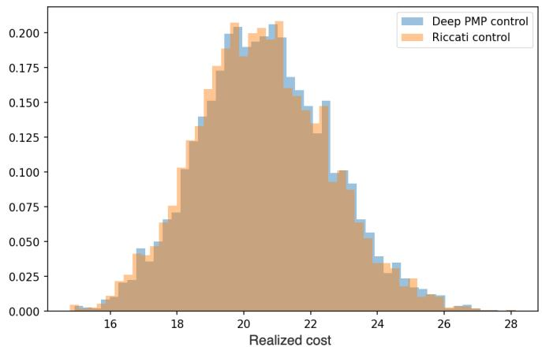  
Figure 5.7: Distribution of the quadratic cost in (5.14) under the learned control via the deep PMP algorithm 1 (blue) and under the Riccati control (5.15) (orange).

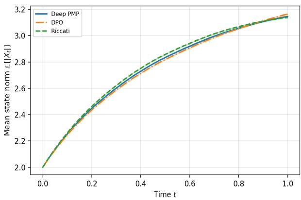

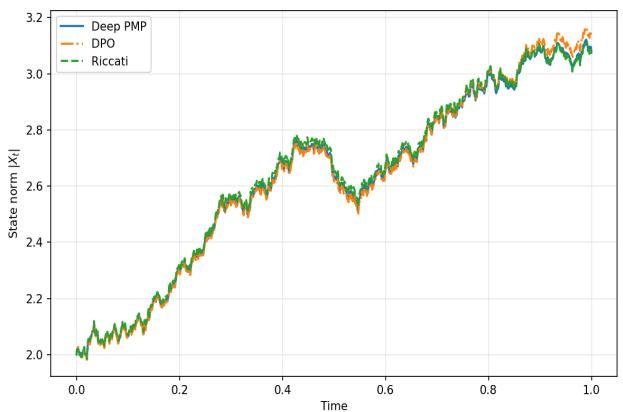  
Figure 5.8: Comparison of the mean state norm trajectory $( \mathbb { E } [ | X _ { t } ^ { \alpha } | ] ) _ { 0 \leq t \leq T }$ (left) and of a given state norm trajectory (|Xt |)0≤t≤T (right) under the learned control via Algorithm 1 (blue), the DPO method (orange) and under the Riccati control (5.15) (right).

Every 50 epochs, we evaluate the cost functional $J ( \alpha )$ given by Eq. (5.14) and shown in Figure 5.9 (left), using the learned PMP control from Algorithm 1, the DPO method, and the Riccati control (5.15). In the validation plots used for the cost plot, the initial condition is fixed at $x _ { 0 } = e _ { 1 }$ , and the time discretization uses $N = 1 0 0 0 \ { \mathrm { s t e p s } }$ . Figure 5.9 (right) reports the control MAE given by (5.3), computed along simulated validation trajectories initialized componentwise with $X _ { 0 } ^ { ( m ) } \sim \mathcal { U } ( [ - 4 , 4 ] ^ { n } )$ . Again, the deep PMP algorithm gives very accurate results and outperforms the DPO method in terms of accuracy.

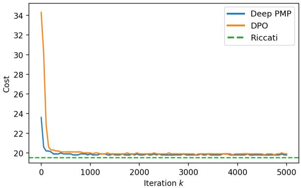

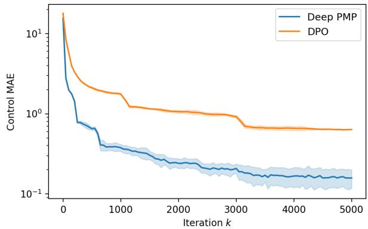  
Figure 5.9: Left: Cost functional J(α) (5.14) as a function of the training epoch k, evaluated using the learned control from Algorithm 1 (blue), the DPO method (orange), and the Riccati control (5.15) (dashed line). Right: MAE between the learned Deep PMP control (blue) and the learned DPO control (orange). Solid curves represent averages over 10 independent runs, and shaded regions indicate ± one standard deviation

## 5.4. Allen–Cahn-type stochastic control problem with jumps

Let $X _ { t } ^ { \alpha } \in \mathbb { R } ^ { n }$ denote the state process and let $\alpha _ { t } \in \mathbb { R } ^ { n }$ denote the control. We consider the controlled jump-difusion

$$
d X _ { t } ^ { \alpha } = \left( h ( X _ { t } ^ { \alpha } ) + \alpha _ { t } \right) d t + \sigma d W _ { t } + \int _ { E } \gamma z \widetilde { N } ( d t , d z ) , \qquad X _ { 0 } = x _ { 0 } ,\tag{5.17}
$$

where $W _ { t }$ is an n-dimensional Brownian motion and $\widetilde { N } ( d t , d z ) = N ( d t , d z ) - \lambda \nu ( d z ) d t$ is a compensated Poisson random measure on $E = \mathbb { R } ^ { n }$ , with $\lambda > 0$ . The jump marks are assumed to be Gaussian $\nu = \mathcal { N } ( 0 , I _ { n } )$ . The nonlinear drift $h : \mathbb { R } ^ { n }  \mathbb { R } ^ { n }$ is defined componentwise by

$$
h _ { i } ( \boldsymbol { x } ) = x _ { i } - x _ { i } ^ { 3 } , \qquad i = 1 , \ldots , n .\tag{5.18}
$$

The objective is to maximize

$$
J ( \alpha ) = \mathbb { E } \left[ G ( X _ { T } ^ { \alpha } ) + \int _ { 0 } ^ { T } \left( R ( t , X _ { t } ^ { \alpha } ) - \frac { \eta } { 2 } \| \alpha _ { t } \| ^ { 2 } \right) d t \right] ,\tag{5.19}
$$

where $\eta > 0$ is the control-cost parameter. We use here a manufactured solution to design a test problem whose exact solution is known by construction. We first prescribe the exact reference value function

$$
V ^ { \star } ( t , x ) = e ^ { - \beta ( T - t ) } \left( c _ { 0 } + \frac { 1 } { n } \sum _ { i = 1 } ^ { n } \cos ( x _ { i } ) \right) ,\tag{5.20}
$$

where $\beta > 0$ and $c _ { 0 } > 0$ are fixed constants and then build the rewards $R , G$ that match this solution. The terminal reward is then directly given by $G ( x ) = V ^ { * } ( T , x )$ . For the running reward R, we first derive the associated HJB-PIDE

$$
0 = \partial _ { t } V ( t , x ) + h ( x ) \cdot \nabla _ { x } V ( t , x ) + \frac { \sigma ^ { 2 } } { 2 } \Delta V ( t , x ) + Z [ V ] ( t , x ) + R ( t , x ) + \operatorname* { s u p } _ { \alpha \in \mathbb { R } ^ { n } } \left\{ \alpha \cdot \nabla _ { x } V ( t , x ) - \frac { \eta } { 2 } \| \alpha \| ^ { 2 } \right\} ,\tag{5.21}
$$

with nonlocal jump operator

$$
\mathcal { Z } [ V ] ( t , x ) = \lambda \int _ { E } \left[ V ( t , x + \gamma z ) - V ( t , x ) - \gamma z \cdot \nabla _ { x } V ( t , x ) \right] \nu ( d z ) ,\tag{5.22}
$$

and $\Delta V = \mathrm { T r } [ \nabla _ { x } ^ { 2 } V ( t , x ) ]$ . Since $Z \sim { \mathcal { N } } ( 0 , I _ { n } )$ , we obtain

$$
\mathcal { I } [ V ^ { \star } ] ( t , x ) = \lambda e ^ { - \beta ( T - t ) } \frac { e ^ { - \gamma ^ { 2 } / 2 } - 1 } { n } \sum _ { i = 1 } ^ { n } \cos ( x _ { i } ) .\tag{5.23}
$$

The maximization over α is explicit and hence the optimal feedback control is

$$
\alpha ^ { \star } ( t , x ) = \frac { 1 } { \eta } \nabla _ { x } V ^ { \star } ( t , x ) = - \frac { e ^ { - \beta ( T - t ) } } { \eta n } \sin ( x ) .\tag{5.24}
$$

The running reward $R ( t , x )$ is finally defined by plugging $V ^ { \star }$ into the HJB-PIDE

$$
R ( t , x ) = - \left[ \partial _ { t } V ^ { \star } ( t , x ) + h ( x ) \cdot \nabla _ { x } V ^ { \star } ( t , x ) + \frac { \sigma ^ { 2 } } { 2 } \Delta V ^ { \star } ( t , x ) + \mathcal { Z } [ V ^ { \star } ] ( t , x ) + \frac { 1 } { 2 \eta } \| \nabla _ { x } V ^ { \star } ( t , x ) \| ^ { 2 } \right] ,\tag{5.25}
$$

such that $V ^ { \star }$ is the exact value function of the control problem, and $\alpha ^ { \star }$ is the exact optimal feedback control. The Pontryagin Hamiltonian associated with the control-dependent part of the problem is

$$
\mathcal { H } ( t , x , a , p , q , r ) = R ( t , x ) - \frac { \eta } { 2 } \| a \| ^ { 2 } + p \cdot \big ( h ( x ) + a \big ) ,\tag{5.26}
$$

where $\boldsymbol { p } \in \mathbb { R } ^ { d }$ denotes the adjoint variable. The stationarity condition is

$$
\nabla _ { a } H ( t , x , a , p , q , r ) = p - \eta a = 0 .\tag{5.27}
$$

In the numerical experiment, we set $n = 1 0 0 , T = 0 . 5 , \sigma = 0 . 4 , \gamma = 0 . 2 5 , \lambda = 0 . 5 , \eta = 0 . 5 ,$ $\beta = 0 . 3 , \mathrm { a n d } c _ { 0 } = 2 .$ . The training initial condition $X _ { 0 } ^ { ( m ) }$ is sampled componentwise from $\displaystyle \mathcal { U } ( [ - 1 , 1 ] ^ { n } )$ while fixed-initial-condition evaluations use the deterministic $X _ { 0 } = 0$ . The time grid uses 50 time steps for training and 250 time steps at evaluation time. Figure 5.10 compares the distribution of the terminal reward under the learned Deep PMP control and the exact optimal feedback, showing that the learned policy reproduces the reward distribution induced by $\alpha ^ { \star }$ . Figure 5.11 confirms this pathwise agreement by comparing both the empirical mean of the state-norm trajectories $( \mathbb { E } [ | X _ { t } ^ { \alpha } | ] ) _ { 0 \leq t \leq T }$ and of the first state coordinate $( \mathbb { E } [ X _ { t } ^ { \alpha , 0 } | ] ) _ { 0 \leq t \leq T }$ under Deep PMP, DPO, and the analytic control. Finally, Figure 5.12 reports the evolution of the estimated reward and the control error (5.3) during training; the Deep PMP curve approaches the analytic benchmark and the corresponding control MAE decreases, indicating that the stationarity-based update recovers the manufactured optimal feedback more accurately than the DPO.

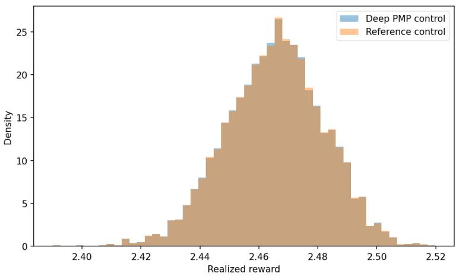  
Figure 5.10: Distribution of the objective reward in (5.19) under the learned PMP control via Algorithm 1 (blue) and under the optimal control (5.24) (orange).

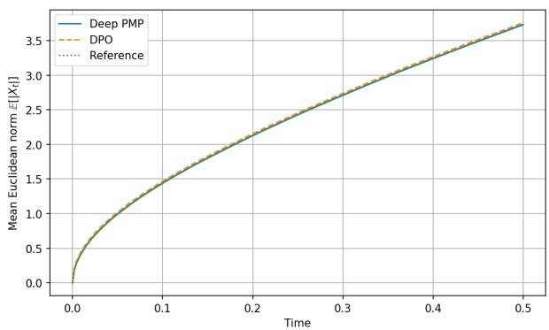

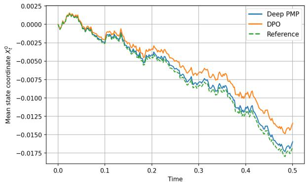  
Figure 5.11: Comparison of the mean state norm trajectory $( \mathbb { E } [ | X _ { t } ^ { \alpha } | ] ) _ { 0 \leq t \leq T }$ (left plot) and the mean first state coordinate trajectory $( \mathbb { E } [ X _ { t } ^ { \alpha , 0 } ]$ )0≤t≤T under the learned control via Algorithm 1 (blue), the DPO method (orange) and under the optimal control (5.24) (green), with $X _ { 0 } ^ { ( m ) } = 0$

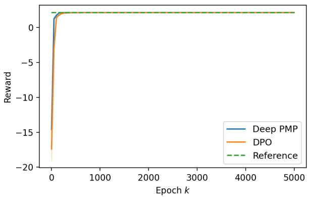

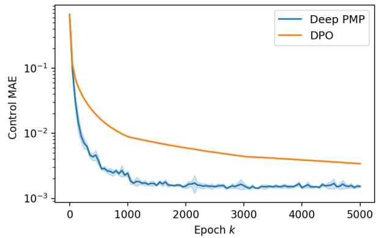  
Figure 5.12: Left: Reward functional $J ( \alpha )$ (5.19) as a function of the training epoch k, evaluated using the learned control from Algorithm 1 (blue), the DPO method (orange), and the optimal control (5.24) (green dashed line). Right: $\mathrm { M A E } _ { \alpha }$ between the learned Deep PMP control (blue) and the learned DPO control (orange). Solid curves represent averages over 10 independent runs, and shaded regions indicate ± one standard deviation

## 5.5. Mean-field Allen–Cahn control problem with nonlinear actuation

We finally consider a more involved extension of the Allen–Cahn control problem with mean-field interactions, state-dependent control and a nonquadratic control cost. Let

$$
{ \overline { { x } } } = { \frac { 1 } { n } } \sum _ { j = 1 } ^ { n } x _ { j } , \qquad g _ { i } ( x ) = 1 + \beta \cos ( x _ { i } ) ,
$$

for $i = 1 , \ldots , n$ , and define the controlled dynamics componentwise by

$$
d X _ { t } ^ { \alpha , i } = \left[ X _ { t } ^ { \alpha , i } - ( X _ { t } ^ { \alpha , i } ) ^ { 3 } + \kappa ( \bar { X } _ { t } ^ { \alpha } - X _ { t } ^ { \alpha , i } ) + g _ { i } ( X _ { t } ^ { \alpha } ) \alpha _ { t } ^ { i } \right] d t + \sigma d W _ { t } ^ { i } + \int _ { \mathbb { R } } \gamma z \tilde { N } _ { i } ( d t , d z ) ,\tag{5.28}
$$

where the compensated Poisson random measures $\widetilde { N } _ { i }$ are independent, with intensity λ and Gaussian marks $Z \sim { \mathcal { N } } ( 0 , 1 )$ . The objective is to maximize

$$
J ( \alpha ) = \mathbb { E } \left[ G ( X _ { T } ^ { \alpha } ) + \int _ { 0 } ^ { T } \left( R ( t , X _ { t } ^ { \alpha } ) - \sum _ { i = 1 } ^ { n } \left[ \frac { \eta } { 2 } ( \alpha _ { t } ^ { i } ) ^ { 2 } + \frac { \zeta } { 4 } ( \alpha _ { t } ^ { i } ) ^ { 4 } \right] \right) d t \right] .\tag{5.29}
$$

We prescribe the manufactured value function

$$
V ^ { \star } ( t , x ) = e ^ { - \beta ( T - t ) } \left[ n c _ { 0 } + \sum _ { i = 1 } ^ { n } \cos ( x _ { i } ) + { \frac { \rho } { n } } \left( \sum _ { i = 1 } ^ { n } \sin ( x _ { i } ) \right) ^ { 2 } \right] .\tag{5.30}
$$

Its gradient is

$$
\partial _ { x _ { i } } V ^ { \star } ( t , x ) = e ^ { - \beta ( T - t ) } \left[ - \sin ( x _ { i } ) + 2 \rho \frac { \cos ( x _ { i } ) } { n } \sum _ { j = 1 } ^ { n } \sin ( x _ { j } ) \right] .\tag{5.31}
$$

The HJB-PIDE contains the control maximization

$$
\operatorname* { s u p } _ { \alpha \in \mathbb { R } ^ { n } } \sum _ { i = 1 } ^ { n } \left\{ g _ { i } ( x ) \alpha _ { i } \partial _ { x _ { i } } V - \frac { \eta } { 2 } \alpha _ { i } ^ { 2 } - \frac { \zeta } { 4 } \alpha _ { i } ^ { 4 } \right\} .\tag{5.32}
$$

Defining

$$
\begin{array} { r } { r _ { i } ( t , x ) = g _ { i } ( x ) \partial _ { x _ { i } } V ^ { \star } ( t , x ) , } \end{array}
$$

and since $\eta , \zeta > 0$ , this equation has a unique real solution:

$$
\alpha _ { i } ^ { \star } ( t , x ) = 2 \sqrt { \frac { \eta } { 3 \zeta } } \sinh \left[ \frac { 1 } { 3 } \operatorname { a r s i n h } \left( \frac { 3 r _ { i } ( t , x ) } { 2 \eta } \sqrt { \frac { 3 \zeta } { \eta } } \right) \right] .\tag{5.33}
$$

The running reward is manufactured by substituting $V ^ { \star }$ into the HJB-PIDE:

$$
R ( t , x ) = - \left[ V _ { t } ^ { \star } + \ell ( x ) \cdot \nabla _ { x } V ^ { \star } + \frac { \sigma ^ { 2 } } { 2 } \Delta V ^ { \star } + \mathcal { I } [ V ^ { \star } ] + \sum _ { i = 1 } ^ { n } \left( r _ { i } \alpha _ { i } ^ { \star } - \frac { \eta } { 2 } ( \alpha _ { i } ^ { \star } ) ^ { 2 } - \frac { \zeta } { 4 } ( \alpha _ { i } ^ { \star } ) ^ { 4 } \right) \right] ,\tag{5.34}
$$

where $\ell _ { i } ( x ) = x _ { i } - x _ { i } ^ { 3 } + \kappa ( \overline { { x } } - x _ { i } ) , G ( x ) = V ^ { \star } ( T , x )$ . With this choice, $V ^ { \star }$ is the exact value function and $\alpha ^ { \star }$ is the exact optimal feedback. The Pontryagin stationarity condition is

$$
\nabla _ { a } H ( t , x , a , p , q , r ) = g ( x ) \odot p - \eta a - \zeta a ^ { \odot 3 } = 0 .\tag{5.35}
$$

Thus, unlike the simpler Allen–Cahn benchmark, the optimal control is a nonlinear function of the adjoint variable and is coupled across coordinates through the manufactured value function.

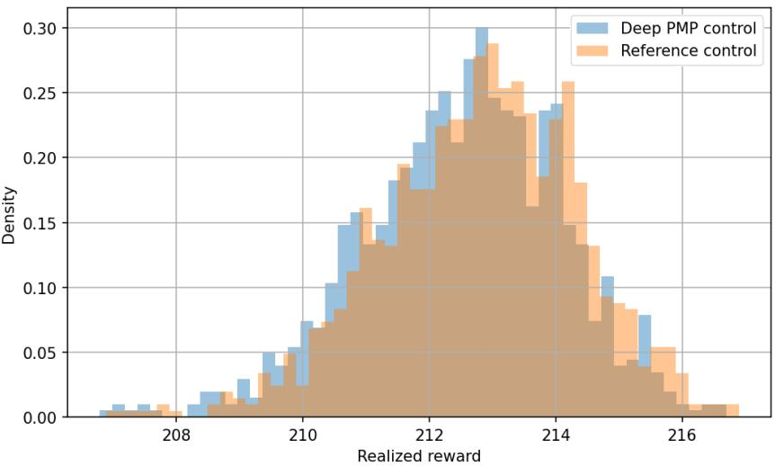  
Figure 5.13: Distribution of the terminal reward in (5.29) under the learned control via Algorithm 1 (blue) and under the optimal control (5.33) (orange).

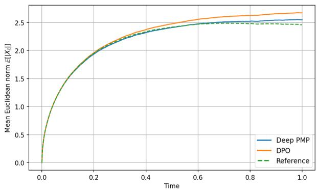

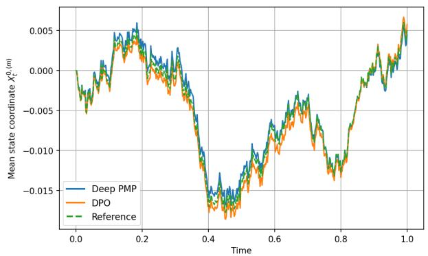  
Figure 5.14: Comparison of the mean state norm trajectory $( \mathbb { E } [ | X _ { t } ^ { \alpha } | ] ) _ { 0 \leq t \leq T }$ (left plot) and the mean first state coordinate trajectory $( \mathbb { E } [ X _ { t } ^ { \alpha , 0 } | ] ) _ { 0 \leq t \leq T }$ under the learned control via Algorithm 1 (blue), the DPO method (orange) and under the optimal control (5.33) (green), with $X _ { 0 } ^ { ( m ) } = 0$

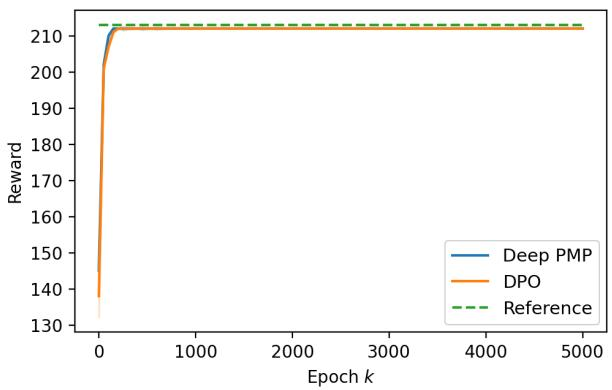

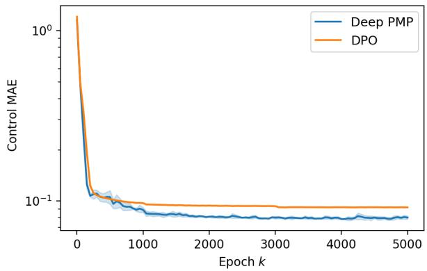  
Figure 5.15: Left: Reward functional J(α) (5.29) as a function of the training epoch k, evaluated using the learned control from Algorithm 1 (blue), the DPO method (orange), and the optimal control (5.33) (green dashed line). Right: $\mathrm { M A E } _ { \alpha }$ between the learned Deep PMP control (blue) and the learned DPO control (orange). Solid curves represent averages over 10 independent runs, and shaded regions indicate ± one standard deviation

## 6. Conclusion

This paper introduces a Deep Pontryagin learning framework for continuous-time stochastic control problems with jump-difusion dynamics. The method exploits the adjoint structure of the Pontryagin stochastic maximum principle while avoiding nested Monte Carlo estimation of value-function gradients. More precisely, the deep PMP algorithm is based on a two-step policy-improvement scheme. First, for a fixed feedback control, pathwise BPTT derivatives provide noisy adjoint labels, which are then projected onto the Markov state by supervised regression. The learned adjoint field is then used, together with the Markov representation (4.2)–(4.3), to update the control through a pointwise Hamiltonian stationarity loss.

This separation between adjoint estimation and control improvement reduces the learning problem to supervised regression and pointwise Hamiltonian maximization. It therefore avoids repeated end-to-end backpropagation through the full time-discretized objective, which is a key limitation of DPO methods. On the theoretical side, we showed that the projected BPTT adjoint satisfies a discrete-time Pontryagin principle and converges, as the time step tends to zero, to the continuous-time adjoint BSDE.

The numerical experiments demonstrate that the proposed method accurately recovers reference controls and values across several jump-difusion benchmarks, including high-dimensional and nonlinear examples. They also indicate improved stability and accuracy compared with direct policy optimization. Future work includes extensions to path-dependent problems, state- or control-dependent jump intensities, and a more detailed analysis of the neural approximation error.

## 7. Appendix

## 7.1. Proof of Theorem 2.2

In order to extend the proof of Theorem 2.1 in Framstad et al. (2004) to the case where the compensator of $N$ is the time-inhomogeneous measure $\lambda ( t ) \nu ( d z ) d t$ , we need the following integration-by-parts formula, compare with Lemma 2.1 in Framstad et al. (2004).

Lemma 7.1. Let $b , \widetilde { b }$ be progressively measurable Rn-valued processes, let σ, σe be predictable $\mathbb { R } ^ { n \times d }$ -valued processes, and let $\gamma , \widetilde { \gamma }$ bejointly predictable mapsfrom $[ 0 , T ] \times E \times \Omega$ to $\mathbb { R } ^ { n }$ . Assume that, almost surely,

$$
\begin{array} { r l r } & { } & { \displaystyle \int _ { 0 } ^ { T } | b _ { t } | d t + \int _ { 0 } ^ { T } | \sigma _ { t } | ^ { 2 } d t + \int _ { 0 } ^ { T } \int _ { E } | \gamma _ { t } ( z ) | ^ { 2 } \lambda ( t ) \nu ( d z ) d t < \infty , } \\ & { } & { \displaystyle \int _ { 0 } ^ { T } | \tilde { b } _ { t } | d t + \int _ { 0 } ^ { T } | \tilde { \sigma } _ { t } | ^ { 2 } d t + \int _ { 0 } ^ { T } \int _ { E } | \tilde { \gamma } _ { t } ( z ) | ^ { 2 } \lambda ( t ) \nu ( d z ) d t < \infty . } \end{array}\tag{7.1}
$$

Then for any $y _ { 0 } , \tilde { y } _ { 0 } \in \mathbb { R } ^ { n }$ , the processes

$$
\begin{array} { l } { { \displaystyle Y _ { t } = y _ { 0 } + \int _ { 0 } ^ { t } b _ { s } d s + \int _ { 0 } ^ { t } \sigma _ { s } d W _ { s } + \int _ { 0 } ^ { t } \int _ { E } \gamma _ { s } ( z ) \widetilde { N } ( d s , d z ) } } \\ { { \displaystyle \widetilde { Y } _ { t } = \widetilde { y } _ { 0 } + \int _ { 0 } ^ { t } \widetilde { b } _ { s } d s + \int _ { 0 } ^ { t } \widetilde { \sigma } _ { s } d W _ { s } + \int _ { 0 } ^ { t } \int _ { E } \widetilde { \gamma } _ { s } ( z ) \widetilde { N } ( d s , d z ) } } \end{array}
$$

satisfies

$$
Y _ { T } ^ { \top } \tilde { Y } _ { T } = y _ { 0 } ^ { \top } \tilde { y } _ { 0 } + \int _ { 0 } ^ { T } Y _ { t - } ^ { \top } d \tilde { Y } _ { t } + \int _ { 0 } ^ { T } \tilde { Y } _ { t - } ^ { \top } d Y _ { t } + \int _ { 0 } ^ { T } \mathrm { T r } \left[ \sigma _ { t } ^ { \top } \tilde { \sigma } _ { t } \right] d t + \int _ { 0 } ^ { T } \int _ { E } \gamma _ { t } ^ { \top } ( z ) \tilde { \gamma } _ { t } ( z ) N ( d t , d z ) .\tag{7.2}
$$

Proof. Applying Itô’s formula in Section A.3 of Bouchard (2007) with the choice

$$
X = [ \overset { Y } { Y } ] \quad \mathrm { a n d } \quad f : [ 0 , T ] \times \mathbb { R } ^ { 2 n }  \mathbb { R } ; ( t , [ \overset { y } { y } ] ) \mapsto y ^ { \top } \tilde { y } ,
$$

we obtain

$$
\begin{array} { r l } { \widetilde { V } _ { I } ^ { T } \widetilde { \gamma } _ { - } ^ { \top } - \mathcal { H } _ { 0 } ^ { \top } \widehat { \gamma } _ { + } \wedge \ \int _ { 0 } ^ { 0 } \big ( \widetilde { V } _ { I } ^ { \top \top } \widehat { \mu } _ { + } \ \big ( \widetilde { Y } _ { I } ^ { \top \top } \widehat { \mu } _ { - } \big ) \big ) d \widetilde { V } _ { i } \ \ \Big [ \mathcal { F } _ { 0 } ^ { \top } \widetilde { \gamma } _ { - } ^ { \top } \widehat { \mu } _ { + } \big ] d \widetilde { V } _ { i } } & { \Big [ \int _ { 0 } ^ { T } \big ( \widetilde { V } _ { I } ^ { \top \top } \widehat { \sigma } _ { i } \big ) \big ( \widetilde { V } _ { i } ^ { \top } \widehat { \mu } _ { i } \big ) d \widetilde { V } _ { i } } \\ & { + \int _ { 0 } ^ { T } \int _ { R } \Big ( ( \widetilde { V } _ { I } - \gamma _ { + } ( \widetilde { \gamma } ) ) ^ { \top } \big ( \widetilde { V } _ { I } - \widetilde { \gamma } _ { + } ( \widetilde { \gamma } _ { + } ( \widetilde { \gamma } ) ) - \widetilde { V } _ { i } ^ { \top } \widetilde { V } _ { i } \Big ) N ( d z _ { * } , d \widetilde { V } ) } \\ & { - \int _ { 0 } ^ { T } \int _ { R } \big ( \widetilde { V } _ { I } ^ { \top \top } \widehat { \sigma } _ { i } ( z _ { * } ) + \widetilde { V } _ { i } ^ { \top \top } \widehat { \mu } _ { i } ( z _ { * } ) \big ) \lambda ( b ) \mu _ { * } \big ( d \widetilde { \gamma } _ { i } \big ) d \widetilde { V } _ { i } } \\  = \mathcal { W } _ { i } ^ { \top } \ + \int _ { 0 } ^ { T } \widetilde { V } _ { i } ^ { \top \top } \widetilde { \mu } _ { k } d \widetilde { V } _ { i } + \int _ { 0 } ^ { T } \widetilde { V } _ { i } ^ { \top \top } \widehat  \mu \end{array}
$$

Proof of Theorem 2.2. Let $( \alpha , X )$ be an arbitrary admissible pair to the primal equation (2.3) with the same initial value $x _ { 0 } \in \mathbb { R } ^ { n }$ . Our goal is to show that

$$
J ( \boldsymbol { \hat { \alpha } } ) - J ( \alpha ) = \mathbb { E } \bigg [ \int _ { 0 } ^ { T } \big ( f ( t , \hat { X } _ { t } , \hat { \alpha } _ { t } ) - f ( t , X _ { t } , \alpha _ { t } ) \big ) d t + F ( \hat { X } _ { T } ) - F ( X _ { T } ) \bigg ] \geqslant 0 .\tag{7.3}
$$

Since ${ \hat { X } } - X$ is given by

$$
\begin{array} { r } { d ( \hat { X } - X ) _ { t } = \big ( b ( t , \hat { X } _ { t } , \hat { \alpha } _ { t } ) - b ( t , X _ { t } , \alpha _ { t } ) \big ) d t + \big ( \sigma ( t , \hat { X } _ { t } , \hat { \alpha } _ { t } ) - \sigma ( t , X _ { t } , \alpha _ { t } ) \big ) d W _ { t } } \\ { + \displaystyle \int _ { E } \big ( \gamma ( t , \hat { X } _ { t - } , z , \hat { \alpha } _ { t } ) - \gamma ( t , X _ { t - } , z , \alpha _ { t } ) \big ) \tilde { N } ( d t , d z ) , } \end{array}
$$

with ${ \hat { X } } _ { 0 } - X _ { 0 } = 0$ , and $( \widehat { p } , \widehat { q } , \widehat { r } )$ is a solution tuple to the adjoint BSDE

$$
\left\{ \begin{array} { l l } { d \widehat { p } _ { t } } & { = - \nabla _ { x } H ( t , \hat { X } _ { t - } , \hat { \alpha } _ { t } , \widehat { p } _ { t } , \widehat { q } _ { t } , \hat { r } _ { t } ( \cdot ) ) d t + \hat { q } _ { t } d W _ { t } + \int _ { E } \hat { r } _ { t } ( z ) \tilde { N } ( d t , d z ) } \\ { \widehat { p } _ { T } } & { = \nabla _ { x } F ( \hat { X } _ { T } ) } \end{array} \right.\tag{2.5}
$$

we deduce that

$$
\begin{array} { r l } & { \mathbb { E } \bigg [ F ( \hat { X } _ { T } ) - F ( X _ { T } ) \bigg ] \geqslant \mathbb { E } \bigg [ \big ( \hat { X } _ { T } - X _ { T } \big ) ^ { \top } \nabla _ { x } F ( \hat { X } _ { T } ) \bigg ] } \\ & { \qquad = \mathbb { E } \bigg [ \big ( \hat { X } _ { T } - X _ { T } \big ) ^ { \top } \hat { p } _ { T } \bigg ] } \\ & { \qquad = \mathbb { E } \bigg [ \displaystyle \int _ { 0 } ^ { T } \big ( \hat { X } _ { t - } - X _ { t - } \big ) ^ { \top } d \hat { p } _ { t } + \int _ { 0 } ^ { T } \hat { p } _ { t - } ^ { \top } d \big ( \hat { X } - X \big ) _ { t } } \\ & { \qquad + \displaystyle \int _ { 0 } ^ { T } \mathbb { T } \big [ \big ( \sigma ( t , \hat { X } _ { t - } , \hat { \alpha } _ { t } ) - \sigma ( t , X _ { t - } , \alpha _ { t } ) \big ) ^ { \top } \hat { q } _ { t } \big ] d t } \\ & { \qquad + \displaystyle \int _ { 0 } ^ { T } \int _ { \mathcal { F } } \big ( \gamma ( t , \hat { X } _ { t - } , z , \hat { \alpha } _ { t } ) - \gamma ( t , X _ { t - } , z , \alpha _ { t } ) \big ) ^ { \top } \hat { r } _ { t } ( z ) \lambda ( t ) \nu ( d z ) d l \bigg ] } \end{array}
$$

where we have used the concavity of $F$ in the first line, terminal condition of $\widehat { p }$ in the second line and Lemma 7.1 in the third line with absolute integrability of the jump term from Cauchy-Schwarz. Next, by the integrability condition (i), the the following stochastic integrals are square-integrable martingales

$$
\begin{array} { r l } & { \displaystyle \int _ { 0 } ^ { T } \left( \hat { X } _ { t - } - X _ { t - } \right) ^ { \top } \hat { q } _ { t } d W _ { t } \quad \mathrm { a n d } \quad \displaystyle \int _ { 0 } ^ { T } \int _ { E } \left( \hat { X } _ { t - } - X _ { t - } \right) ^ { \top } \hat { r } _ { t } ( z ) \tilde { N } ( d t , d z ) } \\ & { \displaystyle \int _ { 0 } ^ { T } \hat { p } _ { t - } ^ { \top } \left( \sigma ( t , \hat { X } _ { t - } , \hat { \alpha } _ { t } ) - \sigma ( t , X _ { t - } , \alpha _ { t } ) \right) d W _ { t } } \\ & { \displaystyle \int _ { 0 } ^ { T } \int _ { E } \hat { p } _ { t - } ^ { \top } \left( \gamma ( t , \hat { X } _ { t - } , z , \hat { \alpha } _ { t } ) - \gamma ( t , X _ { t - } , z , \alpha _ { t } ) \right) \tilde { N } ( d z , d t ) } \end{array}
$$

and therefore have zero expectation. This implies that

$$
\begin{array} { r l } & { \mathbb E \bigg [ \int _ { 0 } ^ { T } \big ( \hat { X } _ { t - } - X _ { t - } \big ) ^ { \top } d \hat { p } _ { t } \bigg ] = \mathbb E \bigg [ \int _ { 0 } ^ { T } \big ( \hat { X } _ { t - } - X _ { t - } \big ) ^ { \top } \bigg ( - \nabla _ { x } H ( t , \hat { X } _ { t - } , \hat { \alpha } _ { t } , \hat { p } _ { t } , \hat { q } _ { t } , \hat { r } _ { t } ( \cdot ) ) \bigg ) d \hat { t } \bigg ] } \\ & { \quad \quad \mathbb E \bigg [ \int _ { 0 } ^ { T } \hat { p } _ { t - } ^ { \top } d ( \hat { X } - X ) _ { t } \bigg ] = \mathbb E \bigg [ \int _ { 0 } ^ { T } \hat { p } _ { t } ^ { \top } \big ( b ( t , \hat { X } _ { t - } , \hat { \alpha } _ { t } ) - b ( t , X _ { t - } , \alpha _ { t } ) \big ) d \hat { t } \bigg ] } \end{array}
$$

and therefore

$$
\begin{array} { r l } { \mathbb { E } \bigg [ F ( \hat { X } _ { T } ) - F ( X _ { T } ) \bigg ] \geqslant \mathbb { E } \bigg [ \int _ { 0 } ^ { T } \big ( \hat { X } _ { t - \cdot } - X _ { t - } \big ) ^ { \top } \bigg ( - \nabla _ { x } H ( t , \hat { X } _ { t - \cdot } , \hat { \alpha } _ { t } , \hat { p } _ { t } , \hat { q } _ { t } , \hat { r } _ { t } ( \cdot ) ) \bigg ) d t } & { } \\ & { \quad \quad \quad \quad + \displaystyle \int _ { 0 } ^ { T } \hat { p } _ { t } ^ { \top } \big ( b ( t , \hat { X } _ { t } , \hat { \alpha } _ { t } ) - b ( t , X _ { t } , \alpha _ { t } ) \big ) d t } \\ & { \quad \quad \quad \quad + \displaystyle \int _ { 0 } ^ { T } \operatorname { T r } \big [ \big ( \sigma ( t , \hat { X } _ { t - \cdot } , \hat { \alpha } _ { t } ) - \sigma ( t , X _ { t - \cdot } , \alpha _ { t } ) \big ) ^ { \top } \hat { q } _ { t } \big ] d t } \\ & { \quad \quad \quad \quad + \displaystyle \int _ { 0 } ^ { T } \int _ { E } \big ( \gamma ( t , \hat { X } _ { t - \cdot } , z , \hat { \alpha } _ { t } ) - \gamma ( t , X _ { t - \cdot } , z , \alpha _ { t } ) \big ) ^ { \top } \hat { r } _ { t } ( z ) \lambda ( t ) \nu ( d z ) d t \bigg ] . } \end{array}
$$

On the other hand, by the definition of the Hamiltonian H, we have

$$
\begin{array} { r l } { \mathbb { E } \bigg [ \int _ { 0 } ^ { T } \big ( f ( \ell , \hat { X } _ { t } , \hat { \alpha } _ { t } ) - f ( \ell , X _ { t } , \alpha _ { t } ) \big ) d \ell \bigg ] } & { } \\ & { \quad \quad = \mathbb { E } \bigg [ \int _ { 0 } ^ { T } \big ( H ( t , \hat { X } _ { t - \cdot } , \hat { \alpha } _ { t } , \hat { p } _ { t } , \hat { q } _ { t } , \hat { r } _ { t } ( \cdot ) ) - H ( t , X _ { t - \cdot } , \alpha _ { t } , \hat { p } _ { t } , \hat { q } _ { t } , \hat { r } _ { t } ( \cdot ) ) \big ) d \ell } \\ & { \quad \quad \quad - \int _ { 0 } ^ { T } \big ( b ( t , \hat { X } _ { t } , \hat { \alpha } _ { t } ) - b ( t , X _ { t } , \alpha _ { t } ) \big ) ^ { \top } \hat { p } _ { t } d t } \\ & { \quad \quad \quad - \displaystyle \int _ { 0 } ^ { T } \Big ( \operatorname { T r } \big [ \sigma ( t , \hat { X } _ { t - \cdot } , \hat { \alpha } _ { t } ) ^ { \top } \hat { q } _ { t } \big ] - \operatorname { T r } \big [ \sigma ( t , X _ { t - \cdot } , \alpha _ { t } ) ^ { \top } \hat { q } _ { t } \big ] \Big ) d t } \\ & { \quad \quad \quad - \displaystyle \int _ { 0 } ^ { T } \int _ { E } \big ( \gamma ( t , \hat { X } _ { t - \cdot } , z , \hat { \alpha } _ { t } ) - \gamma ( t , X _ { t - \cdot } , z , \alpha _ { t } ) \big ) ^ { \top } \hat { r } _ { t } ( z ) \lambda ( t ) \nu ( d z ) d t \bigg ] . } \end{array}
$$

Adding the above two (in)equalities together, we obtain

$$
\begin{array} { r l } & { J ( \hat { \alpha } ) - J ( \alpha ) = \mathbb { E } \Bigg [ \int _ { 0 } ^ { T } \big ( f ( t , \hat { X } _ { t } , \hat { \alpha } _ { t } ) - f ( t , X _ { t } , \alpha _ { t } ) \big ) d t + F ( \hat { X } _ { T } ) - F ( X _ { T } ) \Bigg ] } \\ & { \qquad \geqslant \mathbb { E } \Bigg [ \int _ { 0 } ^ { T } \bigg ( \big ( \hat { X } _ { t - } - X _ { t - } \big ) ^ { \top } \bigg ( - \nabla _ { x } H ( t , \hat { X } _ { t - } , \hat { \alpha } _ { t } , \hat { p } _ { t } , \hat { q } _ { t } , \hat { r } _ { t } ( \cdot ) ) \bigg ) \bigg ) } \\ & { \qquad + H ( t , \hat { X } _ { t - } , \hat { \alpha } _ { t } , \hat { p } _ { t } , \hat { q } _ { t } , \hat { r } _ { t } ( \cdot ) ) - H ( t , X _ { t - } , \alpha _ { t } , \hat { p } _ { t } , \hat { q } _ { t } , \hat { r } _ { t } ( \cdot ) ) \bigg ) d t \Bigg ] } \end{array}
$$

The rest of the proof follows exactly the same steps as in the proof of Theorem 2.1 in Framstad et al. (2004): using the arrow condition (2.8) and maximum principle (2.7), we can show that the integrand

$$
H ( t , \hat { X } _ { t - \cdot } , \hat { \alpha } _ { t } , \hat { p } _ { t } , \hat { q } _ { t } , \hat { r } _ { t } ( \cdot ) ) - H ( t , X _ { t - \cdot } , \alpha _ { t } , \hat { p } _ { t } , \hat { q } _ { t } , \hat { r } _ { t } ( \cdot ) ) - \left( \hat { X } _ { t - \cdot } - X _ { t - \cdot } \right) ^ { \top } \left( \nabla _ { x } H ( t , \hat { X } _ { t - \cdot } , \hat { \alpha } _ { t } , \hat { p } _ { t } , \hat { q } _ { t } , \hat { r } _ { t } ( \cdot ) ) \right)
$$

is $\mathbb { P } { \cdot } { \mathbf { a . s } }$ . non-negative for all $t \in [ 0 , T ]$ , and thereby deduce (7.3).

## 7.2. Proof of Proposition 3.1

Proof. Since $\widehat { p } _ { i } \in L ^ { 2 } ( \Omega , \mathcal { F } _ { T } ; \mathbb { R } ^ { n } )$ , the conditional expectation

$$
p _ { i } : = \mathbb { E } [ \widehat { p _ { i } } | \sigma ( X _ { i } ) ]
$$

is well-defined and belongs to $L ^ { 2 } ( \Omega , \sigma ( X _ { i } ) ; \mathbb { R } ^ { n } )$ . By the Doob–Dynkin lemma, there exists a Borel function $p _ { i } ^ { \Delta } : \mathbb { R } ^ { n }  \mathbb { R } ^ { n }$ such that

$$
p _ { i } = p _ { i } ^ { \Delta } ( X _ { i } ) \qquad { \mathbb { P } } \mathrm { - a . s . }
$$

The function $p _ { i } ^ { \Delta }$ is unique $\mathbb { P } _ { X _ { i } }$ -almost everywhere. Since $X _ { i }$ is $\mathcal { F } _ { t _ { : } }$ -measurable, $\sigma ( X _ { i } ) \subseteq { \mathcal { F } } _ { t }$ and therefore $p _ { i }$ is $\mathcal { F } _ { t _ { i } }$ -measurable.

Moreover, since $\mathbb { R } ^ { n }$ is a standard Borel space, a regular conditional distribution given $X _ { i }$ exists. Hence, $p _ { i } ^ { \Delta }$ can be chosen such that

$$
p _ { i } ^ { \Delta } ( x ) = \mathbb { E } \left[ \widehat { p _ { i } } | X _ { i } = x \right]
$$

for $\mathbb { P } _ { X _ { i } }$ -almost every $x \in \mathbb { R } ^ { n }$ . Evaluating this identity at $X _ { i }$ yields directly

$$
p _ { i } = \mathbb { E } [ \widehat { p _ { i } } | X _ { i } ] .
$$

Finally, the last statement follows from the last identity and the standard $L ^ { 2 } \mathrm { - p r o j e c t i o n }$ property of conditional expectation, see e.g. Theorem 4.1.15 of Durrett (2019). □

## 7.3. Proof of Proposition 3.2

Proof. Let us first show (i). Set

$$
\xi _ { i + 1 } : = p _ { i + 1 } - \mathbb { E } _ { i } [ p _ { i + 1 } ] .
$$

Then $\xi _ { i + 1 }$ is square-integrable and satisfies $\mathbb { E } _ { i } [ \xi _ { i + 1 } ] = 0$ . By the predictable representation property on $\left( t _ { i } , t _ { i + 1 } \right]$ , there exist predictable processes $q ^ { i + 1 }$ and $r ^ { i + 1 }$ such that

$$
\xi _ { i + 1 } = \int _ { t _ { i } } ^ { t _ { i + 1 } } q _ { s } ^ { i + 1 } d W _ { s } + \int _ { t _ { i } } ^ { t _ { i + 1 } } \int _ { E } r _ { s } ^ { i + 1 } ( z ) \widetilde { N } ( d s , d z ) .
$$

This gives (3.9).

We then show (ii) and identify $\bar { q } _ { i + 1 }$ . Since $\mathbb { E } _ { i } [ \Delta W _ { i } ] = 0 .$ , we have

$$
\mathbb { E } _ { i } [ p _ { i + 1 } \Delta W _ { i } ^ { \top } ] = \mathbb { E } _ { i } [ \xi _ { i + 1 } \Delta W _ { i } ^ { \top } ] .
$$

Using the representation of $\xi _ { i + 1 }$ , the orthogonality between the Brownian and jump martingales, and $\mathrm { I t } \hat { \mathrm { o } } ^ { \prime } \mathrm { s }$ isometry,

$$
\mathbb { E } _ { i } [ p _ { i + 1 } \Delta W _ { i } ^ { \top } ] = \mathbb { E } _ { i } \left[ \left( \int _ { t _ { i } } ^ { t _ { i + 1 } } q _ { s } ^ { i + 1 } d W _ { s } \right) \Delta W _ { i } ^ { \top } \right] = \mathbb { E } _ { i } \left[ \int _ { t _ { i } } ^ { t _ { i + 1 } } q _ { s } ^ { i + 1 } d s \right] .
$$

Dividing by $\Delta t$ gives (3.11). Moreover, by conditional Jensen’s inequality and the Cauchy–Schwarz inequality,

$$
\mathbb { E } \left[ | \bar { q } _ { i + 1 } | ^ { 2 } \right] \leq \frac { 1 } { \Delta t } \mathbb { E } \left[ \int _ { t _ { i } } ^ { t _ { i + 1 } } | q _ { s } ^ { i + 1 } | ^ { 2 } d s \right] ,
$$

so $\bar { q } _ { i + 1 }$ is square-integrable.

We now demonstrate (iii) and identify $\bar { r } _ { i + 1 }$ . Let $h \in L ^ { 2 } \left( \Omega , \mathcal { F } _ { t _ { i } } , \mathbb { P } ; L ^ { 2 } ( E , \nu ; \mathbb { R } ^ { n } ) \right)$ . Since h is $\mathcal { F } _ { t _ { i } } .$ measurable,

$$
\mathbb { E } _ { i } \left[ \int _ { E } h ( z ) \widetilde { N } _ { i } ( d z ) \right] = 0 .
$$

It follows that

$$
{  { \mathbb E } } _ { i } \left[ \Biggl \langle p _ { i + 1 } , \int _ { E } h ( z ) \widetilde N _ { i } ( d z ) \Biggl \rangle \right] = {  { \mathbb E } } _ { i } \left[ \Biggl \langle \xi _ { i + 1 } , \int _ { E } h ( z ) \widetilde N _ { i } ( d z ) \Biggl \rangle \right] .
$$

By orthogonality between the Brownian martingale and the compensated jump martingale and by the conditional isometry for compensated Poisson integrals,

$$
{  { \mathbb E } } _ { i } \left[ \left. \xi _ { i + 1 } , \int _ { E } h ( z ) \widetilde N _ { i } ( d z ) \right. \right] = {  { \mathbb E } } _ { i } \left[ \int _ { t _ { i } } ^ { t _ { i + 1 } } \int _ { E } \left. r _ { s } ^ { i + 1 } ( z ) , h ( z ) \right. \lambda ( s ) \nu ( d z ) d s \right] .
$$

Since h is $\mathcal { F } _ { t _ { i } }$ -measurable, conditional Fubini’s theorem yields

$$
\mathbb { E } _ { i } \left[ \int _ { t _ { i } } ^ { t _ { i + 1 } } \int _ { E } \left. r _ { s } ^ { i + 1 } ( z ) , h ( z ) \right. \lambda ( s ) \nu ( d z ) d s \right] = \int _ { E } \left. \mathbb { E } _ { i } \left[ \int _ { t _ { i } } ^ { t _ { i + 1 } } \lambda ( s ) r _ { s } ^ { i + 1 } ( z ) d s \right] , h ( z ) \right. \nu ( d z ) .
$$

Therefore,

$$
\mathbb { E } _ { i } \left[ \left. p _ { i + 1 } , \int _ { E } h ( z ) \widetilde { N } _ { i } ( d z ) \right. \right] = \Lambda _ { i } \int _ { E } \left. \frac { 1 } { \Lambda _ { i } } \mathbb { E } _ { i } \left[ \int _ { t _ { i } } ^ { t _ { i + 1 } } \lambda ( s ) r _ { s } ^ { i + 1 } ( z ) d s \right] , h ( z ) \right. \nu ( d z ) .
$$

Comparing this identity with (3.12) and using the uniqueness of the representing element in $L ^ { 2 } ( E , \nu ; \mathbb { R } ^ { n } )$ from the Riesz representation theorem, we obtain

$$
\bar { r } _ { i + 1 } = \frac 1 { \Lambda _ { i } } \mathbb { E } _ { i } \left[ \int _ { t _ { i } } ^ { t _ { i + 1 } } \lambda ( s ) r _ { s } ^ { i + 1 } ( \cdot ) d s \right] .
$$

This proves (3.13).

## 7.4. Proof of Proposition 3.3

Proof. For notational convenience, we set in this proof

$$
f _ { i } : = f ( t _ { i } , X _ { i } , a _ { i } ^ { \mathrm { s g } } ) , \qquad b _ { i } : = b ( t _ { i } , X _ { i } , a _ { i } ^ { \mathrm { s g } } ) , \qquad \sigma _ { i } : = \sigma ( t _ { i } , X _ { i } , a _ { i } ^ { \mathrm { s g } } ) , \qquad \gamma _ { i } ( z ) : = \gamma ( t _ { i } , X _ { i } , z , a _ { i } ^ { \mathrm { s g } } ) .
$$

By the pathwise chain rule (3.5),

$$
\widehat { p } _ { i } = \nabla _ { x } f _ { i } \Delta t + \left( \nabla _ { x } X _ { i + 1 } ^ { i , X _ { i } } \right) ^ { \top } \widehat { p } _ { i + 1 } , \qquad i = N - 1 , \ldots , 0 ,
$$

with $X _ { i } ^ { i , X _ { i } } = X _ { i }$ . Since the frozen-control construction (3.2) is Markovian and future noise increments are independent of $\mathcal { F } _ { t _ { i } }$ , we have

$$
\mathbb { E } _ { i } [ \widehat { p } _ { i } ] = \mathbb { E } [ \widehat { p } _ { i } \mid \sigma ( X _ { i } ) ] = p _ { i } , \qquad \mathbb { E } _ { i + 1 } [ \widehat { p } _ { i + 1 } ] = \mathbb { E } [ \widehat { p } _ { i + 1 } \mid \sigma ( X _ { i + 1 } ) ] = p _ { i + 1 } .
$$

Moreover, $\nabla _ { x } X _ { i + 1 } ^ { i , X _ { i } }$ is $\mathcal { F } _ { t _ { i + } }$ -measurable. Therefore, by the tower property,

$$
p _ { i } = \nabla _ { x } f _ { i } \Delta t + \mathbb { E } _ { i } \biggl [ \left( \nabla _ { x } X _ { i + 1 } ^ { i , X _ { i } } \right) ^ { \top } p _ { i + 1 } \biggr ] .\tag{7.4}
$$

Diferentiating the one-step scheme (3.2) with respect to x and evaluating at $X _ { i }$ yields

$$
\nabla _ { x } X _ { i + 1 } ^ { i , X _ { i } } = I + \nabla _ { x } b _ { i } \Delta t + \nabla _ { x } \sigma _ { i } \Delta W _ { i } + \int _ { E } \nabla _ { x } \gamma _ { i } ( z ) \widetilde { N } _ { i } ( d z ) .\tag{7.5}
$$

Substituting (7.5) into (7.4), we obtain

$$
\begin{array} { l } { p _ { i } = \nabla _ { x } f _ { i } \Delta t + \mathbb { E } _ { i } [ p _ { i + 1 } ] + \Delta t \left( \nabla _ { x } b _ { i } \right) ^ { \top } \mathbb { E } _ { i } [ p _ { i + 1 } ] + \mathbb { E } _ { i } [ \langle p _ { i + 1 } , \nabla _ { x } \sigma _ { i } \Delta W _ { i } \rangle ] } \\ { \displaystyle \qquad + \mathbb { E } _ { i } \Big [ \Big \langle p _ { i + 1 } , \int _ { E } \nabla _ { x } \gamma _ { i } ( z ) \widetilde { N } _ { i } ( d z ) \Big \rangle \Big ] . } \end{array}\tag{7.6}
$$

Since $\nabla _ { x } \sigma _ { i }$ is $\mathcal { F } _ { t _ { i } }$ -measurable and from (3.10),

$$
\begin{array} { r } { \mathbb { E } _ { i } [ \langle p _ { i + 1 } , \nabla _ { x } \sigma _ { i } \Delta W _ { i } \rangle ] = \mathrm { T r } \Big [ ( \nabla _ { x } \sigma _ { i } ) ^ { \top } \mathbb { E } _ { i } [ p _ { i + 1 } \Delta W _ { i } ^ { \top } ] \Big ] = \Delta t \mathrm { T r } \Big [ ( \nabla _ { x } \sigma _ { i } ) ^ { \top } \bar { q } _ { i + 1 } \Big ] . } \end{array}
$$

Likewise, by (3.12) with $h = \nabla _ { x } \gamma _ { i }$

$$
\mathbb { E } _ { i } \bigg [ \bigg \langle p _ { i + 1 } , \int _ { E } \nabla _ { x } \gamma _ { i } ( z ) \widetilde { N } _ { i } ( d z ) \bigg \rangle \bigg ] = \Delta t \frac { \Lambda _ { i } } { \Delta t } \int _ { E } ( \nabla _ { x } \gamma _ { i } ( z ) ) ^ { \top } \bar { r } _ { i + 1 } ( z ) \nu ( d z ) .
$$

Combining the preceding identities, and since

$$
\begin{array} { r l } & { \nabla _ { x } H _ { i } ^ { \Delta } \big ( X _ { i } , a _ { i } ^ { \mathrm { s g } } , \mathbb { E } _ { i } [ p _ { i + 1 } ] , \bar { q } _ { i + 1 } , \bar { r } _ { i + 1 } \big ) = } \\ & { \qquad \nabla _ { x } f _ { i } + ( \nabla _ { x } b _ { i } ) ^ { \top } \mathbb { E } _ { i } [ p _ { i + 1 } ] + \mathrm { T r } \Big [ ( \nabla _ { x } \sigma _ { i } ) ^ { \top } \bar { q } _ { i + 1 } \Big ] + \displaystyle \frac { \Lambda _ { i } } { \Delta t } \int _ { { \cal E } } ( \nabla _ { x } \gamma _ { i } ( z ) ) ^ { \top } \bar { r } _ { i + 1 } ( z ) \nu ( d z ) , } \end{array}
$$

we find

$$
p _ { i } = \mathbb { E } _ { i } [ p _ { i + 1 } ] + \nabla _ { x } H _ { i } ^ { \Delta } \big ( X _ { i } , a _ { i } ^ { \mathrm { s g } } , \mathbb { E } _ { i } [ p _ { i + 1 } ] , \bar { q } _ { i + 1 } , \bar { r } _ { i + 1 } \big ) \Delta t ,
$$

proving (3.14). Finally, we subtract $\mathbb { E } _ { i } [ p _ { i + 1 } ]$ from (3.9) and insert (3.14) to obtain (3.15).

## 7.5. Proof of Proposition 3.4

Proof. The proof follows the standard stability argument of Bouchard and Elie (2008) for Euler schemes of BSDEs with jumps, but one has to distinguish carefully between the martingale-representation coeficients $( q ^ { i + 1 } , r ^ { i + 1 } )$ and their step-averages $( \bar { q } _ { i + 1 } , \bar { r } _ { i + 1 } )$ . Moreover, we set for $t \in [ t _ { i } , t _ { i + 1 } )$ ,

$$
\widetilde p _ { t } ^ { \Delta } : = \mathbb { E } _ { i } [ p _ { i + 1 } ] , \qquad \tau _ { \Delta } ( t ) : = t _ { i } .
$$

Notice that $\widetilde { p } _ { t } ^ { \Delta }$ difers from the piecewise-constant interpolation $\bar { p } _ { t } ^ { \Delta } : = p _ { i }$ , although both processes have the same weak limit as $\Delta t \to 0$ , as shown in Step 4. We also recall that

$$
\widehat { q } _ { t } ^ { \Delta } = q _ { t } ^ { i + 1 } , \qquad \widehat { r } _ { t } ^ { \Delta } = r _ { t } ^ { i + 1 } ,
$$

whereas

$$
\bar { q } _ { t } ^ { \Delta } = \bar { q } _ { i + 1 } , \qquad \bar { r } _ { t } ^ { \Delta } = \bar { r } _ { i + 1 } .
$$

The former appear in the stochastic integrals (3.8), while the latter appear in the Hamiltonian (3.11)–(3.13).   
We now split the proof into five steps.

Step 1: Discrete adjoint BSDE representation. By Proposition 3.3, the discrete Markov adjoint satisfies

$$
p _ { i } - p _ { i + 1 } = \nabla _ { x } H _ { i } ^ { \Delta } \big ( X _ { i } , a _ { i } ^ { s g } , \mathbb { E } _ { i } [ p _ { i + 1 } ] , { \bar { q } } _ { i + 1 } , { \bar { r } } _ { i + 1 } \big ) \Delta t - \int _ { t _ { i } } ^ { t _ { i + 1 } } q _ { s } ^ { i + 1 } d W _ { s } - \int _ { t _ { i } } ^ { t _ { i + 1 } } \int _ { E } r _ { s } ^ { i + 1 } ( z ) \widetilde { N } ( d s , d z ) .\tag{7.7}
$$

Let

$$
\lambda ^ { \Delta } ( t ) : = \frac { \Lambda _ { i } } { \Delta t } , \qquad t \in [ t _ { i } , t _ { i + 1 } ) ,
$$

and define the piece-wise constant interpolation of the discrete Hamiltonian $H _ { i } ^ { \Delta }$ in (3.14) by

$$
H ^ { \Delta } ( t , x , a , p , q , r ) : = f ( t , x , a ) + b ( t , x , a ) ^ { \top } p + \mathrm { T r } \Big [ \sigma ( t , x , a ) ^ { \top } q \Big ] + \lambda ^ { \Delta } ( t ) \int _ { E } \gamma ( t , x , z , a ) ^ { \top } r ( z ) \nu ( d z ) .
$$

Then, for $t \in [ t _ { i } , t _ { i + 1 } )$

$$
\nabla _ { x } H _ { i } ^ { \Delta } \big ( X _ { i } , a _ { i } ^ { \mathrm { s g } } , \mathbb { E } _ { i } [ p _ { i + 1 } ] , { \bar { q } } _ { i + 1 } , { \bar { r } } _ { i + 1 } \big ) = \nabla _ { x } H ^ { \Delta } \big ( \tau _ { \Delta } ( t ) , { \bar { X } } _ { t } ^ { \Delta } , \bar { a } _ { t } ^ { \Delta } , \widetilde { p } _ { t } ^ { \Delta } , \bar { q } _ { t } ^ { \Delta } , \bar { r } _ { t } ^ { \Delta } \big ) .
$$

Thus (7.7) becomes

$$
p _ { i } - p _ { i + 1 } = \int _ { t _ { i } } ^ { t _ { i + 1 } } \nabla _ { x } H ^ { \Delta } \big ( \tau _ { \Delta } ( s ) , \bar { X } _ { s } ^ { \Delta } , \bar { a } _ { s } ^ { \Delta } , \tilde { p } _ { s } ^ { \Delta } , \bar { q } _ { s } ^ { \Delta } , \bar { r } _ { s } ^ { \Delta } \big ) d s - \int _ { t _ { i } } ^ { t _ { i + 1 } } \widehat { q } _ { s } ^ { \Delta } d W _ { s } - \int _ { t _ { i } } ^ { t _ { i + 1 } } \int _ { E } \widehat { r } _ { s } ^ { \Delta } ( z ) \widetilde { N } ( d s , d z ) .\tag{7.8}
$$

Summing backward from i to $N - 1$ gives, at grid points,

$$
p _ { i } = p _ { N } + \sum _ { k = i } ^ { N - 1 } \int _ { t _ { k } } ^ { t _ { k + 1 } } \nabla _ { x } H ^ { \Delta } \big ( \tau _ { \Delta } ( s ) , \bar { X } _ { s } ^ { \Delta } , \bar { a } _ { s } ^ { \Delta } , \tilde { p } _ { s } ^ { \Delta } , \bar { q } _ { s } ^ { \Delta } , \bar { r } _ { s } ^ { \Delta } \big ) d s - \int _ { t _ { i } } ^ { T } \hat { q } _ { s } ^ { \Delta } d W _ { s } - \int _ { t _ { i } } ^ { T } \int _ { E } \hat { r } _ { s } ^ { \Delta } ( z ) \tilde { N } ( d s , d z ) .\tag{7.9}
$$

Step 2: Uniform a priori estimates. We first bound the averaged coeficients. By Jensen’s inequality and the tower property,

$$
\mathbb E \int _ { t _ { i } } ^ { t _ { i + 1 } } | { \bar { q } } _ { i + 1 } | ^ { 2 } d t = \Delta t \mathbb E \left[ \left| { \frac { 1 } { \Delta t } } \mathbb E _ { i } \left[ \int _ { t _ { i } } ^ { t _ { i + 1 } } q _ { s } ^ { i + 1 } d s \right] \right| ^ { 2 } \right] \leq \mathbb E \int _ { t _ { i } } ^ { t _ { i + 1 } } | q _ { s } ^ { i + 1 } | ^ { 2 } d s .
$$

Summing over i gives

$$
\mathbb { E } \int _ { 0 } ^ { T } | \bar { q } _ { t } ^ { \Delta } | ^ { 2 } d t \leq \mathbb { E } \int _ { 0 } ^ { T } | \widehat { q } _ { t } ^ { \Delta } | ^ { 2 } d t .\tag{7.10}
$$

Similarly,

$$
\mathbb E \int _ { t _ { i } } ^ { t _ { i + 1 } } \int _ { E } | \bar { r } _ { i + 1 } ( z ) | ^ { 2 } \lambda ( t ) \nu ( d z ) d t = \Lambda _ { i } \mathbb E \int _ { E } | \bar { r } _ { i + 1 } ( z ) | ^ { 2 } \nu ( d z ) \leq \mathbb E \int _ { t _ { i } } ^ { t _ { i + 1 } } \int _ { E } | r _ { s } ^ { i + 1 } ( z ) | ^ { 2 } \lambda ( s ) \nu ( d z ) d s .
$$

Hence

$$
\mathbb { E } \int _ { 0 } ^ { T } \int _ { E } | \bar { r } _ { t } ^ { \Delta } ( z ) | ^ { 2 } \lambda ( t ) \nu ( d z ) d t \leq \mathbb { E } \int _ { 0 } ^ { T } \int _ { E } | \widehat { r } _ { t } ^ { \Delta } ( z ) | ^ { 2 } \lambda ( t ) \nu ( d z ) d t .\tag{7.11}
$$

From the uniform bounds 2.1(i) on $\nabla _ { x } b , \nabla _ { x } \sigma _ { ; }$ , and $\nabla _ { x } \gamma$ , the driver $( p , q , r ) \mapsto \nabla _ { x } H ^ { \Delta } ( t , x , a , p , q , r )$ is uniformly Lipschitz in $( p , q , r )$ . Indeed, for any $( p , q , r )$ and $( p ^ { \prime } , q ^ { \prime } , r ^ { \prime } )$

$$
\begin{array} { r } { \big | \nabla _ { x } H ^ { \Delta } ( t , x , a , p , q , r ) - \nabla _ { x } H ^ { \Delta } ( t , x , a , p ^ { \prime } , q ^ { \prime } , r ^ { \prime } ) \big | \leq L _ { x } | p - p ^ { \prime } | + L _ { x } | q - q ^ { \prime } | + \lambda ^ { \Delta } ( t ) L _ { x } \| r - r ^ { \prime } \| _ { L ^ { 2 } ( E , \nu ) } . } \end{array}
$$

Since

$$
\| r - r ^ { \prime } \| _ { L ^ { 2 } ( E , \nu ) } = \frac { 1 } { \sqrt { \lambda ( t ) } } \| r - r ^ { \prime } \| _ { L ^ { 2 } ( E , \lambda ( t ) \nu ) } ,
$$

we obtain

$$
\bigl | \nabla _ { x } H ^ { \Delta } ( t , x , a , p , q , r ) - \nabla _ { x } H ^ { \Delta } ( t , x , a , p ^ { \prime } , q ^ { \prime } , r ^ { \prime } ) \bigr | \leq C \left( | p - p ^ { \prime } | + | q - q ^ { \prime } | + \| r - r ^ { \prime } \| _ { L ^ { 2 } ( E , \lambda ( t ) \nu ) } \right) ,
$$

where $C = L _ { x } ( 2 + \operatorname* { s u p } _ { \Delta , t } \lambda ^ { \Delta } ( t ) / \sqrt { \underline { { \lambda } } } )$ . Because λ is continuous and strictly positive on [0, T],

$$
0 < \underline { { { \lambda } } } \leq \lambda ( t ) \leq \overline { { { \lambda } } } < \infty , \qquad \mathrm { a n d } \qquad \operatorname* { s u p } _ { \Delta , t } \lambda ^ { \Delta } ( t ) \leq \overline { { { \lambda } } } .
$$

Hence the Lipschitz constant is independent of $\Delta$

Applying the $L ^ { 2 }$ discrete a priori estimate for Lipschitz BSDEs with jumps, see Lemma A.2(i) and Proposition A.1 of Bouchard and Elie (2008), to the piecewise-interpolated equation (7.9), we obtain

$$
\begin{array} { r l } {  { \mathbb { E } [ \operatorname* { m a x } _ { 0 \le i \le N } | p _ { i } | ^ { 2 } + \int _ { 0 } ^ { T } | \widehat { q } _ { t } ^ { \Delta } | ^ { 2 } d t + \int _ { 0 } ^ { T } \int _ { E } | \widehat { r } _ { t } ^ { \Delta } ( z ) | ^ { 2 } \lambda ( t ) \nu ( d z ) d t ] } \quad } & { } \\ & { \le C \mathbb { E } [ | p _ { N } | ^ { 2 } + ( \int _ { 0 } ^ { T } | \nabla _ { x } H ^ { \Delta } \big ( \tau _ { \Delta } ( t ) , \bar { X } _ { t } ^ { \Delta } , \bar { a } _ { t } ^ { \Delta } , 0 , 0 , 0 \big ) | d t ) ^ { 2 } ] , } \end{array}
$$

where $C$ is independent of $\Delta .$ . By Assumption 2.1(ii),

$$
| \nabla _ { x } f ( t , x , a ) | ^ { 2 } \leq C \big ( 1 + | x | ^ { 2 } + | a | ^ { 2 } \big ) , \qquad | \nabla _ { x } F ( x ) | ^ { 2 } \leq C \big ( 1 + | x | ^ { 2 } \big ) .
$$

Since $\bar { X } ^ { \Delta }  X _ { - }$ and $\bar { a } ^ { \Delta } $ a in their respective $L ^ { 2 }$ spaces, both sequences are uniformly bounded in $L ^ { 2 }$ Therefore, using $\nabla _ { x } H ^ { \Delta } ( t , x , a , 0 , 0 , 0 ) = \nabla _ { x } f ( t , x , a )$ , we obtain

$$
\begin{array} { r } { \underset { \Delta } { \operatorname* { s u p } } \mathbb { E } \left[ \left( \int _ { 0 } ^ { T } \left. \nabla _ { x } H ^ { \Delta } \big ( \tau _ { \Delta } ( t ) , \bar { X } _ { t } ^ { \Delta } , \bar { a } _ { t } ^ { \Delta } , 0 , 0 , 0 \big ) \right. d t \right) ^ { 2 } \right] = \underset { \Delta } { \operatorname* { s u p } } \mathbb { E } \left[ \left( \int _ { 0 } ^ { T } \left. \nabla _ { x } f \big ( \tau _ { \Delta } ( t ) , \bar { X } _ { t } ^ { \Delta } , \bar { a } _ { t } ^ { \Delta } \big ) \right. d t \right) ^ { 2 } \right] } \\ { \leq C T \underset { \Delta } { \operatorname* { s u p } } \mathbb { E } \int _ { 0 } ^ { T } \big ( 1 + \vert \bar { X } _ { t } ^ { \Delta } \vert ^ { 2 } + \vert \bar { a } _ { t } ^ { \Delta } \vert ^ { 2 } \big ) d t < \infty } \end{array}
$$

Moreover, since $p _ { N } = \nabla _ { x } F ( X _ { N } )$ and $X _ { N }  X _ { T }$ in $L ^ { 2 }$

$$
\operatorname* { s u p } _ { \Delta } \mathbb { E } | p _ { N } | ^ { 2 } \leq C \left( 1 + \operatorname* { s u p } _ { \Delta } \mathbb { E } | X _ { N } | ^ { 2 } \right) < \infty .
$$

The discrete a priori estimate therefore yields

$$
\operatorname* { s u p } _ { \Delta } \mathbb { E } \left[ \operatorname* { m a x } _ { 0 \leq i \leq N } | p _ { i } | ^ { 2 } + \int _ { 0 } ^ { T } | \widehat { q } _ { t } ^ { \Delta } | ^ { 2 } d t + \int _ { 0 } ^ { T } \int _ { E } | \widehat { r } _ { t } ^ { \Delta } ( z ) | ^ { 2 } \lambda ( t ) \nu ( d z ) d t \right] < \infty .\tag{7.12}
$$

This proves the claimed stability estimates for both the martingale coeficients and their step averages. Moreover, again by Assumption 2.1(ii) and the Cauchy–Schwarz inequality, we have

$$
\operatorname* { s u p } _ { \Delta } \mathbb { E } \left[ \left( \int _ { 0 } ^ { T } \left| \nabla _ { x } f \big ( \tau _ { \Delta } ( t ) , \bar { X } _ { t } ^ { \Delta } , \bar { a } _ { t } ^ { \Delta } \big ) \right| d t \right) ^ { 2 } \right] \leq T \operatorname* { s u p } _ { \Delta } \mathbb { E } \int _ { 0 } ^ { T } \left| \nabla _ { x } f \big ( \tau _ { \Delta } ( t ) , \bar { X } _ { t } ^ { \Delta } , \bar { a } _ { t } ^ { \Delta } \big ) \right| ^ { 2 } d t < \infty .\tag{7.13}
$$

Step 3: Weak compactness. By weak compactness in the corresponding Hilbert spaces, there exist a subsequence, not relabeled, and processes $p , q , r$ such that

$$
\begin{array} { r l } & { \bar { p } ^ { \Delta }  p \mathrm { w e a k l y i n } L ^ { 2 } ( \Omega \times [ 0 , T ] ; \mathbb R ^ { n } ) \mathrm { . } } \\ & { \quad \widehat { q } ^ { \Delta }  q \mathrm { w e a k l y i n } L _ { \mathbb F } ^ { 2 } ( 0 , T ; \mathbb R ^ { n \times d } ) \mathrm { , } } \\ & { \quad \widehat { r } ^ { \Delta }  r \mathrm { w e a k l y i n } L _ { \nu , \mathbb F } ^ { 2 } ( 0 , T ; \mathbb R ^ { n } ) \mathrm { . } } \end{array}
$$

We next show that the averaged coeficients have the same weak limits. Define the Brownian averaging operator

$$
( A _ { \Delta } u ) _ { t } : = \frac { 1 } { \Delta t } \mathbb { E } _ { i } \left[ \int _ { t _ { i } } ^ { t _ { i + 1 } } u _ { s } \ : d s \right] , \qquad t \in [ t _ { i } , t _ { i + 1 } ) .\tag{7.14}
$$

Then $\bar { q } ^ { \Delta } = A \Delta \widehat { q } ^ { \Delta }$ . Reasoning as above, it is clear that the operators $A _ { \Delta }$ are contractions on $L _ { \mathbb { F } } ^ { 2 } ( 0 , T ; \mathbb { R } ^ { n \times d } )$ , are self-adjoint with respect to the $L ^ { 2 }$ inner product, and satisfy

$$
A _ { \Delta } \varphi  \varphi \mathrm { s t r o n g l y i n } L _ { \mathbb { F } } ^ { 2 } ( 0 , T ; \mathbb { R } ^ { n \times d } ) .
$$

for every predictable test process $\varphi \in L _ { \mathbb { F } } ^ { 2 } ( 0 , T ; \mathbb { R } ^ { n \times d } )$ . Therefore,

$$
\langle \bar { q } ^ { \Delta } , \varphi \rangle = \langle A _ { \Delta } \widehat { q } ^ { \Delta } , \varphi \rangle = \langle \widehat { q } ^ { \Delta } , A _ { \Delta } \varphi \rangle \to \langle q , \varphi \rangle ,
$$

and hence

$$
\begin{array} { r } { \bar { q } ^ { \Delta }  q \quad \mathrm { w e a k l y i n } \ L _ { \mathbb { F } } ^ { 2 } ( 0 , T ; \mathbb { R } ^ { n \times d } ) \mathrm { . } } \end{array}
$$

The same argument applies to the jump coeficient. Define

$$
( B _ { \Delta } u ) _ { t } ( z ) : = \frac { 1 } { \Lambda _ { i } } \mathbb { E } _ { i } \left[ \int _ { t _ { i } } ^ { t _ { i + 1 } } \lambda ( s ) u _ { s } ( z ) d s \right] , \qquad t \in [ t _ { i } , t _ { i + 1 } ) .\tag{7.15}
$$

Since λ is bounded away from zero, this is well-defined. Then

$$
\bar { r } ^ { \Delta } = B _ { \Delta } \widehat { r } ^ { \Delta } .
$$

The operators $B _ { \Delta }$ are contractions on $L _ { \nu , \mathbb { F } } ^ { 2 } ( 0 , T ; \mathbb { R } ^ { n } )$ , are self-adjoint and satisfy $B _ { \Delta } \psi  \psi$ strongly for every predictable test function $\psi$ . Consequently,

$$
\begin{array} { r } { \bar { r } ^ { \Delta }  r \quad \mathrm { w e a k l y i n } L _ { \nu , \mathbb { F } } ^ { 2 } ( 0 , T ; \mathbb { R } ^ { n } ) . } \end{array}
$$

Step 4: Identification of the limit. We now identify the weak limit. Since $X _ { N }  X _ { T } \mathrm { i n } L ^ { 2 } ( \Omega , \mathcal { F } _ { T } ; \mathbb { R } ^ { n } )$ we have $X _ { N }  X _ { T }$ in probability. By continuity of $\nabla _ { x } F$

$$
\nabla _ { \boldsymbol { x } } F ( X _ { N } )  \nabla _ { \boldsymbol { x } } F ( X _ { T } ) \quad \mathrm { i n ~ p r o b a b i l i t y } .
$$

Moreover, the linear-growth bound from Assumption 2.1 implies

$$
| \nabla _ { x } F ( X _ { N } ) - \nabla _ { x } F ( X _ { T } ) | ^ { 2 } \leq C \big ( 1 + | X _ { N } | ^ { 2 } + | X _ { T } | ^ { 2 } \big ) .
$$

The $L ^ { 2 } .$ -convergence of $X _ { N }$ implies that $\{ | X _ { N } | ^ { 2 } \} _ { \Delta }$ is uniformly integrable. Hence the family $\{ | \nabla _ { x } F ( X _ { N } ) -$ $\nabla _ { x } F ( X _ { T } ) | ^ { 2 } \} _ { \Delta }$ is uniformly integrable. Hence, by Vitali’s convergence theorem,

$$
p _ { N } = \nabla _ { x } F ( X _ { N } ) \longrightarrow \nabla _ { x } F ( X _ { T } ) \quad \mathrm { i n ~ } L ^ { 2 } ( \Omega , \mathcal { F } _ { T } ; \mathbb { R } ^ { n } ) .
$$

Moreover, from (3.14), we find for $t \in [ t _ { i } , t _ { i + 1 } )$

$$
\bar { p } _ { t } ^ { \Delta } - \widetilde { p } _ { t } ^ { \Delta } = \nabla _ { x } H ^ { \Delta } \big ( \tau _ { \Delta } ( t ) , \bar { X } _ { t } ^ { \Delta } , \bar { a } _ { t } ^ { \Delta } , \widetilde { p } _ { t } ^ { \Delta } , \bar { q } _ { t } ^ { \Delta } , \bar { r } _ { t } ^ { \Delta } \big ) \Delta t .
$$

Hence, we obtain

$$
\mathbb { E } \int _ { 0 } ^ { T } | \bar { p } _ { t } ^ { \Delta } - \widetilde { p } _ { t } ^ { \Delta } | ^ { 2 } d t = ( \Delta t ) ^ { 2 } \mathbb { E } \int _ { 0 } ^ { T } \big | \nabla _ { x } H ^ { \Delta } \big ( \tau _ { \Delta } ( t ) , \bar { X } _ { t } ^ { \Delta } , \bar { a } _ { t } ^ { \Delta } , \widetilde { p } _ { t } ^ { \Delta } , \bar { q } _ { t } ^ { \Delta } , \bar { r } _ { t } ^ { \Delta } \big ) \big | ^ { 2 } d t .
$$

Moreover, since the driver $\nabla _ { x } H ^ { \Delta }$ is uniformly Lipschitz in $( p , q , r )$ , we have

$$
\begin{array} { r l r } {  { \big \vert \nabla _ { x } H ^ { \Delta } \big ( \tau _ { \Delta } ( t ) , \bar { X } _ { t } ^ { \Delta } , \bar { a } _ { t } ^ { \Delta } , \tilde { p } _ { t } ^ { \Delta } , \bar { q } _ { t } ^ { \Delta } , \bar { r } _ { t } ^ { \Delta } \big ) \big \vert ^ { 2 } } } \\ & { } & { \leq C ( \big \vert \nabla _ { x } H ^ { \Delta } \big ( \tau _ { \Delta } ( t ) , \bar { X } _ { t } ^ { \Delta } , \bar { a } _ { t } ^ { \Delta } , 0 , 0 , 0 \big ) \big \vert ^ { 2 } + \vert \tilde { p } _ { t } ^ { \Delta } \vert ^ { 2 } + \vert \bar { q } _ { t } ^ { \Delta } \vert ^ { 2 } + \int _ { E } \big \vert \bar { r } _ { t } ^ { \Delta } ( z ) \vert ^ { 2 } \lambda ( t ) \nu ( d z ) ) . } \end{array}
$$

The first term on the right-hand side is uniformly bounded, see (7.13). The terms involving $\bar { q } ^ { \Delta }$ and $\bar { r } ^ { \Delta }$ are uniformly bounded by the estimates in (7.12). Finally, $\widetilde { p } ^ { \Delta }$ is uniformly bounded in $L ^ { 2 } ( \Omega \times [ 0 , T ] ; \mathbb { R } ^ { n } )$ since $\widetilde { p } _ { t } ^ { \Delta } = \mathbb { E } _ { i } [ p _ { i + 1 } ]$ for $t \in [ t _ { i } , t _ { i + 1 } )$ , and therefore, by Jensen’s inequality,

$$
\mathbb { E } \int _ { 0 } ^ { T } | \tilde { p } _ { t } ^ { \Delta } | ^ { 2 } d t = \sum _ { i = 0 } ^ { N - 1 } \mathbb { E } \int _ { t _ { i } } ^ { t _ { i + 1 } } | \mathbb { E } _ { i } [ p _ { i + 1 } ] | ^ { 2 } d t \leq \sum _ { i = 0 } ^ { N - 1 } \Delta t \mathbb { E } \left[ | p _ { i + 1 } | ^ { 2 } \right] \leq T \mathbb { E } \left[ \operatorname* { m a x } _ { 0 \leq i \leq N } | p _ { i } | ^ { 2 } \right] ,
$$

which is uniformly bounded by the a priori estimate (7.12). Hence

$$
\operatorname* { s u p } _ { \Delta } \mathbb { E } \int _ { 0 } ^ { T } \big | \nabla _ { x } H ^ { \Delta } \big ( \tau _ { \Delta } ( t ) , \bar { X } _ { t } ^ { \Delta } , \bar { a } _ { t } ^ { \Delta } , \widetilde { p } _ { t } ^ { \Delta } , \bar { q } _ { t } ^ { \Delta } , \bar { r } _ { t } ^ { \Delta } \big ) \big | ^ { 2 } d t < \infty .
$$

Consequently,

$$
\mathbb { E } \int _ { 0 } ^ { T } | \bar { p } _ { t } ^ { \Delta } - \widetilde { p } _ { t } ^ { \Delta } | ^ { 2 } d t = ( \Delta t ) ^ { 2 } \mathbb { E } \int _ { 0 } ^ { T } \big | \nabla _ { x } H ^ { \Delta } \big ( \tau _ { \Delta } ( t ) , \bar { X } _ { t } ^ { \Delta } , \bar { a } _ { t } ^ { \Delta } , \tilde { p } _ { t } ^ { \Delta } , \bar { q } _ { t } ^ { \Delta } , \bar { r } _ { t } ^ { \Delta } \big ) \big | ^ { 2 } d t \leq C ( \Delta t ) ^ { 2 } \to 0 .
$$

Therefore, $\bar { p } ^ { \Delta } - \widetilde { p } ^ { \Delta } \to 0$ in $L ^ { 2 } ( \Omega \times [ 0 , T ] ; \mathbb { R } ^ { n } )$ , and hence, $\widetilde { p } ^ { \Delta }$ and $\bar { p } ^ { \Delta }$ have the same weak limit which we denote $p .$

Next, $\lambda ^ { \Delta } \to \lambda$ uniformly on [0, T], because λ is continuous on [0, T]. Also, by Assumption (ii),

$$
\bar { X } ^ { \Delta } \to X _ { - } , \qquad \bar { a } ^ { \Delta } \to a \quad \mathrm { i n ~ } L ^ { 2 } ( \Omega \times [ 0 , T ] ; \mathbb { R } ^ { n } ) .
$$

Together with the continuity and growth assumptions in (i) on the spatial derivatives of $b , \sigma , \gamma , f ,$ , this implies that the coeficients in the driver converge strongly in the corresponding $L ^ { 2 } { \mathrm { - s p a c e s . } }$ Lemma 7.2 then shows that the strong convergence of these coeficients together with the weak convergences $\widetilde { p } ^ { \Delta } \to p$ $\bar { q } ^ { \Delta }  q ,$ and $\bar { r } ^ { \Delta } \to r ,$ , implies weak convergence of the full driver

$$
\nabla _ { x } H ^ { \Delta } \big ( \tau _ { \Delta } ( t ) , \bar { X } _ { t } ^ { \Delta } , \bar { a } _ { t } ^ { \Delta } , \tilde { p } _ { t } ^ { \Delta } , \bar { q } _ { t } ^ { \Delta } , \bar { r } _ { t } ^ { \Delta } \big )  \nabla _ { x } H ( t , X _ { t - } , a _ { t } , p _ { t } , q _ { t } , r _ { t } ) \quad \mathrm { w e a k l y ~ i n ~ } L ^ { 2 } ( \Omega \times [ 0 , T ] ; \mathbb { R } ^ { n } ) .
$$

Passing to the limit in the grid identity (7.9), in the standard weak formulation of BSDE Euler schemes, see Bouchard and Elie (2008); Alasseur et al. (2024), gives

$$
p _ { t } = \nabla _ { x } F ( X _ { T } ) + \int _ { t } ^ { T } \nabla _ { x } H ( s , X _ { s - } , a _ { s } , p _ { s } , q _ { s } , r _ { s } ) d s - \int _ { t } ^ { T } q _ { s } d W _ { s } - \int _ { t } ^ { T } \int _ { E } r _ { s } ( z ) \widetilde { N } ( d s , d z ) ,
$$

for the càdlàg adapted modification of $p .$ Equivalently,

$$
d p _ { t } = - \nabla _ { x } H ( t , X _ { t - } , a _ { t } , p _ { t } , q _ { t } , r _ { t } ) d t + q _ { t } d W _ { t } + \int _ { E } r _ { t } ( z ) \widetilde { N } ( d t , d z ) , \qquad p _ { T } = \nabla _ { x } F ( X _ { T } ) .
$$

By the well-posedness result established after (2.5), the limiting Lipschitz BSDE admits a unique squareintegrable adapted solution. Therefore, every weakly convergent subsequence has the same limit, and the entire family converges weakly to the PMP adjoint triplet.

Step 5: Identification of the limiting Markov form. It remains to identify the Markov form of the limiting martingale coeficients. Suppose that the limiting adjoint admits a smooth deterministic decoupling field

$$
p \in C ^ { 1 , 2 } ( [ 0 , T ] \times \mathbb { R } ^ { n } ) , \qquad p _ { t } = p ( t , X _ { t } ) .
$$

Applying Itô–Lévy’s formula to $p ( t , X _ { t } )$ gives

$$
\begin{array} { l } { \displaystyle d p ( t , X _ { t } ) = \mathrm { ( f i n i t e ~ v a r i a t i o n ~ t e r m ) } d t + \nabla _ { x } p ( t , X _ { t ^ { - } } ) \sigma ( t , X _ { t ^ { - } } , a _ { t } ) d W _ { t } } \\ { \displaystyle \qquad + \int _ { E } \left[ p ( t , X _ { t - } + \gamma ( t , X _ { t - } , z , a _ { t } ) ) - p ( t , X _ { t - } ) \right] \widetilde { N } ( d t , d z ) . } \end{array}
$$

Comparing this semimartingale decomposition with

$$
d p _ { t } = - \nabla _ { x } H ( t , X _ { t - } , a _ { t } , p _ { t } , q _ { t } , r _ { t } ) d t + q _ { t } d W _ { t } + \int _ { E } r _ { t } ( z ) \widetilde { N } ( d t , d z ) ,
$$

and using uniqueness of the Brownian and compensated-jump martingale representation, we obtain

$$
q _ { t } = \nabla _ { x } p ( t , X _ { t ^ { - } } ) \sigma ( t , X _ { t ^ { - } } , a _ { t } ) ,
$$

for $d t \otimes d \mathbb { P } \mathrm { - a . e . } \left( t , \omega \right)$ , and

$$
r _ { t } ( z ) = p ( t , X _ { t - } + \gamma ( t , X _ { t - } , z , a _ { t } ) ) - p ( t , X _ { t - } ) ,
$$

for dt $\otimes d \mathbb { P } \otimes \nu ( d z )  – \mathrm { a . e . } \left( t , \omega , z \right)$

Lemma 7.2 (Weak convergence of the adjoint drivers). Under the assumptions of Proposition $3 . 4 ,$ let $\Delta \to 0$ along a subsequence such that

$$
\widetilde { p } ^ { \Delta }  p \quad w e a k l y i n L ^ { 2 } ( \Omega \times [ 0 , T ] ; \mathbb { R } ^ { n } ) ,
$$

$$
\begin{array} { r } { \bar { q } ^ { \Delta }  q \quad w e a k l y i n L _ { \mathbb { F } } ^ { 2 } ( 0 , T ; \mathbb { R } ^ { n \times d } ) , } \end{array}
$$

$$
\begin{array} { r l } { \bar { r } ^ { \Delta }  r } & { { } w e a k l y i n L _ { \nu , \mathbb { F } } ^ { 2 } ( 0 , T ; \mathbb { R } ^ { n } ) . } \end{array}
$$

Then

$$
\nabla _ { x } H ^ { \Delta } \big ( \tau _ { \Delta } ( \cdot ) , \bar { X } ^ { \Delta } , \bar { a } ^ { \Delta } , \tilde { p } ^ { \Delta } , \bar { q } ^ { \Delta } , \bar { r } ^ { \Delta } \big )  \nabla _ { x } H \big ( \cdot , X _ { - } , a , p , q , r \big ) \ w e a k l y i n \ L ^ { 2 } ( \Omega \times [ 0 , T ] ; \mathbb { R } ^ { n } ) .
$$

Proof. Set

$$
\ell _ { t } ^ { \Delta } : = \nabla _ { x } f \big ( \tau _ { \Delta } ( t ) , \bar { X } _ { t } ^ { \Delta } , \bar { a } _ { t } ^ { \Delta } \big ) ,
$$

$$
\beta _ { t } ^ { \Delta } : = \nabla _ { x } b \big ( \tau _ { \Delta } ( t ) , \bar { X } _ { t } ^ { \Delta } , \bar { a } _ { t } ^ { \Delta } \big ) ,
$$

$$
\Sigma _ { t } ^ { \Delta } : = \nabla _ { x } \sigma \big ( \tau _ { \Delta } ( t ) , \bar { X } _ { t } ^ { \Delta } , \bar { a } _ { t } ^ { \Delta } \big ) ,
$$

$$
\Gamma _ { t } ^ { \Delta } ( z ) : = \nabla _ { x } \gamma \big ( \tau _ { \Delta } ( t ) , \bar { X } _ { t } ^ { \Delta } , z , \bar { a } _ { t } ^ { \Delta } \big ) ,
$$

and define $\ell _ { t } , \beta _ { t } , \Sigma _ { t } .$ , and $\Gamma _ { t } ( z )$ analogously by replacing $\left( \tau _ { \Delta } ( t ) , \bar { X } _ { t } ^ { \Delta } , \bar { a } _ { t } ^ { \Delta } \right)$ with $( t , X _ { t - } , a _ { t } )$

By the convergence assumptions of Proposition 3.4 and the continuity of the derivatives, the composed coeficients converge in probability. The uniform boundedness of $\beta ^ { \Delta } , \Sigma ^ { \Delta }$ , and $\Gamma ^ { \Delta }$ implies

$$
\beta ^ { \Delta } \to \beta , \qquad \Sigma ^ { \Delta } \to \Sigma
$$

strongly in the corresponding $L ^ { 2 }$ spaces, and

$$
\Gamma ^ { \Delta } \to \Gamma \quad \mathrm { s t r o n g l y i n } L ^ { 2 } \big ( \Omega \times [ 0 , T ] \times E , \mathbb { P } \otimes d t \otimes \nu \big ) .
$$

Moreover, the linear-growth bound on $\nabla _ { x } f$ and the $L ^ { 2 } .$ -convergence of $( \bar { X } ^ { \Delta } , \bar { a } ^ { \Delta } )$ yield, by Vitali’s theorem,

$$
\ell ^ { \Delta }  \ell \mathrm { s t r o n g l y i n } L ^ { 2 } ( \Omega \times [ 0 , T ] ; \mathbb { R } ^ { n } ) .
$$

Let $\varphi \in L _ { \mathbb { F } } ^ { 2 } ( 0 , T ; \mathbb { R } ^ { n } )$ be an arbitrary test process. For the drift term,

$$
\mathbb { E } \int _ { 0 } ^ { T } \left. ( \beta _ { t } ^ { \Delta } ) ^ { \top } \widetilde { p } _ { t } ^ { \Delta } , \varphi _ { t } \right. d t = \mathbb { E } \int _ { 0 } ^ { T } \left. \widetilde { p } _ { t } ^ { \Delta } , \beta _ { t } ^ { \Delta } \varphi _ { t } \right. d t .
$$

Since $\beta ^ { \Delta }$ is uniformly bounded and converges in probability to $\beta$

$$
\beta ^ { \Delta } \varphi  \beta \varphi \mathrm { s t r o n g l y i n } L ^ { 2 } ( \Omega \times [ 0 , T ] ) .
$$

The weak convergence of $\widetilde { p } ^ { \Delta }$ therefore gives

$$
( \beta ^ { \Delta } ) ^ { \top } \widetilde { p } ^ { \Delta }  \beta ^ { \top } p \quad \mathrm { w e a k l y i n } L ^ { 2 } ( \Omega \times [ 0 , T ] ; \mathbb R ^ { n } ) .
$$

Similarly, define the linear map

$$
\begin{array} { r } {  { \mathcal { S } } _ { t } ^ { \Delta } : \mathbb { R } ^ { n \times d }  \mathbb { R } ^ { n } , \qquad { \mathcal { S } } _ { t } ^ { \Delta } ( Q ) : = \nabla _ { x } \operatorname { T r } [ \sigma \big ( \tau _ { \Delta } ( t ) , \bar { X } _ { t } ^ { \Delta } , \bar { a } _ { t } ^ { \Delta } \big ) ^ { \top } Q ] , } \end{array}
$$

and define $S _ { t }$ analogously. Then

$$
\mathbb { E } \int _ { 0 } ^ { T } \left. S _ { t } ^ { \Delta } ( \bar { q } _ { t } ^ { \Delta } ) , \varphi _ { t } \right. d t = \mathbb { E } \int _ { 0 } ^ { T } \left. \bar { q } _ { t } ^ { \Delta } , ( S _ { t } ^ { \Delta } ) ^ { * } \varphi _ { t } \right. d t .
$$

Since

$$
( S ^ { \Delta } ) ^ { * } \varphi  S ^ { * } \varphi { \mathrm { s t r o n g l y ~ i n ~ } } L _ { \mathbb { F } } ^ { 2 } ( 0 , T ; \mathbb { R } ^ { n \times d } ) ,
$$

the weak convergence of $\bar { q } ^ { \Delta }$ yields

$$
\begin{array} { r } { S ^ { \Delta } ( \bar { q } ^ { \Delta } )  S ( q ) \quad \mathrm { w e a k l y ~ i n ~ } L ^ { 2 } ( \Omega \times [ 0 , T ] ; \mathbb { R } ^ { n } ) . } \end{array}
$$

For the jump term,

$$
\begin{array} { r l } & { \mathbb E \int _ { 0 } ^ { T } \bigg \langle \lambda ^ { \Delta } ( t ) \int _ { E } \Gamma _ { t } ^ { \Delta } ( z ) ^ { \top } \bar { r } _ { t } ^ { \Delta } ( z ) \nu ( d z ) , \varphi _ { t } \bigg \rangle d t } \\ & { \quad \quad = \mathbb E \int _ { 0 } ^ { T } \int _ { E } \bigg \langle \bar { r } _ { t } ^ { \Delta } ( z ) , \frac { \lambda ^ { \Delta } ( t ) } { \lambda ( t ) } \Gamma _ { t } ^ { \Delta } ( z ) \varphi _ { t } \bigg \rangle \lambda ( t ) \nu ( d z ) d t . } \end{array}
$$

The uniform convergence $\lambda ^ { \Delta } \to \lambda$ , the lower bound on λ, and the convergence of $\Gamma ^ { \Delta }$ imply

$$
\frac { \lambda ^ { \Delta } ( t ) } { \lambda ( t ) } \Gamma _ { t } ^ { \Delta } ( \cdot ) \varphi _ { t } \longrightarrow \Gamma _ { t } ( \cdot ) \varphi _ { t }
$$

strongly in $L _ { \nu , \mathbb { F } } ^ { 2 } ( 0 , T ; \mathbb { R } ^ { n } )$ . The weak convergence of $\bar { r } ^ { \Delta }$ therefore yields

$$
\lambda ^ { \Delta } ( t ) \int _ { E } \Gamma _ { t } ^ { \Delta } ( z ) ^ { \top } \bar { r } _ { t } ^ { \Delta } ( z ) \nu ( d z )  \lambda ( t ) \int _ { E } \Gamma _ { t } ( z ) ^ { \top } r _ { t } ( z ) \nu ( d z )
$$

weakly in $L ^ { 2 } ( \Omega \times [ 0 , T ] ; \mathbb { R } ^ { n } )$

Finally,

$$
\nabla _ { x } H ^ { \Delta } \big ( \tau _ { \Delta } ( t ) , \bar { X } _ { t } ^ { \Delta } , \bar { a } _ { t } ^ { \Delta } , \tilde { p } _ { t } ^ { \Delta } , \bar { q } _ { t } ^ { \Delta } , \bar { r } _ { t } ^ { \Delta } \big ) = \ell _ { t } ^ { \Delta } + ( \beta _ { t } ^ { \Delta } ) ^ { \top } \tilde { p } _ { t } ^ { \Delta } + S _ { t } ^ { \Delta } ( \bar { q } _ { t } ^ { \Delta } ) + \lambda ^ { \Delta } ( t ) \int _ { E } \Gamma _ { t } ^ { \Delta } ( z ) ^ { \top } \bar { r } _ { t } ^ { \Delta } ( z ) \nu ( d z ) .
$$

Combining the preceding convergences proves the result.

## References

Alasseur, C., Bensaid, Z., Dumitrescu, R., and Warin, X. (2024). Deep learning algorithms for fbsdes with jumps: Applications to option pricing and a mfg model for smart grids. arXiv preprint arXiv:2401.03245.

Applebaum, D. (2009). Lévy processes and stochastic calculus. Cambridge university press.

Bachouch, A., Huré, C., Langrené, N., and Pham, H. (2022). Deep neural networks algorithms for stochastic control problems on finite horizon: numerical applications. Methodology and Computing in Applied Probability, 24(1):143–178.

Beard, R. W., Saridis, G. N., and Wen, J. T. (1997). Galerkin approximations of the generalized hamilton-jacobi-bellman equation. Automatica, 33(12):2159–2177.

Beck, C., Becker, S., Cheridito, P., Jentzen, A., and Neufeld, A. (2021). Deep splitting method for parabolic PDEs. SIAM Journal on Scientific Computing, 43(5):A3135–A3154.

Bonnans, J. F. and Zidani, H. (2003). Consistency of generalized finite diference schemes for the stochastic hjb equation. SIAM Journal on Numerical Analysis, 41(3):1008–1021.

Böttcher, L., Antulov-Fantulin, N., and Asikis, T. (2022). Ai pontryagin or how artificial neural networks learn to control dynamical systems. Nature communications, 13(1):333.

Bouchard, B. (2007). Introduction to stochastic control of mixed difusion processes, viscosity solutions and applications in finance and insurance. Lecture Notes Preprint.

Bouchard, B. and Elie, R. (2008). Discrete-time approximation of decoupled forward–backward sde with jumps. Stochastic Processes and their Applications, 118(1):53–75.

Boulbrachene, M. and Haiour, M. (2001). The finite element approximation of hamilton-jacobi-bellman equations. Computers & Mathematics with Applications, 41(7-8):993–1007.

Chen, R. T., Rubanova, Y., Bettencourt, J., and Duvenaud, D. K. (2018). Neural ordinary diferential equations. Advances in neural information processing systems, 31.

Chen, Y., Hosseini, B., Owhadi, H., and Stuart, A. M. (2021). Solving and learning nonlinear pdes with gaussian processes. Journal of Computational Physics, 447:110668.

Cheridito, P., Dupret, J.-L., and Hainaut, D. (2026). Deep learning for continuous-time stochastic control with jumps. Advances in Neural Information Processing Systems, 38:134370–134399.

Duarte, V., Duarte, D., and Silva, D. H. (2024). Machine learning for continuous-time finance. The Review of Financial Studies, 37(11):3217–3271.

Dupret, J.-L., Gallon, D., and Cheridito, P. (2026). INEUS: Iterative Neural Solver for High-Dimensional PIDEs. arXiv preprint arXiv:2605.06281.

Dupret, J.-L. and Hainaut, D. (2026). Deep learning for high-dimensional continuous-time stochastic optimal control withou explicit solution. Operations Research, 74(3):1241–1262.

Durrett, R. (2019). Probability: Theory and Examples. Cambridge University Press, fifth edition.

Fleming, W. H. and Soner, H. M. (2006). Controlled Markov processes and viscosity solutions, volume 25. Springer Science & Business Media.

Framstad, N. C., Øksendal, B., and Sulem, A. (2004). Suficient stochastic maximum principle for the optimal control of jump difusions and applications to finance. Journal ofoptimization theory and applications, 121:77–98.

Gobet, E., Lemor, J.-P., and Warin, X. (2005). A regression-based monte carlo method to solve backward stochastic diferential equations. The Annals of Applied Probability, 15(3):2172–2202.

Hainaut, D. and Dupret, J.-L. (2026). Optimal control by policy iterations and constrained Gaussian process regressions. European Journal ofOperational Research, 330(2):525–539.

Han, J. and E, W. (2016). Deep learning approximation for stochastic control problems. arXiv preprint arXiv:1611.07422.

Han, J. and Hu, R. (2021). Recurrent neural networks for stochastic control problems with delay. Mathematics of Control, Signals, and Systems, 33(4):775–795.

Han, J., Jentzen, A., and E, W. (2017). Deep learning-based numerical methods for high-dimensional parabolic partial diferential equations and backward stochastic diferential equations. Communications in Mathematics and Statistics, 5(4):349–380.

Han, J., Jentzen, A., and E, W. (2018). Solving high-dimensional partial diferential equations using deep learning. Proceedings ofthe National Academy ofSciences, 115(34):8505–8510.

Hintermüller, M. and Korolev, D. (2026). A hybrid physics-informed neural network based multiscale solver as a partial diferential equation constrained optimization problem. ESAIM: Control, Optimisation and Calculus ofVariations.

Hinze, M., Pinnau, R., Ulbrich, M., and Ulbrich, S. (2009). Optimization with PDE Constraints, volume 23 of Mathematical Modelling: Theory and Applications. Springer.

Hu, R. and Lauriere, M. (2023). Recent developments in machine learning methods for stochastic control and games. arXiv preprint arXiv:2303.10257.

Huh, J., Jeon, J., Koo, H. K., and Lim, B. H. (2025a). Breaking the dimensional barrier: A pontryagin-guided direct policy optimization for continuous-time multi-asset portfolio choice. arXiv preprint arXiv:2504.11116.

Huh, J., Jeong, S., and Jeon, J. (2025b). Pontryagin-guided direct policy optimization for continuous-time portfolio problem. Journal ofIndustrial and Management Optimization, 21(9):5687–5715.

Hunt, K. J., Sbarbaro, D., Żbikowski, R., and Gawthrop, P. J. (1992). Neural networks for control systems—a survey. Automatica, 28(6):1083–1112.

Huré, C., Pham, H., Bachouch, A., and Langrené, N. (2021). Deep neural networks algorithms for stochastic control problems on finite horizon: convergence analysis. SIAM Journal on Numerical Analysis, 59(1):525–557.

Jacka, S. D. and Mijatović, A. (2017). On the policy improvement algorithm in continuous time. Stochastics, 89(1):348–359.

Ji, S., Peng, S., Peng, Y., and Zhang, X. (2022). Solving stochastic optimal control problem via stochastic maximum principle with deep learning method. Journal ofScientific Computing, 93(1):30.

Jin, W., Wang, Z., Yang, Z., and Mou, S. (2020). Pontryagin diferentiable programming: An end-to-end learning and control framework. Advances in Neural Information Processing Systems, 33:7979–7992.

Ma, J., Protter, P., San Martín, J., and Torres, S. (2002). Numberical method for backward stochastic diferential equations. The Annals ofApplied Probability, 12(1):302–316.

Mowlavi, S. and Nabi, S. (2023). Optimal control of PDEs using physics-informed neural networks. Journal of Computational Physics, 473:111731.

Nzoyem Ngueguin, R. D., Barton, D. A., and Deakin, T. (2023). A comparison of mesh-free diferentiable programming and data-driven strategies for optimal control under pde constraints. In Proceedings of the SC’23 Workshops of the International Conference on High Performance Computing, Network, Storage, and Analysis, pages 21–28.

Oberman, A. M. (2006). Convergent diference schemes for degenerate elliptic and parabolic equations: Hamilton–jacobi equations and free boundary problems. SIAM Journal on Numerical Analysis, 44(2):879–895.

Oksendal, B. (2013). Stochastic diferential equations: an introduction with applications. Springer Science & Business Media.

Peng, S. (1990). A general stochastic maximum principle for optimal control problems. SIAM Journal on control and optimization, 28(4):966–979.

Plessix, R.-É. (2006). A review of the adjoint-state method for computing the gradient of a functional with geophysical applications. Geophysical Journal International, 167(2):495–503.

Pontryagin, L. S., Mishchenko, E., Boltyanskii, V., and Gamkrelidze, R. (1962). Mathematical theory of optimal processes. Routledge.

Psaltis, D., Sideris, A., and Yamamura, A. A. (1988). A multilayered neural network controller. IEEE control systems magazine, 8(2):17–21.

Raissi, M., Perdikaris, P., and Karniadakis, G. E. (2017). Physics informed deep learning (part i): Data-driven solutions of nonlinear partial diferential equations. arXiv preprint arXiv:1711.10561.

Rong, S. (1997). On solutions of backward stochastic diferential equations with jumps and applications. Stochastic Processes and their Applications, 66(2):209–236.

Sirignano, J. and Spiliopoulos, K. (2018). DGM: A deep learning algorithm for solving partial diferential equations. Journal of computational physics, 375:1339–1364.

van Staden, P. M., Forsyth, P. A., and Li, Y. (2024). A global-in-time neural network approach to dynamic portfolio optimization. Applied Mathematical Finance, 31(3):131–163.

Yin, P., Xiao, G., Tang, K., and Yang, C. (2024). Aonn: An adjoint-oriented neural network method for all-at-once solutions of parametric optimal control problems. SIAM Journal on Scientific Computing, 46(1):C127–C153.