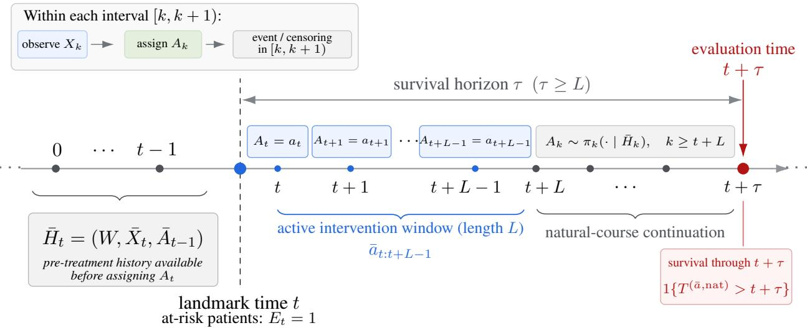

# Doubly Robust Learning of Heterogeneous Survival Treatment Efects under Time-Varying Treatments

Tom\`as Garriga1,2,3,∗, Munib Mesinovic4, Luke De Bretton-Gordon4,

Gerard Sanz1, Axel Brando2, Tingting Zhu4

1Novartis

2Barcelona Supercomputing Center

3Universitat Polit\`ecnica de Catalunya

4University of Oxford

∗Corresponding author: tomas.garriga dicuzzo@novartis.com

## Abstract

Estimating heterogeneous survival treatment efects (HSTEs) from time-to-event data under time-varying treatments is important in fields such as medicine (e.g., to decide which sequence of treatments is better in terms of survival probability). However, this task is challenging because treatment decisions, patient characteristics, and censoring probability often evolve together, requiring sequential adjustment for both treatments and censoring. Existing survival learners mostly consider a single baseline treatment assignment, while longitudinal treatment-efect learners typically assume uncensored outcomes. In this paper, we introduce a novel doubly robust learner for heterogeneous survival treatment efects under time-varying treatments and history-dependent censoring. Our framework separates the intervention window from the survival horizon, with treatment prescribed for a finite period, after which care follows its natural course. We further establish the favorable theoretical properties of Neyman-orthogonality, rate double robustness and quasi-oracle eficiency. The framework accommodates flexible machine learning models for nuisance estimation and treatment-efect regression. We evaluate our learners through several numerical experiments, demonstrating their efectiveness.

## 1 INTRODUCTION

In medicine, personalized treatment decisions rarely occur only once in time. In many clinical settings (e.g.,

Meneghini et al., 2007; Press et al., 2016), treatments are administered repeatedly over time, while the outcome of interest is a time-to-event endpoint such as death (Huang et al., 2014), relapse (Punt et al., 2007), or disease progression (Walia et al., 2023). Estimating how alternative treatment sequences afect survival for a patient with a particular observed history is therefore central to individualized decision-making. In this paper, we aim to estimate heterogeneous survival treatment efects (HSTEs) under time-varying treatments and history-dependent censoring.

This task poses several fundamental challenges. First, treatment decisions may depend on time-varying patient characteristics that are themselves afected by previous treatments. This produces time-varying confounding and invalidates standard adjustment strategies that condition only on baseline information (Robins, 1986; Robins et al., 2000; Hern´an and Robins, 2020), requiring sequential adjustment strategies in stead. Second, survival outcomes are subject to rightcensoring. In a time-varying setting, the probability of remaining under observation may depend on the evolving patient history, including treatment-afected prognostic variables. Consequently, censoring may be informative given the history available at the initial treatment decision, even when it is conditionally inde pendent of the potential event time given the evolving history. This makes it necessary to adjust for censoring sequentially as well, making the problem more challenging than standard causal survival settings with a single baseline treatment (e.g., Klein and Moeschberger, 2003; Frauen et al., 2025b). Finally, the clinically relevant intervention and outcome windows need not coincide: a protocol may prescribe treatment for a finite period, while its efect on survival is eval uated at a later evaluation time after subsequent care has returned to its natural course.

  
Figure 1: Longitudinal intervention and survival estimand. At landmark t, treatment is prescribed according to $\bar { a } _ { t : t + L - 1 }$ for L decision times. Treatment subsequently follows its natural assignment mechanism, while survival is evaluated at $t + \tau ,$ where $\tau \geq L .$

Most existing methods for heterogeneous treatment effects estimation capture only parts of these challenges. Causal survival learners typically handle a single baseline treatment (e.g., Curth et al., 2021; Cui et al., 2023; Frauen et al., 2025b), where censoring is assumed conditionally independent of the event time given a fixed baseline information set and can therefore be handled without sequential censoring adjustment. In our timevarying setting, in contrast, censoring may depend on evolving, treatment-afected histories, requiring adjustment throughout follow-up. On the other hand, longitudinal causal learners handle time-varying treatments but generally assume fully observed outcomes (Lim et al., 2018; Li et al., 2021; Melnychuk et al., 2022; Frauen et al., 2025a), so they do not handle censoring. A small literature comes closer to HSTE estimation under time-varying treatments, with Abraich (2025) being our closest work. However, this work remains tied to a particular model architecture, relies on a single nuisance component and does not provide favorable learning guarantees such as double robustness.

In this paper, we develop a model-agnostic framework for learning HSTEs under time-varying treatments and history-dependent censoring. At a landmark time t, we compare survival under alternative treatment sequences imposed for L decision times, followed by natural-course treatment, with the evaluation time t+τ potentially later (see Fig. 1). This separation allows us to study finite, clinically actionable interventions. We derive complementary identification strategies based on g-computation and inverse-probability weighting.

Building on these representations, we introduce a novel learner that has several favorable learning properties: double robustness (Kang and Schafer, 2007), which allows consistency under misspecification of one of two complementary nuisance components; Neymanorthogonality (Foster and Syrgkanis, 2023), which removes first-order sensitivity to nuisance-estimation error; and quasi-oracle eficiency (Nie and Wager, 2021), whereby under suitable nuisance-rate conditions the learner matches the convergence rate of its oracle counterpart. Thus, the learner combines longitudinal continuation regressions with treatment and censoring mechanisms in an orthogonal pseudo-outcome, and remains consistent if either the continuation regressions are correctly specified or both probability mechanisms are correctly specified. Its construction permits flexible machine-learning models for nuisance estimation and the final efect regression.

Our contributions are threefold:1 (1) we formulate and identify heterogeneous survival treatment efects for finite-duration longitudinal interventions followed by natural-course treatment under history-dependent censoring, and derive several baseline learners based on complementary adjustment strategies. (2) we introduce a novel doubly robust and Neyman-orthogonal learner for HSTE estimation under time-varying treatments and censoring. (3) we establish its theoretical properties, including (rate) double robustness, Neyman-orthogonality and quasi-oracle eficiency, and validate the proposed learner through synthetic, semisynthetic, and real-world experiments.

## 2 RELATED WORK2

HSTE estimation with static treatments. Several approaches have been proposed to estimate HSTEs under a single treatment assignment using baseline covariates. For example, Curth et al. (2021) learn treatment-specific hazard functions through representation balancing, while Cui et al. (2023) use adaptive forest neighborhoods. More recently, Frauen et al. (2025b), Xu et al. (2024), and Morzywolek et al. (2023) develop model-agnostic, doubly robust and Neymanorthogonal survival learners. However, the previous causal methods are limited to a single treatment assignment and assume independent censoring conditional on baseline covariates. In contrast, our setting considers time-varying treatments and allows censoring to depend on the evolving patient history, requiring only sequential independent censoring. This makes the previous methods unsuitable for our task.

HSTE estimation under time-varying treatments. In recent years, several approaches have been proposed to estimate heterogeneous treatment efects under time-varying treatments (e.g., Melnychuk et al., 2022; Li et al., 2021; Frauen et al., 2025a; Garriga et al., 2026a). However, these methods do not $a c \mathrm { - }$ count for censoring and thus are not suitable for HSTE estimation. A limited literature lies at the intersection of heterogeneous efect estimation, survival outcomes, and time-varying treatments. Zhu and Gallego (2022) estimate conditional survival efects from longitudinal data using recurrent neural networks. However, they explicitly assume that future covariates are independent of previous treatments, thereby excluding treatment–confounder feedback. Jun et al. (2023) study heterogeneous survival efects across sequential antibiotic decisions using causal survival forests. However, they focus on an application-specific problem rather than developing a general learner for HSTE estimation under time-varying treatments. Closest to our setting, Abraich (2025) directly considers counterfactual survival under time-varying treatment sequences in the presence of treatment–confounder feedback, and targets conditional survival contrasts between alternative treatment sequences. Their approach relies on sequential representation balancing and a discriminative survival model. However, it lacks the favorable properties of double robustness and Neyman-orthogonality, and is therefore first-order sensitive to nuisance misspecification.

Research Gap. To the best of our knowledge, an HSTE learner that has the favorable properties of double robustness and Neyman-orthogonality while properly handling time-varying confounding and historydependent censoring is missing.

## 3 PROBLEM SETTING

Notation. Capital letters denote random variables and lowercase letters their realizations. We write P( ) for probabilities and $\mathbb { E } [ \cdot ]$ for expectations. We use ${ \widehat { \mathbb { E } } } [ Z \mid X = x ]$ to denote a fitted conditional-mean regression of $Z$ on $X ,$ , not an empirical average. Estimated quantities carry a hat, as in ${ \widehat { f } } .$ Time is discrete and indexed by $k \in  { \mathbb { N } } _ { 0 }$ . For a process $U ,$ we write $\bar { U } _ { k } : = ( U _ { 0 } , \ldots , U _ { k } )$ for its trajectory up to k and $\bar { U } _ { r : s } : = ( U _ { r } , \ldots , U _ { s } )$ for a contiguous segment. Throughout, W denotes static baseline covariates, $X _ { k }$ time-varying covariates, $A _ { k } \in \mathcal A$ the treatment assigned at decision time $k ,$ and $T , C \in \{ 1 , 2 , . . . \}$ the event and censoring times, respectively. We denote by $\bar { H } _ { k } : = \left( W , \bar { X } _ { k } , \bar { A } _ { k - 1 } \right)$ the pre-treatment history, i.e. all information available immediately before assigning $A _ { k }$ , and by $E _ { k } : = \mathbb { 1 } \{ T > k , C > k \}$ the at-risk indicator. Potential quantities under a finite treatment sequence ¯a followed by natural-course treatment are written with a superscript, as in $T ^ { ( \bar { a } , \mathrm { n a t } ) }$

Setup. We consider a discrete-time longitudinal setting with i.i.d. patient trajectories and no common maximum follow-up length. Within each interval, we assume a strict temporal ordering: at the beginning of interval k the covariates $X _ { k }$ of patients at risk are recorded, treatment $A _ { k }$ is assigned, and the patient is then monitored for the event or for censoring during $[ k , k + 1 )$ . Active treatment $A _ { k }$ is thus observed only for patients with $E _ { k } = 1$ . A patient censored exactly at time c still contributes the terminal covariates $X _ { c } ,$ and hence the successor history $\bar { H } _ { c } .$ , but neither receives $A _ { c }$ nor contributes any later variable; conversely, an event preempts the next covariate measurement. Writing $\tilde { T } : = \mathrm { m i n } \{ T , C \}$ for the terminal follow-up time and $\Delta : = \mathbb { 1 } \{ T \leq C \}$ for the event indicator, the observed data for patient i are $O _ { i } \ =$ $\left( W _ { i } , \left\{ X _ { i k } \right\} _ { k = 0 } ^ { \widetilde T _ { i } - \Delta _ { i } } , \left\{ A _ { i k } \right\} _ { k = 0 } ^ { \widetilde T _ { i } - 1 } , \widetilde T _ { i } , \Delta _ { i } \right) , i = 1 , \ldots , n$

Finite-duration interventions with naturalcourse continuation. Acute clinical protocols prescribe treatment only for a limited period. We therefore fix a landmark time t, an active intervention length $L \geq 1$ , and a survival horizon $\tau \geq L$ , and restrict attention to patients with $E _ { t } = 1$ . Within the follow-up window, $\delta = 0 , \ldots , \tau - 1$ denotes the relative time ofset, corresponding to absolute time $t + \delta .$ The final prescribed decision occurs at $t + L - 1$ , and the evaluation time is $t + \tau$ . A deterministic sequence ${ \bar { a } } _ { t : t + L - 1 } : = ( a _ { t } , \ldots , a _ { t + L - 1 } ) \in \mathcal { A } ^ { L }$ is applied during the L intervals $[ t , t + 1 ) , \ldots , [ t + L - 1 , t + L )$ . Afterwards no further treatment is imposed and care evolves according to the natural assignment mechanism observed in the data: $\pi _ { k } ( a \mid \bar { h } _ { k } ) : = \mathbb { P } ( A _ { k } = a \mid \bar { H } _ { k } =$ $\bar { h } _ { k } , E _ { k } = 1 ) , k \in \mathbb { N } _ { 0 }$ . We write $T ^ { ( \bar { a } _ { t : t + L - 1 } , \mathrm { n a t } ) }$ for the potential event time under this regime. Fig. 1 shows our problem setting.

Heterogeneous survival target. We target survival at a prespecified survival horizon. This choice corresponds directly to clinical endpoints such as 10- day survival. Our objective is therefore a horizonspecific counterfactual survival efect. Suppressing the natural-course continuation from the superscript, our target is the conditional survival function

$$
S _ { t , \tau } ^ { \bar { a } } ( \bar { h } _ { t } ) : = \mathbb { P } \Big ( T ^ { ( \bar { a } _ { t : t + L - 1 } , \mathrm { n a t } ) } > t + \tau \ | \ \bar { H } _ { t } = \bar { h } _ { t } , E _ { t } = 1 \Big )\tag{1}
$$

that is, the probability that a patient at risk at the landmark with history $\bar { h } _ { t }$ survives through $t + \tau$ when treated according to $\bar { a } _ { t : t + L - 1 }$ and then following the natural course. For $\tau = L$ the evaluation time coincides with the end of the intervention window, whereas $\tau > L$ additionally captures its downstream consequences. For two candidate sequences $\bar { a } _ { t : t + L - 1 }$ and $\bar { b } _ { t : t + L - 1 }$ , the heterogeneous survival treatment efect is

$$
\theta _ { t , \tau } ^ { \bar { a } , \bar { b } } ( \bar { h } _ { t } ) : = S _ { t , \tau } ^ { \bar { a } } ( \bar { h } _ { t } ) - S _ { t , \tau } ^ { \bar { b } } ( \bar { h } _ { t } ) .\tag{2}
$$

Throughout the methodological development, $t , \ L ,$ and τ are fixed, and we therefore write $S ^ { \bar { a } }$ and $\theta ^ { \bar { a } , \bar { b } }$ when no ambiguity arises.

Identification. For the treatment process, we assume the standard identification conditions for longitudinal interventions: (A1) Consistency, if the observed treatment path over the active intervention window agrees with $\bar { a } _ { t : t + L - 1 }$ , then the corresponding potential event time equals the observed event time; (A2) Sequential treatment exchangeability, $A _ { t + \delta }$ $\dot { T } ^ { ( \bar { a } _ { t : t + L - 1 } , \mathrm { { n a t } } ) }$ $\bar { H } _ { t + \delta } , E _ { t + \delta } ~ = ~ 1$ , for $\delta \ = \ 0 , \ldots , L - 1 ;$ and (A3) Treatment positivity, $\pi _ { t + \delta } { \left( a _ { t + \delta } \mid \bar { H } _ { t + \delta } \right) } > 0$ almost surely on histories compatible with the intervention, for $\delta = 0 , \ldots , L - 1$ (Robins, 1986; Robins et al., 2000; Melnychuk et al., 2022; Hern´an and Robins, 2020).

Our setting additionally requires assumptions on the censoring process. Unlike static treatment survival settings where independent censoring is assumed conditional on a fixed baseline information set, we allow censoring to depend on the evolving observed history, including treatment-afected covariates. Works like Robins et al. (2000); Hern´an and Robins (2020); Keogh et al. (2023) introduce similar settings. Specifically, we assume $( A \ 4 )$ Sequential independent censoring: for $\delta = 0 , \dots , \tau - 2 , \mathbb { 1 } \{ C > t + \delta + 1 \}$ T(¯at:t+L−1,nat) $\bar { H } _ { t + \delta + 1 } , T > t + \delta + 1 , C > t + \delta$ Under our observation convention, this means that, among patients who survive through $t + \delta + 1$ and whose successor history $\bar { H } _ { t + \delta + 1 }$ is observed, remaining under follow-up carries no additional information about the potential event time once the up-to-date history is conditioned upon. Censoring may therefore be informative given the landmark history $\bar { H } _ { t }$ , while remaining conditionally independent of the potential event time given the evolving history. Finally, (A5) Censoring positivity requires $\mathbb { P } ( C > t + \delta + 1 \mid \bar { H } _ { t + \delta + 1 } , T > t + \delta + 1 , C >$ $t + \delta ) > 0$ almost surely on the relevant histories, for $\delta = 0 , \ldots , \tau - 2$ . Treatment exchangeability and positivity are required only over the intervention window $t , \dots , t + L - 1$ , whereas sequential independent censoring and censoring positivity must hold throughout the follow-up needed to determine survival at t + τ.

Under the stated assumptions, our estimands $S _ { t , \tau } ^ { \bar { a } } ( \bar { h } _ { t } )$ and $\theta _ { t , \tau } ^ { \bar { a } , \bar { b } } ( \bar { h } _ { t } )$ are identified from the observed data. We derive the corresponding identification representations in Sec. 4.

The challenges of our setting. Our setting combines two specific challenges: time-varying treatment– confounder feedback and censoring that is itself timevarying and history-dependent.

Time-varying confounding. At decision time $t + \delta .$ , treatment may depend on the evolving history $\bar { H } _ { t + \delta }$ , which contains prognostic covariates that can themselves be afected by earlier treatments. These future covariates are unavailable at the landmark, so adjustment for $\bar { H } _ { t }$ alone cannot remove confounding of subsequent treatment decisions. Conversely, conditioning on their realized values would condition on post-treatment trajectories rather than marginalize over the trajectories induced by the intervention. Identification therefore requires sequential adjustment over the active intervention window $t , \dots , t + L - 1$ , for example through g-computation or treatment weighting (Hess et al., 2026a; Lim et al., 2018; Frauen et al., 2025a).

History-dependent censoring. In our setting with time-varying treatments, censoring poses a qualitatively diferent challenge from that in standard causal survival learning with a single baseline treatment. There, censoring may occur throughout followup, but independent censoring is typically assumed conditional on a fixed information set, such as baseline covariates and the baseline treatment, $\mathrm { e . g . } , T \perp$ $\perp C \mid X , A$ (Frauen et al., 2025b). In our longitudi nal setting, by contrast, the probability of remaining observed at time $t + \delta$ may depend on the evolving history $\bar { H } _ { t + \delta + 1 }$ , including prognostic covariates afected by earlier treatments. Hence censoring may be informative conditional on the landmark history $\bar { H } _ { t }$ , even when it is conditionally independent of the potential event time given the up-to-date history at each censoring decision (Keogh et al., 2023; Robins et al., 2000). As a result, censoring cannot be adjusted for using a single baseline censoring model. Instead, observation through $t + \tau$ is the result of a sequence of historydependent selection decisions, requiring stage-specific censoring-continuation probabilities over the evolving risk sets. In particular,

$$
\begin{array} { r l } & { S ^ { \bar { a } } ( \bar { h } _ { t } ) \neq \mathbb { P } \Bigl ( T > t + \tau \mid \bar { H } _ { t } = \bar { h } _ { t } , E _ { t } = 1 , } \\ & { \qquad \bar { A } _ { t : t + L - 1 } = \bar { a } _ { t : t + L - 1 } , C \geq t + \tau \Bigr ) . } \end{array}\tag{3}
$$

Moreover, because the histories driving censoring may themselves be afected by treatment, the censoring and treatment-assignment processes are coupled. Treatment adjustment is required only over the intervention window $t , \dots , t + L - 1$ , whereas sequential censoring adjustment must continue until survival at $t + \tau$ can be determined.

## 4 IDENTIFICATION STRATEGIES

Following the potential outcomes framework (Hern´an and Robins, 2020), we now derive two complementary identification strategies for HSTEs under timevarying treatments, history-dependent censoring and finite-duration interventions, based on g-computation and inverse-probability weighting. These strategies yield baseline HSTE learners and form the building blocks of our doubly robust learner in Sec. 5.

## 4.1 Continuation-regression representation

For a fixed intervention sequence ¯a, the recursion carries information from the evaluation time back to the landmark. For $\delta = 0 , \dots , \tau - 1$ , let $Y _ { t + \delta + 1 } : = \mathbb { 1 } \{ T >$ $t + \delta + 1 \}$ be the one-step survival indicator, and set $m _ { t + \tau } \equiv 1$ as the terminal boundary condition. In full horizon formulas, we use $m _ { t + \delta } ^ { \bar { a } } : = m _ { t + \delta }$ for $\delta \geq L ,$ including the boundary $m _ { t + L } ^ { \bar { a } } : = m _ { t + L }$ . At time $t + \delta$ the action-value function combines survival through the next interval with the continuation survival thereafter:

$$
\begin{array} { r l } & { Q _ { t + \delta } ^ { \bar { a } } ( \bar { h } _ { t + \delta } , a ) : = \mathbb { E } \big [ Y _ { t + \delta + 1 } m _ { t + \delta + 1 } ^ { \bar { a } } ( \bar { H } _ { t + \delta + 1 } ) \big | } \\ & { \qquad \bar { H } _ { t + \delta } = \bar { h } _ { t + \delta } , A _ { t + \delta } = a , E _ { t + \delta } = 1 \big ] , } \end{array}\tag{4}
$$

When an event occurs during $[ t + \delta , t + \delta + 1 ) , Y _ { t + \delta + 1 } =$ 0, so the product vanishes and the unobserved successor history is irrelevant. Thus $Q _ { t + \delta } ^ { \bar { a } }$ is the probability of surviving through the evaluation time given the current history, the current treatment, and the continuation induced by $\bar { a } _ { t : t + L - 1 }$

After the intervention ends, the successor continuation and treatment mechanism are common across regimes. Thus, at a given history and action, $Q _ { t + \delta } ^ { \bar { a } } = Q _ { t + \delta } ^ { \bar { b } } = :$ $Q _ { t + \delta }$ for $\delta = L , \ldots , \tau - 1$ . Averaging this action value over natural-course treatment gives the shared contin uation, for $\delta = L , \dots , \tau - 1$ :

$$
\begin{array} { r } { m _ { t + \delta } ( \bar { h } _ { t + \delta } ) : = \mathbb { E } \big [ Q _ { t + \delta } ( \bar { h } _ { t + \delta } , A _ { t + \delta } ) \big ) \qquad } \\ { \mid \bar { H } _ { t + \delta } = \bar { h } _ { t + \delta } , E _ { t + \delta } = 1 \big ] . } \end{array}\tag{5}
$$

During the active intervention, for $\delta = 0 , \ldots , L - 1$ , we instead set

$$
m _ { t + \delta } ^ { \bar { a } } ( \bar { h } _ { t + \delta } ) : = Q _ { t + \delta } ^ { \bar { a } } ( \bar { h } _ { t + \delta } , a _ { t + \delta } ) .\tag{6}
$$

The common tail $m _ { t + \tau }  \cdot \cdot \cdot  m _ { t + L }$ is followed by regime-specific updates through $m _ { t + L - 1 } ^ { \bar { a } }  \cdot \cdot \cdot  m _ { t } ^ { \bar { a } }$ We call $\{ m _ { t + \delta } ^ { \bar { a } } \} _ { \delta = 0 } ^ { L - 1 }$ and $\{ m _ { t + \delta } \} _ { \delta = L } ^ { \tau - 1 }$ the continuation nuisances; the action values $Q _ { t + \delta } ^ { \bar { a } }$ construct them. This approach adapts iterative g-computation (Hern´an and Robins, 2020; Hess et al., 2026a) to our setting, and the following result proves identifiability.

Proposition 1. Let $\{ Q _ { t + \delta } ^ { \bar { a } } \} _ { \delta = 0 } ^ { \tau - 1 } , \{ m _ { t + \delta } ^ { \bar { a } } \} _ { \delta = 0 } ^ { L - 1 }$ , and $\{ m _ { t + \delta } \} _ { \delta = L } ^ { \tau }$ be defined by equations $( 4 ) \ - ( 6 )$ with $m _ { t + \tau } \equiv 1$ . Then, under $( A 1 ) { - } ( A 5 )$ , for every landmark history $\bar { h } _ { t }$ with $E _ { t } = 1$

$$
m _ { t } ^ { \bar { a } } ( \bar { h } _ { t } ) = S ^ { \bar { a } } ( \bar { h } _ { t } ) .\tag{7}
$$

Proof in App. C.

In App. B we describe a practical fitting procedure.

## 4.2 Weighting representation

Inverse-probability weighting provides a complementary identification strategy by reweighting trajectories to account for both sequential treatment assignment and censoring (Robins et al., 2000; Frauen et al., 2025a). Treatment adjustment covers only the active intervention window $t , \dots , t + L - 1$ , while censoring adjustment continues through the follow-up needed to determine survival at $t + \tau$ . For $\delta = 0 , \ldots , L - 1$ , define the one-step inverse-treatment factor

$$
r _ { t + \delta } ^ { A , \bar { a } } : = \frac { \mathbb { 1 } \{ A _ { t + \delta } = a _ { t + \delta } \} } { \pi _ { t + \delta } ( a _ { t + \delta } \mid \bar { H } _ { t + \delta } ) } .\tag{8}
$$

Its cumulative factor, for $\delta = 0 , \dots , \tau - 1$ , is

$$
R _ { t : t + \delta } ^ { A , \bar { a } } : = \prod _ { s = 0 } ^ { \operatorname* { m i n } \{ \delta , L - 1 \} } r _ { t + s } ^ { A , \bar { a } } .\tag{9}
$$

For $\delta = 1 , \dots , \tau - 1$ , retain the censoring continuation probability under our observation convention:

$$
\begin{array} { r } { G _ { t + \delta } ( \bar { h } ) : = \mathbb { P } \big ( C > t + \delta \mid \bar { H } _ { t + \delta } = \bar { h } , } \\ { T > t + \delta , C > t + \delta - 1 \big ) . } \end{array}\tag{10}
$$

Define the one-step inverse-censoring factor and its cumulative product by

$$
\begin{array} { r l r } { \displaystyle r _ { t + \delta } ^ { C } : = G _ { t + \delta } ( { \bar { H } } _ { t + \delta } ) ^ { - 1 } , } & { \delta = 1 , \dots , \tau - 1 , } \\ { \displaystyle R _ { t : t + \delta } ^ { C } : = \prod _ { s = 1 } ^ { \delta } r _ { t + s } ^ { C } , } & { \delta = 0 , \dots , \tau - 1 , } \end{array}\tag{11}
$$

with $R _ { t : t } ^ { C } = 1$ . The fitted counterparts $\widehat { r } _ { t + \delta } ^ { A , \bar { a } }$ and $\widehat { R } _ { t : t + i } ^ { A , \bar { a } }$ δ replace π by $\widehat { \pi } ; \widehat { r } _ { t + \delta } ^ { C }$ and $\widehat { R } _ { t : t + \delta } ^ { C }$ replace G by $\widehat { G }$

For $\delta = 0 , \dots , \tau - 1$ , let $Y _ { t + \delta + 1 } ^ { \mathrm { o b s } } : = \mathbb { 1 } \{ \widetilde { T } > t + \delta + 1 \} +$ $\mathbb { 1 } \{ \widetilde { T } = t + \delta + 1 , \Delta = 0 \}$ . The resulting terminal IPW pseudo-outcome is

$$
\Phi _ { \mathrm { I P W } } ^ { \bar { a } } : = Y _ { t + \tau } ^ { \mathrm { o b s } } \mathbb { 1 } \{ E _ { t + \tau - 1 } = 1 \} R _ { t : t + \tau - 1 } ^ { A , \bar { a } } R _ { t : t + \tau - 1 } ^ { C } .\tag{12}
$$

Under $( \mathrm { A } 1 ) - ( \mathrm { A } 5 ) , \mathbb { E } [ \Phi _ { \mathrm { I P W } } ^ { \bar { a } } | \bar { H } _ { t } = \bar { h } _ { t } , E _ { t } = 1 ] =$ $S ^ { \bar { a } } ( \bar { h } _ { t } )$ . Boundary conventions and nuisance estimation details are given in App. D.

## 4.3 Na¨ıve HSTE learners

The previous two representations give three HSTE learners, which we call na¨ıve because each relies on only one of the two complementary nuisance blocks and is therefore not doubly robust.

PI learner. The plug-in (PI) learner directly uses the continuation nuisances defined in Sec. 4.1 to estimate HSTEs:

$$
\begin{array} { r } { \widetilde { \theta } _ { \mathrm { P I } } ^ { \bar { a } , \bar { b } } ( \bar { h } _ { t } ) : = \widehat { m } _ { t } ^ { \bar { a } } ( \bar { h } _ { t } ) - \widehat { m } _ { t } ^ { \bar { b } } ( \bar { h } _ { t } ) . } \end{array}\tag{13}
$$

RA learner. The regression-adjustment (RA) learner is a second-stage learner. It first constructs an out-of-fold pseudo-outcome from the plug-in contrast:

$$
\widehat { \Phi } _ { \mathrm { R A } } ^ { \bar { a } , \bar { b } } : = \widehat { m } _ { t } ^ { \bar { a } } ( \bar { H } _ { t } ) - \widehat { m } _ { t } ^ { \bar { b } } ( \bar { H } _ { t } ) .\tag{14}
$$

Then, using sample splitting, it fits the conditional mean of this pseudo-outcome in a second-stage class ${ \mathcal { F } } \colon$ $\widehat { \theta } _ { \mathrm { R A } } ^ { \bar { a } , \bar { b } } ( \bar { h } _ { t } ) : = \widehat { \mathbb { E } } \Big [ \widehat { \Phi } _ { \mathrm { R A } } ^ { \bar { a } , \bar { b } } \ | \ \bar { H } _ { t } = \bar { h } _ { t } , E _ { t } = 1 \Big ]$ . This secondstage regression can be beneficial when the HSTE function is simpler to learn than the two regime-specific conditional survival functions separately.

IPW learner. The inverse-probability-weighting (IPW) learner uses the weighting representation defined in Sec. 4.2 to adjust for treatment confounding and history-dependent censoring. Using the separate estimated cumulative factors $\widehat { R } _ { t : t + \delta } ^ { \check { A } , \bar { a } }$ and $\widehat { R } _ { t : t + \delta } ^ { C } ,$ we define

$$
\begin{array} { r l } & { \widehat { \Phi } _ { \mathrm { I P W } } ^ { \bar { a } } : = Y _ { t + \tau } ^ { \mathrm { o b s } } \mathbb { 1 } \{ E _ { t + \tau - 1 } = 1 \} \widehat { R } _ { t : t + \tau - 1 } ^ { A , \bar { a } } \widehat { R } _ { t : t + \tau - 1 } ^ { C } , } \\ & { \widehat { \Phi } _ { \mathrm { I P W } } ^ { \bar { a } , \bar { b } } : = \widehat { \Phi } _ { \mathrm { I P W } } ^ { \bar { a } } - \widehat { \Phi } _ { \mathrm { I P W } } ^ { \bar { b } } . } \end{array}\tag{15}
$$

We then regress this pseudo-outcome on the landmark history: $\widehat { \theta } _ { \mathrm { I P W } } ^ { \bar { a } , \bar { b } } ( \bar { h } _ { t } ) : = \widehat { \mathbb { E } } \left| \widehat { \Phi } _ { \mathrm { I P W } } ^ { \bar { a } , \bar { b } } \ | \ \bar { H } _ { t } = \bar { h } _ { t } , E _ { t } = 1 \right|$

Limitations of na¨ıve learners. PI and RA rely on accurate continuation nuisances, whereas IPW relies on accurate treatment and censoring mechanisms. Hence, each can be biased when its corresponding nuisance block is misspecified, and none is Neymanorthogonal, so nuisance-estimation errors may afect the final HSTE estimate at first order. This motivates combining both representations in a doubly robust, orthogonal pseudo-outcome, as developed next.

## 5 DOUBLY ROBUST LEARNING OF HSTEs

DR learner. We now introduce a doubly robust (DR) and Neyman-orthogonal learner for HSTE estimation under time-varying treatments. Using the fitted continuation regressions from Sec. 4.1 and the estimated treatment and censoring factors from Sec. 4.2, the DR pseudo-outcome is:

$$
\begin{array} { c } { { \displaystyle { \widehat { \Phi } } _ { \mathrm { D R } } ^ { \bar { a } } : = \widehat { m } _ { t } ^ { \bar { a } } ( { \bar { H } } _ { t } ) + \displaystyle { \sum _ { \delta = 0 } ^ { \tau - 1 } \mathbb { 1 } \{ E _ { t + \delta } = 1 \} } } } \\ { { { \widehat { R } } _ { t : t + \delta } ^ { A , \bar { a } } \widehat { R } _ { t : t + \delta } ^ { C } \Big [ Y _ { t + \delta + 1 } ^ { \mathrm { o b s } } \widehat { m } _ { t + \delta + 1 } ^ { \bar { a } } ( { \bar { H } } _ { t + \delta + 1 } ) } } \\ { { - \widehat { m } _ { t + \delta } ^ { \bar { a } } ( { \bar { H } } _ { t + \delta } ) \Big ] . } } \end{array}\tag{16}
$$

For two regimes, we define $\widehat { \Phi } _ { \mathrm { D R } } ^ { \bar { a } , \bar { b } } : = \widehat { \Phi } _ { \mathrm { D R } } ^ { \bar { a } } - \widehat { \Phi } _ { \mathrm { D R } } ^ { \bar { b } }$ . Then, the final HSTE learner is:

$$
\begin{array} { r } { \widetilde { \theta } _ { \mathrm { D R } } ^ { \bar { a } , \bar { b } } ( \bar { h } _ { t } ) : = \widehat { \mathbb { E } } \left[ \widehat { \Phi } _ { \mathrm { D R } } ^ { \bar { a } , \bar { b } } \ | \ \bar { H } _ { t } = \bar { h } _ { t } , E _ { t } = 1 \right] . } \end{array}\tag{17}
$$

Our DR learner estimates our target estimand in $\operatorname { E q } .$ . 2 and comes with several favorable theoretical properties that we show in the next subsection.

## 5.1 Theoretical properties

Next, we establish two fundamental properties of our DR learner: double robustness, which implies that the DR pseudo-outcome remains conditionally unbiased if either the continuation nuisances are correctly specified or both the treatment and censoring mechanisms are correctly specified, and Neyman-orthogonality, i.e., first-order insensitivity to nuisance estimation error.

We write $\Phi _ { \mathrm { D R } } ^ { \bar { a } , \bar { b } } ( { \cal O } ; \eta ) : = \Phi _ { \mathrm { D R } } ^ { \bar { a } } ( { \cal O } ; \eta ^ { \bar { a } } ) - \Phi _ { \mathrm { D R } } ^ { \bar { b } } ( { \cal O } ; \eta ^ { \bar { b } } )$ , with $\eta _ { 0 }$ the true nuisance collection and $\widetilde { \eta }$ a candidate collection (App. E.1–E.4).

Theorem 1 (Double robustness and Neyman-orthogonality). Under the conditions of App. E.1, at a fixed landmark history $\bar { h } _ { t }$

$$
\mathbb { E } \Big [ \Phi _ { \mathrm { D R } } ^ { \bar { a } , \bar { b } } ( { \cal O } ; \widetilde { \eta } ) \bigm | \bar { H } _ { t } = \bar { h } _ { t } , E _ { t } = 1 \Big ] = \theta ^ { \bar { a } , \bar { b } } ( \bar { h } _ { t } )\tag{18}
$$

whenever, for each $\bar { d } \in \{ \bar { a } , \bar { b } \}$ , either its complete continuation-regression sequence is correct or both the treatment and censoring mechanisms are correct over their respective stage ranges. For the conditional moment

$$
\begin{array} { r l } & { \Psi _ { \bar { a } , \bar { b } } ( \eta ; \bar { h } _ { t } ) : = \mathbb { E } \Bigl [ \Phi _ { \mathrm { D R } } ^ { \bar { a } , \bar { b } } ( O ; \eta ) \mid \bar { H } _ { t } = \bar { h } _ { t } , E _ { t } = 1 \Bigr ] } \\ & { \qquad - \theta ^ { \bar { a } , \bar { b } } ( \bar { h } _ { t } ) , } \end{array}\tag{19}
$$

every regular path $\epsilon \mapsto \eta _ { \epsilon }$ through η0 $f o r$ which differentiation under the conditional expectation is valid satisfies

$$
\left. \frac { \mathrm { d } } { \mathrm { d } \epsilon } \Psi _ { \bar { a } , \bar { b } } ( \eta _ { \epsilon } ; \bar { h } _ { t } ) \right| _ { \epsilon = 0 } = 0 .\tag{20}
$$

Proof in App. E.3.

The contrast is thus conditionally unbiased under these alternatives and locally insensitive to simultaneous nuisance perturbations. We next study how these properties translate into the statistical convergence of the estimated HSTE function. In particular, we show that nuisance-estimation errors enter only through products of errors from complementary nuisance components, yielding rate double robustness and, under suficiently fast nuisance convergence, quasioracle eficiency.

Let ${ \widehat { \theta } } _ { \mathrm { o r } } ^ { { \bar { a } } , { \bar { b } } }$ be the output of the same second-stage regression method as $\widehat { \theta _ { \mathrm { D R } } ^ { a , \bar { b } } } .$ , with the same function class ${ \mathcal { F } } _ { : }$ loss, tuning rule, and sample splits, but supplied with the oracle pseudo-outcome $\Phi _ { \mathrm { D R } } ^ { \bar { a } , \bar { b } } ( O ; \eta _ { 0 } )$ . For a fixed ${ { \bar { h } } _ { t } } ,$ define

$$
\begin{array} { r l } & { \mathcal { R } _ { \bar { h } _ { t } } ( \widehat \theta ) : = \mathbb { E } \bigg [ \Big \{ \widehat \theta ( \bar { h } _ { t } ) - \theta ^ { \bar { a } , \bar { b } } ( \bar { h } _ { t } ) \Big \} ^ { 2 } \bigg ] , } \\ & { e _ { \mathrm { o r } } ^ { \bar { a } , \bar { b } } ( n ) : = \mathcal { R } _ { \bar { h } _ { t } } \big ( \widehat \theta _ { \mathrm { o r } } ^ { \bar { a } , \bar { b } } \big ) . } \end{array}\tag{21}
$$

For each nuisance, let $e _ { \pi , t + \delta } ^ { \bar { d } } ( n ) , e _ { G , t + \delta } ^ { \bar { d } } ( n )$ , and $e _ { m , t + \delta } ^ { \bar { d } } ( n )$ denote the squared conditional $L _ { 4 }$ error scales defined in App. E.4, and set

$$
\begin{array} { l } { { \displaystyle B _ { \eta } ( n ) : = \sum _ { \bar { d } \in \{ \bar { a } , \bar { b } \} } \left\{ \sum _ { \delta = 0 } ^ { L - 1 } e _ { \pi , t + \delta } ^ { \bar { d } } ( n ) e _ { m , t + \delta } ^ { \bar { d } } ( n ) \right. } } \\ { { \displaystyle \left. \qquad + \sum _ { \delta = 1 } ^ { \tau - 1 } e _ { G , t + \delta } ^ { \bar { d } } ( n ) e _ { m , t + \delta } ^ { \bar { d } } ( n ) \right\} } . } \end{array}\tag{22}
$$

Theorem 2 (Rate double robustness and quasi-oracle eficiency). Under the conditions of App. E.4,

$$
\begin{array} { r } { \mathcal { R } _ { \bar { h } _ { t } } \left( \widehat { \theta } _ { \mathrm { D R } } ^ { \bar { a } , \bar { b } } \right) \lesssim e _ { \mathrm { o r } } ^ { \bar { a } , \bar { b } } ( n ) + B _ { \eta } ( n ) . } \end{array}\tag{23}
$$

Proof in App. $E . 4 .$

Remark 1. If $B _ { \eta } ( n ) = O \Big \{ e _ { \mathrm { o r } } ^ { \bar { a } , \bar { b } } ( n ) \Big \}$ , then

$$
\mathcal { R } _ { \bar { h } _ { t } } \left( \widetilde { \theta } _ { \mathrm { D R } } ^ { \bar { a } , \bar { b } } \right) = O \left\{ e _ { \mathrm { o r } } ^ { \bar { a } , \bar { b } } ( n ) \right\} .\tag{24}
$$

Thus nuisance estimation does not worsen the convergence rate relative to the learner that uses the oracle nuisances. The bound also exhibits rate double robustness: continuation-regression errors enter only in product with treatment or censoring errors, so faster convergence of one nuisance block can compensate for slower convergence of its complementary block. The exact remainder is given in App. E.2.

## 6 EVALUATION

In this section, we perform several numerical experiments with the objective of validating the efectiveness of our approach. Following standard practice in causal inference (Bica et al., 2020; Melnychuk et al., 2022), we use synthetic and semi-synthetic datasets because they provide access to ground-truth counterfactuals. Additionally, we use a real-world dataset to demonstrate practical applicability.

Architecture and training. We use a lightweight Transformer, similar to Hess et al. (2026b), for all nuisance and second-stage regressions. At each time step, the longitudinal history together with the baseline covariates is projected into a latent representation, augmented with fixed sinusoidal positional encodings, and processed by a single causally masked Transformer encoder layer followed by a two-layer ReLU prediction head. Continuation and second-stage models use latent width 30, three attention heads, feed-forward width 20, and dropout 0.1, whereas the treatment and censoring models use width 40, four heads, and no dropout. All models are trained with Adam $( 1 0 ^ { - 3 }$ learning rate, batch size 64) for at most 30 epochs, with early stopping on a 15% patient-level validation split. The hyperparameters were inherited from Hess et al. (2026b) and no additional tuning was performed. In $\mathrm { A p p }$ . I we give additional information on computational resources and runtimes.

Baselines. We compare our DR learner against three model-agnostic baselines derived from the complementary identification strategies in Sec. 4: the plug-in (PI) learner, which directly contrasts the estimated regime-specific survival continuations; regression adjustment (RA), which regresses the plug-in contrast on the landmark history; and IPW, which regresses the contrast of treatment- and censoring-weighted survival pseudo-outcomes. We additionally compare against TV-SurvCaus (Abraich, 2025), a recent neural method for individualized survival efects under time-varying treatments, which we adapt to our finite-intervention setting and implement using the same Transformer backbone for a controlled comparison. To our knowledge, this is the only existing method for HSTE estimation under time-varying treatments.

Fully synthetic experiment. We first consider a fully synthetic longitudinal process with treatment– confounder feedback, in which patient severity drives treatment assignment, treatment afects subsequent severity, and censoring depends on post-landmark covariates (App. F). Each repetition contains independent nuisance, second-stage, and test cohorts of 1,800, 1,800, and 1,200 patients, respectively, observed over 32 decision times. Patient-level ground-truth HSTEs are obtained through paired Monte Carlo counterfactual rollouts, allowing direct evaluation of individual efect estimates (App. F).

Table 1: Fully synthetic dataset.
<table><tr><td>Method</td><td> $L { = } 2 , \tau { = } 2$ </td><td> $L { = } 2 , \tau { = } 3$ </td><td> $L { = } 2 , \tau { = } 4$ </td><td> $L { = } 3 , \tau { = } 8$ </td></tr><tr><td>PI</td><td>0.058±0.002</td><td> $0 . 0 5 4 \pm 0 . 0 0 5$ </td><td> $0 . 0 4 7 \pm 0 . 0 1 1$ </td><td> $0 . 0 4 7 \pm 0 . 0 2 0$ </td></tr><tr><td>RA</td><td>0.063±0.009</td><td> $0 . 0 5 5 \pm 0 . 0 0 8$ </td><td> $0 . 0 4 8 \pm 0 . 0 1 1$ </td><td> $0 . 0 5 0 \pm 0 . 0 2 1$ </td></tr><tr><td>IPW</td><td>0.081 ±0.013</td><td>0.086 ±0.029</td><td> $0 . 0 8 4 \pm 0 . 0 2 3$ </td><td> $0 . 2 3 7 \pm 0 . 0 7 3$ </td></tr><tr><td>TV-SurvCaus</td><td>0.058±0.003</td><td> $0 . 0 5 4 \pm 0 . 0 0 3$ </td><td> $0 . 0 4 9 \pm 0 . 0 0 3$ </td><td> $0 . 0 5 1 \pm 0 . 0 0 5$ </td></tr><tr><td>DR</td><td>0.030 ±0.008</td><td>0.037±0.013 0.031 ±0.011 0.043±0.008</td><td></td><td></td></tr><tr><td>DR improvement (%)</td><td>48.3</td><td>31.5</td><td>34.0</td><td>8.5</td></tr></table>

Reported: RMSE of the estimated HSTE; lower is better. Values are mean ± 95% t-interval half-width over 5 repetitions.  
DR improvement is relative to the best competing learner.

Table 2: Semi-synthetic dataset.
<table><tr><td>Method</td><td> $L { = } 2 , \tau { = } 2$ </td><td> $L { = } 2 , \tau { = } 3$ </td><td> $L { = } 2 , \tau { = } 4$ </td><td>L=3, τ=8</td></tr><tr><td>PI</td><td>0.073±0.007</td><td>0.069±0.011</td><td>0.063±0.007</td><td>0.071±0.014</td></tr><tr><td>RA</td><td>0.074±0.012</td><td>0.068 ±0.011</td><td>0.065 ±0.007</td><td>0.071±0.014</td></tr><tr><td>IPW</td><td>0.099±0.007</td><td>0.116 ±0.034</td><td>0.105 ±0.048</td><td>0.327±0.044</td></tr><tr><td>TV-SurvCaus</td><td>0.073±0.001</td><td>0.071 ±0.003</td><td>0.066±0.002</td><td>0.074±0.004</td></tr><tr><td>DR</td><td>0.046±0.008</td><td>0.048±0.008</td><td>0.047±0.006</td><td>0.055±0.011</td></tr><tr><td>DR improvement (%)</td><td>37.0</td><td>29.4</td><td>25.4</td><td>22.5</td></tr></table>

Reported: RMSE of the estimated HSTE; lower is better.  
Values are mean ± 95% t-interval half-width over 5 repetitions.  
DR improvement is relative to the best competing learner.

Results. The DR learner achieves the lowest RMSE in all four settings, reducing error by 9–48% relative to the best competing method (Table 1). Across configurations, DR consistently outperforms PI, RA, IPW, and TV-SurvCaus, showing that the doubly robust construction translates into a clear empirical advantage. In particular, while PI, RA, and TV-SurvCaus attain similar but systematically higher errors, IPW is substantially less accurate. Since DR and RA rely on the same continuation regressions and difer through the weighted orthogonal correction, their performance gap highlights the practical benefit of augmenting regression adjustment with the doubly robust orthogonal correction. Additional diagnostics and checks using true treatment and censoring probabilities are provided in App. F.2.

Semi-synthetic experiment. We next consider a semi-synthetic benchmark based on the first 24 hours of ICU history from 6,000 adult MIMIC-IV patients (Johnson et al., 2023), using heart rate, mean arterial pressure, respiratory rate, age, and sex as the landmark history. Treatment, subsequent covariates, events, and censoring are then simulated, preserving realistic patient histories while retaining known counterfactual efects for evaluation (App. G).

Results. The DR learner achieves the lowest RMSE in all four settings, reducing error by 23–37% relative to the best competing learner (Table 2). PI, RA, and TV-SurvCaus perform similarly but have consistently higher errors, while IPW is less accurate throughout.

Additional experiments further support this interpretation: targeted nuisance misspecification produces the qualitative double-robustness behavior predicted by theory (App. G.1), while stress tests show that DR remains competitive under substantially heavier censoring, sharper treatment assignment, and higher event rates, achieving the lowest RMSE in all seven short-horizon conditions and five of seven long-horizon conditions (App. G.2).

Table 3: Real-world dataset.
<table><tr><td>Method</td><td> $( L = 2 , \tau = 8 )$ </td><td> $( L = 2 , \tau = 1 6 )$ </td></tr><tr><td>PI</td><td> $\mathbf { 0 . 0 5 5 2 \pm 0 . 0 0 1 0 }$ </td><td> $0 . 0 8 4 1 \pm 0 . 0 0 1 4$ </td></tr><tr><td>RA</td><td> $0 . 0 5 9 8 \pm 0 . 0 0 2 5$ </td><td> $0 . 0 8 8 2 \pm 0 . 0 0 2 9$ </td></tr><tr><td>IPW</td><td> $0 . 0 5 8 9 \pm 0 . 0 0 1 3$ </td><td> $0 . 0 8 3 6 \pm 0 . 0 0 3 1$ </td></tr><tr><td>TV-SurvCaus</td><td> $0 . 0 6 3 4 \pm 0 . 0 0 0 6$ </td><td> $0 . 0 9 4 5 \pm 0 . 0 0 2 7$ </td></tr><tr><td>DR</td><td> $\mathbf { 0 . 0 5 5 2 \pm 0 . 0 0 2 0 }$ </td><td>0.0788 ±0.0015</td></tr><tr><td>DR improvement (%)</td><td>0.0</td><td>5.7</td></tr></table>

Reported: Weighted Brier score of predicted survival; lower is better. Values are mean ± 95% t-interval half-width over five random seeds. DR improvement is relative to the best competing learner.

Real-world experiment. Finally, we consider a realworld cohort of MIMIC-IV patients receiving vasopressors in the ICU. Since counterfactual outcomes are unavailable in real data, we evaluate the survival predicted under continuing vasopressors for six more hours against the observed outcomes of patients who followed that sequence, weighting each patient by the inverse of their estimated probability of continuing treatment (Keogh and van Geloven, 2024). We report the weighted Brier score of these survival predictions, with additional cohort and evaluation details in App. H.

Results. DR ties PI for the lowest weighted Brier score at $\tau = 8$ (24 hours) and achieves the lowest score at τ = 16 (48 hours), reducing error by 5.7% relative to the best competing learner (Table 3).

Conclusion. We introduced a novel doubly robust learner for heterogeneous survival treatment efects under time-varying treatments. We established double robustness, Neyman-orthogonality and quasi-oracle efficiency. Across synthetic, semi-synthetic, and realworld experiments, the method showed strong empirical performance, supporting its use for survival-efect estimation under time-varying treatments.

## ACKNOWLEDGMENTS

We sincerely thank Eduard Serrahima de Cambra for helpful discussions related to this work. We acknowledge Novartis for sponsoring Tom\`as Garriga’s industrial PhD. We also thank the Government of Catalonia’s Industrial PhDs Plan for funding part of this research. We acknowledge Horizon Europe Programme under the AI4DEBUNK Project (https://www.ai4debunk.eu), grant agreement num.

101135757. Tingting Zhu was supported by the Royal Academy of Engineering under the Research Fellowship scheme.

## References

Abraich, A. (2025). Tv-survcaus: Dynamic representation balancing for causal survival analysis. arXiv preprint arXiv:2505.01785.

Bai, X., Tsiatis, A. A., and O’Brien, S. M. (2013). Doubly-robust estimators of treatment-specific survival distributions in observational studies with stratified sampling. Biometrics, 69(4):830–839.

Bica, I., Alaa, A. M., Jordon, J., and van der Schaar, M. (2020). Estimating counterfactual treatment outcomes over time through adversarially balanced representations. In International Conference on Learning Representations.

Boyer, C. B., Dahabreh, I. J., and Steingrimsson, J. A. (2025). Estimating and evaluating counterfactual prediction models. Statistics in Medicine, 44(23– 24):e70287.

Cui, Y., Kosorok, M. R., Sverdrup, E., Wager, S., and Zhu, R. (2023). Estimating heterogeneous treatment efects with right-censored data via causal survival forests. Journal of the Royal Statistical Society Series B: Statistical Methodology, 85(2):179–211.

Curth, A., Lee, C., and van der Schaar, M. (2021). SurvITE: Learning heterogeneous treatment efects from time-to-event data. In Advances in Neural Information Processing Systems, volume 34.

Foster, D. J. and Syrgkanis, V. (2023). Orthogonal statistical learning. The Annals of Statistics, 51(3):879–908.

Frauen, D., Hess, K., and Feuerriegel, S. (2025a). Model-agnostic meta-learners for estimating heterogeneous treatment efects over time. In The Thirteenth International Conference on Learning Representations.

Frauen, D., Schr¨oder, M., Hess, K., and Feuerriegel, S. (2025b). Orthogonal survival learners for estimating heterogeneous treatment efects from time-to-event data. In Advances in Neural Information Processing Systems (NeurIPS). arXiv:2505.13072.

Garriga, T., Melnychuk, V., Hess, K., de Cambra, E. S., Brando, A., Sanz, G., and Feuerriegel, S. (2026a). Orthogen: A generative orthogonal learner for time-varying treatments. arXiv preprint arXiv:2610.10210.

Garriga, T., Sanz, G., de Cambra, E. S., and Brando, A. (2026b). CEPAE: Conditional entropy-penalized autoencoders for time series counterfactuals. Transactions on Machine Learning Research.

Hern´an, M. A., Brumback, B., and Robins, J. M. (2000). Marginal structural models to estimate the causal efect of zidovudine on the survival of HIVpositive men. Epidemiology, 11(5):561–570.

Hern´an, M. A. and Robins, J. M. (2020). Causal Inference: What If. Chapman & Hall/CRC, Boca Raton.

Hess, K., Frauen, D., Melnychuk, V., and Feuerriegel, S. (2026a). IGC-net for conditional average potential outcome estimation over time. In The Fourteenth International Conference on Learning Representations.

Hess, K., Frauen, D., van der Schaar, M., and Feuerriegel, S. (2026b). Overlap-weighted orthogonal meta-learner for treatment efect estimation over time. In The Fourteenth International Conference on Learning Representations.

Huang, X., Ning, J., and Wahed, A. S. (2014). Optimization of individualized dynamic treatment regimes for recurrent diseases. Statistics in Medicine, 33(14):2363–2378.

Hubbard, A. E., van der Laan, M. J., and Robins, J. M. (2000). Nonparametric locally eficient estimation of the treatment specific survival distribution with right censored data and covariates in observational studies. In Halloran, M. E. and Berry, D. A., editors, Statistical Models in Epidemiology, the Environment, and Clinical Trials, volume 116 of The IMA Volumes in Mathematics and its Applications, pages 135–177. Springer, New York.

Johnson, A. E., Bulgarelli, L., Shen, L., Gayles, A., Shammout, A., Horng, S., Pollard, T. J., Hao, S., Moody, B., Gow, B., et al. (2023). MIMIC-IV, a freely accessible electronic health record dataset. Scientific Data, 10(1):1.

Jun, I., Cohen, S. A., Ser, S. E., Marini, S., Lucero, R. J., Bian, J., and Prosperi, M. (2023). Optimizing dynamic antibiotic treatment strategies against invasive methicillin-resistant staphylococcus aureus infections using causal survival forests and g-formula on statewide electronic health record data. In The KDD’23 Workshop on Causal Discovery, Prediction and Decision, pages 98–115. PMLR.

Kang, J. D. Y. and Schafer, J. L. (2007). Demystify ing double robustness: A comparison of alternative strategies for estimating a population mean from incomplete data. Statistical Science, 22(4):523–539.

Kennedy, E. H. (2023). Towards optimal doubly robust estimation of heterogeneous causal efects. Electronic Journal of Statistics, 17(2):3008–3049.

Keogh, R. H., Gran, J. M., Seaman, S. R., Davies, G., and Vansteelandt, S. (2023). Causal inference in survival analysis using longitudinal observational

data: Sequential trials and marginal structural mod els. Statistics in Medicine, 42(13):2191–2225.

Keogh, R. H. and van Geloven, N. (2024). Predic tion under interventions: evaluation of counterfactual performance using longitudinal observational data. Epidemiology, 35(3):329–339.

Klein, J. P. and Moeschberger, M. L. (2003). Survival analysis: techniques for censored and truncated data. Springer.

Lee, C., Yoon, J., and van der Schaar, M. (2020). Dynamic-DeepHit: A deep learning approach for dynamic survival analysis with competing risks based on longitudinal data. IEEE Transactions on Biomedical Engineering, 67(1):122–133.

Li, R., Hu, S., Lu, M., Utsumi, Y., Chakraborty, P., Sow, D. M., Madan, P., Li, J., Ghalwash, M., Shahn, Z., et al. (2021). G-net: a recurrent network approach to g-computation for counterfactual prediction under a dynamic treatment regime. In Machine Learning for Health, pages 282–299. PMLR.

Lim, B., Alaa, A. M., and van der Schaar, M. (2018). Forecasting treatment responses over time using recurrent marginal structural networks. In Advances in Neural Information Processing Systems (NeurIPS), volume 31.

Louizos, C., Shalit, U., Mooij, J., Sontag, D., Zemel, R., and Welling, M. (2017). Causal efect inference with deep latent-variable models. In Guyon, I., Luxburg, U. V., Bengio, S., Wallach, H., Fergus, R., Vishwanathan, S., and Garnett, R., editors, Advances in Neural Information Processing Systems, volume 30. Curran Associates, Inc.

Melnychuk, V., Frauen, D., and Feuerriegel, S. (2022). Causal transformer for estimating counterfactual outcomes. In International conference on machine learning, pages 15293–15329. PMLR.

Meneghini, L., Koenen, C., Weng, W., and Selam, J.- L. (2007). The usage of a simplified self-titration dosing guideline (303 algorithm) for insulin detemir in patients with type 2 diabetes: results of the randomized, controlled predictive 303 study. Diabetes, Obesity and Metabolism, 9(6):902–913.

Mesinovic, M., Watkinson, P., and Zhu, T. (2024). DySurv: dynamic deep learning model for survival analysis with conditional variational inference. Journal of the American Medical Informatics Association, 33(1):112–122.

Morzywolek, P., Decruyenaere, J., and Vansteelandt, S. (2023). On a general class of orthogonal learners for the estimation of heterogeneous treatment efects. arXiv preprint arXiv:2303.12687.

Nie, X. and Wager, S. (2021). Quasi-oracle estimation of heterogeneous treatment efects. Biometrika, 108(2):299–319.

Parafita, A. and Vitria, J. (2022). Estimand-agnostic causal query estimation with deep causal graphs. IEEE Access, 10:71370–71386.

Pawlowski, N., Coelho de Castro, D., and Glocker, B. (2020). Deep structural causal models for tractable counterfactual inference. In Larochelle, H., Ranzato, M., Hadsell, R., Balcan, M., and Lin, H., editors, Advances in Neural Information Processing Systems, volume 33, pages 857–869. Curran Associates, Inc.

Petersen, M., Schwab, J., Gruber, S., Blaser, N., Schomaker, M., and van der Laan, M. J. (2014). Targeted maximum likelihood estimation for dynamic and static longitudinal marginal structural working models. Journal of Causal Inference, 2(2):147–185.

Press, O. W., Li, H., Sch¨oder, H., Straus, D. J., Moskowitz, C. H., et al. (2016). Us intergroup trial of response-adapted therapy for stage iii to iv hodgkin lymphoma using early interim fluorodeoxyglucose-positron emission tomography imaging: Southwest oncology group s0816. Journal of Clinical Oncology, 34(17):2020–2027.

Punt, C. J. A., Buyse, M., K¨ohne, C.-H., Hohenberger, P., Labianca, R., Schmoll, H. J., P˚ahlman, L., Sobrero, A., and Douillard, J.-Y. (2007). Endpoints in adjuvant treatment trials: a systematic review of the literature in colon cancer and proposed definitions for future trials. JNCI: Journal of the National Cancer Institute, 99(13):998–1003.

Robins, J. M. (1986). A new approach to causal inference in mortality studies with a sustained exposure period—application to control of the healthy worker survivor efect. Mathematical Modelling, 7(9- 12):1393–1512.

Robins, J. M., Hernan, M. A., and Brumback, B. (2000). Marginal structural models and causal inference in epidemiology. Epidemiology, 11(5):550–560.

Sanchez, P. and Tsaftaris, S. A. (2022). Difusion causal models for counterfactual estimation. In First Conference on Causal Learning and Reasoning.

Taubman, S. L., Robins, J. M., Mittleman, M. A., and Hern´an, M. A. (2009). Intervening on risk factors for coronary heart disease: an application of the parametric g-formula. International journal of epidemiology, 38(6):1599–1611.

van Geloven, N., Swanson, S. A., Ramspek, C. L., Luijken, K., van Diepen, M., Morris, T. P., Groenwold, R. H. H., van Houwelingen, H. C., Putter, H., and le Cessie, S. (2020). Prediction meets causal

inference: the role of treatment in clinical prediction models. European Journal of Epidemiology, 35(7):619–630.

Walia, A., Tuia, J., and Prasad, V. (2023). Progression-free survival, disease-free survival and other composite end points in oncology: improved reporting is needed. Nature Reviews Clinical Oncology, 20:885–895.

Westling, T., Luedtke, A., Gilbert, P. B., and Carone, M. (2024). Inference for treatment-specific survival curves using machine learning. Journal of the American Statistical Association, 119(546):1541–1553.

Xiong, H., Wu, F., Deng, L., Su, M., and Lehman, L.- w. H. (2024). G-transformer: Counterfactual outcome prediction under dynamic and time-varying treatment regimes. In Deshpande, K., Fiterau, M., Joshi, S., Lipton, Z., Ranganath, R., and Urteaga, I., editors, Proceedings of the 9th Machine Learning for Healthcare Conference, volume 252 of Proceedings of Machine Learning Research. PMLR.

Xu, S., Cobzaru, R., Finkelstein, S. N., Welsch, R. E., Ng, K., and Shahn, Z. (2024). Estimating heterogeneous treatment efects on survival outcomes using counterfactual censoring unbiased transformations. arXiv preprint arXiv:2401.11263.

Yu, Z. and van der Laan, M. J. (2006). Double robust estimation in longitudinal marginal structural models. Journal of Statistical Planning and Inference, 136(3):1061–1089.

Zhang, M. and Schaubel, D. E. (2012). Contrasting treatment-specific survival using double-robust estimators. Statistics in Medicine, 31(30):4255–4268.

Zheng, W., Petersen, M., and van der Laan, M. J. (2016). Doubly robust and eficient estimation of marginal structural models for the hazard function. The International Journal of Biostatistics, 12(1):233–252.

Zhu, J. and Gallego, B. (2022). Causal inference for observational longitudinal studies using deep survival models. Journal of Biomedical Informatics, 131:104119.

# Supplementary Materials

## A EXTENDED RELATED WORK

Non-survival causal estimation under time-varying treatments. Classical approaches for causal estimation under time-varying treatments include marginal structural models fitted using inverse probability of treatment weighting (IPTW) (Robins et al., 2000) and the parametric g-formula, also known as g-computation (Taubman et al., 2009). More recent work has adapted these ideas to high-dimensional longitudinal settings using flexible neural architectures. Lim et al. (2018) combine recurrent networks with propensity-based weighting, whereas Li et al. (2021) use recurrent models to perform simulation-based g-computation. G-Transformer (Xiong et al., 2024) extends this line of work with Transformer-based sequence modeling, while IGC-Net (Hess et al., 2026a) implements iterative regression-based g-computation using a Transformer architecture. Other approaches, including Counterfactual Recurrent Networks (Bica et al., 2020) and Causal Transformer (Melnychuk et al., 2022), rely on balanced representations of longitudinal patient histories to estimate counterfactual outcomes. A related line models the entire causal data-generating process with diferent generative models (Louizos et al., 2017; Pawlowski et al., 2020; Parafita and Vitria, 2022; Sanchez and Tsaftaris, 2022) to produce counterfactual estimations. Relatedly, Garriga et al. (2026b) develop an autoencoder-based approach that uses structural causal models for counterfactual inference in time series under interventions on observed events. Moving beyond estimator-specific neural architectures, Frauen et al. (2025a) propose a general family of model-agnostic metalearners based on history adjustment, regression adjustment, propensity weighting, doubly robust correction, and inverse-variance weighting. Hess et al. (2026b) build on this framework with an orthogonal overlap-weighted estimator designed to mitigate the loss of treatment overlap that arises as treatment sequences become longer.

Marginal survival treatment efect estimation. A complementary line of work targets populationaverage rather than history-conditional survival efects. In static-treatment settings, several approaches estimate treatment-specific marginal survival curves while accounting for confounding and censoring (Hubbard et al., 2000; Zhang and Schaubel, 2012; Bai et al., 2013). More recently, Westling et al. (2024) propose a cross-fitted doubly robust estimator of treatment-specific marginal survival curves that accommodates flexible machine-learning nuisance estimators and provides pointwise and uniform inference. Related work on dynamic survival prediction uses longitudinal measurements to update individual risk predictions over time, for example through recurrent neural networks (Lee et al., 2020) or conditional variational models (Mesinovic et al., 2024); however, these approaches are predictive rather than designed to estimate causal efects of alternative treatment strategies. For longitudinal treatments, marginal structural models provide a classical framework for estimating populationaverage causal efects in the presence of time-varying confounding (Robins et al., 2000; Hern´an et al., 2000). Doubly robust extensions have also been developed in this setting, including estimators for longitudinal margina structural models of survival processes (Yu and van der Laan, 2006) and targeted estimators for interventionspecific hazard functions (Zheng et al., 2016; Petersen et al., 2014). More recently, Keogh et al. (2023) study marginal structural models and sequential trial emulation for estimating marginal risk diferences between sustained treatment strategies. Thus, estimation of marginal survival efects under both static and longitudinal treatments is relatively well established. Our focus instead is to learn survival conditional on an individual’s observed history at a landmark, under finite treatment sequences followed by natural-course treatment, rather than averaging these contrasts over the target population.

## B BACKWARD FITTING

Regressing terminal survival only on the landmark history and prescribed treatment sequence would ignore later, treatment-afected covariates that jointly govern survival, censoring, and subsequent treatment. These covariates cannot be included directly in a landmark-time learner: they are unavailable when the prediction is made, and conditioning on their realized values would not average over the trajectories induced by the intervention. Iterative g-computation performs this marginalization one time point at a time. The recursion runs through t+τ 1, rather than stopping at the final prescribed decision $t + L - 1$ , because it must continue averaging over natural-course treatment and evolving histories until survival is evaluated at $t + \tau$ . At each step, restricting the regression to the contemporaneous risk set accounts for censoring under sequential independent censoring (A4) without requiring a censoring model.

Backward fitting. Start from $\widehat { m } _ { t + \tau } \equiv 1$ and move backward through $\delta = \tau - 1 , \dots , 0$ , using the continuation estimate at $t + \delta + 1$ to form a regression target at $t + \delta$ . For each regime ${ \bar { a } } ,$ every patient in the risk set $\mathcal { T } _ { t + \delta } : = \{ i : E _ { i , t + \delta } = 1 \}$ receives the local pseudo-outcome

$$
\widehat { Z } _ { i , t + \delta } ^ { \bar { a } } : = \left\{ \begin{array} { l l } { 0 , } & { \widetilde { T } _ { i } = t + \delta + 1 , \ \Delta _ { i } = 1 , } \\ { \widehat { m } _ { t + \delta + 1 } ^ { \bar { a } } ( \bar { H } _ { i , t + \delta + 1 } ) , } & { \widetilde { T } _ { i } > t + \delta + 1 \ \mathrm { o r } \big ( \widetilde { T } _ { i } = t + \delta + 1 , \ \Delta _ { i } = 0 \big ) , } \end{array} \right.\tag{25}
$$

The first case is an event during $[ t + \delta , t + \delta + 1 )$ ; the second includes patients censored exactly at $t + \delta + 1$ , whose successor history is still recorded. For $\delta = \tau - 1 , \dots , L$ , the target $\widehat { Z } _ { i , t + \delta } ^ { \bar { a } } = : \widehat { Z } _ { i , t + \delta }$ has no regime dependence. Regress it once on $( \bar { H } _ { i , t + \delta } , A _ { i , t + \delta } )$ to obtain $\widehat { Q } _ { t + \delta }$ . Since observed $A _ { i , t + \delta }$ follows $\pi _ { t + \delta }$ given $\bar { H } _ { i , t + \delta }$ , regressing the generated outcome $\widetilde { M } _ { i , t + \delta } : = \widehat { Q } _ { t + \delta } ( \bar { H } _ { i , t + \delta } , A _ { i , t + \delta } )$ on $\bar { H } _ { i , t + \delta }$ yields the shared $\widehat { m } _ { t + \delta }$ in equation 5 without fitting a natural-course propensity. For $\delta = L - 1 , \ldots , 0$ , use the common boundary $\widehat { m } _ { t + L } ^ { \bar { a } } : = \widehat { m } _ { t + L } , \mathrm { f i t  ~ } \widehat { Q } _ { t + \delta } ^ { \bar { a } }$ separately for each regime, and set $\widehat { m } _ { t + \delta } ^ { \bar { a } } ( \bar { h } _ { t + \delta } ) : = \widehat { Q } _ { t + \delta } ^ { \bar { a } } ( \bar { h } _ { t + \delta } , a _ { t + \delta } )$ . When $\tau = L .$ , the shared tail is empty and the boundary equals one.

The common conditional tail does not imply that the post-intervention histories have the same distribution under diferent regimes.

## C PROOF OF PROPOSITION 1

Proof. Let

$$
Y _ { t + \tau } ^ { \bar { a } } : = \mathbb { 1 } \Bigl \{ T ^ { ( \bar { a } _ { t : t + L - 1 } , \mathrm { { n a t } } ) } > t + \tau \Bigr \} .\tag{26}
$$

Call a history at time $t + \delta$ regime-compatible if its treatments at times $t + s ,$ for $0 \leq s \leq \operatorname* { m i n } \{ \delta - 1 , L - 1 \}$ ， agree with ${ \bar { a } } ;$ after $t + L$ , its treatment components are left at their natural values. On such histories, define the causal continuation quantity

$$
V _ { t + \delta } ^ { \bar { a } } ( \bar { h } _ { t + \delta } ) : = \mathbb { E } \big [ Y _ { t + \tau } ^ { \bar { a } } \mid \bar { H } _ { t + \delta } = \bar { h } _ { t + \delta } , E _ { t + \delta } = 1 \big ] .\tag{27}
$$

Because prior treatment is contained in $\bar { h } _ { t + \delta }$ , this is the probability of survival through $t + \tau$ , conditional on the current at-risk history, when any remaining treatments at ofsets $s = \delta , \ldots , L - 1$ are set to $a _ { t + \cdot }$ and treatment from time $t + L$ onward follows its natural course. In particular, $V _ { t } ^ { \bar { a } } ( { \bar { h } } _ { t } ) = S ^ { \bar { a } } ( { \bar { h } } _ { t } )$ . For $\delta \geq L ,$ conditional on a given compatible history, only natural-course treatment remains; this does not equate the distributions of histories across regimes. We prove from the observed-data recursion that $m _ { t + \delta } ^ { \bar { a } } = V _ { t + \delta } ^ { \bar { a } }$ by backward induction, using the common-continuation convention after L.

First, on a regime-compatible history with $E _ { t + \tau } = 1$ , consistency gives $Y _ { t + \tau } ^ { \bar { a } } = \mathbb { 1 } \{ T > t + \tau \} = 1$ , and hence $V _ { t + \tau } ^ { \bar { a } } = 1 = m _ { t + \tau }$ . At the first nontrivial step,

$$
\begin{array} { r } { Q _ { t + \tau - 1 } ^ { \bar { a } } ( \bar { h } _ { t + \tau - 1 } , a ) = \mathbb { E } \bigg [ Y _ { t + \tau } \left| \begin{array} { c } { \bar { H } _ { t + \tau - 1 } = \bar { h } _ { t + \tau - 1 } , } \\ { { A } _ { t + \tau - 1 } = a , } \\ { { E } _ { t + \tau - 1 } = 1 } \end{array} \right. \bigg ] . } \end{array}\tag{28}
$$

Since $\tau \geq L$ , the last pre-horizon decision time $t + \tau - 1$ is no earlier than the final prescribed time $t + L - 1$ and consistency gives

$$
\begin{array} { r } { Q _ { t + \tau - 1 } ^ { \bar { a } } ( \bar { h } _ { t + \tau - 1 } , a ) = \mathbb E \bigg [ Y _ { t + \tau } ^ { \bar { a } } \left| \begin{array} { c } { \bar { H } _ { t + \tau - 1 } = \bar { h } _ { t + \tau - 1 } , } \\ { { A } _ { t + \tau - 1 } = a , } \\ { { E } _ { t + \tau - 1 } = 1 } \end{array} \right. \bigg ] } \end{array}\tag{29}
$$

for an action compatible with the regime. If $\tau = L$ , sequential treatment exchangeability (A2) therefore gives

$$
m _ { t + \tau - 1 } ^ { \bar { a } } ( \bar { h } _ { t + \tau - 1 } ) = Q _ { t + \tau - 1 } ^ { \bar { a } } ( \bar { h } _ { t + \tau - 1 } , a _ { t + L - 1 } ) = V _ { t + \tau - 1 } ^ { \bar { a } } ( \bar { h } _ { t + \tau - 1 } ) .\tag{30}
$$

If $\tau > L$ , the current treatment is natural, and the tower property gives the same equality after averaging $Q _ { t + \tau - 1 } \big ( \bar { h } _ { t + \tau - 1 } , A _ { t + \tau - 1 } \big )$ conditional on $\bar { H } _ { t + \tau - 1 } = \bar { h } _ { t + \tau - 1 } , E _ { t + \tau - 1 } = 1$ . Censoring exactly at $t + \tau$ does not obscure $Y _ { t + \tau } \colon$ under the observation convention it records survival through $t + \tau$

Now fix $\delta \in \{ 0 , \ldots , \tau - 2 \}$ and suppose $m _ { t + \delta + 1 } ^ { \bar { a } } = V _ { t + \delta + 1 } ^ { \bar { a } }$ on the relevant histories. Let $D _ { t + \delta + 1 } : = \mathbb { 1 } \{ C > t + \delta + 1 \}$ . Conditional on $E _ { t + \delta } = 1$ and $Y _ { t + \delta + 1 } = 1$ , the successor history $\bar { H } _ { t + \delta + 1 }$ is observed whether $D _ { t + \delta + 1 } = 1$ or the patient is censored exactly at $t + \delta + 1$ . For $D _ { t + \delta + 1 } = 1$ , the induction hypothesis gives the conditional mean of $Y _ { t + \tau } ^ { \bar { a } }$ as $m _ { t + \delta + 1 } ^ { \bar { a } } ( \bar { H } _ { t + \delta + 1 } )$ . Sequential independent censoring (A4) implies

$$
\begin{array} { r l } & { \mathbb { E } \left[ Y _ { t + \tau } ^ { \bar { a } } \mid \bar { H } _ { t + \delta + 1 } , T > t + \delta + 1 , C > t + \delta , D _ { t + \delta + 1 } = 1 \right] } \\ & { \qquad = \mathbb { E } \left[ Y _ { t + \tau } ^ { \bar { a } } \mid \bar { H } _ { t + \delta + 1 } , T > t + \delta + 1 , C > t + \delta \right] , } \end{array}\tag{31}
$$

and censoring positivity makes the left-hand conditional mean available on all relevant successor histories. The same continuation value therefore applies when $C = t + \delta + 1$ . If an event occurs in $[ t + \delta , t + \delta + 1 )$ , then $Y _ { t + \delta + 1 } = 0 ;$ consistency and the temporal ordering give $Y _ { t + \tau } ^ { \bar { a } } = 0$ on a regime-compatible path through $t + \delta ,$ and the unavailable successor history is immaterial. Consequently, for every current action compatible with the regime, the induction hypothesis and iterated expectations yield

$$
\begin{array} { r } { Q _ { t + \delta } ^ { \bar { a } } ( \bar { h } _ { t + \delta } , a ) = \mathbb { E } \big [ Y _ { t + \tau } ^ { \bar { a } } \mid \bar { H } _ { t + \delta } = \bar { h } _ { t + \delta } , A _ { t + \delta } = a , E _ { t + \delta } = 1 \big ] . } \end{array}\tag{32}
$$

If $\delta < L$ , treatment is prescribed. Treatment positivity makes the conditional regression at $a _ { t + \delta }$ well defined, and sequential treatment exchangeability (A2) and consistency applied to equation 32 give

$$
m _ { t + \delta } ^ { \bar { a } } ( \bar { h } _ { t + \delta } ) = Q _ { t + \delta } ^ { \bar { a } } ( \bar { h } _ { t + \delta } , a _ { t + \delta } ) = \mathbb { E } \big [ Y _ { t + \tau } ^ { \bar { a } } \mid \bar { H } _ { t + \delta } = \bar { h } _ { t + \delta } , E _ { t + \delta } = 1 \big ] = V _ { t + \delta } ^ { \bar { a } } ( \bar { h } _ { t + \delta } ) .\tag{33}
$$

If $\delta \geq L$ , no treatment is imposed at time $t + \delta$ . Rather, $A _ { t + \delta } \mid ( \bar { H } _ { t + \delta } = \bar { h } _ { t + \delta } , E _ { t + \delta } = 1 )$ has its natural conditional law $\pi _ { t + \delta } ( \cdot \mid \bar { h } _ { t + \delta } )$ . Hence, without fixing a post-intervention treatment path,

$$
\begin{array} { r l } & { m _ { t + \delta } ( \bar { h } _ { t + \delta } ) = \mathbb { E } \big [ Q _ { t + \delta } ( \bar { h } _ { t + \delta } , A _ { t + \delta } ) \mid \bar { H } _ { t + \delta } = \bar { h } _ { t + \delta } , E _ { t + \delta } = 1 \big ] } \\ & { \quad \quad \quad \quad = \mathbb { E } \big [ \mathbb { E } \big [ Y _ { t + \tau } ^ { \bar { a } } \mid \bar { H } _ { t + \delta } , A _ { t + \delta } , E _ { t + \delta } = 1 \big ] \mid \bar { H } _ { t + \delta } = \bar { h } _ { t + \delta } , E _ { t + \delta } = 1 \big ] } \\ & { \quad \quad \quad \quad = V _ { t + \delta } ^ { \bar { a } } ( \bar { h } _ { t + \delta } ) . } \end{array}\tag{34}
$$

This identifies the post-intervention conditional continuation as the same function of the current history for either regime. The induction through $\delta = 0$ gives

$$
m _ { t } ^ { \bar { a } } ( \bar { h } _ { t } ) = V _ { t } ^ { \bar { a } } ( \bar { h } _ { t } ) = S ^ { \bar { a } } ( \bar { h } _ { t } ) .\tag{35}
$$

The censoring mechanism need not be modeled in this recursion: sequential independent censoring $( \mathrm { A 4 } )$ is used only to transport the continuation regression from patients with $C > t + \delta + 1$ to those censored at $t + \delta + 1 .$ 1, while the latter still contribute $\bar { H } _ { t + \delta + 1 }$ and an event makes the regression target zero. □

## D INVERSE PROBABILITY WEIGHTING DETAILS

Inverse-probability weighting creates a pseudo-population in which the prescribed treatment sequence is followed and selective loss to follow-up is removed (Robins et al., 2000; Frauen et al., 2025a). The two corrections operate over diferent ranges: treatment is prescribed only through $t + L - 1$ , whereas observation must be maintained long enough to determine survival at $t + \tau$ . For $\delta = 0 , \ldots , \tau - 1$ , the indicator $Y _ { i , t + \delta + 1 } ^ { \mathrm { o b s } }$ evaluates $Y _ { t + \delta + 1 } ^ { \mathrm { o b s } }$ from Sec. 4.2 on patient i’s trajectory; it includes censoring exactly at $t + \delta + 1$ , when survival through that time is known. The cumulative treatment factor is $\begin{array} { r } { R _ { i , t : t + \delta } ^ { A , \bar { a } } = \prod _ { s = 0 } ^ { \operatorname* { m i n } \{ \delta , L - 1 \} } r _ { i , t + s } ^ { A , \bar { a } } ; } \end{array}$ we estimate $\pi _ { t + \delta }$ by regressing $A _ { i , t + \delta }$ on $\bar { H } _ { i , t + \delta }$ in the risk set for $\delta = 0 , \ldots , L - 1$

In contrast to treatments, censoring reweighting continues after the intervention. The continuation probability $G _ { t + \delta }$ for $\delta = 1 , \dots , \tau - 1$ has exactly the conditioning set in equation 10. At stage $t + \delta$ , the cumulative factor is $\begin{array} { r } { R _ { i , t : t + \delta } ^ { C } = \prod _ { s = 1 } ^ { \delta } r _ { i , t + s } ^ { C } , } \end{array}$ with $R _ { i , t : t } ^ { C } = 1$ . It corrects the sequential selection required to remain observed through the beginning of interval $t + \delta$ . At the terminal score stage $t + \tau - 1$ , the product stops at $G _ { t + \tau - 1 }$ when $\tau > 1$ rather than including $G _ { t + \tau } \colon$ censoring exactly at the horizon still reveals survival through $t + \tau$ . We estimate $G _ { t + \delta }$ among patients known to be event-free through $t + \delta$ , using $D _ { i , t + \delta } : = \mathbb { 1 } \{ \widetilde { T } _ { i } > t + \delta \}$ as the response and $\bar { H } _ { i , t + \delta }$ as predictors.

Thus, the treatment factor reconstructs adherence only while treatment is imposed, whereas the censoring factor reconstructs observation for as long as the endpoint requires. Empty products equal one throughout. Any weighted term at stage $t + \delta$ is defined to be zero when $E _ { i , t + \delta } = 0$ , without evaluating unavailable factors. Since $Y _ { i , t + \tau } ^ { \mathrm { o b s } } = 1$ implies $E _ { i , t + \tau - 1 } = 1$ , the terminal pseudo-outcome can be written directly as

$$
\Phi _ { \mathrm { I P W } , i } ^ { \bar { a } } : = Y _ { i , t + \tau } ^ { \mathrm { o b s } } \mathbb { 1 } \{ E _ { i , t + \tau - 1 } = 1 \} R _ { i , t : t + \tau - 1 } ^ { A , \bar { a } } R _ { i , t : t + \tau - 1 } ^ { C } .\tag{36}
$$

Under (A1)–(A5), its conditional expectation given $\bar { H } _ { t } = \bar { h } _ { t }$ and $E _ { t } = 1$ equals $S ^ { \bar { a } } ( \bar { h } _ { t } )$

## E THEORETICAL PROPERTIES OF THE DR LEARNER

## E.1 Preliminaries and nuisance notation

Fix a regime $\bar { d } \in \{ \bar { a } , \bar { b } \}$ , and write $\delta = 0 , \ldots , L - 1$ for prescribed treatment and $\delta = 0 , \dots , \tau - 1$ for the score, which evaluates survival at $t + \tau$ . Under the observation convention specified in the setup, censoring exactly at $t + \tau$ still reveals survival through that time. Consequently, when $\tau > 1$ , the last required censoring nuisance is $G _ { t + \tau - 1 }$ , not $G _ { t + \tau } ;$ for $\tau = 1$ none is required.

Collect the true score-level nuisances and a generic candidate collection as

$$
\begin{array} { r l r } & { m ^ { \bar { d } } : = \big ( \{ m _ { t + \delta } ^ { \bar { d } } \} _ { \delta = 0 } ^ { L - 1 } , \{ m _ { t + \delta } \} _ { \delta = L } ^ { \tau - 1 } \big ) , } & \\ & { \widetilde { m } ^ { \bar { d } } : = \big ( \{ \widetilde { m } _ { t + \delta } ^ { \bar { d } } \} _ { \delta = 0 } ^ { L - 1 } , \{ \widetilde { m } _ { t + \delta } \} _ { \delta = L } ^ { \tau - 1 } \big ) , } & \\ & { \pi : = \big \{ \pi _ { t + \delta } \} _ { \delta = 0 } ^ { L - 1 } , } & { \widetilde { \pi } : = \{ \widetilde { \pi } _ { t + \delta } \} _ { \delta = 0 } ^ { L - 1 } , } \\ & { G : = \{ G _ { t + \delta } \} _ { \delta = 1 } ^ { \tau - 1 } , } & { \widetilde { G } : = \{ \widetilde { G } _ { t + \delta } \} _ { \delta = 1 } ^ { \tau - 1 } , } \end{array}\tag{37}
$$

and write $\eta _ { 0 } ^ { \bar { d } } : = ( m ^ { \bar { d } } , \pi , G )$ and $\widetilde { \eta } ^ { \bar { d } } : = ( \widetilde { m } ^ { \bar { d } } , \widetilde { \pi } , \widetilde { G } )$ . In full-horizon formulas, $m _ { t + \delta } ^ { \bar { d } } : = m _ { t + \delta }$ and $\widetilde { m } _ { t + \delta } ^ { \bar { d } } : = \widetilde { m } _ { t + \delta }$ for $\delta \geq L$ : these are the same functions for both regimes, not separately fitted nuisances. The terminal values satisfy $\tilde { m } _ { t + \tau } = m _ { t + \tau } \equiv 1$ . For candidate mechanisms, define

$$
\begin{array} { r l } & { \quad \tilde { r } _ { t + \delta } ^ { A , \bar { d } } : = \frac { 1 \{ A _ { t + \delta } = d _ { t + \delta } \} } { \tilde { \pi } _ { t + \delta } ( d _ { t + \delta } \mid \bar { H } _ { t + \delta } ) } , \quad \delta = 0 , \dots , L - 1 , } \\ & { \quad \widetilde { R } _ { t : t + \delta } ^ { A , \bar { L } , - 1 } : = \displaystyle \prod _ { s = 0 } ^ { \operatorname* { m i n } \{ s , L - 1 \} } \widetilde { r } _ { t + s } ^ { A , \bar { d } } , \qquad \delta = 0 , \dots , \tau - 1 , } \\ & { \quad \tilde { r } _ { t + \delta } ^ { C } : = \widetilde { G } _ { t + \delta } ( \bar { H } _ { t + \delta } ) ^ { - 1 } , \qquad \delta = 1 , \dots , \tau - 1 , } \\ & { \quad \widetilde { R } _ { t : t + \delta } ^ { C } : = \displaystyle \prod _ { s = 1 } ^ { \delta } \widetilde { r } _ { t + s } ^ { C } , \qquad \delta = 0 , \dots , \tau - 1 , } \end{array}\tag{38}
$$

where $G _ { t + \delta }$ has the conditioning set in equation 10, and $\widetilde { G } _ { t + \delta }$ is defined analogously. In particular, $\widetilde { R } _ { t : t } ^ { C } = 1$ The population score evaluated at the candidate nuisances is

$$
\Phi _ { \mathrm { D R } } ^ { \bar { d } } ( O ; \widetilde { \eta } ^ { \bar { d } } ) : = \widetilde { m } _ { t } ^ { \bar { d } } ( \bar { H } _ { t } )\tag{39}
$$

$$
+ \sum _ { \delta = 0 } ^ { \tau - 1 } \mathbb { 1 } \{ E _ { t + \delta } = 1 \} \widetilde { R } _ { t : t + \delta } ^ { A , \bar { d } } \widetilde { R } _ { t : t + \delta } ^ { C }\tag{40}
$$

$$
\times \left\{ Y _ { t + \delta + 1 } ^ { \mathrm { o b s } } \widetilde { m } _ { t + \delta + 1 } ^ { \bar { d } } ( \bar { H } _ { t + \delta + 1 } ) - \widetilde { m } _ { t + \delta } ^ { \bar { d } } ( \bar { H } _ { t + \delta } ) \right\} .\tag{41}
$$

As before, a product involving an unavailable successor history is read as zero after an event.

The remainder calculation uses the stage-specific ratios

$$
\alpha _ { t + \delta } ^ { \bar { d } } : = \left\{ \begin{array} { l l } { \frac { \pi _ { t + \delta } ( d _ { t + \delta } \mid \bar { H } _ { t + \delta } ) } { \widetilde { \pi } _ { t + \delta } ( d _ { t + \delta } \mid \bar { H } _ { t + \delta } ) } , } & { 0 \leq \delta < L , } \\ { 1 , } & { L \leq \delta < \tau , } \end{array} \right. \quad \gamma _ { t + \delta } : = \left\{ \begin{array} { l l } { 1 , } & { \delta = 0 , } \\ { G _ { t + \delta } ( \bar { H } _ { t + \delta } ) } & { 1 \leq \delta < \tau , } \\ { \widetilde { G } _ { t + \delta } ( \bar { H } _ { t + \delta } ) } & { 1 \leq \delta < \tau , } \end{array} \right.\tag{42}
$$

and the pre-stage weight

$$
\widetilde { \Lambda } _ { t } ^ { \bar { d } } : = 1 , \qquad \widetilde { \Lambda } _ { t + \delta } ^ { \bar { d } } : = 1 \{ E _ { t + \delta - 1 } = 1 \} \ : Y _ { t + \delta } ^ { \mathrm { o b s } } \widetilde { R } _ { t : t + \delta - 1 } ^ { A , \bar { d } } \widetilde { R } _ { t : t + \delta - 1 } ^ { C } , \quad \delta = 1 , \ldots , \tau - 1 .\tag{43}
$$

All conditional statements below are for almost every $\bar { h } _ { t }$ in the at-risk support. In addition to (A1)–(A5), we require the displayed terms to be integrable and the candidate inverse weights to be bounded. For estimated nuisances, all population calculations are conditional on the sample used to fit them.

## E.2 Exact conditional remainder

Lemma 1 (Conditional second-order remainder). Under the conditions in Sec. E.1,

$$
\begin{array} { r l } & { \mathbb { E } \Big [ \Phi _ { \mathrm { D R } } ^ { \bar { d } } ( O ; \widetilde { \eta } ^ { \bar { d } } ) - \Phi _ { \mathrm { D R } } ^ { \bar { d } } ( O ; \eta _ { 0 } ^ { \bar { d } } ) \mid \bar { H } _ { t } = \bar { h } _ { t } , E _ { t } = 1 \Big ] } \\ & { \quad = \mathbb { E } \left[ \displaystyle \sum _ { \delta = 0 } ^ { \tau - 1 } \widetilde { \Lambda } _ { t + \delta } ^ { \bar { d } } \big ( 1 - \gamma _ { t + \delta } \alpha _ { t + \delta } ^ { \bar { d } } \big ) \big \{ \widetilde { m } _ { t + \delta } ^ { \bar { d } } - m _ { t + \delta } ^ { \bar { d } } \big \} \big ( \bar { H } _ { t + \delta } \big ) \mid \bar { H } _ { t } = \bar { h } _ { t } , E _ { t } = 1 \right] . } \end{array}\tag{44}
$$

Moreover,

$$
\mathbb { E } \Big [ \Phi _ { \mathrm { D R } } ^ { \bar { d } } ( O ; \eta _ { 0 } ^ { \bar { d } } ) \mid \bar { H } _ { t } = \bar { h } _ { t } , E _ { t } = 1 \Big ] = S ^ { \bar { d } } ( \bar { h } _ { t } ) .\tag{45}
$$

Every summand in equation $\it 4 4$ is a continuation-regression error multiplied by a treatment and/or censoring error. For $\delta \geq L$ , the continuation error is that of the shared $m _ { t + \delta }$ . Explicitly,

$$
\begin{array} { r } { 1 - \gamma _ { t + \delta } \alpha _ { t + \delta } ^ { \bar { d } } = \left. \begin{array} { l l } { \frac { \widetilde { \pi } _ { t } ( d _ { t } \mid \bar { H } _ { t } ) - \pi _ { t } ( d _ { t } \mid \bar { H } _ { t } ) } { \widetilde { \pi } _ { t } ( d _ { t } \mid \bar { H } _ { t } ) } , } & { \delta = 0 , } \\ { \frac { \widetilde { \pi } _ { t + \delta } ( d _ { t + \delta } \mid \bar { H } _ { t + \delta } ) - \pi _ { t + \delta } ( d _ { t + \delta } \mid \bar { H } _ { t + \delta } ) } { \widetilde { \pi } _ { t + \delta } ( d _ { t + \delta } \mid \bar { H } _ { t + \delta } ) } } \\ { + \frac { \pi _ { t + \delta } ( d _ { t + \delta } \mid \bar { H } _ { t + \delta } ) } { \widetilde { \pi } _ { t + \delta } ( d _ { t + \delta } \mid \bar { H } _ { t + \delta } ) } \frac { \widetilde { G } _ { t + \delta } ( \bar { H } _ { t + \delta } ) - G _ { t + \delta } ( \bar { H } _ { t + \delta } ) } { \widetilde { G } _ { t + \delta } ( \bar { H } _ { t + \delta } ) } } \\ { \frac { \widetilde { G } _ { t + \delta } ( \bar { H } _ { t + \delta } ) - G _ { t + \delta } ( \bar { H } _ { t + \delta } ) } { \widetilde { G } _ { t + \delta } ( \bar { H } _ { t + \delta } ) } , } & { L \leq \delta < \tau . } \end{array} \right. } \end{array}\tag{46}
$$

Proof. Condition on the nuisance-training sample, and set

$$
\varepsilon _ { t + \delta } ^ { \bar { d } } ( \bar { H } _ { t + \delta } ) : = \widetilde { m } _ { t + \delta } ^ { \bar { d } } ( \bar { H } _ { t + \delta } ) - m _ { t + \delta } ^ { \bar { d } } ( \bar { H } _ { t + \delta } ) .\tag{47}
$$

The recursion in equations (4)–(6) implies

$$
\mathbb { E } \Big [ \mathbb { 1 } \{ E _ { t + \delta } = 1 \} \tilde { R } _ { t : t + \delta } ^ { A , \bar { d } } \tilde { R } _ { t : t + \delta } ^ { C } \Big \{ Y _ { t + \delta + 1 } ^ { \mathrm { o b s } } m _ { t + \delta + 1 } ^ { \bar { d } } ( \bar { H } _ { t + \delta + 1 } ) - m _ { t + \delta } ^ { \bar { d } } ( \bar { H } _ { t + \delta } ) \Big \} \mid \bar { H } _ { t } , E _ { t } = 1 \Big ] = 0 .\tag{48}
$$

For $\delta < L$ , the current treatment factor restricts the residual to $A _ { t + \delta } = d _ { t + \delta }$ . For $\delta \geq L ,$ , no current treatment factor appears and the conditional expectation averages over the natural treatment law. Sequential independent censoring (A4) and the observation convention justify the use of $Y _ { t + \delta + 1 } ^ { \mathrm { o b s } } \mathrm { : }$ survival and the successor history are observed when censoring occurs exactly at $t + \delta + 1$ , whereas the product is zero after an event.

Subtracting the true score from the candidate score and applying equation 48 gives

$$
\begin{array} { r l } & { \mathbb E \Bigl [ \Phi _ { \mathrm { D R } } ^ { \vec { d } } ( O ; \widetilde { \eta } ^ { \vec { d } } ) - \Phi _ { \mathrm { D R } } ^ { \vec { d } } ( O ; \eta _ { 0 } ^ { \vec { d } } ) \mid \bar { H } _ { t } = \bar { h } _ { t } , E _ { t } = 1 \Bigr ] } \\ & { \quad = \mathbb E \left[ \hat { s } _ { t } ^ { \vec { d } } ( \bar { H } _ { t } ) + \sum _ { \delta = 0 } ^ { \tau - 1 } \mathbf 1 \{ E _ { t + \delta } = 1 \} \widetilde { R } _ { t : t + \delta } ^ { A , \vec { d } } \widetilde { R } _ { t : t + \delta } ^ { C } \left\{ { Y } _ { t + \delta + 1 } ^ { \mathrm { o b s } } \varepsilon _ { t + \delta + 1 } ^ { \vec { d } } ( \bar { H } _ { t + \delta + 1 } ) - \varepsilon _ { t + \delta } ^ { \vec { d } } ( \bar { H } _ { t + \delta } ) \right\} \mid \bar { H } _ { t } = \bar { h } _ { t } , E _ { t } = 1 \right] . } \end{array}\tag{49}
$$

At the landmark,

$$
\mathbb { E } \Big [ \mathbb { 1 } \{ E _ { t } = 1 \} \widetilde { R } _ { t : t } ^ { A , \bar { d } } \widetilde { R } _ { t : t } ^ { C } \varepsilon _ { t } ^ { \bar { d } } ( \bar { H } _ { t } ) \ | \ \bar { H } _ { t } , E _ { t } = 1 \Big ] = \alpha _ { t } ^ { \bar { d } } \varepsilon _ { t } ^ { \bar { d } } ( \bar { H } _ { t } ) .\tag{50}
$$

For $\delta = 1 , \dots , \tau - 1$ , the positive occurrence of $\boldsymbol { \varepsilon } _ { t + \delta } ^ { \bar { d } }$ inherited from the previous stage has coeficient $\widetilde { \Lambda } _ { t + \delta } ^ { \bar { d } }$ , while the negative occurrence at the current stage satisfies

$$
\begin{array} { r l } & { \mathbb { E } \Big [ \mathbb { 1 } \{ E _ { t + \delta } = 1 \} \widetilde { R } _ { t : t + \delta } ^ { A , \bar { d } } \widetilde { R } _ { t : t + \delta } ^ { C } \varepsilon _ { t + \delta } ^ { \bar { d } } ( { \bar { H } } _ { t + \delta } ) \mid { \bar { H } } _ { t } , E _ { t } = 1 \Big ] } \\ & { \quad \quad \quad = \mathbb { E } \Big [ \widetilde { \Lambda } _ { t + \delta } ^ { \bar { d } } \gamma _ { t + \delta } \alpha _ { t + \delta } ^ { \bar { d } } \varepsilon _ { t + \delta } ^ { \bar { d } } ( { \bar { H } } _ { t + \delta } ) \mid { \bar { H } } _ { t } , E _ { t } = 1 \Big ] . } \end{array}\tag{51}
$$

Indeed, passing from the preceding observed risk set into $E _ { t + \delta } = 1$ contributes $G _ { t + \delta } / \widetilde { G } _ { t + \delta } = \gamma _ { t + \delta }$ . The current treatment contributes $\pi _ { t + \delta } / \widetilde { \pi } _ { t + \delta } = \alpha _ { t + \delta } ^ { \bar { d } }$ only for $\delta < L ;$ afterward treatment is natural and $\alpha _ { t + \delta } ^ { \bar { d } } = 1$ . Collecting the two occurrences of each $\varepsilon _ { t + \delta } ^ { \bar { d } }$ in equation 49, with $\boldsymbol { \varepsilon } _ { t + \tau } ^ { \bar { d } } = 0$ , proves equation 44. Equation 46 is an algebraic expansion of $1 - \gamma _ { t + \delta } \alpha _ { t + \delta } ^ { \bar { d } }$

At the true nuisances, each augmentation term has conditional mean zero by equation 48. Hence the conditional mean of the true score is $m _ { t } ^ { \bar { d } } ( \bar { h } _ { t } )$ , which equals $S ^ { \bar { d } } ( \bar { h } _ { t } )$ by Proposition 1. This proves equation 45. □

## E.3 Double robustness and Neyman-orthogonality

Theorem 1 (Double robustness and Neyman-orthogonality). Under the conditions of App. E.1, at a fixed landmark history $\bar { h } _ { t }$ ,

$$
\mathbb { E } \Big [ \Phi _ { \mathrm { D R } } ^ { \bar { a } , \bar { b } } ( O ; \tilde { \eta } ) \mid \bar { H } _ { t } = \bar { h } _ { t } , E _ { t } = 1 \Big ] = \theta ^ { \bar { a } , \bar { b } } ( \bar { h } _ { t } )\tag{18}
$$

whenever, for each $\bar { d } \in \{ \bar { a } , \bar { b } \}$ , either its complete continuation-regression sequence is correct or both the treatment and censoring mechanisms are correct over their respective stage ranges. For the conditional moment

$$
\begin{array} { r l } & { \Psi _ { \bar { a } , \bar { b } } ( \eta ; \bar { h } _ { t } ) : = \mathbb { E } \Bigl [ \Phi _ { \mathrm { D R } } ^ { \bar { a } , \bar { b } } ( O ; \eta ) \mid \bar { H } _ { t } = \bar { h } _ { t } , E _ { t } = 1 \Bigr ] } \\ & { \qquad - \theta ^ { \bar { a } , \bar { b } } ( \bar { h } _ { t } ) , } \end{array}\tag{19}
$$

every regular path $\epsilon \mapsto \eta _ { \epsilon }$ through $\eta _ { 0 }$ for which diferentiation under the conditional expectation is valid satisfies

$$
\left. \frac { \mathrm { d } } { \mathrm { d } \epsilon } \Psi _ { \bar { a } , \bar { b } } ( \eta _ { \epsilon } ; \bar { h } _ { t } ) \right| _ { \epsilon = 0 } = 0 .\tag{20}
$$

Proof. We first establish the result for a fixed regime $\bar { d } \in \{ \bar { a } , \bar { b } \}$ . The true score satisfies

$$
\mathbb { E } \Big [ \Phi _ { \mathrm { D R } } ^ { \bar { d } } ( O ; \eta _ { 0 } ^ { \bar { d } } ) \mid \bar { H } _ { t } = \bar { h } _ { t } , E _ { t } = 1 \Big ] = S ^ { \bar { d } } ( \bar { h } _ { t } ) .\tag{52}
$$

The same equality holds with $\eta _ { 0 } ^ { \bar { d } }$ replaced by $\widetilde { \eta } ^ { \bar { d } }$ if either

$$
( \mathrm { i } ) \widetilde m _ { t + \delta } ^ { \vec { d } } = m _ { t + \delta } ^ { \vec { d } } \mathrm { ~ f o r ~ } \delta = 0 , \dots , L - 1 \mathrm { ~ a n d ~ } \widetilde m _ { t + \delta } = m _ { t + \delta } \mathrm { ~ f o r ~ } \delta = L , \dots , \tau - 1 ; \mathrm { ~ o r ~ } \delta = 0 , \dots , L ,
$$

(ii) $\widetilde { \pi } _ { t + \delta } = \pi _ { t + \delta }$ for $\delta = 0 , \ldots , L - 1$ and Get+δ = Gt+δ for δ = 1, . . . , τ  1.

Correct targeting is equation 45. Under condition (i), every continuation error in equation 44 is zero. Under condition $( \mathrm { i i } ) , \alpha _ { t + \delta } ^ { \bar { d } } = \gamma _ { t + \delta } = 1$ over their respective index ranges, so the same remainder is zero.

For the regime-specific conditional moment, write

$$
\Psi _ { \bar { d } } ( \eta ; \bar { h } _ { t } ) : = \mathbb { E } \Bigl [ \Phi _ { \mathrm { D R } } ^ { \bar { d } } ( O ; \eta ) - S ^ { \bar { d } } ( \bar { h } _ { t } ) \ | \ \bar { H } _ { t } = \bar { h } _ { t } , E _ { t } = 1 \Bigr ] ,\tag{53}
$$

every regular path $\epsilon \mapsto \eta _ { \epsilon } ^ { \bar { d } }$ through the full nuisance vector, with $\eta _ { 0 } ^ { \bar { d } }$ at $\epsilon = 0$ and for which diferentiation under the conditional expectation is valid, satisfies

$$
\left. \frac { \mathrm { d } } { \mathrm { d } \epsilon } \Psi _ { \bar { d } } ( \eta _ { \epsilon } ^ { \bar { d } } ; \bar { h } _ { t } ) \right| _ { \epsilon = 0 } = 0 .\tag{54}
$$

For a regular path through the truth, both $1 - \gamma _ { t + \delta , \epsilon } \alpha _ { t + \delta , \epsilon } ^ { \bar { d } }$ and $m _ { t + \delta , \epsilon } ^ { \bar { d } } - m _ { t + \delta } ^ { \bar { d } }$ are first order in $\epsilon ,$ while $\widetilde { \Lambda } _ { t + \delta , \epsilon } ^ { \bar { d } }$ remains bounded locally. The finite sum in equation 44 is therefore $O ( \epsilon ^ { 2 } )$ , including when all nuisance components vary along the same path. Its first derivative at zero vanishes. Linearity gives the assertions for the contrast. In particular,

$$
\mathbb { E } \Big [ \Big \{ \Phi _ { \mathrm { D R } } ^ { \bar { a } } ( O ; \eta _ { 0 } ^ { \bar { a } } ) - \Phi _ { \mathrm { D R } } ^ { \bar { b } } ( O ; \eta _ { 0 } ^ { \bar { b } } ) \Big \} \mid \bar { H } _ { t } = \bar { h } _ { t } , E _ { t } = 1 \Big ] = \theta ^ { \bar { a } , \bar { b } } ( \bar { h } _ { t } ) .\tag{55}
$$

## E.4 Statistical convergence

For the two regimes, let

$$
\eta _ { 0 } : = \left( \{ \{ m _ { t + \delta } ^ { \bar { d } } \} _ { \delta = 0 } ^ { L - 1 } : \bar { d } \in \{ \bar { a } , \bar { b } \} \} , \{ m _ { t + \delta } \} _ { \delta = L } ^ { \tau - 1 } , \{ \pi _ { t + \delta } \} _ { \delta = 0 } ^ { L - 1 } , \{ G _ { t + \delta } \} _ { \delta = 1 } ^ { \tau - 1 } \right)\tag{56}
$$

collect the true score-level nuisances, and, for a collection η of the same form, define

$$
\Phi _ { \mathrm { D R } } ^ { \bar { a } , \bar { b } } ( O ; \eta ) : = \Phi _ { \mathrm { D R } } ^ { \bar { a } } ( O ; \eta ^ { \bar { a } } ) - \Phi _ { \mathrm { D R } } ^ { \bar { b } } ( O ; \eta ^ { \bar { b } } ) .\tag{57}
$$

The oracle pseudo-outcome is $\Phi _ { \mathrm { D R } } ^ { \bar { a } , \bar { b } } ( O ; \eta _ { 0 } )$ . Let ${ \widehat { \theta } } _ { \mathrm { o r } } ^ { { \bar { a } } , { \bar { b } } }$ be the output of exactly the same second-stage regression procedure used for $\widehat { \theta _ { \mathrm { D R } } ^ { a , \bar { b } } }$ , with the same function class ${ \mathcal { F } } ,$ loss, tuning rule, and sample splits, but with the oracle pseudo-outcome in place of its cross-fitted estimate. For a fixed landmark history, define the pointwise mean-squared risk

$$
\begin{array} { r } { \mathcal { R } _ { \bar { h } _ { t } } ( \widehat { \theta } ) : = \mathbb { E } \bigg [ \bigg \{ \widehat { \theta } ( \bar { h } _ { t } ) - \theta ^ { \bar { a } , \bar { b } } ( \bar { h } _ { t } ) \bigg \} ^ { 2 } \bigg ] , \qquad e _ { \mathrm { o r } } ^ { \bar { a } , \bar { b } } ( n ) : = \mathcal { R } _ { \bar { h } _ { t } } ( \widehat { \theta } _ { \mathrm { o r } } ^ { \bar { a } , \bar { b } } ) . } \end{array}\tag{58}
$$

Cross-fitting, overlap, and boundedness. Use a fixed number V of folds. If fold v contains $n _ { v }$ observations, write $\rho _ { v } : = n _ { v } / n$ , assume the fold proportions are bounded away from zero, and note that $\textstyle \sum _ { v = 1 } ^ { V } \rho _ { v } = 1$ . For heldout fold v, write $\mathcal { T } _ { v }$ for its complementary nuisance-training sample and attach $( - v )$ to the resulting estimates. Each estimated pseudo-outcome is evaluated only on its held-out fold, and the same fold partition is used at every backward stage. We take $L$ and $\tau$ to be fixed. Strengthening (A3) and (A5) to uniform true overlap for the rate analysis, assume that, on the relevant regime-specific supports, for some $c _ { 0 } > 0$

$$
\pi _ { t + \delta } ( d _ { t + \delta } \mid \bar { H } _ { t + \delta } ) \geq c _ { 0 } , \quad \delta = 0 , \ldots , L - 1 , \quad \bar { d } \in \{ \bar { a } , \bar { b } \} , \qquad G _ { t + \delta } ( \bar { H } _ { t + \delta } ) \geq c _ { 0 } , \quad \delta = 1 , \ldots , \tau - 1 .\tag{59}
$$

This is distinct from bounded fitted inverse weights. In implementation, the fitted denominators entering the score are deterministically lower-clipped at a fixed $c _ { f } \in ( 0 , c _ { 0 } )$ ):

$$
\widehat { \pi } _ { t + \delta } ^ { ( - v ) } ( d _ { t + \delta } \mid \bar { H } _ { t + \delta } ) \geq c _ { f } , \quad \delta = 0 , \ldots , L - 1 , \qquad \widehat { G } _ { t + \delta } ^ { ( - v ) } ( \bar { H } _ { t + \delta } ) \geq c _ { f } , \quad \delta = 1 , \ldots , \tau - 1 .\tag{60}
$$

Thus fitted overlap is enforced rather than assumed as a stochastic event; all errors below refer to these clipped fits. A lower clip is suficient because these fitted probabilities enter the proof only through inverse weights; no upper truncation is needed. Assume also $| \widehat { m } _ { t + \delta } ^ { \bar { d } , ( - v ) } | \leq B < \infty$ for $\delta = 0 , \ldots , \tau - 1$ , with the shared fitted continuation when $\delta \geq L$ . All rate statements are as $n \to \infty$

Separate fourth-moment nuisance rates. For $\bar { d } \in \{ \bar { a } , \bar { b } \}$ , let $\mathbb { E } ^ { \bar { d } }$ denote expectation under the corresponding uncensored history law: treatment follows regime ¯d through $\delta = L - 1$ , treatment is natural afterward, and censoring is eliminated through the follow-up horizon while the event process remains natural. This is the regime-specific law identified by the true treatment and censoring likelihood ratios in the score. For a fresh trajectory from this law and a fold-specific random function $f _ { t + \delta , v } ,$ define the joint training-sample/evaluation history norm

$$
\lVert f _ { t + \delta , v } \rVert _ { 4 , \bar { d } , t } : = \Bigl ( \mathbb { E } _ { \mathcal { T } _ { v } } \mathbb { E } ^ { \bar { d } } \bigl [ | f _ { t + \delta , v } ( \bar { H } _ { t + \delta } ) | ^ { 4 } \mid \bar { H } _ { t } = \bar { h } _ { t } , E _ { t } = 1 \bigr ] \Bigr ) ^ { 1 / 4 } .\tag{61}
$$

The fresh evaluation trajectory in $\mathbb { E } ^ { \bar { d } }$ is independent of $\mathcal { T } _ { v } .$ , as ensured foldwise by sample splitting. Define

$$
\begin{array} { r l r l } & { e _ { \pi , t + \delta } ^ { \bar { d } } ( n ) : = \displaystyle \operatorname* { m a x } _ { 1 \leq v \leq V } \left\| \widehat { \pi } _ { t + \delta } ^ { ( - v ) } ( d _ { t + \delta } \mid \cdot ) - \pi _ { t + \delta } ( d _ { t + \delta } \mid \cdot ) \right\| _ { 4 , \bar { d } , t } ^ { 2 } , } & & { \qquad \delta = 0 , \ldots , L - 1 , } \\ & { e _ { G , t + \delta } ^ { \bar { d } } ( n ) : = \displaystyle \operatorname* { m a x } _ { 1 \leq v \leq V } \left\| \widehat { G } _ { t + \delta } ^ { ( - v ) } - G _ { t + \delta } \right\| _ { 4 , \bar { d } , t } ^ { 2 } , } & & { \qquad \delta = 1 , \ldots , \tau - 1 , } \\ & { e _ { m , t + \delta } ^ { \bar { d } } ( n ) : = \displaystyle \operatorname* { m a x } _ { 1 \leq v \leq V } \left\| \widehat { m } _ { t + \delta } ^ { \bar { d } , ( - v ) } - m _ { t + \delta } ^ { \bar { d } } \right\| _ { 4 , \bar { d } , t } ^ { 2 } , } & & { \qquad \delta = 0 , \ldots , \tau - 1 . } \end{array}\tag{62}
$$

For $\delta \geq L , \widehat { m } _ { t + \delta } ^ { \bar { d } , ( - v ) }$ abbreviates the same shared fit $\widehat { m } _ { t + \delta } ^ { ( - v ) }$ for both regimes. Its error norm can still depend on ${ \bar { d } } ,$ because the evaluation-history laws difer. These are squared conditional $L _ { 4 }$ error scales: each is the maximum over folds of the square root of the corresponding conditional fourth moment in equation 61. They are not mean-squared errors. Thus, if two nuisance $L _ { 4 }$ norm errors have orders $a _ { n }$ and $b _ { n }$ , their corresponding e-quantities have orders $a _ { n } ^ { 2 }$ and $b _ { n } ^ { 2 } .$ and their product has order $( a _ { n } b _ { n } ) ^ { 2 }$ , the scale of a squared second-order bias. We assume these quantities are finite and tend to zero. Taking a maximum is harmless for fixed V and makes the foldwise requirement explicit. No mixed product-moment rate is assumed.

For each fold and regime, define the conditional score perturbation

$$
\widehat { b } _ { v } ^ { \vec { d } } ( \bar { h } _ { t } ) : = \mathbb { E } \left[ \Phi _ { \mathrm { D R } } ^ { \vec { d } } ( O ; \widehat { \eta } ^ { \vec { d } , ( - v ) } ) - \Phi _ { \mathrm { D R } } ^ { \vec { d } } ( O ; \eta _ { 0 } ^ { \vec { d } } ) \mid \bar { H } _ { t } = \bar { h } _ { t } , E _ { t } = 1 , \mathcal { T } _ { v } \right] .\tag{63}
$$

Stability Condition 1 (Generated-outcome regression stability). The second-stage regression procedure satisfies the Kennedy-style stability bound

$$
\mathcal { R } _ { \bar { h } _ { t } } ( \widehat { \theta } _ { \mathrm { D R } } ^ { \bar { a } , \bar { b } } ) \lesssim e _ { \mathrm { o r } } ^ { \bar { a } , \bar { b } } ( n ) + \sum _ { v = 1 } ^ { V } \rho _ { v } \mathbb { E } \left[ \left\{ \widehat { b } _ { v } ^ { \bar { a } } ( \bar { h } _ { t } ) - \widehat { b } _ { v } ^ { \bar { b } } ( \bar { h } _ { t } ) \right\} ^ { 2 } \right] .\tag{64}
$$

This high-level condition controls the efect of replacing the oracle regression targets by cross-fitted generated targets (Kennedy, 2023). The oracle and feasible learners use the same regression method, function class, loss, tuning rule, and splits. The condition is conceptually separate from Neyman-orthogonality and is not the source of the nuisance-product structure.

For brevity, write

$$
B _ { \eta } ( n ) : = \sum _ { \bar { d } \in \{ \bar { a } , \bar { b } \} } \left\{ \sum _ { \delta = 0 } ^ { L - 1 } e _ { \pi , t + \delta } ^ { \bar { d } } ( n ) e _ { m , t + \delta } ^ { \bar { d } } ( n ) + \sum _ { \delta = 1 } ^ { \tau - 1 } e _ { G , t + \delta } ^ { \bar { d } } ( n ) e _ { m , t + \delta } ^ { \bar { d } } ( n ) \right\} .\tag{65}
$$

Theorem 2 (Rate double robustness and quasi-oracle eficiency). Under the conditions of App. $E . 4 ,$

$$
\begin{array} { r } { \mathcal { R } _ { \bar { h } _ { t } } \left( \widehat { \theta } _ { \mathrm { D R } } ^ { \bar { a } , \bar { b } } \right) \lesssim e _ { \mathrm { o r } } ^ { \bar { a } , \bar { b } } ( n ) + B _ { \eta } ( n ) . } \end{array}\tag{23}
$$

Proof. Under the conditions stated above and Stability Condition 1, with fixed L and $\tau ,$

$$
\begin{array} { r l } & { \mathcal { R } _ { \bar { h } _ { \mathrm { t } } } ( \widehat { \theta } _ { \mathrm { D R } } ^ { \mathfrak { a } , \bar { b } } ) \lesssim e _ { \mathrm { o r } } ^ { \bar { a } , \bar { b } } ( n ) + B _ { \eta } ( n ) } \\ & { \qquad = e _ { \mathrm { o r } } ^ { \bar { a } , \bar { b } } ( n ) + \displaystyle \sum _ { \bar { d } \in \{ \bar { a } , \bar { b } \} } \left\{ \displaystyle \sum _ { \delta = 0 } ^ { L - 1 } e _ { \pi , t + \delta } ^ { \bar { d } } ( n ) e _ { m , t + \delta } ^ { \bar { d } } ( n ) + \displaystyle \sum _ { \delta = 1 } ^ { \tau - 1 } e _ { G , t + \delta } ^ { \bar { d } } ( n ) e _ { m , t + \delta } ^ { \bar { d } } ( n ) \right\} . } \end{array}\tag{66}
$$

Fix a held-out fold v and condition on its nuisance-training sample $\mathcal { T } _ { v }$ . Apply Lemma 1 with $\widetilde { \eta } ^ { \bar { d } } = \widehat { \eta } ^ { \bar { d } , ( - v ) }$ Uniform true overlap, deterministic fitted-denominator clipping, and the fixed horizons bound all pre-stage weights and likelihood ratios. Equation 46 expresses every summand as a continuation error times a treatment error, a censoring error, or their sum. Jensen’s inequality, the squared triangle inequality, and the fixed number of stages therefore give, after averaging over $\mathcal { T } _ { v }$

$$
\begin{array} { r l r } { \mathbb { E } \left[ \{ \widehat { b } _ { v } ^ { \bar { d } } ( \bar { h } _ { t } ) \} ^ { 2 } \right] \lesssim \displaystyle \sum _ { \delta = 0 } ^ { L - 1 } \mathbb { E } _ { T _ { v } } \mathbb { E } ^ { \bar { d } } \left[ \left\{ \widehat { \pi } _ { t + \delta } ^ { ( - v ) } \left( d _ { t + \delta } \ | \ \bar { H } _ { t + \delta } \right) - \pi _ { t + \delta } ( d _ { t + \delta } \ | \ \bar { H } _ { t + \delta } ) \right\} ^ { 2 } \right. } & { { } } & { } \\ { \left. \left\{ \widehat { m } _ { t + \delta } ^ { \bar { d } , ( - v ) } ( \bar { H } _ { t + \delta } ) - m _ { t + \delta } ^ { \bar { d } } ( \bar { H } _ { t + \delta } ) \right\} ^ { 2 } | \ \bar { H } _ { t } = \bar { h } _ { t } , E _ { t } = 1 \right] } & { } & { } \\ { + \displaystyle \sum _ { \delta = 1 } ^ { \tau - 1 } \mathbb { E } _ { T _ { v } } \mathbb { E } ^ { \bar { d } } \left[ \left\{ \widehat { G } _ { t + \delta } ^ { ( - v ) } ( \bar { H } _ { t + \delta } ) - G _ { t + \delta } ( \bar { H } _ { t + \delta } ) \right\} ^ { 2 } \right. } & { { } } & { } \\ { \left. \left\{ \widehat { m } _ { t + \delta } ^ { \bar { d } , ( - v ) } ( \bar { H } _ { t + \delta } ) - m _ { t + \delta } ^ { \bar { d } } ( \bar { H } _ { t + \delta } ) \right\} ^ { 2 } | \ \bar { H } _ { t } = \bar { h } _ { t } , E _ { t } = 1 \right] . } & { } & { } \end{array}\tag{69}
$$

The change from the observed weighted histories in the exact remainder to $\mathbb { E } ^ { \bar { d } }$ changes only the implicit constant: the corresponding Radon–Nikodym factors are uniformly bounded under equations (59)–(60), and the number of stages is fixed.

Apply H¨older’s inequality to each mixed term in equation 69. For example, with the expectation taken over the joint law of $\mathcal { T } _ { v }$ and the regime-specific evaluation history,

$$
\begin{array} { r l } & { \mathbb E _ { \mathcal T _ { v } } \mathbb E ^ { \bar { d } } \bigg [ \bigg \{ \widehat \pi _ { t + \delta } ^ { ( - v ) } ( d _ { t + \delta } \mid \bar { H } _ { t + \delta } ) - \pi _ { t + \delta } ( d _ { t + \delta } \mid \bar { H } _ { t + \delta } ) \bigg \} ^ { 2 } \Big \{ \widehat { m } _ { t + \delta } ^ { \bar { d } , ( - v ) } ( \bar { H } _ { t + \delta } ) - m _ { t + \delta } ^ { \bar { d } } ( \bar { H } _ { t + \delta } ) \Big \} ^ { 2 } \mid \bar { H } _ { t } = \bar { h } _ { t } , E _ { t } = 1 \bigg ] } \\ & { \quad \leq \bigg ( \mathbb E _ { \mathcal T _ { v } } \mathbb E ^ { \bar { d } } \bigg [ \bigg \lvert \widehat \pi _ { t + \delta } ^ { ( - v ) } ( d _ { t + \delta } \mid \bar { H } _ { t + \delta } ) - \pi _ { t + \delta } ( d _ { t + \delta } \mid \bar { H } _ { t + \delta } ) \bigg \rvert ^ { 4 } \mid \bar { H } _ { t } = \bar { h } _ { t } , E _ { t } = 1 \bigg ] \bigg ) ^ { 1 / 2 } } \\ & { \qquad \times \bigg ( \mathbb E _ { \mathcal T _ { v } } \mathbb E ^ { \bar { d } } \bigg [ \bigg \lvert \widehat { m } _ { t + \delta } ^ { \bar { d } , ( - v ) } ( \bar { H } _ { t + \delta } ) - m _ { t + \delta } ^ { \bar { d } } ( \bar { H } _ { t + \delta } ) \bigg \rvert ^ { 4 } \mid \bar { H } _ { t } = \bar { h } _ { t } , E _ { t } = 1 \bigg ] \bigg ) ^ { 1 / 2 } } \\ & { \quad \leq e _ { \pi , t + \delta } ^ { \bar { d } } ( n ) e _ { m , t + \delta } ^ { \bar { d } } ( n ) . } \end{array}\tag{70}
$$

The identical calculation with $\widehat { G } _ { t + \delta } ^ { ( - v ) } - G _ { t + \delta }$ gives

$$
\begin{array} { r l } & { \mathbb { E } _ { \mathcal { T } _ { v } } \mathbb { E } ^ { \bar { d } } \Bigl [ \{ \widehat { G } _ { t + \delta } ^ { ( - v ) } ( \bar { H } _ { t + \delta } ) - G _ { t + \delta } ( \bar { H } _ { t + \delta } ) \} ^ { 2 } } \\ & { \qquad \{ \widehat { m } _ { t + \delta } ^ { \bar { d } , ( - v ) } ( \bar { H } _ { t + \delta } ) - m _ { t + \delta } ^ { \bar { d } } ( \bar { H } _ { t + \delta } ) \} ^ { 2 } \mid \bar { H } _ { t } = \bar { h } _ { t } , E _ { t } = 1 \Bigr ] } \\ & { \leq e _ { G , t + \delta } ^ { \bar { d } } ( n ) e _ { m , t + \delta } ^ { \bar { d } } ( n ) . } \end{array}\tag{71}
$$

Consequently, uniformly over the fixed folds,

$$
\mathbb { E } \Big [ \{ \widehat { b } _ { v } ^ { \bar { d } } ( \bar { h } _ { t } ) \} ^ { 2 } \Big ] \lesssim \sum _ { \delta = 0 } ^ { L - 1 } e _ { \pi , t + \delta } ^ { \bar { d } } ( n ) e _ { m , t + \delta } ^ { \bar { d } } ( n ) + \sum _ { \delta = 1 } ^ { \tau - 1 } e _ { G , t + \delta } ^ { \bar { d } } ( n ) e _ { m , t + \delta } ^ { \bar { d } } ( n ) .\tag{72}
$$

For each fold, $( \widehat b _ { v } ^ { \bar { a } } - \widehat b _ { v } ^ { \bar { b } } ) ^ { 2 } \leq 2 ( \widehat b _ { v } ^ { \bar { a } } ) ^ { 2 } + 2 ( \widehat b _ { v } ^ { \bar { b } } ) ^ { 2 }$ . Averaging equation 72 with the fold proportions $\{ \rho _ { v } \} _ { v = 1 } ^ { V }$ and over the two regimes, then applying Stability Condition 1, proves equation 66. Equation 68 follows immediately from equation 67.

Cross-fitting is used here only to condition on $\mathcal { T } _ { v }$ while analyzing its held-out fold. It does not make treatment, censoring, and continuation errors evaluated at the same history independent; no such independence is used in equation 70 or equation 71. □

Quasi-oracle consequence. In particular, if

$$
B _ { \eta } ( n ) = O \left\{ e _ { \mathrm { o r } } ^ { { \bar { a } } , { \bar { b } } } ( n ) \right\} ,\tag{67}
$$

then

$$
\mathbb { E } \left[ \left\{ \widetilde { \theta } _ { \mathrm { D R } } ^ { \bar { a } , \bar { b } } ( \bar { h } _ { t } ) - \theta ^ { \bar { a } , \bar { b } } ( \bar { h } _ { t } ) \right\} ^ { 2 } \right] = O \left\{ e _ { \mathrm { o r } } ^ { \bar { a } , \bar { b } } ( n ) \right\} .\tag{68}
$$

Thus the feasible DR learner has the same convergence rate as the otherwise identical second-stage learner supplied with the oracle pseudo-outcome, or equivalently with the true score nuisances.

The bound exhibits rate double robustness: continuation-regression error enters only in product with treatment error for $\delta = 0 , \ldots , L - 1$ and with censoring error for $\delta = 1 , \ldots , \tau - 1$ . Hence faster convergence of either nuisance block can compensate for slower convergence of its complementary block. As the proof shows, this product structure is derived from the exact orthogonal remainder, separate fourth-moment rates, and H¨older’s inequality; it is not a mixed-rate assumption. This is an oracle-rate comparison, not a claim of semiparametric eficiency or asymptotic normality.

## F FULLY SYNTHETIC EXPERIMENT

## F.1 Data-generating process

We simulate i.i.d. patient trajectories over $K = 3 2$ decision times, with the notation and the within-interval ordering of the problem setting. The static covariates are $W = ( W _ { 1 } , W _ { 2 } , W _ { 3 } )$ and the time-varying covariates

$X _ { k } \ = \ ( S _ { k } , R _ { k } , B _ { k } )$ , which we interpret as disease severity, physiological reserve, and accumulated treatment burden; treatment is binary, $\mathcal { A } = \{ 0 , 1 \}$ . We write $\mathrm { e x p i t } ( x ) = ( 1 + e ^ { - x } ) ^ { - 1 }$ . The mechanisms below close the treatment–confounder feedback loop: severity raises the probability of treatment, treatment lowers severity, and severity drives the event hazard.

Covariates. We draw $W _ { 1 } \sim \mathcal { N } ( 0 , 1 ) , W _ { 2 }$ Bernoulli(0.5), and $W _ { 3 } \sim { \mathcal { N } } ( 0 , 1 )$ , and initialize

$$
S _ { 0 } = 0 . 5 5 W _ { 1 } + 0 . 3 5 W _ { 2 } + \varepsilon _ { 0 } ^ { S } , \qquad \varepsilon _ { 0 } ^ { S } \sim { \mathcal N } ( 0 , 0 . 4 5 ^ { 2 } ) ,\tag{73}
$$

$$
R _ { 0 } = 0 . 4 5 W _ { 3 } - 0 . 2 0 W _ { 1 } + \varepsilon _ { 0 } ^ { R } , \varepsilon _ { 0 } ^ { R } \sim \mathcal { N } ( 0 , 0 . 4 0 ^ { 2 } ) ,\tag{74}
$$

$$
B _ { 0 } = \varepsilon _ { 0 } ^ { B } , \varepsilon _ { 0 } ^ { B } \sim \mathcal { N } ( 0 , 0 . 1 5 ^ { 2 } ) .\tag{75}
$$

For patients who survive interval k we update the covariates, writing $\nu = \kappa \phi$ for the feedback strength $\phi = 0 . 8 $

$$
S _ { k + 1 } = 0 . 5 0 S _ { k } + 0 . 1 8 S _ { \operatorname* { m a x } ( 0 , k - 1 ) } - 0 . 1 0 R _ { k } + 0 . 1 2 \bar { S } _ { k } ^ { ( 4 ) } + 0 . 1 0 W _ { 1 } + 0 . 0 6 \sin ( k / 3 . 5 )
$$

$$
+ \nu \left[ - A _ { k } \left( 0 . 3 4 + 0 . 1 2 W _ { 2 } + 0 . 1 0 \operatorname { t a n h } \left( \bar { S } _ { k } ^ { ( 4 ) } \right) \right) + 0 . 0 5 A _ { k - 1 } \right] + \varepsilon _ { k + 1 } ^ { S } ,\tag{76}
$$

$$
R _ { k + 1 } = 0 . 5 6 R _ { k } + 0 . 1 6 R _ { \mathrm { m a x } ( 0 , k - 2 ) } - 0 . 1 0 S _ { k } - 0 . 0 7 \bar { S } _ { k } ^ { ( 4 ) }
$$

$$
+ 0 . 1 0 W _ { 3 } - 0 . 0 5 B _ { k } - 0 . 0 8 \nu A _ { k } + \varepsilon _ { k + 1 } ^ { R } ,\tag{77}
$$

$$
B _ { k + 1 } = 0 . 7 4 B _ { k } + \nu \left( 0 . 6 5 A _ { k } + 0 . 1 5 \bar { A } _ { k } ^ { ( 4 ) } \right) + 0 . 0 4 \operatorname { t a n h } \left( \bar { S } _ { k } ^ { ( 8 ) } \right) + \varepsilon _ { k + 1 } ^ { B } ,\tag{78}
$$

with independent innovations $\varepsilon _ { k + 1 } ^ { S } \sim \mathcal { N } ( 0 , 0 . 2 8 ^ { 2 } ) , \varepsilon _ { k + 1 } ^ { R } \sim \mathcal { N } ( 0 , 0 . 2 2 ^ { 2 } )$ , and $\varepsilon _ { k + 1 } ^ { B } \sim \mathcal { N } ( 0 , 0 . 0 8 ^ { 2 } )$

History summaries. The mechanisms depend on $\bar { H } _ { k }$ through summaries that are deliberately not first-order Markov in $X _ { k }$ , so that no learner can succeed by tracking the current covariates alone. For a process U we write, with indices truncated below at zero,

$$
\bar { U } _ { k } ^ { ( m ) } = \frac { 1 } { | T _ { m } ( k ) | } \sum _ { j \in \mathcal { T } _ { m } ( k ) } U _ { j } , \quad \mathcal { T } _ { m } ( k ) = \{ \operatorname* { m a x } ( 0 , k - m + 1 ) , \dots , k \} , \qquad \Delta U _ { k } ^ { ( 3 ) } = U _ { k } - U _ { \operatorname* { m a x } ( 0 , k - 3 ) } ,\tag{79}
$$

and for treatment we set $A _ { - 1 } ~ = ~ 0$ and use the recent and cumulative exposures $\bar { A } _ { k } ^ { ( 4 ) }$ , the mean of $A _ { \operatorname* { m a x } ( 0 , k - 4 ) } , \dotsc , A _ { k - 1 }$ , and $\begin{array} { r } { \bar { A } _ { k } \ = \ k ^ { - 1 } \sum _ { j < k } A _ { j } } \end{array}$ , both zero at $k ~ = ~ 0$ . These summaries are internal to the simulator: the learners receive only $\bar { H } _ { k }$

Treatment, event, and censoring mechanisms. Treatment is assigned by a logistic model in which severity, its recent level, and its trend all raise the probability of treatment, and past treatment is strongly persistent,

$$
\eta _ { k } = - 0 . 1 0 + 0 . 6 2 S _ { k } - 0 . 2 5 R _ { k } - 0 . 1 2 B _ { k } + 0 . 2 8 \bar { S } _ { k } ^ { ( 4 ) } - 0 . 1 2 \bar { R } _ { k } ^ { ( 8 ) } + 0 . 1 8 \Delta S _ { k } ^ { ( 3 ) }
$$

$$
+ 0 . 2 8 W _ { 2 } + 0 . 4 5 A _ { k - 1 } + 0 . 2 2 \bar { A } _ { k } ^ { ( 4 ) } + 0 . 1 0 \bar { A } _ { k } + 0 . 1 2 \sin ( k / 4 ) ,\tag{80}
$$

$$
\pi _ { k } ( 1 \mid \bar { H } _ { k } ) = \mathrm { c l i p } ( \mathrm { e x p i t } ( \alpha \eta _ { k } ) , c _ { \pi } , 1 - c _ { \pi } ) ,\tag{81}
$$

so that sequential positivity holds by construction with $\pi _ { k } \in [ c _ { \pi } , 1 - c _ { \pi } ]$ . The efect of treatment varies with both baseline and time-varying history,

$$
\begin{array} { c } { { \theta ( \bar { H } _ { k } ) = \gamma \Big [ 0 . 4 8 + 0 . 1 6 W _ { 2 } + 0 . 1 8 \operatorname { t a n h } ( S _ { k } ) + 0 . 1 4 \operatorname { t a n h } \Big ( \bar { S } _ { k } ^ { ( 4 ) } \Big ) } } \\ { { - 0 . 1 0 B _ { k } - 0 . 0 8 \bar { A } _ { k } ^ { ( 4 ) } + 0 . 0 6 \operatorname { t a n h } \Big ( \Delta S _ { k } ^ { ( 3 ) } \Big ) \Big ] , } } \end{array}\tag{82}
$$

and, collecting the treatment contribution as $\psi _ { k } ( a ) = \kappa \left( - a \theta ( { \bar { H } } _ { k } ) - 0 . 0 8 A _ { k - 1 } + 0 . 1 0 a A _ { k - 1 } \right)$ , the event is drawn from the one-step hazard

$$
\begin{array} { r l } & { \lambda _ { k } ( a ) = \mathbb { P } \big ( T \in [ k , k + 1 ) \mid \bar { H } _ { k } , A _ { k } = a , E _ { k } = 1 \big ) } \\ & { \qquad = \mathrm { e x p i t } \Big ( \beta _ { 0 } + 0 . 0 3 5 k + 0 . 5 8 S _ { k } - 0 . 3 0 R _ { k } + 0 . 1 6 B _ { k } + 0 . 2 2 \bar { S } _ { k } ^ { ( 4 ) } + 0 . 1 0 \bar { B } _ { k } ^ { ( 8 ) } } \\ & { \qquad + 0 . 1 2 \Delta S _ { k } ^ { ( 3 ) } + 0 . 1 2 W _ { 1 } + \psi _ { k } ( a ) \Big ) . } \end{array}\tag{83}
$$

Since θ is positive almost everywhere, treatment is protective and the size of its benefit is modified by the history. Censoring is resolved on the successor history, so that dropout depends on covariates realized after the landmark,

$$
\begin{array} { r l } & { G _ { j } ( \bar { H } _ { j } ) = \mathbb { P } ( C > j \mid \bar { H } _ { j } , T > j , C > j - 1 ) } \\ & { \qquad = \mathrm { e x p i t } \Big ( c _ { 0 } - 0 . 2 8 S _ { j } + 0 . 1 6 R _ { j } - 0 . 1 0 B _ { j } - 0 . 1 2 \bar { S } _ { j } ^ { ( 4 ) } - 0 . 0 8 A _ { j - 1 } - 0 . 0 2 0 j \Big ) . } \end{array}\tag{84}
$$

Censoring is therefore informative given $\bar { H } _ { t }$ while remaining conditionally independent of the potential event time given ${ \bar { H } } _ { j } .$ , as assumption (A4) requires. Table 4 lists the parameters.

Table 4: Parameters of the synthetic data-generating process.
<table><tr><td>Symbol</td><td>Description</td><td>Value</td></tr><tr><td>K</td><td>decision times</td><td>32</td></tr><tr><td>α</td><td>overlap strength</td><td>0.75</td></tr><tr><td> $\gamma$ </td><td>effect heterogeneity strength</td><td>3.0</td></tr><tr><td> $\phi$ </td><td>treatment-confounder feedback strength</td><td>0.8</td></tr><tr><td> $\beta _ { 0 }$ </td><td>event intercept</td><td>-4.0</td></tr><tr><td> $c _ { 0 }$ </td><td>censoring intercept</td><td>5.2</td></tr><tr><td> $\kappa$ </td><td>treatment effect scale</td><td>1.0</td></tr><tr><td> $c _ { \pi }$ </td><td>propensity clip</td><td>0.08</td></tr></table>

## F.2 Experiment

Design. Each repetition simulates three independent cohorts of 1,800 nuisance, 1,800 second-stage, and 1,200 test patients, so no patient contributes to more than one cohort, and we repeat the whole experiment five times with independent seeds. We predict at the landmark $t = 1 0$ and compare treatment at each of the first L decisions with no treatment at any of them, both followed by the natural course, for $( L , \tau ) \in \{ ( 2 , 2 ) , ( 2 , 3 ) , ( 2 , 4 ) , ( 3 , 8 ) \}$ Among test patients at risk at the landmark, 50.1% are treated at the landmark, 3.9% and 14.6% have an event within two and eight steps, and 1.7% and 5.3% are censored within the same windows. The share of patients whose recorded treatment matches the all-ones sequence over the intervention window is 27.2% at $L = 2$ and 11.5% at $L = 3$ , and 25.9% and 13.3% for the all-zeros sequence, so support is markedly scarcer at the longest setting.

True efects. For each test patient we simulate 1,000 futures under each sequence from the patient’s landmark history, with the same random numbers for both sequences and without censoring, and take the mean diference in survival as the true efect. Its standard deviation across patients is 0.037–0.042 depending on the setting.

Learners and training. The nuisance cohort fits the treatment and censoring models, the regime-specific continuation regressions during the intervention window, and a shared post-intervention continuation. The second-stage cohort fits the second-stage regressions of RA, IPW, and DR, and the TV-SurvCaus model. Training pools all landmarks at which the horizon fits within follow-up. All models use the same causal Transformer: one input projection over the concatenated history, fixed sinusoidal positions, a single causal encoder layer, and a two-layer ReLU head, with W repeated across time and entering the same projection. The continuation and second-stage models use width 30, three heads, feed-forward width 20, and dropout 0.1; the treatment and censoring models use width 40, four heads, and no dropout. We train with Adam at learning rate $1 0 ^ { - 3 }$ and batch size 64, for at most 30 epochs with early stopping on a 15% patient-level validation split of each cohort, restoring the checkpoint with the lowest validation loss, and we never use the test cohort for any selection. The $L _ { 2 }$ penalty is 0 for the nuisances and 0.01 for the second stages. Before inversion, treatment and censoring-continuation probabilities are floored at 0.03, and cumulative inverse-probability products are truncated at 20 for numerical stability. TV-SurvCaus (Abraich, 2025) is our adaptation of the method to the same Transformer and to finite interventions.

Results. The full RMSE comparison is given in Table 1; Table 5 reports the paired comparison. DR has the lowest mean RMSE in every setting, and the 95% interval of its paired diference with the best competing learner lies below zero in every case except $( L , \tau ) = ( 3 , 8 )$ , where the best competitor is PI and the interval includes zero. The PI, RA, and TV-SurvCaus predictions have a standard deviation across patients of at most 0.025, against 0.037–0.042 for the true efect, and they underestimate the average efect by 0.025–0.046; TV-SurvCaus is the most extreme, with a spread of 0.001–0.005. Their correlation with the true efect is at most 0.25, and is negative for PI in the three shorter settings, whereas DR attains 0.38–0.74 with a mean absolute bias of at most 0.016. IPW is nearly unbiased for the average efect in the shorter settings but is heavily over-dispersed, with a prediction spread of 0.097–0.261 against the same true spread, which is why its RMSE is the largest throughout; at (3, 8) its efective sample size falls to 116 of 1,200 eligible patients. Refitting the DR and IPW second stages with the true treatment and censoring probabilities of the simulation, keeping the fitted continuation regressions and other stabilization choices fixed, changes the mean DR error by at most 0.008 with a paired interval that includes zero in all four settings. The same substitution lowers the mean IPW error by 0.010–0.057, although its paired interval lies below zero only at (3, 8).

<table><tr><td>(L, τ)</td><td>Best competitor DR – best competitor Paired 95% interval</td><td></td><td></td></tr><tr><td>(2,2)</td><td>TV-SurvCaus</td><td>-0.0272</td><td> $[ - 0 . 0 3 6 0 , - 0 . 0 1 8 3 ]$ </td></tr><tr><td>(2, 3)</td><td>PI</td><td>-0.0167</td><td> $\left[ - 0 . 0 3 2 3 , - 0 . 0 0 1 1 \right]$ </td></tr><tr><td>(2,4)</td><td>PI</td><td>-0.0157</td><td> $\left[ - 0 . 0 3 0 2 , - 0 . 0 0 1 2 \right]$ </td></tr><tr><td>(3, 8)</td><td>PI</td><td>-0.0042</td><td>[-0.0181,0.0097]</td></tr></table>

Table 5: Paired diference in RMSE between DR and the competing learner with the lowest mean on the fully synthetic benchmark, with its paired 95% t-interval over five repetitions; a negative value favors DR.

## G SEMI-SYNTHETIC EXPERIMENT

The benchmark keeps each patient’s recorded ICU history up to the landmark and simulates everything after it. As the history is real, the learners must work with heterogeneous and partly missing clinical measurements, and as the future is simulated, the true efect is known for every test patient.

Cohort. We use MIMIC-IV version 3.1 (Johnson et al., 2023) and place the landmark 24 hours after ICU admission. An ICU stay is eligible if the patient is at least 18 years old at admission, is still in the ICU at the landmark, and has not died in hospital before it. We compute age as the anchor age plus the years between the anchor year and the admission year, and we keep the earliest eligible stay of each patient, which leaves 54,375 patients. We select 6,000 of them with a hash of the patient identifier, and a second hash assigns 40%, 40%, and 20% of the selected patients to the nuisance, second-stage, and test cohorts, which hold 2,380, 2,422, and 1,198 patients. Neither hash depends on any measurement or outcome. The median age is 66 years (interquartile range 55–77), and 43.2% of the patients are female. We repeat the study five times on the same patients with new simulation seeds and report the RMSE of $\widehat { \theta }$ over the test patients.

History before the landmark. We read heart rate (item 220045), mean arterial pressure (items 220052 and 220181, from arterial and non-invasive measurement), and respiratory rate (item 220210) from the chartevents table. We pick the value at the later of its chart time and its store time. We drop records that lack either time, that were charted before ICU admission, or that became available after ICU discharge, and we keep values in the expected unit within plausible ranges, which are 20–250 beats per minute for heart rate, 15–250 mmHg for mean arterial pressure, and 1–80 breaths per minute for respiratory rate. We split the first 24 hours into eight bins of three hours and place each record in the bin that contains its availability time, so a value enters a bin only if it was available before the bin ends. The value of a bin is the mean of its records. Depending on the variable, 93–95% of bins hold a measurement, and fewer than 0.6% of patients have no measurement of a variable in the 24 hours.

We fit all preprocessing on the 2,023 nuisance-training patients remaining after the 15% validation split, and never on second-stage or test patients. A missing first bin takes the training median, and a later missing bin takes the last observed value. We standardize each variable with its training mean and standard deviation over all bins and clip at 5. The static covariates are standardized age, a female indicator, and the standardized mean of the patient’s respiratory-rate history.

Simulated follow-up. The eight real bins become the first eight states of the synthetic data-generating process, so the landmark is the decision time t = 7. We map heart rate, mean arterial pressure, and respiratory rate to the first, second, and third state coordinates, and age, sex, and mean respiratory rate to the first, second, and third baseline covariates. We set every treatment before the landmark to zero, as the simulated treatment has no counterpart in the records. From the landmark on, the structural equations and parameters of the synthetic study generate treatment $A _ { k } ,$ the event in $[ k , k + 1 )$ , the next state $X _ { k + 1 }$ , and censoring at $k { \pm } 1$ , for $k = 7 , \ldots , 3 1$ At the landmark these equations read the real history through its last three states, its four- and eight-step means, and its three-step trend, so patients with diferent recorded histories have diferent treatment probabilities, event risks, and treatment efects. Censoring depends on the next state, its recent mean, and the last treatment, which makes it informative given the landmark history but ignorable given the full history, as (A4) requires. Averaged over the five repetitions, 52% of patients in the nuisance and second-stage cohorts receive treatment at the landmark, 2.8% and 12.8% have an event within two and eight steps, and 4.9% are censored within eight steps.

True efects. At the landmark we compare treatment at each of the first L decisions with no treatment at any of them, both followed by the natural course, and evaluate survival τ steps after the landmark, for $( L , \tau ) \in \{ ( 2 , 2 ) , ( 2 , 3 ) , ( 2 , 4 ) , ( 3 , 8 ) \}$ . For each test patient we simulate 1,000 futures under each sequence from the patient’s 24-hour history, with the same random numbers for both sequences and without censoring, and take the mean diference in survival as the true efect.

Learners and training. The nuisance cohort fits the treatment and censoring models, the regime-specific continuation regressions during the intervention window, and a shared post-intervention continuation. The second-stage cohort fits the second-stage regressions of RA, IPW, and DR, and the TV-SurvCaus model. Training pools all landmarks from $t = 7$ on. Each test patient contributes only the 24-hour history, with all later values removed before prediction. All learners use the same causal Transformer, optimizer, and early-stopping setup as in the fully synthetic experiment $\left( \mathrm { { A p p . F . 2 } } \right)$ . Before inversion, treatment and censoring-continuation probabilities are floored at 0.03, and cumulative inverse-probability products are truncated at 10 for numerical stability. We use the same TV-SurvCaus adaptation (Abraich, 2025).

Results. The full RMSE comparison is given in Table 2; Table 6 reports the paired comparison. DR has the lowest mean RMSE in every setting, and the 95% interval of its paired diference with the best competing learner lies below zero in all four settings. The PI, RA, and TV-SurvCaus predictions have a standard deviation across patients of at most 0.011, against 0.050–0.059 for the true efect, and they underestimate the average efect by 0.035–0.051. The DR predictions have a correlation of 0.36–0.64 with the true efect, against at most 0.30 for PI, RA, and TV-SurvCaus, and a mean absolute bias of at most 0.024.

<table><tr><td> $( L , \tau )$ </td><td></td><td>Best competitor DR – best competitor Paired 95% interval</td><td></td></tr><tr><td>(2,2)</td><td>TV-SurvCaus</td><td>-0.0273</td><td> $[ - 0 . 0 3 5 7 , - 0 . 0 1 9 0 ]$ </td></tr><tr><td>(2,3)</td><td>RA</td><td>-0.0199</td><td> $\left[ - 0 . 0 3 4 2 , - 0 . 0 0 5 5 \right]$ </td></tr><tr><td>(2, 4)</td><td>PI</td><td>-0.0159</td><td> $\left[ - 0 . 0 2 7 8 , - 0 . 0 0 4 0 \right]$ </td></tr><tr><td>(3, 8)</td><td>PI</td><td>-0.0160</td><td> $\left[ - 0 . 0 3 1 5 , - 0 . 0 0 0 4 \right]$ </td></tr></table>

Table 6: Paired diference in RMSE between DR and the competing learner with the lowest mean on the semisynthetic MIMIC-IV benchmark, with its paired 95% t-interval over five repetitions; a negative value favors DR.

## G.1 Nuisance-misspecification experiment

To see whether the advantage of DR comes from its double robustness, we misspecify one nuisance block at a time on the semi-synthetic benchmark. When we replace the treatment and censoring probabilities with their pooled rates, which ignore the history, the error of IPW grows between five- and twelvefold, while the error of DR does not increase for $L = 2$ and doubles for $L = 3$ and $\tau = 8$ . When we instead lower the survival predicted by the continuation regressions of the treated arm by 0.10, the error of RA doubles and the error of DR does not increase, with either the fitted or the true probabilities. When both nuisance blocks are misspecified, the error of DR increases in every setting. Most of the gain of DR over PI and RA comes from removing their average bias, which accounts for 59–76% of the diference in mean squared error.

## G.2 Censoring and treatment-assignment stress test

We stress-test the learners along three dimensions that make longitudinal survival-efect estimation increasingly challenging. We use the same patients and preprocessing as in the main semi-synthetic experiment, draw new simulation seeds, and evaluate $( L , \tau ) = ( 2 , 2 )$ and (3, 8). For this stress test, cumulative inverse-probability

products are truncated at 20.

1. History-dependent censoring. We vary the amount of censoring to assess robustness to increasingly severe selective loss to follow-up. For both treatment-assignment mechanisms below, we consider settings in which approximately 0%, 20%, or 40% of patients are censored before the eight-step horizon.

2. Treatment-assignment strength. We vary how strongly treatment depends on the evolving patient history. The default assignment uses the treatment logit of the synthetic study scaled by 0.75, whereas the sharp assignment scales it by 2.0. The latter induces stronger treatment selection and more challenging overlap while keeping treatment probabilities within [0.08, 0.92].

3. Event frequency. We additionally consider a setting with more frequent survival events, obtained by increasing the event intercept from 4 to 2, together with 20% censoring. This tests performance when substantially fewer patients remain event-free over follow-up.

Crossing the two treatment-assignment mechanisms with the three censoring levels gives six conditions, and the higher-event setting gives a seventh. We calibrate the censoring intercept by bisection on uncensored simulated futures of 1,024 nuisance patients, yielding 3.65 for 20% censoring, 2.78 for 40%, and 3.24 in the higher-event condition. In the nuisance and second-stage cohorts, the resulting censoring rates before the eight-step horizon are 19.6% and 39.4% under the default assignment, 19.9% and 40.1% under the sharp assignment, and 20.4% in the higher-event condition. Censoring does not alter the true efect. In contrast, the sharp assignment changes the natural-course treatment distribution after the intervention and therefore the true efect at (3, 8), while the higher event rate changes the true efect at both horizons.

Table 7 reports the results across these stress conditions. At the short horizon (2, 2), DR has the lowest RMSE in all seven settings, including under increased censoring, sharper treatment assignment, and the higher event rate; the 95% intervals of its paired diferences with PI, RA, and the best competing learner all lie below zero. At the longer horizon (3, 8), DR has the lowest mean RMSE in five of the seven settings, although its paired interval against the best competing learner lies below zero only under the default assignment with 40% censoring. RA has the lowest mean in the remaining two settings—default assignment with 20% censoring and sharp assignment with 40% censoring—but in both cases its diference from DR is not statistically resolved by the paired interval. IPW has the largest error at (3, 8) in every condition and deteriorates particularly under sharp treatment assignment.

## H REAL-WORLD EXPERIMENT

As real data contain no counterfactual outcomes, we cannot evaluate an estimated efect against counterfactual ground truth. We can still check whether the survival a learner predicts under one treatment sequence agrees with what happened to the patients who received that sequence. Frauen et al. (2025a) compare predictions with the outcomes of such patients directly, whereas we follow Keogh and van Geloven (2024) and Boyer et al. (2025) and also weight each patient by the inverse probability of following the sequence, which makes the score refer to all patients at the landmark and not only to those who followed it. MIMIC-IV also records deaths after a patient leaves the ICU, and we therefore know the survival at each horizon even for patients whose ICU record ends in censoring.

Cohort and sequence. We take the 8,243 adults in MIMIC-IV version 3.1 (Johnson et al., 2023) who were still in the ICU 24 hours after admission and had a vasopressor (norepinephrine, epinephrine, vasopressin, phenylephrine, or dopamine) running in the three hours before. We split time into three-hour steps from ICU admission. The history at each step contains heart rate, systolic, diastolic, and mean arterial pressure, respiratory rate, oxygen saturation, temperature, the norepinephrine rate, and the number of vasopressors running, together with age and sex, and we use each measurement only from the time it was charted. A patient receives treatment at a step if any vasopressor infusion runs during it. Death is the event and leaving the ICU alive censors the record, and as patients leave the ICU when their condition improves, the censoring depends on the history. At the 24-hour landmark we predict survival under continuing vasopressors for the next two steps (L = 2) and evaluate it 24 and 48 hours later (τ = 8, 16). We assign 40%, 40%, and 20% of the patients to the nuisance, second-stage, and test cohorts using a fixed hash of the patient identifier. The learners, their training, and the stabilization choices are the same as in the semi-synthetic study, and we fit each learner with five seeds.

Doubly Robust Learning of Heterogeneous Survival Treatment Efects under Time-Varying Treatments
<table><tr><td>Setting</td><td>Cens.</td><td>PI</td><td>RA</td><td>IPW</td><td>TV-SurvCaus</td><td>DR</td><td>Rel. improv.</td><td></td><td>DR – best competitor</td><td></td></tr><tr><td colspan="9">Short horizon:  $( L , \tau ) = ( 2 , 2 )$ </td></tr><tr><td>Default</td><td>0%</td><td>0.069</td><td>0.071</td><td>0.141</td><td>0.073</td><td>0.041</td><td>+40.6%</td><td></td><td>-0.0273 [−0.0403, −0.0143] (PI)</td><td></td></tr><tr><td></td><td>20%</td><td>0.071</td><td>0.074</td><td>0.131</td><td>0.073</td><td>0.042</td><td>+40.8%</td><td></td><td>-0.0292 [−0.0431, −0.0153] (PI)</td><td></td></tr><tr><td></td><td>40%</td><td>0.073</td><td>0.075</td><td>0.178</td><td>0.073</td><td>0.041</td><td>+43.8%</td><td></td><td>−0.0318 [−0.0357, −0.0278] (TV)</td><td></td></tr><tr><td>Sharp</td><td>0%</td><td>0.074</td><td>0.078</td><td>0.293</td><td>0.073</td><td>0.044</td><td>+39.7%</td><td></td><td>−0.0291 [−0.0368, −0.0213] (TV)</td><td></td></tr><tr><td></td><td>20%</td><td>0.071</td><td>0.074</td><td>0.311</td><td>0.073</td><td>0.041</td><td>+42.3%</td><td></td><td>-0.0296 [−0.0331, −0.0262] (PI)</td><td></td></tr><tr><td></td><td>40%</td><td>0.073</td><td>0.075</td><td>0.353</td><td>0.073</td><td>0.051</td><td>+30.1%</td><td></td><td>−0.0215 [−0.0323, −0.0107] (TV)</td><td></td></tr><tr><td>Higher event</td><td>20%</td><td>0.141</td><td>0.149</td><td>0.155</td><td>0.257</td><td>0.085</td><td>+39.7%</td><td></td><td>-0.0560 [−0.0774, −0.0345] (PI)</td><td></td></tr><tr><td colspan="9">Long horizon: (L, τ) ) = (3, 8)</td><td></td><td></td></tr><tr><td>Default</td><td>0%</td><td>0.071</td><td>0.068</td><td>0.184</td><td>0.075</td><td>0.056</td><td>+17.6%</td><td></td><td>-0.0115 [−0.0339, 0.0108] (RA)</td><td></td></tr><tr><td></td><td>20%</td><td>0.068</td><td>0.066</td><td>0.235</td><td>0.074</td><td>0.078</td><td>-18.2%</td><td></td><td>+0.0120 [−0.0126, 0.0366] (RA)</td><td></td></tr><tr><td></td><td>40%</td><td>0.068</td><td>0.068</td><td>0.211</td><td>0.075</td><td>0.049</td><td>+27.9%</td><td></td><td>-0.0186 [−0.0296, −0.0076] (RA)</td><td></td></tr><tr><td>Sharp</td><td>0%</td><td>0.070</td><td>0.066</td><td>0.477</td><td>0.071</td><td>0.057</td><td>+13.6%</td><td></td><td>-0.0086 [−0.0204, 0.0031] (RA)</td><td></td></tr><tr><td></td><td>20%</td><td>0.070</td><td>0.067</td><td>0.495</td><td>0.073</td><td>0.060</td><td>+10.4%</td><td></td><td>−0.0068 [–0.0248, 0.0113] (RA)</td><td></td></tr><tr><td></td><td>40%</td><td>0.072</td><td>0.070</td><td>0.564</td><td>0.071</td><td>0.076</td><td>-8.6%</td><td></td><td>+0.0053 [−0.0128, 0.0234] (RA)</td><td></td></tr><tr><td>Higher event 20%</td><td></td><td>0.088</td><td>0.082</td><td>0.160</td><td>0.119</td><td>0.077</td><td>+6.1%</td><td></td><td>-0.0048 [−0.0387, 0.0291] (RA)</td><td></td></tr></table>

Table 7: RMSE of the estimated HSTE under the stress-test conditions, averaged over five repetitions (lower is better; lowest mean in bold). Default and Sharp denote the standard and stronger history-dependent treatmentassignment mechanisms, respectively. Cens. denotes the target proportion censored before the eight-step horizon; Higher event denotes the increased-event-rate condition. Rel. improv. is the percentage reduction in RMSE of DR relative to the best competing learner; positive values favor DR. The last column gives the paired diference in RMSE between DR and the competing learner with the lowest mean (named in parentheses, with TV for TV-SurvCaus), with its 95% t-interval over the five repetitions; a negative value favors DR.

Evaluation. In the held-out test cohort, 1,285 of the 1,655 patients have a known outcome and continued vasopressors through both steps or until death, and 140 of them died within 48 hours. As the decision to continue depends on the history, we weight each of these patients by the inverse of their estimated probability of continuing, which we obtain from logistic regressions fitted on the test cohort with two-fold cross-fitting (Keogh and van Geloven, 2024). Patients who stop contribute nothing, and because every stop happens before the horizon, dropping them is the same as censoring them when they stop. The weighted Brier score then measures the error of the predicted survival under continued vasopressors for all test patients at the landmark. The weights stay close to one, and none exceeds 4.4. Of the 1,285 patients, 224 left the ICU alive within 48 hours, and the death records show that 221 of them were still alive at 48 hours. We cannot score the sequence that stops vasopressors in the same way, because only 23 patients in the whole cohort stopped and died within 48 hours.

Results. Table 3 gives the full weighted Brier comparison on the held-out test cohort, and Table 8 gives the paired comparison. At 48 hours DR has the lowest weighted Brier score and the paired interval of its diference with the best competing learner lies below zero, while at 24 hours DR and PI are tied and both score better than RA, IPW, and TV-SurvCaus. The mean prediction of DR is within 2.6 percentage points of the weighted observed survival on the held-out test cohort, whereas PI and RA overpredict survival at 48 hours, by 5.6 and 6.7 points. PI and RA rely only on continuation regressions that we fit backwards one step at a time, and smal upward errors at each step add up over a long horizon. The weighted correction in DR removes more than half of the excess. The check concerns the predicted survival under one sequence and not the efect itself, and it also relies on leaving the ICU being explained by the recorded history (van Geloven et al., 2020), which would not hold for a transfer out of the ICU for end-of-life care.

<table><tr><td>Horizon</td><td></td><td>Best competitor DR – best competitor Paired 95% interval</td><td></td></tr><tr><td>24 hours (τ = 8)</td><td>PI</td><td>-0.0001</td><td> $[ - 0 . 0 0 1 3 , 0 . 0 0 1 2 ]$ </td></tr><tr><td>48 hours (τ = 16)</td><td>IPW</td><td>-0.0038</td><td>[−0.0059, -0.0018]</td></tr></table>

Table 8: Paired diference in weighted Brier score between DR and the competing learner with the lowest mean under continued vasopressors for the next two steps $( L = 2 )$ in the held-out MIMIC-IV test cohort. The 95% bootstrap intervals over test patients are computed on seed-averaged predictions with the weights held fixed; a negative value favors DR.

## I COMPUTATIONAL RESOURCES

The fully synthetic experiments were run on an NVIDIA GeForce RTX 4060 GPU. The semi-synthetic experiments, including the nuisance-misspecification and stress-test studies, were run on a single NVIDIA H200 GPU per run, requiring approximately 5 minutes per run. The real-world experiments were run on a single NVIDIA RTX PRO 5000 Blackwell GPU with 48 GB of memory, requiring approximately 2–4 minutes per seed.