# Fair Regression under Approximate Demographic Parity

Weiwei Wang1, Xianyang Zhang∗1, and Raymond K. W. Wong1

1Department of Statistics, Texas A&M University

## Abstract

Exact demographic parity requires the same prediction distribution across sensitive groups. In regression, this can be too restrictive and reduce predictive accuracy. We instead bound every pairwise Wasserstein distance between group-specific prediction distributions by a chosen tolerance, allowing the groups to difer while keeping fairness tunable.

On the real line, the prediction and constrained transport problems have the same infimum. If the transport problem attains this value and suitable Monge maps exist, a deterministic transport-form predictor realizes it. Under a standard one-dimensional condition, the problem becomes a bounded quantile optimization that is convex when the conditional expected loss is convex in prediction. Under squared loss with two positively weighted groups, the $W _ { 1 } , W _ { 2 }$ , and $W _ { \infty }$ constraints yield soft-thresholding, shrinkage, and clipping. Under the stated conditions, we establish rates for the known-cost plug-in estimator. When the cost is unavailable, we describe an observed-loss computational proxy. Synthetic and California 2018 ACS studies illustrate the tunable fairness–accuracy trade-of and distinguish calibration feasibility from held-out fairness and accuracy.

Keywords: Empirical risk minimization, Fairness, Kantorovich barycenter problem, Optimal transport, Wasserstein distance

## 1 Introduction

Algorithmic fairness asks how predictive models can avoid reinforcing systematic disadvantages associated with sensitive attributes such as gender or marital status. This question is especially important in high-stakes settings, including credit scoring, hiring, criminal justice, and healthcare (Mehrabi et al., 2021; Caton and Haas, 2024). One widely used group-fairness criterion is demographic parity (DP). It requires the prediction distribution to be the same in every sensitive group. In probabilistic terms, the prediction must be independent of group membership.

Optimal transport studies how to move one probability distribution to another at minimum cost. It provides natural tools for aligning prediction distributions across groups. In regression under strict DP, all groups must share one prediction distribution. For squared loss, earlier work identifies the optimal common distribution as a Wasserstein barycenter (Chzhen et al., 2020). Recently, Feng et al. (2026) extend this transport framework to more general loss functions.

Strict DP has a clear mathematical structure, but it can be overly restrictive in practice. Requiring identical prediction distributions may reduce predictive accuracy. This fairness-accuracy trade-of is often called the “cost of fairness”. For example, Menon and Williamson (2018) study this trade-of in binary classification.

In this paper, we study fair regression under Approximate Demographic Parity. For $p \in$ $[ 1 , \infty ]$ , write $W _ { p }$ for the order-p Wasserstein distance, a distance between probability distributions. See Section 2.4 for its formal definition. More specifically, we require the $W _ { p }$ distance between every pair of group-conditional prediction distributions to be at most a user-chosen tolerance ϵ. The choice $\epsilon = 0$ recovers strict DP, while larger values allow more flexibility. Practitioners can therefore vary ϵ to study the trade-of between fairness and predictive accuracy.

This relaxation changes the problem in an important way. Strict DP reduces the fairness problem to choosing one common output distribution. Approximate DP allows each group to have its own output distribution, provided that every pair remains close. Since predictions are real-valued, we can compare the group distributions rank by rank. A quantile function gives the prediction value at each percentile. Given any proposed set of prediction values, we can sort the values from low to high without changing their distribution. This sorting step is called monotone rearrangement. As we show later, it also does not increase the relevant pairwise distances. Our contribution is to use these tools to analyze the direct pairwise constraints, derive explicit solutions where possible, and build numerical methods for the remaining cases.

## Our Contributions

The paper makes three main contributions.

• Transport and quantile formulation. We first show that the prediction problem and a constrained transport problem have the same infimum. In other words, their risks can be made equally small even if no optimizer attains that limit. If the transport problem attains its infimum and suitable optimal deterministic transport maps, called Monge maps, exist, then a predictor built from those maps realizes the common value. Under a standard one-dimensional condition that makes increasing transport optimal—the Spence-Mirrlees or twist condition— the relevant maps are nondecreasing. This leads to an optimization over bounded groupspecific quantile functions. The optimization is convex whenever the conditional expected loss, which we call the induced cost, is convex in the prediction.

• Squared-loss geometry. Under the squared-loss model stated below and with two groups that each have positive probability, we derive in closed form the optimal adjusted group quantile functions for the W1, $W _ { 2 }$ , and $W _ { \infty }$ constraints. These functions determine the corresponding approximately fair predictor: for each observation, the predictor finds its rank within its group and returns the adjusted quantile at that rank. To derive the formulas, we modify the diference between the two group quantile functions while preserving their weighted average, and then recover both adjusted quantile functions. The $W _ { 1 }$ constraint uses soft-thresholding: it sets gaps whose magnitude is below a common threshold to zero and reduces larger gaps by that threshold. The $W _ { 2 }$ constraint shrinks the entire quantile-gap function by a common factor when the constraint is active. The $W _ { \infty }$ constraint clips each gap so that its magnitude does not exceed ϵ. These formulas make the efect of each constraint directly visible.

• Estimation and computation. We construct a known-cost plug-in estimator and establish its convergence rates under the stated regularity conditions. For computation, we develop a finite-grid projected-gradient algorithm. At each outer iteration, a gradient step is followed by a group-weighted Dykstra projection that jointly enforces pairwise fairness, nondecreasing quantile functions, and prediction bounds. For unknown induced costs, we also provide an observed-loss computational proxy based on observed responses.

Related work. The closest work studies regression under strict DP. For squared loss, Chzhen et al. (2020) show that the optimal fair prediction distribution is a Wasserstein barycenter. Feng et al. (2026) develop a strict-DP framework for more general loss functions. Both settings require every group to have the same prediction distribution. Our setting instead allows group-specific distributions, provided that every pair remains within the chosen Wasserstein tolerance.

Other papers relax fairness in diferent ways. Agarwal et al. (2019) give reduction-based algorithms for two criteria. One limits diferences between each group’s prediction distribution function and the overall distribution function. The other limits prediction loss within each group. Xu and Strohmer (2023) study a fairness-utility frontier based on average pairwise Wasserstein disparity. We instead place a hard bound on the largest pairwise distance. Chzhen and Schreuder (2022) measure improvement relative to the unfairness of the unconstrained regression function. Our tolerance is an absolute Wasserstein bound, and it is not scaled by that baseline unfairness.

Optimal transport has also been used to repair data and predictions. Gordaliza et al. (2019) move group-conditional data distributions toward a Wasserstein barycenter for fair classification. Jiang et al. (2020) use $W _ { 1 }$ distances to enforce independence between classifier outputs and sensitive information. Le Gouic et al. (2020) post-process a regression estimator into the closest estimator satisfying strict DP. More recent work uses a demographic parity penalty rather than a hard constraint (Generali Lince et al., 2026), or enforces parity only at selected quantiles or score thresholds (Charpentier et al., 2026). In contrast, we impose one absolute tolerance on the maximum Wasserstein distance over all pairs of group prediction distributions. Our transport arguments use standard tools from one-dimensional optimal transport (Santambrogio, 2015), and the $W _ { 1 }$ numerical projection uses eficient projection onto an $\ell _ { 1 }$ ball (Duchi et al., 2008).

The remainder of this paper is organized as follows. Section 2 introduces the population problem and its optimal-transport formulation. It then gives the squared-loss closed forms and the extensions to convex induced costs and multiple groups. Section 3 presents the known-cost plug-in estimator and the numerical procedures. Section 4 gives consistency and convergence rates for this estimator. Section 5 presents regression experiments and a classification illustration. Section 6 applies the method to income prediction with California ACS data. Section $7$ concludes the paper.

## 2 Problem Setup and Population Characterization

Consider a regression problem. Let $X \in \mathcal { X } \subseteq \mathbb { R } ^ { d }$ contain the predictors, $Y \in \mathbb { R }$ be the response, and $S \in { \mathcal { S } } : = \left\{ 1 , \dots , K \right\}$ indicate the sensitive group. Write $r _ { s } = \mathbb { P } ( S = s )$ and assume $r _ { s } > 0$ . We suppose that predictions lie in a compact interval $\mathcal { T } = [ a , b ]$ . Their accuracy is measured by a loss $\ell ( y , q )$ , where the prediction $q$ lies in $\mathcal { Z } .$

We assess fairness by comparing prediction distributions across groups. For real-valued predictions, each distribution is characterized by its quantile function, which maps a probability level to the corresponding prediction value. Specifically, for a distribution function $F$ , the quantile function is defined by

$$
Q ( u ) : = \operatorname* { i n f } \{ t : F ( t ) \geq u \} , \quad \quad u \in ( 0 , 1 ) .
$$

We write

$$
\mathcal { Q } _ { \mathcal { T } } : = \{ Q : ( 0 , 1 )  \mathcal { Z } : Q { \mathrm { ~ i s ~ n o n d e c r e a s i n g ~ a n d ~ l e f t - c o n t i n u o u s } } \}
$$

for the class of bounded quantile functions considered throughout the paper. We extend each $Q \in \mathcal { Q } _ { \mathcal { T } }$ to [0, 1] by setting

$$
Q ( 0 ) : = \operatorname * { l i m } _ { u \downarrow 0 } Q ( u ) , \qquad Q ( 1 ) : = \operatorname * { l i m } _ { u \uparrow 1 } Q ( u ) .
$$

These limits exist because $Q$ is bounded and nondecreasing. Unless stated otherwise, an equality or constraint between quantile functions need only hold outside a set of ranks with total length zero. Equivalent $\operatorname { l y } ,$ it holds almost everywhere with respect to Lebesgue measure.

We next introduce the transport notation used to compare group distributions. A coupling is a way to pair draws from two distributions $\mu$ and $\nu .$ Formally, it is a probability measure $\gamma$ on $\mathbb { R } ^ { 2 }$ . Its first coordinate has distribution $\mu ,$ and its second coordinate has distribution $\nu ;$ these coordinate distributions are called the marginals. We write $\Pi ( \mu , \nu )$ for all such pairings. If $Z$ has distribution $\mu$ and we apply a measurable map $T ,$ the distribution of $T ( Z )$ is the push-forward of $\mu .$ . For any measurable set $B$ of possible output values, $( T _ { \# } \mu ) ( B ) = \mu ( T ^ { - 1 } ( B ) )$ ), where $T ^ { - 1 } ( B )$ is the set of inputs that $T$ maps into $B$

Definition 1 (Demographic parity). A predictor $f : \mathcal { X } \times \mathcal { S }  \mathcal { T }$ satisfies demographic parity if the conditional law of $f ( X , S )$ given $S = s$ is the same for every $s \in { \mathcal { S } }$

In other words, the prediction and the group label are independent. We write this as $f ( X , S )$ ⊥ $S .$

We first define the population target without restricting the form of the predictor. Let $\mathcal { F } _ { \mathcal { T } }$ contain all measurable predictors from $\mathcal { X } \times \mathcal { S }$ to I. This broad class includes every transport-based adjustment used below. A smaller model class could lead to additional error because it may not contain the best adjustment. Under strict demographic parity, the target fair regression function is

$$
\operatorname * { a r g i n f } _ { f \in { \mathcal { F } } _ { \mathbb { Z } } : f ( X , S ) \bot S } \mathbb { E } \{ \ell ( Y , f ( X , S ) ) \} .\tag{1}
$$

## 2.1 Connection to the Kantorovich Barycenter Problem

The transport construction begins by reducing $( X , S )$ to a one-dimensional score. For this reduction to preserve the relevant distributional information, the score must be suficient for the conditional distribution of Y. We formalize this requirement as follows.

Assumption 1. There exists a measurable $f ^ { * } : \mathcal { X } \times \mathcal { S }  \mathcal { T }$ such that $Y \perp ( X , S ) \mid f ^ { * } ( X , S )$

Assumption 1 requires the scalar score $f ^ { * } ( X , S )$ to retain all information in $( X , S )$ relevant to the conditional distribution of Y. This is stronger than ordinary regression, which focuses only on the conditional mean. For squared loss, however, it is enough to use $f ^ { * } ( X , S ) = \mathbb { E } ( Y \mid X , S )$ . The remaining noise adds the same amount to the risk of every predictor and therefore does not change which predictor is the best.

For a latent score z and prediction $q ,$ the induced cost is the conditional expected loss

$$
C ( z , q ) : = \mathbb { E } \{ \ell ( Y , q ) \mid f ^ { * } ( X , S ) = z \} .
$$

Taking the conditional expectation first gives

$$
{ \mathbb E } \{ \ell ( Y , f ( X , S ) ) \} = { \mathbb E } \{ \mathcal { C } ( f ^ { * } ( X , S ) , f ( X , S ) ) \} .\tag{2}
$$

The prediction risk can therefore be viewed as the cost of changing a latent score into a final prediction. For group s, let $\mu _ { s } = \mathcal { L } ( f ^ { * } ( X , S ) \mid S = s )$ denote the distribution of its latent scores. Let $F _ { s } ^ { * }$ and $Q _ { s } ^ { * }$ be the corresponding distribution and quantile functions.

Non-atomic means that no single latent-score value has positive probability.

Assumption 2. Each $\mu _ { s }$ is non-atomic, C is continuous on $\mathcal { T } ^ { 2 }$ , and every deterministic transport statement below is made only when the corresponding Monge problem admits an optimal measurable map.

The next distinction will matter in Theorem 1. Pairing probability mass through a coupling may allow randomization. A Monge map is instead a deterministic rule that sends each latent score to one adjusted value. Such a map is needed only when we want to construct a deterministic predictor.

We also want higher latent scores to be paired with higher adjusted values. The following standard one-dimensional condition gives this ordering.

Assumption 3. The cost is twice diferentiable on $\mathcal { T } ^ { 2 }$ and satisfies the Spence-Mirrlees condition: $\partial _ { z q } ^ { 2 } \mathcal { C } ( z , q ) < 0$ (Villani, 2009; Chiappori et al., 2017).

Under this condition, sorting both variables in the same order gives an optimal pairing. This operation is called increasing rearrangement, and the resulting transport maps are nondecreasing. Under strict demographic parity, all groups must share one target distribution. This recovers the barycenter formulation of Feng et al. (2026): the barycenter is the shared distribution that best balances the group-specific losses.

## 2.2 Relaxation to Approximate Fairness

Approximate parity allows the group prediction distributions to difer, but only by a chosen tolerance. Let $\nu _ { f , s }$ be the prediction distribution for group s. We measure the diference between two such distributions by the order-p Wasserstein distance $W _ { p } .$ , which is defined formally in Section 2.4. For $p \in [ 1 , \infty ]$ and $\epsilon \geq 0$ , the approximate fair-regression problem is

$$
\begin{array} { r l } { \underset { f \in \mathcal { F } _ { \mathcal { T } } } { \operatorname* { i n f } } } & { \mathbb { E } \{ \mathcal { C } ( f ^ { * } ( X , S ) , f ( X , S ) ) \} } \\ { \mathrm { s . t . } } & { W _ { p } ( \nu _ { f , i } , \nu _ { f , j } ) \leq \epsilon , \qquad 1 \leq i < j \leq K . } \end{array}\tag{3}
$$

Setting $\epsilon = 0$ gives strict demographic parity.

We can state the same task directly in terms of distributions. For each group, choose an adjusted prediction distribution and a way to pair its latent scores with predictions from that distribution. The resulting distributional problem is called the constrained Kantorovich problem. It extends the corresponding Kantorovich barycenter problem: when $\epsilon = 0$ , every group must choose the same distribution. For $\epsilon > 0$ , the group distributions may difer, so the solution need not be a single barycenter:

$$
\begin{array} { r l } { \underset { { \nu _ { 1 } , \ldots , \nu _ { K } \in \mathcal { P } ( \mathcal { L } ) } } { \operatorname* { i n f } } } & { \displaystyle \sum _ { s = 1 } ^ { K } r _ { s } \operatorname* { i n f } _ { \gamma _ { s } \in \Pi ( \mu _ { s } , \nu _ { s } ) } \int { \mathcal C } ( z , q ) d \gamma _ { s } ( z , q ) } \\ { \mathrm { s . t . ~ } } & { W _ { p } ( \nu _ { i } , \nu _ { j } ) \leq \epsilon , \qquad 1 \leq i < j \leq K . } \end{array}\tag{4}
$$

Here $\mathcal { P } ( \mathcal { T } )$ contains all probability distributions supported on the allowed prediction range I.

Theorem 1 answers two diferent questions. First, do the prediction problem and the distributional problem have the same best achievable value? Second, when can that value be achieved by a deterministic prediction rule? The first conclusion needs only the base assumptions. The second also needs the optimum and the required deterministic transport maps to exist. For brevity, we call the approximate fair-regression problem AFRP and the constrained Kantorovich problem CKP.

Theorem 1 (Equality of infima and conditional attainment). Under Assumptions 1 and 2, the AFRP and CKP infima in (3) and (4) are equal. If the $C K P$ attains its infimum at $\left( \bar { \nu } _ { 1 } , \dots , \bar { \nu } _ { K } \right)$ and, for every s, an optimal Monge map $T _ { s }$ from $\mu _ { s }$ to $\bar { \nu } _ { s }$ exists, then

$$
f _ { \mathrm { f a i r } } ^ { * } ( x , s ) = T _ { s } ( f ^ { * } ( x , s ) )
$$

attains the AFRP infimum. Without CKP or Monge attainment the theorem asserts only equality of infima.

Thus the distributional problem always identifies the best value of the prediction problem under the stated assumptions. To obtain the displayed deterministic predictor, the distributional optimum must be attained and each group must have the required Monge map.

## 2.3 Characterization via Quantile Functions

On the real line, the transport rule has a simple interpretation: first find the within-group rank of a latent score, and then return the adjusted value at the same rank. When the optimal deterministic transport map exis ${ \mathrm { 5 } } ,$ Assumption 3 makes it nondecreasing, with the form ${ \cal T } _ { s } = Q _ { s } \circ F _ { s } ^ { * }$ . The predictor is therefore

$$
f ( x , s ) = Q _ { s } \{ F _ { s } ^ { * } ( f ^ { * } ( x , s ) ) \} .\tag{5}
$$

The within-group rank is uniformly distributed: $F _ { s } ^ { * } ( f ^ { * } ( X , s ) ) \mid ( S = s ) \sim \mathrm { U n i f } ( 0 , 1 )$ . It follows that $Q _ { s }$ determines the final prediction distribution for group s.

## 2.4 Wasserstein Distance Constraint

Wasserstein distance compares two distributions by pairing their values and measuring how far the paired values are apart. For $p \in [ 1 , \infty )$ , define $\begin{array} { r } { W _ { p } ( \nu _ { 1 } , \nu _ { 2 } ) : = ( \operatorname* { i n f } _ { \gamma \in \Pi ( \nu _ { 1 } , \nu _ { 2 } ) } \mathbb { E } _ { ( X , Y ) \sim \gamma } | X - Y | ^ { p } ) ^ { 1 / p } } \end{array}$ and define

$$
W _ { \infty } ( \nu _ { 1 } , \nu _ { 2 } ) : = \operatorname* { i n f } _ { \gamma \in \Pi ( \nu _ { 1 } , \nu _ { 2 } ) } \operatorname { e s s } \operatorname* { s u p } | X - Y | .
$$

The finite-p Wasserstein distance uses an average of the (powered) paired diferences. $W _ { \infty }$ instead records the largest diference, apart from events with probability zero. On the real line, the best pairing compares values at the same percentile in the two distributions. We can therefore compute both distances from their quantile functions. To state the following lemma, we introduce the norm notation. For a measurable function $h : ( 0 , 1 ) \to \mathbb { R }$ , write $\begin{array} { r } { \| h \| _ { p } = ( \int _ { 0 } ^ { 1 } | h ( u ) | ^ { p } d u ) ^ { 1 / p } } \end{array}$ for $1 \leq p < \infty$ and $\| h \| _ { \infty } = \operatorname { e s s s u p } _ { u \in ( 0 , 1 ) } | h ( u ) |$ , with respect to Lebesgue measure.

Lemma 1. For probability measures $\nu _ { 1 } , \nu _ { 2 }$ on I with quantiles $Q _ { \nu _ { 1 } } , Q _ { \nu _ { 2 } }$

$$
\begin{array} { r } { W _ { p } ( \nu _ { 1 } , \nu _ { 2 } ) = \| Q _ { \nu _ { 1 } } - Q _ { \nu _ { 2 } } \| _ { p } , \quad 1 \leq p < \infty , \qquad W _ { \infty } ( \nu _ { 1 } , \nu _ { 2 } ) = \| Q _ { \nu _ { 1 } } - Q _ { \nu _ { 2 } } \| _ { \infty } . } \end{array}
$$

This standard formula lets us express fairness directly as a bound on the distance between quantile curves (Santambrogio, 2015, Proposition 2.17).

We study $p \in \{ 1 , 2 , \infty \}$ . The $p = 1$ distance measures the average absolute gap across ranks. The $p = 2$ distance measures the root-mean-square gap. The $p = \infty$ distance bounds the gap at every rank.

Define the bounded feasible set

$$
\begin{array} { r } { { \cal K } _ { p , \epsilon , \mathcal { T } } : = \{ ( Q _ { 1 } , \dots , Q _ { K } ) \in { \cal Q } _ { \mathcal { T } } ^ { K } : \| Q _ { i } - Q _ { j } \| _ { p } \leq \epsilon \mathrm { ~ f o r ~ e v e r y ~ } i < j \} } \end{array}
$$

This set imposes three requirements at once. Each curve must be a valid quantile function, every prediction must lie in $\mathcal { T }$ , and every pair of curves must satisfy the fairness tolerance. We can therefore solve the distributional problem by choosing one adjusted quantile function for each group:

$$
\operatorname* { i n f } _ { \mathbf { Q } \in { \cal K } _ { p , \epsilon , \tau } } G ( \mathbf { Q } ) : = \sum _ { s = 1 } ^ { K } r _ { s } \int _ { 0 } ^ { 1 } { \mathcal { C } } ( Q _ { s } ^ { * } ( u ) , Q _ { s } ( u ) ) d u .\tag{6}
$$

Assumption 3 says, roughly, that lower scores should be paired with lower predictions and higher scores with higher predictions. This way of pairing them is the least costly. Therefore, the problem over group distributions and (6) have the same lowest possible value. This is a convex optimization problem whenever $q \mapsto { \mathcal { C } } ( z , q )$ is convex. All integrals are finite because the prediction range is bounded. The common index u compares the same within-group rank across groups. At rank $u ,$ $Q _ { s } ^ { * } ( u )$ is group s’s latent-score value, and $Q _ { s } ( u )$ is the corresponding adjusted prediction value.

Formally, for a measurable $h : ( 0 , 1 ) \to \mathbb { Z }$ , let $h ^ { \uparrow }$ be the quantile function of $h ( U )$ when $U \sim$ Unif(0, 1).

Lemma 2 (Simultaneous monotone rearrangement). Let $h _ { 1 } , \ldots , h _ { K }$ be measurable, integrable, and I-valued. For every $p \in [ 1 , \infty ]$ 7

$$
\| h _ { i } ^ { \uparrow } - h _ { j } ^ { \uparrow } \| _ { p } \leq \| h _ { i } - h _ { j } \| _ { p } .
$$

$I f Q _ { s } ^ { * }$ is nondecreasing and C satisfies the Spence-Mirrlees condition, then

$$
\int _ { 0 } ^ { 1 } \mathcal { C } ( Q _ { s } ^ { * } ( u ) , h _ { s } ^ { \uparrow } ( u ) ) d u \leq \int _ { 0 } ^ { 1 } \mathcal { C } ( Q _ { s } ^ { * } ( u ) , h _ { s } ( u ) ) d u .
$$

Moreover, $h _ { s } ^ { \uparrow }$ is nondecreasing, left-continuous, integrable, and has range in $\mathcal { T }$

The lemma says that sorting cannot make two group curves farther apart. Under the stated cost condition, it also cannot increase prediction loss. The sorted curves remain bounded, integrable quantile functions. We use these facts to construct a valid optimizer for the pointwise $W _ { \infty }$ problem and to prove the multi-group squared-loss barycenter property in Proposition 1.

## 2.5 Closed-Form Solutions for Squared Loss

The general problem (6) usually requires numerical optimization. With squared loss and two groups $( K = 2 )$ , the adjustment has a simple geometry and a closed-form solution. Appendix $\mathrm { A . 1 }$ gives the detailed derivations.

In this setting, we assume an additive error model ${ \cal Y } = f ^ { * } ( { \cal X } , { \cal S } ) + \varepsilon$ , where the noise ε is independent of $( X , S )$ , has mean zero, and has finite variance $\sigma ^ { 2 } = \operatorname { V a r } ( \varepsilon )$ . Under this model,

$\mathcal { C } ( z , q ) = ( z - q ) ^ { 2 } + \sigma ^ { 2 }$ . The variance term is constant with respect to $q .$ The adjustment therefore keeps the final quantile curves as close as possible to the latent curves under squared $L _ { 2 }$ distance. Assume $r _ { 1 } , r _ { 2 } > 0$ and $r _ { 1 } + r _ { 2 } = 1$ . The fair quantiles solve

$$
\begin{array} { r l } & { \underset { Q _ { 1 } , Q _ { 2 } \in \mathcal { Q } _ { \mathcal { T } } } { \operatorname* { m i n } } \left( r _ { 1 } \| Q _ { 1 } ^ { * } - Q _ { 1 } \| _ { 2 } ^ { 2 } + r _ { 2 } \| Q _ { 2 } ^ { * } - Q _ { 2 } \| _ { 2 } ^ { 2 } \right) } \\ & { \mathrm { s . t . } \quad \| Q _ { 1 } - Q _ { 2 } \| _ { p } \leq \epsilon . } \end{array}\tag{7}
$$

By Lemma $^ { 1 , }$ the Wasserstein distance between the two adjusted distributions, with quantiles $Q _ { 1 }$ and $Q _ { 2 } .$ , is $\| Q _ { 1 } - Q _ { 2 } \| _ { p }$ . We examine $p \in \{ 1 , 2 , \infty \}$ . We first solve for the diference between the curves. We then verify that the resulting curves are still bounded, nondecreasing quantile functions.

## 2.5.1 Solution Structure

The fairness constraint acts on the diference between the two groups. It does not directly restrict their weighted average. For candidate quantile functions $Q _ { 1 }$ and $Q _ { 2 }$ , define

$$
\bar { Q } = r _ { 1 } Q _ { 1 } + r _ { 2 } Q _ { 2 } , \qquad \Delta = Q _ { 1 } - Q _ { 2 } ,
$$

and let $\bar { Q } ^ { * } = r _ { 1 } Q _ { 1 } ^ { * } + r _ { 2 } Q _ { 2 } ^ { * }$ and $\Delta ^ { * } = Q _ { 1 } ^ { * } - Q _ { 2 } ^ { * }$ . A direct expansion gives

$$
r _ { 1 } \| Q _ { 1 } ^ { * } - Q _ { 1 } \| _ { 2 } ^ { 2 } + r _ { 2 } \| Q _ { 2 } ^ { * } - Q _ { 2 } \| _ { 2 } ^ { 2 } = \| \bar { Q } ^ { * } - \bar { Q } \| _ { 2 } ^ { 2 } + r _ { 1 } r _ { 2 } \| \Delta ^ { * } - \Delta \| _ { 2 } ^ { 2 } .
$$

The identity separates the loss into a term for the weighted average and a term for the group diference. Changing the weighted average would increase loss without helping the fairness constraint. The unique squared-loss solution therefore keeps $\bar { Q } = \bar { Q } ^ { * }$ . Next, we choose $\Delta = Q _ { 1 } - Q _ { 2 }$ as close as possible to $\Delta ^ { * } = Q _ { 1 } ^ { * } - Q _ { 2 } ^ { * }$ while requiring $\| \Delta \| _ { p } \leq \epsilon$ . Once the new gap is known, the two curves are

$$
Q _ { 1 } = \bar { Q } ^ { * } + r _ { 2 } \Delta , \quad Q _ { 2 } = \bar { Q } ^ { * } - r _ { 1 } \Delta .
$$

## 2.5.2 Case 1: L2-Constraint (p = 2)

The $L _ { 2 }$ rule changes the whole gap curve by one common factor. If the original gap is too large, every value of that curve is multiplied by the same number below one. Geometrically, this is a radial projection onto an $L _ { 2 }$ ball. Let $D = \| \Delta ^ { * } \| _ { 2 }$

• If $D \leq \epsilon .$ , the constraint is inactive, and $Q _ { s } = Q _ { s } ^ { * }$ (the latent predictors are already suficiently fair).

• If $D > \epsilon ,$ the diference is linearly shrunk towards zero. The optimal diference is $\begin{array} { r } { \Delta = \frac { \epsilon } { D } \Delta ^ { * } } \end{array}$

Thus the solution shrinks the two latent curves toward their strict-parity barycenter while preserving their weighted average.

## 2.5.3 Case 2: L1-Constraint (p = 1)

The $L _ { 1 }$ rule subtracts the same threshold from the size of the gap at every rank. Gaps below that threshold become zero, while larger gaps keep their sign. This operation is called soft-thresholding. It solves the projection of $\Delta ^ { * }$ onto the $L _ { 1 }$ ball $\| \Delta \| _ { 1 } \le \epsilon$ under squared $L _ { 2 }$ loss.

For a threshold $\lambda \geq 0$ , apply the rule to $\Delta ^ { * } ( u ) = Q _ { 1 } ^ { * } ( u ) - Q _ { 2 } ^ { * } ( u )$

$$
\Delta ( u ) = \mathrm { s g n } ( \Delta ^ { * } ( u ) ) \cdot \operatorname* { m a x } ( 0 , | \Delta ^ { * } ( u ) | - \lambda ) .
$$

Choose λ to satisfy the fairness constraint. If $\| \Delta ^ { * } \| _ { 1 } \leq \epsilon .$ the constraint is inactive, so $\lambda = 0$ and $\Delta = \Delta ^ { * }$ . If $0 < \epsilon < \| \Delta ^ { * } \| _ { 1 }$ 1, there is a unique $\lambda > 0$ such that $\begin{array} { r } { \int _ { 0 } ^ { 1 } | \Delta ( u ) | d u = \epsilon . ~ \mathrm { A t } } \end{array}$ exact parity, $\epsilon = 0$ , the solution is $\Delta = 0 :$ ; the threshold itself need not be unique once it exceeds $\| \Delta ^ { * } \| _ { \infty }$

## 2.5.4 Case 3: L∞-Constraint $( p = \infty )$

The $L _ { \infty }$ rule leaves a gap unchanged when its size is at most ϵ. It caps every larger positive or negative gap at ϵ in absolute value, which corresponds to clipping. Formally, the constraint is $| Q _ { 1 } ( u ) - Q _ { 2 } ( u ) | \leq \epsilon$ for almost all $u \in [ 0 , 1 ]$ , so each $\Delta ^ { * } ( u )$ is projected onto $[ - \epsilon , \epsilon ]$

$$
\Delta ( u ) = \mathrm { s g n } ( \Delta ^ { * } ( u ) ) \cdot \operatorname* { m i n } ( \epsilon , | \Delta ^ { * } ( u ) | ) = \left\{ \begin{array} { l l } { \epsilon } & { \mathrm { i f ~ } \Delta ^ { * } ( u ) > \epsilon , } \\ { \Delta ^ { * } ( u ) } & { \mathrm { i f ~ } | \Delta ^ { * } ( u ) | \leq \epsilon , } \\ { - \epsilon } & { \mathrm { i f ~ } \Delta ^ { * } ( u ) < - \epsilon . } \end{array} \right.
$$

At each rank, the allowed pairs form the band $\{ ( x , y ) \in { \mathcal { T } } ^ { 2 } : | x - y | \leq \epsilon \}$ . The rule moves an infeasible pair to the edge of this band while keeping its weighted average fixed.

These calculations solve for a gap function, but a valid solution also needs two genuine quantile functions. The next lemma shows that the recovered curves are nondecreasing, left-continuous, integrable, and confined to I.

Lemma 3 (Monotonicity of the two-group closed-form solutions). Assume that $Q _ { 1 } ^ { * } , Q _ { 2 } ^ { * } \in \mathcal { Q } _ { \mathbb { Z } }$ and that $r _ { 1 } , r _ { 2 } > 0$ with $r _ { 1 } + r _ { 2 } = 1$ . Let

$$
\bar { Q } ^ { * } = r _ { 1 } Q _ { 1 } ^ { * } + r _ { 2 } Q _ { 2 } ^ { * } , \quad \quad \Delta ^ { * } = Q _ { 1 } ^ { * } - Q _ { 2 } ^ { * } .
$$

Suppose that the adjusted diference has the form

$$
\Delta ( u ) = \psi ( \Delta ^ { * } ( u ) ) ,
$$

where $\psi : \mathbb { R }  \mathbb { R }$ is non-decreasing, 1-Lipschitz, and $\psi ( 0 ) = 0$ . Define

$$
Q _ { 1 } = \bar { Q } ^ { * } + r _ { 2 } \Delta , \qquad Q _ { 2 } = \bar { Q } ^ { * } - r _ { 1 } \Delta .
$$

Then $Q _ { 1 } , Q _ { 2 } \in \mathcal { Q } _ { \mathbb { Z } }$ . Consequently the three closed-form solutions preserve monotonicity, left continuity, integrability, and the bounded range.

## 2.6 Extension to General Convex Losses and Multiple Groups

The closed forms use both squared loss and the special geometry of two groups. The quantile problem above also applies to more than two groups, provided the same assumptions hold. In particular, Assumption 3 is needed when we match scores and predictions by rank. If the conditional expected loss is convex in the prediction, the resulting problem is convex. The computation depends on how the fairness tolerance is distributed across ranks. Under $W _ { \infty }$ , every rank has its own bound. Under finite-p distances, all ranks share one overall budget.

Table 1: Closed-form ∆ updates (squared loss, $K \ : = \ : 2 )$ . Let $\Delta ^ { * } = Q _ { 1 } ^ { * } - Q _ { 2 } ^ { * }$ and $\Delta =$ $Q _ { 1 } - Q _ { 2 }$ , with constraint $\| \Delta \| _ { p } \leq \epsilon$ . Write $D = \| \Delta ^ { * } \| _ { 2 } , S _ { \lambda } ( t ) = \operatorname { s g n } ( t ) ( | t | - \lambda ) _ { + }$ , and $\begin{array} { r l } { \mathrm { c l i p } _ { [ - \epsilon , \epsilon ] } ( t ) = } & { { } } \end{array}$ min $\{ \epsilon , \operatorname* { m a x } \{ - \epsilon , t \} \}$ . For $p = 1$ , choose λ so that $\| S _ { \lambda } ( \Delta ^ { * } ) \| _ { 1 } = \epsilon$ when $0 < \epsilon < \| \Delta ^ { * } \| _ { 1 }$ . Use $\overset { \cdot } { \lambda } = 0$ when the constraint is inactive. Use $\Delta = 0$ when $\epsilon = 0$
<table><tr><td>p</td><td>Optimal difference  $\Delta$ </td><td>Effect</td></tr><tr><td>2</td><td> $\Delta = \Delta ^ { * } { \mathrm { ~ i f ~ } } D \leq \epsilon ;$  otherwise  $\Delta = ( \epsilon / D ) \Delta ^ { * }$ </td><td>shrink</td></tr><tr><td>1</td><td> $\Delta = S _ { \lambda } ( \Delta ^ { * } ) .$ </td><td>soft-thresh</td></tr><tr><td> $\infty$ </td><td> $\Delta = \mathrm { c l i p } _ { [ - \epsilon , \epsilon ] } ( \Delta ^ { * } ) .$ </td><td>clip</td></tr></table>

Pointwise Wasserstein constraint. When $p = \infty ,$ , every pair of adjusted values must be close at each rank:

$$
\left| Q _ { i } ( u ) - Q _ { j } ( u ) \right| \le \epsilon \quad \mathrm { f o r ~ a l m o s t ~ e v e r y ~ } u \in ( 0 , 1 ) , \quad i , j \in \mathcal { S } .
$$

We can first solve this problem separately at each rank and restore the quantile ordering afterward. At a fixed rank $u ,$ let $\theta _ { s } ( u )$ be a prediction that minimizes the loss for group s without a fairness constraint, with these values chosen measurably as u varies. When $0 \leq \epsilon < b - a$ , fairness requires all adjusted group values to fit in one interval of width ϵ. There is a pointwise optimum of the form

$$
\begin{array} { r } { q _ { s } ( u ; c ) = \mathrm { c l i p } _ { [ c , c + \epsilon ] } \{ \theta _ { s } ( u ) \} , \qquad c \in [ a , b - \epsilon ] , } \end{array}\tag{8}
$$

where $c = c ^ { * } ( u )$ minimizes $\begin{array} { r } { \sum _ { s } r _ { s } \mathcal { C } ( Q _ { s } ^ { * } ( u ) , q _ { s } ( u ; c ) ) } \end{array}$ . In words, choose the left endpoint of a common interval and clip every group’s preferred value into that interval. Only the single endpoint c must be optimized. ${ \mathrm { I f ~ } } \epsilon \geq b - a .$ , every value in I already fits within the tolerance.

When $0 \leq \epsilon < b - a .$ , the endpoint may change with the rank u. We need to choose these endpoints so that they form a measurable function. The possible endpoints lie in the compact interval $[ a , b - \epsilon ]$ . The objective is measurable in u and continuous in c. A standard selection result then guarantees that the endpoints can be chosen measurably. This result is the measurable maximum theorem (Aliprantis and Border, 2006, Theorem 18.19).

After clipping, the resulting curves $q _ { s } ( u ; c ^ { * } ( u ) )$ may be out of order as u increases. We sort each curve into quantile order by increasing rearrangement. Sorting does not move any prediction outside the allowed range or make any pair of curves farther apart. Thus the construction has two stages. First, solve for one endpoint and clip at each rank. After all ranks have been processed, sort each completed curve into quantile order. This is an explicit clipping rule with a one-dimensional endpoint solve, although $c ^ { * } ( u )$ need not have a closed-form formula for general K.

Under squared loss, consider the class of collections satisfying the pairwise fairness constraints. The projection of the latent quantile curves onto this class under the group-weighted $L _ { 2 }$ distance is unique. Moreover, this projection preserves the weighted barycenter even when $K > 2 ;$ see Proposition 1. A convenient stronger condition also ensures the pairwise tolerance. Specifically, require each group to lie within $\epsilon / 2$ of the fixed latent weighted barycenter $\begin{array} { r } { \bar { Q } ^ { * } = \sum _ { s } r _ { s } Q _ { s } ^ { * } } \end{array}$ under the same Wasserstein distance. By the triangle inequality, any two groups are then at most $\epsilon / 2 + \epsilon / 2 = \epsilon$ apart. Thus the radius $\epsilon / 2$ guarantees the desired pairwise constraint. The factor $1 / 2$ is necessary for this argument: using radius ϵ would guarantee only a pairwise distance of at most 2ϵ.

Integral Wasserstein constraints. When $1 \leq p < \infty$ , the constraint

$$
\lVert Q _ { i } - Q _ { j } \rVert _ { p } \leq \epsilon
$$

uses one total budget across all ranks. We therefore cannot optimize each rank separately. For computation, we represent each curve on a midpoint grid:

$$
\boldsymbol { u } _ { k } = ( k - 1 / 2 ) / M , \qquad \mathbf { q } _ { s } = ( q _ { s , 1 } , \dots , q _ { s , M } ) ^ { \top } .
$$

The grid problem is

$$
\operatorname* { m i n } _ { \mathbf { q } } \quad \frac { 1 } { M } \sum _ { s = 1 } ^ { K } r _ { s } \sum _ { k = 1 } ^ { M } \mathcal { C } ( q _ { s , k } ^ { * } , q _ { s , k } ) \quad \mathrm { s . t . } \quad \mathbf { q } \in K _ { p , M } \cap \mathcal { M } ^ { K } \cap \mathcal { B } _ { T } ,\tag{9}
$$

where

$$
\mathcal { K } _ { p , M } = \left\{ \mathbf { v } : \left( M ^ { - 1 } \sum _ { k = 1 } ^ { M } \vert v _ { i , k } - v _ { j , k } \vert ^ { p } \right) ^ { 1 / p } \leq \epsilon ~ \forall i < j \right\}
$$

for finite $p ,$ with the maximum norm for $p = \infty ;$

$$
\mathcal { M } = \{ \mathbf { q } : q _ { 1 } \leq \cdots \leq q _ { M } \} , \qquad \mathcal { B } _ { \mathcal { T } } = \{ \mathbf { q } : a \leq q _ { s , k } \leq b \forall s , k \} .
$$

The three sets have clear roles. The first enforces pairwise fairness. The second keeps every group curve nondecreasing. The third keeps every prediction inside I. Thus the prediction bounds are enforced in the population problem, the grid problem, and each numerical projection.

## 3 Estimation Procedure

The population problem gives one adjusted quantile function for each group. This section explains how to estimate those functions and use them for new predictions.

The data procedure has four steps. First, train an unconstrained predictor. Second, use a separate calibration sample to estimate the distribution of its scores within each group. Third, adjust the estimated group quantiles to meet the fairness tolerance. Finally, map each new score to its within-group rank and read the prediction from the adjusted quantile curve.

There are several ways to perform the adjustment. With squared loss and two groups, a closedform rule gives the full adjusted curves. More generally, when the induced cost can be calculated, the full quantile-function problem defines the known-cost plug-in estimator studied in Section 4. Under the regularity assumptions stated there, we establish consistency and convergence rates for this estimator. A numerical implementation represents the curves on a finite midpoint grid. Each iteration first takes a step in the negative-gradient direction. It then projects the grid values back onto the fairness, ordering, and prediction-range constraints. This is projected-gradient descent. The projection is computed by Dykstra’s method, which repeatedly projects onto the individual constraints while correcting for earlier projections. When the induced cost cannot be calculated, an observed-loss version instead uses the response paired with each ordered fitted score.

## 3.1 Stage 1: Unconstrained group-wise regression

First, we estimate $f ^ { * }$ using an auxiliary training sample $\mathcal { D } _ { m } ^ { \mathrm { t r } }$ of size $m _ { : }$ , and let

$$
{ \mathcal { D } } _ { n } ^ { \mathrm { c a l } } = \{ ( X _ { i } , S _ { i } , Y _ { i } ) : i = 1 , \ldots , n \}
$$

denote an independent calibration sample of size n. A group-aware regression may fit separate models or may include group indicators and interactions in one model. The theory in Section 4 requires the training and calibration samples to be independent. We call $\hat { Y } _ { i } = \hat { f } ( X _ { i } , S _ { i } )$ a fitted calibration score. Specifically, the two steps in this stage are listed as follows.

1. Train group-wise regression models ${ \hat { f } } ( \cdot , s )$ for $s = 1 , \ldots , K$

2. Apply the trained models to the calibration sample $\mathcal { D } _ { n } ^ { \mathrm { c a l } }$ and compute

$$
{ \hat { Y _ { i } } } = { \hat { f } } ( X _ { i } , S _ { i } ) , \qquad i = 1 , \ldots , n .
$$

## 3.2 Stage 2: Empirical latent quantile estimation

Let $\begin{array} { r } { n _ { s } = \sum _ { i = 1 } ^ { n } \mathbb { 1 } \{ S _ { i } = s \} } \end{array}$ be the number of calibration observations in group s, and let $\hat { r } _ { s } = n _ { s } / n$ be its sample proportion. Within each group, sort the fitted scores:

$$
\hat { Y } _ { ( 1 ) } ^ { ( s ) } \leq \hat { Y } _ { ( 2 ) } ^ { ( s ) } \leq \cdots \leq \hat { Y } _ { ( n _ { s } ) } ^ { ( s ) } .
$$

The empirical latent quantile function is

$$
\hat { Q } _ { s } ^ { \ast } ( u ) = \hat { Y } _ { ( \lceil n _ { s } u \rceil ) } ^ { ( s ) } , \qquad u \in ( 0 , 1 ] .
$$

At rank $u , \hat { Q } _ { s } ^ { * }$ returns the fitted score in position $\lceil n _ { s } u \rceil$ . Thus it is the exact inverse empirical distribution function of the fitted scores. At a midpoint $u _ { k }$ , we use that order statistic directly. We do not interpolate sample quantiles at this stage. Interpolation is used only after the fairness adjustment has been computed.

The estimator is formed when every calibration group is present, that is, on the event mins $n _ { s } >$ 0. The positive-proportion assumption below makes this event increasingly likely as the sample grows. The observed-loss method in Remark 1 also keeps each score paired with its own response while sorting. The response paired with the kth ordered score $\hat { Y } _ { ( k ) } ^ { ( s ) }$ is called its concomitant and is written $Y _ { ( k ) } ^ { ( s ) }$ . Only the fitted scores are put in increasing order; the responses are carried along rather than sorted by their values.

## 3.3 Stage 3: Fairness adjustment

The third stage turns the empirical latent curves $\hat { Q } _ { s } ^ { * }$ into adjusted curves $\hat { Q } _ { s }$ that satisfy the fairness tolerance. Squared loss with two groups uses a closed-form plug-in rule. For a known induced cost, the full quantile-function problem defines the estimator, and a projected-gradient calculation provides a grid approximation. If the induced cost is unavailable, the observed-loss calculation changes only the grid objective. It uses the same fairness, ordering, and predictionrange constraints.

## 3.3.1 Closed-form adjustment for squared loss and two groups

For squared error loss with $K = 2 ,$ , the formulas in Section 2.5 give a direct plug-in estimator. First, define the empirical weighted average and the diference between the two group curves:

$$
\hat { \bar { Q } } ( u ) = \hat { r } _ { 1 } \hat { Q } _ { 1 } ^ { * } ( u ) + \hat { r } _ { 2 } \hat { Q } _ { 2 } ^ { * } ( u ) , \qquad \hat { \Delta } ^ { * } ( u ) = \hat { Q } _ { 1 } ^ { * } ( u ) - \hat { Q } _ { 2 } ^ { * } ( u ) .
$$

Table 2: Plug-in fairness adjustment for squared loss and two groups. Let $\hat { \Delta } ^ { * } = \hat { Q } _ { 1 } ^ { * } - \hat { Q } _ { 2 } ^ { * }$ and let $\hat { \Delta } = \hat { Q } _ { 1 } - \hat { Q } _ { 2 }$ . For $W _ { 2 }$ , write $\hat { D } = \| \hat { \Delta } ^ { * } \| _ { 2 }$ . For $W _ { 1 }$ , choose $\hat { \lambda }$ so that $\| S _ { \hat { \lambda } } ( { \hat { \Delta } ^ { * } } ) \| _ { 1 } = \epsilon$ when $0 < \epsilon < \| \hat { \Delta } ^ { * } \| _ { 1 }$ . Set $\hat { \lambda } = 0$ when the constraint is inactive. Use $\hat { \Delta } = 0$ when $\epsilon = 0 .$
<table><tr><td>Constraint</td><td>Fair difference  $\hat { \Delta }$ </td><td>Interpretation</td></tr><tr><td> $W _ { 2 }$ </td><td> $\hat { \Delta } = \hat { \Delta } ^ { * } \mathrm { ~ i f ~ } \hat { D } \leq \epsilon ;$  otherwise  $\hat { \Delta } = ( \epsilon / \hat { D } ) \hat { \Delta } ^ { * }$ </td><td>global shrinkage</td></tr><tr><td> $W _ { 1 }$ </td><td> $\hat { \Delta } = S _ { \hat { \lambda } } ( \hat { \Delta } ^ { * } ) .$ </td><td>soft-thresholding</td></tr><tr><td> $W _ { \infty }$ </td><td> $\hat { \Delta } ( u ) = \operatorname* { m i n } \{ \epsilon , \operatorname* { m a x } \{ - \epsilon , \hat { \Delta } ^ { * } ( u ) \} \} .$ </td><td>clipping</td></tr></table>

The fairness adjustment applies the appropriate projection to $\hat { \Delta } ^ { * }$ and returns a new diference $\hat { \Delta } .$ The rules for the three Wasserstein distances are summarized in Table 2.

The adjusted group curves preserve the empirical weighted average:

$$
\hat { Q } _ { 1 } = \hat { \bar { Q } } + \hat { r } _ { 2 } \hat { \Delta } , \qquad \hat { Q } _ { 2 } = \hat { \bar { Q } } - \hat { r } _ { 1 } \hat { \Delta } .
$$

After this adjustment, the last step maps each unconstrained score through its adjusted group quantile function, as described at the end of this section.

## 3.3.2 Known-cost target and its grid approximation

We now consider convex induced costs beyond squared loss and settings with more than two groups. When the induced cost is available, we replace the unknown group weights and latent quantiles in the population problem by their sample estimates. We then minimize the resulting objective over the full feasible class $\boldsymbol { { \ K } } _ { p , \epsilon , \mathcal { I } }$ of quantile-function tuples on $u \in ( 0 , 1 )$ . We call a minimizer of this full quantile-function problem the known-cost plug-in estimator. Its quantile functions may have jumps, and the optimization uses every rank rather than only a finite grid. Under the regularity assumptions in Section 4, we establish convergence rates for this estimator. For numerical work, we approximate the same problem on a finite midpoint grid by projected-gradient descent.

This approach requires the induced cost

$$
\mathcal { C } ( z , q ) = \mathbb { E } \{ \ell ( Y , q ) \mid f ^ { * } ( X , S ) = z \}
$$

or at least its derivative $\partial _ { q } \mathcal { C } ( z , q )$ to be available in closed form. Examples include squared loss and canonical generalized linear models with a known conditional model. When this conditional average cannot be calculated, the observed-loss method uses the loss gradient from the response that remains paired with each ordered score. This alternative is stated in Remark 1.

For this finite-grid approximation, fix M and let $u _ { k } = ( k - 0 . 5 ) / M , k = 1 , \dots , M$ . For each group, define

$$
\begin{array} { r } { \hat { q } _ { s , k } ^ { * } = \hat { Q } _ { s } ^ { * } ( u _ { k } ) , \qquad k = 1 , \dots , M , } \end{array}
$$

and initialize $\mathbf { q } _ { s } ^ { ( 0 ) } = ( \hat { q } _ { s , 1 } ^ { * } , \ldots , \hat { q } _ { s , M } ^ { * } ) ^ { \top }$ . Let K denote the feasible set in (6); its elements are quantilefunction tuples defined at every rank. The known-cost plug-in estimator minimizes

$$
\widehat { G } _ { n , \widehat { r } } ^ { C } ( \mathbf { Q } ) : = \sum _ { s = 1 } ^ { K } \widehat { r } _ { s } \int _ { 0 } ^ { 1 } \mathcal { C } \big ( \hat { Q } _ { s } ^ { * } ( u ) , Q _ { s } ( u ) \big ) d u , \qquad \mathbf { Q } \in \mathcal { K } .\tag{10}
$$

The grid approximation replaces each curve by its values at the midpoint nodes and minimizes

$$
\widehat { F } _ { n } ^ { C } ( \mathbf { q } _ { 1 } , \dots , \mathbf { q } _ { K } ) : = \frac { 1 } { M } \sum _ { s = 1 } ^ { K } \hat { r } _ { s } \sum _ { k = 1 } ^ { M } \mathcal { C } ( \hat { q } _ { s , k } ^ { * } , q _ { s , k } ) \quad \mathrm { o v e r } \quad \mathcal { K } _ { p , M } \cap \mathcal { M } ^ { K } \cap \mathcal { B } _ { T } ,\tag{11}
$$

with the sets defined in (9). Here $\kappa _ { p , M }$ enforces every pairwise fairness bound. $\mathcal { M } ^ { K }$ keeps each group vector nondecreasing, and $B _ { \mathcal { T } }$ keeps each grid value in the prediction range $\mathcal { T } = [ a , b ]$

Group s contributes to the objective in proportion to its estimated frequency $\hat { r } _ { s }$ . The weighted inner product for the projection is

$$
\langle \mathbf { a } , \mathbf { b } \rangle _ { \hat { r } , M } : = \frac { 1 } { M } \sum _ { s = 1 } ^ { K } \hat { r } _ { s } \mathbf { a } _ { s } ^ { \top } \mathbf { b } _ { s } ,
$$

for $\mathbf { a } _ { s } , \mathbf { b } _ { s } \in \mathbb { R } ^ { M } , s = 1 , \dots , K$ . It uses the same group weights as the objective. With this choice, the gradient component for group s is $\partial _ { q } \mathcal { C }$ itself because the group weight $\hat { r } _ { s }$ is already included in the inner product. The projection below uses the same weighted notion of distance.

For integral constraints $1 \leq p < \infty$ , one projected-gradient iteration has two steps. First, take a step in the negative-gradient direction for the known-cost objective:

$$
\tilde { q } _ { s , k } ^ { ( t + 1 ) } = q _ { s , k } ^ { ( t ) } - \eta _ { t } \partial _ { q } \mathcal { C } ( \hat { q } _ { s , k } ^ { * } , q _ { s , k } ^ { ( t ) } ) , \qquad s = 1 , \dots , K , \quad k = 1 , \dots , M .\tag{12}
$$

Second, return the updated grid values to the set that satisfies all fairness, ordering, and predictionrange requirements:

$$
( \mathbf { q } _ { 1 } ^ { ( t + 1 ) } , \dots , \mathbf { q } _ { K } ^ { ( t + 1 ) } ) = \underset { ( \mathbf { v } _ { 1 } , \dots , \mathbf { v } _ { K } ) \in K _ { p , M } \cap M ^ { K } \cap B _ { T } } { \arg \operatorname* { m i n } } \sum _ { s = 1 } ^ { K } \hat { r } _ { s } \| \mathbf { v } _ { s } - \tilde { \mathbf { q } } _ { s } ^ { ( t + 1 ) } \| _ { 2 } ^ { 2 } .\tag{13}
$$

The two steps play diferent roles. The first is a loss-based gradient step. The second enforces all constraints together. We compute this second step with weighted Dykstra projection (Bauschke and Combettes, 2017). Dykstra’s method repeatedly projects onto one constraint at a time and keeps a correction for the efect of earlier projections. Pairwise grid $L _ { p }$ balls enforce fairness. Isotonic projection, which replaces a vector by its closest nondecreasing vector, enforces the quantile order within each group. Coordinate-wise clipping keeps all values inside I. The method stores a separate correction for every pairwise set, every group ordering constraint, and the box constraint. It therefore computes a projection onto the full intersection of the constraints.

For two groups, the fairness projection has the same average–diference geometry as the closedform squared-loss solution. Let

$$
\tilde { \bar { \bf q } } = \hat { r } _ { 1 } \tilde { \bf q } _ { 1 } + \hat { r } _ { 2 } \tilde { \bf q } _ { 2 } , \qquad \tilde { \bf d } = \tilde { \bf q } _ { 1 } - \tilde { \bf q } _ { 2 } .
$$

The grid fairness bound requires the adjusted diference to lie in an $\ell _ { p }$ ball of radius $\epsilon ^ { \prime } = M ^ { 1 / p } \epsilon$ Project $\tilde { \mathbf { d } }$ onto this ball and call the result $\mathbf { d } _ { \mathrm { { p r o j } } }$ . The projected group vectors are

$$
\mathbf { q } _ { 1 } = \tilde { \bar { \mathbf { q } } } + \hat { r } _ { 2 } \mathbf { d } _ { \mathrm { p r o j } } , \qquad \mathbf { q } _ { 2 } = \tilde { \bar { \mathbf { q } } } - \hat { r } _ { 1 } \mathbf { d } _ { \mathrm { p r o j } } .
$$

For $p = 2 .$ , the projection rescales the whole diference vector when necessary. For $p = 1$ , it uses the standard soft-thresholding projection onto an $\ell _ { 1 }$ ball (Duchi et al., 2008). With $K > 2$ , each pair

$( i , j )$ uses the same calculation after normalizing its two weights to $\hat { r } _ { i } / ( \hat { r } _ { i } + \hat { r } _ { j } )$ and $\hat { r } _ { j } / ( \hat { r } _ { i } + \hat { r } _ { j } )$ Dykstra’s method cycles through these pairwise calculations and the other constraints, carrying the corresponding correction variables from one cycle to the next.

For $p = \infty$ , the fairness bound applies separately at each grid point. One option is to solve the sample version of (8) at each point:

$$
\operatorname* { m i n } _ { \substack { q _ { 1 } , \ldots , q _ { K } \in \mathcal { T } } } \sum _ { s = 1 } ^ { K } \hat { r } _ { s } \mathcal { C } ( \hat { q } _ { s , k } ^ { * } , q _ { s } ) \quad \mathrm { s . t . } \quad | q _ { i } - q _ { j } | \leq \epsilon , \quad i , j \in \mathcal { S } .
$$

The resulting values may not be ordered across grid points. Sorting each group curve by the simultaneous increasing rearrangement restores the required order. This sorting cannot make any pair of curves farther apart. Assumption 3 also ensures that it does not raise the total loss. A second option is to use the same full-intersection grid projection as above, replacing the finite-p balls by sets that bound the maximum gap.

Examples of known induced costs. The induced cost can often be computed from a familiar conditional model. For squared loss, if $\ell ( y , q ) = ( y - q ) ^ { 2 }$ and $f ^ { * } ( X , S ) = \mathbb { E } [ Y \mid X , S ]$ , then

$$
{ \mathcal C } ( z , q ) = ( z - q ) ^ { 2 } + \mathrm { V a r } ( Y \mid f ^ { * } ( X , S ) = z ) , \qquad \partial _ { q } { \mathcal C } ( z , q ) = 2 ( q - z ) .
$$

The conditional variance does not depend on $q ,$ so it does not afect the fairness adjustment. For logistic loss on the logit scale,

$$
\ell ( y , q ) = - y q + \log ( 1 + e ^ { q } ) , \qquad \tau ( t ) = \frac { e ^ { t } } { 1 + e ^ { t } } ,
$$

if $Y \mid f ^ { * } ( X , S ) = z \sim$ Bernoulli $\left( \tau ( z ) \right)$ , then

$$
\partial _ { q } \mathcal { C } ( z , q ) = \mathbb { E } [ \tau ( q ) - Y \mid f ^ { * } ( X , S ) = z ] = \tau ( q ) - \tau ( z ) .
$$

More generally, consider a generalized linear model (GLM) with its canonical link. If its negative log-likelihood is $\ell ( y , q ) = b ( q ) - y q$ , with q on the natural-parameter scale, and its conditional mean is $\mathbb { E } [ Y ~ \vert ~ f ^ { * } ( X , S ) = z ] = b ^ { \prime } ( z )$ , then

$$
\partial _ { q } \mathcal { C } ( z , q ) = b ^ { \prime } ( q ) - b ^ { \prime } ( z ) .
$$

For logistic and other generalized linear-model losses, the theory requires the objective to rise suficiently quickly as the prediction moves away from its minimum. This property is called strong convexity. The conditions in Section 4 apply on a compact natural-parameter range or after adding a small ridge regularizer.

Remark 1 (When the induced cost C is unknown). In many applications the conditional law $Y \mid f ^ { * } ( X , S ) = z$ is not available, so the induced cost cannot be evaluated directly. A natural practical proxy is to keep the concomitant response

$$
Y _ { s , k } ^ { \mathrm { o b s } } : = Y _ { ( \lceil n _ { s } u _ { k } \rceil ) } ^ { ( s ) }
$$

attached to the ordered fitted value and replace the known-cost gradient in (12) by

$$
\begin{array} { r } { \tilde { q } _ { s , k } ^ { ( t + 1 ) } = q _ { s , k } ^ { ( t ) } - \eta _ { t } \partial _ { q } \ell ( Y _ { s , k } ^ { \mathrm { o b s } } , q _ { s , k } ^ { ( t ) } ) . } \end{array}\tag{14}
$$

Equivalently, this proxy optimizes the grid objective

$$
\widehat { F } _ { n } ^ { L } ( \mathbf { q } _ { 1 } , \dots , \mathbf { q } _ { K } ) : = \frac { 1 } { M } \sum _ { s = 1 } ^ { K } \widehat { r } _ { s } \sum _ { k = 1 } ^ { M } \ell ( Y _ { s , k } ^ { \mathrm { o b s } } , q _ { s , k } )
$$

over the same full intersection. This computational proxy is used in the numerical section, but it is not the estimator covered by the statistical theorem below.

Stage 4: Prediction for new observations. The closed-form rule and the full quantile-function problem return complete adjusted quantile curves. The two grid methods return only adjusted values $\mathbf { q } _ { s }$ at the midpoint nodes. We turn these grid values into a curve after the optimization. For $0 < u _ { 1 } < \dots < u _ { M } < 1$ , define Inter $\mathrm { p } _ { M }$ as the interpolation operator that takes a vector ${ \bf v } =$ $( v _ { 1 } , \ldots , v _ { M } )$ and returns a function on $[ 0 , 1 ]$ . The function Inter $\mathbf { \nabla } ) _ { M } ( \mathbf { v } )$ linearly connects $( u _ { k } , v _ { k } )$ and $( u _ { k + 1 } , v _ { k + 1 } )$ . It equals $v _ { 1 }$ on $[ 0 , u _ { 1 } ]$ and $v _ { M }$ on $[ u _ { M } , 1 ]$ . We therefore set $\hat { Q } _ { s } ( u ) = \{ \mathrm { I n t e r p } _ { M } ( \mathbf { q } _ { s } ) \} ( u )$ for $u \in [ 0 , 1 ]$ . This interpolation preserves the nondecreasing order and keeps the curve in I.

This interpolation step is separate from the empirical quantile construction in Stage 2. There, $\hat { Q } _ { s } ^ { * }$ is the exact inverse empirical distribution function. Here, $\hat { Q } _ { s }$ is the interpolated output of a grid calculation. In Section 4, $\hat { Q } _ { s }$ instead denotes the known-cost plug-in estimator defined by (10).

Once an adjusted curve is available, either directly or by interpolation, map a new score to its within-group rank. The final predictor is

$$
\hat { f } _ { \mathrm { f a i r } } ( x , s ) = \hat { Q } _ { s } \{ \hat { F } _ { s } ( \hat { f } ( x , s ) ) \} ,
$$

where $\hat { F } _ { s }$ is the empirical distribution function of the unconstrained calibration scores in group s:

$$
\hat { F } _ { s } ( t ) = n _ { s } ^ { - 1 } \sum _ { i : S _ { i } = s } \mathbb { 1 } \{ \hat { f } ( X _ { i } , S _ { i } ) \leq t \} .
$$

We compute this function once from the group-s calibration scores and then hold it fixed for new observations. Its value can equal 0 or 1. The constant pieces on $[ 0 , u _ { 1 } ]$ and $[ u _ { M } , 1 ]$ therefore make the rank map well-defined at both endpoints and keep every prediction inside the allowed range.

The two-group ACS implementation in Section 6 uses one additional convention for its $W _ { 1 }$ and $W _ { 2 }$ adjustments. If all adjusted group quantile vectors are exactly equal to their original vectors, it returns a copy of the original predictions; otherwise it applies the rank map above. This avoids changing predictions through an empirical distribution-function/quantile round trip when no curve adjustment is needed. This convention is specific to the two-group ACS implementation; it does not change the simulation, classification, or three-group results, or the full-function known-cost estimator studied in Section 4.

The final prediction rule uses the person’s group label. The grid calculation guarantees only that the adjusted curves meet the tolerance at the grid points. After we convert a fitted score to an estimated rank and read a value from the curve, the resulting predictions need not satisfy exactly the same Wasserstein bound. This diference can arise when groups have diferent sample sizes or when fitted scores are tied.

## 4 Theoretical Properties

In this section, we study the statistical behavior of the proposed estimator, which replaces the unknown population group weights and quantile functions with estimates from the data. It then solves the same fairness problem using these estimated inputs. We obtain two main results. First, we show that the estimated fair quantile functions converge to their population targets. Second, we show that the final prediction rule converges to the population fair predictor.

The proof has three steps. Lemma 4 shows that the estimated group quantiles converge to the true group quantiles. Theorem 2 shows that the fairness adjustment preserves the convergence rate. Crucially, strong convexity makes this possible because it prevents the optimizer from changing too much when the inputs change. Lemma 5 and Corollary 1 then show that using estimated ranks still produces consistent predictions.

## 4.1 Assumptions

We now state the assumptions used in our analysis.

Assumption 4 (Positive group proportions). The number of sensitive groups K is fixed and

$$
r _ { \mathrm { m i n } } : = \operatorname* { m i n } _ { 1 \le s \le K } r _ { s } > 0 .
$$

For the realized calibration sample, $\begin{array} { r } { n _ { s } = \sum _ { i = 1 } ^ { n } \mathbb { 1 } \{ S _ { i } = s \} } \end{array}$ and $\hat { r } _ { s } = n _ { s } / n$ are fixed inputs to the empirical optimization. Under the i.i.d. sampling, ma $\mathfrak { c } _ { s } \left| \hat { r } _ { s } - r _ { s } \right| = O _ { p } ( n ^ { - 1 / 2 } )$ .

Assumption 5 (Density of latent predictors). For each group $s \in \{ 1 , \ldots , K \}$ , the cumulative distribution function $F _ { s } ^ { * }$ of the latent predictor $f ^ { * } ( X , S ) \mid S = s$ admits a probability density function $g _ { s }$ that is bounded away from zero and infinity on a compact support interval $\mathcal { T } _ { s }$ . That is, there exist constants $\underline { { c } } , \bar { c } > 0$ such that $\underline { { c } } \le g _ { s } ( t ) \le \bar { c }$ for all $t \in \mathcal { Z } _ { s }$

Assumption 6 (Conditional first-stage $L _ { 2 }$ rate). The estimator $\hat { f } _ { m }$ , trained on the independent auxiliary sample of size m and clipped to $\mathcal { T } _ { : }$ , satisfies, for a deterministic $\rho _ { m } \to 0$ and every group $s ,$

$$
\mathbb { E } \Big [ ( \hat { f } _ { m } ( X , s ) - f ^ { * } ( X , s ) ) ^ { 2 } \mid \mathcal { D } _ { m } ^ { \mathrm { t r } } , S = s \Big ] = O _ { p } ( \rho _ { m } ^ { 2 } ) .
$$

The lower density bound in Assumption 5 prevents the quantile curve $Q _ { s } ^ { * }$ from changing too quickly. Assumption 6 controls the average squared diference between fitted and true scores within each group, conditional on the training data.

## 4.2 Convergence of Latent Quantiles

We first study the estimated score quantiles before applying any fairness adjustment.

Lemma 4. Under Assumptions $4 , \ 5$ and 6, the empirical latent quantile functions satisfy:

$$
\| \hat { Q } _ { s } ^ { * } - Q _ { s } ^ { * } \| _ { 2 } = O _ { p } \left( \rho _ { m } + n ^ { - 1 / 2 } \right) .
$$

The term $\rho _ { m }$ comes from fitting the regression function, while $n ^ { - 1 / 2 }$ comes from estimating the score distributions. We next study how these errors afect the fair quantile functions.

## 4.3 Convergence of the Fair Predictor

We now compare the population fairness problem with its finite-sample version. Both use the feasible set

$$
K \equiv K _ { p , \epsilon , \mathscr { T } } ,
$$

where, for $p = \infty$ , distance means the largest diference after ignoring sets of ranks with measure zero, a convention called the essential supremum. The set is bounded and convex. Both problems minimize a loss over this set. For a candidate tuple of group quantile functions $\mathbf { Q } = ( Q _ { 1 } , \ldots , Q _ { K } )$ the population loss is

$$
G ( \mathbf { Q } ) : = \sum _ { s = 1 } ^ { K } r _ { s } \int _ { 0 } ^ { 1 } \mathcal { C } \big ( Q _ { s } ^ { * } ( u ) , Q _ { s } ( u ) \big ) d u .
$$

For each group, the integral averages the induced cost over ranks, and $r _ { s }$ weights that group by its population share. To describe the optimizer, we consider small changes that keep the quantile curves inside K. At the minimum, no allowed direction can reduce G to first order. This condition is called a variational inequality(Showalter, 2009).

Our main result bounds the distance between the population fair quantiles and the estimated fair quantiles $\hat { Q } _ { s }$ . Here and below, the known-cost plug-in estimator means a minimizer of $\widehat { G } _ { n , \widehat { r } } ^ { C }$ over the full feasible set.

The next assumption has three parts. First, strong convexity means that the objective rises suficiently quickly as we move away from its minimum. This makes the target unique and stable. Second, the gradient must change smoothly with the latent score, so an error in the score quantiles produces a controlled gradient error. Third, the latent-score and prediction ranges are compact, and the gradient is assumed to be uniformly bounded on that domain.

Assumption 7 (Regularity of Known Cost). The induced expected cost

$$
\mathcal { C } ( z , q ) : = \mathbb { E } [ \ell ( Y , q ) \mid f ^ { * } ( X , S ) = z ] ,
$$

or its derivative $\Psi ( z , q ) : = \partial _ { q } \mathcal { C } ( z , q )$ is available analytically, up to terms that do not depend on $q .$ It satisfies the following conditions:

1. Strong Convexity of Induced Cost: For every latent-score value $z ,$ the map $q \mapsto \mathcal { C } ( z , q )$ is µ-strongly convex on the feasible prediction range. That is, there exists $\mu > 0$ such that for all feasible $q , q ^ { \prime }$ and all relevant $z ,$

$$
( \partial _ { q } \mathcal { C } ( z , q ) - \partial _ { q } \mathcal { C } ( z , q ^ { \prime } ) ) ( q - q ^ { \prime } ) \geq \mu ( q - q ^ { \prime } ) ^ { 2 } .
$$

Consequently, the population objective G is µ-strongly convex on $\kappa ,$ and the known-cost plug-in objective is strongly convex on the event min $n _ { s } > 0$

2. Lipschitz Continuity of the Score in $z \colon$ The partial derivative $\Psi ( z , q ) = \partial _ { q } { \mathcal { C } } ( z , q )$ is $L _ { z } \mathrm { - L i p s c h i t z }$ in $z ,$ uniformly over feasible $q \colon$ there exists $L _ { z } < \infty$ such that for all feasible $q$ and all relevant $z , z ^ { \prime }$

$$
| \partial _ { q } \mathcal { C } ( z , q ) - \partial _ { q } \mathcal { C } ( z ^ { \prime } , q ) | \leq L _ { z } | z - z ^ { \prime } | .
$$

3. Bounded feasible range: The feasible set K is uniformly bounded in the sense that there exists a compact interval $\mathcal { T } \subset \mathbb { R }$ with

$$
\{ Q _ { s } ( u ) : \mathbf { Q } \in \mathcal { K } , \ u \in ( 0 , 1 ] \} \subset \mathcal { T } , \qquad s = 1 , \ldots , K .
$$

In addition, Ψ is finite and uniformly bounded on the relevant compact domain:

$$
\operatorname* { m a x } _ { 1 \leq s \leq K } \operatorname* { s u p } _ { z \in \mathcal { T } _ { s } , \ q \in \mathcal { T } } | \Psi ( z , q ) | < \infty .
$$

For squared error loss under $f ^ { * } ( X , S ) = \mathbb { E } [ Y \mid X , S ] , \partial _ { q } \mathcal { C } ( z , q ) = 2 ( q - z )$ , so $\mu = 2$ and $L _ { z } = 2$ . For logistic and canonical GLM losses, the assumption applies on compact natural-parameter ranges with curvature bounded away from zero, or after adding a small ridge regularizer.

Lemma 4 controls the estimated score quantiles. The regularity conditions above then control the resulting gradients. In particular, Lemma 4 and Assumption 7 imply

$$
\sum _ { s = 1 } ^ { K } \int _ { 0 } ^ { 1 } \Psi ( \hat { Q } _ { s } ^ { * } ( u ) , Q _ { s } ( u ) ) ^ { 2 } d u = O _ { p } ( 1 ) .
$$

To see why, note that the range of $Q _ { s } ^ { * }$ lies in the compact support interval $\mathcal { T } _ { s } ,$ and every feasible $Q _ { s }$ lies in ${ \mathcal { T } } .$ The Lipschitz condition in z then controls the efect of replacing $Q _ { s } ^ { * }$ by $\hat { Q } _ { s } ^ { * }$

The known-cost plug-in estimator solves

$$
\hat { \mathbf { Q } } \in \underset { \mathbf { Q } \in \mathcal { K } } { \arg \operatorname* { m i n } } \widehat { G } _ { n , \hat { r } } ^ { C } ( \mathbf { Q } ) , \qquad \widehat { G } _ { n , \hat { r } } ^ { C } ( \mathbf { Q } ) = \sum _ { s = 1 } ^ { K } \hat { r } _ { s } \int _ { 0 } ^ { 1 } { \mathcal { C } } \big ( \hat { Q } _ { s } ^ { * } ( u ) , Q _ { s } ( u ) \big ) d u .
$$

This objective estimates G in two places. It replaces the population group weights $r _ { s }$ by their sample versions $\hat { r } _ { s }$ . It also replaces the population score quantiles $Q _ { s } ^ { * }$ by the empirical score quantiles $\hat { Q } _ { s } ^ { * }$ The group-weight error is of order n− $- 1 / 2$ , the same order as the calibration part of the quantile error. Theorem 2 accounts for both sources.

For a tuple $\mathbf { Q } = ( Q _ { 1 } , \ldots , Q _ { K } )$ , its population-weighted $L _ { 2 }$ norm is

$$
\| \mathbf { Q } \| _ { 2 } : = \left( \sum _ { s = 1 } ^ { K } r _ { s } \int _ { 0 } ^ { 1 } Q _ { s } ( u ) ^ { 2 } d u \right) ^ { 1 / 2 } .
$$

Given two tuples of square-integrable functions, $\mathbf { A } = \left( A _ { 1 } , \ldots , A _ { K } \right)$ and $\mathbf { B } = \left( B _ { 1 } , \ldots , B _ { K } \right)$ , their weighted inner product is

$$
\langle \mathbf { A } , \mathbf { B } \rangle : = \sum _ { s = 1 } ^ { K } r _ { s } \int _ { 0 } ^ { 1 } A _ { s } ( u ) B _ { s } ( u ) d u .
$$

Theorem 2. Suppose Assumptions $ 4 , \ 5 , \ 6 ,$ and 7 hold. Let $\hat { \mathbf { Q } } = ( \hat { Q } _ { 1 } , \dots , \hat { Q } _ { K } )$ be the known-cost plug-in minimizer of $\cdot \widehat { G } _ { n , \widehat { r } } ^ { C }$ over ${ \boldsymbol { \mathcal { K } } } _ { p , \epsilon , { \mathcal { I } } }$ , and let $\mathbf { Q } ^ { \mathrm { f a i r } } = ( Q _ { 1 } ^ { \mathrm { f a i r } } , \dots , Q _ { K } ^ { \mathrm { f a i r } } )$ denote the population-optimal approximately fair quantile function tuple. Equivalently, let

$$
\mathbf { Q } ^ { \mathrm { f a i r } } \in \underset { \mathbf { Q } \in \mathcal { K } } { \arg \operatorname* { m i n } } G ( \mathbf { Q } ) , \qquad \hat { \mathbf { Q } } \in \underset { \mathbf { Q } \in \mathcal { K } } { \arg \operatorname* { m i n } } \widehat { G } _ { n , \hat { r } } ^ { C } ( \mathbf { Q } ) ,
$$

where the same bounded convex feasible set is used in both problems. Then

$$
\sum _ { s = 1 } ^ { K } r _ { s } \| \hat { Q } _ { s } - Q _ { s } ^ { \mathrm { f a i r } } \| _ { 2 } ^ { 2 } = O _ { p } \big ( \rho _ { m } ^ { 2 } + n ^ { - 1 } \big ) .
$$

The squared error rate has the same two sources as Lemma 4. Fitting the first-stage regression contributes $\rho _ { m } ^ { 2 }$ , and using a finite calibration sample contributes $n ^ { - 1 }$ . Strong convexity ensures that these small input errors produce a small change in the constrained minimizer.

Theorem 2 controls the estimated target quantile functions. We now turn this result into a statement about predictions. Two facts are needed. First, the rank computed from the fitted score must approach the rank of the population score. Second, the population fair quantile must change continuously when its rank changes slightly. For a function $g : ( 0 , 1 )  \mathbb { R }$ , its Lipschitz constant is

$$
\operatorname { L i p } ( g ) : = \operatorname* { s u p } _ { u \neq v , u , v \in ( 0 , 1 ) } { \frac { | g ( u ) - g ( v ) | } { | u - v | } } ,
$$

with the convention that $\operatorname { L i p } ( g ) = \infty$ if the supremum is infinite. The corollary below needs only continuity, not a finite Lipschitz constant.

As defined in Section 3, the calibration sample is used to construct $\hat { F } _ { s } , \hat { Q } _ { s } ^ { * }$ , and $\hat { Q } _ { s }$ . We collect it together with the auxiliary training sample in

$$
\mathcal { H } _ { n } : = ( \mathcal { D } _ { m } ^ { \mathrm { t r } } , \mathcal { D } _ { n } ^ { \mathrm { c a l } } )
$$

for all data used to construct the final estimator. Let $X ^ { s }$ denote an independent test covariate drawn from the conditional distribution $X \mid S = s$ . The population and estimated ranks of this test observation are

$$
U _ { s } ^ { * } : = F _ { s } ^ { * } ( f ^ { * } ( X ^ { s } , s ) ) , \qquad { \hat { U } } _ { s } : = { \hat { F } } _ { s } ( { \hat { f } } ( X ^ { s } , s ) ) .
$$

Lemma 5 (Stability of empirical ranks). Suppose Assumptions 5 and 6 hold, and suppose the auxiliary training sample used to construct $\hat { f }$ is independent of the calibration sample used to construct $\hat { F } _ { s }$ . Then, for each group with $r _ { s } > 0$

$$
\mathbb { E } \bigg [ \Big \{ \hat { F } _ { s } \big ( \hat { f } ( X ^ { s } , s ) \big ) - F _ { s } ^ { * } \big ( f ^ { * } ( X ^ { s } , s ) \big ) \Big \} ^ { 2 } \mid \mathcal { H } _ { n } \bigg ] = o _ { p } ( 1 ) .
$$

Equivalently,

$$
\operatorname* { m a x } _ { s \colon r _ { s } > 0 } \mathbb { E } \left[ \left\{ \hat { U } _ { s } - U _ { s } ^ { * } \right\} ^ { 2 } | \ \mathcal { H } _ { n } \right] = o _ { p } ( 1 ) .
$$

Moreover, if

$$
H _ { s , n } ( u ) : = \mathbb { P } ( \hat { U } _ { s } \leq u \mid \mathcal { H } _ { n } ) , \qquad u \in [ 0 , 1 ] ,
$$

then

$$
\operatorname* { m a x } _ { s \colon r _ { s } > 0 } \operatorname* { s u p } _ { u \in [ 0 , 1 ] } | H _ { s , n } ( u ) - u | = o _ { p } ( 1 ) .
$$

Assumption 8 (Continuity of population fair quantiles). For each group with $r _ { s } > 0$ , the population fair quantile function $Q _ { s } ^ { \mathrm { f a i r } }$ is continuous on [0, 1].

Remark 2. Lemma 5 verifies the stability of the empirical rank transformation under the samplesplitting scheme used in Section 3. The corollary below does not require a uniform Lipschitz bound on the estimated interpolants $\hat { Q } _ { s }$ . It uses only the monotonicity of the estimated quantile curves, the bounded feasible prediction range from Assumption $^ { 7 , }$ and the continuity of the population fair quantile functions.

Corollary 1 (Consistency of the final fair predictor). Suppose Assumptions 4, 5, 6, 7, and 8 hold. Define the population approximately fair predictor

$$
f _ { \mathrm { f a i r } } ^ { * } ( x , s ) : = Q _ { s } ^ { \mathrm { f a i r } } ( F _ { s } ^ { * } ( f ^ { * } ( x , s ) ) ) ,
$$

and the plug-in fair predictor

$$
\hat { f } _ { \mathrm { f a i r } } ( x , s ) : = \hat { Q } _ { s } \Big ( \hat { F } _ { s } ( \hat { f } ( x , s ) ) \Big ) .
$$

Then

$$
\mathcal { E } _ { f } ( \hat { f } _ { \mathrm { f a i r } } , f _ { \mathrm { f a i r } } ^ { * } ) : = \left\{ \sum _ { s = 1 } ^ { K } r _ { s } \mathbb { E } \left[ \left\{ \hat { f } _ { \mathrm { f a i r } } ( X ^ { s } , s ) - f _ { \mathrm { f a i r } } ^ { * } ( X ^ { s } , s ) \right\} ^ { 2 } | \mathcal { H } _ { n } \right] \right\} ^ { 1 / 2 } = o _ { p } ( 1 ) .
$$

Consequently, the final fair prediction rule is consistent in integrated squared prediction error.

## 5 Numerical Experiments

## 5.1 Simulation setup

We conducted a simulation study, which focuses on three key questions: (i) what shape does the fairness-accuracy frontier have? (ii) where along the distribution does each rule act? and (iii) how well does a calibration constraint transfer to new data? We report test MSE for regression and test accuracy for classification.

During calibration, we represent each group distribution by a fitted curve on a numerical grid. We report three quantities. The grid gap is the largest distance between any two fitted curves. The grid violation is the amount by which this gap exceeds ϵ, with zero meaning that the numerica constraint is met. These two quantities describe the fitted curves on the grid, not the predictions assigned to individual observations. The test gap is computed from the final predictions on the held-out sample. We compare gaps only when they use the same Wasserstein distance.

To put the tolerances on a common scale, we write $\epsilon = \tau D _ { \mathrm { m a x } }$ , where $D _ { \mathrm { m a x } }$ is the grid gap before any adjustment. Most paths use $0 \leq \tau \leq 1$ . The classification plot extends to $\tau = 1 . 1$ so that its last point lies near the unadjusted fit. $\mathrm { A t } ~ \tau = 0$ , the fitted curves have zero gap on the grid. For the two-group regression simulations, $\tau = 1$ leaves the calibration quantile curves unchanged. The final test predictions can still difer slightly from the raw predictions because they are reconstructed through the empirical rank map. The two-group ACS implementation instead preserves the raw predictions when the adjustment is inactive, as described in Section 6. For the observed-loss grid method, $\tau = 1$ only makes the original score quantiles feasible. The two-group curves use $n = 2 0 0 0$ and $R = 5 0$ replications.

Only the two-group regression results average over repeated samples. The three-group, classification, and ACS examples each use one data split, so their curves are mainly for illustrations.

Data-generating process 1 (DGP1): linear mean shift. This process creates diferences across the full prediction distribution. The two groups are balanced: $( \mathbb { P } ( S = 0 ) , \mathbb { P } ( S = 1 ) ) =$ $( 0 . 5 , 0 . 5 )$ . The feature vector $X \in \mathbb { R } ^ { 5 }$ is Gaussian with covariance $\Sigma _ { j k } = 0 . 5 ^ { | j - k | }$ . This first-order autoregressive, or $\mathrm { A R } ( 1 )$ , structure makes nearby features correlated. Each group has its own intercept and slope:

$$
Y = f _ { S } ^ { * } ( X ) + \varepsilon , \qquad f _ { s } ^ { * } ( X ) = \alpha _ { s } + X ^ { \top } \beta _ { s } , \qquad \varepsilon \sim N ( 0 , 1 ) ,
$$

$$
\mathrm { w i t h ~ } ( \alpha _ { 0 } , \alpha _ { 1 } ) = ( 1 , 3 ) , \beta _ { 0 } = ( 2 , 1 , 0 . 5 , 0 , 0 ) ^ { \top } , \mathrm { a n d ~ } \beta _ { 1 } = ( 1 , 2 , 0 . 5 , 0 , 0 ) ^ { \top } .
$$

Data-generating process 2 (DGP2): tail shift. The second DGP uses the same basic design and adds an additional group diference in the upper tail. In group $S = 1$ , the regression function receives the bump

$$
f _ { 1 } ^ { * } ( X ) = \alpha _ { 1 } + X ^ { \top } \beta _ { 1 } + \gamma _ { \mathrm { t a i l } } \mathbb { 1 } \{ X _ { 1 } > t _ { \mathrm { t a i l } } \} ,
$$

with $t _ { \mathrm { t a i l } } = 1$ and $\gamma _ { \mathrm { t a i l } } = 3$

Implementation. A stratified $4 0 / 3 0 / 3 0$ split forms auxiliary, calibration, and test samples. We fit separate group-wise random forests on the auxiliary sample, learn the quantile adjustment on the calibration sample, and evaluate it on the test sample. Each forest uses 200 trees, depth 10, and minimum leaf size 5. The quantile calculation uses M = 2000 midpoint nodes on [0, 1], with prediction range [−20, 20], exact empirical quantiles, right-continuous empirical ranks, and constant endpoint interpolation.

For the computationally more demanding three-group optimization, we use $M = 1 0 0$ , range [−20, 20], and 25 fairness tolerances, step size 0.1, projection tolerance $1 0 ^ { - 1 0 }$ , and outer tolerance $1 0 ^ { - 8 }$ . Weighted Dykstra projection enforces fairness, ordering, and range constraints together.

## 5.2 Two-group regression results

Figure 1 shows diminishing returns. A moderate tolerance recovers much of the accuracy lost under exact parity, whereas removing the last part of the gap is disproportionately costly. In the DGP1 $W _ { 2 }$ experiment, for example, $\tau = 0 . 5$ removes almost half of the original test gap but incurs only about one quarter of the MSE increase seen at $\tau = 0$ . DGP2 shows the same pattern. This is the practical value of a tolerance: it avoids the steepest part of the fairness–accuracy curve.

The numerical constraints are satisfied accurately on the calibration quantile grid. Across all 6,000 adjusted fits, the largest grid violation is $1 . 7 5 \times 1 0 ^ { - 1 4 }$ . A test gap can still be positive at $\tau = 0$ because the adjustment is learned from the calibration sample and evaluated on a new sample using estimated ranks. This does not indicate a failure of the grid calculation.

Table 3: Simulation results at $\tau = 0 . 5$ (that is, $\epsilon = 0 . 5 D _ { \mathrm { m a x } } )$ . Entries are means over $R =$ 50 replications, with standard errors (SE) in parentheses. “Test $\mathrm { g a p } ^ { \mathrm { , } \mathrm { , } }$ is the achieved test-set Wasserstein distance in the norm named by that row.
<table><tr><td rowspan="3">Constraint</td><td colspan="2">DGP1</td><td colspan="2">DGP2</td></tr><tr><td>MSE</td><td>Test gap</td><td>MSE</td><td>Test gap</td></tr><tr><td> $L _ { 1 }$ </td><td>1.5550 (0.0179)</td><td>1.0236 (0.0351)</td><td>1.7159 (0.0204)</td><td>1.2659 (0.0394)</td></tr><tr><td> $L _ { 2 }$ </td><td>1.5493 (0.0178)</td><td>1.0700 (0.0341)</td><td>1.7519 (0.0219)</td><td>1.3802 (0.0377)</td></tr><tr><td> $L _ { \infty }$ </td><td>1.3862 (0.0159)</td><td>2.4619 (0.0545)</td><td>1.4192 (0.0147)</td><td>3.8044 (0.0743)</td></tr></table>

The quantile plots explain why the adjustment depends on where the groups difer. In DGP1, the gap extends across most ranks, so every rule changes a broad part of each distribution. In DGP2, the extra separation is concentrated in the upper tail. Clipping can therefore leave ranks already inside the allowed band unchanged and act mainly on the largest gaps; in the representative plot, about 62% of the ranks remain unchanged.

Table 3 gives exact results at $\tau = 0 . 5$ . The $L _ { 1 }$ and $L _ { 2 }$ rules have nearly the same MSE in DGP1 and difer slightly in DGP2. This suggests that the location of the disparity can matter, but it does not establish a general ranking of the norms. Their test-gap values are on diferent scales and should be read separately.

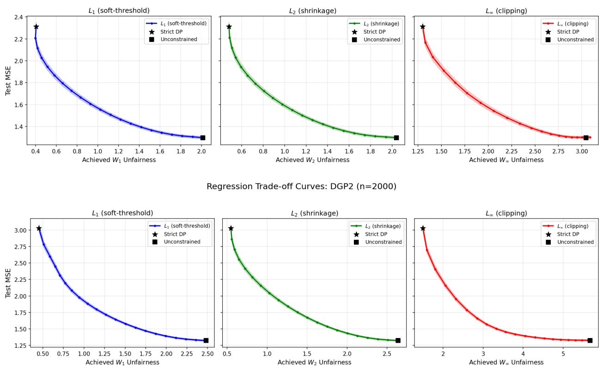  
Regression Trade-off Curves: DGP1 (n=2000)  
Figure 1: Fairness–accuracy frontiers for DGP1 (top) and DGP2 (bottom) at $n \ = \ 2 0 0 0 .$ The curves become steep near exact parity: the last reduction in the held-out gap costs more MSE than earlier reductions. Each panel uses its named Wasserstein norm, so horizontal scales should not be compared. Curves are Monte Carlo means; ribbons show plus or minus one standard error.

## 5.3 Multi-group regression $\left( K = 3 \right)$

This experiment tests simultaneous pairwise constraints and unequal group weights. We use seed $4 2 , n = 3 0 0 0 , d = 5$ , and $\mathbb { P } ( S = 0 , 1 , 2 ) = ( 0 . 2 , 0 . 3 , 0 . 5 )$ , so the largest group is two and a half times as common as the smallest. The outcome follows

$$
\begin{array} { r } { Y = \alpha _ { S } + X ^ { \top } \beta + \varepsilon , \qquad ( \alpha _ { 0 } , \alpha _ { 1 } , \alpha _ { 2 } ) = ( 1 , 3 , 5 ) , \quad \beta = ( 1 , 1 , 0 . 5 , 0 , 0 ) ^ { \top } , } \end{array}
$$

where $X \sim N ( 0 , I _ { 5 } )$ and $\varepsilon \sim N ( 0 , 1 )$

A stratified $4 0 / 3 0 / 3 0$ split provides auxiliary, calibration, and test data. We fit OLS with group indicators on the auxiliary sample, learn the adjustment on the calibration sample, and evaluate it on the test sample.

With three groups, the pair that limits fairness can change with the tolerance. Under tight constraints, the high-intercept group’s distances to both other groups equal the allowed tolerance. From about $\tau = 1 / 3$ onward, only the low-versus-high pair reaches that tolerance. The middle group is already close enough. The method therefore adjusts the pairs that need it rather than forcing all three pairwise distances to be equal.

The unequal weights also help determine which group absorbs the adjustment. The realized calibration proportions are $( 0 . 1 9 6 7 , 0 . 2 9 0 0 , 0 . 5 1 3 3 )$ ). At $\tau = 0 . 5 .$ , the smallest group’s quantile curve moves almost three times as far as the largest group’s curve, as measured by root-mean-square distance across ranks (1.58 versus 0.54). The group-weighted loss gives the largest calibration group more influence on the fitted curves. The active pairwise constraints matter as well. The maximum-pairwise constraint limits how far apart the groups can be, but it does not require all groups to move by the same amount.

As in the two-group experiments, most of the predictive improvement occurs early. The test MSEs are 3.6678, 1.7769, and 1.1359 at $\tau = 0 , 0 . 5$ , and 1, respectively. Thus, by $\tau = 0 . 5$ , the method recovers about $7 4 . 7 \%$ of the MSE improvement along the computed path. Because it minimizes observed calibration losses on a grid, the path need not end at the raw OLS fit. All 25 runs stopped only after meeting the stated numerical criteria. The largest grid violation is $3 . 7 3 \times 1 0 ^ { - 1 1 }$ . The positive test gap at $\tau = 0$ arises because the fitted adjustment is applied to a new sample using estimated ranks.

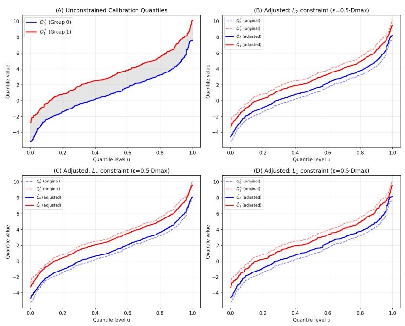

Figure 2: Calibration quantiles for the linear mean-shift process (DGP1) at $\epsilon = 0 . 5 D _ { \mathrm { m a x } }$ . Because the groups difer across nearly all ranks, each rule makes a broad adjustment. Dashed curves are original; solid curves are adjusted.  
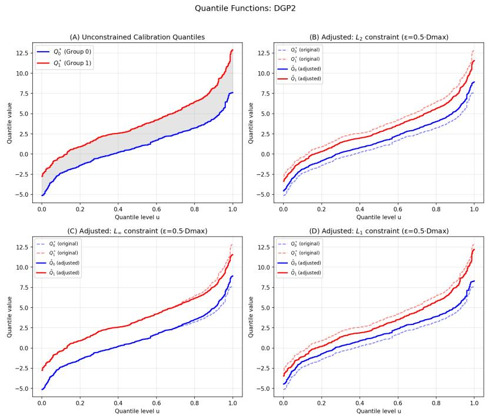  
Figure 3: Calibration quantiles for the tail-shift process (DGP2) at $\epsilon = 0 . 5 D _ { \mathrm { m a x } } .$ The unconstrained gap grows in the upper tail. Clipping therefore leaves ranks already inside its band unchanged and acts mainly where the gap is largest. Dashed curves are original; solid curves are adjusted.

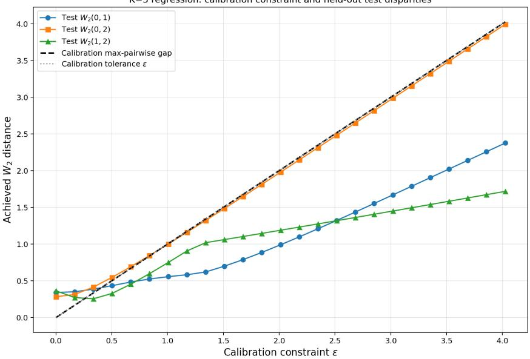  
Figure 4: Held-out pairwise $W _ { 2 }$ gaps in the $K = 3$ experiment. As the tolerance grows, the lowversus-high pair becomes the largest held-out gap, while the other two pairs remain closer. The dashed line is the largest gap between the fitted group curves on the calibration grid; the dotted line is the calibration tolerance.

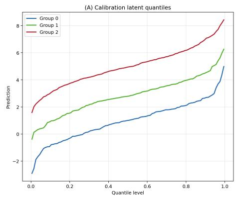

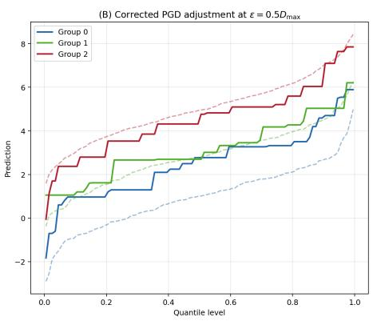  
Figure 5: Calibration quantiles before and after the $K = 3$ adjustment at half the baseline gap. Panel (A) shows the unadjusted calibration quantile curves. Panel (B) overlays the unadjusted curves (dashed) and the adjusted curves (solid). The smallest group moves most, while the middle and largest groups move much less. Unequal weights and the active pairwise constraints jointly shape these changes. Flat stretches arise when the ordering projection pools neighboring ranks.

## 5.4 Classification illustration

We next examine whether the same distributional adjustment can reduce between-group diferences in classification scores without a large loss in accuracy. With seed 42, we generate $n \ : = \ : 4 0 0 0$ observations from two equally likely groups. We use $X \sim N ( 0 , I _ { 5 } )$ and

$$
\operatorname { \mathbb { P } } ( Y = 1 \mid X , S ) = \log \operatorname { i t } ^ { - 1 } ( \alpha _ { S } + X ^ { \top } \beta ) , \qquad ( \alpha _ { 0 } , \alpha _ { 1 } ) = ( 0 , 2 ) , \quad \beta = ( 0 . 5 , 0 . 5 , 0 . 3 , 0 , 0 ) ^ { \top } .
$$

We use a stratified $4 0 / 3 0 / 3 0$ split and $M = 2 0 0$ grid points. We fit logistic regression using $( X , S )$ on the auxiliary sample, learn a quantile map from the calibration logits, and apply it to the test logits. We use the $L _ { \infty }$ clipping rule that is optimal for squared loss and then evaluate classification accuracy. It is not a logistic-risk optimum.

Figure 6 plots the 30 held-out accuracies against the $W _ { \infty }$ gaps between the adjusted curves on the calibration grid. $\mathrm { A t } \ \epsilon = 0 .$ , this grid gap is zero. The solid curve is a fitted line constrained not to decrease, also called an isotonic fit. It only summarizes the plotted points and does not imply that test accuracy must increase with the tolerance.

Separate test-gap calculations quantify a useful middle ground. At $\epsilon = 1 . 1 1 4 3 ~ ( \tau \approx 0 . 5 6 9 )$ , the held-out logit gap falls from 1.9300 to 1.2572, a 34.9% reduction, while accuracy falls from 0.7667 to 0.7458, a loss of 2.08 percentage points calculated before rounding. At exact calibration parity $( \tau = 0 )$ , accuracy is 0.7017 and the held-out gap is 0.3226, giving a smaller test gap but more than three times the loss in accuracy. These held-out gaps are distinct from the calibration-grid gaps on the figure’s horizontal axis. Accuracy changes in steps when adjusted logits cross the classification threshold.

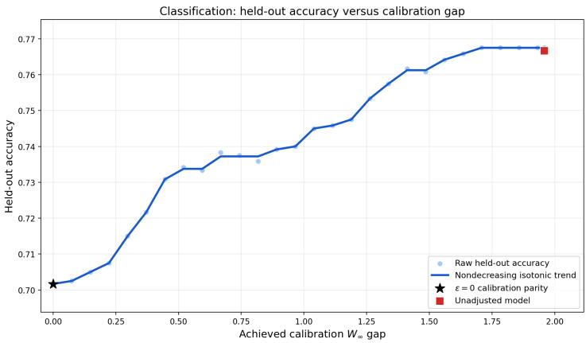  
Figure 6: Calibration-grid $W _ { \infty }$ gap versus held-out accuracy. Light points show the 30 observed values. The solid line is a fitted summary constrained not to decrease. The black star marks $\epsilon = 0 .$ , where the grid gap is zero, and the red square marks the unadjusted model at its gap before adjustment. The line does not imply that held-out accuracy is monotone.

## 6 Real Data Application: American Community Survey (ACS) Income Prediction

## 6.1 Data and protocol

We now move from simulations to real data. This application asks how prediction accuracy changes when group-specific income-prediction distributions are moved closer together. We use the California 2018 one-year ACS person file provided through Folktables (Ding et al., 2021). We ask whether a moderate tolerance preserves much of the accuracy lost under exact parity and, with three groups, which pair has the largest held-out gap.

We keep adults older than 18 who have a positive class-of-worker code and positive personal income. The outcome is log(PINCP + 1). The nine predictors are age (AGEP), class of worker (COW), education (SCHL), marital status (MAR), occupation (OCCP), place of birth (POBP), household relationship (RELP), usual weekly work hours (WKHP), and sex (SEX). Race is not used as a predictor; it only defines the groups. The $K = 2$ analysis compares White and non-White adults. The $K = 3$ analysis uses values 1, 2, and 6 of the ACS race field RAC1P for White, Black, and Asian adults. We do not use survey weights. The results therefore describe the unweighted filtered sample. Some ACS predictors describe categories, such as occupation and marital status. We enter their numerical codes directly into the model. The trees split on those codes, so arbitrary coding of nominal categories afects which category groupings a split can express and can afect the fit. This is a limitation of this illustration.

The filtered sample contains 207,019 records. Its $K = 3$ subset contains 172,850 records and is split into 69,140, 51,855, and 51,855 observations for the auxiliary, calibration, and test samples. Both analyses use a stratified $4 0 / 3 0 / 3 0$ split with seed 42. We fit a gradient-boosting regressor on the auxiliary sample using 200 trees, maximum depth 6, learning rate 0.1, and subsample fraction 0.8. The calibration sample determines the adjustment; the test sample provides the reported $R ^ { 2 }$ and gaps.

The calibration grid has $M = 2 0 0 0$ midpoint nodes. The prediction maps use ranks from the right-continuous empirical distribution function and the constant endpoint extension defined in Section 3. The fixed log-prediction range is $\mathcal { T } = [ 0 , 2 0 ]$ . For $K = 3$ , we use 25 tolerances, step size 0.1, projection tolerance $1 0 ^ { - 1 0 }$ , and outer tolerance $1 0 ^ { - 8 }$

For $K = 2$ , the $W _ { 1 }$ and $W _ { 2 }$ implementations preserve the original predictions whenever all adjusted quantile vectors exactly equal their originals. In particular, their $\tau = 1$ endpoints coincide with the unadjusted model. Active adjustments still use the empirical rank map. The $K = 3$ implementation uses the rank map throughout.

For the fair model, let $\widehat { Y } _ { i } ^ { \mathrm { f a i r } } = \hat { f } _ { \mathrm { f a i r } } ( X _ { i } , S _ { i } )$ denote the final prediction for test observation i. We measure test prediction quality by $R ^ { 2 }$

$$
R ^ { 2 } = 1 - \frac { \sum _ { i \in \mathcal { I } _ { \mathrm { t e s t } } } ( Y _ { i } - \widehat { Y } _ { i } ^ { \mathrm { f a i r } } ) ^ { 2 } } { \sum _ { i \in \mathcal { I } _ { \mathrm { t e s t } } } ( Y _ { i } - \widehat { Y } _ { \mathrm { t e s t } } ) ^ { 2 } } , \qquad \bar { Y } _ { \mathrm { t e s t } } = \frac { 1 } { | \mathcal { I } _ { \mathrm { t e s t } } | } \sum _ { i \in \mathcal { I } _ { \mathrm { t e s t } } } Y _ { i } .
$$

Here $\mathcal { T } _ { \mathrm { t e s t } }$ indexes the test sample. For the unadjusted model, we use the same formula with ${ \hat { f } } ( X _ { i } , S _ { i } )$ in place of $\widehat { Y } _ { i } ^ { \mathrm { f a i r } }$ . Figure 7 uses held-out Wasserstein gaps. In Figure 8, the horizontal axis is the largest distance between the fitted group curves on the calibration grid, and the vertical axis is held-out $R ^ { 2 }$ . At $\epsilon = 0$ , the horizontal value is zero by construction. A nonzero held-out gap can remain because the adjustment is learned from one finite sample and applied to another using estimated ranks. It does not mean that the numerical constraint failed.

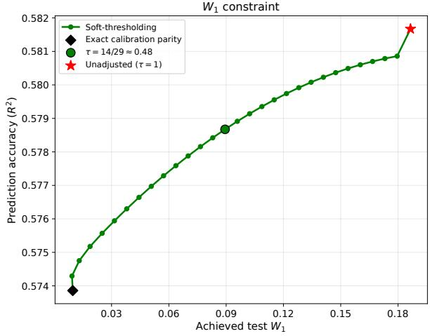

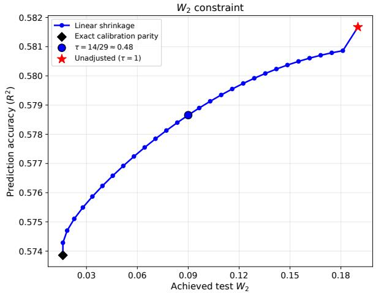  
Figure 7: California 2018 ACS income regression with $K = 2$ groups. The curves show all 30 observed settings per norm in tolerance order. The marked near-half setting is $\tau = 1 4 / 2 9$ . At $\tau = 1$ , the identity convention preserves the unadjusted predictions, so the final point coincides with the unadjusted model. The final rise reflects both the tolerance change and the bypass of empirical rank reconstruction. The exact-calibration-parity setting can retain a nonzero held-out gap. Each panel uses its own Wasserstein norm and should be read separately.

## 6.2 Results: K = 2 (White vs. Non-White)

The two panels in Figure 7 tell the same practical story. At $\tau = 1 4 / 2 9 \approx 0 . 4 8$ , the tolerance is about half the baseline calibration gap and the held-out gap is also about half its baseline value. The method has recovered $6 1 . 6 \% \ ( W _ { 1 } )$ and $6 1 . 4 \% \ ( W _ { 2 } )$ of the $R ^ { 2 }$ lost under exact calibration parity. The $W _ { 1 }$ and $W _ { 2 }$ adjustments also trace almost identical $R ^ { 2 }$ paths at matched normalized tolerances. In this example, the tolerance has a clearer efect on prediction than the choice between these two adjustment rules. Their gap scales remain diferent and are not compared.

$\mathrm { A t } \ \tau = 0$ , the corresponding held-out gap falls by more than 90% in either panel, at an absolute $R ^ { 2 }$ cost of 0.0078 (1.34% relative). The largest grid violation is $1 . 1 1 \times 1 0 ^ { - 1 5 }$ . This confirms that the fitted curves meet the constraint on the grid. It does not imply that the predictions assigned to individual calibration observations have exactly the same empirical distribution.

At the inactive endpoint, both methods reproduce the unadjusted model’s $R ^ { 2 } = 0 . 5 8 1 7 .$ , with held-out gaps 0.1865 $\left( W _ { 1 } \right)$ and 0.1900 $\left( W _ { 2 } \right)$ . The last step of the plotted path rises from $R ^ { 2 } \approx$ 0.58086 at $\tau = 2 8 / 2 9$ to 0.58167 at $\tau = 1$ . At this endpoint, the identity convention bypasses empirical rank reconstruction. The final rise should therefore not be attributed entirely to relaxing the fairness constraint.

## 6.3 Results: $K = 3$ (White vs. Black vs. Asian)

The clearest three-group finding is which pair has the largest held-out gap. White adults make up about three quarters of the calibration sample. Even so, the Black–Asian pair has the largest held-out gap at every tolerance. A method that compared each group only with White would therefore miss the pair with the greatest separation.

At $\tau = 0$ , the largest held-out gap falls from 0.2789 to 0.0817, a 70.7% reduction, while $R ^ { 2 }$ falls by 0.0099 (1.73% relative). Figure 8 plots the 25 held-out $R ^ { 2 }$ values against the largest distances between the fitted group curves on the calibration grid. Loosening the constraint lowers the optimized calibration loss but need not raise held-out $R ^ { 2 }$ . The shallow dip reflects learning the adjustment on one sample and evaluating it on another. The fitted nondecreasing line is only a visual summary, so the tolerance should be selected using validation data.

The computed path does not end at the raw unadjusted model because the method minimizes observed calibration losses on a grid and then applies an estimated rank map. The distance to the red star is therefore not entirely a fairness cost. Across all 25 fits, the largest positive excess of a pairwise calibration-grid $W _ { 2 }$ distance above its tolerance is $9 . 4 6 \times 1 0 ^ { - 1 1 }$

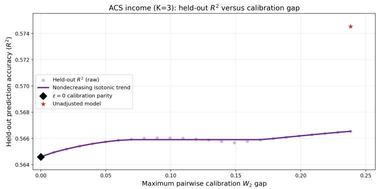  
Figure 8: Maximum pairwise $W _ { 2 }$ distance between the fitted group curves on the calibration grid versus held-out $R ^ { 2 }$ . Light points show the 25 observed values. The solid line is a fitted summary constrained not to decrease. The black diamond marks $\epsilon = 0$ , where the grid gap is zero, and the red star marks the unadjusted model at its $\mathrm { g a p }$ before adjustment. The line does not imply that held-out $R ^ { 2 }$ is monotone.

## 6.4 Distribution shift visualization

We next look beyond the largest pairwise gap and compare the full prediction distributions before and after adjustment. The adjustment changes the shapes and relative locations of the calibration prediction distributions. The smoothed group densities remain distinct at this positive tolerance.

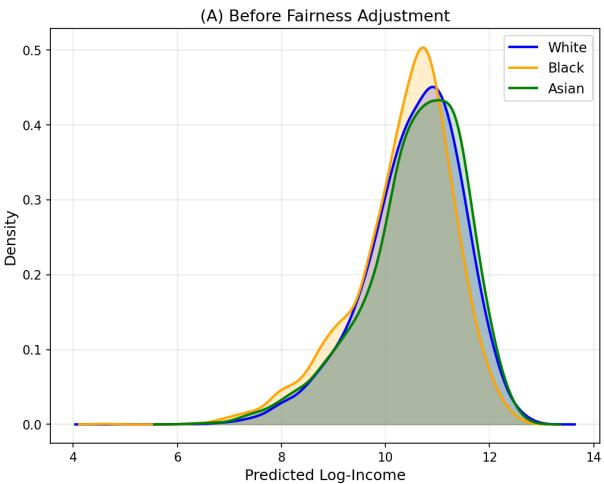

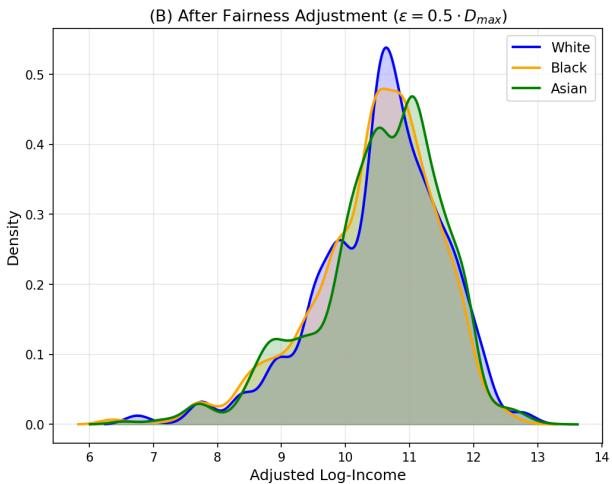  
Figure 9: Smoothed distributions of the California 2018 ACS calibration predictions before and after the $K = 3$ adjustment at $\epsilon = 0 . 5 D _ { \mathrm { m a x } }$ . The smoothed group densities remain distinct at this positive tolerance.

## 7 Conclusion

We developed a framework for fair regression under Approximate Demographic Parity. By replacing strict independence with a distance-based constraint, the framework makes the trade-of between predictive utility and distributional parity explicit and tunable.

Using optimal transport, we show that the prediction problem and the corresponding problem over group distributions have the same best achievable value. When the distributional problem has an optimal solution and the required deterministic transport rules exist, those rules give an optimal approximately fair predictor. Under the stated one-dimensional monotonicity condition, the problem can also be written in terms of group-specific quantile functions. This quantile problem is convex when the induced cost is convex in the prediction argument. For squared error loss with two positively weighted groups, we obtained closed-form solutions under $W _ { 1 } , \ W _ { 2 } ,$ and $W _ { \infty }$ constraints. They correspond to soft-thresholding, linear shrinkage, and clipping. For known induced costs that are convex in the prediction argument, including settings with multiple sensitive groups, we developed numerical methods based on clipping or weighted projected-gradient updates on a finite grid.

When the induced cost is known, we establish convergence rates for the estimated fair quantile functions and consistency of the final prediction rule under the stated assumptions. The simulations show how predictive accuracy and held-out fairness change as the tolerance varies. We report satisfaction of the numerical constraints separately from fairness gaps on held-out data. The California ACS income application further illustrates the framework and shows that, for this prediction task, a substantial portion of the held-out Wasserstein gap can be reduced with only a small loss in predictive accuracy. This interpretation is descriptive for the fitted prediction problem and should not be read as a causal claim about the sources of disparity.

Future work includes deriving error bounds for the finite-grid numerical method, developing analytic solutions for additional multi-group problems, and extending the transport-based approach

to other fairness criteria, such as equalized odds.

## Acknowledgments

The authors used OpenAI Codex with the GPT-5.6-Sol and GPT-6 models for language editing, LaTeX preparation, code debugging, and mathematical and computational consistency checks. All mathematical arguments, citations, code, numerical results, and final text were reviewed and verified by the authors, who take full responsibility for the manuscript.

## References

Agarwal, A., M. Dud´ık, and Z. S. Wu (2019). Fair regression: Quantitative definitions and reduction-based algorithms. In Proceedings of the 36th International Conference on Machine Learning, Volume 97 of Proceedings of Machine Learning Research, pp. 120–129. PMLR.

Aliprantis, C. D. and K. C. Border (2006). Infinite Dimensional Analysis: A Hitchhiker’s Guide (3 ed.). Berlin, Heidelberg: Springer.

Ambrosio, L. (2003). Lecture notes on optimal transport problems. In Mathematical Aspects of Evolving Interfaces, Volume 1812 of Lecture Notes in Mathematics, pp. 1–52. Berlin, Heidelberg: Springer.

Bauschke, H. H. and P. L. Combettes (2017). Convex Analysis and Monotone Operator Theory in Hilbert Spaces (2 ed.). CMS Books in Mathematics. Cham: Springer.

Cambanis, S., G. Simons, and W. Stout (1976). Inequalities for Ek(X, Y ) when the marginals are fixed. Zeitschrift f¨ur Wahrscheinlichkeitstheorie und Verwandte Gebiete 36(4), 285–294.

Caton, S. and C. Haas (2024). Fairness in machine learning: A survey. ACM Computing Surveys 56 (7), 1–38.

Charpentier, A., C. Denis, R. Elie, M. Hebiri, and F. Hu (2026). Fair regression under localized demographic parity constraints. arXiv:2603.25224.

Chiappori, P.-A., R. J. McCann, and B. Pass (2017). Multi-to one-dimensional optimal transport. Communications on Pure and Applied Mathematics 70(12), 2405–2444.

Chzhen, E., C. Denis, M. Hebiri, L. Oneto, and M. Pontil (2020). Fair regression with Wasserstein barycenters. In Advances in Neural Information Processing Systems, Volume 33, pp. 7321–7331.

Chzhen, E. and N. Schreuder (2022). A minimax framework for quantifying risk–fairness trade-of in regression. The Annals of Statistics 50 (4), 2416–2442.

Ding, F., M. Hardt, J. Miller, and L. Schmidt (2021). Retiring adult: New datasets for fair machine learning. In Advances in Neural Information Processing Systems, Volume 34, pp. 6478–6490.

Duchi, J., S. Shalev-Shwartz, Y. Singer, and T. Chandra (2008). Eficient projections onto the ℓ1-ball for learning in high dimensions. In Proceedings of the 25th International Conference on Machine Learning, pp. 272–279. ACM.

Feng, Y., W. Wang, R. K. W. Wong, and X. Zhang (2026). Fair regression under demographic parity: A unified framework. arXiv:2601.10623.

Generali Lince, M., V. Divol, R. Flamary, S. Gaucher, and P. Loiseau (2026). Geometry of relaxed fair regression: A unified framework for aware and unaware settings. arXiv:2605.28233.

Gordaliza, P., E. del Barrio, F. Gamboa, and J.-M. Loubes (2019). Obtaining fairness using optimal transport theory. In Proceedings of the 36th International Conference on Machine Learning, Volume 97 of Proceedings of Machine Learning Research, pp. 2357–2365. PMLR.

Jiang, R., A. Pacchiano, T. Stepleton, H. Jiang, and S. Chiappa (2020). Wasserstein fair classification. In Proceedings of the 35th Conference on Uncertainty in Artificial Intelligence, Volume 115 of Proceedings of Machine Learning Research, pp. 862–872. PMLR.

Le Gouic, T., J.-M. Loubes, and P. Rigollet (2020). Projection to fairness in statistical learning. arXiv:2005.11720.

Mehrabi, N., F. Morstatter, N. Saxena, K. Lerman, and A. Galstyan (2021). A survey on bias and fairness in machine learning. ACM Computing Surveys 54 (6), 1–35.

Menon, A. K. and R. C. Williamson (2018). The cost of fairness in binary classification. In Proceedings of the 1st Conference on Fairness, Accountability and Transparency, Volume 81 of Proceedings of Machine Learning Research, pp. 107–118. PMLR.

Santambrogio, F. (2015). Optimal Transport for Applied Mathematicians: Calculus of Variations, PDEs, and Modeling. Cham: Birkh¨auser.

Showalter, R. E. (2009). Hilbert space methods for partial diferential equations. Electronic journal of diferential equations, 01–214.

Villani, C. (2009). Optimal Transport: Old and New, Volume 338 of Grundlehren der Mathematischen Wissenschaften. Berlin: Springer.

Weikard, R. (2018). Real analysis. University of Alabama at Birmingham lecture notes. Section 7.2.9, Integration by parts.

Xu, S. and T. Strohmer (2023). Fair data representation for machine learning at the pareto frontier. Journal of Machine Learning Research 24 (331), 1–63.

## A Proofs of the Main Results

This appendix first proves the population and statistical results. It then derives the closed-form formulas and the multi-group squared-loss results. Each proof starts with its main idea. The calculations then show how that idea gives the stated result.

Proof of Theorem 1. Let A be the infimum of the prediction problem in (3), and let B be the infimum of the constrained transport problem in (4). We prove the two inequalities separately.

First, $B \leq A$ . Take any feasible predictor $f ,$ and let $\nu _ { f , s } = \mathcal { L } ( \boldsymbol { f } ( \boldsymbol { X } , \boldsymbol { S } ) \mid \boldsymbol { S } = s )$ . Because $f$ is feasible, the distributions $\nu _ { f , 1 } , \dotsc , \nu _ { f , K }$ satisfy all pairwise Wasserstein constraints. For group $s ,$ define

$$
\gamma _ { f , s } : = \mathcal { L } \big ( f ^ { * } ( X , S ) , f ( X , S ) \mid S = s \big ) .
$$

Its first marginal is $\mu _ { s }$ , and its second marginal is $\nu _ { f , s }$ . Thus $\gamma _ { f , s } \in \Pi ( \mu _ { s } , \nu _ { f , s } )$ , and

$$
\begin{array} { r l } & { B \le \displaystyle \sum _ { s = 1 } ^ { K } r _ { s } \operatorname* { i n f } _ { \gamma _ { s } \in \Pi ( \mu _ { s } , \nu _ { f , s } ) } \int \mathcal { C } ( z , q ) d \gamma _ { s } ( z , q ) } \\ & { \quad \le \displaystyle \sum _ { s = 1 } ^ { K } r _ { s } \int \mathcal { C } ( z , q ) d \gamma _ { f , s } ( z , q ) } \\ & { \quad = \mathbb { E } \big \{ \mathcal { C } \big ( f ^ { * } ( X , S ) , f ( X , S ) \big ) \big \} . } \end{array}
$$

This holds for every feasible $f .$ Taking the infimum over $f$ gives $B \leq A$

Next, $A \leq B$ . Fix $\delta > 0$ . By the definitions of the outer and inner infima in (4), we can choose feasible distributions $\nu _ { 1 } , \ldots , \nu _ { K }$ and couplings $\gamma _ { s } \in \Pi ( \mu _ { s } , \nu _ { s } )$ such that

$$
\sum _ { s = 1 } ^ { K } r _ { s } \int \mathcal { C } ( z , q ) d \gamma _ { s } ( z , q ) \leq B + \delta .
$$

Because $\mu _ { s }$ is non-atomic, the graph-measure approximation used in the proof of Theorem 2.1 of Ambrosio (2003) gives measurable maps $T _ { s , j }$ satisfying

$$
( T _ { s , j } ) _ { \# } \mu _ { s } = \nu _ { s } , \qquad ( \mathrm { i d } , T _ { s , j } ) _ { \# } \mu _ { s } \implies \gamma _ { s } ,
$$

where =⇒ denotes weak convergence. The first equality is important: every approximation has exactly the chosen output distribution, so it preserves the pairwise fairness constraints. Since C is continuous on the compact set $\mathcal { T } ^ { 2 }$ , it is bounded, and weak convergence gives

$$
\int \mathcal { C } ( z , T _ { s , j } ( z ) ) d \mu _ { s } ( z ) \longrightarrow \int \mathcal { C } ( z , q ) d \gamma _ { s } ( z , q ) .
$$

Define one predictor across all groups by

$$
f _ { j } ( x , s ) : = T _ { s , j } ( f ^ { * } ( x , s ) ) .
$$

Its conditional distribution in group s is $\nu _ { s } ,$ so $f _ { j }$ is feasible. Because the number of groups is finite,

$$
\begin{array} { l } { { \displaystyle { \cal A } \leq \operatorname* { l i m } _ { j  \infty } \mathbb { E } \big \{ { \cal C } \big ( f ^ { * } ( X , S ) , f _ { j } ( X , S ) \big ) \big \} } } \\ { { \displaystyle ~ = \sum _ { s = 1 } ^ { K } r _ { s } \int { \cal C } ( z , q ) d \gamma _ { s } ( z , q ) \leq { \cal B } + \delta . } } \end{array}
$$

Letting δ ↓ 0 yields $A \leq B$ . Therefore $A = B$

Finally, suppose a deterministic optimizer exists. Assume that the constrained transport problem attains B at $\left( \bar { \nu } _ { 1 } , \dots , \bar { \nu } _ { K } \right)$ and that, for each group, an optimal Monge map $T _ { s }$ from $\mu _ { s }$ to $\bar { \nu } _ { s }$ exists. Define

$$
f _ { \mathrm { f a i r } } ^ { * } ( x , s ) : = T _ { s } ( f ^ { * } ( x , s ) ) .
$$

This predictor has conditional distribution $\bar { \nu } _ { s }$ in group $s ,$ so it is feasible. Moreover,

$$
\begin{array} { l } { { \mathbb { E } \big \{ { \mathcal { C } \big ( f ^ { * } ( X , S ) , f _ { \mathrm { f a i r } } ^ { * } ( X , S ) \big ) } \big \} = \displaystyle \sum _ { s = 1 } ^ { K } r _ { s } \int { \mathcal { C } \big ( z , T _ { s } ( z ) \big ) d \mu _ { s } ( z ) } } } \\ { { = \displaystyle \sum _ { s = 1 } ^ { K } r _ { s } \operatorname* { i n f } _ { \gamma _ { s } \in \Pi ( \mu _ { s } , \bar { \nu } _ { s } ) } \int { \mathcal { C } ( z , q ) d \gamma _ { s } ( z , q ) } } } \\ { { = B = A } . } \end{array}
$$

Hence $f _ { \mathrm { f a i r } } ^ { * }$ attains the AFRP infimum.

Proof of Lemma 2. Increasing rearrangement means sorting each function into quantile order. We show that this sorting has two useful efects. It cannot enlarge the group-to-group distances, and it cannot increase the prediction cost.

Distances between groups. For $p < \infty$ , matching equal ranks is the least costly way to pair two one-dimensional distributions under the cost $| x - y | ^ { p }$ . This rank matching is the monotone coupling. It minimizes $\mathbb { E } | h _ { i } ( U ) - h _ { j } ( U ) | ^ { p }$ among all pairings of the same marginal laws. Therefore $\| h _ { i } ^ { \uparrow } - h _ { j } ^ { \uparrow } \| _ { p } \leq \| h _ { i } - h _ { j } \| _ { p }$ . The same conclusion for $p = \infty$ follows from the one-dimensional quantile representation of $W _ { \infty } .$

Prediction cost and quantile properties. The inequality $\partial _ { z q } ^ { 2 } { \mathcal { C } } < 0$ says that matching a larger score with a larger prediction is no more costly than crossing the two matches. This property is called submodularity, or quasi-antitonicity. The fixed-marginal rearrangement inequality of Cambanis et al. (1976, Theorem 2), applied to $- { \mathcal { C } } ,$ , then shows that matching scores and predictions at the same percentile minimizes the expected cost for C. This is also called a comonotone coupling. For the marginals of $Q _ { s } ^ { * } ( U )$ and $h _ { s } ( U )$ , it is $( Q _ { s } ^ { * } ( U ) , h _ { s } ^ { \uparrow } ( U ) )$ . This gives the stated cost inequality.

The rearranged functions are quantile functions, so they are nondecreasing and left-continuous. Sorting changes only the order of the values, not their distribution. This preservation of the value distribution, called equimeasurability, keeps the functions integrable. It also keeps their values in $\mathcal { T } ,$ apart from possible changes on sets of measure zero. This is the essential-range statement.

Proof of Lemma 3. Each closed-form rule changes only the diference between the two groups. The key fact is that its diference map ψ preserves order, never expands a diference, and leaves zero fixed. We use these properties first to prove that the adjusted curves remain nondecreasing. We then verify their range and regularity.

The adjusted curves remain ordered by rank. Fix $0 < u < v < 1$ and write

$$
a _ { s } = Q _ { s } ^ { * } ( v ) - Q _ { s } ^ { * } ( u ) \geq 0 , \qquad s = 1 , 2 .
$$

Then

$$
\Delta ^ { * } ( v ) - \Delta ^ { * } ( u ) = a _ { 1 } - a _ { 2 } .
$$

For $Q _ { 1 }$ , we have

$$
Q _ { 1 } ( v ) - Q _ { 1 } ( u ) = r _ { 1 } a _ { 1 } + r _ { 2 } a _ { 2 } + r _ { 2 } \{ \psi ( \Delta ^ { * } ( v ) ) - \psi ( \Delta ^ { * } ( u ) ) \} .
$$

If $a _ { 1 } \geq a _ { 2 }$ , then $\Delta ^ { * } ( v ) \geq \Delta ^ { * } ( u )$ . Because ψ is nondecreasing, the last term is nonnegative. Hence $Q _ { 1 } ( v ) - Q _ { 1 } ( u ) \geq 0$ . Now suppose $a _ { 1 } < a _ { 2 }$ . The 1-Lipschitz property and monotonicity of $\psi$ imply

$$
\psi ( \Delta ^ { * } ( v ) ) - \psi ( \Delta ^ { * } ( u ) ) \geq \Delta ^ { * } ( v ) - \Delta ^ { * } ( u ) = a _ { 1 } - a _ { 2 } .
$$

Therefore,

$$
Q _ { 1 } ( v ) - Q _ { 1 } ( u ) \geq r _ { 1 } a _ { 1 } + r _ { 2 } a _ { 2 } + r _ { 2 } ( a _ { 1 } - a _ { 2 } ) = a _ { 1 } \geq 0 .
$$

Thus $Q _ { 1 }$ cannot decrease as the rank moves from u to v.

Similarly,

$$
Q _ { 2 } ( v ) - Q _ { 2 } ( u ) = r _ { 1 } a _ { 1 } + r _ { 2 } a _ { 2 } - r _ { 1 } \{ \psi ( \Delta ^ { * } ( v ) ) - \psi ( \Delta ^ { * } ( u ) ) \} .
$$

If $a _ { 1 } \leq a _ { 2 }$ , then $\psi ( \Delta ^ { * } ( v ) ) - \psi ( \Delta ^ { * } ( u ) ) \leq 0 , \mathrm { ~ s o ~ } Q _ { 2 } ( v ) - Q _ { 2 } ( u ) \geq 0 .$ . Now suppose $a _ { 1 } > a _ { 2 }$ . The 1-Lipschitz property gives

$$
\psi ( \Delta ^ { * } ( v ) ) - \psi ( \Delta ^ { * } ( u ) ) \leq \Delta ^ { * } ( v ) - \Delta ^ { * } ( u ) = a _ { 1 } - a _ { 2 } ,
$$

and hence

$$
Q _ { 2 } ( v ) - Q _ { 2 } ( u ) \geq r _ { 1 } a _ { 1 } + r _ { 2 } a _ { 2 } - r _ { 1 } ( a _ { 1 } - a _ { 2 } ) = a _ { 2 } \geq 0 .
$$

Thus $Q _ { 2 }$ is also nondecreasing.

The adjusted values stay in range. The condition $\psi ( 0 ) = 0$ , together with monotonicity and the 1-Lipschitz property, implies that $\psi ( t ) = \alpha ( t ) t$ for some $\alpha ( t ) \in [ 0 , 1 ]$ (take $\alpha ( 0 ) = 0 )$ . Here $\alpha ( t )$ is the fraction of the original group diference that remains after adjustment. Pointwise,

$$
\begin{array} { r } { Q _ { 1 } = \{ r _ { 1 } + r _ { 2 } \alpha ( \Delta ^ { * } ) \} Q _ { 1 } ^ { * } + r _ { 2 } \{ 1 - \alpha ( \Delta ^ { * } ) \} Q _ { 2 } ^ { * } , } \\ { Q _ { 2 } = r _ { 1 } \{ 1 - \alpha ( \Delta ^ { * } ) \} Q _ { 1 } ^ { * } + \{ r _ { 2 } + r _ { 1 } \alpha ( \Delta ^ { * } ) \} Q _ { 2 } ^ { * } . } \end{array}
$$

The coeficients in each line are nonnegative and sum to one. Both adjusted values are therefore weighted averages of $Q _ { 1 } ^ { * } ( u )$ and $Q _ { 2 } ^ { * } ( u )$ , so they remain in I. Every Lipschitz map is continuous, so composition with $\psi$ preserves left continuity. Boundedness then gives integrability.

The three adjustment rules satisfy these conditions. Linear shrinkage uses $\psi ( t ) = $ αt with $\alpha \in [ 0 , 1 ]$ . Soft-thresholding uses $\psi ( t ) = \mathrm { s g n } ( t ) ( | t | - \lambda ) _ { + }$ . Clipping uses $\psi ( t ) = \mathrm { c l i p } _ { [ - \epsilon , \epsilon ] } ( t )$ . Each map is nondecreasing, 1-Lipschitz, and zero at zero. Therefore the resulting $Q _ { 1 }$ and $Q _ { 2 }$ have all the asserted properties. □

Proof of Lemma $\it 4 .$ The estimated quantile difers from the population quantile for two reasons. We use fitted scores instead of true scores, and we observe only a finite calibration sample. We control these two errors separately and then add them.

Error from fitted scores. Fix s. Let $\hat { \nu } _ { s }$ be the empirical measure of the fitted calibration scores, $\tilde { \nu } _ { s }$ the empirical measure of the corresponding unobserved true scores with quantile $\tilde { Q } _ { s } ^ { * }$ , and $\mu _ { s }$ the population true-score law. Pair each fitted score with the true score for the same observation. This is one valid way to transport $\hat { \nu } _ { s }$ to $\tilde { \nu } _ { s } ,$ , so

$$
W _ { 2 } ^ { 2 } ( \hat { \nu } _ { s } , \tilde { \nu } _ { s } ) \leq n _ { s } ^ { - 1 } \sum _ { i : S _ { i } = s } | \hat { f } _ { m } ( X _ { i } , s ) - f ^ { * } ( X _ { i } , s ) | ^ { 2 } = O _ { p } ( \rho _ { m } ^ { 2 } ) ,
$$

by independence of training and calibration and Assumption 6.

Error from the finite calibration sample. Let $\tilde { F } _ { s }$ be the empirical cumulative distribution function (CDF) of the true scores. The Dvoretzky–Kiefer–Wolfowitz inequality controls its largest diference from the population distribution function. Because every group has positive probability, $n _ { s }$ has the same order as n. Therefore, $\lVert \tilde { F } _ { s } - F _ { s } ^ { * } \rVert _ { \infty } = O _ { p } ( n ^ { - 1 / 2 } )$ . Since the density of $F _ { s } ^ { * }$ is at least $\underline { { c } } ,$ its cumulative distribution function cannot be too flat. Inverting the two distribution functions therefore gives $\| \tilde { Q } _ { s } ^ { * } - Q _ { s } ^ { * } \| _ { \infty } \leq \underline { { c } } ^ { - 1 } \| \tilde { F } _ { s } - F _ { s } ^ { * } \| _ { \infty } = O _ { p } ( n ^ { - 1 / 2 } )$ , using constant endpoint extensions at

0 and 1. Combining this bound with the fitted-score bound and applying the triangle inequality gives

$$
\| \hat { Q } _ { s } ^ { * } - Q _ { s } ^ { * } \| _ { 2 } = W _ { 2 } ( \hat { \nu } _ { s } , \mu _ { s } ) \leq W _ { 2 } ( \hat { \nu } _ { s } , \tilde { \nu } _ { s } ) + \| \tilde { Q } _ { s } ^ { * } - Q _ { s } ^ { * } \| _ { 2 } = O _ { p } ( \rho _ { m } + n ^ { - 1 / 2 } ) .
$$

Proof of Theorem 2. The population and estimated problems use the same feasible set but slightly diferent inputs. The proof shows that this small input change causes only a small change in the optimizer. We first write the two objectives and their gradients. We then use the fact that no feasible move can improve either optimizer. Strong convexity turns this fact into a stability bound. Finally, we control the gradient diference using the score-quantile and group-weight errors.

Our goal is to bound $\lVert \hat { { \bf Q } } - { \bf Q } ^ { \mathrm { f a i r } } \rVert _ { 2 }$ . Recall that $\begin{array} { r } { \| \mathbf { Q } \| _ { 2 } ^ { 2 } : = \sum _ { s = 1 } ^ { K } r _ { s } \int _ { 0 } ^ { 1 } Q _ { s } ( u ) ^ { 2 } d u } \end{array}$ . The corresponding inner product is defined for two tuples of functions, $\mathbf { A } = \left( A _ { 1 } , \ldots , A _ { K } \right)$ and $\mathbf { B } = \left( B _ { 1 } , \ldots , B _ { K } \right)$ ， by

$$
\langle \mathbf { A } , \mathbf { B } \rangle : = \sum _ { s = 1 } ^ { K } r _ { s } \int _ { 0 } ^ { 1 } A _ { s } ( u ) B _ { s } ( u ) d u .
$$

Write $\mathbf { Q } ^ { \ast } : = ( Q _ { 1 } ^ { \ast } , \dots , Q _ { K } ^ { \ast } )$ and $\hat { \mathbf { Q } } ^ { * } : = ( \hat { Q } _ { 1 } ^ { * } , \ldots , \hat { Q } _ { K } ^ { * } )$

Step 1: Write the two objectives and their slopes. Define the population objective

$$
G ( \mathbf { Q } ) : = \sum _ { s = 1 } ^ { K } r _ { s } \int _ { 0 } ^ { 1 } \mathcal { C } \big ( Q _ { s } ^ { * } ( u ) , Q _ { s } ( u ) \big ) d u , \qquad \mathcal { C } ( z , q ) : = \mathbb { E } [ \ell ( Y , q ) \mid f ^ { * } ( X , S ) = z ] ,
$$

and the estimated objective

$$
\widehat { G } _ { n , \hat { r } } ^ { C } ( \mathbf { Q } ) : = \sum _ { s = 1 } ^ { K } \hat { r } _ { s } \int _ { 0 } ^ { 1 } \mathcal { C } \big ( \hat { Q } _ { s } ^ { * } ( u ) , Q _ { s } ( u ) \big ) d u .
$$

By Assumption $7 ( 1 )$ , G is µ-strongly convex on K and $\widehat { G } _ { n , \widehat { r } } ^ { C }$ is convex on the event min $\mathfrak { l } _ { s } n _ { s } > 0$ The gradient records how an objective changes under a small change in its quantile functions. With respect to the r-weighted inner product, these gradients, formally the Fr´echet gradients, are

$$
[ \nabla G ( \mathbf { Q } ) ] _ { s } ( u ) = \Psi ( Q _ { s } ^ { * } ( u ) , Q _ { s } ( u ) ) , \qquad [ \nabla \widehat { G } _ { n , \widehat { r } } ^ { C } ( \mathbf { Q } ) ] _ { s } ( u ) = \frac { \widehat { r } _ { s } } { r _ { s } } \Psi ( \widehat { Q } _ { s } ^ { * } ( u ) , Q _ { s } ( u ) ) ,
$$

where $\Psi ( z , q ) : = \partial _ { q } \mathcal { C } ( z , q )$

## Step 2: Use optimality within the fairness constraints. Let

$$
\mathbf { Q } ^ { \mathrm { f a i r } } \in \underset { \mathbf { Q } \in \mathcal { K } } { \arg \operatorname* { m i n } } G ( \mathbf { Q } ) , \qquad \hat { \mathbf { Q } } \in \underset { \mathbf { Q } \in \mathcal { K } } { \arg \operatorname* { m i n } } \widehat { G } _ { n , \hat { r } } ^ { C } ( \mathbf { Q } ) ,
$$

and set $\Delta : = \hat { \mathbf { Q } } - \mathbf { Q } ^ { \mathrm { f a i r } }$ . Since both optimizers lie in the same convex set, moving from either optimizer toward any other feasible point cannot lower its objective. These first-order conditions are called variational inequalities (Showalter, 2009):

$$
\langle \nabla G ( \mathbf { Q } ^ { \mathrm { f a i r } } ) , \mathbf { Q } - \mathbf { Q } ^ { \mathrm { f a i r } } \rangle \geq 0 \quad \mathrm { f o r ~ a l l ~ } \mathbf { Q } \in \mathcal { K } , \qquad \langle \nabla \widehat { G } _ { n , \widehat { r } } ^ { C } ( \widehat { \mathbf { Q } } ) , \mathbf { Q } - \widehat { \mathbf { Q } } \rangle \geq 0 \quad \mathrm { f o r ~ a l l ~ } \mathbf { Q } \in \mathcal { K } .
$$

Take $\mathbf Q = \hat { \mathbf Q }$ in the first inequality. Take $\mathbf { Q } = \mathbf { Q } ^ { \mathrm { f a i r } }$ in the second. This gives

$$
\langle \nabla G ( \mathbf { Q } ^ { \mathrm { { f a i r } } } ) , \Delta \rangle \geq 0 , \qquad \langle \nabla \widehat { G } _ { n , \widehat { r } } ^ { C } ( \hat { \mathbf { Q } } ) , \Delta \rangle \leq 0 .
$$

By µ-strong convexity of $G _ { i }$

$$
\begin{array} { r } { \mu \| \boldsymbol { \Delta } \| _ { 2 } ^ { 2 } \leq \langle \nabla G ( \hat { \mathbf { Q } } ) - \nabla G ( \mathbf { Q } ^ { \mathrm { { f a i r } } } ) , \boldsymbol { \Delta } \rangle \leq \langle \nabla G ( \hat { \mathbf { Q } } ) , \boldsymbol { \Delta } \rangle , } \end{array}
$$

where the last inequality uses $\langle \nabla G ( \mathbf { Q } ^ { \mathrm { { f a i r } } } ) , \Delta \rangle \geq 0$ . Next, add and subtract $\nabla \widehat { G } _ { n , \widehat { r } } ^ { C } ( \widehat { \mathbf { Q } } )$ . Using $\langle \nabla \widehat { G } _ { n , \hat { r } } ^ { C } ( \hat { \mathbf { Q } } ) , \Delta \rangle \leq 0$ then yields

$$
\mu \| \Delta \| _ { 2 } ^ { 2 } \leq \langle \nabla G ( \hat { \mathbf { Q } } ) - \nabla \widehat { G } _ { n , \hat { r } } ^ { C } ( \hat { \mathbf { Q } } ) , \Delta \rangle .\tag{15}
$$

This inequality is useful because its left side measures the squared distance between the two optimizers. Its right side depends only on the diference between the population and estimated gradients.

Step 3: Bound the diference between the gradients. The Cauchy–Schwarz inequality separates the gradient error from the optimizer error:

$$
| \langle \nabla G ( \hat { \mathbf { Q } } ) - \nabla \widehat { G } _ { n , \hat { r } } ^ { C } ( \hat { \mathbf { Q } } ) , \Delta \rangle | \leq \| \nabla G ( \hat { \mathbf { Q } } ) - \nabla \widehat { G } _ { n , \hat { r } } ^ { C } ( \hat { \mathbf { Q } } ) \| _ { 2 } \| \Delta \| _ { 2 } ,
$$

while Assumption 7(2) gives

$$
\begin{array} { r l } & { \| \nabla G ( \hat { \mathbf { Q } } ) - \nabla \widehat { G } _ { n , \hat { r } } ^ { C } ( \hat { \mathbf { Q } } ) \| _ { 2 } ^ { 2 } = \displaystyle \sum _ { s = 1 } ^ { K } r _ { s } \int _ { 0 } ^ { 1 } \left\{ \Psi ( Q _ { s } ^ { * } ( u ) , \hat { Q } _ { s } ( u ) ) - \frac { \hat { r } _ { s } } { r _ { s } } \Psi ( \hat { Q } _ { s } ^ { * } ( u ) , \hat { Q } _ { s } ( u ) ) \right\} ^ { 2 } d u } \\ & { \qquad \le 2 L _ { z } ^ { 2 } \displaystyle \sum _ { s = 1 } ^ { K } r _ { s } \int _ { 0 } ^ { 1 } \left\{ Q _ { s } ^ { * } ( u ) - \hat { Q } _ { s } ^ { * } ( u ) \right\} ^ { 2 } d u } \\ & { \qquad + 2 \displaystyle \sum _ { s = 1 } ^ { K } r _ { s } \left( \frac { \hat { r } _ { s } - r _ { s } } { r _ { s } } \right) ^ { 2 } \int _ { 0 } ^ { 1 } \Psi ( \hat { Q } _ { s } ^ { * } ( u ) , \hat { Q } _ { s } ( u ) ) ^ { 2 } d u } \\ & { \qquad \le 2 L _ { z } ^ { 2 } \| \hat { \mathbf { Q } } ^ { * } - \mathbf { Q } ^ { * } \| _ { 2 } ^ { 2 } + O _ { p } \bigg ( \displaystyle \operatorname* { m a x } _ { 1 \le s \le K } | \hat { r } _ { s } - r _ { s } | ^ { 2 } \bigg ) } \end{array}
$$

where the last line uses Assumption 4 and the derived score-gradient bound following Assumption 7. The first term comes from estimating the score quantiles. The second comes from estimating the group weights. Therefore,

$$
\left. \nabla G ( \hat { \mathbf { Q } } ) - \nabla \widehat { G } _ { n , \hat { r } } ^ { C } ( \hat { \mathbf { Q } } ) , \Delta \right. \leq O _ { p } \bigg ( \| \hat { \mathbf { Q } } ^ { * } - \mathbf { Q } ^ { * } \| _ { 2 } + \operatorname* { m a x } _ { 1 \leq s \leq K } | \hat { r } _ { s } - r _ { s } | \bigg ) \| \Delta \| _ { 2 }
$$

with probability tending to one.

Step 4: Insert the two input-error rates. Insert the preceding bound into (15). On the event $\Delta \neq 0$ , divide both sides by $\| \Delta \| _ { 2 }$ . Lemma 4 and Assumption 4 then give

$$
\| \hat { \mathbf { Q } } - \mathbf { Q } ^ { \mathrm { f a i r } } \| _ { 2 } \leq O _ { p } \biggl ( \| \hat { \mathbf { Q } } ^ { * } - \mathbf { Q } ^ { * } \| _ { 2 } + \operatorname* { m a x } _ { 1 \leq s \leq K } | \hat { r } _ { s } - r _ { s } | \biggr ) = O _ { p } ( \rho _ { m } + n ^ { - 1 / 2 } ) ,
$$

and squaring yields

$$
\sum _ { s = 1 } ^ { K } r _ { s } \lVert \hat { Q } _ { s } - Q _ { s } ^ { \mathrm { f a i r } } \rVert _ { 2 } ^ { 2 } = O _ { p } ( \rho _ { m } ^ { 2 } + n ^ { - 1 } ) ,
$$

which proves the theorem.

Proof of Lemma 5. The estimated rank uses both a fitted score and an empirical distribution function. We first control the sampling error in that empirical distribution function. We then compare the fitted-score distribution with the true-score distribution. Finally, we show that the resulting ranks are nearly uniform, as true population ranks are.

Sampling error in the calibration distribution. Fix a group s with $r _ { s } > 0$ . Conditional on the auxiliary training sample, ${ \hat { f } } ( \cdot , s )$ is fixed. Let

$$
F _ { \hat { f } , s } ( t ) : = \mathbb { P } \{ \hat { f } ( X ^ { s } , s ) \leq t \mid \mathcal { D } _ { m } ^ { \mathrm { t r } } \}
$$

denote the conditional distribution function of the fitted score in group s. The rank error is at most the sum of the empirical-distribution error and the error caused by replacing the true score with the fitted score:

$$
\begin{array} { r l } & { | \hat { F } _ { s } ( \hat { f } ( X ^ { s } , s ) ) - F _ { s } ^ { * } ( f ^ { * } ( X ^ { s } , s ) ) | \leq \underset { t } { \operatorname* { s u p } } | \hat { F } _ { s } ( t ) - F _ { \hat { f } , s } ( t ) | } \\ & { \qquad + | F _ { \hat { f } , s } ( \hat { f } ( X ^ { s } , s ) ) - F _ { s } ^ { * } ( f ^ { * } ( X ^ { s } , s ) ) | . } \end{array}
$$

The first term is the usual sampling error of an empirical cumulative distribution function. Conditional on ${ \mathcal { D } } _ { m } ^ { \mathrm { t r } }$ , the Dvoretzky–Kiefer–Wolfowitz inequality gives

$$
\operatorname* { s u p } _ { t } | \hat { F } _ { s } ( t ) - F _ { \hat { f } , s } ( t ) | = O _ { p } ( n _ { s } ^ { - 1 / 2 } ) = o _ { p } ( 1 ) .
$$

Diference between fitted and true score distributions. For any $\eta > 0 .$ a fitted and true score can fall on diferent sides of a threshold t only if their diference exceeds η or the true score lies within η of t. Therefore

$$
\operatorname* { s u p } _ { t } | F _ { \hat { f } , s } ( t ) - F _ { s } ^ { * } ( t ) | \leq \mathbb { P } \{ | \hat { f } ( X ^ { s } , s ) - f ^ { * } ( X ^ { s } , s ) | > \eta | \mathcal { D } _ { m } ^ { \mathrm { t r } } \} + \operatorname* { s u p } _ { t } \mathbb { P } \{ | f ^ { * } ( X ^ { s } , s ) - t | \leq \eta \} .
$$

By Assumption 5, the density of $f ^ { * } ( X ^ { s } , s )$ is bounded above, so little probability can lie in an interval of length 2η:

$$
\operatorname* { s u p } _ { t } \mathbb { P } \{ | f ^ { * } ( X ^ { s } , s ) - t | \leq \eta \} \leq 2 \bar { c } \eta .
$$

By Assumption 6, the first probability on the right-hand side tends to zero if $\eta = \eta _ { n } \downarrow 0$ slowly enough. Hence

$$
\operatorname* { s u p } _ { t } | F _ { \hat { f } , s } ( t ) - F _ { s } ^ { * } ( t ) | = o _ { p } ( 1 ) .
$$

The upper density bound also means that $F _ { s } ^ { * }$ is Lipschitz with constant at most ¯c. Thus

$$
| F _ { s } ^ { * } ( \widehat f ( X ^ { s } , s ) ) - F _ { s } ^ { * } ( f ^ { * } ( X ^ { s } , s ) ) | \leq \bar { c } | \widehat f ( X ^ { s } , s ) - f ^ { * } ( X ^ { s } , s ) | ,
$$

whose conditional second moment is $o _ { p } ( 1 )$ by Assumption 6. Combining these bounds gives

$$
\mathbb { E } \bigg [ \Big \{ \hat { F } _ { s } \big ( \hat { f } ( X ^ { s } , s ) \big ) - F _ { s } ^ { * } \big ( f ^ { * } ( X ^ { s } , s ) \big ) \Big \} ^ { 2 } \mid \mathcal { H } _ { n } \bigg ] = o _ { p } ( 1 ) .
$$

The estimated ranks are nearly uniform. Because $X ^ { s }$ is independent of ${ \mathcal { H } } _ { n }$ and $F _ { s } ^ { * }$ is continuous under Assumption 5, $U _ { s } ^ { * } \sim \mathrm { U n i f } ( 0 , 1 )$ conditionally on ${ \mathcal { H } } _ { n }$ . Let

$$
e _ { s , n } : = \mathbb { E } \left[ \left\{ \hat { U } _ { s } - U _ { s } ^ { * } \right\} ^ { 2 } | \mathcal { H } _ { n } \right] .
$$

The preceding conditional $L _ { 2 }$ bound and fixed K imply

$$
\operatorname* { m a x } _ { s : r _ { s } > 0 } e _ { s , n } = o _ { p } ( 1 ) .
$$

If $\hat { U } _ { s }$ is within $\delta$ of $U _ { s } ^ { * }$ , then the event $\hat { U } _ { s } \le u$ is trapped between the events $U _ { s } ^ { * } \leq u - \delta$ and $U _ { s } ^ { * } \leq u + \delta$ . Markov’s inequality controls the remaining event. For any $\delta \in ( 0 , 1 )$ and $u \in [ 0 , 1 ]$ this gives

$$
H _ { s , n } ( u ) \leq \mathbb { P } ( U _ { s } ^ { * } \leq u + \delta \mid \mathcal { H } _ { n } ) + \mathbb { P } ( | \hat { U } _ { s } - U _ { s } ^ { * } | > \delta \mid \mathcal { H } _ { n } ) \leq u + \delta + \delta ^ { - 2 } e _ { s , n } ,
$$

and similarly

$$
\begin{array} { r } { H _ { s , n } ( u ) \geq \mathbb { P } ( U _ { s } ^ { * } \leq u - \delta \mid \mathcal { H } _ { n } ) - \mathbb { P } ( | \hat { U } _ { s } - U _ { s } ^ { * } | > \delta \mid \mathcal { H } _ { n } ) \geq u - \delta - \delta ^ { - 2 } e _ { s , n } , } \end{array}
$$

with the obvious truncation at the endpoints. Hence

$$
\operatorname* { s u p } _ { u \in [ 0 , 1 ] } | H _ { s , n } ( u ) - u | \leq \delta + \delta ^ { - 2 } e _ { s , n } .
$$

Because the number of groups is fixed, we may take the maximum over groups. Choosing a deterministic $\delta = \delta _ { n } \downarrow$ 0 slowly enough that $\delta _ { n } ^ { - 2 } \operatorname* { m a x } _ { s : r _ { s } > 0 } e _ { s , n } = o _ { p } ( 1 )$ gives

$$
\operatorname* { m a x } _ { s \colon r _ { s } > 0 } \operatorname* { s u p } _ { u \in [ 0 , 1 ] } | H _ { s , n } ( u ) - u | = o _ { p } ( 1 ) .
$$

Proof of Corollary 1. The final prediction evaluates an estimated curve at an estimated rank. Its error therefore has two parts: error in the fair quantile curve and error in the rank used as its input. We show that both parts vanish.

Fix a group s with $r _ { s } > 0$ and write

$$
U _ { s } ^ { * } = F _ { s } ^ { * } ( f ^ { * } ( X ^ { s } , s ) ) , \qquad { \hat { U } } _ { s } = { \hat { F } } _ { s } ( { \hat { f } } ( X ^ { s } , s ) ) .
$$

Insert and subtract $Q _ { s } ^ { \mathrm { f a i r } } ( \hat { U } _ { s } )$ . The triangle inequality then separates the two errors:

$$
\begin{array} { r l } & { \left\{ \mathbb { E } \left[ \left\{ \hat { f } _ { \mathrm { f a i r } } ( X ^ { s } , s ) - f _ { \mathrm { f a i r } } ^ { * } ( X ^ { s } , s ) \right\} ^ { 2 } | \mathcal { H } _ { n } \right] \right\} ^ { 1 / 2 } } \\ & { \quad \leq \left\{ \mathbb { E } \left[ \left\{ \hat { Q } _ { s } ( \hat { U } _ { s } ) - Q _ { s } ^ { \mathrm { f a i r } } ( \hat { U } _ { s } ) \right\} ^ { 2 } | \mathcal { H } _ { n } \right] \right\} ^ { 1 / 2 } } \\ & { \quad \quad + \left\{ \mathbb { E } \left[ \left\{ Q _ { s } ^ { \mathrm { f a i r } } ( \hat { U } _ { s } ) - Q _ { s } ^ { \mathrm { f a i r } } ( U _ { s } ^ { * } ) \right\} ^ { 2 } | \mathcal { H } _ { n } \right] \right\} ^ { 1 / 2 } . } \end{array}
$$

Error from using an estimated rank. Let $\mathcal { T }$ be the compact feasible prediction interval from Assumption $^ { 7 , }$ and write

$$
D _ { \mathcal { T } } : = \operatorname* { s u p } _ { a , b \in \mathcal { T } } \left| a - b \right| < \infty .
$$

At scale $\delta ,$ the modulus of continuity of the population fair quantile $Q _ { s } ^ { \mathrm { f a i r } }$ is

$$
\omega _ { s } ( \delta ) : = \operatorname* { s u p } _ { | u - v | \leq \delta } | Q _ { s } ^ { \mathrm { f a i r } } ( u ) - Q _ { s } ^ { \mathrm { f a i r } } ( v ) | .
$$

By Assumption $8 , \omega _ { s } ( \delta ) \downarrow 0$ as $\delta \downarrow 0 .$ . For every $\delta \in ( 0 , 1 )$ , the curve changes by at most $\omega _ { s } ( \delta )$ when the two ranks are close. When they are farther apart, its bounded range gives

$$
\Bigl | Q _ { s } ^ { \mathrm { f a i r } } ( \hat { U } _ { s } ) - Q _ { s } ^ { \mathrm { f a i r } } ( U _ { s } ^ { * } ) \Bigr | \le \omega _ { s } ( \delta ) + D _ { \bar { \cal U } } \mathbb { 1 } \{ | \hat { \cal U } _ { s } - U _ { s } ^ { * } | > \delta \} .
$$

Therefore,

$$
\begin{array} { r } { \mathbb { E } \left[ \left\{ Q _ { s } ^ { \mathrm { f a i r } } ( \hat { U } _ { s } ) - Q _ { s } ^ { \mathrm { f a i r } } ( U _ { s } ^ { * } ) \right\} ^ { 2 } | \mathcal { H } _ { n } \right] \leq 2 \omega _ { s } ( \delta ) ^ { 2 } + 2 D _ { \mathbb { Z } } ^ { 2 } \delta ^ { - 2 } \mathbb { E } \left[ \left\{ \hat { U } _ { s } - U _ { s } ^ { * } \right\} ^ { 2 } | \mathcal { H } _ { n } \right] . } \end{array}
$$

For fixed $\delta ,$ Lemma 5 sends the second term to zero as $n \to \infty$ . We can then let $\delta \downarrow 0$ , which sends the first term to zero. Thus the rank-input error is $o _ { p } ( 1 )$

Error from estimating the fair quantile curve. Let

$$
h _ { s } = \hat { Q } _ { s } - Q _ { s } ^ { \mathrm { { f a i r } } } , \qquad g _ { s } ( u ) = h _ { s } ( u ) ^ { 2 } , \qquad H _ { s , n } ( u ) = \mathbb { P } ( \hat { U } _ { s } \leq u \mid \mathcal { H } _ { n } ) .
$$

Conditional on ${ \mathcal { H } } _ { n }$

$$
\mathbb { E } \bigg [ \Big \{ \hat { Q } _ { s } ( \hat { U } _ { s } ) - Q _ { s } ^ { \mathrm { f a i r } } ( \hat { U } _ { s } ) \Big \} ^ { 2 } \mid \mathcal { H } _ { n } \bigg ] = \int _ { 0 } ^ { 1 } g _ { s } ( u ) d H _ { s , n } ( u ) .
$$

Both $\hat { Q } _ { s }$ and $Q _ { s } ^ { \mathrm { f a i r } }$ are nondecreasing quantile functions with values in ${ \mathcal { Z } } .$ Their squared diference is therefore bounded and cannot oscillate without limit. More precisely, $\| g _ { s } \| _ { \infty } \leq D _ { \mathcal { T } } ^ { 2 }$ and $\mathrm { T V } ( g _ { s } ) \le 4 D _ { \mathcal { T } } ^ { 2 }$ , where TV denotes total variation. Stieltjes integration by parts (Weikard, 2018) then compares the average under the estimated rank distribution with the average under a uniform rank:

$$
\begin{array} { r l } & { \displaystyle \left. \int _ { 0 } ^ { 1 } g _ { s } ( u ) d H _ { s , n } ( u ) - \int _ { 0 } ^ { 1 } g _ { s } ( u ) d u \right. \leq \displaystyle \left\{ \mathrm { T V } ( g _ { s } ) + 2 \lVert g _ { s } \rVert _ { \infty } \right\} \operatorname* { s u p } _ { u \in [ 0 , 1 ] } \lvert H _ { s , n } ( u ) - u \rvert } \\ & { \qquad \leq 6 D _ { \mathbb { Z } } ^ { 2 } \operatorname* { s u p } _ { u \in [ 0 , 1 ] } \lvert H _ { s , n } ( u ) - u \rvert . } \end{array}
$$

The supremum term includes the contributions from both endpoints. By Lemma $5 ,$ , the right-hand side is $o _ { p } ( 1 )$ . The uniform rank average is

$$
\int _ { 0 } ^ { 1 } g _ { s } ( u ) d u = \| \hat { Q } _ { s } - Q _ { s } ^ { \mathrm { f a i r } } \| _ { 2 } ^ { 2 } .
$$

Theorem 2, fixed $K .$ , and Assumption 4 imply this is $o _ { p } ( 1 )$ for each group with $r _ { s } > 0$ . Thus the curve-estimation error is also $o _ { p } ( 1 )$

Combining the two bounds and summing over the finitely many groups with weights $r _ { s }$ yields

$$
\begin{array} { r } { \mathcal { E } _ { f } ( \hat { f } _ { \mathrm { f a i r } } , f _ { \mathrm { f a i r } } ^ { * } ) = o _ { p } ( 1 ) , } \end{array}
$$

which proves the corollary.

## A.1 Derivation of Closed-Form Solutions

This subsection derives the formulas in Section 2.5. Assume $r _ { 1 } , r _ { 2 } > 0$ and $r _ { 1 } + r _ { 2 } = 1$ . The key idea is to describe the two quantile functions by their weighted average and their diference. The fairness constraint acts only on the diference. The average can therefore remain at its unconstrained value, while the diference is moved to the nearest feasible function.

For $Q _ { 1 } , Q _ { 2 } \in L _ { 2 } ( [ 0 , 1 ] )$ , the objective is

$$
\operatorname* { m i n } _ { Q _ { 1 } , Q _ { 2 } } \mathcal { I } ( Q _ { 1 } , Q _ { 2 } ) : = \int _ { 0 } ^ { 1 } \left[ r _ { 1 } ( Q _ { 1 } ^ { * } ( t ) - Q _ { 1 } ( t ) ) ^ { 2 } + r _ { 2 } ( Q _ { 2 } ^ { * } ( t ) - Q _ { 2 } ( t ) ) ^ { 2 } \right] d t ,\tag{16}
$$

subject to the distance constraint $\| Q _ { 1 } - Q _ { 2 } \| _ { p } \leq \epsilon .$

## Decomposition of the Problem

Let $\bar { Q } ( t ) = r _ { 1 } Q _ { 1 } ( t ) + r _ { 2 } Q _ { 2 } ( t )$ be the weighted average and $\Delta ( t ) = Q _ { 1 } ( t ) - Q _ { 2 } ( t )$ the diference function. This change of variables keeps all information because we can recover the two original functions from

$$
Q _ { 1 } ( t ) = \bar { Q } ( t ) + r _ { 2 } \Delta ( t ) , \quad Q _ { 2 } ( t ) = \bar { Q } ( t ) - r _ { 1 } \Delta ( t ) .
$$

Define $\bar { Q } ^ { * } ( t )$ and $\Delta ^ { * } ( t )$ in the same way for the latent quantiles. Substitution into (16) gives

$$
\begin{array} { r l } & { Q _ { 1 } ^ { * } - Q _ { 1 } = ( \bar { Q } ^ { * } + r _ { 2 } \Delta ^ { * } ) - ( \bar { Q } + r _ { 2 } \Delta ) = ( \bar { Q } ^ { * } - \bar { Q } ) + r _ { 2 } ( \Delta ^ { * } - \Delta ) , } \\ & { Q _ { 2 } ^ { * } - Q _ { 2 } = ( \bar { Q } ^ { * } - r _ { 1 } \Delta ^ { * } ) - ( \bar { Q } - r _ { 1 } \Delta ) = ( \bar { Q } ^ { * } - \bar { Q } ) - r _ { 1 } ( \Delta ^ { * } - \Delta ) . } \end{array}
$$

Expanding the two squares gives

$$
\begin{array} { l } { \displaystyle \mathcal { I } = \int r _ { 1 } \left[ ( \bar { Q } ^ { * } - \bar { Q } ) + r _ { 2 } ( \Delta ^ { * } - \Delta ) \right] ^ { 2 } + r _ { 2 } \left[ ( \bar { Q } ^ { * } - \bar { Q } ) - r _ { 1 } ( \Delta ^ { * } - \Delta ) \right] ^ { 2 } d t } \\ { \displaystyle \quad = \int ( \bar { Q } ^ { * } - \bar { Q } ) ^ { 2 } ( r _ { 1 } + r _ { 2 } ) + ( \Delta ^ { * } - \Delta ) ^ { 2 } ( r _ { 1 } r _ { 2 } ^ { 2 } + r _ { 2 } r _ { 1 } ^ { 2 } ) d t . } \end{array}
$$

The terms that mix the average and the diference cancel. Since $r _ { 1 } + r _ { 2 } = 1$ , the remaining coeficients simplify to

$$
\mathcal { T } ( \bar { Q } , \Delta ) = \| \bar { Q } ^ { * } - \bar { Q } \| _ { 2 } ^ { 2 } + r _ { 1 } r _ { 2 } \| \Delta ^ { * } - \Delta \| _ { 2 } ^ { 2 } .
$$

Since the constraint $\| Q _ { 1 } - Q _ { 2 } \| _ { p } \leq \epsilon$ depends only on $\Delta$ (specifically, $\| \Delta \| _ { p } \leq \epsilon )$ , the two parts can be minimized separately.

1. Minimizing over $\bar { Q }$ gives $\bar { Q } = \bar { Q } ^ { * }$ . Thus the adjustment preserves the weighted group average.

2. Minimizing over $\Delta$ means finding the feasible diference closest to $\Delta ^ { * }$ in $L _ { 2 }$ . This is a projection problem.

Case 1: L2-Constraint $\left( p = 2 \right)$

Here we seek the function inside the $L _ { 2 }$ ball that is closest to $\Delta ^ { * }$ . In symbols, we minimize $\frac { 1 } { 2 } \| \Delta ^ { * } - \Delta \| _ { 2 } ^ { 2 }$ subject to $\| \Delta \| _ { 2 } ^ { 2 } \le \epsilon ^ { 2 }$ . This operation is projection onto a closed convex ball in $\bar { L } _ { 2 } ( [ 0 , 1 ] )$ (Bauschke and Combettes, 2017). If $\epsilon = 0$ , the feasible set is the singleton $\Delta = 0$ , which

is the solution. Now suppose $\epsilon > 0$ . Let $\lambda \geq 0$ be the Lagrange multiplier for the radius constraint. It can be positive only when that constraint is active. The Lagrangian is

$$
\mathfrak { L } ( \Delta , \lambda ) = \frac { 1 } { 2 } \int _ { 0 } ^ { 1 } ( \Delta ^ { * } ( t ) - \Delta ( t ) ) ^ { 2 } d t + \frac { \lambda } { 2 } \left( \int _ { 0 } ^ { 1 } \Delta ( t ) ^ { 2 } d t - \epsilon ^ { 2 } \right) .
$$

Setting its derivative with respect to $\Delta$ equal to zero gives

$$
- ( \Delta ^ { * } ( t ) - \Delta ( t ) ) + \lambda \Delta ( t ) = 0 \implies \Delta ( t ) = \frac { \Delta ^ { * } ( t ) } { 1 + \lambda } .
$$

$\mathrm { I f ~ } \| \Delta ^ { * } \| _ { 2 } \leq \epsilon .$ the original diference is already feasible, so $\lambda = 0$ and $\Delta = \Delta ^ { * }$ . If $\| \Delta ^ { * } \| _ { 2 } > \epsilon$ , the solution lies on the boundary. Substituting $\Delta$ into $\| \Delta \| _ { 2 } = \epsilon$ yields $\frac { 1 } { 1 + \lambda } \| \Delta ^ { * } \| _ { 2 } = \epsilon$ , and therefore $\begin{array} { r } { \frac { 1 } { 1 + \lambda } = \frac { \epsilon } { \| \Delta ^ { * } \| _ { 2 } } } \end{array}$ . The solution is linear shrinkage:

$$
\Delta ( t ) = \left\{ \begin{array} { l l } { \Delta ^ { * } ( t ) , } & { \| \Delta ^ { * } \| _ { 2 } \leq \epsilon , } \\ { \displaystyle { \frac { \epsilon } { \| \Delta ^ { * } \| _ { 2 } } } \Delta ^ { * } ( t ) , } & { \| \Delta ^ { * } \| _ { 2 } > \epsilon . } \end{array} \right.
$$

The second branch has a strictly positive denominator; in particular, when $\epsilon = \| \Delta ^ { * } \| _ { 2 } = 0$ , the first branch applies. When the constraint is active, the same factor reduces the group diference at every rank.

## Case 2: $L _ { \mathrm { 1 } } { \mathrm { - } } \mathbf { C o n s t r a i }$ nt $( p = 1 )$

We now minimize $\frac { 1 } { 2 } \| \Delta ^ { * } - \Delta \| _ { 2 } ^ { 2 }$ subject to $\| \Delta \| _ { 1 } \le \epsilon$ . Let $\lambda \geq 0$ be the Lagrange multiplier for this constraint. The Lagrangian is

$$
\mathfrak { L } ( \Delta , \lambda ) = \frac { 1 } { 2 } \int _ { 0 } ^ { 1 } ( \Delta ^ { * } ( t ) - \Delta ( t ) ) ^ { 2 } d t + \lambda \left( \int _ { 0 } ^ { 1 } | \Delta ( t ) | d t - \epsilon \right) .
$$

The absolute-value function has a corner at zero, so it does not have an ordinary derivative there. Its subgradient is $\partial | x | = \{ \mathrm { s g n } ( x ) \}$ when $x \neq 0$ and $\partial | 0 | = [ - 1 , 1 ]$ . The optimality condition says that, for each t, there is a $v ( t ) \in \partial | \Delta ( t ) |$ such that

$$
- ( \Delta ^ { * } ( t ) - \Delta ( t ) ) + \lambda v ( t ) = 0 \implies \Delta ( t ) + \lambda v ( t ) = \Delta ^ { * } ( t ) .
$$

This equation gives the soft-thresholding rule.

• If $| \Delta ^ { * } ( t ) | > \lambda$ , then $\Delta ( t ) \neq 0$ and $v ( t ) = \mathrm { s g n } ( \Delta ( t ) )$ . It follows that $\Delta ( t ) ~ = ~ \Delta ^ { * } ( t ) ~ -$ $\lambda \operatorname { s g n } ( \Delta ^ { * } ( t ) )$

• If $| \Delta ^ { * } ( t ) | \leq \lambda$ and $\lambda > 0$ , setting $\Delta ( t ) = 0$ allows $v ( t ) = \Delta ^ { * } ( t ) / \lambda \in [ - 1 , 1 ]$ , satisfying the condition. On the inactive branch $\lambda = 0$ , the only point in this case has $\Delta ^ { * } ( t ) = 0$ , and one may take $v ( t ) = 0$

Thus, $\Delta ( t ) = \mathrm { s g n } ( { \Delta ^ { * } ( t ) } )$ ) max $( 0 , | \Delta ^ { * } ( t ) | - \lambda )$ . If $\dot { \epsilon } \geq \| \Delta ^ { * } \| _ { 1 }$ , the original diference is feasible, so take $\lambda = 0$ and $\Delta = \Delta ^ { * }$ . For $0 < \epsilon < \| \Delta ^ { * } \| _ { 1 }$ 1, the value of λ is uniquely determined by $\begin{array} { r } { \int | \Delta ( t ) | d t = \epsilon } \end{array}$ . For $\epsilon = 0$ , the solution is $\Delta = 0$ . Unlike the $L _ { 2 }$ rule, this projection can remove small local diferences entirely while retaining larger ones after a common threshold is subtracted.

## Case 3: $L _ { \infty }$ -Constraint $( p = \infty )$

We minimize $\begin{array} { r } { \frac { 1 } { 2 } \int ( \Delta ^ { * } ( t ) - \Delta ( t ) ) ^ { 2 } d t } \end{array}$ subject to $| \Delta ( t ) | \leq \epsilon$ for almost all t. Both the loss and the constraint can be considered one rank at a time. At each t, we choose the number in $[ - \epsilon , \epsilon ]$ closest to $\Delta ^ { * } ( t )$ . This is clipping:

$$
\Delta ( t ) = \left\{ \begin{array} { l l } { \epsilon } & { \mathrm { i f } \Delta ^ { * } ( t ) > \epsilon , } \\ { \Delta ^ { * } ( t ) } & { \mathrm { i f } | \Delta ^ { * } ( t ) | \le \epsilon , } \\ { - \epsilon } & { \mathrm { i f } \Delta ^ { * } ( t ) < - \epsilon . } \end{array} \right.
$$

Thus only diferences outside the admissible fairness band are changed.

## A.2 Squared loss with $K > 2$

We now specialize problem (6) to squared loss with $K \geq 2$ groups. With more than two groups, there is no single diference function that describes every pair. Even so, two parts of the two-group geometry remain. The adjustment preserves the weighted average of the group quantiles. Also, under $W _ { \infty }$ , each rank can still be solved separately. The fair quantiles $( Q _ { 1 } , \ldots , Q _ { K } )$ solve

$$
\operatorname* { m i n } _ { Q _ { 1 } , \ldots , Q _ { K } \in Q _ { \mathcal { T } } } \sum _ { s = 1 } ^ { K } r _ { s } \| Q _ { s } - Q _ { s } ^ { * } \| _ { 2 } ^ { 2 } \quad \mathrm { s . t . } \quad \| Q _ { i } - Q _ { j } \| _ { p } \leq \epsilon , \quad \forall i , j \in \mathcal { S } .\tag{17}
$$

A key structural fact (multi-group analog of the two-group barycenter identity). At each rank, define the weighted averages before and after adjustment by

$$
\bar { Q } ( u ) : = \sum _ { s = 1 } ^ { K } r _ { s } Q _ { s } ( u ) , \qquad \bar { Q } ^ { * } ( u ) : = \sum _ { s = 1 } ^ { K } r _ { s } Q _ { s } ^ { * } ( u ) .
$$

The following result shows that they are equal for any $p \in [ 1 , \infty ]$

Proposition 1 (Weighted barycenter preservation under squared loss). Suppose $r _ { s } > 0$ and $Q _ { s } ^ { * } \in$ $\mathcal { Q } _ { \mathcal { T } }$ . The optimizer of (17) is unique and satisfies

$$
\sum _ { s = 1 } ^ { K } r _ { s } \widehat { Q } _ { s } ( u ) \ = \ \sum _ { s = 1 } ^ { K } r _ { s } Q _ { s } ^ { * } ( u ) , \qquad f o r \ a l m o s t \ a l l \ u \in ( 0 , 1 ) .\tag{18}
$$

Proof. The main idea is that shifting every group curve by the same function does not change any pairwise distance. At the optimum, such a shared shift cannot reduce squared loss. This forces the weighted average to match its original value. We first make this argument without the quantile and range requirements. We then show that the unique solution already satisfies those requirements.

Consider the weighted space $L _ { 2 } ( 0 , 1 ) ^ { K }$ and impose only the pairwise constraints. This is a nonempty closed convex set, so the closest point exists. Strict convexity makes that point unique; denote it by ${ \widetilde { \mathbf { Q } } } .$ . Adding the same function h to every component leaves every group diference unchanged. Therefore, the objective cannot decrease under any such positive or negative shared shift. Its slope in this direction must be zero, which gives

$$
\sum _ { s = 1 } ^ { K } r _ { s } ( \widetilde { Q } _ { s } - Q _ { s } ^ { * } ) = 0
$$

in $L _ { 2 }$

We next check the range. Clip every component to ${ \mathcal { T } } .$ Clipping cannot enlarge a distance because it is 1-Lipschitz. Since every target $Q _ { s } ^ { * }$ lies in I, clipping also cannot increase squared loss. The minimizer is unique, so clipping cannot change it. Thus every $\widetilde { Q } _ { s }$ already lies in $\mathcal { Z } .$

Finally, sort each component into quantile order. By Lemma 2, this cannot increase the pairwise distances or the squared loss. Uniqueness again means that sorting cannot change the minimizer. Hence its components are already nondecreasing and left-continuous. It is therefore the unique optimizer of (17), and the shared-shift identity above gives (18). □

Closed-form characterization when $p = \infty$ . Under $W _ { \infty } .$ , no two group quantiles may difer by more than ϵ at any rank:

$$
\| Q _ { i } - Q _ { j } \| _ { \infty } \leq \epsilon \quad \Longleftrightarrow \quad | Q _ { i } ( u ) - Q _ { j } ( u ) | \leq \epsilon { \mathrm { ~ f o r ~ a l m o s t ~ a l l ~ } } u \in ( 0 , 1 ) , \forall i , j \in S .
$$

Both the squared loss and these constraints can be handled one rank u at a time. At a fixed rank, we solve

$$
\operatorname* { m i n } _ { \substack { q _ { 1 } , \ldots , q _ { K } \in \mathcal { T } } } \sum _ { s = 1 } ^ { K } r _ { s } ( q _ { s } - Q _ { s } ^ { * } ( u ) ) ^ { 2 } \quad \mathrm { s . t . } \quad | q _ { i } - q _ { j } | \leq \epsilon , \ \forall i , j \in \mathcal { S } .
$$

Equivalently, the constraint is $\begin{array} { r } { \operatorname* { m a x } _ { s } q _ { s } - \operatorname* { m i n } _ { s } q _ { s } \le \epsilon \colon \pm } \end{array}$ all K adjusted values must fit inside one interval of width ϵ. We choose the best such interval and clip each original group value to it. When $0 \leq \epsilon < b - a _ { : }$ , let $a ( u ) \in [ a , b - \epsilon ]$ be its lower endpoint. Then

$$
\widehat { Q } _ { s } ( u ) = \operatorname * { m i n } \{ a ( u ) + \epsilon , \ \operatorname* { m a x } \{ a ( u ) , \ Q _ { s } ^ { * } ( u ) \} \} , \qquad s = 1 , \ldots , K ,\tag{19}
$$

where $a ( u )$ minimizes the squared loss at that rank. Equivalently, it is chosen so that the clipping preserves the weighted average: $\begin{array} { r } { \sum _ { s = 1 } ^ { K } r _ { s } \widehat { Q } _ { s } ( u ) = \sum _ { s = 1 } ^ { K } \bar { r } _ { s } Q _ { s } ^ { * } ( u ) } \end{array}$ for almost all $u .$ The multi-group rule is therefore explicit except for a one-dimensional search for the interval endpoint. ${ \mathrm { I f ~ } } \epsilon \geq b - a .$ all original group values already fit inside an allowed interval.

Why closed forms generally do not extend to $p \in \{ 1 , 2 \}$ when $K > 2$ . For $p < \infty$ , each constraint $\lVert Q _ { i } - Q _ { j } \rVert _ { p } \leq \epsilon$ combines diferences across the full rank interval $( 0 , 1 )$ . We can no longer solve problem (17) one rank at a time. We must also satisfy all $\binom { K } { 2 }$ pairwise constraints together. In general, one common shrinkage factor or separate groupwise thresholding rules cannot meet al of these requirements. This is why the paper uses numerical projection after placing the quantiles on a finite grid.

Why the $p = 2$ formula becomes harder with more than two groups. The $p = 2$ firstorder conditions show exactly where the dificulty appears. When $\epsilon > 0 .$ , write the constraints in squared form: $g _ { i j } ( Q ) : = \| Q _ { i } - Q _ { j } \| _ { 2 } ^ { 2 } - \epsilon ^ { 2 } \leq 0$ for all $i < j$ . For each pair, let $\lambda _ { i j } \geq 0$ be the Karush– Kuhn–Tucker (KKT) multiplier for the constraint $g _ { i j } ( Q ) \leq 0$ . A positive multiplier identifies a constraint that afects the first-order conditions. Write $\lambda _ { s j } : = \lambda _ { \operatorname* { m i n } \{ s , j \} , \operatorname* { m a x } \{ s , j \} }$ when $s \neq j$ . Then, for each $s \in { \mathcal { S } }$

$$
r _ { s } ( \widehat { Q } _ { s } - Q _ { s } ^ { * } ) + \sum _ { j \neq s } \lambda _ { s j } ( \widehat { Q } _ { s } - \widehat { Q } _ { j } ) = 0 ,\tag{20}
$$

together with feasibility of the quantiles and multipliers. The complementary slackness condition $\lambda _ { i j } \big ( \lVert \widehat { Q } _ { i } - \widehat { Q } _ { j } \rVert _ { 2 } ^ { 2 } - \epsilon ^ { 2 } \big ) = 0$ means that a multiplier can be positive only when its pairwise constraint is exactly at the tolerance.

If the multipliers were known, (20) would be linear in $( \widehat { Q } _ { 1 } , \ldots , \widehat { Q } _ { K } )$ They are not known, however, because we do not know in advance which distances satisfy $\lVert \widehat { Q } _ { i } - \widehat { Q } _ { j } \rVert _ { 2 } = \epsilon$ . With two groups, there is only one multiplier, which gives the single $L _ { 2 }$ shrinkage factor. With more groups, as many as $\binom { K } { 2 }$ multipliers must be determined together. The equations must therefore identify both the solution and the constraints that are active. This coupled problem is called a nonlinear complementarity system. It generally requires a numerical solver. Examples include a method that searches over active constraints, Dykstra-type projection, the alternating direction method of multipliers (ADMM), and projected gradient on a finite grid.

When $\epsilon = 0$ , the appropriate constraints are the linear equalities $Q _ { i } = Q _ { j }$ almost everywhere. This is the strict demographic-parity barycenter problem. The squared-constraint equations above are not used when the radius is zero.

A simpler suficient rule for multiple groups. The exact pairwise problem usually needs a numerical solver. A simpler, conservative alternative compares every group with the same fixed weighted average $\begin{array} { r } { \bar { Q } ^ { * } : = \sum _ { s = 1 } ^ { K } r _ { s } Q _ { s } ^ { * } } \end{array}$ . It is conservative because its requirements are stronger than the original pairwise requirements, so it may exclude some feasible solutions. Requiring each group to stay within $\epsilon / 2$ of this average gives

$$
\operatorname* { m i n } _ { Q _ { 1 } , \ldots , Q _ { K } \in { \mathcal Q } _ { { \mathcal T } } } \sum _ { s = 1 } ^ { K } r _ { s } \| Q _ { s } - Q _ { s } ^ { * } \| _ { 2 } ^ { 2 } \quad \mathrm { s . t . } \quad \| Q _ { s } - \bar { Q } ^ { * } \| _ { p } \leq \epsilon / 2 , s = 1 , \ldots , K .\tag{21}
$$

Writing $\delta _ { s } : = Q _ { s } - \bar { Q } ^ { * }$ and $\delta _ { s } ^ { * } : = Q _ { s } ^ { * } - \bar { Q } ^ { * }$ , problem (21) can be solved separately for each group:

$$
\operatorname* { m i n } _ { \delta _ { 1 } , \ldots , \delta _ { K } } \sum _ { s = 1 } ^ { K } r _ { s } \| \delta _ { s } - \delta _ { s } ^ { * } \| _ { 2 } ^ { 2 } \quad \mathrm { s . t . } \quad \| \delta _ { s } \| _ { p } \leq \epsilon / 2 , s = 1 , \ldots , K ,
$$

so each group uses the corresponding two-group projection formula. For $p = 2$ , use ${ \widehat \delta } _ { s } = \delta _ { s } ^ { * }$ when $\lVert \delta _ { s } ^ { * } \rVert _ { 2 } \leq \epsilon / 2$ and otherwise use $\widehat { \delta } _ { s } = \{ ( \epsilon / 2 ) / \| \delta _ { s } ^ { * } \| _ { 2 } \} \delta _ { s } ^ { * }$ . For $p = 1$ , soft-threshold to radius $\epsilon / 2$ . For $p = \infty$ , clip pointwise to $[ - \epsilon / 2 , \epsilon / 2 ]$ . In every case, set $\widehat { Q } _ { s } = \bar { Q } ^ { * } + \widehat { \delta } _ { s }$ . Each update of $\delta _ { s } ^ { * }$ preserves order, never expands diferences, and keeps zero fixed. In the terminology used earlier, it is a nondecreasing 1-Lipschitz map fixing zero. Compare its change between any two ranks, as in the proof of Lemma 3, using $Q _ { s } ^ { * }$ and $\bar { Q } ^ { * }$ . This shows that $\widehat { Q } _ { s }$ is nondecreasing and left-continuous. It lies between these two functions at every rank and therefore remains in $\mathcal { T }$

Diferent groups may use diferent shrinkage factors, so this simpler rule need not preserve $\bar { Q } ^ { * }$ . It does, however, guarantee the original pairwise tolerance. The triangle inequality gives $\| \widehat { Q } _ { i } - \widehat { Q } _ { j } \| _ { p } \leq \| \widehat { Q } _ { i } - \bar { Q } ^ { * } \| _ { p } + \| \widehat { Q } _ { j } - \bar { Q } ^ { * } \| _ { p } \leq \epsilon$ . Thus each group needs radius $\epsilon / 2$ , rather than $\epsilon ,$ to ensure that every pair is at most ϵ apart.