# Federated Community Detection in Bipartite Networks

Wanjie Wang<sup>∗</sup>

Department of Statistics and Data Science, National University of Singapore

## Abstract

We study federated spectral estimation when a large matrix is horizontally partitioned across servers that cannot share raw data. We propose FLICKER, a targetspecific gradient-based power iteration that recovers a singular direction associated with a prescribed spectral target using only matrix–vector products on local blocks. Diferent target directions can be recovered independently and in parallel. We establish non-asymptotic convergence guarantees and provide a recursive grid-search procedure for spectral target selection.

Building on FLICKER, we develop BiFLICKER for federated community detection in bipartite networks, together with a sequential projected variant for nearby or repeated singular directions. Under a sparse bipartite stochastic block model, we show that properly rescaled leading singular values from a reference server provide valid global targets, and that Sequential BiFLICKER achieves a vanishing misclustering rate and exact recovery under stronger sparsity conditions. Simulations show that BiFLICKER remains close to centralized spectral clustering and is more robust than existing federated spectral baselines when local sample sizes are small. On a LastFM user–artist network naturally partitioned by country, Sequential BiFLICKER attains an overall ARI of 0.94 against centralized clustering while revealing cross-country communities with distinct listening profiles.

Keywords: Spectral clustering; Federated learning; Gradient descent; Power iteration.

## 1 Introduction

Spectral methods (von Luxburg 2007) are fundamental to modern statistics and data science, providing a powerful tool for uncovering low-dimensional structures in high-dimensional data. By analyzing the leading eigenvalues and eigenvectors of a data matrix, or its covariance matrix or similarity matrix, researchers can extract the primary signals that characterize a complex dataset while efectively suppressing noise. The eigenvectors corresponding to several large eigenvalues typically deliver the most significant information, enabling essential tasks such as dimension reduction, noise reduction, and robust clustering. Due to their practical robustness and solid theoretical framework, the Principal Component Analysis (PCA) methods have become a standard choice for both real-world applications and theoretical methodologies, ranging from manifold learning to social network analysis (Jin & Wang 2016, Jin et al. 2017, Zhao et al. 2025, Khoo et al. 2024, Shen & Wang 2026, Hu & Wang 2024).

PCA methods require the critical eigenvectors and eigenvalues of the data matrix A. Various methods have been developed when the full data matrix A is directly accessible, but now data are frequently generated and stored in a decentralized manner. The classical methods, such as the power iteration method (Golub & Van Loan 2013), the Arnoldi iteration (Arnoldi 1951), or the Lanczos algorithm (Lanczos 1950), are computationally eficient with high-quality approximations. However, current data may be generated across multiple institutions, mobile devices, or healthcare systems. In such scenarios, the data is represented by local matrices $A _ { k }$ on each server $k ,$ making traditional centralized computation impossible.

This shift toward decentralized data, coupled with growing privacy and computation constraints, has necessitated the rise of Federated Learning. Federated learning enables multiple data holders to collaboratively train global models while keeping all raw data local (McMahan et al. 2017), and it has yielded fruitful results in supervised learning. However, federated spectral analysis is still maturing. Early foundations in distributed PCA focused on one-shot communication or sketching techniques to aggregate local covariance matrices (Balcan et al. 2014, Garber et al. 2017, Fan et al. 2019). These often sufer from data heterogeneity and limited sample sizes in local servers. More recent advances utilize iterative strategies to find the global eigenvectors without local eigenvectors. For instance, Li et al. (2021) proposes to use local power iterations followed by a global synchronization. The Riemannian gradient descent approach in $\mathrm { O j a }$ (1982) motivates another line of iterative methods, such as Huang & Pan (2020) on the first eigenvector and Gang & Bajwa (2022) without the centre server. Despite these strides, the specific application of these principles to federated spectral clustering, especially for social network data, remains sparse.

## 1.1 Federated Learning in Bipartite Networks

The need for federated spectral methods is particularly acute in bipartite networks. A bipartite network records interactions between two distinct groups of entities, such as users and movies in recommendation systems, consumers and products in e-commerce, or listeners and artists on music platforms. We denote a bipartite network by $G = ( \mathcal { L } , \mathcal { R } , \mathcal { E } )$ , where L and R represent two node sets, and $\mathcal { E } \subseteq \mathcal { L } \times \mathcal { R }$ represents the set of edges or interactions between nodes.

The adjacency matrix $B \in \{ 0 , 1 \} ^ { | \mathcal { L } | \times | \mathcal { R } | }$ summarizes the information in $G ,$ where $B ( i , j ) = 1$ if and only if $( i , j ) \in \mathcal { E }$

The community detection problem is of great interest in network analysis. We want to partition the node set L into several disjoint communities/clusters $\mathcal { L } _ { i } \subseteq \mathcal { L }$ and partition R into $\mathcal { R } _ { j } \subseteq \mathcal { R }$ , such that all node pairs in $\mathcal { L } _ { i } \times \mathcal { R } _ { j }$ share the same connection probability.

Such similarity can arise from shared latent profiles. For example, in a user-artist network, users in the same community may have a common preference profile across artist groups, while artists in the same community may attract a similar mixture of user groups. Recovering these profiles provides a better understanding of user behavior. Spectral community detection methods that rely on the left and right singular vectors of $B$ play an important role in recovering this structure (Dhillon 2001, Rohe et al. 2016, Wang et al. 2020).

We are interested in the federated setting of bipartite networks. Each local server $k$ has observed a partial network $G ^ { ( k ) } = ( \mathcal { L } ^ { ( k ) } , \mathcal { R } ^ { \bar { ( k ) } } , \mathcal { E } ^ { ( k ) } ) , 1 \leq k \leq K$ . In many settings, all servers share a common node set $\mathcal { R } ^ { ( k ) } = \mathcal { R }$ , while their left node set $\mathcal { L } ^ { ( k ) }$ are disjoint. For example, country-specific or regional servers may store interactions from diferent user populations with a common catalog of items or artists. The challenge is to collaboratively learn global community structures without directly pooling the local interaction matrices. Diferent from existing PCA approaches, we need both the left and right singular vectors of $B _ { ; }$ , while only $B ^ { ( k ) } \in \mathsf { \bar { \{ 0 , 1 \} } } ^ { | \mathcal { L } ^ { ( k ) } | \mathsf { \tilde { \times } } | \mathcal { R } | }$ are available.

Motivated by this gap, our work addresses the challenge of detecting the community structures of both $\mathcal { L }$ and R under federated data with communication constraints.

## 1.2 Our Contribution and Organization

The primary goal of this work is to bridge the gap between decentralized data storage and robust spectral analysis for bipartite networks. Our contributions are as follows.

• We propose a gradient-descent-based power iteration that recovers an eigendirection associated with the eigenvalue nearest to the input tuning parameter λ. It only requires $A v ^ { t }$ and $A ^ { 2 } v ^ { t }$ in each update, where $v ^ { t }$ is the current eigendirection. We establish its non-asymptotic convergence and describe the invariant-subspace case when the nearest eigenvalue is not unique.

• We propose the Federated Learning of Iterative Communal Kernels for Eigenvector Recovery (FLICKER) algorithm based on our new power iteration method. Each local server returns matrix-vector products rather than the full data matrix. We provide both left- and right-singular-vector implementations and analyze their communication and computation costs.

• We extend this framework to bipartite networks through BiFLICKER. The targetspecific iterations can be run in parallel when the target singular values identify distinct directions. We also introduce Sequential BiFLICKER as a variant, which projects out previously recovered directions and is more robust to nearby targets at the cost of losing parallelism across directions.

• We establish the community misclustering error bound and exact recovery of Bi-FLICKER under a sparse bipartite stochastic block model. We demonstrate the method in simulations and apply Sequential BiFLICKER to the LastFM user–artist network, using countries to define the local servers.

The remainder of this paper is organized as follows. Section 2 details our new gradient descent approach for eigenvector recovery and introduces the FLICKER algorithm. Section 3 discusses spectral community detection for bipartite networks and proposes the BiFLICKER algorithm. Theoretical results regarding the convergence and consistency of these methods are presented in Section 4. Finally, Sections 5 and 6 evaluate the performance of our approach through numerical studies and real-world data applications.

## 2 Federated Learning of Eigenvectors

## 2.1 Eigenvectors: A New Gradient Descent Approach

We first re-envision the classical eigenvector recovery problem through the lens of constrained optimization. The reformulation is motivated by the following lemma.

Lemma 1. Suppose a symmetric matrix A has eigenvalues $\lambda _ { 1 } > \cdots > \lambda _ { n }$ with corresponding eigenvectors $u _ { i }$ $1 \leq i \leq n$ . For any target value $\lambda ,$ consider the constrained optimization:

$$
\operatorname* { m i n } _ { v : \| v \| = 1 } \ell ( v ; \lambda ) , \quad w h e r e \ \ell ( v ; \lambda ) = \frac { 1 } { 2 } \| \lambda v - A v \| ^ { 2 } .\tag{1}
$$

The loss function $\ell ( v ; \lambda )$ has at least 2n stationary points at $v = \pm u _ { i }$ . Furthermore, the global minimum is achieved at $\hat { v } \in s p a n \{ \pm u _ { i ^ { * } } \}$ , i<sup>∗</sup>∈ arg $\mathrm { m i n } _ { 1 \leq i \leq n } \left| \lambda - \lambda _ { i } \right|$

Lemma 1 introduces an interesting fact: the global minimizer of $\ell ( v ; \lambda )$ is achieved at the eigenvector $u _ { i ^ { * } }$ , where $\lambda _ { i ^ { * } }$ is the eigenvalue nearest to the target value λ. For example, when we take a very large $\lambda \geq \| A \|$ , then the optimizer is the first eigenvector $u _ { 1 }$ . It allows us to recover any eigenvector with a proper target value input λ.

We present a gradient descent power iteration method based on the insight of Lemma 1. For the loss function $\ell ( v ; \lambda )$ , the gradient is

$$
\nabla \ell ( v ; \lambda ) = ( \lambda I - A ) ^ { 2 } v = \lambda ^ { 2 } v - 2 \lambda A v + A ( A v ) ,
$$

and then projected onto the sphere $S ^ { n - 1 }$ . The detailed algorithm can be formulated as Algorithm 1. In each iteration, we only need to find a matrix-vector product $A v ^ { t }$ , at a computation cost of $O ( n ^ { 2 } )$ . We further present a variant of the original gradient descent algorithm that constrains the eigenvector to lie in a known subspace defined by $P .$

The convergence analysis of Algorithm 1 cannot be solved by standard convex optimization analysis. The challenge comes from two parts: $\ell ( v ; \lambda )$ on the sphere $S ^ { n - 1 }$ is not convex, and the global minimizer may not be unique, $\mathrm { i . e . , } \lambda _ { i }$ may not be simple. We provide the convergence results for simple $\lambda _ { i } \mathrm { { ' s } }$ in Theorem 1. For eigenvalues with multiplicity greater than 1, the convergence results are in Theorem 2 on the projected version of Algorithm 1. Discussion on the choice of λ is left to Section 2.3.

Algorithm 1 Gradient descent power iteration   
Require: $A ,$ target λ, iterations T, step size $\eta ;$ optionally, projection $P .$   
Ensure: $v ^ { T } ,$ an eigenvector in the subspace given by $P$ with eigenvalue closest to λ.   
Initialize $v ^ { 0 } \sim \mathcal { N } ( 0 , I _ { n } )$ and normalize it to have unit norm.   
for $t = 0 , \ldots , T - 1$ do   
$v ^ { t + 1 } = v ^ { t } - \eta \{ \lambda ^ { 2 } v ^ { t } - 2 \lambda A v ^ { t } + A ( A v ^ { t } ) \} .$   
$v ^ { t + 1 }  v ^ { t + 1 } / \| v ^ { t + 1 } \| ; \operatorname { i f } P$ is given, instead set $v ^ { t + 1 }  P v ^ { t + 1 } / \| P v ^ { t + 1 } \|$   
end for   
Theorem 1. Let $v ^ { t }$ be the estimated eigenvector in the t-th iteration of Algorithm 1 with   
target value λ and no projection P. Let $u _ { i }$ be the i-th eigenvector of A and $a _ { t , i } = \langle v ^ { t } , u _ { i } \rangle$ be   
the inner product of $v ^ { t }$ and $u _ { i }$ , then $\textstyle v ^ { t } = \sum _ { i = 1 } ^ { n } a _ { t , i } u _ { i }$ . Suppose $i ^ { * } = \arg \operatorname* { m i n } _ { 1 \leq i \leq n } \left| \lambda - \lambda _ { i } \right|$ is   
unique. With a step size $\eta > 0 _ { ; }$ , for iteration t, there is   
$\sum _ { i = 1 } ^ { n } a _ { t , i } ^ { 2 } = 1 , \quad \frac { a _ { t , i } } { a _ { t , j } } = \left( \frac { 1 - \eta ( \lambda - \lambda _ { i } ) ^ { 2 } } { 1 - \eta ( \lambda - \lambda _ { j } ) ^ { 2 } } \right) ^ { t } \frac { a _ { 0 , i } } { a _ { 0 , j } } .$   
Furthermore, for $a$ stepsize $\begin{array} { r l r } { \eta } & { { } < } & { \frac { 1 } { \mathrm { m a x } _ { 1 \leq i \leq n } | \lambda - \lambda _ { i } | ^ { 2 } } } \end{array}$ , define the ratio $\begin{array} { r l } { r ( \eta , \lambda , \lambda _ { [ n ] } ) } & { { } = } \end{array}$   
$\begin{array} { r } { \frac { 1 - \eta \operatorname* { m i n } _ { i \neq i ^ { * } } ( \lambda - \lambda _ { i } ) ^ { 2 } } { 1 - \eta ( \lambda - \lambda _ { i ^ { * } } ) ^ { 2 } } < 1 } \end{array}$ , then for $a _ { 0 , i ^ { * } } \neq 0$ , iteration t,   
$1 - a _ { t , i ^ { * } } ^ { 2 } \leq \frac { 1 - a _ { 0 , i ^ { * } } ^ { 2 } } { a _ { 0 , i ^ { * } } ^ { 2 } } \{ r ( \eta , \lambda , \lambda _ { [ n ] } ) \} ^ { 2 t } .$   
Under the normalized Gaussian initialization in Algorithm 1, for any $\delta \in ( 0 , 1 )$ , with probability   
at least $\begin{array} { r } { 1 - \delta - \exp ( - c n ) , | a _ { 0 , i ^ { * } } | \geq \frac { c _ { 0 } \delta } { \sqrt { n } } } \end{array}$ for some universal constants $c , c _ { 0 } > 0$ . Therefore, with   
the same probability, the eigenvector direction $u _ { i ^ { * } }$ recovery follows that   
$\operatorname* { m i n } \{ \| v ^ { T } - u _ { i ^ { * } } \| , \| v ^ { T } + u _ { i ^ { * } } \| \} \leq \epsilon$   
whenever $\begin{array} { r } { T \geq \frac { \log \left( C \sqrt { n } / ( \delta \epsilon ) \right) } { - \log r ( \eta , \lambda , \lambda _ { [ n ] } ) } = O ( \frac { \log ( \epsilon / n ) } { \log r } ) } \end{array}$ iterations.   
Theorem 1 establishes the convergence rate and hence the computational cost. Let $r =$   
$r ( \eta , \lambda , \lambda _ { [ n ] } )$ be a constant. According to the definition, $r < 1$ . Therefore, $a _ { T , i ^ { * } } ^ { 2 }  1$ at the   
rate of $\dot { 1 } - O ( n r ^ { 2 T } )$ . After $T = O ( \log n )$ iterations, Algorithm 1 guarantees the convergence   
to $u _ { i ^ { * } }$ with an overall computation cost of $O ( n ^ { 2 } \log { n } )$ . This convergence is guaranteed with   
random initializations.   
Theorem 1 also guides the choice of the step size η. When the step size η satisfies that   
$\eta < 1 / ( \operatorname* { m a x } _ { i } | \lambda - \lambda _ { i } | ) ^ { 2 }$ , the concentration rate r decreases with η. Therefore, a proper step   
size η should be as large as $\eta < 1 / ( \operatorname* { m a x } _ { i } | \lambda - \lambda _ { i } | ) ^ { 2 }$ holds. For example, if $0 < \lambda _ { i } < 1$ holds   
for all $i ,$ then η can be chosen as $\eta = \operatorname* { m a x } \{ \lambda , 1 - \lambda \} ^ { - 2 }$ for $\lambda > 0$   
As a comparison, a popular method to recover eigenvectors is the inverse power method   
(Golub & Van Loan 2013), where $v ^ { t } = ( \lambda I - A ) ^ { - t } v ^ { 0 }$ in the t-th iteration. The updates   
require $( \lambda I - A ) ^ { - 1 }$ , which can be $O ( n ^ { 3 } )$ in general. The Krylov approximation method (Saad   
2011) approximates $( \lambda I - A ) ^ { - 1 } v ^ { t }$ on the linear space of $\{ v ^ { t } , A v ^ { t } , \ldots , A ^ { J } v ^ { t } \}$ , which reduces

the computational cost to $O ( n ^ { 2 } )$ per iteration. Our method is based only on the three vectors $\{ v ^ { t } , A v ^ { t } , A ^ { 2 } v ^ { t } \}$ , which is much simpler. More importantly, our method can be easily adapted to the federated learning scenario where only partial A is known.

Theorem 1 focuses on the case that the nearest eigenvalue $\lambda _ { i ^ { \star } }$ is simple. Consider a target value λ where the nearest eigenvalue $\lambda _ { i } ,$ ⋆ has multiplicity $s \geq 2$ , then Algorithm 1 without projection converges to a unit vector in the invariant subspace $\mathcal { U } _ { \star } : = \operatorname { s p a n } \{ u _ { j } : \ \lambda _ { j } = \lambda _ { i ^ { \star } } \}$

To estimate full subspace, we sequentially apply Algorithm 1 with the same target value λ, with a projection $\begin{array} { r } { P = I - \sum _ { k } \hat { u } _ { k } \hat { u } _ { k } ^ { \top } } \end{array}$ for $\hat { u } _ { k }$ being the previously recovered eigenvectors of A. In detail, we consider an orthonormal eigenbasis $\{ u _ { i } \} _ { i = 1 } ^ { n }$ of A and a subset $I \subset \left[ n \right]$ as the eigendirections to be projected out. For the remaining subspace, let $\begin{array} { r } { J _ { \star } = \{ j \notin I : | \lambda - \lambda _ { j } | = \operatorname* { m i n } _ { \ell \notin I } | \lambda - \lambda _ { \ell } | \} } \end{array}$ the corresponding subspace $\mathcal { U } _ { \star } = \operatorname { s p a n } \{ u _ { j } : j \in J _ { \star } \}$ , and the projection $\begin{array} { r } { P _ { \star } = \sum _ { j \in J _ { \star } } u _ { j } u _ { j } ^ { \top } } \end{array}$ Theorem 2 demonstrates that the recovered $v ^ { T }$ almost lies in $U _ { \star }$

Theorem 2. Consider an orthonormal eigenbasis $\{ u _ { i } \} _ { i = 1 } ^ { n }$ of A and a subset $I \subset [ n ]$ . Define $\begin{array} { r } { P _ { I } ^ { \perp } = I _ { n } - \sum _ { i \in I } u _ { i } u _ { i } ^ { \top } } \end{array}$ . Let $v ^ { t }$ be the t-th iteration output of Algorithm 1 with an orthogonal projection P satisfying $\| P - P _ { I } ^ { \perp } \| \le \epsilon _ { 0 }$

Suppose that $0 < \eta < 1 /$ max<sub>i</sub> $| \lambda - \lambda _ { i } | ^ { 2 }$ . Define $\begin{array} { r } { r _ { I } = \frac { \operatorname* { m a x } _ { j \notin I \cup J _ { \star } } [ 1 - \eta ( \lambda - \lambda _ { j } ) ^ { 2 } ] } { \operatorname* { m a x } _ { j \notin I } [ 1 - \eta ( \lambda - \lambda _ { j } ) ^ { 2 } ] } < 1 } \end{array}$ , and set it to be 0 if $I \cup J _ { \star } = [ n ]$ . Then, for any fixed $\varsigma \in ( 0 , 1 )$ , there exists a constant $C _ { \varsigma } > 0$ such that, with probability at least $1 - \varsigma$ over a normalized Gaussian initialization $v ^ { 0 }$ independent of $P _ { \cdot }$

$$
\operatorname { d i s t } ( v ^ { T } , \mathcal { U } _ { \star } ) \leq \epsilon _ { 1 } + C _ { \varsigma } \frac { \sqrt { n } T } { \operatorname* { m a x } _ { j \notin I } [ 1 - \eta ( \lambda - \lambda _ { j } ) ^ { 2 } ] } \epsilon _ { 0 } ,
$$

where dist $( v , \mathcal { U } _ { \star } ) = \| ( I _ { n } - P _ { \star } ) v \|$ and $T \geq C _ { \varsigma } \log ( \epsilon _ { 1 } / n ) / \log r _ { I }$

Theorem 2 indicates that the recovery error will depend on $\epsilon _ { \mathrm { 0 } }$ , the error in previously found $v _ { k }$ . To mitigate this, one may use a stricter accuracy threshold $\epsilon _ { 0 }$ , when finding the first eigenvector, so the overall accuracy of all eigenvectors maintains at the claimed level.

Remark 1. In a rare scenario, λ may exactly be at the middle of two eigenvalues, so arg $\operatorname* { m i n } _ { i } \left| \lambda - \lambda _ { i } \right|$ is not a single point. In this case, we can re-run the algorithm with a slightly larger and smaller λ.

## 2.2 FLICKER: Federated Learning of Iterative Communal Kernels for Eigenvector Recovery

We now extend Algorithm 1 from a symmetric matrix to a rectangular data matrix $B \in \mathbb { R } ^ { n \times m }$ Let $B = U \Sigma V ^ { \top }$ be its singular value decomposition (SVD). The left and right singular vectors of B are the eigenvectors of $B B ^ { \top }$ and $B ^ { \bar { \top } } B$ , respectively, with corresponding eigenvalues $\sigma _ { i } ( B ) ^ { 2 }$ . Algorithm 1 can be applied to B with input target values as $\lambda = \sigma ^ { 2 }$ and iterations on $B B ^ { \top } v ^ { t }$ or $B ^ { \top } B v ^ { t }$ to recover the singular vectors on both sides.

In modern applications, the full matrix B is not directly available. Instead, there are $K$ local servers and each has a local data matrix $B _ { k } \in \mathbb { R } ^ { n _ { k } \times m }$ , where $\begin{array} { r } { n = \sum _ { k = 1 } ^ { K } n _ { k } } \end{array}$ . The full data matrix is a stack of these matrices that $B = [ B _ { 1 } ^ { \top } , B _ { 2 } ^ { \top } , \cdot \cdot \cdot , B _ { K } ^ { \top } ] ^ { \top } \in \bar { \mathbb { R } } ^ { n \times m }$ . Due to communication costs and privacy concerns, these local data servers communicate only the processed results, rather than the original data. Naturally, our goal is to find the top L left and right singular vectors of B based on $B _ { k } { } ^ { \prime } \mathrm { s }$ , without directly stacking them together.

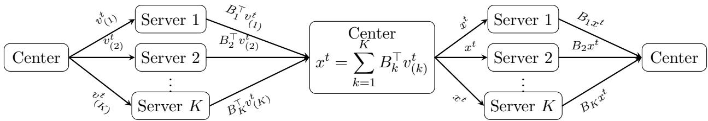  
Figure 1: Illustration of recovering $B B ^ { \top } v ^ { t }$ from $v ^ { t }$ in the federated setting.

Denote $\sigma _ { 1 } ( B ) \geq \sigma _ { 2 } ( B ) \geq \cdot \cdot \cdot \geq \sigma _ { L } ( B )$ be the top L singular values of B and $u _ { i }$ be the corresponding left singular vector. Hence, $u _ { i }$ is the eigenvector of $B B ^ { \top }$ corresponding to the eigenvalue $\lambda _ { i } = \sigma _ { i } ( B ) ^ { 2 }$ . Apply Algorithm 1 with $A = B B ^ { \top }$ and a tuning parameter $\sigma ^ { 2 }$ close to $\sigma _ { i } ( B ) ^ { 2 }$ to recover $u _ { i }$ if we have the full data B.

When only $B _ { k }$ are available, we want to revise Algorithm 1 to adapt to this federated setting. The main idea is to calculate the update $( \sigma ^ { 2 } I - \bar { B } B ^ { \top } ) ^ { 2 } \upsilon ^ { t } = \sigma ^ { 4 } \upsilon ^ { t } - 2 \sigma ^ { 2 } B B ^ { \top } \upsilon ^ { t } + B B ^ { \top } B B ^ { \top } \upsilon ^ { t }$ based on $B _ { k }$ . We partition $v ^ { t }$ into $\bar { \boldsymbol { v } } ^ { t } = [ ( \dot { \boldsymbol { v } } _ { ( 1 ) } ^ { t } ) ^ { \top } , \dots , ( \dot { \boldsymbol { v } } _ { ( K ) } ^ { t } ) ^ { \top } ] ^ { \top }$ , where $v _ { ( k ) } ^ { t } \in \mathbb { R } ^ { n _ { k } }$ corresponds to the sample indices on local server k. Therefore, $B B ^ { \top } v ^ { t }$ follows that:

$$
B B ^ { \top } \boldsymbol { v } ^ { t } = \left[ \begin{array} { l } { B _ { 1 } } \\ { \vdots } \\ { B _ { K } } \end{array} \right] [ B _ { 1 } ^ { \top } , B _ { 2 } ^ { \top } , \cdots , B _ { K } ^ { \top } ] \left[ \begin{array} { c } { v _ { ( 1 ) } ^ { t } } \\ { \vdots } \\ { v _ { ( K ) } ^ { t } } \end{array} \right] = \left[ \begin{array} { l } { B _ { 1 } x _ { t } } \\ { \vdots } \\ { B _ { K } x _ { t } } \end{array} \right] , \quad \mathrm { w h e r e ~ } x _ { t } : = \sum _ { k = 1 } ^ { K } B _ { k } ^ { \top } v _ { ( k ) } ^ { t } .\tag{2}
$$

Hence, $B B ^ { \top } v ^ { t }$ can be computed using only the local matrix–vector products $B _ { k } ^ { \top } v _ { ( k ) } ^ { t }$ and $B _ { k } x ^ { t }$ ; applying the same scheme once more yields $( B B ^ { \top } ) ^ { 2 } v ^ { t }$ . Therefore, we can update $v ^ { t + 1 }$ using only matrix-vector products from local servers. It largely reduces the privacy concern and communication cost.

Based on (2), we propose FLICKER for the federated eigenvector recovery in Algorithm $2$ The steps for one iteration can be found in Figure 1, where the center server broadcasts and stacks vectors and the local servers return matrix-vector products. Furthermore, with a left singular vector $u ,$ its singular value is given by $\sqrt { u ^ { \top } B B ^ { \top } u }$ . Hence, we also return an estimate of the singular value with $\sqrt { u ^ { \top } B B ^ { \top } u }$

We next propose Algorithm 3 for the right singular vectors $v _ { i }$ . Here we use $v _ { i }$ to denote right singular vectors and $u ^ { t }$ for t-th iteration inside an algorithm. This scenario is actually simpler. To find the right singular vector, we should apply Algorithm 1 to $B ^ { \top } B$ with a target value $\sigma ^ { 2 }$ . Hence, the update in each iteration is about $B ^ { \top } B u ^ { t }$ , where

$$
\boldsymbol { B } ^ { \top } \boldsymbol { B } \boldsymbol { u } ^ { t } = \sum _ { k = 1 } ^ { K } B _ { k } ^ { \top } B _ { k } \boldsymbol { u } ^ { t }\tag{3}
$$

Therefore, the required quantity $B ^ { \top } B u ^ { t }$ can be found by aggregating $B _ { k } ^ { \top } B _ { k } u ^ { t }$ from each local server. It follows for $( B ^ { \top } B ) ^ { 2 } u ^ { t }$ and hence Algorithm 3.

Finally, we investigate FLICKER in terms of its communication and computation cost. We take Algorithm 2, the more complicated algorithm, for discussion. Each gradient descent iteration requires two federated products, $B B ^ { \top } v ^ { t }$ and $( B B ^ { \top } ) ^ { 2 } v ^ { t }$

The communication costs and computational costs for each federated product are summarized below.

• Reduce. Each server k sends a vector in $B _ { k } ^ { \top } v _ { ( k ) } ^ { t } \in \mathbb { R } ^ { m }$ to the center, for a total of $K m$ scalars. The computation cost on each local server is $O ( n _ { k } m )$

• Broadcast. The center sends the aggregated $\mathbb { R } ^ { m }$ vector back to all K servers, for another Km scalars. The computation cost is $O ( K m )$

• Boundary vectors. At the start and end of each iteration, the center broadcasts $v ^ { t } \in \mathbb { R } ^ { n }$ and receives the concatenated vectors $\{ u _ { ( k ) } ^ { t } \}$ , contributing $O ( n )$ scalars per boundary exchange.

Thus the total communicated payload per iteration is $O ( 3 n + 4 K m )$ scalars. On server $k ,$ each local product $B _ { k } x$ or $B _ { k } ^ { \top } y$ costs $O ( n _ { k } m )$ operations in the dense case, and $O ( | E _ { k } | )$ operations when $B _ { k }$ is a sparse matrix with $\left| E _ { k } \right|$ nonzero entries. By Theorem 1, the number of iterations needed is $T = O ( \log n )$ , so the total communication scales as $O \Big ( ( 3 n + 4 K m ) \log n \Big )$ and the total local computation scales as $O ( | E _ { k } | \log n )$ . To recover top L singular vectors, the same procedure needs to be repeated L times using either singular value estimates or the grid search procedure in Algorithm 4 below. This will bring the total local computation scales as $O ( L | E _ { k } | \log n )$ for the top L singular vectors or $O \Big ( \operatorname* { m i n } \{ n , m \} \lvert E _ { k } \rvert ) \log n \Big )$ for the full spectrum.

As a comparison, if we gather all data to the center and perform SVD, then the total communication cost is of $O ( | E | )$ , where $\begin{array} { r } { \left| E \right| = \sum _ { k = 1 } ^ { K } \left| E _ { k } \right| } \end{array}$ The computation cost with the same iterative spectral procedure centrally requires $O ( L | E | \log n )$ for top L singular directions. Algorithm 2 retains the same order of total computational cost, while reducing the communication cost to $O ( ( n + K m ) \log n )$ , which can be substantially smaller when $n + K m \ll | E |$ . Moreover, the dominant computations are carried out at the local servers, whereas the center only performs vector aggregation and updates. This architecture is particularly attractive when the local data holders have substantially greater computational resources than the coordinating center.

Federated learning provides better privacy protection than centralized learning. In FLICKER, the local servers only need to release $B _ { k } ^ { \top }$ x or $B _ { k } x$ for a given vector x. So an attacker may learn information of $B _ { k }$ along some directions but not the whole matrix. In PCA, we usually need the top $L \ll \operatorname* { m i n } \{ n , m \}$ singular vectors instead of the full set, so that the privacy leakage is limited. However, this is not a formal privacy guarantee. Stronger notions such as diferential privacy would require additional noise and separate theoretical analysis. This is beyond the scope of this paper.

The same design principle can also adapt other eigenvector algorithms to the federated setting. For example, inverse iteration (Golub & Van Loan 2013) and Krylov subspace methods (Saad 2011) rely on repeated matrix–vector products, span $\{ v ^ { t } , A v ^ { t } , \ldots , A ^ { J } v ^ { t } \}$ . These methods can be implemented in the federated setting using the communication schemes in (2) and (3). By contrast, our method requires only Ax and $A ^ { 2 } x$ for a given vector x at each iteration, leading to a more straightforward federated implementation.

Algorithm 2 Federated power iteration FLICKER (left singular vectors)   
Require: Local blocks $B _ { k }$ on servers $k = 1 , \ldots , K ;$ approximate singular value $\sigma ;$ number of   
iterations $T ;$ step size $\eta .$   
Ensure: $( \sigma _ { v } , v ^ { T } )$ : left singular value and vector of B where $\sigma _ { v }$ is closest to $\sigma .$   
Initialize $v ^ { 0 } \sim \mathcal { N } ( 0 , I _ { n } )$ and set $v ^ { 0 }  v ^ { 0 } / \| v ^ { 0 } \|$   
for $t = 0 , \ldots , T - 1$ do   
[Center] Send the block $v _ { ( k ) } ^ { t }$ to server $k .$   
for $k = 1 , \ldots , K$ do   
[Server $k ]$ Compute $x _ { ( k ) } ^ { t } = B _ { k } ^ { \top } v _ { ( k ) } ^ { t }$ and send $\boldsymbol { x } _ { ( k ) } ^ { t }$ to the center.   
end for   
[Center] Aggregate $\begin{array} { r } { x ^ { t } = \sum _ { k = 1 } ^ { K } x _ { ( k ) } ^ { t } } \end{array}$ and broadcast $x ^ { t }$   
for $k = 1 , \ldots , K$ do   
[Server $k ]$ Compute $u _ { ( k ) } ^ { t } = B _ { k } x ^ { t }$ and send $u _ { ( k ) } ^ { t }$ to the center.   
end for   
[Center] Concatenate $\boldsymbol { u } ^ { t } = [ ( \boldsymbol { u } _ { ( 1 ) } ^ { t } ) ^ { \top } , \ldots , ( \boldsymbol { u } _ { ( K ) } ^ { t } ) ^ { \top } ] ^ { \top }$   
[Center] Update $\sigma _ { v } = \sqrt { \operatorname* { m a x } \{ ( u ^ { t } ) ^ { \top } v ^ { t } , 0 \} }$   
for $k = 1 , \ldots , K$ do   
[Server $k ]$ Compute $y _ { k } ^ { t } = B _ { k } ^ { \top } u _ { ( k ) } ^ { t }$ and send $y _ { k } ^ { t }$ to the center.   
end for   
[Center] Aggregate $\begin{array} { r } { \boldsymbol { y } ^ { t } = \sum _ { k = 1 } ^ { K } \boldsymbol { y } _ { k } ^ { t } } \end{array}$ and broadcast $y ^ { t } .$   
for $k = 1 , \ldots , K$ do   
[Server $k ]$ Compute $w _ { ( k ) } ^ { t } = B _ { k } y ^ { t }$ and send $w _ { ( k ) } ^ { t }$ to the center.   
end for   
[Center] Concatenate $\boldsymbol { w } ^ { t } = [ ( \boldsymbol { w } _ { ( 1 ) } ^ { t } ) ^ { \top } , \ldots , ( \boldsymbol { w } _ { ( K ) } ^ { t } ) ^ { \top } ] ^ { \top }$   
[Center] Update $v ^ { t + 1 } = v ^ { t } - \eta ( \sigma ^ { 4 } v ^ { t } - 2 \sigma ^ { 2 } u ^ { t } + w ^ { t } )$ , and set $\begin{array} { r } { v ^ { t + 1 }  \frac { v ^ { t + 1 } } { \| v ^ { t + 1 } \| } } \end{array}$   
end for

## 2.3 Selection on target singular values

Given a target value $\sigma ,$ FLICKER recovers a singular direction whose squared singular value is closest to $\sigma ^ { 2 }$ . When proper approximations of the target singular values are available, diferent singular directions can be recovered independently, without sequential orthogonalizations used in standard power methods. This raises the practical question of how to select the target values.

When an approximate target is available, it can be used directly in FLICKER . For example, the leading singular direction can be recovered using any target above the largest singular value. For a binary bipartite adjacency matrix, $\| B \| _ { F } = \sqrt { | E | }$ provides such an upper bound. Another possibility is to use local spectral information. In applications where the leading singular values scale with the local sample size, a properly rescaled local singular value can provide an efective target for FLICKER. This is the strategy used in Sections 5–6.

```latex
Algorithm 3 Federated power iteration FLICKER (right singular vectors)
Require: $B _ { k } , k = 1 , \ldots , K$ , target singular value $\sigma ,$ number of iterations $T ,$ step size $\eta .$
Ensure: $( \sigma _ { v } , u ^ { T } ) \colon$ right singular value and vector of $B$ with $\sigma _ { v }$ closest to $\sigma .$
Initialize $u ^ { 0 } \sim \mathcal { N } ( 0 , I _ { m } )$ and set $v ^ { 0 }  u ^ { 0 } / \| u ^ { 0 } \|$
for $t = 0 , \ldots , T - 1$ do
[Center] Broadcast $u ^ { t } .$
for $k = 1 , \ldots , K$ do
[Server $k ]$ Compute $x _ { k } ^ { t } = B _ { k } ^ { \top } B _ { k } u ^ { t }$ and send $\ v x _ { k } ^ { t }$ to center.
end for
[Center] Sum $\begin{array} { r } { x ^ { t } = \sum _ { k = 1 } ^ { K } x _ { k } ^ { t } } \end{array}$ and broadcast $x ^ { t }$
[Center] Update $\sigma _ { v } = \sqrt { \operatorname* { m a x } \{ ( x ^ { t } ) ^ { \top } u ^ { t } , 0 \} }$
for $k = 1 , \ldots , K$ do
[Server $k ]$ Compute $w _ { k } ^ { t } = B _ { k } ^ { \top } B _ { k } x ^ { t }$ and send $w _ { k } ^ { t }$ to center.
end for
[Center] Sum $\begin{array} { r } { w ^ { t } = \sum _ { k = 1 } ^ { K } w _ { k } ^ { t } . } \end{array}$
[Center] Update $\begin{array} { r } { u ^ { t + 1 } \stackrel { \cdots \stackrel { } { \dots } } { = } u ^ { t } - \eta ( \sigma ^ { 4 } u ^ { t } - 2 \sigma ^ { 2 } x ^ { t } + w ^ { t } ) , \qquad u ^ { t + 1 } \gets u ^ { t + 1 } / \| u ^ { t + 1 } \| . } \end{array}$
end for
```

When we would like to recover the full spectrum, we can instead search over the spectrum through repeated calls to FLICKER . Suppose that upper and lower tuning values $\sigma ^ { ( 1 ) }$ and $\sigma ^ { ( 2 ) }$ bracket the singular values of interest. Running FLICKER at the two endpoints first identifies the largest and smallest singular directions. We then recursively examine the intervals between the singular values already discovered.

For a general bipartite network setting, we may choose $\sigma ^ { ( 1 ) } = \sqrt { \mathrm { t o t a l ~ d e g r e e } }$ and $\sigma ^ { ( 2 ) } = 0$

To search for additional singular vectors, we recursively bisect intervals between already discovered approximate singular values. Suppose we already recover two consecutive singularvalue estimates $\hat { \sigma } ^ { ( i ) } > \hat { \sigma } ^ { ( i + 1 ) }$ , we use the target value $\sigma = \sqrt { \{ ( \hat { \sigma } ^ { ( i ) } ) ^ { 2 } + ( \hat { \sigma } ^ { ( i + 1 ) } ) ^ { 2 } \} / 2 }$ . We then compute $( \hat { \sigma } , u ) = \mathrm { F L I C K E R } ( \sigma )$ . If u is approximately orthogonal to both $v ^ { ( i ) }$ and $v ^ { ( i + 1 ) }$ it represents a new singular direction; we insert $( \hat { \sigma } , u )$ between the two existing pairs and continue the search on the two resulting intervals. Otherwise, the current interval is marked as completed. The resulting procedure is summarized in Algorithm 4. Although the procedure can recover the full spectrum, in practice it can be terminated once the desired number of singular directions has been obtained.

The next proposition establishes the grid-search guarantee of the full spectrum when singular values are simple. When a discovered singular value has multiplicity greater than one, the grid search in Algorithm 4 identifies its spectral location, and then the projected version of FLICKER in Algorithm 1 can be applied sequentially with the same target value to recover the corresponding singular subspace.

Proposition 1. Suppose that B has min $\{ m , n \}$ nonzero and simple singular values, and that the initial target values $\sigma ^ { ( 1 ) } > \sigma _ { 1 } \geq \sigma _ { \operatorname* { m i n } \{ m , n \} } > \sigma ^ { ( 2 ) }$ . Assume further that, whenever an interval examined by Algorithm $\it 4$ contains an undiscovered singular value, the squaredmidpoint target value has a unique closest singular value in the interior of the interval. If each FLICKER call is run to convergence, then Algorithm $\it 4$ recovers all singular value–vector pairs, with at most $2 \operatorname* { m i n } \{ m , n \} - 1$ calls to FLICKER.

Algorithm 4 Grid search for singular values and singular vectors   
Require: FLICKER algorithm, upper and lower spectral bounds $\sigma ^ { ( 1 ) } , \sigma ^ { ( 2 ) }$   
Ensure: A sequence of approximate singular pairs $\{ ( \hat { \sigma } ^ { ( i ) } , v ^ { ( i ) } ) \}$   
Compute two initial approximate singular pairs $( \overbrace { \hat { \sigma } } ^ { ( 1 ) } , v ^ { ( 1 ) } ) = \mathrm { F L I C K E R } ( \sigma ^ { ( 1 ) } )$ and $( \hat { \sigma } ^ { ( 2 ) } , v ^ { ( 2 ) } ) =$   
FLICKER $_ { . ( \sigma ^ { ( 2 ) } ) }$   
Initialize singular value list $I = [ \hat { \sigma } ^ { ( 1 ) } , \hat { \sigma } ^ { ( 2 ) } ]$ (sorted in decreasing order).   
Initialize singular vector list $V \stackrel { \cdot } { = } [ v ^ { ( 1 ) } , v ^ { ( \bar { 2 } ) } ]$   
Initialize target value list $J = \left\lceil \sqrt { \frac { 1 } { 2 } \{ ( \hat { \sigma } ^ { ( 1 ) } ) ^ { 2 } + ( \hat { \sigma } ^ { ( 2 ) } ) ^ { 2 } \} } \right\rceil$   
while $J$ is not empty and $| I | \leq \operatorname* { m i n } \{ m , n \}$ do   
Select a $\sigma \in J$ and remove it from $J .$   
Find i such that $\hat { \sigma } ^ { ( i ) } > \sigma > \hat { \sigma } ^ { ( i + 1 ) }$ , where $\hat { \sigma } ^ { \left( i \right) }$ and $\hat { \sigma } ^ { ( i + 1 ) }$ are consecutive elements in I.   
Compute (ˆσ, u) = FLICKE $\operatorname { R } ( \sigma )$   
if $| \boldsymbol { u } ^ { \top } \boldsymbol { v } ^ { ( i ) } | \stackrel { } { \leq } 1 \dot { / 2 }$ and $| u ^ { \top } v ^ { ( i + 1 ) } | \leq 1 / 2$ then   
Insert σˆ into I between $\hat { \sigma } ^ { \left( i \right) }$ and $\hat { \sigma } ^ { ( i + 1 ) }$   
Insert u into V between $v ^ { ( i ) }$ and $v ^ { ( i + 1 ) }$   
Append the new target values $\sqrt { \textstyle { \frac { 1 } { 2 } } \{ ( \hat { \sigma } ^ { ( i + 1 ) } ) ^ { 2 } + \hat { \sigma } ^ { 2 } \} }$ and $\sqrt { \textstyle { \frac { 1 } { 2 } } \{ ( \hat { \sigma } ^ { ( i ) } ) ^ { 2 } + \hat { \sigma } ^ { 2 } \} }$ to $J .$   
end if   
end while

## 3 Federated Community Detection

We now formalize the federated bipartite network setting. Let L and R denote the left and right node sets, with $n = | { \mathcal { L } } |$ and $m = | { \mathcal { R } } |$ , and let $B \in \{ 0 , 1 \} ^ { n \times m }$ be the whole bipartite adjacency matrix. In the federated setting, the left node set is partitioned as $\textstyle { \mathcal { L } } = \bigcup _ { k = 1 } ^ { K } { \mathcal { L } } ^ { ( k ) }$ , where the $\mathcal { L } ^ { ( k ) } \mathrm { s }$ are disjoint. Server k observes the interactions between $\mathcal { L } ^ { ( k ) }$ and the common node set $\mathcal { R } _ { : }$ and hence stores $B _ { k } \in \{ 0 , 1 \} ^ { n _ { k } \times m }$ , where $n _ { k } = | \mathcal { L } ^ { ( k ) } |$ $\textstyle \sum _ { k = 1 } ^ { K } n _ { k } = n$ , and $B = [ B _ { 1 } ^ { \top } , \ldots , B _ { K } ^ { \top } ] ^ { \top }$ . Let $z _ { 1 } \in [ L _ { 1 } ] ^ { n }$ and $z _ { 2 } \in [ L _ { 2 } ] ^ { m }$ denote the community labels on the two node sets. Our goal is to recover $z _ { 1 }$ and $z _ { 2 }$ from $\{ B _ { k } \} _ { k = 1 } ^ { K }$ without pooling the local matrices.

We adopt the bipartite stochastic block model (SBM) (Dhillon 2001, Larremore et al. 2014, Rohe et al. 2016, Yen & Larremore 2020). Let $Z _ { 1 } \in \{ 0 , 1 \} ^ { n \times L _ { 1 } }$ and $Z _ { 2 } \in \{ 0 , 1 \} ^ { m \times L _ { 2 } }$ be the membership matrices corresponding to $z _ { 1 }$ and $z _ { 2 } ,$ and let $G \in [ 0 , 1 ] ^ { L _ { 1 } \times L _ { 2 } }$ be the community connection matrix. Then

$$
Q : = \mathbb { E } [ B ] = Z _ { 1 } G Z _ { 2 } ^ { \top } .
$$

Let $Z _ { 1 } ^ { ( k ) }$ denote the rows of $Z _ { 1 }$ indexed by $\mathcal { L } ^ { ( k ) }$ . The corresponding local mean matrix is $Q _ { k } : = \mathbb { E } [ B _ { k } ] = Z _ { 1 } ^ { ( k ) } G Z _ { 2 } ^ { \top } , 1 \le k \le K$

Spectral methods provide a natural and computationally eficient approach to recovering $z _ { 1 }$ and $z _ { 2 }$ . The co-clustering method of Dhillon (2001) applies SVD to B and clusters the two node sets using its leading singular vectors. Related spectral methods include Rohe

et al. (2016), which uses regularization to accommodate degree heterogeneity, and Wang et al.   
(2020), which uses entrywise ratios between leading singular vectors and the first singular   
vector. These methods rely on the leading left and right singular vectors of the global matrix   
$B .$ , and thus cannot be directly implemented in our federated setting, where only the local   
matrices $B _ { k }$ are observed and raw data cannot be pooled across servers.   
We next introduce BiFLICKER, which combines our FLICKER algorithm with a simple   
singular-value selection scheme. To recover the leading singular vectors of $B ,$ , we first estimate   
the corresponding singular values from one local server. Proposition 2 below shows that, after   
rescaling, the leading singular values of a local block $B _ { k }$ are close to those of the global matrix   
B. Moreover, FLICKER only requires the input target value $\sigma$ to be closer to the singular   
value $\sigma _ { i } ( B )$ of our interest, than any other singular values, on the squared singular-value scale.   
It does not require the exact value. We therefore compute the leading local singular values   
$\sigma _ { 1 } ^ { ( k ) } , \dots , \sigma _ { L } ^ { ( k ) }$ , where $L = \operatorname* { m i n } \{ L _ { 1 } , L _ { 2 } \}$ , on any server k with suficiently large $n _ { k }$ , and use   
$\tilde { \sigma } _ { i } = \sqrt { n / n _ { k } } \sigma _ { i } ^ { ( k ) } , i = 1 , \ldots , L .$ as target values for FLICKER . The resulting left and right   
singular vectors of B are then used as embeddings for k-means clustering. The procedure   
is summarized in Algorithm 5. Note that this step is just to estimate $\sigma _ { i }$ . In practice, a   
suficiently large reference server is preferable.

Algorithm 5 Federated community detection on bipartite networks (BiFLICKER)   
Require: Local connection matrices $B _ { k } ,$ total number of left nodes $n ,$ numbers of communities   
$L _ { 1 }$ and $L _ { 2 }$ for $\mathcal { L }$ and $\mathcal { R }$ , iterations $T _ { i }$ step size $\eta .$   
Ensure: Estimates $\hat { z } _ { 1 }$ and $\hat { z } _ { 2 }$ of the community labels $z _ { 1 }$ and $z _ { 2 } .$   
[Any server k with suficiently large $n _ { k } ]$ Compute its leading singular values $\sigma _ { 1 } ^ { ( k ) } \geq \sigma _ { 2 } ^ { ( k ) } \geq$   
$\dot { } \dots \geq \sigma _ { L } ^ { ( k ) }$ , where $L = \operatorname* { m i n } \{ L _ { 1 } , L _ { 2 } \}$ , and send $\{ n _ { k } , \sigma _ { i } ^ { ( k ) } \} _ { i = 1 } ^ { L }$ to the center.   
[Center] Form the target values $\mathcal { I } = ( \tilde { \sigma } _ { 1 } , \dots , \tilde { \sigma } _ { L } )$ with $\tilde { \sigma } _ { i } = \sqrt { n / n _ { k } } \sigma _ { i } ^ { ( k ) }$   
For each target $\tilde { \sigma } _ { i } \in \mathcal { I } .$ , independently apply the federated left- and right-singular-vector   
FLICKER algorithms to obtain $\xi _ { i }$ and $\psi _ { i } .$ , respectively. Set $\Xi = [ \xi _ { 1 } , \dots , \xi _ { L } ]$ and $\Psi =$   
$[ \psi _ { 1 } , \dots , \psi _ { L } ]$ . See remark on a variant Sequential BiFLICKER.   
Apply k-means to the rows of $\Xi$ to cluster the n nodes in $\mathcal { L }$ into $L _ { 1 }$ groups; the resulting   
labels form $\hat { z } _ { 1 }$   
Apply k-means to the rows of $\Psi$ to cluster the m nodes in R into $L _ { 2 }$ groups; the resulting   
labels form ${ \hat { z } } _ { 2 }$   
Remark 2. When the target singular values are close or repeated, we therefore consider a   
sequential variant, referred to as Sequential BiFLICKER. Starting from the largest target,   
after recovering $\xi _ { 1 } , \ldots , \xi _ { i - 1 }$ and $\psi _ { 1 } , . . . , \psi _ { i - 1 }$ , define $P _ { i } ^ { \mathcal { L } } = I - \Xi _ { < i } \Xi _ { < i } ^ { \bar { \top } }$ and $P _ { i } ^ { \mathcal { R } } = I - \Psi _ { < i } \Psi _ { < i } ^ { \top }$   
Then apply Algorithm $\mathcal { Q }$ with target ${ \tilde { \sigma } } _ { i }$ and projection $P _ { i } ^ { \mathcal { L } }$ to obtain $\xi _ { i }$ , and Algorithm 3 with   
target ${ \tilde { \sigma } } _ { i }$ and projection $P _ { i } ^ { \mathcal { R } }$ to obtain $\psi _ { i }$ . Here, projected FLICKER refers to Algorithms ${ \it 2 - 3 }$   
with the projection step in Algorithm 1 applied. This sequential projection requires previous   
directions, which sacrifices parallel computation across spectral directions but is more robust   
to nearby singular values. It is used in Theorem 3 and real data analysis in Section 6.

## 4 Theoretical Guarantee

This section presents the theoretical guarantees for FLICKER and BiFLICKER. Section 4.1 provides the proof of Theorem $2 ;$ the proof of Theorem 1 is simpler and deferred to the supplementary material. Section 4.2 establishes the community recovery guarantees for BiFLICKER under the bipartite SBM.

## 4.1 Convergence of FLICKER

Here we demonstrate the proof for our FLICKER algorithm with a projection P. Starting with the exact projection $P _ { I } ^ { \perp }$ , a spectral decomposition shows that the iteration approaches the target subspace at a geometric rate. We then bound the discrepancy between the exact projection and the given projection P. A lower bound on the initial target component under Gaussian initialization controls the efect of normalization, allowing us to combine the convergence and perturbation estimates to obtain the claimed bound.

Proof of Theorem 2. Let $\mu _ { \star } = \operatorname* { m a x } _ { j \not \in I } \{ 1 - \eta ( \lambda - \lambda _ { j } ) ^ { 2 } \}$ and set $M = \mu _ { \star } ^ { - 1 } [ I _ { n } - \eta ( \lambda I _ { n } - A ) ^ { 2 } ]$ . The step-size condition implies $M \succ 0$ and $\| M \| \leq \mu _ { \star } ^ { - 1 }$ . Since $P$ is a nonzero orthogonal projector, $P M v ^ { 0 } \neq 0$ almost surely. Moreover, for any nonzero $x \in \mathrm { r a n g e } ( P ) , x ^ { \top } P M x = x ^ { \top } M x > 0$ so subsequent updates are also nonzero. Thus, setting $w ^ { t } = ( P M ) ^ { t } v ^ { 0 }$ and $z ^ { t } = ( P _ { I } ^ { \perp } M ) ^ { t } v ^ { 0 }$ 2 we have $v ^ { t } = w ^ { t } / \| w ^ { t } \|$ almost surely for every $t \geq 1$

We first consider the exact projection $P _ { I } ^ { \perp }$ . Recall that $\begin{array} { r } { P _ { I } ^ { \perp } = I _ { n } - \sum _ { i \in I } u _ { i } u _ { i } ^ { \top } } \end{array}$ is the exact orthogonal projector onto the remaining eigendirections. The matrix $P _ { I } ^ { \perp } M$ is zero on the excluded directions, is the identity on $\mathcal { U } _ { \star }$ , and has eigenvalues at most $r _ { I }$ on the other remaining directions. Consequently, $\| P _ { I } ^ { \perp } M \| = 1$ and, for every $t \geq 1$ , we have $\| z ^ { t } \| \geq \| P _ { \star } v ^ { 0 } \|$ and $\| ( I _ { n } - P _ { \star } ) z ^ { t } \| \leq r _ { I } ^ { t }$ . For a uniform unit vector $v ^ { 0 }$ and any fixed unit vector $u , \mathrm { P r } \{ | u ^ { \top } v ^ { 0 } | <$ $\varsigma / \sqrt { n } \} \leq \varsigma$ . Taking $u \in \mathcal { U } _ { \star }$ , we therefore have $\| P _ { \star } v ^ { 0 } \| \ge \varsigma / \sqrt { n }$ with probability at least $1 - \varsigma$ We work on this event below. In particular,

$$
\mathrm { d i s t } \left( \frac { z ^ { T } } { \| z ^ { T } \| } , \mathcal { U } _ { \star } \right) \leq \frac { \sqrt { n } } { \varsigma } r _ { I } ^ { T } .
$$

Next, we focus on the given projection $P .$ . Note that $\| ( P - P _ { I } ^ { \perp } ) M \| \le \epsilon _ { 0 } / \mu _ { \star }$ and hence $\| P M \| \leq 1 + \epsilon _ { 0 } / \mu _ { \star }$ . Telescoping the diference of the two matrix powers gives

$$
\| w ^ { T } - z ^ { T } \| \leq \frac { T \epsilon _ { 0 } } { \mu _ { \star } } \left( 1 + \frac { \epsilon _ { 0 } } { \mu _ { \star } } \right) ^ { T - 1 } .
$$

If $T \epsilon _ { 0 } / \mu _ { \star } \le 1$ , the right-hand side is at most $e T \epsilon _ { 0 } / \mu _ { \star }$ . For nonzero $x , y .$ , normalization satisfies $\left\| x / \| x \| - y / \| y \| \right\| \leq 2 \| x - y \| / \| y \|$ . Applying this with $x = w ^ { T }$ and $y = z ^ { T }$ , and using the triangle inequality, we obtain

$$
\mathrm { d i s t } ( v ^ { T } , \mathcal { U } _ { \star } ) \leq \frac { \sqrt { n } } { \varsigma } r _ { I } ^ { T } + \frac { 2 e \sqrt { n } T \epsilon _ { 0 } } { \varsigma \mu _ { \star } } .
$$

If $T \epsilon _ { 0 } / \mu _ { \star } > 1$ , the same inequality holds because its right-hand side exceeds one, whereas dist $( v ^ { T } , \mathcal { U } _ { \star } ) \leq 1$

For $0 < r _ { I } < 1$ , the first term is at most $\epsilon _ { 1 }$ provided $r _ { I } ^ { T } \leq \varsigma _ { 1 } / \sqrt { n }$ . This is ensured by the stated iteration requirement after increasing $C _ { \varsigma }$ if necessary. When $r _ { I } = 0$ , the first term vanishes for every $T \geq 1$ . Taking $C _ { \varsigma } \geq 2 e / \varsigma$ proves the result. □

## 4.2 Consistency of BiFLICKER

We now show that the theoretical guarantee of Sequential BiFLICKER under the bipartite SBM introduced in Section 3. Let $z _ { 1 } : [ n ]  [ L _ { 1 } ]$ and $z _ { 2 } : [ m ]  [ L _ { 2 } ]$ be fixed community labels. Under the bipartite stochastic block model, the entries of B are independent, with $B ( i , j )$ ∼ Bernoulli $( G ( z _ { 1 } ( i ) , z _ { 2 } ( j ) ) )$ . Write $Q = \mathbb { E } [ B ] = Z _ { 1 } G Z _ { 2 } ^ { \top }$ and $L = \operatorname* { m i n } \{ L _ { 1 } , L _ { 2 } \}$ . Recall that $Q _ { k } = \mathbb { E } [ B _ { k } ]$ on server k. We impose the following assumption on the model.

Assumption 1 (Community proportions and connection probabilities). For a constant $\rho \in ( 0 , 1 )$ and a density parameter $\theta _ { 0 } \in ( 0 , 1 ]$ , which may depend on n and m, suppose that:

(i) The proportion of each community on either side is at least $\rho ,$ uniformly in n and $m$

(ii) The connection probabilities satisfy $0 \le G ( l _ { 1 } , l _ { 2 } ) \le \theta _ { 0 }$ for all $l _ { 1 } \in [ L _ { 1 } ]$ and $l _ { 2 } \in [ L _ { 2 } ]$ , and $\sigma _ { L } ( G ) \geq \rho \theta _ { 0 }$

(iii) For any distinct $l _ { 1 } , l _ { 1 } ^ { \prime } \in \left[ L _ { 1 } \right]$ , m $\begin{array} { r } { \mathrm { a x } _ { l _ { 2 } \in [ L _ { 2 } ] } | G ( l _ { 1 } , l _ { 2 } ) - G ( l _ { 1 } ^ { \prime } , l _ { 2 } ) | \geq \rho \theta _ { 0 } } \end{array}$ . Similarly, for any distinct $\begin{array} { r } { l _ { 2 } , l _ { 2 } ^ { \prime } \in [ L _ { 2 } ] , \operatorname* { m a x } _ { l _ { 1 } \in [ L _ { 1 } ] } | G ( l _ { 1 } , \dot { l } _ { 2 } ) - G ( l _ { 1 } , l _ { 2 } ^ { \prime } ) | \geq \rho \theta _ { 0 } } \end{array}$

Condition (i) prevents vanishing community proportions. Condition (ii) specifies the density scale and ensures a nondegenerate rank-L signal, while condition (iii) separates the connection profiles of distinct communities on both sides. $\theta _ { 0 }$ here should be interpreted as the density level parameter. It may decay with an increasing n, representing the sparse network cases. Singular values with multiplicity larger than 1 are allowed.

Proposition 2 (Local spectral calibration). Suppose Assumption 1 holds. Suppose there is a local server k with $n _ { k } \ge \rho n$ , uniformly sampled from n nodes. For a fixed $\alpha > 1$ , suppose $m \le n ^ { \alpha }$ and min $\{ n , m \} \theta _ { 0 } /$ log n is suficiently large. Then there is a constant $C > 0$ such that, with probability tending to one,

$$
\left| ( n / n _ { k } ) \sigma _ { j } ( B _ { k } ) ^ { 2 } - \sigma _ { j } ( B ) ^ { 2 } \right| \leq C \left\{ \theta _ { 0 } ^ { 2 } m \sqrt { n } \log n + \theta _ { 0 } ^ { 3 / 2 } \sqrt { n m ( n + m ) } \right\} , \quad 1 \leq j \leq L .\tag{4}
$$

Uniform sampling is one suficient condition for local calibration. The recovery result below applies to any reference block satisfying (4) with probability tending to one; it imposes no representative-composition requirement on the other servers.

Theorem 3 (Community recovery by sequential BiFLICKER). Suppose Assumption 1 holds, $m \leq n ^ { \alpha }$ for a fixed $\alpha > 1$ , and min $\{ n , m \} \theta _ { 0 } /$ log n is suficiently large. Let $B _ { k }$ be a reference block satisfying (4) with probability tending to one.

Apply Sequential BiFLICKER, the variant of Algorithm 5 in Remark 2, with targets $\tilde { \sigma } _ { j } =$ $\sqrt { n / n _ { k } } \sigma _ { j } ( B _ { k } ) , j = 1 , \ldots , L$ , step sizes $\eta _ { j } \asymp ( n m \theta _ { 0 } ^ { 2 } ) ^ { - 2 }$ such that $\eta _ { j }$ max $\{ \widetilde { \sigma } _ { j } ^ { 4 } , ( \sigma _ { 1 } ( B ) ^ { 2 } - \widetilde { \sigma } _ { j } ^ { 2 } ) ^ { 2 } \} \le$

$1 - c _ { 1 }$ for a fixed $c _ { 1 } \in ( 0 , 1 )$ , and $T = \lceil C _ { T } \log ( n + m ) \rceil$ iterations per component, for a suficiently large fixed $C _ { T }$ . Then, with high probability, $\widehat { z } _ { 1 }$ and ${ \widehat { z } } _ { 2 }$ satisfy that

$$
\operatorname* { m a x } \left\{ \operatorname* { m i n } _ { \pi _ { 1 } \in \mathfrak { S } _ { L _ { 1 } } } \frac { 1 } { n } \sum _ { i = 1 } ^ { n } \mathbf { 1 } \big \{ \mathfrak { T } _ { 1 } ( i ) \neq \pi _ { 1 } ( z _ { 1 } ( i ) ) \big \} , \operatorname* { m i n } _ { \pi _ { 2 } \in \mathfrak { S } _ { L _ { 2 } } } \frac { 1 } { m } \sum _ { j = 1 } ^ { m } \mathbf { 1 } \big \{ \mathfrak { T } _ { 2 } ( j ) \neq \pi _ { 2 } ( z _ { 2 } ( j ) ) \big \} \right\} \leq C \frac { n + m } { n m \theta _ { 0 } } ,\tag{5}
$$

where ${ \mathfrak { S } } _ { r }$ denotes the permutations of $[ r ] . \ I f ,$ in addition, min $\{ m , n \} \theta _ { 0 } ^ { 2 } /$ log n is suficiently large, both labelings are recovered exactly up to separate permutations with high probability.

Theorem 3 states that, under Assumption 1, the BiFLICKER embedding followed by k-means achieves $o ( 1 )$ misclassification rate in sparse networks and exact community recovery under a stronger sparsity condition. In particular, once the rescaled local targets identify the correct singular directions, BiFLICKER guarantees weak consistency whenever min $\{ n , m \} \theta _ { 0 } \to \infty$ matching the weak-consistency sparsity scale in Zhou & Amini (2019). The errors introduced by federated iterations are asymptotically negligible.

Our strong-consistency analysis leverages $2 \to \infty$ eigenvector error bounds (Tong et al. 2025) and uses techniques related to Su et al. (2020) and Abbe et al. (2020). Compared with the centralized symmetric settings considered in these works, our analysis requires several additional steps. We need to control both the left and right singular spaces of the rectangular bipartite matrix, justify the local-to-global singular-value calibration used to construct the FLICKER targets, and further control the approximation errors introduced by the sequential projected FLICKER iterations. Combining these components allows us to translate the federated spectral approximation into exact recovery on both sides of the bipartite network.

## 5 Simulation

## 5.1 Data Generation and Comparison Methods

We consider the bipartite SBM. For any pair of nodes $i \in \mathcal { L }$ and $j \in \mathcal R$ , the edge $b _ { i j }$ is generated as $b _ { i j } \sim$ Bernoulli $\left( G ( z _ { 1 } ( i ) , z _ { 2 } ( j ) ) \right)$ , where $z _ { 1 } ( i ) \in \{ 1 , \dotsc , L _ { 1 } \}$ denotes the community label of node i on the left side and $z _ { 2 } ( j ) \overset { \cdot } { \in } \{ 1 , \dots , L _ { 2 } \}$ denotes the community label of node $j$ on the right side. We consider K servers, where server $k$ stores the rows indexed by ${ \mathcal { L } } ^ { ( k ) } \subset { \mathcal { L } }$ and all columns in $\mathcal { R }$ . Our goal is to recover the community labels for nodes in both $\mathcal { L }$ and $\mathcal { R }$ without access to the full matrix B at any single location.

We consider nine combinations of the sample size n and the number of servers $K$ , with $n \in \{ 2 0 0 0 , 4 0 0 0 , 8 0 0 0 \}$ and $K \in \{ 5 , 1 0 , 2 0 \}$ . We fix $L _ { 1 } = 2$ and $L _ { 2 } = 3$ communities, and take the block matrix

$$
G = \frac { 1 } { 5 0 } \left( { 1 + d } \atop 0 . 3 + d - { 1 0 . 5 + d } \atop 1 + d \right) ,
$$

where d controls the overall edge density. We consider $d \in \{ - 0 . 2 , - 0 . 1 , 0 , 0 . 1 , 0 . 2 , 0 . 3 \}$ . Under the balanced community design, the expected edge density is $( 0 . 6 + d ) / 5 0$ , ranging from approximately 0.8% at $d = - 0 . 2$ to 1.8% at $d = 0 . 3$ , corresponding to sparse networks. Smaller values of d represent sparser networks. In this setting, d controls the background density while maintaining the separation between the community connection probabilities.

We apply spectral community detection on top of several federated PCA/SVD schemes: our method BiFLICKER, DisPCA in Balcan et al. (2014), DistPCA in Fan et al. (2019), FastPCA in Gang & Bajwa (2022), and the oracle method that has access to the full matrix B. For DisPCA and DistPCA, each server performs PCA locally and sends a small number of leading eigenvectors (and associated eigenvalues) to the center, which then applies PCA again to the aggregated local information. For all methods, we extract $L = 2$ leading singular vectors for downstream clustering.

For BiFLICKER, we also recover only the leading $L = 2$ singular directions, not the full spectrum. Hence, we apply Algorithm 5, with target singular values as rescaled top singular values from one local server. The grid-search procedure in Algorithm 4, to recover the full spectrum, is not used here. We set the number of iterations to $T = 5 0 K$ in all experiments.

## 5.2 Estimation of U and $z _ { 1 }$

We first focus on the left node set $\mathcal { L } .$ Recall that $L _ { 1 } = 2$ , so community detection on $\mathcal { L }$ is comparatively easier than on $\mathcal { R }$ . We examine both the estimation of the left singular vectors U and the resulting community labels $z _ { 1 }$

Let $U \in \mathbb { R } ^ { n \times L }$ be the matrix of the leading L left singular vectors of the full matrix $B _ { : }$ , and let $\hat { U }$ be the corresponding estimate produced by each method. We measure the error in estimating the left singular subspace by

$$
\mathrm { E r r } ( \hat { U } ; U ) = \| \hat { U } \hat { U } ^ { \top } - U U ^ { \top } \| _ { F } .\tag{6}
$$

This quantity is zero if and only if the estimated and oracle subspaces coincide. The results over 100 repetitions are reported in the left panel of Figure 2.

For community detection on ${ \mathcal { L } } ,$ we define the misclustering error as the smallest proportion of misclassified nodes over all permutations $\pi$ of the community labels:

$$
\mathrm { E r r } ( \hat { z } _ { 1 } ; z _ { 1 } ) = \frac { 1 } { n } \operatorname* { m i n } _ { \pi : [ L _ { 1 } ]  [ L _ { 1 } ] } \sum _ { i = 1 } ^ { n } \mathbf { 1 } \{ \hat { z } _ { 1 } ( i ) \neq \pi ( z _ { 1 } ( i ) ) \} .\tag{7}
$$

For each method, we compute $\hat { z } _ { 1 }$ from the estimated left singular vectors and compare it with the true labels $z _ { 1 }$ . The results over 100 repetitions are shown in the right panel of Figure 2.

Across all $( n , K , d )$ configurations, BiFLICKER outperforms the other federated methods in both subspace estimation and community recovery. DistPCA behaves similarly to BiFLICKER in the “large-n, small- $K ^ { \ast }$ regime, but its performance deteriorates substantially when n decreases or K increases, reflecting the loss of information at each local server. A similar degradation is observed for DisPCA. In contrast, BiFLICKER remains close to the oracle benchmark across all settings, demonstrating its robustness to both increased federated heterogeneity and smaller local sample sizes.

## 5.3 Estimation of V and $z _ { 2 }$

We now turn to the right node set $\mathcal { R } ,$ , which has $L _ { 2 } = 3$ communities. Note that the mean matrix $Q = Z _ { 1 } G Z _ { 2 } ^ { \top }$ has rank $L = 2$ , so we use the first two right singular vectors as $V$ and then apply k-means with $L _ { 2 } = 3$ clusters to recover $z _ { 2 }$

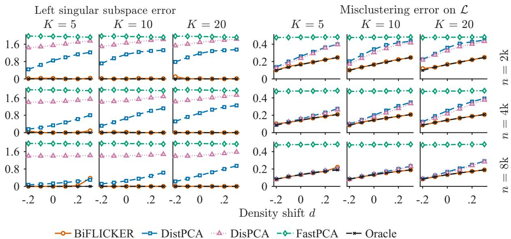  
Figure 2: Left: estimation errors of the left singular subspace $\mathrm { E r r } ( \hat { U } ; U )$ in (6). Right: misclustering errors on L, $\mathrm { E r r } \big ( \hat { z } _ { 1 } ; z _ { 1 } \big )$ in (7).

We use the same subspace error definition as in (6), replacing U by V , and the same misclustering error (7), replacing $z _ { 1 }$ by $z _ { 2 }$ . The errors over 100 repetitions are summarized in Figure 3.

When clustering R with $L _ { 2 } = 3$ communities, the oracle method itself becomes slightly more challenging: compared to the L-side results, the error is larger for small $n = 2 0 0 0$ but decreases again for large n = 8000. This is typical when the number of clusters increases.

This additional dificulty is amplified for federated methods. Except for BiFLICKER, all federated approaches exhibit noticeably higher misclustering errors on R. In particular, DisPCA attains relatively low error for L but sufers error rates of at least 0.4 on R, even in the most favorable setting $( n , K ) = ( 8 0 0 0 , 5 )$ . In contrast, BiFLICKER achieves accuracy on R that is almost indistinguishable from the oracle across the studied settings.

Figures 2 and 3 also illustrate the efect of network density. As d increases, the common background connectivity increases, without strengthening the contrasts between communities. The resulting increase in Bernoulli variation makes the community detection problem more challenging. BiFLICKER nevertheless remains close to the centralized oracle throughout the entire density range, including the low-density settings with d = −0.2 and −0.1.

## 5.4 Convergence

Finally, we examine the convergence of BiFLICKER with respect to the number of iterations T. We use the same data generation scheme as in Section 5.1 with d = 0. For each $n \in$ {2000, 4000, 8000} and each $K \in \{ 5 , 1 0 , 2 0 \}$ , we run BiFLICKER with $T \in \{ 5 , 1 0 , 1 5 , \ldots , 3 0 0 \}$ 2 and record the error in estimating the left singular subspace U and the misclustering error on $\mathcal { L }$ over 100 repetitions. The results are shown in Figure 4. Results for the right singular vectors V and node set R are very similar and omitted here.

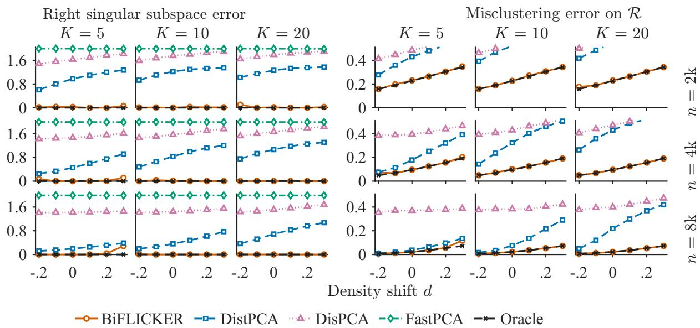  
Figure 3: Left: estimation errors of the right singular subspace $\mathrm { E r r } ( \hat { V } ; V )$ . Right: misclustering errors on $\mathcal { R } , \mathrm { E r r } ( \hat { z } _ { 2 } ; z _ { 2 } )$

Figure 4 shows that, as n increases, BiFLICKER requires fewer iterations to reach a given accuracy level. For fixed n, increasing the number of servers K reduces the sample size per server and consequently requires more iterations for convergence. Overall, even in the most challenging case $( n , K ) = ( 2 0 0 0 , 2 0 )$ , setting $T = 3 0 0$ is suficient to achieve near-oracle performance in most replications.

## 6 LastFM Data Analysis

We analyze the LastFM listening-history data set, available from the original data repository $\mathrm { a t } ^ { 1 }$ (Celma 2010). Let L denote the set of users and R the set of artists. For a user $i \in \mathcal { L }$ and artist $j \in \mathcal R$ , we set $B ( i , j ) = 1$ if user i listened to artist $j$ at least once, and $B ( i , j ) = 0$ otherwise. The resulting binary user–artist network is used for spectral estimation and community detection, while the number of listening events is retained separately for post-hoc analysis. User profiles also contain country information, which we use below to define the federated servers.

We retain countries with at least 30 users and artists with valid identifiers. We then iteratively remove users connected to fewer than 50 retained artists and artists connected to fewer than 10 users or at least 40% of the retained users. The upper-degree filter excludes extremely popular artists that provide little information for distinguishing user preferences. The resulting network contains $n = 5 1 1$ users from 7 countries, $m = 8 { , } 6 3 2$ artists, and 288,628 edges, corresponding to an edge density of 6.54%.

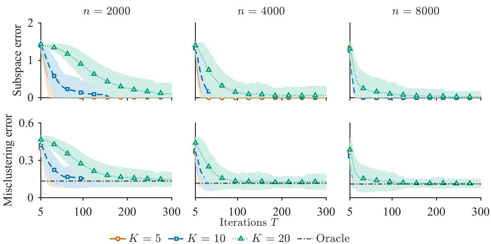  
Figure 4: Top: estimation errors of the left singular subspace $\mathrm { E r r } ( \hat { U } ; U )$ versus $T .$ . Bottom: misclustering errors on L versus $T .$ Curves show mean error ± one standard deviation for $K = 5$ servers (solid), $K = 1 0$ servers (dashed), and $K = 2 0$ servers (dotted).

The country information provides a natural way to represent geographically separated user populations. In many online platforms, user interaction data may be collected or maintained by regional services or data holders, while users across regions interact with a largely common set of items. Motivated by this setting, we treat each of the 7 retained countries as one local server. Specifically, server k contains the users from country k and stores the corresponding submatrix $B _ { k } \in \{ 0 , 1 \} ^ { n _ { k } \times m }$ , while the artist set is shared across all servers. Hence, $B = [ B _ { 1 } ^ { \top } , \ldots , B _ { 7 } ^ { \top } ] ^ { \top }$ . The summary of local datasets is provided in Table 1. It can be found that the sizes and average degrees are substantially heterogeneous on these local servers. In the federated analysis, the local matrices $B _ { k }$ remain on the corresponding servers; only the matrix–vector products required by FLICKER are communicated.

Table 1: Summary of the 7 country servers in the cleaned LastFM user–artist network.
<table><tr><td></td><td>US</td><td>UK</td><td></td><td>Poland Germany Finland Norway</td><td></td><td></td><td>Canada</td></tr><tr><td>Users  $n _ { k }$ </td><td>216</td><td>121</td><td>46</td><td>36</td><td>31</td><td>31</td><td>30</td></tr><tr><td>Mean user degree</td><td>575</td><td>636</td><td>487</td><td>560</td><td>405</td><td>493</td><td>569</td></tr><tr><td>Density</td><td>6.7%</td><td>7.4%</td><td>5.6%</td><td>6.5%</td><td>4.7%</td><td>5.7%</td><td>6.6%</td></tr></table>

We first compare three community detection procedures: local, central, and federated. In the local analysis, we only consider the local data $B _ { k }$ to find the communities. The centralized analysis applies the same community detection procedure to the complete user–artist matrix B, which serves as a benchmark. In the federated analysis, we apply Sequential BiFLICKER, which estimates a common global embedding while the country-specific matrices remain local. We take $L = 7$ left singular vectors and hence 7 communities in all three analyses. The spectral diagnostics suggest both $L = 5$ and $L = 7$ as stable resolutions; we report the finer $L = 7$ partition here, while the $L = 5$ solution gives qualitatively similar results. For Sequential BiFLICKER, we use the US server to obtain top 7 local singular values, and then rescale them by $\sqrt { 5 1 1 / 2 1 6 }$ to form the target values. Further implementation details are provided in the supplementary material.

Figure 5 compares the Adjusted Random Index (ARI, Hubert & Arabie (1985)) between the three community estimation methods within each country. The centralized and local assignments have relatively low agreement, with ARIs ranging from 0.16 to 0.45, showing that the information available on an individual server is generally insuficient to reproduce the global community structure. US, the server with the most users, enjoys the highest agreement with central analysis, which further emphasizes this observation. The Sequential BiFLICKER–local comparison gives a similar pattern. In contrast, the centralized and Sequential BiFLICKER assignments agree closely across all 7 countries, with ARIs between 0.90 and 1.00 and an overall ARI of 0.94. Thus, Sequential BiFLICKER recovers essentially the same global structure as the centralized analysis while keeping the country-specific matrices local. Given this close agreement, we base the following community interpretation on the Sequential BiFLICKER partition.

Centralized vs Local BiFLICKER vs Local Centralized vs BiFLICKER  
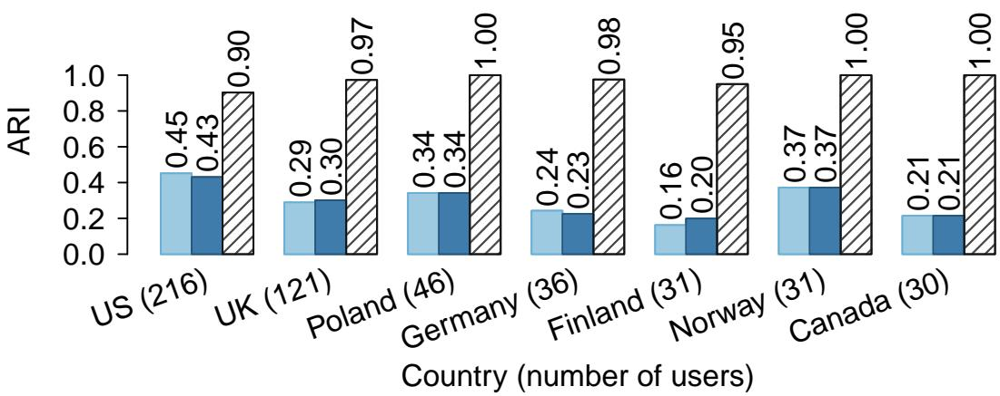  
Figure 5: Agreement of user-community assignments within each country. The three bars compare the centralized, local, and Sequential BiFLICKER assignments using the adjusted Rand index. Country sample sizes are shown with the country labels.

We then examine the $L = 7$ user communities obtained by Sequential BiFLICKER. We first investigate their overall listening behavior using listening breadth, activities, and withincommunity similarities. Listening breadth is the number of artists heard by a user (i.e., degree), while activity is the total number of listening events. We also compute the average pairwise cosine similarity between users’ artist-incidence vectors within a community, to evaluate the coherence. Results across diferent communities are summarized in Figure 6.

The communities exhibit clear diferences along these behavioral dimensions. Community 1, the largest group, has the lowest breadth, activity, and within-community similarity. It therefore represents a relatively low-engagement and heterogeneous group of listeners. Community 7 is at the opposite extreme: its users have by far the greatest breadth and activity, together with the strongest overlap in their artist sets. This pattern is characteristic of avid listeners with broad but relatively cohesive musical interests. Communities 2–6 are all relatively active, but they difer markedly in listening breadth and within-community similarity. Communities 3 and 4 have more moderate breadth and lower overlap in their artist sets, whereas Communities 5 and 6 listen to a broader range of artists and exhibit stronger within-community overlap. Community 2 lies between these two patterns, with intermediate breadth and similarity.

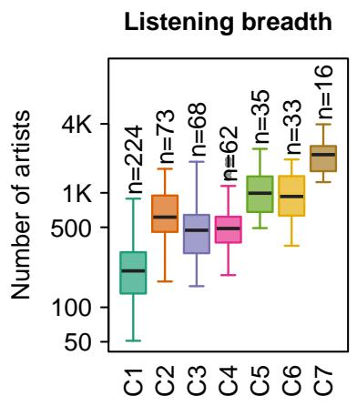

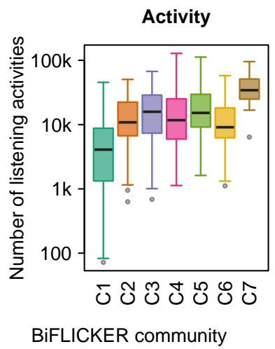  
Within−community similarity

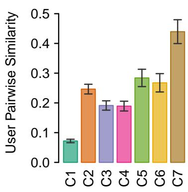  
Figure 6: Listening behavior by Sequential BiFLICKER user community, summarizing listening breadth (left panel), activity (middle panel), and within-community similarity (right panel) with 95% leave-one-user-out jackknife confidence intervals.

Table 2 further characterizes the communities through their representative artists. Communities 3 and 4 correspond to relatively broad genre categories, with metal for Community 3 and hip hop/R&B for Community 4. Within these broad genres, individual users appear to concentrate on relatively small sets of preferred artists and substyles, resulting in lower listening breadth. As these preferred sets difer across users, the within-community pairwise similarity also remains relatively low. Communities 5 and 6 instead combine broad listening with more strongly shared repertoires, represented by classic pop rock and soul, and by downtempo and electronica, respectively. Community 2 lies between these patterns with an indie rock and post-punk profile, while Community 7 has a roots-oriented profile spanning country, blues, folk, and psychedelic rock. Community 1 has no comparably distinctive artist core, consistent with its low within-community similarity.

The country composition in Table 2 also shows that the recovered communities do not simply reproduce the country-based server partition. Each of the larger communities contains users from multiple countries, although some geographic diferences remain: for example, Community 4 is more strongly represented by US users, Community 5 by UK users, and Community 6 contains substantial proportions of both UK and Polish users. Thus, the global

communities recovered by Sequential BiFLICKER cut across the local servers while exhibiting distinct listening behaviors and artist preferences.
<table><tr><td>Community</td><td></td><td>Users Main countries</td><td>Representative artists</td></tr><tr><td>C1</td><td>224</td><td>US 43.8%; UK 21.4%</td><td>Architecture in Helsinki; Rilo Kiley; Aerosmith</td></tr><tr><td>C2</td><td>73</td><td>US 43.8%; UK 30.1%</td><td>The Rakes; The Futureheads; Art Brut</td></tr><tr><td>C3</td><td>68</td><td>US 29.4%; Finland 25.0%</td><td>Pantera; Disturbed; Rammstein</td></tr><tr><td>C4</td><td>62</td><td>US 67.7%; Norway 8.1%</td><td>T.I.; Ludacris; Usher</td></tr><tr><td>C5</td><td>35</td><td>UK 51.4%; US 28.6%</td><td>Dexys Midnight Runners; Dusty Springfield; Rod Stewart</td></tr><tr><td>C6</td><td>33</td><td>UK 36.4%; Poland 30.3%</td><td>The Cinematic Orchestra; Nightmares on Wax; Bonobo</td></tr><tr><td>C7</td><td>16</td><td>US 62.5%; UK 31.2%</td><td>The Flying Burrito Brothers; Howlin&#x27; Wolf; John Fahey</td></tr></table>

Table 2: Country composition and representative artists of the Sequential BiFLICKER user communities. Country percentages are relative to community size.

## 7 Disclosure Statement

The authors report there are no competing interests to declare.

## 8 Data Availability Statement

Deidentified data have been made available at https://tinyurl.com/BiFLICKER.

## Supplementary Material

This supplementary material contains the implementation details and additional results about the LastFM data set in main manuscript, an additional movie data analysis, and the full proof of the strong consistency result for BiFLICKER. Section S1 introduces the implementation details, selection of $L ,$ and community interpretation details about LastFM dataset. Section S2 applies parallel BiFLICKER on a Douban movie dataset. Section S3 provides the proof for lemmas, propositions, and theorems about the FLICKER algorithm. In Sections S4–S6, we prove the strong consistency theorem about BiFLICKER under the sparse bipartite SBM.

## S1 LastFM Data Analysis: Details

## S1.1 Data Preprocessing

We provide additional details on the preprocessing of the LastFM data used in Section 6. We first retain countries represented by at least 30 users and remove artists without valid MusicBrainz identifiers (MBIDs). We then construct the binary user–artist network and iteratively apply degree filtering until the retained bipartite network no longer changes. Specifically, a user is retained if connected to at least 50 retained artists, while an artist is retained if connected to at least 10 but fewer than 40% of the retained users. The upper-degree restriction removes ubiquitous artists that provide little information for distinguishing user preferences.

There are 539 users from the seven retained countries before the iterative degree filtering and 511 users afterward. The final network contains 8,632 artists and 288,628 binary user–artist edges. Figure S1 shows the degree distributions in the resulting network. User degrees remain highly heterogeneous, with median 390 and mean 564.8, whereas the artist degrees are more concentrated after filtering, with median 20 and mean 33.4.

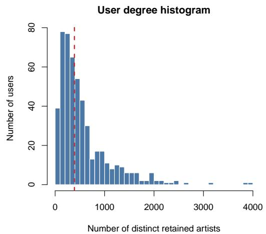

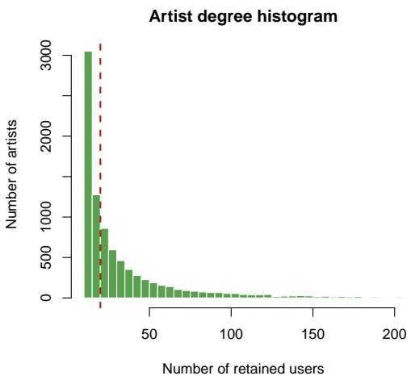  
Figure S1: Degree distributions in the retained LastFM user–artist network.

## S1.2 Selection of the Number of Communities

We use the centralized singular-value spectrum as a diagnostic for the dimension of the user embedding. Figure S2 shows the first 20 singular values of the retained user–artist matrix. The spectrum decays gradually after the dominant first component, with additional local separations around components 5 and 7. In particular, $\sigma _ { 5 } / \sigma _ { 6 } = 1 . 1 2 7$ and $\sigma _ { 7 } / \sigma _ { 8 } = 1 . 1 4 2$ . We use $L = 7$ in the main analysis to obtain the finer of these two resolutions.

As a robustness check, we repeat the centralized and Sequential BiFLICKER analyses using $L = 5$ . The overall adjusted Rand index between the resulting centralized and Sequential BiFLICKER assignments is 0.79, showing that the federated solution remains broadly aligned with the centralized partition under this coarser community resolution.

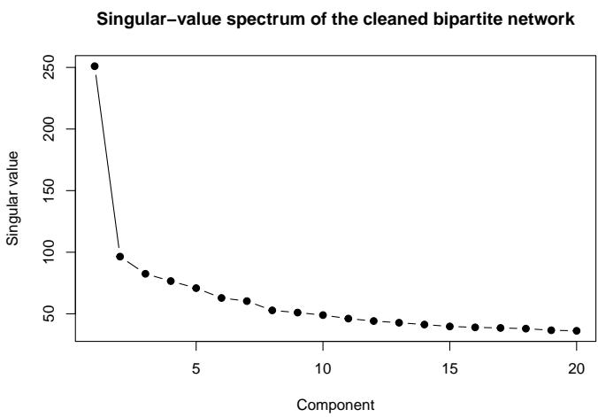  
Figure S2: Leading singular values of the retained LastFM user–artist network.

## S1.3 Implementation Details of Sequential BiFLICKER

The United States is the largest local server, containing 216 of the 511 retained users, and is used to provide the reference spectral information. Let $\sigma _ { i } ^ { \mathrm { ( U S ) } }$ denote its ith local singular value. For $i = 1 , \dots , 7$ , Sequential BiFLICKER uses

$$
\widetilde { \sigma } _ { i } = \sqrt { \frac { 5 1 1 } { 2 1 6 } } \sigma _ { i } ^ { \mathrm { ( U S ) } }
$$

as the target singular value, and the corresponding local singular direction as the initialization. The targets are processed in decreasing order. When recovering direction i, both the left and right iterates are projected onto the orthogonal complements of the first $i - 1$ recovered directions.

For target $\widetilde { \sigma } _ { i }$ , the step size is

$$
\eta _ { i } = \left[ \operatorname* { m a x } \left\{ \widetilde { \sigma } _ { i } ^ { 4 } , \left( ( 2 \widetilde { \sigma } _ { 1 } ) ^ { 2 } - \widetilde { \sigma } _ { i } ^ { 2 } \right) ^ { 2 } \right\} \right] ^ { - 1 } .
$$

Each direction is given a maximum of 20,000 iterations. Convergence diagnostics are evaluated every 100 iterations after the first 500 iterations. Early stopping requires the relative residuals on both the left and right sides to be at most 0.05, and the relative changes in the Rayleighbased singular-value estimates to be at most $1 0 ^ { - 4 }$ . These conditions must hold for three consecutive diagnostic checks.

The first three components satisfy the early-stopping criterion after 700, 4,500, and 7,000 iterations, respectively. Components 4–7 reach the pre-specified 20,000-iteration budget. Reaching the iteration budget means only that the stricter early-stopping criterion is not triggered; the estimated directions are retained in the final embedding.

Table S1 compares the resulting singular-value estimates with those obtained from the centralized SVD. The two spectra are very close: the largest absolute relative diference is 3.05%, occurring at component 4. The largest discrepancies occur for components 4 and 5, which are neighboring spectral directions and motivate the use of sequential projection.

<table><tr><td>Component</td><td>Target  $\widetilde { \sigma } _ { i }$ </td><td>Centralized</td><td>Sequential BiFLICKER</td><td>Relative difference</td></tr><tr><td>1</td><td>269.875</td><td>250.991</td><td>250.991</td><td>0.00%</td></tr><tr><td>2</td><td>102.865</td><td>96.448</td><td>96.311</td><td>-0.14%</td></tr><tr><td>3</td><td>92.053</td><td>82.502</td><td>81.894</td><td>-0.74%</td></tr><tr><td>4</td><td>77.837</td><td>76.594</td><td>74.262</td><td>-3.05%</td></tr><tr><td>5</td><td>75.150</td><td>70.858</td><td>72.939</td><td>2.94%</td></tr><tr><td>6</td><td>71.256</td><td>62.878</td><td>63.706</td><td>1.32%</td></tr><tr><td>7</td><td>69.376</td><td>60.315</td><td>60.398</td><td>0.14%</td></tr></table>

Table S1: Comparison of the target, centralized, and Sequential BiFLICKER singular values for the first seven components. Relative diferences are computed relative to the centralized singular values.

## S1.4 Additional community summaries

We provide additional details on the representative artists used to interpret the user communities in Section 6. The selection is based on binary user–artist incidence, consistent with the network used for community detection. For community c, an artist is considered as a distinctive candidate if it is heard by at least five users and at least 10% of the users in that community, and its prevalence within the community exceeds its prevalence among users outside the community. Candidate artists are ranked first by the diference between withinand outside-community prevalence and then by a Jefreys-smoothed log-odds ratio.

The five highest-ranked artists are retained as representative artists. If fewer than five positively enriched artists satisfy the criteria, we use the most prevalent artists satisfying the same support requirement as a fallback. This fallback is required only for Community 1, for which no comparably distinctive positively enriched artist core is identified. Table S2 reports the full five-artist summaries. The top-five artists cover nearly all users in Communities 2–7, whereas the coverage is lower for the more heterogeneous Community 1.

<table><tr><td></td><td></td><td>Community Users Representative artists</td><td>Coverage</td></tr><tr><td>C1</td><td></td><td>224 Architecture In Helsinki; Rilo Kiley; Aerosmith; In- 71.9% cubus; Mgmt</td><td></td></tr><tr><td>C2</td><td></td><td>73 The Rakes; The Futureheads; Art Brut; The Go! Team; 97.3% Maximo Park</td><td></td></tr><tr><td>C3</td><td></td><td>68 Pantera; Disturbed; Type O Negative; Rammstein; 98.5% Megadeth</td><td></td></tr><tr><td>C4</td><td></td><td>62 T.I.; Ludacris; Usher; Jay-Z; Gym Class Heroes</td><td>98.4%</td></tr><tr><td>C5</td><td></td><td>35 Dexys Midnight Runners; Dusty Springfield; Rod Stew- 100.0% art; The Pretenders; Squeeze</td><td></td></tr><tr><td>C6</td><td></td><td>33 The Cinematic Orchestra; Nightmares On Wax; Tosca; 100.0% Bonobo; Kosheen</td><td></td></tr><tr><td>C7</td><td></td><td>16 The Flying Burrito Brothers; Howlin&#x27; Wolf; Hank 100.0% Williams, Jr.; Os Mutantes; John Fahey</td><td></td></tr></table>

Table S2: Representative artists for the seven Sequential BiFLICKER user communities. Coverage is the percentage of users in a community who listened to at least one of the five listed artists. For Community 1, the listed artists are selected by the prevalence-based fallback described in the text.

## S2 Movie Data Analysis

We analyze a user–movie bipartite network constructed from movie ratings on douban.com between April 1, 2023 and June 23, 2023. Let L denote the set of users and R the set of movies. For any user $i \in \mathcal { L }$ and movie $j \in \mathcal R$ , we set $B ( i , j ) = 1$ if user i rated movie j during this period and $B ( i , j ) = 0$ otherwise.

To mimic a federated setting, we construct five datasets with diferent user sets but the same movie set. For dataset k, let $n _ { k }$ be the number of users and m be the number of movies (common across all datasets). Table S3 reports, for each dataset, the number of users $n _ { k }$ , the common number of movies m, and the average number of movies rated per user. The average number of ratings decreases sharply from dataset 1 to dataset 5, indicating substantial heterogeneity in user activity across datasets. This heterogeneity motivates the use of federated community detection to jointly leverage all datasets.

<table><tr><td>Dataset</td><td>1</td><td>2</td><td>3</td><td>4</td><td>5</td></tr><tr><td> $n _ { k }$ </td><td>75</td><td>101</td><td>494</td><td>1275</td><td>249</td></tr><tr><td>m</td><td>3129</td><td>3129</td><td>3129</td><td>3129</td><td>3129</td></tr><tr><td>Average  $\#$  of Movies Rated</td><td>774</td><td>364</td><td>204</td><td>95</td><td>37</td></tr></table>

Table S3: Number of users and movies in each dataset, and the average number of movies rated per user.

Let $B _ { k } \in \{ 0 , 1 \} ^ { n _ { k } \times m }$ denote the user-movie adjacency matrix for dataset k, $k = 1 , \ldots , 5$ We treat the five datasets as five federated servers. We apply BiFLICKER with $T = 5 0 0 0$ iterations to the collection $\{ B _ { k } \} _ { k = 1 } ^ { 5 }$ and compute the top 10 left and right singular vectors.

Based on the empirical singular values, we retain the top 6 components on each side and set $L _ { 1 } = L _ { 2 } = 6$ for subsequent clustering. Additional implementation details are provided in the supplementary materials.

We first examine the user communities. Table S4 reports the estimated community sizes for the $L _ { 1 } = 6$ user communities in each dataset, together with proportions on server k. As the average number of rated movies decreases, the proportion of users in community 1 increases markedly and eventually dominates dataset 5. This community can be interpreted as a group of “general users” without strong or specific genre preferences. They are present in all datasets, but become the overwhelming majority in dataset 5, where each user rates only a small number of movies.

<table><tr><td>User Community</td><td>1</td><td>2</td><td>3</td><td>4</td><td>5</td><td>6</td><td>Total</td></tr><tr><td>Dataset 1</td><td>25 (33.3%)</td><td>6 (8.0%)</td><td>10 (13.3%)</td><td>6 (8.0%)</td><td>17 (22.7%)</td><td>10 (13.3%)</td><td>75</td></tr><tr><td>Dataset 2</td><td>35 (34.7%)</td><td>14 (13.9%)</td><td>18 (17.8%)</td><td>8 (7.9%)</td><td>14 (13.9%)</td><td>11 (10.9%)</td><td>101</td></tr><tr><td>Dataset 3</td><td>179 (36.2%)</td><td>77 (15.6%)</td><td>85 (17.2%)</td><td>62 (12.6%)</td><td>52 (10.5%)</td><td>38 (7.7%)</td><td>494</td></tr><tr><td>Dataset 4</td><td>681 (53.4%)</td><td>182 (14.3%)</td><td>116 (9.1%)</td><td>114 (8.9%)</td><td>100 (7.8%)</td><td>81 (6.4%)</td><td>1275</td></tr><tr><td>Dataset 5</td><td>217 (87.1%)</td><td>11 (4.4%)</td><td>4 (1.6%)</td><td>5 (2.0%)</td><td>2 (0.8%)</td><td>9 (3.6%)</td><td>249</td></tr><tr><td>Community Size</td><td>1142 (52.1%)</td><td>290 (13.2%)</td><td>233 (10.6%)</td><td>195 (8.9%)</td><td>185 (8.4%)</td><td>149 (6.8%)</td><td>2194</td></tr></table>

Table S4: Number of users in each estimated community. Row-wise proportions are shown in brackets.

Next, we investigate how user communities interact with movie communities. Let $\hat { z } _ { 1 }$ and $\hat { z } _ { 2 }$ denote the estimated community label vectors for users and movies, respectively. For $l _ { 1 } \in [ L _ { 1 } ]$ and $l _ { 2 } \in [ L _ { 2 } ]$ , define the edge density between user community $l _ { 1 }$ and movie community $l _ { 2 }$ as

$$
d ( l _ { 1 } , l _ { 2 } ) = \frac { \# \{ ( i , j ) : \hat { z } _ { 1 } ( i ) = l _ { 1 } , \hat { z } _ { 2 } ( j ) = l _ { 2 } , B ( i , j ) = 1 \} } { \# \{ ( i , j ) : \hat { z } _ { 1 } ( i ) = l _ { 1 } , \hat { z } _ { 2 } ( j ) = l _ { 2 } \} } .
$$

Figure S3 displays the matrix of densities $d ( l _ { 1 } , l _ { 2 } )$ . The “general user” community 1 exhibits relatively low and fairly uniform densities across all movie communities, consistent with a broad but shallow interest profile. In contrast, the other user communities display pronounced preferences. User communities 4, 5, and 6 have particularly high densities with movie communities 4, 5, and 6, respectively, indicating strong one-to-one preference patterns. User community 2 is more strongly connected to movie communities 3 and 5, while user community 3 shows relatively higher densities with movie communities 2, 4, and 5, revealing cross-community interaction patterns that are not captured by a simple block-diagonal structure.

To further interpret the movie communities, we examine several auxiliary covariates that were not used in community detection: year of production, region, movie type, and movie genre. Figure S4 summarizes the distributions of these covariates within each movie community. The largest community, movie community 1, is broadly representative and displays relatively balanced distributions across all covariates. Movie community 2 consists mainly of older (pre-1990) European and UK productions, with a high proportion of documentaries and musicals. In contrast, movie communities 3–6 are dominated by more recent titles. Community 3 focuses on Japanese and South Korean TV series and animations; Community 5 is enriched in horror and fantasy movies from Hong Kong, the USA, and other regions. Communities 4 and 6 both correspond to mainland China content, but with diferent profiles: Community 4 emphasizes mainstream movies, whereas Community 6 is dominated by TV series, especially costume dramas. Combining these patterns with Figure S3 gives a coherent interpretation of both user and movie communities.

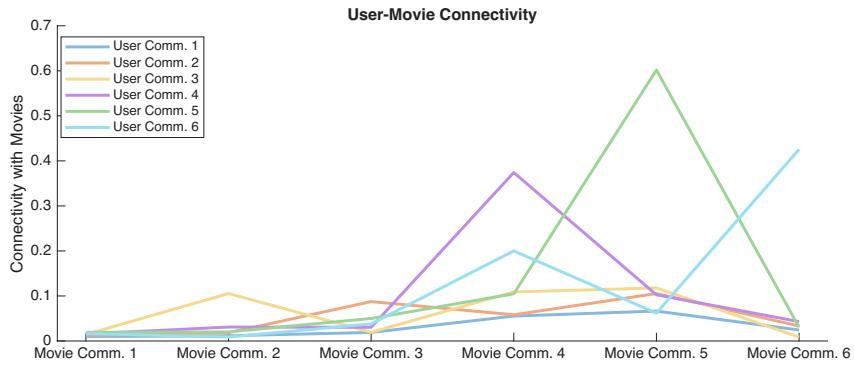  
Figure S3: Edge densities between user communities and movie communities.

This case study highlights several advantages of federated community detection. First, although the five datasets have disjoint user sets and very diferent activity levels, BiFLICKER yields a common set of user and movie communities. This avoids the community matching problem that typically arises when clustering is performed separately on each dataset. The global communities allow direct comparison of user populations across datasets and provide a unified view of user preferences.

Second, federated learning naturally accommodates heterogeneity in user activity. In Table S4, the estimated communities are relatively balanced in dataset 1 but highly unbalanced in datasets 4 and 5, where the majority of users belong to the “general user” community 1 due to their limited number of ratings. Nevertheless, BiFLICKER still identifies meaningful representations of communities 2–6 within these sparser datasets, borrowing strength from the denser datasets. Overall, the analysis demonstrates that BiFLICKER can efectively uncover interpretable user and movie communities in real-world bipartite networks under federated constraints.

## S3 FLICKER: Convergence Analysis

## S3.1 Proof of Lemma 1

In this section, we prove the motivating lemma in the main document.

Proof of Lemma 1. Let A be a symmetric matrix with eigenvalues $\lambda _ { 1 } \geq \cdots \geq \lambda _ { n }$ and orthonormal eigenvectors $\{ \zeta _ { i } \} _ { i = 1 } ^ { n }$ . For any $v \in \mathbb { R } ^ { n }$ with $\lVert \boldsymbol { v } \rVert = 1$ , we can write $\textstyle v = \sum _ { i = 1 } ^ { n } a _ { i } \zeta _ { i }$ with $\textstyle \sum _ { i = 1 } ^ { n } a _ { i } ^ { 2 } = 1$

Let $i ^ { * }$ be such that $\left| { \lambda - \lambda _ { i ^ { * } } } \right| = \operatorname* { m i n } _ { i } \left| { \lambda - \lambda _ { i } } \right|$ . Then the loss function

$$
\ell ( v ; \lambda ) = { \frac { 1 } { 2 } } { \big \| } ( \lambda I - A ) v { \big \| } ^ { 2 } = { \frac { 1 } { 2 } } \sum _ { i = 1 } ^ { n } ( \lambda - \lambda _ { i } ) ^ { 2 } a _ { i } ^ { 2 } \ \geq \ { \frac { 1 } { 2 } } ( \lambda - \lambda _ { i ^ { * } } ) ^ { 2 } \sum _ { i = 1 } ^ { n } a _ { i } ^ { 2 } = { \frac { 1 } { 2 } } ( \lambda - \lambda _ { i ^ { * } } ) ^ { 2 } ,
$$

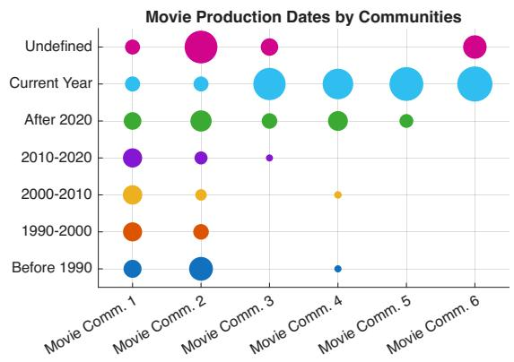

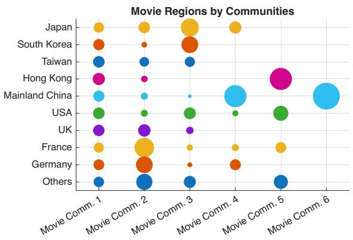

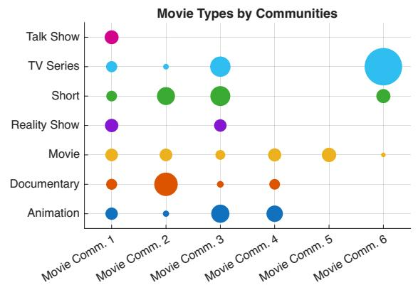

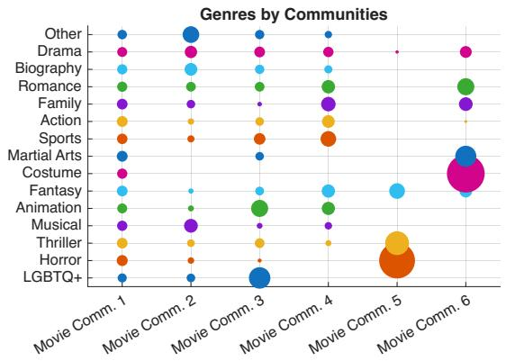  
Figure S4: Analysis of movie communities using exogenous movie covariates: year of production, region, type, and genre. These covariates are not used in the clustering algorithm and are employed only for post-hoc interpretation.

with equality if and only if $a _ { i } = 0$ for all $i \neq i ^ { * } , \mathrm { i . e . } \ v = \pm \zeta _ { i ^ { * } }$

For the Riemannian gradient of $\ell ( v ; \lambda )$ on the unit sphere $S ^ { n - 1 } = \{ v : \| v \| = 1 \}$ , we have

$$
\nabla _ { S ^ { n - 1 } } \ell ( v ; \lambda ) = ( I - v v ^ { \top } ) ( \lambda I - A ) ^ { 2 } v .
$$

In particular, for each eigenvector $\zeta _ { i }$ we have $( \lambda I - A ) ^ { 2 } \zeta _ { i } = ( \lambda - \lambda _ { i } ) ^ { 2 } \zeta _ { i }$ , and hence

$$
\nabla _ { S ^ { n - 1 } } \ell ( \zeta _ { i } ; \lambda ) = ( I - \zeta _ { i } \zeta _ { i } ^ { \top } ) ( \lambda - \lambda _ { i } ) ^ { 2 } \zeta _ { i } = 0 , \qquad 1 \leq i \leq n .
$$

A direct calculation of the Riemannian Hessian shows that it is positive semidefinite at $\zeta _ { i ^ { * } }$

## S3.2 Proof of Proposition 1

In Proposition 1, we claim that using grid search will recover the full spectrum.

Proof. Under the run-to-convergence assumption, each estimate $\hat { \sigma } ^ { \left( i \right) }$ stored by the algorithm equals the exact singular value associated with $\boldsymbol { v } ^ { ( i ) }$ . Consider an active interval with endpoints $\hat { \sigma } ^ { ( i ) } > \hat { \sigma } ^ { ( i + 1 ) }$ , and let $\sigma$ be its squared-midpoint target value.

Suppose first that the interval contains an undiscovered singular value $\sigma _ { 0 }$ . Since $\big ( \hat { \sigma } ^ { ( i + 1 ) } \big ) ^ { 2 } <$ $\sigma _ { 0 } ^ { 2 } < ( \hat { \sigma } ^ { ( i ) } ) ^ { 2 }$ , we have $| \sigma ^ { 2 } - \sigma _ { 0 } ^ { 2 } |$ strictly smaller than the distance from $\sigma ^ { 2 }$ to either endpoint. By assumption, the closest singular value to $\sigma$ is therefore a unique singular value in the interior of the interval. FLICKER recovers its singular vector, which is orthogonal to both endpoint singular vectors. Hence the new pair is inserted and the interval is subdivided.

If the interval contains no undiscovered singular value, its two endpoints are equally closest to the squared target value, while all other singular values are farther away. FLICKER therefore converges to a unit vector in the span of the two endpoint singular vectors. Such a vector has absolute inner product at least $1 / \sqrt { 2 }$ with one of them, and hence cannot satisfy both orthogonality conditions in Algorithm 4. The interval is therefore correctly terminated.

Thus an interval is subdivided if and only if it contains an undiscovered singular value, so all singular values are eventually recovered. After the two initial calls, min $\{ m , n \} - 2$ successful calls discover the remaining singular values, and min $\{ m , n \} - 1$ terminal calls certify the intervals between consecutive singular values. Hence the total number of FLICKER calls is $2 \operatorname* { m i n } \{ m , n \} - 1$ □

## S3.3 Proof of Theorem 1

Proof of Theorem 1. Let $M = I - \eta ( \lambda I - A ) ^ { 2 }$ and $\mu _ { i } = 1 - \eta ( \lambda - \lambda _ { i } ) ^ { 2 }$ . Since each iteration of Algorithm 1 applies M followed by normalization, we have $v ^ { t } = M ^ { t } v ^ { 0 } / \lVert M ^ { t } v ^ { 0 } \rVert$ . Write $\begin{array} { r } { v ^ { 0 } \ = \ \sum _ { i = 1 } ^ { n } a _ { 0 , i } u _ { i } } \end{array}$ . Since $M u _ { i } ~ = ~ \mu _ { i } u _ { i }$ , it follows that $\begin{array} { r } { M ^ { t } v ^ { 0 } \ = \ \sum _ { i = 1 } ^ { n } \mu _ { i } ^ { t } a _ { 0 , i } u _ { i } } \end{array}$ , and hence $a _ { t , i } = \mu _ { i } ^ { t } a _ { 0 , i } / \{ \sum _ { k = 1 } ^ { n } \mu _ { k } ^ { 2 t } a _ { 0 , k } ^ { 2 } \} ^ { 1 / 2 }$ . Therefore, for any $a _ { 0 , j } \neq 0$

$$
\frac { a _ { t , i } } { a _ { t , j } } = \left( \frac { 1 - \eta ( \lambda - \lambda _ { i } ) ^ { 2 } } { 1 - \eta ( \lambda - \lambda _ { j } ) ^ { 2 } } \right) ^ { t } \frac { a _ { 0 , i } } { a _ { 0 , j } } .
$$

Under the step-size condition, $0 < \mu _ { i } \le 1$ for all i. Since $i ^ { * }$ is the unique minimizer of $| \lambda - \lambda _ { i } |$ we have $\mu _ { i ^ { * } } > \mu _ { i }$ for all $i \neq i ^ { * }$ . Let $r = \operatorname* { m a x } _ { i \neq i ^ { * } } \mu _ { i } / \mu _ { i ^ { * } } < 1$ . Using $\textstyle \sum _ { i } a _ { t , i } ^ { 2 } = 1$ gives

$$
\frac { 1 - a _ { t , i ^ { * } } ^ { 2 } } { a _ { t , i ^ { * } } ^ { 2 } } = \sum _ { i \neq i ^ { * } } \left( \frac { \mu _ { i } } { \mu _ { i ^ { * } } } \right) ^ { 2 t } \frac { a _ { 0 , i } ^ { 2 } } { a _ { 0 , i ^ { * } } ^ { 2 } } \leq r ^ { 2 t } \frac { 1 - a _ { 0 , i ^ { * } } ^ { 2 } } { a _ { 0 , i ^ { * } } ^ { 2 } } .
$$

Thus

$$
1 - a _ { t , i ^ { * } } ^ { 2 } \leq \frac { 1 - a _ { 0 , i ^ { * } } ^ { 2 } } { a _ { 0 , i ^ { * } } ^ { 2 } } r ^ { 2 t } .
$$

Let $s = \mathrm { s i g n } ( a _ { 0 , i ^ { * } } )$ . Since $\mu _ { i ^ { * } } > 0$ , the sign of $a _ { t , i ^ { * } }$ does not change, and therefore $\| v ^ { t } - s u _ { i ^ { * } } \| ^ { 2 } =$ $2 ( 1 - | a _ { t , i ^ { * } } | ) \leq 2 ( 1 - a _ { t , i ^ { * } } ^ { 2 } )$ . Consequently,

$$
\operatorname* { m i n } _ { s \in \{ - 1 , 1 \} } \| v ^ { t } - s u _ { i ^ { * } } \| \leq \frac { \sqrt { 2 } } { | a _ { 0 , i ^ { * } } | } r ^ { t } .
$$

Finally, under the normalized Gaussian initialization, write $v ^ { 0 } = g / \| g \|$ with $g \sim \mathcal { N } ( 0 , I _ { n } )$ Since $\langle g , u _ { i ^ { * } } \rangle \sim \mathcal { N } ( 0 , 1 )$ , a Gaussian small-ball bound together with concentration of $\| g \|$ implies that, for any $\delta \in ( 0 , 1 )$ , $| a _ { 0 , i ^ { * } } | \geq c _ { 0 } \delta / \sqrt { n }$ with probability at least $1 - \delta - \exp ( - c n )$ Substituting this into the preceding bound yields

$$
\operatorname* { m i n } \{ \| v ^ { T } - u _ { i ^ { * } } \| , \| v ^ { T } + u _ { i ^ { * } } \| \} \leq \frac { C \sqrt { n } } { \delta } r ^ { T } .
$$

The stated iteration complexity follows.

## S4 Preparation

We collect several basic spectral inequalities used in the main proof.

## S4.1 Spectral Bounds for Matrix Products

Lemma S1 (Spectral bounds for products). Let $A \in \mathbb { R } ^ { n \times K }$ and $B \in \mathbb { R } ^ { K \times p }$ with rank $( A ) =$ rank(B) = K. Let $\sigma _ { 1 } ( \cdot ) \geq \cdot \cdot \cdot \geq \sigma _ { K } ( \cdot )$ denote singular values. Then

$$
\sigma _ { K } ( A B ) \geq \sigma _ { K } ( A ) \sigma _ { K } ( B ) , \qquad \sigma _ { 1 } ( A B ) \leq \sigma _ { 1 } ( A ) \sigma _ { 1 } ( B ) .
$$

Proof. This lemma was introduced in Hu & Wang (2024). Here we prove it again. Write the singular value decomposition $B = U D V ^ { \top }$ where $U \in \mathbb { R } ^ { \dot { K } \times K } , V \in \mathbb { R } ^ { p \times K }$ are orthonormal and $D = \operatorname { d i a g } ( \sigma _ { 1 } ( B ) , . . . , \sigma _ { K } ( B ) )$ . Then

$$
A B = ( A U ) D V ^ { \top } .
$$

By definition of singular values,

$$
\sigma _ { 1 } ( A B ) = { \sqrt { \lambda _ { 1 } { \big ( } ( A B ) ( A B ) ^ { \top } { \big ) } } } = { \sqrt { \lambda _ { 1 } { \big ( } A U D ^ { 2 } U ^ { \top } A ^ { \top } { \big ) } } } .
$$

Using $D ^ { 2 } \preceq \sigma _ { 1 } ( B ) ^ { 2 } I _ { K }$ and congruence by AU, followed by eigenvalue monotonicity,

$$
\lambda _ { 1 } ( A U D ^ { 2 } U ^ { \top } A ^ { \top } ) \leq \lambda _ { 1 } ( D ^ { 2 } ) \lambda _ { 1 } ( A U U ^ { \top } A ^ { \top } ) = \sigma _ { 1 } ( B ) ^ { 2 } \lambda _ { 1 } ( A A ^ { \top } ) = \sigma _ { 1 } ( B ) ^ { 2 } \sigma _ { 1 } ( A ) ^ { 2 } .
$$

Taking square roots gives $\sigma _ { 1 } ( A B ) \leq \sigma _ { 1 } ( A ) \sigma _ { 1 } ( B )$

Similarly,

$$
\begin{array} { r } { \sigma _ { K } ( A B ) = \sqrt { \lambda _ { K } \big ( A U D ^ { 2 } U ^ { \top } A ^ { \top } \big ) } . } \end{array}
$$

Likewise, $D ^ { 2 } \succeq \sigma _ { K } ( B ) ^ { 2 } I _ { K }$ gives $A U D ^ { 2 } U ^ { \top } A ^ { \top } \succeq \sigma _ { K } ( B ) ^ { 2 } A A ^ { \top }$ , so

$$
\lambda _ { K } ( A U D ^ { 2 } U ^ { \top } A ^ { \top } ) \geq \lambda _ { K } ( D ^ { 2 } ) \lambda _ { K } ( A U U ^ { \top } A ^ { \top } ) = \sigma _ { K } ( B ) ^ { 2 } \lambda _ { K } ( A A ^ { \top } ) = \sigma _ { K } ( B ) ^ { 2 } \sigma _ { K } ( A ) ^ { 2 } ,
$$

and the lower bound for $\sigma _ { K } ( A B )$ follows.

## S4.2 Spectral properties of population matrix

Lemma S2. Under Assumption $^ { 1 , }$ there exists a constant $C _ { 1 } > 0$ , depending only on $\rho , L _ { 1 } , L _ { 2 }$ 2 such that deterministically,

(i) $C _ { 1 } \sqrt { n m } \theta _ { 0 } \geq \sigma _ { 1 } ( Q ) \geq \sigma _ { L } ( Q ) \geq \sqrt { n m } \theta _ { 0 } / C _ { 1 }$

(ii) For each $i \in [ n ]$

$$
\| u _ { i } \| \leq \frac { C _ { 1 } } { \sqrt { n } } ,
$$

where $u _ { i }$ is the ith row of U (the left singular matrix $o f Q )$

(iii) $I f z _ { 1 } ( i ) = z _ { 1 } ( j )$ , then $u _ { i } = u _ { j }$ $I f z _ { 1 } ( i ) \neq z _ { 1 } ( j )$ , then $\begin{array} { r } { \| u _ { i } - u _ { j } \| \geq \frac { 1 } { C _ { 1 } \sqrt { n } } } \end{array}$

Here $z _ { 1 } : [ n ]  [ L _ { 1 } ]$ is the community label mapping induced by $Z _ { 1 }$ . The same row-norm upper bound and community separation hold for V , with m and $z _ { 2 }$ in place of n and $z _ { 1 }$ .

Proof. Let $\Omega = Q Q ^ { \top } = Z _ { 1 } P Z _ { 1 } ^ { \top }$ , where $P = G Z _ { \mathrm { 2 } } ^ { \top } Z _ { \mathrm { 2 } } G ^ { \top }$ . Its leading eigenvectors are the left singular vectors $U$ of $Q$ . The diagonal entries of $D _ { 1 } = Z _ { 1 } ^ { \top } Z _ { 1 }$ and $D _ { 2 } = Z _ { 2 } ^ { \top } Z _ { 2 }$ are the actual community sizes, at least $\rho n$ and $\rho m$ , respectively. Thus the nonzero singular values of $Z _ { 1 }$ and $Z _ { 2 }$ are of order $\sqrt { n }$ and $\sqrt { m }$ . Also, $\sigma _ { L } ( G ) \geq \rho \theta _ { 0 }$ and $\lVert G \rVert \leq \sqrt { L _ { 1 } L _ { 2 } } \theta _ { 0 } \leq \theta _ { 0 } / \rho$ . Applying Lemma S1 to the factors obtained from a thin SVD of $G ,$ and using the community-size bounds, gives for some $C _ { 0 }$ 2

$$
\begin{array} { r } { C _ { 0 } ^ { - 2 } \theta _ { 0 } ^ { 2 } n m \le \lambda _ { L } ( \Omega ) \le \lambda _ { 1 } ( \Omega ) \le C _ { 0 } ^ { 2 } \theta _ { 0 } ^ { 2 } n m . } \end{array}
$$

This proves (i).

The columns of $Z _ { 1 }$ are indicators of disjoint sets, hence orthogonal with $\| Z _ { 1 } e _ { l _ { 1 } } \| ^ { 2 } = n _ { l _ { 1 } }$ ; thus $Z _ { 1 } ^ { \top } Z _ { 1 } = D _ { 1 }$ and $\tilde { Z } _ { 1 } : = Z _ { 1 } D _ { 1 } ^ { - 1 / 2 }$ satisfies $\tilde { Z } _ { 1 } ^ { \top } \tilde { Z } _ { 1 } = I _ { L _ { 1 } }$ . Likewise $\tilde { Z } _ { 2 } : = Z _ { 2 } D _ { 2 } ^ { - 1 / 2 }$ has orthonormal columns. Since $Z _ { h } = \tilde { Z } _ { h } D _ { h } ^ { 1 / 2 }$

$$
Q = Z _ { 1 } G Z _ { 2 } ^ { \top } = \tilde { Z } _ { 1 } \big ( D _ { 1 } ^ { 1 / 2 } G D _ { 2 } ^ { 1 / 2 } \big ) \tilde { Z } _ { 2 } ^ { \top } .
$$

The two outer matrices have orthonormal columns, so this factorization also identifies the nonzero singular values of $Q$

Next, let $Q = U \Lambda V ^ { \top }$ be the SVD, we find that

$$
U = Q V \Lambda ^ { - 1 } = Z _ { 1 } R , \quad R = G Z _ { 2 } ^ { \top } V \Lambda ^ { - 1 } .
$$

Note that if $z _ { 1 } ( i ) = z _ { 1 } ( j )$ , then $e _ { i } ^ { \top } Z _ { 1 } = e _ { j } ^ { \top } Z _ { 1 } , \mathrm { s o } e _ { i } ^ { \top } U = e _ { j } ^ { \top } U$ . Likewise, we can write the right singular vectors as $V = Z _ { 2 } S$ for $S = \overset { \cdot } { G } ^ { \top } Z _ { 1 } ^ { \top } U \Lambda ^ { - 1 }$

For a left community $l _ { 1 } .$ , set $\boldsymbol { u } ^ { \top } = R ( l _ { 1 } , : )$ and $n _ { l _ { 1 } } = | \{ i : z _ { 1 } ( i ) = l _ { 1 } \} |$ . Since $U = Z _ { 1 } R$ $U ( i , : ) = u ^ { \top }$ for every i with $z _ { 1 } ( i ) = l _ { 1 }$ . Thus $\begin{array} { r } { n _ { l _ { 1 } } u u ^ { \top } = \sum _ { i : z _ { 1 } ( i ) = l _ { 1 } } U ( i , : ) ^ { \top } U ( i , : ) \preceq U ^ { \top } U = I _ { L } } \end{array}$ giving $\| u \| \le n _ { l _ { 1 } } ^ { - 1 / 2 } \le ( \rho n ) ^ { - 1 / 2 } ;$ ; the same argument applies to V . For $z _ { 1 } ( i ) = l _ { 1 } \neq l _ { 1 } ^ { \prime } = z _ { 1 } ( j )$ condition (iii) gives $l _ { 2 }$ with $| G ( l _ { 1 } , l _ { 2 } ) - G ( l _ { 1 } ^ { \prime } , l _ { 2 } ) | \ge \rho \theta _ { 0 }$ . Since $Q ( i , r ) = G ( z _ { 1 } ( i ) , z _ { 2 } ( r ) )$

$$
\begin{array} { r l } & { \| Q ( i , : ) - Q ( j , : ) \| ^ { 2 } = \displaystyle \sum _ { r = 1 } ^ { m } \{ G ( l _ { 1 } , z _ { 2 } ( r ) ) - G ( l _ { 1 } ^ { \prime } , z _ { 2 } ( r ) ) \} ^ { 2 } } \\ & { \qquad \geq | \{ r : z _ { 2 } ( r ) = l _ { 2 } \} | \left\{ G ( l _ { 1 } , l _ { 2 } ) - G ( l _ { 1 } ^ { \prime } , l _ { 2 } ) \right\} ^ { 2 } \geq \rho ^ { 3 } m \theta _ { 0 } ^ { 2 } . } \end{array}
$$

Hence $\lVert Q ( i , : ) - Q ( j , : ) \rVert \geq \rho ^ { 3 / 2 } \theta _ { 0 } \sqrt { m }$ . On the other hand, $Q = U \Lambda V ^ { \top }$ implies $\parallel Q ( i , : ) \textrm { -- }$ $Q ( j , : ) \| \le \sigma _ { 1 } ( Q ) \| u _ { i } - u _ { j } \|$ . Combining with (i) proves (iii). Transposing $Q$ proves the right-side conclusions. □

## S5 $\ell _ { 2 }$ and $\ell _ { 2 , \infty }$ Perturbation

We now state and prove an $\ell _ { 2 }$ and $\ell _ { 2 , \infty }$ perturbation bound for singular vectors, specialized to the symmetric case for clarity. It is used in Step 2 of the recovery proof. Let $\| A \| _ { 2 , \infty } : =$ max<sub>i</sub> $\| e _ { i } ^ { \top } A \| _ { 2 }$ denote the row-wise $\ell _ { 2 }$ sup-norm.

Proposition S1 $( \ell _ { 2 }$ and $\ell _ { 2 , \infty }$ perturbation). Let $A , \Omega \in \mathbb { R } ^ { n \times n }$ be symmetric matrices, and suppose Ω has rank L with eigendecomposition $\Omega = U \Lambda U ^ { \top }$ , where $U \in \mathbb { R } ^ { n \times L }$ has orthonormal columns and $\boldsymbol { \Lambda } = \operatorname { d i a g } ( \lambda _ { 1 } , \ldots , \lambda _ { L } )$ with $\lambda _ { 1 } \ge \cdots \ge \lambda _ { L } > 0$ . Assume a spectral gap

$$
\lambda _ { L } - \lambda _ { L + 1 } \geq n G _ { 1 } \theta _ { 0 } ^ { 2 }
$$

for some $G _ { 1 } > 0$ , with the convention $\lambda _ { L + 1 } = 0$ . Let $\widehat { U } \in \mathbb { R } ^ { n \times L }$ be the matrix of leading L orthonormal eigenvectors of A.

Suppose there exists $b _ { 0 } > 0$ such that

$$
\begin{array} { r } { \| A - \Omega \| \le b _ { 0 } \theta _ { 0 } ^ { 2 } n , \qquad \| A - \Omega \| _ { 2 , \infty } \le C _ { 0 } \theta _ { 0 } \sqrt { ( n + m ) \log n / m } , \qquad \| ( A - \Omega ) U \| _ { 2 , \infty } \le b _ { 0 } \theta _ { 0 } ^ { 2 } \sqrt { n } , } \end{array}
$$

with $b _ { 0 }$ small enough (e.g. $b _ { 0 } \leq G _ { 1 } / 2 2 )$ . Assume also $\| U \| _ { 2 , \infty } \leq C _ { U } / \sqrt { n }$ for a fixed $C _ { U } ,$ the constants below may depend on $C _ { U }$ . Then there exist constants $C _ { 1 } , C _ { 2 } > 0$ and an orthogonal matrix $O \in \mathbb { R } ^ { L \times L }$ such that

$$
\| U O - \widehat { U } \| \leq C _ { 1 } \frac { b _ { 0 } } { G _ { 1 } } , \qquad \| U O - \widehat { U } \| _ { 2 , \infty } \leq C _ { 2 } \frac { b _ { 0 } } { G _ { 1 } \sqrt { n } } ( 1 + \frac { \sqrt { ( n + m ) \log n } } { G _ { 1 } \theta _ { 0 } \sqrt { n m } } ) .
$$

Proof. Set $E = A - \Omega$ . Let $U _ { \perp } \in \mathbb { R } ^ { n \times ( n - L ) }$ be an orthonormal basis of the orthogonal complement of span(U), so that $[ U , U _ { \perp } ]$ is orthogonal. We can expand $\widehat { U }$ as

$$
\begin{array} { r } { \widehat { U } = U R + \Delta _ { \perp } , } \end{array}
$$

where $R = U ^ { \top } \widehat { U } \in \mathbb { R } ^ { L \times L }$ and $\Delta _ { \perp } = U _ { \perp } U _ { \perp } ^ { \top } \widehat { U }$ satisfies $U ^ { \top } \Delta _ { \bot } = 0$

Step 1: Spectral norm control. By the Davis–Kahan theorem (Davis & Kahan 1970) applied to A and Ω, the spectral gap condition and $\lVert E \rVert \leq b _ { 0 } n \theta _ { 0 } ^ { 2 }$ imply

$$
\| \Delta _ { \perp } \| \le C \frac { \| E \| } { n G _ { 1 } \theta _ { 0 } ^ { 2 } } \le C \frac { b _ { 0 } } { G _ { 1 } } ,
$$

for some universal constant $C > 0$ . In particular, taking $C \leq 2 { \sqrt { 2 } } .$ , we can assume $\| \Delta _ { \perp } \| \leq$ $2 \sqrt { 2 } b _ { 0 } / G _ { 1 }$ . Since

$$
\begin{array} { r } { \widehat { U } ^ { \top } \widehat { U } = ( U R + \Delta _ { \perp } ) ^ { \top } ( U R + \Delta _ { \perp } ) = R ^ { \top } R + \Delta _ { \perp } ^ { \top } \Delta _ { \perp } = I _ { L } , } \end{array}
$$

we have

$$
\begin{array} { r } { \| R ^ { \top } R - I _ { L } \| = \| \Delta _ { \perp } ^ { \top } \Delta _ { \perp } \| \leq \| \Delta _ { \perp } \| ^ { 2 } \leq 8 b _ { 0 } ^ { 2 } / G _ { 1 } ^ { 2 } . } \end{array}
$$

Thus all singular values of R lie in $[ 1 - 8 b _ { 0 } ^ { 2 } / G _ { 1 } ^ { 2 } , 1 + 8 b _ { 0 } ^ { 2 } / G _ { 1 } ^ { 2 } ]$ . Let $R = \Psi L \Phi ^ { \top }$ be the SVD of $R ,$ with $L$ diagonal and orthogonal $\Psi , \Phi \in \mathbb { R } ^ { L \times L }$ . Define the orthogonal matrix $O : = \Psi \Phi ^ { \top }$ Then

$$
\begin{array} { r } { \| R - O \| = \| \Psi L \Phi ^ { \top } - \Psi I \Phi ^ { \top } \| = \| L - I \| \leq 8 b _ { 0 } ^ { 2 } / G _ { 1 } ^ { 2 } . } \end{array}
$$

We now bound the spectral norm diference between $U$ and $\widehat { U } O$ :

$$
\begin{array} { r l } & { \| \widehat { U } - U O \| \leq \| U ( R - O ) \| + \| \Delta _ { \bot } \| } \\ & { \qquad \leq \| R - O \| + \| \Delta _ { \bot } \| \leq 8 b _ { 0 } ^ { 2 } / G _ { 1 } ^ { 2 } + 2 \sqrt { 2 } b _ { 0 } / G _ { 1 } . } \end{array}
$$

For $b _ { 0 } \leq G _ { 1 } / 2 2$ we can absorb the quadratic term into the linear one and obtain

$$
\| \widehat { U } - U O \| \le C _ { 1 } \frac { b _ { 0 } } { G _ { 1 } }
$$

for some constant $C _ { 1 }$

Step 2: Row-wise $\ell _ { 2 }$ norm control. We next bound $\left\| \hat { U } - U O \right\| _ { 2 , \infty }$ . Let $e _ { j } ^ { \top }$ denote the jth standard basis row. Then

$$
e _ { j } ^ { \top } ( \widehat { U } - U O ) = e _ { j } ^ { \top } \Delta _ { \bot } + e _ { j } ^ { \top } U ( R - O ) .
$$

The second term is easily controlled by

$$
\begin{array} { r } { \| e _ { j } ^ { \top } U ( R - O ) \| \leq \| e _ { j } ^ { \top } U \| \| R - O \| \leq \| e _ { j } ^ { \top } U \| 8 b _ { 0 } ^ { 2 } / G _ { 1 } ^ { 2 } . } \end{array}
$$

The row bound gives $\| e _ { j } ^ { \top } U \| \leq C _ { U } / { \sqrt { n } } .$ , so this term is $O ( b _ { 0 } ^ { 2 } / ( G _ { 1 } ^ { 2 } \sqrt { n } ) )$

It remains to bound $\lVert e _ { j } ^ { \top } \Delta _ { \perp } \rVert$ uniformly over $j$ . Using the eigenspace equation for $\widehat { U }$ and the fact that $U ^ { \top } \Delta _ { \perp } = 0$ , one can show (by applying $I - U U ^ { \top }$ to $A \widehat { U } = \widehat { U } \widehat { \Lambda } )$ that

$$
\begin{array} { r } { \Delta _ { \perp } = ( I - U U ^ { \top } ) E \widehat { U } \widehat { \Lambda } ^ { - 1 } , } \end{array}
$$

where $\widehat { \Lambda }$ is the diagonal matrix of top $L$ eigenvalues of A. Therefore,

$$
\begin{array} { r } { e _ { j } ^ { \top } \Delta _ { \perp } = e _ { j } ^ { \top } ( I - U U ^ { \top } ) E \widehat { U } \widehat { \Lambda } ^ { - 1 } . } \end{array}
$$

Expanding $\widehat { U } = U R + \Delta _ { \perp }$ and using $\Omega U = U \Lambda$ and $( I - U U ^ { \top } ) \Omega = 0$ yields

$$
e _ { j } ^ { \top } \Delta _ { \perp } = e _ { j } ^ { \top } ( I - U U ^ { \top } ) E ( U R + \Delta _ { \perp } ) \widehat { \Lambda } ^ { - 1 } .
$$

So we can bound

$$
\begin{array} { r l } & { \| e _ { j } ^ { \top } \Delta _ { \bot } \| \leq \| e _ { j } ^ { \top } E U R \widehat { \Lambda } ^ { - 1 } \| + \| e _ { j } ^ { \top } E \Delta _ { \bot } \widehat { \Lambda } ^ { - 1 } \| + \| e _ { j } ^ { \top } U U ^ { \top } E \widehat { U } \widehat { \Lambda } ^ { - 1 } \| } \\ & { \qquad \leq \| E U \| _ { 2 , \infty } \| R \widehat { \Lambda } ^ { - 1 } \| + \| e _ { j } ^ { \top } E \| \| \Delta _ { \bot } \| \| \widehat { \Lambda } ^ { - 1 } \| + \| e _ { j } ^ { \top } U \| \| U ^ { \top } E \| \| \widehat { U } \| \| \widehat { \Lambda } ^ { - 1 } \| } \end{array}
$$

Using the assumptions $\| ( A - \Omega ) U \| _ { 2 , \infty } \leq b _ { 0 } \theta _ { 0 } ^ { 2 } \sqrt { n }$ and $\| A - \Omega \| \le b _ { 0 } \theta _ { 0 } ^ { 2 } n$ , together with the eigenvalue gap (which implies $\lVert \widehat { \Lambda } ^ { - 1 } \rVert \stackrel { < } { \sim } ( \theta _ { 0 } ^ { 2 } n G _ { 1 } ) ^ { - 1 } ) , \lVert \Delta _ { \perp } \rVert \stackrel { < } { \sim } b _ { 0 } / G _ { 1 }$ and the row-norm upper bound on $U _ { : }$ , we arrive at

$$
\begin{array} { r l } & { \| e _ { j } ^ { \top } \Delta _ { \bot } \| \leq \| E U \| _ { 2 , \infty } \| R \widehat { \Lambda } ^ { - 1 } \| + \| e _ { j } ^ { \top } E \| \| \Delta _ { \bot } \| \| \widehat { \Lambda } ^ { - 1 } \| + \| e _ { j } ^ { \top } U \| \| U ^ { \top } E \| \| \widehat { U } \| \| \widehat { \Lambda } ^ { - 1 } \| } \\ & { \qquad \lesssim \frac { b _ { 0 } } { G _ { 1 } \sqrt { n } } + \frac { b _ { 0 } C _ { 0 } \sqrt { ( n + m ) \log n } } { G _ { 1 } ^ { 2 } n \theta _ { 0 } \sqrt { m } } + \frac { C _ { U } b _ { 0 } } { G _ { 1 } \sqrt { n } } \lesssim \frac { b _ { 0 } } { G _ { 1 } \sqrt { n } } ( 1 + \frac { \sqrt { ( n + m ) \log n } } { G _ { 1 } \theta _ { 0 } \sqrt { m n } } ) . } \end{array}
$$

So

$$
\| e _ { j } ^ { \top } \Delta _ { \bot } \| \le C ^ { \prime } \frac { b _ { 0 } } { G _ { 1 } \sqrt { n } } ( 1 + \frac { \sqrt { ( n + m ) \log n } } { G _ { 1 } \theta _ { 0 } \sqrt { n m } } )
$$

for a constant $C ^ { \prime }$ depending only on $G _ { 1 }$ and $C _ { 0 } { \mathrm { - t y p e } }$ bounds. Combining the two components,

$$
\| e _ { j } ^ { \top } ( \widehat { U } - U O ) \| \leq \| e _ { j } ^ { \top } \Delta _ { \bot } \| + \| e _ { j } ^ { \top } U ( R - O ) \| \leq C _ { 2 } \frac { b _ { 0 } } { G _ { 1 } \sqrt { n } } ( 1 + \frac { \sqrt { ( n + m ) \log n } } { G _ { 1 } \theta _ { 0 } \sqrt { n m } } ) ,
$$

for some $C _ { 2 } > 0$ , uniformly over $j$ . This yields

$$
\| \widehat { U } - U O \| _ { 2 , \infty } \le C _ { 2 } \frac { b _ { 0 } } { G _ { 1 } \sqrt { n } } ( 1 + \frac { \sqrt { ( n + m ) \log n } } { G _ { 1 } \theta _ { 0 } \sqrt { n m } } ) ,
$$

as claimed.

Lemma S3. Let $\begin{array} { r } { A = \frac { 1 } { m } B B ^ { \top } } \end{array}$ and $\Omega = \textstyle { \frac { 1 } { m } } Q Q ^ { \top }$ , and set $W : = B - Q$ . Under Assumption $^ { 1 , }$ if min $\{ n , m \} \theta _ { 0 } \ge c _ { 0 } \log ( \stackrel { \cdots } { n } + m )$ for a suficiently large constant $c _ { 0 } > 0$ , then there is $a$ constant $C > 0$ (depending only on $\rho , L _ { 1 } , L _ { 2 } )$ such that, with probability at least $1 - n ^ { - 2 }$

$$
\left\| A - \Omega \right\| _ { 2 , \infty } = \operatorname* { m a x } _ { i \in [ n ] } \frac { 1 } { m } \Big \| e _ { i } ^ { \top } ( B B ^ { \top } - Q Q ^ { \top } ) \Big \| _ { 2 } \leq C \theta _ { 0 } \sqrt { ( n + m ) \log n / m } .
$$

Proof. Since $B = Q + W$ with $\mathbb { E } W = 0$

$$
B B ^ { \top } - Q Q ^ { \top } = Q W ^ { \top } + W Q ^ { \top } + W W ^ { \top } .\tag{S1}
$$

Writing $q _ { i } ^ { \top } = e _ { i } ^ { \top } Q$ and $w _ { i } ^ { \top } = e _ { i } ^ { \top } W$ for the i-th rows and using $e _ { i } ^ { \top } Q W ^ { \top } = ( W q _ { i } ) ^ { \top } , e _ { i } ^ { \top } W Q ^ { \top } =$ $( Q w _ { i } ) ^ { \top } , e _ { i } ^ { \top } W W ^ { \top } = ( W w _ { i } ) ^ { \top }$ , the triangle inequality gives

$$
\begin{array} { r } { \left\| e _ { i } ^ { \top } ( B B ^ { \top } - Q Q ^ { \top } ) \right\| _ { 2 } \leq \| W q _ { i } \| _ { 2 } + \| Q w _ { i } \| _ { 2 } + \| W w _ { i } \| _ { 2 } . } \end{array}\tag{S2}
$$

Preliminary bounds. With probability at least $1 - n ^ { - 2 }$ , uniformly in $i \in [ n ]$

(P1) $\| q _ { i } \| _ { 2 } \le \sqrt { m } \theta _ { 0 }$ , since $\begin{array} { r } { \| q _ { i } \| _ { 2 } ^ { 2 } = \sum _ { j } Q _ { i j } ^ { 2 } \le m \theta _ { 0 } ^ { 2 } } \end{array}$ (deterministic, as $Q _ { i j } \leq \theta _ { 0 } )$

(P2) $\lVert W \rVert \le C _ { W } \sqrt { ( n + m ) \theta _ { 0 } }$ , by the operator-norm bound obtained from Corollary 3.12 and Remark 3.13 of Bandeira & van Handel (2016) applied to the symmetric dilation of W. (The variance term is at most $( n + m ) \theta _ { 0 }$ and the entry bound is one)

(P3) $\lVert w _ { i } \rVert _ { 2 } \leq \sqrt { 3 m \theta _ { 0 } }$ . Indeed $B _ { i j } ^ { 2 } = B _ { i j }$ gives $\begin{array} { r } { \| w _ { i } \| _ { 2 } ^ { 2 } = \sum _ { j } ( B _ { i j } - Q _ { i j } ) ^ { 2 } \leq \sum _ { j } B _ { i j } + \sum _ { j } Q _ { i j } ^ { 2 } = } \end{array}$ $d _ { i } + \lVert q _ { i } \rVert _ { 2 } ^ { 2 }$ , where $\begin{array} { r } { d _ { i } = \sum _ { j } ^ { \setminus } B _ { i j } } \end{array}$ is the degree. Since $\mathbb { E } d _ { i } \ \leq \ m \theta _ { 0 }$ , a Chernof bound and a union bound over i (using $m \theta _ { 0 } \geq c _ { 0 } \log n )$ yield ma $\mathrm { x } _ { i } d _ { i } \leq 2 m \theta _ { 0 }$ , so $\| w _ { i } \| _ { 2 } ^ { 2 } \leq$ $2 m \theta _ { 0 } + m \theta _ { 0 } ^ { 2 } \leq 3 m \theta _ { 0 }$

(P4) $\| Z _ { 2 } ^ { \top } w _ { i } \| _ { 2 } \le C _ { Z } \sqrt { m \theta _ { 0 } \log n }$ . Each coordinate $\begin{array} { r } { ( Z _ { 2 } ^ { \top } w _ { i } ) _ { \ell } = \sum _ { j : z _ { 2 } ( j ) = \ell } W _ { i j } } \end{array}$ is a sum of independent mean-zero terms with $| W _ { i j } | ~ \le ~ 1$ and $\begin{array} { r } { \sum _ { j } V a r \big ( \tilde { W _ { i j } } \big ) \ \le \ N _ { 2 , \ell } \theta _ { 0 } \ \le \ m \theta _ { 0 } } \end{array}$ Bernstein’s inequality with $t \asymp \sqrt { m \theta _ { 0 } }$ log $\overline { { n } } \le m \theta _ { 0 }$ gives $\mathbb { P } ( | ( Z _ { 2 } ^ { \top } w _ { i } ) _ { \ell } | \ge t ) \le n ^ { - 3 } ;$ a union bound over $i \in [ n ]$ and $\ell \in [ L _ { 2 } ]$ and $L _ { 2 } = O ( 1 )$ give the claim.

Term $1 ~ ( Q W ^ { \top } { \cdot } p a r t \ \| W q _ { i } \| )$ . By (P2) and (P1),

$$
\begin{array} { r } { \| W q _ { i } \| _ { 2 } \leq \| W \| \| q _ { i } \| _ { 2 } \leq C _ { W } ^ { \prime } \sqrt { ( n + m ) \theta _ { 0 } } \cdot \sqrt { m } \theta _ { 0 } = C _ { W } ^ { \prime } \sqrt { ( n + m ) m } \theta _ { 0 } ^ { 3 / 2 } . } \end{array}
$$

Term $\mathcal { Q } \ ( W Q ^ { \top } \cdot p a r t \ \lVert Q w _ { i } \rVert )$ . Since $\begin{array} { r } { \| Z _ { 1 } \| = \sqrt { \operatorname* { m a x } _ { l _ { 1 } } N _ { 1 , l _ { 1 } } } \leq \sqrt { n } } \end{array}$ and $\lVert G \rVert \leq \theta _ { 0 } / \rho$ by Assumption 1(ii) and $L _ { 1 } , L _ { 2 } \leq 1 / \rho _ { ; }$

$$
\begin{array} { r l } & { \| Q w _ { i } \| _ { 2 } = \| Z _ { 1 } G ( Z _ { 2 } ^ { \top } w _ { i } ) \| _ { 2 } \leq \| Z _ { 1 } \| \| G \| \| Z _ { 2 } ^ { \top } w _ { i } \| _ { 2 } } \\ & { \qquad \leq \frac { C _ { Z } \theta _ { 0 } } { \rho } \sqrt { n m \theta _ { 0 } \log n } = \frac { C _ { Z } } { \rho } \sqrt { n m } \theta _ { 0 } ^ { 3 / 2 } \sqrt { \log n } , } \end{array}
$$

using (P4).

Term $\mathcal { S } \ ( W W ^ { \top } \cdot p a r t \ \| W w _ { i } \| )$ . By (P2) and (P3),

$$
\begin{array} { r } { \| W w _ { i } \| _ { 2 } \leq \| W \| \| w _ { i } \| _ { 2 } \leq C _ { W } ^ { \prime } \sqrt { ( n + m ) \theta _ { 0 } } \cdot \sqrt { 3 m \theta _ { 0 } } = \sqrt { 3 } C _ { W } ^ { \prime } \sqrt { m ( n + m ) } \theta _ { 0 } . } \end{array}
$$

Combine. Insert the three bounds into (S2), divide by m:

$$
\begin{array} { r l } & { \displaystyle \frac { 1 } { m } \Big \| e _ { i } ^ { \top } \big ( B B ^ { \top } - Q Q ^ { \top } \big ) \Big \| _ { 2 } \leq C _ { W } ^ { \prime } \theta _ { 0 } ^ { 3 / 2 } \sqrt { \frac { n + m } { m } } + \frac { C _ { Z } } { \rho } \theta _ { 0 } ^ { 3 / 2 } \sqrt { \frac { n \log n } { m } } + \sqrt { 3 } C _ { W } ^ { \prime } \theta _ { 0 } \sqrt { \frac { n + m } { m } } } \\ & { \qquad \leq C \Big ( \theta _ { 0 } + \theta _ { 0 } ^ { 3 / 2 } \sqrt { \log n } \Big ) \sqrt { ( n + m ) / m } . } \end{array}
$$

Taking the maximum over i (all bounds hold uniformly) proves the claim; the final inequality uses $\theta _ { 0 } \leq 1$ □

## S6 Consistency of BiFLICKER

In this section we prove the weak and strong consistency conclusions of Theorem 3, using local spectral calibration, Proposition S1, and a k-means label recovery lemma.

Let $\widehat { U }$ and $\widehat { V }$ denote the matrices of leading L left and right singular vectors of $B ,$ respectively. Let $\widehat { U } ^ { T }$ and $\widehat { V } ^ { T }$ denote the corresponding approximations after $T$ iterations of the federated power iteration FLICKER used in BiFLICKER, initialized with independent Gaussian vectors and using only the reference-block singular values as targets, as in the sequential version of Algorithm 5. The initialization and projections are specified in Step 3.

## S6.1 Proof of Theorem 3

We give the statistical calculations for the left side and explicitly control the right-side and numerical errors below. In the theoretical clustering argument, k-means means global minimization of its objective.

Step 1: Local vs global singular values. Let $B _ { k } \in \{ 0 , 1 \} ^ { n _ { k } \times m }$ denote the adjacency matrix on server $k ,$ so that the rows correspond to a subset $\mathcal { L } ^ { ( k ) } \subset \mathcal { L }$ and the columns to the full set R. Let $Q _ { k } = \mathbb { E } [ B _ { k } \mid { \mathcal { L } } ^ { ( k ) } ] = Z _ { 1 } ^ { ( k ) } { \bar { G } } Z _ { 2 } ^ { \top }$ denote the local mean matrix, where $Z _ { 1 } ^ { ( k ) }$ is the submatrix of $Z _ { 1 }$ with rows restricted to $\mathcal { L } ^ { ( k ) }$

Write

$$
\begin{array} { r } { Q _ { k } ^ { \top } Q _ { k } = Z _ { 2 } G ^ { \top } ( Z _ { 1 } ^ { ( k ) } ) ^ { \top } Z _ { 1 } ^ { ( k ) } G Z _ { 2 } ^ { \top } = Z _ { 2 } G ^ { \top } D ^ { ( k ) } G Z _ { 2 } ^ { \top } , } \end{array}
$$

where $D ^ { ( k ) } = ( Z _ { 1 } ^ { ( k ) } ) ^ { \top } Z _ { 1 } ^ { ( k ) }$ is diagonal with entries equal to the community sizes in $\mathcal { L } ^ { ( k ) }$ . We first verify Proposition 2 of the main paper for a uniformly sampled reference block, with sampling independent of the edge variables. Let $D _ { 1 } = Z _ { 1 } ^ { \top } Z _ { 1 }$ contain the actual global community sizes. For each $l _ { 1 } , D ^ { ( k ) } ( l _ { 1 } , l _ { 1 } )$ is a sum of $n _ { k }$ draws without replacement from $\{ \mathbf { 1 } \{ z _ { 1 } ( i ) = l _ { 1 } \} : i \in [ n ] \}$ , whose mean is $D _ { 1 } ( l _ { 1 } , l _ { 1 } ) / n$ and variance is at most one. Bernstein’s inequality for sampling without replacement (Bardenet and Maillard, 2015, Proposition 1.4) gives

$$
\operatorname* { P r } \biggr ( \biggr | D ^ { ( k ) } ( l _ { 1 } , l _ { 1 } ) - \frac { n _ { k } } { n } D _ { 1 } ( l _ { 1 } , l _ { 1 } ) \biggr | \geq t \biggr ) \leq 2 \exp \biggr \{ - \frac { t ^ { 2 } } { 2 ( n _ { k } + t / 3 ) } \biggr \} .
$$

Taking $t ~ = ~ C \sqrt { n _ { k } }$ log n and a union bound over $l _ { 1 }$ , we obtain $\| ( n / n _ { k } ) D ^ { ( k ) } - D _ { 1 } \| \ \leq$ Cn log $n / { \sqrt { n _ { k } } } \leq C { \sqrt { n } }$ log n with probability at least $1 - 2 L _ { 1 } e ^ { - c \log ^ { 2 } n }$ , using $n _ { k } \ge \rho n$ . The exact identity

$$
\frac { n } { n _ { k } } Q _ { k } ^ { \top } Q _ { k } - Q ^ { \top } Q = Z _ { 2 } G ^ { \top } \left( \frac { n } { n _ { k } } D ^ { ( k ) } - D _ { 1 } \right) G Z _ { 2 } ^ { \top }
$$

gives $\| ( n / n _ { k } ) Q _ { k } ^ { \top } Q _ { k } - Q ^ { \top } Q \| \leq C \theta _ { 0 } ^ { 2 } m \sqrt { n }$ log n, since $\lVert Z _ { 2 } \rVert \leq \sqrt { m }$ and $\lVert G \rVert \leq C \theta _ { 0 }$ . On the good event in (S4) of Step 2, $\lVert E _ { B } \rVert \leq C _ { 2 } \sqrt { ( n + m ) \theta _ { 0 } }$ , where $E _ { B } = B - Q$ . Lemma S2(i) gives $\left\| Q \right\| \leq C \theta _ { 0 } { \sqrt { n m } }$ , so

$$
\begin{array} { r } { B ^ { \top } B - Q ^ { \top } Q = Q ^ { \top } E _ { B } + E _ { B } ^ { \top } Q + E _ { B } ^ { \top } E _ { B } , } \end{array}
$$

$$
\| B ^ { \top } B - Q ^ { \top } Q \| \leq 2 \| Q \| \| E _ { B } \| + \| E _ { B } \| ^ { 2 } \leq C \{ \theta _ { 0 } ^ { 3 / 2 } \sqrt { n m ( n + m ) } + \theta _ { 0 } ( n + m ) \} .
$$

For $E _ { B _ { k } } = B _ { k } - Q _ { k }$ , row restriction gives $\| E _ { B _ { k } } \| \le \| E _ { B } \|$ and $\| Q _ { k } \| \leq \| Q \|$ . Thus the scaled local error satisfies $( n / n _ { k } ) \| B _ { k } ^ { \top } B _ { k } - Q _ { k } ^ { \top } Q _ { k } \| \leq \rho ^ { - 1 } \{ 2 \| Q \| \| E _ { B } \| + \| E _ { B } \| ^ { 2 } \}$ . Since $( n +$ $m ) / ( n m \theta _ { 0 } ) = 1 / ( n \theta _ { 0 } ) + 1 / ( m \theta _ { 0 } ) \leq C / \log n$ , we have $\theta _ { 0 } ( n + m ) \le C \theta _ { 0 } ^ { 3 / 2 } \sqrt { n m ( n + m ) } / \sqrt { \log n }$ Combining these estimates yields

$$
\left\| \frac { n } { n _ { k } } B _ { k } ^ { \top } B _ { k } - B ^ { \top } B \right\| \leq C \{ \theta _ { 0 } ^ { 2 } m \sqrt { n } \log n + \theta _ { 0 } ^ { 3 / 2 } \sqrt { n m ( n + m ) } \} .
$$

Weyl’s inequality then gives

$$
\left| \frac { n } { n _ { k } } \sigma _ { i } ( B _ { k } ) ^ { 2 } - \sigma _ { i } ( B ) ^ { 2 } \right| = O ( \sqrt { n } \log n m \theta _ { 0 } ^ { 2 } + \theta _ { 0 } ^ { 3 / 2 } \sqrt { n m ( n + m ) } ) ,\tag{S3}
$$

with high probability. This justifies using $\widetilde { \sigma } _ { i } = \sqrt { n / n _ { k } } \sigma _ { i } ( B _ { k } )$ as an approximate tuning value for the target singular value in FLICKER .

Step 2: Spectral perturbation for $U$ and $\widehat { U }$ . Consider the symmetric matrix

$$
\boldsymbol { A } : = \frac { 1 } { m } \boldsymbol { B } \boldsymbol { B } ^ { \intercal } , \qquad \boldsymbol { \Omega } : = \frac { 1 } { m } \boldsymbol { Q } \boldsymbol { Q } ^ { \intercal } .
$$

Note that $\Omega$ has eigen-decomposition $\Omega = U \Lambda U ^ { \top }$ with $\Lambda = m ^ { - 1 } \Sigma ^ { 2 }$ and the same left singular vectors $U$ as $Q$

Using Bernstein inequality it is easy to derive that with high probability $\| B \| _ { \infty }$ and $\| B \| .$ which are the max degree of nodes, are bounded by $C _ { 2 } m \theta _ { 0 }$ and $C _ { 2 } n \theta _ { 0 }$ for some $C _ { 2 }$ with high probability. For $E _ { B } : = B - Q$ , with high probability,

$$
\begin{array} { r l } & { \| E _ { B } \| = \bigg \| \bigg ( \begin{array} { l l } { 0 } & { E _ { B } } \\ { E _ { B } ^ { \top } } & { 0 } \end{array} \bigg ) \bigg \| } \\ & { \qquad \leq C \{ \sqrt { ( n + m ) \theta _ { 0 } } + \sqrt { \log ( n + m ) } \} \leq C _ { 2 } \sqrt { ( n + m ) \theta _ { 0 } } . } \end{array}\tag{S4}
$$

Here we apply Corollary 3.12 and Remark 3.13 of Bandeira & van Handel (2016) to the symmetric dilation, as in Lemma S3. All noise bounds in this step can be taken on a joint event of probability at least $1 - C ( n + m ) ^ { - 2 }$ : use $\log ( n + m )$ in the tail bounds, and use $\log ( n + m ) = O ( \log n )$ to retain the displayed rates. Since m $\leq n ^ { \alpha }$ , the conditions $n \theta _ { 0 } / \log n$ and $m \theta _ { 0 } /$ log n suficiently large imply min $( n , m ) \theta _ { 0 } \gtrsim \log ( n + m )$ , which absorbs the logarithmic term. Recall that $\Omega = \textstyle { \frac { 1 } { m } } Q Q ^ { \top }$ . This leads to

$$
\begin{array} { r l } & { \displaystyle \frac { 1 } { m } \| B B ^ { \top } - Q Q ^ { \top } \| \leq \frac { 2 \| Q \| \| E _ { B } \| + \| E _ { B } \| ^ { 2 } } { m } } \\ & { \qquad \leq C \left\{ \theta _ { 0 } ^ { 3 / 2 } \sqrt { \frac { n ( n + m ) } { m } } + \frac { \theta _ { 0 } ( n + m ) } { m } \right\} \leq C _ { 3 } \theta _ { 0 } \sqrt { \theta _ { 0 } n ( n + m ) / m } . } \end{array}\tag{S5}
$$

for some $C _ { 3 }$ . Since $\lambda _ { L } ( \Omega ) \geq n G _ { 1 } \theta _ { 0 } ^ { 2 }$ for a fixed $G _ { 1 } > 0$ and $\lambda _ { L + 1 } ( \Omega ) = 0$ , Lemma S2 verifies the signal-to-zero gap in Proposition S1. No internal signal gap is needed.

Davis–Kahan gives min<sub>O</sub> $\Vert U - \widehat { U } O \Vert _ { F } \leq C \sqrt { ( n + m ) / ( \theta _ { 0 } n m ) }$ , since $L$ is bounded. Thus the centralized embedding has the required weak-consistency rate; Step 3 will include the finite-iteration error. Next we consider the $2 \to \infty$ norm, note

$$
\frac { 1 } { m } \| ( B B ^ { \top } - Q Q ^ { \top } ) U \| _ { 2 , \infty } \leq \frac { 1 } { m } \| ( B - Q ) Q ^ { \top } U \| _ { 2 , \infty } + \frac { 1 } { m } \| B ( B - Q ) ^ { \top } U \| _ { 2 , \infty }\tag{S6}
$$

We check the first term. Write $Q = U \Lambda _ { Q } V ^ { \top }$ as the SVD, then $\| \Lambda _ { Q } \| = \| Q \| \leq C \sqrt { n m } \theta _ { 0 }$ . For i-th row,

$$
\frac { 1 } { m } \| e _ { i } ^ { \top } ( B - Q ) Q ^ { \top } U \| = \frac { 1 } { m } \| e _ { i } ^ { \top } ( B - Q ) V \Lambda _ { Q } \| \leq C \sqrt { n / m } \theta _ { 0 } \| e _ { i } ^ { \top } ( B - Q ) V \| .
$$

For fixed i and $l \ \leq \ L$ , the summands $E _ { B } ( i , r ) V ( r , l )$ are independent and centered. Lemma S2(ii) gives $| E _ { B } ( i , r ) V ( r , l ) | \le C _ { 2 } / \sqrt { m }$ , and $\begin{array} { r } { \sum _ { r } \mathrm { v a r } ( E _ { B } ( i , r ) V ( r , l ) ) \le \theta _ { 0 } \sum _ { r } V ( r , l ) ^ { 2 } = } \end{array}$ $\theta _ { 0 }$ . Bernstein’s inequality therefore gives

$$
\operatorname* { P r } \left( \left| \sum _ { r = 1 } ^ { m } E _ { B } ( i , r ) V ( r , l ) \right| \geq t \right) \leq 2 \exp \left\{ - \frac { t ^ { 2 } } { 2 ( \theta _ { 0 } + C _ { 2 } t / ( 3 \sqrt { m } ) ) } \right\} .
$$

Take $\begin{array} { l l l } { t } & { = } &  C \{ \sqrt { \theta _ { 0 } \log ( n + m ) \ + \ \log ( n \ + \ m ) / \sqrt { m } \} } \end{array}$ A union bound over $i , l$ gives max<sub>i</sub> $\| e _ { i } ^ { \top } E _ { B } V \| \leq \sqrt { L } t$ except with probability $C ( n + m ) ^ { - 2 }$

The conditions $m \theta _ { 0 } \stackrel { > } { \sim } \log ( n + m )$ and log $( n + m ) = O ( \log n )$ imply ${ \sqrt { L } } t \leq C { \sqrt { \theta _ { 0 } \log n } }$ In conclusion, $\begin{array} { r } { \frac { 1 } { m } \| ( B - Q ) Q ^ { \top } U \| _ { 2 , \infty } \leq C _ { 3 } \theta _ { 0 } ^ { 3 / 2 } \sqrt { n \log n / m } } \end{array}$ with high probability under our condition.

For the second term in (S6), write $E : = E _ { B } = B - Q$ and split $B = Q + E$ , so that

$$
B ( B - Q ) ^ { \top } U = Q E ^ { \top } U + E E ^ { \top } U .\tag{S7}
$$

The $Q E ^ { \top } U$ part. Let $q _ { i } ^ { \top } = e _ { i } ^ { \top } Q$ denote the ith row of $Q .$ Since $Q _ { i j } \leq \theta _ { 0 }$ we have $\| q _ { i } \| \le \theta _ { 0 } \sqrt { m }$ deterministically, so by (S4),

$$
\frac { 1 } { m } \left\| e _ { i } ^ { \top } Q E ^ { \top } U \right\| = \frac { 1 } { m } \left\| q _ { i } ^ { \top } E ^ { \top } U \right\| \leq \frac { 1 } { m } \| q _ { i } \| \left\| E \right\| \leq \frac { 1 } { m } \theta _ { 0 } \sqrt { m } \cdot C _ { 2 } \sqrt { ( n + m ) \theta _ { 0 } } = C \theta _ { 0 } ^ { 3 / 2 } \sqrt { \frac { n + m } { m } } .
$$

The $E E ^ { \top } U$ part. Writing $E _ { i \cdot } \in \mathbb { R } ^ { 1 \times m }$ for the ith row of $E$ and $u _ { k } ^ { \top } = e _ { k } ^ { \top } U$ for the kth row of $U$

$$
e _ { i } ^ { \top } E E ^ { \top } U = \sum _ { k = 1 } ^ { n } \langle E _ { i \cdot } , E _ { k \cdot } \rangle u _ { k } ^ { \top } = \underbrace { \| E _ { i \cdot } \| ^ { 2 } u _ { i } ^ { \top } } _ { = : T _ { 1 } } + \underbrace { E _ { i \cdot } M ^ { ( i ) } } _ { = : T _ { 2 } } , \qquad M ^ { ( i ) } : = \sum _ { k \neq i } E _ { k \cdot } ^ { \top } u _ { k } ^ { \top } \in \mathbb { R } ^ { m \times L } ,
$$

where $M ^ { ( i ) }$ is independent of $E _ { i }$ <sub>·</sub> because the rows of $E$ are independent.

For $T _ { 1 }$ , the bound $\lVert E _ { i \cdot } \rVert ^ { 2 } \leq 3 m \theta _ { 0 }$ from the proof of Lemma $\mathrm { S 3 }$ together with $\| u _ { i } \| \le C _ { 1 } / \sqrt { n }$ from Lemma S2(ii) gives $\begin{array} { r } { \frac { 1 } { m } \| T _ { 1 } \| \le C \theta _ { 0 } / \sqrt { n } } \end{array}$

For $T _ { 2 }$ , each entry of $M ^ { ( i ) }$ is $\begin{array} { r } { M _ { i \ell } ^ { ( i ) } = \sum _ { k \neq i } E _ { k j } U _ { k \ell } . } \end{array}$ , a sum of independent mean-zero terms with $\begin{array} { r } { \sum _ { k } \mathrm { v a r } ( E _ { k j } U _ { k \ell } ) \le \theta _ { 0 } \sum _ { k } U _ { k \ell } ^ { 2 ^ { \prime } } = \theta _ { 0 } } \end{array}$ and $| E _ { k j } U _ { k \ell } | \le C _ { 1 } / \sqrt { n }$ . Bernstein’s inequality and a union bound over $j \in [ m ] , \ell \in [ L ]$ give, with probability at least $1 - n ^ { - 1 0 }$ ，

$$
\operatorname* { m a x } _ { j \in [ m ] } \| M _ { j \cdot } ^ { ( i ) } \| \leq C \sqrt { \theta _ { 0 } \log n } ,
$$

using $n \theta _ { 0 } \geq \log n$ . Conditionally on $M ^ { ( i ) }$ , the quantity $\begin{array} { r } { T _ { 2 } = \sum _ { j = 1 } ^ { m } E _ { i j } M _ { j . } ^ { ( i ) } } \end{array}$ is a sum of m independent mean-zero vectors with $\begin{array} { r } { \sum _ { j } \mathrm { v a r } ( E _ { i j } M _ { j \ell } ^ { ( i ) } ) \le \theta _ { 0 } \sum _ { j } ( M _ { j \ell } ^ { ( i ) } ) ^ { 2 } \le C m \theta _ { 0 } ^ { 2 } } \end{array}$ log n and $| E _ { i j } M _ { j \ell } ^ { ( i ) } | \le C \sqrt { \theta _ { 0 } \log n }$ , so a second application of Bernstein’s inequality yields

$$
\frac { 1 } { m } \| T _ { 2 } \| \leq C \bigg ( \frac { \theta _ { 0 } \log n } { \sqrt { m } } + \frac { \sqrt { \theta _ { 0 } } ( \log n ) ^ { 3 / 2 } } { m } \bigg ) \leq C \frac { \theta _ { 0 } \log n } { \sqrt { m } } ,
$$

where the last step uses $m \theta _ { 0 } \geq \log n$

Combining the two parts of (S7), and using $\theta _ { 0 } / \sqrt { n } + \theta _ { 0 } \log n / \sqrt { m } \leq C \theta _ { 0 } ^ { 3 / 2 } \sqrt { ( n + m ) \log n / m }$ since $n \theta _ { 0 } \gtrsim$ log n and $( n + m ) \theta _ { 0 } \gtrsim$ log n, we conclude

$$
\frac { 1 } { m } \| ( B B ^ { \top } - Q Q ^ { \top } ) U \| _ { 2 , \infty } \leq C \theta _ { 0 } ^ { 3 / 2 } \sqrt { ( n + m ) \log n / m } .
$$

Summarizing, we have the following by using Lemma S3:

$$
\begin{array} { r } { \| A - \Omega \| \lesssim b _ { 0 } \theta _ { 0 } ^ { 2 } n , \qquad \| A - \Omega \| _ { 2 , \infty } \lesssim \theta _ { 0 } \sqrt { ( m + n ) \log n / m } , \quad \| ( A - \Omega ) U \| _ { 2 , \infty } \lesssim b _ { 0 } \theta _ { 0 } ^ { 2 } \sqrt { n } , } \end{array}
$$

where we can take

$$
b _ { 0 } \asymp \sqrt { \frac { ( n + m ) \log n } { n m \theta _ { 0 } } } .
$$

Note that Lemma S2 has verified all conditions on the population matrix for Proposition S1. For exact recovery, now impose min $( n , m ) \theta _ { 0 } ^ { 2 } /$ log n suficiently large. Since $b _ { 0 } ^ { 2 } \ \lesssim \ \theta _ { 0 } \{ \log n / ( n \theta _ { 0 } ^ { 2 } ) + \log n / ( m \theta _ { 0 } ^ { 2 } ) \}$ and $\theta _ { 0 } \leq 1$ , this ensures the smallness condition of Proposition S1. Applying Proposition S1, we obtain an orthogonal matrix $O _ { L } \in \mathbb { R } ^ { L \times L }$ such that

$$
\| U - { \widehat { U } } O _ { L } \| = O ( b _ { 0 } ) ,
$$

$$
\lVert U - \widehat { U } O _ { L } \rVert _ { 2 , \infty } = O \left( \frac { b _ { 0 } } { \sqrt { n } } ( 1 + \frac { \sqrt { ( n + m ) \log n } } { G _ { 1 } \theta _ { 0 } \sqrt { n m } } ) \right) ,
$$

with high probability. The additional condition gives $( n + m ) \log n / ( n m \theta _ { 0 } ^ { 2 } ) = \log n / ( n \theta _ { 0 } ^ { 2 } ) +$ log $n / ( m \theta _ { 0 } ^ { 2 } ) \leq C .$ , so the left row bound is $C b _ { 0 } / \sqrt { n }$ Transposing the preceding calculations, with $A = B ^ { \top } B / n$ and $\Omega = Q ^ { \top } Q / n$ , yields on the same event min<sub>O</sub> $\| V - { \hat { V } } O \| _ { F } \leq$ $C \sqrt { ( n + m ) / ( n m \theta _ { 0 } ) }$ and, under the stronger condition, min<sub>O</sub> $\| V - { \hat { V } } O \| _ { 2 , \infty } \leq C b _ { 0 } / { \sqrt { m } }$ . Taking the constant in the additional condition suficiently large gives $\sqrt { n }$ min<sub>O</sub> $\| U - \widehat { U } O \| _ { 2 , \infty } \leq$ $C b _ { 0 } \leq c _ { 1 } / 2$ and $\sqrt { m }$ min<sub>O</sub> $\| V - \widehat { V } O \| _ { 2 , \infty } \leq C b _ { 0 } \leq c _ { 1 } / 2$ , where $c _ { 1 }$ is the constant in Lemma S4. The two sides may use diferent orthogonal rotations.

## Step 3: Federated iteration error. By Lemma S2, $\sigma _ { L } ( Q ) ^ { 2 } \asymp n m \theta _ { 0 } ^ { 2 }$ . The convergence analysis of FLICKER in Theorem 1 (when spectrum is simple) and Theorem 2 (when spectrum is degenerate) uses the spectral weights $1 - \eta ( \lambda - \lambda _ { i } ) ^ { 2 }$ . We apply its matrix-power argument to the complete signal subspace as follows.

For this calculation, set $A = B B ^ { \top } / s , ~ \tilde { \lambda } _ { j } = \tilde { \sigma } _ { i } ^ { 2 } / s .$ , and $M _ { j } = I - s ^ { 2 } \eta _ { j } ( A - \widetilde { \lambda } _ { j } I ) ^ { 2 }$ , where $s = C n m \theta _ { 0 } ^ { 2 }$ with fixed large C. We are interested in the spectral gap of $M _ { j }$ over diferent eigenvectors.

Steps 1–2 give $0 ~ \preceq ~ A ~ \preceq ~ I , ~ \lambda _ { L } ( A ) - \lambda _ { L + 1 } ( A ) ~ \geq ~ c _ { 0 } ~ > ~ 0$ , and ma $z _ { j \leq L } | \widetilde { \lambda } _ { j } - \lambda _ { j } ( A ) | \leq$ $C \{ \log n / { \sqrt { n } } + { \sqrt { ( n + m ) / ( n m \theta _ { 0 } ) } } \} \leq C \{ \log n / { \sqrt { n } } + 1 / { \sqrt { \log n } } \} = o ( 1 )$ ; the step-size condition gives $c _ { 1 } I \preceq M _ { j } \preceq I$ and $s ^ { 2 } \eta _ { j } \asymp 1$ . Write $\lambda _ { 1 } ( A ) \geq \cdot \cdot \cdot \geq \lambda _ { n } ( A )$ . Among the L intervals $( c _ { 0 } ( 8 L ) ^ { - h } , c _ { 0 } ( 8 L ) ^ { - ( h - 1 ) } ] , 1 \le h \le \bar { L }$ , one contains none of the $L - 1$ internal gaps. Let $\tau$ be its lower endpoint and define $\begin{array} { r } { \Pi _ { j } : = \sum _ { i \in \mathcal { I } _ { i } } \widehat { U } ( : , i ) \widehat { U } ( : , i ) ^ { \top } } \end{array}$ , and

$$
\mathcal I _ { j } = \{ i \in [ L ] : \lambda _ { r } ( A ) - \lambda _ { r + 1 } ( A ) \leq \tau \mathrm { ~ f o r ~ e v e r y ~ } \operatorname* { m i n } ( i , j ) \leq r < \operatorname* { m a x } ( i , j ) \} ,
$$

where $\widehat { U } ( : , i )$ is the ith leading unit eigenvector of A. Each ${ \mathcal { I } } _ { j }$ consists of consecutive indices and contains $j$ . By telescoping, its spectral width satisfies max $\begin{array} { r } { \operatorname { \ i } _ { i \in { \mathcal { I } } _ { j } } \lambda _ { i } ( A ) - \operatorname* { m i n } _ { i \in { \mathcal { I } } _ { j } } \lambda _ { i } ( A ) = } \end{array}$ $\begin{array} { r } { \sum _ { r = \operatorname* { m i n } \mathcal { I } _ { j } } ^ { \operatorname* { m a x } \mathcal { I } _ { j } - 1 } \{ \lambda _ { r } ( A ) - \lambda _ { r + 1 } ( A ) \} \leq ( | \mathcal { I } _ { j } | - 1 ) \tau \leq ( L - 1 ) \tau } \end{array}$ . For $i \in \mathcal { I } _ { j }$ and $i ^ { \prime } \in [ L ] \ \backslash \ \mathcal { T } _ { j }$ , an intervening gap exceeds τ and none lies in $( \tau , 8 L \tau ] , \mathrm { s o } \ | \lambda _ { i } ( A ) - \lambda _ { i ^ { \prime } } ( A ) | > 8 L \tau$ . For $i \in \mathcal { I } _ { j }$ and $i ^ { \prime } > L , | \lambda _ { i } ( A ) - \lambda _ { i ^ { \prime } } ( A ) | \geq \lambda _ { L } ( A ) - \lambda _ { L + 1 } ( A ) \geq c _ { 0 } \geq 8 L \tau$ . The corresponding eigenvalues of $M _ { j }$ are $\mu _ { j , i } = 1 - s ^ { 2 } \eta _ { j } \{ \lambda _ { i } ( A ) - \tilde { \lambda } _ { j } \} ^ { 2 } , i \in [ n ]$ . In summary, $| \lambda _ { i } ( A ) - \widetilde { \lambda } _ { j } | \leq ( L - 1 ) \tau + o ( 1 ) \leq L \tau$ for $i \in \mathcal { I } _ { j }$ , and $| \lambda _ { i } ( A ) - \widetilde { \lambda } _ { j } | \geq 8 L \tau - o ( 1 )$ otherwise. Hence

$$
\operatorname* { m i n } _ { i \in \mathcal { I } _ { j } } \mu _ { j , i } - \operatorname* { m a x } _ { i \in [ n ] \backslash \mathcal { I } _ { j } } \mu _ { j , i } \geq s ^ { 2 } \eta _ { j } \{ ( 8 L \tau - o ( 1 ) ) ^ { 2 } - ( L \tau ) ^ { 2 } \} \geq \kappa > 0 .
$$

Let $v _ { j } = v _ { j } ^ { ( T ) }$ be the jth left singular-vector estimate returned by sequential BiFLICKER, Algorithm 5, after T projected FLICKER updates with target $\widetilde { \sigma } _ { j } ^ { 2 } ,$ , so $\widehat { U } ^ { T } = [ v _ { 1 } , \ldots , v _ { L } ]$ before orthogonal alignment. Set $V _ { 0 } = [ v _ { 1 } , \ldots , v _ { j - 1 } ] , P _ { j } = I - V _ { 0 } V _ { 0 } ^ { \top }$ , and $\begin{array} { r } { \varepsilon _ { j - 1 } = \operatorname* { m a x } _ { i < j } \| ( I - \Pi _ { i } ) v _ { i } \| } \end{array}$ with $\varepsilon _ { 0 } = 0$ . Set $W = [ \Pi _ { 1 } v _ { 1 } , \dotsc , \Pi _ { j - 1 } v _ { j - 1 } ]$ . Orthogonality gives $\| W - V _ { 0 } \| \leq \sqrt { L } \varepsilon _ { j - 1 }$ and $\| W ^ { \top } W - I \| \leq L \varepsilon _ { j - 1 } ^ { 2 } \colon$ within each group $( \boldsymbol { W } ^ { \top } \boldsymbol { W } - \boldsymbol { I } ) ( i , i ^ { \prime } ) = - v _ { i } ^ { \top } ( \boldsymbol { I } - \Pi _ { i } ) v _ { i ^ { \prime } }$ , and all other entries vanish. Thus, for small $\varepsilon _ { j - 1 } , V _ { * } = W ( W ^ { \top } W ) ^ { - 1 / 2 }$ and $\begin{array} { r } { P _ { * } = I - V _ { * } V _ { * } ^ { \top } } \end{array}$ satisfy $\| P _ { j } - P _ { * } \| \le C \varepsilon _ { j - 1 } \ ( \mathrm { a t \ } j = 1 $ , use $P _ { * } = I )$ . Let $v _ { * , i } = V _ { * } ( : , i )$ . The matrix $W ^ { \top } W$ is block diagonal by spectral group, so $v _ { * , i } \in \mathrm { r a n g e } ( \Pi _ { i } )$ and the $v _ { * , i }$ are orthonormal. Consequently,

$$
\Pi _ { j } V _ { * } V _ { * } ^ { \top } = V _ { * } V _ { * } ^ { \top } \Pi _ { j } = \sum _ { i < j : \Pi _ { i } = \Pi _ { j } } { v _ { * , i } v _ { * , i } ^ { \top } } ,
$$

$$
S _ { j } : = P _ { * } \Pi _ { j } = \Pi _ { j } - \sum _ { i < j : \Pi _ { i } = \Pi _ { j } } v _ { * , i } v _ { * , i } ^ { \top } .
$$

Thus $S _ { j } ^ { \top } = S _ { j } ^ { 2 } = S _ { j }$ , and its rank is

$$
\begin{array} { c } { d _ { j } : = \operatorname { r a n k } ( S _ { j } ) = \operatorname { t r } ( S _ { j } ) = | \mathcal { I } _ { j } | - | \mathcal { I } _ { j } \cap \{ 1 , \dots , j - 1 \} | } \\ { = | \mathcal { I } _ { j } \cap \{ j , \dots , L \} | \ge 1 , } \end{array}
$$

because $j \in \mathcal I _ { j }$ . The matrix $P _ { * } M _ { j } P _ { * }$ preserves its range, and its eigenvalues there exceed those on the complement by at least κ. For $H _ { j } = P _ { j } M _ { j } P _ { j }$ , Weyl and Davis–Kahan yield

$$
\big \| \bar { H } _ { j } - P _ { * } M _ { j } P _ { * } \big \| \leq C \varepsilon _ { j - 1 } , \qquad \| \widehat { S } _ { j } - S _ { j } \| \leq C \varepsilon _ { j - 1 } , \qquad \frac { \lambda _ { d _ { j } + 1 } ( H _ { j } ) } { \lambda _ { d _ { j } } ( H _ { j } ) } \leq 1 - \kappa / 2 = : r < 1 ,
$$

where $\widehat { S } _ { j }$ projects onto the leading $d _ { j }$ eigenvectors of $H _ { j }$ .

For independent $g _ { j } ~ \sim ~ N ( 0 , I _ { n } )$ , the first update is $z _ { j } ~ = ~ P _ { j } M _ { j } g _ { j } / \| P _ { j } M _ { j } g _ { j } \|$ and $v _ { j } ~ =$ $H _ { j } ^ { T - 1 } z _ { j } / \rvert \rvert \hat { H } _ { j } ^ { T - 1 } z _ { j } \rvert \rvert$ . All denominators are nonzero almost surely since $M _ { j } \succeq c _ { 1 } I$ . Conditional on the preceding stages and the data, choose unit $h \in \mathrm { r a n g e } ( \widehat { S } _ { j } )$ . Since $h ^ { \top } M _ { j } g _ { j } \sim$ $N ( 0 , \| M _ { j } h \| ^ { 2 } )$ and $\| M _ { j } h \| \ge c _ { 1 }$ , Gaussian bounds give $\| \widehat { S } _ { j } z _ { j } \| \ge | h ^ { \top } \dot { M } _ { j } g _ { j } | / \| g _ { j } \| \ge c _ { 1 } ( n + m ) ^ { - 3 }$ except with probability $C ( n + m ) ^ { - 2 }$ . Consequently,

$$
\begin{array} { c } { \displaystyle \| ( I - \widehat { S } _ { j } ) v _ { j } \| \leq \frac { r ^ { T - 1 } } { \| \widehat { S } _ { j } z _ { j } \| } \leq C ( n + m ) ^ { 3 } r ^ { T } , } \\ { \displaystyle \varepsilon _ { j } \leq C \varepsilon _ { j - 1 } + C ( n + m ) ^ { 3 } r ^ { T } \leq C _ { L } ( n + m ) ^ { 3 } r ^ { T } , } \\ { \displaystyle \operatorname* { m i n } _ { O } \| [ v _ { 1 } , \dots , v _ { L } ] - \widehat { U } O \| _ { F } \leq \sqrt { 2 } \| ( I - \widehat { U } \widehat { U } ^ { \top } ) [ v _ { 1 } , \dots , v _ { L } ] \| _ { F } \leq \sqrt { 2 L } \varepsilon _ { L } . } \end{array}
$$

The second line follows by induction from $\varepsilon _ { 0 } = 0$ with fixed $L ;$ the inequality uses $\parallel ( I -$ $\Pi _ { j } ) v _ { j } \| \leq \| ( I - { \widehat { S } } _ { j } ) v _ { j } \| + \| { \widehat { S } } _ { j } - S _ { j } \|$ . Taking $T = \lceil C _ { T } \log ( n + m ) \rceil$ with suficiently large $C _ { T }$ makes $C _ { L } ( n + m ) ^ { 3 } r ^ { \bar { T } } \leq ( n + m ) ^ { - 2 } ,$ , verifies the smallness conditions at every stage, and gives total failure probability at most $C L ( n + m ) ^ { - 2 }$

Step 4: Federated k-means clustering. Thus, for a step size $\eta \asymp ( n ^ { 2 } m ^ { 2 } \theta _ { 0 } ^ { 4 } ) ^ { - 1 }$ and $T = \lceil C _ { T } \log ( n + m ) \rceil$ iterations, the eigenvector iterates produced by the centralized gradient iteration based on the approximate spectral parameter ${ \widetilde { \sigma } } _ { i } ^ { 2 }$ satisfy

$$
\operatorname* { m i n } _ { O } \lVert \widehat { U } ^ { T } - \widehat { U } O \rVert _ { F } \leq \frac { 1 } { n + m }
$$

with high probability. Orthogonal rotations preserve k-means distances, so we align the computed embedding and retain the notation $\widehat { U } ^ { T }$ . In particular,

$$
\| \widehat { U } ^ { T } - \widehat { U } \| _ { 2 , \infty } \leq \| \widehat { U } ^ { T } - \widehat { U } \| _ { F } \leq \frac { 1 } { n + m } .
$$

Combining this with the bound in Step 2 by the triangle inequality yields

$$
\| U - \widehat { U } ^ { T } O _ { L } \| _ { 2 , \infty } \leq \| U - \widehat { U } O _ { L } \| _ { 2 , \infty } + \| \widehat { U } - \widehat { U } ^ { T } \| _ { 2 , \infty } = O \Big ( b _ { 0 } / \sqrt { n } \Big ) .
$$

This row bound uses the additional exact-recovery condition in Step 2. Including the numerical errors, the scaled row errors on both sides are at most $c _ { 1 } / 2 + 1 / \sqrt { \operatorname* { m i n } ( n , m ) } \leq c _ { 1 }$ for large n, m. Under the basic conditions, the Frobenius bound instead gives min<sub>O</sub> $\| \hat { U } ^ { T } - U O \| _ { F } ^ { 2 } \leq$ $C ( n + m ) / ( n m \theta _ { 0 } )$

We now invoke a k-means label recovery Lemma S4, stated and proved in the next subsection, to convert the $\ell _ { 2 , \infty }$ bound into exact cluster recovery. The assumption of well-separated population centers for the rows of $U$ ensures that, for n large enough and the error bound above small enough, every global minimizer of the k-means objective gives the true partition, up to a permutation of labels. Thus BiFLICKER recovers $z _ { 1 }$ exactly with high probability. The argument for $V$ and $z _ { 2 }$ is identical. In the right iteration, $A = B ^ { \top } B / s$ has the same nonzero spectrum and we use independent $g _ { j } \sim N ( 0 , I _ { m } )$ . The Frobenius bounds and the weak-recovery part of the same lemma give the stated misclassification rates under the basic conditions. □

## S6.2 Label recovery via k-means

We restate and prove the k-means label recovery lemma used in the previous step.

Lemma S4 (k-means label recovery). Let $U \in \mathbb { R } ^ { n \times L }$ have population rows $u _ { i }$ , and suppose there exist centers $m _ { 1 } , \dots , m _ { L _ { 1 } } \in \mathbb { R } ^ { L }$ such that

$$
u _ { i } = m _ { z _ { 1 } ( i ) } , \qquad i = 1 , \ldots , n ,
$$

and the centers are well separated:

$$
\| m _ { l _ { 1 } } - m _ { l _ { 1 } ^ { \prime } } \| \geq \frac { \gamma } { \sqrt { n } } , \qquad l _ { 1 } \neq l _ { 1 } ^ { \prime } ,
$$

for some $\gamma > 0$ . Assume every community contains at least ρn nodes. Let $\widehat { U } \in \mathbb { R } ^ { n \times L }$ be an estimator of U. Let $\widehat { z } _ { 1 }$ globally minimize the k-means objective on its rows with $L _ { 1 }$ centers. There exist suficiently small constants $c _ { 1 } > 0$ and $q _ { 0 } \in ( 0 , 1 )$ such that, for $0 < q \leq q _ { 0 }$ , if there is an orthogonal matrix O with

$$
\| U O - { \widehat { U } } \| _ { F } \leq c _ { 1 } q ,
$$

then there is a permutation, $\pi ,$ so that

$$
\frac { 1 } { n } | \{ i : \hat { z } _ { 1 } ( i ) \neq \pi ( z _ { 1 } ( i ) ) \} | \leq q ^ { 2 } .
$$

If in addition, we have

$$
\operatorname* { m a x } _ { i \leq n } \left\| u _ { i } O - { \widehat { u } } _ { i } \right\| \leq { \frac { c _ { 1 } } { \sqrt { n } } } ,
$$

with the same suficiently small $c _ { 1 }$ . Then, for n large enough and $c _ { 1 }$ suficiently small, there exists a permutation π of $\{ 1 , \ldots , L _ { 1 } \}$ such that

$$
{ \widehat { z } } _ { 1 } ( i ) = \pi ( z _ { 1 } ( i ) ) , \qquad i = 1 , \ldots , n .
$$

Proof. Write $\ell = z _ { 1 }$ and let $\widehat { \ell } = \widehat { z } _ { 1 }$ be the minimizing labels. We use row vectors throughout, so the aligned centers are $m _ { l _ { 1 } } O$ . Define the index set

$$
I : = \Big \{ i \in [ n ] : \| u _ { i } O - \hat { u } _ { i } \| \leq \frac { c _ { 1 } } { \sqrt { n } } \Big \} .
$$

For every $i \notin I , \| u _ { i } O - \hat { u } _ { i } \| ^ { 2 } > c _ { 1 } ^ { 2 } / n$ , so

$$
| I ^ { c } | \cdot \frac { c _ { 1 } ^ { 2 } } { n } \le \sum _ { i \in I ^ { c } } \| u _ { i } O - \hat { u } _ { i } \| ^ { 2 } \le \| U O - \widehat { U } \| _ { F } ^ { 2 } \le c _ { 1 } ^ { 2 } q ^ { 2 } ,
$$

which implies $| I ^ { c } | \le q ^ { 2 } n$ and hence $| I | \geq n ( 1 - q ^ { 2 } )$ . In the second scenario where the row-wise norm is bounded by max<sub>i</sub> $\left\| u _ { i } O - \hat { u } _ { i } \right\| \leq c _ { 1 } / \sqrt { n } .$ , we have $I = [ n ]$

Consider k-means on $\{ \hat { u } _ { i } \}$ . For any labels $z : [ n ] \to [ L _ { 1 } ]$ and centers $m _ { 1 } , \ldots , m _ { L _ { 1 } }$ , define

$$
L ( z , m ) : = \sum _ { i = 1 } ^ { n } { n \| \hat { u } _ { i } - m _ { z ( i ) } \| ^ { 2 } } .
$$

Let $( { \hat { \ell } } , { \hat { m } } )$ be a minimizer of $L ( z , m )$ over all choices of $( z , m )$ , and consider the population configuration $( \ell , m )$

First note that

$$
L ( \ell , m O ) = \sum _ { i = 1 } ^ { n } n \| \hat { u } _ { i } - m _ { \ell ( i ) } O \| ^ { 2 } = \sum _ { i = 1 } ^ { n } n \| \hat { u } _ { i } - u _ { i } O \| ^ { 2 } \leq n c _ { 1 } ^ { 2 } q ^ { 2 }
$$

By optimality of $( { \hat { \ell } } , { \hat { m } } )$

$$
L ( \hat { \ell } , \hat { m } ) \leq L ( \ell , m O ) \leq c _ { 1 } ^ { 2 } q ^ { 2 } n .\tag{S8}
$$

Next fix a community $l _ { 1 }$ and denote $Q _ { l _ { 1 } } : = \{ i : \ell ( i ) = l _ { 1 } \} , n _ { l _ { 1 } } : = | Q _ { l _ { 1 } } | \geq \rho n$ . Define

$$
\pi ( l _ { 1 } ) : = \arg \operatorname* { m i n } _ { 1 \leq j \leq L _ { 1 } } \| m _ { l _ { 1 } } O - \hat { m } _ { j } \| .
$$

Then for any $i \in Q _ { l _ { 1 } }$ , by $\begin{array} { r } { \| u + v \| ^ { 2 } \geq \frac { 1 } { 2 } \| v \| ^ { 2 } - \| u \| ^ { 2 } } \end{array}$

$$
\| \hat { u } _ { i } - \hat { m } _ { \hat { \ell } ( i ) } \| ^ { 2 } \geq \frac { 1 } { 2 } \| m _ { l _ { 1 } } O - \hat { m } _ { \hat { \ell } ( i ) } \| ^ { 2 } - \| \hat { u } _ { i } - m _ { l _ { 1 } } O \| ^ { 2 } .
$$

Summing over $i \in Q _ { l _ { 1 } }$ 1

$$
\sum _ { i \in Q _ { l _ { 1 } } } \| \hat { u } _ { i } - \hat { m } _ { \hat { \ell } ( i ) } \| ^ { 2 } \geq \frac { 1 } { 2 } \sum _ { i \in Q _ { l _ { 1 } } } \| m _ { l _ { 1 } } O - \hat { m } _ { \hat { \ell } ( i ) } \| ^ { 2 } - \sum _ { i \in Q _ { l _ { 1 } } } \| \hat { u } _ { i } - m _ { l _ { 1 } } O \| ^ { 2 } .
$$

Using $\begin{array} { r } { \| m _ { l _ { 1 } } O - \hat { m } _ { \pi ( l _ { 1 } ) } \| ^ { 2 } \leq \frac { 1 } { n _ { l _ { 1 } } } \sum _ { i \in Q _ { l _ { 1 } } } \| m _ { l _ { 1 } } O - \hat { m } _ { \hat { \ell } ( i ) } \| ^ { 2 } } \end{array}$ , we obtain

$$
\sum _ { i \in Q _ { l _ { 1 } } } \Vert \hat { u } _ { i } - \hat { m } _ { \hat { \ell } ( i ) } \Vert ^ { 2 } \geq \frac { 1 } { 2 } n _ { l _ { 1 } } \Vert m _ { l _ { 1 } } O - \hat { m } _ { \pi ( l _ { 1 } ) } \Vert ^ { 2 } - \sum _ { i \in Q _ { l _ { 1 } } } \Vert \hat { u } _ { i } - m _ { l _ { 1 } } O \Vert ^ { 2 } .
$$

Summing over $l _ { 1 }$ and combining with (S8),

$$
L ( \hat { \ell } , \hat { m } ) \geq \frac { 1 } { 2 } \sum _ { l _ { 1 } = 1 } ^ { L _ { 1 } } n _ { l _ { 1 } } n \Vert m _ { l _ { 1 } } O - \hat { m } _ { \pi ( l _ { 1 } ) } \Vert ^ { 2 } \mathrm { - } L ( \ell , m O ) ,
$$

so

$$
\frac { 1 } { 2 } \sum _ { l _ { 1 } = 1 } ^ { L _ { 1 } } n n _ { l _ { 1 } } \| m _ { l _ { 1 } } O - \hat { m } _ { \pi ( l _ { 1 } ) } \| ^ { 2 } \leq L ( \hat { \ell } , \hat { m } ) + L ( \ell , m O ) \leq 2 c _ { 1 } ^ { 2 } q ^ { 2 } n .
$$

Using $n _ { l _ { 1 } } \ge \rho n$ for all $l _ { 1 }$ , we can derive the upper bound for $\| m _ { l _ { 1 } } O - \hat { m } _ { \pi ( l _ { 1 } ) } \| ^ { 2 }$ , and hence

$$
\Vert m _ { l _ { 1 } } O - \hat { m } _ { \pi ( l _ { 1 } ) } \Vert \leq \frac { 2 c _ { 1 } q } { \sqrt { \rho n } } .
$$

Therefore, recall that the centers are $\gamma / \sqrt { n }$ -distance apart. If the distance $\gamma / \sqrt { n } > 4 c _ { 1 } q / \sqrt { \rho n }$ two distinct population centers cannot share their matched estimated center. Hence $\pi$ is a permutation, and each matched pair satisfies

$$
\| \hat { m } _ { \pi ( l _ { 1 } ) } - m _ { l _ { 1 } } O \| \leq \frac { 2 c _ { 1 } q } { \sqrt { \rho n } } .
$$

Now fix $i \in I$ and let $l _ { 1 } = \ell ( i )$ denote the true community label. Suppose the estimated label ${ \hat { \ell } } ( i ) \neq \pi ( l _ { 1 } )$ . Define an alternative label vector $\hat { \ell } ^ { \prime }$ by changing only the i-th label: $\hat { \ell } ^ { \prime } ( i ) = \pi ( l _ { 1 } )$ and $\hat { \ell } ^ { \prime } ( j ) = \hat { \ell } ( j )$ for $j \neq i ,$ with centers $\hat { m }$ unchanged. Then

$$
\begin{array} { r } { L ( \hat { \ell } ^ { \prime } , \hat { m } ) - L ( \hat { \ell } , \hat { m } ) = n \| \hat { u } _ { i } - \hat { m } _ { \hat { \ell } ^ { \prime } ( i ) } \| ^ { 2 } - n \| \hat { u } _ { i } - \hat { m } _ { \hat { \ell } ( i ) } \| ^ { 2 } . } \end{array}
$$

We bound these two terms. First,

$$
\| \hat { u } _ { i } - \hat { m } _ { \hat { \ell } ^ { \prime } ( i ) } \| = \| \hat { u } _ { i } - \hat { m } _ { \pi ( l _ { 1 } ) } \| \leq \| \hat { u } _ { i } - m _ { l _ { 1 } } O \| + \| m _ { l _ { 1 } } O - \hat { m } _ { \pi ( l _ { 1 } ) } \| \leq 2 c _ { 1 } / \sqrt { n } + \frac { 2 c _ { 1 } q } { \sqrt { n \rho } } .
$$

Using the assumptions on $c _ { 1 }$ and $q ,$ this can be bounded by $4 c _ { 1 } / \sqrt { \rho n }$ , so

$$
\Vert \hat { u } _ { i } - \hat { m } _ { \hat { \ell } ^ { \prime } ( i ) } \Vert \leq \frac { 4 c _ { 1 } } { \sqrt { n \rho } } .
$$

On the other hand, write $\hat { \ell } ( i ) = \pi ( l _ { 1 } ^ { \prime } )$ with ${ \mathit { l } } _ { 1 } ^ { \prime } \neq { \mathit { l } } _ { 1 }$ . The distance to this wrong center is at least $( \gamma - c _ { 1 } - 2 c _ { 1 } q / \sqrt { \rho } ) / \sqrt { n }$ , whereas the distance to the matched center is at most $( c _ { 1 } + 2 c _ { 1 } q / \sqrt { \rho } ) / \sqrt { n }$ . Choose $c _ { 1 } , q _ { 0 }$ so that $2 c _ { 1 } + 4 c _ { 1 } q _ { 0 } / \sqrt { \rho } < \gamma$ . The wrong-center distance is then strictly larger. Thus $L ( { \hat { \ell } } ^ { \prime } , { \hat { m } } ) < L ( { \hat { \ell } } , { \hat { m } } )$ , contradicting the optimality of $( { \hat { \ell } } , { \hat { m } } )$ Therefore, for all $i \in I$ , we must have ${ \hat { \ell } } ( i ) = \pi ( \ell ( i ) )$

For weak consistency, since $| I ^ { c } | \le q ^ { 2 } n$ , misclassifications can only occur in $I ^ { c } { } _ { ; }$ , and hence

$$
\frac { 1 } { n } | \{ i : \hat { \ell } ( i ) \neq \pi ( \ell ( i ) ) \} | \leq \frac { | I ^ { c } | } { n } \leq q ^ { 2 } .
$$

Finally, under the additional rowwise assumption max<sub>i</sub> $\left\| u _ { i } O - \hat { u } _ { i } \right\| \leq c _ { 1 } / \sqrt { n }$ , we have $I = [ n ]$ ， so ${ \hat { \ell } } ( i ) = \pi ( \ell ( i ) )$ for all $i ,$ i.e. strong consistency.

## References

Abbe, E., Fan, J., Wang, K. & Zhong, Y. (2020), ‘Entrywise eigenvector analysis of random matrices with low expected rank’, Annals of Statistics 48(3), 1452–1474.

Arnoldi, W. E. (1951), ‘The principle of minimized iterations in the solution of the matrix eigenvalue problem’, Quarterly of Applied Mathematics 9(1), 17–29.

Balcan, M.-F., Kanchanapally, V., Liang, Y. & Woodruf, D. P. (2014), Improved distributed principal component analysis, in ‘Advances in Neural Information Processing Systems’, Vol. 27, pp. 3113–3121.

Bandeira, A. S. & van Handel, R. (2016), ‘Sharp nonasymptotic bounds on the norm of random matrices with independent entries’, The Annals of Probability 44(4), 2479–2506.

Celma, Ò. (2010), Music Recommendation and Discovery: The Long Tail, Long Fail, and Long Play in the Digital Music Space, Springer Berlin Heidelberg.

Davis, C. & Kahan, W. M. (1970), ‘The rotation of eigenvectors by a perturbation. III’, SIAM Journal on Numerical Analysis 7(1), 1–46.

Dhillon, I. S. (2001), Co-clustering documents and words using bipartite spectral graph partitioning, in ‘Proceedings of the Seventh ACM SIGKDD International Conference on Knowledge Discovery and Data Mining’, ACM, pp. 269–274.

Fan, J., Wang, D., Wang, K. & Zhu, Z. (2019), ‘Distributed estimation of principal eigenspaces’, Annals of Statistics 47(6), 3009–3031.

Gang, A. & Bajwa, W. U. (2022), ‘FAST-PCA: A fast and exact algorithm for distributed principal component analysis’, IEEE Transactions on Signal Processing 70, 6080–6095.

Garber, D., Shamir, O. & Srebro, N. (2017), Communication-eficient algorithms for distributed stochastic principal component analysis, in ‘Proceedings of the 34th International Conference on Machine Learning’, Vol. 70 of Proceedings of Machine Learning Research, PMLR, pp. 1203–1212.

Golub, G. H. & Van Loan, C. F. (2013), Matrix Computations, 4 edn, Johns Hopkins University Press.

Hu, Y. & Wang, W. (2024), ‘Network-adjusted covariates for community detection’, Biometrika 111(4), 1221–1240.

Huang, L.-K. & Pan, S. (2020), Communication-eficient distributed PCA by riemannian optimization, in ‘Proceedings of the 37th International Conference on Machine Learning’, Vol. 119 of Proceedings of Machine Learning Research, PMLR, pp. 4465–4474.

Hubert, L. & Arabie, P. (1985), ‘Comparing partitions’, Journal of Classification 2(1), 193–218.

Jin, J., Ke, Z. T. & Wang, W. (2017), ‘Phase transitions for high dimensional clustering and related problems’, The Annals of Statistics 45(5), 2151–2189.

Jin, J. & Wang, W. (2016), ‘Influential features PCA for high dimensional clustering’, The Annals of Statistics 44(6), 2323–2359.

Khoo, Y., Tong, X. T., Wang, W. & Wang, Y. (2024), ‘Temporal label recovery from noisy dynamical data’, arXiv preprint arXiv:2406.13635 .

Lanczos, C. (1950), ‘An iteration method for the solution of the eigenvalue problem of linear diferential and integral operators’, Journal of Research of the National Bureau of Standards 45(4), 255–282.

Larremore, D. B., Clauset, A. & Jacobs, A. Z. (2014), ‘Eficiently inferring community structure in bipartite networks’, Physical Review E 90(1), 012805.

Li, X., Wang, S., Chen, K. & Zhang, Z. (2021), Communication-eficient distributed SVD via local power iterations, in ‘Proceedings of the 38th International Conference on Machine Learning’, Vol. 139 of Proceedings of Machine Learning Research, PMLR, pp. 6504–6514.

McMahan, B., Moore, E., Ramage, D., Hampson, S. & Agüera y Arcas, B. (2017), Communicationeficient learning of deep networks from decentralized data, in ‘Proceedings of the 20th International Conference on Artificial Intelligence and Statistics’, Vol. 54 of Proceedings of Machine Learning Research, PMLR, pp. 1273–1282.

Oja, E. (1982), ‘Simplified neuron model as a principal component analyzer’, Journal of Mathematical Biology 15, 267–273.

Rohe, K., Qin, T. & Yu, B. (2016), ‘Co-clustering directed graphs to discover asymmetries and directional communities’, Proceedings of the National Academy of Sciences 113(45), 12679–12684.

Saad, Y. (2011), Numerical Methods for Large Eigenvalue Problems: Revised Edition, SIAM.

Shen, T. & Wang, W. (2026), ‘Optimal network-guided covariate selection for high-dimensional data integration’, Journal of the American Statistical Association . Published online.

Su, L., Wang, W. & Zhang, Y. (2020), ‘Strong consistency of spectral clustering for stochastic block models’, IEEE Transactions on Information Theory 66(1), 324–338.

Tong, X. T., Wang, W. & Wang, Y. (2025), ‘Uniform error bound for PCA matrix denoising’, Bernoulli 31(3), 2251–2275.

von Luxburg, U. (2007), ‘A tutorial on spectral clustering’, Statistics and Computing 17(4), 395–416.

Wang, Z., Liang, Y. & Ji, P. (2020), ‘Spectral algorithms for community detection in directed networks’, Journal of Machine Learning Research 21(153), 1–45.

Yen, T.-C. & Larremore, D. B. (2020), ‘Community detection in bipartite networks with stochastic block models’, Physical Review E 102(3), 032309.

Zhao, D., Wang, W. & Li, J. (2025), ‘Spectral clustering on aggregated multilayer networks with covariates’, Statistics and Computing 35(5), 118.

Zhou, Z. & Amini, A. A. (2019), ‘Analysis of spectral clustering algorithms for community detection: the general bipartite setting’, Journal of Machine Learning Research 20(47), 1–47.