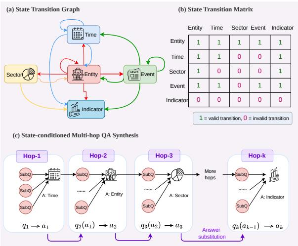
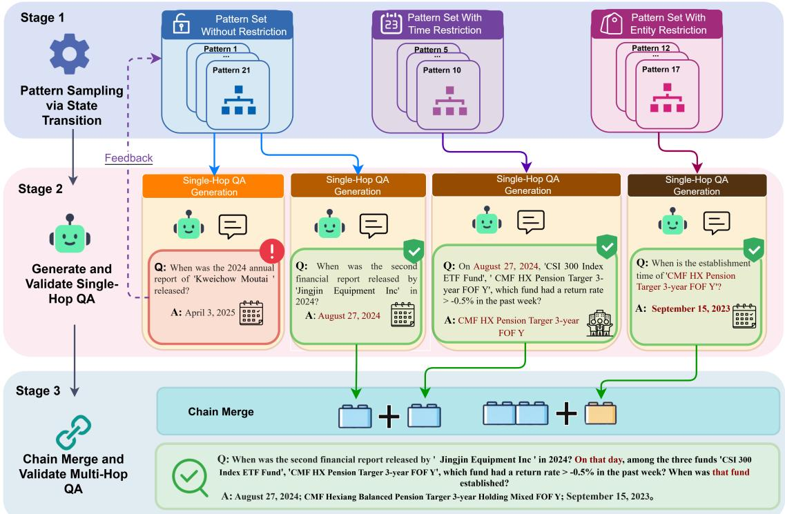
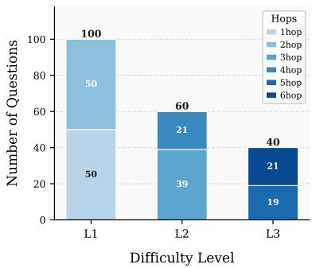
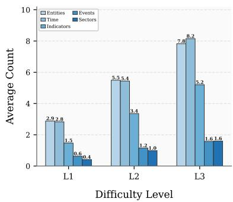
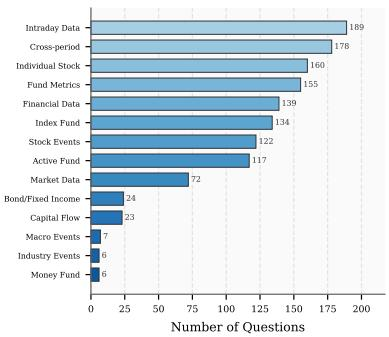
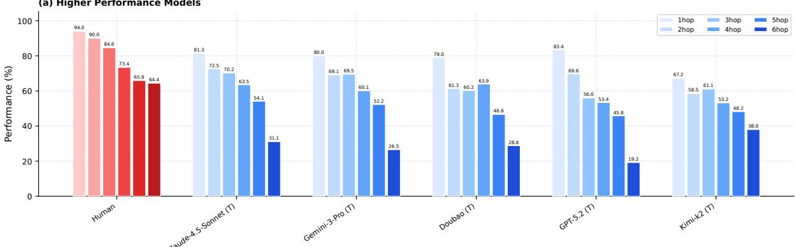
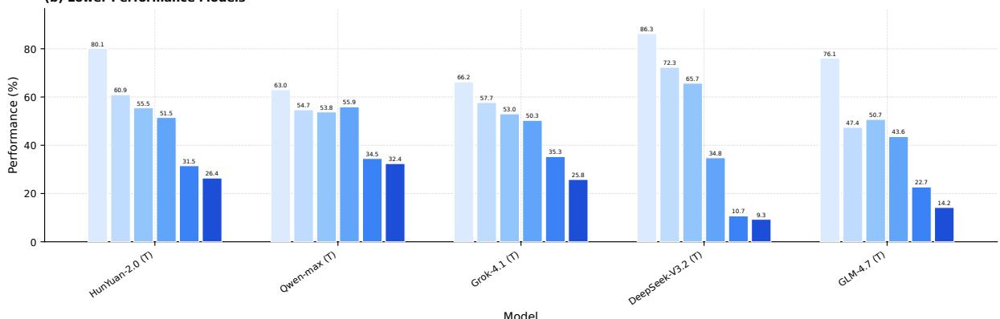
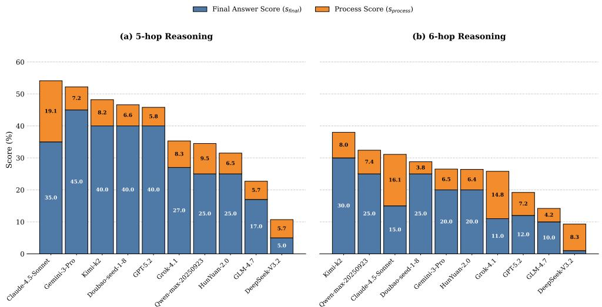
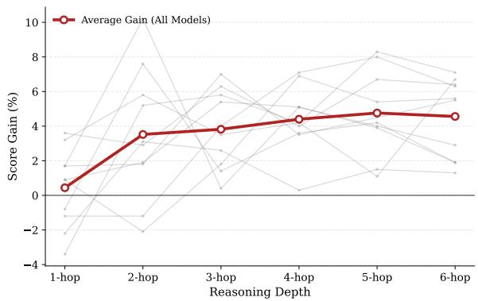
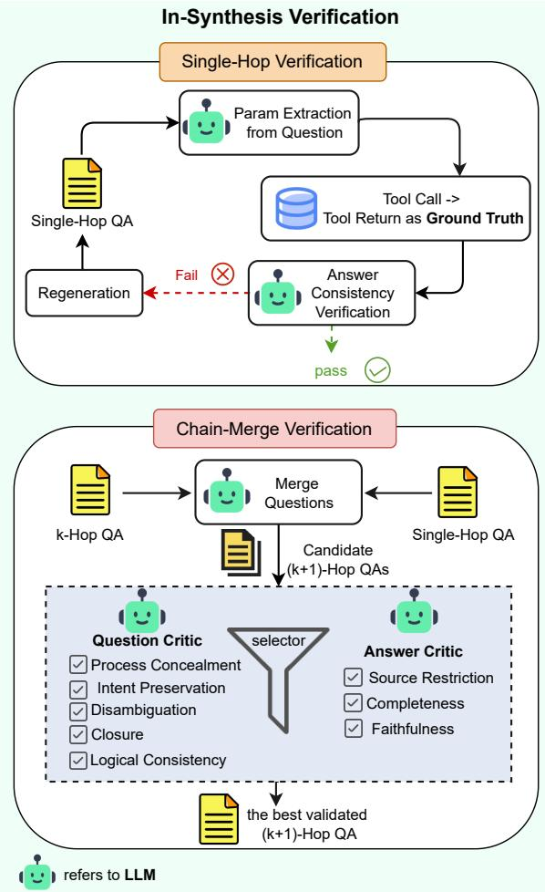

# FinHopper: A Progressive Multi-Hop Benchmark for Complex Financial Agents with Step-wise Evaluation

Yuxuan Wu<sup>1,2,\*</sup>, Miaopei Lin<sup>2,\*</sup>, Qiufang Ying<sup>2,\*</sup>, Lin Dan<sup>2</sup>, Hao Zhao<sup>2</sup>, Qirui Liu<sup>1,2</sup>, Yuteng Shen<sup>2</sup>, Shaohui Wu<sup>2</sup>, Weihong Luo<sup>2,†</sup>, Xiku Du<sup>2</sup>, Xing Tang<sup>3,†</sup>, Hao Chen<sup>2,†</sup>

<sup>1</sup>South China University of Technology

<sup>2</sup>FiT, Tencent

<sup>3</sup>Shenzhen Technology University

## Abstract

Financial agents are expected to answer fac tual investment queries through open search, but financial multi-hop retrieval differs from general multi-hop QA in a crucial way: each intermediate answer is an exact typed constraint, such as an entity, date, event, or numerical indicator, that determines the next query. This strict answer-conditioned dependency makes small intermediate errors cascade into plausible but wrong search trajectories. We introduce FinHopper, a benchmark for complex financial agents with controlled reasoning depth from 1 to 6 hops, covering stocks, funds, and macroeconomic facts, with gold intermediate answers for process-level evaluation. To construct FinHopper at scale, we design a statetransition-based synthesis framework that composes verified atomic financial QA patterns into dependency-preserving chains, followed by targeted in-synthesis verification, model-SubQ ensemble checking, and public-search valida-SubQ <sup>A:</sup> <sup>Time</sup> tion by financial experts. Experiments withSubQ 20 LLM-agent configurations show that public search tools are necessary but insufficient: performance drops sharply as hop depth increases, the best model remains far below human experts, and process-aware scoring reveals partial reasoning progress hidden by final-answeronly evaluation. The benchmark is available at https://github.com/justajustin/ FinHopper/.

## 1 Introduction

Financial analysts rarely answer investment questions by retrieving a single fact. A typical workflow may first identify a target company from a comparison, use that company to query an event date, and then use the date to retrieve a market indicator or fund movement. LLM-based agents with search and tool-use abilities (Nakano et al., 2021; Yao tity <sub>A:</sub> <sub>Sector</sub>...... ......et al., 2023; Schick et al., 2023) are increasingly SubQ SubQexpected to automate such evidence collection (Wu et al., 2023; Nie et al., 2024; Tongyi DeepResearch Team et al., 2025). This creates a financial multihop retrieval problem in which every hop must recover an exact, typed answer before the next search can even be posed correctly.

  
Figure 1: FinHopper abstracts financial multi-hop search as state-conditioned answer transitions, where each verified answer constrains the next hop through dependency-preserving answer substitution.

This structure is different from many general multi-hop QA or browsing tasks. In general domains, hops often gather complementary evidence, and approximate entity matching or broad web exploration can still lead to a usable answer. In finance, however, an intermediate answer becomes a hard query condition: a wrong company, reporting period, event date, or metric definition sends all later searches to the wrong state while the trajectory may still look coherent. Figure 1 abstracts this property as transitions among answer states, where only valid financial answer types can constrain subsequent hops. For example, identifying “the liquor company with the highest Q3 2024 revenue” requires exact reported figures and period definitions, not a likely or famous brand.

This financial specificity motivates different benchmark design choices from general multi-hop data. A benchmark must control which answer states can be chained, preserve hidden intermediate answers, and verify that every hop remains factually grounded in public financial evidence. Existing financial benchmarks still leave this gap: FinQA (Chen et al., 2021), TAT-QA (Zhu et al., 2021), and ConvFinQA (Chen et al., 2022) emphasize numerical reasoning with provided evidence; FinAgentBench (Choi et al., 2025) and related settings evaluate retrieval or tool use under more constrained formats; and FinSearchComp (Hu et al., 2025) moves closer to open financial search but is still primarily judged by final-answer correctness. Current benchmarks therefore rarely combine public-search reproducibility, strict answerconditioned chaining, and process-level supervision.

We propose FinHopper, a benchmark designed around these financial multi-hop requirements. Fin-Hopper contains questions from 1 to 6 reasoning hops across stocks, funds, and macroeconomic facts. Each item includes a final answer and stepwise gold intermediate answers, allowing evaluation to distinguish agents that fail immediately from those that retrieve correct intermediate evidence but break later in the chain. Its construction mirrors the motivation above: state-conditioned synthesis enforces valid financial dependencies, chain-merge verification prevents answer leakage or ambiguity, and expert public-search validation checks that released step answers are externally reproducible.

Our experiments show that FinHopper acts as a stress test for agentic financial retrieval. Without public search tools, all evaluated models nearly fail. With tools, performance improves substantially but still drops sharply as hop depth increases, revealing model-specific capability boundaries. Processaware scoring further shows that some agents can make partial progress even when their final answers are wrong, which final-answer-only metrics would hide.

Our contributions are as follows:

1. A benchmark for dependency-preserving financial search. We introduce FinHopper, a multi-hop financial benchmark with controlled depth from 1 to 6 hops and hybrid coverage across stocks, funds, and macroeconomics.

2. A scalable and verified construction framework. We propose a state-transition-based synthesis method that composes atomic financial QA patterns into valid reasoning chains, with verification at both single-hop and chainmerge stages.

3. A diagnostic evaluation protocol. We provide step-wise gold answers and a processaware scoring metric that localizes failures and exposes partial progress beyond binary final-answer accuracy.

## 2 Related Work

## 2.1 Multi-Hop QA and Web Agent Benchmarks

Multi-hop QA and browsing benchmarks have driven progress in evidence retrieval, long-context reasoning, and tool-augmented interaction. HotpotQA (Yang et al., 2018), FEVER (Thorne et al., 2018), Wizard of Wikipedia (Dinan et al., 2019), ELI5 (Fan et al., 2019), and KILT (Petroni et al., 2021) evaluate knowledge-intensive QA over retrieved or provided evidence. WebShop (Yao et al., 2022), WebArena (Zhou et al., 2024), Mind2Web (Deng et al., 2023), GAIA (Mialon et al., 2024), and BrowseComp variants (Wei et al., 2025; Zhou et al., 2025; Chen et al., 2026) further test web interaction and long-chain search. These benchmarks are not centered on financial answerconditioned dependencies: many tasks reward successful navigation or approximate evidence gathering, whereas financial multi-hop retrieval requires exact entities, dates, metric definitions, and numerical values whose errors cascade across later hops.

## 2.2 Financial QA and Search Benchmarks

Financial benchmarks cover numerical reasoning, document understanding, and agentic decision making, but they do not fully capture open-domain sequential retrieval. FinQA (Chen et al., 2021), TAT-QA (Zhu et al., 2021), and ConvFinQA (Chen et al., 2022) focus on numerical reasoning over provided documents. FinAgent (Zhang et al., 2024) and MarS (Li et al., 2025) study LLM-based stockmarket decision making with financial signals, while FinAgentBench (Choi et al., 2025) introduces tool-augmented financial tasks under a more constrained retrieval setting. FinSearchComp (Hu et al., 2025) moves closer to open-domain financial search, but its complex setting is still primarily assessed with final-answer pass/fail outcomes. Some benchmarks provide rationales or step annotations, and Finance Agent Benchmark (Bigeard et al., 2025) includes step-wise information, but they do not make verified intermediate answers central to benchmark construction and scoring. FinHopper instead targets public financial search where each intermediate answer becomes a typed condition for the next query, and its process-aware scoring diagnoses whether an agent fails in retrieval, state tracking, chain merging, or final synthesis.

## 3 Methodology

Building on Figure 1, FinHopper composes verified atomic financial questions into dependencypreserving chains. Figure 2 summarizes the pipeline: state-conditioned pattern sampling, single-hop QA generation and validation, and chain merge with post-synthesis validation before release.

## 3.1 Task Formulation

A FinHopper instance is a K-hop financial QA chain $\left\{ { \bigl ( } q _ { 1 } , a _ { 1 } { \bigr ) } , \ldots , { \bigl ( } q _ { K } , a _ { K } { \bigr ) } \right\}$ , where $q _ { K }$ is the released user-facing question and $a _ { K }$ is the final answer. The intermediate answers $\big \{ a _ { 1 } , \dotsc , a _ { K - 1 } \big \}$ are not exposed to the model during evaluation, but they are retained as gold process annotations. The defining property is strict dependency: answer $a _ { t }$ must provide a concrete constraint, such as an entity, date, sector, event, or indicator, that is required to formulate or solve the next hop $q _ { t + 1 }$

We distinguish three levels of granularity. A simple question queries one elementary financial relation, such as an entity-time-indicator fact or an event date. A single-hop question may contain multiple simple sub-queries that can be solved in parallel, such as comparing several entities under the same time and indicator. A multi-hop question links single-hop questions sequentially through answer substitution, so that each new hop depends on the verified answer of the previous hop.

## 3.2 Atomic Financial Patterns

To make synthesis controllable, we define a pattern library for generating single-hop QA pairs. Each pattern specifies the input components, the required computation, and the answer type. Across financial domains, these components can be represented by five answer states:

S = {Entity, Time, Sector, Event, Indicator}.

We design 21 patterns covering entity-time comparison, event-based retrieval, and entity-relationship queries. Pattern variants combine the question component type, computation type (e.g., ranking, filtering, comparison, or extraction), and answer component type, which determines how the next hop can be sampled. The full taxonomy is provided in Appendix E.

## 3.3 State-Conditioned Chain Synthesis

Not every answer type can validly constrain every subsequent question. For example, an entity answer can lead to questions about its sector, event timeline, or indicators, while an indicator value usually functions as a terminal answer. We therefore model chain construction as a random walk over an answer-state transition graph.

We define a state transition graph $G = ( \mathbf { S } , \mathbf { E } )$ where each directed edge $( s _ { i } \to s _ { j } ) \in \mathbb { E }$ indicates that an answer of state $s _ { i }$ can condition a following question whose answer state is $s _ { j } .$ , as shown in Figure 1. The transition probability from state $s _ { i }$ to $s _ { j }$ is defined by the normalized transition matrix $\mathbf { P } \in \{ 0 , 1 \} ^ { | \mathrm { { S } } | \times | \mathrm { { S } } | }$

$$
P _ { i j } = { \left\{ \begin{array} { l l } { { \frac { 1 } { | D ( s _ { i } ) | } } } & { { \mathrm { i f ~ } } ( s _ { i } \to s _ { j } ) \in \mathbf { E } } \\ { 0 } & { { \mathrm { o t h e r w i s e } } } \end{array} \right. }\tag{1}
$$

where $D ( s _ { i } ) = \{ s _ { j } : ( s _ { i } \to s _ { j } ) \in \mathbb { E } \}$ is the set of valid outgoing states. Starting from an initial state $s _ { 0 } \sim \pi _ { 0 }$ , we sample a target depth K and generate a valid trajectory $\big ( s _ { 0 } , \ldots , s _ { K } \big )$ using P. Each sampled state selects an eligible pattern and data pool; after verification, its answer is substituted into the next hop as an explicit constraint. Detailed transition examples are listed in Table 6.

## 3.4 Chain Generation and Merge

## 3.4.1 Single-Hop Generation

Given a sampled pattern, an LLM generator equipped with internal financial database tools retrieves candidate factual evidence and instantiates a single-hop QA pair. Each pair must pass single-hop verification before it can be merged into a longer chain.

## 3.4.2 Chain Merge

After a single-hop QA passes verification, it is merged with the existing chain through answer substitution: the previous hop’s answer is embedded into the next hop as a required constraint. The released question hides intermediate answers, while the benchmark stores them as process-level gold references. Chain-merge verification ensures that the new question is self-contained, unambiguous, and faithful to the underlying evidence.

  
Figure 2: Fine-grained construction pipeline of FinHopper. The framework first samples reusable financial patterns according to valid answer-state transitions, then generates and validates single-hop QA pairs, and finally merges verified hops into multi-hop questions while preserving intermediate answers for process-level evaluation.

## 3.5 Quality Control

FinHopper uses quality control at two stages: insynthesis verification filters errors during generation, and post-synthesis verification validates released items independently from the construction process.

## 3.5.1 In-Synthesis Verification

In-synthesis verification checks both atomic QA pairs and chain-merge operations before they enter the final benchmark, preventing factual errors from accumulating across hops. The detailed verification flow is shown in Appendix A.

Single-Hop Verification Single-hop verification re-derives tool parameters from the question text alone, retrieves evidence, and checks answer consistency. Failed or ambiguous samples are regenerated rather than merged.

Chain-Merge Verification For chain merge, separate critics check the question and answer: the question critic prevents leakage, ambiguity, and logical drift, while the answer critic checks completeness and faithfulness to evidence. We sample parallel merge candidates and retain the best validated one. Detailed criteria and prompts are provided in Appendices F and J.

## 3.5.2 Post-Synthesis Verification

After synthesis, we apply two independent checks before releasing the benchmark: model-ensemble answer verification and human verification through public search.

Answer Correctness Verification We employ an ensemble of five frontier LLMs under a ReAct framework (Yao et al., 2023). At this constructionverification stage, models query the internal financial database to derive reasoning chains and final answers. A sample is accepted only when a strict majority (≥ 3 agents) agree; disagreements are sent to expert arbitration. Implementation details are provided in Appendix H.

Human Verification As a final safeguard, 16 financial experts verified every released step-level answer through public search engines rather than the internal database. We also sampled 30% of synthesized items from each complexity level for double-blind review and senior-expert adjudication.

Table 1: Hop-wise composition of FinHopper. Each Khop item contains K step-level gold answers, yielding 572 step-level checking points in total. These step-level annotations are diagnostic signals rather than independent test samples.
<table><tr><td>Hop</td><td>1</td><td>2</td><td>3</td><td>4</td><td>5</td><td>6</td></tr><tr><td>Level</td><td>L1</td><td>L1</td><td>L2</td><td>L2</td><td>L3</td><td>L3</td></tr><tr><td>#Items</td><td>50</td><td>50</td><td>39</td><td>21</td><td>19</td><td>21</td></tr><tr><td>#Step answers</td><td>50</td><td>100</td><td>117</td><td>84</td><td>95</td><td>126</td></tr></table>

The 95% pass rate confirms alignment between automated and expert public-search checks.

## 4 Experiments

We conduct an evaluation on FinHopper to assess the capability of LLM agents in addressing financial tasks. Our evaluation focuses on four key aspects: the necessity of tools, the human-AI performance gap, the impact of reasoning depth, and inference efficiency.

## 4.1 Benchmark Statistics

Figure 3 summarizes FinHopper. The benchmark contains 200 questions with a controlled difficulty gradient: L1 covers 1–2 hops, L2 covers 3–4 hops, and L3 covers 5–6 hops. As difficulty increases, question components also become denser: L3 questions involve 2.7× more entities and 2.9× more time references than L1. The benchmark spans 14 financial domains, including intraday data, crossperiod analysis, individual stocks, fund metrics, and macroeconomics. FinHopper includes Chinese and English versions with the same reasoning chains and step-level gold answers; the main largescale evaluation uses the Chinese version, with representative English results in Section 4.5.

## 4.2 Evaluation of FinHopper

Financial tasks require multi-hop reasoning, so binary final-answer metrics cannot capture partial progress or hallucinated trajectories. We therefore use a two-stage hierarchical score. First, we set $s _ { f i n a l } = 1$ if the generated final answer matches the gold answer after normalizing units, dates, and formatting; otherwise $s _ { f i n a l } = 0$ . If the final answer is wrong, we evaluate whether the response recovers the N gold intermediate answers $\mathbf { K } = \{ k _ { 1 } , k _ { 2 } , . . . , k _ { N } \}$

$$
s _ { p r o c e s s } = \alpha \cdot \frac { 1 } { N } \sum _ { i = 1 } ^ { N } I ( k _ { i } \preceq \mathrm { A } )
$$

where $k _ { i } \preceq \mathbf { A }$ means that the response entails the gold intermediate step $k _ { i }$ , and $\alpha = 0 . 5$ caps partial credit for incorrect final answers. The final score is:

$$
S ( \mathrm { A } ) = s _ { f i n a l } + ( 1 - s _ { f i n a l } ) \cdot s _ { p r o c e s s }
$$

Correct final answers receive 1.0, while incorrect final answers receive 0.0–0.5 based on process validity. Evaluation prompts are provided in Appendix I.

## 4.3 Experimental Setup

We evaluate 10 representative frontier model families on the Chinese version of FinHopper: Gemini 3 Pro (Google, 2025), Claude 4.5 Sonnet (Anthropic, 2025), Doubao-seed-1-8- 251215 (Bytedance Seed, 2025), GPT-5.2 (OpenAI, 2025), DeepSeek-V3.2 (DeepSeek-AI et al., 2025), HunYuan-2.0 (Tencent Cloud, 2026), Kimi K2 and K2 Thinking (Kimi Team et al., 2025; Kimi Team, 2025), GLM-4.7 (Z.ai, 2025), qwen3-max-2025- 09-23 (Alibaba Cloud, 2025), and Grok 4.1 (xAI, 2025). Models answer with public search engines under the ReAct framework (Yao et al., 2023), with a maximum iteration budget of 42; the internal financial database is used only for data construction and is never exposed during evaluation. We test both "thinking" and "no-thinking" modes, and use 20 independent financial experts under the same public-search setting as the human upper bound. ReAct prompts are provided in Appendix H.

Because simple questions (1–2 hops) constitute 50% of the data, we report two metrics to avoid biasing results.

Micro-Average Score: This measures overall performance weighted by the data distribution. Let Score<sub>k</sub> denote the score at hop $k ,$ and $w _ { k }$ be the proportion of k-hop questions:

$$
S c o r e _ { \mathrm { m i c r o - a v g } } = \sum _ { k = 1 } ^ { 6 } w _ { k } \cdot S c o r e _ { k }
$$

Macro-Average Score: This treats all hop depths equally and better reflects robustness on long-chain tasks:

$$
S c o r e _ { \mathrm { m a c r o - a v g } } = { \frac { 1 } { 6 } } \sum _ { k = 1 } ^ { 6 } S c o r e _ { k }
$$

We also measure average inference latency in seconds per query.

## 4.4 Main Result

We report the overall performance on the Chinese version in Table 2, with English-version representative results provided in Table 3. A sharp contrast exists between the "without tools" and "use tools" settings. Without access to public search tools, all models fail almost completely, scoring below 8.1%. With search-tool augmentation, Claude-4.5- Sonnet-thinking achieves the top Micro Average score of 67.3%, but there remains a significant gap to human experts (81.7%). This gap expands as the question difficulty increases. For instance, on complex 6-hop tasks, humans maintain 64.4% accuracy, while the best model achieves only 31.1%. A detailed case study is provided in Appendix F.1. To assess the stability of the reported results under repeated evaluations, we report mean and standard deviation for both Micro- and Macro-Average scores in Appendix C.2. The standard deviations remain within 0.7–1.8 points, indicating that the main ranking trends are stable despite the moderate benchmark size.

  
(a) Difficulty & Hops

  
(b) Question Complexity

  
(c) Domain Distribution  
Figure 3: FinHopper provides a controlled difficulty gradient: hop depth increases from L1 to L3, question components grow denser with difficulty, and items cover diverse financial domains across stocks, funds, and macroeconomics.

Table 2: Performance of various models and human on FinHopper. All scores are reported in %.
<table><tr><td rowspan="2">model</td><td colspan="2">without tools</td><td colspan="10">use tools</td></tr><tr><td>Mic Avg.</td><td>Time</td><td>1hop</td><td>2hop</td><td>3hop</td><td>4hop</td><td>5hop</td><td>6hop</td><td></td><td>Mic Mac Avg. Avg.</td><td></td><td>Time</td></tr><tr><td>Human Performance</td><td>0</td><td>5</td><td>94.0</td><td>90.0</td><td>84.6</td><td>73.4</td><td>65.9</td><td></td><td>64.4</td><td>81.7</td><td>78.7</td><td>324</td></tr><tr><td>Claude-4.5-Sonnet-thinking</td><td>2.5</td><td>18</td><td>81.3</td><td>72.5</td><td>70.2</td><td></td><td>63.5</td><td>54.1</td><td>31.1</td><td>67.3</td><td>62.1</td><td>31</td></tr><tr><td>Claude-4.5-Sonnet-no-thinking</td><td>1.0</td><td>10</td><td>79.6</td><td>70.7</td><td>63.2</td><td></td><td>60.0</td><td>49.6</td><td>25.6</td><td>63.7</td><td>58.1</td><td>24</td></tr><tr><td>Gemini-3-Pro-thinking</td><td>3.2</td><td>18</td><td>80.0</td><td>69.1</td><td>69.5</td><td></td><td>60.1</td><td>52.2</td><td>26.5</td><td>65.0</td><td>59.6</td><td>34</td></tr><tr><td>Gemini-3-Pro-no-thinking</td><td>2.8</td><td>14</td><td>81.2</td><td>70.3</td><td>65.5</td><td></td><td>53.0</td><td>44.2</td><td>20.2</td><td>62.7</td><td>55.7</td><td>25</td></tr><tr><td>GPT-5.2-thinking</td><td>4.2</td><td>30</td><td>83.4</td><td>69.6</td><td>56.0</td><td></td><td>53.4</td><td>45.8</td><td>19.2</td><td>61.3</td><td>54.6</td><td>121</td></tr><tr><td>GPT-5.2</td><td>1.4</td><td>27</td><td>86.8</td><td>64.4</td><td>50.2</td><td></td><td>49.2</td><td>44.7</td><td>12.5</td><td>58.5</td><td>51.3</td><td>108</td></tr><tr><td>Doubao-seed-1-8-251215-thinking</td><td>1.8</td><td>15</td><td>79.0</td><td>61.3</td><td>60.2</td><td></td><td>63.9</td><td>46.6</td><td>28.8</td><td>61.1</td><td>56.6</td><td>34</td></tr><tr><td>Doubao-seed-1-8-251215</td><td>3.2</td><td>14</td><td>78.1</td><td>63.4</td><td>58.4</td><td></td><td>57.0</td><td>41.2</td><td>23.2</td><td>59.2</td><td>53.6</td><td>30</td></tr><tr><td>DeepSeek-V3.2-thinking</td><td>2.0</td><td>24</td><td>86.3</td><td>72.3</td><td>65.7</td><td></td><td>34.8</td><td>10.7</td><td>9.3</td><td>58.1</td><td>46.5</td><td>42</td></tr><tr><td>DeepSeek-V3.2-no-thinking</td><td>4.2</td><td>19</td><td>88.5</td><td>69.2</td><td>63.1</td><td></td><td>34.5</td><td>9.2</td><td>8.0</td><td>57.1</td><td>45.4</td><td>34</td></tr><tr><td>Kimi-k2-thinking</td><td>3.4</td><td>23</td><td>67.2</td><td>58.5</td><td>61.1</td><td></td><td>53.2</td><td>48.2</td><td>38.0</td><td>57.5</td><td>54.4</td><td>203</td></tr><tr><td>Kimi-k2</td><td>7.0</td><td>20</td><td>68.0</td><td>50.9</td><td>59.7</td><td></td><td>49.6</td><td>44.0</td><td>36.1</td><td>54.6</td><td>51.4</td><td>187</td></tr><tr><td>HunYuan-2.0-thinking</td><td>4.0</td><td>26</td><td>80.1</td><td>60.9</td><td>55.5</td><td></td><td>51.5</td><td>31.5</td><td>26.4</td><td>57.3</td><td>51.0</td><td>46</td></tr><tr><td>HunYuan-2.0-instruct</td><td>3.2</td><td>19</td><td>76.5</td><td>58.0</td><td>49.2</td><td></td><td>47.5</td><td>24.8</td><td>20.0</td><td>52.7</td><td>46.0</td><td>41</td></tr><tr><td>Grok-4.1-thinking</td><td>3.0</td><td>16</td><td>66.2</td><td>57.7</td><td>53.0</td><td></td><td>50.3</td><td>35.3</td><td>25.8</td><td>52.7</td><td>48.1</td><td>57</td></tr><tr><td>Grok 4.1</td><td>6.2</td><td>14</td><td>63.0</td><td>51.9</td><td>49.5</td><td></td><td>46.1</td><td>27.0</td><td>18.7</td><td>42.7</td><td>42.7</td><td>42</td></tr><tr><td>Qwen-max-20250923-thinking</td><td>3.2</td><td>14</td><td>63.0</td><td>54.7</td><td>53.8</td><td></td><td>55.9</td><td>34.5</td><td>32.4</td><td>52.5</td><td>49.1</td><td>47</td></tr><tr><td>Qwen-max-20250923-no-thinking</td><td>1.0</td><td>6</td><td>61.3</td><td>44.5</td><td>53.4</td><td></td><td>50.8</td><td>30.6</td><td>30.5</td><td>48.3</td><td>45.2</td><td>30</td></tr><tr><td>GLM-4.7-thinking</td><td>8.1</td><td>71</td><td>76.1</td><td>47.4</td><td>50.7</td><td></td><td>43.6</td><td>22.7</td><td>14.2</td><td>49.0</td><td>42.5</td><td>92</td></tr><tr><td>GLM-4.7-no-thinking</td><td>6.4</td><td>57</td><td>75.2</td><td>45.5</td><td>45.3</td><td></td><td>38.5</td><td>18.7</td><td>11.3</td><td>48.8</td><td>40.9</td><td>73</td></tr></table>

## Furthermore, we present three key findings:

(1) Each model has a specific "agentic capability boundary". We observe a sharp cliff-like performance decline for most models once the question depth reaches a certain hop. As shown in Figure 4, DeepSeek-V3.2 performs well on simple tasks but the score drops by half after 4-hop. Similarly, Gemini-3-Pro maintains high accuracy but eventually hits its boundary at 6-hop.

(2) Models with "thinking" capabilities demonstrate superior robustness compared to standard counterparts. Figure 6 illustrates this performance gain. The benefit of the thinking mode becomes more evident as reasoning difficulty increases. This suggests that the main benefit of reasoning-enhanced inference is not memorizing more financial facts, but maintaining a more reliable execution trace. In long-chain financial search, a model must decompose the user query into ordered sub-goals, preserve typed constraints such as entities, dates, sectors, and indicators, and revise its search plan when an intermediate result conflicts with later evidence. Thinking models appear to be more robust at these planning and state-tracking operations, which explains why the average gain increases from shallow to deeper hops. However, the gain is not uniform across all depths or models: on simple 1–2 hop questions, the additional reasoning budget sometimes provides limited benefit because the main bottleneck is factual retrieval rather than long-horizon control. While the "thinking" mode enhances accuracy, it incurs a computational cost. As shown in the Time column in Table 2, reasoning-enhanced models generally require longer inference times (e.g., GPT-5.2-thinking at 121s vs. GPT-5.2 at 108s).

Table 3: Performance of representative models on FinHopper (English). All scores are reported in %.
<table><tr><td rowspan="2">model</td><td colspan="3">without tools</td><td colspan="7">use tools</td></tr><tr><td>Mic Avg.</td><td>Time</td><td>1hop</td><td>2hop</td><td>3hop</td><td>4hop</td><td>5hop</td><td>6hop</td><td>Mic Mac Avg. Avg.</td><td>Time</td></tr><tr><td>Gemini-3-Pro-thinking</td><td>3.5</td><td>17</td><td>81.5</td><td>68.3</td><td>70.8</td><td>60.8</td><td>51.5</td><td>26.0 65.2</td><td>59.8</td><td>33</td></tr><tr><td>GPT-5.2-thinking</td><td>4.8</td><td>29</td><td>84.8</td><td>69.0</td><td>57.2 54.0</td><td>45.2</td><td>19.8</td><td>61.7</td><td>55.0</td><td>118</td></tr><tr><td>GLM-4.7-thinking</td><td>7.5</td><td>74</td><td>75.0</td><td>48.2</td><td>51.0</td><td>42.8 22.2</td><td>14.8</td><td>48.8</td><td>42.3</td><td>95</td></tr><tr><td>Kimi-k2-thinking</td><td>3.0</td><td>25</td><td>66.0</td><td>59.2</td><td>60.5</td><td>52.5</td><td>48.8 38.2</td><td>57.3</td><td>54.2</td><td>208</td></tr></table>



(b) Lower Performance Models  
  
Figure 4: Model performance across 1–6 hop tasks, grouped by thinking mode. The curves expose model-specific capability boundaries: most agents remain competitive on shallow tasks but degrade sharply once the reasoning chain exceeds their effective search and state-tracking depth.

(3) Step-by-step grading offers more precise assessment of agent capabilities than the binary final answer score , especially for complex tasks (5-6 hops), as shown in Figure 5. A binary score is not able to distinguish answers with different partial success. For instance, on 6-hop tasks, DeepSeek-V3.2 scores only 1.0 on $s _ { f i n a l }$ but achieves 8.3 on $s _ { p r o c e s s }$ , indicating the model can solve intermediate steps even if it fails the final check. Thus, step-by-step grading is vital for capturing the true potential of the agents.

  
Figure 5: Breakdown of model performance into Final Answer Score(s <sub>inal</sub>) and Process Score $( s _ { p r o c e s s } )$ . The left and right panels show results for 5-hop and 6-hop questions, respectively.

  
Figure 6: Score gain of Thinking Mode across tasks with depth from 1 to 6 hops. The grey lines represent the score trajectories of individual models, while the bold red line denotes the average gain of all models.

## 4.5 Representative English-Version Evaluation

FinHopper also includes an English version translated from the Chinese benchmark with the same reasoning chains, final answers, and step-level gold references. Because full tool-augmented evaluation incurs substantial API and search costs, we evaluate the English version on four representative thinking models. As shown in Table 3, the Englishversion results follow the same broad trend as the Chinese main evaluation, with strong performance on lower-hop tasks and a clear decline as reasoning depth increases.

## 4.6 Failure Analysis

To better understand the capability boundary revealed by FinHopper, we sample successful and failed model trajectories across difficulty levels and annotate the first major error that causes the reasoning chain to deviate. The failures mainly fall into four categories: decomposition and planning failures (38%), tool misuse (31%), hallucination propagation (17%), and information extraction failures (14%). These patterns suggest that performance drops beyond 4 hops not because models lack isolated financial facts, but because longer chains amplify small errors in planning, tool grounding, evidence extraction, and state tracking into finalanswer failures. Detailed examples and qualitative analysis are provided in Appendix F.1.

## 5 Conclusion

In this paper, we address the lack of benchmarks for agents’ capacity in solving complex financial tasks requiring strict sequential dependency and disambiguation of professional metrics by introducing FinHopper. It is constructed through a state-transition-based synthesis framework with verified intermediate answers. Our evaluation reveals that while the top-performing model, Claude-4.5-Sonnet-thinking, demonstrates improved robustness, a substantial performance gap remains compared to human experts, particularly on tasks exceeding 4 hops. Furthermore, we provide a stepby-step diagnosis tool with validated intermediate gold reference answers. In future work, we plan to expand the benchmark boundaries by incorporating broader heterogeneous data sources and synthesizing reasoning chains of higher complexity, continually challenging the limits of agentic reasoning in professional financial domains.

## 6 Limitations

Despite FinHopper’s advancements, limitations remain. Language and Market Coverage. Although FinHopper provides both Chinese and English versions, the main large-scale evaluation is conducted on Chinese questions, and the data predominantly stems from the Chinese market, leaving broader generalization to global markets to be further verified. Naturalness of Queries. Although auto-generated queries undergo human verification, they still lack the ambiguity and informality typical of real-world questions. Scope and Modality. The benchmark focuses on factual reasoning, currently excluding subjective tasks like sentiment analysis or multi-modal interpretation.

## 7 Ethical Review

Data Collection and Privacy. FinHopper is constructed solely from publicly available sources (regulatory filings, market data, official disclosures) and contains no personally identifiable information (PII). The released benchmark contains the query, final gold answer, and step-wise intermediate answers required for process evaluation. All collection processes comply with respective terms of service and data protection regulations.

Intended Use and Potential Misuse. Designed for evaluating AI reasoning, FinHopper mitigates misuse risks (e.g., market manipulation) by focusing on historical data and reasoning patterns rather than real-time trading signals. We advocate for responsible research in compliance with financial regulations.

Bias Considerations. To address potential biases in financial data (e.g., over-representation of large-cap firms), we employed stratified sampling across company sizes, sectors, and time periods. Users should consider these inherent limitations when interpreting results.

Human Evaluation. Expert evaluations were conducted with informed consent from voluntary participants. No sensitive personal data was collected during the review process.

## References

Alibaba Cloud. 2025. qwen3-max model info. Official documentation for the qwen3-max-2025-09-23 snapshot.

Anthropic. 2025. Introducing claude sonnet 4.5. Anthropic News.

Antoine Bigeard, Langston Nashold, Rayan Krishnan, and Shirley Wu. 2025. Finance agent benchmark: Benchmarking llms on real-world financial research tasks. arXiv preprint arXiv:2508.00828.

Bytedance Seed. 2025. Seed1.8 model card: Towards generalized real-world agency. Model card, ByteDance.

Zhiyu Chen, Wenhu Chen, Charese Smiley, Sameena Shah, Iana Borova, Dylan Langdon, Reema Moussa, Matt Beane, Ting-Hao Huang, Bryan Routledge, and William Yang Wang. 2021. FinQA: A dataset of numerical reasoning over financial data. In Proceedings of the 2021 Conference on Empirical Methods in Natural Language Processing (EMNLP), pages 3697–3711.

Zhiyu Chen, Shiyang Li, Charese Smiley, Zhiqiang Ma, Sameena Shah, and William Yang Wang. 2022. Convfinqa: Exploring the chain of numerical reasoning in conversational finance question answering. In Proceedings of the 2022 Conference on Empirical Methods in Natural Language Processing (EMNLP), pages 6279–6292.

Zijian Chen, Xueguang Ma, Shengyao Zhuang, Ping Nie, Kai Zou, Sahel Sharifymoghaddam, Andrew Liu, Joshua Green, Kshama Patel, Ruoxi Meng, Mingyi Su, Yanxi Li, Haoran Hong, Xinyu Shi, Xuye Liu, Hosna Oyarhoseini, Nandan Thakur, Crystina Zhang, Luyu Gao, and 2 others. 2026. BrowseComp-Plus: A fair and disentangled evaluation benchmark for deep search agents. In Proceedings of the 64th Annual Meeting ofthe Associationfor Computational Linguistics (Volume 1: Long Papers), pages 22349– 22370, San Diego, California, United States. Association for Computational Linguistics.

Chanyeol Choi, Jihoon Kwon, Alejandro Lopez-Lira, Chaewoon Kim, Minjae Kim, Juneha Hwang, Jaeseon Ha, Hojun Choi, Suyeol Yun, Yongjin Kim, and Yongjae Lee. 2025. FinAgentBench: A benchmark dataset for agentic retrieval in financial question answering. In Proceedings ofthe 6th ACM International Conference on AI in Finance (ICAIF), pages 632–637.

DeepSeek-AI, Aixin Liu, Aoxue Mei, Bangcai Lin, Bing Xue, Bingxuan Wang, Bingzheng Xu, Bochao Wu, Bowei Zhang, Chaofan Lin, and 1 others. 2025. Deepseek-v3.2: Pushing the frontier of open large language models. arXiv preprint arXiv:2512.02556.

Xiang Deng, Yu Gu, Boyuan Zheng, Shijie Chen, Samuel Stevens, Boshi Wang, Huan Sun, and Yu Su. 2023. Mind2web: Towards a generalist agent for the

web. In Advances in Neural Information Processing Systems, volume 36.

Emily Dinan, Stephen Roller, Kurt Shuster, Angela Fan, Michael Auli, and Jason Weston. 2019. Wizard of wikipedia: Knowledge-powered conversational agents. In Proceedings ofthe International Conference on Learning Representations (ICLR).

Angela Fan, Yacine Jernite, Ethan Perez, David Grangier, Jason Weston, and Michael Auli. 2019. Eli5: Long form question answering. In Proceedings of the 57th Annual Meeting ofthe Associationfor Computational Linguistics, pages 3558–3567.

Google. 2025. A new era of intelligence with Gemini 3. Google Blog, November 18, 2025.

Liang Hu, Jianpeng Jiao, Jiashuo Liu, Yanle Ren, Zhoufutu Wen, Kaiyuan Zhang, Xuanliang Zhang, Xiang Gao, Tianci He, Fei Hu, Yali Liao, Zaiyuan Wang, Chenghao Yang, Qianyu Yang, Mingren Yin, Zhiyuan Zeng, Ge Zhang, Xinyi Zhang, Xiying Zhao, and 4 others. 2025. FinSearchComp: Towards a realistic, expert-level evaluation of financial search and reasoning. arXiv preprint arXiv:2509.13160.

Kimi Team. 2025. Introducing Kimi K2 Thinking. Official release, November 6, 2025.

Kimi Team, Yifan Bai, Yiping Bao, Guanduo Chen, Jiahao Chen, Ningxin Chen, Ruijue Chen, Yanru Chen, Yuankun Chen, Yutian Chen, Zhuofu Chen, and 1 others. 2025. Kimi k2: Open agentic intelligence. arXiv preprint arXiv:2507.20534.

Junjie Li, Yang Liu, Weiqing Liu, Shikai Fang, Lewen Wang, Chang Xu, and Jiang Bian. 2025. MarS: A financial market simulation engine powered by generative foundation model. In The Thirteenth International Conference on Learning Representations (ICLR).

Grégoire Mialon, Clémentine Fourrier, Craig Swift, Thomas Wolf, Yann LeCun, and Thomas Scialom. 2024. GAIA: A benchmark for general ai assistants. In The Twelfth International Conference on Learning Representations (ICLR).

Reiichiro Nakano, Jacob Hilton, Suchir Balaji, Jeff Wu, Long Ouyang, Christina Kim, Christopher Hesse, Shantanu Jain, Vineet Kosaraju, William Saunders, and 1 others. 2021. Webgpt: Browser-assisted question-answering with human feedback. arXiv preprint arXiv:2112.09332.

Yuqi Nie, Yaxuan Kong, Xiaowen Dong, John M Mulvey, H Vincent Poor, Qingsong Wen, and Stefan Zohren. 2024. A survey of large language models for financial applications: Progress, prospects and challenges. arXiv preprint arXiv:2406.11903.

OpenAI. 2025. Introducing GPT-5.2. OpenAI Official Website, December 11, 2025.

Fabio Petroni, Aleksandra Piktus, Angela Fan, Patrick Lewis, Majid Yazdani, Nicola De Cao, James Thorne, Yacine Jernite, Vladimir Karpukhin, Jean Maillard, Vassilis Plachouras, Tim Rocktäschel, and Sebastian Riedel. 2021. KILT: a benchmark for knowledge intensive language tasks. In Proceedings ofthe 2021 Conference of the North American Chapter of the Associationfor Computational Linguistics: Human Language Technologies, pages 2523–2544. Association for Computational Linguistics.

Timo Schick, Jane Dwivedi-Yu, Roberto Dessì, Roberta Raileanu, Maria Lomeli, Eric Hambro, Luke Zettlemoyer, Nicola Cancedda, and Thomas Scialom. 2023. Toolformer: Language models can teach themselves to use tools. Advances in Neural Information Processing Systems, 36:68539–68551.

Tencent Cloud. 2026. Tencent Hunyuan. Official documentation listing the hunyuan-2.0-thinking-20251109 and hunyuan-2.0-instruct-20251111 model identifiers.

James Thorne, Andreas Vlachos, Christos Christodoulopoulos, and Arpit Mittal. 2018. Fever: a large-scale dataset for fact extraction and verification. In Proceedings ofthe 2018 Conference of the North American Chapter of the Association for Computational Linguistics: Human Language Technologies, Volume 1 (Long Papers), pages 809–819.

Tongyi DeepResearch Team, Baixuan Li, Bo Zhang, Dingchu Zhang, Fei Huang, Guangyu Li, Guoxin Chen, Huifeng Yin, Jialong Wu, Jingren Zhou, and 1 others. 2025. Tongyi deepresearch technical report. arXiv preprint arXiv:2510.24701.

Jason Wei, Zhiqing Sun, Spencer Papay, Scott McKinney, Jeffrey Han, Isa Fulford, Hyung Won Chung, Alex Tachard Passos, William Fedus, and Amelia Glaese. 2025. BrowseComp: A simple yet challenging benchmark for browsing agents. arXiv preprint arXiv:2504.12516.

Shijie Wu, Ozan Irsoy, Steven Lu, Vadim Dabravolski, Mark Dredze, Sebastian Gehrmann, Prabhanjan Kambadur, David Rosenberg, and Gideon Mann. 2023. Bloomberggpt: A large language model for finance. arXiv preprint arXiv:2303.17564.

xAI. 2025. Grok 4.1 model card. Model card, xAI.

Zhilin Yang, Peng Qi, Saizheng Zhang, Yoshua Bengio, William Cohen, Ruslan Salakhutdinov, and Christopher D Manning. 2018. Hotpotqa: A dataset for diverse, explainable multi-hop question answering. In Proceedings of the 2018 Conference on Empirical Methods in Natural Language Processing, pages 2369–2380.

Shunyu Yao, Howard Chen, John Yang, and Karthik Narasimhan. 2022. Webshop: Towards scalable realworld web interaction with grounded language agents. In Advances in Neural Information Processing Systems, volume 35, pages 20744–20757.

Shunyu Yao, Jeffrey Zhao, Dian Yu, Nan Du, Izhak Shafran, Karthik Narasimhan, and Yuan Cao. 2023. React: Synergizing reasoning and acting in language models. In International Conference on Learning Representations (ICLR).

Z.ai. 2025. GLM-4.7: Advancing the coding capability. Official technical blog, December 22, 2025.

Wentao Zhang, Lingxuan Zhao, Haochong Xia, Shuo Sun, Jiaze Sun, Molei Qin, Xinyi Li, Yuqing Zhao, Yilei Zhao, Xinyu Cai, Longtao Zheng, Xinrun Wang, and Bo An. 2024. A multimodal foundation agent for financial trading: Tool-augmented, diversified, and generalist. In Proceedings of the 30th ACM SIGKDD Conference on Knowledge Discovery and Data Mining, pages 4314–4325.

Peilin Zhou, Bruce Leon, Xiang Ying, Can Zhang, Yifan Shao, Qichen Ye, Dading Chong, Zhiling Jin, Chenxuan Xie, Meng Cao, Yuxin Gu, Sixin Hong, Jing Ren, Jian Chen, Chao Liu, and Yining Hua. 2025. BrowseComp-ZH: Benchmarking web browsing ability of large language models in chinese. arXiv preprint arXiv:2504.19314.

Shuyan Zhou, Frank F Xu, Hao Zhu, Xuhui Zhou, Robert Lo, Abishek Sridhar, Xianyi Cheng, Tianyue Ou, Yonatan Bisk, Daniel Fried, Uri Alon, and Graham Neubig. 2024. Webarena: A realistic web environment for building autonomous agents. In The Twelfth International Conference on Learning Representations.

Fengbin Zhu, Wenqiang Lei, Youcheng Huang, Chao Wang, Shuo Zhang, Jiancheng Lv, Fuli Feng, and Tat-Seng Chua. 2021. TAT-QA: A question answering benchmark on a hybrid of tabular and textual content in finance. In Proceedings ofthe 59th Annual Meeting ofthe Associationfor Computational Linguistics and the 11th International Joint Conference on Natural Language Processing (Volume 1: Long Papers), pages 3277–3287.

## A In-Synthesis Verification Details

Figure 7 illustrates the two filters used during benchmark construction. Single-hop verification independently re-derives answers from question text, while chain-merge verification critiques candidate merged questions and answers before accepting a longer QA chain.

For single-hop verification, the verifier receives only the generated question, re-extracts tool parameters, invokes the corresponding financial tools, and checks whether the generated answer is semantically consistent with retrieved evidence. Samples whose required parameters cannot be reliably extracted are treated as ambiguous and regenerated. For chain-merge verification, the question critic checks process concealment, intent preservation, disambiguation, closure, and logical consistency, while the answer critic checks evidence restriction, completeness, and faithfulness. These checks target the key risks of financial multi-hop synthesis: leaking intermediate answers, drifting away from the original constraint, or propagating unsupported evidence across hops.

  
Figure 7: In-synthesis verification independently rederives single-hop answers and critiques chain-merged questions before they are accepted into longer FinHopper instances.

## B Data Pool Definitions

As illustrated in Table 5, the input states are categorized into four distinct dimensions: Entity, Time, Sector, and Event.

## C Experiment Details on FinHopper

## C.1 Model Performance with Increasing Task Difficulty

The detailed 1–6 hop performance trends are discussed in the main text alongside Figure 4.

## C.2 Stability Analysis

Table 4 reports the mean and standard deviation of Micro- and Macro-Average scores under repeated evaluations. The overall fluctuations are small, supporting the stability of the main conclusions.

Table 4: Stability analysis on FinHopper. Scores are reported as mean ± standard deviation in %.
<table><tr><td>Model</td><td>Mic Avg.</td><td>Mac Avg.</td></tr><tr><td>Human Performance Claude-4.5-Sonnet-thinking</td><td> $8 1 . 7 \pm 1 . 6$ </td><td> $7 8 . 7 \pm 1 . 4$ </td></tr><tr><td>Claude-4.5-Sonnet-no-thinking</td><td> $6 7 . 3 \pm 0 . 8$   $6 3 . 7 \pm 1 . 0$ </td><td> $6 2 . 1 \pm 1 . 1$ </td></tr><tr><td>Gemini-3-Pro-thinking</td><td> $6 5 . 0 \pm 1 . 2$ </td><td> $5 8 . 1 \pm 0 . 9$ </td></tr><tr><td>Gemini-3-Pro-no-thinking</td><td></td><td> $5 9 . 6 \pm 0 . 9$ </td></tr><tr><td>GPT-5.2-thinking</td><td> $6 2 . 7 \pm 1 . 1$ </td><td> $5 5 . 7 \pm 1 . 3$ </td></tr><tr><td>GPT-5.2</td><td>61.3±0.7</td><td> $5 4 . 6 \pm 1 . 3$ </td></tr><tr><td>Doubao-seed-1-8-251215-thinking</td><td> $5 8 . 5 \pm 1 . 5$ </td><td>51.3±1.2</td></tr><tr><td>Doubao-seed-1-8-251215</td><td> $6 1 . 1 \pm 1 . 0$ </td><td>56.6±0.8</td></tr><tr><td>DeepSeek-V3.2-thinking</td><td> $5 9 . 2 \pm 1 . 3$ </td><td> $5 3 . 6 \pm 1 . 1$ </td></tr><tr><td>DeepSeek-V3.2-no-thinking</td><td> $5 8 . 1 \pm 1 . 4$ </td><td> $4 6 . 5 \pm 0 . 8$ </td></tr><tr><td>Kimi-k2-thinking</td><td> $5 7 . 1 \pm 1 . 7$ </td><td> $4 5 . 4 \pm 1 . 5$ </td></tr><tr><td>Kimi-k2</td><td> $5 7 . 5 \pm 0 . 9$ </td><td> $5 4 . 4 \pm 1 . 1$ </td></tr><tr><td>HunYuan-2.0-thinking</td><td> $5 4 . 6 \pm 1 . 2$ </td><td> $5 1 . 4 \pm 0 . 7$ </td></tr><tr><td>HunYuan-2.0-instruct</td><td> $5 7 . 3 \pm 1 . 1$ </td><td> $5 1 . 0 \pm 1 . 3$ </td></tr><tr><td>Grok-4.1-thinking</td><td> $5 2 . 7 \pm 1 . 6$ </td><td> $4 6 . 0 \pm 1 . 2$ </td></tr><tr><td></td><td> $5 2 . 7 \pm 0 . 8$ </td><td> $4 8 . 1 \pm 1 . 0$ </td></tr><tr><td>Grok-4.1</td><td> $4 2 . 7 \pm 1 . 4$ </td><td> $4 2 . 7 \pm 1 . 8$ </td></tr><tr><td>Qwen-max-20250923-thinking</td><td> $5 2 . 5 \pm 0 . 9$ </td><td> $4 9 . 1 \pm 1 . 0$ </td></tr><tr><td>Qwen-max-20250923-no-thinking</td><td> $4 8 . 3 \pm 1 . 3$ </td><td> $4 5 . 2 \pm 0 . 9$ </td></tr><tr><td>GLM-4.7-thinking</td><td> $4 9 . 0 \pm 1 . 5$ </td><td> $4 2 . 5 \pm 1 . 6$ </td></tr><tr><td>GLM-4.7-no-thinking</td><td> $4 8 . 8 \pm 1 . 8$ </td><td> $4 0 . 9 \pm 1 . 4$ </td></tr></table>

## D State Transition Example

Table 6 presents illustrative examples of valid state transitions within our framework. For each transition type, we demonstrate how the answer obtained at hop k (highlighted in red) functions as a key constraint or subject for formulating the subsequent question at hop $k + 1$

## E Single-Hop Pattern Taxonomy

We present a detailed taxonomy of 21 single-hop QA generation patterns in Table 7, organized into three categories: Entity-Time Comparison, Event-Based, and Entity Relationship patterns.

## F Guide For Chain-Merge Verification

We show the detailed guide for Chain-Merge Verification in Table 8. For questions, criteria such as Intent Preservation and Logical Consistency maintain semantic integrity. They aim to eliminate ambiguity and prevent information leakage. For answers, criteria like Evidence Restriction and Faithfulness constrain outputs to the merged query. This ensures every intermediate answer is explicit and prohibits unsupported inferences. We provide concrete examples for each criterion to facilitate both automated and human evaluation.

## F.1 Case Study

To investigate the underlying mechanisms of agentic reasoning, we conducted a qualitative analysis on the reasoning chains of all models (by thinking mode). Specifically, we sampled 20% of successful instances $( s _ { f i n a l } = 1 )$ and 20% of failed instances $( s _ { f i n a l } = 0 )$ from each difficulty level. This section summarizes the critical factors for success and categorizes the primary patterns of failure.

## F.1.1 Mechanisms of Success

Our analysis reveals that solving multi-hop questions—particularly those exceeding 3 hops—requires a synergy of three core capabilities: strategic planning and decomposition, efficient tool utilization, robust context retention and self-correction.

As illustrated in Box 1 and Box 2, successful agents do not merely retrieve facts; they construct a logical roadmap. They maintain critical constraints across long horizons and autonomously trigger reflection mechanisms to correct deviations when intermediate steps yield implausible results.

## F.1.2 Taxonomy of Failures

Despite possessing the capabilities mentioned above, agent performance degrades significantly as task complexity increases. By annotating and classifying the failed samples, we identified four primary failure modes within the reasoning chain.

1. Decomposition and Planning Failures (38%): This is the most prevalent structural error. Agents often exhibit logical sequencing errors, where the execution order of sub-goals is irrational, blocking subsequent steps. Furthermore, agents often lack the ability to refine their plans, leading to "dead ends" where they repetitively execute ineffective steps without strategic adjustment.

2. Tool Misuse (31%): This category involves the selection of inappropriate tools for the immediate sub-task. For instance, an agent might query a stock price tool instead of a corporate profile tool to find an IPO date. Additionally, failures occur due to improper usage, such as providing incorrect parameters or formats, which results in execution errors or null returns.

Table 5: Data pool selection based on input state.
<table><tr><td>Input State</td><td>Data Pool</td><td>Examples</td></tr><tr><td>Entity</td><td>Stocks and funds</td><td>Tencent, CATL, fund/ETF tickers</td></tr><tr><td>Time</td><td>Trading days, a period of time</td><td>2025-11-19; FY2025_Q3, 2024-10-05–2024-11-05</td></tr><tr><td>Sector</td><td>Industry classifications, sector indices</td><td>New Energy Vehicles; Semiconductor; CSI 300 sec- tor index</td></tr><tr><td>Event</td><td>Earnings releases, dividends, corporate an- nouncements, ...</td><td>Q3 earnings release; dividend distribution; share buyback announcement</td></tr></table>

Table 6: State transition rules with examples. Each row shows a valid transition illustrated with consecutive hop questions. The “Indicator” state terminates the reasoning chain.
<table><tr><td>From State</td><td>To State</td><td>Hop k Question</td><td>Hop k+1 Question</td></tr><tr><td rowspan="4">Entity</td><td>Entity</td><td>Question: Which fund holds the highest value of Moutai? (Answer Type: Entity)</td><td>Who is the fund manager of that fund? (An- swer Type: Entity)</td></tr><tr><td>Sector</td><td>Among 4 companies, which had the highest net profit margin in Q3 2025? (Answer Type: Entity)</td><td>What sector does that company belong to? (Answer Type: Sector)</td></tr><tr><td>Time</td><td>Among 4 companies, which had the highest net profit margin in Q3 2025? (Answer Type: Entity)</td><td>When was that company listed? (Answer Type: Time)</td></tr><tr><td>Indicator</td><td>What was CATL&#x27;s closing price on Dec 30, 2025? (Answer Type: Indicator)</td><td>369.20 CNY (Terminal, Answer Type: Indi- cator)</td></tr><tr><td rowspan="2">Time</td><td>Entity</td><td>When did Jingjin Equipment Inc release its 2nd report in 2024? (Answer Type: Time)</td><td>On that day, which fund had weekly return &gt; -0.5%? (Answer Type: Entity)</td></tr><tr><td>Indicator</td><td>Which day did Moutai&#x27;s price peak in Nov 2025? (Answer Type: Time)</td><td>What was CATL&#x27;s closing price on that day? (Answer Type: Indicator)</td></tr><tr><td>Sector</td><td>Entity</td><td>Which sector does CATL belong to? (An- swer Type: Sector)</td><td>Which stock in that sector had highest 5-day gain? (Answer Type: Entity)</td></tr><tr><td>Event</td><td>Time</td><td>Kweichow Moutai dividend distribution (An- swer Type: Event)</td><td>What was the date of that announcement? (Answer Type: Time)</td></tr><tr><td>Indicator</td><td>(Terminal)</td><td colspan="2">Numerical values serve as final answers and cannot constrain subsequent queries.</td></tr></table>

Table 7: Single-Hop QA Generation Patterns: Question Input → Answer Type.
<table><tr><td># Question</td><td>Condition</td><td></td><td>Answer Example</td></tr><tr><td colspan="4">Entity-Time Comparison Patterns</td></tr><tr><td>1 ME + ST</td><td></td><td>Rank by indicator, select top-n</td><td>Which of Tencent, Xiaomi, Alibaba, CATL had highest volume on 2025-11-19?</td></tr><tr><td>2 ME + ST</td><td>match)</td><td>Multi-indicator filtering (unique SE</td><td>Which of Tencent, Xiaomi, Alibaba, CATL had volume &gt; 100M and turnover &lt; 1% on 2025-11-19?</td></tr><tr><td>3 ME + ST</td><td>values</td><td>Compare quantitative indicator IND</td><td>What are net capital inflows for Tencent, Xi- aomi, Alibaba on 2025-11-19? Which is largest?</td></tr><tr><td>4 SE + MT</td><td>Rank by indicator, select top-n</td><td>ST</td><td>On which day did Tencent have highest volume among 2025-11-17/18/19?</td></tr><tr><td>5 SE + MT</td><td>Compare quantitative indicator IND values</td><td></td><td>What was Tencent&#x27;s volume on 2025-11- 17/18/19? Which day was highest?</td></tr><tr><td>6 SE + MT</td><td>First time crossing special thresh- ST old</td><td></td><td>When did Apple&#x27;s stock first exceed $150 among 2024-01/02/03?</td></tr><tr><td>7 SE + MT</td><td>Multi-indicator filtering (unique ST match)</td><td></td><td>On which day among 2025-11-17/18/19 did Tencent have volume &gt; 100M and turnover &lt; 1%?</td></tr><tr><td>8 SE + MT</td><td>Query financial report release date ST</td><td></td><td>When was Tencent&#x27;s report released among Q1/Q2/Q3 2023?</td></tr><tr><td>9 ME + ST</td><td>Rank by indicator, select top-n</td><td>ME</td><td>Which two of Tencent, Xiaomi, Alibaba, CATL had highest volume on 2025-11-19?</td></tr><tr><td>10 SE + MT</td><td>Rank by indicator, select top-n</td><td>MT</td><td>Which two days of 2025-11-17/18/19 had high- est volume for Tencent?</td></tr><tr><td>11 ME + MT</td><td>Rank times by cross-entity per- MT centile mean</td><td></td><td>Among 2025-11-17/18/19, which two days had best average volume for Tencent, Xiaomi, Al- ibaba?</td></tr><tr><td>12 ME + MT</td><td>Rank entities by cross-time per- ME centile mean</td><td></td><td>Among Tencent, Xiaomi, Alibaba, which two had best average volume across 2025-11-</td></tr><tr><td>13 ME + MT</td><td>Filter by trend (growth/decline)</td><td>ME</td><td>17/18/19? Which of Tencent, Xiaomi, Alibaba showed continuous growth across 2025-11-17/18/19?</td></tr><tr><td colspan="4">Event-Based Patterns</td></tr><tr><td></td><td>14 E + SE + NT Extract time-related info</td><td>ST</td><td>When was Tencent founded? / When did BYD go public?</td></tr><tr><td></td><td>15 E + SE + NT Query specific event date</td><td>ST</td><td>When was Tencent added to military list?</td></tr><tr><td></td><td>16 E + SE + NT Locate by ordinal (1st/last/n-th)</td><td>ST</td><td>When was Tencent&#x27;s first report release in 2024?</td></tr><tr><td></td><td>17 E + SE + NT Locate multiple events (first n/all) MT</td><td></td><td>What are all report release dates for Tencent in 2024?</td></tr><tr><td></td><td>18 E + NE + NT Filter snippets, extract event date ST</td><td></td><td>When did the Microsoft-Activision acquisition happen?</td></tr><tr><td colspan="4">Entity Relationship Patterns</td></tr><tr><td>19 SS</td><td>Query stock&#x27;s sector/industry</td><td>SEC</td><td>What sector does BYD belong to?</td></tr><tr><td>20 SEC</td><td>Query sector constituent stocks</td><td>MS</td><td>What stocks are in the NEV sector?</td></tr><tr><td>21 SEC</td><td>Query sector constituent fund- MF s/ETFs</td><td></td><td>What ETFs are related to the NEV sector?</td></tr></table>

ME=Multi-Entity, SE=Single-Entity, MT=Multi-Time, ST=Single-Time, E=Event, NE=No-Entity, NT=No-Time, IND=Indicator, SS=Single-Stock, SEC=Sector, MS=Multi-Stock, MF=Multi-Fund

Table 8: Guide For Chain-Merge Verification.
<table><tr><td>Question</td><td>Process Con- Description: Intermediate results and final answers must not be revealed via direct mentions or contextual cues.</td></tr><tr><td>cealment</td><td>Non-compliant Q: &quot;What was Apple&#x27;s stock price on Dec 1, 2025, given it reported higher net income than</td></tr><tr><td></td><td>NVIDIA in FY2026 Q3?&quot; Compliant Q: &quot;What was the stock price on Dec 1, 2025, of the company (Apple or NVIDIA) with higher net income in FY2026_Q3?&quot; Intent Preser- Description: The semantic intent and information of both source questions must be preserved in the merged</td></tr><tr><td></td><td>question. Šource Q: · &quot;Which company had higher net income in FY26_Q3: Apple or Nvidia?&quot; . &quot;What was Apple&#x27;s stock price on Dec 1, 2025?&quot; Non-compliant Q: &quot;Between Apple and Nvidia, what was the Dec 1, 2025 stock price of the company with the</td></tr><tr><td></td><td>better performance in FY26_Q3?&quot; Compliant Q: Between Apple and Nvidia, what was the Dec 1, 2025 stock price of the company with the higher net income in FY26_Q3? Disambiguation Description: Critical constituents in questions, including entities, times, and metrics, must be explicitly specified</td></tr><tr><td></td><td>and unambiguous. Non-compliant Q: &quot;What was Apple&#x27;s income last quarter?&quot;</td></tr><tr><td>Closure</td><td>Compliant Q: &quot;What was Apple&#x27;s Net Income in FÝ26_Q1?&quot; Description: All entities and metrics must remain within the scope of the original questions, rejecting extensions.</td></tr><tr><td></td><td>Source Q: ·&quot;Which company had higher net income in FY26_Q3: Apple or Nvidia?&quot; . &quot;What was Apple&#x27;s stock price on Dec 1, 2025?&quot;</td></tr><tr><td></td><td>Non-compliant Q: &quot;What was the stock price on Dec 1, 2025, for the company with higher FY26_Q3 net income: Apple, Nvidia, or Tesla?&quot;</td></tr><tr><td></td><td>Compliant Q: &quot;What was the stock price on Dec 1, 2025, for the company with higher FY26_Q3 net income:</td></tr><tr><td>Logical Con-</td><td>Apple or Nvidia?&quot; Description: Causal links and premises must be reasonable and coherent.</td></tr><tr><td>sistency</td><td></td></tr><tr><td></td><td>Non-compliant Q: &quot;How did the Federal Reserve&#x27;s first rate hike in 2025 drive the S&amp;P 500&#x27;s rally in 2022?&quot;</td></tr><tr><td>Answer</td><td>Compliant Q: &quot;How did Apple&#x27;s stock perform following the Federal Reserve&#x27;s first rate hike in 2025?&quot;</td></tr><tr><td>Evidence Re-</td><td>Description: The final answer must derive strictly from the newly merged single-hop question.</td></tr><tr><td>striction</td><td></td></tr><tr><td></td><td>Source Q: ·&quot;Which company had the largest market cap in the S&amp;P 500 on Dec 29, 2025?&quot; . &quot;What was Nvidia&#x27;s stock price change in November 2025?&quot;</td></tr><tr><td></td><td>Non-compliant Q: &quot;Which company had the highest price in the S&amp;P 500 on December 29, 2025?&quot; Compliant Q: &quot;What was the stock price change in November 2025 of the company that had the largest market</td></tr><tr><td></td><td>cap in the S&amp;P 500 on Dec 29, 2025?&quot;</td></tr><tr><td>Completeness</td><td>Description: All intermediate reasoning steps must be explicitly stated and supported by the step-wise answers. Merge Q: &quot;What was the stock price change in November 2025 of the company that had the largest market cap</td></tr><tr><td></td><td>in the S&amp;P 500 on Dec 29, 2025?&quot; Non-compliant A: &quot;- $25.49&quot;</td></tr><tr><td></td><td>Compliant A: &quot;As of Dec 29, 2025, the company with the largest market cap in the S&amp;P 500 is Nvidia (NVDA). For November 2025, Nvidia&#x27;s stock price showed a significant decline: - $25.49&quot;</td></tr><tr><td>Faithfulness</td><td>Description: Conclusions must be inferred solely from the provided evidence, avoiding hallucinated claims or</td></tr><tr><td></td><td>unjustified refusals.</td></tr><tr><td></td><td>Merge Q: &quot;Which company had the largest market cap in S&amp;P 500 on Dec 29, 2025, and what was its FY26_Q3</td></tr><tr><td></td><td>revenue YoY growth?&quot;</td></tr><tr><td></td><td>Non-compliant A1: &quot;As of December 29, 2025, the company with the largest market cap in the S&amp;P 500 is</td></tr><tr><td></td><td></td></tr><tr><td></td><td>Nvidia (NVDA). For its FY26_Q3, Nvidia reported a revenue growth of 62% year-over-year (YoY). AI demand</td></tr><tr><td></td><td></td></tr><tr><td></td><td>will sustain its steady growth in Q4.&quot;</td></tr><tr><td></td><td></td></tr><tr><td></td><td></td></tr><tr><td></td><td></td></tr><tr><td></td><td></td></tr><tr><td></td><td>Non-compliant A2: &quot;Insufficient information to provide an answer.&quot;</td></tr><tr><td></td><td></td></tr><tr><td></td><td></td></tr><tr><td></td><td></td></tr><tr><td></td><td></td></tr><tr><td></td><td></td></tr><tr><td></td><td></td></tr><tr><td></td><td></td></tr><tr><td></td><td></td></tr><tr><td></td><td></td></tr><tr><td></td><td></td></tr><tr><td></td><td>Compliant A: &quot;As of December 29, 2025, the company with the largest market cap in the S&amp;P 500 is Nvidia</td></tr><tr><td></td><td></td></tr><tr><td></td><td></td></tr><tr><td></td><td></td></tr><tr><td></td><td></td></tr><tr><td></td><td></td></tr><tr><td></td><td></td></tr><tr><td></td><td></td></tr><tr><td></td><td></td></tr><tr><td></td><td></td></tr><tr><td></td><td></td></tr><tr><td></td><td></td></tr><tr><td></td><td></td></tr><tr><td></td><td></td></tr><tr><td></td><td></td></tr><tr><td></td><td></td></tr><tr><td></td><td></td></tr><tr><td></td><td></td></tr><tr><td></td><td>(NVDA). For its FY26_Q3, Nvidia reported a revenue growth of 62% year-over-year (YoY). &quot;</td></tr><tr><td></td><td></td></tr><tr><td></td><td></td></tr><tr><td></td><td></td></tr><tr><td></td><td></td></tr><tr><td></td><td></td></tr></table>

3. Hallucination Propagation (17%): When facing information gaps, agents may fabricate plausible but incorrect answers. This is particularly detrimental in multi-hop reasoning, as a single hallucinated intermediate step invalidates the entire subsequent chain.

4. Information Extraction Failures (14%): When tool outputs contain noise or irrelevant facts, models may misidentify these distractions as key clues. This misinterpretation causes the intermediate reasoning steps to deviate from the correct path.

<table><tr><td colspan="2">Box 1: Success Case - 2 hop</td></tr><tr><td colspan="2"></td></tr><tr><td>System:</td><td>$REACT SYSTEM PROMPT</td></tr><tr><td colspan="2">User:</td></tr><tr><td rowspan="4"></td><td>...&lt;user_input_context&gt; [Question time]: 2025-12-10</td></tr><tr><td>[System time]: 2025-12-10 [User query]: Among 冠盛股份，大华股份，诺德股份，恒生电子 and 星华新材, which one recorded the highest net cash flow from operating activities in its 2025 Q1 interim report? On what date was the 2023 annual report of this company</td></tr><tr><td>released? &lt;/user_input_context&gt;...</td></tr><tr><td>&lt;plan&gt; 1. Historical Analysis: No prior conversation history. This is the first query to retrieve the net cash flow from operating</td></tr><tr><td rowspan="2"></td><td>activities of the five companies in their 2025 Q1 interim reports, and then look up the release date of the 2023 annual report of the company with the highest figure. 2. Time Calibration: Query/system time is December 10, 2025. Target data includes the 2025 Q1 interim report (covering January–March 2025) and the release date of the 2023 annual report.</td></tr><tr><td>3. Action Plan: First, query the net cash flow from operating activities of the five companies in 2025 Q1, compare the figures to identify the top-performing company, then check the announcement date of its 2023 annual report. &lt;/plan&gt; &lt;keyword&gt; 冠盛股份 大华股份 诺德股份 恒生电子 星华新材 &lt;/keyword&gt;</td></tr><tr><td colspan="2">User: &lt;entity&gt;[ {'name': '冠盛股份', 'codeForTools': 'sh605088', 'entity type': 'GP CH'}, {'name': '大华股份', 'codeForTools': 'sz002236', 'entity_type': 'GP_CH'}, {'name': '诺德股份', 'codeForTools': 'sh600110', 'entity_type': 'GP_CH'}, {'name': '恒生电 子', 'codeForTools': 'sh600570', 'entity_type': 'GP_CH'}, {'name': '星华新材', 'codeForTools': 'sz301077', 'entity_type': 'GP_CH'}]&lt;/entity&gt;</td></tr><tr><td rowspan="2">Agent:</td><td>&lt;tool_call&gt;[{"id":"call_11614950","name":"get_cash_flow_statement_v2","arguments":</td></tr><tr><td>{"end_date":"20250630","report_type":"Q1单季 报","start_date":"20250101","stock_codes":"sh605088,sz002236,sh600110,sh600570,sz301077"}}]&lt;/tool_call&gt;</td></tr><tr><td rowspan="2">Tool:</td><td></td></tr><tr><td>&lt;tool_response&gt; [{"tool_call_id":"call_11614950","result":"Based on 大华股份 (Stock Code: 002236.SZ) ... and its Q1 2025 interim report with a statistical cutoff date of March 31, 2025, ... the net cash flow from operating activities stood at RMB -671,695,394.62, ... Based on 星华新材 (Stock Code: 301077.SZ) ... and its Q1 2025 interim report with a statistical cutoff date of March 31, 2025, ... the net cash flow from operating activities stood at RMB 34,576,595.91, .</td></tr><tr><td rowspan="2">Agent:</td><td>Based on 恒生电子 (Stock Code: 600570.SH) and its Q1 2025 interim report with a statistical cutoff date of March 31, 2025, ... the net cash flow from operating activities stood at RMB -1,057,367,227.62, ... Based on 冠盛股份 (Stock Code: 605088.SH) and its Q1 2025 interim report with a statistical cutoff date of March 31, 2025, ... the net cash flow from operating activities stood at RMB -137,607,237.29, ..."}] &lt;/tool_response &gt;</td></tr><tr><td>&lt;plan&gt; 1. Historical Analysis: The tool returned the net cash flow from operating activities for Q1 2025: 诺德股份 recorded the highest figure at RMB 131,498,074.87, followed by 星华新材 at RMB 34,576,595.91; the figures for the rest were negative. 2. Time Calibration: The query was made on December 10, 2025. It is necessary to retrieve the 2023 annual report of 诺德股份 (the report covers the period ending December 31, 2023 and was released in 2024).</td></tr><tr><td rowspan="2"></td><td>3. Action Plan: Look up the cash flow data in 诺德股份's 2023 annual report and extract its release date. &lt;/plan&gt; &lt;keyword&gt;诺德股份&lt;/keyword&gt;</td></tr><tr><td></td></tr><tr><td rowspan="2">Agent:</td><td>&lt;entity&gt;[{'name': '诺德股份', 'codeForTools': 'sh600110', 'entity_type': 'GP_CH'}]&lt;/entity&gt;</td></tr><tr><td>&lt;tool_call&gt;[{"id":"call_44732059","name":"get_cash_flow_statement_v2","arguments":</td></tr><tr><td rowspan="2"></td><td>{"end_date":"20241231","report_type":"年报","start_date":"20240101","stock_codes":"sh600110"}}]&lt;/tool_call&gt;</td></tr><tr><td>&lt;tool_response&gt; [{"tool_call_id":"call_44732059","result":"Based on the financial report data released by 诺德股份 (Stock</td></tr><tr><td>Agent: 2. Time Calibration: The 2023 annual report (reporting period: December 31, 2023, released in 2024) is required. Adjust the query time range to January 1, 2023, to June 30, 2024.</td><td>&lt;plan&gt; 1. Historical Analysis: Net cash flow from operating activities for Q1 2025: 诺德股份 (sh600110) recorded the highest figure at RMB 131,498,074.87; however, the tool returned the 2024 annual report (for the period ending December 31, 2024, released on April 22, 2025) in the previous round, instead of the required 2023 annual report.</td></tr><tr><td>User:</td><td>3. Action Plan: Re-invoke the get_cash_flow_statement_v2 tool to retrieve the release date of 诺德股份's 2023 annual report. &lt;/plan&gt; &lt;keyword&gt;诺德股份&lt;/keyword&gt;</td></tr><tr><td>Agent:</td><td>&lt;entity&gt;[{'name': '诺德股份', 'codeForTools': 'sh600110', 'entity_type': 'GP_CH'}]&lt;/entity&gt;</td></tr><tr><td>Tool:</td><td>&lt;tool_call&gt;[{"id":"call_42046231","name":"get_cash_flow_statement_v2","arguments": {"end_date":"20240630","report_type":"年报","start_date":"20230101","stock_codes":"sh600110"}}]&lt;/tool_call&gt;</td></tr><tr><td></td><td>&lt;tool_response&gt; [{"tool_call_id":"call_42046231","result":"Based on the financial report data released by 诺德股份 (Stock Code: 600110.SH) on the A-share market on April 22, 2025, the annual report with a statistical cutoff date of December 31, 2023..."}]&lt;/tool_response &gt;</td></tr><tr><td>Agent:</td><td>&lt;answer&gt; Net Cash Flow from Operating Activities of the Five Companies (Unit: RMB) 冠盛股份(sh605088): -13,760,723.72 大华股份(sz002236): -671,695,394.62 诺德股份(sh600110): 131,498,074.87 (Highest) 恒生电子(sh600570): -1,057,367,227.62</td></tr></table>

<table><tr><td colspan="6">Box 2: Success Case - 5 hop</td></tr><tr><td colspan="6"></td></tr><tr><td rowspan="2">System:</td><td colspan="9">$REACT SYSTEM PROMPT</td></tr><tr><td colspan="9">User: ...&lt;user_input_context&gt; [Question time]: 2025-12-10 [System time]: 2025-12-10 [User query]: What was the date of the third release of the Eurozone Consumer Price Index (CPI) in 2023? In the cumulative</td></tr><tr><td rowspan="3">Agent: 3. Action Plan:</td><td colspan="9">report of the quarter to which the release date belongs, between 国电电力 and 通宇通讯, which company recorded a higher year-on-year growth rate of net profit attributable to shareholders? What was the release date of the quarterly report corresponding to August 29, 2024 for that company? On that date, among the four funds: 广发纳指 100ETF 联接人民币 (QDII) A, 华宝纳斯达克精选股票(QDII) C, 华宝中证有色金属 ETF 发起式联接 C and 嘉实沪深 300ETF, which two</td></tr><tr><td colspan="9">funds achieved the highest return rates over the past month? Between these two funds, which one had a larger fund size as of April 17, 2024? &lt;/user_input_context&gt;.. &lt;plan&gt; 1. Historical Analysis: This is the first planning exercise, with no historical dialogue data available.</td></tr><tr><td colspan="9">2. Time Calibration: Both the query time and system time are January 4, 2026. It is necessary to look up the date of the third release of the Eurozone Consumer Price Index (CPI) in 2023, then query the cumulative quarterly report data of 国电电力 and 通宇通讯 for the quarter to which this date belongs, followed by the release date of the quarterly report corresponding to August 29, 2024, and finally the relevant data of the four funds as of April 17, 2024. Step 1: Look up the release dates of the Eurozone CPI in 2023 and determine the date of the third release. Step 2: Based on the quarter to which this date belongs, query the year-on-year growth rate of net profit attributable to shareholders in the cumulative quarterly report of 国电电力 and 通宇通讯 for the corresponding quarter. Step 3: Ascertain the release date of the quarterly report corresponding to August 29, 2024. Step 4: Query the one-month return rate of the four funds and screen out the two with the highest returns. Step 5: Query the fund size of the two selected funds as of April 17, 2024.&lt;/plan&gt; &lt;keyword&gt; Eurozone CPI &lt;/keyword&gt;</td></tr><tr><td colspan="6">User: &lt;entity&gt;[ ]&lt;/entity&gt;</td></tr><tr><td colspan="6" rowspan="1">&lt;tool_call&gt;[{"name": "get_global_macro", "params": {"names": "欧元CPI", "start_date": "2023-01-01", "end_date": "2023-12-31"}}]&lt;/tool_call&gt;</td></tr><tr><td colspan="6" rowspan="1"></td></tr><tr><td colspan="6" rowspan="1">&lt;tool_response&gt; [{"tool_name":"get_global_macro","tool_params": {"names":"欧元CPI","start_date":"2023-01-</td></tr><tr><td colspan="6" rowspan="1">July 19, 2023 \n As of May 31, 2023: Eurozone core CPI (month-on-month): 0.3, Data release date: June 16, 2023 \nAs of April30, 2023: Eurozone core CPI (month-on-month): 1.0 \nAs of March 31, 2023: Eurozone core CPI (month-on-month): 1.3 \nAsof February 28, 2023: Eurozone core CPI (month-on-month): 0.9; Data release date: March 17, 2023 \nAs of January 31, 2023:Eurozone core CPI (month-on-month): -0.4; Data release date: February 23, 2023"}]&lt;/tool_response &gt;</td></tr><tr><td colspan="6" rowspan="1">&lt;plan&gt; The third release date of the Eurozone CPI in 2023 was June 16, 2023, which covered the CPI data for May 2023. Next,we need to look up the year-on-year growth rates of net profit attributable to shareholders of the parent company of 国电电力and 通宇通讯 as presented in their semi-annual reports (with statistics ending on June 30, 2023), which correspond to the dateof June 16, 2023.&lt;/plan&gt;&lt;keyword&gt;国电电力 通宇通讯&lt;/keyword&gt;</td></tr><tr><td colspan="6" rowspan="1"></td></tr><tr><td colspan="6" rowspan="1">&lt;entity&gt;[{'name': '国电电力', 'norm_code': '600795.SH', 'code': 'sh600795', 'entity_type': 'GP_CH'}, {'name': '通宇通讯','norm_code': '002792.SZ', 'code': 'sz002792', 'entity_type': 'GP_CH'}]&lt;/entity&gt;</td></tr><tr><td colspan="6" rowspan="1"></td></tr><tr><td colspan="5" rowspan="1">&lt;tool_call&gt;[{"name": "get_financial_composite_indicator_v2", "params": {"stock_codes": "600795.SH,002792.SZ","report_type": "Q3累计季报", "start_date": "20230101", "end_date": "20231231", "limit": 100}}]&lt;/tool_call&gt;</td><td colspan="1" rowspan="1"></td></tr><tr><td colspan="6" rowspan="2">&lt;tool_response&gt; [{"tool_name":"get_financial_composite_indicator_v2","tool_params":{"stock_codes":"600795.SH,002792.SZ","report_type":"半年报","start_date":"20230101","end_date":"20231231","limit":100},"result":"Based on the financial report data of 通宇通讯(Stock Code: 002792.SZ) released on August 23, 2023, in the A-share market, the key financial indicators of its semi-annualreport (with a statistical cutoff date of June 30, 2023) are as follows (Monetary Unit: RMB Yuan):...\nYear-on-year growth rateof net profit attributable to shareholders: -16.79%;\nYear-on-year growth rate of net profit: -16.79%;\n3-year compound annualgrowth rate (CAGR) of operating income: -10.30%;\n3-year compouņd annual growth rate (CAGR) of net profit attributable toshareholders: 15.55%.\nBased on the financial report data of 国电电力 (Stock Čode: 600795.SH) released on August 31, 2023,in the A-share market, the key financial indicators of its semi-annual report (with a statistical cutoff date of June 30, 2023) areas follows (Monetary Unit: RMB Yuan):...\nYear-on-year growth rate of net profit attributable to shareholders: 28.21%;\nYear-on-year growth rate of net profit: 16.72%;\n3-year compound annual growth rate (CAGR) of operating income: 18.89%;\n3-year compound annual growth rate (CAGR) of net profit attributable to shareholders: 63.57%."}]&lt;/tool response &gt;</td></tr><tr><td colspan="4" rowspan="1">(Stock Code: 002792.SZ)</td></tr><tr><td colspan="6" rowspan="3">&lt;plan&gt; In the semi - annual report corresponding to June 16, 2023 (with the statistical cutoff date of June 30, 2023), the year -on - year growth rate of net profit attributable to shareholders of 通宇通讯 (002792.SZ) was - 16.79%, and that of 国电电力(600795.SH) was 28.21%.\nThus, the year - on - year growth rate of net profit attributable to shareholders of 国电电力 washigher.\nNext, inquire about the release date of the cumulative quarterly report for the first three quarters (Q3 cumulativequarterly report) of 国电电力 corresponding to August 29, 2024.&lt;/plan&gt;&lt;keyword&gt;国电电力&lt;/keyword&gt;</td></tr><tr><td colspan="1" rowspan="1">600795.SI</td></tr><tr><td colspan="1" rowspan="1">t, ino</td></tr><tr><td colspan="6" rowspan="1">&lt;entity&gt;[{'name': '国电电力', 'norm_code': '600795.SH', 'code': 'sh600795', 'entity_type': 'GP_CH'}]&lt;/entity&gt;</td></tr><tr><td colspan="6" rowspan="1"></td></tr><tr><td colspan="6" rowspan="1">&lt;tool_call&gt;[{"name": "get_income_statement_v2", "params": {"stock_codes": "600795.SH", "report_type": "Q3累计季报","start_date": "20230101", "end_date": "20231231", "limit": 100}}]&lt;/tool_call&gt;</td></tr><tr><td colspan="6" rowspan="1"></td></tr><tr><td colspan="6" rowspan="1">&lt;tool_response&gt; [{"tool_name":"get_income_statement_v2","tool_params":{"stock_codes":"600795.SH","report_type":"Q3累计季报","start_date":"20230101","end_date":"20231231","limit":100},"result":"Based on the financial report data of 国电电力(Stock Code: 600795.SH) released on October 25, 2024, in the A-share market, this refers to its revised cumulative Q3 quarterlyreport with a statistical cutoff date of September 30, 2023..."}]&lt;/tool_response &gt;</td></tr></table>

<table><tr><td>User:</td><td></td></tr><tr><td></td><td>&lt;entity&gt;[{&#x27;name&#x27;: &#x27;广发纳指100ETF联接人民币(QDII)A&#x27;, &#x27;norm_code&#x27;: &#x27;021778.JJ&#x27;, &#x27;code&#x27;: &#x27;021778.OF&#x27;, &#x27;entity_type&#x27;: &#x27;JJ&#x27;}, {&#x27;name&#x27;: &#x27;华宝纳斯达克精选股票(QDII)C&#x27;, &#x27;norm_code&#x27;: &#x27;017437.J&#x27;, &#x27;code&#x27;: &#x27;017437.OF&#x27;, &#x27;entity_type&#x27;: &#x27;JJ&#x27;}, {&#x27;name&#x27;: &#x27;华宝中 证有色金属ETF发起式联接C&#x27;, &#x27;norm_code&#x27;: &#x27;017141.JJ&#x27;, &#x27;code&#x27;: &#x27;017141.OF&#x27;, &#x27;entity_type&#x27;: &#x27;JJ&#x27;}, {&#x27;name&#x27;: &#x27;嘉实沪深300ETF联 接(LOF)I&#x27;, &#x27;norm_code&#x27;: &#x27;021886.JJ&#x27;, &#x27;code&#x27;: &#x27;021886.OF&#x27;, &#x27;entity_type&#x27;: &#x27;JJ&#x27;}]&lt;/entity&gt;</td></tr><tr><td>Agent:</td><td>&lt;tool_call&gt;[{&quot;name&quot;: &quot;get_fund_nav_period_return&quot;, &quot;params&quot;: {&quot;fund_codes&quot;: &quot;021778.OF,017437.OF,017141.F,017141.F&quot;, &quot;start_date&quot;: &quot;20241025&quot;, &quot;end_date&quot;: &quot;20241025&quot;, &quot;limit&quot;: 100}}] &lt;/tool_call&gt;</td></tr><tr><td>Tool:</td><td>&lt;tool_response&gt; [{&quot;tool_name&quot;:&quot;get_fund_nav_period_return&quot;,&quot;tool_params&quot;: {&quot;fund_codes&quot;:&quot;021778.F,017437.OF,017141.F,017ī41.OF&quot;,&quot;start_date&quot;:&quot;20241025&quot;,&quot;end_date&quot;:&quot;20241025&quot;,&quot;limit&quot;:100}, &quot;result&quot;:&quot;...As of October 25, 2024, the 1-month return rates of the funds were as follows: 广发纳指 100ETF 联接人民币 (QDII) A at 1.656413%, 华宝纳斯达克精选股票(QDII) C at 4.794021%, 华宝中证有色金属 ETF 发起式联接 C at 11.573175%, and 嘉实沪深 300ETF at 15.479115%...&quot;}]&lt;/tool_response &gt;</td></tr><tr><td>Agent:</td><td>&lt;plan&gt; As of October 25, 2024, the 1-month return rates of the funds were as follows: 广发纳指 100ETF 联接人民币 (QDII) A at 1.656413%, 华宝纳斯达克精选股票 (QDII) C at 4.794021%, 华宝中证有色金属 ETF 发起式联接 C at 11.573175%, and 嘉实沪深 300ETF at 15.479115%. Based on quantile comparison (a smaller quantile indicates a higher ranking), 嘉实沪深 300ETF had a quantile of 0% (ranked 1st), 华宝中证有色金属 ETF 发起式联接 C had a quantile of 33.33% (ranked 2nd), 华 宝纳斯达克精选股票 (QDII) C had a quantile of 66.67% (ranked 3rd), and 广发纳指 100ETF 联接人民币 (QDII) A had a quantile of 100% (ranked 4th). Therefore, the top two funds with the highest 1-month return rates were 嘉实沪深 300ETF and 华宝中证有色金属 ETF 发起式联接 C. Next, look up the fund sizes of 嘉实沪深 300ETF and 华宝中证有色金属 ETF 发起 式联接 C as of April 17, 2024. &lt;/plan&gt; &lt;keyword&gt;嘉实沪深 300ETF 华宝中证有色金属 ETF 发起式联接C &lt;/keyword&gt;</td></tr><tr><td>User:</td><td>&lt;entity&gt;[{&#x27;name&#x27;: &#x27;华宝中证有色金属ETF发起式联接C&#x27;, &#x27;norm_code&#x27;: &#x27;017141.JJ&#x27;, &#x27;code&#x27;: &#x27;017141.OF&#x27;, &#x27;entity_type&#x27;: &#x27;JJ&#x27;}, {&#x27;name&#x27;: &#x27;嘉实沪深300ETF联接(LOF)I&#x27;, &#x27;norm_code&#x27;: &#x27;021886.JJ&#x27;, &#x27;code&#x27;: &#x27;021886.OF&#x27;, &#x27;entity_type&#x27;: &#x27;JJ&#x27;}]&lt;/entity&gt;</td></tr><tr><td>Agent:</td><td>&lt;tool_call&gt;[{&quot;name&quot;:&quot;get_fund_basic_info&quot;,&quot;params&quot;: {&quot;fund_codes&quot;:&quot;017141.OF,021886.OF&quot;,&quot;start_date&quot;:&quot;20240417&quot;,&quot;end_date&quot;:&quot;20240417&quot;}}]&lt;/tool_call&gt;</td></tr><tr><td>Tool:</td><td>&lt;tool_response&gt; [{&quot;tool_name&quot;:&quot;get_fund_basic_info&quot;,&quot;tool_params&quot;: {&quot;fund_codes&quot;:&quot;017141.OF,021886.OF&quot;,&quot;start_date&quot;:&quot;20240417&quot;,&quot;end_date&quot;:&quot;20240417&quot;},&quot;result&quot;:&quot;...As of April 17, 2024, the fund sizes were as follows: 嘉实沪深 300ETF (Fund Code: 160724.OF) at RMB 276,053,239.26, and 华宝中证有色金属 ETF 发起式联接 C (Fund Code: 017141.OF) at RMB 42,204,365.14...&quot;}]&lt;/tool_response &gt;</td></tr><tr><td>Agent:</td><td>&lt;answer&gt; The third release date of the Eurozone CPI in 2023 was June 16, 2023, covering the CPI data for May 2023. In the semi-annual report corresponding to June 16, 2023 (with a statistical cutoff date of June 30, 2023), the year-on-year growth rate of net profit attributable to shareholders of 通宇通讯 (002792.SZ) stood at -16.79%, while that of 国电电力 (600795.SH) reached 28.21%. Thus, 国电电力 had a higher year-on-year growth rate of net profit attributable to shareholders. The release date of the cumulative Q3 quarterly report corresponding to August 29, 2024 was October 25, 2024. As of October 25, 2024, the 1-month return rates of the funds were as follows: 广发纳指 100ETF 联接人民币 (QDII) A at 1.656413%, 华宝 纳斯达克精选股票(QDII) C at 4.794021%, 华宝中证有色金属 ETF 发起式联接 C at 11.573175%, and 嘉实沪深 300ETF at 15.479115%. Based on quantile comparison (a smaller quantile indicates a higher ranking), 嘉实沪深 300ETF had a quantile of 0% (ranked 1st), 华宝中证有色金属 ETF 发起式联接 C a quantile of 33.33% (ranked 2nd), 华宝纳斯达克精选股票 (QDII) C a quantile of 66.67% (ranked 3rd), and 广发纳指 100ETF 联接人民币 (QDII) À a quantile of 100% (ranked 4th). Therefore, the top two funds with the highest 1-month return rates were 嘉实沪深 300ETF and 华宝中证有色金属 ETF 发起式联接 C. As of April 17, 2024, the fund size of 嘉实沪深 300ETF (Fund Code: 160724.OF) was RMB 276,053,239.26, and that of 华宝 中证有色金属 ETF 发起式联接 C (Fund Code: 017141.OF) was RMB 42,204,365.14. Hence, 嘉实沪深 300ETF had a larger</td></tr></table>

## G Prompt of Single-Hop Pattern Taxonomy

## Pattern 1: ME+ST → SE (Rank by indicator, select top-n)

## [System Prompt]

Task Goal. Based on entity list, time, tool names, tool descriptions, and tool retrieval results, compare indicators across entities at the same time. Rank entities by a chosen indicator (higher/lower-is-better) and select the top-n. Question = multi-entity + single-time, answer = single entity.

Requirements: Question must mention all entities. Answer derived from tool results only. Compare percentile levels.

Failure: Output {} if 0 entities or invalid.

Output: {"question":". 11 "answer":"..." "entities":[<single>]}

## [User Prompt]

Entity List: {entities}

Time: {time}

Tool Name: {tool\_name}

Tool Description: {tool\_descriptions}

Tool Results: {tool\_result}

## Pattern 2: ME+ST → SE (Multi-indicator filtering, unique match)

## [System Prompt]

Task Goal. Based on inputs, select n indicators. Find the unique entity satisfying a multi-condition filter (e.g., indicator A > X AND indicator B < Y). Question = multi-entity + single-time, answer = unique entity satisfying all conditions. Requirements: Question includes all entities and time. Exactly one entity satisfies conditions. Answer lists all indicator values.

Failure: Output {} if no unique match.

Output: {"question":"...", "answer":"...", "entities":[<single>]}

## [User Prompt]

Entity List: {entities}

Time: {time}

Tool Name: {tool\_name}

Tool Description: {tool\_descriptions}

Tool Results: {tool\_result}

## Pattern 3: ME+ST → IND (Compare quantitative indicator values)

## [System Prompt]

Task Goal. Select a quantitative numeric indicator (volume, return, turnover). Construct QA: question = multi-entity + single-time, answer focuses on indicator values themselves (max/min, top-N values), not just “which entity”.

Requirements: Question names all entities and time. Answer provides specific numeric values. entities field can be empty.

Failure: Output {} if invalid comparison.

## Pattern 4: SE+MT → ST (Rank by indicator, select top-n)

## [System Prompt]

Task Goal. Based on entity, time list, and tool results, compare a chosen indicator across different time points for the same entity. Rank times by indicator and select top-n. Question = single-entity + multi-time, answer = single time.

Requirements: Question mentions entity and all times. Answer details indicator values at each time.

Failure: Output {} if invalid question.

Output: {"question":"...", "answer":"...", "entities":[]}

## [User Prompt]

Entity List: {entities}

Time: {time}

Tool Name: {tool\_name}

Tool Description: {tool\_descriptions}

Tool Results: {tool\_result}

Output: {"question":"...", "answer":"...", "entities":[<time>]}

## [User Prompt]

Entity List: {entities}

Time: {time}

Tool Name: {tool\_name}

Tool Description: {tool\_descriptions}

Tool Results: {tool\_result}

Requirements: Question includes entity and all times. Answer gives specific numeric values for each time.

## Pattern 5: SE+MT → IND (Compare quantitative indicator values)

## [System Prompt]

Failure: Output {} if invalid question.

Task Goal. Select a quantitative indicator. Ask for indicator values at each time point and provide comparison. Question = single-entity + multi-time, answer emphasizes indicator values and comparison result.

Output: {"question":"...", "answer":"...", "entities":[]}

## [User Prompt]

Entity List: {entities}

Time: {time}

Tool Name: {tool\_name}

Tool Description: {tool\_descriptions}

Tool Results: {tool\_result}

## Pattern 6: SE+MT → ST (First time crossing threshold)

## [System Prompt]

Task Goal. Choose a culturally meaningful threshold (e.g., 66, 88, 100, 888) and ask for the first time the indicator crosses above/below that threshold. Question = single-entity + multitime, answer = single time.

Requirements: Threshold should be meaningful. Ensure answer exists in data.

Failure: Output {} if no crossing found.

Output: {"question":". "answer":"..." "entities":[<time>]}

## [User Prompt]

Entity List: {entities}

Time: {time}

Tool Name: {tool\_name}

Tool Description: {tool\_descriptions}

Tool Results: {tool\_result}

## Pattern 7: SE+MT → ST (Multi-indicator filtering, unique match)

## [System Prompt]

Task Goal. Select n suitable indicators from tool description and results. Find the unique time when indicator A > threshold AND indicator B < threshold. Question = single-entity + multi-time, answer = unique time satisfying all conditions.

Requirements: Exactly one time satisfies conditions. Answer lists all indicator values at each time.

Failure: Output {} if no unique match.

Output: {"question":"...", "answer":"...", "entities":[<time>]}

## [User Prompt]

Entity List: {entities}

Time: {time}

Tool Name: {tool\_name}

Tool Description: {tool\_descriptions}

Tool Results: {tool\_result}

## Pattern 8: SE+MT → ST (Query financial report release date)

## [System Prompt]

Task Goal. From tool retrieval results, find the financial report release date. Construct a question asking for the release date of a specific quarterly report. Question = single-entity + multi-time, answer = single time (release date).

Requirements: Question must specify which quarterly report.   
Answer includes exact release date.

Failure: Output {} if no release date found.

## [System Prompt]

Task Goal. Compare indicators across entities at the same time. Rank entities by a chosen indicator and select the top-n entities (where n ≥ 2). Question = multi-entity + single-time, answer = multiple entities.

## Pattern 9: ME+ST → ME (Rank by indicator, select top-n)

Requirements: Question mentions all entities. Answer compares percentile levels and returns ordered list.

Failure: Output {} if 0 entities or invalid.

Tool Name: {tool\_name}

## Pattern 10: SE+MT → MT (Rank by indicator, select top-n)

## [User Prompt]

Entity List: {entities}

Tool Results: {tool\_result}

Time: {time}

Output: {"question":"...", "answer":"...", "entities":[<time>]}

Failure: Output {} if invalid question.

Tool Description: {tool\_descriptions}

Requirements: Question mentions entity and all times. Answer returns ordered time list.

## [System Prompt]

Task Goal. Compare a chosen indicator across different time points for the same entity. Rank time points by indicator and select top-n times (where n ≥ 2). Question = single-entity + multi-time, answer = multiple times.

Output: {"question":"...", "answer":"...", "entities":[<list>]}

## [User Prompt]

Entity List: {entities}

Time: {time}

Tool Name: {tool\_name}

Tool Description: {tool\_descriptions}

Tool Results: {tool\_result}

Output: {"question":"...", "answer":"...", "entities":[<times>]}

## [User Prompt]

Entity List: {entities}

Time: {time}

Tool Name: {tool\_name}

Tool Description: {tool\_descriptions}

Tool Results: {tool\_result}

## Pattern 11: ME+MT → MT (Rank times by cross-entity percentile mean)

## [System Prompt]

Task Goal. For each time, compute the indicator’s percentile mean (or equal-weighted average) across all entities as that day’s composite score. Rank times and select top-n. Question = multi-entity + multi-time, answer = multiple times.

Requirements: Question includes all entities and times. Answer details scores and returns ranked times.

Failure: Output {} if invalid.

Output: {"question":"...", "answer":"...", "entities":[<times>]}

## [User Prompt]

Entity List: {entities}

Time: {time}

Tool Name: {tool\_name}

Tool Description: {tool\_descriptions}

Tool Results: {tool\_result}

## Pattern 12: ME+MT → ME (Rank entities by cross-time percentile mean)

## [System Prompt]

Task Goal. For each entity, compute the indicator’s percentile mean (or equal-weighted average) across all given times as that entity’s composite score. Rank entities and select top-n. Question = multi-entity + multi-time, answer = multiple entities.

Requirements: Question includes all entities and times. Answer details scores and returns ranked entities.

Failure: Output {} if invalid.

Output: {"question":"...", "answer":"...", "entities":[<list>]}

## [User Prompt]

Entity List: {entities}

Time: {time}

Tool Name: {tool\_name}

Tool Description: {tool\_descriptions}

Tool Results: {tool\_result}

## Pattern 13: ME+MT → ME (Filter by trend: growth/decline)

## [System Prompt]

Task Goal. Select an indicator and determine each entity’s trend over the given time period (e.g., continuous growth, continuous decline, rise-then-fall, etc.). Find entities matching a specific trend. Question = multi-entity + multi-time, answer = multiple entities matching the trend.

Requirements: Question asks “which entities show [trend]?” Answer lists indicator values across times.

Failure: Output {} if no entities match.

## Pattern 14: E+SE+NT → ST (Extract time-related info)

## [System Prompt]

Task Goal. Based on entity and tool results, extract timerelated information (founding date, listing date, etc.). Construct a QA pair: question = single entity + no explicit time input, answer = single time.

Requirements: Answer must be exact date from tool results.   
No fabrication.

Failure: Output {} if no time info available.

## Pattern 15: E+SE+NT → ST (Query specific event date)

## [System Prompt]

Task Goal. From tool results, find dates of specific events (regulatory events, company milestones, business events, personnel changes, etc.). Construct a question asking for a specific event date. Question = single entity, answer = single time.

Requirements: For periodic events, specify the year. Answer must be exact date.

Failure: Output {} if no event date found.

Output: {"question":"...", "answer":"...", "entities":[<list>]}

## [User Prompt]

Entity List: {entities}

Time: {time}

Tool Name: {tool\_name}

Tool Description: {tool\_descriptions}

Tool Results: {tool\_result}

Output: {"question":". 11 "answer":"... "entities":[<time>]}

## [User Prompt]

Entity List: {entities}

Tool Name: {tool\_name}

Tool Description: {tool\_descriptions}

Tool Results: {tool\_result}

Output: {"question":"...", "answer":"...", "entities":[<time>]}

## [User Prompt]

Entity List: {entities}

Tool Name: {tool\_name}

Tool Description: {tool\_descriptions}

Tool Results: {tool\_result}

## Pattern 16: E+SE+NT → ST (Locate by ordinal: 1st/last/n-th)

## [System Prompt]

Task Goal. From tool results, find periodic event dates (report releases, dividends, shareholder meetings, etc.). Construct a question using ordinal keywords (first, last, n-th) to locate a specific event date. Question = single entity, answer = single time.

Requirements: Must use ordinal keywords. Need ≥2 sametype events for ranking.

Failure: Output {} if <2 events found.

Output: {"question":". "answer":".. "entities":[<time>]}

## [User Prompt]

Entity List: {entities}

Tool Name: {tool\_name}

Tool Description: {tool\_descriptions}

Tool Results: {tool\_result}

Current Time: {current\_time}

## Pattern 17: E+SE+NT → MT (Locate multiple events: first n/all)

## [System Prompt]

Task Goal. From tool results, find multiple periodic event dates. Construct a question using keywords like “first n”, “last n”, or “all” to locate multiple event dates. Question = single entity, answer = multiple times (≥2).

Requirements: Answer must contain ≥2 times. For current year, add cutoff date constraint.

Failure: Output {} if <2 events found.

Output: {"question":"...", "answer":"...", "entities":[<times>]}

## [User Prompt]

Entity List: {entities}

Tool Name: {tool\_name}

Tool Description: {tool\_descriptions}

Tool Results: {tool\_result}

Current Time: {current\_time}

## Pattern 18: E+NE+NT → ST (Filter snippets, extract event date)

## [System Prompt]

Task Goal. Based on event description and tool results: (1) Filter relevant snippets matching the event description; (2) Extract the actual event occurrence date (not publish/report date); (3) Construct a question asking when the event occurred. Answer = single time.

Requirements: Event date must be exact, not news publish time.

Failure: Output {} if no actual event date found.

## Pattern 19: SS → SEC (Query stock’s sector/industry)

## [System Prompt]

Task Goal. Based on entity list (single stock/company) and tool results, generate a single-hop QA pair: “Stock → Sector/Industry”. Question asks which sector/industry the stock belongs to. Answer = single sector/industry name.

Requirements: Answer must come from tool results. No fabrication.

Failure: Output {} if sector info unavailable.

## Pattern 20: SEC → MS (Query sector constituent stocks)

## [System Prompt]

Task Goal. Based on entity list (single sector/industry/concept) and tool results, generate a single-hop QA pair: “Sector → Constituent Stocks”. Question asks which stocks belong to the sector. Answer = multiple stock names.

Requirements: Answer must come from tool results.   
entities is a list of stock names.

Failure: Output {} if constituent list unavailable.

Output: {"question":"...", "answer":"...", "entities":[<time>]}

## [User Prompt]

Event Description: {event}

Tool Name: {tool\_name}

Tool Description: {tool\_descriptions}

Tool Results: {tool\_result}

Output: {"question":"...", "answer":"...", "entities":[<sector>]}

## [User Prompt]

Entity List: {entities}

Time: {time}

Tool Name: {tool\_name}

Tool Description: {tool\_descriptions}

Tool Results: {tool\_result}

Output: {"question":"...", "answer":"...", "entities":[<stocks>]}

## [User Prompt]

Entity List: {entities}

Time: {time}

Tool Name: {tool\_name}

Tool Description: {tool\_descriptions}

Tool Results: {tool\_result}

## Pattern 21: SEC → MF (Query sector constituent funds/ETFs)

## [System Prompt]

Task Goal. Based on entity list (single sector/industry/concept) and tool results, generate a single-hop QA pair: “Sector → Constituent Funds/ETFs”. Question asks which funds/ETFs are related to the sector. Answer = multiple fund/ETF names. Requirements: Answer must come from tool results. entities is a list of fund/ETF names.

Failure: Output {} if fund list unavailable.

Output: {"question":"...", "answer":"...", "entities":[<funds>]}

## [User Prompt]

Entity List: {entities}

Time: {time}

Tool Name: {tool\_name}

Tool Description: {tool\_descriptions}

Tool Results: {tool\_result}

## Pattern Color Legend

ME+ST → SE

ME+ST → IND

SE+MT → MT

ME+MT → MT/ME

SE+MT → ST/IND

Event-based

ME+ST → ME

Abbreviations: ME=Multi-Entity, SE=Single-Entity, MT=Multi-Time, ST=Single-Time, E=Event, NE=No-Entity, NT=No-Time, IND=Indicator, SS=Single-Stock, SEC=Sector, MS=Multi-Stock, MF=Multi-Fund

Entity Relationship

## H Prompt of React Framework

## Prompt of React Framework

## [System Prompt] # Role

You are a high-IQ financial decision-making agent. Your task is to decide whether to invoke tools to obtain new information or summarize the final answer using existing information in the next step, based on the context, to solve the user’s core problem.

## # Special Instructions

1. [Mandatory Memory Application]: ...

2. [Multi-round Execution]: ...

3. [Tool List]: ...

4. [Mandatory Tool Execution]: ...

\- CRITICAL RULE: When the system provides you with information in the format of ⟨entity⟩...⟨/entity⟩, it means you have obtained relevant entity information but no specific data yet. In this case, you must and only invoke tools (function call).

\- Strictly prohibit outputting any analytical text.

\- Strictly prohibit directly fabricating stock prices, financial report data, or answering questions solely based on entity codes.

\- Example of Violation: After seeing "Jikai Co., Ltd.: sz002691", directly outputting "The current stock price of Jikai Co., Ltd. is..." (This is an absolutely forbidden hallucination).

## # Output Format (Requirements)

Please select the only corresponding output format below according to the current dialogue status:

\## Status A: Planning Required (Start / Loop)

If there is no ⟨entity⟩ information available currently and you need to query data: ...

(Stop output and wait for the system to return ⟨entity⟩ information)

Trigger Condition: If and only if the input context contains the ⟨entity⟩...⟨/entity⟩ information returned by the system.   
In this status, you must invoke tools (function call) and are prohibited from outputting any other content.

## ## Status C: Sufficient Information (Answer)

Trigger Condition: If and only if the data in historical dialogues completely covers all dimensions of the [User Input]. If the user’s question involves multiple dimensions (e.g., multi-entity, multi-time comparison), you must obtain data for each dimension by invoking tools, without exception.

Unit Conversion Verification: In the results returned by tools, ...and strictly prohibit conclusion distortion caused by calculation or unit errors...

## [User Prompt]

## # Context Data

User Input Context (Including Time Benchmark)

<user\_input\_context>

[Query Time]: {query\_time}

```ini
[System Time]: {current_time}
[User Query]: {user_question}
</user_input_context>
Notes: - [Query Time]: Time entities (e.g., today, recently, etc.) are based on the query time. - [System Time]: Current
system time.
# Execution Now, based on the above information, output the next content in accordance with the **Output Format**
specified in the System Prompt.
```

## I Prompt of Evaluation

## [System Prompt]

Evaluate the Student Answer objectively and rigorously against the provided Standard Answer. You must abandon any tendency to solve the problem independently and strictly act as an execution tool for evaluating answers.

Final Answer Scoring Rules (Evaluate Only the Final Answer, Ignore the Process)

You are only allowed to check whether the Final Answer is consistent with the Standard Answer (ignore format differences such as units and percentage conversions).

\- If consistent: Award 1 point.

\- If inconsistent: Award 0 point.

No scores between 0 and 1 are permitted; no points shall be added or deducted for the process.

You must provide feedback in the following format strictly, with no redundant opening remarks:

1. [Scoring Basis]: State whether the final answers are consistent in no more than 150 words.

2. [JSON]:

{"answer\_score": score\_value}

The grading task officially begins:

[User Prompt]

<Question>: {prompt}

<Standard Answer>: {response\_reference}

<Student Answer>: {response}

## Prompt of Process Evaluation

## [System Prompt]

Evaluate the Student Answer objectively and rigorously against the provided Standard Answer. You must abandon any tendency to solve the problem independently and strictly act as an execution tool for evaluating answers.

Process Answer Scoring Rules (Evaluate Only the Process, Ignore the Final Answer Entirely)

The Standard Answer contains both "Process Answers" and "Final Answers" (or similar summaries/conclusions). You must:

\- Extract and score only the process-related key points such as "process answers, intermediate steps, sub-question answers";

\- Explicitly exclude final conclusion content such as "final answers, final conclusions, therefore, in summary", which shall not be counted into N nor affect the score.

Scoring Method (N Process Key Points, 0/1 Scoring for Each Item):

1) Decompose the question and the corresponding key points of the Standard Answer, and count the total number of process key points in the Standard Answer as N (excluding the final answer).

2) For each process key point (which is the answer to an intermediate sub-question rather than supporting evidence), judge whether the Student Answer provides the corresponding and correct process conclusion/intermediate result: mark 1 for correct, 0 for incorrect or missing.

3) Full score for the process part is 0.5 points: Total Score = 0.5 \* (Number of Hit Process Key Points) / N. If N=0, the total score shall be 0.

Evaluation Criterion: The Standard Answer is absolutely correct and indisputable.

If the Standard Answer requires "multiple choices/multiple key points", the student must cover all of them. Missing any sub-item will result in 0 score for that sub-item.

Compatibility: Substantial equality of numerical values shall be deemed correct (e.g., 0.15 = 15%), and missing units shall not affect the correctness judgment.

You must provide feedback in the following format strictly, with no redundant opening remarks:

1. [Scoring Basis]: Briefly state the value of N, which process key points are hit and which are missed, within 150 words.

2. [JSON]:

```jsonl
{"answer_score": 0.5}
```

For the three companies Guqi Cashmere, Zhongda Leader, and Binhai Energy, in their Q3 single quarterly reports corresponding to October 16, 2024, which company had a net profit exceeding 10 million yuan and an income tax expense below 100,000 yuan? When was that company listed? On the listing day of that company, which fund between Harvest CSI Chuangke Chuangye 50 Index C and Tianhong Yongfeng Stable Pension Target 1-Year Holding Hybrid (FOF) had a 1-year return rate exceeding 10% and a 3-month return rate being negative?

In the Q3 single quarterly reports corresponding to October 16, 2024, Binhai Energy had a net profit of 1.8317 million yuan and an income tax expense of 1.3599 million yuan; Guqi Cashmere had a net profit of 40.6356 million yuan and an income tax expense of 0 yuan; Zhongda Leader had a net profit of 13.3423 million yuan and an income tax expense of 0.3693 million yuan. Only Guqi Cashmere met the conditions of net profit exceeding 10 million yuan (40.6356 million yuan > 10 million yuan) and income tax expense below 100,000 yuan (0 yuan < 100,000 yuan). Guqi Cashmere was listed on the A-share market on May 29, 2025. On May 29, 2025, Harvest CSI Chuangke Chuangye 50 Index C had a 1-year return rate of 12.66% and a 3-month return rate of -9.01%; Tianhong Yongfeng Stable Pension Target 1-Year Holding Hybrid (FOF) had a 1-year return rate of 2.69% and a 3-month return rate of 0.86%. Only Harvest CSI Chuangke Chuangye 50 Index C met the conditions of 1-year return rate exceeding 10% and 3-month return rate being negative.

Only Guqi Cashmere met the conditions of net profit exceeding 10 million yuan (40.6356 million yuan > 10 million yuan) and income tax expense below 100,000 yuan (0 yuan < 100,000 yuan). Guqi Cashmere was listed on the A-share market on May 29, 2025. On May 29, 2025, only Harvest CSI Chuangke Chuangye 50 Index C met the conditions of 1-year return rate exceeding 10% and 3-month return rate being negative.

N is 2. The student answer hit the two process key points of Guqi Cashmere and May 29, 2025, with no omissions. 0.5 \*   
2 / 2 = 0.5   
[JSON]:

The grading task officially begins:

[User Prompt]   
<Question>: {prompt}   
<Standard Answer>: {response\_reference}   
<Student Answer>: {response}

## J Prompt of Quality Control

## J.1 Single-Hop Verification

Prompt of Single-Hop Verification   
[System Prompt]   
You are a professional answer comparison specialist, adept at determining whether the original answer can be directly   
derived from the reference materials.   
[User Prompt]   
Please strictly determine whether the original answer can be directly derived from the reference materials. Key   
information such as numerical values, percentages, dates and units must be exactly consistent.   
Question: {query}   
Original Answer: {original\_answer}   
Reference Materials: {content}   
Please return only a JSON object in the following format:   
{   
"can\_derive": true/false,   
"reason": "Briefly state the reason"   
}   
Notes:   
1. If the core information of the original answer can be directly obtained from the reference materials, return ‘true‘ even   
if the expression is different.   
2. Return ‘false‘ if there are discrepancies in numerical values, dates or key information.   
3. Return ‘false‘ if the question does not contain explicit time information.   
4. Do not include any explanatory text; return only the JSON object.

## J.2 Chain-Merge Verification

## Prompt of Question Critic

## [System Prompt] # Task Objective

Validate and, if necessary, optimize and rewrite the "draft merged question" to ensure that:

\- The defined scope of entities and time periods is strictly retained and explicitly presented, without expanding to the entire market or ambiguous sets;

\- No information in the original question is lost (including entities, time periods, indicators, comparison relationships, etc.);

\- No answers are revealed in advance, and only the question is posed;

\- The language is natural, uniquely solvable, and answerable using the provided data.

## # Usage Instructions

You will receive the following inputs:

\- Original QA pair (original\_qa)

\- QA pair to be merged (new\_qa)

\- Draft question text appended after the phrase "Draft Merged Question:" at the bottom of the message

## # Notes

## ## Core Principles

\- The preceding question must not reveal the answer to the subsequent question, and vice versa.

## ## Reference Specification

\- Prohibit the use of references that cause scope expansion, e.g., "the company with the highest trading volume on 2025-11-10".

## ## Information Completeness

\- Do not add, delete, or weaken any existing entities.

## ## Uniqueness and Solvability

\- The question must be unique, solvable, and have a controllable search scope.

## ## Expression Specification

\- Avoid redundant sub-questions (content already described in the previous question does not need to be repeated).

## # Recommended Multi-step Splicing Structure

\- In the first step, pose the question using an explicit set of entities.

\- In the second step, use "Among the entity/time set from the previous question, the company/fund/market/day/quarter/year with... " to connect, and make comparisons with newly added entities or conditions.

\- In subsequent steps, use "this company/that fund/that market/that day/that quarter/that year..." to build on the results of the previous step for further comparisons.

\- Maintain a non-expanding scope, unambiguous expression, and no answer leakage throughout the process.

## # Correct Example

Which company had the highest trading volume on 2025-11-10, Giant Network or Century Huatong?

Network, which one had a larger stock price increase on November 12, 2025?

Between this company and Industrial and Commercial Bank of China, Daqin Railway, and Tongyi Co., Ltd., which one had the highest turnover rate on 2025-11-18?

## # Counterexample Explanations

## Counterexample 1: Answer Leakage (Directly revealing intermediate answers)

Incorrect: "...the company with higher transaction volume... (answer: Century Huatong) among [Century Huatong, Industrial and Commercial Bank of China...]..."

Correction: Use referential terms such as "that company" or "this company" for connection, without disclosing the specific entity name.

## Counterexample 2: Time Answer Leakage

Incorrect: "Among the two days of 2025-05-22 and 2025-03-18 for Bubugao, on the day with higher trading volume... on May 22, 2025..."

Correction: Specific dates should not be mentioned in subsequent parts; use "the financial report quarter corresponding to that day" instead.

## Counterexample 3: ...

## # Output Format

Return only the JSON object:

"question": "<Optimized question or original question>"   
}   
[User Prompt]   
Original QA Pair:   
{original\_qa}   
QA Pair to Be Merged:   
{new\_qa}

<table><tr><td>Prompt of Answer Critic</td></tr><tr><td>[System Prompt] # Task Objective</td></tr><tr><td>Validate the draft merged answer to ensure that: - All factual details from the original QA pair and the QA pair to be merged are fully retained without omission or</td></tr><tr><td>tampering; - The answer responds smoothly to the merged question with coherent logic;</td></tr><tr><td>- The entities field correctly points to the answer entities/time periods corresponding to the last sub-question.</td></tr><tr><td># Usage Instructions You will receive the following inputs:</td></tr><tr><td>- Original QA pair (original_qa) - QA pair to be merged (new_qa)</td></tr><tr><td>- Draft question text appended after the phrase &quot;Draft Merged Question:&quot; at the bottom of the message</td></tr><tr><td># Validation Rules ## Completeness Validation</td></tr><tr><td>- All details (entities, numerical values, time periods, rankings, etc.) in the answer of the original QA pair must be fully retained;</td></tr><tr><td>- All details in the answer of the QA pair to be merged must be fully retained; - No information from any sub-answer is allowed to be omitted.</td></tr><tr><td>## Accuracy Validation</td></tr><tr><td>- All content must be directly derived from the original QA pair or the QA pair to be merged; fabrication or speculation is strictly prohibited;</td></tr><tr><td>- Numerical values, entity names, time periods, etc., must be consistent with the original data; - Tampering with or misrepresenting the meaning of the original answers is prohibited.</td></tr><tr><td># Output Format</td></tr><tr><td>Return only the JSON object:</td></tr><tr><td>{</td></tr><tr><td>&quot;answer&quot;: &quot;&lt;Optimized answer or original answer&gt;&quot;</td></tr><tr><td>}</td></tr><tr><td></td></tr><tr><td>[User Prompt] Original QA Pair:</td></tr></table>