# From Retrieval to Recognition: Knowledge-Enhanced Post-training of Time Series Foundation Models for Classification

Zhen Liu1, Yucheng Wang2,3, Yingpeng Du1, Tianjun Wei1, Qianli Ma4,\*, Min Wu2,3,\*, Jie Zhang1, Zhu Sun5

1Nanyang Technological University, Singapore

2Institute of Advanced Intelligence and Computing (IAIC), A\*STAR, Singapore

3AI Center of Excellence for Manufacturing (AIMfg), A\*STAR, Singapore

4South China University of Technology, China

5Singapore University of Technology and Design, Singapore

cszhenliu@foxmail.com, qianlima@scut.edu.cn, wumin@a-star.edu.sg

## Abstract

Time series foundation models (TSFMs) have achieved notable progress in classification tasks through large-scale pretraining. However, their post-training practice mainly focuses on implicit parameter fine-tuning, where task-relevant information is entangled with abundant irrelevant knowledge in vast parameter spaces. This may hinder TSFMs from precisely activating useful knowledge for downstream classification. To this end, we propose Retrieval-to-Recognition (R2R), a plug-and-play post-training paradigm that adapts pretrained TSFMs to time series classification. Rather than pretraining a new foundation model, R2R improves how existing TSFMs are post-trained: it introduces a decoupled query encoder to extract discriminative patterns and retrieve instance-level numerical knowledge from a constructed knowledge base. The retrieved explicit knowledge is then fused with the TSFM’s implicit parametric embeddings, enabling joint knowledge transfer at both the parameter and feature levels. In this way, R2R allows TSFMs to recall task-relevant patterns learned during pretraining, improving the efficiency of knowledge utilization in downstream classification transfer. Experiments on 158 time series datasets show that R2R consistently improves the classification performance of state-of-the-art TSFMs. Ablation and knowledge-enhanced studies further validate the effectiveness of the proposed framework. The source code is available at https://github.com/ZLiu21/R2R.

## 1 Introduction

Time series data are widespread in critical domains such as traffic monitoring [1], medical diagnosis [2], and action recognition [3, 4]. As a core task in time series analysis, time series classification (TSC) aims to extract discriminative patterns in sequences with complex temporal dynamics to distinguish categories [5]. During the past decades, TSC methods have evolved from distance-based approaches [6, 7], to feature-engineering strategies such as the Rocket family [8, 9, 10], and to supervised deep learning models [11, 12, 13]. More recently, inspired by the success of pretraining, TSFMs have emerged as a promising research direction [14, 15, 16]. This shift advances TSC toward general-purpose modeling, utilizing large-scale pretraining to support diverse classification tasks.

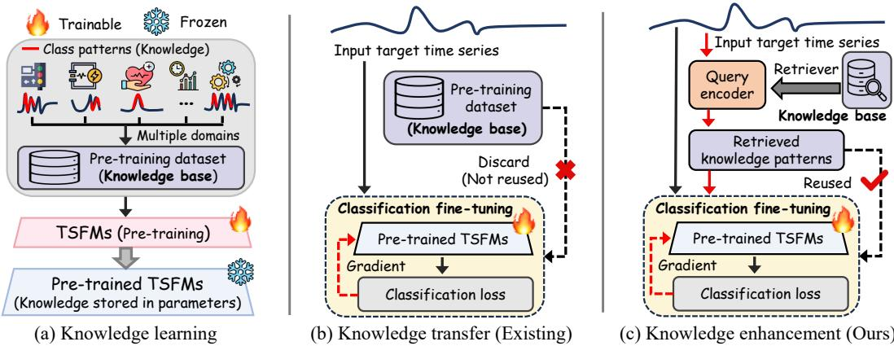  
Figure 1: Illustration of knowledge paradigms in TSFMs for classification. (a) Knowledge learning: TSFMs learn discriminative class patterns from multi-domain pretraining data, storing knowledge implicitly in model parameters. (b) Knowledge transfer: Existing methods adapt this knowledge to target tasks via parameter fine-tuning, without explicitly reusing pretraining data knowledge. (c) Knowledge enhancement: R2R enhances parameter transfer with feature-level retrieval, explicitly leveraging numerical patterns from a pretraining knowledge base to boost recognition. Stage (a) is pretraining; (b) and (c) are post-training, and this work targets the (b)→(c) transition.

Existing TSFMs for classification typically employ a pretraining paradigm that exploits extensive, multi-domain datasets [17, 18]. This process can be regarded as a critical knowledge learning stage (Figure 1a), where the model captures rich discriminative patterns from the pretraining dataset [19, 20]. Through this stage, explicit class patterns in raw time series are compressed into implicit, parameterized knowledge encoded within model weights [21, 22]. Hence, pretrained TSFMs serve as knowledge carriers, providing superior parameter initialization compared to training from scratch.

Building on pre-trained TSFMs, existing approaches [18, 19, 20] typically employ parameter finetuning for knowledge transfer to downstream TSC tasks (Figure 1b). This adaptation is the posttraining stage of foundation models [23, 24], for which supervised fine-tuning remains the dominant instantiation in TSC. However, parameter-only fine-tuning discards pretraining data, limiting access to informative numerical patterns in the source corpus. Task-relevant knowledge remains entangled with irrelevant information in large parameter spaces, hindering precise activation of useful knowledge for transfer. Moreover, prior studies [21, 25] show that simply scaling model parameters does not consistently improve TSC performance. These observations motivate a key question: beyond parameter-based transfer, can explicit data-level knowledgefrom the pretraining dataset be leveraged to enable more effective transfer?

A straightforward way to incorporate data-level knowledge is to reuse pretraining data during finetuning. However, large-scale pretraining datasets make direct reuse inefficient for transfer. In TSC, performance mainly depends on capturing class-relevant patterns in input data, such as discriminative subsequences [26, 27, 28]. These patterns are often sparsely distributed and mixed with substantial noise and class-irrelevant variations [29, 30]. Inspired by retrieval-augmented methods in pretrained language models [31, 32], we argue that constructing query embeddings for input time series and retrieving feature-similar class patterns from pretraining datasets, yielding explicit instance-level knowledge. This retrieval process filters irrelevant samples while focusing on class-relevant patterns, providing more direct data-level knowledge than parameter-only fine-tuning.

Therefore, we propose Retrieval-to-Recognition (R2R), a plug-and-play post-training framework that advances pretrained TSFMs from retrieval to recognition (Figure 1c). R2R goes beyond parameterbased transfer by introducing a dedicated query encoder to efficiently retrieve class-relevant patterns from large-scale pretraining datasets. The query encoder captures local and global features with positional information to identify feature-level class patterns for each input time series, enabling explicit acquisition of data-level knowledge. The retrieved patterns are then integrated with the pretrained TSFM’s parameter-derived embeddings, allowing the TSFM to effectively recall taskrelevant patterns from the pretraining corpus for accurate transfer. This retrieval-driven paradigm mitigates the limitations of parameter-only approaches by enabling feature-level transfer, offering a new post-training paradigm for TSC.

Our main contributions are summarized as follows:

• We introduce R2R, a plug-and-play post-training framework for TSC that enhances pretrained TSFMs by utilizing external numerical knowledge derived from a constructed pretraining knowledge base, facilitating instance-level knowledge integration beyond parameteronly transfer, without modifying the original pretraining process of TSFMs.

• We design a decoupled query encoder with a gradient-free backbone to efficiently extract and retrieve discriminative numerical patterns, enabling multi-domain inputs to access class-relevant patterns for each query instance and to bridge retrieval with downstream TSC.

• Experiments on 158 datasets demonstrate that R2R consistently improves classification performance of existing pretrained TSFMs in both supervised fine-tuning and zero-shot feature extraction, with further analyses confirming the effectiveness of each module.

## 2 Related work

## 2.1 Foundation models for time series classification

Deep learning has made significant progress in TSC due to its strong representation learning capability [33, 34, 35, 36, 37]. Early studies [38, 33, 11] demonstrated that end-to-end convolutional models serve as strong supervised baselines for TSC. Subsequent work [39, 40, 14] explored transfer learning, showing that pretraining improves classification performance across datasets. With the rise of large-scale pretraining, TSFMs have become a major research focus [15]. Studies [17, 18, 21] further indicate that models pretrained on large time series corpora learn more general and classificationoriented representations. Building on this paradigm, recent approaches [41, 19, 22, 20, 42] further improve pretraining strategies and model architectures, achieving strong generalization across diverse TSC tasks. However, existing TSFMs primarily rely on implicit parameter-based transfer, that is, on supervised fine-tuning as the sole post-training mechanism [24], overlooking the potential gains from explicit numerical instances inherent in the pretraining dataset.

## 2.2 Time series retrieval augmented models

Retrieval-augmented methods [43, 31, 32] have shown strong performance in NLP by enhancing large language models with task-relevant information retrieved from external knowledge bases. Inspired by this paradigm, recent work [44, 45] introduces retrieval mechanisms into time series modeling. For forecasting tasks, prior studies [46, 47, 48, 44] retrieve relevant historical sequences and temporal patterns to guide future value prediction, while other methods [49, 50] build structured time series knowledge bases for cross-domain retrieval and improved zero-shot forecasting. Despite these advances, retrieval-augmented methods for classification remain underexplored. This gap is nontrivial, as forecasting and classification require fundamentally different retrieval targets: forecasting extrapolates future trends from long historical observations [48], whereas classification focuses on identifying discriminative patterns within fixed-length observation windows [11]. To address this limitation, we design a dedicated query encoder to retrieve instance-level discriminative patterns from a class-relevant numerical feature space. The retrieved knowledge is integrated into the fine-tuning process of pretrained TSFMs, enabling a retrieval-to-recognition framework for TSC.

## 3 Problem definition

This work focuses on univariate TSC using TSFMs [15, 33]. Let $\mathbf { x } \in \mathbb { R } ^ { L }$ denote a univariate time series sample of length L. The goal is to predict its corresponding class label $y \in \{ 1 , 2 , \ldots , C \}$ , where C represents the number of classes in the target downstream dataset $\mathcal { D } _ { t }$ . Given a pretrained TSFM denoted by $\mathcal F ( \cdot )$ , conventional paradigms facilitate knowledge transfer solely through parameter fine-tuning. In contrast, we introduce an explicit knowledge base $\mathcal { D } _ { k } = \{ \mathbf { x } _ { i } \} _ { i = 1 } ^ { \tilde { N } }$ constructed from large-scale, multi-domain pretraining corpora [18]. For a given query $\mathbf { x } ,$ a retrieval mechanism is designed to identify numerically similar and class-discriminative patterns from $\mathcal { D } _ { k } .$ , yielding a knowledge-enhanced representation $\mathbf { z } _ { \mathrm { a u g } }$ . The final classification is performed by combining the implicit parametric knowledge stored in $F ( \cdot )$ with the retrieved explicit numerical knowledge $\mathbf { z } _ { \mathrm { a u g } }$ enabling effective knowledge transfer on the target dataset $\mathcal { D } _ { t }$

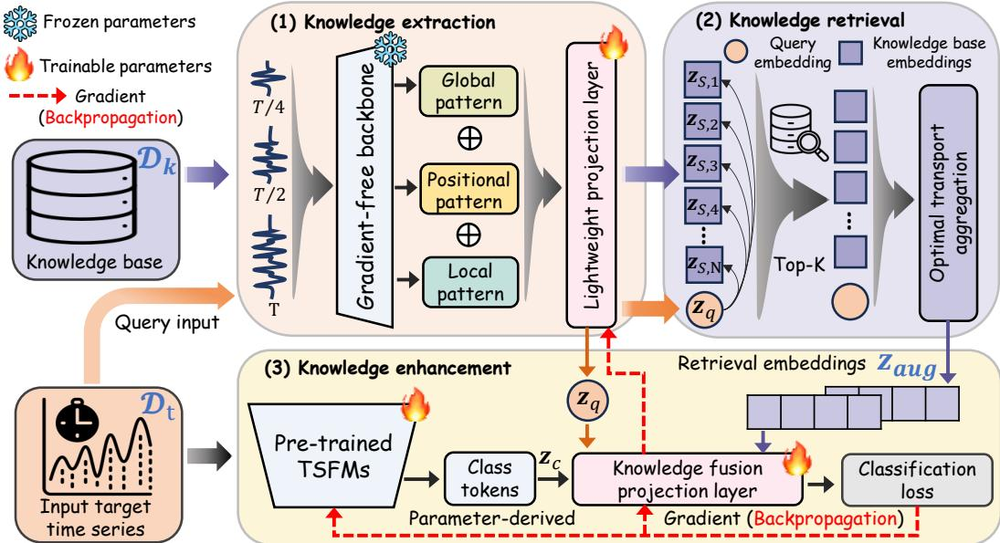  
Figure 2: The overall architecture of the R2R framework. The knowledge extraction and retrieval modules constitute the query encoder. R2R uses the output of the query encoder as feature-level knowledge and fuses it with parameter-level class-token embeddings from pre-trained TSFMs for knowledge enhancement.

## 4 Methodology

## 4.1 Overview

As shown in Figure 2, R2R consists of three modules: knowledge extraction (§4.2), knowledge retrieval (§4.3), and knowledge enhancement (§4.4). The knowledge extraction module (§4.2) applies multi-scale downsampling to the input data and uses a gradient-free backbone to extract class-relevant features through local, global, and positional information. These features are projected into compact embeddings for both query embedding $\mathbf { z } _ { q }$ and knowledge base construction. The knowledge retrieval module (§4.3) uses knowledge base embeddings as keys and $\mathbf { z } _ { q }$ to retrieve Top-K similar instances. Optimal transport [51] is applied to compute distances and produce a weighted aggregation, yielding the augmented embedding $\mathbf { z } _ { \mathrm { a u g } }$ . The knowledge enhancement module (§4.4) fuses the TSFM class token $\mathbf { z } _ { c } , \mathbf { z } _ { q } .$ , and $\mathbf { z } _ { \mathrm { a u g } }$ via a fusion layer. Finally, the model is trained with a classification loss, enabling parameter transfer while incorporating retrieved numerical knowledge for downstream TSC.

## 4.2 Knowledge extraction

The knowledge extraction module maps both time series samples from the pretraining knowledge base $\mathcal { D } _ { k }$ and target query inputs $\mathbf { x } \in \mathbb { R } ^ { \bar { L } }$ from $\mathcal { D } _ { t }$ into compact, class-discriminative embeddings for efficient retrieval. For this purpose, we adopt a gradient-free backbone as the core feature extractor, operating with frozen parameters to extract features from the input time series without training. Prior work [8, 9, 10] shows that convolutional models with randomly or fixed initialized parameters provide strong feature representations for TSC. Similarly, pretrained TSFMs [19, 20, 25] can produce discriminative embeddings without fine-tuning. However, these approaches primarily focus on local features from single-scale inputs, often neglecting global dependencies and positional structure. To mitigate this issue, we design the knowledge extraction module to capture discriminative numerical information from three aspects: local patterns, global patterns, and positional patterns.

Local patterns. We employ a gradient-free backbone to extract local features directly from the raw single-scale input $\hat { \mathbf { x } } \in \mathbb { R } ^ { \hat { L } }$ , where xˆ may originate from either the pretraining knowledge base $\mathcal { D } _ { k }$ or the target domain $\mathcal { D } _ { t }$ . The backbone is model-agnostic with frozen parameters. The resulting local embedding is defined as

$$
\mathbf { f } _ { \mathrm { r a w } } = \phi ( \hat { \mathbf { x } } ) ,\tag{1}
$$

where $\phi ( \cdot )$ denotes the gradient-free feature, which takes an input of arbitrary length and returns a fixed-dimensional vector by pooling over the temporal axis.

Although $\mathbf { f } _ { \mathrm { r a w } }$ captures local temporal patterns, it may be less sensitive to variations in signal intensity and local energy distribution [52]. To address this, we introduce an instantaneous envelope feature that emphasizes amplitude-related characteristics. Specifically, given xˆ, we compute

$$
f _ { \mathrm { e n v } } = \operatorname* { m a x } _ { t } \left[ \mathrm { A v g P o o l } 1 \mathrm { D } ( | \hat { \mathbf { x } } | , l ) \right] _ { t } \in \mathbb { R } ,\tag{2}
$$

where l denotes the sliding window (or fixed-length subsequence) size, and $[ \cdot ] _ { t }$ denotes the t-th pooled entry. This feature highlights local energy concentration and peak amplitude variations [53], capturing signal intensity dynamics from a feature engineering perspective.

Global patterns. To capture global temporal patterns beyond local embeddings, we construct multiscale inputs via temporal downsampling. Existing methods [8, 19], including the local pattern module, mainly operate on the original sequence, limiting their ability to model long-range discriminative patterns. Prior studies [54, 55] indicate that downsampling generates sparse sequences that retain key temporal structures while enlarging the receptive field, facilitating global pattern learning over longer horizons. Given an input xˆ $\in \overset { \mathbf { \smile } } { \mathbb { R } } ^ { L }$ , we generate scale-specific embeddings as

$$
\mathbf { f } _ { \mathrm { d s } , s } = \phi \big ( \mathrm { D o w n s a m p l e } ( \hat { \mathbf { x } } , s ) \big ) , \quad s \in \{ 2 , \dotsc , \left\lfloor \frac { L } { 2 } \right\rfloor \} ,\tag{3}
$$

where Downsample $\displaystyle \langle \cdot , s \rangle$ denotes a stride-based temporal subsampling operator that selects sparse time steps at interval s, i.e. it keeps every s-th sample without applying an anti-aliasing low-pass filter, so it is not a band-limited resampling operation, and $\phi ( \cdot )$ is the backbone defined in Eq. (1). This design enables the model to capture broader temporal context by leveraging sparse observations over longer horizons.

However, larger downsampling scales may overlook critical transition points that capture fine-grained temporal dynamics. To mitigate this issue, we compute first-order differences $\Delta x _ { t } = x _ { t + 1 } - x _ { t }$ and define a turning point indicator $\mathbb { I } \big ( ( \Delta x _ { t } \cdot \Delta x _ { t + 1 } ) < 0 \big )$ to detect sign changes, and further introduce a turning-point density-based scalar gating mechanism:

$$
f _ { \mathrm { t p } } = \frac { 1 } { L - 2 } \sum _ { t = 1 } ^ { L - 2 } \mathbb { I } _ { t } , \quad \mathbf { f } _ { \mathrm { g a t e d } } = \mathbf { f } _ { \mathrm { d s } , s } \cdot \operatorname { t a n h } \left( f _ { \mathrm { t p } } \right) ,\tag{4}
$$

which provides a lightweight feature extraction design that enhances global patterns.

Positional patterns. In TSC, similar discriminative patterns may correspond to different classes depending on their time point positions [56]. Hence, we construct a positional feature based on the relative peak location by combining local patterns and turning-point information as follows:

$$
f _ { \mathrm { p o s } } = f _ { \mathrm { e n v } } \oplus f _ { \mathrm { t p } } \oplus \frac { \arg \operatorname* { m a x } _ { t } | \hat { \mathbf { x } } _ { t } | } { L } ,\tag{5}
$$

where $\oplus$ denotes concatenation and the last term denotes the normalized time index of the maximumamplitude point. This feature captures the temporal placement of salient patterns and aids in distinguishing classes that differ primarily by pattern location.

Finally, we concatenate the local, global, and positional patterns and map them into a unified embedding space via a lightweight projection layer:

$$
\mathbf { z } = \psi \left( \mathbf { f } _ { \mathrm { r a w } } \oplus \mathbf { f } _ { \mathrm { d s } , s } \oplus \mathbf { f } _ { \mathrm { g a t e d } } \oplus f _ { \mathrm { p o s } } \right) ,\tag{6}
$$

where $\psi ( \cdot )$ denotes a learnable projection function. This formulation integrates class-related features into a discriminative embedding for retrieval. Notably, the computation of $\mathbf { f } _ { \mathrm { r a w } } , \mathbf { f } _ { \mathrm { d s } , s } , \mathbf { f } _ { \mathrm { g a t e d } } , f _ { \mathrm { p o s } }$ do not require gradient-based optimization and can be efficiently obtained in a training-free manner.

## 4.3 Knowledge retrieval

Through Eq. (6) in the knowledge extraction module, the embeddings of the knowledge base $\mathcal { D } _ { k }$ are collected into the set $\mathcal { Z } _ { S } = \{ \mathbf { \bar { z } } _ { S , i } \in \mathbb { R } ^ { d } \} _ { i = 1 } ^ { N }$ , while a query input $\bar { \mathbf { x } } \in \mathbb { R } ^ { L }$ from $\mathcal { D } _ { t }$ is mapped to a query embedding $\mathbf { z } _ { q } \in \mathbb { R } ^ { d }$ . The retrieval module aims to efficiently identify the Top-K nearest neighbors of $\mathbf { z } _ { q }$ from ${ \mathcal { Z } } _ { S }$ , and construct a feature-level augmented representation $\mathbf { z } _ { \mathrm { a u g } }$

To perform efficient nearest neighbor search, we first normalize the embeddings obtained from the knowledge extraction module:

$$
\tilde { \mathbf { z } } _ { S , i } = \frac { \mathbf { z } _ { S , i } } { \lVert \mathbf { z } _ { S , i } \rVert _ { 2 } } , \quad \tilde { \mathbf { z } } _ { q } = \frac { \mathbf { z } _ { q } } { \lVert \mathbf { z } _ { q } \rVert _ { 2 } } .\tag{7}
$$

The normalized embeddings are indexed via inverted file system with product quantization (IVFPQ) [57], which partitions the embedding space into $n _ { \mathrm { l i s t } }$ Voronoi cells and encodes residuals with product quantization, forming an index structure:

$$
\mathcal { T } = \mathrm { I V F P Q } ( \mathcal { Z } _ { S } ; n _ { \mathrm { l i s t } } , m , b ) ,\tag{8}
$$

where $m$ denotes the number of subspaces and b the number of bits per subspace. In practice, this index is implemented using a GPU-accelerated inverted file system based on Faiss [58], enabling a scalable and efficient creation. Given a query embedding, the Top-K nearest neighbors are retrieved from the index I based on cosine similarity:

$$
\begin{array} { r } { \mathcal { N } ( \mathbf { z } _ { q } ) = \mathrm { T o p K } _ { \mathbf { z } _ { S , i } \in \mathcal { T } } \left. \tilde { \mathbf { z } } _ { q } , \tilde { \mathbf { z } } _ { S , i } \right. . } \end{array}\tag{9}
$$

During querying, only a small subset of Voronoi cells $( n _ { \mathrm { p r o b e } } ~ \ll ~ n _ { \mathrm { l i s t } } )$ is visited, leading to sublinear complexity with respect to the database size. Specifically, the search cost scales as $\begin{array} { r } { \mathcal { O } \left( n _ { \mathrm { p r o b e } } \cdot \frac { N } { n _ { \mathrm { l i s t } } } \cdot m \right) } \end{array}$ , where N is the database size and m is the number of product quantization subspaces [57]. This formulation allows efficient Top-K retrieval even for large-scale databases. With parallel GPU execution [58], the retrieval latency remains at the millisecond level when $N \leq 1 0 ^ { 6 }$

To account for varying relevance among retrieved samples, we introduce an optimal transport (OT) weighting scheme [59]. The transport cost and normalized weights are defined as

$$
c _ { k } = 1 - \left. \tilde { \mathbf { z } } _ { q } , \tilde { \mathbf { z } } _ { S , k } \right. , \quad w _ { k } = \frac { \exp ( - c _ { k } / \varepsilon ) } { \sum _ { j = 1 } ^ { K } \exp ( - c _ { j } / \varepsilon ) + \epsilon } ,\tag{10}
$$

where $\varepsilon > 0$ controls smoothness and ϵ ensures numerical stability. This formulation uses OT distances to evaluate similarity in the underlying feature distribution space [51], yielding more reliable weights for feature aggregation. The final augmented representation is computed as

$$
{ \bf z } _ { \mathrm { a u g } } = \sum _ { k = 1 } ^ { K } w _ { k } { \bf z } _ { S , k } \oplus \left( { \bf z } _ { q } - \sum _ { k = 1 } ^ { K } w _ { k } { \bf z } _ { S , k } \right) ,\tag{11}
$$

which preserves both retrieved knowledge and query-specific information in a unified form.

## 4.4 Knowledge enhancement

This module integrates the implicit parametric embedding (class token) from pretrained TSFMs with the explicit numerical knowledge produced by the query encoder, which consists of the knowledge extraction and retrieval modules. The fused embedding is then used for supervised classification in the target domain, enabling joint transfer of parametric and retrieved numerical knowledge.

Knowledge fusion. Let $\mathbf { z } _ { c } \in \mathbb { R } ^ { d }$ denote the class token from pretrained TSFMs. Given the query embedding $\mathbf { z } _ { q }$ and the retrieved representation $\mathbf { z } _ { \mathrm { a u g } }$ produced by the query encoder, we perform gated residual fusion:

$$
\mathbf { g } _ { q } = \sigma ( \mathbf { W } _ { q } \mathbf { z } _ { c } ) , \quad \mathbf { g } _ { r } = \sigma ( \mathbf { W } _ { r } \mathbf { z } _ { c } ) ,\tag{12}
$$

$$
\mathbf { z } _ { \mathrm { f u s e d } } = \mathrm { L a y e r N o r m } \left( \mathbf { z } _ { c } + \mathbf { g } _ { q } \odot \mathbf { z } _ { q } + \mathbf { g } _ { r } \odot \mathbf { z } _ { \mathrm { a u g } } \right) ,\tag{13}
$$

where $\sigma ( \cdot )$ is the sigmoid function, $\mathbf { W } _ { q } , \mathbf { W } _ { r }$ are learnable matrices, and ⊙ denotes element-wise multiplication. This formulation adaptively integrates parametric and retrieval-based information

Table 1: Test accuracy results on 128 UCR datasets under the fully supervised setting.
<table><tr><td rowspan=1 colspan=1></td><td rowspan=1 colspan=2>Method</td><td rowspan=1 colspan=2>Avg. Rank Win  P-value</td></tr><tr><td rowspan=5 colspan=1>Non--DL</td><td rowspan=5 colspan=2>RocketMiniRocketRDSTMR-HHC-2</td><td rowspan=1 colspan=1>7.62    18</td><td rowspan=1 colspan=1>1.01E-13</td></tr><tr><td rowspan=1 colspan=1>7.75    13</td><td rowspan=1 colspan=1>1.82E-13</td></tr><tr><td rowspan=3 colspan=1>7.38   206.27    225.16   31</td><td rowspan=1 colspan=1>1.12E-11</td></tr><tr><td rowspan=1 colspan=1>2.04E-10</td></tr><tr><td rowspan=1 colspan=1>3.62E-07</td></tr><tr><td rowspan=6 colspan=1>S-L</td><td rowspan=6 colspan=2>InceptionTimeTS2VecPatchTSTTimesNetSoftShapeMambaSL</td><td rowspan=1 colspan=1>9.41    13</td><td rowspan=1 colspan=1>1.56E-15</td></tr><tr><td rowspan=1 colspan=1>12.65    8</td><td rowspan=1 colspan=1>1.25E-18</td></tr><tr><td rowspan=1 colspan=1>18.19    6</td><td rowspan=1 colspan=1>1.20E-20</td></tr><tr><td rowspan=1 colspan=1>17.11    5</td><td rowspan=1 colspan=1>9.47E-21</td></tr><tr><td rowspan=1 colspan=1>9.20    14</td><td rowspan=1 colspan=1>2.03E-14</td></tr><tr><td rowspan=1 colspan=1>13.13   14</td><td rowspan=1 colspan=1>7.37E-18</td></tr><tr><td rowspan=7 colspan=1>TSFMS</td><td rowspan=1 colspan=2>GPT4TS</td><td rowspan=1 colspan=1>17.06    4</td><td rowspan=1 colspan=1>9.47E-21</td></tr><tr><td rowspan=6 colspan=2>MOMENTUniTSNuTimeTS-RAGMantisUniShape</td><td rowspan=1 colspan=1>17.58   2</td><td rowspan=1 colspan=1>8.47E-21</td></tr><tr><td rowspan=1 colspan=1>16.74    2</td><td rowspan=1 colspan=1>5.93E-21</td></tr><tr><td rowspan=1 colspan=1>10.26   15</td><td rowspan=1 colspan=1>2.21E-15</td></tr><tr><td rowspan=1 colspan=1>9.31    11</td><td rowspan=1 colspan=1>1.44E-16</td></tr><tr><td rowspan=1 colspan=1>8.07    21</td><td rowspan=1 colspan=1>8.43E-12</td></tr><tr><td rowspan=1 colspan=1>4.47    31</td><td rowspan=1 colspan=1>1.68E-04</td></tr><tr><td rowspan=3 colspan=1>Ous</td><td rowspan=3 colspan=2>R2RNuTime ${ \mathrm { R } } 2 { \mathrm { R } } _ { \mathrm { M a n t i s } }$  ${ \mathrm { R 2 R } } _ { \mathrm { U n i S h a p e } }$ </td><td rowspan=1 colspan=1>7.90    23</td><td rowspan=1 colspan=1>5.64E-12</td></tr><tr><td rowspan=1 colspan=1>6.18    29</td><td rowspan=1 colspan=1>2.31E-07</td></tr><tr><td rowspan=1 colspan=1>Shape</td><td rowspan=1 colspan=1>3.01    48</td><td rowspan=1 colspan=1></td></tr></table>

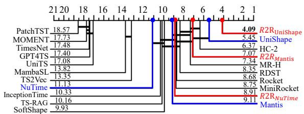

(a) 128 UCR datasets  
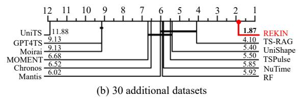  
Figure 3: Critical difference diagram on 158 datasets.

while maintaining class-related feature fusion. The inclusion of $\mathbf { z } _ { q }$ further injects task-specific supervision into the projection learning in Eq. (6), improving the alignment between query-conditioned representations and discriminative patterns in the knowledge base.

Supervised fine-tuning. The fused representation $\mathbf { z } _ { \mathrm { f u s e d } }$ is directly fed into the lightweight classifier $H ( \cdot )$ , and the model is optimized using the cross-entropy objective:

$$
p _ { i } = H ( \mathbf { z } _ { \mathrm { f u s e d } , i } ) , \quad \mathcal { L } _ { \mathrm { C E } } = - \frac { 1 } { | \mathcal { D } _ { t } | } \sum _ { ( H ( \mathbf { z } _ { \mathrm { f u s e d } } ) , y _ { i } ) \in \mathcal { D } _ { t } } \log p _ { i , y _ { i } } ,\tag{14}
$$

where $p _ { i , y _ { i } }$ denotes the predicted probability for the ground-truth class $y _ { i } .$ . During fine-tuning, gradients are propagated through the pre-trained TSFM and the projection layers in the knowledge extraction module. This enables coordinated optimization of parametric representations and retrievalbased knowledge alignment for improved classification performance.

## 5 Experiments

We evaluate R2R on univariate time series classification across 128 UCR datasets [60] under a fully supervised fine-tuning setting. For the retrieval process in R2R, we construct a knowledge base from the pretraining datasets of NuTime [18], Mantis [19], and UniShape [20], which collectively comprise 1.89M (million) samples drawn from the training sets of multi-domain datasets [60, 61, 62, 63]. From this pool, we derive a class-balanced subset of 100K (thousand) samples to form the final knowledge base for efficient retrieval. Following [20], we also evaluate generalization on 30 additional univariate time series datasets [64] in a zero-shot feature extraction setting. Further details on datasets, baselines, and implementation settings are provided in Appendix A.

## 5.1 Main results

This section evaluate R2R by integrating three advanced TSFMs [18, 19, 20], denoted as ${ \mathrm { R } } 2 { \mathrm { R } } _ { \mathrm { N u T i m e } } .$ ${ \mathrm { R } } 2 { \mathrm { R } } _ { { \mathrm { M a n t i s } } } ,$ and ${ \mathrm { R 2 R } } _ { \mathrm { U n i S h a p e } } .$ , and compare them with 18 baselines, including non-deep learning (Non-DL) methods (Rocket [8], Mini-Rocket [9], RDST [55], MultiRocket-Hydra (MR-H) [65], HIVE-COTE 2.0 (HC-2) [66]), supervised deep learning (S-DL) models (InceptionTime [11], TS2Vec [67], PatchTST [68], TimesNet [69], SoftShape [70], MambaSL [13]), and TSFM-based methods (GPT4TS [71], MOMENT [17], UniTS [21], NuTime [18], TS-RAG [49], Mantis [19], UniShape [20]). We report average rank based on test classification accuracy and the number of datasets with the best accuracy (Win) on 128 UCR datasets to reduce bias from abnormally high or low accuracy results on individual datasets. All baselines and R2R variants are run under the same evaluation protocol: the official UCR train/test splits, the officially released hyperparameters of each method, and the same hardware budget, so the reported ranks are not confounded by extra tuning granted to R2R (see Appendix A). In addition, we assess statistical significance using the Wilcoxon signed-rank test (p-value) and critical difference (CD) diagrams [72]. A p-value below 0.05 indicates significant pairwise differences, while CD diagrams provide a global comparison in which lower CD values denote better performance and methods not connected by a solid line differ significantly.

Table 1 reports the results of comparing the test classification accuracy among 21 methods (including three R2R variants) on 128 UCR datasets; detailed results are provided in Appendix B. R2R consistently improves all three integrated TSFMs, with ${ \mathrm { R } } 2 { \mathrm { R } } _ { \mathrm { U n i S h a p e } }$ achieving the best overall performance, significantly outperforming all baselines as confirmed by the Wilcoxon p-values (all $< ~ 0 . 0 5 )$ and CD diagram in Figure 3a. Similar improvements are observed for ${ \mathrm { R } } 2 { \mathrm { R } } _ { \mathrm { N u T i m e } }$ and ${ \mathrm { R } } 2 { \mathrm { R } } _ { { \mathrm { M a n t i s } } } .$ , indicating that retrieval-based knowledge enhancement provides consistent gains beyond parameter-only transfer. Among baselines, Non-DL methods (e.g., Rocket family [65], HIVE-COTE 2.0 [66]) remain strong competitors. TSFMs generally outperform S-DL methods due to large-scale pretraining, with Mantis and UniShape achieving the strongest baseline results, yet they rely solely on implicit parameter transfer. TS-RAG [49], the only retrieval-augmented baseline, ranks 9.31 with 11 wins and thus performs worse than the classification-oriented TSFMs (i.e., Mantis and UniShape) and all three R2R variants, although it retrieves from the same knowledge base as R2R. This gap therefore reflects the classification-specific retrieval and fusion design rather than the retrieved corpus, and shows that R2R improves the post-training stage without introducing a new backbone or pretraining objective. In summary, the results demonstrate that retrieval-based knowledge effectively enhances parametric representations for TSC, enabling more positive transfer and improving TSFMs under a retrieval-to-recognition paradigm.

## 5.2 Comparison results on zero-shot feature extraction

Table 2: Test accuracy results on 30 additional datasets under the zero-shot feature extraction setting.
<table><tr><td>Metric</td><td>RF</td><td>GPT4TS</td><td>MOMENT</td><td>Chronos</td><td>Moirai</td><td>UniTS</td><td>NuTime</td><td>Mantis</td><td>UniShape</td><td>TS-RAG</td><td>TSPulse</td><td>R2R</td></tr><tr><td>Avg. Rank</td><td>5.80</td><td>9.00</td><td>6.53</td><td>6.33</td><td>9.00</td><td>11.87</td><td>5.63</td><td>5.80</td><td>5.20</td><td>3.97</td><td> $\overline { { 5 . 3 7 } }$ </td><td>1.73</td></tr><tr><td>Win</td><td>2</td><td>1</td><td>1</td><td>2</td><td>1</td><td>0</td><td>0</td><td>1</td><td>1</td><td>5</td><td>1</td><td>21</td></tr><tr><td>P-value</td><td>8.52E-06</td><td>1.28E-05</td><td>1.43E-06</td><td>1.30E-05</td><td>9.31E-08</td><td>2.05E-08</td><td>2.11E-05</td><td>2.64E-05</td><td>8.20E-07</td><td>1.33E-04</td><td>9.31E-08</td><td></td></tr></table>

To further evaluate the effectiveness of retrieval-based numerical knowledge, we follow the setups of [19, 20] and assess R2R under a zero-shot feature extraction setting. Specifically, both the default training and test sets are passed through parameter-frozen TSFMs to obtain embeddings, which are then used to train and evaluate a Random Forest classifier, with no model parameter fine-tuning. We conduct experiments on 30 additional datasets and compare against 11 baselines, including a Random Forest (RF) [73] classifier on raw time series inputs and 10 TSFMs (GPT4TS [71], MOMENT [17], Chronos [74], Moirai [75], UniTS [21], NuTime [18], Mantis [19], UniShape [20], TS-RAG [49], and TSPulse [25]). R2R is built upon pre-trained UniShape in this setting. Note that the same Random Forest serves both as the shared probing classifier over TSFM embeddings and, as the RF baseline, as a classifier fitted on the raw series, so Table 2 reports one RF column (see Appendix A).

As shown in Table 2 and Figure 3b, R2R achieves the best performance and consistently yields statistically significant improvements over all baselines. The detailed results of Table 2 are presented in Appendix C. We observe that classification-oriented TSFMs (NuTime [18], Mantis [19], UniShape [20]) generally outperform forecasting-oriented models (Chronos [74], Moirai [75]), indicating the importance of task alignment. While TS-RAG [49] improves Chronos via retrieval originally proposed for forecasting tasks, it remains inferior to R2R due to its lack of a classificationspecific design. As the TS-RAG method is built on the same knowledge base as R2R in this setting (Appendix C), the gap in average rank (3.97 vs. 1.73) is attributable to the classification-specific retrieval target and fusion rather than to the retrieved corpus. On the whole, without any taskspecific parameter fine-tuning, R2R uses retrieval-based feature-level knowledge for downstream time series classification, achieving substantially better performance than TSFMs that rely solely on parameter-based transfer.

## 5.3 Ablation studies

This section presents ablation studies to analyze each component of R2R under two settings: (i) w/o Feature transfer, where the query encoder is removed and only the pretrained TSFM is fine-tuned; and (ii) w/o Parameter transfer, where the pretrained TSFM is removed and classification relies solely on the query encoder, with further ablations on knowledge retrieval and gradient-free backbone selection. As shown in Table 3, removing feature transfer significantly degrades performance, indicating the importance of retrieval-based numerical knowledge. Under w/o Parameter transfer, using MiniRocket [9] as the backbone, the knowledge retrieval module (with Retrieval) improves TSC results (e.g., Avg. Rank: 4.14 vs. 5.09), while removing the retrieval module (w/o $\mathbf { z } _ { \mathrm { a u g } } )$ and multi-scale global and positional patterns in the knowledge extraction module (w/o $R e M G P )$ further reduces performance, showing its role in enhancing embedding discriminability. We also compare gradient-free backbones for the query encoder, where MultiRocket [10] performs best but shows limited gains over parameter-frozen UniShape [20], while outperforming Rocket [8].

Table 3: Test accuracy results of ablation study on 128 UCR time series datasets.
<table><tr><td rowspan=1 colspan=2>Method</td><td rowspan=1 colspan=1>Backbone</td><td rowspan=1 colspan=2>Avg. Rank Win  P-value</td></tr><tr><td rowspan=1 colspan=2> ${ \underline { { \mathrm { R 2 R } _ { \mathrm { U n i S h a p e } } } } }$ </td><td rowspan=1 colspan=1>=</td><td rowspan=1 colspan=2>1.48     86</td></tr><tr><td rowspan=1 colspan=2>w/o Feature transfer</td><td rowspan=1 colspan=1>1</td><td rowspan=1 colspan=1>2.45     48</td><td rowspan=1 colspan=1>1.68E-04</td></tr><tr><td rowspan=6 colspan=1>vraterertransfer</td><td rowspan=6 colspan=1>with Retrievalw/o Retrievalw/o ReMGPw/o Retrievalw/o Retrievalw/o Retrieval</td><td rowspan=6 colspan=1>MiniRocketMiniRocketMiniRocketRocketMultiRocketUniShape</td><td rowspan=1 colspan=1>4.14     13</td><td rowspan=1 colspan=1>3.60E-18</td></tr><tr><td rowspan=1 colspan=1>5.09     11</td><td rowspan=1 colspan=1>1.58E-18</td></tr><tr><td rowspan=1 colspan=1>5.59     8</td><td rowspan=1 colspan=1>4.56E-19</td></tr><tr><td rowspan=1 colspan=1>5.91     8</td><td rowspan=1 colspan=1>9.56E-19</td></tr><tr><td rowspan=1 colspan=1>4.06     18</td><td rowspan=1 colspan=1>4.69E-17</td></tr><tr><td rowspan=1 colspan=1>4.52     13</td><td rowspan=1 colspan=1>5.58E-19</td></tr></table>

Table 4: Test accuracy results on 18 UCR datasets under varying knowledge base sizes and sampling strategies.
<table><tr><td>Size</td><td>Sampling</td><td>Avg. Rank</td><td>Win</td><td>Time (s)</td></tr><tr><td>50K</td><td>Balanced</td><td>4.11</td><td>3</td><td>88.01</td></tr><tr><td>100K</td><td>Balanced</td><td>2.33</td><td>8</td><td>92.11</td></tr><tr><td>200K</td><td>Balanced</td><td>3.28</td><td>9</td><td>119.79</td></tr><tr><td>500K</td><td>Balanced</td><td>3.11</td><td>6</td><td>207.49</td></tr><tr><td>1M</td><td>Balanced</td><td>3.17</td><td>6</td><td>361.77</td></tr><tr><td>1.89M</td><td>Balanced</td><td>4.17</td><td>5</td><td>414.80</td></tr><tr><td>100K</td><td>Random</td><td>3.17</td><td>5</td><td>92.11</td></tr><tr><td>100K</td><td>Unbalanced</td><td>6.50</td><td>2</td><td>92.11</td></tr></table>

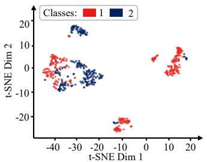  
(a) Parameter-level embeddings

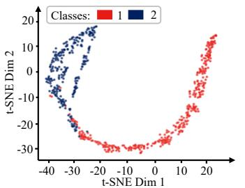  
(b) Retrieved feature-level embeddings

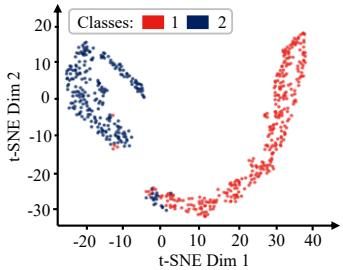  
(c) Knowledge-enhanced embeddings  
Figure 4: t-SNE visualization on the SonyAIBORobotSurface1 dataset.

Overall, all w/o Parameter transfer variants perform substantially worse than full ${ \mathrm { R 2 R } } _ { \mathrm { U n i S h a p e } }$ and even underperform w/o Feature transfer, suggesting that pretrained TSFM parameter transfer via supervised fine-tuning is the main knowledge source, while retrieval-based feature transfer provides further improvements. These variants also indicate whether the improvement is inherited from the strong Rocket-family extractors used by the query encoder: Rocket and MiniRocket rank only 7.62 and 7.75 in Table 1, well behind parameter-only UniShape (4.47) and ${ \mathrm { R } } 2 { \mathrm { R } } _ { \mathrm { U n i S h a p e } }$ (3.01), and here a parameter-frozen UniShape query encoder (4.52) is comparable to MultiRocket (4.06), so R2R is not tied to the Rocket family. Since every w/o Parameter transfer variant stays far behind full ${ \mathrm { R } } 2 { \mathrm { R } } _ { \mathrm { U n i S h a p e } }$ (1.48 with 86 wins), the gain originates from jointly fine-tuning retrieved numerical knowledge with pretrained TSFM parameters rather than from a stronger feature extractor.

Table 4 studies the impact of the knowledge base in R2R using 18 representative UCR datasets following [20] for efficient analysis under large-scale retrieval. A class-balanced subset of 100K samples from the pretraining dataset achieves the best trade-off between accuracy and efficiency. Here, Time (s) denotes the additional average time for knowledge extraction and retrieval with the R2R query encoder across the 18 datasets. Increasing the knowledge base from 50K to 100K introduces only minor overhead (about 4 seconds per dataset), while scaling to 1.89M samples raises the time by about 4.5×. Yet, the time cost remains manageable (within 7 minutes per dataset). Moreover, Table 4 indicates that both class diversity and distribution balance are critical for effective numerical knowledge transfer. Detailed results of Tables 3 and 4 are provided in Appendix D.

## 5.4 Knowledge-enhanced analysis

To analyze how R2R utilizes retrieved embeddings for knowledge enhancement, we visualize target sample representations using the t-SNE [76] method. Figure 4a shows embeddings from the pretrained UniShape based on parameter fine-tuning, Figure 4b shows embeddings from the retrieval module in R2R, and Figure 4c shows the fused embeddings combining parameter- and feature-level knowledge for final TSC. In Figure 4a, classes 1 and 2 are partially mixed, whereas Figures 4b and 4c exhibit clearer separation. These results indicate that R2R retrieves class-discriminative features from the pretraining knowledge base, improving inter-class separability. Additional visualizations in Appendix E further confirm consistent gains across different datasets and multi-class settings.

Table 5: Test results on 18 UCR datasets compared with different data augmentation methods.
<table><tr><td>Metric</td><td>Raw</td><td>Jitter</td><td>Time warp</td><td>Magnitude warp</td><td>Window slice</td><td>Time flip</td><td>Permutation</td><td>Scaling</td><td>R2R</td></tr><tr><td>Avg. Rank</td><td>2.39</td><td>5.11</td><td>5.06</td><td>4.89</td><td>4.33</td><td>5.06</td><td>5.50</td><td>4.83</td><td>2.00</td></tr></table>

To verify the effectiveness of R2R for retrieval-based numerical knowledge enhancement, Table 5 compares 7 representative time series data augmentation methods [77, 78]. As shown, these methods often degrade performance relative to the Raw setting (fine-tuning without augmentation), indicating negative transfer on many datasets. In contrast, R2R retrieves class-relevant embeddings from a knowledge base to help pretrained TSFMs recall pretraining knowledge for augmentation, thereby improving positive transfer in TSC. This advantage likely stems from reduced randomness compared to conventional stochastic augmentations, which may disrupt intrinsic class structures in time series.

Table 6: Impact of continual fine-tuning for TSC. $\operatorname { A c c } _ { A _ { 1 } } \colon$ Initial accuracy on dataset $A ; \operatorname { A c c } _ { A _ { 2 } } \colon$ Accuracy on dataset A after continual training on dataset $B ;$ Forgetting: Acc $_ { A _ { 1 } } - \operatorname { A c c } _ { A _ { 2 } } .$
<table><tr><td rowspan="2">Dataset A</td><td rowspan="2">Dataset B</td><td colspan="3">Only parameter transfer</td><td colspan="3">R2R transfer</td></tr><tr><td> $\operatorname { A c c } _ { A _ { 1 } }$ </td><td> $\operatorname { A c c } _ { A _ { 2 } }$ </td><td>Forgetting</td><td> $\operatorname { A c c } _ { A _ { 1 } }$ </td><td> $\operatorname { A c c } _ { A _ { 2 } }$ </td><td>Forgetting</td></tr><tr><td>AsphaltRegularityUni_eq</td><td>FloodModeling1_disc</td><td>0.9654</td><td>0.4887</td><td>0.4767</td><td>0.9734</td><td>0.7909</td><td>0.1825</td></tr><tr><td>GesturePebbleZ1_eq</td><td>Colposcopy</td><td>0.9477</td><td>0.5233</td><td>0.4244</td><td>0.9535</td><td>0.7151</td><td>0.2384</td></tr><tr><td>AllGestureWiimoteX_eq</td><td>AllGestureWiimote Y_eq</td><td>0.7671</td><td>0.2429</td><td>0.5242</td><td>0.7786</td><td>0.2771</td><td>0.5015</td></tr><tr><td> $\mathrm { G e s t u r e M i d A i r D 1 \_ e q }$ </td><td> $\mathrm { G e s t u r e M i d A i r D 2 \_ e q }$ </td><td>0.7538</td><td>0.1231</td><td>0.6307</td><td>0.7692</td><td>0.1538</td><td>0.6154</td></tr></table>

Finally, we select four datasets from the 30 additional datasets, covering different numbers of classes, to evaluate R2R under continual classification fine-tuning. Table 6 compares standard parameter-only fine-tuning with R2R transfer. R2R consistently outperforms parametric fine-tuning alone on $\operatorname { A c c } _ { A _ { 1 } }$ and $\operatorname { A c c } _ { A _ { 2 } } .$ , and exhibits less forgetting after continual fine-tuning, indicating that retrieved embeddings help mitigate pre-trained knowledge forgetting and improve transfer generalization across downstream tasks. Additional results for continual fine-tuning, together with data augmentation descriptions and detailed results in Table 5, are presented in Appendix E. Appendix F reports hyperparameter analysis, and Appendix G reports a preliminary multivariate evaluation in which R2RUniShape is extended to ten UEA datasets [61] through a trainable linear channel adapter. Appendix H and I provide limitations and broader impacts.

## 6 Conclusion

This paper presents R2R, a retrieval-to-recognition post-training framework that enhances pretrained TSFMs for time series classification. R2R employs a plug-and-play query encoder to retrieve classrelevant numerical knowledge and integrates it with parametric representations for downstream classification. Experiments demonstrate that R2R consistently improves pretrained TSFMs via joint parameter- and feature-level knowledge transfer, attaining the best average rank with 48 wins among 21 baselines on the 128 UCR datasets under supervised fine-tuning and 21 wins among 12 baselines on the 30 additional datasets under zero-shot feature extraction, with all gains being statistically significant $( p < 0 . 0 5 )$ . However, R2R acts only at the post-training stage and contributes no new pretraining objective or backbone architecture, and it currently relies on a knowledge base built from univariate time series. $\mathbf { A }$ preliminary multivariate extension through a trainable linear channel adapter is reported in Appendix G, where ${ \mathrm { R } } 2 { \mathrm { R } } _ { \mathrm { U n i S h a p e } }$ attains the best average rank on ten UEA datasets, although the retrieved knowledge itself is still univariate. Future work will explore more general retrieval module designs and build natively multivariate knowledge bases, so that inter-variable dependencies are captured by retrieval rather than by an input adapter.

## Acknowledgments

We thank the anonymous reviewers for their helpful feedbacks. We thank Professor Eamonn Keogh and all the people who have contributed to the UCR archive and other time series classification datasets. This work was partially supported by the Singapore NRF AI4S project (NRF-AI4SCH-2025-0001), the Ministry of Education, Singapore, under its Academic Research Fund (AcRF) Tier 1 grant (RG16/25), the SMU-SUTD Internal Research Grant Call (SMU-SUTD 2023\_02\_01), the SUTD Kickstarter Initiative (SKI 2021\_06\_12), and AIMfg, A∗STAR, Singapore, under its MTI WS Fund. This work was also partially supported by the National Natural Science Foundation of China (Grant Nos. 62272173, 62273109), the Natural Science Foundation of Guangdong Province (Grant Nos. 2024A1515010089, 2022A1515010179), the Science and Technology Planning Project of Guangdong Province (Grant No. 2023A0505050106), and the National Key R&D Program of China (Grant No. 2023YFA1011601).

## References

[1] Li Li, Xiaonan Su, Yi Zhang, Yuetong Lin, and Zhiheng Li. Trend modeling for traffic time series analysis: An integrated study. IEEE Transactions on Intelligent Transportation Systems, 16(6):3430–3439, 2015.

[2] Yihe Wang, Nan Huang, Taida Li, Yujun Yan, and Xiang Zhang. Medformer: A multi-granularity patching transformer for medical time-series classification. In Advances in Neural Information Processing Systems, pages 36314–36341, 2024.

[3] Jianbo Yang, Minh Nhut Nguyen, Phyo Phyo San, Xiaoli Li, Shonali Krishnaswamy, et al. Deep convolutional neural networks on multichannel time series for human activity recognition. In International Joint Conference on Artificial Intelligence, pages 3995–4001, 2015.

[4] Xiyuan Zhang, Diyan Teng, Ranak R Chowdhury, Shuheng Li, Dezhi Hong, Rajesh K Gupta, and Jingbo Shang. Unimts: Unified pre-training for motion time series. In Advances in Neural Information Processing Systems, pages 107469–107493, 2024.

[5] Navid Mohammadi Foumani, Lynn Miller, Chang Wei Tan, Geoffrey I Webb, Germain Forestier, and Mahsa Salehi. Deep learning for time series classification and extrinsic regression: A current survey. ACM Computing Surveys, 56(9):1–45, 2024.

[6] Jason Lines and Anthony Bagnall. Time series classification with ensembles of elastic distance measures. Data Mining and Knowledge Discovery, 29(3):565–592, 2015.

[7] Marco Cuturi and Mathieu Blondel. Soft-dtw: A differentiable loss function for time-series. In International Conference on Machine Learning, pages 894–903, 2017.

[8] Angus Dempster, François Petitjean, and Geoffrey I Webb. Rocket: Exceptionally fast and accurate time series classification using random convolutional kernels. Data Mining and Knowledge Discovery, 34(5):1454–1495, 2020.

[9] Angus Dempster, Daniel F Schmidt, and Geoffrey I Webb. Minirocket: A very fast (almost) deterministic transform for time series classification. In Proceedings ofthe 27th ACM SIGKDD Conference on Knowledge Discovery & Data Mining, pages 248–257, 2021.

[10] Chang Wei Tan, Angus Dempster, Christoph Bergmeir, and Geoffrey I Webb. Multirocket: Multiple pooling operators and transformations for fast and effective time series classification. Data Mining and Knowledge Discovery, 36(5):1623–1646, 2022.

[11] Hassan Ismail Fawaz, Benjamin Lucas, Germain Forestier, Charlotte Pelletier, Daniel F Schmidt, Jonathan Weber, Geoffrey I Webb, Lhassane Idoumghar, Pierre-Alain Muller, and François Petitjean. Inceptiontime: Finding alexnet for time series classification. Data Mining and Knowledge Discovery, 34(6):1936–1962, 2020.

[12] Xiwen Chen, Peijie Qiu, Wenhui Zhu, Huayu Li, Hao Wang, Aristeidis Sotiras, Yalin Wang, and Abolfazl Razi. Timemil: Advancing multivariate time series classification via a time-aware multiple instance learning. In International Conference on Machine Learning, pages 7190–7206, 2024.

[13] Yoo-Min Jung and Leekyung Kim. Mambasl: Exploring single-layer mamba for time series classification. In International Conference on Learning Representations, pages 1–31, 2026.

[14] Qianli Ma, Zhen Liu, Zhenjing Zheng, Ziyang Huang, Siying Zhu, Zhongzhong Yu, and James T Kwok. A survey on time-series pre-trained models. IEEE Transactions on Knowledge and Data Engineering, 36(12):7536–7555, 2024.

[15] Yuxuan Liang, Haomin Wen, Yuqi Nie, Yushan Jiang, Ming Jin, Dongjin Song, Shirui Pan, and Qingsong Wen. Foundation models for time series analysis: A tutorial and survey. In Proceedings of the 30th ACM SIGKDD Conference on Knowledge Discovery and Data Mining, pages 6555–6565, 2024.

[16] Shengchao Chen, Guodong Long, Michael Blumenstein, and Jing Jiang. Fedal: Federated dataset learning for general time series foundation models. In International Conference on Learning Representations, pages 1–36, 2026.

[17] Mononito Goswami, Konrad Szafer, Arjun Choudhry, Yifu Cai, Shuo Li, and Artur Dubrawski. Moment: A family of open time-series foundation models. In International Conference on Machine Learning, pages 16115–16152, 2024.

[18] Chenguo Lin, Xumeng Wen, Wei Cao, Congrui Huang, Jiang Bian, Stephen Lin, and Zhirong Wu. Nutime: Numerically multi-scaled embedding for large-scale time-series pretraining. Transactions on Machine Learning Research, pages 2835–8856, 2024.

[19] Vasilii Feofanov, Songkang Wen, Shifeng Xie, Simon Roschmann, Marius Alonso, Hongbo Guo, Romain Ilbert, Malik Tiomoko, Quentin Bouniot, Zeynep Akata, Lujia Pan, Jianfeng Zhang, and Ievgen Redko. Mantis: Lightweight foundation model for time series classification. In Forty-third International Conference on Machine Learning, 2026.

[20] Zhen Liu, Yucheng Wang, Boyuan Li, Junhao Zheng, Emadeldeen Eldele, Min Wu, and Qianli Ma. A unified shape-aware foundation model for time series classification. In Proceedings of the AAAI Conference on Artificial Intelligence, pages 23972–23980, 2026.

[21] Shanghua Gao, Teddy Koker, Owen Queen, Thomas Hartvigsen, Theodoros Tsiligkaridis, and Marinka Zitnik. Units: A unified multi-task time series model. In Advances in Neural Information Processing Systems, pages 140589–140631, 2024.

[22] Shifeng Xie, Vasilii Feofanov, Jianfeng Zhang, Themis Palpanas, and Ievgen Redko. Cauker: Classification time series foundation models can be pretrained on synthetic data. In International Conference on Learning Representations, pages 1–29, 2026.

[23] Tianzhe Chu, Yuexiang Zhai, Jihan Yang, Shengbang Tong, Saining Xie, Dale Schuurmans, Quoc V. Le, Sergey Levine, and Yi Ma. SFT memorizes, RL generalizes: A comparative study of foundation model post-training. In International Conference on Machine Learning, pages 10818–10838, 2025.

[24] Zhen Liu, Boyuan Li, Hao Huang, Yanru Sun, Yucheng Wang, Min Wu, and Qianli Ma. From pre-training to post-training: A survey on time series foundation models. TechRxiv, pages 1–23, 2026.

[25] Vijay Ekambaram, Subodh Kumar, Arindam Jati, Sumanta Mukherjee, Tomoya Sakai, Pankaj Dayama, Wesley M. Gifford, and Jayant Kalagnanam. Tspulse: Tiny pre-trained models with disentangled representations for rapid time-series analysis. In International Conference on Learning Representations, pages 1–44, 2026.

[26] Yunshi Wen, Tengfei Ma, Tsui-Wei Weng, Lam M Nguyen, and Anak A Julius. Abstracted shapes as tokens-a generalizable and interpretable model for time-series classification. In Advances in Neural Information Processing Systems, pages 92246–92272, 2024.

[27] Xuan-May Le, Ling Luo, Uwe Aickelin, and Minh-Tuan Tran. Shapeformer: Shapelet transformer for multivariate time series classification. In Proceedings of the 30th ACM SIGKDD Conference on Knowledge Discovery and Data Mining, pages 1484–1494, 2024.

[28] Akash Pandey, Payal Mohapatra, Wei Chen, Qi Zhu, and Sinan Keten. Timesliver: Symboliclinear decomposition for explainable time series classification. In International Conference on Learning Representations, pages 1–24, 2026.

[29] Patrick Schäfer. The boss is concerned with time series classification in the presence of noise. Data Mining and Knowledge Discovery, 29(6):1505–1530, 2015.

[30] Bosong Huang, Ming Jin, Yuxuan Liang, Johan Barthelemy, Debo Cheng, Qingsong Wen, Chenghao Liu, and Shirui Pan. Shapex: Shapelet-driven post hoc explanations for time series classification models. In Advances in Neural Information Processing Systems, pages 1–39, 2025.

[31] Patrick Lewis, Ethan Perez, Aleksandra Piktus, Fabio Petroni, Vladimir Karpukhin, Naman Goyal, Heinrich Küttler, Mike Lewis, Wen-tau Yih, Tim Rocktäschel, et al. Retrieval-augmented generation for knowledge-intensive nlp tasks. In Advances in Neural Information Processing Systems, pages 9459–9474, 2020.

[32] Mingyue Cheng, Yucong Luo, Jie Ouyang, Qi Liu, Huijie Liu, Li Li, Shuo Yu, Bohou Zhang, Jiawei Cao, Jie Ma, et al. A survey on knowledge-oriented retrieval-augmented generation. arXiv preprint arXiv:2503.10677, 2025.

[33] Hassan Ismail Fawaz, Germain Forestier, Jonathan Weber, Lhassane Idoumghar, and Pierre-Alain Muller. Deep learning for time series classification: a review. Data Mining and Knowledge Discovery, 33(4):917–963, 2019.

[34] Mingyue Cheng, Qi Liu, Zhiding Liu, Zhi Li, Yucong Luo, and Enhong Chen. Formertime: Hierarchical multi-scale representations for multivariate time series classification. In Proceedings of the ACM Web Conference, page 1437–1445, 2023.

[35] Joseph Early, Gavin Cheung, Kurt Cutajar, Hanting Xie, Jas Kandola, and Niall Twomey. Inherently interpretable time series classification via multiple instance learning. In International Conference on Learning Representations, pages 1–29, 2024.

[36] Shikang Liu, Ziyu Tang, Xiren Zhou, and Huanhuan Chen. Svgl: Scale-variable graph learning in model space for multivariate time series classification. In Proceedings ofthe AAAI Conference on Artificial Intelligence, pages 23801–23809, 2026.

[37] Viet-Hung Tran, Ngoc Phu Doan, Zichi Zhang, Tuan Dung Pham, Phi Hung Nguyen, Xuan Hoang NGUYEN, Hans Vandierendonck, Ira Assent, and Son T. Mai. MIX: A multi-view time-frequency interactive explanation framework for time series classification. In Advances in Neural Information Processing Systems, pages 1–46, 2025.

[38] Zhiguang Wang, Weizhong Yan, and Tim Oates. Time series classification from scratch with deep neural networks: A strong baseline. In International Joint Conference on Neural Networks, pages 1578–1585, 2017.

[39] Hassan Ismail Fawaz, Germain Forestier, Jonathan Weber, Lhassane Idoumghar, and Pierre-Alain Muller. Transfer learning for time series classification. In IEEE International Conference on Big Data, pages 1367–1376, 2018.

[40] Kathan Kashiparekh, Jyoti Narwariya, Pankaj Malhotra, Lovekesh Vig, and Gautam Shroff. Convtimenet: A pre-trained deep convolutional neural network for time series classification. In International Joint Conference on Neural Networks, pages 1–8, 2019.

[41] Haoran Zhang, Yong Liu, Yunzhong Qiu, Haixuan Liu, Zhongyi Pei, Jianmin Wang, and Mingsheng Long. Timesbert: A bert-style foundation model for time series understanding. In Proceedings ofthe 33rd ACM International Conference on Multimedia, pages 10975–10983, 2025.

[42] Vasilii Feofanov, Songkang Wen, Jianfeng Zhang, Lujia Pan, and Ievgen Redko. Mantisv2: Closing the zero-shot gap in time series classification with synthetic data and test-time strategies. arXiv preprint arXiv:2602.17868, 2026.

[43] Kelvin Guu, Kenton Lee, Zora Tung, Panupong Pasupat, and Mingwei Chang. Retrieval augmented language model pre-training. In International Conference on Machine Learning, pages 3929–3938, 2020.

[44] Fanpu Cao, Lu Dai, Jindong Han, and Hui Xiong. Enhancing multivariate time series forecasting with global temporal retrieval. In International Conference on Learning Representations, pages 1–29, 2026.

[45] Shichao Ma, Zhengyang Zhou, Qihe Huang, Binwu Wang, and Yang Wang. Quizsf: A retrievalaugmented framework for zero-shot time series forecasting. In Proceedings of the ACM Web Conference, page 1947–1958, 2026.

[46] Jingwei Liu, Ling Yang, Hongyan Li, and Shenda Hong. Retrieval-augmented diffusion models for time series forecasting. In Advances in Neural Information Processing Systems, pages 2766–2786, 2024.

[47] Yudong Li, Jingyuan Wang, Xie Yu, Peiyu Wang, and Qian Huang. Cross city traffic flow generation via retrieval augmented diffusion model. In Advances in Neural Information Processing Systems, 2025.

[48] Sungwon Han, Seungeon Lee, Meeyoung Cha, Sercan O Arik, and Jinsung Yoon. Retrieval augmented time series forecasting. In International Conference on Machine Learning, pages 21774–21797, 2025.

[49] Kanghui Ning, Zijie Pan, Yu Liu, Yushan Jiang, James Y Zhang, Kashif Rasul, Anderson Schneider, Lintao Ma, Yuriy Nevmyvaka, and Dongjin Song. Ts-rag: Retrieval-augmented generation based time series foundation models are stronger zero-shot forecaster. In Advances in Neural Information Processing Systems, 2025.

[50] Huanyu Zhang, Chang Xu, Yifan Zhang, Zhang Zhang, Liang Wang, and Jiang Bian. Timeraf: Retrieval-augmented foundation model for zero-shot time series forecasting. IEEE Transactions on Knowledge and Data Engineering, 37(9):5654–5665, 2025.

[51] Marco Cuturi. Sinkhorn distances: Lightspeed computation of optimal transport. In C.J. Burges, L. Bottou, M. Welling, Z. Ghahramani, and K. Weinberger, editors, Advances in Neural Information Processing Systems, pages 2292–2300, 2013.

[52] Norden E Huang, Zheng Shen, Steven R Long, Manli C Wu, Hsing H Shih, Quanan Zheng, Nai-Chyuan Yen, Chi Chao Tung, and Henry H Liu. The empirical mode decomposition and the hilbert spectrum for nonlinear and non-stationary time series analysis. Proceedings of the Royal Society of London. Series A: Mathematical, Physical and Engineering Sciences, 454(1971):903–995, 1998.

[53] David Abboud, J Antoni, S Sieg-Zieba, and M Eltabach. Envelope analysis of rotating machine vibrations in variable speed conditions: A comprehensive treatment. Mechanical Systems and Signal Processing, 84:200–226, 2017.

[54] Zhicheng Cui, Wenlin Chen, and Yixin Chen. Multi-scale convolutional neural networks for time series classification. arXiv preprint arXiv:1603.06995, 2016.

[55] Antoine Guillaume, Christel Vrain, and Wael Elloumi. Random dilated shapelet transform: A new approach for time series shapelets. In International Conference on Pattern Recognition and Artificial Intelligence, pages 653–664, 2022.

[56] Rundong Zuo, Guozhong Li, Byron Choi, Sourav S Bhowmick, Daphne Ngar-yin Mah, and Grace LH Wong. Svp-t: A shape-level variable-position transformer for multivariate time series classification. In Proceedings of the AAAI Conference on Artificial Intelligence, volume 37, pages 11497–11505, 2023.

[57] Herve Jegou, Matthijs Douze, and Cordelia Schmid. Product quantization for nearest neighbor search. IEEE Transactions on Pattern Analysis and Machine Intelligence, 33(1):117–128, 2010.

[58] Matthijs Douze, Alexandr Guzhva, Chengqi Deng, Jeff Johnson, Gergely Szilvasy, Pierre-Emmanuel Mazaré, Maria Lomeli, Lucas Hosseini, and Hervé Jégou. The faiss library. IEEE Transactions on Big Data, 12(2):346–361, 2026.

[59] Eduardo Fernandes Montesuma, Fred Maurice Ngole Mboula, and Antoine Souloumiac. Recent advances in optimal transport for machine learning. IEEE Transactions on Pattern Analysis and Machine Intelligence, 47(2):1161–1180, 2025.

[60] Hoang Anh Dau, Anthony Bagnall, Kaveh Kamgar, Chin-Chia Michael Yeh, Yan Zhu, Shaghayegh Gharghabi, Chotirat Ann Ratanamahatana, and Eamonn Keogh. The ucr time series archive. IEEE/CAA Journal ofAutomatica Sinica, 6(6):1293–1305, 2019.

[61] Anthony Bagnall, Hoang Anh Dau, Jason Lines, Michael Flynn, James Large, Aaron Bostrom, Paul Southam, and Eamonn Keogh. The uea multivariate time series classification archive, 2018. arXiv preprint arXiv:1811.00075, 2018.

[62] Emadeldeen Eldele, Mohamed Ragab, Zhenghua Chen, Min Wu, Chee Keong Kwoh, Xiaoli Li, and Cuntai Guan. Time-series representation learning via temporal and contextual contrasting. In International Joint Conference on Artificial Intelligence, pages 2352–2359, 2021.

[63] Xiang Zhang, Ziyuan Zhao, Theodoros Tsiligkaridis, and Marinka Zitnik. Self-supervised contrastive pre-training for time series via time-frequency consistency. In Advances in Neural Information Processing Systems, volume 35, pages 3988–4003, 2022.

[64] Matthew Middlehurst, Patrick Schäfer, and Anthony Bagnall. Bake off redux: A review and experimental evaluation of recent time series classification algorithms. Data Mining and Knowledge Discovery, 38(4):1958–2031, 2024.

[65] Angus Dempster, Daniel F Schmidt, and Geoffrey I Webb. Hydra: Competing convolutional kernels for fast and accurate time series classification. Data Mining and Knowledge Discovery, 37(5):1779–1805, 2023.

[66] Matthew Middlehurst, James Large, Michael Flynn, Jason Lines, Aaron Bostrom, and Anthony Bagnall. Hive-cote 2.0: A new meta ensemble for time series classification. Machine Learning, 110(11):3211–3243, 2021.

[67] Zhihan Yue, Yujing Wang, Juanyong Duan, Tianmeng Yang, Congrui Huang, Yunhai Tong, and Bixiong Xu. Ts2vec: Towards universal representation of time series. In Proceedings of the AAAI conference on artificial intelligence, pages 8980–8987, 2022.

[68] Yuqi Nie, Nam H Nguyen, Phanwadee Sinthong, and Jayant Kalagnanam. A time series is worth 64 words: Long-term forecasting with transformers. In International Conference on Learning Representations, pages 1–24, 2023.

[69] Haixu Wu, Tengge Hu, Yong Liu, Hang Zhou, Jianmin Wang, and Mingsheng Long. Timesnet: Temporal 2d-variation modeling for general time series analysis. In International Conference on Learning Representations, pages 1–23, 2023.

[70] Zhen Liu, Yicheng Luo, Boyuan Li, Emadeldeen Eldele, Min Wu, and Qianli Ma. Learning soft sparse shapes for efficient time-series classification. In International Conference on Machine Learning, pages 39032–39059, 2025.

[71] Tian Zhou, Peisong Niu, Liang Sun, Rong Jin, et al. One fits all: Power general time series analysis by pretrained lm. Advances in neural information processing systems, 36:43322–43355, 2023.

[72] Janez Demšar. Statistical comparisons of classifiers over multiple data sets. Journal ofMachine Learning Research, 7(Jan):1–30, 2006.

[73] Leo Breiman. Random forests. Machine Learning, 45(1):5–32, 2001.

[74] Abdul Fatir Ansari, Lorenzo Stella, Ali Caner Turkmen, Xiyuan Zhang, Pedro Mercado, Huibin Shen, Oleksandr Shchur, Syama Sundar Rangapuram, Sebastian Pineda Arango, Shubham Kapoor, Jasper Zschiegner, Danielle C. Maddix, Hao Wang, Michael W. Mahoney, Kari Torkkola, Andrew Gordon Wilson, Michael Bohlke-Schneider, and Bernie Wang. Chronos: Learning the language of time series. Transactions on Machine Learning Research, pages 1–42, 2024.

[75] Gerald Woo, Chenghao Liu, Akshat Kumar, Caiming Xiong, Silvio Savarese, and Doyen Sahoo. Unified training of universal time series forecasting transformers. In International Conference on Machine Learning, pages 53140–53164, 2024.

[76] Laurens Van der Maaten and Geoffrey Hinton. Visualizing data using t-sne. Journal of Machine Learning Research, 9(11):2579–2605, 2008.

[77] Qingsong Wen, Liang Sun, Fan Yang, Xiaomin Song, Jingkun Gao, Xue Wang, and Huan Xu. Time series data augmentation for deep learning: A survey. In International Joint Conference on Artificial Intelligence, pages 4653–4660, 2021.

[78] Guillermo Iglesias, Edgar Talavera, Ángel González-Prieto, Alberto Mozo, and Sandra Gómez-Canaval. Data augmentation techniques in time series domain: a survey and taxonomy. Neural Computing and Applications, 35(14):10123–10145, 2023.

## A Experiment setting

## A.1 Datasets and knowledge base

This study employs the univariate UCR Time Series Archive [60] as the primary benchmark for classification, encompassing 128 datasets from a wide range of real-world domains. Detailed dataset statistics are reported in Table 7. All 128 UCR time series datasets are utilized for fully supervised classification fine-tuning evaluation.

For the retrieval module in R2R, the knowledge base is constructed from the pretraining dataset adopted in prior studies [18, 19, 20]. This pretraining dataset integrates the default training sets from the UCR Time Series Archive [60], the UEA Time Series Archive [61], and eight other domainspecific time series datasets [62, 63], resulting in approximately 1.89 million univariate samples. Given the pronounced class imbalance in this aggregated dataset, directly incorporating all samples would incur substantial computational overhead and may degrade retrieval quality. To alleviate this issue, we construct a class-balanced knowledge-base sampling strategy that ensures a minimum of 50 and a maximum of 1,000 samples per class. This procedure yields a balanced subset of approximately 100,000 (100K) samples, preserving class diversity while preventing over-representation of dominant classes and reducing retrieval cost.

Following [20], we further assess zero-shot feature extraction on 30 additional univariate time series datasets [64]. This evaluation protocol examines the capability of R2R to enhance time series classification performance without gradient-based optimization. Detailed statistics of these 30 additional time series datasets are summarized in Table 8.

## A.2 Baselines

Supervised classification on 128 UCR datasets. We consider 18 baselines spanning non-deep learning methods, end-to-end supervised deep models, and pre-trained time series foundation models.

• Rocket1: Dempster et al. [8] propose Rocket, which applies a large collection of random convolutional kernels with random initialization parameters to extract features, followed by a ridge classifier for efficient time series classification.

• MiniRocket2: Dempster et al. [9] introduce MiniRocket, a deterministic variant of Rocket with fixed initialization parameters that significantly improves computational efficiency while maintaining similar or higher classification performance.

• RDST3: Guillaume et al. [55] present RDST, which extends shapelet-based methods by incorporating multi-scale dilation into randomly sampled subsequences for time series classification.

• MultiROCKET-Hydra (MR-H)4: Dempster et al. [65] propose Hydra, a hybrid approach that combines convolutional kernel transforms with dictionary-based representations using competing kernels.

• Hive-COTE 2.0 (HC-2)5: Middlehurst et al. [66] develop Hive-COTE 2.0, an ensemble framework integrating classifiers from multiple representations, including shapelets, intervals, and dictionary-based features.

• InceptionTime6: Ismail Fawaz et al. [11] propose InceptionTime, an ensemble of deep CNNs with Inception-style modules to capture multi-scale temporal dependencies for classification.

• TS2Vec7: Yue et al. [67] introduce TS2Vec, which learns robust timestamp-level representations through hierarchical contrastive learning over augmented context views.

Table 7: Summary of the 128 univariate datasets from the UCR archive used in the fully supervised classification setting. “Train size” and “Test size” indicate the number of instances in the corresponding splits. “No. class” represents the number of classes, and “Length” denotes the time series length. The label “Vary” in the length column signifies datasets with variable-length sequences due to missing values.
<table><tr><td>ID Dataset name</td><td>Train size</td><td>Test size</td><td>No. classes</td><td>Length</td></tr><tr><td>1 ACSF1</td><td>100</td><td>100</td><td>10</td><td>1460</td></tr><tr><td>2 Adiac</td><td>390</td><td>391</td><td>37</td><td>176</td></tr><tr><td>3 AllGestureWiimoteX</td><td>300</td><td>700</td><td>10</td><td>Vary</td></tr><tr><td>4 AllGestureWiimoteY</td><td>300</td><td>700</td><td>10</td><td>Vary</td></tr><tr><td>5 AllGestureWiimoteZ</td><td>300</td><td>700</td><td>10</td><td>Vary</td></tr><tr><td>6 ArrowHead</td><td>36</td><td>175</td><td>3</td><td>251</td></tr><tr><td>7 Beef</td><td>30</td><td>30</td><td></td><td>470</td></tr><tr><td>8 BeetleFly</td><td>20</td><td>20</td><td>522</td><td>512</td></tr><tr><td>9 BirdChicken</td><td>20</td><td>20</td><td></td><td>512</td></tr><tr><td>10 BME</td><td>30</td><td>150</td><td>3</td><td>128</td></tr><tr><td>11 Car</td><td>60</td><td>60</td><td>4</td><td>577</td></tr><tr><td>12 CBF</td><td>30</td><td>900</td><td>3</td><td>128</td></tr><tr><td>13 Chinatown</td><td>20</td><td>343</td><td></td><td>24</td></tr><tr><td>14 ChlorineConcentration</td><td>467</td><td>3840</td><td>23</td><td>166</td></tr><tr><td>15 CinCECGTorso</td><td>40</td><td>1380</td><td>4</td><td>1639</td></tr><tr><td>16 Coffee</td><td>28</td><td>28</td><td>22</td><td></td></tr><tr><td>17 Computers</td><td>250</td><td>250</td><td></td><td>286</td></tr><tr><td>18 CricketX</td><td>390</td><td>390</td><td>12</td><td>720</td></tr><tr><td>19 CricketY</td><td>390</td><td>390</td><td>12</td><td>300</td></tr><tr><td>20 CricketZ</td><td>390</td><td>390</td><td>12</td><td>300</td></tr><tr><td>21 Crop</td><td>7200</td><td>16800</td><td>24</td><td>300</td></tr><tr><td>22 DiatomSizeReduction</td><td>16</td><td>306</td><td>4</td><td>46 345</td></tr><tr><td>23 DistalPhalanxOutlineAgeGroup</td><td>400</td><td>139</td><td>3</td><td></td></tr><tr><td>24 DistalPhalanxOutlineCorrect</td><td>600</td><td>276</td><td>2</td><td>80 80</td></tr><tr><td>25 DistalPhalanxTW</td><td>400</td><td>139</td><td>6</td><td>80</td></tr><tr><td>26 DodgerLoopDay</td><td>78</td><td>80</td><td>7</td><td></td></tr><tr><td>27 DodgerLoopGame</td><td>20</td><td>138</td><td>2</td><td>288 288</td></tr><tr><td>28 DodgerLoopWeekend</td><td>20</td><td>138</td><td></td><td>288</td></tr><tr><td>29 Earthquakes</td><td>322</td><td>139</td><td></td><td></td></tr><tr><td>30 ECG200</td><td>100</td><td>100</td><td></td><td>512</td></tr><tr><td>31 ECG5000</td><td></td><td>4500</td><td></td><td>96</td></tr><tr><td>32 ECGFiveDays</td><td>500</td><td>861</td><td></td><td>140</td></tr><tr><td>33 ElectricDevices</td><td>23</td><td>7711</td><td>2２２5２7</td><td>136</td></tr><tr><td>34 EOGHorizontalSignal</td><td>8926</td><td>362</td><td></td><td>96</td></tr><tr><td>35 EOGVerticalSignal</td><td>362</td><td>362</td><td>12</td><td>1250</td></tr><tr><td>36 EthanolLevel</td><td>362 504</td><td>500</td><td>12 4</td><td>1250</td></tr><tr><td>37 FaceAll</td><td>560</td><td>1690</td><td>14</td><td>1751</td></tr><tr><td>38 FaceFour</td><td>24</td><td>88</td><td>4</td><td>131</td></tr><tr><td>39 FacesUCR</td><td>200</td><td>2050</td><td>14</td><td>350</td></tr><tr><td>40 FiftyWords</td><td>450</td><td>455</td><td>50</td><td>131</td></tr><tr><td>41 Fish</td><td>175</td><td>175</td><td>7</td><td>270</td></tr><tr><td>42 FordA</td><td>3601</td><td>1320</td><td></td><td>463 500</td></tr><tr><td>43 FordB</td><td>3636</td><td>810</td><td></td><td></td></tr><tr><td>44 FreezerRegularTrain</td><td>150</td><td>2850</td><td></td><td>500</td></tr><tr><td>45 FreezerSmallTrain</td><td>28</td><td>2850</td><td>2222</td><td>301 301</td></tr><tr><td>46 Fungi</td><td>18</td><td>186</td><td>18</td><td></td></tr><tr><td>47 GestureMidAirD1</td><td>208</td><td>130</td><td>26</td><td>201</td></tr><tr><td>48 GestureMidAirD2</td><td>208</td><td>130</td><td></td><td>Vary</td></tr><tr><td>49 GestureMidAirD3</td><td>208</td><td>130</td><td>26 26</td><td>Vary</td></tr><tr><td>50 GesturePebbleZ1</td><td>132</td><td>172</td><td>6</td><td>Vary</td></tr><tr><td>51 GesturePebbleZ2</td><td>146</td><td>158</td><td>6</td><td>Vary</td></tr><tr><td>52 GunPoint</td><td>50</td><td>150</td><td></td><td>Vary</td></tr><tr><td>53 GunPointAgeSpan</td><td>135</td><td>316</td><td></td><td>150</td></tr><tr><td>54 GunPointMaleVersusFemale</td><td>135</td><td>316</td><td></td><td>150</td></tr><tr><td>55 GunPointOldVersus Young</td><td>136</td><td></td><td></td><td>150</td></tr><tr><td>56 Ham</td><td></td><td>315</td><td></td><td>150</td></tr><tr><td>57 HandOutlines</td><td>109</td><td>105</td><td></td><td>431</td></tr><tr><td>58 Haptics</td><td>1000</td><td>370</td><td></td><td>2709</td></tr><tr><td>59 Herring</td><td>155</td><td>308</td><td></td><td>1092</td></tr><tr><td></td><td>64</td><td>64</td><td>２２２２２２５２２７３</td><td>512</td></tr><tr><td>60 HouseTwenty</td><td>40</td><td>119</td><td></td><td>2000</td></tr><tr><td>61 InlineSkate</td><td>100</td><td>550</td><td></td><td>1882</td></tr><tr><td>62 InsectEPGRegularTrain</td><td>62</td><td>249</td><td></td><td>601</td></tr><tr><td>63 InsectEPGSmallTrain</td><td>17</td><td>249</td><td>3</td><td>601</td></tr><tr><td>64 InsectWingbeatSound</td><td>220</td><td>1980</td><td>11</td><td>256</td></tr></table>

<table><tr><td>ID</td><td>Dataset name</td><td>Train size</td><td>Test size</td><td>No. classes</td><td>Length</td></tr><tr><td>65</td><td>ItalyPowerDemand</td><td>67</td><td>1029</td><td>23</td><td>24</td></tr><tr><td>66</td><td>LargeKitchenAppliances</td><td>375</td><td>375</td><td></td><td>720</td></tr><tr><td>67</td><td>Lightning2</td><td>60</td><td>61</td><td>2</td><td>637</td></tr><tr><td>68</td><td>Lightning7</td><td>70</td><td>73</td><td>7</td><td>319</td></tr><tr><td>69</td><td>Mallat</td><td>55</td><td>2345</td><td>8</td><td>1024</td></tr><tr><td>70</td><td>Meat</td><td>60</td><td>60</td><td>3</td><td>448</td></tr><tr><td>71</td><td>MedicalImages</td><td>381</td><td>760</td><td>10</td><td>99</td></tr><tr><td>72</td><td>MelbournePedestrian</td><td>1194</td><td>2439</td><td>10</td><td>24</td></tr><tr><td>73</td><td>MiddlePhalanxOutlineAgeGroup</td><td>400</td><td>154</td><td>3</td><td>80</td></tr><tr><td>74</td><td>MiddlePhalanxOutlineCorrect</td><td>600</td><td>291</td><td>2</td><td>80</td></tr><tr><td>75</td><td>MiddlePhalanxTW</td><td>399</td><td>154</td><td>6</td><td>80</td></tr><tr><td>76</td><td>MixedShapesRegularTrain</td><td>500</td><td>2425</td><td>5</td><td>1024</td></tr><tr><td>77</td><td>MixedShapesSmallTrain</td><td>100</td><td>2425</td><td>5</td><td>1024</td></tr><tr><td>78</td><td>MoteStrain</td><td>20</td><td>1252</td><td>2</td><td>84</td></tr><tr><td>79</td><td>NonInvasiveFetalECGThorax1</td><td>1800</td><td>1965</td><td>42</td><td>750</td></tr><tr><td>80 81</td><td>NonInvasiveFetalECGThorax2</td><td>1800</td><td>1965</td><td>42</td><td>750</td></tr><tr><td>82</td><td>OliveOil</td><td>30</td><td>30</td><td>4</td><td>570</td></tr><tr><td>83</td><td>OSULeaf</td><td>200</td><td>242</td><td>6</td><td>427</td></tr><tr><td>84</td><td>PhalangesOutlinesCorrect</td><td>1800</td><td>858</td><td>2</td><td>80</td></tr><tr><td>85</td><td>Phoneme</td><td>214</td><td>1896</td><td>39</td><td>1024</td></tr><tr><td>86</td><td>PickupGestureWiimoteZ PigAirwayPressure</td><td>50</td><td>50</td><td>10</td><td>Vary</td></tr><tr><td>87</td><td></td><td>104</td><td>208 208</td><td>52</td><td>2000</td></tr><tr><td>88</td><td>PigArtPressure</td><td>104</td><td>208</td><td>52</td><td>2000</td></tr><tr><td>89</td><td>PigCVP</td><td>104</td><td>537</td><td>52</td><td>2000</td></tr><tr><td>90</td><td>PLAID</td><td>537</td><td>105</td><td>11</td><td>Vary</td></tr><tr><td>91</td><td>Plane</td><td>105</td><td>180</td><td>7</td><td>144</td></tr><tr><td>92</td><td>PowerCons</td><td>180</td><td>205</td><td>2 3</td><td>144</td></tr><tr><td>93</td><td>ProximalPhalanxOutlineAgeGroup</td><td>400</td><td>291</td><td></td><td>80</td></tr><tr><td>94</td><td>ProximalPhalanxOutlineCorrect</td><td>600</td><td>205</td><td>2 6</td><td>80</td></tr><tr><td>95</td><td>ProximalPhalanxTW</td><td>400</td><td>375</td><td>3</td><td>80</td></tr><tr><td>96</td><td>RefrigerationDevices</td><td>375</td><td>50</td><td>4</td><td>720</td></tr><tr><td>97</td><td>Rock</td><td>20</td><td>375</td><td>3</td><td>2844</td></tr><tr><td>98</td><td>ScreenType SemgHandGenderCh2</td><td>375</td><td>600</td><td>2</td><td>720</td></tr><tr><td>99</td><td></td><td>300</td><td>450</td><td></td><td>1500</td></tr><tr><td>100</td><td>SemgHandMovementCh2 SemgHandSubjectCh2</td><td>450</td><td>450</td><td>6 5</td><td>1500</td></tr><tr><td>101</td><td>ShakeGestureWiimoteZ</td><td>450</td><td>50</td><td>10</td><td>1500</td></tr><tr><td>102</td><td></td><td>50</td><td>180</td><td>2</td><td>Vary</td></tr><tr><td>103</td><td>ShapeletSim</td><td>20</td><td>600</td><td>60</td><td>500 512</td></tr><tr><td>104</td><td>ShapesAll</td><td>600</td><td>375</td><td>3</td><td>720</td></tr><tr><td>105</td><td>SmallKitchenAppliances</td><td>375</td><td>150</td><td>3</td><td></td></tr><tr><td></td><td>SmoothSubspace SonyAIBORobotSurface1</td><td>150</td><td>601</td><td></td><td>15</td></tr><tr><td>106</td><td></td><td>20</td><td>953</td><td>2 2</td><td>70</td></tr><tr><td>107</td><td>SonyAIBORobotSurface2</td><td>27</td><td>8236</td><td></td><td>65</td></tr><tr><td>108</td><td>StarLightCurves</td><td>1000</td><td>370</td><td>3</td><td>1024</td></tr><tr><td>109</td><td>Strawberry</td><td>613</td><td>625</td><td>2</td><td>235</td></tr><tr><td>110</td><td>SwedishLeaf</td><td>500</td><td></td><td>15</td><td>128</td></tr><tr><td>111</td><td>Symbols</td><td>25</td><td>995</td><td>6</td><td>398</td></tr><tr><td>112</td><td>SyntheticControl</td><td>300</td><td>300</td><td>6</td><td>60</td></tr><tr><td>113</td><td>ToeSegmentation1</td><td>40</td><td>228</td><td>2</td><td>277</td></tr><tr><td>114</td><td>ToeSegmentation2</td><td>36</td><td>130</td><td>2</td><td>343</td></tr><tr><td>115</td><td>Trace</td><td>100</td><td>100</td><td>4</td><td>275</td></tr><tr><td>116</td><td>TwoLeadECG</td><td>23</td><td>1139</td><td>2</td><td>82</td></tr><tr><td>117</td><td>TwoPatterns</td><td>1000</td><td>4000</td><td>4</td><td>128</td></tr><tr><td>118</td><td>UMD</td><td>36</td><td>144</td><td>3</td><td>150</td></tr><tr><td>119</td><td>UWaveGestureLibraryAll</td><td>896</td><td>3582</td><td>8</td><td>945</td></tr><tr><td>120</td><td>UWaveGestureLibraryX</td><td>896</td><td>3582</td><td>8</td><td>315</td></tr><tr><td>121</td><td>UWaveGestureLibraryY</td><td>896</td><td>3582</td><td>8</td><td>315</td></tr><tr><td>122</td><td>UWaveGestureLibraryZ</td><td>896</td><td>3582</td><td>8</td><td>315</td></tr><tr><td>123</td><td>Wafer</td><td>1000</td><td>6164</td><td>22</td><td>152</td></tr><tr><td>124</td><td>Wine</td><td>57</td><td>54</td><td></td><td>234</td></tr><tr><td>125</td><td>WordSynonyms Worms</td><td>267 181</td><td>638 77</td><td>25 52</td><td>270 900</td></tr><tr><td>126 127</td></table>

• PatchTST8: Nie et al. [68] propose PatchTST, which segments time series into patches as Transformer tokens and adopts channel-independent modeling for representation learning.

• TimesNet9: Wu et al. [69] introduce TimesNet, which transforms 1D time series into 2D space based on periodic patterns for general time series modeling.

• SoftShape10: Liu et al. [70] propose SoftShape, which replaces hard shapelet filtering with learnable soft shapelets for flexible subsequence selection and classification.

• MambaSL11: Jung et al. [13] introduce MambaSL, which adapts selective state space models with lightweight single-layer Mamba for time series classification.

• GPT4TS12: Zhou et al. [71] propose GPT4TS, a framework that leverages pre-trained language models with patch-based tokenization for time series modeling.

Table 8: Summary of the 30 additional univariate time series datasets used for zero-shot feature extraction evaluation. Dataset name suffixes indicate preprocessing protocols: \_eq denotes unequallength sequences normalized via mean-padding with Gaussian noise; \_nmv refers to datasets originally containing missing values, where only complete instances are retained; and \_disc indicates datasets derived from the TSER archive. “Train size” and “Test size” correspond to the number of samples in each split. “No. class” specifies the number of classes, “Length” denotes the sequence length, and “Category” indicates the application domain.
<table><tr><td>ID</td><td>Dataset name</td><td>Train size</td><td>Test size</td><td>Length</td><td>No. classes</td><td>Category</td></tr><tr><td>1</td><td>AconityMINIPrinterLarge_eq</td><td>2403</td><td>1184</td><td>300</td><td>2</td><td>Sensor</td></tr><tr><td>2</td><td>AconityMINIPrinterSmall_eq</td><td>589</td><td>292</td><td>300</td><td>2</td><td>Sensor</td></tr><tr><td>3</td><td>AllGestureWiimoteX_eq</td><td>300</td><td>700</td><td>500</td><td>10</td><td>Motion</td></tr><tr><td>4</td><td>AllGestureWiimoteY_eq</td><td>300</td><td>700</td><td>500</td><td>10</td><td>Motion</td></tr><tr><td>5</td><td>AllGestureWiimoteZ_eq</td><td>300</td><td>700</td><td>500</td><td>10</td><td>Motion</td></tr><tr><td>6</td><td>AsphaltObstaclesUni_eq</td><td>390</td><td>391</td><td>736</td><td>4</td><td>Sensor</td></tr><tr><td>7</td><td>AsphaltPavementTypeUni_eq</td><td>1055</td><td>1056</td><td>2371</td><td>3</td><td>Sensor</td></tr><tr><td>8</td><td>AsphaltRegularityUni_eq</td><td>751</td><td>751</td><td>4201</td><td>2</td><td>Sensor</td></tr><tr><td>9</td><td>Colposcopy</td><td>99</td><td>101</td><td>180</td><td>6</td><td>Image</td></tr><tr><td>10</td><td>Covid3Month_disc</td><td>140</td><td>140</td><td>84</td><td>3</td><td>Other</td></tr><tr><td>11</td><td>DodgerLoopDay_nmv</td><td>67</td><td>77</td><td>288</td><td>7</td><td>Sensor</td></tr><tr><td>12</td><td>DodgerLoopGame_nmv</td><td>17</td><td>127</td><td>288</td><td>2</td><td>Sensor</td></tr><tr><td>13</td><td>DodgerLoopWeekend_nmv</td><td>18</td><td>126</td><td>288</td><td>2</td><td>Sensor</td></tr><tr><td>14</td><td>ElectricDeviceDetection</td><td>624</td><td>3768</td><td>256</td><td>2</td><td>Image</td></tr><tr><td>15</td><td>FloodModeling1_disc</td><td>471</td><td>471</td><td>266</td><td>2</td><td>Simulated</td></tr><tr><td>16</td><td>FloodModeling2_disc</td><td>466</td><td>466</td><td>266</td><td>2</td><td>Simulated</td></tr><tr><td>17</td><td>FloodModeling3_disc</td><td>429</td><td>429</td><td>266</td><td>2</td><td>Simulated</td></tr><tr><td>18</td><td>GestureMidAirD1_eq</td><td>208</td><td>130</td><td>360</td><td>26</td><td>Motion</td></tr><tr><td>19</td><td>GestureMidAirD2_eq</td><td>208</td><td>130</td><td>360</td><td>26</td><td>Motion</td></tr><tr><td>20</td><td>GestureMidAirD3_eq</td><td>208</td><td>130</td><td>360</td><td>26</td><td>Motion</td></tr><tr><td>21</td><td>GesturePebbleZ1_eq</td><td>132</td><td>172</td><td>455</td><td>6</td><td>Motion</td></tr><tr><td>22</td><td>GesturePebbleZ2_eq</td><td>146</td><td>158</td><td>455</td><td>6</td><td>Motion</td></tr><tr><td>23</td><td>KeplerLightCurves</td><td>920</td><td>399</td><td>4767</td><td>7</td><td>Sensor</td></tr><tr><td>24</td><td>MelbournePedestrian_nmv</td><td>1138</td><td>2319</td><td>24</td><td>10</td><td>Sensor</td></tr><tr><td>25</td><td>PhoneHeartbeatSound</td><td>424</td><td>182</td><td>3053</td><td>5</td><td>Other</td></tr><tr><td>26</td><td>PickupGestureWiimoteZ_eq</td><td>50</td><td>50</td><td>361</td><td>10</td><td>Motion</td></tr><tr><td>27</td><td>PLAID_eq</td><td>537</td><td>537</td><td>1345</td><td>11</td><td>Device</td></tr><tr><td>28</td><td>ShakeGestureWiimoteZ_eq</td><td>50</td><td>50</td><td>385</td><td>10</td><td>Motion</td></tr><tr><td>29</td><td>SharePriceIncrease</td><td>965</td><td>966</td><td>60</td><td>2</td><td>Other</td></tr><tr><td>30</td><td>Tools</td><td>310</td><td>134</td><td>2926</td><td>5</td><td>Other</td></tr></table>

• MOMENT13: Goswami et al. [17] introduce MOMENT, a family of Transformer models pre-trained via masked time series prediction on large-scale time series datasets.

• UniTS14: Gao et al. [21] propose UniTS, a unified Transformer framework that integrates multiple time series tasks through task tokenization.

• NuTime15: Lin et al. [18] introduce NuTime, which employs multi-scale numerical embeddings to support effective pre-training on diverse time series data.

• TS-RAG16: Ning et al. [49] propose TS-RAG, which augments a pre-trained time series foundation model with patterns retrieved from an external knowledge base through an adaptive retrieval mixer. As TS-RAG is originally designed for zero-shot forecasting, we adapt it to supervised classification by attaching a classification head to its retrievalaugmented representations and fine-tuning it under the same protocol as the other TSFM baselines, with the retrieval knowledge base constructed in the same way as in R2R.

• Mantis17: Feofanov et al. [19] propose Mantis, a ViT-based foundation model pre-trained via contrastive learning for time-series classification.

• UniShape18: Liu et al. [20] introduce UniShape, a shape-aware foundation model that integrates adaptive subsequence selection and prototype-based pretraining.

In summary, among the 18 baselines, 14 methods (Rocket, MiniRocket, RDST, MR-H, InceptionTime, TS2Vec, PatchTST, TimesNet, SoftShape, GPT4TS, MOMENT, UniTS, NuTime, and Mantis) follow the same setup as UniShape [20], while Hive-COTE 2.0 [66], MambaSL [13], and TS-RAG [49] are additionally introduced for comparison.

Zero-shot feature extraction on 30 additional datasets. We evaluate 11 baselines for zero-shot feature extraction, including a Random Forest [73] classifier on raw inputs and 10 pre-trained TSFMs.

• Random Forest19: A classical machine learning classifier without gradient-based optimization [73] that directly operates on raw time series, rather than using representations obtained from pre-trained TSFMs. Two roles of the Random Forest should be distinguished, since a single classifier configuration is used throughout. As the probing classifier, it is fitted on the frozen embeddings produced by each TSFM-based method and applied to the corresponding test embeddings; this is the shared evaluation protocol of the zero-shot setting and is not itself a competing method. As the RF baseline, the same classifier is fitted on the raw series $\mathbf { x } \in \mathbb { R } ^ { L }$ , i.e. the degenerate case in which no pretrained model is involved and the L time steps of a series are passed directly as L ordered input features. Table 2 therefore contains a single RF column, and comparing it against the remaining columns isolates whether TSFM embeddings are more discriminative than the raw series under an identical classifier.

• Chronos20: Ansari et al. [74] propose Chronos for time series forecasting, a probabilistic Transformer that tokenizes time series into discrete vocabularies for large-scale pre-training.

• Moirai21: Woo et al. [75] introduce Moirai, a masked Transformer pre-trained on large multi-domain time series corpora for time series forecasting.

• TS-RAG22: Ning et al. [49] propose TS-RAG, a retrieval-augmented framework that integrates external patterns through an adaptive retrieval mixer module for zero-shot time series forecasting.

• TSPulse23: Vijay et al. [25] introduce TSPulse for time-series analysis, a lightweight pretrained model using hybrid masked reconstruction across temporal, spectral, and semantic embedding spaces.

The remaining baselines (GPT4TS, MOMENT, UniTS, NuTime, Mantis, and UniShape) follow the same configurations as in the supervised setting. Compared to existing work [20], we additionally include TS-RAG [49] and TSPulse [25] as new baselines for zero-shot feature extraction classification evaluation.

## A.3 Implementation details

For supervised fine-tuning, we integrate R2R with three representative pre-trained time series foundation models, namely NuTime [18], Mantis [19], and UniShape [20], and evaluate them on all 128 datasets from the UCR archive. For R2R combined with NuTime and Mantis, the maximum number of training epochs is set to 500 following the original recommendations, while UniShape is trained for up to 300 epochs. For multi-scale feature extraction in Eq. (3), we employ three downsampling factors {1, 2, 4} following [54]. The sliding window length l in Eq. (2) is set to 11. In Eq. (8), the $n _ { \mathrm { l i s t } }$ is fixed at 256, m is set to 16, and b is set to 8. The number of nearest neighbors K in Eq. (10) is set to 20. For the gradient-free backbone in R2R’s knowledge extraction module, we conduct model selection on each UCR dataset using a validation set sampled from the original training set. The gradient-free backbone is then selected from MiniRocket [9], MultiRocket [10], and the corresponding R2R-enhanced pre-trained TSFM [18, 19, 20] based on validation performance. For zero-shot feature extraction on the additional 30 datasets, we fix the gradient-free backbone to

MultiRocket across all experiments to ensure a zero-shot evaluation setting without parameter or model selection. Following prior work [11, 20], we directly use the default training and test splits from the UCR archive for classification evaluation. Model selection is based on the minimum training loss due to the absence of a default validation set. To mitigate potential overfitting, we adopt an ensemble strategy during fine-tuning following [11, 18], where five independently trained models are aggregated to improve generalization with different learning ratios. This ensembling convention is applied consistently to R2R and most supervised deep learning and TSFM-based baselines, following the setting in [20]; MambaSL [13] is reported as a single model because ensembling degraded its accuracy. The Non-DL baselines are gradient-free and follow their official single-model protocols, one of which, HIVE-COTE 2.0 [66], is itself an ensemble of about thirty algorithms drawn from four representation families. For both R2R and all supervised baselines, the reported performance corresponds to the average test accuracy over five runs. All experiments are conducted on a server with two NVIDIA RTX A6000 GPUs, running Ubuntu 20.04.3 with Python 3.9 and PyTorch 1.12.

Knowledge-base provenance and target-data usage. No test sample and no test label of any target dataset is used at any stage of R2R, including pretraining, knowledge-base construction, gradient-free backbone selection, and fine-tuning: the 1.89M source pool aggregates only the default training splits of the datasets listed in Appendix A.1. The class-balanced sampler retains source classes with at least 50 samples and caps each class at 1,000, so whether a target dataset can contribute to the knowledge base at all is determined by its per-class training counts. Across the 128 UCR default training splits, no class reaches the 50-sample threshold in 72 datasets, 14 datasets are partly eligible, and 42 have every class eligible; retrieval is therefore strictly cross-dataset on those 72 datasets, whereas for the remaining 56 the knowledge base may contain training samples of the target task. Three controls indicate that the reported gains do not rest on this overlap. First, the full 1.89M pool, which contains every target training split, ranks below the 100K class-balanced subset in Table 4 (4.17 versus 2.33), so adding target training data does not by itself improve R2R. Second, restricting Table 1 to the 72 strictly cross-dataset targets leaves all three improvements intact and slightly larger: the average rank moves from 10.40 to 8.00 for NuTime, from 7.42 to 5.60 for Mantis, and from 4.97 to 3.07 for UniShape, with win/tie/loss counts of 40/15/17, 44/11/17, and 41/16/15. Third, rebuilding a 100K knowledge base that keeps only source classes with at least 381 training samples removes every target class of the 18 datasets in Table 4, whose largest per-class training count is 378, and reduces source-class coverage from 419 to 139; accuracy then changes by only −0.26 and −0.40 percentage points for ${ \mathrm { R } } 2 { \mathrm { R } } _ { { \mathrm { M a n t i s } } }$ and ${ \mathrm { R } } 2 { \mathrm { R } } _ { \mathrm { U n i S h a p e } }$ , with win/tie/loss counts of 7/4/7, that is, no significant difference. We note that this last control excludes target classes by a size threshold rather than by provenance, because the released 1.89M pool does not carry dataset-of-origin labels, which makes a strict leave-one-dataset-out knowledge base infeasible. We also note that pretraining on the target training split alone is standard practice in self-supervised TSC [62, 67], where, as here, the test split remains untouched.

## B Details of results on 128 UCR datasets

$\mathrm { R 2 R _ { N u T i m e } , R 2 R _ { M a n t i s } } .$ , and ${ \mathrm { R 2 R } } _ { \mathrm { U n i S h a p e } } .$ , together with the 18 selected baselines, are evaluated under the fully supervised classification setting on 128 UCR time series datasets. The detailed test classification accuracy results are reported in Table 9.

Table 9: Detailed test classification accuracy results on 128 UCR datasets under the fully supervised classification setting. Due to space constraints, dataset names are abbreviated; full names can be referenced via their IDs in Table 7. “IncTime” denotes InceptionTime. The best results are in bold.

<table><tr><td>ID Dataset</td><td>Rocket MiniRocket</td><td></td><td>RDST MR-H</td><td>HC2</td><td>IncTime TS2Vec PatchTST</td><td></td><td>TimesNet SoftShape MambaSL</td><td></td><td></td><td>GPT4TS MOMENT</td><td></td><td>UniTS NuTime TS-RAG Mantis UniShape</td><td></td><td></td><td></td><td></td><td>R2R +NuTime</td><td>R2R R2R +Mantis +UniShape</td></tr><tr><td></td><td></td><td></td><td></td><td></td><td></td><td></td><td></td><td></td><td></td><td></td><td></td><td></td><td></td><td></td><td></td><td></td><td></td><td></td><td></td></tr><tr><td>1 ACSF1</td><td>0.8600 0.7903</td><td>0.9100 0.8235</td><td>0.9300 0.8600 0.9100 0.8344</td><td></td><td>0.9400 0.8800 0.7545</td><td>0.7300 0.6675</td><td>0.3000 0.6292</td><td>0.8800 0.8159</td><td>0.8600 0.7877</td><td>0.6100 0.7826</td><td>0.5000 0.1458</td><td>0.7700 0.5115</td><td>0.6700 0.8031</td><td>0.7500 0.8235</td><td>0.7000 0.8159</td><td>0.8000 0.8289</td><td>0.8200 0.8184</td><td>0.8600 0.8440</td><td>0.9300 0.8414</td></tr><tr><td>2 Adiac 3 AllX.</td><td>0.7629</td><td>0.7429</td><td>0.7136 0.7471</td><td>0.8184 0.7600 0.7671</td><td>0.8107 0.7229 0.6729</td><td>0.2643</td><td>0.4529</td><td>0.7871</td><td>0.6114</td><td>0.5029</td><td>0.5157</td><td>0.6329</td><td>0.7086</td><td>0.7600</td><td>0.7914</td><td>0.7743</td><td>0.6929</td><td>0.7829</td><td>0.7743</td></tr><tr><td>4 AllY.</td><td>0.7486</td><td>0.7571</td><td>0.7386 0.7886 0.7586</td><td></td><td>0.7943</td><td>0.2529</td><td>0.4557</td><td>0.7643</td><td>0.7043</td><td>0.5129</td><td>0.5986</td><td>0.6443</td><td>0.7557</td><td>0.8000</td><td>0.8243</td><td>0.7929</td><td>0.7429</td><td>0.8253</td><td>0.8086</td></tr><tr><td>5 AlIZ.</td><td>0.7886</td><td>0.7314</td><td>0.7100 0.7529 0.7886</td><td></td><td>0.6771 0.7771 0.7371</td><td>0.1757</td><td>0.4071</td><td>0.7443</td><td>0.5900</td><td>0.4071</td><td>0.4886</td><td>0.5700</td><td>0.6614</td><td>0.7300</td><td>0.7586</td><td>0.7429</td><td>0.6743</td><td>0.7300</td><td>0.7657</td></tr><tr><td>6 Arrd.</td><td>0.8057</td><td>0.8400</td><td>0.8686 0.8629 0.9086</td><td></td><td>0.8400 0.8400</td><td>0.6971</td><td>0.7486</td><td>0.8457</td><td>0.7429</td><td>0.8057</td><td>0.5657</td><td>0.7543</td><td>0.8343</td><td>0.8971</td><td>0.8686</td><td>0.8857</td><td>0.9257</td><td>0.9200</td><td>0.9257</td></tr><tr><td>7 Beef</td><td>0.8000</td><td>0.8667</td><td>0.8333 0.8667</td><td>0.8667</td><td>0.7333 0.7000</td><td>0.7333</td><td>0.6000</td><td>0.9200</td><td>0.6000</td><td>0.8000</td><td>0.5333</td><td>0.7333</td><td>0.9167</td><td>0.9333</td><td>0.7333</td><td>0.8667</td><td>0.9667</td><td>0.7667</td><td>0.8333</td></tr><tr><td>8 Beey.</td><td>0.9000</td><td>0.8500</td><td>0.9500</td><td>0.8400 0.9000</td><td>0.9000 0.8500</td><td>0.7000</td><td>0.6500</td><td>0.9000</td><td>0.7500</td><td>0.8500</td><td>0.9500</td><td>0.7000</td><td>0.7500</td><td>0.9500</td><td>0.9000</td><td>0.8500</td><td>0.7000</td><td>0.9000</td><td>0.9500</td></tr><tr><td>9 Birn.</td><td>0.9000</td><td>0.9000</td><td>0.9000 0.9000</td><td>0.9000</td><td>0.9000 0.8000</td><td>0.9000</td><td>0.8000</td><td>1.0000</td><td>0.8000</td><td>0.5500</td><td>0.8500</td><td>0.8000</td><td>0.9000</td><td>0.8000</td><td>1.0000</td><td>0.9500</td><td>0.9000</td><td>0.9000</td><td>0.9000</td></tr><tr><td>10 BME</td><td>1.0000</td><td>0.9933</td><td>0.9933 1.0000</td><td>1.0000 1.0000</td><td>0.9800</td><td>0.9733</td><td>0.9933</td><td>0.9867</td><td>0.9933</td><td>0.9533</td><td>0.8800</td><td>0.9733</td><td>0.9933</td><td>1.0000</td><td>1.0000</td><td>1.0000</td><td>1.0000</td><td>1.0000</td><td>1.0000</td></tr><tr><td>11 Car</td><td>0.9000</td><td>0.9167</td><td>0.9333 0.9233</td><td>0.9000 0.8833</td><td>0.7833</td><td>0.7167</td><td>0.7667</td><td>0.8667</td><td>0.8167</td><td>0.8333</td><td>0.6667</td><td>0.7833</td><td>0.8333</td><td>0.8833</td><td>0.8833</td><td>0.9333</td><td>0.9333</td><td>0.9167</td><td>0.9167</td></tr><tr><td>12 CBF</td><td>1.0000</td><td>0.9989</td><td>0.9922 0.9956</td><td>1.0000 0.9956</td><td>1.0000</td><td>0.7489</td><td>0.9356</td><td>0.9978</td><td>0.9944</td><td>0.8278</td><td>0.9700</td><td>0.8767</td><td>0.9878</td><td>0.9978</td><td>1.0000</td><td>1.0000</td><td>0.9956</td><td>1.0000</td><td>1.0000</td></tr><tr><td>13 Chin.</td><td>0.9826</td><td>0.9855</td><td>0.9855 0.9497</td><td>0.9825 0.9855</td><td>0.9768</td><td>0.9072</td><td>0.9884</td><td>0.9826</td><td>0.9767</td><td>0.9652</td><td>0.9855</td><td>0.9768</td><td>0.9797</td><td>0.9825</td><td>0.9855</td><td>0.9565</td><td>0.9739</td><td>0.9710</td><td>0.9855</td></tr><tr><td>14 Chln.</td><td>0.8156</td><td>0.7630</td><td>0.7576 0.8193</td><td>0.7622 0.8654</td><td>0.8281</td><td>0.6523</td><td>0.8229</td><td>0.8971</td><td>0.7216</td><td>0.8242</td><td>0.5664</td><td>0.8578</td><td>0.7630</td><td>0.8526</td><td>0.7633</td><td>0.8539</td><td>0.7622</td><td>0.7495</td><td>0.8635</td></tr><tr><td>15 Cino.</td><td>0.8304</td><td>0.8688</td><td>0.9335 0.9288</td><td>0.9993 0.6638</td><td>0.7993</td><td>0.7457</td><td>0.8159</td><td>0.9036</td><td>0.6283</td><td>0.7558</td><td>0.5565</td><td>0.8058</td><td>0.9609</td><td>0.8688</td><td>0.8449</td><td>0.9500</td><td>0.9623</td><td>0.9043</td><td>0.9732</td></tr><tr><td>16 Coffee</td><td>1.0000</td><td>1.0000</td><td>1.0000 1.0000</td><td>1.0000 1.0000</td><td>1.0000</td><td>0.9643</td><td>1.0000</td><td>1.0000</td><td>0.9643</td><td>1.0000</td><td>0.8929</td><td>1.0000</td><td>1.0000</td><td>1.0000</td><td>1.0000</td><td>1.0000</td><td>1.0000</td><td>1.0000</td><td>1.0000</td></tr><tr><td>17 Coms.</td><td>0.7720</td><td>0.7360</td><td>0.7360 0.7618 0.7680</td><td>0.7880</td><td>0.6600</td><td>0.5080</td><td>0.5680</td><td>0.6560</td><td>0.7760</td><td>0.5760</td><td>0.6480</td><td>0.5480</td><td>0.7920</td><td>0.7320</td><td>0.7400</td><td>0.7680</td><td>0.7920</td><td>0.7360</td><td>0.7800</td></tr><tr><td>18 CriX.</td><td>0.8282</td><td>0.8103</td><td>0.8026</td><td>0.8026 0.8308 0.7923</td><td>0.7923</td><td>0.5205</td><td>0.5385</td><td>0.8256</td><td>0.5821</td><td>0.5333</td><td>0.6949</td><td>0.6872</td><td>0.7821</td><td>0.8282</td><td>0.8179</td><td>0.8282</td><td>0.8077</td><td>0.8205</td><td>0.8308</td></tr></table>

Continued on next page

<table><tr><td colspan="3"></td><td rowspan="11">0.8200 0.4853 0.8933 0.6978 0.8689 0.9400 1.0000 0.9200 0.8293 0.9600 0.8968 0.9224 0.9826 0.9838 0.9664 0.9849 0.9800 0.9561 0.9154 1.0000 0.9982 0.9973 0.9931 0.9735 0.8479 0.7781 0.8009 0.9994 0.8333 0.7524</td><td rowspan="11">0.9519 0.9327 0.9199 1.0000 0.9944 0.8488 0.8935 0.8293 0.5680 0.8800 0.5360 0.9267 0.6956 0.8511 0.9000 1.0000 0.9233 0.8213 0.9933 0.9068 0.8940 0.9826 0.9784 0.9632 0.9809 0.9967 0.9518 0.9077 1.0000 0.9965 1.0000 1.0000 0.9802 0.9799 0.8554 0.7641 0.7998 1.0000 0.8704 0.7492 0.7532 0.6883 0.7792 0.7662 0.9050 0.9277 7.75 7.38</td><td rowspan="2"></td><td rowspan="2"></td><td rowspan="4"></td><td rowspan="6">0.1490 0.6827 0.5289 0.9905 0.9556 0.8341 0.8625 0.8244 0.6000 0.6800 0.4053 0.8600 0.6156 0.7444 0.8800 0.9833 0.9033 0.7253 0.9400 0.8802 0.8709 0.9701 0.9595 0.9280 0.9678 0.9967 0.9430 0.9308 1.0000 0.9807 0.9998 1.0000 0.9372 0.8035 0.7264 0.7688 0.6924 0.9966 0.9943 0.8519 0.5000 0.6818 0.5470 0.7273 0.4935 0.3247 0.4416 0.8312 0.5195 0.8833 0.7963 0.7843 12.65 18.19 17.11 6</td><td rowspan="6">0.7900 0.7237 0.5154 1.0000 0.8595 0.9995 0.9722 0.9199 0.7457 0.6563</td><td rowspan="6">0.9600 1.0000 0.8850 0.7733 0.9933 0.7953 0.8395 0.9749 0.9838 0.9504 0.9688 0.9667 1.0000 0.6711 0.9430 0.7077 0.9385 0.8600 1.0000 0.7392 0.9535 0.9618 1.0000 1.0000 0.9861 0.9238 0.9710 0.6965 0.8378 0.6119 0.7560 0.6189 0.7892 0.9955 0.9959 0.7963 0.6481 0.5188 0.7429 0.7792</td><td rowspan="6"></td><td rowspan="6">0.9000 1.0000 0.8100 0.8293 0.9933 0.9434 0.8972 0.9750 0.9757 0.9328 0.8995 0.9833 0.9693 0.8846 1.0000 0.9183 1.0000 0.9931 0.9653 0.9129 0.9196 0.7783 0.7563 0.6857 0.6309 0.7415 0.6454 0.9989 0.9951</td><td rowspan="6">0.8000 0.4187 0.8600 0.3920 0.8283 0.3222 0.5489 0.5400 0.8800 0.4833 0.9667 0.7050 0.6717 0.5360 0.6800 0.9000 0.7200 0.7072 0.7754 0.8636 0.9014 0.9618 0.8568 0.9595 0.8189 0.8912 0.8576 0.8040 0.9578 0.9533 0.9967 0.5789 0.9254 0.6462 0.9000 0.8400 0.9600 0.8648 0.7480 0.9542 0.9908 0.8958</td><td colspan="2" rowspan="4">0.7561 0.5173 0.6400 0.4347 0.7483 0.4222 0.6444</td><td colspan="2" rowspan="4"></td><td></td><td rowspan="2"></td><td rowspan="4"></td><td rowspan="4"></td><td rowspan="4"></td><td rowspan="4"></td><td rowspan="4"></td><td rowspan="4"></td><td rowspan="2"></td></tr><tr><td></td><td></td><td></td><td rowspan="2"></td><td rowspan="2"></td><td rowspan="2"></td><td rowspan="2">0.8600 0.9000 0.5444 1.0000 0.9083 0.7633 0.5760 0.7840 0.8467 0.9800 0.6705 0.8120 0.8279 0.8877 0.9596 0.9781</td><td rowspan="4">0.9600 1.0000 0.9050 0.9050 0.7280 0.7893 0.9933 0.9933 0.8985 0.7987 0.9318 0.8930 0.9800 0.9771 0.9703 0.9649 0.9680 0.9728 0.9809 0.9889 0.9900 0.9967 0.9649 0.9474 0.9308 0.9385 1.0000 1.0000 0.9956 0.9965 1.0000 1.0000 0.9931 0.9931 0.9802 0.9788 0.8462 0.8864 0.7976 0.8185</td><td rowspan="4">0.8427 0.9800 0.9368 0.8909 0.9815 0.9730 0.9811 0.9664 0.9776 0.9849 0.9940 0.9867 1.0000 0.9386 0.9561 0.9077 0.9538 1.0000 1.0000 0.9842 1.0000 1.0000 1.0000 0.9931 1.0000 0.9704 0.9796 0.9738 0.8691 0.8786 0.8051 0.8269 0.8130 0.8071 0.8236 0.8361 0.9989 0.9984 0.9989 0.9997 0.7222 0.5926 0.6296 0.7963 0.7038 0.7555 0.7837 0.7492 0.7143 0.7532 0.7532 0.7922 0.7273 0.7792 0.8052 0.8831 0.8497 0.8910 0.8907 0.9197 10.26 9.31 8.07 4.47</td></tr><tr><td rowspan="10">0.5280 0.9000</td><td></td><td>0.9567 1.0000 0.8317 0.8942 0.9567 0.8837 0.9311 0.9106 0.7831 1,0000 1.0000 0.9905 0.9833 0.9833 0.9889 0.8634 0.8634 0.8585 0.9278 0.8900 0.9107 0.8049 0.8195 0.7854 0.5173 0.5680 0.5253 0.8600 0.9000 0.6200 0.5600 0.5227 0.5840 0.9500 0.9600 0.9200 0.7733 0.8778 0.7022 0.9022 0.9156 0.8956 0.9400 0.9400 0.9400 1.0000 1.0000 0.9167 0.9283 0.9200 0.8117 0.8187 0.8213 0.7760 0.9800 0.9867 0.9867 0.8869 0.9052 0.8286 0.9323 0.9244 0.8846 0.9814 0.9826 0.9780 0.9757 0.9784 0.9757 0.9760 0.9632 0.9536 0.9809 0.9759 0.9809 0.9967 1.0000 1.0000 0.9561 0.9649 0.9605 0.9154 0.9308 0.9231 1.0000 1.0000 1.0000 0.9982 0.9991 0.9982 1.0000 1.0000 1.0000</td><td>0.1154 0.0577 0.2197 0.5289 0.9619 0.9714 1.0000 0.9944 0.8098 0.8634 0.7732 0.9175 0.7707 0.8000 0.3493 0.4160 0.6800 0.7600 0.3440 0.4160 0.7883 0.8600 0.3000 0.3022 0.2689 0.3822 0.8400 0.7400 0.6000 0.4833 0.3133 0.5783 0.3973 0.5787 0.9467 0.9533 0.7937 0.6789 0.8069 0.8237 0.9216 0.9303 0.8541 0.9703 0.9376 0.8512 0.8101 0.8452</td><td>0.7404 0.7212 0.5698 0.5531 1.0000 1.0000 0.9778 0.9556 0.8537 0.8439 0.8900 0.8866 0.7951 0.7854 0.5360 0.5360 0.8600 0.4600 0.4720 0.4667 0.9250 0.8567 0.6422 0.5689 0.8800 0.7378</td><td></td><td>0.7067 0.7356 0.5717 1.0000 0.9722 0.8341 0.9107 0.7805 0.5547 0.8600 0.4960 0.8850 0.6556 0.8711</td><td></td></tr><tr><td>0.9567 0.9856 0.9423 0.9519 0.5791 0.9441 1.0000 1.0000 0.9333 0.9944 0.8585 0.8439 0.8969 0.9038 0.7951 0.7951 0.4773</td><td></td><td></td><td></td><td>0.0192 0.9663 0.0288 0.7933</td><td>0.0769 0.1154 0.1010 0.0865 0.4916 0.3575 0.9810 0.9810 0.9944 0.8722 0.8537 0.8488 0.8660 0.7560</td><td>0.1346 0.8846 0.0529 0.8750 0.5009 0.9050 0.9714 1.0000 0.9889 1.0000 0.8488 0.8732 0.8557 0.8797 0.7659 0.7659 0.4160 0.5653 0.8400 0.9000 0.3813 0.5680 0.8883 0.9250 0.4733 0.8400 0.8556 0.9067</td><td>0.9038 0.9856 0.8558 0.7500 0.8864 0.8939 1.0000 1.0000 0.9905 1.0000 0.8293 0.8585 0.8454 0.9347 0.7902 0.8341 0.5227 0.6667 0.8600 0.8600 0.4667 0.5653 0.9350 0.9600 0.9067 0.8422 0.9422 0.9333 0.9800 0.9400 1.0000 1.0000 0.9050</td><td>0.4808 0.9471 0.9712 0.9038 0.9038 0.8845 0.8734 1.0000 1.0000 1.0000 0.9889 0.8732 0.8585 0.8935 0.8832 0.7951 0.8390 0.5653 0.5493 0.9000 0.8400 0.5413 0.4800 0.9317 0.9583 0.8400 0.8356 0.9089 0.9600 0.9431 0.9400 1.0000 0.9778 0.9050 0.9167 0.7867 0.8133 0.9867 0.9667</td></tr><tr><td</table>

## C Details of results on 30 additional datasets

R2R, together with a Random Forest (RF) classifier applied directly to raw time series, and ten pretrained TSFMs without any parameter fine-tuning, are evaluated for zero-shot feature extraction on 30 additional time series datasets. Specifically, embeddings extracted from each pre-trained TSFM are used as inputs to a Random Forest classifier for classification evaluation. The detailed test accuracy results are reported in Table 10. Notably, TS-RAG [49] is originally designed for zero-shot time series forecasting and achieves strong performance when combined with the pre-trained Chronos [74] model. In this work, we adapt TS-RAG for zero-shot feature-extraction classification using Chronos, in which the knowledge base used for retrieval is constructed consistently within R2R.

Table 10: Detailed test classification accuracy results on 30 additional time series datasets under the zero-shot feature extraction setting. The best results are in bold.
<table><tr><td>ID</td><td>Dataset name</td><td>RF</td><td>GPT4TS</td><td>Moment</td><td>Chronos</td><td>Moirai</td><td>UniTS</td><td>NuTime</td><td>Mantis</td><td>UniShape</td><td>TS-RAG</td><td>TSPulse</td><td>R2R</td></tr><tr><td>1</td><td>AconityMINIPrinterLarge_eq</td><td>0.9096</td><td>0.6596</td><td>0.8660</td><td>0.9265</td><td>0.8049</td><td>0.5819</td><td>0.8438</td><td>0.8710</td><td>0.8691</td><td>0.9206</td><td>0.9215</td><td>0.9417</td></tr><tr><td>2</td><td>AconityMINIPrinterSmall_eq</td><td>0.9486</td><td>0.7158</td><td>0.9589</td><td>0.9315</td><td>0.8562</td><td>0.6575</td><td>0.8562</td><td>0.9315</td><td>0.9486</td><td>0.9555</td><td>0.9692</td><td>0.9863</td></tr><tr><td>3</td><td>AllGestureWiimoteX_eq</td><td>0.5286</td><td>0.4186</td><td>0.5343</td><td>0.4100</td><td>0.2929</td><td>0.0800</td><td>0.5414</td><td>0.4943</td><td>0.5343</td><td>0.5786</td><td>0.5341</td><td>0.6571</td></tr><tr><td>4</td><td>AllGestureWiimoteY_eq</td><td>0.5571</td><td>0.4157</td><td>0.5857</td><td>0.3829</td><td>0.3014</td><td>0.0971</td><td>0.5129</td><td>0.5086</td><td>0.5771</td><td>0.6200</td><td>0.5729</td><td>0.7000</td></tr><tr><td>5</td><td>AllGestureWiimoteZ_eq</td><td>0.4643</td><td>0.3871</td><td>0.5286</td><td>0.4343</td><td>0.2614</td><td>0.1029</td><td>0.4543</td><td>0.4757</td><td>0.5557</td><td>0.5700</td><td>0.4886</td><td>0.6943</td></tr><tr><td>6</td><td>AsphaltObstaclesUni_eq</td><td>0.7366</td><td>0.7417</td><td>0.7647</td><td>0.8159</td><td>0.4731</td><td>0.2379</td><td>0.7954</td><td>0.7980</td><td>0.8235</td><td>0.8568</td><td>0.8210</td><td>0.8261</td></tr><tr><td>7</td><td>AsphaltPavementTypeUni_eq</td><td>0.7794</td><td>0.7992</td><td>0.7670</td><td>0.6960</td><td>0.4830</td><td>0.3598</td><td>0.8239</td><td>0.7367</td><td>0.7860</td><td>0.7045</td><td>0.6894</td><td>0.8636</td></tr><tr><td>8</td><td>AsphaltRegularityUni_eq</td><td>0.9228</td><td>0.9414</td><td>0.9174</td><td>0.8935</td><td>0.6591</td><td>0.4807</td><td>0.9534</td><td>0.9534</td><td>0.9627</td><td>0.8961</td><td>0.9048</td><td>0.9694</td></tr><tr><td>9</td><td>Colposcopy</td><td>0.4059</td><td>0.4059</td><td>0.3762</td><td>0.4257</td><td>0.3267</td><td>0.3168</td><td>0.4158</td><td>0.4257</td><td>0.3960</td><td>0.3564</td><td>0.3861</td><td>0.4158</td></tr><tr><td>10</td><td>Covid3Month_disc</td><td>0.6393</td><td>0.6066</td><td>0.5410</td><td>0.6885</td><td>0.6885</td><td>0.4754</td><td>0.6066</td><td>0.6721</td><td>0.5738</td><td>0.7049</td><td>0.6393</td><td>0.6721</td></tr><tr><td>11</td><td>DodgerLoopDay_nmv</td><td>0.6883</td><td>0.1818</td><td>0.3377</td><td>0.4286</td><td>0.4026</td><td>0.1948</td><td>0.4286</td><td>0.4286</td><td>0.5455</td><td>0.5714</td><td>0.5414</td><td>0.5714</td></tr><tr><td>12</td><td>DodgerLoopGame_nmv</td><td>0.7638</td><td>0.6063</td><td>0.7717</td><td>0.7165</td><td>0.8346</td><td>0.4803</td><td>0.6772</td><td>0.7044</td><td>0.6614</td><td>0.7795</td><td>0.7717</td><td>0.8740</td></tr><tr><td>13</td><td>DodgerLoopWeekend_nmv</td><td>0.9841</td><td>0.4841</td><td>0.9444</td><td>0.7540</td><td>0.7460</td><td>0.5476</td><td>0.9524</td><td>0.9562</td><td>0.9206</td><td>0.9365</td><td>0.9841</td><td>0.9762</td></tr><tr><td>14</td><td>ElectricDeviceDetection</td><td>0.8758</td><td>0.8559</td><td>0.8559</td><td>0.8646</td><td>0.8766</td><td>0.8299</td><td>0.8697</td><td>0.8612</td><td>0.8607</td><td>0.8652</td><td>0.8615</td><td>0.8620</td></tr><tr><td>15</td><td>FloodModeling1_disc</td><td>0.8119</td><td>0.7475</td><td>0.7673</td><td>0.7871</td><td>0.7624</td><td>0.7030</td><td>0.8218</td><td>0.7475</td><td>0.7871</td><td>0.7970</td><td>0.8168</td><td>0.8812</td></tr><tr><td>16</td><td>FloodModeling2_disc</td><td>0.9353</td><td>0.9303</td><td>0.9254</td><td>0.9303</td><td>0.9254</td><td>0.9204</td><td>0.9303</td><td>0.9254</td><td>0.9254</td><td>0.9204</td><td>0.9254</td><td>0.9502</td></tr><tr><td>17</td><td>FloodModeling3_disc</td><td>0.7609</td><td>0.6957</td><td>0.6793</td><td>0.6630</td><td>0.6685</td><td>0.6304</td><td>0.7065</td><td>0.6576</td><td>0.6793</td><td>0.7065</td><td>0.7174</td><td>0.9022</td></tr><tr><td>18</td><td>GestureMidAirD1_eq</td><td>0.5154</td><td>0.3000</td><td>0.6231</td><td>0.4231</td><td>0.2846</td><td>0.0385</td><td>0.4846</td><td>0.5077</td><td>0.6615</td><td>0.7615</td><td>0.7000</td><td>0.7692</td></tr><tr><td>19</td><td>GestureMidAirD2_eq</td><td>0.4154</td><td>0.0923</td><td>0.6015</td><td>0.5769</td><td>0.2154</td><td>0.1000</td><td>0.4769</td><td>0.4923</td><td>0.6077</td><td>0.6846</td><td>0.6462</td><td>0.6846</td></tr><tr><td>20</td><td>GestureMidAirD3_eq</td><td>0.2231</td><td>0.1615</td><td>0.4308</td><td>0.2462</td><td>0.1923</td><td>0.0385</td><td>0.2538</td><td>0.2846</td><td>0.3923</td><td>0.5077</td><td>0.4846</td><td>0.5077</td></tr><tr><td>21</td><td>GesturePebbleZ1_eq</td><td>0.6570</td><td>0.6453</td><td>0.7500</td><td>0.6337</td><td>0.4767</td><td>0.1628</td><td>0.7442</td><td>0.8447</td><td>0.8488</td><td>0.8547</td><td>0.8198</td><td>0.9012</td></tr><tr><td>22</td><td>GesturePebbleZ2_eq</td><td>0.6646</td><td>0.5190</td><td>0.7785</td><td>0.6962</td><td>0.5823</td><td>0.1329</td><td>0.7848</td><td>0.8608</td><td>0.7722</td><td>0.7911</td><td>0.8101</td><td>0.9114</td></tr><tr><td>23</td><td>KeplerLightCurves</td><td>0.7143</td><td>0.2982</td><td>0.9349</td><td>0.8897</td><td>0.8296</td><td>0.2682</td><td>0.7268</td><td>0.7945</td><td>0.8296</td><td>0.8296</td><td>0.7744</td><td>0.8521</td></tr><tr><td>24</td><td>MelbournePedestrian_nmv</td><td>0.8906</td><td>0.7861</td><td>0.6270</td><td>0.8185</td><td>0.7628</td><td>0.1035</td><td>0.8952</td><td>0.8323</td><td>0.8991</td><td>0.8711</td><td>0.8758</td><td>0.9560</td></tr><tr><td>25</td><td>PhoneHeartbeatSound</td><td>0.5989</td><td>0.5824</td><td>0.6429</td><td>0.6978</td><td>0.6209</td><td>0.5165</td><td>0.6538</td><td>0.6923</td><td>0.6978</td><td>0.6648</td><td>0.6264</td><td>0.6538</td></tr><tr><td>26</td><td>PickupGestureWiimoteZ_eq</td><td>0.6800</td><td>0.5200</td><td>0.5200</td><td>0.6800</td><td>0.3400</td><td>0.0600</td><td>0.6800</td><td>0.7800</td><td>0.8000</td><td>0.7400</td><td>0.6700</td><td>0.8800</td></tr><tr><td>27</td><td>PLAID_eq</td><td>0.7933</td><td>0.4562</td><td>0.7263</td><td>0.7858</td><td>0.5605</td><td>0.1415</td><td>0.6648</td><td>0.6909</td><td>0.7393</td><td>0.7896</td><td>0.7349</td><td>0.8771</td></tr><tr><td>28</td><td>ShakeGestureWiimoteZ_eq</td><td>0.7800</td><td>0.7200</td><td>0.8400</td><td>0.8000</td><td>0.5600</td><td>0.1200</td><td>0.8800</td><td>0.8900</td><td>0.8600</td><td>0.9000</td><td>0.7800</td><td>0.8800</td></tr><tr><td>29</td><td>SharePriceIncrease</td><td>0.6884</td><td>0.6915</td><td>0.6781</td><td>0.6801</td><td>0.6718</td><td>0.6387</td><td>0.6894</td><td>0.6822</td><td>0.6822</td><td>0.6863</td><td>0.6814</td><td>0.6915</td></tr><tr><td colspan="2">30 Tools Avg. Rank</td><td>0.4552</td><td>0.4328</td><td>0.6418</td><td>0.7015</td><td>0.6119</td><td>0.2761</td><td>0.6269</td><td>0.6567</td><td>0.5896</td><td>0.6567</td><td>0.6189</td><td>0.7164</td></tr></table>

## D Details of ablation results

The detailed ablation study results for R2R on feature- and parameter-transfer settings across all 128 UCR time series datasets are reported in Table 11. In addition, Table 12 presents an analysis of the constructed knowledge base in R2R, examining the impact of its size and different sampling strategies applied to the original 1.89M pre-training samples. These experiments are conducted on a selected subset of 18 UCR datasets. Following prior work [20], the 18 UCR datasets are selected based on criteria such as dataset size, sequence length, application domain, and number of classes, ensuring diversity while keeping the computational cost of large-scale knowledge base evaluation manageable.

Table 11: Detailed test classification accuracy results of the ablation study on 128 UCR time series datasets. The best results are in bold.
<table><tr><td rowspan="3">ID Dataset name</td><td rowspan="3"></td><td rowspan="3">R2R+ w/o | UniShape Feature transfer</td><td rowspan="3"></td><td colspan="6">w/o Parameter transfer</td></tr><tr><td>MiniRocket with Retrieval</td><td>MiniRocket w/o Retrieval</td><td>MiniRocket w/o ReMGP</td><td>Rocket w/o Retrieval</td><td>MultiRocket w/o Retrieval</td><td>UniShape w/o Retrieval</td></tr><tr><td>1 ACSF1</td><td></td><td>0.9300</td><td>0.8000</td><td>0.9100</td><td>0.9000</td><td>0.8900</td><td>0.6800</td><td>0.8700</td><td>0.7500</td></tr><tr><td>2</td><td>Adiac</td><td>0.8414</td><td>0.8289</td><td>0.7612</td><td>0.7570</td><td>0.7428</td><td>0.6880</td><td>0.8338</td><td>0.8312</td></tr><tr><td>3</td><td>AllGestureWiimoteX</td><td>0.7743</td><td>0.7743</td><td>0.6714</td><td>0.6657</td><td>0.6186</td><td>0.5129</td><td>0.6600</td><td>0.7357</td></tr><tr><td>4</td><td>AllGestureWiimoteY</td><td>0.8086</td><td>0.7929</td><td>0.7271</td><td>0.7257</td><td>0.6400</td><td>0.6600</td><td>0.7300</td><td>0.7729</td></tr><tr><td>5</td><td>AllGestureWiimoteZ</td><td>0.7657</td><td>0.7429</td><td>0.6857</td><td>0.6643</td><td>0.6143</td><td>0.7300</td><td>0.6986</td><td>0.7400</td></tr><tr><td>6</td><td>ArrowHead</td><td>0.9257</td><td>0.8857</td><td>0.8986</td><td>0.8914</td><td>0.8800</td><td>0.8229</td><td>0.8571</td><td>0.8571</td></tr><tr><td>7</td><td>Beef</td><td>0.8333</td><td>0.8667</td><td>0.7500</td><td>0.6667</td><td>0.8333</td><td>0.5000</td><td>0.7667</td><td>0.7667</td></tr><tr><td>8</td><td>BeetleFly</td><td>0.9500</td><td>0.8500</td><td>0.9500</td><td>0.9500</td><td>0.9000</td><td>0.9000</td><td>0.9000</td><td>0.9500</td></tr><tr><td>9</td><td>BirdChičken</td><td>0.9000</td><td>0.9500</td><td>0.9000</td><td>0.9000</td><td>0.9000</td><td>0.9000</td><td>0.9500</td><td>0.9000</td></tr><tr><td>10</td><td>BME</td><td>1.0000</td><td>1.0000</td><td>0.9767</td><td>0.9800</td><td>0.9733</td><td>0.9933</td><td>1.0000</td><td>1.0000</td></tr><tr><td>11</td><td>Car</td><td>0.9167</td><td>0.9333</td><td>0.9197</td><td>0.9167</td><td>0.9167</td><td>0.8667</td><td>0.8500</td><td>0.8833</td></tr><tr><td>12</td><td>CBF</td><td>1.0000</td><td>1.0000</td><td>0.9989</td><td>0.9989</td><td>0.9967</td><td>0.9889</td><td>0.9933</td><td>1.0000</td></tr><tr><td>13</td><td>Chinatown</td><td>0.9855</td><td>0.9565</td><td>0.9739</td><td>0.9768</td><td>0.9723</td><td>0.9623</td><td>0.9565</td><td>0.9449</td></tr><tr><td>14</td><td>ChlorineConcentration</td><td>0.8635</td><td>0.8539</td><td>0.6764</td><td>0.6641</td><td>0.6146</td><td>0.6401</td><td>0.7063</td><td>0.7456</td></tr><tr><td>15</td><td>CinCECGTorso</td><td>0.9732</td><td>0.9500</td><td>0.8739</td><td>0.8667</td><td>0.7761</td><td>0.8420</td><td>0.9623</td><td>0.8717</td></tr><tr><td>16</td><td>Coffee</td><td>1.0000</td><td>1.0000</td><td>1.0000</td><td>1.0000</td><td>1.0000</td><td>1.0000</td><td>1.0000</td><td>1.0000</td></tr><tr><td>17</td><td>Computers</td><td>0.7800</td><td>0.7680</td><td>0.7410</td><td>0.7360</td><td>0.7340</td><td>0.6320</td><td>0.7280</td><td>0.7600</td></tr><tr><td>18</td><td>CricketX</td><td>0.8308</td><td>0.8282</td><td>0.8126</td><td>0.8026</td><td>0.7949</td><td>0.7769</td><td>0.7846</td><td>0.7974</td></tr></table>

Continued on next page

<table><tr><td rowspan=2 colspan=2></td><td rowspan=1 colspan=1>R2R-</td><td rowspan=1 colspan=2>w/o</td><td rowspan=1 colspan=15></td></tr><tr><td rowspan=1 colspan=1>UniShape</td><td rowspan=1 colspan=2>transfer</td><td rowspan=1 colspan=15>with Retrievalw/o Retrieval                     w/o Retrievalw/o Retrieval</td></tr><tr><td rowspan=46 colspan=2>CricketYCricketZ2123CropDiatomSizeReductionDistalPhalanxOutlineAgeGroup52425262728292DistalPhalanxOutlineCorrectDistalPhalanxTWDodgerLoopDayDodgerLoopGameDodgerLoopWeekendEarthquakes30ECG20031 ECG5000ECGFiveDaysElectricDevicesEOGHorizontalSignal43363738EOGVerticalSignalEthanolLevelFaceAllFaceFourFacesUCRFiftyWordsFishFordAFordBFreezerRegularTrainFreezerSmallTrainFungiGestureMidAirD148GestureMidAirD2GestureMidAirD3GesturePebbleZ1GesturePebbleZ2GunPointGunPointAgeSpanGunPointMaleVersusFemaleGunPointOldVersus YoungHamHandOutlinesHapticsHerringHouseTwentyInlineSkateInsectEPGRegularTrainInsectEPGSmallTrainInsectWingbeatSoundItalyPowerDemandLargeKitchenAppliancesLightning2Lightning7Mallat70MeatMedicalImagesMelbournePedestrianMiddlePhalanxOutlineAgeGroupMiddlePhalanxOutlineCorrectMiddlePhalanxTWMixedShapesRegularTrainMixedShapesSmallTrainMoteStrainNonInvasiveFetalECGThorax180NonInvasiveFetalECGThorax2812 OliveOilOSULeaf83PhalangesOutlinesCorrect84 Phoneme85PickupGestureWiimoteZPigAirwayPressure87PigArtPressure8PigCVPPLAID90Plane91 PowerCons93ProximalPhalanxOutlineAgeGroupProximalPhalanxOutlineCorrect94 ProximalPhalanxTW95RefrigerationDevices96Rock978ScreenTypeSemgHandGenderCh299SemgHandMovementCh2100SemgHandSubjectCh2101ShakeGestureWiimoteZ102ShapeletSim103ShapesAll104SmallKitchenAppliances105SmoothSubspace106SonyAIBORobotSurface1107SonyAIBORobotSurface2108StarLightCurves109Strawberry110SwedishLeaf111Symbols112SyntheticControl113ToeSegmentation1114ToeSegmentation2115 Trace116TwoLeadECG117TwoPatterns118UMD119UWaveGestureLibraryAll120UWaveGestureLibraryX</td><td rowspan=3 colspan=1>2</td><td rowspan=1 colspan=2>0.84870.84620.7839</td><td rowspan=1 colspan=1>0.83330.84360.7725</td><td rowspan=1 colspan=14>0.8308    0.8205    0.8077    0.8205    0.8154     0.81790.7667     0.7282    0.6692    0.8128    0.6821    0.8410</td></tr><tr><td rowspan=2 colspan=1>0.97390.7914</td><td rowspan=2 colspan=2>0.97060.7698</td><td rowspan=2 colspan=14>0.9281     0.9183    0.8791    0.9542     0.95750.7914     0.7626    0.7410    0.7410     0.7698</td><td></td></tr><tr><td rowspan=1 colspan=1>0.7482</td></tr><tr><td rowspan=4 colspan=1></td><td rowspan=1 colspan=1>0.78620.7050</td><td rowspan=1 colspan=2>0.78990.7194</td><td rowspan=1 colspan=11>0.7981     0.7862    0.7717    0.76810.6863     0.6763    0.6735    0.6403</td><td rowspan=1 colspan=4>0.8080    0.78620.6906    0.6763</td></tr><tr><td rowspan=2 colspan=1>0.94200.9855</td><td></td><td></td><td></td><td></td><td></td><td></td><td></td><td></td><td></td><td></td><td></td><td></td><td></td><td></td><td></td><td></td><td></td></tr><tr><td></td><td></td><td rowspan=1 colspan=11>0.9783     0.9783    0.9783    0.9565</td><td></td><td></td><td></td><td></td></tr><tr><td rowspan=1 colspan=1>0.77700.9400</td><td rowspan=1 colspan=2>0.75540.9200</td><td rowspan=1 colspan=15>0.7422     0.7050    0.7022    0.7194     0.7554    0.79860.9300     0.9300    0.9200    0.9100    0.9200    0.8900</td></tr><tr><td rowspan=2 colspan=1></td><td rowspan=1 colspan=1>0.94621.0000</td><td></td><td></td><td></td><td></td><td></td><td></td><td></td><td></td><td></td><td></td><td></td><td></td><td></td><td></td><td></td><td></td><td></td></tr><tr><td rowspan=1 colspan=1>0.54420.8140</td><td rowspan=1 colspan=2>0.51930.8500</td><td rowspan=1 colspan=6>0.4558     0.4337    0.42540.6020     0.5040    0.4440</td><td rowspan=1 colspan=5>0.55800.5480</td><td rowspan=1 colspan=3>0.51380.6220</td><td rowspan=1 colspan=1>0.52760.5680</td></tr><tr><td rowspan=4 colspan=1></td><td rowspan=1 colspan=1>0.78520.9773</td><td rowspan=1 colspan=2>0.89940.9545</td><td></td><td></td><td></td><td></td><td></td><td></td><td></td><td></td><td></td><td></td><td></td><td></td><td></td><td></td><td></td></tr><tr><td rowspan=1 colspan=1>0.84620.9829</td><td rowspan=1 colspan=2>0.84620.9886</td><td rowspan=1 colspan=6>0.8264     0.8154    0.81420.9429     0.9314    0.8686</td><td rowspan=1 colspan=3>0.77800.9086</td><td rowspan=1 colspan=2></td><td rowspan=1 colspan=3>0.83740.9714</td><td rowspan=1 colspan=1>0.81540.9543</td></tr><tr><td rowspan=1 colspan=1>0.96440.8704</td><td></td><td></td><td></td><td></td><td></td><td></td><td></td><td></td><td></td><td></td><td></td><td></td><td></td><td></td><td></td><td></td><td></td></tr><tr><td rowspan=1 colspan=1>1.00000.8077</td><td rowspan=1 colspan=2>1.00000.8000</td><td rowspan=1 colspan=6>0.9624     0.9624    0.96240.7200    0.7000    0.7000</td><td></td><td></td><td></td><td></td><td></td><td rowspan=1 colspan=3>0.94090.7385</td><td rowspan=1 colspan=1>0.96770.7538</td></tr><tr><td rowspan=8 colspan=1>20</td><td rowspan=1 colspan=1>0.72310.5385</td><td rowspan=1 colspan=2>0.72310.4692</td><td></td><td></td><td></td><td></td><td></td><td></td><td></td><td></td><td></td><td></td><td></td><td></td><td></td><td></td><td></td></tr><tr><td rowspan=1 colspan=1>0.95571.0000</td><td></td><td rowspan=1 colspan=1>1.0000</td><td rowspan=1 colspan=6>0.8328     0.8291    0.79750.9933     0.9867    0.9933</td><td></td><td></td><td></td><td></td><td></td><td rowspan=1 colspan=3>0.87970.9933</td><td rowspan=1 colspan=1>0.88610.9800</td></tr><tr><td rowspan=1 colspan=1>1.00001.0000</td><td rowspan=1 colspan=2>0.99681.0000</td><td></td><td></td><td></td><td></td><td></td><td></td><td></td><td></td><td></td><td></td><td></td><td></td><td></td><td></td><td></td></tr><tr><td rowspan=1 colspan=1>0.97030.5747</td><td rowspan=1 colspan=2>0.96490.5682</td><td rowspan=1 colspan=6>0.9316     0.9270    0.91890.5487     0.5487    0.5714</td><td></td><td></td><td></td><td></td><td></td><td></td><td></td><td></td><td></td></tr><tr><td rowspan=1 colspan=1>0.76560.9916</td><td rowspan=1 colspan=2>0.79690.9832</td><td></td><td></td><td></td><td></td><td></td><td></td><td></td><td></td><td></td><td></td><td></td><td></td><td></td><td></td><td></td></tr><tr><td rowspan=1 colspan=1>1.00001.0000</td><td rowspan=1 colspan=2>1.00001.0000</td><td rowspan=1 colspan=1>1.00000.9679</td><td rowspan=1 colspan=4>1.00000.9679</td><td></td><td></td><td></td><td></td><td rowspan=1 colspan=2></td><td rowspan=1 colspan=2>1.00000.9920</td><td rowspan=1 colspan=1></td><td rowspan=1 colspan=1>1.00001.0000</td></tr><tr><td rowspan=1 colspan=1>0.9200</td><td rowspan=1 colspan=2>0.9253</td><td></td><td></td><td></td><td></td><td></td><td></td><td></td><td></td><td></td><td></td><td></td><td></td><td></td><td></td><td></td></tr><tr><td rowspan=1 colspan=1>0.83560.9898</td><td></td><td></td><td></td><td></td><td></td><td></td><td></td><td></td><td></td><td></td><td></td><td></td><td></td><td></td><td></td><td></td><td></td></tr><tr><td rowspan=6 colspan=1></td><td rowspan=1 colspan=1>0.98330.8066</td><td rowspan=1 colspan=2>0.95000.8039</td><td rowspan=1 colspan=1>0.8100</td><td></td><td></td><td></td><td></td><td></td><td></td><td></td><td></td><td rowspan=1 colspan=2></td><td rowspan=1 colspan=2>0.91670.7974</td><td rowspan=1 colspan=1></td><td rowspan=1 colspan=1>0.96670.7829</td></tr><tr><td rowspan=1 colspan=1>0.9751</td><td rowspan=1 colspan=2>0.9702</td><td rowspan=1 colspan=1>0.9580</td><td rowspan=1 colspan=2></td><td rowspan=1 colspan=1>0.9571</td><td rowspan=1 colspan=1></td><td rowspan=1 colspan=1>0.9633</td><td rowspan=1 colspan=2></td><td rowspan=1 colspan=1>0.9416</td><td rowspan=1 colspan=1></td><td rowspan=1 colspan=1></td><td rowspan=1 colspan=2>0.9416</td><td rowspan=1 colspan=1></td><td rowspan=1 colspan=1>0.9649</td></tr><tr><td></td><td rowspan=1 colspan=2>0.57140.8660</td><td rowspan=1 colspan=1>0.35920.8482</td><td rowspan=1 colspan=2></td><td rowspan=1 colspan=1>0.22730.8454</td><td rowspan=1 colspan=1></td><td></td><td></td><td></td><td></td><td></td><td></td><td></td><td></td><td></td><td></td></tr><tr><td></td><td rowspan=1 colspan=2>0.59740.9753</td><td></td><td></td><td></td><td></td><td></td><td></td><td></td><td></td><td></td><td></td><td></td><td></td><td></td><td></td><td></td></tr><tr><td></td><td></td><td rowspan=1 colspan=1>0.95090.9305</td><td rowspan=1 colspan=1>0.86640.9641</td><td rowspan=1 colspan=2></td><td rowspan=1 colspan=1>0.79180.9593</td><td rowspan=1 colspan=1></td><td></td><td rowspan=1 colspan=2></td><td rowspan=1 colspan=1>0.81690.8355</td><td rowspan=1 colspan=2></td><td></td><td></td><td rowspan=1 colspan=1></td><td rowspan=1 colspan=1>0.94230.9073</td></tr><tr><td></td><td></td><td></td><td></td><td></td><td></td><td></td><td></td><td></td><td></td><td></td><td rowspan=1 colspan=1>0.9125</td><td rowspan=1 colspan=2></td><td rowspan=1 colspan=2>0.9247</td><td rowspan=1 colspan=1></td><td rowspan=1 colspan=1>0.9354</td></tr><tr><td rowspan=1 colspan=1>0.96670.9917</td><td rowspan=1 colspan=2>0.86670.9835</td><td></td><td></td><td></td><td></td><td></td><td></td><td></td><td></td><td></td><td></td><td></td><td></td><td></td><td></td><td></td></tr><tr><td rowspan=1 colspan=1>0.46630.9952</td><td rowspan=1 colspan=2>0.35100.9856</td><td rowspan=1 colspan=1>0.50960.9519</td><td rowspan=1 colspan=2></td><td></td><td></td><td></td><td></td><td></td><td></td><td></td><td></td><td></td><td></td><td></td><td></td></tr><tr><td rowspan=1 colspan=1>0.86540.9050</td><td rowspan=1 colspan=2>0.75000.8939</td><td rowspan=1 colspan=1>0.85580.5885</td><td rowspan=1 colspan=4>0.82210.6965</td><td rowspan=1 colspan=1>0.79810.7300</td><td rowspan=1 colspan=2></td><td rowspan=1 colspan=1>0.77880.3408</td><td rowspan=1 colspan=2></td><td rowspan=1 colspan=3>0.78370.4376</td><td rowspan=1 colspan=1>0.74040.6127</td></tr><tr><td rowspan=1 colspan=1>1.00000.9944</td><td></td><td></td><td></td><td></td><td></td><td></td><td></td><td></td><td></td><td></td><td></td><td></td><td></td><td></td><td></td><td></td><td></td></tr><tr><td></td><td></td><td></td><td rowspan=1 colspan=1>0.79510.5273</td><td rowspan=1 colspan=4>0.82440.5200</td><td></td><td></td><td></td><td></td><td></td><td></td><td></td><td></td><td></td><td></td></tr><tr><td></td><td></td><td></td><td></td><td></td><td></td><td></td><td></td><td></td><td></td><td></td><td></td><td rowspan=1 colspan=2></td><td rowspan=1 colspan=2>0.5360</td><td rowspan=1 colspan=1></td><td rowspan=1 colspan=1>0.5387</td></tr><tr><td rowspan=1 colspan=1>0.58130.9650</td><td rowspan=1 colspan=2>0.56530.9600</td><td></td><td></td><td></td><td></td><td></td><td></td><td></td><td></td><td></td><td></td><td></td><td></td><td></td><td></td><td></td></tr><tr><td rowspan=1 colspan=1>0.86670.9267</td><td rowspan=1 colspan=2>0.84220.9333</td><td rowspan=1 colspan=6>0.7689     0.7467    0.62890.8778     0.8511    0.8267</td><td rowspan=1 colspan=3>0.61780.7289</td><td rowspan=1 colspan=2></td><td rowspan=1 colspan=3>0.78000.9067</td><td rowspan=1 colspan=1>0.83560.8556</td></tr><tr><td rowspan=2 colspan=1>0.92170.83470.9867</td><td rowspan=1 colspan=2>0.90500.8427</td><td></td><td></td><td></td><td></td><td></td><td></td><td></td><td></td><td></td><td></td><td></td><td></td><td></td><td></td><td></td></tr><tr><td rowspan=1 colspan=2>0.9800</td><td rowspan=1 colspan=6>0.7867     0.8080    0.77070.9133     0.9067    0.8867</td><td></td><td></td><td></td><td></td><td></td><td rowspan=1 colspan=3>0.81870.9333</td><td rowspan=1 colspan=1>0.82930.9533</td></tr><tr><td rowspan=1 colspan=1>0.94180.9559</td><td></td><td></td><td></td><td></td><td></td><td></td><td></td><td></td><td></td><td></td><td></td><td></td><td></td><td></td><td></td><td></td><td></td></tr><tr><td rowspan=1 colspan=1>0.96960.9950</td><td rowspan=1 colspan=2>0.97760.9940</td><td rowspan=1 colspan=1>0.94920.9859</td><td rowspan=1 colspan=4>0.94400.9839</td><td rowspan=1 colspan=1>0.92640.9809</td><td rowspan=1 colspan=3>0.96160.9729</td><td rowspan=1 colspan=2></td><td rowspan=1 colspan=1>0.97280.9829</td><td rowspan=1 colspan=2></td><td rowspan=1 colspan=1>0.96160.9839</td></tr><tr><td rowspan=1 colspan=1>1.00000.9693</td><td rowspan=1 colspan=2>1.00000.9561</td><td rowspan=1 colspan=1>0.99330.9561</td><td></td><td></td><td></td><td></td><td></td><td></td><td></td><td></td><td></td><td></td><td></td><td></td><td></td><td></td></tr><tr><td rowspan=4 colspan=1>0.94621.00001.0000</td><td></td><td></td><td></td><td></td><td></td><td></td><td></td><td></td><td></td><td></td><td></td><td></td><td></td><td></td><td></td><td></td><td></td></tr><tr><td rowspan=3 colspan=2>1.00001.0000</td><td rowspan=3 colspan=2>1.00000.9798</td><td></td><td></td><td></td><td></td><td></td><td></td><td></td><td></td><td></td><td></td><td></td><td></td><td></td></tr><tr><td rowspan=2 colspan=4>0.91541.00000.9833</td><td></td><td></td><td></td><td></td><td></td><td></td><td></td><td></td><td></td><td></td></tr><tr><td rowspan=1 colspan=2>1.00000.9728</td><td rowspan=1 colspan=1></td><td rowspan=1 colspan=4>1.00000.9991</td><td rowspan=1 colspan=3>1.00000.9991</td><td rowspan=1 colspan=1>1.00000.9851</td></tr><tr><td rowspan=1 colspan=1>1.00000.9931</td><td rowspan=1 colspan=2>1.00001.0000</td><td rowspan=1 colspan=6>1.0000     0.9998    0.99980.9444     0.9306    0.9275</td><td rowspan=1 colspan=5>1.00000.8819</td><td rowspan=1 colspan=3>1.00000.8681</td><td rowspan=1 colspan=1>0.99980.9861</td></tr><tr><td rowspan=1 colspan=1>0.97990.8811</td><td rowspan=1 colspan=2>0.97960.8786</td><td rowspan=1 colspan=6>0.9673     0.9648    0.95620.8509     0.8492    0.8300</td><td rowspan=1 colspan=9>0.9724     0.9796    0.96480.8437     0.8571     0.8663</td></tr></table>

Continued on next page

<table><tr><td rowspan="2">ID Dataset name</td><td rowspan="2">R2R- UniShape</td><td rowspan="2">w/o | Feature transfer</td><td rowspan="2"></td><td colspan="6">w/o Parameter transfer</td></tr><tr><td>MiniRocket with Retrieval w/o Retrieval</td><td>MiniRocket</td><td>MiniRocket w/o ReMGP</td><td>Rocket w/o Retrieval</td><td>MultiRocket w/o Retrieval</td><td>UniShape w/o Retrieval</td></tr><tr><td></td><td>121 UWaveGestureLibraryY</td><td>0.8275</td><td>0.8269</td><td>0.7920</td><td>0.7842</td><td>0.7753</td><td>0.7753</td><td>0.7962</td><td>0.8074</td></tr><tr><td>122</td><td>UWaveGestureLibraryZ</td><td>0.8370</td><td>0.8361</td><td>0.8093</td><td>0.8032</td><td>0.7856</td><td>0.7822</td><td>0.8138</td><td>0.8227</td></tr><tr><td>123 Wafer</td><td></td><td>1.0000</td><td>0.9997</td><td>1.0000</td><td>1.0000</td><td>0.9985</td><td>1.0000</td><td>1.0000</td><td>0.9994</td></tr><tr><td>124 Wine</td><td></td><td>0.9074</td><td>0.7963</td><td>0.8333</td><td>0.8148</td><td>0.8519</td><td>0.5000</td><td>0.6481</td><td>0.7407</td></tr><tr><td>125</td><td>WordSynonyms</td><td>0.7492</td><td>0.7492</td><td>0.7273</td><td>0.7116</td><td>0.7194</td><td>0.7210</td><td>0.7539</td><td>0.7335</td></tr><tr><td>126 Worms</td><td></td><td>0.8182</td><td>0.7922</td><td>0.7662</td><td>0.7403</td><td>0.7532</td><td>0.7403</td><td>0.7792</td><td>0.7792</td></tr><tr><td>127</td><td>WormsTwoClass</td><td>0.8442</td><td>0.8831</td><td>0.7662</td><td>0.7662</td><td>0.7792</td><td>0.7792</td><td>0.8182</td><td>0.7922</td></tr><tr><td>128 Yoga</td><td></td><td>0.9127</td><td>0.9197</td><td>0.8900</td><td>0.8810</td><td>0.8823</td><td>0.8570</td><td>0.8967</td><td>0.9087</td></tr><tr><td colspan="2">Avg. Rank Win</td><td>1.48</td><td>2.45</td><td>4.14</td><td></td><td></td><td></td><td></td><td></td><td></td></tr><tr><td colspan="2"></td><td>86</td><td>48</td><td>13</td><td></td><td>5.09 11</td><td>5.59 8</td><td>5.91 8</td><td>4.06 18</td><td>4.52 13</td></tr></table>

Table 12: Detailed test classification accuracy results on 18 UCR time series datasets under varying knowledge base sizes and sampling strategies. The best results are in bold.
<table><tr><td rowspan="2">ID</td><td rowspan="2">Dataset name</td><td colspan="6">Balanced</td><td colspan="2">Random</td><td>Unbalanced</td></tr><tr><td>50K</td><td>100K</td><td>200K</td><td>500K</td><td>1M</td><td>1.89M</td><td>100K</td><td>100K</td></tr><tr><td>1</td><td>ArrowHead</td><td>0.8628</td><td>0.8857</td><td>0.8857</td><td>0.8800</td><td>0.8571</td><td>0.8685</td><td>0.8857</td><td>0.8628</td></tr><tr><td>2</td><td>CBF</td><td>1.0000</td><td>1.0000</td><td>1.0000</td><td>1.0000</td><td>1.0000</td><td>1.0000</td><td>1.0000</td><td>1.0000</td></tr><tr><td>3</td><td>CricketX</td><td>0.8077</td><td>0.8282</td><td>0.8205</td><td>0.8205</td><td>0.8205</td><td>0.8154</td><td>0.8203</td><td>0.7997</td></tr><tr><td>4</td><td>DistalPhalanxOutlineAgeGroup</td><td>0.7698</td><td>0.7698</td><td>0.7626</td><td>0.7842</td><td>0.7914</td><td>0.8058</td><td>0.7698</td><td>0.7483</td></tr><tr><td>5</td><td>DistalPhalanxOutlineCorrect</td><td>0.7826</td><td>0.7899</td><td>0.7754</td><td>0.8152</td><td>0.7826</td><td>0.7826</td><td>0.7863</td><td>0.7790</td></tr><tr><td>6</td><td>ECG5000</td><td>0.9445</td><td>0.9498</td><td>0.9500</td><td>0.9498</td><td>0.9498</td><td>0.9487</td><td>0.9474</td><td>0.9403</td></tr><tr><td>7</td><td>EOGVerticalSignal</td><td>0.5082</td><td>0.5193</td><td>0.5165</td><td>0.5054</td><td>0.5054</td><td>0.5220</td><td>0.5082</td><td>0.4916</td></tr><tr><td>8</td><td>EthanolLevel</td><td>0.8520</td><td>0.8500</td><td>0.8660</td><td>0.8260</td><td>0.8380</td><td>0.8520</td><td>0.8360</td><td>0.8280</td></tr><tr><td>9</td><td>Fish</td><td>1.0000</td><td>0.9886</td><td>1.0000</td><td>1.0000</td><td>1.0000</td><td>1.0000</td><td>1.0000</td><td>0.9829</td></tr><tr><td>10</td><td>GunPoint</td><td>0.9970</td><td>1.0000</td><td>1.0000</td><td>0.9934</td><td>1.0000</td><td>0.9934</td><td>1.0000</td><td>0.9934</td></tr><tr><td>11</td><td>InsectWingbeatSound</td><td>0.6612</td><td>0.6682</td><td>0.6637</td><td>0.6773</td><td>0.6566</td><td>0.6587</td><td>0.6647</td><td>0.6531</td></tr><tr><td>12</td><td>ItalyPowerDemand</td><td>0.9679</td><td>0.9640</td><td>0.9737</td><td>0.9689</td><td>0.9456</td><td>0.9640</td><td>0.9669</td><td>0.9611</td></tr><tr><td>13</td><td>MelbournePedestrian</td><td>0.9698</td><td>0.9702</td><td>0.9690</td><td>0.9694</td><td>0.9718</td><td>0.9653</td><td>0.9702</td><td>0.9669</td></tr><tr><td>14</td><td>MiddlePhalanxTW</td><td>0.5520</td><td>0.5974</td><td>0.5195</td><td>0.5650</td><td>0.5715</td><td>0.5260</td><td>0.5520</td><td>0.5440</td></tr><tr><td>15</td><td>MixedShapesRegularTrain</td><td>0.9745</td><td>0.9753</td><td>0.9745</td><td>0.9741</td><td>0.9749</td><td>0.9737</td><td>0.9749</td><td>0.9704</td></tr><tr><td>16</td><td>OSULeaf</td><td>0.9635</td><td>0.9835</td><td>0.9629</td><td>0.9753</td><td>0.9753</td><td>0.9753</td><td>0.9794</td><td>0.9711</td></tr><tr><td>17</td><td>Trace</td><td>1.0000</td><td>1.0000</td><td>1.0000</td><td>1.0000</td><td>1.0000</td><td>1.0000</td><td>1.0000</td><td>1.0000</td></tr><tr><td>18</td><td>WordSynonyms</td><td>0.7476</td><td>0.7492</td><td>0.7555</td><td>0.7555</td><td>0.7555</td><td>0.7414</td><td>0.7398</td><td>0.7398</td></tr><tr><td colspan="2">Avg. Rank Win</td><td>4.11</td><td>2.33</td><td>3.28</td><td>3.11</td><td>3.17</td><td>4.17</td><td>3.17</td><td>6.50</td></tr><tr><td colspan="2"></td><td>3</td><td>8</td><td>9</td><td>6</td><td>6</td><td>5</td><td>5</td><td>2</td></tr></table>

## E Details of knowledge-enhanced results

We first present t-SNE visualizations [76] to examine the discriminative quality of embeddings learned by R2R across UCR time series datasets with varying domains and class cardinalities. Figures 5, 6, 7, and 8 illustrate the results on four representative UCR datasets, namely Chinatown, ArrowHead, UWaveGestureLibraryAll, and MelbournePedestrian. These datasets differ in application domains and number of classes, enabling a comprehensive analysis. The results demonstrate that incorporating retrieved embeddings improves class separability compared to embeddings obtained solely via parameter fine-tuning.

Furthermore, we compare R2R with seven commonly used time series data augmentation method on the same 18 UCR datasets used in Table 12. This experiment evaluates whether retrievalbased numerical embeddings can provide more effective knowledge transfer than conventional data augmentation strategies. Those seven time series data augmentation methods [77, 78] are summarized as follows:

• Jitter: Adds random Gaussian noise to the original time series.

• Time warp: Randomly distorts the temporal axis by varying the speed of the sequence.

• Magnitude warp: Applies smooth, non-linear changes to the amplitude of the series.

• Window slice: Extracts a subsegment via downsampling and resizes it back to the original length.

• Time flip: Reverses the temporal order of the sequence.

• Permutation: Divides the series into segments and randomly shuffles their order.

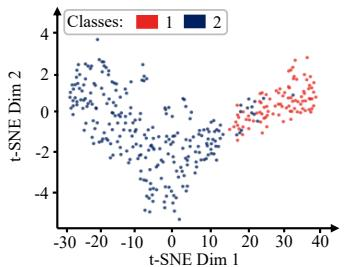  
(a) Parameter-level embeddings

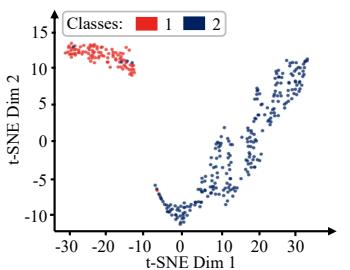  
(b) Retrieved feature-level embeddings

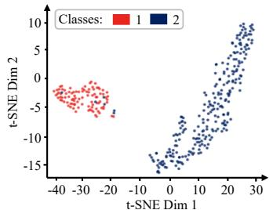  
(c) Knowledge-enhanced embeddings  
Figure 5: t-SNE visualization on the Chinatown dataset.

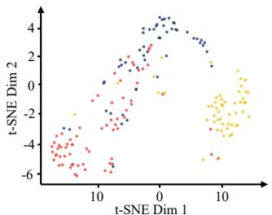  
(a) Parameter-level embeddings

## Classes:

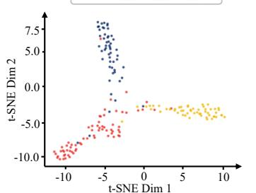  
(b) Retrieved feature-level embeddings

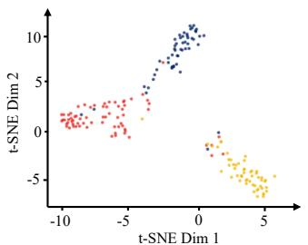  
(c) Knowledge-enhanced embeddings  
Figure 6: t-SNE visualization on the ArrowHead dataset.

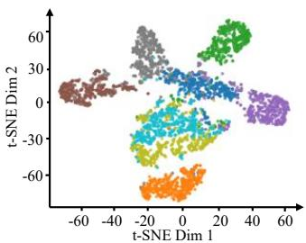  
(a) Parameter-level embeddings

## Classes: 15 7 8

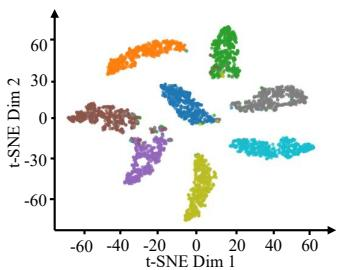  
(b) Retrieved feature-level embeddings

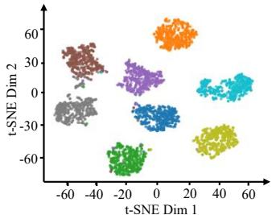  
(c) Knowledge-enhanced embeddings  
Figure 7: t-SNE visualization on the UWaveGestureLibraryAll dataset.

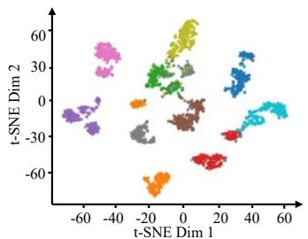  
(a) Parameter-level embeddings

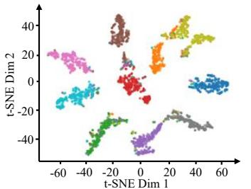  
(b) Retrieved feature-level embeddings

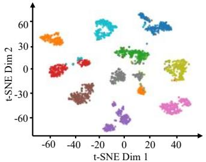  
(c) Knowledge-enhanced embeddings  
Figure 8: t-SNE visualization on the MelbournePedestrian dataset.

• Scaling: Multiplies the entire series by a random scaling factor.

The detailed classification accuracy results of R2R and the seven augmentation methods on the 18 datasets are reported in Table 13. Additionally, Table 14 compares R2R’s transfer paradigm with conventional fine-tuning-based transfer across datasets with different numbers of classes (2, 6, 10, and 26), under a continual fine-tuning setting.

Table 13: Detailed test classification accuracy on 18 UCR datasets compared with different time series data augmentation methods. The best results are in bold.
<table><tr><td>ID</td><td>Dataset name</td><td>Raw</td><td>Jitter</td><td>Time warp</td><td>Magnitude warp</td><td>Window slice</td><td>Time flip</td><td>Permutation</td><td>Scaling</td><td>R2R</td></tr><tr><td>1</td><td>ArrowHead</td><td>0.8857</td><td>0.8629</td><td>0.8457</td><td>0.8686</td><td>0.8629</td><td>0.8857</td><td>0.8400</td><td>0.8743</td><td>0.9257</td></tr><tr><td>2</td><td>CBF</td><td>1.0000</td><td>1.0000</td><td>1.0000</td><td>1.0000</td><td>1.0000</td><td>0.8389</td><td>1.0000</td><td>1.0000</td><td>1.0000</td></tr><tr><td>3</td><td>CricketX</td><td>0.8282</td><td>0.8154</td><td>0.8205</td><td>0.8128</td><td>0.8179</td><td>0.8308</td><td>0.8308</td><td>0.8179</td><td>0.8308</td></tr><tr><td>4</td><td>DistalPhalanxOutlineAgeGroup</td><td>0.7698</td><td>0.7698</td><td>0.7698</td><td>0.7554</td><td>0.7842</td><td>0.7842</td><td>0.7482</td><td>0.7338</td><td>0.7914</td></tr><tr><td>5</td><td>DistalPhalanxOutlineCorrect</td><td>0.7899</td><td>0.7935</td><td>0.7899</td><td>0.7971</td><td>0.7609</td><td>0.7609</td><td>0.7971</td><td>0.7935</td><td>0.7862</td></tr><tr><td>6</td><td>ECG5000</td><td>0.9498</td><td>0.9464</td><td>0.9387</td><td>0.9458</td><td>0.9444</td><td>0.9442</td><td>0.9464</td><td>0.9451</td><td>0.9462</td></tr><tr><td>7</td><td>EOGVerticalSignal</td><td>0.5193</td><td>0.5387</td><td>0.5608</td><td>0.5276</td><td>0.5718</td><td>0.4613</td><td>0.5110</td><td>0.5110</td><td>0.5442</td></tr><tr><td>8</td><td>EthanolLevel</td><td>0.8500</td><td>0.7520</td><td>0.7140</td><td>0.7260</td><td>0.8100</td><td>0.7580</td><td>0.7980</td><td>0.7560</td><td>0.8140</td></tr><tr><td>9</td><td>Fish</td><td>0.9886</td><td>0.9486</td><td>0.9714</td><td>0.9657</td><td>0.9771</td><td>0.9771</td><td>0.9657</td><td>0.9714</td><td>0.9829</td></tr><tr><td>10</td><td>GunPoint</td><td>1.0000</td><td>1.0000</td><td>1.0000</td><td>0.9867</td><td>0.9867</td><td>0.9933</td><td>0.9933</td><td>0.9867</td><td>1.0000</td></tr><tr><td>11</td><td>InsectWingbeatSound</td><td>0.6682</td><td>0.6515</td><td>0.6399</td><td>0.6611</td><td>0.6283</td><td>0.6667</td><td>0.6540</td><td>0.6551</td><td>0.6737</td></tr><tr><td>12</td><td>ItalyPowerDemand</td><td>0.9640</td><td>0.9660</td><td>0.9534</td><td>0.9621</td><td>0.9534</td><td>0.9621</td><td>0.9563</td><td>0.9611</td><td>0.9650</td></tr><tr><td>13</td><td>MelbournePedestrian</td><td>0.9702</td><td>0.9610</td><td>0.9668</td><td>0.9668</td><td>0.9672</td><td>0.9631</td><td>0.9606</td><td>0.9639</td><td>0.9751</td></tr><tr><td>14</td><td>MiddlePhalanxTW</td><td>0.5974</td><td>0.5649</td><td>0.5714</td><td>0.5260</td><td>0.5649</td><td>0.5714</td><td>0.5390</td><td>0.5779</td><td>0.5714</td></tr><tr><td>15</td><td>MixedShapesRegularTrain</td><td>0.9753</td><td>0.9654</td><td>0.9699</td><td>0.9761</td><td>0.9773</td><td>0.9695</td><td>0.9736</td><td>0.9765</td><td>0.9761</td></tr><tr><td>16</td><td>OSULeaf</td><td>0.9835</td><td>0.9545</td><td>0.9628</td><td>0.9669</td><td>0.9835</td><td>0.9711</td><td>0.9504</td><td>0.9669</td><td>0.9917</td></tr><tr><td>17 18</td><td>Trace</td><td>1.0000</td><td>1.0000</td><td>1.0000</td><td>1.0000</td><td>1.0000</td><td>1.0000</td><td>1.0000</td><td>1.0000</td><td>1.0000</td></tr><tr><td></td><td>WordSynonyms Avg. Rank</td><td>0.7492</td><td>0.7241</td><td>0.7320</td><td>0.7414</td><td>0.7320</td><td>0.6771</td><td>0.7116</td><td>0.7288</td><td>0.7492</td></tr><tr><td colspan="2">Win</td><td>2.39</td><td>5.11</td><td>5.06</td><td>4.89</td><td>4.33</td><td>5.06</td><td>5.50</td><td>4.83</td><td>2.00</td></tr><tr><td colspan="2"></td><td>8</td><td>4</td><td>3</td><td>3</td><td>4</td><td>2</td><td>4</td><td>2</td><td>10</td></tr></table>

Table 14: Impact of continual fine-tuning for classification on another four group datasets selected from the additional 30 time series datasets. $\operatorname { A c c } _ { A _ { 1 } }$ : Initial accuracy on dataset $A ; \operatorname { A c c } _ { A _ { 2 } } ;$ Accuracy on dataset A after continual training on dataset B; Forgetting: $\operatorname { A c c } _ { A _ { 1 } } - \operatorname { A c c } _ { A _ { 2 } } .$
<table><tr><td rowspan="2">Dataset A</td><td rowspan="2">Dataset B</td><td colspan="3">Only Parameter transfer</td><td colspan="3">R2R transfer</td></tr><tr><td> $\operatorname { A c c } _ { A _ { 1 } }$ </td><td> $\operatorname { A c c } _ { A _ { 2 } }$ </td><td>Forgetting</td><td> $\operatorname { A c c } _ { A _ { 1 } }$ </td><td> $\operatorname { A c c } _ { A _ { 2 } }$ </td><td>Forgetting</td></tr><tr><td>AconityMINIPrinterSmall_eq</td><td>AsphaltRegularityUni_eq</td><td>0.9795</td><td>0.8048</td><td>0.1747</td><td>0.9829</td><td>0.8253</td><td>0.1576</td></tr><tr><td>Colposcopy</td><td>GesturePebbleZ1_eq</td><td>0.3564</td><td>0.2574</td><td>0.0990</td><td>0.3762</td><td>0.2970</td><td>0.0792</td></tr><tr><td>AllGestureWiimoteY_eq</td><td>AllGestureWiimoteZ_eq</td><td>0.7971</td><td>0.2829</td><td>0.5142</td><td>0.8071</td><td>0.3286</td><td>0.4785</td></tr><tr><td>GestureMidAirD2_eq</td><td>GestureMidAirD3_eq</td><td>0.6923</td><td>0.1769</td><td>0.5154</td><td>0.7000</td><td>0.2308</td><td>0.4692</td></tr></table>

## F Details of hyperparameter analysis results

Table 15 presents the classification performance of R2R under three distance metrics used for retrieval index construction, evaluated on the same 18 UCR datasets as in Table 12. We consider Inner Product (IP), Euclidean Distance (L2), and Cosine Similarity. These metrics differ in both formulation and geometric properties. Specifically, IP computes similarity as $\begin{array} { r } { \langle \mathbf { x } , \mathbf { y } \rangle = \sum _ { i = 1 } ^ { d } x _ { i } y _ { i } } \end{array}$ favoring vectors with large aligned magnitudes; L2 measures dissimilarity as $\begin{array} { r } { \| \mathbf { x } - \mathbf { y } \| _ { 2 } ^ { 2 } = \sum _ { i = 1 } ^ { d } ( x _ { i } - } \end{array}$ $y _ { i } ) ^ { 2 }$ , capturing absolute geometric distance; while Cosine similarity evaluates angular similarity $\mathrm { a s } \ \frac { \langle \mathbf { x } , \mathbf { y } \rangle } { \| \mathbf { x } \| _ { 2 } \| \mathbf { y } \| _ { 2 } }$ , effectively normalizing vector magnitudes and focusing on directional alignment. As shown in Table 15, Cosine similarity achieves the best average rank, indicating its superiority in retrieving semantically aligned embeddings. Therefore, R2R adopts Cosine similarity as the default distance metric for nearest neighbor retrieval.

Tables 16 and 17 further examine the influence of retrieval hyperparameters, including the index partition size $n _ { \mathrm { l i s t } }$ and the number of retrieved neighbors K. The results demonstrate that $n _ { \mathrm { l i s t } } = 2 5 6$ and $K = 2 0$ yield the best average rank, and are thus selected as default settings. Additionally, comparing $K = 1$ and $K \ : = \ : 2 0$ in Table 17 shows that using only a single nearest neighbor significantly degrades performance, as it effectively removes the optimal transport-based weighted fusion mechanism. In contrast, aggregating multiple retrieved neighbors $( K = 2 0 )$ improves both average rank and win rate, highlighting the effectiveness of multi-neighbor retrieval combined with optimal transport-based weighting.

Table 15: Detailed test classification accuracy results on 18 UCR time series datasets using different distance metrics within R2R. The best results are in bold.
<table><tr><td>ID</td><td>Dataset name</td><td>IP</td><td>L2</td><td>Cosine</td></tr><tr><td>1</td><td>ArrowHead CBF</td><td>0.8800</td><td>0.8743</td><td>0.9257</td></tr><tr><td>2 3</td><td></td><td>1.0000 0.8257</td><td>1.0000 0.8257</td><td>1.0000 0.8308</td></tr><tr><td>4</td><td>CricketX DistalPhalanxOutlineAgeGroup</td><td>0.7554</td><td>0.7339</td><td>0.7914</td></tr><tr><td>5</td><td>DistalPhalanxOutlineCorrect</td><td>0.7754</td><td>0.8080</td><td></td></tr><tr><td>6</td><td>ECG5000</td><td>0.9400</td><td></td><td>0.7862</td></tr><tr><td>7</td><td>EOGVerticalSignal</td><td>0.5332</td><td>0.9420</td><td>0.9462</td></tr><tr><td>8</td><td>EthanolLevel</td><td>0.8360</td><td>0.5497</td><td>0.5442</td></tr><tr><td></td><td>Fish</td><td>0.9658</td><td>0.8080</td><td>0.8140</td></tr><tr><td>9</td><td>GunPoint</td><td>1.0000</td><td>0.9658</td><td>0.9829</td></tr><tr><td>10</td><td></td><td></td><td>1.0000</td><td>1.0000</td></tr><tr><td>11</td><td>InsectWingbeatSound</td><td>0.6727</td><td>0.6646</td><td>0.6737</td></tr><tr><td>12</td><td>ItalyPowerDemand</td><td>0.9620</td><td>0.9591</td><td>0.9650</td></tr><tr><td>13</td><td>MelbournePedestrian</td><td>0.9763</td><td>0.9730</td><td>0.9751</td></tr><tr><td>14</td><td>MiddlePhalanxTW</td><td>0.5130</td><td>0.5325</td><td>0.5714</td></tr><tr><td>15</td><td>MixedShapesRegularTrain</td><td>0.9736</td><td>0.9765</td><td>0.9761</td></tr><tr><td>16</td><td>OSULeaf</td><td>0.9834</td><td>1.0000</td><td>0.9917</td></tr><tr><td>17</td><td>Trace</td><td>1.0000</td><td>1.0000</td><td>1.0000</td></tr><tr><td>18</td><td>WordSynonyms</td><td>0.7461</td><td>0.7570</td><td>0.7492</td></tr><tr><td></td><td>Avg. Rank Win</td><td>2.11 5</td><td>1.89 8</td><td>1.39</td></tr></table>

Table 16: Detailed test classification accuracy results on 18 UCR time series datasets using different nlist for retrieval within R2R. The best results are in bold.
<table><tr><td>ID</td><td>Dataset name</td><td> $n _ { \mathrm { l i s t } } { = } 1 2 8$ </td><td> $n _ { \mathrm { l i s t } } { = } 2 5 6$ </td><td> $n _ { \mathrm { l i s t } } { = } 5 1 2$ </td><td> $n _ { \mathrm { l i s t } } { = } 1 0 2 4$ </td><td> $n _ { \mathrm { l i s t } } { = } 2 0 4 8$ </td><td> $n _ { \mathrm { l i s t } } { = } 4 0 9 6$ </td><td> $n _ { \mathrm { l i s t } } { = } 8 1 9 2$ </td></tr><tr><td>1</td><td>ArrowHead</td><td>0.9200</td><td>0.9257</td><td>0.9314</td><td>0.9314</td><td>0.9314</td><td>0.9543</td><td>0.9486</td></tr><tr><td>2</td><td>CBF</td><td>1.0000</td><td>1.0000</td><td>1.0000</td><td>1.0000</td><td>1.0000</td><td>1.0000</td><td>1.0000</td></tr><tr><td>3</td><td>CricketX</td><td>0.8283</td><td>0.8308</td><td>0.8026</td><td>0.8232</td><td>0.8283</td><td>0.7975</td><td>0.8283</td></tr><tr><td>4</td><td>DistalPhalanxOutlineAgeGroup</td><td>0.7842</td><td>0.7914</td><td>0.7842</td><td>0.7886</td><td>0.7770</td><td>0.7698</td><td>0.7555</td></tr><tr><td>5</td><td>DistalPhalanxOutlineCorrect</td><td>0.8007</td><td>0.7862</td><td>0.8079</td><td>0.8043</td><td>0.7971</td><td>0.8007</td><td>0.8079</td></tr><tr><td>6</td><td>ECG5000</td><td>0.9444</td><td>0.9462</td><td>0.9462</td><td>0.9509</td><td>0.9431</td><td>0.9480</td><td>0.9391</td></tr><tr><td>7</td><td>EOGVerticalSignal</td><td>0.5415</td><td>0.5442</td><td>0.5497</td><td>0.5332</td><td>0.5470</td><td>0.5111</td><td>0.5055</td></tr><tr><td>8</td><td>EthanolLevel</td><td>0.8040</td><td>0.8140</td><td>0.8160</td><td>0.8020</td><td>0.8120</td><td>0.7880</td><td>0.7920</td></tr><tr><td>9</td><td>Fish</td><td>0.9772</td><td>0.9829</td><td>0.9772</td><td>0.9772</td><td>0.9829</td><td>0.9886</td><td>0.9943</td></tr><tr><td>10</td><td>GunPoint</td><td>1.0000</td><td>1.0000</td><td>1.0000</td><td>1.0000</td><td>1.0000</td><td>1.0000</td><td>1.0000</td></tr><tr><td>11</td><td>InsectWingbeatSound</td><td>0.6576</td><td>0.6737</td><td>0.6712</td><td>0.6641</td><td>0.6682</td><td>0.6732</td><td>0.6727</td></tr><tr><td>12</td><td>ItalyPowerDemand</td><td>0.9708</td><td>0.9650</td><td>0.9582</td><td>0.9660</td><td>0.9670</td><td>0.9621</td><td>0.9689</td></tr><tr><td>13</td><td>MelbournePedestrian</td><td>0.9731</td><td>0.9751</td><td>0.9747</td><td>0.9763</td><td>0.9735</td><td>0.9751</td><td>0.9759</td></tr><tr><td>14</td><td>MiddlePhalanxTW</td><td>0.6078</td><td>0.5714</td><td>0.5559</td><td>0.6143</td><td>0.5689</td><td>0.5624</td><td>0.5819</td></tr><tr><td>15</td><td>MixedShapesRegularTrain</td><td>0.9761</td><td>0.9761</td><td>0.9761</td><td>0.9765</td><td>0.9765</td><td>0.9761</td><td>0.9761</td></tr><tr><td>16</td><td>OSULeaf</td><td>0.9917</td><td>0.9917</td><td>0.9917</td><td>0.9917</td><td>0.9917</td><td>0.9876</td><td>0.9876</td></tr><tr><td>17</td><td>Trace</td><td>1.0000</td><td>1.0000</td><td>1.0000</td><td>1.0000</td><td>1.0000</td><td>1.0000</td><td>1.0000</td></tr><tr><td>18</td><td>WordSynonyms</td><td>0.7492</td><td>0.7492</td><td>0.7492</td><td>0.7461</td><td>0.7477</td><td>0.7539</td><td>0.7571</td></tr><tr><td colspan="2">Avg. Rank Win</td><td>3.39</td><td>2.72</td><td>3.11</td><td>2.94</td><td>3.33</td><td>3.67</td><td>3.11</td></tr><tr><td colspan="2"></td><td>5</td><td>7</td><td>7</td><td>8</td><td>5</td><td>4</td><td>6</td></tr></table>

## G Details of multivariate time series classification results

R2R is designed for univariate TSC, and both the query encoder and the knowledge base operate on univariate series. To examine whether the framework also transfers to multivariate time series, we follow the channel-adapter protocol of Mantis [19] and evaluate on the same ten UEA datasets [61] reported in its Appendix Table 12. A trainable linear adapter maps the d input channels of each dataset to ten mixed channels before the ${ \mathrm { R 2 R } } _ { \mathrm { U n i S h a p e } }$ pipeline, so that heterogeneous channel counts and cross-channel mixing are handled by the adapter, while the per-channel query embeddings are averaged before retrieval to keep the retrieval module identical to the univariate case.

Table 18 reports the detailed multivariate time series classification results. The three Mantis columns correspond to the None, PCA, and Linear channel adapters and are copied directly from Appendix

Table 17: Detailed test classification accuracy results on 18 UCR time series datasets using different Top-K retrieval embeddings within R2R. The best results are in bold.
<table><tr><td>ID</td><td>Dataset name</td><td>K=1</td><td>K=5</td><td>K=10</td><td>K=20</td><td>K=32</td><td>K=64</td></tr><tr><td>1</td><td>ArrowHead</td><td>0.9128</td><td>0.9543</td><td>0.9371</td><td>0.9257</td><td>0.9428</td><td>0.9486</td></tr><tr><td>2</td><td>CBF</td><td>1.0000</td><td>1.0000</td><td>1.0000</td><td>1.0000</td><td>1.0000</td><td>1.0000</td></tr><tr><td>3</td><td>CricketX</td><td>0.8287</td><td>0.8461</td><td>0.8385</td><td>0.8308</td><td>0.8410</td><td>0.8461</td></tr><tr><td>4</td><td>DistalPhalanxOutlineAgeGroup</td><td>0.7626</td><td>0.7770</td><td>0.7914</td><td>0.7914</td><td>0.7770</td><td>0.7842</td></tr><tr><td>5</td><td>DistalPhalanxOutlineCorrect</td><td>0.7608</td><td>0.7789</td><td>0.7681</td><td>0.7862</td><td>0.7789</td><td>0.7391</td></tr><tr><td>6</td><td>ECG5000</td><td>0.9409</td><td>0.9398</td><td>0.9467</td><td>0.9462</td><td>0.9495</td><td>0.9438</td></tr><tr><td>7</td><td>EOGVerticalSignal</td><td>0.5470</td><td>0.5359</td><td>0.5387</td><td>0.5442</td><td>0.5470</td><td>0.5497</td></tr><tr><td>8</td><td>EthanolLevel</td><td>0.8060</td><td>0.8280</td><td>0.8200</td><td>0.8140</td><td>0.8280</td><td>0.8060</td></tr><tr><td>9</td><td>Fish</td><td>0.9715</td><td>0.9715</td><td>0.9658</td><td>0.9829</td><td>0.9772</td><td>0.9715</td></tr><tr><td>10</td><td>GunPoint</td><td>1.0000</td><td>0.9934</td><td>1.0000</td><td>1.0000</td><td>1.0000</td><td>1.0000</td></tr><tr><td>11</td><td>InsectWingbeatSound</td><td>0.6666</td><td>0.6697</td><td>0.6757</td><td>0.6737</td><td>0.6732</td><td>0.6762</td></tr><tr><td>12</td><td>ItalyPowerDemand</td><td>0.9601</td><td>0.9572</td><td>0.9640</td><td>0.9650</td><td>0.9523</td><td>0.9620</td></tr><tr><td>13</td><td>MelbournePedestrian</td><td>0.9682</td><td>0.9727</td><td>0.9723</td><td>0.9751</td><td>0.9731</td><td>0.9715</td></tr><tr><td>14</td><td>MiddlePhalanxTW</td><td>0.5259</td><td>0.5714</td><td>0.5519</td><td>0.5714</td><td>0.5454</td><td>0.5064</td></tr><tr><td>15</td><td>MixedShapesRegularTrain</td><td>0.9741</td><td>0.9720</td><td>0.9736</td><td>0.9761</td><td>0.9774</td><td>0.9732</td></tr><tr><td>16</td><td>OSULeaf</td><td>0.9793</td><td>0.9917</td><td>0.9793</td><td>0.9917</td><td>0.9834</td><td>0.9917</td></tr><tr><td>17</td><td>Trace</td><td>1.0000</td><td>1.0000</td><td>1.0000</td><td>1.0000</td><td>1.0000</td><td>1.0000</td></tr><tr><td>18</td><td>WordSynonyms</td><td>0.7429</td><td>0.7492</td><td>0.7398</td><td>0.7492</td><td>0.7351</td><td>0.7445</td></tr><tr><td></td><td>Avg. Rank Win</td><td>4.11 3</td><td>3.00 8</td><td>3.17 4</td><td>2.06 11</td><td>2.67 6</td><td>2.89 7</td></tr></table>

Table 12 of [19]. The two remaining columns are obtained in this work and differ only in whether retrieval is used: UniShape (Linear) applies the same adapter and backbone without the query encoder, whereas $R 2 R _ { U n i S h a p e }$ (Linear) additionally retrieves numerical knowledge; the two share the same adapter, backbone, ensembling, training budget, and model-selection protocol. Both Mantis and the two UniShape-based settings are trained on the default UEA training splits and evaluated on the default test splits, and neither uses the test set during training or for weight selection, so the comparison is fair with respect to data usage.

As in the main text, we report the average rank of the test classification accuracy and the number of datasets on which each method is best (Win). ${ \mathrm { R } } 2 { \mathrm { R } } _ { \mathrm { U n i S h a p e } }$ obtains the best average rank (1.40) and the most wins (6 of 10), improving over the parameter-only UniShape (Linear) variant (2.10 with 4 wins) as well as over all three Mantis channel adapters. These results indicate that the retrievalto-recognition paradigm remains effective once a channel adapter supplies multivariate inputs. We regard this as a preliminary extension rather than a full multivariate design, since it covers ten datasets and the retrieved knowledge itself is still univariate.

## H Limitations

R2R is specifically positioned at the post-training stage of TSFMs: it improves how an already pretrained model is adapted to downstream classification, and therefore contributes neither new pretraining objectives and backbone architectures nor evidence about pretraining scale. R2R relies on a knowledge base constructed from large-scale pretraining datasets to retrieve class-relevant embeddings for downstream time series classification. In this work, both the retrieval mechanism and the knowledge base are designed for univariate time series, and thus do not explicitly account for multivariate settings, where modeling inter-variable dependencies and handling high-dimensional channels are important. Appendix G reports a preliminary extension in which a trainable linear channel adapter precedes the R2R pipeline on ten UEA datasets; there, inter-variable dependencies are absorbed by the adapter and the retrieved knowledge remains univariate, so the extension does not yet constitute a native multivariate design. Extending R2R to multivariate scenarios, including efficient channel selection and cross-variable representation learning, is a promising direction for future work. In addition, the effectiveness of retrieval-based enhancement depends on the quality of learned embeddings and the composition of the knowledge base. In particular, imbalanced class distributions in the sampled knowledge base may reduce the benefit of retrieval, indicating that diversity and balance of class patterns are important for robust knowledge transfer. This suggests future efforts on designing more robust retrieval strategies and knowledge base construction methods to further improve generalization in complex real-world settings.

Table 18: Test classification accuracy on ten UEA multivariate datasets under the linear channeladapter setting. The Mantis columns are taken from Appendix Table 12 of [19], and all accuracies are reported to three decimals. The best results are in bold.
<table><tr><td rowspan="2">ID</td><td rowspan="2">Dataset name</td><td colspan="3">Mantis</td><td colspan="2">UniShape-based (ours)</td></tr><tr><td>None</td><td>PCA</td><td>Linear</td><td>UniShape (Linear)</td><td> ${ \mathrm { R } } 2 { \mathrm { R } } _ { \mathrm { U n i S h a p e } }$  (Linear)</td></tr><tr><td>1</td><td>CharacterTrajectories</td><td>0.976</td><td>0.977</td><td>0.988</td><td>0.995</td><td>0.995</td></tr><tr><td>2</td><td>DuckDuckGeese</td><td>0.540</td><td>0.580</td><td>0.600</td><td>0.600</td><td>0.627</td></tr><tr><td>3</td><td>EigenWorms</td><td>0.814</td><td>0.863</td><td>0.855</td><td>0.898</td><td>0.906</td></tr><tr><td>4</td><td>FaceDetection</td><td>0.549</td><td>0.553</td><td>0.592</td><td>0.664</td><td>0.657</td></tr><tr><td>5</td><td>HandMovementDirection</td><td>0.297</td><td>0.338</td><td>0.338</td><td>0.351</td><td>0.446</td></tr><tr><td>6</td><td>Handwriting</td><td>0.281</td><td>0.315</td><td>0.514</td><td>0.464</td><td>0.503</td></tr><tr><td>7</td><td>MotorImagery</td><td>0.467</td><td>0.480</td><td>0.500</td><td>0.570</td><td>0.520</td></tr><tr><td>8</td><td>NATOPS</td><td>0.889</td><td>0.939</td><td>0.906</td><td>0.909</td><td>0.926</td></tr><tr><td>9</td><td>SelfRegulationSCP2</td><td>0.517</td><td>0.533</td><td>0.533</td><td>0.494</td><td>0.546</td></tr><tr><td>10</td><td>SpokenArabicDigits</td><td>0.937</td><td>0.955</td><td>0.987</td><td>0.995</td><td>0.995</td></tr><tr><td colspan="2">Avg. Rank Win</td><td>4.90</td><td>3.30</td><td>2.80</td><td>2.10</td><td>1.40</td></tr><tr><td colspan="2"></td><td>0</td><td>1</td><td>1</td><td>4</td><td>6</td></tr></table>

## I Broader impacts

This work proposes R2R, a retrieval-to-recognition post-training framework that enhances pretrained time series foundation models (TSFMs) by incorporating retrieved numerical knowledge from a constructed pretraining knowledge base. By combining implicit parameter knowledge in TSFMs with explicit retrieved feature-level knowledge, R2R provides a plug-and-play mechanism to improve time-series classification across diverse real-world scenarios. It can be seamlessly integrated with existing TSFMs and applied to applications such as activity recognition, healthcare monitoring, and industrial fault diagnosis. The framework relies solely on time-series representations and publicly available benchmark datasets, without involving any personal or sensitive information, and therefore does not introduce additional ethical risks beyond standard machine learning practice.