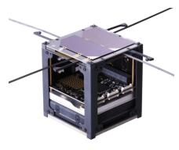
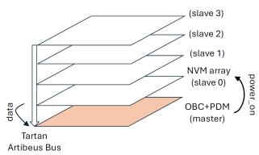
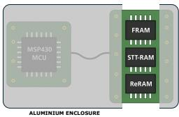
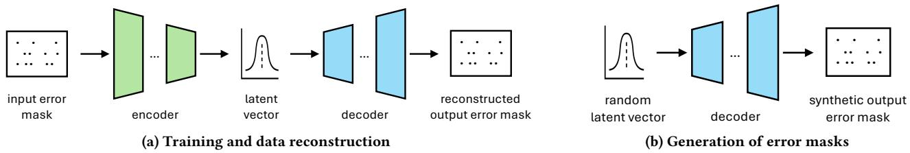
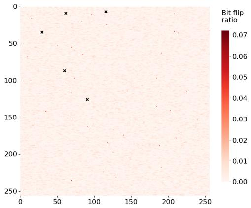

# Injection of Space Radiation Errors on Low-power NVM using Generative Deep Learning

Eleonora Giudici Politecnico di Milano Milan, Italy eleonora.guidici@mail.polimi.it

Antonio Miele   
Politecnico di Milano   
Milan, Italy   
antonio.miele@polimi.it   
Luca Mottola   
Politecnico di Milano   
Milan, Italy   
RISE and Uppsala University   
Uppsala, Sweden   
luca.mottola@polimi.it

## Abstract

We develop an error model for a Non-Volatile Memory (NVM) de vice that represents the efects of physical faults experienced in a CubeSat mission in Low Earth Orbit (LEO). The CubeSat carries an of-the-shelf low-power Ferroelectric RAM (FRAM) chip and runs repeated read/write tests according to a predefined pattern. We compare every memory snapshot received from the satellite with a reference bitmap to identify bit errors. We visually analyze erroneous values distributions in the memory snapshots and we understand that they are frequently distributed according to regular spatial patterns. We define a generative deep learning technique to automatically learn these spatial patterns and to synthetically generate additional error patterns mimicking the observed ones. The model is capable at producing memory errors for general application-level experimentation. Our preliminary validation indicates that when comparing the model output with the data we collect, 0.92 of the generated bit flips correspond to bit flips in the memory snapshots and the model captures 0.91 of the observed bit flips. A comparison of the spatial distribution of bit flips in 10,000 generated error patterns also provides a Wasserstein distance of 0.073, indicating that the two distributions difer by roughly 7% of the maximum possible displacement of their probability masses.

## 1 Introduction

Nano-satellites are emerging as a new edge computing platform [2, 3, 12, 13, 33]. Unlike the monolithic satellite design that dominated space operations until the early 2000s, nano-satellites provide cheaper operation and are robust to schedule variations and budget fluctuations, making it possible for academic institutions and even associations of hobbyists to design and deploy remote embedded sensing applications [6, 17, 28, 29, 37, 45, 48].

Nano-satellites are resource-constrained platforms, powered by solar energy harvesting and therefore subject to variable energy provisioning patterns [4, 13]. Their continuous operation is not guaranteed, as the limited energy budget is to be used for a number of diferent system functionality including computing, communication, and thermal control. Systems are thus designed with NVM to persist application and systems states when the satellite is powered of and recharging energy bufers [3, 12, 33]. Nano-satellites are also often exposed to high-energy, charged particles from sources like the sun, supernovae, and radiation trapped in planetary magnetic fields. Such a complex mix of nuclear particles may afect the operation of the hardware onboard; in fact, their strike causes transient faults, such as bit flips, or even bear permanent efects, causing a circuit line or memory cell to be stuck at a fixed value.

CubeSats most often employ of-the-shelf hardware to reduce costs and, most importantly, to rely on the features and performance of modern hardware, as the space-rated one may lag several generations behind. Limited experimental data exists describing the efects of space radiation on of-the-shelf low-power components, for instance such as NVMs [15, 23, 31]. Such a state of afairs hampers the development of error models to be used in applicationlevel simulation that potentially enable large-scale application-level studies prior to actual deployments in orbit [7]. The issue two-fold: first, if we were to use the limited experimental data directly to perform error injection, the diversity of possible simulated executions would be extremely constrained; second, it would be exceedingly challenging to visually capture recurrent spatial and temporal data corruption patterns to design representative error models [7, 27]. A diferent take. This work is based on a CubeSat deployment in LEO lasting about 3 months, which brings three NVM chips configured as scratchpad memory in orbit: a Fujitsu MB85RS64V FRAM, an Everspin MR10Q010 Spin-Torque Transfer Magnetoresistive RAM (STT-MRAM), and a Fujitsu MB85AS8MT Resistive RAM (ReRAM). Throughout more than three months of operation, the three NVM chips are tested with a pre-determined read/write pattern. The collected memory snapshots are then eventually transmitted back to Earth and compared to a reference correct sequence to pinpoint bit errors due to space radiation. This analysis shows that bit errors may afect multiple consecutive bits, form error blocks of diferent sizes, and recur in diferent memory snapshots. An error model to be used for application-level error simulations in the early phases of a critical system design must therefore generate error patterns that preserve these aspects of the data.

To develop an accurate error model based on the experimental data collected, we take a diferent route compared with existing literature and let a deep learning pipeline capture recurrent spatial error patterns automatically. We train a Variational AutoEncoder (VAE) [21], a type ofgenerative model that uses a probabilistic approach to generate new data corruptions that mimic the training data. We develop the model for the FRAM chip, as that is the setting where we have most data at disposal. It would be possible, in principle, to apply the exact same techniques for the STT-MRAM and ReRAM chip. We refrain from doing so because of the even more limited size of the data available for either memory, which would arguably prevent an accurate training.

Our preliminary validation indicates that when comparing the model’s output with the data we collect, 92% of the generated bit flips correspond to bit flips in the memory snapshots, and the model accurately captures 91% of the observed bit flips. An early comparison of the spatial distribution of bit flips in 10,000 generated error patterns reveals a Wasserstein distance of 0.073, indicating that the two distributions difer by approximately 7% of the maximum possible displacement of their probability masses.

The rest of the paper unfolds as follows. Sec. 2 provides background information and positions this work with respect to related literate. Sec. 3 describes the experimental platform and test procedures in orbit. Model development illustrated in Sec. 4, whereas we report on a preliminary validation in Sec. 5. The paper ends in Sec. 6 with brief concluding remarks and future directions.

## 2 Background and Related Work

Existing literature [36] defines a fault as a weakness or flaw in a system hardware component and the error as the manifestation of a fault in the system state, for example, causing a deviation from the nominal behavior of program execution. Faults and errors crucially refer to two diferent abstraction levels: the study of their relationship requires a critical cause-efect analysis across the two. Radiation-induced faults. A Single Event Upset (SEU) is a transient fault in an electronic device caused by a single energetic particle striking a sensitive node, leading to a change in state in a single bit. A Multi Bit Efect (MBU) models the case when a single high-energy particle flips the data bits in two or more adjacent memory cells. When radiations hit control logic, instead, they may cause a Single Event Functional Interrupt (SEFI), which leads a device to enter a temporary non-functional state. A SEFI is “non-destructive interruption resulting from a single ion strike that causes an electronic component to reset, hang, or enter a diferent operating condition or test mode” [19]. SEFIs are usually set apart from SEUs and MBUs, as they persist until the system is reset, whereas the latter may be corrected by simply rewriting memory locations.

Due to their transient nature and what is generally known as the “self-healing” efect [32, 42], SEUs, MBU, and SEFIs are generally referred to as soft errors; on the other hand, radiations can cause also permanent efects, such as Single Event Latch-ups (SELs), which lock a memory cell to a fixed value. In contrast to soft errors, radiation-induced permanent faults are also called hard errors.

Radiations efects in LEO. Galactic cosmic rays and solar cosmic rays are the two main sources of radiations in LEO. Their interaction with the Earth magnetic field and the atmosphere, causes the so-called Van Allen radiation belts [24]. Radiation intensity in LEO varies with the specific position around the Earth and also due to specific events such as solar flares [30]. First verified evidences of cosmic radiation causing SEUs in digital circuits come from observations in first generation satellites during the 1970s [5]. Further evidences appear in all subsequent missions up to the recent time, as in SpaceX satellites [43].

Using of-the-shelf hardware instead of space-rated hardware prompted eforts to understand the efects of space radiations in LEO. Quinn et al. [38] deploy a Virtex-4 FPGA in LEO. They use a digital signal processing application as a benchmark across two diferent FPGAs, a larger XQR4VLX200 and smaller XQR4VSX55. They focus on where in orbit SEUs and MBUs occur, and at what rates. They find that the rates are proportional with FPGA size. Yaacoub et al. [47] deploy an Arty Z7-20 board in LEO, which combines programmable logic resources similar to traditional FPGAs with a dual-core ARM Cortex-A9 SoC. They compare the execution of a Fast Fourier Transform implementation on the FPGA chip and on the ARM core to test the validity of existing fault tolerance mechanisms, including triple-modular redundancy. The single fault model is found to be valid in their setting. Lovellette et al. [26] compare the use of an RH-3000 radiation-hardened processor against an IDT-3081 of-the-shelf processor in LEO. The of-the-shelf processor is an order of magnitude faster, yet it experiences two orders of magnitude more errors [26]. Common to these works is the goal of understanding the efects of space radiation on of-the-shelf hardware, but we focus NVM instead.

Fault and error models. In the study of fault detection and handling techniques, developers frequently need to perform fault injection experiments [36]. They adopt a fault model to that end, that is, a formal description of physical failures that may occur in hardware, and use it in emulation or simulation to systematically and deliberately corrupt the system, or a representation of it. By doing so, they analyze how the errors propagate through an execution and thus whether a given technique works efectively.

Fault injection may be too onerous or time-consuming to be adopted; for example, due to the complexity of the hardware platform, the unavailability of a corresponding simulation model, or because legacy components are employed and therefore internally inaccessible. In these cases, developers may opt to corrupt a running program by directly injecting errors, for example, by corrupting program variables. To do so, they need an error model.

While consolidated literature on fault models exists, error modeling is more challenging [7, 27]. Errors indeed may manifest in a diferent location than the related fault, and in a highly more articulated way. The diferent levels of abstractions corresponding to faults and errors, as described earlier, indeed ofer diferent standpoints. Many times, a program may also be observed only in a fixed set of locations; as a consequence, the original fault may propagate and expand its efects through a program’s execution in ways that cannot be traced accurately. An error model may thus depend on both the hardware, as the related fault does, and on the functionality executed by the program where the fault occurs. Due to the limitations of the CubeSat deployment, our investigation here centers on errors as they manifest on the NVM chips.

Existing literature on error modeling close to our work include, for example, the work of Luza et al. [27], who investigate of the effects of radiations in the DRAM storing the weights of Deep Neural Networks (DNNs). They analyze how corrupted values are spatially distributed in the memory grid, and define error models capable at capturing these spatial patterns and their temporal rates. They thus design an error simulator capable of corrupting the weights of the executed DNN, with the aim of evaluating the robustness of these applications. This contribution is close to out work since both analyze the errors causes in memory snapshots aiming at extracting regularities in the distribution of corrupted values.

Bolchini et al. [7] present an investigation of spatial corruption patterns in the context of GPUs running DNNs. They define error models at the granularity of single DNN layers by injecting faults in GPU logic during the execution of single layers, and analyzing the corruptions in the output tensor. The outcome is a large set

Injection of Space Radiation Errors

on Low-power NVM using Generative Deep Learning
<table><tr><td rowspan=1 colspan=1>NVM chip</td><td rowspan=1 colspan=1>Fujitsu FRAM MB85RS64V</td></tr><tr><td rowspan=1 colspan=1>Bit configuration</td><td rowspan=1 colspan=1>8,192 words × 8 bits</td></tr><tr><td rowspan=1 colspan=1>Endurance</td><td rowspan=1 colspan=1>1012cycles/byte</td></tr><tr><td rowspan=1 colspan=1>Retention</td><td rowspan=1 colspan=1>&gt; 10 years</td></tr><tr><td rowspan=1 colspan=1>Supply voltage (min-max)</td><td rowspan=1 colspan=1>3.3-5.5 V</td></tr><tr><td rowspan=1 colspan=1>Current draw (min-max)</td><td rowspan=1 colspan=1>10μA-1.5mA</td></tr></table>

Table 1: NVM chip specifications. The information is taken from the corresponding datasheets.

  
(a) CubeSat platform.

  
(b) Layered architecture.  
Figure 1: Space vehicle and hardware architecture. The CubeSat hosts the OBC and PDMat the bottom, tasked with mission control and energy management. The slave 0 hosts the Microcontroller Unit (MCU) controlling the experiments and the three NVM chips we test.

of error models, one for each class of DNN layer, characterized by specific spatial patterns and occurrence rates.

The main limitation of these works is that spatial and temporal error patterns are derived visually by developers by manually inspecting a large number of corrupted memory snapshots. We explore a diferent approach and let a VAE capture these patterns automatically during training; then, we use the VAE to generate new data corruptions mimicking the training data. We thus eliminate the necessity of a time-consuming manual activity and increase the quality of the output, as the VAE can capture more general corruption patterns that may not be seen by visual inspection.

## 3 CubeSat Mission

This section presents the CubeSat mission performed for collecting experimental data about how radiations afects NVM devices in space. We describe the characteristics and features of the space vehicle we deploy, the memory array under test and the test procedure, and provide key information about how the mission unfolded.

## 3.1 Space Vehicle

We deploy a CubeSat space device, shown in Fig. 1a, built on the 1-Unit CubeSat platform developed by EnduroSat [16]. The 1-Unit form factor is the smallest for this class of space devices. Because of the limited physical size, the internal layout and placement of components is extremely optimized, and only roughly 14% of the internal space remains unused.

The onboard hardware follows a layered master-slave architecture, as illustrated in Fig. 1b. The device located at the base functions as the satellite’s master On-Board Computer (OBC). It is built around a space-rated version of IBM’s 6x86 CPU, a 32-bit comput ing core featuring a superpipelined architecture and a hardware floating-point unit. Despite being based on an almost 30-year-old design, its space-rated version is still used in space operations, as the software written for it underwent extensive formal verification and proved reliable across multiple missions [44]. A dedicated radiation-strength 10 mm aluminum shield separates each of the slave devices from each other and from the OBC.

Besides logging of mission data and general bookkeeping, the software aboard the OBC controls a custom Power Distribution Module (PDM) also at the base. The PDM uses the energy coming from four CTJ30 CESI solar cells [41] to power the OBC. Any leftover energy is stored in a soft-reconfigurable supercapacitor array on the PDM, which can vary total capacitance according to the net input power. This feature is crucial in the operation of a resource-constrained nano-satellite, as input power from the solar cells may vary widely as the orbit unfolds over time.

The OBC instructs the PDM to supply energy to one or more of the four slave devices onboard. Independent parties program these devices to perform various experiments. The OBC determines what device(s) to power depending on their individual energy figures and the amount of experimental data output up to a given point, in an attempt to ensure fairness of energy allocations. The slave devices relay data to the OBC through a simplified version of the Tartan Artibeus Bus [14] using a serial line.

The UHF Transceiver II module from EnduroSat enables downlink communication with Earth by leveraging the SatNOGS [40] global network of satellite ground stations for data retrieval. Communication occurs using space-proven FCC protocols and extreme data redundancy. Corrupted packets are filtered out by the SatNOGS network as soon as they fail one of the multiple redundancy checks employed. This guarantees that the errors we observe occur on the satellite and not during transmission back to Earth.

Our design the experimental isolates the origin of observed errors from other satellite-level efects. The OBC reports internaltemperature telemetry throughout the mission, and we found no recorded value outside the operating range of any of the three NVM chips. In addition, the OBC power-conditioning circuitry filters supply surges before power reaches the slave devices. These controls specifically address thermal and power issues, which are known to afect the behavior of computing systems in orbit [25, 46] . Together with the physical isolation of the experimental scafold and the pre-launch radiation tests, they support attributing the observed errors primarily to radiation efects on the NVM chips. This attribution does not, however, determine whether an individual radiation-induced error originates in a memory cell or in on-chip peripheral circuitry, which can itself be radiation-sensitive [8].

Due to limitations of the Tartan Artibeus Bus [14] and of the way the PDM distributes available energy, it is not possible to accurately correlate the collected data with absolute positioning or global time, even though this information is available at the OBC. A diferent design where this is possible, on the other hand, would not fit the physical size of a 1-Unit CubeSat. As a result, we cannot make use of temporal or positional data.

## 3.2 Memory Array and Operation

The experimental platform hosts three NVM chips, that are: i) Fujitsu FRAM MB85RS64V1, ii) Everspin STT-MRAM MR10Q0102, and iii) Fujitsu ReRAM MB85AS8MT.3 We chose these technologies to test the robustness of diferent options that, because of their energy figures and size, could be deployed on a resource-constrained nano- or pico-satellite. We do not consider other NVM technologies, such as Flash and Phase-Change Memory (PCM), because of high energy consumption or the early stage of qualification for space missions. The modeling efort described next only considers the FRAM chip, as insuficient data was collected from the other two NVM chips.

  
Figure 2: Slave 0 device on the CubeSat with NVM array. An additional 14mm-think aluminum enclosure protects the experimental scafold, in addition to the 10 mm aluminum shields between slave devices/OBC, and the outer aluminum alloy frame ofthe satellite.

Hardware layout. The slave 0 device in Fig. 1b includes two boards, whose relative layout is shown in Fig. 2. One board hosts a TI MSP430FR6989 MCU, which acts as the local controller for the experiment. The second board hosts the three NVM chips under test and is connected to the MCU through SPI. The physical separation mirrors the logical separation in the experiment: the MCU board implements the experimental scafoldwhereas the memory board hosts the NVM chips we test.

Both boards are placed inside a 14 mm aluminum enclosure that provides additional shielding beyond the 10 mm aluminum shields sitting between each of the slave devices and the OBC, and the outer aluminum alloy frame of the satellite. This enclosure is designed to protect the experimental scafold. This choice is central to our experiments: the additional protection reduces the probability that the MCU, board-level interconnects, or other elements of the experimental scafold corrupt the memory snapshots before they are relayed to the OBC. We experimentally verify this as explained next, prior to the actual launch. Crucially instead, in terms of exposure to space radiation, the NVM chips are placed in the same conditions as they would be on any other application-specific nano- or picosatellite platform [14, 18, 35].

In essence, this strategy is an attribution mechanism rather than a deployment recommendation. This kind of shielding is indeed afordable (with some efort) on a 1-Unit CubeSat operating as an orbital experimental testbed but would be likely infeasible in a real application. Allocating 14 mm of aluminum around a small experimental board would be dificult to justify, because the same volume and mass would otherwise be used for mission payloads, sensors, or application-specific subsystems [6, 37].

Experiment design and execution. To build an error model, we seek to characterize the NVM chips themselves in the presence of space radiation, not to assess whether a specific application produces correct results. At the same time, we must reduce the risks that, despite the additional shielding, radiation may impact other stages of the processing besides the NVM operation.

We call active cycle the uninterrupted period of time the OBC decides to power the slave 0 device, which produces a variable number of memory snapshots depending on the cycle duration. This is the same notion of active cycle in regular intermittent computing [1]. Continuously during an active cycle, for each NVM chip, the MCU first zeroes the memory; next, it writes a specific bit string progressively obtained from a simple sequence of bit-wise operations that commence from a single 16-bit seed, stored in the built-in FRAM of the MCU. Writes occur through the SPI\_WRITE\_CMD command in blocks of 256 bits. Next, the MCU reads back the memory content again using SPI and progressively hands it over to the OBC, where it is queued for transmission. Read operations occur immediately after write operations while the MCU remains powered; thus, retention times are not expected to impact the results.

Note that this design is more robust than, for example, storing the entire bit sequence on the built-in FRAM and merely copying it over to the NVM chips. The built-in FRAM is limited in size, and some additional processing would be required anyway to operate on the larger STT-MRAM and ReRAM. Errors on the original bit stream on the built-in FRAM may, indeed, become indistinguishable from errors on the external NVM chips. Instead, as the operations the MCU performs to generate the bit string to be written on the NVM chips are known, we can detect errors in the 16-bit seed by looking for a specific error pattern appearing simultaneously on all the external NVM chips. We calculate that the probability of this error pattern appearing for reasons other than an error in the seed is < 10−18. In the data we collect, this error pattern never occurs.

This procedure gives us direct bit-level visibility into every memory location eventually returned from the satellite. Running actual application logic would make attributing data errors much harder; for example, later processing stages could overwrite or absorb a radiation-induced fault, or skew the analysis toward an applicationspecific workload. Our bit-level measurements identify the error patterns that the model should inject, whereas the semantics of the afected data ultimately determine whether an error is masked, causes bounded degradation, or becomes a persistent failure. In this sense, the procedure we adopt provides a foundation for constructing the error model, making it available for general application-level error simulation experimentation.

## 3.3 Mission

Before launch, we validated the hardware and experiment design through two dedicated ground radiation tests. The CubeSat was deployed on November 4th, 2024 at 732 km from the Earth using the Polar Satellite Launch Vehicle of the Indian Space Research Organization. The polar orbit allows the CubeSat to eventually cover the entire Earth surface over time. Unlike a sun-synchronous orbit, it also enables diferent exposure to solar radiation at the the same location at diferent local solar times. The initial attitude and velocity setting were set to ensure roughly three months of operation. The initial estimates were far exceeded as we lost contact with the satellite only at the end of February 2025.

When the PDM accumulates suficient power, and the OBC decides to power the slave 0 device, the MSP430 MCU begins the read/write sequence on each of the NVM chips. The experiments start roughly 10 days after deployment, a time that the mission planner allowed to check mission control systems and data transmission back to Earth. Back on the ground, we maintain a reference binary sequence representing the expected memory state after each execution for each NVM chip. We analyze each memory snapshot received from the satellite against this reference to detect errors.

## 4 Error Model

Our goal is to design a error model capable of accurately representing the experimental data we collect. Exercising the model allows us to generate a larger set of synthetic error instances useful for developers building space systems using of-the-shelf technology, addressing the practical gap caused by the scarcity of field observations.

## 4.1 Modeling Challenges

The operations that produce the bit string are known. Let $S _ { i } ~ \in$ $\{ 0 , 1 \} ^ { \bar { B } }$ denote memory snapshot � and $R _ { i } \in \bar { \{ 0 , 1 \} } ^ { B }$ the correspond ing reference bitmap. We compare the two bit strings using

$$
E _ { i } = S _ { i } \oplus R _ { i } , E _ { i , b } = 1 \iff S _ { i , b } \neq R _ { i , b } .\tag{1}
$$

Each one in $E _ { i }$ identifies a bit flip. An error block is a sequence of consecutive bit flips; its start bit is the position of the first bit flip and its size is the number of bits flipped starting from that bit. The duration of an error block is the number of consecutive memory snapshots in which it appears. These definitions identify the error patterns in the data we collect; they do not distinguish whether a bit flip is an SEU, an MBU, or a SEFI.

As illustrated in Sec. 2, an error model is usually designed to accurately represent two aspects: temporal and spatial patterns. Modeling temporal patterns is simple. For � memory snapshots, the fraction that contains at least one bit flip is

$$
\displaystyle \boldsymbol { p } = \frac { 1 } { N } \sum _ { i = 1 } ^ { N } \boldsymbol { 1 } [ \| E _ { i } \| _ { 0 } > 0 ] .\tag{2}
$$

The value � represents how often the error model generates an error pattern. It does not provide a rate per second, orbit, or radiation dose because the data does not include the exact time or location of every memory snapshot.

Modeling the spatial patterns is more challenging, as we observe multiple errors scattered across the whole memory, as visually exemplified in Fig. 4. Because of the scarcity of data at hand, visually capturing recurring spatial patterns as in existing literature would be exceedingly dificult. Unlike existing works, we use deep learning generative techniques to learn spatial patterns from the observed corrupted snapshots and generate new realistic synthetic errors that mimic the original ones. Candidate techniques in this setting are Variational AutoEncoders (VAEs) [9], Generative Adversarial Networks (GANs) [10], and difusion models [11]. The latter excel at generating general images, but would be overkill when input data is binary. Further, both difusion models and GANs require large datasets for training [10]. Applying data augmentation techniques, nevertheless, would not be an option, as even simple operations, like rotations, would alter the semantics of the data, for example, because of the structured organization of memories. In contrast, VAEs generally requires limited datasets to operate efectively already, as we also demonstrate next.

A VAE [9] is a specific autoencoder neural network that uses a probabilistic model for the internal data representation. As shown in Fig. 3a, a VAE is composed of two symmetric networks, called encoder and decoder, respectively. The former takes a high-dimensional input data, the error masks in our case, and transforms it into a compact, low-dimensional representation called latent vector. This encoding maps the input data into a probabilistic distribution, aiming to retain only the most important features of the input while reducing redundancy and noise. At the right-hand side of Fig. 3a, the decoder starts its processing from the latent vector and reconstructs the original high-dimensional input.

Once the VAE is properly trained for encoding and reconstructing the original error patterns, we unplug the encoder; as Fig. 3b shows, the decoder alone, when fed with randomly generated latent vectors, acts as a generator of new synthetic error patterns mimicking the same characteristics of the data used for the training.

## 4.2 VAE Error Model

We prepare input data by extracting error masks for each memory snapshot. An error mask is a binary representation of the memory where a logical value ‘1’ indicates an error bit and a logical ‘0’ represents the absence of an error. Error masks are simply obtained by XOR-ing each memory snapshot coming of the CubeSat with the reference bitmap. Intuitively, an error mask is akin to a bitmap of a common picture.

Design. Due to the limited data available, we design an architecture with a limited number of layers and parameters to avoid overfitting. The encoder architecture consists of three convolutional layers with increasing filter sizes. We select this kind of layers due to their capabilities of learning spatial patterns from input images. A Rectified Linear Unit (ReLU) activation function follows each convolution to speed up convergence and avoid the vanishing gradient in the training process, again motivated by limited data set and the sparsity of inputs. The output of the last convolution is flattened to feed two parallel dense layers in charge of computing the mean and the log variance of the variables in the latent vector. The dense layer connects to a Sigmoid activation function to scale values between 0 and 1, representing the probability of a logical state in the corresponding bit of the error mask. Finally, we feed outputs into a custom layer implementing the reparametrization trick [20, 22], which samples the latent vector from a normal distribution parameterized by the learned mean and variance.

The decoder has a dual architecture. It takes as input the latent vector and maps it back to the appropriate shape via a dense layer followed by a reshaping pipeline of three convolutional transpose layers. The same activation functions as in the encoder layer, that is, the Sigmoid and ReLU respectively, follow each layer. This way, the decoder reconstructs the original input error mask through learned upsampling. Alternatively, the decoder generates synthetic error masks when the latent vector is sampled randomly.

Training. We train the network by splitting the experimental data we collect from the CubeSat in a 90% slice for the training set and a 10% for the validation one. We do not split it for a test set due to limited data available. We select and combine two loss functions that match our specific setting. The Weighted Binary Cross-Entropy (WBCE) is essential to handle data sparsity, as error bits represent a limited fraction of a memory snapshot. The Kullback-Leibler (KL)

  
Figure 3: VAE architecture for the error model. We use the regular encoder-decoder architecture on the left for training the model with data we collect; then, we feed the sole decoder with random inputs, as shown on the right, and use that as a generator of error masks.

  
Figure 4: Bit error probability heatmap for the FRAM chip. The darker the color of each bit, the higher the observed frequency ofbitflip; the X mark indicates a bit stuck at a fixed value due to a hard error.

divergence term in regularizes the latent vector by forcing the included variables to fit a standard normal distribution.

The output of the decoder once the VAE is trained is not binary, but rather a mask of continuous values between 0 and 1. To map the continuous values to a logical ‘1’ or ‘0’, we use a cutof threshold � that maximizes Youden’s J metric [39] over the training set. This is, by construction, the threshold that jointly maximizes sensitivity and specificity. We search for such optimal � by brute-force down to the third decimal digit, yielding $\tau = 0 . 6 2 4$ . This step is key to enable the decoder to generate realistic and accurate error masks from randomly sampled latent vectors.

Error injection. Let � be application data organized according to the same � bit positions used by the model, and let � be a generated error pattern. We inject the generated bit flips using

$$
X ^ { \prime } = X \oplus G .\tag{3}
$$

For every chosen application-level experiment, we first use � to determine whether to inject an error pattern, and then use the model to generate �. The XOR operation applies the bit flips to the application data. If an application must reproduce a hard error, the application-level experiment must keep the same error block across consecutive snapshots; the model does not do so on its own.

The consequences depend on the data represented by the afected bits. A flipped least-significant bit in a fixed-point sensor sample or a cached feature may introduce limited noise. A bit flip in a sign or threshold bit may turn a plausible value into an outlier and spuriously trigger or suppress an event. A bit flip in checkpoint control data may steer execution towards an incorrect state. The model supplies error patterns for these experiments; it does not determine the semantics of the data that the application stores.

## 5 Validation

The preliminary validation we perform is two-pronged. First, we evaluate the model’s capability to reconstruct observed error masks taken from the validation set by performing a k-fold cross-validation $( k = 1 0 )$ ; next, we check the model capability to generate synthetic error masks in an accurate way compared to the dataset we collect from the CubeSat.

In the first case, we take each error mask from the validation set and apply the encoder and decoder stages sequentially. We compute precision, recall, and F1-score to measure the extent that the encoder captures spatial patterns during training and how those are then reflected in the decoder processing. We compute precision and recall from the number of true positives (negatives), that is, when both input and output masks report a logical $ { \mathbf { \hat { \rho } } } _ { 1 }  { \mathbf { \hat { \rho } } } _ { 1 } (  { \mathbf { \hat { \rho } } } _ { 0 } ,  { \mathbf { \hat { \rho } } } )$ , and from the number of false positives (negatives), that is, when the output mask reports a logical $ { { } ^ { \circ } } 1  { { } ^ { \circ } } (  { { } ^ { \circ } } 0 ^ { \circ } )$ and the original one reports a logical ‘0’ (‘1’). We obtain a precision of 0.92, a recall of 0.91, resulting in an F1-score of approximately 0.915. These values provide evidence that the VAE can accurately learn the spatial patterns of bit errors, as seen in the training set. Note that we were instead unable to spot any such specific pattern visually.

Next, we detach the encoder and operate the sole VAE decoder by specifying random values for the latent vector used as its input. To measure how realistic the errors are in the synthetic masks generated this way, we statistically compare them against the entire experimental dataset by computing the Wasserstein distance� [34]. This is a similarity metric between two probability distributions, that, in the discrete domain case, can be seen as the cost of an optimal transport plan to convert one distribution into the other; thus, short distances imply close similarity of the two distributions, while large distances indicate considerable discrepancies.

To compute the Wasserstein distance, we summarize the original dataset and the synthetic one by computing the empirical spatial distribution of the corrupted bits. We normalize the values of these two distributions compared with the highest value of both distributions. In this setting, a value $\hat { W } = 0$ indicates that the distributions are identical, a value of $0 < \hat { W } \ll 1$ indicates that the distributions are very similar and only a small fraction of the maximum possible probability shift is required to move one distribution into the other, whereas a value of $\hat { W } \approx 1$ would indicate that the distributions are maximally diferent, with their probability mass located at opposite extremes of the support. Practically, a value of $\hat { W } = 0 . 0 2$ indicates that the two distributions difer by only 2% of the maximum possible displacement of probability mass [34].

We generate 10,000 synthetic error masks and compute $\hat { W } =$ 0.073 based on this dataset and compared with the experimental data set. This means that the two distributions difer by roughly 7% of the maximum possible displacement of their probability masses. Based on this key result, we maintain that, given the scarcity of the data at hand and the inability to obtain more in the short term, the error model we design is already an asset for developers building space systems operating with of-the-shelf hardware.

## 6 Conclusion

We developed an error model for a low-power FRAM chip deployed on board a CubeSat in LEO. The error model reproduces the efects of physical faults experienced in orbit due to space radiations. We use a VAE to automatically learn the spatial patterns of bit errors and to synthetically generate additional error patterns mimicking the observed ones. The model is capable of producing memory corruption pattern instances for general application-level error simulation experimentation. When comparing the model output with the data we collect, our preliminary validation indicates that 0.92 of the generated bit flips correspond to bit flips in the memory snapshots, and the model captures 0.91 of the observed bit flips. A comparison of the spatial distribution of bit flips in 10,000 generated error patterns indicates a Wasserstein distance of 0.073; thus, the two distributions difer roughly 7% of the maximum possible displacement of their probability masses.

Future work will focus on a more systematic assessment of the error model’s accuracy in reproducing the actual error efects observed in orbit. This investigation will include a visual inspection and comparison of the spatial error patterns exhibited by the synthetically generated and experimentally collected snapshots. Furthermore, we plan to extend the experimental evaluation to diferent datasets, such as corrupted images produced by image filtering applications, to assess the general applicability of the approach.

## References

[1] S. Ahmed, B. Islam, K. S. Yildirim, M. Zimmerling, P. Pawełczak, M. H. Alizai, B. Lucia, L. Mottola, J. Sorber, and J. Hester. 2024. The Internet of Batteryless Things. Commun. ACM 67, 3 (2024), 64–73.

[2] Alen. 2025. How to Do Business ibn Space? https://alen.space/space-business

[3] J. Berck, S. Pedrotty, J. Wisbiski, M. Alexander, K. Knesek, R. May, J. Nunez-Kearny, R. Stoddard, T. Kirven, R. Onsay, et al. 2025. Launch Fast Learn Fast: Lessons Learned from the R5-S2 and R5-S4 Missions. In Proc. Small Satellite Conf. 1–20.

[4] N. A. Bhatti, M. H. Alizai, A. A. Syed, and L. Mottola. 2016. Energy Harvesting and Wireless Transfer in Sensor Network Applications: Concepts and Experiences. ACM Trans. on Sensor Networks 12, 3 (2016).

[5] D. Binder, E. C. Smith, and A. B. Holman. 1975. Satellite Anomalies from Galactic Cosmic Rays. IEEE Trans. on Nuclear Science 22, 6 (1975), 2675–2680.

[6] W. Blackwell, G. Allen, C. Galbraith, T. Hancock, R. Leslie, I. Osaretin, L. Retherford, M. Scarito, C. Semisch, M. Shields, et al. 2012. Nanosatellites for earth environmental monitoring: The MicroMAS project. In Proc. Specialist Meeting on Microwave Radiometry and Remote Sensing ofthe Environment (MicroRad). 1–4.

[7] C. Bolchini, L. Cassano, A. Miele, and A. Toschi. 2023. Fast and Accurate Error Simulation for CNNs Against Soft Errors. IEEE Trans. on Computers 72, 4 (2023), 984–997.

[8] A. L. Bosser, V. Gupta, A. Javanainen, G. Tsiligiannis, S. D. LaLumondiere, D. Brewe, V. Ferlet-Cavrois, H. Puchner, H. Kettunen, T. Gil, et al. 2018. Single-event efects in the peripheral circuitry of a commercial ferroelectric random access memory. IEEE Trans. on Nuclear Science 65, 8 (2018), 1708–1714.

[9] L. P. Cinelli. 2021. Variational methods for machine learning with applications to deep networks (1st ed. 2021. ed.). Springer.

[10] A. Creswell, T. White, V. Dumoulin, K. Arulkumaran, B. Sengupta, and A. A. Bharath. 2018. Generative Adversarial Networks: An Overview. IEEE Signal Processing Magazine 35, 1 (2018), 53–65.

[11] F.-A. Croitoru, V. Hondru, R. T. Ionescu, and M. Shah. 2023. Difusion Models in Vision: A Survey. IEEE Trans. on Pattern Analysis and Machine Intelligence 45, 9 (2023), 10850–10869.

[12] B. Denby and B. Lucia. 2019. Orbital edge computing: Machine inference in space. IEEE Computer Architecture Letters 18, 1 (2019), 59–62.

[13] B. Denby and B. Lucia. 2020. Orbital edge computing: Nanosatellite constellations as a new class of computer system. In Proc. Int. Conf. on Architectural Support for Programming Languages and Operating Systems (ASPLOS). 939–954.

[14] B. Denby, E. Ruppel, V. Singh, S. Che, C. Taylor, F. Zaidi, S. Kumar, Z Manchester, and B. Lucia. 2022. Tartan Artibeus: A batteryless, computational satellite research platform. In Proc. Small Satellite Conf. 1–15.

[15] Jasper Dijks, Sybren de Jong, Alessandra Menicucci, and Iklim Akay. 2026. Systematic Review of Engineering and Testing Approaches for Radiation Hardness Assurance in Commercial Space Avionics. Acta Astronautica 238 (2026), 1354– 1366. doi:10.1016/j.actaastro.2025.07.055

[16] EnduroSat. 2025. EnduroSat 1U CubeSat Platform. https://www.endurosat.com/

[17] J. Esper, P. V. Panetta, M. Ryschkewitsch, W. Wiscombe, and S. Neeck. 2000. NASA-GSFC nano-satellite technology for earth science missions. Acta Astronautica 46, 2-6 (2000), 287–296.

[18] V. Franzese. 2025. PocketQube picosatellites: survey ofmissions and technologies. CEAS Space Journal (2025).

[19] JEDEC Solid State Technology Association. 2023. Test Procedures for the Measurement of Single-Event Efects in Semiconductor Devices from Heavy-Ion Irradiation. JESD57 (2023). https://standards.globalspec.com/std/122027/jedecjesd-57

[20] D. P. Kingma, T. Salimans, and M. Welling. 2015. Variational dropout and the local reparameterization trick. In Proc. Int. Conf. on Neural Information Processing Systems (NeurIPS) - Volume 2. 2575—-2583.

[21] Diederik P. Kingma and Max Welling. 2014. Auto-Encoding Variational Bayes. In Proceedings of the International Conference on Learning Representations (ICLR). https://arxiv.org/abs/1312.6114

[22] D. P. Kingma and M. Welling. 2022. Auto-Encoding Variational Bayes. arXiv:1312.6114 [stat.ML] https://arxiv.org/abs/1312.6114

[23] Golnaz Korkian, Daniel León, Francisco J. Franco, Juan C. Fabero, Manon Letiche, Yolanda Morilla, Pedro Martín-Holgado, Helmut Puchner, Hortensia Mecha, and Juan A. Clemente. 2022. Single Event Upsets Under Proton, Thermal, and Fast Neutron Irradiation in Emerging Nonvolatile Memories. IEEE Access 10 (2022), 114566–114585. doi:10.1109/ACCESS.2022.3217527

[24] P. Kovar, M. Sommer, D. Matthiae, and G. Reitz. 2020. Measurement of cosmic radiation in LEO by 1U CubeSat. Radiation Measurements 139 (2020), 106471.

[25] Q. Li, S. Wang, C. Xu, X. Ma, M. Xu, A. Zhou, R. Xing, B. Yang, Z. Zhu, Y. Zhang, et al. 2024. Exploring real-time satellite computing: From energy and thermal perspectives. In 2024 IEEE Real-Time Systems Symposium (RTSS). IEEE.

[26] M. N. Lovellette, K. S. Wood, D. L. Wood, J. H. Beall, P. P. Shirvani, N. Oh, and E. J. McCluskey. 2002. Strategies for fault-tolerant, space-based computing: Lessons learned from the ARGOS testbed. In Proc., IEEE Aerospace Conference, Vol. 5. 5–5.

[27] L. M. Luza, A. Ruospo, D. Söderström, C. Cazzaniga, M. Kastriotou, E. Sanchez, A. Bosio, and L. Dilillo. 2022. Emulating the Efects of Radiation-Induced Soft-Errors for the Reliability Assessment of Neural Networks. IEEE Trans on Emerging Topics in Computing 10, 4 (2022), 1867–1882.

[28] G. Willy Nagel, E. M. de M. Novo, and M. Kampel. 2020. Nanosatellites applied to optical Earth observation: a review. Revista Ambiente & Água 15 (2020), e2513.

[29] S. Narayana, R. V. Prasad, V. Rao, L. Mottola, and T. V. Prabhakar. 2020. Hummingbird: energy eficient GPS receiver for small satellites. In Proc. Int. Conf. on Mobile Computing and Networking (MobiCom).

[30] National Oceanic and Atmospheric Administration. 2020. Solar Geophysical Data. https://www.ncei.noaa.gov/products/space-weather/legacy-data/solarflares-events

[31] Timothy R. Oldham, Dakai Chen, Stephen P. Buchner, and Kenneth A. LaBel. 2013. Radiation Efects Test Guideline Documentfor Nonvolatile Memories: Lessons Learned. Technical Report. NASA Electronic Parts and Packaging (NEPP) Pro gram. https://nepp.nasa.gov/files/24671/Oldham\_2013\_NVM\_Guideline.pdf

[32] T. R. Oldham and F. B. McLean. 2003. Total ionizing dose efects in MOS oxides and devices. IEEE Trans. on Nuclear Science 50, 3 (2003), 483–499.

[33] D. Paikowsky. 2017. What Is New Space? The Changing Ecosystem of Global Space Activity. New Space 5, 2 (2017), 84–88.

[34] V. M. Panaretos and Y. Zemel. 2019. Statistical Aspects of Wasserstein Distances. Annual Review ofStatistics and Its Application 6 (2019), 405–431.

[35] A. Poghosyan and A. Golkar. 2017. CubeSat evolution: Analyzing CubeSat capabilities for conducting science missions. Progress in Aerospace Sciences 88 (2017), 59–83.

[36] Dhiraj K. Pradhan (Ed.). 1996. Fault-tolerant computer system design. Prentice-Hall, Inc., USA.

[37] J. Praks, A. Kestilä, M. Hallikainen, H. Saari, J. Antila, P. Janhunen, and R. Vainio. 2011. Aalto-1-An experimental nanosatellite for hyperspectral remote sensing. In Proc. Int. Geoscience and Remote Sensing Symp. 4367–4370.

[38] H. Quinn, P. Graham, K. Morgan, Z. Baker, M. Cafrey, D. Smith, and R. Bell. 2012. On-Orbit Results for the Xilinx Virtex-4 FPGA. In Proc. IEEE Radiation Efects Data Workshop (REDW). 1–8.

[39] N. J. Ruopp, M. D.and Perkins, B. W. Whitcomb, and E. F. Schisterman. 2008. Youden Index and optimal cut-point estimated from observations afected by a lower limit of detection. Biometrical Journal: Journal ofMathematical Methods in Biosciences 50, 3 (2008), 419–430.

[40] SatNOGS. 2025. Open Source Global Network of Satellite Ground-stations. https://www.satnogs.org

[41] satsearch. 2025. 2 CESI Solar Cells CTJ30. https://satsearch.co/products/ endurosat-1u-cubesat-solar-panel

[42] J. R. Schwank, M. R. Shaneyfelt, D. M. Fleetwood, J. A. Felix, P. E. Dodd, P. Paillet, and V. Ferlet-Cavrois. 2008. Radiation efects in MOS oxides. IEEE Trans. on Nuclear Science 55, 4 (2008), 1833–1853

[43] SpaceX. 2025. Geomagnetic storm and recently deployed starlink satellites. https://www.spacex.com/updates

[44] P. Stakem. 2004. Migration of an Image Classification Algorithm to an Onboard Computer for Downlink Data Reduction. Journal ofAerospace Computing, Information, and Communication 1, 2 (2004), 108–111.

[45] M. Trusculescu, M. Balan, C. Dragasanu, A. Pandele, and M.-I. Piso. 2012. Nanosatellites: The Tool for Earth Observation and Near Earth Environment Monitoring. Earth Observation (2012), 25–37.

[46] R. Xing, M. Xu, A. Zhou, Q. Li, Y. Zhang, F. Qian, and S. Wang. 2024. Deciphering the enigma of satellite computing with cots devices: Measurement and analysis. In Proceedings of the 30th Annual International Conference on Mobile Computing and Networking.

[47] A. E. Yaacoub, T. Voigt, P. Ruemmer, and L. Mottola. 2025. Fault Tolerance in Space with Heterogeneous Hardware: Experiences from a 68-day CubeSat Deployment in LEO. In Proc. Int. Conf. on Embedded Wireless Systems and Networks (EWSN). 1–12.

[48] Ziyang Zhang, Jie Liu, and Luca Mottola. 2026. DynaFilter: Cloud-driven Dy namic Filtering for Satellite Edge Intelligence. In Proc. Int. Conf. on Mobile Computing and Networking (MobiCom).