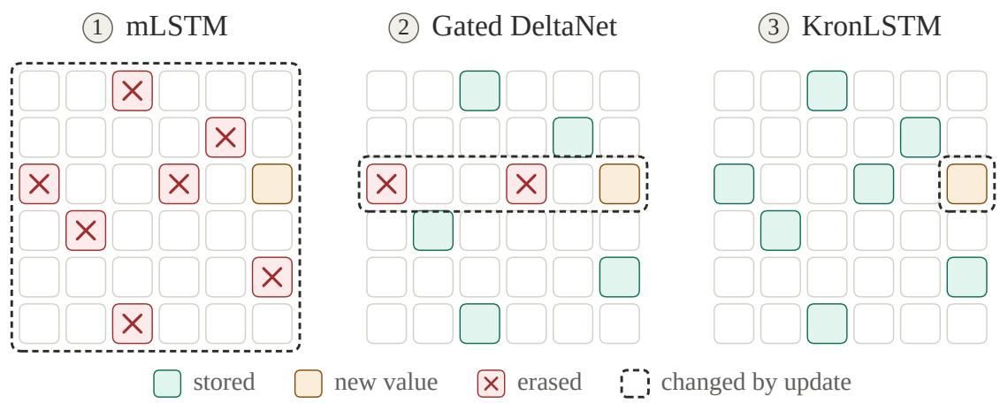
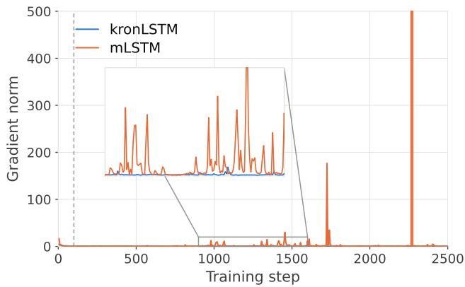
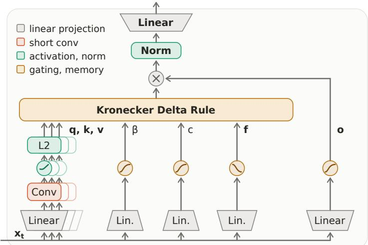
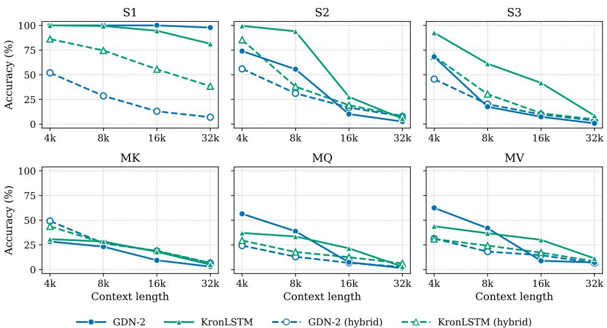
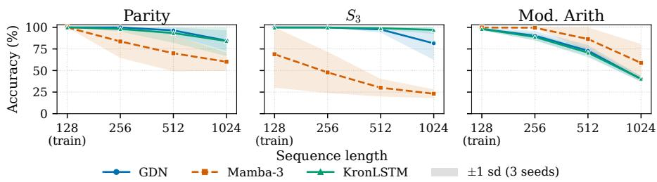
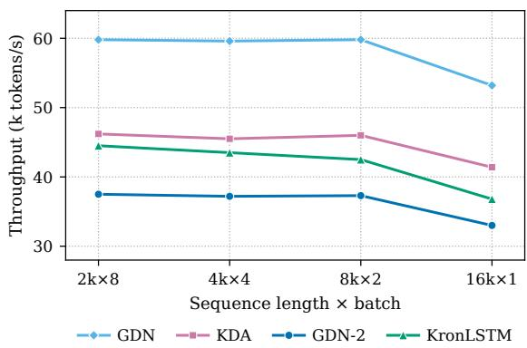

# Kronecker Delta Rule for Long Context Linear Attention

Anamaria-Roberta Hartl\*1, Levente Zólyomi\*1,2, Michael List1, Günter Klambauer1,2, Sebastian Böck2, Sepp Hochreiter1,2

1 Institute for Machine Learning, Johannes Kepler University, Linz 2 NXAI GmbH, Linz \* Equal contribution.

Corresponding authors: Anamaria-Roberta Hartl, hartl@ml.jku.at, Levente Zólyomi, levente.zolyomi@nx-ai.com

## Abstract

We propose KronLSTM, a linear attention architecture based on the Kronecker Delta Rule, a novel update rule for associative matrix memories. KronLSTM extends the xLSTM family with a memory-revision mechanism that corrects targeted associations while modifying the memory only along a single direction in matrix space. This minimally invasive memory revision reduces interference with previously stored information compared with delta-rule updates, making it particularly well suited for long-context language modeling. The resulting memory dynamics can be mathematically described as a Markov chain that converges to a steady-state distribution, while the expected norm of the memory matrix remains uniformly bounded throughout the entire input sequence. Hence, KronLSTM ensures stable memory dynamics without requiring additional normalization and stabilization mechanisms for the memory state. Experiments show that KronLSTM is competitive with, and often outperforms, existing linear attention architectures, including models of the (Gated) DeltaNet family, with particularly strong performance on long context benchmarks. These results establish the Kronecker Delta Rule as an effective and analytically tractable foundation for stable associative memory in recurrent linear attention architectures. Our code and models are open-source.

  
Figure 1: Representation of the memory matrix state revision for mLSTM, Gated DeltaNet, and KronLSTM. Interference with stored values: mLSTM affects all values, Gated DeltaNet affects those with overlapping keys, and KronLSTM affects only those with overlapping key and value pairs.

## 1 Introduction

Large language models (LLMs) predominantly use the Transformer architecture ( Qwen Team, 2023; OpenAI, 2025; Touvron et al., 2023a; Vaswani et al., 2017), whose softmax attention mechanism has computational costs that grow quadratically with context length, while its key–value cache grows linearly. Consequently, inference becomes increasingly costly as contexts grow. To reduce these costs, recent work has explored replacing softmax attention with linear attention mechanisms (Katharopoulos et al., 2020; Schlag et al., 2021), which can be traced back to the idea of fast weight programmers (Schmidhuber, 1992). Linear attention compresses the context into a fixed-size memory matrix that is updated as new tokens arrive, yielding linear computational complexity and a constant memory footprint. Recently, recurrent architectures based on associative memories (Anderson, 1972; Kohonen, 1972), including xLSTM (Beck et al., 2024), as well as related state-space and memory-based approaches such as Mamba (Dao and Gu, 2024; Gu and Dao, 2024; Lahoti et al., 2026), DeltaNet (Hatamizadeh et al., 2026; Kimi Team et al., 2025; Yang et al., 2024, 2025), RWKV-5 and 6 (Peng et al., 2024), and other recent architectures (Behrouz et al., 2025; Liu et al., 2025; Sun et al., 2024), have emerged as competitive alternatives to Transformers.

A crucial challenge for linear attention is controlling memory growth. If the memory of recurrent architectures grows without being bounded, its readout can become arbitrarily large, leading to numerical instabilities, particularly during learning. The original LSTM (Hochreiter, 1991; Hochreiter and Schmidhuber, 1997) uses a bounded squashing function to control the exposed cell state, while its forget gate regulates the accumulation of information in memory. RWKV-5 and RWKV-6 (Peng et al., 2024) similarly control memory growth through a forget gate. Mamba architectures (Dao and Gu, 2024; Gu and Dao, 2024; Lahoti et al., 2026) also restrain memory growth through a forget mechanism derived from a stable state-space ordinary differential equation. However, forget-based memory control becomes increasingly restrictive for long contexts. To retain information over long time spans, forget gates must remain close

  
Figure 2: Stress test with high learning rates for the same mLSTM and KronLSTM architectures on language modeling. Learning becomes unstable for mLSTM as the gradient norm spikes show, while KronLSTM yields stable learning.

to one; otherwise, information from the beginning of the context is progressively attenuated. xLSTM (Beck et al., 2024) addresses this limitation by allowing forget gates close to one and introducing normalizer and stabilizer states to control the scale of its matrix memory and readout. However, normalization based on ratios of potentially large quantities can itself lead to numerical difficulties and learning instabilities, particularly in larger xLSTM networks (Beck et al., 2025b). mLSTM’s numerical instabilities are illustrated by the stress test in Figure 2.

The DeltaNet family (Hatamizadeh et al., 2026; Kimi Team et al., 2025; Yang et al., 2024, 2025) controls memory growth through Delta Rule updates, whose dynamics converge to a steady-state distribution with bounded memory ensuring stable learning dynamics. However, revising a stored value can perturb previously stored values, leading to unwanted memory interference for long sequences. We introduce KronLSTM, which, like (Gated) DeltaNet, provides bounded memory through a delta-style update, but uses the Kronecker Delta Rule. The Kronecker Delta Rule is less invasive: it modifies the memory only along a single direction in matrix space, reducing interference with previously stored associations. This targeted memory revision results in a less noisy gradient flow over time.

Our contributions are:

• (i) Kronecker Delta Rule is introduced as a new update rule for associative matrix memories, which corrects the scalar associations while having minimal interference with previously stored values.

• (ii) KronLSTM is introduced as a novel linear attention architecture based on the Kronecker Delta Rule equipped with a vector forget gate, a β gate, and a target gate.

• (iii) Stability properties for the Kronecker Delta Rule are mathematically proved via bounds on the expected memory norm. These bounds ensure stable learning and proper gradient flow.

• (iv) Experiments empirically validate the strong performance of KronLSTM at long-context language modeling and retrieval tasks. KronLSTM performs strongly across language modeling, recall, and state tracking benchmarks.

## 2 KronLSTM

In Subsection 2.1, we introduce the Kronecker Delta Rule and analyze its memory dynamics, and in Subsection 2.2, the Kronecker Delta Rule is embedded in the KronLSTM sequence-mixer block.

## 2.1 Kronecker Delta Rule

Linear attention update rules for matrix memory. Linear attention (Katharopoulos et al., 2020) compresses the context into a matrix memory S that is updated per token and read out per query,

$$
{ \pmb S } _ { t + 1 } = { \pmb S } _ { t } + { \pmb v } _ { t } { \pmb k } _ { t } ^ { \top } , \qquad { \pmb h } _ { t } = { \pmb S } _ { t } { \pmb q } _ { t } = \sum _ { i < t } { \pmb v } _ { i } \left( { \pmb k } _ { i } ^ { \top } { \pmb q } _ { t } \right) ,\tag{1}
$$

with $S _ { t } \in \mathbb { R } ^ { d _ { v } \times d _ { k } }$ , keys $k _ { t }$ and queries $\pmb q _ { t }$ in $\mathbb { R } ^ { d _ { k } }$ , and values ${ \mathbf { } } v _ { t }$ in $\mathbb { R } ^ { d _ { v } }$ . Therefore, $\pmb { S }$ is an associative memory (Anderson, 1972; Kohonen, 1972) with a Hebbian rule, i.e., an outer product update rule. Modern linear attention architectures like xLSTM (Beck et al., 2024), Mamba (Dao and Gu, 2024; Gu and Dao, 2024; Lahot et al., 2026), RWKV-5 and 6 (Peng et al., 2024) rely on these associative memories equipped with gates and transformations. The memory growth is controlled by a forget gate, which stabilizes the memory dynamics.

In contrast, the Delta Rule (Schlag et al., 2021; Widrow and Hoff, 1960) corrects the memory with the difference of the retrieval to the current value when writing into the memory

$$
\begin{array} { r } { { \boldsymbol { S } } _ { t + 1 } ~ = ~ { \boldsymbol { S } } _ { t } ~ - ~ \beta _ { t } \left( { \boldsymbol { S } } _ { t } { \boldsymbol { k } } _ { t } - { \boldsymbol { v } } _ { t } \right) { \boldsymbol { k } } _ { t } ^ { \top } ~ = ~ { \boldsymbol { S } } _ { t } \left( { \boldsymbol { I } } - \beta _ { t } { \boldsymbol { k } } _ { t } { \boldsymbol { k } } _ { t } ^ { \top } \right) ~ + ~ \beta _ { t } { \boldsymbol { v } } _ { t } { \boldsymbol { k } } _ { t } ^ { \top } , } \end{array}\tag{2}
$$

with step size $\beta _ { t }$ . Each step is gradient descent on $\begin{array} { r } { \frac { 1 } { 2 } \| S _ { t } \pmb { k } _ { t } - \pmb { v } _ { t } \| ^ { 2 } } \end{array}$ , and the transition $\pmb { I } - \beta _ { t } \pmb { k } _ { t } \pmb { k } _ { t } ^ { \top }$ is a generalized Householder matrix, which admits chunkwise-parallel training (Yang et al., 2024).

The two rules differ in how an association, once stored, is changed. The Hebbian write of (1) is additive, so the memory grows with the sequence and an earlier value can be buried by later writes but never revised. The delta rule (2) revises: it removes the value currently stored at $k _ { t }$ before writing ${ \mathbf { } } v _ { t }$ . The correction, however, proceeds along $( S _ { t } \pmb { k } _ { t } - \pmb { v } _ { t } ) \pmb { k } _ { t } ^ { \top }$ , a direction determined by the current memory content, so values stored at keys that overlap with $k _ { t }$ are affected as well. We aim at an error-correcting write that acts solely on the pair $( k _ { t } , v _ { t } )$

Kronecker Delta Rule. Let $S _ { t } \in \mathbb { R } ^ { d _ { v } \times d _ { k } }$ be the memory matrix, $\pmb { k } _ { t } \in \mathbb { R } ^ { d _ { k } }$ and $\boldsymbol { v } _ { t } \in \mathbb { R } ^ { d _ { v } }$ the key and value at step $t , c _ { t } \in \mathbb { R }$ a target and $\beta _ { t }$ a step size. The scalar ${ \pmb v } _ { t } ^ { \top } { \pmb S } _ { t } { \pmb k } _ { t }$ measures how strongly the memory associates $k _ { t }$ with ${ \mathbf { } } v _ { t }$ . The Kronecker Delta Rule corrects this scalar towards the target along the outer product of the pair as follows

$$
\begin{array} { r } { S _ { t + 1 } = S _ { t } - \beta _ { t } \big ( v _ { t } ^ { \top } S _ { t } k _ { t } - c _ { t } \big ) v _ { t } k _ { t } ^ { \top } = S _ { t } - \underbrace { \beta _ { t } \big ( v _ { t } ^ { \top } S _ { t } k _ { t } \big ) v _ { t } k _ { t } ^ { \top } } _ { \mathrm { c r a s c } } + \underbrace { \beta _ { t } c _ { t } v _ { t } k _ { t } ^ { \top } } _ { \mathrm { w r i t e } } . } \end{array}\tag{3}
$$

In place of the d -dimensional residua $S _ { t } k _ { t } - v _ { t }$ of the delta rule, a scalar is corrected, and the direction ${ \boldsymbol { v } } _ { t } { \boldsymbol { k } } _ { t } ^ { \top }$ of the correction is determined by the input pair alone without utilizing the memory content. A target $c _ { t } \equiv 1$ stores each association with unit strength, while $c _ { t } = 0$ erases it. The target $c _ { t }$ may depend on the input, i.e., serves as a gate, so that what is written becomes input-dependent. The right-hand side of (3) separates the update into an erase and a write term, both scaled by $\beta _ { t }$ . Choosing the target $\tilde { c } _ { t } = c _ { t } / \beta _ { t }$ removes the step size from the write, so that $\beta _ { t }$ alone determines how much of the stored association is erased and $c _ { t }$ alone how much is written. KronLSTM uses this form, with both quantities computed from the input as gates (Section 2.2).

Properties of the Kronecker Delta Rule. (i) Error correction (see Appendix Property A2 and Property A6). An update is a step of gradient descent with step size $\beta _ { t }$ on $\begin{array} { r } { \frac { 1 } { 2 } \left( \pmb { v } _ { t } ^ { \top } \pmb { S } \pmb { k } _ { t } - c _ { t } \right) ^ { 2 } } \end{array}$ . Re-presenting the same pair gives $\begin{array} { r } { \boldsymbol { v } _ { t } ^ { \top } \boldsymbol { S } _ { t + 1 } \boldsymbol { k } _ { t } - \boldsymbol { c } _ { t } = \left( \boldsymbol { v } _ { t } ^ { \top } \boldsymbol { S } _ { t } \boldsymbol { k } _ { t } - \boldsymbol { c } _ { t } \right) \left( 1 - \beta _ { t } \left. \boldsymbol { a } _ { t } \right. ^ { 2 } \right) } \end{array}$ , so it contracts the error iff $0 < \beta _ { t } < 2 / \left. \pmb { a } _ { t } \right. ^ { 2 }$ , and the Newton step $\beta _ { t } = 1 / \left. \pmb { a } _ { t } \right. ^ { 2 }$ meets the target in a single update; for $c _ { t } = 0$ this deletes the association. (ii) Delta

Rule in vectorized form (see Appendix Property $\mathrm { A } 7 )$ . With the Kronecker product $\mathbf { { \em a } } _ { t } = \mathbf { { \em k } } _ { t } \otimes \mathbf { { \vec { v } } } _ { t } = \mathrm { v e c } ( \mathbf { { \vec { v } } } _ { t } \mathbf { { \vec { k } } } _ { t } ^ { \top } )$ and the vectorized memory $\pmb { s } = \mathrm { v e c } ( \pmb { S } )$ , we have ${ \pmb v } _ { t } ^ { \top } S k _ { t } = { \pmb a } _ { t } ^ { \top }$ s and ${ \| \pmb { a } _ { t } \| } ^ { 2 } = { \| \pmb { k } _ { t } \| } ^ { 2 } \| \pmb { v } _ { t } \| ^ { 2 }$ , and (3) becomes

$$
\pmb { s } _ { t + 1 } = \left( \pmb { I } - \beta _ { t } \pmb { a } _ { t } \pmb { a } _ { t } ^ { \top } \right) \pmb { s } _ { t } + \beta _ { t } \pmb { c } _ { t } \pmb { a } _ { t } ,\tag{4}
$$

the Widrow–Hoff Delta Rule (Widrow and Hoff, 1960) with input $\mathbf { } \mathbf { a } _ { t }$ and target $c _ { t } .$ , which gives the rule its name. The transition factor is a generalized Householder matrix that does not depend on $c _ { t } .$ , so the chunkwise-parallel formulation of DeltaNet (Yang et al., 2024) applies with $\mathbf { } \mathbf { a } _ { t }$ in place of $k _ { t }$ , the target entering only the driving term. For $\beta _ { t } \left\| \pmb { a } _ { t } \right\| ^ { 2 } \in \left( 1 , 2 \right)$ the transition factor has a negative eigenvalue, the idea behind the state-tracking capabilities of Delta Rule models (Grazzi et al., 2025).

(iii) Interference (see Appendix Property A9). For any other stored pair $( k _ { i } , v _ { i } )$ , the update changes the association by

$$
\Delta \left( \boldsymbol { v } _ { i } ^ { \top } \boldsymbol { S } \boldsymbol { k } _ { i } \right) ~ = ~ - \beta _ { t } \left( \boldsymbol { v } _ { t } ^ { \top } \boldsymbol { S } _ { t } \boldsymbol { k } _ { t } - c _ { t } \right) \left( \boldsymbol { v } _ { i } ^ { \top } \boldsymbol { v } _ { t } \right) \left( \boldsymbol { k } _ { t } ^ { \top } \boldsymbol { k } _ { i } \right) ,\tag{5}
$$

the product of value overlap and key overlap. Orthogonality in either factor protects a stored association, whereas the Hebbian and the Delta rule interference is controlled by key overlap alone.

(iv) Capacity (see Appendix Property A11). Each triple $( k _ { t } , v _ { t } , c _ { t } )$ imposes one linear constraint ${ \pmb a } _ { t } ^ { \top } { \pmb s } = c _ { t }$ on the $d _ { k } d _ { \tau }$ entries of $S _ { \ast }$ , so up to $d _ { k } d _ { v }$ scalar associations can be stored exactly when the features $\left\{ \pmb { a } _ { i } \right\}$ are linearly independent, against $d _ { k }$ value vectors for $S k _ { i } = v _ { i }$ . In particular, a single key can hold several mutually orthogonal values, which the read-out Sk returns as their sum. See Appendix A3 for more properties and more details on the above properties.

Convergence, steady state, and memory norm bounds. We will present expected bounds on the memory norm, which in turn imply stable memory dynamics that obviate numerical instabilities. Memories grow with the length of the context and the number of vectors or associations to store; therefore long contexts are most relevant when analyzing memory stability. We model a long context as a stream of i.i.d. triples $( k _ { t } , v _ { t } , c _ { t } ) \sim p$ with fixed step size $\beta$ and set

$$
\bar { A } : = \mathrm { E } [ \pmb { a } \pmb { a } ^ { \top } ] \succ \mathbf { 0 } , \quad \bar { b } : = \mathrm { E } [ c \pmb { a } ] , \quad \mathbf { s } ^ { \mathrm { L S } } : = \bar { A } ^ { - 1 } \bar { b } , \quad \rho : = c - \ b { a } ^ { \top } \mathbf { s } ^ { \mathrm { L S } } , \quad \kappa : = \beta \operatorname* { m a x } _ { i } \left\| \pmb { a } _ { i } \right\| ^ { 2 } ,\tag{6}
$$

so $S ^ { \mathrm { L S } } =$ argmin $s \operatorname { E } [ ( \pmb { v } ^ { \top } S k - c ) ^ { 2 } ]$ is the least-squares memory and $\rho$ the irreducible residual, with $\operatorname { E } [ \rho \mathbf { \pmb { a } } ] = \mathbf { 0 }$ Throughout, $0 < \beta \left\| \mathbf { a } _ { i } \right\| ^ { 2 } < 2 .$ , and $q _ { \beta } : = 1 - \beta ( 2 - \kappa ) \lambda _ { \operatorname* { m i n } } ( \bar { A } )$

Theorem 1 (Unbiased mean and steady state). The expected iterate obeys the exact recursion $\mathrm { E } [ s _ { t + 1 } ] =$ $( I - \beta { \bar { \cal A } } ) \mathrm { E } [ s _ { t } ] + \beta { \bar { \cal b } } ,$ whose unique fixed point is $\begin{array} { r } { s ^ { \mathrm { L S , } } \ s o \ \left\| \mathrm { E } [ S _ { t } ] - S ^ { \mathrm { L S } } \right\| _ { \mathrm { F } } \ \leq \ r ^ { t } \left\| S _ { 0 } - S ^ { \mathrm { L S } } \right\| _ { \mathrm { F } } } \end{array}$ with $r =$ $\mathrm { m a x } _ { k } \left| 1 - \beta \lambda _ { k } ( \bar { A } ) \right| < 1$ . Moreover the iterates form a time-homogeneous Markov chain on $\bar { \mathbb R ^ { d _ { k } d _ { v } } }$ whose kernel contracts on laws with finite second moment; by the standard theory of Markov chains on general state spaces (Meyn and Tweedie, 1993) it has a unique stationary distribution $\pi _ { \beta } ,$ , the law of $S _ { t }$ converges to it geometricallyfrom any initialization, and the stationary mean is exactly $\operatorname { E } _ { \pi _ { \beta } } [ \pmb { S } ] = \pmb { S } ^ { \mathrm { L S } }$

Theorem 1 combines Appendix Theorem A6 and Appendix Theorem $_ { \textrm { A 7 } }$ which have been proven in $\mathsf { A p - }$ pendix A3.

Theorem 2 (Memory norm bounds). With $\lambda _ { \operatorname* { m i n } } , \lambda _ { \operatorname* { m a x } }$ the extreme eigenvalues of A¯, the least-squares memory is sandwiched by the explained target energy,

$$
\frac { \mathrm { E } [ c ^ { 2 } ] - \mathrm { E } [ \rho ^ { 2 } ] } { \lambda _ { \operatorname* { m a x } } ( \bar { A } ) } \ \leq \ \left\| S ^ { \mathrm { L S } } \right\| _ { \mathrm { F } } ^ { 2 } \ \leq \ \frac { \mathrm { E } [ c ^ { 2 } ] - \mathrm { E } [ \rho ^ { 2 } ] } { \lambda _ { \operatorname* { m i n } } ( \bar { A } ) } ,\tag{7}
$$

and all its singular values obey the same upper bound; residual energy can only shrink it. In the non-expansive regime $\kappa \leq 1$ , the steady state and — started at ${ \cal S } _ { 0 } = { \bf 0 } -$ every iterate satisfies

$$
\mathrm { E } _ { \pi _ { \beta } } \big [ \| \boldsymbol { S } \| _ { \mathrm { F } } ^ { 2 } \big ] \ \le \ \frac { \mathrm { E } [ c ^ { 2 } ] } { \lambda _ { \operatorname* { m i n } } ( \bar { A } ) } , \qquad \mathrm { E } \big [ \| \boldsymbol { S } _ { t } \| _ { \mathrm { F } } ^ { 2 } \big ] \ \le \ \Big ( 1 + q _ { \beta } ^ { t / 2 } \Big ) ^ { 2 } \frac { \mathrm { E } [ c ^ { 2 } ] } { \lambda _ { \operatorname* { m i n } } ( \bar { A } ) } \ \le \ \frac { 4 \mathrm { E } [ c ^ { 2 } ] } { \lambda _ { \operatorname* { m i n } } ( \bar { A } ) } ,\tag{8}
$$

the transientfactor decays geometricallyfrom 4 to 1.

Theorem 2 combines Appendix Theorem A8, Appendix Theorem A9, and Appendix Theorem A10 which are proven in Appendix A3. From the first step onward, the expected memory of the rule is bounded by a constant determined by the data distribution alone. More details and theoretical results are given in Appendix A3.

## 2.2 The KronLSTM architecture

In modern deep learning architectures for sequence modeling, the matrix update rules are stabilized and enhanced with gating mechanisms. The mLSTM (Beck et al., 2024) places the Hebbian write (1) under a sigmoid forget gate and an exponential input gate, and Gated DeltaNet (Yang et al., 2025) decays the memory of (2) by a scalar before the correction,

$$
{ \cal S } _ { t + 1 } = \mathrm { f } _ { t } { \cal S } _ { t } + \mathrm { i } _ { t } v _ { t } k _ { t } ^ { \top } , \qquad { \cal S } _ { t + 1 } = \mathrm { f } _ { t } { \cal S } _ { t } \left( I - \beta _ { t } k _ { t } k _ { t } ^ { \top } \right) + \beta _ { t } v _ { t } k _ { t } ^ { \top } .\tag{9}
$$

Kimi Delta Attention (Kimi Team et al., 2025) makes the decay (key) channel-wise, and Gated DeltaNet-2 (Hatamizadeh et al., 2026) replaces the single $\beta _ { t }$ by separate channel-wise erase and write gates. KronLSTM proceeds in the same way: the step size $\beta _ { t }$ and the target $c _ { t }$ of (3) become gates computed from the input; a forget gate decays the memory, and the rule is embedded in the projections, short convolutions, normalizations, and output gate of a standard sequence-mixer layer. All quantities below are per head, with key and value dimensions $d _ { k }$ and $d _ { v } ;$ we suppress the head index and write $\pmb { x } _ { t } \in \mathbb { R } ^ { d }$ for the layer input at step t.

KronLSTM update. The forget gate is a diagonal matrix ${ \bf \nabla } _ { { \bf { F } } _ { t } }$ with diagonal entries in (0, 1). It acts on the key dimension and hence decays the memory from the right, ${ \mathbf { } } S _ { t } { \mathbf { } } F _ { t }$ , retaining each key direction separately. We use target $\tilde { c } _ { t } = c _ { t } / \beta _ { t }$ to decouple erase and write. The erase term of (3) is evaluated on the decayed memory ${ \mathbf { } } S _ { t } { \mathbf { } } F _ { t }$ We obtain

$$
\begin{array} { r } { S _ { t + 1 } = \underbrace { S _ { t } F _ { t } } _ { \mathrm { f o r g e t } } - \underbrace { \beta _ { t } \bigl ( v _ { t } ^ { \top } S _ { t } F _ { t } k _ { t } \bigr ) v _ { t } k _ { t } ^ { \top } } _ { \mathrm { e r a s e } } + \underbrace { c _ { t } v _ { t } k _ { t } ^ { \top } } _ { \mathrm { w r i t e } } , } \end{array}\tag{10}
$$

so that forgetting, erasing, and writing are controlled by three separate gates, $\mathbf { } F _ { t } , \beta _ { t }$ and $c _ { t }$ . The standard coupled and the unit-target variant $c _ { t } \equiv 1$ are compared in Appendix A6, Table A3.

Gates. The erase gate $\beta _ { t }$ and the write gate $c _ { t }$ are per-head scalars obtained from linear projections of the input followed by a sigmoid,

$$
\begin{array} { r } { \beta _ { t } = \sigma \big ( \boldsymbol { w } _ { \beta } ^ { \top } \boldsymbol { x } _ { t } + b _ { \beta } \big ) \in ( 0 , 1 ) , \qquad c _ { t } = \sigma \big ( \boldsymbol { w } _ { \mathrm { c } } ^ { \top } \boldsymbol { x } _ { t } + b _ { \mathrm { c } } \big ) \in ( 0 , 1 ) , } \end{array}\tag{11}
$$

both bounded by construction. The diagonal vector $\mathbf { f } _ { t }$ of the forget gate $\mathbf { \nabla } F _ { t } = \mathrm { d i a g } ( \mathbf { f } _ { t } )$ is obtained by raising a sigmoid gate to a learned positive per-head power, following the parameterization of Mamba (Gu and Dao, 2024) and Gated DeltaNet-2 (Hatamizadeh et al., 2026)

$$
\mathbf { f } _ { t } = \sigma ( - ( s _ { \mathrm { f } } ) _ { t } ) ^ { a } = \big ( 1 - \sigma ( ( s _ { \mathrm { f } } ) _ { t } ) \big ) ^ { a } , ( s _ { \mathrm { f } } ) _ { t } = W _ { \mathrm { f } } x _ { t } + b _ { \mathrm { f } } \in \mathbb { R } ^ { d _ { k } } , \alpha = \exp ( a _ { \mathrm { l o g } } ) \in \mathbb { R } _ { > 0 } ,\tag{12}
$$

where $a _ { \mathrm { l o g } }$ is a single learned scalar per head, broadcast over the $d _ { k }$ key dimensions, and the exponent is taken component-wise. The sigmoid sets retention separately for each key direction as a function of the input. At the same time, the exponent rescales the head’s retention horizon by $1 / a$ , so that heads can operate at widely different timescales without high pre-activations. Since $a _ { \mathrm { l o g } }$ is learned in log space, the baseline retention timescale spans orders of magnitude across heads, while within a head the per-direction variation comes entirely from the input. The read-out is gated by a sigmoid output gate $\mathbf { o } _ { t } = \pmb { \sigma } ( W _ { \mathrm { o } } \pmb { x } _ { t } + b _ { \mathrm { o } } ) \in ( 0 , 1 ) ^ { d _ { v } }$

KronLSTM block. Queries, keys, and values are linear projections of ${ \mathbf { } } x _ { t } ,$ each followed by a short causal depthwise convolution and a SiLU activation, and are then $\ell _ { 2 }$ -normalized with $\boldsymbol { q } _ { t } , \boldsymbol { k } _ { t } \in \mathbb { R } ^ { d _ { k } }$ and $\pmb { v } _ { t } \in \mathbb { R } ^ { d _ { v } }$ The memory $S _ { t } \in \mathbb { R } ^ { d _ { v } \times d _ { k } }$ is updated by (10) and read with the query, $\pmb { \tilde { h } } _ { t } = \pmb { S } _ { t } \pmb { q } _ { t } \in \mathbb { R } ^ { d _ { v } }$ . The read-out passes through the sigmoid output gate and a per-head RMSNorm, and the concatenated heads are mixed by the output projection,

$$
h _ { t } \ = \ W _ { \mathrm { o u t } } \mathrm { R M S N o r m } \big ( \mathbf { o } _ { t } \odot \tilde { h } _ { t } \big ) .
$$

  
Figure 3: Architecture of the KronLSTM block.

With $\ell _ { 2 } \cdot$ -normalized keys and values and a sigmoid $\beta _ { t } .$ , we have $\beta _ { t } \left\| \pmb { k } _ { t } \right\| ^ { 2 } \left\| \pmb { v } _ { t } \right\| ^ { 2 } = \beta _ { t } < 1$ , so every update is non-expansive and the memory operates in the regime of Theorem $2 ;$ the forget gate, with entries below one, only contracts it further. The architecture of the KronLSTM block is shown in Figure 3. It carries no state besides the memories $S _ { t }$ of its heads: there is no normalizer state and no stabilizer state as in the mLSTM. KronLSTM can serve as a drop-in replacement for the attention layer in a Transformer block, analogous to mLSTM and sLSTM in the xLSTM architecture.

## 3 Experimental Validation

We experimentally validate the KronLSTM architecture on different benchmarks with a focus on language modeling tasks. We compare KronLSTM with the following recurrent linear attention architectures: Gated DeltaNet (GDN) (Yang et al., 2025), Kimi Delta Attention (KDA) (Kimi Team et al., 2025), Mamba-3 (Lahoti et al., 2026), and Gated DeltaNet-2 (GDN-2) (Hatamizadeh et al., 2026). Recent deployments of linear attention in frontier models follow two hybrid-setting paradigms: either interleave the linear layers with a small number of softmax attention layers (Kimi Team et al., 2025; Merrill et al., 2026; NVIDIA, 2025) or use sliding-window attention (SWA) instead (Cabannes et al., 2026; Hatamizadeh et al., 2026). The advantage of the latter is keeping the memory footprint constant with respect to the context length. Therefore, we evaluate every architecture in two settings: as a pure linear attention model, and as a hybrid with SWA layers. For the hybrid setting, we employ a window size of 2048 at a 5:1 ratio of linear attention to SWA layers. All models are pretrained on the FineWeb-Edu dataset using the Llama2 tokenizer (Touvron et al., 2023b).

We train at a context of 8k, motivated by previous works (Beck et al., 2025a, 2026; Guo et al., 2026), where the throughput advantage of linear attention compared to the softmax attention emerges from 8k context onward. We evaluate the models within and extrapolating outside their context length (Section 3.2). The experiments in the following sections show 1.5B parameter models trained on 100B tokens. In Appendix A6, we provide a set of experiments at 400M model size.

## 3.1 Language Modeling

We assess the performance of KronLSTM compared to leading linear attention variants on standard language modeling benchmarks, concretely on five commonsense reasoning tasks (HellaSwag (Zellers et al., 2019), PIQA (Bisk et al., 2020), ARC-easy and ARC-challenge (Clark et al., 2018), WinoGrande (Sakaguchi et al., 2021)) and on LAMBADA (Paperno et al., 2016), reporting accuracy on all six tasks, their average (Avg-6), and LAMBADA perplexity. Table 1 shows the results of both linear and hybrid models. Among all competitors, KronLSTM has the highest average accuracy over the six tasks and the lowest perplexity on LAMBADA. As a linear model,

KronLSTM performs best on five out of six tasks and improves on average on the strongest competitor, KDA, by 1.6 accuracy points. The hybrid setting confirms KronLSTM’s performance advantage, leading on four of six tasks and achieving the lowest perplexity on LAMBADA. Hybrid models with sliding-window attention change the averages by at most about one accuracy point. While mLSTM, Mamba-3 and GDN-2 benefit most from adding SWA, GDN and KDA change only minimally; KronLSTM remains robust, leading among all configurations.

Table 1: Downstream performance of 1.5B/100B models. Avg-6 is the mean accuracy over the five commonsense reasoning tasks and LAMBADA. Best per column in bold, second best underlined, separately for linear and hybrid models.
<table><tr><td>Model</td><td>Hella</td><td>PIQA</td><td>ARC-e</td><td>ARC-c</td><td>Wino</td><td>LMB acc</td><td>Avg-6 ↑</td><td>LMB ppl ↓</td></tr><tr><td colspan="9">Linear models</td></tr><tr><td>GDN</td><td>57.00</td><td>73.61</td><td>70.54</td><td>41.04</td><td>57.22</td><td>46.94</td><td>57.73</td><td>12.58</td></tr><tr><td>Mamba-3</td><td>57.30</td><td>73.01</td><td>70.29</td><td>40.19</td><td>57.46</td><td>45.64</td><td>57.31</td><td>12.95</td></tr><tr><td>KDA</td><td>57.48</td><td>73.39</td><td>71.84</td><td>41.55</td><td>57.14</td><td>47.35</td><td>58.12</td><td>12.67</td></tr><tr><td>GDN-2</td><td>57.45</td><td>72.96</td><td>71.13</td><td>41.89</td><td>57.30</td><td>46.92</td><td>57.94</td><td>12.54</td></tr><tr><td>mLSTM</td><td>56.05</td><td>73.07</td><td>71.30</td><td>41.30</td><td>56.99</td><td>44.38</td><td>57.18</td><td>13.87</td></tr><tr><td>KronLSTM</td><td>59.19</td><td>73.45</td><td>74.03</td><td>43.60</td><td>60.06</td><td>47.97</td><td>59.72</td><td>11.72</td></tr><tr><td colspan="9">Hybrid models</td></tr><tr><td>GDN</td><td>58.46</td><td>72.74</td><td>70.54</td><td>42.58</td><td>56.99</td><td>46.63</td><td>57.99</td><td>12.95</td></tr><tr><td>Mamba-3</td><td>58.14</td><td>74.10</td><td>72.22</td><td>43.09</td><td>57.30</td><td>46.38</td><td>58.54</td><td>13.01</td></tr><tr><td>KDA</td><td>57.93</td><td>72.74</td><td>71.04</td><td>41.21</td><td>56.99</td><td>47.22</td><td>57.85</td><td>12.60</td></tr><tr><td>GDN-2</td><td>58.35</td><td>72.91</td><td>72.64</td><td>42.75</td><td>58.88</td><td>47.18</td><td>58.79</td><td>11.85</td></tr><tr><td>mLSTM</td><td>56.63</td><td>72.80</td><td>69.74</td><td>42.58</td><td>57.06</td><td>45.29</td><td>57.35</td><td>14.38</td></tr><tr><td>KronLSTM</td><td>59.80</td><td>73.78</td><td>71.93</td><td>44.11</td><td>58.96</td><td>48.77</td><td>59.56</td><td>11.18</td></tr></table>

## 3.2 Retrieval Capabilities

On long-context tasks, the Kronecker Delta Rule should improve the most over previous update rules, as interference grows with context length. We assess the performance of KronLSTM on two benchmarks with different context lengths.

The first benchmark is the real-world recall suite of Arora et al. (2024) (SWDE, SQuAD, FDA, TriviaQA, NQ, DROP) for 2k context. Results are given in Table 2. KronLSTM has the best average accuracy, and it is the best method in three out of six tasks in both pure linear attention models and hybrid models. In general, hybrid models using SWA gain five to nine accuracy points.

The second benchmark is the RULER needle-in-a-haystack (NIAH) tasks (Hsieh et al., 2024) where models are evaluated at 4k, 8k and 16k context length, with 16k assessing the extrapolation capabilities of the models. Results are presented in Table 3. Among all linear attention models, KronLSTM is the best or second-best method across all sequence lengths, except for task S1. KronLSTM has the highest accuracy on S3 and MQ tasks across all sequence lengths. Among all hybrid models, KronLSTM achieves the highest accuracy (averaged over all lengths) on all tasks and has the highest accuracy at 16k on each task, confirming its strong long context capabilities. The improvement of KronLSTM over competitors like Gated DeltaNet is consistent with the interference analysis of Property A9. On S2 and S3, whose needles are unique sentences embedded in natural language text, KronLSTM outperforms GDN except for S2 at 16k. For hybrid models, KronLSTM outranks GDN-2 and Mamba-3 by 15.2 accuracy points on S2 at 4k. KronLSTM’s margin increases on MQ and MV with sequence length. On MQ, KronLSTM’s lead distance grows from 2.4 to 4.1 accuracy points when increasing the context from 4k to 16k. On MV, KronLSTM is 3.5 accuracy points behind the best method, GDN, for 4k context, while KronLSTM is the leading method for 8k and 16k, with a 1.1 and 3.8 accuracy point lead, respectively.

Table 2: Results for 1.5B models on the real-world recall suite, given in accuracies for 2k context length. Best per column in bold, second best underlined.
<table><tr><td>Model</td><td>SWDE</td><td>SQD</td><td>FDA</td><td>TQA</td><td>NQ</td><td>DROP</td><td>Avg-6 ↑</td></tr><tr><td colspan="8">Linear models</td></tr><tr><td>GDN</td><td>28.62</td><td>37.33</td><td>14.79</td><td>60.49</td><td>16.47</td><td>21.18</td><td>29.81</td></tr><tr><td>Mamba-3</td><td>27.54</td><td>35.86</td><td>11.43</td><td>59.18</td><td>15.39</td><td>21.03</td><td>28.41</td></tr><tr><td>KDA</td><td>25.83</td><td>37.30</td><td>12.98</td><td>62.14</td><td>16.31</td><td>20.46</td><td>29.17</td></tr><tr><td>GDN-2</td><td>29.70</td><td>36.29</td><td>14.43</td><td>60.07</td><td>15.90</td><td>19.93</td><td>29.39</td></tr><tr><td>mLSTM</td><td>27.54</td><td>36.96</td><td>11.98</td><td>59.77</td><td>15.11</td><td>21.37</td><td>28.79</td></tr><tr><td>KronLSTM</td><td>30.87</td><td>39.28</td><td>15.34</td><td>61.61</td><td>15.46</td><td>19.31</td><td>30.31</td></tr><tr><td colspan="8">Hybrid models</td></tr><tr><td>GDN</td><td>43.20</td><td>40.58</td><td>23.59</td><td>61.91</td><td>17.90</td><td>24.44</td><td>35.27</td></tr><tr><td>Mamba-3</td><td>42.84</td><td>44.67</td><td>29.22</td><td>63.92</td><td>17.26</td><td>23.86</td><td>36.96</td></tr><tr><td>KDA</td><td>42.30</td><td>42.79</td><td>30.04</td><td>61.02</td><td>18.12</td><td>21.80</td><td>36.01</td></tr><tr><td>GDN-2</td><td>43.38</td><td>42.19</td><td>28.31</td><td>60.84</td><td>17.36</td><td>23.05</td><td>35.85</td></tr><tr><td>mLSTM</td><td>46.08</td><td>43.47</td><td>27.77</td><td>59.66</td><td>17.29</td><td>23.96</td><td>36.37</td></tr><tr><td>KronLSTM</td><td>46.89</td><td>43.57</td><td>27.86</td><td>64.51</td><td>18.82</td><td>22.76</td><td>37.40</td></tr></table>

For longer contexts, the memory updates of GDN more frequently interfere with already stored content and perturb it, resulting in more degraded performance at 16k. In contrast, the Kronecker Delta Rule is less invasive and performs better at longer contexts. The exception is S1, where KronLSTM underperforms. S1 is the most artificial task with frequently repeated noise sentences, which is unrealistic for real-world text. We attribute the performance drop of the KronLSTM in this task to the residual accumulation for recurring keys. Hybrid models with SWA have a considerably smaller S1 accuracy, except KronLSTM. The hybrid models containing the baseline linear attention layers reach at most 51.8, 26.6, and 12.6 accuracy for 4k, 8k, and 16k context length, respectively. These accuracies closely match the fraction of the context covered by the attention window, indicating that the needle is primarily retrieved when it lies within the window, with Mamba-3 and mLSTM dropping to zero at 16k. The results suggest limited reliance on the recurrent architecture’s memory. KronLSTM exceeds these accuracies on average across all context lengths and achieves the best performance across all six tasks at 16k. Section 3.3 examines how these methods perform after context extension.

## 3.3 Long Context Extension

In applications, language models do not extrapolate to longer context but are trained on them, typically by continued pretraining at increased context length (Fu et al., 2024; Gao et al., 2024). This stage unlocks retrieval far beyond the original pretraining length (Fu et al., 2024). Linear attention models have no positional encoding to adapt; rather, they must learn to keep more associations over longer time spans. We therefore branch the 1.5B linear KronLSTM and GDN-2 runs at 75B tokens and train them for the remaining 25B tokens at a sequence length of 32k on a long-document mixture derived from ProLong-64K (Gao et al., 2024), so that the context-length-extended models are token-matched to the 100B models of the previous sections. GDN-2 serves as a reference model in this experiment since it also decouples erase and write. Further details on training are described in Appendix A7.1. Table 4 shows the commonsense reasoning, LAMBADA, and recall results of the extended models. Both models benefit from length extension on the reasoning and recall tasks, and perplexity improves by about 4 perplexity points. KronLSTM keeps its lead: it has the higher average accuracy and the lower perplexity, and it is better on five of the six recall tasks.

Table 3: Results of 1.5B models on the NIAH tasks for 8k pretraining context and 4k, 8k, and 16k evaluation context. S1–S3: S-NIAH-1/2/3; MK: MK-NIAH-1; MQ: MQ-NIAH; MV: MV-NIAH. Best per task and length in bold, second best underlined, separately for linear and hybrid models.
<table><tr><td colspan="9">Linear models</td><td colspan="5">Hybrid models</td></tr><tr><td>Model</td><td>Len. S1</td><td></td><td>S2</td><td>S3</td><td>MK</td><td>MQ</td><td>MV</td><td>S1</td><td>S2</td><td>S3</td><td>MK</td><td>MQ</td><td>MV</td></tr><tr><td rowspan="3">GDN</td><td>4k</td><td>100.0</td><td>96.0</td><td>54.8</td><td>28.0</td><td>44.8</td><td>46.8</td><td>51.8</td><td>52.6</td><td>21.8</td><td>31.0</td><td>40.6</td><td>38.3</td></tr><tr><td>8k</td><td>100.0</td><td>45.6</td><td>13.0</td><td>24.0</td><td>21.2</td><td>23.5</td><td>26.6</td><td>31.2</td><td>22.2</td><td>24.6</td><td>17.8</td><td>18.8</td></tr><tr><td></td><td>16k 99.2</td><td>17.8</td><td>5.4</td><td>17.8</td><td>8.6</td><td>13.8</td><td>12.6</td><td>16.8</td><td>3.6</td><td>18.4</td><td>6.9</td><td>8.8</td></tr><tr><td rowspan="3">Mamba-3</td><td>4k</td><td>92.0</td><td>68.2</td><td>26.4</td><td>26.8</td><td>20.0</td><td>18.4</td><td>51.6</td><td>56.0</td><td>30.2</td><td>34.4</td><td>19.1</td><td>21.3</td></tr><tr><td>8k</td><td>59.0</td><td>27.0</td><td>5.4</td><td>20.6</td><td>4.2</td><td>3.6</td><td>26.6</td><td>31.2</td><td>15.0</td><td>24.2</td><td>10.7</td><td>22.4</td></tr><tr><td>16k 28.0</td><td></td><td>13.6</td><td>3.0</td><td>13.4</td><td>5.3</td><td>4.5</td><td>0.0</td><td>0.0</td><td>0.0</td><td>0.0</td><td>0.0</td><td>0.0</td></tr><tr><td rowspan="3">KDA</td><td>4k</td><td>99.8</td><td>89.4</td><td>12.0</td><td>20.8</td><td>18.4</td><td>19.1</td><td>51.8</td><td>55.8</td><td>31.4</td><td>44.8</td><td>33.0</td><td>42.5</td></tr><tr><td>8k</td><td>99.0</td><td>35.4</td><td>11.6</td><td>15.8</td><td>13.3</td><td>13.3</td><td>26.6</td><td>31.2</td><td>5.0</td><td>22.8</td><td>16.3</td><td>22.8</td></tr><tr><td>16k 93.6</td><td></td><td>14.2</td><td>1.6</td><td>11.8</td><td>3.1</td><td>5.7</td><td>12.6</td><td>16.8</td><td>4.4</td><td>17.2</td><td>3.1</td><td>11.7</td></tr><tr><td rowspan="3">GDN-2</td><td>4k</td><td>100.0</td><td>72.8</td><td>50.2</td><td>26.6</td><td>28.4</td><td>38.1</td><td>51.8</td><td>56.0</td><td>45.6</td><td>51.8</td><td>33.2</td><td>40.5</td></tr><tr><td>8k</td><td>99.8</td><td>44.6</td><td>15.4</td><td>17.6</td><td>13.4</td><td>21.4</td><td>26.6</td><td>31.2</td><td>18.8</td><td>25.4</td><td>23.2</td><td>22.7</td></tr><tr><td>16k 99.6</td><td></td><td>8.2</td><td>4.2</td><td>7.2</td><td>2.7</td><td>5.1</td><td>7.4</td><td>16.6</td><td>6.0</td><td>17.6</td><td>3.0</td><td>12.8</td></tr><tr><td rowspan="3">mLSTM</td><td>4k</td><td>92.4</td><td>89.2</td><td>1.4</td><td>27.0</td><td>22.5</td><td>19.7</td><td>51.8</td><td>56.0</td><td>30.6</td><td>49.0</td><td>21.9</td><td>38.0</td></tr><tr><td>8k</td><td>41.6</td><td>49.4</td><td>2.4</td><td>26.2</td><td>5.7</td><td>12.4</td><td>26.6</td><td>31.2</td><td>16.8</td><td>26.8</td><td>14.9</td><td>24.6</td></tr><tr><td>16k 17.8</td><td></td><td>22.6</td><td>2.0</td><td>15.4</td><td>5.0</td><td>6.9</td><td>12.6</td><td>0.6</td><td>0.0</td><td>0.0</td><td>0.4</td><td>0.8</td></tr><tr><td rowspan="3">KronLSTM</td><td>4k</td><td>66.2</td><td>98.2</td><td>73.4</td><td>28.2</td><td>47.2</td><td>43.3</td><td>64.8</td><td>71.2</td><td>51.2</td><td>51.0</td><td>38.8</td><td>44.5</td></tr><tr><td>8k</td><td>29.4</td><td>60.4</td><td>20.4</td><td>23.4</td><td>24.8</td><td>24.6</td><td>33.6</td><td>35.0</td><td>17.4</td><td>28.6</td><td>23.1</td><td>21.8</td></tr><tr><td></td><td>16k 11.6</td><td>16.0</td><td>11.8</td><td>16.0</td><td>12.7</td><td>17.6</td><td>16.2</td><td>17.4</td><td>7.0</td><td>21.0</td><td>12.2</td><td>13.2</td></tr></table>

Table 4: Long-context (32k) extension results for GDN-2 and KronLSTM models. Avg-6 is the mean accuracy of the five reasoning tasks plus LAMBADA acc; the remaining columns give accuracy on the real-world recall suite evaluated at 2048 tokens. The best per column is in bold.
<table><tr><td>Model</td><td>Avg-6↑</td><td>LMB ppl ↓</td><td>SWDE</td><td>SQD</td><td>FDA</td><td>TQA</td><td>NQ</td><td>DROP</td><td>Recall avg ↑</td></tr><tr><td colspan="10">Linear models</td></tr><tr><td>GDN-2</td><td>58.75</td><td>8.36</td><td>29.61</td><td>36.39</td><td>19.60</td><td>60.19</td><td>14.54</td><td>19.36</td><td>29.95</td></tr><tr><td>KronLSTM</td><td>60.19</td><td>7.66</td><td>31.68</td><td>39.88</td><td>18.15</td><td>60.37</td><td>15.36</td><td>21.03</td><td>31.08</td></tr><tr><td colspan="10">Hybrid models</td></tr><tr><td>GDN-2</td><td>59.32</td><td>8.27</td><td>40.41</td><td>40.95</td><td>30.40</td><td>62.50</td><td>15.24</td><td>21.75</td><td>35.21</td></tr><tr><td>KronLSTM</td><td>60.10</td><td>7.64</td><td>46.08</td><td>44.10</td><td>23.96</td><td>63.39</td><td>16.95</td><td>22.90</td><td>36.23</td></tr></table>

Results for context extension at the RULER tasks are given in Figure 4 and Table A4. As expected, KronLSTM shows its advantage by extending the training context length. While both architectures perform strongly on single-needle retrieval at shorter contexts, KronLSTM increasingly outperforms GDN-2 on the more challenging NIAH tasks, ranging from 8k to 32k. At 16k, this advantage is particularly pronounced on S-3 and MV, with KronLSTM leading on most tasks except S1, where GDN-2 remains stronger. At 32k, KronLSTM maintains its lead across all five tasks, although both architectures experience a substantial drop in retrieval accuracy compared to 16k. The gap between the two models widens with haystack size, as predicted by the interference analysis in Section 2.1: longer contexts accumulate more interference, and KronLSTM’s update rule suffers less of it.

  
Figure 4: GDN-2 and KronLSTM results on NIAH for 32k context extension for linear and SWA-hybrid models.

## 3.4 State Tracking Capabilities

KronLSTM can perform state tracking by setting $\beta _ { t } = 2 \sigma ( \pmb { w } _ { \beta } ^ { \top } \pmb { x } _ { t } + b _ { \beta } ) \in ( 0 , 2 )$ , as described in Grazzi et al. (2025) for DeltaNet. We evaluate KronLSTM’s state tracking capabilities on parity, $S _ { 3 }$ permutation, and modulo arithmetic. We train up to sequence length 128 and evaluate up to 1024. Figure 5 shows that KronLSTM has similar state tracking capabilities as Gated DeltaNet on the parity and $S _ { 3 }$ tasks, both ahead of Mamba-3, which wins on modulo arithmetic.

  
Figure 5: State tracking results for Gated DeltaNet (GDN), Mamba-3, and KronLSTM.

## 3.5 Training Efficiency

Figure 6 reports end-to-end training throughput of the purely linear 1.5B models on a single NVIDIA H100 (80 GB), following Hatamizadeh et al. (2026): each step processes 16,384 tokens, split from 2K×8 to 16K×1 (sequence length × batch size), and all models share the same training stack. KronLSTM reaches 36.8–44.5K tokens/s, 11–18% more than GDN-2 at every shape and within 4–8% of KDA up to 8K×2. GDN, whose scalar decay admits the cheapest kernels, remains the fastest. Throughput is nearly flat while a step holds at least two sequences; at 16K×1 all models slow down, since the inter-chunk recurrence parallelizes only over sequences and heads.

  
Figure 6: Training throughput of KronLSTM against baselines on a single H100-80GB.

## 4 Conclusion

We have introduced the Kronecker Delta Rule, an update rule for associative matrix memories that corrects a scalar association along a single direction, and KronLSTM, which embeds this rule in a gated linear attention mixer. We proved that the memory dynamics converge to a unique steady state and that the expected memory norm is bounded at every step. KronLSTM has the best average accuracy on commonsense reasoning and real-world recall, both as a linear model and as a hybrid. Averaged over the context lengths, it is the best or second-best linear model on every natural-text RULER task, and on S1 it is the only one that retrieves needles beyond the sliding attention window in hybrid models. After extending the context to 32k, KronLSTM outperforms GDN-2 on all natural-text retrieval tasks from 16k onward. Future work includes scaling up KronLSTM and training hybrid models containing full softmax attention layers.

## AI use statement

The Kronecker Delta Rule and the KronLSTM architecture originated with the authors without AI assistance. LLMs were used to assist in developing the theoretical results and in implementing the method. Claude Fable 5 and Claude Fable 5.1 assisted in deriving the properties of the Kronecker Delta Rule and the convergence and memory norm bounds of Section 2.1 and Appendix A3; every statement and proof was checked independently by the authors, who take full responsibility for their correctness. Claude Fable 5 was further used to examine candidate formulations of the Kronecker Delta Rule, in particular the coupled, decoupled, and unit-target write variants, for their viability; the choice of the form in (10) based on was made by the authors on the basis of ablation studies such as in Appendix A6. Fable 5.1 was used to assist in deriving the chunkwise-parallel formulation of KronLSTM. The formulation was subsequently checked thoroughly by our team. Claude Fable 5 and Claude Fable 5.1 were used to optimize the chunkwise-parallel and recurrent kernels of KronLSTM; the resulting kernels were numerically verified against naive reference implementations written by the authors. We did not use generative AI tools to interpret results or to design experiments. We have not used generative AI tools to generate synthetic data or to propose hypotheses, and translation, dataset cleaning and reformatting, and qualitative or thematic data analysis do not apply to this work. Additionally, we used Claude Fable 5 and Claude Opus 5 to draft parts of the manuscript and to edit it for readability. All AI-drafted text was revised by the authors. We have reviewed all AI-assisted work and take responsibility for the final content of this work, including text, claims, and artifacts produced with the aid of generative AI.

## Acknowledgments

This work was supported by the Austrian Science Fund (FWF) 10.55776/COE12 and the European Union’s Horizon Europe research and innovation program under grant agreement number 101214398 (ELLIOT). The ELLIS Unit Linz, the LIT AI Lab, and the Institute for Machine Learning are supported by the Federal State of Upper Austria. We acknowledge the EuroHPC Joint Undertaking for awarding us access to Leonardo at CINECA, Italy, to Marenostrum 5 at the Barcelona Supercomputing Centre (BSC), Spain, and to JUPITER at Jülich Supercomputing Centre (JSC), Germany. We would like to thank Stephanie Holly for checking the mathematical proofs of A3.5.4 and Bálint László Szarvas for proofreading and making suggestions to this manuscript.

## References

Qwen Team. Qwen Technical Report, 2023. arXiv:2309.16609 [cs].

B. Alkin, M. Beck, K. Pöppel, S. Hochreiter, and J. Brandstetter. Vision-LSTM: xLSTM as Generic Vision Backbone. In International Conference on Learning Representations, volume 13, Singapore, Singapore, 2025. OpenReview. URL https://openreview.net/forum?id=SiH7DwNKZZ.

J. A. Anderson. A simple neural network generating an interactive memory. Mathematical Biosciences, 14(3-4): 197–220, 1972.

S. Arora, S. Eyuboglu, M. Zhang, A. Timalsina, S. Alberti, D. Zinsley, J. Zou, A. Rudra, and C. Ré. Simple linear attention language models balance the recall-throughput tradeoff. In Proceedings ofthe 41st International Conference on Machine Learning, volume 235 of Proceedings ofMachine Learning Research, pages 1763– 1840, Vienna, Austria, 2024. PMLR. URL https://proceedings.mlr.press/v235/arora24a.html.

M. Beck, K. Pöppel, M. Spanring, A. Auer, O. Prudnikova, M. Kopp, G. Klambauer, J. Brandstetter, and S. Hochreiter. xLSTM: Extended Long Short-Term Memory. In Advances in Neural Information Processing Systems, volume 37, pages 107547–107603, Vancouver, BC, Canada, 2024. Curran Associates, Inc. doi: 10.52202/079017-3417. URL https://proceedings.neurips.cc/paper\_files/paper/2024/hash/ c2ce2f2701c10a2b2f2ea0bfa43cfaa3-Abstract-Conference.html.

M. Beck, K. Pöppel, P. Lippe, and S. Hochreiter. Tiled flash linear attention: More efficient linear RNN and xLSTM kernels. In Advances in Neural Information Processing Systems (NeurIPS), volume 38, San Diego, CA, USA, 2025a. Curran Associates, Inc. URL https://openreview.net/forum?id=b6H64u6TqI.

M. Beck, K. Pöppel, P. Lippe, R. Kurle, P. M. Blies, G. Klambauer, S. Böck, and S. Hochreiter. xLSTM 7B: A recurrent LLM for fast and efficient inference. In Proceedings ofthe 42nd International Conference on Machine Learning (ICML), volume 267 of Proceedings ofMachine Learning Research, pages 3335–3357, Vancouver, BC, Canada, 2025b. PMLR. URL https://proceedings.mlr.press/v267/beck25b.html.

M. Beck, K. Schweighofer, S. Böck, S. Lehner, and S. Hochreiter. xLSTM scaling laws: Competitive performance with linear time-complexity. In International Conference on Learning Representations. OpenReview, 2026. doi: 10.48550/arXiv.2510.02228. URL https://arxiv.org/abs/2510.02228. arXiv:2510.02228 [cs].

A. Behrouz, P. Zhong, and V. Mirrokni. Titans: Learning to memorize at test time. In Advances in Neural Information Processing Systems, 2025. arXiv:2501.00663.

A. Behrouz, M. Razaviyayn, P. Zhong, and V. Mirrokni. It’s all connected: A journey through test-time memorization, attentional bias, retention, and online optimization. International Conference on Learning Representations, 2026. URL https://arxiv.org/abs/2504.13173.

C. H. Bischof and C. F. VanLoan. The WY representation for products of householder matrices. SIAM Journal on Scientific and Statistical Computing, 8(1):s2–s13, 1987. doi: 10.1137/0908009.

Y. Bisk, R. Zellers, J. Gao, Y. Choi, et al. Piqa: Reasoning about physical commonsense in natural language. In Proceedings ofthe AAAI conference on artificial intelligence, volume 34, pages 7432–7439, 2020. URL https://ojs.aaai.org/index.php/AAAI/article/view/6239.

R. Bogacz and M. W. Brown. An anti-Hebbian model of familiarity discrimination in the perirhinal cortex. Neurocomputing, 52–54:1–6, 2003. doi: 10.1016/S0925-2312(02)00738-5.

L. Cabannes, M. Beck, M. Lomeli, G. Szilvasy, M. Douze, J. Copet, P.-E. Mazaré, G. Synnaeve, and H. Jégou. Short window attention enables long-term memorization. In International Conference on Learning Representations, volume 14, pages 79759–79774, 2026. URL https://openreview.net/forum?id=btgVfhudI1.

A. Cegielski. Iterative Methods for Fixed Point Problems in Hilbert Spaces, volume 2057 of Lecture Notes in Mathematics. Springer, 2012.

X. Chen. The Kaczmarz algorithm, row action methods, and statistical learning algorithms. In Contemporary Mathematics, volume 706, pages 115–127, 2018. ISBN 9781470436193. doi: 10.1090/conm/706/14216.

P. Clark, I. Cowhey, O. Etzioni, T. Khot, A. Sabharwal, C. Schoenick, and O. Tafjord. Think you have solved question answering? try arc, the ai2 reasoning challenge. arXiv preprint arXiv:1803.05457, 2018. URL

https://arxiv.org/abs/1803.05457.

T. Dao and A. Gu. Transformers are SSMs: Generalized models and efficient algorithms through structured state space duality. In Forty-first International Conference on Machine Learning, volume 235, pages 10041–10071, Vienna, Austria, 2024. PMLR. URL https://openreview.net/forum?id=ztn8FCR1td.

Y. Fu, R. Panda, X. Niu, X. Yue, H. Hajishirzi, Y. Kim, and H. Peng. Data engineering for scaling language models to 128K context. In Ruslan Salakhutdinov, Zico Kolter, Katherine Heller, Adrian Weller, Nuria Oliver, Jonathan Scarlett, and Felix Berkenkamp, editors, Proceedings ofthe 41st International Conference on Machine Learning, volume 235 of Proceedings of Machine Learning Research, pages 14125–14134. PMLR, 21–27 Jul 2024. URL https://proceedings.mlr.press/v235/fu24d.html.

T. Gao, A. Wettig, H. Yen, and D. Chen. How to train long-context language models (effectively). ArXiv:2410.02660, 2024. URL https://arxiv.org/abs/2410.02660.

R. Grazzi, J. Siems, A. Zela, J. K. H. Franke, F. Hutter, and M. Pontil. Unlocking State-Tracking in Linear RNNs Through Negative Eigenvalues. In International Conference on Learning Representations, volume 13, Singapore, Singapore, 2025. URL https://openreview.net/forum?id=UvTo3tVBk2.

A. Gu and T. Dao. Mamba: Linear-Time Sequence Modeling with Selective State Spaces. In Conference on Language Modeling, volume 1, Philadelphia, PA, USA, 2024. OpenReview. URL https://openreview. net/forum?id=tEYskw1VY2.

H. Guo, S. Yang, T. Goel, E. P. Xing, T. Dao, and Y. Kim. Log-Linear Attention. In International Conference on Learning Representations. OpenReview, 2026. URL https://openreview.net/forum?id=mOJgZWkXKW.

A. Hatamizadeh, Y. Choi, and J. Kautz. Gated DeltaNet-2: Decoupling erase and write in linear attention, 2026. URL https://arxiv.org/abs/2605.22791.

S. Hochreiter. Untersuchungen zu dynamischen neuronalen Netzen. Diploma thesis, Institut für Informatik, Lehrstuhl Prof. Brauer, Technische Universität München, 1991.

S. Hochreiter and J. Schmidhuber. Long Short-Term Memory. Neural Computation, 9(8):1735–1780, 1997. ISSN 0899-7667, 1530-888X. doi: 10.1162/neco.1997.9.8.1735. URL https://www.mitpressjournals. org/doi/abs/10.1162/neco.1997.9.8.1735.

S. Hochreiter, Y. Bengio, P. Frasconi, and J. Schmidhuber. Gradient flow in recurrent nets: the difficulty of learning long-term dependencies. In J. Kolen and S. Kremer, editors, A Field Guide to Dynamical Recurrent Networks. IEEE Press, 2000.

P.J. Hoedt, F. Kratzert, D. Klotz, C. Halmich, M. Holzleitner, G. Nearing, S. Hochreiter, and G. Klambauer. Mc-lstm: Mass-conserving lstm. In International Conference on Machine Learning, pages 4275–4286. PMLR, 2021.

C.-P. Hsieh, S. Sun, S. Kriman, S. Acharya, D. Rekesh, F. Jia, Y. Zhang, and B. Ginsburg. RULER: What’s the Real Context Size of Your Long-Context Language Models? In Conference on Language Modeling, volume 1, Philadelphia, PA, USA, 2024. OpenReview. URL https://openreview.net/pdf?id=kIoBbc76Sy.

S. Kaczmarz. Angenäherte Auflösung von Systemen linearer Gleichungen. Bulletin International de l’Académie Polonaise des Sciences et des Lettres, Classe des Sciences Mathématiques et Naturelles, Série A, 35:355–357, 1937.

A. Katharopoulos, A. Vyas, N. Pappas, and F. Fleuret. Transformers are RNNs: Fast Autoregressive Transformers with Linear Attention. In E. H. Daumé III and A. Singh, editors, Proceedings ofthe 37th International Conference on Machine Learning, volume 119 of Proceedings ofMachine Learning Research, pages 5156– 5165, virtual, 2020. PMLR. URL http://proceedings.mlr.press/v119/katharopoulos20a.html.

Kimi Team, Y. Zhang, Z. Lin, X. Yao, J. Hu, F. Meng, C. Liu, X. Men, S. Yang, Z. Li, W. Li, E. Lu, W. Liu, Y. Chen, W. Xu, L. Yu, Y. Wang, Y. Fan, L. Zhong, E. Yuan, D. Zhang, Y. Zhang, T. Y. Liu, H. Wang, S. Fang, W. He, S. Liu, Y. Li, J. Su, J. Qiu, B. Pang, J. Yan, Z. Jiang, W. Huang, B. Yin, J. You, C. Wei, Z. Wang, C. Hong, Y. Chen, G. Chen, Y. Wang, H. Zheng, F. Wang, Y. Liu, M. Dong, Z. Zhang, S. Pan, W. Wu, Y. Wu, L. Guan, J. Tao, G. Fu, X. Xu, Y. Wang, G. Lai, Y. Wu, X. Zhou, Z. Yang, and Y. Du. Kimi linear: An expressive, efficient attention architecture, 2025. URL https://arxiv.org/abs/2510.26692. arXiv:2510.26692 [cs].

T. Kohonen. Correlation matrix memories. IEEE Transactions on Computers, C-21(4):353–359, 1972.

A. Lahoti, K. Y. Li, B. Chen, C. Wang, A. Bick, J. Z. Kolter, T. Dao, and A. Gu. Mamba-3: Improved sequence modeling using state space principles. In The Fourteenth International Conference on Learning Representations, volume 14, pages 86173–86202, Rio de Janeiro, Brazil, 2026. OpenReview. URL https: //openreview.net/forum?id=HwCvaJOiCj.

B. Liu, R. Wang, L. Wu, Y. Feng, P. Stone, and Q. Liu. Longhorn: State space models are amortized online learners. In International Conference on Learning Representations (ICLR), 2025. URL https: //arxiv.org/abs/2407.14207.

J. Liu, S. Elflein, O. Litany, Z. Gojcic, and R. Li. Test-time training with KV binding is secretly linear attention. Forty-third International Conference on Machine Learning (ICML), 2026. URL https://arxiv.org/abs/ 2602 21204.

W. Merrill, Y. Li, T. Romero, A. Svete, C. Costello, P. Dasigi, D. Groeneveld, D. Heineman, B. Kuehl, N. Lambert, C. Li, K. Lo, S. Malik, D. J. Matusz, B. Minixhofer, J. Morrison, L. Soldaini, F. Timbers, P. Walsh, N. A. Smith, H. Hajishirzi, and A. Sabharwal. Olmo Hybrid: From Theory to Practice and Back, 2026. URL http://arxiv.org/abs/2604.03444. arXiv:2604.03444 [cs].

S. P. Meyn and R. L. Tweedie. Markov Chains and Stochastic Stability. Springer, London, 1993. 2nd edition: Cambridge University Press, 2009.

M. Mishra. LM Engine: A Hyper-Optimized Library for Pretraining and Finetuning, 2024. URL https: //github.com/open-lm-engine/lm-engine.

NVIDIA. Nemotron 3 Nano: Open, Efficient Mixture-of-Experts Hybrid Mamba-Transformer Model for Agentic Reasoning, 2025. URL http://arxiv.org/abs/2512.20848. arXiv:2512.20848 [cs].

OpenAI. gpt-oss-120b & gpt-oss-20b Model Card, 2025. URL https://arxiv.org/abs/2508.10925. arXiv:2508.10925 [cs].

D. Paperno, G. Kruszewski, A. Lazaridou, N. Pham, R. Bernardi, S. Pezzelle, M. Baroni, G. Boleda, and R. Fernández. The LAMBADA dataset: Word prediction requiring a broad discourse context. In Proceedings of the 54th Annual Meeting of the Association for Computational Linguistics (Volume 1: Long Papers), pages 1525–1534, 2016. doi: 10.18653/v1/P16-1144.

B. Peng, D. Goldstein, Q. Anthony, A. Albalak, E. Alcaide, S. Biderman, E. Cheah, X. Du, T. Ferdinan, H. Hou, P. Kazienko, K. K. GV, J. Kocon, B. Koptyra, S. Krishna, R. McClelland Jr., J. Lin, N. Muennighoff,´ F. Obeid, A. Saito, G. Song, H. Tu, C. Wirawan, S. Wo´zniak, R. Zhang, B. Zhao, Q. Zhao, P. Zhou, J. Zhu, and R.-J. Zhu. Eagle and Finch: RWKV with matrix-valued states and dynamic recurrence, 2024. URL https://arxiv.org/abs/2404.05892.

B. Peng, R. Zhang, D. Goldstein, E. Alcaide, X. Du, H. Hou, J. Lin, J. Liu, J. Lu, W. Merrill, G. Song, K. Tan, S. Utpala, N. Wilce, J. S. Wind, T. Wu, D. Wuttke, and C. Zhou-Zheng. RWKV-7 Goose with expressive dynamic state evolution. arXiv:2503.14456, 2025. URL https://arxiv.org/abs/2503.14456.

D. Prados and S. Kak. Neural network capacity using delta rule. Electronics Letters, 25(3):197–199, 1989.

K. Sakaguchi, R. Bras, C. Bhagavatula, and Y. Choi. Winogrande: An adversarial winograd schema challenge at scale. Communications of the ACM, 64(9):99–106, 2021.

I. Schlag, K. Irie, and J. Schmidhuber. Linear transformers are secretly fast weight programmers. In M. Meila and T. Zhang, editors, Proceedings of the 38th International Conference on Machine Learning (ICML), volume 139, pages 9355–9366, virtual, 2021. PMLR. URL https://proceedings.mlr.press/v139/ schlag21a.html.

J. Schmidhuber. Learning to control fast-weight memories: An alternative to dynamic recurrent networks. Neural Computation, 4(1):131–139, 1992.

N. Schmidinger, L. Schneckenreiter, P. Seidl, J. Schimunek, P.-J. Hoedt, J. Brandstetter, A. Mayr, S. Luukkonen, S. Hochreiter, and G. Klambauer. Bio-xLSTM: Generative modeling, representation and in-context learning of biological and chemical sequences. In International Conference on Learning Representations (ICLR), 2025. URL https://openreview.net/forum?id=IjbXZdugdj.

T. Schmied, T. Adler, V. P. Patil, M. Beck, K. Pöppel, J. Brandstetter, G. Klambauer, R. Pascanu, and S. Hochreiter. A Large Recurrent Action Model: xLSTM enables Fast Inference for Robotics Tasks. In Proceedings of the 42nd International Conference on Machine Learning, volume 267 of Proceedings of Machine Learning Research, pages 53343–53387, Vancouver, BC, Canada, 2025. PMLR. URL https://proceedings.mlr.press/v267/schmied25a.html.

J. Siems, T. Carstensen, A. Zela, F. Hutter, M. Pontil, and R. Grazzi. DeltaProduct: Improving state-tracking in linear RNNs via Householder products. In Advances in Neural Information Processing Systems (NeurIPS), volume 38, San Diego, CA, USA, 2025. Curran Associates, Inc. URL https://proceedings.neurips.cc/paper\_files/paper/2025/hash/ e1ea2520fbf9cd1600b287dde67e0a3c-Abstract-Conference.html.

T. Strohmer and R. Vershynin. A randomized Kaczmarz algorithm with exponential convergence. Journal of Fourier Analysis and Applications, 15(2):262–278, 2009. URL https://link.springer.com/article/ 10.1007/s00041-008-9030-4.

Y. Sun, X. Li, K. Dalal, J. Xu, A. Vikram, G. Zhang, Y. Dubois, X. Chen, X. Wang, S. Koyejo, T. Hashimoto, and C. Guestrin. Learning to (learn at test time): RNNs with expressive hidden states. arXiv:2407.04620, 2024. URL https://arxiv.org/abs/2407.04620.

H. Touvron, T. Lavril, G. Izacard, X. Martinet, M.-A. Lachaux, T. Lacroix, B. Rozière, N. Goyal, E. Hambro, F. Azhar, et al. Llama: Open and efficient foundation language models. ArXiv preprint, abs/2302.13971, 2023a. URL https://arxiv.org/abs/2302.13971.

H. Touvron, L. Martin, K. Stone, P. Albert, A. Almahairi, Y. Babaei, N. Bashlykov, S. Batra, P. Bhargava, S. Bhosale, D. Bikel, L. Blecher, C. C. Ferrer, M. Chen, G. Cucurull, D. Esiobu, J. Fernandes, J. Fu, W. Fu, B. Fuller, C. Gao, V. Goswami, N. Goyal, A. Hartshorn, S. Hosseini, R. Hou, H. Inan, M. Kardas, V. Kerkez, M. Khabsa, I. Kloumann, A. Korenev, P. S. Koura, M.-A. Lachaux, T. Lavril, J. Lee, D. Liskovich, Y. Lu, Y. Mao, X. Martinet, T. Mihaylov, P. Mishra, I. Molybog, Y. Nie, A. Poulton, J. Reizenstein, R. Rungta, K. Saladi, A. Schelten, R. Silva, E. M. Smith, R. Subramanian, X. E. Tan, B. Tang, R. Taylor, A. Williams, J. X. Kuan, P. Xu, Z. Yan, I. Zarov, Y. Zhang, A. Fan, M. Kambadur, S. Narang, A. Rodriguez, R. Stojnic, S. Edunov, and T. Scialom. Llama 2: Open foundation and fine-tuned chat models, 2023b. URL https://arxiv.org/abs/2307.09288.

A. Vaswani, N. Shazeer, N. Parmar, J. Uszkoreit, L. Jones, Aidan N. Gomez, L. Kaiser, and I. Polosukhin. Attention Is All You Need. In Isabelle Guyon, Ulrike von Luxburg, Samy Bengio, Hanna M. Wallach, Rob Fergus, S. V. N. Vishwanathan, and Roman Garnett, editors, Advances in Neural Information Processing Systems, volume 30, pages 5998–6008, Long Beach, CA, USA, 2017. Curran Associates, Inc. URL https://proceedings.neurips.cc/paper/2017/hash/ 3f5ee243547dee91fbd053c1c4a845aa-Abstract.html.

C. Villani. Optimal Transport: Old and New, volume 338 of Grundlehren der mathematischen Wissenschaften. Springer Berlin Heidelberg, 2009. ISBN 978-3-540-71049-3. doi: 10.1007/978-3-540-71050-9.

J. von Oswald, M. Schlegel, A. Meulemans, S. Kobayashi, E. Niklasson, N. Zucchet, N. Scherrer, N. Miller, M. Sandler, B. Agüera y Arcas, M. Vladymyrov, R. Pascanu, and J. Sacramento. Uncovering mesaoptimization algorithms in transformers. arXiv:2309.05858, 2023. URL https://arxiv.org/abs/2309. 05858.

B. Widrow and M. E. Hoff. Adaptive switching circuits. In 1960 IRE WESCON Convention Record, Part 4, pages 96–104, 1960.

S. Yang and Y. Zhang. FLA: A Triton-Based Library for Hardware-Efficient Implementations of Linear Attention Mechanism, 2026. URL https://github.com/fla-org/flash-linear-attention.

S. Yang, B. Wang, Y. Zhang, Y. Shen, and Y. Kim. Parallelizing linear transformers with the delta rule over sequence length. In Advances in Neural Information Processing Systems (NeurIPS), volume 37, pages 115491–115522, Vancouver, BC, Canada, 2024. Curran Associates, Inc. doi: 10.52202/079017-3668. URL https://arxiv.org/abs/2406.06484.

S. Yang, J. Kautz, and A. Hatamizadeh. Gated delta networks: Improving mamba2 with delta rule. In The Thirteenth International Conference on Learning Representations, 2025. URL https://openreview.net/

forum?id=r8H7xhYPwz.

R. Zellers, A. Holtzman, Y. Bisk, A. Farhadi, and Y. Choi. Hellaswag: Can a machine really finish your sentence? In Proceedings of the 57th annual meeting of the association for computational linguistics, pages 4791–4800, 2019. URL https://aclanthology.org/P19-1472/.

## Contents

Introduction   
KronLSTM 3   
2.1 Kronecker Delta Rule 3   
2.2 The KronLSTM architecture   
3 Experimental Validation 6   
3.1 Language Modeling 6   
3.2 Retrieval Capabilities 7   
3.3 Long Context Extension 8   
3.4 State Tracking Capabilities 10   
3.5 Training Efficiency 10   
4 Conclusion 11   
Appendices 19   
A1 Notation Table 19   
A2 Related Work 20   
A2.1 Long Short-Term Memory 20   
A2.2 The delta-rule linear attention family 20   
A2.3 The online-learning perspective . 20   
A2.4 Classical update and learning rules 21   
A2.5 Relation to cognitive and neuroscience 21   
A3 Kronecker Delta Rule: Setting, Name, Properties 21   
A3.1 Setup and notation. 21   
A3.2 Name Kronecker Delta Rule 21   
A3.3 Properties 22   
A3.4 Minimally Invasive Memory Revision 25   
A3.4.1 The admissible set 25   
A3.4.2 Minimality in norm 26   
A3.4.3 Minimality of support: the correction is surgical 27   
A3.4.4 Minimality of interference 27   
A3.4.5 Relaxed steps: the correction never moves away from a correct memory 28   
A3.4.6 Greedy minimality is global minimality 28   
A3.4.7 Less invasive than DeltaNet 28   
A3.5 Convergence of the KronLSTM memory 28   
A3.5.1 Overview 29   
A3.5.2 Setting and notation 29   
A3.5.3 Theorems on expected and steady state solution 30   
A3.5.4 Proofs of the theorems 30   
A3.5.5 Remarks 36   
A3.6 Norm Bounds for the KronLSTM with Steady-State Solution 36   
A3.6.1 Overview 36   
A3.6.2 Setting and nomenclature 37   
A3.6.3 An exact energy identity 37   
A3.6.4 The Norm Bound . 37   
A3.6.5 Tightness and special cases 37   
A3.6.6 Bound on the memory norm for steady-state and all updates 38   
A4 DeltaNet Steady-State Norm Bound 41   
A4.1 Overview 41   
A4.2 DeltaNet Affine Recursion 41   
A4.3 Steady-State Norm Bound 41   
A4.4 Relation to the KronLSTM Bound 42   
A5 Retention Rates for KronLSTM and DeltaNet 43   
A5.1 KronLSTM Setting 43   
A5.2 DeltaNet Setting . 44   
A5.3 KronLSTM Retention of the Initial Memory 44   
A5.4 DeltaNet Retention of the Initial Memory 45   
A5.5 KronLSTM Retains Longer than DeltaNet 45   
A6 Further Results 46   
A6.1 400M language models . 46   
A6.2 Ablation on different formulations of KronLSTM 46   
A6.3 Long context extension results 46   
A7 Pretraining Details 47   
A7.1 Long-context extension 48   
A7.2 State Tracking Experiments . 48   
A8 Chunkwise-Parallel Training of KronLSTM 49   
A8.1 Setting and notation . 49   
A8.2 Decay-normalized recurrence 50   
A8.3 The write coefficients solve a unit lower triangular system 50   
A8.4 Chunkwise form . 51   
A8.5 WY representation of the chunk transition 51   
A8.6 Variants 51   
A8.7 Algorithm, cost and implementation 52   
A8.8 Backward pass 53   
A8.9 Verification 53

## Appendices

## A1 Notation Table

<table><tr><td>Definition</td><td>Symbol</td><td>Type</td></tr><tr><td>Scalars and dimensions</td><td></td><td></td></tr><tr><td>time step (token index)</td><td>t</td><td>N</td></tr><tr><td>key and query dimension per head</td><td> $d _ { k }$ </td><td>N</td></tr><tr><td>value dimension per head</td><td> $d _ { v }$ </td><td>N</td></tr><tr><td>layer input dimension</td><td> $\bar { d }$ </td><td>N</td></tr><tr><td>number of stored associations (App.)</td><td>n</td><td>N</td></tr><tr><td>step size / erase gate</td><td> $\beta _ { t }$ </td><td> $( 0 , 1 )$ </td></tr><tr><td>fixed step size (theory)</td><td>β</td><td> $\mathbb { R } _ { > 0 }$ </td></tr><tr><td>target / write gate</td><td>ct</td><td> $( 0 , 1 )$  in Sec. 2.2, R in Sec. 2.1</td></tr><tr><td>decoupled target</td><td> $\tilde { c } _ { t } = c _ { t } / \beta _ { t }$ </td><td> $\mathbb { R } _ { > 0 }$  (unbounded)</td></tr><tr><td>normalized step size</td><td> $\kappa = \beta \operatorname* { m a x } _ { i } \left\| \mathbf { { a } } _ { i } \right\| ^ { 2 }$ </td><td> $( 0 , 2 )$ </td></tr><tr><td>irreducible residual</td><td> $\rho = c - \pmb { a } ^ { \top } \pmb { s } ^ { \mathrm { L S } }$ </td><td>R</td></tr><tr><td>contraction factor of the mean</td><td>r</td><td> $[ 0 , 1 )$ </td></tr><tr><td>second-moment contraction factor</td><td> $q _ { \beta } = 1 - \beta ( 2 - \kappa ) \lambda _ { \operatorname* { m i n } } ( \bar { A } )$ </td><td> $[ 0 , 1 )$ </td></tr><tr><td>extreme eigenvalues of Ā</td><td> $\lambda _ { \operatorname* { m i n } } , \lambda _ { \operatorname* { m a x } }$ </td><td> $\mathbb { R } _ { > 0 }$ </td></tr><tr><td>forget-gate exponent</td><td> $\alpha = \exp ( a _ { \mathrm { l o g } } )$ </td><td> $\mathbb { R } _ { > 0 }$ </td></tr><tr><td>scalar read-out</td><td> $h _ { t } = v _ { t } ^ { \top } S _ { t } k _ { t }$ </td><td>R</td></tr><tr><td>residual</td><td> $\psi _ { t } = y _ { t } - c _ { t }$ </td><td>R</td></tr><tr><td>relaxation</td><td> $\omega = \beta \| \pmb { k } _ { t } \| ^ { 2 } \| \pmb { v } _ { t } \| ^ { 2 }$ </td><td>(0,2)</td></tr><tr><td>driving-noise energy</td><td> $\sigma ^ { 2 } = \operatorname { E } \left[ \rho ^ { 2 } \left. \pmb { a } \right. ^ { 2 } \right]$ </td><td> $\mathbb { R } _ { \geq 0 }$ </td></tr><tr><td>Vectors</td><td></td><td></td></tr><tr><td>layer input</td><td>xt</td><td> $\mathbb { R } ^ { d }$ </td></tr><tr><td>query, key</td><td> $\mathbf { } q _ { t } , k _ { t }$ </td><td> $\mathbb { R } ^ { d _ { k } }$ </td></tr><tr><td>value</td><td>vt</td><td> $\mathbb { R } ^ { d _ { v } }$ </td></tr><tr><td>Kronecker feature</td><td> $\mathbf { \sigma } _ { \mathbf { { a } } _ { t } } = \mathbf { \mathbf { k } } _ { t } \otimes \mathbf { \vec { v } } _ { t } = \mathrm { v e c } ( \mathbf { \vec { v } } _ { t } \mathbf { \vec { k } } _ { t } ^ { \top } )$ </td><td> $\mathbb { R } ^ { d _ { k } d _ { v } }$ </td></tr><tr><td>vectorized memory</td><td> $\pmb { s } _ { t } = \mathrm { v e c } ( \pmb { S } _ { t } )$ </td><td> $\mathbb { R } ^ { d _ { k } d _ { v } }$ </td></tr><tr><td>least-squares memory (vectorized)</td><td> $s ^ { \mathrm { L S } } = \bar { A } ^ { - 1 } \bar { b }$ </td><td> $\mathbb { R } ^ { d _ { k } d _ { v } }$ </td></tr><tr><td>cross moment</td><td> $\bar { \pmb { b } } = \mathrm { E } [ c \pmb { a } ]$ </td><td> $\mathbb { R } ^ { d _ { k } d _ { v } }$ </td></tr><tr><td>forget-gate vector</td><td>ft</td><td> $( 0 , 1 ) ^ { d _ { k } }$ </td></tr><tr><td>forget-gate pre-activation</td><td>(sf)t</td><td> $\dot { \mathbb R } ^ { d _ { k } }$ </td></tr><tr><td>output gate</td><td>Ot</td><td> $( 0 , 1 ) ^ { d _ { v } }$ </td></tr><tr><td>memory read-out</td><td> $h _ { t } = S _ { t } q _ { t }$ </td><td> $\mathbb { R } ^ { d _ { v } }$ </td></tr><tr><td>block output</td><td>Yt</td><td> $\mathbb { R } ^ { d }$ </td></tr><tr><td>Matrices</td><td></td><td></td></tr><tr><td>memory matrix</td><td> $\pmb { S } _ { t }$ </td><td> $\mathbb { R } ^ { d _ { v } \times d _ { k } }$ </td></tr><tr><td>forget gate</td><td> $\pmb { F } _ { t } = \mathrm { d i a g } ( \mathbf { f } _ { t } )$ </td><td> $\mathbb { R } ^ { d _ { k } \times d _ { k } }$ </td></tr><tr><td>feature second moment</td><td> $\bar { \pmb { A } } = \mathrm { E } [ \pmb { a } \pmb { a } ^ { \top } ]$ </td><td> $\mathbb { R } ^ { d _ { k } d _ { v } \times d _ { k } d _ { v } } , \sim { \bf 0 }$ </td></tr><tr><td>least-squares memory</td><td> $S ^ { \mathrm { { L } \mathrm { { \dot { S } } } } }$ </td><td> $\mathbb { R } ^ { d _ { v } \times d _ { k } }$ </td></tr><tr><td>stationary covariance (App.)</td><td> $V _ { \beta }$ </td><td> $\mathbb { R } ^ { d _ { k } d _ { v } \times d _ { k } d _ { v } }$ </td></tr><tr><td>transition factor (App.)</td><td> $M _ { i } = I - \beta \mathbf { { a } } _ { i } \mathbf { { a } } _ { i } ^ { \top }$ </td><td> $\mathbb { R } ^ { d _ { k } d _ { v } \times d _ { k } d _ { v } }$ </td></tr><tr><td>Parameters</td><td></td><td></td></tr><tr><td>erase-gate weights and bias</td><td> ${ \pmb w } _ { \beta } , b _ { \beta }$ </td><td> $\mathbb { R } ^ { d } , \mathbb { R }$ </td></tr><tr><td>write-gate weights and bias</td><td> $w _ { \mathrm { c } } , b _ { \mathrm { c } }$ </td><td> $\mathbb { R } ^ { d } , \mathbb { R }$ </td></tr><tr><td>forget-gate weights and bias</td><td> $W _ { \mathrm { f } } ,  { b _ { \mathrm { f } } }$ </td><td> $\mathbb { R } ^ { d _ { k } \times d } , \mathbb { R } ^ { d _ { k } }$ </td></tr><tr><td>output-gate weights and bias</td><td> $W _ { \mathrm { o } } , b _ { \mathrm { o } }$ </td><td> $\mathbb { R } ^ { d _ { v } \times d } , \mathbb { R } ^ { d _ { v } }$ </td></tr><tr><td>output projection</td><td> $W _ { \mathrm { o u t } }$ </td><td> $\mathbb { R } ^ { d \times H \dot { d } _ { v } } ( H$  undefined)</td></tr><tr><td>log forget exponent</td><td> $a _ { \log }$ </td><td> $\mathbb { R } \left( \mathrm { p e r h e a d } \right)$ </td></tr><tr><td>Distributions and operators</td><td></td><td></td></tr><tr><td>distribution of triples  $( k , v , c )$ </td><td>p</td><td>distribution</td></tr><tr><td>stationary distribution</td><td> $\pi _ { \beta }$ </td><td> $\operatorname { l a w o n } \mathbb { R } ^ { d _ { k } d _ { v } }$ </td></tr><tr><td>logistic sigmoid</td><td> $\sigma ( \cdot )$ </td><td> $\mathbb { R } \to ( 0 , 1 )$ </td></tr><tr><td>Kronecker product, vectorization</td><td> $\otimes , { \mathrm { v e c } }$ </td><td></td></tr><tr><td>element-wise product</td><td>O</td><td></td></tr></table>

Table A1: Notation used throughout the paper and the appendix.

## A2 Related Work

To the best of our knowledge, no existing work uses exactly this update that is a scalar bilinear read-out $\pmb { v } ^ { \top }$ Sk regressed onto the constant target 1. The established delta-rule linear attention family uses the vector read-out $S k  v$ . The rule studied here is therefore the bilinear-readout, scalar-target member of the delta-rule. The constraints are $\langle { \boldsymbol v } { \boldsymbol k } ^ { \top } , { \boldsymbol S } \rangle _ { \mathrm { F } } = 1$ rather than $S k = v$

## A2.1 Long Short-Term Memory

KronLSTM belongs to the xLSTM (Beck et al., 2024) family that revisits LSTM (Hochreiter, 1991; Hochreiter and Schmidhuber, 1997) for the era of large language models (LLMs) with two modifications: exponential gating and a redesigned memory. mLSTM replaces the scalar cell state by a matrix memory and drops memory mixing, making the recurrence fully parallelizable over the sequence. mLSTM enables recurrent LLMs with fast, constant-memory inference at scale (Beck et al., 2025a), and Beck et al. (2026) establish scaling behavior competitive with Transformers at linear time complexity. xLSTM has also been applied to language modeling (Beck et al., 2025b), vision (Alkin et al., 2025), biological and chemical sequences (Schmidinger et al., 2025), and robotics (Schmied et al., 2025).

The matrix memory of mLSTM can be viewed as a classical correlation-based associative memory (Anderson, 1972; Kohonen, 1972) embedded within LSTM-style gating. In addition to providing an efficient mechanism for storing and retrieving associations, the exponential gates allow mLSTM to revise storage decisions. This distinguishes mLSTM from purely accumulative linear attention mechanisms. KronLSTM follows this line of research by retaining the matrix memory and the ability to revise storage decisions, while introducing a different memory-update rule.

A central challenge of recurrent architectures with growing memory is maintaining stable memory dynamics over long sequences. The original LSTM uses a bounded squashing function for the exposed cell state, while xLSTM introduces a normalizer state and a stabilizer state to control the scale of its matrix memory and retrievals. However, normalization based on ratios of large quantities can lead to numerical and optimization difficulties, particularly in large networks (Beck et al., 2025b). MC-LSTM (Hoedt et al., 2021) instead redistributes its cell state with column-stochastic matrices, which conserve mass and never amplify the state. These considerations motivate alternative matrix-memory update rules that retain memory revision while providing stable memory dynamics. The Kronecker Delta Rule addresses this issue and provides convergence to a steady-state distribution with a norm-bounded memory in expectation. Furthermore, KronLSTM yields advantageous gradient flow over time compared with mLSTM (Hochreiter et al., 2000).

## A2.2 The delta-rule linear attention family

The direct ancestor is the fast weight programmer perspective of Schlag et al. (2021), who introduced the delta-rule write $\begin{array} { r } { \pmb { S } _ { t + 1 } = \pmb { S } _ { t } - \beta \left( \pmb { S } _ { t } \pmb { k } _ { t } - \pmb { v } _ { t } \right) \pmb { k } _ { t } ^ { \top } } \end{array}$ into linear attention (Katharopoulos et al., 2020), building on the fast-weight programmers of the early 1990s (Schmidhuber, 1992). Yang et al. (2024) (DeltaNet) made this rule hardware-efficient by exploiting the WY representation of the resulting products of generalized Householder matrices. This is exactly the product structure the bilinear rule inherits, with the Kronecker product $\mathbf { \ b { k } } _ { t } \otimes \mathbf { \ b { v } } _ { t }$ taking the role of $k _ { t }$ . Subsequent extensions include Gated DeltaNet (Yang et al., 2025), which adds a scalar forget gate $\alpha _ { t } { \cal S } _ { t } ;$ RWKV-7 (Peng et al., 2025), which employs a generalized delta rule with a decoupled in-context learning rate; and DeltaProduct (Siems et al., 2025), which applies multiple Householder factors per token to improve state tracking. This is directly relevant to the negative-eigenvalue regime $\beta \left\| \pmb { a } _ { t } \right\| ^ { 2 } \in \left( 1 , 2 \right)$ of the transition factors $\mathbf { } I - \beta \mathbf { } a _ { t } \mathbf { } a _ { t } ^ { \top }$ , which allows state-tracking.

## A2.3 The online-learning perspective

Longhorn (Liu et al., 2025) derives state-space recurrences explicitly as closed-form solutions of per-token online learning objectives; the bilinear rule fits this template with the objective $\begin{array} { r } { \frac { 1 } { 2 } ( \pmb { v } ^ { \top } \pmb { S } \pmb { k } - 1 ) ^ { 2 } } \end{array}$ . Test-time training (TTT) layers (Sun et al., 2024) and Titans (Behrouz et al., 2025) treat the memory as a model trained by gradient descent at inference time. Most relevant as a unifying framework is the Miras taxonomy of Behrouz et al. (2026), which classifies memory architectures by their attentional-bias objective, retention mechanism, and optimizer. The new bilinear rule occupies a new place of that taxonomy: it is a bilinear attentional bias with a constant scalar target. A recent related observation is that test-time training with key–value binding is secretly linear attention (Liu et al., 2026). The mesa-optimization line (von Oswald et al., 2023) provides the complementary least-squares-solver perspective on such layers.

## A2.4 Classical update and learning rules

When vectorized, the rule is the Widrow–Hoff LMS / delta rule (Widrow and Hoff, 1960) applied to the Kronecker product input $\mathbf { \mu } \mathbf { \Delta } \mathbf { a } _ { t } = \mathbf { k } _ { t } \otimes \mathbf { \vec { v } } _ { t }$ with target 1. The stability range $\beta \left\| \pmb { a } _ { t } \right\| ^ { 2 } \in \left( 0 , 2 \right)$ is the classical LMS step-size condition. The projection interpretation is Kaczmarz’s method (Kaczmarz, 1937): with the Newton step $\beta ^ { \star } = 1 / ( \| \pmb { k } \| ^ { 2 } \| \pmb { v } \| ^ { 2 } )$ , the update is the orthogonal projection onto the hyperplane $\{ S : \langle { \pmb v } { \pmb k } ^ { \top } , { \pmb S } \rangle _ { \mathrm { F } } = 1 \}$ and general $\beta$ gives relaxed projections. The modern convergence theory, including the linear rate under random sampling of constraints, is due to Strohmer and Vershynin (2009). The connections between Kaczmarz iterations, stochastic gradient descent, and learning are surveyed by Chen (2018). Fejér monotonicity and relaxed projection methods are standard in the projection-methods literature (Cegielski, 2012).

## A2.5 Relation to cognitive and neuroscience

Because S scores key–value pairs rather than retrieving values, the closest relative in the cognitive and neuroscience literature is familiarity (recognition) memory: the anti-Hebbian model of familiarity discrimination in perirhinal cortex of Bogacz and Brown (2003) shows that scoring memories attain a far higher capacity than retrieval memories, which is the same $d ^ { 2 } \mathrm { - v e r s u s } { \mathrm { - } } d$ capacity separation derived for the bilinear rule. The classical retrieval-side background is given by correlation matrix memories (Anderson, 1972; Kohonen, 1972) for the Hebbian write, and by delta-rule / pseudoinverse associative memories for capacity under Widrow–Hoff learning (Prados and Kak, 1989).

## A3 Kronecker Delta Rule: Setting, Name, Properties

## A3.1 Setup and notation.

We use the notation of the main paper (Section 2.1), specialized to $d _ { k } = d _ { v } = : ($ d as in our experiments (where $d _ { q k } = d _ { v } ) ;$ ; the general $d _ { v } \times d _ { k }$ case is identical with $d ^ { 2 }$ replaced by $d _ { k } d _ { v }$ . Let $S _ { t } \in \mathbb { R } ^ { d \times \bar { d } }$ be the memory matrix, $\pmb { k } _ { t } \in \mathbb { R } ^ { d }$ the key and ${ \pmb v } _ { t } \in \mathbb { R } ^ { d }$ the value at step $t , c _ { t } \in \mathbb { R }$ a scalar target, and $\beta _ { t }$ a step size. The scalar ${ \pmb v } _ { t } ^ { \top } { \pmb S } _ { t } { \pmb k } _ { t }$ measures how strongly the memory associates $k _ { t }$ with ${ \mathbf { } } v _ { t } ;$ the Kronecker Delta Rule corrects it towards the target $c _ { t }$ along the outer product ${ \boldsymbol { v } } _ { t } { \boldsymbol { k } } _ { t } ^ { \top }$

$$
\Bigm | \ S _ { t + 1 } = S _ { t } \ - \ \beta _ { t } \big ( { \pmb v } _ { t } ^ { \top } S _ { t } { \pmb k } _ { t } - c _ { t } \big ) { \pmb v } _ { t } { \pmb k } _ { t } ^ { \top } \ , \ \Big |\tag{A1}
$$

which is Eq. (3) of the main paper. For the analysis, we abbreviate the scalar read-out and its residual,

$$
\begin{array} { r c l } { y _ { t } : = } & { \pmb { v } _ { t } ^ { \top } \pmb { S } _ { t } \pmb { k } _ { t } } \\ { \psi _ { t } : = } & { y _ { t } - c _ { t } } \end{array}
$$

$$
( \mathrm { s c a l a r r e a d - o u t } ) ,
$$

$$
( \mathrm { r e s i d u a l } ) ,\tag{A2}
$$

(A3)

so that the update reads compactly $\begin{array} { r } { \pmb { S } _ { t + 1 } = \pmb { S } _ { t } - \beta _ { t } r _ { t } \pmb { v } _ { t } \pmb { k } _ { t } ^ { \top } } \end{array}$ . The target sequence $c _ { t }$ subsumes different variants: $c _ { t } \equiv 1$ is the basic Kronecker Delta Rule with target $1 , c _ { t } \equiv c > 0$ the Constant-Target Kronecker Delta Rule, $c _ { t } = \| \pmb { v } _ { t } \| ^ { 2 }$ the Norm-Target Kronecker Delta Rule, and $c _ { t } = \| \pmb { k } _ { t } \| \| \pmb { v } _ { t } \|$ the Double-Norm-Target Kronecker Delta Rule. The target $c _ { t }$ may also be produced by a gate or a network, so that what is written becomes itself input-dependent. Throughout we use ${ \pmb v } ^ { \top } { \pmb S } { \pmb k } = \mathrm { T r } \big ( { \pmb S } { \pmb k } { \pmb v } ^ { \top } \big ) = \big \langle { \pmb v } { \pmb k } ^ { \top } , { \pmb S } \big \rangle _ { \mathrm { F } } ,$

## A3.2 Name Kronecker Delta Rule

We use the Kronecker product

$$
\mathbf { \mu } \mathbf { a } _ { t } ~ = ~ \mathbf { k } _ { t } \otimes \mathbf { v } _ { t }\tag{A4}
$$

in a vectorized update rule. $\mathbf { } \mathbf { a } _ { t }$ is a vector of length $d ^ { 2 }$ , where the vector ${ \mathbf { } } v _ { t }$ is multiplied by each component of $k _ { t }$ and then stacked to one vector. However, we have $\pmb { v } _ { t } \pmb { k } _ { t } ^ { \top } = \pmb { v } _ { t } \otimes \pmb { k } _ { t } ^ { \top }$ . Let $\mathbf { \bar { s } } = \mathrm { v e c } ( S ) \in \mathbb { R } ^ { \mathbf { \bar { d } } ^ { 2 } }$ and $\pmb { a } _ { t } = \pmb { k } _ { t } \otimes \pmb { v } _ { t } \in \mathbb { R } ^ { d ^ { 2 } }$ , so that ${ \pmb v } _ { t } ^ { \top } { \pmb S } { \pmb k } _ { t } = { \pmb a } _ { t } ^ { \top } { \pmb s }$ . The rule becomes

$$
\pmb { s } _ { t + 1 } = \left( \pmb { I } - \beta \pmb { a } _ { t } \pmb { a } _ { t } ^ { \top } \right) \pmb { s } _ { t } + \beta \pmb { c } _ { t } \pmb { a } _ { t } ,\tag{A5}
$$

which is exactly Delta Rule with Kronecker product input $\mathbf { } \mathbf { a } _ { t }$ and target $c _ { t } .$

## A3.3 Properties

Property A1 (Memory Space is Hilbert Space and Kronecker Update Rule is a Projection onto a Hyperplane). The memory space $\mathbb { R } ^ { d \times d } i s a$ Hilbert space endowed with the Frobenius inner product

$$
\langle X , Y \rangle _ { \mathrm { F } } = \mathrm { T r } \left( X ^ { \top } Y \right) ,
$$

where X, $\pmb { Y } \in \mathbb { R } ^ { d \times d }$ . Hence the target condition

$$
{ \pmb v } _ { t } ^ { \top } { \pmb S } { \pmb k } _ { t } = c _ { t }
$$

is a hyperplane in this Hilbert space. The update

$$
\pmb { S } _ { t + 1 } = \pmb { S } _ { t } - \beta \left( \pmb { v } _ { t } ^ { \top } \pmb { S } _ { t } \pmb { k } _ { t } - c _ { t } \right) \pmb { v } _ { t } \pmb { k } _ { t } ^ { \top }
$$

is a orthogonal projection onto it, $i f$

$$
\beta = \frac { 1 } { \left\| \pmb { k } _ { t } \right\| _ { 2 } ^ { 2 } \left\| \pmb { v } _ { t } \right\| _ { 2 } ^ { 2 } } .
$$

The update

$$
\begin{array} { r } { \pmb { S } _ { t + 1 } = \pmb { S } _ { t } - \beta \left( \pmb { v } _ { t } ^ { \top } \pmb { S } _ { t } \pmb { k } _ { t } - c _ { t } \right) \pmb { v } _ { t } \pmb { k } _ { t } ^ { \top } } \end{array}
$$

is a relaxed orthogonal projection onto $i t ,$ with relaxation parameter

$$
\omega _ { t } = \beta \left\| \pmb { k } _ { t } \right\| _ { 2 } ^ { 2 } \left\| \pmb { v } _ { t } \right\| _ { 2 } ^ { 2 } .
$$

Property A2 (Exact online gradient descent: a bilinear delta rule with target $c _ { t } )$ . The rule (A1) is stochastic gradient descent with step size $\beta$ on the instantaneous loss

$$
\begin{array} { r } { \mathrm { L } _ { t } ( \pmb { S } ) = \frac { 1 } { 2 } \left( \pmb { v } _ { t } ^ { \top } \pmb { S } \pmb { k } _ { t } - c _ { t } \right) ^ { 2 } , \qquad \nabla _ { S } \mathrm { L } _ { t } ( \pmb { S } ) = \left( \pmb { v } _ { t } ^ { \top } \pmb { S } \pmb { k } _ { t } - c _ { t } \right) \pmb { v } _ { t } \pmb { k } _ { t } ^ { \top } . } \end{array}\tag{A6}
$$

It differsfrom DeltaNet, which performs SGD on $\begin{array} { r } { \frac { 1 } { 2 } \| S { k _ { t } } - { v _ { t } } \| ^ { 2 } } \end{array}$ with update $\begin{array} { r } { \pmb { S } _ { t + 1 } = \pmb { S } _ { t } - \beta ( \pmb { S } _ { t } \pmb { k } _ { t } - \pmb { v } _ { t } ) \pmb { k } _ { t } ^ { \top } } \end{array}$ there the target is the vector ${ \mathbf { } } v _ { t }$ (imposing d constraints per pair), whereas here the target is the scalar $c _ { t }$ and the pair $( k _ { t } , v _ { t } )$ jointlyforms the input, imposing a single bilinear constraint ${ \pmb v } _ { t } ^ { \top } { \pmb S } { \pmb k } _ { t } = c _ { t }$ per pair.

Property A3 (Superposition: the memory is linear in the target sequence). For a fixed pair sequence $( k _ { t } , v _ { t } ) _ { t = 1 } ^ { T }$ and step size $\beta ,$ the map from the target sequence $\pmb { c } = ( c _ { 1 } , \dots , c _ { T } )$ to the final memory $S _ { T } ( c )$ with $S _ { 0 } = \mathbf { 0 }$ is linear:

$$
S _ { T } ( c + c ^ { \prime } ) = S _ { T } ( c ) + S _ { T } ( c ^ { \prime } ) , \qquad S _ { T } ( \alpha c ) = \alpha S _ { T } ( c ) ,\tag{A7}
$$

explicitly, with $\mathbf { \boldsymbol { a } } _ { t } = \mathbf { \boldsymbol { k } } _ { t } \otimes \mathbf { \boldsymbol { v } } _ { t }$

$$
\mathrm { v e c } \left( { \pmb S } _ { T } ( \pmb c ) \right) = \beta \sum _ { t = 1 } ^ { T } c _ { t } \left[ \prod _ { \tau = t + 1 } ^ { T } \left( { \pmb I } - \beta { \pmb a } _ { \tau } { \pmb a } _ { \tau } ^ { \top } \right) \right] { \pmb a } _ { t } .\tag{A8}
$$

Memories written with different target sequences over the same pairs superpose exactly. The pure-gain homogeneity of the constant-target rule $( S _ { t } ^ { ( c ) } = c S _ { t } ^ { ( 1 ) } )$ is the special case $\mathbf { c } = c \mathbf { 1 }$ . The pair sequence determines where the memory can write (the reachable subspace span $\{ a _ { 1 } , \ldots , a _ { T } \}$ and the interference pattern); the target sequence linearly selects what is written into it.

Property A4 (Per-step reparameterization to the unit target). For every step with $c _ { t } \neq 0$ , rule (A1) with pair $( k _ { t } , v _ { t } )$ and step $\beta$ coincides exactly with the unit-target rule applied to the rescaled value $\tilde { \pmb { v } } _ { t } = \pmb { v } _ { t } / c _ { t }$ with the time-varying effective step $\widetilde { \beta } _ { t } = \beta c _ { t } ^ { 2 }$

$$
\begin{array} { r } { \pmb { S } - \beta \big ( \pmb { v } ^ { \top } \pmb { S } \pmb { k } - c _ { t } \big ) \pmb { v } \pmb { k } ^ { \top } \ = \ \pmb { S } - \tilde { \beta } _ { t } \left( \tilde { \pmb { v } } ^ { \top } \pmb { S } \pmb { k } - 1 \right) \tilde { \pmb { v } } \pmb { k } ^ { \top } . } \end{array}\tag{A9}
$$

In contrast to the constant-target case, the effective step size now varies over time, so the time-varying rule is not globally a reparameterized unit-target rule; steps with $c _ { t } = 0$ have no unit-target counterpart at all (see Property $A 5 ( i i i ) ,$ .

Property A5 (Distinguished targets). Three choices ofc are structurally special.

1. (i) Norm target, $c _ { t } = \| \pmb { v } _ { t } \| ^ { 2 }$ . The residual becomes the value-projected retrieval error $r _ { t } = v _ { t } ^ { \top } ( S _ { t } k _ { t } - v _ { t } )$ every exact retrieval memory $( S { k } _ { i } = { v } _ { i } )$ satisfies all constraints, and in the autoassociative case $k _ { t } = v _ { t }$ the identity ${ \pmb S } = { \pmb I }$ is a universalfixed point.

(ii) Correlation target, $c _ { t } = \pmb { v } _ { t } ^ { \top } \pmb { k } _ { t }$ . The identity $S = I$ is a universal fixed point even heteroassociatively: $\pmb { v } ^ { \top } \pmb { I } \pmb { k } = \pmb { v } ^ { \top } \pmb { k } \ - f o r$ all pairs. The rule then learns deviations of the bilinear map from the standard inner product, i.e. S is naturally parameterized around the identity, and the read-out v $^ \top S k - v ^ { \top }$ k measures the learned (in-context) part of the similarity.

(iii) Erasure target, $c _ { t } = 0$ . The update drives ${ \pmb v } _ { t } ^ { \top } S { \pmb k } _ { t }  0 ;$ with the Newton step $\beta ^ { \star } = 1 / ( \| \boldsymbol { k } _ { t } \| ^ { 2 } \| \boldsymbol { v } _ { t } \| ^ { 2 } )$ the association is deleted in one shot, while every read-out with $\pmb { k } ^ { \prime } \perp \pmb { k } _ { t } o r \pmb { v } ^ { \prime } \perp \pmb { v } _ { t }$ is exactly unchanged. Hence, $c _ { t } = 0$ is a targeted unlearning ofa single key–value binding. Alternating write targets $( c _ { t } \neq 0 )$ and erasure targets $( c _ { t } = 0 )$ turns the memory into an editable scalar store (see also Property A10 on overwriting).

Property A6 (One-step error contraction and stability range for $\beta )$ . The target never enters the homogeneous part ofthe dynamics. Re-reading with the same pair and the same target after one update,

$$
{ \pmb v } _ { t } ^ { \top } { \pmb S } _ { t + 1 } { \pmb k } _ { t } \ = \ { y } _ { t } - \beta r _ { t } \ \| { \pmb k } _ { t } \| ^ { 2 } \ \| { \pmb v } _ { t } \| ^ { 2 }\tag{A10}
$$

$$
\Longleftrightarrow v _ { t } ^ { \top } S _ { t + 1 } \pmb { k } _ { t } - c _ { t } \ = \ y _ { t } - c _ { t } - \beta r _ { t } \ \lVert \pmb { k } _ { t } \rVert ^ { 2 } \ \lVert \pmb { v } _ { t } \rVert ^ { 2 }\tag{A11}
$$

$$
\Longleftrightarrow r _ { t + 1 } = r _ { t } - \beta r _ { t } \left. \pmb { k } _ { t } \right. ^ { 2 } \left. \pmb { v } _ { t } \right. ^ { 2 }\tag{A12}
$$

$$
\begin{array} { r } { \Longleftrightarrow r _ { t + 1 } = \left( 1 - \beta \ \lVert \pmb { k } _ { t } \rVert ^ { 2 } \lVert \pmb { v } _ { t } \rVert ^ { 2 } \right) r _ { t } , } \end{array}\tag{A13}
$$

where $r _ { t + 1 }$ is computed for the same $( k _ { t } , v _ { t } , c _ { t } )$ . The residual contracts ifand only if

$$
0 < \beta < \frac { 2 } { \left\| \pmb { k } _ { t } \right\| ^ { 2 } \left\| \pmb { v } _ { t } \right\| ^ { 2 } } ,\tag{A14}
$$

and the loss shrinks $b y$ thefactor $\left( 1 - \beta \left\| \pmb { k } _ { t } \right\| ^ { 2 } \left\| \pmb { v } _ { t } \right\| ^ { 2 } \right) ^ { 2 }$ . Since $\mathrm { L } _ { t }$ is quadratic along the ray ${ S } - \eta { r } _ { t } { v } _ { t } { k } _ { t } ^ { \top }$ ,, the choice

$$
\beta ^ { \star } = \frac { 1 } { \left\| \pmb { k } _ { t } \right\| ^ { 2 } \left\| \pmb { v } _ { t } \right\| ^ { 2 } }\tag{A15}
$$

is a Newton step: the constraint $\pmb { v } _ { t } ^ { \top } S \pmb { k } _ { t } = c _ { t }$ is interpolated exactly in one update, for every value $o f c _ { t }$

Property A7 (Delta Rule / Widrow–Hoff LMS in vectorized form). Let $\pmb { \mathscr { s } } = \mathrm { v e c } ( \pmb { S } ) \in \mathbb { R } ^ { d ^ { 2 } }$ and $\mathbf { \pmb { a } } _ { t } = \mathbf { \pmb { k } } _ { t } \otimes \mathbf { \pmb { v } } _ { t } \in$ $\mathbb { R } ^ { d ^ { 2 } }$ the Kronecker product, so that ${ \pmb v } _ { t } ^ { \top } S k _ { t } = { \pmb a } _ { t } ^ { \top }$ s and $\left\| \pmb { a } _ { t } \right\| ^ { 2 } = \left\| \pmb { k } _ { t } \right\| ^ { 2 } \left\| \pmb { v } _ { t } \right\| ^ { 2 }$ . The rule becomes

$$
\pmb { s } _ { t + 1 } = \left( \pmb { I } - \beta \pmb { a } _ { t } \pmb { a } _ { t } ^ { \top } \right) \pmb { s } _ { t } + \beta \pmb { c } _ { t } \pmb { a } _ { t } ,\tag{A16}
$$

which is exactly the Widrow–HoffLMS/delta rule with input $\mathbf { } \mathbf { a } _ { t }$ and target $c _ { t }$ . This is the classical setting ofLMS, which regresses a time-varying desired signal onto the input. The transition matrix $\mathbf { } I - \beta \mathbf { } a _ { t } \mathbf { } a _ { t } ^ { \top }$ does not depend on c : it has eigenvalue $1 - \hat { \beta } \| \mathbf { a } _ { t } \| ^ { 2 }$ on $\mathrm { s p a n } ( { \pmb a } _ { t } )$ and eigenvalue 1 on the orthogonal complement (dimension $d ^ { 2 } - 1 )$ . Unrolling the recurrence,

$$
{ \pmb s } _ { T } = \prod _ { t = 1 } ^ { T } \left( { \pmb I } - \beta { \pmb a } _ { t } { \pmb a } _ { t } ^ { \top } \right) { \pmb s } _ { 0 } + \beta \sum _ { t = 1 } ^ { T } c _ { t } \Bigg [ \prod _ { \tau = t + 1 } ^ { T } \left( { \pmb I } - \beta { \pmb a } _ { \tau } { \pmb a } _ { \tau } ^ { \top } \right) \Bigg ] { \pmb a } _ { t } ,\tag{A17}
$$

gives the same product-of-generalized-Householder structure as $D e l t a N e t .$ Hence, the WY-representation / chunkwise-parallel training techniques apply verbatim with $\mathbf { \mu } _ { \mathbf { \mu } } \mathbf { \Sigma } \mathbf { \Lambda } \mathbf { \Lambda } \mathbf { \Lambda } \mathbf { \Lambda } \mathbf { \Lambda } \mathbf { \Lambda } \mathbf { a } _ { t } = \mathbf { k } _ { t } \otimes \mathbf { \mu } \mathbf { v } _ { t }$ in place of $\mathbf { \Psi } _ { k _ { t } , \mathrm { ~ ~ } }$ and the targets $c _ { t }$ enter only the driving (inhomogeneous) term. Expressivity consequence: for $\beta \left\| \pmb { a } _ { t } \right\| ^ { 2 } \in \left( 1 , 2 \right)$ thefactor has a negative eigenvalue (reaching −1 at $\beta \left\| \mathbf { a } _ { t } \right\| ^ { 2 } = 2 )$ , the same mechanism that gives DeltaNet-style models state-tracking power beyond linear RNNs restricted to nonnegative eigenvalues. This is independent of the target sequence.

Property A8 (Homogeneous part of the update in non-expansive). For $\beta \left\| \pmb { a } _ { t } \right\| ^ { 2 } \in [ 0 , 2 ]$ everyfactor $\mathbf { } I - \beta \mathbf { } a _ { t } \mathbf { } a _ { t } ^ { \top }$ has spectral norm at most 1, so the homogeneous part of the recurrence never amplifies and $\| S _ { t } \|$ cannot blow up. In contrast the Hebbian write $\pmb { S } _ { t + 1 } = \pmb { S } _ { t } + \pmb { v } _ { t } \pmb { k } _ { t } ^ { \top }$ ofvanilla linear attention leads to states that grow without bound. Moreover, the update is surgical: it modifies S only along the rank-one direction ${ \boldsymbol { v } } _ { t } { \boldsymbol { k } } _ { t } ^ { \top }$ . For any test pair with $\pm \llangle k _ { t }$ or ${ \pmb v } ^ { \prime } \perp { \pmb v } _ { t }$ the read-out ${ \pmb v } ^ { \prime \top } { \pmb S } { \pmb k } ^ { \prime }$ is exactly unchanged.

Property A9 (Doubly gated interference). For a previously stored pair $( k _ { i } , v _ { i } )$ , an update with $( k _ { t } , v _ { t } , c _ { t } )$ perturbs the stored read-out by

$$
\Delta \left( v _ { i } ^ { \top } S k _ { i } \right) ~ = ~ - \beta r _ { t } \left( v _ { i } ^ { \top } v _ { t } \right) \left( k _ { t } ^ { \top } k _ { i } \right) ,\tag{A18}
$$

i.e. interference is proportional to the product ofthe key overlap and the value overlap. Orthogonality in either factor suffices to protect a memory, which is a milder interference profile than the Hebbian rule (crosstalkfrom key overlap alone) and than DeltaNet (gated by key overlap only). The formula is target-independent, since the target enters only through the residual $r _ { t } .$ . Consequently, writes whose read-out is already correct $( r _ { t } \approx 0 )$ cause no interference at all, regardless of $c _ { t } .$

Property A10 (Relaxed Kaczmarz iteration, Fejér monotonicity, convergence, and overwriting). The constraint ${ \pmb v } _ { t } ^ { \top } S { \pmb k } _ { t } = c _ { t }$ defines the hyperplane $\mathcal { H } _ { t } = \{ S : \langle \pmb { v } _ { t } \pmb { k } _ { t } ^ { \top } , S \rangle _ { \mathrm { F } } = c _ { t } \}$ in $\mathbb { R } ^ { d \times d }$ with Frobenius geometry. With $\beta = \beta ^ { \star }$ the update $( \mathrm { A } 1 )$ is the orthogonal projection onto $\mathcal { H } _ { t } ;$ general β gives a relaxed projection. In contrast to a constant target, consistency ofthe system $\{ \pmb { v } _ { i } ^ { \top } \pmb { S } \pmb { k } _ { i } = c _ { i } \} _ { i }$ is now a genuine condition: it holds ifand only ifthe target vector $( c _ { i } ) _ { \mathrm { { : } } }$ lies in the range ofthe matrix stacking the rows $\pmb { a } _ { i } ^ { \top }$ . In particular, this always holds, whenever the $\left\{ { { a } _ { i } } \right\}$ are linearly independent (at most $d ^ { 2 }$ of them). If the system is consistent, then for every solution $S ^ { \star }$ and any $\beta _ { t } \in \left[ 0 , 2 / \left| \left| \mathbf { a } _ { t } \right| \right| ^ { 2 } \right]$

$$
\begin{array} { r } { \| \pmb { S } _ { t + 1 } - \pmb { S } ^ { \star } \| _ { \mathrm { F } } \leq \| \pmb { S } _ { t } - \pmb { S } ^ { \star } \| _ { \mathrm { F } } ( F e j \bar { e } r m o n o t o n i c i t y ) , } \end{array}\tag{A19}
$$

and cycling or randomly sampling over the pairs converges linearly to a solution, at a rate governed by the smallest singular value ofthe stacked $\pmb { a } _ { i } ^ { \top }$ . From $S _ { 0 } = \mathbf { 0 }$ the limit is the minimum-Frobenius-norm solution. The canonical inconsistent case is a repeated pair with a changed target, $( k , v , c )$ followed later by $( k , v , c ^ { \prime } )$ with $c ^ { \prime } \neq c \colon$ the two hyperplanes are parallel, and the iteration resolves the conflict by overwriting. The contraction of Property A6 drives the read-out to the most recent target, in one shot for $\beta = \beta ^ { \star }$ . In expectation over a stationary distribution of triples $( k , v , c )$ , the fixed-point condition is

$$
\mathrm { E } \big [ \big ( \pmb { a } ^ { \top } \pmb { s } - c \big ) \pmb { a } \big ] = \mathbf { 0 } ,\tag{A20}
$$

the normal equation of the least-squares regression of the target c on the feature $\mathbf { \delta } \mathbf { a } = \mathbf { k } \otimes \mathbf { \vec { v } } \mathrm { : }$ the memory is an online linear regressor that learns, in context, to predict the scalar signal $c _ { t }$ from the key–value pair.

Property A11 (Capacity: memory can store $d ^ { 2 }$ associations). Each triple $( k _ { i } , v _ { i } , c _ { i } )$ contributes one linear constraint on the $d ^ { 2 }$ parameters ofS, so up to $d ^ { 2 }$ arbitrary scalars $c _ { i }$ can be stored exactlyfor pairs with linearly independent $\{ k _ { i } \otimes v _ { i } \}$ (d2 scalar components). Compare to DeltaNet with goal $S k _ { i } = v _ { i }$ that represent d value vectors. In an orthonormal design $\left( \left\{ \boldsymbol { k } _ { i } \right\} \right.$ orthonormal and $\{ v _ { i } \}$ orthonormal), the minimum-norm solution has the closedform

$$
{ \pmb S } ^ { \star } = \sum _ { i } c _ { i } { \pmb v } _ { i } { \pmb k } _ { i } ^ { \top } , \qquad { \pmb v } _ { j } ^ { \top } { \pmb S } ^ { \star } { \pmb k } _ { i } = c _ { i } \delta _ { i j } ,\tag{A21}
$$

a target-weighted Hebbian superposition realizing the learned Kronecker delta with per-pair gains. The memory is thus best understood as a pair-addressed scalar table. It stores a number $c _ { i }$ at the address $( k _ { i } , v _ { i } )$ , writes by rank-one updates, reads by the bilinear probe ${ \boldsymbol { v } } ^ { \top } { \boldsymbol { S } } { \boldsymbol { k } } .$ , rewrites by presenting the same pair with a new target, and deletes via $c = 0 ( P r o p e r t y A 5 ( i i i ) )$

Next, we exemplify the fact that KronLSTM can store $d ^ { 2 }$ numbers. Assume d orthonormal keys $\{ k _ { 1 } , \ldots , k _ { d } \}$ and d orthonormal values $\{ \pmb { v } _ { 1 } , \ldots , \pmb { v } _ { d } \}$ . Then we can build $d ^ { 2 }$ key-value pairs $( k _ { i } , v _ { j } )$ with their associated $d ^ { 2 }$ numbers $c _ { i j }$ . We set $\beta = 1$ and start with $S _ { 0 } = \mathbf { 0 }$ , then we iteratively update $S _ { t }$ with randomly chosen i and j:

$$
\pmb { S } _ { t + 1 } = \pmb { S } _ { t } - \beta \left( \pmb { v } _ { j } ^ { \top } \pmb { S } _ { t } \pmb { k } _ { i } - c _ { i j } \right) \pmb { v } _ { j } \pmb { k } _ { i } ^ { \top } .\tag{A22}
$$

If all pairs $( k _ { i } , v _ { j } )$ or numbers $c _ { i j }$ are seen at least once, the update converged. If pair $( k _ { i } , v _ { j } )$ has already been used in the update rule, then $\pmb { v } _ { j } ^ { \top } S _ { t } \pmb { k } _ { i } = c _ { i j }$ and $S _ { t + 1 } = S _ { t }$ . Therefore, if all pairs are seen, $S _ { t }$ does not change any more and the update converged. If pair $( k _ { i } , v _ { j } )$ has NOT been stored, then $\pmb { v } _ { j } ^ { \top } S _ { t } \pmb { k } _ { i } = 0$ and $\pmb { S } _ { t + 1 } = \pmb { S } _ { t } + c _ { i j } \pmb { v } _ { j } \pmb { k } _ { i } ^ { \top }$ . Therefore, if all pairs $( k _ { i } , v _ { j } )$ or numbers $c _ { i j }$ are seen at least once, the memory matrix $S _ { t }$ is

$$
\pmb { S } _ { t } = \sum _ { i = 1 , j = 1 } ^ { d , d } c _ { i j } \pmb { v } _ { j } \pmb { k } _ { i } ^ { \top } = { V C } ^ { \top } \pmb { K } ^ { \top } ,\tag{A23}
$$

with

$$
K = [ k _ { 1 } , \dots , k _ { d } ] \in \mathbb { R } ^ { d \times d } , \quad V = [ v _ { 1 } , \dots , v _ { d } ] \in \mathbb { R } ^ { d \times d } , \quad C = ( c _ { i j } ) _ { i , j = 1 } ^ { d } \in \mathbb { R } ^ { d \times d } .\tag{A24}
$$

Since $\pmb { v } _ { j } ^ { \top } S _ { t } \pmb { k } _ { i } = c _ { i j }$ , we can now retrieve $d ^ { 2 }$ stored numbers. We have

$$
\boldsymbol { C } ^ { \intercal } = \boldsymbol { V } ^ { \intercal } \boldsymbol { S } _ { t } \boldsymbol { K } ,\tag{A25}
$$

since K and V are orthogonal. The transpose appears because the first index of C is the key index while the first index of $S _ { t }$ is the value index.

Property A12 (Norm and energy dynamics). Using $\left. { { \pmb v } _ { t } { \pmb k } _ { t } ^ { \top } , { \pmb S } _ { t } } \right. _ { \mathrm F } = y _ { t } = r _ { t } + c _ { t }$

$$
\Vert { \bf { S } } _ { t + 1 } \Vert _ { \mathrm { { F } } } ^ { 2 } - \Vert { \bf { S } } _ { t } \Vert _ { \mathrm { { F } } } ^ { 2 } = - 2 \beta r _ { t } ( r _ { t } + c _ { t } ) + \beta ^ { 2 } r _ { t } ^ { 2 } \Vert { \bf { k } } _ { t } \Vert ^ { 2 } \Vert { \bf { v } } _ { t } \Vert ^ { 2 } ,\tag{A26}
$$

so within the stable range, the state norm stays bounded whenever the constraint system is consistent. This is a consequence of Fejér monotonicity: the distance to any fixed solution is non-increasing.

Summary. The time-varying-target rule (A1) is the most general member of the Kronecker Delta Rule family: SGD on the scalar quadratic loss $\begin{array} { r } { \frac { 1 } { 2 } ( \pmb { v } _ { t } ^ { \top } \pmb { S } \pmb { k } _ { t } - c _ { t } ) ^ { 2 } } \end{array}$ , equivalently Widrow–Hoff LMS on the feature $\mathbf { \mu } \mathbf { \Delta } \mathbf { a } _ { t } = \mathbf { k } _ { t } \otimes \mathbf { \vec { v } } _ { t }$ with desired signal $c _ { t }$ , equivalently relaxed Kaczmarz on the hyperplanes $\langle \boldsymbol { v } _ { t } \pmb { k } _ { t } ^ { \top } , \boldsymbol { S } \rangle _ { \mathrm { F } } = c _ { t }$ The entire analytic framework is target-independent. That comprises stability range and Newton step $\beta ^ { \star }$ generalized-Householder transition factors with their parallelization and negative-eigenvalue state-tracking regime, doubly gated interference, Fejér-monotone linear convergence, $d ^ { 2 }$ capacity. The targets enter only the driving term, linearly: memories superpose in $\left( c _ { t } \right)$ , and in an orthonormal design the memory converges to the target-weighted Hebbian superposition $\textstyle \sum _ { i } c _ { i } { \pmb { v } } _ { i } { \pmb { k } } _ { i } ^ { \top }$ realizing $\pmb { v } _ { j } ^ { \top } S \pmb { k } _ { i } = c _ { i } \delta _ { i j }$ . Distinguished targets recover $c _ { t } \equiv 1 , c _ { t } \equiv c , c _ { t } = \left\| v _ { t } \right\| ^ { 2 }$ and add two new members: the correlation target $c _ { t } = \pmb { v } _ { t } ^ { \top } \pmb { k } _ { t }$ , for which the identity is a universal fixed point and $_ { s }$ parameterizes learned deviations from the standard inner product, and the erasure target $c _ { t } = 0$ , which deletes a single binding in one Newton step. Functionally, S is a pair-addressed scalar table with write, read, rewrite, and delete operations, therefore it is an editable $d ^ { 2 } .$ -slot scalar memory. In the stochastic view, it is an online in-context regressor of the signal $c _ { t }$ on the bilinear feature.

## A3.4 Minimally Invasive Memory Revision

The Kronecker Delta Rule is not merely a correction of the addressed association: at the Newton step it is the smallest possible one, in every sense in which smallness can reasonably be asked for. This section elaborates on this topic. Throughout, $S _ { t } \in \mathbb { R } ^ { d \times d }$ , the read-out of the pair $( k _ { t } , v _ { t } )$ is ${ \pmb v } _ { t } ^ { \top } { \pmb S } _ { t } { \pmb k } _ { t }$ , the target is $c _ { t }$ , and

$$
r _ { t } : = v _ { t } ^ { \top } S _ { t } k _ { t } - c _ { t }\tag{A27}
$$

is the residual that should be pushed to zero.

## A3.4.1 The admissible set

A correction is a matrix $\pmb { { E } } \in \mathbb { R } ^ { d \times d }$ added to the memory. It corrects the addressed association if ${ \pmb v } _ { t } ^ { \top } ( { \pmb S } _ { t } +$ $\pmb { E } ) \pmb { k } _ { t } = c _ { t }$ . Using ${ \pmb v } _ { t } ^ { \top } { \pmb E } { \pmb k } _ { t } = \left. { \pmb v } _ { t } { \pmb k } _ { t } ^ { \top } , { \pmb E } \right. _ { \mathrm { F } }$ , the set of such corrections is

$$
\mathcal { E } _ { t } : = \left\{ \boldsymbol { E } \in \mathbb { R } ^ { d \times d } : \left. \boldsymbol { v } _ { t } \boldsymbol { k } _ { t } ^ { \top } , \boldsymbol { E } \right. _ { \mathrm { F } } = - r _ { t } \right\} ,\tag{A28}
$$

an affine hyperplane in the Hilbert space $( \mathbb { R } ^ { d \times d } , \langle \cdot , \cdot \rangle _ { \mathrm { F } } ) \colon$ it is nonempty, and it is a proper affine subspace because ${ \pmb v } _ { t } { \pmb k } _ { t } ^ { \top } \neq { \bf 0 }$ whenever the pair is nondegenerate. Every statement below compares members of $\mathcal { E } _ { t }$ . We hold the requirement fixed (the addressed association must come out right) and ask which correction achieves it with the least collateral change. Write

$$
\pmb { { E } } ^ { \star } : = - \frac { r _ { t } } { \left\| \pmb { k } _ { t } \right\| ^ { 2 } \left\| \pmb { v } _ { t } \right\| ^ { 2 } } \pmb { v } _ { t } \pmb { k } _ { t } ^ { \top } = \frac { c _ { t } - \pmb { v } _ { t } ^ { \top } \pmb { S } _ { t } \pmb { k } _ { t } } { \left\| \pmb { k } _ { t } \right\| ^ { 2 } \left\| \pmb { v } _ { t } \right\| ^ { 2 } } \pmb { v } _ { t } \pmb { k } _ { t } ^ { \top } ,\tag{A29}
$$

which is exactly the Kronecker Delta Rule update at the Newton step $\beta = \beta ^ { \star } = 1 / ( \| \pmb { k } _ { t } \| ^ { 2 } \| \pmb { v } _ { t } \| ^ { 2 } )$

## A3.4.2 Minimality in norm

Theorem A1 (The Newton step is the smallest correction). $E ^ { \star } \in { \mathcal { E } } _ { t } ,$ , and for every $\pmb { { \cal E } } \in \mathcal { E } _ { t }$

$$
\Vert E \Vert _ { \mathrm { F } } \Vert _ { \mathrm { F } } \Vert _ { \mathrm { F } } \Vert _ { \mathrm { F } } \Vert _ { \mathrm { F } } \Vert _ { \mathrm { F } } \Vert _ { \mathrm { F } } \Vert _ { \mathrm { F } } \Vert _ { \mathrm { F } } \Vert _ { \mathrm { F } } \Vert _ { \mathrm { F } } \Vert _ { \mathrm { F } } \Vert _ { \mathrm { F } } \Vert _ { \mathrm { F } } ,\tag{A30}
$$

with equality if and only $i f E = E ^ { \star }$

Proof. Admissibility is a computation: $\left. { { v _ { t } } { k _ { t } ^ { \top } } , { E ^ { \star } } } \right. _ { \mathrm { F } } = - { r _ { t } } \left\| { v _ { t } } { k _ { t } ^ { \top } } \right\| _ { \mathrm { F } } ^ { 2 } / ( \left\| { { k _ { t } } } \right\| ^ { 2 } \left\| { { v _ { t } } } \right\| ^ { 2 } ) = - { r _ { t } }$ , using $\big \| \pmb { v } _ { t } \pmb { k } _ { t } ^ { \top } \big \| _ { \mathrm { F } } =$ $\| k _ { t } \| \| v _ { t } \|$ . For the bound, apply Cauchy–Schwarz to the constraint in (A28):

$$
\left| { r _ { t } } \right| = \left| { \left. { { \boldsymbol { v } } _ { t } { \boldsymbol { k } } _ { t } ^ { \top } , { \boldsymbol { E } } } \right. _ { \mathrm { F } } } \right| \le \left\| { { \boldsymbol { v } } _ { t } { \boldsymbol { k } } _ { t } ^ { \top } } \right\| _ { \mathrm { F } } \left\| { \boldsymbol { E } } \right\| _ { \mathrm { F } } = \left\| { { \boldsymbol { k } } _ { t } } \right\| \left\| { { \boldsymbol { v } } _ { t } } \right\| \left\| { \boldsymbol { E } } \right\| _ { \mathrm { F } } ,\tag{A31}
$$

which is (A30). Cauchy–Schwarz holds with equality exactly when $\pmb { { \cal E } }$ is a scalar multiple of ${ \boldsymbol { v } } _ { t } { \boldsymbol { k } } _ { t } ^ { \top }$ , and the constraint then pins that scalar to $- r _ { t } / ( \| \boldsymbol { k } _ { t } \| ^ { 2 } \| \hat { \mathbf { v } _ { t } } \| ^ { 2 } )$ , i.e. $E = E ^ { \star }$ □

Equivalently the geometric view: $S _ { t } + E ^ { \star }$ is the orthogonal projection of $S _ { t }$ onto the constraint hyperplane $\mathcal { H } _ { t } = \{ S : v _ { t } ^ { \top } S k _ { t } = c _ { t } \}$ , so the Newton step moves the memory along the shortest path from where it is to where the constraint is satisfied.

Theorem A2 (Minimality in every unitarily invariant norm). Let $\left\| \cdot \right\|$ be any unitarily invariant norm on $\mathbb { R } ^ { d \times d } .$ Then

$$
\operatorname* { m i n } _ { { E } \in { \mathcal { E } } _ { t } } \left\| { E } \right\| = \left\| { E } ^ { \star } \right\| ,\tag{A32}
$$

i.e. the same ${ \pmb E } ^ { \star }$ is optimal simultaneously for all of them. In particular, for every Schatten-p norm, $1 \leq p \leq \infty .$

$$
\operatorname* { m i n } _ { E \in { \mathscr { E } _ { t } } } \| E \| _ { S _ { p } } = \| E ^ { \star } \| _ { S _ { p } } = \frac { | \boldsymbol { r } _ { t } | } { \| \boldsymbol { k } _ { t } \| \| \boldsymbol { v } _ { t } \| } ,\tag{A33}
$$

the same number for all $p .$ Therefore, the nuclear, Frobenius and spectral norms of the optimal correction coincide. The minimizer is uniquefor strictly convex norms (Schatten $1 < p < \infty )$ . For the spectral and nuclear norms ${ \pmb E } ^ { \star }$ is a minimizer but need not be the only one.

Proof. Let $\| \cdot \| ^ { \prime }$ be the dual norm, so that $| \langle A , E \rangle _ { \mathrm { F } } | \leq \| A \| ^ { \prime } \| E \|$ for all A, E. Applying this to the constraint gives, for every $\pmb { { \cal E } } \in \mathcal { E } _ { t }$ ,

$$
\| \boldsymbol { E } \| ~ \ge ~ \frac { | \boldsymbol { r } _ { t } | } { \big \| \boldsymbol { v } _ { t } \boldsymbol { k } _ { t } ^ { \top } \big \| ^ { \prime } } .\tag{A34}
$$

By von Neumann’s theorem a unitarily invariant norm is a symmetric gauge function Φ of the singular values, and the dual norm is the gauge $\Phi ^ { \prime }$ of the singular values. The matrix ${ \boldsymbol { v } } _ { t } { \boldsymbol { k } } _ { t } ^ { \top }$ has the single nonzero singular value $\| \pmb { k } _ { t } \| \| \pmb { v } _ { t } \|$ , so

$$
\left\| { \boldsymbol v } _ { t } { \boldsymbol k } _ { t } ^ { \top } \right\| = \left\| { \boldsymbol k } _ { t } \right\| \left\| { \boldsymbol v } _ { t } \right\| \Phi ( { \boldsymbol e } _ { 1 } ) , \qquad \left\| { \boldsymbol v } _ { t } { \boldsymbol k } _ { t } ^ { \top } \right\| ^ { \prime } = \left\| { \boldsymbol k } _ { t } \right\| \left\| { \boldsymbol v } _ { t } \right\| \Phi ^ { \prime } ( { \boldsymbol e } _ { 1 } ) .\tag{A35}
$$

Now $\Phi ( e _ { 1 } ) \Phi ^ { \prime } ( e _ { 1 } ) = 1$ : indeed $\Phi ^ { \prime } ( e _ { 1 } ) = \operatorname* { s u p } \{ x _ { 1 } : \Phi ( { \pmb x } ) \leq 1 \}$ , and since a symmetric gauge is nondecreasing in each $| x _ { i } |$ , replacing x by $( x _ { 1 } , 0 , \ldots , 0 )$ does not increase Φ, so the supremum is attained on the first axis and equals $1 / \Phi ( e _ { 1 } )$ . Since ${ \pmb E } ^ { \star }$ is rank one with singular value $\lvert r _ { t } \rvert / ( \lVert k _ { t } \rVert \lVert v _ { t } \rVert )$ ,

$$
\| \pmb { \cal E } ^ { \star } \| = \frac { | r _ { t } | } { \| \pmb { k } _ { t } \| \| \pmb { v } _ { t } \| } \Phi ( e _ { 1 } ) = \frac { | r _ { t } | } { \| \pmb { v } _ { t } \pmb { k } _ { t } ^ { \top } \| ^ { \prime } } ,\tag{A36}
$$

which is exactly the lower bound (A34): ${ \pmb E } ^ { \star }$ attains it. The Schatten case follows from $\Phi _ { p } ( e _ { 1 } ) = 1$ for every $p .$ Uniqueness for a strictly convex norm holds because $\mathcal { E } _ { t }$ is convex and a strictly convex function has at most one minimizer on a convex set; for the spectral norm uniqueness fails already at $d = 2$ with $\pmb { k } = \pmb { v } = \pmb { e } _ { 1 }$ and $r _ { t } = - 1$ , where $\pmb { { \cal E } } = \mathrm { d i a g } ( 1 , \delta )$ is admissible and has spectral norm 1 for every $| \delta | \leq 1$ □

## A3.4.3 Minimality of support: the correction is surgical

Norm-optimality says the correction is small. The next theorem has a stronger statement even: it is the only correction that stays inside the addressed directions at all. No optimization is involved.

Theorem A3 (Unique correction with addressed support). ${ \pmb E } ^ { \star }$ is the unique $\pmb { { \cal E } } \in \mathcal { E } _ { t }$ whose column space is contained in span $\{ v _ { t } \}$ and whose row space is contained in span $\{ k _ { t } \}$

Proof. A matrix has column space in $\operatorname { s p a n } \{ v _ { t } \}$ and row space in span $\{ k _ { t } \}$ if and only if it is of the form $\mathbf { } E = \gamma \mathbf { } v _ { t } \mathbf { } k _ { t } ^ { \intercal }$ for some $\gamma \in \mathbb { R }$ . Admissibility forces $\gamma \| \pmb { k } _ { t } \| ^ { 2 } \| \pmb { v } _ { t } \| ^ { 2 } = - r _ { t }$ , hence $\gamma = - \dot { r _ { t } } / ( \| \boldsymbol { k } _ { t } \| ^ { 2 } \| \boldsymbol { v } _ { t } \| ^ { 2 } )$ and $E = E ^ { \star }$ □

Every other admissible correction like every DeltaNet-style correction necessarily writes into at least one key direction other than $k _ { t }$ or one value direction other than ${ \mathbf { } } v _ { t }$ , i.e. into directions the task never asked about.

## A3.4.4 Minimality of interference

Smallness in norm translates into smallness of the damage done to other associations.

Theorem A4 (Interference caused by the correction). Let $( k ^ { \prime } , v ^ { \prime } )$ be anyprobe pair and let $\Delta ( k ^ { \prime } , v ^ { \prime } ) : = v ^ { \prime \top } E k ^ { \prime }$ be the change its read-out suffers.

(i) Exact form and protection. For $E = E ^ { \star }$

$$
\Delta ( k ^ { \prime } , \pmb { v } ^ { \prime } ) = - \frac { r _ { t } } { \left\| \pmb { k } _ { t } \right\| ^ { 2 } \left\| \pmb { v } _ { t } \right\| ^ { 2 } } \left( \pmb { v } ^ { \prime \top } \pmb { v } _ { t } \right) \left( \pmb { k } _ { t } ^ { \top } \pmb { k } ^ { \prime } \right) ,\tag{A37}
$$

which vanishes whenever ${ \pmb v } ^ { \prime } \perp { \pmb v } _ { t }$ or $\boldsymbol { k } ^ { \prime } \perp \boldsymbol { k } _ { t }$ , and obeys $\lvert \Delta ( k ^ { \prime } , v ^ { \prime } ) \rvert \leq \lvert r _ { t } \rvert \| k ^ { \prime } \| \| v ^ { \prime } \| / ( \| k _ { t } \| \| v _ { t } \| )$ . The condition is a property ofthe inputs alone: it can be checked in advance and does not depend on what $S _ { t }$ currently holds.

(ii) Minimum expected interference. Suppose probe pairs are drawn with $k ^ { \prime }$ and $\mathbf { \nabla } \mathbf { \boldsymbol { v } } ^ { \prime }$ independent and isotropic, $\mathrm { E } [ { \pmb k } ^ { \prime } { \pmb k } ^ { \prime } ^ { \bar { \top } } ] = \sigma _ { k } ^ { 2 } { \pmb I }$ and $\begin{array} { r } { \operatorname { E } [ { \pmb v } ^ { \prime } { \pmb v } ^ { \prime } ^ { \top } ] = \sigma _ { v } ^ { 2 } { \pmb I } . } \end{array}$ . Thenfor every $\pmb { { E } } \in \mathbb { R } ^ { d \times d }$

$$
\begin{array} { r } { \mathrm { E } \Big [ \big ( { \pmb v } ^ { \prime \top } { \pmb E } { \pmb k } ^ { \prime } \big ) ^ { 2 } \Big ] = \sigma _ { k } ^ { 2 } \sigma _ { v } ^ { 2 } \ \| { \pmb E } \| _ { \mathrm { F } } ^ { 2 } \ . } \end{array}\tag{A38}
$$

Consequently

$$
{ \pmb E } ^ { \star } = \underset { { \pmb E } \in \mathcal { E } _ { t } } { \mathrm { a r g m i n } } \mathrm { E } \left[ \left( { \pmb v } ^ { \prime \top } { \pmb E } { \pmb k } ^ { \prime } \right) ^ { 2 } \right] , \qquad \underset { { \pmb E } \in \mathcal { E } _ { t } } { \mathrm { m i n } } \mathrm { E } \left[ \Delta ^ { 2 } \right] = \frac { \sigma _ { k } ^ { 2 } \sigma _ { v } ^ { 2 } r _ { t } ^ { 2 } } { \left\| { \pmb k } _ { t } \right\| ^ { 2 } \left\| { \pmb v } _ { t } \right\| ^ { 2 } } ,\tag{A39}
$$

and the minimizer is unique.

Proof. (i) Substitute (A29) and use ${ \pmb v } ^ { \prime \top } ( { \pmb v } _ { t } { \pmb k } _ { t } ^ { \top } ) { \pmb k } ^ { \prime } = ( { \pmb v } ^ { \prime \top } { \pmb v } _ { t } ) ( { \pmb k } _ { t } ^ { \top } { \pmb k } ^ { \prime } )$ ; the inequality is Cauchy–Schwarz on each factor. (ii) Vectorize: with $e = \operatorname { v e c } ( E )$ and $\pmb { a } ^ { \prime } = \pmb { k } ^ { \prime } \otimes \pmb { v } ^ { \prime }$ we have ${ \pmb v } ^ { \prime \top } { \pmb E } { \pmb k } ^ { \prime } = { \pmb a } ^ { \prime \top } { \pmb e } .$ hence

$$
\mathrm { E } \big [ ( { \pmb a } ^ { \prime \top } { \pmb e } ) ^ { 2 } \big ] = { e } ^ { \top } \mathrm { E } \big [ { \pmb a } ^ { \prime } { \pmb a } ^ { \prime \top } \big ] { \pmb e } = { e } ^ { \top } \Big ( \mathrm { E } [ { \pmb k } ^ { \prime } { \pmb k } ^ { \prime \top } ] \otimes \mathrm { E } [ { \pmb v } ^ { \prime } { \pmb v } ^ { \prime \top } ] \Big ) { \pmb e } = \sigma _ { k } ^ { 2 } \sigma _ { v } ^ { 2 } \| { \pmb e } \| ^ { 2 } ,\tag{A40}
$$

using independence and $\| e \| = \| E \| _ { \mathrm { F } }$ . The objective is therefore a positive multiple of $\| \mathbfcal { E } \| _ { \mathrm { F } } ^ { 2 }$ , so minimizing it over $\mathcal { E } _ { t }$ is the problem already solved by Theorem A1, with the same unique solution. □

Part (ii) is what justifies the name: for isotropic probe statistics, minimum norm and minimum expected interference are literally the same objective, so the Newton step is minimally invasive in the operational sense and not merely in the geometric one. It causes the least expected damage to the rest of the memory.

## A3.4.5 Relaxed steps: the correction never moves away from a correct memory

In practice, $\beta$ is a learned gate rather than $\beta ^ { \star }$ . Write $\beta = \lambda \beta ^ { \star }$ , so that the actual update is $\pmb { S } _ { t + 1 } = \pmb { S } _ { t } + \lambda \pmb { E } ^ { \star }$ with relaxation $\omega = \beta \| \pmb { k } _ { t } \| ^ { 2 } \| \pmb { v } _ { t } \| ^ { 2 }$

Theorem A5 (Exact Fejér identity). Let $S ^ { \circ }$ be any memory that already satisfies the addressed association, ${ \pmb v } _ { t } ^ { \top } S ^ { \circ } { \pmb k } _ { t } = c _ { t }$ . Then

$$
\Vert \pmb { S } _ { t + 1 } - \pmb { S } ^ { \circ } \Vert _ { \mathrm { F } } ^ { 2 } = \Vert \pmb { S } _ { t } - \pmb { S } ^ { \circ } \Vert _ { \mathrm { F } } ^ { 2 } - \lambda \left( 2 - \lambda \right) \frac { r _ { t } ^ { 2 } } { \left. \pmb { k } _ { t } \right. ^ { 2 } \left. \pmb { v } _ { t } \right. ^ { 2 } } .\tag{A41}
$$

Hence for every $\lambda \in ( 0 , 2 )$ the update strictly decreases the distance to every correct memory, the decrease is largest at the Newton step $\lambda = 1$ , and at $\lambda \in \{ 0 , 2 \}$ the distance is unchanged.

Proof. Expand, using $\begin{array} { r } { \langle \pmb { E } ^ { \star } , \pmb { S } _ { t } - \pmb { S } ^ { \circ } \rangle _ { \mathrm { F } } = - \frac { r _ { t } } { \| \pmb { k } _ { t } \| ^ { 2 } \| \pmb { v } _ { t } \| ^ { 2 } } \left( \pmb { v } _ { t } ^ { \top } \pmb { S } _ { t } \pmb { k } _ { t } - \pmb { v } _ { t } ^ { \top } \pmb { S } ^ { \circ } \pmb { k } _ { t } \right) = - r _ { t } ^ { 2 } / ( \| \pmb { k } _ { t } \| ^ { 2 } \| \pmb { v } _ { t } \| ^ { 2 } ) = - \| \pmb { E } ^ { \star } \| _ { \mathrm { F } } ^ { 2 } . } \end{array}$

$$
\begin{array} { r } { \| \boldsymbol { S } _ { t } - \boldsymbol { S } ^ { \circ } + \lambda \boldsymbol { E } ^ { \star } \| _ { \mathrm { F } } ^ { 2 } = \| \boldsymbol { S } _ { t } - \boldsymbol { S } ^ { \circ } \| _ { \mathrm { F } } ^ { 2 } + 2 \lambda \langle \boldsymbol { E } ^ { \star } , \boldsymbol { S } _ { t } - \boldsymbol { S } ^ { \circ } \rangle _ { \mathrm { F } } + \lambda ^ { 2 } \| \boldsymbol { E } ^ { \star } \| _ { \mathrm { F } } ^ { 2 } , } \end{array}\tag{A42}
$$

which is (A41) after inserting $\| E ^ { \star } \| _ { \mathrm { F } } ^ { 2 } = r _ { t } ^ { 2 } / ( \| \boldsymbol { k } _ { t } \| ^ { 2 } \| \boldsymbol { v } _ { t } \| ^ { 2 } )$

This is the strongest sense in which a single write is harmless: it does not merely perturb other associations little, it moves the memory closer to every memory that is consistent with the association being written and that simultaneously, for all of them.

## A3.4.6 Greedy minimality is global minimality

Per-step optimality does not by itself imply that a sequence of such steps is optimal. We show that our does.

Proposition 1 (The limit is the minimum-norm memory). Let $\{ ( k _ { i } , { v } _ { i } , { c } _ { i } ) \} _ { i = 1 } ^ { n }$ be a consistent system of associations. Apply the rulefrom $S _ { 0 } = \mathbf { 0 }$ with relaxation $\omega \in ( 0 , 2 )$ , visiting each pair infinitely often either cyclically or by random sampling. Then $S _ { t }$ converges to

$$
S ^ { \sharp } = \operatorname * { a r g m i n } \Big \{ \| S \| _ { \mathrm { F } } : v _ { i } ^ { \top } S k _ { i } = c _ { i } f o r a l l i \Big \} ,\tag{A43}
$$

the minimum Frobenius-norm memory satisfying all the associations.

Proof. This is the classical convergence theorem for relaxed Kaczmarz iterations (Cegielski, 2012; Kaczmarz, 1937), applied to the vectorized system $\pmb { a } _ { i } ^ { \top } \pmb { s } = c _ { i }$ with $\mathbf { \boldsymbol { a } } _ { i } = \mathbf { \boldsymbol { k } } _ { i } \otimes \mathbf { \boldsymbol { v } } _ { i }$ . Each iterate stays in $\pmb { s } _ { 0 } \mathrm { + s p a n } \{ \pmb { a } _ { 1 } , \dots , \pmb { a } _ { n } \}$ which for $\mathbf { \boldsymbol { s } } _ { 0 } = \mathbf { \boldsymbol { 0 } }$ is the row space of the system; the iterates converge to a solution, and the unique solution in the row space is the minimum-norm one. □

So the memory built by a stream of minimally invasive revisions is itself the least-norm memory compatible with everything it was asked to store: locally and globally, the rule writes as little as the task permits.

## A3.4.7 Less invasive than DeltaNet

Theorems $_ \mathrm { A 1 - A 4 }$ hold given the requirement encoded in $\mathcal { E } _ { t } \mathrm { : }$ : make the scalar read-out of the addressed pair equal to $c _ { t } ,$ , and do nothing else. DeltaNet’s step has to solve the d constraints $S { k } _ { t } = { v } _ { t }$ , therefore its correction is necessarily larger. The claim here is therefore not that DeltaNet is suboptimal for its own task, but that the two tasks differ: a recognition memory needs one scalar corrected, and the Kronecker Delta Rule corrects it with provably minimal disturbance, whereas a retrieval memory must rewrite an entire value vector and pays for it in footprint.

## A3.5 Convergence of the KronLSTM memory

We analyze the expected solution and steady state of the randomized Kronecker Delta Rule with more than $d ^ { 2 }$ associations. Running memories i.e. online updates are covered via the steady state considerations.

## A3.5.1 Overview

We analyze the Kronecker Delta Rule $\pmb { S } _ { t + 1 } = \pmb { S } _ { t } - \beta \left( \pmb { v } _ { i _ { t } } ^ { \top } \pmb { S } _ { t } \pmb { k } _ { i _ { t } } - c _ { i _ { t } } \right) \pmb { v } _ { i _ { t } } \pmb { k } _ { i _ { t } } ^ { \top }$ with randomly drawn indices when the number of associations exceeds the capacity: $n > d ^ { 2 }$ . The system is then generically inconsistent, and the iterates no longer converge to a point. Instead we have: (i) The expected iterate converges linearly to the sampling-weighted least-squares solution $\begin{array} { r } { { \pmb S } ^ { \mathrm { L S } } = \operatorname * { a r g m i n } _ { { \pmb S } } \sum _ { i } p _ { i } ( { \pmb v } _ { i } ^ { \top } { \pmb S } { \pmb k } _ { i } - c _ { i } ) ^ { 2 } } \end{array}$ . This is for uniform sampling exactly the minimizer of the loss L. (ii) The iterates converge in distribution to a unique stationary distribution whose mean is exactly $S ^ { \mathrm { L S } }$ (no bias at any order in $\beta )$ and whose covariance is $O ( \beta )$ , given by a Lyapunov-type equation driven by the residuals at $S ^ { \mathrm { L S } }$ . (iii) The steady-state loss exceeds the minimum by the classical LMS misadjustment, $\begin{array} { r } { \mathrm { E } [ \mathrm { L } ] - \mathrm { L } _ { \mathrm { m i n } } = \frac { \beta } { 2 } \mathrm { E } \big [ \rho _ { i } ^ { 2 } \| \pmb { k } _ { i } \| ^ { 2 } \| \pmb { v } _ { i } \| ^ { 2 } \big ] + O ( \beta ^ { 2 } ) } \end{array}$ , where $\rho _ { i }$ are the optimal residuals.

This appendix contains complete proofs of both theorems: the mean dynamics are solved exactly; existence, uniqueness, and geometric convergence of the stationary distribution are established by a synchronous-coupling contraction in the Wasserstein-2 metric; the stationary mean and the exact covariance equation are derived with all cross terms accounted for; the misadjustment follows from an exact trace identity with two-sided bounds; and the transient is controlled by an explicit geometric-plus-horizon estimate. Exact convergence can be recovered by diminishing step sizes or by iterate averaging, and it survives $n > d ^ { 2 }$ unharmed whenever the targets remain consistent. Notably, exact convergence is always obtain for the correlation target $c _ { i } = \pmb { v } _ { i } ^ { \top } \pmb { k } _ { i }$ and the norm target $c _ { i } = \| \pmb { v } _ { i } \| ^ { 2 }$ whenever an exact retrieval memory exists.

## A3.5.2 Setting and notation

Let $n > d ^ { 2 }$ associations $( k _ { i } , v _ { i } , c _ { i } ) , 1 \leq i \leq n .$ , be given. Vectorized, with $\pmb { \mathscr { s } } = \mathrm { v e c } ( \pmb { S } ) \in \mathbb { R } ^ { d ^ { 2 } }$ and $\mathbf { \Delta } \mathbf { a } _ { i } = \mathbf { k } _ { i } \otimes \mathbf { \vec { v } } _ { i } .$ therefore $\| \pmb { a } _ { i } \| = \| \pmb { k } _ { i } \| \| \pmb { v } _ { i } \|$ . The associations form the linear system $A s = c$ with $\boldsymbol { A } \in \mathbb { R } ^ { n \times d ^ { 2 } }$ stacking the rows $\pmb { a } _ { i } ^ { \top }$ . We assume A has full column rank $d ^ { 2 }$ i.e. the features span $\mathbb { R } ^ { d ^ { 2 } }$ . Since $n > d ^ { 2 }$ , the system is generically inconsistent: no S satisfies all associations, and

$$
\operatorname { L } ( S ) = { \frac { 1 } { n } } \sum _ { i = 1 } ^ { n } \left( { \pmb { v } } _ { i } ^ { \top } { \pmb { S } } { \pmb { k } } _ { i } - c _ { i } \right) ^ { 2 }\tag{A44}
$$

has a positive minimum $\mathrm { L } _ { \mathrm { m i n } } > 0$ . At each step an index $i _ { t }$ is drawn with probabilities $p _ { i } > 0$ , independently of the past, and the rule is applied with fixed step size $\beta$ satisfying

$$
0 < \beta \| { \pmb a } _ { i } \| ^ { 2 } < 2 \qquad \mathrm { f o r \ a l l } \ i .\tag{A45}
$$

We define

$$
\bar { A } : = \mathrm { E } \big [ { a } { \pmb a } ^ { \top } \big ] = \sum _ { i = 1 } ^ { n } p _ { i } { a } _ { i } { \pmb a } _ { i } ^ { \top } \ \succ \ { \pmb 0 } , { \qquad } \bar { \pmb b } : = \mathrm { E } \big [ c { \pmb a } \big ] = \sum _ { i = 1 } ^ { n } p _ { i } c _ { i } { \pmb a } _ { i } ,\tag{A46}
$$

$$
s ^ { \mathrm { L S } } : = \bar { A } ^ { - 1 } \bar { b } = \mathrm { a r g m i n } \sum _ { s } ^ { n } p _ { i } \big ( a _ { i } ^ { \top } s - c _ { i } \big ) ^ { 2 } , \qquad \rho _ { i } : = c _ { i } - a _ { i } ^ { \top } s ^ { \mathrm { L S } } \quad ( \mathrm { o p t i m a l r e s i d u a l s } ) ,\tag{A47}
$$

so that the normal equations read

$$
\mathrm { E } \big [ \rho \pmb { a } \big ] = \sum _ { i = 1 } ^ { n } p _ { i } \rho _ { i } \pmb { a } _ { i } = \pmb { 0 } \qquad \Longleftrightarrow \qquad \bar { \pmb { b } } = \bar { \pmb { A } } \mathinner { \mathstrut } s ^ { \mathrm { L S } } .\tag{A48}
$$

For uniform sampling, $\textstyle { \bar { \mathbf { A } } } = { \frac { 1 } { n } } { \mathbf { } } { \mathbf { } } A ^ { \top } { \mathbf { } } A$ and $\pmb { \mathscr { s } } ^ { \mathrm { L S } } = ( \pmb { A } ^ { \top } \pmb { A } ) ^ { - 1 } \pmb { A } ^ { \top } \pmb { c }$ is the ordinary least-squares solution, i.e. the unique minimizer of L. Throughout, expectations without subscript are over $i \sim p ,$ , and $\mathrm { E } _ { \pi }$ denotes expectation of a random state distributed according to a law $\pi .$ Vectorized, the rule and its error form are

$$
s _ { t + 1 } = M _ { i t } s _ { t } + \beta c _ { i t } a _ { i t } , \qquad e _ { t + 1 } = M _ { i t } e _ { t } + \beta \rho _ { i t } a _ { i t } , \qquad M _ { i } : = I - \beta a _ { i } a _ { i } ^ { \top } ,\tag{A49}
$$

with $\begin{array} { r } { \boldsymbol { e } _ { t } : = \boldsymbol { s } _ { t } - \boldsymbol { s } ^ { \mathrm { L S } } } \end{array}$ ; the error form follows by inserting $c _ { i } = { \pmb a } _ { i } ^ { \top } s ^ { \mathrm { L S } } + \rho _ { i }$ . The constants

$$
\gamma _ { \beta } : = \operatorname* { m i n } _ { i } \beta \left( 2 - \beta \left\| a _ { i } \right\| ^ { 2 } \right) > 0 , \qquad { \bar { \rho } } : = \gamma _ { \beta } \lambda _ { \operatorname* { m i n } } ( { \bar { A } } ) \in ( 0 , 1 ] , \qquad \sigma ^ { 2 } : = \operatorname { E } \left[ \rho ^ { 2 } \left\| a \right\| ^ { 2 } \right]\tag{A50}
$$

appear throughout $( 0 < \bar { \rho } \le 1$ is shown in Lemma A1).

## A3.5.3 Theorems on expected and steady state solution

Theorem A6 (Expected solution: exact, unbiased least squares). Under (A45), the expected iterate obeys the exact deterministic recursion

$$
\operatorname { E } \left[ { \pmb { s } } _ { t + 1 } \right] = \left( { \pmb { I } } - \beta { \pmb { \bar { A } } } \right) \operatorname { E } \left[ { \pmb { s } } _ { t } \right] + \beta { \pmb { \bar { b } } } \qquad \Longleftrightarrow \qquad \operatorname { E } \left[ { \pmb { e } } _ { t + 1 } \right] = \left( { \pmb { I } } - \beta { \pmb { \bar { A } } } \right) \operatorname { E } \left[ { \pmb { e } } _ { t } \right] ,\tag{A51}
$$

whose unique fixed point is $s ^ { \mathrm { L S } }$ , and

$$
\big \| \mathbb { E } [ S _ { t } ] - S ^ { \mathrm { L S } } \big \| _ { \mathrm { F } } \ \leq \ r ^ { t } \ \big \| S _ { 0 } - S ^ { \mathrm { L S } } \big \| _ { \mathrm { F } } \ , \qquad r : = \operatorname* { m a x } _ { k } \big | 1 - \beta \lambda _ { k } ( \bar { A } ) \big | \ < \ 1 ,\tag{A52}
$$

so $\operatorname { E } [ S _ { t } ]  S ^ { \mathrm { { L S } } }$ linearly. The convergence of the mean is exactly unbiased: the fixed point of (A51) is $s ^ { \mathrm { L S } }$ itself, with no $O ( \beta )$ correction.

Theorem A7 (Steady state: stationary distribution around $S ^ { \mathrm { L S } } )$ ). Under (A45), the iteratesform a Markov chain on $\mathbb { R } ^ { d ^ { 2 } }$ that has a unique stationary distribution $\pi _ { \beta }$ withfinite second moment, and the law of $\mathbf { \Delta } _ { \mathbf { \mathcal { S } } _ { t } }$ converges to $\pi _ { \beta }$ geometrically in the Wasserstein-2 metric:

$$
\begin{array} { r } { \mathcal { W } _ { 2 } \big ( l a w ( \pmb { s } _ { t } ) , \pi _ { \beta } \big ) \leq \big ( 1 - \bar { \rho } \big ) ^ { t / 2 } \mathcal { W } _ { 2 } \big ( l a w ( \pmb { s } _ { 0 } ) , \pi _ { \beta } \big ) . } \end{array}\tag{A53}
$$

Under $\pi _ { \beta } ,$ , with $e : = s - s ^ { \mathrm { L S } }$

(i) Mean: $\operatorname { E } _ { \pi _ { \beta } } [ S ] = S ^ { \mathrm { L S } }$ exactly.

(ii) Covariance: $V _ { \beta } : = \mathrm { E } _ { \pi _ { \beta } } [ e e ^ { \top } ]$ satisfies the exact stationarity equation

$$
{ \bar { \cal A } } V _ { \beta } + V _ { \beta } { \bar { \cal A } } - \beta \mathrm { E } \big [ \big ( { \bf { a } } ^ { \top } V _ { \beta } { \bf { a } } \big ) { \bf { a } } { \bf { a } } ^ { \top } \big ] = \beta \mathrm { E } \big [ \rho ^ { 2 } { \bf { a } } { \bf { a } } ^ { \top } \big ] ,\tag{A54}
$$

and obeys the two-sided trace bounds

$$
\begin{array} { r l } & { \frac { \beta \sigma ^ { 2 } } { 2 } \leq \mathrm { t r } \big ( \bar { A } { \cal V } _ { \beta } \big ) \leq \frac { \beta \sigma ^ { 2 } } { 2 - \beta \operatorname* { m a x } _ { i } \| { \bf a } _ { i } \| ^ { 2 } } , } \\ & { \mathrm { E } _ { \pi _ { \beta } } \Big [ \big \| { \cal S } - { \cal S } ^ { \mathrm { L S } } \big \| _ { \mathrm { F } } ^ { 2 } \Big ] \leq \frac { \beta \sigma ^ { 2 } } { \big ( 2 - \beta \operatorname* { m a x } _ { i } \| { \bf a } _ { i } \| ^ { 2 } \big ) \lambda _ { \operatorname* { m i n } } ( \bar { A } ) } ; } \end{array}\tag{A55}
$$

in particular $V _ { \beta } = O ( \beta )$ , and to leading order (A54) is the Lyapunov equation $\bar { A } V + V \bar { A } = \beta \mathrm { E } [ \rho ^ { 2 } \pmb { a } \pmb { a } ^ { \top } ]$ ]. (iii) Steady-state loss (misadjustment): for uniform sampling,

$$
\operatorname { E } _ { \pi _ { \beta } } { \big [ } \mathrm { L } ( S ) { \big ] } \ - \ \operatorname { L } _ { \operatorname* { m i n } } \ = \ \operatorname { t r } \left( { \bar { A } } V _ { \beta } \right) \ = \ { \frac { \beta } { 2 } } { \Big ( } \sigma ^ { 2 } + \operatorname { E } { \big [ } \left( a ^ { \top } V _ { \beta } a \right) \| a \| ^ { 2 } { \big ] } { \Big ) } ~ ,\tag{A56}
$$

an exact identity, whence

$$
\frac { \beta } { 2 } { \sigma } ^ { 2 } \le \mathrm { E } _ { \pi _ { \beta } } \big [ \mathrm { L } ( S ) \big ] - \mathrm { L } _ { \operatorname* { m i n } } \le \frac { \beta } { 2 } { \sigma } ^ { 2 } \cdot \frac { 2 } { 2 - \beta \operatorname* { m a x } _ { i } \| a _ { i } \| ^ { 2 } } , \qquad { \sigma } ^ { 2 } = \mathrm { E } \big [ \rho _ { i } ^ { 2 } \| k _ { i } \| ^ { 2 } \| v _ { i } \| ^ { 2 } \big ] ,\tag{A57}
$$

i.e. $\begin{array} { r } { \mathrm { E } _ { \pi _ { \beta } } [ \mathrm { L } ] = \mathrm { L } _ { \mathrm { m i n } } + \frac { \beta } { 2 } \sigma ^ { 2 } + O ( \beta ^ { 2 } ) } \end{array}$ . This is the classical Widrow–HoffLMS misadjustmentfor the bilinear feature $\mathbf { \Delta } a = \mathbf { k } \otimes \mathbf { \Delta } v$

(iv) Transient: with w $\mathbf { : } = \operatorname { E } \left[ \rho \left\| \pmb { a } \right\| ^ { 2 } \pmb { a } \right]$

$$
\begin{array} { r } { \mathrm { E } \| e _ { t } \| ^ { 2 } \leq \left( 1 - \frac { \bar { \rho } } { 2 } \right) ^ { t } \| e _ { 0 } \| ^ { 2 } + \frac { 2 \beta ^ { 2 } \sigma ^ { 2 } } { \bar { \rho } } + \frac { 4 \beta ^ { 4 } \| w \| ^ { 2 } } { \bar { \rho } ^ { 2 } } , } \end{array}\tag{A58}
$$

a geometric approach to an $O ( \beta )$ horizon (note $\bar { \rho } = \Theta ( \beta ) )$ : overload does not slow the transient, it only replaces the limit point by a limit distribution.

## A3.5.4 Proofs of the theorems

Throughout, $\mathcal { F } _ { t } : = \sigma ( s _ { 0 } , i _ { 0 } , . . . , i _ { t - 1 } )$ denotes the filtration of the past; $i _ { t }$ is independent of $\mathcal { F } _ { t }$ by assumption.   
We repeatedly use that (A49) is linear in the state with coefficients independent of the state.

Two lemmas crucial for the proofs of the theorems.

Lemma A1 (One-step mean-square contraction of the homogeneous part). For every fixed $\boldsymbol { x } \in \mathbb { R } ^ { d ^ { 2 } }$

$$
\mathrm { E } \big [ \| M _ { i } \pmb { x } \| ^ { 2 } \big ] = \| \pmb { x } \| ^ { 2 } - \sum _ { i = 1 } ^ { n } p _ { i } \beta \big ( 2 - \beta \| \pmb { a } _ { i } \| ^ { 2 } \big ) \big ( \pmb { a } _ { i } ^ { \top } \pmb { x } \big ) ^ { 2 } \leq \big ( 1 - \bar { \rho } \big ) \| \pmb { x } \| ^ { 2 } ,\tag{A59}
$$

and $\bar { \rho } \in ( 0 , 1 ]$

Proof. Since $M _ { i }$ is symmetric,

$$
\| M _ { i } \boldsymbol { x } \| ^ { 2 } = \pmb { x } ^ { \top } \big ( \pmb { I } - \beta \pmb { a } _ { i } \pmb { a } _ { i } ^ { \top } \big ) ^ { 2 } \pmb { x } = \| \pmb { x } \| ^ { 2 } - 2 \beta \big ( \pmb { a } _ { i } ^ { \top } \pmb { x } \big ) ^ { 2 } + \beta ^ { 2 } \| \pmb { a } _ { i } \| ^ { 2 } \left( \pmb { a } _ { i } ^ { \top } \pmb { x } \right) ^ { 2 } ,\tag{A60}
$$

which is the equality in $( \mathrm { A } 5 9 )$ after averaging over $i \sim p$ . By (A45), $\beta ( 2 - \beta \left\| { \pmb a } _ { i } \right\| ^ { 2 } ) \geq \gamma _ { \beta } > 0$ for every i, and $\begin{array} { r } { \sum _ { i } p _ { i } ( \pmb { a } _ { i } ^ { \top } \pmb { x } ) ^ { 2 } = \pmb { x } ^ { \top } } \end{array}$ Ax¯ $\geq \lambda _ { \mathrm { m i n } } ( { \bar { A } } ) \left\| x \right\| ^ { 2 }$ , hence the inequality with $\bar { \rho } = \gamma _ { \beta } \lambda _ { \operatorname* { m i n } } ( \bar { A } )$ . Finally $\bar { \rho } \leq 1$ because the left-hand side of $( \mathrm { A } 5 9 )$ is nonnegative for every x. We assumed that A¯ has full rank, therefore $0 < \lambda _ { \mathrm { m i n } } ( \bar { A } )$ and with $0 < \gamma _ { \beta }$ we have $0 < \bar { \rho } .$ □

Lemma A2 (The chain lives in $\mathcal { P } _ { 2 }$ and its kernel is a $\mathcal { W } _ { 2 } .$ -contraction). Let P denote the transition kernel of (A49) and let $\mathcal { P } _ { 2 }$ be the space ofprobability laws on $\mathbb { R } ^ { d ^ { 2 } }$ with finite second moment, equipped with the Wasserstein-2 metric $\mathcal { W } _ { 2 }$ . Then P maps $\mathcal { P } _ { 2 }$ into ${ \mathcal { P } } _ { 2 } ,$ , andfor all $\mu , \nu \in \mathcal { P } _ { 2 } ,$

$$
{ \mathcal W } _ { 2 } ( \mu P , \nu P ) \le \sqrt { 1 - \bar { \rho } } \ { \mathcal W } _ { 2 } ( \mu , \nu ) .\tag{A61}
$$

Consequently P has a unique invariant law $\pi _ { \beta } \in \mathcal { P } _ { 2 }$ and (A53) holds.

Proof. P preserves $\mathcal { P } _ { 2 } .$ : for $e \sim \mu \in \mathcal { P } _ { 2 }$ and an independent index $i , \mathrm { E } \left\| M _ { i } e + \beta \rho _ { i } \pmb { a } _ { i } \right\| ^ { 2 } \leq 2 \mathrm { E } \left\| M _ { i } \pmb { e } \right\| ^ { 2 } +$ $2 \beta ^ { 2 } \operatorname { E } [ \rho ^ { 2 } \| \pmb { a } \| ^ { 2 } ] \leq 2 \operatorname { E } \| \pmb { e } \| ^ { 2 } + 2 \beta ^ { 2 } \sigma ^ { 2 } < \infty$ , using Lemma A1.

Contraction: let $( { \pmb x } , { \pmb y } )$ be an optimal W -coupling of $( \mu , \nu )$ and couple the two chains synchronously: draw one index i (independent of $( { \pmb x } , { \pmb y } ) )$ and set ${ \pmb x } ^ { \prime } = M _ { i } { \pmb x } + \beta \rho _ { i } { \pmb a } _ { i } , { \pmb y } ^ { \prime } = M _ { i } { \pmb y } + \beta \rho _ { i } { \pmb a } _ { i }$ . The additive terms cancel in the difference,

$$
{ \pmb x } ^ { \prime } - { \pmb y } ^ { \prime } = M _ { i } \left( { \pmb x } - { \pmb y } \right) ,\tag{A62}
$$

so by Lemma A1, first conditionally on $( { \pmb x } , { \pmb y } )$ and then in expectation,

$$
\begin{array} { r } { \mathrm { E } \left\| \mathbf { { x } } ^ { \prime } - \mathbf { { y } } ^ { \prime } \right\| ^ { 2 } \leq ( 1 - \bar { \rho } ) \mathrm { E } \left\| \mathbf { { x } } - \mathbf { { y } } \right\| ^ { 2 } = ( 1 - \bar { \rho } ) \mathcal { W } _ { 2 } ( \mu , \nu ) ^ { 2 } . } \end{array}\tag{A63}
$$

Since $( { \pmb x } ^ { \prime } , { \pmb y } ^ { \prime } )$ is some coupling of $\left( \mu P , \nu P \right) , \mathcal { W } _ { 2 } ( \mu P , \nu P ) ^ { 2 } \leq \mathrm { E } \left\| \pmb { x } ^ { \prime } - \pmb { y } ^ { \prime } \right\| ^ { 2 }$ , which is (A61). Conclusion: $( \mathcal { P } _ { 2 } , \mathcal { W } _ { 2 } )$ is a complete metric space (see, e.g., (Villani, 2009, Theorem $6 . 1 8 ) )$ , so Banach’s fixedpoint theorem yields a unique $\pi _ { \beta } \in \mathcal { P } _ { 2 }$ with $\pi _ { \beta } P = \pi _ { \beta }$ and $\mathcal { W } _ { 2 } ( \mu P ^ { t } , \pi _ { \beta } ) \leq ( 1 - \bar { \rho } ) ^ { t / 2 } \mathcal { W } _ { 2 } ( \mu , \pi _ { \beta } )$ for every $\mu \in \mathcal { P } _ { 2 }$ , which is (A53). Convergence in $\mathcal { W } _ { 2 }$ implies convergence in distribution together with convergence of first and second moments. □

## Comments to the proof of Lemma A2 in 9 bullet points.

• 1) Overview. How a mixture of non-contractive matrices produces a contraction: the kernel P and the coupling argument. The matrices $M _ { i }$ are not themselves contractions - by Lemma A1, $\| M _ { i } \| _ { 2 } = 1$ for every single i, since $M _ { i }$ has eigenvalue 1 on $\mathbf { \pmb { a } } _ { i } ^ { \perp }$ . Contractivity in Lemma $_ { \mathrm { A } 2 }$ is a property of the mixture $P ,$ not of any individual $M _ { i }$ , and $P$ is not a matrix at all: it is a Markov kernel acting on laws in $\mathcal { P } _ { 2 } .$ , and the relevant notion of size for it is the Wasserstein metric $\mathcal { W } _ { 2 }$ on $\mathcal { P } _ { 2 }$ itself - not any norm on $\mathbb { R } ^ { d ^ { 2 } }$ from which $P ^ { * } { \bf s }$ contraction could be read off the $M _ { i } { ' } s$ directly. This note spells out how P is built from the $M _ { i } { ' } \mathrm { s }$ , in what sense P does and does not have an “operator norm,” and why the coupling argument nonetheless produces the contraction (A61).

$\bullet 2 )$ Constructing P from the $M _ { i }$ . For a fixed state $\boldsymbol { x } \in \mathbb { R } ^ { d ^ { 2 } }$ , define the n deterministic affine maps

$$
\Phi _ { i } ( { \pmb x } ) : = M _ { i } { \pmb x } + \beta \rho _ { i } { \pmb a } _ { i } , \qquad i = 1 , \ldots , n .\tag{A64}
$$

One step of the chain from x lands at $\Phi _ { i } ( { \pmb x } )$ with probability $p _ { i }$ , so the transition kernel is the mixture of point masses

$$
P ( \pmb { x } , \cdot ) : = \sum _ { i = 1 } ^ { n } p _ { i } \delta _ { \Phi _ { i } ( \pmb { x } ) } ( \cdot ) ,\tag{A65}
$$

and, for a law $\mu , \mu P$ is defined by $\begin{array} { r } { ( \mu P ) ( B ) = \int P ( \pmb { x } , B ) \mu ( d \pmb { x } ) } \end{array}$ - equivalently, $\mu P$ is the law of $\Phi _ { I } ( X )$ for $X \sim \mu$ and $I \sim p$ drawn independently of X.

B is a Borel (measurable) subset of $\mathbb { R } ^ { d ^ { 2 } }$ - an arbitrary test set, held fixed, to which the kernel assigns a probability. Concretely,

$$
P ( \mathbf { x } , B ) : = \mathrm { P r } \big ( \Phi _ { I } ( \mathbf { x } ) \in B \big ) \ = \ \sum _ { i = 1 } ^ { n } p _ { i } \ \mathbb { 1 } \big [ \Phi _ { i } ( \mathbf { x } ) \in B \big ] \ = \ \sum _ { i = 1 } ^ { n } p _ { i } \ \delta _ { \Phi _ { i } ( \mathbf { x } ) } ( B ) ,\tag{A66}
$$

where $\Phi _ { i } ( { \pmb x } ) = M _ { i } { \pmb x } + \beta \rho _ { i } { \pmb a } _ { i }$ is the (fixed, deterministic) image of $_ { \pmb { x } }$ under transition $i ,$ and $I \sim p$ is the random index selecting which transition fires. In words: $P ( { \pmb x } , B )$ is the probability that one step of the chain, started at $\mathbf { \delta } _ { \mathbf { x } , \mathbf { \delta } }$ , lands in $B$ - obtained by summing the weights $p _ { i }$ of every index i whose image $\Phi _ { i } ( { \pmb x } )$ happens to fall inside $B .$

$P$ as a function of each argument separately. The kernel $P : \mathbb { R } ^ { d ^ { 2 } } \times \mathcal { B } ( \mathbb { R } ^ { d ^ { 2 } } )  [ 0 , 1 ]$ plays a different role in each of its two slots:

• Fixed x, varying $B \colon P ( { \pmb x } , \cdot )$ is itself a probability measure on $\mathbb { R } ^ { d ^ { 2 } }$ - concretely, the discrete measure

$$
P ( \pmb { x } , \cdot ) = \sum _ { i = 1 } ^ { n } p _ { i } \delta _ { \Phi _ { i } ( \pmb { x } ) } ( \cdot )\tag{A67}
$$

putting mass $p _ { i }$ on the point $\Phi _ { i } ( { \pmb x } )$ for each i (masses are summed if several $\Phi _ { i } ( { \pmb x } )$ coincide). This is the law of the chain’s next state, given that it is currently at x.

• Fixed $B ,$ varying x: $P ( \cdot , B )$ is a bounded measurable function of $^ { \mathbf { \delta x } , }$ since each indicator $\mathbb { 1 } [ \Phi _ { i } ( { \pmb x } ) \in B ]$ is measurable in x and the sum is finite.

This is the standard convention for a Markov transition kernel: measurable in the first argument, a probability measure in the second.

• 3) the pushforward measure $\mu P$ is well defined. For a law $\mu$ of the current state, the one-step-ahead law $\mu P$ is defined by integrating the second argument B (held fixed) against $\mu$ acting on thefirst argument x:

$$
( \mu P ) ( B ) \ : = \ \int _ { \mathbb { R } ^ { d ^ { 2 } } } P ( \pmb { x } , B ) \ \mu ( d \pmb { x } ) .\tag{A68}
$$

Equivalently, $\mu P$ is the law of $\Phi _ { I } ( { \pmb X } )$ for $X \sim \mu$ and $I \sim p$ drawn independently of $X \colon$ : draw a random current state $X$ , draw an independent random index I, and output $\Phi _ { I } ( X )$ . The two roles of $B$ above are exactly what make this integral meaningful: for each fixed x in the integral, $P ( { \pmb x } , B )$ is a number in $[ 0 , 1 ]$ (the probability mass the one-step law from x places on $B ) ;$ ; integrating that number against $\mu ( d \pmb { x } )$ averages it over the randomness in the current state, and the result, as a function of $B { \mathrm { , } }$ , is again a probability measure. It is the law $\mu P$ appearing throughout the steady-state analysis of the rule.

• 4) P has no operator norm on $\mathbb { R } ^ { d ^ { 2 } }$ . Thus $P$ is linear as an operator on (signed) measures $( ( \alpha \mu + ( 1 - \alpha ) \nu ) P =$ $\alpha \mu P + ( 1 - \alpha ) \nu P )$ , but this linearity lives on the infinite-dimensional space of measures, not on $\mathbb { R } ^ { d ^ { 2 } }$ : there is no $d ^ { 2 } \times d ^ { 2 }$ matrix representing $P ,$ so $P$ has no operator norm on $( \mathbb { R } ^ { d ^ { 2 } } , \lVert \cdot \rVert )$ the way each $M _ { i }$ does. What $P$ does have is an operator norm in the sense appropriate to its actual domain: a Lipschitz modulus on the metric space $( \mathcal { P } _ { 2 } , \mathcal { W } _ { 2 } )$ , namely the smallest $L$ such that ${ \mathcal { W } } _ { 2 } ( \mu P , \nu P ) \leq L { \mathcal { W } } _ { 2 } ( \mu , \nu )$ for all $\mu , \nu \in \mathcal P _ { 2 }$ . That modulus is exactly what (A61) bounds by $\sqrt { 1 - \bar { \rho } } < 1$ . It cannot be read off a per-map bound such as maxi $\| M _ { i } \| _ { 2 } ,$ which equals 1 by Lemma $_ \mathrm { A 1 }$ and would certify no contraction whatsoever; obtaining a modulus strictly below 1 requires the coupling argument below, precisely because it is a statement about $P$ acting on laws, not about any $M _ { i }$ acting on $\mathbf { \bar { \mathbb { R } } } ^ { d ^ { 2 } }$

$\bullet 5 )$ The Wasserstein metric is essential to prove the contraction. The definition

$$
\mathcal { W } _ { 2 } ( \mu , \nu ) ^ { 2 } = \operatorname* { i n f } _ { \gamma \in \Gamma ( \mu , \nu ) } \operatorname { E } _ { \gamma } \big [ \| X - Y \| ^ { 2 } \big ]\tag{A69}
$$

is an infimum over all couplings γ of $( \mu , \nu )$ (joint laws with the prescribed marginals). This has an immediate but crucial consequence: to upper-bound $\mathcal { W } _ { 2 } ( \mu P , \nu P )$ it suffices to exhibit any single coupling of $( \mu P , \nu P )$ and compute its second moment. Note that we never need the optimal coupling of the outputs, let alone an explicit formula for $P$ as an operator.

$\bullet \ : 6 )$ The synchronous coupling. We are free to choose how the randomness that drives one step of each chain is generated, and we exploit that freedom by reusing the same random index for both chains. Concretely: let $( { \pmb x } , { \pmb y } )$ be an optimal coupling of $( \mu , \nu )$ , i.e. a joint law with $\begin{array} { r } { \pmb { x } \sim \mu , \pmb { y } \sim \nu , } \end{array}$ , and E $\| \pmb x - \pmb y \| ^ { 2 } = { \mathcal W } _ { 2 } ( \tilde { \mu } , \nu ) ^ { 2 }$ (such a coupling exists because $\mathbb { R } ^ { d ^ { 2 } }$ is Polish; see (Villani, 2009, Theorem 4.1)). Draw a single index $i \sim p ,$ independent of $( { \pmb x } , { \pmb y } )$ , and set

$$
\begin{array} { r } { { \pmb x } ^ { \prime } : = \Phi _ { i } ( { \pmb x } ) = M _ { i } { \pmb x } + \beta \rho _ { i } { \pmb a } _ { i } , \qquad { \pmb y } ^ { \prime } : = \Phi _ { i } ( { \pmb y } ) = M _ { i } { \pmb y } + \beta \rho _ { i } { \pmb a } _ { i } . } \end{array}\tag{A70}
$$

Marginally, $\pmb { x } ^ { \prime } \sim \mu P$ and $y ^ { \prime } \sim \nu P$ by the very definition (A65) of $\mu P$ , applied separately to each starting law; hence $( { \pmb x } ^ { \prime } , { \pmb y } ^ { \prime } )$ is a valid coupling of $( \mu P , \nu P )$ . This coupling is not necessarily the optimal one, but that is all the argument requires.

$\bullet 7 )$ The additive target terms cancel. Because $\mathbf { { x } ^ { \prime } }$ and $\boldsymbol { y } ^ { \prime }$ are built from the same draw $i ,$ the inhomogeneous term $\beta \rho _ { i } \mathbf { a } _ { i } \mathrm { i }$ s identical in both and cancels exactly in the difference:

$$
x ^ { \prime } - y ^ { \prime } = \left( M _ { i } x + \beta \rho _ { i } a _ { i } \right) - \left( M _ { i } y + \beta \rho _ { i } a _ { i } \right) = M _ { i } \left( x - y \right) .\tag{A71}
$$

The part of the update that cancels out is exactly the part carrying the targets $c _ { i } .$ . This is the crux of the construction: it converts a statement about two inhomogeneous, randomly driven affine updates into a statement about a single homogeneous linear map, $M _ { i }$ , applied to the fixed vector ${ \mathbf { \boldsymbol { x } } } - { \mathbf { \boldsymbol { y } } }$ . This is exactly the object Lemma $_ \mathrm { A 1 }$ controls. Had we instead coupled the two chains using independent indices for $\mathbf { { x } ^ { \prime } }$ and $y ^ { \prime } ,$ the noise terms would not cancel and the argument would not go through; the whole content of the synchronous-coupling trick is this cancellation.

$\bullet \ : \delta \mathcal { J }$ Deriving the contraction. Since i is independent of $( { \pmb x } , { \pmb y } )$ , condition on $( { \pmb x } , { \pmb y } )$ first and average over i:

$$
\operatorname { E } [ \left\| x ^ { \prime } - y ^ { \prime } \right\| ^ { 2 } | x , y ] \ = \ \sum _ { i = 1 } ^ { n } p _ { i } \ \left\| M _ { i } ( x - y ) \right\| ^ { 2 } \ \leq \ \left( 1 - \bar { \rho } \right) \ \left\| x - y \right\| ^ { 2 }\tag{A72}
$$

by Lemma $_ \mathrm { A 1 }$ , applied pointwise to the vector ${ \pmb x } - { \pmb y }$ (fixed once we condition). Taking the outer expectation over $( { \pmb x } , { \pmb y } )$ and using that this coupling was chosen optimal,

$$
\begin{array} { r } { \mathrm { E } \left\| \mathbf { x } ^ { \prime } - \mathbf { y } ^ { \prime } \right\| ^ { 2 } \leq \left( 1 - \bar { \rho } \right) \mathrm { E } \left\| \mathbf { x } - \mathbf { y } \right\| ^ { 2 } = \left( 1 - \bar { \rho } \right) \mathcal { W } _ { 2 } ( \mu , \nu ) ^ { 2 } . } \end{array}\tag{A73}
$$

Finally, since $( { \pmb x } ^ { \prime } , { \pmb y } ^ { \prime } )$ is a coupling of $( \mu P , \nu P )$ , the infimum defining $\mathcal { W } _ { 2 } ( \mu P , \nu P ) ^ { 2 }$ is at most the cost of this particular coupling:

$$
\begin{array} { r } { \mathcal { W } _ { 2 } ( \mu P , \nu P ) ^ { 2 } \leq \mathrm { E } \left\| \pmb { x } ^ { \prime } - \pmb { y } ^ { \prime } \right\| ^ { 2 } \leq \left( 1 - \bar { \rho } \right) \mathcal { W } _ { 2 } ( \mu , \nu ) ^ { 2 } , } \end{array}\tag{A74}
$$

and taking square roots recovers (A61) exactly.

$\bullet 9 )$ Summary of the approach. Three ingredients combine, none of which is a bound on $P$ as an operator on $\mathbb { R } ^ { d ^ { 2 } } \colon ( 1 ) \mathcal { W } _ { 2 }$ is an infimum over couplings, so any one coupling of the images gives a valid upper bound; (2) the synchronous coupling is reusing the same random index for both copies and is a legitimate choice precisely because $P$ is defined by mixing over that same randomness, and it makes the target-dependent noise cancel identically; (3) what remains is a bound on $\mathrm { E } _ { i } \parallel M _ { i } z \parallel ^ { 2 }$ for the fixed vector ${ \pmb z } = { \pmb x } - { \pmb y } .$ , which is exactly the pointwise mean-square contraction already established in Lemma $_ \mathrm { A 1 }$ . This lemma is a statement purely about the $M _ { i } { ' } \mathrm { s }$ and $\begin{array} { r } { \bar { \pmb { A } } = \sum _ { i } p _ { i } \pmb { a } _ { i } \pmb { a } _ { i } ^ { \top } } \end{array}$ , requiring no coupling of its own. The contraction of $P$ in $\mathcal { W } _ { 2 }$ is thus assembled entirely from the per-index contraction of Lemma $_ \mathrm { A 1 }$ , transported to the space of distributions by the coupling device. It is not, and could not be, a statement recoverable from max $\lVert \boldsymbol { M } _ { i } \rVert _ { 2 }$ alone.

## Proof of Theorem A6.

Proof. Exact mean recursion. The update (A49) is linear in $\mathbf { } _ { s _ { t } } ,$ and $i _ { t }$ is independent of $\mathcal { F } _ { t } \supseteq \sigma ( \boldsymbol { s } _ { t } )$ . Hence, conditioning on $\mathcal { F } _ { t }$

$$
\mathrm { E } \big [ { s } _ { t + 1 } \big | \mathcal { F } _ { t } \big ] = \mathrm { E } \big [ M _ { i _ { t } } \big ] { s } _ { t } + \beta \mathrm { E } \big [ { c } _ { i _ { t } } { a } _ { i _ { t } } \big ] = \big ( I - \beta \bar { A } \big ) { s } _ { t } + \beta \bar { b } ,\tag{A75}
$$

and the tower property gives (A51). This equation holds with equality and is not an approximation: no linearization was needed because the update itself is linear. Subtracting the fixed-point relation $s ^ { \mathrm { L S } } = ( I -$ $\beta \bar { \pmb { A } } ) s ^ { \mathrm { L S } } + \beta \bar { \pmb { b } }$ , which holds by the normal equations (A48) $( \bar { b } = \bar { A } s ^ { \mathrm { L S } } )$ , yields the error form and, by induction,

$$
\mathrm { E } \big [ { e _ { t } } \big ] \ = \ \big ( { \cal I } - \beta { \bar { \cal A } } \big ) ^ { t } \mathrm { E } \big [ { e _ { 0 } } \big ] .\tag{A76}
$$

Spectral radius. $\bar { A }$ is symmetric positive definite; let $0 < \lambda _ { \operatorname* { m i n } } = \lambda _ { 1 } \leq \dots \leq \lambda _ { d ^ { 2 } } = \lambda _ { \operatorname* { m a x } }$ be its eigenvalues. For any unit vector x, $\begin{array} { r } { \pmb { x } ^ { \top } \bar { \pmb { A } } \pmb { x } = \hat { \sum _ { i } } p _ { i } ( \pmb { a } _ { i } ^ { \top } \pmb { x } ) ^ { 2 } \leq } \end{array}$ maxi ∥ai∥2, so

$$
\beta \lambda _ { \operatorname* { m a x } } \ \leq \ \beta \operatorname* { m a x } _ { i } \| \pmb { a } _ { i } \| ^ { 2 } \ < \ 2\tag{A77}
$$

by (A45). Hence, every eigenvalue $1 - \beta \lambda _ { k }$ of $\pmb { I } - \beta \pmb { \bar { A } }$ lies in $( - 1 , 1 ) \colon 1 - \beta \lambda _ { k } < 1$ since $\beta \lambda _ { k } > 0$ , and $1 - \beta \lambda _ { k } > - 1$ since $\beta \lambda _ { k } < 2$ . The matrix is symmetric, so its spectral norm equals $r =$ maxk $| 1 - \beta \lambda _ { k } | < 1$ and $\| \mathrm { E } [ e _ { t } ] \| \leq r ^ { t } \| e _ { 0 } \|$ , i.e. linear convergence of $\mathrm { E } [ S _ { t } ]$ to $S ^ { \mathrm { L S } }$ in Frobenius norm $( \left\| \pmb { s } \right\| _ { 2 } = \left\| \pmb { S } \right\| _ { \mathrm { F } } )$

Exact unbiasedness. The fixed point of the affine map $z \mapsto ( I - \beta \bar { A } ) z + \beta \bar { b }$ is unique $( \beta \bar { \pmb { A } }$ invertible) and equals $\bar { A } ^ { - 1 } \bar { b } = s ^ { \mathrm { L S } }$ for every $\beta$ in the admissible range: the limit of the mean does not depend on $\beta$ and carries no $O ( \beta )$ correction. □

## Proof of Theorem A7.

Proof. Existence, uniqueness, membership in $\mathcal { P } _ { 2 } ^ { \mathrm { ~ ~ } }$ , and the geometric $\mathcal { W } _ { 2 }$ -convergence (A53) are Lemma A2. We have to prove $( \mathrm { i } ) { - } ( \mathrm { i } \mathrm { v } )$ . In stationarity we write e $\sim \pi _ { \beta }$ (centered at $s ^ { \mathrm { L S } } )$ , draw a fresh index i independent of $e ,$ and use that

$$
e ^ { \prime } : = M _ { i } e + \beta \rho _ { i } { \bf { a } } _ { i } \stackrel { d } { = } e ,\tag{A78}
$$

with all first and second moments finite $( \pi _ { \beta } \in \mathcal { P } _ { 2 } )$ . Here $\circeq$ means equality in distribution.

(i) Stationary mean. Taking expectations in (A78) and using the independence of i and e together with the normal equations $\mathrm { E } [ \rho \mathbf { { a } } ] = \mathbf { { 0 } } $ :

$$
\mathrm { E } [ e ] = \mathrm { E } [ e ^ { \prime } ] = \mathrm { E } \big [ M _ { i } \big ] \mathrm { E } [ e ] + \beta \mathrm { E } \big [ \rho _ { i } \pmb { a } _ { i } \big ] = \big ( I - \beta \bar { \cal A } \big ) \mathrm { E } [ e ] ,\tag{A79}
$$

hence $\beta \bar { \bf A } \mathrm { E } [ e ] = { \bf 0 }$ , and since $\bar { A }$ is invertible, $\mathrm { E } [ e ] = \mathbf { 0 } , \mathrm { i . e . } \mathrm { E } _ { \pi _ { \beta } } [ S ] = S ^ { \mathrm { L S } }$ , which holds exactly. (ii) Exact covariance equation. Expand $e ^ { \prime } e ^ { \prime \top }$ from (A78):

$$
e ^ { \prime } e ^ { \prime \top } = M _ { i } e e ^ { \top } M _ { i } + \beta \rho _ { i } M _ { i } e a _ { i } ^ { \top } + \beta \rho _ { i } a _ { i } e ^ { \top } M _ { i } + \beta ^ { 2 } \rho _ { i } ^ { 2 } a _ { i } a _ { i } ^ { \top } .\tag{A80}
$$

Take expectations term by term, using the independence of i and e and writing $V _ { \beta } = \mathrm { E } [ e e ^ { \top } ]$ Homogeneous term. Since $M _ { i } V M _ { i } = V - \beta \big ( { a _ { i } } { a _ { i } ^ { \top } } V + V { a _ { i } } { a _ { i } ^ { \top } } \big ) + \beta ^ { 2 } \big ( { a _ { i } ^ { \top } } V { a _ { i } } \big ) { a _ { i } } { a _ { i } ^ { \top } }$ (using $\mathbf { } \mathbf { } a _ { i } \mathbf { } a _ { i } ^ { \top } V \mathbf { } a _ { i } \mathbf { } a _ { i } ^ { \top } =$ $( \pmb { a } _ { i } ^ { \top } \pmb { V } \pmb { a } _ { i } ) \pmb { a } _ { i } \pmb { a } _ { i } ^ { \top } )$ ,

$$
\operatorname { E } \left[ M _ { i } e e ^ { \top } M _ { i } \right] \ = \ V _ { \beta } - \beta \big ( \bar { A } V _ { \beta } + V _ { \beta } \bar { A } \big ) + \beta ^ { 2 } \operatorname { E } \left[ \left( a ^ { \top } V _ { \beta } a \right) a a ^ { \top } \right] .\tag{A81}
$$

Cross terms. They are linear in $e ,$ so independence factorizes them through $\mathrm { E } [ e ]$ , which vanishes by part (i):

$$
\mathrm { E } \big [ \rho _ { i } M _ { i } e { \pmb a } _ { i } ^ { \top } \big ] = \mathrm { E } _ { i } \big [ \rho _ { i } M _ { i } \mathrm { E } [ { \pmb e } ] { \pmb a } _ { i } ^ { \top } \big ] = { \bf 0 } ,\tag{A82}
$$

and likewise for its transpose. This is the step where exact unbiasedness pays off: no $O ( \beta ^ { 2 } )$ cross contribution survives.

Stationarity. Setting $\operatorname { E } [ e ^ { \prime } e ^ { \prime \top } ] = V _ { \beta }$ and collecting,

$$
V _ { \beta } ~ = ~ V _ { \beta } - \beta \big ( \bar { A } V _ { \beta } + V _ { \beta } \bar { A } \big ) + \beta ^ { 2 } \mathrm { E } \big [ \big ( { a } ^ { \top } V _ { \beta } { a } \big ) { a } { a } ^ { \top } \big ] + \beta ^ { 2 } \mathrm { E } \big [ \rho ^ { 2 } { a } { a } ^ { \top } \big ] ;\tag{A83}
$$

dividing by $\beta$ gives (A54), which is an exact equation, not an expansion.

Trace bounds. Take the trace of (A54):

$$
\begin{array} { r } { 2 \operatorname { t r } \big ( \bar { A } V _ { \beta } \big ) \ = \ \beta \operatorname { E } \big [ \big ( \pmb { a } ^ { \top } V _ { \beta } \pmb { a } \big ) \| \pmb { a } \| ^ { 2 } \big ] \ + \ \beta \sigma ^ { 2 } . } \end{array}\tag{A84}
$$

Since $V _ { \beta } \succeq 0$ , we have ${ \pmb a } ^ { \top } { \pmb V } _ { \beta } { \pmb a } \ge 0$ , which gives the lower bound in (A55); and $\begin{array} { r } { \mathrm { E } [ ( \pmb { a } ^ { \top } \pmb { V } _ { \beta } \pmb { a } ) \vert \vert \pmb { a } \vert \vert ^ { 2 } ] \ \leq } \end{array}$ maxi $\begin{array} { r } { \| \pmb { a } _ { i } \| ^ { 2 } \operatorname { E } [ \pmb { a } ^ { \top } \pmb { V } _ { \beta } \pmb { a } ] = \operatorname* { m a x } _ { i } \| \pmb { a } _ { i } \| ^ { 2 } \operatorname { t r } ( \bar { \pmb { A } } \pmb { V } _ { \beta } ) } \end{array}$ , so

$$
\left( 2 - \beta \operatorname* { m a x } _ { i } \left\| \pmb { a } _ { i } \right\| ^ { 2 } \right) \mathrm { t r } \left( \bar { \cal A } { \cal V } _ { \beta } \right) \leq \beta \sigma ^ { 2 } ,\tag{A85}
$$

the upper bound (the prefactor is positive by (A45)). Finally tr $V _ { \beta } \leq \mathrm { t r } ( \bar { A } V _ { \beta } ) / \lambda _ { \operatorname* { m i n } } ( \bar { A } )$ gives the Frobenius bound in (A55), and tr $V _ { \beta } = O ( \beta )$ makes the quartic term in (A54) $O ( \beta ^ { 2 } )$ , leaving the Lyapunov equation at leading order.

(iii) Misadjustment. For uniform sampling, $\bar { \mathbf { A } } = \mathbf { \Pi } _ { n } ^ { 1 } \mathbf { A } ^ { \top } \mathbf { A }$ and $\begin{array} { r } { \operatorname { L } ( \pmb { s } ) = \frac { 1 } { n } \left\| \pmb { A } \pmb { s } - \pmb { c } \right\| ^ { 2 } } \end{array}$ . Decompose with $A s - c = A e - \rho { \mathrm { , } }$ , where $\pmb { \rho } = ( \rho _ { 1 } , \ldots , \rho _ { n } ) ^ { \top }$ : since $\ddot { A ^ { \top } } \rho = n \operatorname { E } [ \rho \pmb { a } ] = \mathbf { 0 }$

$$
\begin{array} { r } { \mathrm { L } ( \pmb { \mathscr { s } } ) = \frac { 1 } { n } \left\| \pmb { A } \pmb { e } \right\| ^ { 2 } - \frac { 2 } { n } \pmb { e } ^ { \top } \pmb { A } ^ { \top } \pmb { \rho } + \frac { 1 } { n } \left\| \pmb { \rho } \right\| ^ { 2 } = \frac { 1 } { n } \left\| \pmb { A } \pmb { e } \right\| ^ { 2 } + \mathrm { L } _ { \operatorname* { m i n } } , } \end{array}\tag{A86}
$$

where $\begin{array} { r } { \operatorname { L } _ { \operatorname* { m i n } } = \frac { 1 } { n } \left\| \pmb { \rho } \right\| ^ { 2 } } \end{array}$ . This also re-proves that $s ^ { \mathrm { L S } }$ minimizes L. Taking stationary expectations,

$$
\begin{array} { r } { \mathrm { E } _ { \pi _ { \beta } } [ \mathrm { L } ] - \mathrm { L } _ { \mathrm { m i n } } = \frac { 1 } { n } \mathrm { E } \left[ e ^ { \top } A ^ { \top } A e \right] = \mathrm { t r } \left( \bar { A } V _ { \beta } \right) , } \end{array}\tag{A87}
$$

and inserting the exact trace identity (A84) gives (A56). The two-sided bound (A57) follows from the trace bounds (A55). Since the upper and lower bounds differ by a factor $2 / ( 2 - \beta \operatorname* { m a x } _ { i } \| \pmb { a } _ { i } \| ^ { 2 } ) = 1 + O ( \beta )$ , the excess loss equals ${ \frac { \beta } { 2 } } \sigma ^ { 2 } ( 1 + \mathbf { \bar { \cal { O } } } ( \beta ) )$ .

(iv) Transient. Condition on $\mathcal { F } _ { t }$ and expand (A49):

$$
\begin{array} { r } { \mathrm { E } \big [ \| e _ { t + 1 } \| ^ { 2 } \big | \mathcal { F } _ { t } \big ] \ = \ \mathrm { E } \big [ \| M _ { i } e _ { t } \| ^ { 2 } \big | \mathcal { F } _ { t } \big ] \ + \ 2 \beta \mathrm { E } \big [ \rho _ { i } a _ { i } ^ { \top } M _ { i } \big ] e _ { t } \ + \ \beta ^ { 2 } \sigma ^ { 2 } . } \end{array}\tag{A88}
$$

For the middle term, $\mathbf { 0 } _ { i } ^ { \top } M _ { i } = ( 1 - \beta \| \mathbf { 0 } _ { i } \| ^ { 2 } ) \mathbf { a } _ { i } ^ { \top }$ , so by the normal equations

$$
\begin{array} { r } { \mathrm { E } \big [ \rho _ { i } \pmb { a } _ { i } ^ { \top } \pmb { M } _ { i } \big ] \ = \ \mathrm { E } \big [ \rho \pmb { a } \big ] ^ { \top } - \beta \mathrm { E } \big [ \rho \left\| \pmb { a } \right\| ^ { 2 } \pmb { a } \big ] ^ { \top } \ = \ - \beta \pmb { w } ^ { \top } , } \end{array}\tag{A89}
$$

with $\pmb { w } = \mathrm { E } [ \rho \left. \pmb { a } \right. ^ { 2 } \pmb { a } ]$ as in the statement. Outside stationarity this cross term does not vanish, and it is $O ( \beta ^ { 2 } )$ in total. Lemma $_ \mathrm { A 1 }$ and Young’s inequality $\begin{array} { r } { - 2 \beta ^ { 2 } { \pmb w } ^ { \top } { \pmb e } \leq \frac { \bar { \rho } } { 2 } \left\| { \pmb e } \right\| ^ { 2 } + \frac { 2 \beta ^ { 4 } } { \bar { \rho } } \left\| { \pmb w } \right\| ^ { 2 } } \end{array}$ give

$$
\begin{array} { r } { \mathrm { E } \big [ \| e _ { t + 1 } \| ^ { 2 } \big | \mathcal { F } _ { t } \big ] \le \Big ( 1 - \frac { \bar { \rho } } { 2 } \Big ) \| e _ { t } \| ^ { 2 } + \beta ^ { 2 } \sigma ^ { 2 } + \frac { 2 \beta ^ { 4 } } { \bar { \rho } } \| { \pmb w } \| ^ { 2 } . } \end{array}\tag{A90}
$$

Taking full expectations and iterating the affine recursion (its geometric series is bounded by $2 / \bar { \rho } )$ yields (A58). Since $\bar { \rho } = \gamma _ { \beta } \lambda _ { \operatorname* { m i n } } = \Theta ( \beta )$ , the horizon $2 \beta ^ { 2 } \sigma ^ { 2 } / \bar { \rho } + 4 \beta ^ { 4 } \left\| \pmb { w } \right\| ^ { 2 } / \bar { \rho } ^ { 2 }$ is $O ( \beta )$ , consistent with (A55). □

Corollary A1 (Recovering exact convergence to $S ^ { \mathrm { L S } } )$ . Three standard mechanisms remove the $O ( \sqrt { \beta } )$ fluctuation:

(i) Diminishing step sizes (Robbins–Monro): $\begin{array} { r } { \beta _ { t } \downarrow 0 , \sum _ { t } \beta _ { t } = \infty ( e . g . \beta _ { t } \propto 1 / t ) } \end{array}$ gives $S _ { t }  S ^ { \mathrm { L S } }$ almost surely.

(ii) Iterate averaging (Polyak–Ruppert / ergodic average): with constant $\beta ,$ the time average ${ \cal S } _ { T } \ =$ $\begin{array} { r } { { \frac { 1 } { T } } \sum _ { t \in T } S _ { t } \to \mathrm { E } _ { \pi _ { \beta } } [ S ] = S ^ { \mathrm { L S } } } \end{array}$ almost surely - and by Theorem A7 (i) the average is exactly unbiased.

(iii) Small- $\boldsymbol { \cdot } \beta$ limit: by (A55), $\pi _ { \beta }$ concentrates on $S ^ { \mathrm { L S } }$ as $\beta \to 0$ , with the explicit bias–variance trade-off: larger $\beta$ tracks nonstationary targetsfaster, smaller $\beta$ reduces the steady-state loss excess (A57), which is the standard LMS trade-off, inherited verbatim.

Corollary A2 (Consistent targets). The inconsistency, not the count $n > d ^ { 2 } ,$ is what forbids exact convergence. Let us assume that the targets happen to be realizable, that is $c _ { i } = \pmb { v } _ { i } ^ { \top } S ^ { \circ } \pmb { k } _ { i } f o t$ some $S ^ { \circ }$ . In this case $\mathrm { L } _ { \mathrm { m i n } } = 0$ all residuals $\rho _ { i }$ vanish, the driving noise in (A49) disappears, and the Fejér-monotone argument of the consistent case applies unchanged: $S _ { t } \to S ^ { \circ }$ (unique by full column rank) almost surely, linearly, for arbitrarily many associations. Two distinguished targets realize this structurally:

(i) the correlation target $c _ { i } = \pmb { v } _ { i } ^ { \top } \pmb { k } _ { i }$ , solved by $S = I$ for every n;

(ii) the norm target $c _ { i } = \| \pmb { v } _ { i } \| ^ { 2 }$ , solved by any exact retrieval memory $S k _ { i } = v _ { i }$ (in particular autoassociatively by $S = I )$ .

For these targets the recognition memory has effectively unbounded association count as long as realizability holds.

## A3.5.5 Remarks

Memory for the overloaded setting. Beyond capacity, $\pmb { S }$ is no longer a table but an online linear regressor: the read-out $v ^ { \top } S ^ { \mathrm { L S } }$ k is the best linear prediction (in the $p \mathrm { - }$ weighted least-squares sense) of the scalar signal c from the bilinear feature $k \otimes v$ . Degradation is graceful since overload produces averaging plus an $O ( \sqrt { \beta } )$ jitter, never blow-up, since the homogeneous factors keep spectral norm $\leq 1$

Assumptions for the proofs. Independence of $i _ { t }$ from the past makes the mean recursion exact and factorizes the covariance cross terms; the normal equations kill the driving term in the mean and the cross terms in stationarity (via $\mathbf { E } [ e ] = \mathbf { 0 } )$ ; the step condition $\left( { \ A 4 5 } \right)$ enters three times: $( 1 ) \gamma _ { \beta } > 0$ (contraction), $( 2 ) \beta \lambda _ { \mathrm { m a x } } ( \bar { A } ) < 2$ (mean stability), and $( 3 ) 2 - \beta \operatorname* { m a x } _ { i } \| { \pmb a } _ { i } \| ^ { 2 } > 0$ (trace upper bound). Full column rank gives $\lambda _ { \operatorname* { m i n } } ( \bar { A } ) > 0$ , used for uniqueness of $s ^ { \mathrm { L S } }$ , for $\bar { \rho } > 0$ , and to convert tr $\left( \hat { A } V _ { \beta } \right)$ into a bound on tr $V _ { \beta }$ . Linearity of the update in the state is what makes every step of the argument exact rather than a Taylor expansion which we obtain from the quadratic loss.

Conflicting targets on the same pair: averaging vs. overwriting. The canonical inconsistency is one pair $( k , v )$ presented with different targets. Under random sampling with probabilities $p _ { j }$ over targets $c _ { j }$ , the stationary mean read-out is the weighted average, $\begin{array} { r } { { \pmb v } ^ { \top } \mathrm { E } _ { \pi _ { \beta } } [ { \pmb S } ] { \pmb k } = \sum _ { j } p _ { j } c _ { j } / \bar { \sum _ { j } p _ { j } } } \end{array}$ (the LS solution for identical rows). Under sequential presentation the same rule overwrites: the contraction drives the read-out to the most recent target. Random replay averages; ordered replay recencies, therefore the sampling protocol, not the rule, decides about overwrite behavior.

Forget gate: recency-weighted least squares. With the scalar gated variant $\begin{array} { r } { S _ { t + 1 } = \mathrm { f } _ { t } S _ { t } - \beta ( \pmb { v } _ { t } ^ { \top } \mathrm { f } _ { t } S _ { t } \pmb { k } _ { t } - } \end{array}$ $c _ { t } ) \pmb { v } _ { t } \pmb { k } _ { t } ^ { \top } , \mathrm { f } _ { t } \in ( 0 , 1 )$ , the steady state is the corresponding exponentially weighted least-squares solution: old associations are geometrically down-weighted, so the effective association count is finite $( \sim 1 / ( 1 - \mathrm { f } ) )$ and the memory tracks a drifting target distribution. Therefore, the overloaded regime is exactly where the forget gate is most relevant.

Summary. For $n > d ^ { 2 }$ associations the randomized Kronecker Delta Rule with constant $\beta$ does not converge to a point but to a stationary distribution: its mean is exactly the sampling-weighted least-squares memory $S ^ { \mathrm { L S } } =$ argmin $\sum _ { i } p _ { i } ( \pmb { v } _ { i } ^ { \top } S \pmb { k } _ { i } - c _ { i } ) ^ { 2 }$ (the minimizer of L for uniform sampling), its covariance is $O ( \beta )$ and solves the exact stationarity equation (A54) driven by the optimal residuals, and its loss sits at $\begin{array} { r } { \operatorname { L } _ { \operatorname* { m i n } } + \frac { \beta } { 2 } \mathrm { E } [ \rho _ { i } ^ { 2 } \left. \pmb { k } _ { i } \right. ^ { 2 } \left. \pmb { v } _ { i } \right. ^ { 2 } ] } \end{array}$ up to an explicit $1 + O ( \beta )$ factor. All of this is proven from first principles: an exact linear mean recursion with spectral radius $< 1 ;$ a synchronous-coupling $\mathcal { W } _ { 2 }$ -contraction plus Banach fixed point for existence, uniqueness, and geometric convergence of $\pi _ { \beta } ;$ exact moment identities in stationarity for mean and covariance; an exact trace identity for the misadjustment; and a Young-inequality recursion for the transient. Averaging or annealing $\beta$ recovers $\dot { S } ^ { \mathrm { L S } }$ exactly; consistent target structures (correlation target, norm target with a retrieval solution) escape the capacity limit altogether; and a forget gate turns the steady state into recency-weighted least squares.

## A3.6 Norm Bounds for the KronLSTM with Steady-State Solution

We derive a two-sided norm bound for the steady state of the randomized Kronecker Delta Rule with more than $d ^ { 2 }$ associations. Running memories or data stream i.e. online updates are covered via the steady state, therefore we obtain an expected bound on the online updated memory.

## A3.6.1 Overview

For the overloaded KronLSTM (n associations, features $\mathbf { \Delta } \mathbf { a } _ { i } = \mathbf { k } _ { i } \otimes \mathbf { \vec { v } } _ { i }$ , sampling weights $p _ { i } )$ the randomized Kronecker Delta Rule converges around the weighted least-squares memory $S ^ { \mathrm { L S } }$ . We derive a two-sided bound on its Frobenius norm from an exact energy $( { \mathrm { P y } }$ thagoras) identity:

$$
\frac { \mathrm { E } [ c ^ { 2 } ] - \mathrm { E } [ \rho ^ { 2 } ] } { \lambda _ { \operatorname* { m a x } } ( \bar { A } ) } \leq \| S ^ { \mathrm { L S } } \| _ { \mathrm { F } } ^ { 2 } \leq \frac { \mathrm { E } [ c ^ { 2 } ] - \mathrm { E } [ \rho ^ { 2 } ] } { \lambda _ { \operatorname* { m i n } } ( \bar { A } ) } ,
$$

where $\rho _ { i }$ are the optimal residuals and $\bar { A } = \mathrm { E } [ a a ^ { \top } ]$ is the feature second moment. The numerator is the explained target energy; the bound is attained (both sides coincide) for isotropic designs, and in the orthonormal

design it reproduces $\begin{array} { r } { \| S ^ { \star } \| _ { \mathrm { F } } ^ { 2 } = \sum _ { i } c _ { i } ^ { 2 } } \end{array}$ of the target-weighted Hebbian superposition exactly. Combined with the steady-state analysis, it yields an a-priori bound on the expected memory norm of the running iterates.

## A3.6.2 Setting and nomenclature

As before, we assume n associations $( k _ { i } , v _ { i } , c _ { i } )$ with features $\pmb { a } _ { i } = \pmb { k } _ { i } \otimes \pmb { v } _ { i } \in \mathbb { R } ^ { d ^ { 2 } } , \lVert \pmb { a } _ { i } \rVert = \lVert \pmb { k } _ { i } \rVert \lVert \pmb { v } _ { i } \rVert$ , sampling probabilities $p _ { i } > 0$ , and

$$
\bar { A } = \mathrm { E } \big [ { a { \bf a } ^ { \top } } \big ] = \sum _ { i = 1 } ^ { n } p _ { i } { a _ { i } } { a _ { i } ^ { \top } } , \qquad s ^ { \mathrm { L S } } = \mathrm { a r g m i n } \mathrm { E } \big [ ( { a ^ { \top } } s - c ) ^ { 2 } \big ] = \bar { A } ^ { - 1 } \mathrm { E } \big [ c { a } \big ] ,\tag{A91}
$$

$$
\rho _ { i } = c _ { i } - a _ { i } ^ { \top } s ^ { \mathrm { L S } } , \qquad \mathrm { E } \big [ \rho \big ( \big ) = 0 \quad ( \mathrm { n o r m a l e q u a t i o n s } ) ,\tag{A92}
$$

assuming $\bar { A } \succ \mathbf { 0 }$ (features span $\mathbb { R } ^ { d ^ { 2 } }$ ; the rank-deficient case is treated in the remarks). All expectations are over $i \sim p .$ . Recall $\| s \| _ { 2 } = \| S \| _ { \mathrm { F } } { \mathrm { f o r } } s = \operatorname { v e c } ( S )$ , and that for uniform sampling $\mathrm { E } [ \rho ^ { 2 } ] = \mathrm { L } _ { \mathrm { m i n } }$ , the minimum of the loss L.

## A3.6.3 An exact energy identity

Lemma A3 (Energy identity). Let $y _ { i } : = { \pmb a } _ { i } ^ { \top } { \pmb s } ^ { \mathrm { L S } } = { \pmb v } _ { i } ^ { \top } { \pmb S } ^ { \mathrm { L S } } { \pmb k } _ { i }$ be the optimal read-outs. Then $\operatorname { E } [ \rho y ] = 0$ and

$$
\operatorname { E } \left[ c ^ { 2 } \right] = \operatorname { E } \left[ y ^ { 2 } \right] + \operatorname { E } \left[ \rho ^ { 2 } \right] , \qquad \left( s ^ { \mathrm { { L S } } } \right) ^ { \top } \bar { A } s ^ { \mathrm { L S } } = \operatorname { E } \left[ y ^ { 2 } \right] = \operatorname { E } \left[ c ^ { 2 } \right] - \operatorname { E } \left[ \rho ^ { 2 } \right] .\tag{A93}
$$

Proof. $\mathrm { E } [ \rho y ] = \mathrm { E } [ \rho \pmb { a } ] ^ { \top } \pmb { s } ^ { \mathrm { L S } } = 0$ by the normal equations; with $c = y + \rho$ this gives the first identity. The second follows from $\mathrm { E } [ y ^ { 2 } ] = ( s ^ { \mathrm { L S } } ) ^ { \dot { \top } } \mathrm { E } [ { \pmb a } { \pmb a } ^ { \top } ] s ^ { \mathrm { L S } }$ □

The stored read-out energy of the least-squares memory equals the target energy minus the unexplained (residual) energy. Therefore, the memory can only be as large as the part of the target signal that the bilinear features can explain.

## A3.6.4 The Norm Bound

Theorem A8 (Two-sided Frobenius-norm bound). With $\lambda _ { \operatorname* { m i n } } , \lambda _ { \operatorname* { m a x } }$ the extreme eigenvalues ofA¯,

$$
\boxed { \frac { \mathrm { E } \big [ c ^ { 2 } \big ] - \mathrm { E } \big [ \rho ^ { 2 } \big ] } { \lambda _ { \operatorname* { m a x } } ( \bar { A } ) } \leq \big \| { \cal S } ^ { \mathrm { L S } } \big \| _ { \mathrm { F } } ^ { 2 } \leq \frac { \mathrm { E } \big [ c ^ { 2 } \big ] - \mathrm { E } \big [ \rho ^ { 2 } \big ] } { \lambda _ { \operatorname* { m i n } } ( \bar { A } ) } . }\tag{A94}
$$

In particular, since $\sigma _ { \mathrm { m a x } } ( S ^ { \mathrm { L S } } ) \leq \| S ^ { \mathrm { L S } } \| _ { \mathrm { F } }$

$$
\sigma _ { \mathrm { m a x } } \bigl ( S ^ { \mathrm { L S } } \bigr ) \leq \sqrt { \frac { \mathrm { E } \bigl [ c ^ { 2 } \bigr ] - \mathrm { E } \bigl [ \rho ^ { 2 } \bigr ] } { \lambda _ { \mathrm { m i n } } ( \bar { A } ) } } \leq \sqrt { \frac { \mathrm { E } \bigl [ c ^ { 2 } \bigr ] } { \lambda _ { \mathrm { m i n } } ( \bar { A } ) } } .\tag{A95}
$$

Proof. Sandwich the quadratic form: $\lambda _ { \operatorname* { m i n } } \left\| \pmb { s } ^ { \mathrm { L S } } \right\| ^ { 2 } \leq ( \pmb { s } ^ { \mathrm { L S } } ) ^ { \top } \bar { \pmb { A } } \pmb { s } ^ { \mathrm { L S } } \leq \lambda _ { \operatorname* { m a x } } \left\| \pmb { s } ^ { \mathrm { L S } } \right\| ^ { 2 }$ , and insert (A93).

Corollary A3 (First-moment variant). From $\lambda _ { \operatorname* { m i n } } \| | \pmb { s } \| ^ { 2 } \leq \pmb { s } ^ { \top } \bar { A } \pmb { s } = \pmb { s } ^ { \top } \mathrm { E } [ \pmb { c } \pmb { a } ] \leq \| \pmb { s } \| ~ \mathrm { E } [ | \pmb { c } | ~ \| \pmb { a } \| ] ,$

$$
\big \| \boldsymbol { S } ^ { \mathrm { L S } } \big \| _ { \mathrm { F } } \leq \frac { \mathrm { E } \big [ | \boldsymbol { c } _ { i } | \| \pmb { k } _ { i } \| \| \pmb { v } _ { i } \| \big ] } { \lambda _ { \operatorname* { m i n } } ( \bar { \mathbf { A } } ) } .\tag{A96}
$$

The accumulated write mass $\beta c _ { t } \| \pmb { k } _ { t } \| \| \pmb { v } _ { t } \|$ is exactly the quantity whosefirst moment appears here. The second moment bound (A94) is usually much sharper (it divides by $\lambda _ { \operatorname* { m i n } }$ only once, under the square root).

## A3.6.5 Tightness and special cases

Isotropic design gives equality. If $\begin{array} { r } { \bar { \pmb { A } } = \frac { \mathbb { E } [ \| \pmb { a } \| ^ { 2 } ] } { d ^ { 2 } } \pmb { I } } \end{array}$ (features spread evenly over $\mathbb { R } ^ { d ^ { 2 } } )$ , then $\lambda _ { \operatorname* { m i n } } = \lambda _ { \operatorname* { m a x } }$ and (A94) collapses to the identity

$$
\left\| S ^ { \mathrm { L S } } \right\| _ { \mathrm { F } } ^ { 2 } = \frac { d ^ { 2 } \left( \mathrm { E } [ c ^ { 2 } ] - \mathrm { E } [ \rho ^ { 2 } ] \right) } { \mathrm { E } [ \left\| a \right\| ^ { 2 } ] } .\tag{A97}
$$

Orthonormal design recovers the Hebbian superposition norm. For $n = d ^ { 2 }$ with orthonormal $\{ k _ { i } \}$ orthonormal $\{ v _ { i } \}$ , and uniform sampling, the features are orthonormal, $\bar { A } = \pmb { I } / d ^ { 2 }$ , the system is consistent $( \rho \equiv 0 )$ , and (A94) holds with equality:

$$
\| S ^ { \star } \| _ { \mathrm { F } } ^ { 2 } = d ^ { 2 } \mathrm { E } [ c ^ { 2 } ] = \sum _ { i = 1 } ^ { d ^ { 2 } } c _ { i } ^ { 2 } ,\tag{A98}
$$

exactly the Frobenius norm of the target-weighted Hebbian superposition $\begin{array} { r } { S ^ { \star } = \sum _ { i } c _ { i } { v } _ { i } { \pmb { k } } _ { i } ^ { \top } } \end{array}$ . The bound is therefore attained, not merely an estimate.

Unit-norm keys and values give a $d ^ { 2 }$ conditioning factor. I $\mathbb { f } \left\| \pmb { k } _ { i } \right\| = \left\| \pmb { v } _ { i } \right\| = 1$ then tr $\bar { \pmb { A } } = \mathrm { E } [ \| \pmb { a } \| ^ { 2 } ] = 1$ so $\lambda _ { \operatorname* { m i n } { } } ~ \le ~ 1 / d ^ { 2 } ~ \le ~ \lambda _ { \operatorname* { m a x } { } } .$ : the lower bound in (A94) is at most $\mathrm { E } [ c ^ { 2 } ] - \mathrm { E } [ \rho ^ { 2 } ]$ , the upper bound at least $d ^ { 2 } ( \mathrm { E } [ c ^ { 2 } ] - \mathrm { E } [ \rho ^ { 2 } ] )$ , with both collapsing to the latter in the isotropic case. Ill-spread designs pay in $\lambda _ { \mathrm { m i n } } \mathrm { { : } }$ the worst case is a target profile aligned with the least-covered feature direction, and the $1 / \lambda _ { \mathrm { m i n } }$ dependence is unavoidable in general.

Consistent case where association errors are zero. If the system is consistent $( \rho \equiv 0 ; { \bf e . g . } n \le d ^ { 2 }$ with independent features, or the correlation/norm targets), then $S ^ { \mathrm { { L S } } } = S ^ { \star }$ is the exact solution and

$$
\big | | S ^ { \star } | | _ { \mathrm { F } } ^ { 2 } \le \frac { \mathrm { E } [ c ^ { 2 } ] } { \lambda _ { \operatorname* { m i n } } ( \bar { A } ) } .\tag{A99}
$$

Residual energy can only shrink the memory: overload (inconsistency) makes the least-squares memory smaller than a consistent memory with the same target energy, never larger.

Rank-deficient features. If the features do not span $\mathbb { R } ^ { d ^ { 2 } } ~ ( n < d ^ { 2 }$ or dependent $\mathbf { \Pi } _ { \mathbf { \alpha } \mathbf { \beta } \mathbf { \alpha } \mathbf { \beta } }$ , replace $S ^ { \mathrm { L S } }$ by the minimum-Frobenius-norm least-squares solution and $\lambda _ { \operatorname* { m i n } }$ by the smallest nonzero eigenvalue of A¯: since $s ^ { \mathrm { L S } } \in \operatorname { s p a n } \{ a _ { i } \}$ (as do the iterates from $S _ { 0 } = \mathbf { 0 } )$ , the sandwich argument applies on that subspace and (A94) holds verbatim with $\lambda _ { \operatorname* { m i n } } ^ { + }$

## A3.6.6 Bound on the memory norm for steady-state and all updates

Bound on the memory norm for steady-state distribution. First, we consider a bound on the memory norm under the steady-state distribution.

Corollary A4 (Bound on the steady-state memory norm). Under the randomized rule with step size $0 ~ <$ $\beta < 2 / \operatorname* { m a x } _ { i } \| \pmb { a } _ { i } \| ^ { 2 }$ , the stationary distribution $\pi _ { \beta }$ has mean exactly $S ^ { \mathrm { L S } }$ , so the second moment decomposes orthogonally, $\operatorname { E } _ { \pi _ { \beta } } \left\| \pmb { S } \right\| _ { \mathrm { F } } ^ { 2 } = \left\| \pmb { S } ^ { \mathrm { L S } } \right\| _ { \mathrm { F } } ^ { 2 } + \operatorname { t r } V _ { \beta }$ , and with the covariance trace bound ofthe steady-state note,

$$
\begin{array} { r } { \mathrm { E } _ { \pi _ { \beta } } \Big [ \| \pmb { S } \| _ { \mathrm { F } } ^ { 2 } \Big ] \ \le \ \frac { \mathrm { E } [ c ^ { 2 } ] - \mathrm { E } [ \rho ^ { 2 } ] } { \lambda _ { \operatorname* { m i n } } ( \bar { A } ) } \ + \ \frac { \beta \ \mathrm { E } \big [ \rho ^ { 2 } \| \pmb { k } \| ^ { 2 } \| \pmb { v } \| ^ { 2 } \big ] } { \big ( 2 - \beta \operatorname* { m a x } _ { i } \| \pmb { a } _ { i } \| ^ { 2 } \big ) \lambda _ { \operatorname* { m i n } } ( \bar { A } ) } . } \end{array}\tag{A100}
$$

The first term is the size ofthe memory content, the second the $O ( \beta )$ fluctuation;for $\beta  0$ or in the consistent case the bound reduces to Theorem A8.

Theorem A9 (Two-sided memory norm bound for the steady state). Let $\pi _ { \beta }$ be the steady-state law of $\left( \mathrm { A } 1 6 \right)$ $V _ { \beta } = \mathrm { E } _ { \pi _ { \beta } } [ e e ^ { \top } ]$ its covariance as in Theorem $A 7 ( i i )$ (the two coincide because the stationary mean is exactly $s ^ { \mathrm { L S } } ) , \sigma ^ { 2 } = \mathrm { E } [ \rho ^ { 2 } \left\| \pmb { a } \right\| ^ { 2 } ]$ , and write

$$
A _ { \operatorname* { m a x } } ^ { 2 } : = \operatorname* { m a x } _ { i } \| \pmb { a } _ { i } \| ^ { 2 } = \operatorname* { m a x } _ { i } \| \pmb { k } _ { i } \| ^ { 2 } \| \pmb { v } _ { i } \| ^ { 2 } , \qquad \kappa : = \beta A _ { \operatorname* { m a x } } ^ { 2 } \in ( 0 , 2 ) ,\tag{A101}
$$

the last inclusion being the step-size condition (A45). Then the energy identity

$$
s ^ { \mathrm { L S 7 } } \bar { A } s ^ { \mathrm { L S } } = \mathrm { E } [ c ^ { 2 } ] - \mathrm { E } [ \rho ^ { 2 } ]\tag{A102}
$$

holds, hence the least-squares memory is pinned on both sides,

$$
\frac { \mathrm { E } [ c ^ { 2 } ] - \mathrm { E } [ \rho ^ { 2 } ] } { \lambda _ { \operatorname* { m a x } } ( \bar { A } ) } \leq \| S ^ { \mathrm { L S } } \| _ { \mathrm { F } } ^ { 2 } \leq \frac { \mathrm { E } [ c ^ { 2 } ] - \mathrm { E } [ \rho ^ { 2 } ] } { \lambda _ { \operatorname* { m i n } } ( \bar { A } ) } ,\tag{A103}
$$

and the steady-state memory itself satisfies

$$
\mathrm { E } _ { \pi _ { \beta } } \big [ \| \boldsymbol { S } \| _ { \mathrm { F } } ^ { 2 } \big ] = \big \| \boldsymbol { S } ^ { \mathrm { L S } } \big \| _ { \mathrm { F } } ^ { 2 } + \operatorname { t r } \boldsymbol { V } _ { \beta } , \qquad \operatorname { t r } \boldsymbol { V } _ { \beta } \leq \frac { \beta \mathrm { E } \big [ \rho ^ { 2 } \| \boldsymbol { a } \| ^ { 2 } \big ] } { ( 2 - \kappa ) \lambda _ { \operatorname* { m i n } } ( \bar { \boldsymbol { A } } ) } .\tag{A104}
$$

The fluctuation term admits the exact decomposition

$$
\begin{array} { r l } & { \mathrm { t r } \left( \bar { A } { \cal V } _ { \beta } \right) = \displaystyle \frac { \beta } { 2 } \sigma ^ { 2 } + { \cal R } _ { \beta } , } \\ & { \quad \quad { \cal R } _ { \beta } : = \displaystyle \frac { \beta } { 2 } \mathrm { E } \left[ \left( a ^ { \top } { \cal V } _ { \beta } a \right) \| a \| ^ { 2 } \right] , \quad \quad 0 \le { \cal R } _ { \beta } \le \displaystyle \frac { \kappa } { 2 - \kappa } \cdot \frac { \beta \sigma ^ { 2 } } { 2 } . } \end{array}\tag{A105}
$$

$R _ { \beta }$ is bounded by $\beta ^ { 2 } A _ { \mathrm { m a x } } ^ { 2 } \sigma ^ { 2 } / \big ( 2 ( 2 - \kappa ) \big )$ . Consequently, since $\begin{array} { r } { \mathrm { E } [ \rho ^ { 2 } ] \le \mathrm { E } [ c ^ { 2 } ] } \end{array}$

$$
\mathrm { E } _ { \pi _ { \beta } } \big [ \| S \| _ { \mathrm { F } } ^ { 2 } \big ] \le \frac { 1 } { \lambda _ { \operatorname* { m i n } } ( \bar { A } ) } \left( \mathrm { E } [ c ^ { 2 } ] - \frac { 2 ( 1 - \kappa ) } { 2 - \kappa } \mathrm { E } [ \rho ^ { 2 } ] \right) \le \frac { \mathrm { E } [ c ^ { 2 } ] } { \lambda _ { \operatorname* { m i n } } ( \bar { A } ) } \operatorname* { m a x } \biggl \{ 1 , \frac { \kappa } { 2 - \kappa } \biggr \} ,\tag{A106}
$$

and in particular, whenever the step size satisfies $\beta \left\| \pmb { a } _ { t } \right\| ^ { 2 } \leq 1 ( i . e . \kappa \leq 1 $ , the non-expansive regime),

$$
\boxed { \mathrm { E } _ { \pi _ { \beta } } \big [ \| \pmb { S } \| _ { \mathrm { F } } ^ { 2 } \big ] \ \leq \ \frac { \mathrm { E } [ c ^ { 2 } ] } { \lambda _ { \operatorname* { m i n } } ( \bar { \pmb { A } } ) } . }\tag{A107}
$$

All statements are exact and non-asymptotic: they holdfor every $\beta$ admitted by (A45).

Proof. The normal equations $\bar { A } s ^ { \mathrm { L S } } = b$ give $\mathrm { E } [ \rho ^ { 2 } ] = \mathrm { E } [ c ^ { 2 } ] - 2 b ^ { \top } s ^ { \mathrm { L S } } + s ^ { \mathrm { L S T } } \bar { A } s ^ { \mathrm { L S } } = \mathrm { E } [ c ^ { 2 } ] - s ^ { \mathrm { L S T } } \bar { A } s ^ { \mathrm { L S } }$ which is (A102); bounding the Rayleigh quotient $s ^ { \mathrm { L S T } } \bar { A } s ^ { \mathrm { L S } }$ between $\lambda _ { \operatorname* { m i n } } ( { \bar { A } } ) \left\| s ^ { \mathrm { L S } } \right\| ^ { 2 }$ and $\bar { \lambda } _ { \mathrm { m a x } } ( \bar { A } ) \left. s ^ { \mathrm { L S } } \right. ^ { 2 }$ and using $\| s \| _ { 2 } = \| S \| _ { \mathrm { F } } ,$ gives (A103). The first part of (A104) is the bias–variance split $\operatorname { E } \left\| { \pmb { s } } \right\| ^ { 2 } = \left\| \operatorname { E } { \pmb { s } } \right\| ^ { 2 } +$ $\operatorname { T r } \operatorname { C o v } ( \pmb { s } )$ together with the fact that the stationary mean is exactly $s ^ { \mathrm { L S } }$ (Theorem $\mathrm { A } 7 \left( \mathrm { i } \right) )$ .

Exact stationarity equation. Rather than the leading-order Lyapunov equation, we use the exact stationarity equation (A54) of Theorem A7 (ii),

$$
{ \bar { \cal A } } V _ { \beta } + V _ { \beta } { \bar { \cal A } } - \beta \mathrm { E } \big [ \big ( { \bf { a } } ^ { \top } V _ { \beta } { \bf { a } } \big ) { \bf { a } } { \bf { a } } ^ { \top } \big ] = \beta \mathrm { E } \big [ \rho ^ { 2 } { \bf { a } } { \bf { a } } ^ { \top } \big ] ,\tag{A108}
$$

whose trace is $2 \operatorname { t r } ( { \bar { A } } V _ { \beta } ) = \beta \sigma ^ { 2 } + \beta \mathrm { E } [ ( \mathbf { \boldsymbol { a } } ^ { \top } V _ { \beta } \ \mathbf { \boldsymbol { a } } ) \ \lVert \mathbf { \boldsymbol { a } } \rVert ^ { 2 } ]$ . This is (A105), and it identifies the remainder: $R _ { \beta } \geq 0$ because $V _ { \beta } \succeq \mathbf { 0 }$ , while $\begin{array} { r } { \mathrm { E } [ ( \boldsymbol { a } ^ { \top } V _ { \beta } \boldsymbol { a } ) \| \boldsymbol { a } \| ^ { 2 } ] \leq A _ { \operatorname* { m a x } } ^ { 2 } \mathrm { E } [ \boldsymbol { a } ^ { \top } V _ { \beta } \boldsymbol { a } ] = A _ { \operatorname* { m a x } } ^ { 2 } \mathrm { t r } ( \bar { A } V _ { \beta } ) } \end{array}$ gives $\left( 2 - \kappa \right)$ tr(AV¯ β) ≤ $\beta \sigma ^ { 2 }$ , the prefactor being positive by (A45). Substituting this bound back into $\begin{array} { r } { R _ { \beta } = \frac { \beta A _ { \mathrm { m a x } } ^ { 2 } } { 2 } \operatorname { t r } ( \bar { \bf A } V _ { \beta } ) ^ { * } \mathrm { { s } } } \end{array}$ upper estimate yields the stated bound on $R _ { \beta }$ , and $\lambda _ { \operatorname* { m i n } } ( { \bar { A } } ) \operatorname { t r } V _ { \beta } \leq \operatorname { t r } ( { \bar { A } } V _ { \beta } )$ yields the second part of (A104). Deriving the clean bound. ${ \pmb S } = { \bf 0 }$ is feasible, so $\mathrm { E } [ \rho ^ { 2 } ] \le \mathrm { E } [ c ^ { 2 } ]$ ; moreover $\sigma ^ { 2 } = \mathrm { E } [ \rho ^ { 2 } \lVert \bar { \pmb { a } } \rVert ^ { 2 } ] \leq A _ { \operatorname* { m a x } } ^ { 2 } \mathrm { E } [ \rho ^ { 2 } ]$ hence $\beta \sigma ^ { 2 } \le \kappa  { \mathrm { E } } [ \rho ^ { 2 } ]$ and

$$
\mathrm { t r } V _ { \beta } \le \frac { \kappa } { 2 - \kappa } \cdot \frac { \mathrm { E } [ \rho ^ { 2 } ] } { \lambda _ { \operatorname* { m i n } } ( \bar { \cal A } ) } .\tag{A109}
$$

Adding this to (A103) gives

$$
\mathrm { E } _ { \pi _ { \beta } } \big [ \| \pmb { S } \| _ { \mathrm { F } } ^ { 2 } \big ] \ \le \ \frac { 1 } { \lambda _ { \operatorname* { m i n } } ( \bar { \pmb { A } } ) } \left( \mathrm { E } [ c ^ { 2 } ] - \mathrm { E } [ \rho ^ { 2 } ] + \frac { \kappa } { 2 - \kappa } \mathrm { E } [ \rho ^ { 2 } ] \right) ,\tag{A110}
$$

and $- 1 + \kappa / ( 2 - \kappa ) = - 2 ( 1 - \kappa ) / ( 2 - \kappa )$ is the coefficient in (A106). For $\kappa \leq 1$ that coefficient is $\leq 0 .$ , so dropping the $\operatorname { E } [ \rho ^ { 2 } ]$ term gives (A107); for $\kappa > 1$ , using $\mathrm { E } [ \rho ^ { 2 } ] \le \mathrm { E } [ c ^ { 2 } ]$ gives the factor $1 + 2 ( \kappa - 1 ) / ( 2 - \kappa ) =$ $\kappa / ( 2 - \kappa )$ . □

Residuals lower the bound. The $\operatorname { E } [ \rho ^ { 2 } ]$ term in (A106) enters with a negative sign throughout the non-expansive regime $\kappa \leq 1 :$ : overload shrinks the bound but does not inflate it, because residual energy is energy the bilinear features cannot explain and therefore cannot store. The two effects of $\rho$ are less memory content (A103) and more steady-state jitter (A104). They cancel exactly at $\kappa = 1$ and the content term dominates below it. This is why the constant in (A107) is 1 rather than the $3 / 2$ or 2 obtained by bounding the two contributions separately.

Bound on the memory norm for all updates. Next, we consider the bound even before the memory $S _ { t }$ reaches the steady state but is in the update phase.

Theorem A10 (The bound applies to the running or online memory at every step: not only in the steady state). Let $\mu _ { t } : = l a w ( s _ { t } ) = \mu _ { 0 } P ^ { t } \in \mathcal { P } _ { 2 }$ be the law ofthe iterate at step t under $( { \mathrm { A } } 1 6 ) ,$ , so that $\pi _ { \beta }$ is the uniquefixed point ofthe same kernel, and set

$$
q _ { \beta } \ : = \ 1 \ - \ \beta \left( 2 - \kappa \right) \lambda _ { \mathrm { m i n } } ( \bar { A } ) \ \in \ [ 0 , 1 ) .\tag{A111}
$$

Started at $\begin{array} { r } { { \cal { S } } _ { 0 } = { \bf { 0 } } ; } \end{array}$ , the running memory obeys, for every t and in the non-expansive regime $\kappa \leq 1$

$$
\begin{array} { r } { \boxed { \mathrm { ~ E } \big [ \| \pmb { S } _ { t } \| _ { \mathrm { F } } ^ { 2 } \big ] \ \leq \ \left( 1 + q _ { \beta } ^ { t / 2 } \right) ^ { 2 } \frac { \mathrm { E } [ c ^ { 2 } ] } { \lambda _ { \operatorname* { m i n } } ( \bar { A } ) } \ \leq \ \frac { 4 \mathrm { E } [ c ^ { 2 } ] } { \lambda _ { \operatorname* { m i n } } ( \bar { A } ) } , } } \end{array}\tag{A112}
$$

where the transientfactor expands as $\big ( 1 + q _ { \beta } ^ { t / 2 } \big ) ^ { 2 } = 1 + 2 q _ { \beta } ^ { t / 2 } + q _ { \beta } ^ { t } \downarrow 1$ , so the bound decays geometrically from 4 to the steady-state constant 1 of (A107). For a general step size $\kappa \in ( 0 , 2 )$ the same statement holds with $\mathrm { E } [ c ^ { 2 } ]$ replaced by $\mathrm { E } [ c ^ { 2 } ] \operatorname* { m a x } \{ 1 , \kappa / ( 2 - \kappa ) \}$ ;for a general deterministic start $S _ { 0 }$ it reads

$$
\begin{array} { r } { \mathrm { E } \big [ \| { \pmb S } _ { t } \| _ { \mathrm { F } } ^ { 2 } \big ] \ \leq \ \bigg ( B _ { \beta } \ + \ q _ { \beta } ^ { t / 2 } \sqrt { \| { \pmb S } _ { 0 } - { \pmb S } ^ { \mathrm { L S } } \| _ { \mathrm { F } } ^ { 2 } + \mathrm { t r } V _ { \beta } } \bigg ) ^ { 2 } , \qquad B _ { \beta } : = \mathrm { E } _ { \pi _ { \beta } } \big [ \| { \pmb S } \| _ { \mathrm { F } } ^ { 2 } \big ] ^ { 1 / 2 } . } \end{array}\tag{A113}
$$

Nothing on the right-hand side depends on the sequence length: the expected squared memory norm never exceedsfour times its steady-state boundfrom the veryfirst step, and relaxes geometrically to that bound.

Proof. Rate. Couple two copies of (A16) synchronously, i.e. drive them with the same $( a _ { t } , c _ { t } )$ . The additive term cancels in the difference $\scriptstyle d _ { t } .$ , leaving $\pmb { d } _ { t + 1 } = ( \pmb { I } - \beta \pmb { a } _ { t } \pmb { a } _ { t } ^ { \top } ) \pmb { d } _ { t }$ , and

$$
\mathrm { E } \big [ ( I - \beta a ^ { \mathsf { T } } ) ^ { 2 } \big ] \ = \ I - 2 \beta \bar { A } + \beta ^ { 2 } \mathrm { E } \big [ \| a \| ^ { 2 } a a ^ { \top } \big ] \ \preceq \ I - \beta \big ( 2 - \kappa \big ) \bar { A } ,\tag{A114}
$$

using $\beta ^ { 2 } \mathrm { E } [ \left| \pmb { a } \right| ] ^ { 2 } \pmb { a } \pmb { a } ^ { \top } ] \preceq \beta \kappa \bar { \pmb { A } }$ . Hence $\mathrm { E } \left\| d _ { t + 1 } \right\| ^ { 2 } \leq q _ { \beta } \mathrm { E } \left\| d _ { t } \right\| ^ { 2 }$ , and taking the infimum over couplings gives $\mathcal { W } _ { 2 } ( \mu _ { t } , \pi _ { \beta } ) \leq q _ { \beta } ^ { t / 2 } \mathcal { W } _ { 2 } ( \mu _ { 0 } , \pi _ { \beta } )$ . (Equivalently $q _ { \beta } = 1 - \bar { \rho }$ with the $\bar { \rho } = \gamma _ { \beta } \lambda _ { \operatorname* { m i n } } ( \bar { A } )$ of Lemma $_ \mathrm { A 1 }$ , since $\gamma _ { \beta } \geq \beta ( 2 - \kappa ) ; q _ { \beta }$ is written out here only to keep the statement self-contained.) Since $s \mapsto \left. s \right.$ is 1-Lipschitz, the reverse triangle inequality in $L ^ { 2 }$ gives $\mathrm { E } [ \| S _ { t } \| _ { \mathrm { F } } ^ { 2 } ] ^ { 1 / 2 } \le B _ { \beta } + \mathcal { W } _ { 2 } ( \mu _ { t } , \pi _ { \beta } )$

The initial term is not an estimate. For a deterministic start the only coupling of $\mu _ { 0 } = \delta _ { S _ { 0 } }$ with $\pi _ { \beta }$ is the product, so the infimum defining $\mathcal { W } _ { 2 }$ is attained and

$$
\mathcal { W } _ { 2 } ( \mu _ { 0 } , \pi _ { \beta } ) ^ { 2 } = \mathrm { E } _ { \pi _ { \beta } } \big [ \big \| \pmb { S } - \pmb { S } _ { 0 } \big \| _ { \mathrm { F } } ^ { 2 } \big ] = \big \| \pmb { S } _ { 0 } - \pmb { S } ^ { \mathrm { L S } } \big \| _ { \mathrm { F } } ^ { 2 } + \operatorname { t r } \pmb { V } _ { \beta } ,\tag{A115}
$$

the second equality being the bias–variance split around the stationary mean $S ^ { \mathrm { L S } }$ (Theorem $\mathrm { A } 7 \left( \mathrm { i } \right) )$ . At $S _ { 0 } = \mathbf { 0 }$ the right-hand side is exactly $\left\| S ^ { \mathrm { L S } } \right\| _ { \mathrm { F } } ^ { 2 } +$ tr $V _ { \beta } = B _ { \beta } ^ { 2 }$ by (A104), i.e. $\mathcal { W } _ { 2 } ( \mu _ { 0 } , \pi _ { \beta } ) = B _ { \beta } \colon$ the distance from the empty memory to the steady state is the steady-state size. The two terms therefore collapse into one,

$$
\begin{array} { r } { \mathrm { E } \big [ \| \boldsymbol { S } _ { t } \| _ { \mathrm { F } } ^ { 2 } \big ] ^ { 1 / 2 } \leq \big ( 1 + q _ { \beta } ^ { t / 2 } \big ) B _ { \beta } , } \end{array}\tag{A116}
$$

and squaring and inserting $B _ { \beta } ^ { 2 } \leq \mathrm { E } [ c ^ { 2 } ] / \lambda _ { \operatorname* { m i n } } ( \bar { A } )$ from (A107) gives (A112). Squaring preserves the inequality since both sides are nonnegative. Finally $q _ { \beta } ^ { t / 2 } \leq 1$ bounds the transient factor by 4. The general-κ variant replaces $B _ { \beta } ^ { 2 }$ by the bound of (A106), and the general- $S _ { 0 }$ variant (A113) keeps $\mathcal { W } _ { 2 } ( \mu _ { 0 } , \pi _ { \beta } )$ in the form (A115) instead of collapsing it. □

Summary. The least-squares memory satisfies the exact energy identity $( s ^ { \mathrm { L S } } ) ^ { \top } \bar { A } s ^ { \mathrm { L S } } = \mathrm { E } [ c ^ { 2 } ] - \mathrm { E } [ \rho ^ { 2 } ]$ , which sandwiches its Frobenius norm between $( \mathrm { E } [ c ^ { 2 } ] - \mathrm { E } [ \rho ^ { 2 } ] ) / \lambda _ { \mathrm { m a x } }$ and $( \operatorname { E } [ c ^ { 2 } ] - \operatorname { E } [ \rho ^ { 2 } ] ) / \lambda _ { \operatorname* { m i n } }$ . This is the explained target energy divided by the extreme feature-covariance eigenvalues. The bound is an equality for isotropic designs, reproduces $\textstyle \sum _ { i } c _ { i } ^ { 2 }$ in the orthonormal design, extends to the running iterates with an additive $O ( \beta )$ fluctuation term, shrinks under overload since the residual energy is subtracted.

## A4 DeltaNet Steady-State Norm Bound

## A4.1 Overview

The DeltaNet steady-state norm bound can be derived essentially verbatim to kronLSTM. DeltaNet’s update is affine in $S _ { t }$ and acts on each row of the memory independently; each row obeys exactly the scalar delta-rule recursion analyzed for KronLSTM, with the association direction $\mathbf { \boldsymbol { a } } _ { t } = \mathbf { \boldsymbol { k } } _ { t } \otimes \mathbf { \boldsymbol { v } } _ { t }$ replaced by the key $k _ { t }$ and the scalar target $c _ { t }$ replaced by the value coordinate $v _ { t , j }$ . Every step of the argument — the energy identity, the two-sided bound, the exact stationary covariance bound, and the Wasserstein contraction that carries all of it to the running memory — therefore transfers, and yields $\mathrm { E } _ { \pi _ { \beta } } [ \| S \| _ { \mathrm { F } } ^ { 2 } ] \le 2 \mathrm { E } [ \| v \| ^ { 2 } ] / \lambda _ { \operatorname* { m i n } } ( \bar { K } )$ with $\bar { \boldsymbol { K } } = \mathrm { E } [ k \boldsymbol { k } ^ { \top } ]$ The practical consequence is a scoping correction: a length-independent steady-state bound is a property of the delta-rule mechanism, shared by KronLSTM and DeltaNet, which separates both from mLSTM and from any stability argument resting on a forget gate. We also record where the two genuinely differ: in the step-size condition, in what the bound is a bound on, and in the conditioning constant that sets its scale.

## A4.2 DeltaNet Affine Recursion

DeltaNet’s update is

$$
\begin{array} { r } { \boldsymbol { S } _ { t + 1 } = \boldsymbol { S } _ { t } - \beta _ { t } \big ( \boldsymbol { S } _ { t } \boldsymbol { k } _ { t } - \boldsymbol { v } _ { t } \big ) \boldsymbol { k } _ { t } ^ { \intercal } = \boldsymbol { S } _ { t } \big ( \boldsymbol { I } - \beta _ { t } \boldsymbol { k } _ { t } \boldsymbol { k } _ { t } ^ { \intercal } \big ) + \beta _ { t } \boldsymbol { v } _ { t } \boldsymbol { k } _ { t } ^ { \intercal } , } \end{array}\tag{A117}
$$

and Gated DeltaNet’s is the same with $S _ { t }$ replaced by $\mathrm { f } _ { t } { \boldsymbol { S } } _ { t }$ in the first term. Two features are immediate. First, (A117) is affine in $S _ { t } ,$ , so the pair (memory, random input) generates a Markov chain of exactly the type analyzed for the Kronecker Delta Rule. Second, and decisively, the memory is acted on from the right only, so the rows of $\pmb { S }$ do not mix. Transposing (A117),

$$
\pmb { S } _ { t + 1 } ^ { \top } = \big ( \pmb { I } - \beta _ { t } \pmb { k } _ { t } \pmb { k } _ { t } ^ { \top } \big ) \pmb { S } _ { t } ^ { \top } + \beta _ { t } \pmb { k } _ { t } \pmb { v } _ { t } ^ { \top } ,\tag{A118}
$$

and reading off the j-th column, i.e. the j-th row $\pmb { s } ^ { ( j ) } : = \pmb { S } ^ { \top } \pmb { e } _ { j }$ of S,

$$
\begin{array} { r } { \pmb { s } _ { t + 1 } ^ { ( j ) } = \left( \pmb { I } - \beta _ { t } \pmb { k } _ { t } \pmb { k } _ { t } ^ { \top } \right) \pmb { s } _ { t } ^ { ( j ) } + \beta _ { t } v _ { t , j } \pmb { k } _ { t } , \qquad j = 1 , \ldots , d . } \end{array}\tag{A119}
$$

The structural correspondence. Equation (A119) is identical to the vectorized KronLSTM recursion $s _ { t + 1 } =$ $( I - \beta \mathbf { { a } } _ { t } \mathbf { { a } } _ { t } ^ { \top } ) \mathbf { { s } } _ { t } + \beta c _ { t } \mathbf { { a } } _ { t }$ under the substitution

$$
a _ { t } \ = \ k _ { t } \otimes \pmb { v } _ { t } \ \longmapsto \ k _ { t } , \qquad c _ { t } \ \longmapsto \ v _ { t , j } , \qquad \mathbb { R } ^ { d ^ { 2 } } \ \longmapsto \ \mathbb { R } ^ { d } .\tag{A120}
$$

DeltaNet is thus d independent copies of the same scalar delta rule all driven by a common key $k _ { t }$ and differing only in their scalar targets $v _ { t , j }$ . KronLSTM is a single copy of that rule on a $d ^ { 2 } .$ -dimensional state with the richer direction $\mathbf { \mu } _ { k _ { t } \otimes v _ { t } }$ . Neither is a generalization of the other; both are Kaczmarz/LMS iterations, which is why the same theory covers both.

## A4.3 Steady-State Norm Bound

Model the stream as i.i.d. triples $( k _ { t } , v _ { t } , \beta _ { t } ) \sim p$ and put

$$
\bar { \pmb { K } } : = \mathrm { E } \big [ k { \pmb { k } } ^ { \top } \big ] \ \succ \ { \bf { 0 } } , \qquad { \pmb { S } } ^ { \mathrm { L S } } : = \mathrm { E } \big [ { \pmb { v } } { \pmb { k } } ^ { \top } \big ] \ \bar { \pmb { K } } ^ { - 1 } = \mathrm { a r g m i n } \ \mathrm { E } \big [ \| { \pmb { S } } { \pmb { k } } - { \pmb { v } } \| ^ { 2 } \big ] ,\tag{A121}
$$

$$
\rho : = v - S ^ { \mathrm { L S } } k ,
$$

so that $\mathrm { E } [ \mathbf { \boldsymbol { \rho } } \mathbf { \boldsymbol { k } } ^ { \top } ] = \mathbf { 0 }$ . With a random, input-dependent $\beta _ { t }$ the same statements hold with K¯ replaced by the β-weighted second moment $\mathrm { E } [ \beta k k ^ { \top } ]$ and $S ^ { \mathrm { L S } }$ by the correspondingly weighted least-squares solution; nothing else changes. Assume the step size satisfies $\beta _ { t } \left\| \pmb { k } _ { t } \right\| ^ { 2 } \leq 1$ , which for Gated DeltaNet’s sigmoid-bounded $\beta _ { t } \in ( 0 , 1 )$ and unit-norm keys holds by construction.

Proposition A1 (Two-sided steady-state norm bound for DeltaNet). Let $\pi _ { \beta }$ be the steady-state law of (A117) and $\Sigma _ { \beta }$ the covariance $o f \operatorname { v e c } ( S )$ under it. Then the energy identity

$$
\mathrm { T r } \big ( S ^ { \mathrm { L S } } \bar { K } S ^ { \mathrm { L S 7 } } \big ) \ = \ \mathrm { E } \big [ \| v \| ^ { 2 } \big ] \ - \ \mathrm { E } \big [ \| \pmb { \rho } \| ^ { 2 } \big ]\tag{A122}
$$

holds, hence

$$
\frac { \mathrm { E } \left\| \pmb { v } \right\| ^ { 2 } - \mathrm { E } \left\| \pmb { \rho } \right\| ^ { 2 } } { \lambda _ { \operatorname* { m a x } } ( \bar { \pmb { K } } ) } \leq \left\| \pmb { S } ^ { \mathrm { L S } } \right\| _ { \mathrm { F } } ^ { 2 } \leq \frac { \mathrm { E } \left\| \pmb { v } \right\| ^ { 2 } - \mathrm { E } \left\| \pmb { \rho } \right\| ^ { 2 } } { \lambda _ { \operatorname* { m i n } } ( \bar { \pmb { K } } ) } ,\tag{A123}
$$

and the steady-state memory satisfies, exactly and without any expansion in $\beta ,$

$$
\displaystyle \mathrm { E } _ { \pi _ { \beta } } \big [ \| \boldsymbol { S } \| _ { \mathrm { F } } ^ { 2 } \big ] = \big \| \boldsymbol { S } ^ { \mathrm { L S } } \big \| _ { \mathrm { F } } ^ { 2 } + \mathrm { T r } \Sigma _ { \beta } , \qquad \mathrm { T r } \Sigma _ { \beta } \leq \frac { \beta \mathrm { E } \big [ \| \rho \| ^ { 2 } \| \boldsymbol { k } \| ^ { 2 } \big ] } { \lambda _ { \operatorname* { m i n } } ( \bar { \boldsymbol { K } } ) } ,\tag{A124}
$$

so that in particular

$$
\mathrm { E } _ { \pi _ { \beta } } \big [ \| \pmb { S } \| _ { \mathrm { F } } ^ { 2 } \big ] \ \leq \ \frac { 2 \mathrm { E } \big [ \| \pmb { v } \| ^ { 2 } \big ] } { \lambda _ { \operatorname* { m i n } } ( \bar { \pmb { K } } ) } .\tag{A125}
$$

Proof. Apply the KronLSTM argument to (A119) for each $j$ and sum. The normal equations $\bar { \pmb { K } } \pmb { s } ^ { ( j ) , \mathrm { L S } } = \mathrm { E } [ v _ { j } \pmb { k } ]$ give $\mathrm { E } [ \rho _ { j } ^ { \vec { 2 } } ] \stackrel {  } { = } \mathrm { E } [ v _ { j } ^ { 2 } ] - s ^ { ( j ) , \mathrm { L S T } } \bar { K } s ^ { ( j ) , \mathrm { L S } }$ ; summing over $j$ and using $\begin{array} { r } { \sum _ { j } \pmb { s } ^ { ( j ) \top } \pmb { \bar { K } } \pmb { \dot { s } } ^ { ( j ) } = \operatorname { T r } ( \pmb { S } \pmb { \bar { K } } \pmb { S } ^ { \top } ) } \end{array}$ yields (A122). Bounding each summand’s Rayleigh quotient between $\lambda _ { \operatorname* { m i n } } ( \bar { K } ) \left| \left| s ^ { ( j ) } \right| \right| ^ { 2 }$ and $\lambda _ { \operatorname* { m a x } } ( \bar { K } ) \left. s ^ { ( j ) } \right. ^ { 2 }$ and summing, together with $\begin{array} { r } { \sum _ { j } \left. \pmb { s } ^ { ( j ) } \right. ^ { 2 } = \Vert \pmb { S } \Vert _ { \mathrm { F } } ^ { 2 } } \end{array}$ , gives (A123). For (A124), write $\pmb { { \cal E } } : = { \pmb { { \cal S } } } - { \pmb { { \cal S } } } ^ { \mathrm { L S } }$ , so that (A117) becomes $\pmb { E } _ { t + 1 } = \pmb { E } _ { t } ( \pmb { I } - \beta _ { t } \pmb { k } _ { t } \pmb { k } _ { t } ^ { \top } ) + \beta _ { t } \pmb { \rho } _ { t } \pmb { k } _ { t } ^ { \top }$ with $( k _ { t } , \rho _ { t } )$ independent of $\scriptstyle { E _ { t } }$ . Taking squared Frobenius norms in stationarity, the cross term vanishes because $\mathrm { E } [ E _ { t } ] = \mathbf { 0 }$ , leaving

$$
\mathrm { E } \left\| \boldsymbol { E } \right\| _ { \mathrm { F } } ^ { 2 } = \mathrm { E } \Big [ \mathrm { T r } \Big ( \boldsymbol { E } \mathrm { E } \big [ ( \boldsymbol { I } - \beta \boldsymbol { k } \boldsymbol { k } ^ { \intercal } ) ^ { 2 } \big ] \boldsymbol { E } ^ { \intercal } \Big ) \Big ] + \beta ^ { 2 } \mathrm { E } \big [ \left\| \boldsymbol { \rho } \right\| ^ { 2 } \left\| \boldsymbol { k } \right\| ^ { 2 } \big ] .\tag{A126}
$$

Since $\beta \left\| \pmb { k } \right\| ^ { 2 } \leq 1$

$$
\begin{array} { r } { \mathrm { E } \big [ ( I - \beta k k ^ { \top } ) ^ { 2 } \big ] = I - 2 \beta \bar { K } + \beta ^ { 2 } \mathrm { E } \big [ \| k \| ^ { 2 } k k ^ { \top } \big ] \preceq I - \beta \bar { K } , } \end{array}\tag{A127}
$$

and cancelling $\mathrm { E } \| \pmb { E } \| _ { \mathrm { F } } ^ { 2 }$ from both sides gives $\mathrm { E } [ \mathrm { T r } ( E \bar { \cal K } E ^ { \top } ) ] \leq \beta \mathrm { E } [ \| \rho \| ^ { 2 } \| k \| ^ { 2 } ]$ ; the claim follows from $\lambda _ { \operatorname* { m i n } } ( \bar { K } ) \mathrm { E } \left\| \bar { E } \right\| _ { \mathrm { F } } ^ { 2 } \leq \mathrm { E } [ \operatorname { T r } ( E \bar { K } E ^ { \top } ) ]$ and $\mathrm { T r } \pmb { \Sigma } _ { \beta } = \mathrm { E } \Vert \pmb { E } \Vert _ { \mathrm { F } } ^ { 2 }$ . Finally $\pmb { S } = \mathbf { 0 }$ is feasible, so E $\left\| \pmb { \rho } \right\| ^ { 2 } \leq \mathrm { E } \left\| \pmb { v } \right\| ^ { 2 }$ which bounds both terms of (A124) by $\mathrm { E } \left\| \pmb { v } \right\| ^ { 2 } / \lambda _ { \operatorname* { m i n } } ( \bar { \pmb { K } } )$ and gives (A125). □

Corollary A5 (Transfer to the running or online memory). With $\mu _ { t }$ the law of $S _ { t }$ and $B _ { \beta } : = \mathrm { E } _ { \pi _ { \beta } } [ \| \pmb { S } \| _ { \mathrm { F } } ^ { 2 } ] ^ { 1 / 2 }$

$$
\begin{array} { r } { \mathrm { E } \big [ \| \pmb { S } _ { t } \| _ { \mathrm { F } } ^ { 2 } \big ] ^ { 1 / 2 } \ \le B _ { \beta } \ + \ \big ( 1 - \beta \lambda _ { \operatorname* { m i n } } ( \bar { \pmb { K } } ) \big ) ^ { t / 2 } \mathcal { W } _ { 2 } ( \mu _ { 0 } , \pi _ { \beta } ) , \qquad B _ { \beta } ^ { 2 } \ \le \ \frac { 2 \mathrm { E } \| \pmb { v } \| ^ { 2 } } { \lambda _ { \operatorname* { m i n } } ( \bar { \pmb { K } } ) } . } \end{array}\tag{A128}
$$

Proof. Synchronous coupling: driving two copies with the same $\left( k _ { t } , v _ { t } , \beta _ { t } \right)$ cancels the additive term, leaving $\pmb { D } _ { t + 1 } = \pmb { D } _ { t } ( \pmb { I } - \beta _ { t } \pmb { k } _ { t } \pmb { k } _ { t } ^ { \top } )$ , whence $\vec { \mathfrak { z } } \| D _ { t + 1 } \| _ { \mathrm { F } } ^ { 2 } \leq ( 1 - \beta \lambda _ { \operatorname* { m i n } } ( \bar { K } ) ) \mathrm { E } \| D _ { t } \| _ { \mathrm { F } } ^ { 2 }$ by the same positive-semidefinite inequality as above. Take the infimum over couplings and use that $\lVert \cdot \rVert _ { \mathrm { F } }$ is 1-Lipschitz. □

## A4.4 Relation to the KronLSTM Bound

The bound is a consequence of the delta rule being a relaxed projection that is a correction proportional to a residual that shrinks as the memory improves. Both models have that structure, therefore separates the delta-rule family from mLSTM, whose Hebbian write is uncorrected and has no fixed point to contract toward. It separates the steady-state argument from the non-expansiveness argument, whose forget-gate bound $\beta C A _ { \mathrm { m a x } } / ( 1 - \mathrm { f } )$ is $\Omega ( T )$ once $\mathrm { f }  1$ as long contexts require.

The constants are not comparable. The two bounds read

$$
\begin{array} { r l } & { \mathrm { K r o n L S T M : } \quad \frac { \operatorname { E } [ c ^ { 2 } ] } { \lambda _ { \operatorname* { m i n } } ( \bar { A } ) } , \qquad \mathrm { D e l t a N e t : } \quad \frac { 2 \operatorname { E } [ \| v \| ^ { 2 } ] } { \lambda _ { \operatorname* { m i n } } ( \bar { K } ) } , \qquad \bar { A } = \mathrm { E } \big [ a a ^ { \top } \big ] \in \mathbb { R } ^ { d ^ { 2 } \times d ^ { 2 } } , \quad \bar { K } \in \mathbb { R } ^ { d \times d } . } \end{array}\tag{A129}
$$

These are bounds on the same object, $\| S \| _ { \mathrm { F } }$ , but they are not bounds for the same task: KronLSTM’s stream carries one scalar $c _ { t }$ per step, DeltaNet’s a d-vector ${ \mathbf { } } v _ { t } .$ , so $\mathrm { E } [ c ^ { 2 } ]$ and $\operatorname { E } \| \pmb { v } \| ^ { 2 }$ measure different amounts of information being written. The denominators also differ structurally: $\bar { \kappa } \succ 0$ requires only that the keys span $\mathbb { R } ^ { d }$ , whereas $\bar { A } \ \succ \ 0$ requires the $\mathbf { \mu } _ { \mathbf { \lambda } } \mathbf { \Lambda } \mathbf { \Lambda } \mathbf { a } _ { i } = \mathbf { \mu } _ { \mathbf { k } _ { i } } \otimes \mathbf { \mathcal { v } } _ { i }$ to span $\mathbb { R } ^ { d ^ { 2 } }$ , and $\lambda _ { \operatorname* { m i n } } ( \bar { A } )$ is typically the smaller of the two. The reason is that for independent isotropic keys and values, $\bar { A } \stackrel { \cdot } { = } \mathrm { E } [ k \bar { k } ^ { \bar { \top } } ] \otimes \mathrm { E } [ { \pmb v } { \pmb v } ^ { \top } ]$ gives $\lambda _ { \operatorname* { m i n } } ( \bar { A } ) = \lambda _ { \operatorname* { m i n } } ( \bar { K } ) \lambda _ { \operatorname* { m i n } } ( \mathrm { E } [ v v ^ { \top } ] )$ , a product of two small numbers. On the other hand the constant 2 appears in the bound of the DeltaNet. Which constant is smaller in a given setting is an empirical question, not a structural one.

DeltaNet has a smaller bound. The step-size condition is milder. KronLSTM requires $\beta \left\| \pmb { k } _ { t } \right\| ^ { 2 } \left\| \pmb { v } _ { t } \right\| ^ { 2 } \leq 1$ so a large value norm eats directly into the admissible step size and hence into the contraction rate $\beta \lambda _ { \mathrm { m i n } } ( \bar { A } )$ DeltaNet requires only $\beta _ { t } \left\| \boldsymbol { k } _ { t } \right\| ^ { 2 } \leq 1$ , in which ${ \mathbf { } } v _ { t }$ does not appear at all. It enters the drive but never the stability condition.

KronLSTM has advantages. $d ^ { 2 }$ rather than d exactly satisfiable associations per scalar slot, interference gated by the product of key and value overlap rather than key overlap alone, an update direction ${ \pmb v } _ { t } { \pmb k } _ { t } ^ { \top }$ fixed by the input pair rather than the state-dependent ${ \mathbf { } } u _ { t } k _ { t } ^ { \top }$ so that a write’s footprint on unrelated memories does not compound with context length, single-binding write/rewrite/erase, and linearity of the memory in the target sequence. None of these follow from, or are affected by, the steady-state bound.

## A5 Retention Rates for KronLSTM and DeltaNet

## A5.1 KronLSTM Setting

Let $n > d ^ { 2 }$ associations $( k _ { i } , v _ { i } , c _ { i } ) , 1 \leq i \leq n .$ , be given. Vectorized, with $\pmb { \mathscr { s } } = \mathrm { v e c } ( \pmb { S } ) \in \mathbb { R } ^ { d ^ { 2 } }$ and $\mathbf { \boldsymbol { a } } _ { i } = \mathbf { \boldsymbol { k } } _ { i } \otimes \mathbf { \boldsymbol { v } } _ { i }$ $( \left\| \pmb { a } _ { i } \right\| = \left\| \pmb { k } _ { i } \right\| \left\| \pmb { v } _ { i } \right\| )$ , the associations form the linear system $A s = c$ with $\ b { A } \in \mathbb { R } ^ { n \times d ^ { 2 } }$ stacking the rows $\pmb { a } _ { i } ^ { \top }$ ; we assume A has full column rank $d ^ { 2 }$ (the features span $\mathbb { R } ^ { d ^ { 2 } } )$ . At each step an index $i _ { t }$ is drawn with probabilities $p _ { i } > 0$ , independently of the past, and the rule is applied with fixed step size $\beta$ satisfying

$$
0 < \beta \| { \pmb a } _ { i } \| ^ { 2 } < 2 \qquad \mathrm { f o r \ a l l } \ i .\tag{A130}
$$

Define

$$
\bar { A } : = \mathrm { E } \big [ { \pmb a } { \pmb a } ^ { \top } \big ] = \sum _ { i = 1 } ^ { n } p _ { i } { \pmb a } _ { i } { \pmb a } _ { i } ^ { \top } \ \succ \ { \pmb 0 } , { \qquad } \bar { \pmb b } : = \mathrm { E } \big [ c { \pmb a } \big ] = \sum _ { i = 1 } ^ { n } p _ { i } c _ { i } { \pmb a } _ { i } ,\tag{A131}
$$

$$
s ^ { \mathrm { L S } } : = \bar { A } ^ { - 1 } \bar { b } = \mathrm { a r g m i n } \sum _ { s } ^ { n } p _ { i } \big ( { a } _ { i } ^ { \top } s - c _ { i } \big ) ^ { 2 } , \rho _ { i } : = c _ { i } - { a } _ { i } ^ { \top } s ^ { \mathrm { L S } } \quad ( \mathrm { o p t i m a l r e s i d u a l s } ) ,\tag{A132}
$$

so that the normal equations read

$$
\mathrm { E } \big [ \rho \pmb { a } \big ] = \sum _ { i = 1 } ^ { n } p _ { i } \rho _ { i } \pmb { a } _ { i } = \pmb { 0 } \qquad \Longleftrightarrow \qquad \bar { \pmb { b } } = \bar { \pmb { A } } \mathinner { \mathstrut } s ^ { \mathrm { L S } } .\tag{A133}
$$

For uniform sampling, $\begin{array} { r } { \bar { \mathbf { A } } = \frac { 1 } { n } { \mathbf { A } } ^ { \top } { \mathbf { A } } } \end{array}$ and $\pmb { \mathscr { s } } ^ { \mathrm { L S } } = ( \pmb { A } ^ { \top } \pmb { A } ) ^ { - 1 } \pmb { A } ^ { \top } \pmb { c }$ c is the ordinary least-squares solution, i.e. the unique minimizer of L. Throughout, expectations without subscript are over $i \sim p ,$ and $\mathrm { E } _ { \pi }$ denotes expectation of a random state distributed according to a law π. Vectorized, the rule and its error form are

$$
s _ { t + 1 } = M _ { i _ { t } } s _ { t } + \beta c _ { i _ { t } } a _ { i _ { t } } , \qquad e _ { t + 1 } = M _ { i _ { t } } e _ { t } + \beta \rho _ { i _ { t } } a _ { i _ { t } } , \qquad M _ { i } : = I - \beta a _ { i } a _ { i } ^ { \top } ,\tag{A134}
$$

with $\begin{array} { r } { \boldsymbol { e } _ { t } : = \boldsymbol { s } _ { t } - \boldsymbol { s } ^ { \mathrm { L S } } } \end{array}$ ; the error form follows by inserting $c _ { i } = { \pmb a } _ { i } ^ { \top } s ^ { \mathrm { L S } } + \rho _ { i }$ . The constants

$$
\gamma _ { \beta } : = \operatorname* { m i n } _ { i } \beta \left( 2 - \beta \left\| a _ { i } \right\| ^ { 2 } \right) > 0 , \qquad { \bar { \rho } } : = \gamma _ { \beta } \lambda _ { \operatorname* { m i n } } ( { \bar { A } } ) \in ( 0 , 1 ] , \qquad \sigma ^ { 2 } : = \operatorname { E } \left[ \rho ^ { 2 } \left\| a \right\| ^ { 2 } \right]\tag{A135}
$$

satisfy $0 < \bar { \rho } \le 1$

Under (A130), the expected iterate obeys the exact deterministic recursion

$$
\operatorname { E } \left[ s _ { t + 1 } \right] = \left( I - \beta { \bar { A } } \right) \operatorname { E } \left[ s _ { t } \right] + \beta { \bar { b } } \qquad \Longleftrightarrow \qquad \operatorname { E } \left[ e _ { t + 1 } \right] = \left( I - \beta { \bar { A } } \right) \operatorname { E } \left[ e _ { t } \right] ,\tag{A136}
$$

whose unique fixed point is $s ^ { \mathrm { L S } }$ , and

$$
\big \| \mathrm { E } [ S _ { t } ] - S ^ { \mathrm { L S } } \big \| _ { \mathrm { F } } \ \leq \ r ^ { t } \ \big \| S _ { 0 } - S ^ { \mathrm { L S } } \big \| _ { \mathrm { F } } \ , \qquad r : = \operatorname* { m a x } _ { k } \big | 1 - \beta \lambda _ { k } ( \bar { A } ) \big | \ < \ 1 ,\tag{A137}
$$

so $\operatorname { E } [ S _ { t } ]  S ^ { \mathrm { { L S } } }$ linearly. The convergence of the mean is exactly unbiased: the fixed point of (A136) is $s ^ { \mathrm { L S } }$ itself, with no $O ( \beta )$ correction.

## A5.2 DeltaNet Setting

DeltaNet’s update is

$$
\begin{array} { r } { \boldsymbol { S } _ { t + 1 } = \boldsymbol { S } _ { t } - \beta _ { t } \big ( \boldsymbol { S } _ { t } \boldsymbol { k } _ { t } - \boldsymbol { v } _ { t } \big ) \boldsymbol { k } _ { t } ^ { \intercal } = \boldsymbol { S } _ { t } \big ( \boldsymbol { I } - \beta _ { t } \boldsymbol { k } _ { t } \boldsymbol { k } _ { t } ^ { \intercal } \big ) + \beta _ { t } \boldsymbol { v } _ { t } \boldsymbol { k } _ { t } ^ { \intercal } , } \end{array}\tag{A138}
$$

and Gated DeltaNet’s is the same with $S _ { t }$ replaced by $\mathrm { f } _ { t } { \cal S } _ { t }$ in the first term. Two features are immediate. First, (A138) is affine in $S _ { t } ,$ , so the pair (memory, random input) generates a Markov chain of exactly the type analyzed for the Kronecker Delta Rule. Second, and decisively, the memory is acted on from the right only, so the rows of S do not mix. Transposing (A138),

$$
\pmb { S } _ { t + 1 } ^ { \top } = \big ( \pmb { I } - \beta _ { t } \pmb { k } _ { t } \pmb { k } _ { t } ^ { \top } \big ) \pmb { S } _ { t } ^ { \top } + \beta _ { t } \pmb { k } _ { t } \pmb { v } _ { t } ^ { \top } ,\tag{A139}
$$

and reading off the j-th column, i.e. the j-th row $\pmb { s } ^ { ( j ) } : = \pmb { S } ^ { \top } \pmb { e } _ { j }$ of S,

$$
\begin{array} { r } { \pmb { s } _ { t + 1 } ^ { ( j ) } = \left( \pmb { I } - \beta _ { t } \pmb { k } _ { t } \pmb { k } _ { t } ^ { \top } \right) \pmb { s } _ { t } ^ { ( j ) } + \beta _ { t } v _ { t , j } \pmb { k } _ { t } , \qquad j = 1 , \ldots , d . } \end{array}\tag{A140}
$$

We will use later the key covariance matrix $\bar { \pmb { K } } = \mathrm { E } [ \pmb { k } \pmb { k } ^ { \top } ]$ and the value covariance matrix $\bar { \mathbf { V } } = \mathrm { E } [ v v ^ { \top } ]$

The structural correspondence. Equation (A140) is identical to the vectorized KronLSTM recursion $s _ { t + 1 } =$ $( I - \beta \mathbf { { a } } _ { t } \mathbf { { a } } _ { t } ^ { \top } ) \mathbf { { s } } _ { t } + \beta c _ { t } \mathbf { { a } } _ { t }$ under the substitution

$$
a _ { t } = k _ { t } \otimes v _ { t } \longmapsto k _ { t } , \qquad c _ { t } \longmapsto v _ { t , j } , \qquad \mathbb { R } ^ { d ^ { 2 } } \longmapsto \mathbb { R } ^ { d } .\tag{A141}
$$

DeltaNet is thus d independent copies of the same scalar delta rule all driven by a common key $k _ { t }$ and differing only in their scalar targets $v _ { t , j }$ . KronLSTM is a single copy of that rule on a $d ^ { 2 } .$ -dimensional state with the richer direction $\mathbf { \mu } _ { k _ { t } \otimes v _ { t } }$ . Neither is a generalization of the other; both are Kaczmarz/LMS iterations, which is why the same theory covers both.

## A5.3 KronLSTM Retention of the Initial Memory

We consider KronLSTM and the Kronecker Delta Rule. We ask how much of an initial memory $s _ { 0 }$ survives after t steps. The mean recursion (A136) is affine, so it separates the two contributions exactly. Writing $M : = I - \beta \bar { A }$ and unrolling,

$$
\mathrm { E } \big [ { \bf } s _ { t } \big ] = M ^ { t } s _ { 0 } + \beta \sum _ { \tau = 0 } ^ { t - 1 } M ^ { \tau } \bar { b } = \underbrace { M ^ { t } s _ { 0 } } _ { \mathrm { i n i t i a l ~ m e m o r y } } + \underbrace { \left( I - M ^ { t } \right) s ^ { \mathrm { L S } } } _ { \mathrm { a c q u i r e d ~ m e m o r y } } ,\tag{A142}
$$

where the geometric sum was evaluated with $\begin{array} { r } { \beta \sum _ { \tau = 0 } ^ { t - 1 } M ^ { \tau } = ( I - M ^ { t } ) ( I - M ) ^ { - 1 } \beta = ( I - M ^ { t } ) \bar { A } ^ { - 1 } } \end{array}$ and $\bar { A } ^ { - 1 } \bar { b } = s ^ { \mathrm { { L S } } }$ ; equivalently $\begin{array} { r } { \operatorname { E } [ { \pmb s } _ { t } ] - { \pmb s } ^ { \mathrm { L S } } = M ^ { t } ( { \pmb s } _ { 0 } - { \pmb s } ^ { \mathrm { L S } } ) } \end{array}$ , which is the error recursion (A134) in the mean. Everything in $\mathrm { E } [ s _ { t } ]$ that depends on $\scriptstyle { \pmb { s } } _ { 0 }$ sits in the first term, and it depends on it linearly. The natural measure of retention is therefore the read-out of that term along the stored direction,

$$
\mathcal { R } _ { t } ( \pmb { s } _ { 0 } ) : = \pmb { s } _ { 0 } ^ { \top } \frac { \partial \mathrm { E } [ \pmb { s } _ { t } ] } { \partial \pmb { s } _ { 0 } } \pmb { s } _ { 0 } = \pmb { s } _ { 0 } ^ { \top } \pmb { M } ^ { t } \pmb { s } _ { 0 } , \qquad \| \pmb { s } _ { 0 } \| = 1 ,\tag{A143}
$$

the fraction of a unit initial memory still legible after t steps. It equals 1 at $t = 0$ and requires no assumption relating $\scriptstyle { \pmb { s } } _ { 0 }$ to $s ^ { \mathrm { L S } }$ : the acquired term is filtered out by differentiation rather than by orthogonality.

Proposition A2 (Retention rate). Assume $\kappa : = \beta A _ { \mathrm { m a x } } ^ { 2 } \leq 1$ with $A _ { \operatorname* { m a x } } ^ { 2 } = \operatorname* { m a x } _ { i } \left\| \pmb { a } _ { i } \right\| ^ { 2 }$ , so that $\beta \lambda _ { \operatorname* { m a x } } ( \bar { A } ) \leq 1$ and $M \succeq 0$ . Thenfor every unit $\scriptstyle { \pmb { s } } _ { 0 }$

$$
\begin{array} { r l r } { \big ( 1 - \beta \lambda _ { \operatorname* { m a x } } ( \bar { A } ) \big ) ^ { t } } & { \leq } & { { \mathcal R } _ { t } ( s _ { 0 } ) \ \leq \ \big ( 1 - \beta \lambda _ { \operatorname* { m i n } } ( \bar { A } ) \big ) ^ { t } , } \end{array}\tag{A144}
$$

both bounds being attained, at the corresponding eigenvectors of A¯. Averaged over a uniformly random unit $\scriptstyle { \pmb { s } } _ { 0 }$ the retention is exactly the normalized trace,

$$
\mathrm { E } _ { s _ { 0 } } \big [ \mathcal { R } _ { t } \big ( s _ { 0 } \big ) \big ] \ = \ \frac { \mathrm { T r } M ^ { t } } { d ^ { 2 } } \ = \ \frac { 1 } { d ^ { 2 } } \sum _ { k = 1 } ^ { d ^ { 2 } } \big ( 1 - \beta \lambda _ { k } ( \bar { A } ) \big ) ^ { t } ,\tag{A145}
$$

and the retention horizon $- ~ t h e$ number of steps after which the slowest mode has decayed to $1 / \mathrm { e } - i s$ $t _ { 1 / \mathrm { e } } = 1 / \log \left( 1 - \beta \lambda _ { \mathrm { m i n } } ( \bar { A } ) \right) ^ { - 1 } \simeq 1 / \big ( \beta \lambda _ { \mathrm { m i n } } ( \bar { A } ) \big )$

Proof. $\bar { A }$ is symmetric, so $M = { \pmb { I } } - \beta { \bar { \pmb { A } } }$ is symmetric with eigenvalues $1 - \beta \lambda _ { k } ( \bar { A } ) \in [ 0 , 1 )$ under $\beta \lambda _ { \mathrm { m a x } } \le 1$ hence $M ^ { t }$ is symmetric positive semidefinite with eigenvalues $( 1 - \beta \lambda _ { k } ) ^ { t }$ . Equation $\mathrm { ( A l 4 4 ) }$ is the Rayleighquotient bound for $M ^ { t }$ , with equality on its extreme eigenvectors, which are those of A¯ for $\lambda _ { \mathrm { m a x } }$ and $\lambda _ { \operatorname* { m i n } }$ respectively. For $( \mathrm { A } 1 4 5 ) , \mathrm { E } [ { \pmb s } _ { 0 } { \pmb s } _ { 0 } ^ { \top } ] = { \pmb I } / d ^ { 2 }$ for a uniform unit vector in $\mathbb { R } ^ { d ^ { 2 } }$ , so $\mathrm { E } [ s _ { 0 } ^ { \top } M ^ { t } s _ { 0 } ] = \mathrm { T r } ( M ^ { t } \mathrm { E } [ s _ { 0 } s _ { 0 } ^ { \top } ] ) =$ $\mathrm { T r } ( { \cal M } ^ { t } ) / d ^ { 2 }$ . The step-size condition holds because $\lambda _ { \operatorname* { m a x } } ( \bar { A } ) \ \leq$ maxi $\| \mathbf { a } _ { i } \| ^ { 2 } = A _ { \operatorname* { m a x } } ^ { 2 }$ , A¯ being a convex combination of the $\mathbf { \ } a _ { i } \mathbf { \alpha } \mathbf { \alpha } _ { i } ^ { \top }$ □

## A5.4 DeltaNet Retention of the Initial Memory

Corollary A6 (DeltaNet retention). By the row decomposition (A140), DeltaNet’s mean memory obeys $\operatorname { E } [ { \mathbf { } } S _ { t } ] =$ $S _ { 0 } N ^ { t } + S ^ { \mathrm { L S } } ( I - N ^ { t } )$ with ${ \cal N } : = { \cal I } - \beta \bar { \cal K }$ , so with $\mathcal { R } _ { t } ( S _ { 0 } ) : = \big \langle S _ { 0 } , S _ { 0 } N ^ { t } \big \rangle _ { \mathrm { F } }$ and $\| S _ { 0 } \| _ { \mathrm { F } } = 1$

$$
\big ( 1 - \beta \lambda _ { \operatorname* { m a x } } ( \bar { K } ) \big ) ^ { t } \ \leq \ \mathcal { R } _ { t } ( S _ { 0 } ) \ \leq \ \big ( 1 - \beta \lambda _ { \operatorname* { m i n } } ( \bar { K } ) \big ) ^ { t } , \qquad \mathrm { E } _ { S _ { 0 } } \big [ \mathcal { R } _ { t } \big ] \ = \ \frac { \mathrm { T r } N ^ { t } } { d } ,\tag{A146}
$$

under $\beta$ maxi $\| \pmb { k } _ { i } \| ^ { 2 } \leq 1$ . The statement is Proposition A2 under the substitution $\bar { A } \mapsto \bar { \pmb { K } } , d ^ { 2 } \mapsto$ d of Section A4.2.

## A5.5 KronLSTM Retains Longer than DeltaNet

The two retention rates are governed by the spectra of A¯ and K¯ , and for independent keys and values these are related exactly.

Proposition A3 (Spectral comparison). Let k and v be independent and let $\bar { \mathbf { V } } : = \mathrm { E } [ \pmb { v } \pmb { v } ^ { \top } ]$ . Then $\bar { A } = \bar { K } \otimes \bar { V }$ so the eigenvalues of A¯ are the $d ^ { 2 }$ pairwise products of those of K¯ and V¯ , and in particular $\lambda _ { \operatorname* { m i n } } ( { \bar { A } } ) =$ $\lambda _ { \operatorname* { m i n } } ( \bar { K } ) \lambda _ { \operatorname* { m i n } } ( \bar { V } )$ and $\lambda _ { \operatorname* { m a x } } ( \bar { A } ) = \lambda _ { \operatorname* { m a x } } ( \bar { K } ) \lambda _ { \operatorname* { m a x } } ( \bar { V } )$ . If the values are ℓ -normalized, $\lVert \pmb { v } \rVert = 1$ , then $\mathrm { T r } \bar { V } = 1$ and hence

$$
\lambda _ { \operatorname* { m i n } } ( \bar { A } ) \ \leq \ \frac { \lambda _ { \operatorname* { m i n } } ( \bar { K } ) } { d } , \qquad \lambda _ { \operatorname* { m a x } } ( \bar { A } ) \ \leq \ \lambda _ { \operatorname* { m a x } } ( \bar { K } ) ,\tag{A147}
$$

with equality in thefirst when the values are isotropic, ${ \bar { V } } = I / d .$

Proof. $\mathbf { \delta } \mathbf { \em { a } } \mathbf { { } } \mathbf { { } } ^ { \top } = ( \mathbf { { } } \mathbf { { \ ' } } \mathbf { { \otimes } } \mathbf { { } } \mathbf { { \vec { v } } } ) ( \mathbf { { } } \mathbf { { } } \mathbf { { \otimes } } \mathbf { { \vec { v } } } ) ^ { \top } = k \mathbf { { } } k ^ { \top } \otimes v \mathbf { { } } ^ { \top }$ by the mixed-product rule, and independence factorizes the expectation. The spectrum of a Kronecker product of symmetric matrices is the set of pairwise products. For normalized values $\lambda _ { \operatorname* { m i n } } ( \bar { V } ) \leq \mathrm { T r } \bar { V } / d = 1 / d$ and $\lambda _ { \operatorname* { m a x } } ( \bar { V } ) \leq \mathrm { T r } \bar { V } = 1$ , giving (A147); isotropy forces $\bar { V } = \pmb { I } / d$ and the first inequality becomes an equality. □

Because keys and values are $\ell _ { 2 }$ -normalized in the KronLSTM block, $\| \pmb { a } _ { i } \| ^ { 2 } = \| \pmb { k } _ { i } \| ^ { 2 } \| \pmb { v } _ { i } \| ^ { 2 } = 1 = \| \pmb { k } _ { i } \| ^ { 2 }$ , so both models admit exactly the same step sizes $\beta \leq 1$ and the comparison at equal $\beta$ is well posed. Under Propositions A2 and A3:

• The slowest mode decays d times more slowly. KronLSTM’s worst-case retention $( 1 - \beta \lambda _ { \operatorname* { m i n } } ( \bar { A } ) ) ^ { t }$ dominates DeltaNet’s $( 1 - \beta \lambda _ { \operatorname* { m i n } } ( \bar { \pmb K } ) ) ^ { t }$ t, and the retention horizons are

$$
t _ { 1 / \mathrm { e } } ^ { \mathrm { K r o n L S T M } } \ \simeq \ \frac { 1 } { \beta \lambda _ { \mathrm { m i n } } ( \bar { A } ) } \ \geq \ \frac { d } { \beta \lambda _ { \mathrm { m i n } } ( \bar { K } ) } \ = \ d t _ { 1 / \mathrm { e } } ^ { \mathrm { D e l t a N e t } } ,\tag{A148}
$$

a factor d in context length at which a stored association is still legible, with equality for isotropic values.

• No mode decays faster. By the second half of (A147), $\lambda _ { \operatorname* { m a x } } ( \bar { A } ) \leq \lambda _ { \operatorname* { m a x } } ( \bar { K } )$ , so even KronLSTM’s fastestdecaying mode is no faster than DeltaNet’s. The comparison is therefore not a trade of some directions against others: the whole spectrum of retention rates moves in KronLSTM’s favour. For isotropic values it moves by exactly the factor $1 / d , \lambda _ { k } ( \bar { A } ) = \lambda _ { k } ( \bar { K } ) / d$ with multiplicity d each.

• On average, likewise. Comparing (A145) with (A146) for isotropic values, $\begin{array} { r } { \mathrm { T r } M ^ { t } / d ^ { 2 } = \frac { 1 } { d } \sum _ { k } ( 1 - } \end{array}$ $\begin{array} { r } { \beta \lambda _ { k } ( \bar { \bf K } ) / d ) ^ { t } \ge \frac { 1 } { d } \sum _ { k } ( 1 - \beta \lambda _ { k } ( \bar { \bf K } ) ) ^ { t } = \mathrm { T r } { \cal N } ^ { t } / d } \end{array}$ termwise.

Retention is bought from adaptation. The same matrix $M ^ { t }$ governs both terms of (A142): the acquired memory approaches $s ^ { \mathrm { L S } }$ at rate $I - M ^ { t }$ . Retaining the initial memory d times longer therefore means approaching the least-squares memory d times more slowly, at fixed $\beta .$ . The statement is not that KronLSTM forgets less for free, but that its per-step write is d times gentler in every direction of an $d ^ { 2 } .$ -dimensional memory, where DeltaNet’s is concentrated on a d-dimensional one — the same trade-off that appears in the capacity count $( d ^ { 2 }$ against d exactly satisfiable associations) and in the norm bound, seen through its time constant. Long contexts are precisely the regime in which the number of associations, not the speed of fitting any one of them, is binding.

## A6 Further Results

## A6.1 400M language models

Models with 400M/40B (Table A2) are closer to each other in their performance. KronLSTM has the best average and performs best on HellaSwag, ARC-easy, ARC-challenge, and WinoGrande. Mamba-3 is best on PIQA, KDA on LAMBADA, and GDN-2 on WinoGrande where it ties with KronLSTM. Compared with mLSTM, the matrix-memory xLSTM variant that KronLSTM builds on, KronLSTM is better on five of the six tasks, raises the average by 2.1 points, and lowers LAMBADA perplexity from 43.40 to 28.28. mLSTM is only marginally ahead on PIQA.

Table A2: Downstream performance of 400M/40B linear models. Avg-6 is the mean accuracy over the five commonsense reasoning tasks and LAMBADA. Best per column in bold, second best underlined.
<table><tr><td>Model</td><td>Hella</td><td>PIQA</td><td>ARC-e</td><td>ARC-c</td><td>Wino</td><td>LMB acc</td><td>Avg-6↑</td><td>LMB ppl ↓</td></tr><tr><td>GDN</td><td>41.28</td><td>66.05</td><td>57.87</td><td>31.48</td><td>49.64</td><td>32.31</td><td>46.44</td><td>34.36</td></tr><tr><td>Mamba-3</td><td>41.89</td><td>67.25</td><td>60.82</td><td>31.23</td><td>52.33</td><td>35.11</td><td>48.10</td><td>29.51</td></tr><tr><td>KDA</td><td>42.08</td><td>66.16</td><td>60.48</td><td>31.40</td><td>51.30</td><td>36.70</td><td>48.02</td><td>27.84</td></tr><tr><td>GDN-2</td><td>42.33</td><td>66.87</td><td>60.23</td><td>29.69</td><td>52.41</td><td>33.84</td><td>47.56</td><td>29.14</td></tr><tr><td>mLSTM</td><td>40.29</td><td>67.19</td><td>60.77</td><td>29.78</td><td>50.75</td><td>29.87</td><td>46.29</td><td>43.40</td></tr><tr><td>KronLSTM</td><td>43.09</td><td>67.03</td><td>61.03</td><td>32.00</td><td>52.41</td><td>35.05</td><td>48.43</td><td>28.28</td></tr></table>

## A6.2 Ablation on different formulations of KronLSTM

Table A3 ablates the components of the KronLSTM write rule at 1.5B/100B. We report Avg-6, the mean accuracy over the five commonsense reasoning tasks and LAMBADA, together with LAMBADA perplexity, the average over the six-task real-world recall suite at 2k context, and the average over the six RULER NIAH tasks of Table 3 at 4k, 8k and 16k. Three variants are compared with the base model of (10):

(1) the ℓ2-normalization of ${ \mathbf { } } v _ { t }$ is removed;

(2) erase and write are coupled by using the target $c _ { t }$ instead of $\tilde { c } _ { t } = c _ { t } / \beta _ { t }$ , so that $\beta _ { t }$ scales both terms as in Gated DeltaNet;

(3) the write gate is fixed to the unit target $c _ { t } \equiv 1$

On language modeling, variants (1) and (2) stay within 0.3 accuracy points and 0.25 perplexity points of the base model, with the coupled variant marginally ahead on both. Fixing the target costs 1.6 accuracy points and 0.8 perplexity points, the largest degradation among the ablations. On the recall suite, variants (1) and (2) gain 1.0 and 0.5 points, respectively. On NIAH the ordering reverses: at 4k the base model leads the coupled variant by 12.6 points and the unnormalized variant by 19.9 points, at 8k the unnormalized variant is ahead by 2.2 points, and at 16k the base model leads all three variants. The learned write gate and the decoupled write therefore matter most for retrieval within the pretraining context, while their effect on language modeling is small.

## A6.3 Long context extension results

Table A3: Write-rule ablation at 1.5B/100B, relative to KRONLSTM. Avg-6 is the mean of the five commonsense reasoning tasks plus LAMBADA accuracy. Recall is the six-task real-world recall suite at 2k context. RULER is averaged at each evaluation length. Best per column in bold, second best underlined.
<table><tr><td>Ablations</td><td>Avg-6 ↑</td><td>LMB ppl↓</td><td>Recall↑</td><td>NIAH-Avg@4k</td><td>@8k</td><td>@16k</td></tr><tr><td>base</td><td>59.72</td><td>11.716</td><td>30.3</td><td>59.5</td><td>30.5</td><td>14.3</td></tr><tr><td rowspan="3">no  $\ell _ { 2 } \cdot$  -norm on  ${ \mathbf { } } v _ { t }$   $\beta$  on both sides non-learnable target</td><td>59.41</td><td>11.844</td><td>31.3</td><td>39.6</td><td>32.7</td><td>12.6</td></tr><tr><td>60.00</td><td>11.479</td><td>30.8</td><td>46.9</td><td>29.4</td><td>11.8</td></tr><tr><td>58.17</td><td>12.495</td><td>30.1</td><td>41.9</td><td>26.2</td><td>10.1</td></tr></table>

Table A4: RULER NIAH for the 32k-context-extended linear models, evaluated on identical documents. Better of the two per task and length in bold.
<table><tr><td>Model</td><td>Len.</td><td>S1</td><td>S2</td><td>S3</td><td>MK</td><td>MQ</td><td>MV</td></tr><tr><td colspan="8">Linear models</td></tr><tr><td>GDN-2</td><td>4k 8k 16k 32k</td><td>100.0 100.0 100.0 97.8</td><td>74.0 55.6 10.2 2.6</td><td>68.2 17.6 7.4 0.8</td><td>28.4 23.2 9.4 3.0</td><td>56.5 38.8 7.4 1.5</td><td>62.5 41.9 8.9 7.2</td></tr><tr><td>KronLSTM</td><td>4k 8k 16k 32k</td><td>100.0 99.4 94.6 81.4</td><td>99.6 94.0 27.6 5.6</td><td>92.6 61.2 41.8 8.6</td><td>30.8 28.4 18.0 5.0</td><td>37.1 33.5 21.5 3.0</td><td>43.9 36.8 30.1 11.3</td></tr><tr><td colspan="8">Hybrid models</td></tr><tr><td>GDN-2</td><td>4k 8k 16k 32k</td><td>52.0 28.6 13.0 7.0</td><td>56.0 31.2 16.8 7.8</td><td>45.6 20.2 9.8 3.6</td><td>49.2 26.6 18.8 6.6</td><td>24.3 13.0 6.8 2.6</td><td>31.4 18.2 14.6 6.6</td></tr><tr><td>KronLSTM</td><td>4k 8k 16k 32k</td><td>86.2 74.6 55.6</td><td>85.4 38.0 19.2</td><td>68.8 30.4 11.0</td><td>43.8 27.0 19.0</td><td>29.5 17.8 12.5</td><td>31.0 24.2 17.2</td></tr></table>

## A7 Pretraining Details

All models are pretrained from scratch using lm-engine Mishra (2024) with Triton kernels from flash-linear-attention Yang and Zhang (2026) whenever available. Every mixer in a comparison shares the corpus, the tokenizer, the optimizer, the schedule, the batch size, and the seed; we only change the sequence mixer blocks. The models were trained on 16 nodes of 4×NVIDIA GH200. Training is pure data parallelism under the FSDP-2 with bf16 mixed-precision.

Data and tokenization We train on the FineWeb-Edu 100BT sample, tokenized with the Llama 2 tokenizer with its standard vocab size of 32,000. Documents are concatenated, separated by the EOS token, and packed into fixed-length sequences of 8192 tokens; This is applied identically to every experiment.

Architecture All models are decoder-only and identical outside the sequence mixer. We implemented the block structures of every baseline as in the original works. Mamba-3 was trained using the standard expansion factor of 2, a dstate of 128, and a head dimension of 64. For Mamba-3, we utilized the SISO formulation. For the other baselines and our method, we utilized $d _ { q k } = d _ { v } = 1 2 8$ . This makes the state size equal across all models. 1.5B models have 24 layers, a hidden dimension of 2048 with 16 heads. The 400M models have 24 layers with a hidden dimension of 1024 and 4 heads (here $d _ { v } = 2 5 6 )$

## Optimization

optimizer $\mathrm { A d a m W } , \beta = ( 0 . 9 , 0 . 9 5 ) , \epsilon = 1 0 ^ { - 1 0 }$   
peak learning rate $3 \times 1 0 ^ { - 4 }$   
schedule linear warmup over 10% of steps, then cosine to 0.1× peak $( 3 \times 1 0 ^ { - 5 } )$   
weight decay 0.1, excluding norms, biases, $A _ { \mathrm { l o g } } , b _ { \Delta }$ and the gate bias   
gradient clipping global norm 1.0   
sequence length 8192   
global batch 128 sequences = 1,048,576 tokens per step   
precision bf16 mixed precision, fp32 optimiser state

## A7.1 Long-context extension

The context-extended models of Section 3.3 branch from the 1.5B pretraining runs at 75B tokens and are trained for a further 25B tokens at a sequence length of 32,768, so that both extended models finish at exactly 100B tokens and are token-matched to the 8k-pretrained models. The architecture, tokenizer, and all model hyperparameters are unchanged. The global batch is held at the same 1M tokens per step, now as 32 sequences of 32,768 tokens instead of 128 sequences of 8,192.

Optimization. The optimizer state is re-initialized at the branch point for both models and the schedule restarts: linear warmup over 5% to a peak learning rate of $8 . 4 \times 1 0 ^ { - 5 }$ , which is the value the parent cosine schedule had reached at the checkpoint, followed by cosine decay over 23,800 steps to 0.1× the peak. This mirrors the warmup-and-decay shape used by Gao et al. (2024). AdamW hyperparameters, weight decay, and gradient clipping are as in Appendix A7.

Data. The corpus takes the four long-document domains of ProLong-64K (Gao et al., 2024), books, code, textbooks, and arXiv, re-tokenized with the Llama 2 tokenizer, and blends them at the ratios of Gao et al. (2024) with FineWeb-Edu in place of their short-context mixture. Documents are concatenated and packed into sequences of 32,768 tokens as in pretraining.

Systems. Training runs on 8 nodes of 4×NVIDIA GH200 with ZeRO stage 2 and block-wise gradient checkpointing under bf16 mixed precision.

## A7.2 State Tracking Experiments

State-tracking tasks. Each sample is a token sequence of length ∼ U[2, 128] padded to the context length, with a single supervised position at its end. Parity: i.i.d. uniform bits, label the parity of the number of ones (chance 50%). S3: i.i.d. uniform transpositions (0 1), (0 2), (1 2), label the prefix product $x _ { 1 } \circ \cdots \circ x _ { \ell }$ as one of the six group elements (chance 16.7%; tracking parity alone gives 33.3%). Modular arithmetic: an expression $d _ { 1 } o _ { 1 } d _ { 2 } \ldots d _ { k } =$ with uniform digits in $\{ 0 , \ldots , 4 \}$ and operators in $\{ + , - , \times \}$ , evaluated with operator precedence modulo 5, the result supervised at the = token (chance 20%). Samples are generated on the fly and deterministically from the run seed (seeds 1-3); evaluation uses 50,000 fresh sequences per length $L \in \{ 1 2 8 , 2 5 6 , 5 1 2 , 1 0 2 4 \}$

Models and training. All models share a 128-dimensional embedding, pre-norm residual blocks (RMSNorm, no feed-forward sublayer) and a linear read-out; they differ only in the mixer: Gated DeltaNet with the eigenvalue range extended to [−1, 1] (Grazzi et al., 2025), Mamba-3 (SISO, expansion 2, state size 128, data-dependent RoPE), and KronLSTM. For optimizer we used AdamW with weight decay 0.1, batch size 128, bf16. Parity and $S _ { 3 } { \mathrm { : } }$ two blocks, constant learning rate $\in \{ 1 0 ^ { - 3 } , 1 0 ^ { - 4 } \}$ , 50k steps, gradient clipping 100. Modular arithmetic requires depth and a longer budget for all three architectures: three blocks, 150k steps. We report end-of-training accuracy, mean ± standard deviation over three seeds, at the learning rate with the best mean accuracy over $L \in \{ 2 5 6 \}$

## A8 Chunkwise-Parallel Training of KronLSTM

The KronLSTM update (10) revises the matrix memory by a rank-one term whose coefficient depends on the memory only through a scalar. It therefore admits the chunkwise-parallel training scheme of DeltaNet (Yang et al., 2024), Gated DeltaNet (Yang et al., 2025), Kimi Delta Attention (Kimi Team et al., 2025), and Gated DeltaNet-2 (Hatamizadeh et al., 2026): the sequence is split into chunks of length $C ,$ all token interactions inside a chunk are expressed as dense matrix products and one small triangular solve, and the memory is propagated only between chunks. Three points differ from the delta rule. (i) The triangular solve is built on the Gram matrix of the Kronecker features $\mathbf { \boldsymbol { a } } _ { t } = \mathbf { \boldsymbol { k } } _ { t } \otimes \mathbf { \boldsymbol { v } } _ { t }$ , which by the mixed-product property is the Hadamard product of a (decay-weighted) key Gram and the value Gram; the $d _ { k } d _ { v }$ -dimensional features are never formed. (ii) The pseudo-values are scalar multiples $u _ { r } { \pmb v } _ { r }$ of the values. (iii) The incoming memory of a chunk enters the solve through $C$ scalar scores ${ \pmb v } _ { r } ^ { \top } { S } _ { 0 } ( \gamma _ { r } \odot { \pmb k } _ { r } )$ instead of the $d _ { v }$ -dimensional read-outs $S _ { 0 } k _ { \tau }$ of the delta rule. The vector forget gate is handled as in KDA and Gated DeltaNet-2 by absorbing the cumulative decay into an asymmetric pair of keys.

## A8.1 Setting and notation

We consider one chunk of $C$ tokens and suppress the chunk index. Let $S _ { 0 } \in \mathbb { R } ^ { d _ { v } \times d _ { k } }$ be the memory entering the chunk and let $\pmb q _ { r } , \pmb k _ { r } \in \mathbb { R } ^ { d _ { k } } , \pmb v _ { r } \in \mathbb { R } ^ { d _ { v } } , \beta _ { r } , c _ { r } \in$ R and $\mathbf { f } _ { r } \in ( 0 , 1 ) ^ { d _ { k } } , F _ { r } = \mathrm { d i a g } ( \mathbf { f } _ { r } )$ , be the inputs and gates of the r-th token, $r = 1 , \ldots , C$ . Writing $S _ { r }$ for the memory after token $^ { r , }$ the update (10) and the read-out $\mathrm { a r e } ^ { 1 }$

$$
S _ { r } \ = \ S _ { r - 1 } F _ { r } \ + \ u _ { r } v _ { r } k _ { r } ^ { \top } , \qquad u _ { r } \ : = \ c _ { r } - \beta _ { r } y _ { r } , \qquad y _ { r } \ : = \ v _ { r } ^ { \top } \ S _ { r - 1 } F _ { r } k _ { r } , \qquad h _ { r } \ = \ S _ { r } q _ { r } .\tag{A149}
$$

We call $y _ { r }$ the score of the pair $\left( k _ { r } , v _ { r } \right)$ on the decayed memory and $u _ { r }$ the write coefficient, the coefficient of the rank-one write along ${ \pmb v } _ { r } { \pmb k } _ { r } ^ { \top }$ . It is the only quantity in (A149) that depends on the memory.

Cumulative decay. With $\begin{array} { r } { \ell _ { r } : = \sum _ { i \leq r } \log \mathbf { f } _ { i } } \end{array}$ (a cumulative sum inside the chunk) we set

$$
\gamma _ { r } : = \exp ( \ell _ { r } ) = \mathbf { f } _ { 1 } \odot \dots \odot \mathbf { f } _ { r } \in ( 0 , 1 ] ^ { d _ { k } } , \qquad \gamma _ { 0 } : = 1 , \qquad \Gamma _ { r } : = \mathrm { d i a g } ( \gamma _ { r } ) = F _ { 1 } \cdot \cdot \cdot F _ { r } .\tag{A150}
$$

All products, quotients and exponentials of $\gamma \mathrm { { s } }$ are element-wise over the key dimension. For $s \leq r$ the ratio $\gamma _ { r } / \gamma _ { s } = \mathbf { f } _ { s + 1 } \odot \cdot \cdot \cdot \odot \mathbf { f } _ { \prime }$ lies in $( 0 , 1 ] ^ { d _ { k } }$ ; it is the decay that a key written at token s has undergone by token $r .$ Four decay-scaled copies of the keys and queries appear:

$$
\widehat { k } _ { r } \ : = \ \gamma _ { r } \odot k _ { r } , \qquad \ \widehat { k } _ { r } \ : = \ k _ { r } / \gamma _ { r } , \qquad \check { k } _ { r } \ : = \ \left( \gamma _ { C } / \gamma _ { r } \right) \odot k _ { r } , \qquad \ \widehat { q } _ { r } \ : = \ \gamma _ { r } \odot q _ { r } .\tag{A151}
$$

$\widehat { k } _ { r }$ is the key with which the memory is scored, $\bar { k } _ { r }$ the key along which it is written in the decay-normalized frame of Section A8.2, and $\breve { k } _ { r }$ the key as it appears in the memory at the end of the chunk.

Stacked matrices. $\pmb { K } , \pmb { Q } \in \mathbb { R } ^ { C \times d _ { k } }$ and $V \in \mathbb { R } ^ { C \times d _ { v } }$ stack $\pmb { k } _ { r } ^ { \top } , \pmb { q } _ { r } ^ { \top } , \pmb { v } _ { r } ^ { \top }$ as rows; $\widehat { K } , \bar { K } , \check { K } , \widehat { Q }$ stack the vectors of $( \mathrm { A } 1 5 1 ) ; \beta , c , u , p \in \mathbb { R } ^ { C }$ stack the scalars; $\pmb { H } \in \mathbb { R } ^ { C \times d _ { v } }$ stacks the read-outs $h _ { r } ^ { \top }$ . The three $C \times C$ matrices

$$
G _ { r s } ^ { k k } : = \mathbb { I } [ r > s ] \widehat { k } _ { r } ^ { \top } \bar { k } _ { s } = \mathbb { I } [ r > s ] \sum _ { d = 1 } ^ { d _ { k } } k _ { r d } k _ { s d } \frac { \gamma _ { r d } } { \gamma _ { s d } } , \qquad G ^ { v v } : = V V ^ { \top } , \qquad G _ { r s } ^ { q k } : = \mathbb { I } [ r \geq s ] \widehat { q } _ { r } ^ { \top } \bar { k } _ { s }\tag{A152}
$$

are the decay-weighted key Gram (strictly lower triangular), the value Gram, and the decay-weighted read-out Gram (lower triangular with diagonal). All entries of $G ^ { k k }$ and $G ^ { q k }$ involve only ratios $\gamma _ { r } / \gamma _ { s }$ with $s \leq r .$ , hence only factors in (0, 1].

## A8.2 Decay-normalized recurrence

The forget gate acts on the key dimension by a diagonal matrix, and diagonal matrices commute. This allows the cumulative decay to be taken out of the recurrence.

Proposition A4 (Decay-normalized recurrence). Let $\widehat { S } _ { r } : = S _ { r } \mathbf { T } _ { r } ^ { - 1 }$ , so that $\widehat { S } _ { 0 } = S _ { 0 }$ . Then, for $r = 1 , \ldots , C ,$

$$
\widehat { \pmb { S } } _ { r } = \widehat { \pmb { S } } _ { r - 1 } + u _ { r } { \pmb { v } } _ { r } \bar { \pmb { k } } _ { r } ^ { \top } , \qquad y _ { r } = { \pmb { v } } _ { r } ^ { \top } \widehat { \pmb { S } } _ { r - 1 } \widehat { \pmb { k } } _ { r } ,\tag{A153}
$$

and consequently

$$
\widehat { \pmb { S } } _ { r } = \pmb { S } _ { 0 } + \sum _ { s \pmb { \Sigma } } u _ { s } \pmb { v } _ { s } \bar { \pmb { k } } _ { s } ^ { \top } .\tag{A154}
$$

Proof. Since ${ \boldsymbol { \Gamma } } _ { r } = { \boldsymbol { \Gamma } } _ { r - 1 } { \boldsymbol { F } } _ { r }$ , we have $S _ { r - 1 } { \cal F } _ { r } = \widehat { S } _ { r - 1 } \Gamma _ { r - 1 } { \cal F } _ { r } = \widehat { S } _ { r - 1 } \Gamma _ { r }$ . Inserting this into (A149) gives $\begin{array} { r } { \pmb { S } _ { r } = \pmb { \widehat { S } } _ { r - 1 } \pmb { \Gamma } _ { r } + u _ { r } \pmb { v } _ { r } \pmb { k } _ { r } ^ { \top } } \end{array}$ ; right-multiplication by $\mathbf { \Gamma } _ { r } ^ { - 1 } \mathbf { \Psi } .$ yields the first identity, because $k _ { r } ^ { \top } \Gamma _ { r _ { . } } ^ { - 1 } = \bar { k } _ { r } ^ { \top }$ . The second identity is $y _ { r } = { \pmb v } _ { r } ^ { \top } ( \widehat S _ { r - 1 } { \pmb \Gamma } _ { r } ) { \pmb k } _ { r } = { \pmb v } _ { r } ^ { \top } \widehat S _ { r - 1 } ( { \pmb \Gamma } _ { r } { \pmb k } _ { r } )$ . Unrolling the first identity from ${ \bf \ddot { S } } _ { 0 } = S _ { 0 }$ gives (A154). □

In the normalized frame the recurrence is the Kronecker Delta Rule without forget gate, applied to an asymmetric key pair: the association is scored with the decayed key $\widehat { \pmb { k } } _ { r }$ and written along the un-decayed key $\bar { k } _ { r }$ . This is the same device by which Gated DeltaNet-2 absorbs its channel-wise decay into asymmetric erase factors (Hatamizadeh et al., 2026). Equation (A154) is the additive representation of the memory, $S _ { r } ~ = ~ ( S _ { 0 } +$ $\begin{array} { r } { \sum _ { s \leq r } u _ { s } v _ { s } \bar { \pmb k } _ { s } ^ { \top } ) \mathbf { \Gamma } _ { r } } \end{array}$ ; the memory revisions do not have to be materialized, only the C scalars $u _ { s }$

## A8.3 The write coefficients solve a unit lower triangular system

Proposition A5 (Write coefficients). Let $p _ { r } : = \pmb { v } _ { r } ^ { \top } \pmb { S } _ { 0 } \widehat { \pmb { k } } _ { r }$ be the score of the r-th pair on the incoming memory, and let

$$
\begin{array} { r } { N : = \mathrm { d i a g } ( \beta ) \left( G ^ { k k } \odot G ^ { v v } \right) \in \mathbb R ^ { C \times C } , \quad \quad \Lambda : = ( I + N ) ^ { - 1 } . } \end{array}\tag{A155}
$$

N is strictly lower triangular, so $\pm \mathcal { N }$ is unit lower triangular and invertible for every β and every input. The write coefficients are

$$
u \ = \ \Lambda \left( c - \beta \odot p \right) \ = \ \underbrace { \Lambda c } _ { = : u ^ { \circ } } - \Lambda \mathrm { d i a g } ( \beta ) p .\tag{A156}
$$

Proof. Insert (A154) at r − 1 into the score in (A153):

$$
y _ { r } \ = \ v _ { r } ^ { \top } S _ { 0 } \widehat { k } _ { r } \ + \ \sum _ { s < r } u _ { s } \big ( v _ { r } ^ { \top } v _ { s } \big ) \big ( \bar { k } _ { s } ^ { \top } \widehat { k } _ { r } \big ) \ = \ p _ { r } \ + \ \sum _ { s < r } \big ( G ^ { k k } \odot G ^ { v v } \big ) _ { r s } u _ { s } .
$$

Hence $u _ { r } = c _ { r } - \beta _ { r } y _ { r }$ reads $\begin{array} { r } { u _ { r } + \sum _ { s < r } N _ { r s } u _ { s } = c _ { r } - \beta _ { r } p _ { r } } \end{array}$ , which is row r of $( I + N ) \pmb { u } = \pmb { c } - \beta \odot \pmb { p } .$ □

The Gram of the Kronecker features. With $\widehat { \pmb { a } } _ { r } : = \widehat { \pmb { k } } _ { r } \otimes \pmb { v } _ { \ i }$ r and $\bar { \pmb { a } } _ { s } : = \pmb { k } _ { s } \otimes \pmb { v } _ { s }$ , the mixed-product property of the Kronecker product gives $\widehat { \pmb { a } } _ { r } ^ { \top } \bar { \pmb { a } } _ { s } = ( \widehat { \pmb { k } } _ { r } ^ { \top } \bar { \pmb { k } } _ { s } ) ( { \pmb { v } } _ { r } ^ { \top } { \pmb { v } } _ { s } )$ , so $G ^ { k k } \odot G ^ { v v }$ is the strictly lower triangular part of the Gram matrix of the decay-weighted Kronecker features. Without forget gate $( \mathbf { f } _ { r } \equiv \mathbf { 1 } )$ it is the strictly lower part of the Gram matrix $( \pmb { a } _ { r } ^ { \top } \pmb { a } _ { s } ) _ { r s }$ of the features $\begin{array} { r } { \pmb { a } _ { r } = \pmb { k } _ { r } \otimes \pmb { v } _ { r } , \mathrm { i . e . } } \end{array}$ , exactly the matrix that the UT transform of DeltaNet (Yang et al., 2024) builds from $K K ^ { \top }$ , with the feature $\mathbf { \delta } _ { a _ { r } }$ in place of $k _ { r }$ as anticipated by the vectorized form (4). The $d _ { k } d _ { v }$ -dimensional features are never formed: two $C \times C$ Gram matrices of $d _ { k } .$ - and $d _ { v }$ -dimensional vectors and one Hadamard product suffice.

Decoupled erase and write. The write gate $c _ { r }$ enters only the right-hand side of the solve, the erase gate $\beta _ { r }$ enters the system matrix and the coupling to $S _ { 0 }$ . The state-independent part $\pmb { u } ^ { \circ } = \pmb { \Lambda } \pmb { c }$ and the matrix Λ diag(β) can be computed for all chunks in parallel; they are the analogues of the pseudo-values $U = T V$ and of $W = T K$ in DeltaNet. The only sequential quantity is the vector of scores $\mathbf { \nabla } _ { \mathbf { p } } .$

## A8.4 Chunkwise form

Theorem A11 (Chunkwise KronLSTM). Let $\widetilde { V } : = \mathrm { d i a g } ( \pmb { u } ) V \in \mathbb { R } ^ { C \times d _ { v } }$ be the matrix ofpseudo-values, with rows ${ \boldsymbol { u } } _ { r } { \boldsymbol { v } } _ { r } ^ { \top }$ , where u is given by Proposition A5 and

$$
p \ = \ \left( ( V S _ { 0 } ) \odot \widehat { K } \right) \mathbf { 1 } \qquad ( r o w s u m s o f a C \times d _ { k } m a t r i x ) .\tag{A157}
$$

Then the memory at the end ofthe chunk and the read-outs ofthe chunk are

$$
\pmb { S } _ { C } = \pmb { S } _ { 0 } \pmb { \Gamma } _ { C } + \widetilde { V } ^ { \top } \check { \pmb { K } } \in \mathbb { R } ^ { d _ { v } \times d _ { k } } ,\tag{A158}
$$

$$
\pmb { H } = \pmb { \widehat { Q } } \pmb { S } _ { 0 } ^ { \top } + \pmb { G } ^ { q k } \pmb { \widetilde { V } } \in \mathbb { R } ^ { C \times d _ { v } } .\tag{A159}
$$

Proof. Equation (A157) is $\begin{array} { r } { p _ { r } = \pmb { v } _ { r } ^ { \top } \pmb { S } _ { 0 } \widehat { \pmb { k } } _ { r } = \sum _ { d } ( \pmb { V } \pmb { S } _ { 0 } ) _ { r d } \widehat { K } _ { r d } . } \end{array}$ For the state, ${ \pmb S } _ { C } = \widehat S _ { C } { \bf \Gamma } _ { C } = { \pmb S } _ { 0 } { \bf \Gamma } _ { C } +$ $\begin{array} { r } { \sum _ { s < C } u _ { s } v _ { s } \bar { \pmb { k } } _ { s } ^ { \top } \mathbf { \Gamma } _ { C } } \end{array}$ by (A154), and $\bar { \pmb { k } } _ { s } ^ { \top } \mathbf { \Gamma } _ { C } = \left( \left( \gamma _ { C } / \gamma _ { s } \right) \odot \pmb { k } _ { s } \right) ^ { \top } = \breve { \pmb { k } } _ { s } ^ { \top }$ , which is (A158). For the read-out, $\begin{array} { r } { \pmb { h } _ { r } = \pmb { S } _ { r } \pmb { q } _ { r } = \pmb { \widehat { S } } _ { r } \pmb { \Gamma } _ { r } \pmb { q } _ { r } = \pmb { \widehat { S } } _ { r } \pmb { \widehat { q } } _ { r } = \pmb { S } _ { 0 } \pmb { \widehat { q } } _ { r } + \sum _ { s < r } u _ { s } \left( \pmb { \bar { k } } _ { s } ^ { \top } \pmb { \widehat { q } } _ { r } \right) \pmb { v } _ { s } } \end{array}$ by (A154); transposing and stacking over r gives (A159), the coefficient of $u _ { s } v _ { s } ^ { \top }$ in row r being $G _ { r s } ^ { q k }$ □

Indexing the chunks by [n] and writing $S _ { [ n ] }$ for the memory entering chunk $n ,$ (A158) is the chunk-level recurrence

$$
S _ { [ n + 1 ] } = S _ { [ n ] } { \bf \cal T } _ { [ n ] , C } + \tilde { \cal V } _ { [ n ] } ^ { \top } \tilde { \cal K } _ { [ n ] } ,\tag{A160}
$$

with ${ \cal S } _ { [ 0 ] } = { \bf 0 }$ (or a given initial memory). Everything in (A152)–(A159) except $^ { p , }$ u and $\widetilde { V }$ is local to a chunk and is computed for all chunks at once; the dependence $S _ { [ n ] } \to p \to \pmb { u } \to S _ { [ n + 1 ] }$ is the only sequential part. Compared with the delta-rule family, the pseudo-value of token r is the value ${ \pmb v } _ { r }$ scaled by the scalar $u _ { r }$ , and the memory couples into the chunk through the C scalars p rather than through the $C$ vectors $S _ { 0 } k _ { r } \in \mathbb { R } ^ { d _ { v } } $ computing p needs one matrix product $V S _ { 0 }$ and a row-wise contraction over the value dimension, which is where a kernel that tiles the memory over $d _ { v }$ must exchange partial sums.

## A8.5 WY representation of the chunk transition

In vectorized form, $\pmb { s } = \mathrm { v e c } ( \pmb { S } )$ with $\mathrm { v e c } ( { \pmb v } { \pmb k } ^ { \top } ) = { \pmb k } \otimes { \pmb v }$ and vec $( S F ) = ( F \otimes I _ { d _ { v } } ) \mathrm { v e c } ( S )$ , one step of (A149) is $\pmb { s } _ { r } = ( \pmb { I } - \beta _ { r } \pmb { a } _ { r } \pmb { a } _ { r } ^ { \top } ) ( \pmb { F } _ { r } \otimes \pmb { I } _ { d _ { v } } ) \pmb { s } _ { r - 1 } + c _ { r } \pmb { a } _ { r }$ with $\mathbf { \pmb { a } } _ { r } = \mathbf { k } _ { r } \otimes \mathbf { \pmb { v } } _ { r } \mathbf  \pmb { : \} }$ a generalized Householder transition, as in (4), preceded by a diagonal decay. Theorem A11 is the WY representation (Bischof and VanLoan, 1987) of the product of these factors.

Corollary A7 (WY form). Let $\widehat { \pmb { A } } : = [ \widehat { \pmb { k } } _ { 1 } \otimes \pmb { v } _ { 1 } , \dots , \widehat { \pmb { k } } _ { C } \otimes \pmb { v } _ { C } ]$ and $\breve { A } : = [ \breve { k } _ { 1 } \otimes \pmb { v } _ { 1 } , \dotsc , \breve { k } _ { C } \otimes \pmb { v } _ { C } ] i n \mathbb { R } ^ { d _ { k } d _ { v } \times C }$ Then $\pmb { s } _ { C } = \pmb { P } \pmb { s } _ { 0 } + \pmb { d }$ with

$$
{ \cal P } = \prod _ { r = C } ^ { 1 } ( I - \beta _ { r } a _ { r } a _ { r } ^ { \top } ) ( F _ { r } \otimes I _ { d _ { v } } ) = ( \Gamma _ { C } \otimes I _ { d _ { v } } ) - \check { A } \Lambda \mathrm { d i a g } ( \beta ) \widehat { A } ^ { \top } , \qquad d = \check { A } \Lambda c .\tag{A161}
$$

Proof. By $\begin{array} { r } { ( \mathrm { A } 1 5 8 ) , s _ { C } = ( \Gamma _ { C } \otimes I ) s _ { 0 } + \sum _ { r } u _ { r } ( \check { k } _ { r } \otimes v _ { r } ) = ( \Gamma _ { C } \otimes I ) s _ { 0 } + \check { A } u } \end{array}$ . Since $p _ { r } = \langle \pmb { v } _ { r } \pmb { \widehat { k } } _ { r } ^ { \top } , \pmb { S } _ { 0 } \rangle _ { F } = \pmb { \widehat { a } } _ { r } ^ { \top } \pmb { s } _ { 0 } .$ we have $\pmb { p } = \pmb { \widehat { A } } ^ { \top } \pmb { s } _ { 0 }$ , and (A156) gives $\pmb { u } = \pmb { \Lambda } \pmb { c } - \pmb { \Lambda } \mathrm { d i a g } ( \beta ) \hat { \pmb { A } } ^ { \top } \pmb { s } _ { 0 } ,$ □

The correction to the diagonal decay has rank at most $C ,$ as for DeltaNet, where $\begin{array} { r } { P = I - \sum _ { s } w _ { s } k _ { s } ^ { \top } } \end{array}$ . The difference is that the columns of A˘Λ diag(β) are linear combinations of Kronecker products $\check { k } _ { s } \otimes v _ { s }$ and are in general not themselves Kronecker products, so the correction is not of the delta-rule form $\sum _ { s } ( S _ { 0 } { w _ { s } } ) { k _ { s } ^ { \top } }$ , in which the memory enters through the $d _ { v }$ -dimensional read-outs $S _ { 0 } w _ { s }$ . Instead the memory enters through the C scalars $^ { p , }$ and each pseudo-value is ${ \pmb v } _ { s }$ scaled by a linear functional of $S _ { 0 }$ . Table A5 summarizes the roles of the chunk quantities in the delta-rule family and in KronLSTM.

## A8.6 Variants

The derivation uses only the structure “diagonal decay on the key side, rank-one write along ${ \pmb v } _ { r } { \pmb k } _ { r } ^ { \top }$ with a coefficient affine in the scalar score”:

Table A5: Chunkwise forms of delta-rule memories and of KronLSTM, in the orientation $\pmb { S } \in \mathbb { R } ^ { d _ { v } \times d _ { k } }$ of this paper. Λ is the inverse of the unit lower triangular matrix $\pm \mathcal { N }$ built from the listed Gram; “coupling” is the term through which the incoming memory $S _ { 0 }$ enters the write of token $r ;$ stril is the strictly lower triangular part. For KDA and Gated DeltaNet-2 the decay-weighted key Gram is $G ^ { k k }$ of (A152); for Gated DeltaNet-2, $\pmb { b } _ { r } \in [ 0 , 1 ] ^ { d _ { k } }$ and $\pmb { w } _ { r } \in [ 0 , 1 ] ^ { d _ { v } }$ are its channel-wise erase and write gates.
<table><tr><td></td><td>Gram in the solve</td><td>right-hand side coupling to</td><td> $S _ { 0 }$ </td><td>write of token r</td></tr><tr><td>DeltaNet Gated DeltaNet</td><td> $\mathrm { d i a g } ( \beta ) \mathrm { s t r i l } ( K K ^ { \top } )$   $\mathrm { s a m e } , \times \gamma _ { r } / \gamma _ { s } ( \mathrm { s c a l a r } )$ </td><td> $\mathrm { d i a g } ( \beta ) V$  same</td><td> $S _ { 0 } w _ { r } , \ W = \Lambda \mathrm { d i a g } ( \beta ) K$   $\mathrm { s a m e } , \mathrm { d e c a y e d }$ </td><td> $\left( { \pmb u } _ { r } - { \pmb S } _ { 0 } { \pmb w } _ { r } \right) { \pmb k } _ { r } ^ { \top }$   $\mathrm { s a m e } , \mathrm { d e c a y e d }$ </td></tr><tr><td>KDA Gated DeltaNet-2 stril KronLSTM</td><td> $\mathrm { d i a g } ( \beta ) G ^ { k k }$   $\left( ( \gamma \odot B \odot K ) \bar { K } ^ { \top } \right)$   $\mathrm { d i a g } ( \beta ) ( G ^ { k k } \odot G ^ { v v } )$ </td><td> $\mathrm { d i a g } ( \beta ) V$   $W \odot V$ </td><td> $S _ { 0 } w _ { r } , \ W = \Lambda \mathrm { d i a g } ( \beta ) \widehat { K }$   $S _ { 0 } y _ { r } , \ Y = \Lambda ( \gamma \odot B \odot K )$   $\big ( \Lambda \mathrm { d i a g } ( \beta ) { \pmb p } \big ) _ { r } , \ p _ { r } = { \pmb v } _ { r } ^ { \top } S _ { 0 } \widehat { k } _ { r }$ </td><td> $\left( { \pmb u } _ { r } - { \pmb S } _ { 0 } { \pmb w } _ { r } \right) \breve { \pmb k } _ { r } ^ { \top }$   $\left( { { \bf { u } } _ { r } } - { { S } _ { 0 } } y _ { r } \right) { \breve { k } _ { r } } ^ { \top }$ </td></tr></table>

• Coupled erase and write (variant $^ { * * } \beta$ on both sides” of Table $\operatorname { A } 3 ;$ target $c _ { r }$ instead of $\tilde { c } _ { r } = c _ { r } / \beta _ { r } )$ : replace c by $\beta \odot c$ in (A156). Unit target (variant “non-learnable target”): $\mathbf { c } = \mathbf { 1 }$ , so $\pmb { u } ^ { \circ } = \pmb { \Lambda } \pmb { 1 }$

• State tracking, $\beta _ { r } \in ( 0 , 2 )$ (Section 3.4): nothing changes. $\pm \mathcal { N }$ is unit lower triangular for every $\beta ,$ so the solve needs no condition on the gates or on the data.

• Scalar forget gate $\mathbf { f } _ { r } = f _ { r } \mathbf { 1 }$ (as in Gated DeltaNet): $\gamma _ { r }$ is a scalar and $G _ { r s } ^ { k k } = \mathbb { 1 } [ r > s ] ( k _ { r } ^ { \top } k _ { s } ) \gamma _ { r } / \gamma _ { s }$ . No forget gate: $G ^ { k k } = \mathrm { s t r i l } ( K K ^ { \top } )$ and $\Breve { \boldsymbol { K } } = \widehat { \boldsymbol { K } } = \bar { \boldsymbol { K } } = \boldsymbol { K }$

• Values ofarbitrary norm. The kernels accept unnormalized values by the substitution $\beta _ { r }  \beta _ { r } / \| \pmb { v } _ { r } \| ^ { 2 }$ (the erase step is capped so that $\beta _ { r } \left\| \pmb { a } _ { r } \right\| ^ { 2 } = \beta _ { \pmb { \imath } }$ for unit-norm keys and the contraction condition of Property A6 holds independently of $\| \pmb { v } _ { r } \| ) \vdots$ ; the write gate is unaffected. With the $\ell _ { 2 } { \mathrm { - n o r m a l i z e d } }$ values of Section 2.2 this is (A149).

## A8.7 Algorithm, cost and implementation

Algorithm (forward pass, one head). Given $Q , K \in \mathbb R ^ { L \times d _ { k } } , V \in \mathbb R ^ { L \times d _ { v } } , \beta , c \in \mathbb R ^ { L }$ , log $\mathbf { f } \in \mathbb { R } ^ { L \times d _ { k } }$ , a chunk length C and an initial memory $S _ { [ 0 ] } ;$

1. Chunk-local, in parallel over chunks. For every chunk: ℓ ← cumsum(log f) within the chunk, $\gamma  \exp ( \ell )$ and $\widehat { K } , \bar { K } , \check { K } , \widehat { Q }$ as in $( \mathrm { A } 1 5 1 ) ; G ^ { k k } , G ^ { v v } , G ^ { q k }$ as in (A152), the entries of $G ^ { k k }$ and $G ^ { q k }$ via $\exp ( \ell _ { r } - \ell _ { s } )$ for $s \leq r ; N \gets \mathrm { d i a g } ( \beta ) ( G ^ { k k } \odot G ^ { v v } )$ and $\pmb { \Lambda }  ( \pmb { I } + \pmb { N } ) ^ { - 1 }$ by forward substitution; ${ \pmb u } ^ { \circ }  \pmb { \Lambda } { \pmb c }$ and $\pmb { \Lambda } _ { \beta }  \pmb { \Lambda } \mathrm { d i a g } ( \beta )$

2. Scan, sequential over chunks. $\begin{array} { r } { S  S _ { [ 0 ] } ; } \end{array}$ for $n = 0 , 1 , \ldots ; p \gets \big ( ( V S ) \odot \widehat { K } \big ) \mathbf { 1 } ; u \gets u ^ { \circ } - \mathbf { A } _ { \beta } p ;$ ${ \widetilde { V } } \gets \mathrm { d i a g } ( u ) V ; H _ { [ n ] } \gets { \widehat { Q } } S ^ { \top } + G ^ { q k } { \widetilde { V } } ; S \gets S \mathrm { d i a g } ( \gamma _ { C } ) + { \widetilde { V } } ^ { \top } { \check { K } } .$

3. Return $\pmb { H } \in \mathbb { R } ^ { L \times d _ { v } }$ and the final memory S.

Cost. Per chunk and head the algorithm performs the two $C \times C$ key Grams $( 2 C ^ { 2 } d _ { k }$ multiply–adds), the value Gram $( C ^ { 2 } d _ { v } )$ , one unit lower triangular solve applied to two right-hand sides $( O ( C ^ { 3 } )$ , in practice on $1 6 \times 1 6$ blocks as in the delta-rule kernels), three products with the memory, $V S , \widehat { Q } S ^ { \top }$ and $\tilde { V } ^ { \top } \breve { K } \left( 3 C d _ { k } d _ { v } \right)$ and the intra-chunk product $G ^ { q k } \widetilde { V } \ ( C ^ { 2 } d _ { v } )$ . Over a sequence of length L this is $O \big ( L C ( d _ { k } + d _ { v } ) + L d _ { k } d _ { v } \big )$ multiply–adds and $\bar { O } ( L C ^ { 2 } )$ for the solves, the same order as Gated DeltaNet and KDA; relative to KDA the additional cost is the value Gram $\mathbf { G } ^ { v v }$ , and the coupling p replaces the product $W S _ { 0 }$ of the delta rule at equal cost. The memory is materialized once per chunk, not per token.

Implementation notes. (i) The cumulative decays are kept in log space; the Gram entries use $\exp ( \ell _ { r } - \ell _ { s } )$ for $s \leq r$ only, so all decay factors lie in $( 0 , 1 ]$ and no quotient $1 / \gamma$ is ever formed (the kernels use base-2 logarithms and $\exp _ { 2 } )$ . (ii) The triangular solve is the precision-sensitive step and is carried out in IEEE $\mathrm { f p } 3 2 ;$ the remaining products run on tensor cores. (iii) In the fused kernel the solve is not materialized as $\pmb { u } ^ { \circ }$ and $\Lambda _ { \beta }$ but applied inside the scan as $\pmb { u } = \pmb { \Lambda } ( \pmb { c } - \pmb { \beta } \odot \pmb { p } )$ . (iv) Because p contracts over the full value dimension, programs that tile the memory over $d _ { v }$ exchange their partial row sums of $( V S ) \odot { \widehat { K } }$ once per chunk; this is a synchronization, not a bandwidth cost (C floats per program against a $d _ { k } \times d _ { v }$ memory). (v) Padding a sequence to a multiple of $C$ with zero $\scriptstyle q , k , v , \beta = c = 0$ and log $\mathbf { f } = \mathbf { 0 }$ neither writes nor decays. (vi) Queries are scaled by $d _ { k } ^ { - 1 / 2 }$ inside the kernel; the scale is immaterial after the RMSNorm of the block. In the supplied code, $\widehat { \pmb { K } } , \bar { \pmb { K } } , \check { \pmb { K } } , \widehat { \pmb { Q } }$ are k\_up, k\_dn, k\_tail, q\_up; $G ^ { k k } , G ^ { v v } , G ^ { q k }$ are A\_kk, A\_vv, A\_qk; Λ, ${ \pmb u } ^ { \circ } , \pmb { \Lambda } _ { \beta }$ are Tinv, u\_const, Tw; and p, u, Ve are p, u, uv.

## A8.8 Backward pass

The backward pass follows the forward decomposition chunk by chunk in reverse order. Let d $\pmb { H } \in \mathbb { R } ^ { C \times d _ { v } }$ and $\mathrm { d } S _ { C } \in \mathbb { R } ^ { d _ { v } \times d _ { k } }$ be the upstream gradients of a chunk, the latter including the gradient d $1 S _ { 0 }$ returned by the following chunk. Write $\pmb { g } : = \pmb { c } - \pmb { \beta } \odot \pmb { p }$ and $Y _ { 0 } : = V S _ { 0 } \in \mathbb { R } ^ { C \times d _ { k } }$ . With stril and tril the strictly lower and the lower triangular part, the vector–Jacobian products of (A158) and (A159) are

$$
\begin{array} { r l r l r l } & { \mathrm { d } S _ { 0 } = \mathrm { d } S _ { C } \Gamma _ { C } + \mathrm { d } H ^ { \top } \widehat { Q } , \quad } & & { \mathrm { d } \gamma _ { C } = ( \mathrm { d } S _ { C } \odot S _ { 0 } ) ^ { \top } \mathbf { 1 } , \quad } & & { \mathrm { d } \breve { K } = \widetilde { V } \mathrm { d } S _ { C } , } \\ & { \mathrm { d } \widetilde { V } = \check { K } \mathrm { d } S _ { C } ^ { \top } + G ^ { q k \top } \mathrm { d } H , \quad } & & { \mathrm { d } \widehat { Q } = \mathrm { d } H S _ { 0 } , \quad } & & { \mathrm { d } G ^ { q k } = \mathrm { t r i l } ( \mathrm { d } H \widetilde { V } ^ { \top } ) , } \end{array}\tag{A162}
$$

those of the pseudo-values and of the solve (A156) are

$$
\begin{array} { r l r l } & { \mathrm { d } u = ( \mathrm { d } \widetilde { V } \odot V ) \mathbf { 1 } , \quad \mathrm { d } V \ + = \mathrm { d i a g } ( u ) \mathrm { d } \widetilde { V } , \quad \mathrm { d } \Lambda = \mathrm { d } u g ^ { \top } , } & & { \mathrm { d } g = \Lambda ^ { \top } \mathrm { d } u , } \\ & { \mathrm { d } c = \mathrm { d } g , } & & { \mathrm { d } \beta = - \mathrm { d } g \odot p , } \end{array}\tag{A163}
$$

those of the scores (A157) and of the Gram matrices (A152), (A155) are

$$
\begin{array} { r l r l } & { \mathrm { d } V + = \mathrm { d i a g } ( \mathrm { d } p ) \widehat { K } S _ { 0 } ^ { \top } + ( \mathrm { d } G ^ { v v } + \mathrm { d } G ^ { v v \top } ) V , \ } & { \mathrm { d } S _ { 0 } + = V ^ { \top } \mathrm { d i a g } ( \mathrm { d } p ) \widehat { K } , } \\ & { \mathrm { d } \beta + = \left( \mathrm { d } N \odot G ^ { k k } \odot G ^ { v v } \right) 1 , \ } & { \mathrm { d } G ^ { k k } = \mathrm { d i a g } ( \beta ) \mathrm { d } N \odot G ^ { v v } , \ } & { \mathrm { d } G ^ { v v } = \mathrm { d i a g } ( \beta ) \mathrm { d } N \odot G ^ { k k } , } \\ & { \mathrm { d } \widehat { K } = \mathrm { d } \mathrm { d } \mathrm { a } g ( \mathrm { d } p ) Y _ { 0 } + \mathrm { d } G ^ { k k } \bar { K } , \ } & { \mathrm { d } \bar { K } = \mathrm { d } G ^ { k k \top } \widehat { K } + \mathrm { d } G ^ { q k \top } \widehat { Q } , \ } & { \mathrm { d } \widehat { Q } + \mathrm { d } G ^ { q k } \bar { K } , } \end{array}\tag{A164}
$$

and the decay-scaled copies (A151) and the cumulative sum (A150) give

$$
\begin{array} { r l } & { \mathrm { d } K = \mathrm { d } \widehat K \odot \gamma + \mathrm { d } \bar { K } / \gamma + \mathrm { d } \breve { K } \odot ( \gamma _ { C } / \gamma ) , \qquad \mathrm { d } Q = \mathrm { d } \widehat Q \odot \gamma , } \\ & { \mathrm { d } \gamma = \mathrm { d } \widehat K \odot K - \mathrm { d } \bar { K } \odot K / \gamma ^ { 2 } + \mathrm { d } \widehat Q \odot Q - \mathrm { d } \breve { K } \odot K \odot \gamma _ { C } / \gamma ^ { 2 } , \qquad \mathrm { d } \gamma _ { C } + = \left( \mathrm { d } \breve { K } \odot K / \gamma \right) ^ { \top } \mathbf { 1 } , } \\ & { \mathrm { d } \ell _ { r } = \mathrm { d } \gamma _ { r } \odot \gamma _ { r } + \mathrm { 1 } [ r = C ] \mathrm { d } \gamma _ { C } \odot \gamma _ { C } , \qquad \mathrm { d } \log \mathbf { f } _ { i } = \sum _ { r \ne i } ^ { \infty } \mathrm { d } \ell _ { r } \quad \mathrm { ( r e v e r s e ~ c u m u l a t i v e ~ s u m ) } . \qquad \mathrm { ( A l ~ \gamma _ \mathrm { r e l } ~ \gamma _ \ r e s e ~ ) } } \end{array}\tag{65}
$$

Here $\boldsymbol { \gamma } \in \mathbb { R } ^ { C \times d _ { k } }$ stacks the $\gamma _ { r }$ and all products with it are element-wise. Two points differ from the delta-rule backward. The values enter the system matrix N through $\mathbf { G } ^ { v v }$ , so dV receives a contribution through the inverse in (A163)–(A164), whereas in DeltaNet, Gated DeltaNet and KDA the values appear only in the right-hand side. And since the pseudo-values are $u _ { r } v _ { r } .$ , the gradient with respect to the write coefficients is the row-wise contraction du $= ( \mathrm { d } \tilde { V } \odot V ) \mathbf { 1 }$ over the value dimension, mirroring the forward contraction that produces $\mathbf { \nabla } _ { \mathbf { p } } .$ The gate factor $\mathrm { d i a g } ( \beta )$ sits inside the Hadamard product and must be kept inside the accumulation of dN, as observed for the channel-wise gates of Gated DeltaNet-2 (Hatamizadeh et al., 2026).

## A8.9 Verification

We verified Theorem A11 and (A162)–(A165) numerically in double precision against the token-by-token recurrence (A149): outputs and final memory agree to machine precision $( \leq 1 0 ^ { - 1 5 }$ relative) for chunk lengths $C \in \{ 1 , 8 , 1 6 , L \}$ , sequence lengths that are and are not multiples of $C , d _ { k } \neq d _ { v } ,$ , nonzero initial memory, strong and weak decay, and $\beta _ { r } \in ( 0 , 1 )$ as well as $\beta _ { r } \in ( 0 , 2 )$ ; the operator identity (A161) holds against the explicitly formed product of $d _ { k } d _ { v } \times d _ { k } d _ { v }$ factors; the no-decay reduction of N to the Gram of $\mathbf { \boldsymbol { a } } _ { r } = \mathbf { \boldsymbol { k } } _ { r } \otimes \mathbf { \boldsymbol { v } } _ { r }$ holds; and the gradients with respect to $Q , K , V , \beta , c ,$ log f and $S _ { 0 }$ agree with central finite differences of the recurrence to $1 0 ^ { - 9 }$ . The reference implementations in the supplementary material are checked against the same recurrence.