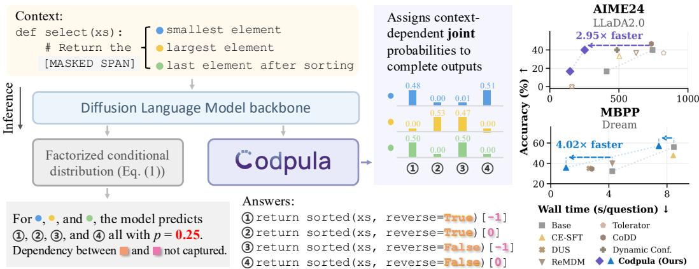
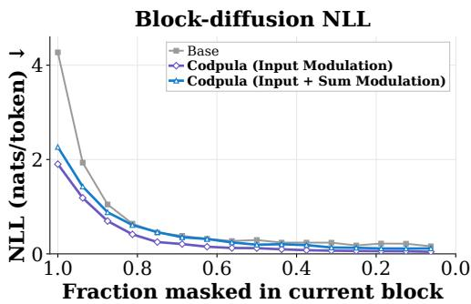
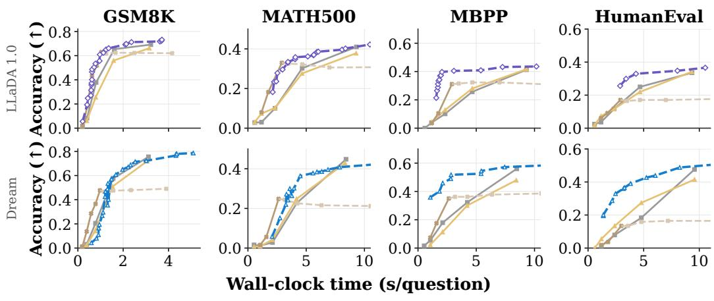
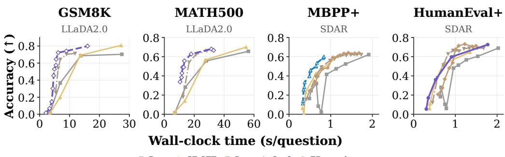
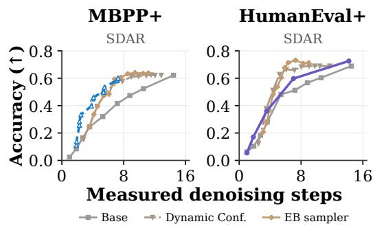
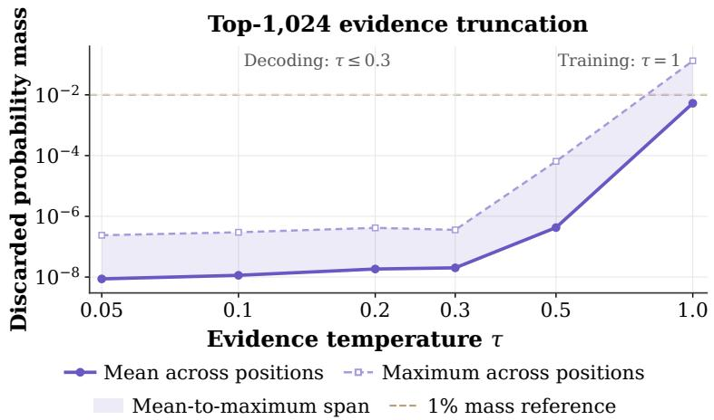
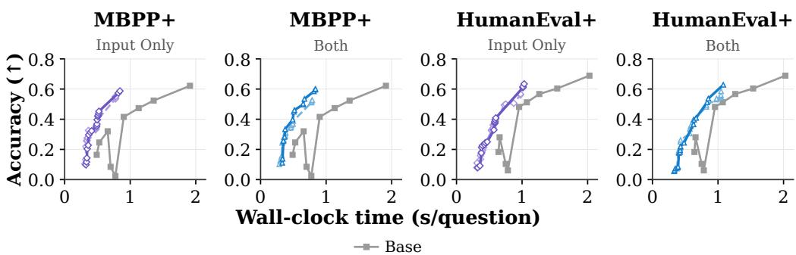
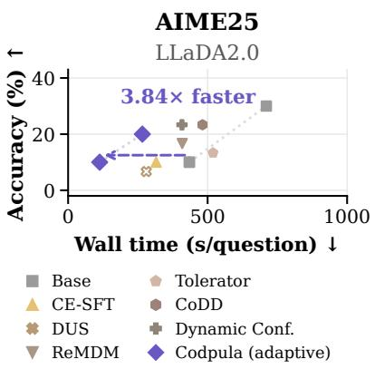
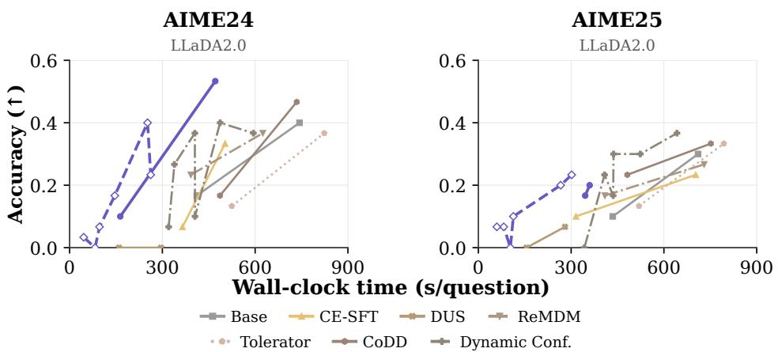

# LEARNING TO COUPLE: CONTEXT-ADAPTIVE JOINTDENOISING FOR DIFFUSION LANGUAGE MODELS

Zilei Shao<sup>1∗</sup> Ian Li<sup>2∗</sup> Heng Zhao<sup>3</sup> Kewei Lian<sup>4</sup> Guy Van den Broeck<sup>1</sup> Zhe Zeng<sup>3</sup> Anji Liu<sup>4†</sup>

<sup>1</sup>University of California, Los Angeles <sup>2</sup>University of California, San Diego <sup>3</sup>University of Virginia <sup>4</sup>National University of Singapore

## ABSTRACT

Diffusion language models accelerate generation by predicting multiple tokens in parallel, but factorized denoisers treat simultaneous predictions as conditionally independent. Decoding heuristics reduce the resulting errors by controlling which tokens are committed, but leave the underlying distribution factorized. Joint modeling addresses the source of the problem, yet existing methods attach separately learned layers to frozen denoisers, leaving the backbone unadapted to the joint objective and the coupling parameters fixed across contexts. We propose Codpula, a context-parameterized denoiser combining a Transformer with a tractable probabilistic inference layer. Given a partially masked input, the Transformer produces token potentials that shape per-position predictions and compact gates that modulate the layer’s coupling parameters, yielding a context-dependent joint distribution while retaining exact conditional inference. We jointly optimize both components under a conditional denoising objective using a dual-flow multiplicative update that preserves valid probabilistic parameters. At inference, Codpula supports standard heuristics and uses conditional queries to adapt commitments to dependencies among proposed tokens without extra Transformer evaluations within a step. Codpula sets new state-of-the-art results across a broad suite of reasoning benchmarks while advancing the accuracy–latency Pareto frontier in mathematical reasoning and code generation.

## 1 INTRODUCTION

Masked diffusion language models can accelerate generation by predicting multiple tokens in parallel, reducing the number of denoising steps. However, standard denoisers factorize their predictions across positions (Austin et al., 2021a; Sahoo et al., 2024; Nie et al., 2025). Even under a shared context, these predictions remain conditionally independent, preventing the model from expressing dependencies among tokens predicted together. These missing dependencies become increasingly consequential as more tokens are committed at once (Liu et al., 2025a). A parallel denoiser must therefore predict both what each token could be and how its predictions depend on one another.

Many approaches address the factorization barrier during decoding by varying commitments, prioritizing confident predictions, or revising earlier tokens (Arriola et al., 2025; Wu et al., 2025; Ben-Hamu et al., 2025; Zhao et al., 2024; Israel et al., 2025). These methods improve the quality–computation trade-off while retaining a factorized denoiser. Joint modeling instead captures dependencies among simultaneous predictions (Li et al., 2026; Kim & Sung, 2026). Existing models, however, typically attach a separately trained joint layer to a frozen backbone. This layer produces context-dependent probabilities, but its dependency parameters remain fixed across inputs and the backbone is not optimized through the joint distribution.

We propose Codpula, a jointly learned, context-parameterized denoiser that adapts both token predictions and their coupling to the current context. From the backbone representation, Codpula derives token scores that adjust per-position predictions and a compact set of gates that reweight shared coupling parameters. The resulting joint distribution can favor different combinations of token values depending on the context, as illustrated in Figure 1 (left): Codpula assigns high probability to different combinations of sort direction and index for different requested operations. Training through this distribution teaches the backbone to produce token preferences and coupling signals that together explain the clean completion. To support this training, we derive a dual-flow update that accommodates the signed learning statistics introduced by conditional normalization while preserving valid probabilistic parameters.

  
Figure 1: Factorized versus context-dependent joint prediction. Left: Given a masked return statement, a factorized denoiser predicts the sorting flag and index independently, assigning equal probability to all four completions regardless of the comment. Middle: Codpula assigns contextdependent joint probabilities, placing its mass on the completions consistent with each comment. Right: Codpula improves accuracy–latency trade-offs, achieving 2.95× and 4.02× speedups at matched accuracy on AIME24 (LLaDA-2.0; Bie et al. (2025)) and MBPP (Dream; Ye et al. (2025)).

Beyond modeling which token values belong together, the learned joint distribution informs which proposals to commit together. Codpula supports the token-selection heuristics used by existing block and full-sequence decoders and provides conditional queries for dependence-adaptive decoding. These queries measure how each proposal’s probability changes when the other candidates are assigned their proposed values. The decoder defers sensitive proposals, adapting the number of commitments to their dependencies. All queries reuse the token potentials and gates from the same Transformer forward pass, requiring no additional backbone evaluation within the step.

We evaluate Codpula on mathematical reasoning and code generation across four modern diffusion language models against a comprehensive suite of state-of-the-art baselines. The results show improved accuracy across a range of parallel decoding budgets and improved accuracy-latency tradeoffs after accounting for inference overhead. Figure 1 (Right) highlights that Codpula achieves comparable accuracy with 2.95× faster generation on AIME24 using LLaDA-2.0 and 4.02× faster generation on MBPP using Dream.

## 2 PRELIMINARY

## 2.1 DIFFUSION LANGUAGE MODELS

Diffusion language models (dLLMs) learn to generate text from partially masked input by iteratively reconstructing masked portions of an input sequence (Austin et al., 2021a; Sahoo et al., 2024; Shi et al., 2024). Let $\pmb { x } _ { 0 } \overset { \cdot } { = } ( x _ { 0 } ^ { 0 } , \ldots , x _ { 0 } ^ { L } ) \overset { \cdot } { \in } \mathcal { V } ^ { L }$ denote a clean sequence, where V is a vocabulary. At timestep t, each token is independently masked with probability $\alpha _ { t } .$ , yielding a partially masked sequence $\mathbf { \dot { x } } _ { t } = ( x _ { t } ^ { 0 } , \dots , x _ { t } ^ { L } )$ ). Given the partially masked sequence $\mathbf { \Delta } \mathbf { x } _ { t } .$ , a neural denoiser parameterized by $\varphi$ predicts the original clean sequence $\scriptstyle { \mathbf { { \mathit { x } } } } _ { 0 }$ using a factorized conditional distribution

$$
p _ { \varphi } ( \pmb { x } _ { 0 } | \pmb { x } _ { t } ) = \prod _ { i = 1 } ^ { L } p _ { \varphi } ( x _ { 0 } ^ { i } | \pmb { x } _ { t } ) .\tag{1}
$$

Under this factorization, the denoising objective evaluates reconstruction only at masked positions, leaving the observed tokens unchanged. To construct a training example, we sample a clean sequence $\mathbf { \boldsymbol { x } } _ { 0 } \sim p _ { \mathrm { d a t a } }$ and a timestep t, then obtain $\mathbf { \Delta } _ { \mathbf { \mathcal { X } } _ { t } }$ by independently masking each token in $\scriptstyle { \mathbf { { \vec { x } } } } _ { 0 }$ with probability $\alpha _ { t } \in ( 0 , 1 ]$ . The model is trained by maximizing the weighted denoising objective

$$
\mathcal { L } ( \varphi ) = \mathbb { E } _ { t , { \mathbf { x } _ { 0 } } , { \mathbf { x } _ { t } } } [ w ( t ) \log p _ { \varphi } ( { \mathbf { x } _ { 0 } } | { \mathbf { x } _ { t } } ) ] ,\tag{2}
$$

where $\begin{array} { r } { \pmb { x } _ { 0 } \sim p _ { \mathrm { d a t a } } , } \end{array}$ and $w ( t )$ is a weighting function (Sahoo et al., 2024; Shi et al., 2024).

At inference, generation starts from a fully masked sequence and progressively reveals tokens as t decreases. With enough denoising steps, the model can reveal one token at a time, allowing every prediction to condition on all earlier ones. In this sequential limit, Equation (1) represents the desired target distribution since only one token is predicted at each step. In practice, however, fast generation requires revealing multiple tokens per denoising step. Equation (1) treats these tokens as conditionally independent, even though they may remain strongly dependent given the observed context. The model is thus asked to predict a joint completion using a product of token-wise dis tributions, which can produce inconsistent outputs (Xu et al., 2025a). Even perfectly learned token marginals cannot generally recover a dependent conditional joint distribution through their product, so increasing backbone capacity alone does not remove this representational constraint (Liu et al., 2025a; Hayakawa et al., 2025). Revealing fewer tokens per step can reduce the resulting dependence error, but requires more backbone evaluations (Ben-Hamu et al., 2025). We refer to this tension between parallel generation and factorized prediction as the factorization barrier (Li et al., 2026).

## 2.2 PARALLEL DENOISING IS CONDITIONAL JOINT PREDICTION

Two broad approaches address the factorization barrier. The first retains the factorized outputs and compensates at inference. Heuristic-based decoding ranks positions by confidence, entropy, or margin (Chang et al., 2022; Ye et al., 2025; Kim et al., 2025); adaptive parallel decoding adjusts the number of tokens committed per step (Israel et al., 2025); remasking enables revision of previously generated tokens (Wang et al., 2025). However, tokenwise scores do not explicitly measure dependencies among jointly proposed tokens (Wu et al., 2025), while iterative refinement can trade additional model evaluations for improved sample quality (Zhao et al., 2024; Wang et al., 2025).

The second approach confronts the barrier directly by modeling the conditional joint distribution of tokens predicted in parallel. Coupled Discrete Diffusion (CoDD) (Li et al., 2026) and tensortrain joint modeling (Kim & Sung, 2026) use structured joint parameterizations to capture token dependencies while supporting efficient inference. Both approaches combine neural token potentials with a coupling model for simultaneous predictions. Their joint distributions can be expressed as

$$
p _ { \varphi , \omega } ( \pmb { x } _ { 0 } | \pmb { x } _ { t } ) = \frac { 1 } { Z ( \pmb { x } _ { t } ) } \cdot p _ { \omega } ( \pmb { x } _ { 0 } | \pmb { x } _ { t } ) \cdot \prod _ { i = 1 } ^ { L } p _ { \varphi } ( x _ { 0 } ^ { i } | \pmb { x } _ { t } ) .\tag{3}
$$

## 3 FROM STATIC TO CONTEXT-DEPENDENT COUPLING

Equation (3) reveals a limitation of existing joint predictors. The dLLM’s tokenwise predictions $p _ { \varphi } ( \pmb { x } _ { 0 } ^ { i } \mid \pmb { x } _ { t } )$ adapt to context, whereas coupling parameters ω are fixed across inputs, mask patterns, and timesteps. A single coupling model must therefore capture dependencies in every denoising context, despite substantial variation in masked-token dependencies with the observed tokens.

The remedy is clear: token predictions and their dependencies must both adapt to the denoising context. We therefore propose the following context-dependent joint denoiser:

$$
\begin{array} { r } { \pmb { \theta } _ { t } = f _ { \varphi } ( \pmb { x } _ { t } ) , \qquad p _ { \varphi , \omega } ( \pmb { x } _ { 0 } \mid \pmb { x } _ { t } ) : = p ( \pmb { x } _ { 0 } ; \pmb { \theta } _ { t } , \omega ) , } \end{array}\tag{4}
$$

where $\theta _ { t }$ contains both the tokenwise prediction parameters and the context-dependent coupling parameters, while ω denotes the parameters intrinsic to the probabilistic model.

There are many ways to parameterize $p ( \pmb { x } _ { 0 } ; \pmb { \theta } _ { t } , \omega )$ , but the distribution must remain efficiently normalizable when $\theta _ { t }$ changes with $\mathbf { \Delta } _ { \mathbf { \mathcal { X } } _ { t } }$ . To make this requirement explicit, we write

$$
p ( \pmb { x } _ { 0 } ; \pmb { \theta } _ { t } , \omega ) = \frac { \tilde { p } ( \pmb { x } _ { 0 } ; \pmb { \theta } _ { t } , \omega ) } { Z ( \pmb { \theta } _ { t } , \omega ) } , \qquad Z ( \pmb { \theta } _ { t } , \omega ) = \sum _ { \pmb { x } _ { 0 } } \tilde { p } ( \pmb { x } _ { 0 } ; \pmb { \theta } _ { t } , \omega ) ,\tag{5}
$$

where $\tilde { p }$ is an unnormalized joint probability. Because $\theta _ { t }$ changes at every denoising step, $Z ( \pmb \theta _ { t } , \omega )$ must be recomputed for each $\mathbf { \Delta } _ { \mathbf { \mathcal { X } } _ { t } }$ and generally requires summing over exponentially many sequences. To overcome this challenge, we parameterize $\tilde { p }$ using a probabilistic circuit (PC) (Choi et al., 2020), whose sum-product structure enables exact and efficient computation of $Z ( \pmb { \theta } _ { t } , \omega )$ for dynamically generated $\theta _ { t }$ . We next review background on PCs that make this computation tractable.

Probabilistic Circuits. A probabilistic circuit (PC) represents a joint distribution through a rooted directed acyclic graph of input, sum, and product nodes (Choi et al., 2020; Poon & Domingos, 2011). Input nodes define univariate distributions over variables $X \in X$ . Sum and product nodes recursively combine these distributions into a joint distribution over X. Formally, each node computes

$$
p _ { n } ( \pmb { x } ) = \left\{ \begin{array} { l l } { g _ { n } ( \pmb { x } ) , } & { n \mathrm { i s ~ a n ~ i n p u t ~ n o d e ~ o v e r ~ } X \in \pmb X , } \\ { \prod _ { c \in \mathsf { c h } ( n ) } p _ { c } ( \pmb x ) , } & { n \mathrm { i s ~ a ~ p r o d u c t ~ n o d e , } } \\ { \sum _ { c \in \mathsf { c h } ( n ) } \omega _ { n , c } \cdot p _ { c } ( \pmb x ) , } & { n \mathrm { i s ~ a ~ s u m ~ n o d e , } } \end{array} \right.\tag{6}
$$

where ch(n) denotes the children of n, $g _ { n }$ is a univariate distribution over $X \in X$ , and the nonnegative sum node parameters $\{ \omega _ { n , c } \} _ { n , c }$ sa $\begin{array} { r } { \operatorname { t i s f y } \sum _ { c \in \mathsf { c h } ( n ) } \omega _ { n , c } = 1 } \end{array}$ (∀ sum node n). The key advantage of PCs is their ability to compute many probabilistic queries exactly and efficiently (Vergari et al., 2021). This tractability makes them particularly well suited to our setting: when $\tilde { p } ( \boldsymbol { x } _ { 0 } ; \boldsymbol { \theta } _ { t } , \omega )$ is represented by a PC satisfying suitable structural requirements, the normalization constant (Z) in Equation (5) can be computed exactly in a single bottom-up pass.<sup>1</sup>

We next turn to training this hybrid denoiser. Applying the standard diffusion-ELBO derivation (Sahoo et al., 2024; Shi et al., 2024) in this setting yields the following generalized denoising objective (see Appendix E, which we maximize jointly over the neural and circuit parameters):

$$
\begin{array} { r } { \mathcal { L } ( \omega , \varphi ) = \mathbb { E } _ { t , \mathbf { x } _ { 0 } , \mathbf { x } _ { t } } [ w ( t ) \log p _ { \varphi , \omega } ( x _ { 0 } | \boldsymbol { x } _ { t } ) ] , } \end{array}\tag{7}
$$

where $t \sim \mathcal { U } ( 0 , 1 ) , \pmb { x } _ { 0 } \sim p _ { \mathrm { d a t a } } , \pmb { x } _ { t } \sim q _ { t } ( \cdot | \pmb { x } _ { 0 } )$ , and $w ( t ) \geq 0$ is the diffusion weighting function.

Although Equation (7) is differentiable end to end, its parameter blocks require different optimization treatments. The neural parameters (φ) can be updated using standard gradient-based optimizers. The circuit parameters (ω), however, require expectation-maximization-style (EM-style) updates, whose constraint-preserving behavior relies on nonnegative log-parameter derivatives (Peharz et al., 2020; Liu et al., 2025b). While this condition holds for standalone $\mathrm { P C s , }$ the gradients induced by our objective can be signed, so the standard EM-style update does not apply directly. To make this issue precise, we first recall a general formulation that encompasses commonly used EM-style updates:

$$
\omega _ { n , c } ^ { \mathrm { n e w } } \propto \omega _ { n , c } + \alpha \cdot T _ { \varphi , \omega } ( n , c ) \cdot \frac { \partial \mathcal { L } ( \omega , \varphi ) } { \partial \log \omega _ { n , c } } ,\tag{8}
$$

where $\alpha \geq 0$ is the base learning rate, and $T _ { \varphi , \omega } ( n , c )$ is an optional per-parameter step-size multiplier. Varying the batch, $\alpha ,$ , and $T _ { \varphi , \omega }$ recover full-batch EM, mini-batch EM, and Anemone (Liu et al., 2025b) as special cases (Appendix F.2 gives the correspondence). For standalone PCs, the derivatives in Equation (8) are nonnegative, so the normalized update preserves nonnegative weights.

Differentiating the normalized model in Equation (5) reveals why Equation (8) does not apply directly. For directly parameterized sum weights, holding the neural outputs and circuit inputs fixed, let $F _ { \mathbf { x } } ^ { + } ( n , c ) : = \partial \log \tilde { p } ( { \pmb x } _ { 0 } ; { \pmb \theta } _ { t } , { \pmb \omega } ) / \partial$ log $\omega _ { n , c }$ and $F _ { \pmb { x } } ^ { - } ( \bar { n } , c ) : = \partial \log \bar { Z } ( \pmb { \theta } _ { t } , \pmb { \omega } ) / \partial \log \pmb { \omega } _ { n , c } .$ . Then

$$
\frac { \partial \log p _ { \varphi , \omega } ( { \pmb x } _ { 0 } \mid { \pmb x } _ { t } ) } { \partial \log \omega _ { n , c } } = F _ { { \pmb x } } ^ { + } ( n , c ) - F _ { { \pmb x } } ^ { - } ( n , c ) .
$$

By construction, both $F _ { x } ^ { + } ( n , c )$ and $F _ { x } ^ { - } \left( n , c \right)$ are nonnegative because the circuit computes $\tilde { p }$ and $\dot { Z }$ using only additions and multiplications of nonnegative values; their derivatives with respect to log $\omega _ { n , c }$ are therefore nonnegative as well. Their difference, however, can be negative. Consequently, directly applying Equation (8) no longer guarantees nonnegative circuit weights. To address this problem, we propose a dual-flow multiplicative update that retains the two flows separately and replaces their subtraction with a ratio of positive terms:

$$
\omega _ { n , c } ^ { \mathrm { n e w } } \propto \omega _ { n , c } \cdot \frac { 1 + \eta _ { n , c } \cdot F _ { \mathrm { B } } ^ { + } ( n , c ) } { 1 + \eta _ { n , c } \cdot F _ { \mathrm { B } } ^ { - } ( n , c ) } ,\tag{9}
$$

where $\eta _ { n , c } : = \alpha \cdot T _ { \varphi , \omega } ( n , c ) / \omega _ { n , c }$ and $F _ { \mathrm { B } } ^ { \pm }$ denote their minibatch averages. The following proposition establishes that the update preserves valid circuit parameters, recovers standard circuit learning in the standalone setting, and agrees locally with the signed-gradient update.

Proposition 3.1 (Properties of the dual-flow update). Fix an active sum node with normalized weights $\omega _ { n , c } > 0 ,$ , flows $F _ { \mathrm { B } } ^ { \pm } ( n , c ) \geq 0 ,$ , and scales $0 < T _ { \varphi , \omega } ( n , c ) < \infty$ . Equation (9) satisfies:

(i) For every $x \geq 0 , \omega _ { n , c } ^ { \mathrm { n e w } } > 0$ and $\begin{array} { r } { \sum _ { c \in \mathsf { c h } ( n ) } \omega _ { n , c } ^ { \mathrm { n e w } } = 1 } \end{array}$ even when $F _ { \mathrm { B } } ^ { + } ( n , c ) - F _ { \mathrm { B } } ^ { - } ( n , c ) < 0 .$

(ii) When applied to a standalone PC with normalized inputs and sum weights, the dual-flow update in Equation (9) reduces to the standard EM update in Equation (8).

(iii) Under (ii) and full batch B, Equation (9) recovers the full-batch EM update as $\alpha \to \infty$

(iv) As $\alpha  0 ,$ , Equation (9) agrees with Equation (8) up to $\scriptstyle { \mathcal { O } } ( \alpha ^ { 2 } )$

The dual-flow update thus recovers standard circuit learning in the standalone setting and remains valid when conditional normalization introduces negative gradients. It also matches the normalized signed-gradient update to first order. Together with neural backpropagation, this enables joint training under the conditional denoising objective in Equation (7). Appendix G provides the proof.

## 4 INSTANTIATING A CONTEXT-PARAMETERIZED JOINT DENOISER

Having established how to jointly train the neural and circuit parameters, we now specify how the neural network uses $\mathbf { \Delta } _ { \mathbf { \mathcal { X } } _ { t } }$ to modulate the circuit in Equation (4). A naive parameterization would require the network to output a distinct context-dependent value for every circuit parameter, causing its output dimension to scale with the size of the circuit. Instead, we retain the shared circuit parameters ω and use ${ \pmb \theta } _ { t } = f _ { \pmb \varphi } ( { \pmb x } _ { t } )$ to modulate both parameterized node types: token potentials modulate the input-node distributions, while a compact set of gates reweight groups of sum-node parameters.

## 4.1 LEARNING TOKEN POTENTIALS

We first describe how neural token potentials modulate the circuit’s input distributions. Before modulation, each input node n over variable $X _ { i }$ represents a categorical distribution $\pi _ { n }$ over the vocabulary V, where $\pi _ { n } ( v )$ is the probability assigned to token v. These probabilities belong to the circuit parameters ω. Given $\mathbf { \Delta } _ { \mathbf { \mathcal { X } } _ { t } }$ , the neural network produces $\theta _ { t } = f _ { \varphi } ( \pmb { x } _ { t } )$ , whose token-potential component $\psi _ { t }$ assigns a nonnegative value $\psi _ { t , i } ( \boldsymbol { v } )$ to each token v for $X _ { i }$ . Recall that $g _ { n }$ in Equation (6) denotes the input distribution over $X _ { i }$ . We obtain its modulated form by normalizing the product of the PC input distribution and the neural potentials:

$$
g _ { n } ( v ; \pmb { \theta } _ { t } , \omega ) = \frac { \pi _ { n } ( v ) \psi _ { t , i } ( v ) } { \sum _ { v ^ { \prime } \in \mathcal { V } } \pi _ { n } ( v ^ { \prime } ) \psi _ { t , i } ( v ^ { \prime } ) } .\tag{10}
$$

Equation (10) locally normalizes the pointwise product $\pi _ { n } \psi _ { t , i }$ , making $g _ { n } ( \cdot ; \pmb { \theta } _ { t } , \omega )$ a categorical distribution over $X _ { i }$ . All input nodes over $X _ { i }$ share the same potential vector $\psi _ { t , i } ,$ so the neural network produces one vector per position rather than per input node. Their distinct base distributions $\pi _ { n }$ allow these nodes to retain different token preferences. The local normalizer depends on both the neural potentials and circuit parameters, and is retained in likelihood evaluation and differentiation.

Normalizing Equation (10) over the entire vocabulary for every input node would be computationally expensive, even though the top 1,024 candidate tokens retain more than 99% of the backbone’s predictive probability mass on average, as quantified in Figure 6 in the appendix. We therefore restrict computation to candidates favored by the backbone: at each position, we retain the top-k logits, apply a softmax over the retained candidates, and set the remaining potentials to zero. After candidate selection, this reduces each input normalization from $\mathcal { O } ( | \nu | )$ to $\overset { \vartriangle } { \boldsymbol { \mathcal { O } } } ( \boldsymbol { k } )$ . During training, we ensure that the clean token is retained so that truncation does not force its likelihood to zero.

Crucially, the local normalization in Equation (10) fits directly into the dual-flow framework of Section 3. When $\pi _ { n }$ is learned as part of ω, derivatives through both the numerator and local normalizer contribute to the positive and negative flows, respectively. The same dual-flow update can therefore optimize the input parameters together with the sum parameters. Appendix A.1 reports the choice of k and the remaining optimization hyperparameters.

## 4.2 LEARNING COUPLING POTENTIALS

Next, we describe how neural gates can modulate the circuit’s sum weights. In practical $\mathrm { P C s , }$ sum parameters are typically arranged in matrices by grouping sum nodes that share the same children, and they determine how the circuit combines its child distributions (Liu et al., 2024a; Peharz et al., 2020; Loconte et al., 2025). Sum nodes sharing the same children define a row-normalized weight matrix W: rows index sum nodes and columns index child distributions. Its entries belong to $\omega .$ We partition W into $n \times n$ parameter groups of width $b ,$ each containing $b \times b$ weights. Given $\mathbf { \boldsymbol { x } } _ { t } , :$ a compact neural head predicts one gate per group. Exponentiating these outputs yields $\mathbf { G } _ { t } \in \mathbb { R } _ { > 0 } ^ { n \times n }$ with each scalar gate scaling its corresponding parameter group:

$$
\mathbf { W } _ { t } = \operatorname { R o w N o r m } ( \mathbf { W } \odot \left( \mathbf { G } _ { t } \otimes \mathbf { 1 } _ { b \times b } \right) ) ,\tag{11}
$$

where $\odot$ denotes elementwise multiplication, $\otimes$ denotes the Kronecker product, ${ \mathbf { 1 } } _ { b \times b }$ is an all-ones matrix, and RowNorm normalizes each row. Zero log-gates recover W, while context-dependent gates adjust the relative mixture weights. Row normalization preserves valid mixtures, and the unchanged circuit structure preserves tractable marginalization and conditioning.

Together, Equations (10) and (11) turn the PC into a context-parameterized denoiser. For each $\mathbf { \Delta } _ { \mathbf { \mathcal { X } } _ { t } }$ , the backbone produces both token potentials that modulate the circuit’s input distributions and group-level gates $\mathbf { G } _ { t }$ that reweight sum parameters. These neural outputs allow the same circuit to express context-dependent token preferences and dependencies through a compact modulation of its shared base parameters. The circuit structure remains fixed, preserving exact marginalization and conditional inference for each $\theta _ { t }$ . Figure 2 compares the resulting conditional likelihoods under block diffusion. Both variants of Codpula achieve substantially lower NLL than the base model at high masking rates, with the largest improvement when the current block is fully masked.

  
Figure 2: Block-diffusion NLL on Dream. Negative log-likelihood (nats/token) versus the fraction of masked tokens in the current block. Both Codpula variants substantially reduce NLL when most of the block is masked.

## 5 DECODING FROM A LEARNED JOINT DENOISER

Decoding begins from a partially masked sequence. At each denoising step t, the learned denoiser defines a tractable joint distribution over the current set of masked variables under consideration, conditioned on the visible tokens. The decoder uses this distribution to decide what to propose and may use its joint structure to decide where to decode, $\mathrm { i . e . }$ , which proposals to commit. Committed values become visible, while the others remain masked for subsequent steps. We first describe how proposals are obtained from the joint distribution, then review standard rules for selecting where to commit, and finally introduce our dependency-aware commitment rule.

To obtain proposals, we use the current neural outputs $\theta _ { t }$ to modulate the circuit’s input distributions and sum weights as in Equations (10) and (11). Before sampling, we control the sharpness of the neural token preferences by dividing the backbone logits by a temperature $\gamma > 0$ before normalization. Writing $\psi _ { t , i }$ for the unscaled token potentials, the resulting input distribution is

$$
g _ { n } ^ { ( \gamma ) } ( v ; \pmb { \theta } _ { t } , \omega ) = \frac { \pi _ { n } ( v ) \psi _ { t , i } ( v ) ^ { 1 / \gamma } } { \sum _ { v ^ { \prime } \in \mathcal { V } } \pi _ { n } ( v ^ { \prime } ) \psi _ { t , i } ( v ^ { \prime } ) ^ { 1 / \gamma } } .
$$

Temperature scaling thus acts on the neural potentials within each input distribution, retaining the learned categorical parameters $\pi _ { n }$ and the current modulated sum weights. We then condition the circuit on the visible tokens and jointly sample the masked variables under consideration.

  
Base CE-SFT DUS DUS (ext.)  
Codpula (Input Modulation, adaptive) Codpula (Input + Sum Modulation, adaptive)

Figure 3: Accuracy-latency trade-offs on LLaDA-1.0 and Dream. Accuracy versus wall-clock time per question for adaptive Codpula, the base backbone, and DUS on math and code benchmarks.

Once token proposals have been sampled, the decoder decides which positions to commit. The joint denoiser supports standard confidence-, margin-, and entropy-based selection, as well as random selection (Nie et al., 2025; Ye et al., 2025; Kim et al., 2025). Our dependency-aware decoder retains these rules for candidate selection, then uses the joint distribution to assess dependencies among the candidates before commitment. Beyond these tokenwise criteria, the learned joint distribution provides conditional queries for adapting which proposals are committed together.

We first form proposals for all masked tokens under consideration (e.g., those in the current block for block diffusion). For each such token i, let $\hat { \mathbf { x } } ^ { - i }$ denote the proposals at all other positions under consideration. We measure how conditioning on them changes the log-probability of ${ \hat { x } } ^ { i }$ :

$$
\delta _ { i } = \left| \log p _ { \varphi , \omega } \big ( \hat { x } ^ { i } \mid \hat { x } ^ { - i } , \pmb { x } _ { t } \big ) - \log p _ { \varphi , \omega } \big ( \hat { x } ^ { i } \mid \pmb { x } _ { t } \big ) \right| .\tag{12}
$$

Here, $\delta _ { i }$ is the absolute conditional pointwise mutual information between proposal i and the rest, where smaller values indicate weaker dependence. We commit tokens with $\delta _ { i } < \tau ( \tau > 0 )$ and defer the rest, committing the lowest-scoring token if none qualify. Deferred tokens are reconsidered at the next step under the updated context. For m tokens, all scores require one complete-assignment, m singleton, and m leave-one-out marginals. These queries share the visible-evidence normalizer, can be batched with the same neural outputs, and require no additional backbone evaluations. Algorithm 3 gives the block-decoding instantiation; Appendix D.1 details the queries and overhead.

## 6 EXPERIMENTS

We evaluate Codpula on mathematical reasoning and code generation using four modern dLLM backbones. We examine its accuracy across parallel-decoding budgets, its accuracy–latency trade off under adaptive commitment, and the contributions of input and coupling modulation.

Models and training. Our experiments include LLaDA-1.0-8B-Instruct (Nie et al., 2025), LLaDA-2.0-mini (Bie et al., 2025), Dream-v0-Instruct-7B (Ye et al., 2025), and SDAR-8B-Chat-b16 (Cheng et al., 2025). For LLaDA models, we use two-stage training: we first train the PC with the backbone frozen, then update the backbone through LoRA adapters while keeping the PC fixed. For Dream and SDAR, we jointly optimize the PC and the backbone adapters. The two-stage schedule for LLaDA is motivated by the sensitivity to finetuning among this family.

Baselines. We use static decoding with the original instruction-tuned backbone as our reference and compare against both training-based and training-free baselines. CE-SFT trains LoRA adapters with masked token cross-entropy, whereas CoDD (Li et al., 2026) couples the frozen backbone’s predictions with a separately trained PC. The training-free baselines include Dynamic Conf. (Wu et al., 2025), DUS (Luxembourg et al., 2026), ReMDM (Wang et al., 2025), and Tolerator (Tian et al.,

Table 1: Parallel Decoding Performance (LLaDA 2.0). Accuracy (%) under low-confidence decoding as the number of tokens decoded per diffusion step increases. Parentheses after each bench mark denote the maximum generation length; column headers denote tokens decoded per step. Shaded indicates the best and underline indicates the second-best performance in each column.
<table><tr><td rowspan="2">Model</td><td rowspan="2">Method tokens/step</td><td colspan="4">GSM8K (512)</td><td colspan="4">MATH500 (1024)</td></tr><tr><td>2</td><td>4</td><td>8</td><td>16</td><td>2</td><td>4</td><td>8</td><td>16</td></tr><tr><td rowspan="7">LLaDA 2.0</td><td>Base</td><td>70.3</td><td>68.6</td><td>36.7</td><td>2.4</td><td>65.6</td><td>55.6</td><td>28.2</td><td>1.4</td></tr><tr><td>ReMDM</td><td>71.0</td><td>66.6</td><td>39.0</td><td>2.4</td><td>63.2</td><td>56.8</td><td>24.4</td><td>1.4</td></tr><tr><td>DUS</td><td>N/A</td><td>N/A</td><td>60.3</td><td>8.5</td><td>N/A</td><td>N/A</td><td>41.8</td><td>4.4</td></tr><tr><td>Tolerator</td><td>64.4</td><td>56.2</td><td>19.9</td><td>2.8</td><td>58.6</td><td>51.6</td><td>16.6</td><td>2.6</td></tr><tr><td>CE-SFT</td><td>80.7</td><td>69.2</td><td>19.9</td><td>1.1</td><td>70.0</td><td>56.6</td><td>13.8</td><td>2.0</td></tr><tr><td>CoDD</td><td>71.6</td><td>69.0</td><td>47.3</td><td>4.2</td><td>65.4</td><td>61.6</td><td>31.8</td><td>6.8</td></tr><tr><td>Codpula</td><td>81.4</td><td>75.3</td><td>57.9</td><td>12.7</td><td>72.2</td><td>62.8</td><td>41.0</td><td>12.0</td></tr></table>

Table 2: Parallel Decoding Performance (SDAR & Dream). Accuracy (%) on HumanEval+ and MBPP+ as the number of tokens decoded per step increases. SDAR uses block size 16, max generation length 512, and low confidence decoding; Dream uses full diffusion with generation length 128 and entropy decoding. Shaded indicates the best and underline indicates the secondbest performance within each model block.
<table><tr><td rowspan="2">Model</td><td rowspan="2">Method tokens/step</td><td colspan="4">HumanEval+</td><td colspan="4">MBPP+</td></tr><tr><td>1</td><td>2</td><td>4</td><td>8</td><td>1</td><td>2</td><td>4</td><td>8</td></tr><tr><td rowspan="7">SDAR</td><td>Base</td><td>68.9</td><td>51.2</td><td>28.1</td><td>10.4</td><td>62.2</td><td>41.5</td><td>24.6</td><td>8.5</td></tr><tr><td>ReMDM</td><td>65.2</td><td>50.6</td><td>28.7</td><td>14.0</td><td>58.2</td><td>43.7</td><td>23.3</td><td>6.6</td></tr><tr><td>DUS</td><td>N/A</td><td>N/A</td><td>37.8</td><td>12.2</td><td>N/A</td><td>N/A</td><td>35.2</td><td>12.7</td></tr><tr><td>CE-SFT</td><td>64.6</td><td>52.4</td><td>32.9</td><td>11.0</td><td>61.9</td><td>42.6</td><td>23.0</td><td>6.6</td></tr><tr><td>CoDD</td><td>72.6</td><td>55.5</td><td>32.9</td><td>11.6</td><td>65.1</td><td>42.9</td><td>25.1</td><td>9.8</td></tr><tr><td>Codpula</td><td>72.6</td><td>59.8</td><td>36.0</td><td>17.1</td><td>67.7</td><td>55.6</td><td>34.4</td><td>18.5</td></tr><tr><td>Codpula (Both)</td><td>73.8</td><td>59.8</td><td>38.4</td><td>17.7</td><td>69.3</td><td>52.9</td><td>34.4</td><td>18.3</td></tr><tr><td rowspan="4">Dream</td><td>Base</td><td>39.6</td><td>34.1</td><td>26.8</td><td>24.4</td><td>48.1</td><td>46.0</td><td>38.9</td><td>31.2</td></tr><tr><td>CE-SFT</td><td>44.5</td><td>39.0</td><td>26.8</td><td>25.0</td><td>48.4</td><td>43.4</td><td>30.4</td><td>13.0</td></tr><tr><td>Codpula</td><td>33.5</td><td>34.8</td><td>32.9</td><td>31.7</td><td>53.4</td><td>51.6</td><td>45.2</td><td>35.7</td></tr><tr><td>Codpula (Both)</td><td>45.7</td><td>45.1</td><td>41.5</td><td>29.9</td><td>59.0</td><td>49.2</td><td>47.9</td><td>33.3</td></tr></table>

2025), all of which modify only the decoding procedure while keeping the backbone frozen. Appendix A provides supporting evidence for the LLaDA training schedule, full training and decoding configurations, and detailed descriptions of the decoding baselines.

Mathematical reasoning. We evaluate LLaDA-1.0, LLaDA-2.0, and Dream on MATH500 (Lightman et al., 2023) and GSM8K (Cobbe et al., 2021), using all 500 and 1,319 test problems, respectively. For LLaDA-2.0, we additionally evaluate on AIME 2024 and AIME 2025 (Art of Problem Solving), using combined AIME I and II in each year with chain-of-thought prompting. All mathematical reasoning evaluations are zero-shot and use the lm-evaluation-harness framework (Gao et al., 2024). We report final-answer accuracy, using mathematical equivalence checking for MATH500 and exact match after answer extraction for GSM8K. For AIME, we prioritize the final boxed answer during extraction and report exact-match accuracy after string normalization.

Code generation. For code generation, LLaDA-1.0 and Dream are evaluated on MBPP (Austin et al., 2021b) and HumanEval (Chen et al., 2021), while SDAR is evaluated on the extended-test variants, MBPP+ and HumanEval+ (Liu et al., 2023). The extended test suites provide a more stringent assessment of the functional correctness of generated programs. All code-generation evaluations use zero-shot instruction-style prompts, with performance measured by pass@1. Dataset sizes are summarized in Appendix A.2, with evaluation details provided in the same appendix.

Training through the joint model improves parallel prediction. On LLaDA-2.0 GSM8K (Table 1), CE-SFT nearly matches Codpula at two tokens per step but falls below the backbone at eight. Codpula improves over the backbone in both settings, by 11.1 and 21.2 percentage points, respectively. Thus, improvements from tokenwise fine-tuning do not necessarily translate to effective parallel prediction. The ablation in Table 16 supports training through the circuit: backbone adaptation adds gains over fitted circuit in seven of ten settings.

  
Base CE-SFT Dynamic Conf. EB sampler  
Codpula (Input Modulation) Codpula (Input Modulation, adaptive) Codpula (Input + Sum Modulation, adaptive)

Figure 4: Accuracy-latency trade-offs on LLaDA-2.0 and SDAR. Accuracy versus wall-clock time per question for Codpula with uniform and adaptive decoding, base backbone, dynamicconfidence, and EB-sampler decoding on math (LLaDA-2.0) and code (SDAR) benchmarks.  
Table 3: Parallel Decoding Comparison across Math and Code Benchmarks (LLaDA-1.0 & Dream). Accuracy (%) as the number of tokens decoded per step increases. Parentheses after each benchmark denote the maximum generation length; column headers denote tokens decoded per step. Math benchmarks use low-confidence decoding; for code, LLaDA uses margin decoding on MBPP and low-confidence decoding on HumanEval, while Dream uses entropy decoding. Shaded indicates the best and underline indicates the second-best performance within each model block.
<table><tr><td rowspan="2">Model</td><td rowspan="2">Method tokens/step</td><td colspan="3">GSM8K (256)</td><td colspan="3">MATH500 (512)</td><td colspan="3">MBPP (512)</td><td colspan="3">HumanEval (512)</td></tr><tr><td>2</td><td>4</td><td>8</td><td>2</td><td>4</td><td>8</td><td>2</td><td>4</td><td>8</td><td>2</td><td>4</td><td>8</td></tr><tr><td rowspan="5">LLaDA 1.0</td><td>Base</td><td>69.1</td><td>65.4</td><td>37.8</td><td>41.0</td><td>30.2</td><td>10.0</td><td>41.3</td><td>25.7</td><td>10.1</td><td>33.5</td><td>25.0</td><td>11.6</td></tr><tr><td>CE-SFT</td><td>66.2</td><td>56.0</td><td>25.6</td><td>37.8</td><td>27.6</td><td>10.2</td><td>41.6</td><td>28.0</td><td>12.8</td><td>34.2</td><td>22.0</td><td>11.6</td></tr><tr><td>ReMDM</td><td>69.6</td><td>64.3</td><td>37.2</td><td>40.2</td><td>31.8</td><td>11.2</td><td>38.1</td><td>24.9</td><td>8.2</td><td>34.8</td><td>25.0</td><td>12.2</td></tr><tr><td>CoDD</td><td>71.5</td><td>66.5</td><td>50.3</td><td>38.6</td><td>34.8</td><td>22.8</td><td>43.2</td><td>29.2</td><td>9.7</td><td>34.8</td><td>25.0</td><td>12.8</td></tr><tr><td>Codpula</td><td>71.7</td><td>69.0</td><td>52.4</td><td>41.6</td><td>35.2</td><td>20.8</td><td>48.3</td><td>31.9</td><td>15.6</td><td>37.2</td><td>29.3</td><td>16.5</td></tr><tr><td rowspan="6">Dream</td><td>Base</td><td>75.5</td><td>57.6</td><td>20.5</td><td>44.8</td><td>22.8</td><td>2.8</td><td>56.0</td><td>32.3</td><td>17.9</td><td>47.6</td><td>18.3</td><td>7.9</td></tr><tr><td>CE-SFT</td><td>71.9</td><td>50.9</td><td>14.1</td><td>42.8</td><td>24.8</td><td>4.2</td><td>47.9</td><td>30.0</td><td>11.3</td><td>41.5</td><td>27.4</td><td>13.4</td></tr><tr><td>ReMDM</td><td>74.0</td><td>56.7</td><td>21.3</td><td>42.2</td><td>20.0</td><td>3.0</td><td>56.0</td><td>40.1</td><td>26.1</td><td>47.0</td><td>28.7</td><td>12.2</td></tr><tr><td>CoDD</td><td>77.9</td><td>58.6</td><td>14.8</td><td>46.4</td><td>29.0</td><td>6.2</td><td>58.0</td><td>43.2</td><td>34.6</td><td>42.1</td><td>31.7</td><td>18.3</td></tr><tr><td>Codpula</td><td>77.2</td><td>60.9</td><td>23.0</td><td>46.4</td><td>31.8</td><td>8.4</td><td>60.3</td><td>48.6</td><td>31.5</td><td>48.8</td><td>38.4</td><td>22.0</td></tr><tr><td>Codpula (Both)</td><td>78.8</td><td>64.9</td><td>24.9</td><td>48.0</td><td>30.4</td><td>11.4</td><td>59.1</td><td>48.6</td><td>36.6</td><td>45.7</td><td>37.2</td><td>20.7</td></tr></table>

Context-dependent coupling provides additional, task-dependent gains. Input-only Codpula already improves over the backbone across multiple settings (Tables 1 and 3). Sum modulation provides further gains, most clearly on Dream’s full-sequence HumanEval+ evaluation (Table 2): it improves the input-only variant at one to four tokens per step, including a setting where that variant falls below the backbone. These results indicate that adapting mixture weights can improve on token reweighting alone, with benefits that depend on the task and decoding regime.

The gains extend to measured generation latency. Figures 3 and 4 show improved accuracy– latency trade-offs after accounting for circuit computation, with adaptive decoding improving selected operating points. This improvement comes despite additional computation: on LLaDA-1.0/MATH500, adaptive Codpula incurs 6.8–8.2% overhead at matched numbers of backbone evaluations (Table 12). Under EOS-based stopping, latency also reflects generation length; the shorter generations in Table 11 therefore contribute to the observed speedups (Appendix A.3.2).

## 7 RELATED WORK AND CONCLUSION

Joint prediction and adaptive decoding. Masked diffusion models, including MDLM and MD4 (Sahoo et al., 2024; Shi et al., 2024), LLaDA and Dream (Nie et al., 2025; Ye et al., 2025), and block-diffusion models (Arriola et al., 2025), typically factorize predictions across positions, omitting dependencies among parallel outputs. Remedies include auxiliary copulas (Liu et al., 2025a), sequence-level energy corrections (Xu et al., 2025a), and mixture-based distillation (Hayakawa et al., 2025). CoDD couples a frozen denoiser with a learned circuit prior (Li et al., 2026), while tensor-train modeling predicts context-conditioned joint distributions through a modified output head (Kim & Sung, 2026). Complementary decoding strategies improve token ordering (Kim et al., 2025), adapt parallelism using confidence or entropy (Wu et al., 2025; Ben-Hamu et al., 2025), assess parallel proposals with an auxiliary autoregressive model (Israel et al., 2025), or remask generated tokens (Wang et al., 2025). We jointly learn token potentials and context-dependent coupling under a conditional objective and query the resulting joint distribution for adaptive commitment.

Probabilistic circuits and their applications. Probabilistic circuits represent expressive joint distributions with tractable marginalization and conditioning (Poon & Domingos, 2011; Choi et al., 2020). Neural extensions use network outputs to parameterize context-dependent distributions (Shao et al., 2020; Yidou-Weng et al., 2026; Grivas et al., 2026). PCs and related models also guide constrained autoregressive generation (Zhang et al., 2023; 2024) and diffusion-based image inpainting (Liu et al., 2024b). We integrate the circuit into the denoiser, modulate its coupling parameters with backbone outputs, and train the neural components through it. Building on Anemone’s minibatch EM update (Liu et al., 2025b), we develop a multiplicative update that accommodates signed flows from conditional normalization while preserving valid circuit parameters.

In this work, we introduce Codpula, a context-parameterized joint denoiser that learns token predictions and their coupling while retaining exact normalization and conditional inference. To support conditional training, we derive a dual-flow update, and the learned joint distribution enables dependence-adaptive decoding. Experiments on mathematical reasoning and code generation show improved accuracy-latency trade-offs across multiple backbones. Additional circuit computation and fixed-size coupling windows remain as limitations, motivating more efficient inference and joint modeling over longer sequences.

## ACKNOWLEDGMENTS

This work was funded in part by the National University of Singapore under its Start-up Grant (Award No: SUG-251RES2505); this work was also funded in part by the DARPA CLARA program, and gifts from Cisco Research, Qualcomm, and Amazon. HZ and ZZ were supported in part by the DARPA CLARA program under Agreement No. HR0011269E227.

## REFERENCES

Marianne Arriola, Aaron Gokaslan, Justin T Chiu, Zhihan Yang, Zhixuan Qi, Jiaqi Han, Subham Sekhar Sahoo, and Volodymyr Kuleshov. Block diffusion: Interpolating between autoregressive and diffusion language models. In The Thirteenth International Conference on Learning Representations, 2025.

Art of Problem Solving. AIME problems and solutions. https://artofproblemsolving. com/wiki/index.php/AIME\_Problems\_and\_Solutions. Accessed September 2026.

Jacob Austin, Daniel D Johnson, Jonathan Ho, Daniel Tarlow, and Rianne Van Den Berg. Structured denoising diffusion models in discrete state-spaces. Advances in Neural Information Processing Systems, 34:17981–17993, 2021a.

Jacob Austin, Augustus Odena, Maxwell Nye, Maarten Bosma, Henryk Michalewski, David Dohan, Ellen Jiang, Carrie Cai, Michael Terry, Quoc Le, and Charles Sutton. Program synthesis with large language models, 2021b.

Heli Ben-Hamu, Itai Gat, Daniel Severo, Niklas Nolte, and Brian Karrer. Accelerated sampling from masked diffusion models via entropy bounded unmasking. In The Thirty-ninth Annual Conference on Neural Information Processing Systems, 2025. URL https://openreview.net/ forum?id=WBcBhT1NKO.

Tiwei Bie, Maosong Cao, Kun Chen, Lun Du, Mingliang Gong, Zhuochen Gong, Yanmei Gu, Jiaqi Hu, Zenan Huang, Zhenzhong Lan, Chengxi Li, Chongxuan Li, Jianguo Li, Zehuan Li, Huabin Liu, Ling Liu, Guoshan Lu, Xiaocheng Lu, Yuxin Ma, Jianfeng Tan, Lanning Wei, Ji-Rong Wen, Yipeng Xing, Xiaolu Zhang, Junbo Zhao, Da Zheng, Jun Zhou, Junlin Zhou, Zhanchao Zhou,

Liwang Zhu, and Yihong Zhuang. Llada2.0: Scaling up diffusion language models to 100b, 2025. URL https://arxiv.org/abs/2512.15745.

Huiwen Chang, Han Zhang, Lu Jiang, Ce Liu, and William T. Freeman. Maskgit: Masked generative image transformer. In Proceedings of the IEEE/CVF Conference on Computer Vision and Pattern Recognition (CVPR), pp. 11315–11325, 2022. URL https://openaccess.thecvf.com/content/CVPR2022/html/Chang\_ MaskGIT\_Masked\_Generative\_Image\_Transformer\_CVPR\_2022\_paper.html.

Mark Chen, Jerry Tworek, Heewoo Jun, Qiming Yuan, Henrique Ponde de Oliveira Pinto, Jared Kaplan, Harri Edwards, Yuri Burda, Nicholas Joseph, Greg Brockman, Alex Ray, Raul Puri, Gretchen Krueger, Michael Petrov, Heidy Khlaaf, Girish Sastry, Pamela Mishkin, Brooke Chan, Scott Gray, Nick Ryder, Mikhail Pavlov, Alethea Power, Lukasz Kaiser, Mohammad Bavarian, Clemens Winter, Philippe Tillet, Felipe Petroski Such, Dave Cummings, Matthias Plappert, Fotios Chantzis, Elizabeth Barnes, Ariel Herbert-Voss, William Hebgen Guss, Alex Nichol, Alex Paino, Nikolas Tezak, Jie Tang, Igor Babuschkin, Suchir Balaji, Shantanu Jain, William Saunders, Christopher Hesse, Andrew N. Carr, Jan Leike, Josh Achiam, Vedant Misra, Evan Morikawa, Alec Radford, Matthew Knight, Miles Brundage, Mira Murati, Katie Mayer, Peter Welinder, Bob Mc-Grew, Dario Amodei, Sam McCandlish, Ilya Sutskever, and Wojciech Zaremba. Evaluating large language models trained on code, 2021.

Ranfei Chen and Ming Chen. Dsft: Inspiring diffusion large language models to comprehend mathematical and logical patterns, 2025. URL https://arxiv.org/abs/2509.18164.

Shuang Cheng, Yihan Bian, Dawei Liu, Yuhua Jiang, Yihao Liu, Linfeng Zhang, Wenhai Wang, Qipeng Guo, Kai Chen, Biqing Qi, and Bowen Zhou. Sdar: A synergistic diffusion–autoregression paradigm for scalable sequence generation, 2025. URL https:// github.com/JetAstra/SDAR.

YooJung Choi, Antonio Vergari, and Guy Van den Broeck. Probabilistic circuits: A unifying framework for tractable probabilistic models. oct 2020.

Karl Cobbe, Vineet Kosaraju, Mohammad Bavarian, Jacob Hilton, Reiichiro Nakano, Christopher Hesse, and John Schulman. Training verifiers to solve math word problems, 2021.

Leo Gao, Jonathan Tow, Baber Abbasi, Stella Biderman, Sid Black, Anthony DiPofi, Charles Foster, Laurence Golding, Jeffrey Hsu, Alain Le Noac’h, Haonan Li, Kyle McDonell, Niklas Muennighoff, Chris Ociepa, Jason Phang, Laria Reynolds, Hailey Schoelkopf, Aviya Skowron, Lintang Sutawika, Eric Tang, Anish Thite, Ben Wang, Kevin Wang, and Andy Zou. The language mode evaluation harness, 07 2024. URL https://zenodo.org/records/12608602.

Andreas Grivas, Lorenzo Loconte, Emile van Krieken, Piotr Nawrot, Yu Zhao, Euan Wielewski, Pasquale Minervini, Edoardo Ponti, and Antonio Vergari. Fast and expressive multi-byte prediction with probabilistic circuits. In Forty-third International Conference on Machine Learning, 2026. URL https://openreview.net/forum?id=6kCEyw9god.

Satoshi Hayakawa, Yuhta Takida, Masaaki Imaizumi, Hiromi Wakaki, and Yuki Mitsufuji. Distillation of discrete diffusion through dimensional correlations. In International Conference on Machine Learning, pp. 22259–22297. PMLR, 2025.

Daniel Israel, Guy Van den Broeck, and Aditya Grover. Accelerating diffusion llms via adaptive parallel decoding. arXiv preprint arXiv:2506.00413, 2025.

Jina AI. Code exercises. https://huggingface.co/datasets/jinaai/code\_ exercises, 2023. Hugging Face dataset.

Byoungkwon Kim and Minhyuk Sung. Tensor-train joint modeling for few-step discrete diffusion, 2026. URL https://arxiv.org/abs/2607.03788.

Jaeyeon Kim, Kulin Shah, Vasilis Kontonis, Sham M. Kakade, and Sitan Chen. Train for the worst, plan for the best: Understanding token ordering in masked diffusions. In Forty-second International Conference on Machine Learning, 2025. URL https://openreview.net/forum? id=DjJmre5IkP.

Minseo Kim, Chenfeng Xu, Coleman Hooper, Harman Singh, Ben Athiwaratkun, Ce Zhang, Kurt Keutzer, and Amir Gholami. Cdlm: Consistency diffusion language models for faster sampling, 2026. URL https://arxiv.org/abs/2511.19269.

Ian Li, Zilei Shao, Benjie Wang, Rose Yu, Guy Van den Broeck, and Anji Liu. Breaking the factorization barrier in diffusion language models. In Forty-third International Conference on Machine Learning, 2026. URL https://openreview.net/forum?id=euv8IoKFbh.

Jia LI, Edward Beeching, Lewis Tunstall, Ben Lipkin, Roman Soletskyi, Shengyi Costa Huang, Kashif Rasul, Longhui Yu, Albert Jiang, Ziju Shen, Zihan Qin, Bin Dong, Li Zhou, Yann Fleureau, Guillaume Lample, and Stanislas Polu. Numinamath, 2024.

Hunter Lightman, Vineet Kosaraju, Yura Burda, Harri Edwards, Bowen Baker, Teddy Lee, Jan Leike, John Schulman, Ilya Sutskever, and Karl Cobbe. Let’s verify step by step, 2023. URL https://arxiv.org/abs/2305.20050.

Anji Liu, Kareem Ahmed, and Guy Van Den Broeck. Scaling tractable probabilistic circuits: a systems perspective. In Proceedings of the 41st International Conference on Machine Learning, ICML’24. JMLR.org, 2024a.

Anji Liu, Mathias Niepert, and Guy Van den Broeck. Image inpainting via tractable steering of diffusion models. In The Twelfth International Conference on Learning Representations, 2024b. URL https://openreview.net/forum?id=NSIVHTbZBR.

Anji Liu, Oliver Broadrick, Mathias Niepert, and Guy Van den Broeck. Discrete copula diffusion. In The Thirteenth International Conference on Learning Representations, 2025a.

Anji Liu, Zilei Shao, and Guy Van den Broeck. Rethinking probabilistic circuit parameter learning, 2025b. URL https://arxiv.org/abs/2505.19982.

Jiawei Liu, Chunqiu Steven Xia, Yuyao Wang, and Lingming Zhang. Is your code generated by chatgpt really correct? rigorous evaluation of large language models for code generation, 2023. URL https://arxiv.org/abs/2305.01210.

Lorenzo Loconte, Antonio Mari, Gennaro Gala, Robert Peharz, Cassio de Campos, Erik Quaeghebeur, Gennaro Vessio, and Antonio Vergari. What is the relationship between tensor factorizations and circuits (and how can we exploit it)? Transactions on Machine Learning Research, 2025. ISSN 2835-8856. URL https://openreview.net/forum?id=Y7dRmpGiHj. Featured Certification.

Omer Luxembourg, Haim H. Permuter, and Eliya Nachmani. Plan for speed: Dilated scheduling for masked diffusion language models. In Forty-third International Conference on Machine Learn ing, 2026. URL https://openreview.net/forum?id=DbzAsMRNhy.

Shen Nie, Fengqi Zhu, Zebin You, Xiaolu Zhang, Jingyang Ou, Jun Hu, Jun Zhou, Yankai Lin, Ji-Rong Wen, and Chongxuan Li. Large language diffusion models. arXiv preprint arXiv:2502.09992, 2025.

Robert Peharz, Steven Lang, Antonio Vergari, Karl Stelzner, Alejandro Molina, Martin Trapp, Guy Van Den Broeck, Kristian Kersting, and Zoubin Ghahramani. Einsum networks: fast and scalable learning of tractable probabilistic circuits. In Proceedings of the 37th International Conference on Machine Learning, ICML’20. JMLR.org, 2020.

Hoifung Poon and Pedro Domingos. Sum-product networks: A new deep architecture. In 2011 IEEE International Conference on Computer Vision Workshops (ICCV Workshops), pp. 689–690. IEEE, 2011.

Subham Sahoo, Marianne Arriola, Yair Schiff, Aaron Gokaslan, Edgar Marroquin, Justin Chiu, Alexander Rush, and Volodymyr Kuleshov. Simple and effective masked diffusion language models. Advances in Neural Information Processing Systems, 37:130136–130184, 2024.

Xiaoting Shao, Alejandro Molina, Antonio Vergari, Karl Stelzner, Robert Peharz, Thomas Liebig, and Kristian Kersting. Conditional sum-product networks: Imposing structure on deep probabilistic architectures. In International Conference on Probabilistic Graphical Models, pp. 401–412. PMLR, 2020.

Jiaxin Shi, Kehang Han, Zhe Wang, Arnaud Doucet, and Michalis K Titsias. Simplified and generalized masked diffusion for discrete data. arXiv preprint arXiv:2406.04329, 2024.

Bowen Sun, Yujun Cai, Ming-Hsuan Yang, and Yiwei Wang. Blockwise sft for diffusion language models: Reconciling bidirectional attention and autoregressive decoding, 2025. URL https: //arxiv.org/abs/2508.19529.

Runchu Tian, Junxia Cui, Xueqiang Xu, Feng Yao, and Jingbo Shang. Finish first, perfect later: Test-time token-level cross-validation for diffusion large language models, 2025. URL https: //openreview.net/forum?id=mcBAMstQmM.

Antonio Vergari, YooJung Choi, Anji Liu, Stefano Teso, and Guy Van den Broeck. A compositional atlas of tractable circuit operations for probabilistic inference. Advances in Neural Information Processing Systems, 34:13189–13201, 2021.

Guanghan Wang, Yair Schiff, Subham Sahoo, and Volodymyr Kuleshov. Remasking discrete diffusion models with inference-time scaling. In The Thirty-ninth Annual Conference on Neural Information Processing Systems, 2025. URL https://openreview.net/forum?id= IJryQAOy0p.

Chengyue Wu, Hao Zhang, Shuchen Xue, Zhijian Liu, Shizhe Diao, Ligeng Zhu, Ping Luo, Song Han, and Enze Xie. Fast-dllm: Training-free acceleration of diffusion llm by enabling kv cache and parallel decoding. arXiv preprint arXiv:2505.22618, 2025.

Minkai Xu, Tomas Geffner, Karsten Kreis, Weili Nie, Yilun Xu, Jure Leskovec, Stefano Ermon, and Arash Vahdat. Energy-based diffusion language models for text generation. In The Thirteenth International Conference on Learning Representations, 2025a.

Zhangchen Xu, Yang Liu, Yueqin Yin, Mingyuan Zhou, and Radha Poovendran. Kodcode: A diverse, challenging, and verifiable synthetic dataset for coding, 2025b. URL https://arxiv. org/abs/2503.02951.

Jiacheng Ye, Zhihui Xie, Lin Zheng, Jiahui Gao, Zirui Wu, Xin Jiang, Zhenguo Li, and Lingpeng Kong. Dream 7b: Diffusion large language models. arXiv preprint arXiv:2508.15487, 2025.

Gwen Yidou-Weng, Ian Li, Anji Liu, Oliver Broadrick, Yuchen Cui, Guy Van den Broeck, and Benjie Wang. Learning tractable distributions of language model continuations, 2026. URL https://arxiv.org/abs/2511.16054.

Honghua Zhang, Meihua Dang, Nanyun Peng, and Guy Van den Broeck. Tractable control for autoregressive language generation. In International Conference on Machine Learning, pp. 40932– 40945. PMLR, 2023.

Honghua Zhang, Po-Nien Kung, Masahiro Yoshida, Guy Van den Broeck, and Nanyun Peng. Adaptable logical control for large language models. Advances in Neural Information Processing Systems, 37:115563–115587, 2024.

Siyan Zhao, Devaansh Gupta, Qinqing Zheng, and Aditya Grover. d1: Scaling reasoning in diffusion large language models via reinforcement learning. In The Thirty-ninth Annual Conference on Neural Information Processing Systems, 2025. URL https://openreview.net/forum? id=7ZVRlBFuEv.

Yixiu Zhao, Jiaxin Shi, Feng Chen, Shaul Druckmann, Lester Mackey, and Scott Linderman. Informed correctors for discrete diffusion models. arXiv preprint arXiv:2407.21243, 2024.

Tianyu Zheng, Ge Zhang, Tianhao Shen, Xueling Liu, Bill Yuchen Lin, Jie Fu, Wenhu Chen, and Xiang Yue. OpenCodeInterpreter: Integrating code generation with execution and refinement. In Lun-Wei Ku, Andre Martins, and Vivek Srikumar (eds.), Findings of the Association for Computational Linguistics: ACL 2024, pp. 12834–12859, Bangkok, Thailand, August 2024. Association for Computational Linguistics. doi: 10.18653/v1/2024.findings-acl.762. URL https://aclanthology.org/2024.findings-acl.762/.

## A EXPERIMENT DETAILS

## A.1 TRAINING

Table 4: Backbone models used in our experiments. Parameter counts are the nominal sizes reported by the model developers; for dense models, all parameters are active during each forward pass. Block denotes the decoding block length used in our experiments.
<table><tr><td>Model</td><td>Total params.</td><td>Active params.</td><td>Layers</td><td>Architecture</td><td>Diffusion structure</td><td>Block</td></tr><tr><td>LLaDA-1.0-8B-Instruct (Nie et al., 2025)</td><td>8B</td><td>8B</td><td>32</td><td>Dense</td><td>Full-sequence masked diffusion</td><td>32</td></tr><tr><td>LLaDA-2.0-mini (Bie et al., 2025)</td><td>16B</td><td>1.4B</td><td>20</td><td>MoE</td><td>Block-causal masked diffusion</td><td>32</td></tr><tr><td>Dream-v0-Instruct-7B (Ye et al., 2025)</td><td>7B</td><td>7B</td><td>32</td><td>Dense</td><td>Full-sequence masked diffusion</td><td>32</td></tr><tr><td>SDAR-8B-Chat-b16 (Cheng et al., 2025)</td><td>8B</td><td>8B</td><td>36</td><td>Dense</td><td>Semi-autoregressive block diffusion</td><td>16</td></tr></table>

SFT on LLaDA. Continued fine-tuning does not consistently improve instruction-tuned LLaDA models, especially on mathematical ability. In d1, supervised fine-tuning improves over LLaDA-8B-Instruct in only seven of twelve evaluated settings (Zhao et al., 2025). On LLaDA-1.5, DSFT reports that standard SFT offers negligible or even negative effects on the downstream tasks (Chen & Chen, 2025). Similarly, Sun et al. (2025) report a decrease on MATH from 31.7% to 29.6% under classical SFT. CDLM provides a similar observation: its initial LLaDA-1.0 training on approximately 7500 Bespoke prompts reduces GSM8K accuracy from 77.1% to 72.1% (Kim et al., 2026). Taken together, these findings motivate treating the backbone update schedule as a consequential design choice. We therefore separate circuit training from backbone fitting for LLaDA model family and retain an independently tuned CE-SFT baseline in the comparison.

Training data and masking. For each sequence, we sample a masking probability t uniformly from [0, 1) and independently mask response tokens with probability t. Prompt tokens remain visible, and padding positions are excluded from the supervised region. The backbone processes the resulting masked sequence; its predictions over the response are then divided into 32-token blocks for circuit training. When the response length is not divisible by 32, we add a final, right-aligned block covering the last 32 response tokens. This block overlaps the preceding block and preserves the response ending without introducing additional padding targets. Responses shorter than a complete block are excluded from circuit training.

• Mathematical Reasoning. For LLaDA-1.0, both training stages use the same subset of 1,910 hard problems from NuminaMath (LI et al., 2024), selected according to the frozen backbone’s denoising loss. LLaDA-2.0 uses the full NuminaMath dataset in both stages, while Dream uses the same full dataset during joint training.

• Code Generation. All models use the same training mixture constructed from JinaAI Code Exercises (Jina AI, 2023), KodCode-V1 (Xu et al., 2025b), CodeFeedback-Filtered-Instruction (Zheng et al., 2024), and the non-test splits of MBPP (Austin et al., 2021b). The mixture contains 98,660 examples in HumanEval- and MBPP-style formats and is used in both training stages for LLaDA-1.0 and during joint training for Dream and SDAR.

PC configurations. We use homogeneous hidden Markov models with 1,024 latent states per position, compiled into probabilistic circuits. The circuit sequence length is 32 for LLaDA-1.0, LLaDA-2.0, and Dream, and 16 for SDAR. Transition parameters are shared across positions, and categorical leaf distributions are parameterized over the full vocabulary of the corresponding backbone. We train separate circuits for each backbone and task family. Within each backbone and task family, CoDD and Codpula use the same circuit architecture. Parameter conditioning modulates the circuit’s sum weights while preserving its topology. Training hyperparameters are summarized in Table 5. Circuit training retains the backbone’s top-1,024 evidence candidates per position; an ablation on LLaDA-1.0 examines this choice and its compatibility with full-vocabulary decoding in Section B.2.

Table 5: Codpula training configurations by backbone and task, including parameter conditioning. Two-stage runs first train the PC with the backbone frozen and then train the adapter with the PC fixed. Joint runs optimize the PC and adapter together, and additionally optimize the router for Codpula (Both). Router settings for Input Only and Both are listed separately; all other SDAR settings are shared between the two variants. A dash in a router row indicates that no router is trained. Paired stage-specific entries denote stage-1/stage-2 values, and accumulation thresholds count response blocks. An EM schedule $f { - } e$ remains flat for f updates and then decays cosinely through update e.
<table><tr><td rowspan="2"></td><td colspan="2">LLaDA-1.0-8B</td><td>LLaDA2.0-mini</td><td>SDAR-8B</td><td colspan="2">Dream-v0-7B</td></tr><tr><td>Math</td><td>Code</td><td>Math</td><td>Code (b16)</td><td>Math</td><td>Code</td></tr><tr><td>Data and objective</td><td></td><td></td><td></td><td></td><td></td><td></td></tr><tr><td>Training scheme</td><td>Two-stage</td><td>Two-stage</td><td>Two-stage</td><td>Joint</td><td>Joint</td><td>Joint</td></tr><tr><td>Training examples</td><td>1,910</td><td>98,660</td><td>521,776</td><td>101,648</td><td>521,776</td><td>98,660</td></tr><tr><td>Block accum. threshold</td><td>64</td><td>64</td><td>400</td><td>32</td><td>400</td><td>400</td></tr><tr><td>Inv.-mask weighting</td><td> $1 0 ^ { - 2 }$ </td><td> $1 0 ^ { - 2 }$ </td><td> $1 0 ^ { - 2 }$ </td><td>No</td><td> $1 0 ^ { - 2 }$ </td><td> $1 0 ^ { - 2 }$ </td></tr><tr><td>Circuit</td><td></td><td></td><td></td><td></td><td></td><td></td></tr><tr><td>Block length / latents</td><td>32/1,024</td><td>32/1,024</td><td>32/1,024</td><td>16/1,024</td><td>32/1,024</td><td>32/1,024</td></tr><tr><td>Evidence candidates</td><td>1,024</td><td>1,024</td><td>1,024</td><td>All</td><td>1,024</td><td>1,024</td></tr><tr><td>EM step size</td><td>0.3→0.03</td><td>0.3→0.03</td><td>0.3→0.03</td><td>0.05</td><td>0.2→0.1</td><td>0.2→0.1</td></tr><tr><td>EM schedule</td><td>67-673</td><td>120-1,200</td><td>1,086-end</td><td>1,000–end†</td><td>1,000-10,000 105-1,050</td><td></td></tr><tr><td>Parameter conditioning</td><td></td><td></td><td></td><td></td><td></td><td></td></tr><tr><td>Gate grid (Both)</td><td></td><td></td><td></td><td>32×32</td><td>32×32</td><td>32×32</td></tr><tr><td>Router LR (Input Only)</td><td></td><td></td><td></td><td>0</td><td></td><td></td></tr><tr><td>Router LR (Both)</td><td></td><td></td><td></td><td> $1 0 ^ { - 3 }$ </td><td> $1 0 ^ { - 3 }$ </td><td> $\overline { { 1 0 ^ { - 3 } } }$ </td></tr><tr><td>Adapter</td><td></td><td></td><td></td><td></td><td></td><td></td></tr><tr><td>Learning rate</td><td> $2 \times 1 0 ^ { - 4 }$ </td><td> $1 0 ^ { - 5 }$ </td><td></td><td></td><td>10⁻⁶</td><td></td></tr><tr><td>Weight decay</td><td>0.1</td><td>0.1</td><td> $^ { 1 0 ^ { - 6 }  1 0 ^ { - 7 \ddagger } } _ { 0 . 1 }$ </td><td> $^ { 1 0 ^ { - 5 } } _ { 0 . 0 1 }$ </td><td></td><td> $^ { 1 0 ^ { - 6 }  0 } _ { 0 }$ </td></tr><tr><td></td><td></td><td></td><td></td><td></td><td>0.01</td><td></td></tr><tr><td>LoRA r/α/drop.</td><td></td><td>512/128/0.05128/256/0.05</td><td>128/256/0</td><td>128/64/0</td><td>128/256/0</td><td>128/256/0</td></tr><tr><td>LoRA scaling  $\alpha / r$ </td><td>0.25</td><td>2</td><td>2</td><td>0.5</td><td>2</td><td>2</td></tr><tr><td>Adapted modules</td><td>A</td><td>A</td><td>B</td><td>C</td><td>D</td><td>D</td></tr><tr><td>Budget</td><td></td><td></td><td></td><td></td><td></td><td></td></tr><tr><td>Training updates</td><td>896/100</td><td>2,000/100</td><td>10,860/1,540</td><td>3,000</td><td>10,847</td><td>1,050</td></tr><tr><td>Ckpt / val. interval</td><td>224/25</td><td>400/25</td><td>1,350/385</td><td>250</td><td>200</td><td>150</td></tr><tr><td>Selected checkpoint</td><td>896/75</td><td>2,000/75</td><td>2,700/770</td><td>250</td><td>5,000</td><td>1,050</td></tr></table>

<sup>†</sup>The selected checkpoint precedes the decay; <sup>‡</sup>the adapter learning rate remains flat for 154 updates before decaying. Module groups A–D are defined below.

Shared training settings. All Codpula runs use Anemone EM with momentum 0.9 and evidence temperature 1.0. Adapters are optimized with AdamW without bias adaptation, rsLoRA, or an auxiliary cross-entropy loss. Each GPU processes two sequences per microbatch; padding positions are unsupervised, and gradients on observed evidence are masked. Among the configurations in Table 5, only LLaDA2.0 uses gradient clipping, with a maximum norm of 1.0. Parameter conditioning is enabled in Codpula (Both) by training the router at a learning rate of $1 0 ^ { - 3 }$ for SDAR and for both Dream task families. For SDAR, Codpula (Input Only) keeps the router fixed at its uniform initialization with learning rate zero; all other hyperparameters are identical to those of Codpula (Both). Module group A adapts per-block query, key, value, and feed-forward output projections, together with the vocabulary head and token embeddings; B adapts fused QKV and the shared-expert MLP; C adapts all attention and MLP projections; and D adapts only query, key, and value projections.

Baseline training and hyperparameter selection. CE-SFT trains an independent LoRA adapter with the masked-token cross-entropy objective, while CoDD trains a circuit with the backbone frozen. We tune the baselines independently for each backbone and task family. For CE-SFT, the search covers the adapter learning rate, effective batch size, LoRA rank r, scaling ratio $\alpha / r ,$ and number of training updates. For CoDD, we vary the EM step size, response-block accumulation threshold, and training duration. Intermediate checkpoints are evaluated by downstream generation accuracy, and we report the best-performing configuration for each baseline. The selected baseline configurations are summarized in Table 6; their learning rates, batch sizes, and LoRA settings are selected independently of Codpula’s. Sequence batch size and response-block accumulation are distinct quantities and are reported in their respective units.

Table 6: Baseline training configurations by backbone and task. CE-SFT trains only the LoRA adapter using masked-diffusion cross-entropy, whereas CoDD trains only the PC with the backbone frozen. LoRA configurations report rank/scale/dropout, and PC configurations report block length × latent states. Batch sizes count sequences for CE-SFT and response blocks for CoDD.
<table><tr><td>Arm</td><td>Trained component</td><td>LR / EM step size</td><td>Schedule</td><td>Batch</td><td>Updates</td><td>Selected</td></tr><tr><td colspan="7">LLaDA-1.0-8B-Instruct, math numina_hard, 1,910 examples</td></tr><tr><td>CE-SFT</td><td>LoRA 512/128/0.05</td><td> $2 \times 1 0 ^ { - 4 }$ </td><td>Constant</td><td>64</td><td>673</td><td>112</td></tr><tr><td>CoDD†§</td><td>PC 32×1,024</td><td>0.1→0.01</td><td>67-end</td><td>64</td><td>673</td><td>final</td></tr><tr><td colspan="7">LLaDA-1.0-8B-Instruct, code code_gen, 98,660 examples</td></tr><tr><td>CE-SFT</td><td>LoRA 128/128/0.05</td><td>10⁻5</td><td>Constant</td><td>64</td><td>100</td><td>75</td></tr><tr><td>CoDD§</td><td>PC 32×1,024</td><td>0.3→0.03</td><td>120-end</td><td>64</td><td>673</td><td>final</td></tr><tr><td colspan="7">LLaDA2.0-mini, math numina_cot, 521,776 examples</td></tr><tr><td>CE-SFT</td><td>LoRA 128/256/0</td><td> $1 0 ^ { - 6 } {  } 1 0 ^ { - 7 }$ </td><td>154–end</td><td>48</td><td>1,540</td><td>385</td></tr><tr><td>CoDD§</td><td>PC 32×1,024</td><td>0.3→0.03</td><td>1,086–10,860</td><td>400</td><td>6,750</td><td>1,350</td></tr><tr><td colspan="7">SDAR-8B-Chat b16, code code_gen_sdar, 101,648 examples</td></tr><tr><td>CE-SFT</td><td>LoRA 128/256/0.05</td><td> $\bar { 1 } 0 ^ { - 5 }$ </td><td>Warm-up 20</td><td>32</td><td>800</td><td>700</td></tr><tr><td> $\mathrm { C o D D ^ { \ S \ddagger 9 } }$ </td><td>PC 16×1,024</td><td>0.05→0.005</td><td>80-end</td><td>2 seq. (≈23 blk.)</td><td>1,600</td><td>final</td></tr><tr><td colspan="7">Dream-v0-7B-Instruct, math numina_cot, 521,776 examples</td></tr><tr><td>CE-SFT</td><td>LoRA 128/256/0</td><td>10⁻⁵</td><td>Constant</td><td>48</td><td>10,800</td><td>5,600</td></tr><tr><td>CoDD</td><td>PC 32×1,024</td><td>0.2→0.1</td><td>5,100–51,000</td><td>16,384</td><td>49,527</td><td>40,612</td></tr><tr><td colspan="7">Dream-v0-7B-Instruct, code code_gen, 98,660 examples</td></tr><tr><td>CE-SFT</td><td>LoRA 128/256/0</td><td> $1 0 ^ { - 5 }$ </td><td>Warm-up 40</td><td>96</td><td>1,060</td><td>300</td></tr><tr><td>CoDD§</td><td>PC 32×1,024</td><td>0.2→0.1</td><td>585-5,850</td><td>16,384</td><td>5,850</td><td>5,703</td></tr></table>

<sup>†</sup>The corpus uses three precomputed mask draws per example. <sup>§</sup>External emissions are constant across latent states, so the evidence cancels from the latent posterior and the M-step fits the prior by exact maximum likelihood. <sup>‡</sup>This run uses linear decay and updates EM once per two-sequence precomputed batch, corresponding to approximately 23 response blocks per update. <sup>¶</sup>The PC is trained on 3,200 sequences, corresponding to half of the 6,400-sequence precomputed cache. CE-SFT hyperparameters are selected independently and matched to the corresponding Codpula configuration by corpus, training budget, and learning rate.

## A.2 EVALUATION

Table 7: Datasets and evaluation-set sizes.
<table><tr><td>Dataset</td><td>Evaluated split</td><td># Samples</td></tr><tr><td>Mathematical reasoning</td><td></td><td></td></tr><tr><td>MATH500</td><td>Test</td><td>500</td></tr><tr><td>GSM8K</td><td>Test</td><td>1,319</td></tr><tr><td>AIME 2024</td><td>AIME I and AIME II</td><td>30</td></tr><tr><td>AIME 2025</td><td>AIME I and AIME II</td><td>30</td></tr><tr><td>Code generation</td><td></td><td></td></tr><tr><td>HumanEval</td><td>Test</td><td>164</td></tr><tr><td>MBPP</td><td>Sanitized test</td><td>257</td></tr><tr><td>HumanEval+</td><td>EvalPlus test</td><td>164</td></tr><tr><td>MBPP+</td><td>EvalPlus test</td><td>378</td></tr></table>

Table 8: Evaluation protocol. Sets are always evaluated in full.
<table><tr><td>Benchmark</td><td>Model</td><td>n</td><td>Metric key</td><td>Shots</td><td>System prompt</td><td>Canvas</td></tr><tr><td>GSM8K</td><td>LLaDA-8B, Dream-7B</td><td>1,319</td><td>exact_match,flexible-extract</td><td>0</td><td>none</td><td>256</td></tr><tr><td rowspan="3">MATH500</td><td>LLaDA2.0-mini</td><td>1,319</td><td>exact_match,flexible-extract</td><td>0</td><td>none</td><td>512</td></tr><tr><td>LLaDA-8B, Dream-7B</td><td>500</td><td>math_verify,none</td><td>0</td><td>task default</td><td>512</td></tr><tr><td>LLaDA2.0-mini</td><td>500</td><td>math_verify,none</td><td>0</td><td>task default</td><td>1,024</td></tr><tr><td>MBPP (sanitized)</td><td>LLaDA-8B, Dream-7B</td><td>257</td><td>pass_at_1,extract_code</td><td>0</td><td>task default</td><td>512</td></tr><tr><td>HumanEval</td><td>LLaDA-8B, Dream-7B</td><td>164</td><td>pass@1,create_test</td><td>0</td><td>task default</td><td>512</td></tr><tr><td>MBPP+</td><td>SDAR-8B-Chat-b16</td><td>378</td><td>pass_at_1,extract_code</td><td>0</td><td>task default</td><td>512</td></tr><tr><td>HumanEval+</td><td>SDAR-8B-Chat-b16</td><td>164</td><td>pass@1,create_test</td><td>0</td><td>task default</td><td>512</td></tr><tr><td>AIME24 / AIME25</td><td>LLaDA2.0-mini</td><td>30 each</td><td>exact_match,none</td><td>0</td><td>task default</td><td>10,240</td></tr></table>

## A.3 DECODING

## A.3.1 DECODING RULES CHOSEN FOR THE BASE

For the fixed-schedule comparisons among Base, CE-SFT, CoDD, and Codpula, we use the same token-selection rule for each backbone–benchmark pair. LLaDA-1.0 uses low-confidence decoding on GSM8K, MATH500, and HumanEval, and margin decoding on MBPP. Dream uses lowconfidence decoding on the math benchmarks and entropy decoding on the coding benchmarks. LLaDA-2.0 and SDAR use low-confidence decoding. Each rule is held fixed across methods and tokens-per-step settings within the corresponding comparison.

Table 9 reports additional LLaDA-1.0 results under alternative token-selection rules. Their relative performance varies with the benchmark and degree of parallelism. On GSM8K, Codpula improves over the base model at every evaluated tokens-per-step setting under random decoding. Under margin decoding on the same benchmark, it performs similarly to the base model at 2, 4, and 8 tokens per step, while improving accuracy from 10.1% to 15.7% at 16 tokens per step and from 1.7% to 5.6% at 32 tokens per step. Thus, its gains at high parallelism also extend to alternative token-selection rules.

Table 10 additionally reports Dream coding results under block diffusion with low-confidence decoding and a maximum generation length of 512 tokens. Both Codpula variants outperform the base model in every reported setting. At four tokens per step, Codpula improves HumanEval accuracy from 28.7% to 39.6%, while Codpula (Both) improves MBPP accuracy from 40.1% to 51.4%. These results show that Codpula’s coding gains also extend to low-confidence decoding.

## A.3.2 EARLY STOPPING EFFECTS

We enable EOS-based early stopping for LLaDA-2.0 on AIME and for SDAR on the coding benchmarks. Consequently, fixing the number of tokens decoded per step does not fix the total number of generated tokens or denoising steps: these also depend on when each generation terminates. Table 11 reports mean generation lengths and end-to-end runtimes for LLaDA-2.0-mini and Codpula on AIME24 and AIME25. At each matched tokens-per-step setting, Codpula produces shorter generations and has lower latency. For example, as shown in table 11, on AIME24 at four tokens per step, the mean generation length decreases from 7,870.7 to 4,080.8 tokens, and the mean runtime decreases from 411.2 to 163.9 seconds per question. These latency differences reflect both the cost per denoising step and the amount of generation performed.

Table 9: Alternative Decoding Rules (LLaDA-1.0). Accuracy (%) under alternative tokenselection rules, complementing the main-text results. Parentheses after benchmark names denote maximum generation lengths; column headers denote tokens decoded per step. <sup>†</sup>For MBPP, the second block uses low-confidence decoding; the other benchmarks use margin decoding. Cells marked – were not run. Shading and underlining indicate the best and second-best accuracy, respectively, in each column within each decoding block.
<table><tr><td rowspan="2">Decoding</td><td>Method tokens/step</td><td colspan="5">GSM8K (256)</td><td colspan="4">MATH500 (512)</td><td colspan="4">MBPP (512)†</td><td colspan="5">HumanEval (512)</td></tr><tr><td></td><td>2</td><td>4</td><td>8</td><td>16</td><td>32</td><td>2</td><td>4</td><td>8</td><td>16</td><td>2</td><td>4</td><td>8</td><td>16</td><td>2</td><td>4</td><td>8</td><td>16</td><td>32</td></tr><tr><td rowspan="4">Random</td><td>Base</td><td>57.5</td><td>42.9</td><td>22.1</td><td>4.8</td><td>1.7</td><td>30.8</td><td>16.2</td><td>7.6</td><td>4.0</td><td>24.1</td><td>12.5</td><td>3.9</td><td>1.6</td><td>18.9</td><td>8.5</td><td>6.1</td><td>一</td><td>一</td></tr><tr><td>CE-SFT</td><td>52.2</td><td>41.1</td><td>21.2</td><td></td><td>一</td><td>23.4</td><td>17.8</td><td>9.6</td><td>7.6</td><td>24.9</td><td>13.6</td><td>一</td><td>一</td><td>17.7</td><td>9.8</td><td>一</td><td>1</td><td>1</td></tr><tr><td>CoDD</td><td>58.5</td><td>45.5</td><td>24.4</td><td>1</td><td>一</td><td>26.6</td><td>21.4</td><td>14.0</td><td>8.4</td><td>27.6</td><td>12.5</td><td>一</td><td>一</td><td>17.7</td><td>12.2</td><td>1</td><td>1</td><td>一</td></tr><tr><td>Codpula</td><td>60.1</td><td>49.0</td><td>27.9</td><td>12.3</td><td>5.6</td><td>25.4</td><td>19.6</td><td>12.2</td><td>9.0</td><td>26.1</td><td>17.1</td><td>9.7</td><td>4.7</td><td>21.3</td><td>12.8</td><td>8.5</td><td>一</td><td>一</td></tr><tr><td rowspan="4">Margin</td><td>Base</td><td>70.4</td><td>64.4</td><td>44.3</td><td>10.1</td><td>1.7</td><td>39.2</td><td>31.8</td><td>18.0</td><td>4.6</td><td>40.9</td><td>24.5</td><td>9.0</td><td>2.0</td><td>35.4</td><td>25.0</td><td>11.0</td><td>4.9</td><td>2.4</td></tr><tr><td>CE-SFT</td><td></td><td></td><td></td><td>一</td><td>一</td><td>38.8</td><td>27.8</td><td>13.0</td><td>7.8</td><td>40.5</td><td>28.4</td><td>9.0</td><td>1.2</td><td>36.6</td><td>24.4</td><td>14.0</td><td>6.1</td><td>1.8</td></tr><tr><td>CoDD</td><td></td><td></td><td></td><td></td><td>一</td><td>38.6</td><td>31.8</td><td>18.6</td><td>9.8</td><td>44.8</td><td>28.8</td><td>18.3</td><td>7.4</td><td>29.9</td><td>21.3</td><td>14.6</td><td>6.1</td><td>3.1</td></tr><tr><td>Codpula</td><td>70.1</td><td>63.1</td><td>44.2</td><td>15.7</td><td>5.6</td><td>38.8</td><td>31.2</td><td>19.4</td><td>9.6</td><td>42.4</td><td>31.1</td><td>17.5</td><td>7.4</td><td>32.3</td><td>26.8</td><td>15.2</td><td>5.5</td><td>4.3</td></tr></table>

Table 10: Alternative Decoding Rule (Dream, block diffusion). Accuracy (%) on MBPP and HumanEval under low-confidence decoding as the number of tokens decoded per step increases. Parentheses after each benchmark denote the maximum generation length; column headers denote tokens decoded per step. Shaded indicates the best and underline indicates the second-best performance in each column.
<table><tr><td rowspan="2">Decoding</td><td rowspan="2">Method / Tokens per Step</td><td colspan="4">MBPP (512)</td><td colspan="3">HumanEval (512)</td></tr><tr><td>2</td><td>4</td><td>8</td><td>16</td><td>2</td><td>4</td><td>8</td></tr><tr><td rowspan="5">Low Confidence</td><td>Base</td><td>56.0</td><td>40.1</td><td>26.8</td><td>8.6</td><td>48.8</td><td>28.7</td><td>11.6</td></tr><tr><td>CE-SFT</td><td>52.1</td><td>33.9</td><td>15.6</td><td>2.3</td><td>37.8</td><td>31.1</td><td>14.0</td></tr><tr><td>CoDD</td><td>62.3</td><td>48.6</td><td>33.5</td><td>8.9</td><td>50.0</td><td>37.8</td><td>19.5</td></tr><tr><td>Codpula</td><td>63.8</td><td>49.0</td><td>33.1</td><td>13.6</td><td>50.6</td><td>39.6</td><td>17.1</td></tr><tr><td>Codpula (Both)</td><td>62.3</td><td>51.4</td><td>33.9</td><td>13.6</td><td>54.9</td><td>33.5</td><td>17.7</td></tr></table>

Early stopping also explains the nonmonotonic runtime of the SDAR curves in Figure 4. More aggressive parallel decoding can delay EOS prediction, increasing the number of generated blocks enough to offset the reduction in denoising steps per block. For example, the SDAR base model on HumanEval+ executes an average of 31.53 forward passes per question at four tokens per step, compared with 36.09 at eight and 37.45 at sixteen. Thus, increasing parallelism can reduce accuracy while increasing runtime. To separate per-block denoising effort from variation in generation length, Figure 5 plots accuracy against the mean number of denoising steps per block. This complement the wall-clock comparison by showing decoding quality at comparable per-block step counts.

## A.3.3 POST-HOC BASELINE METHODS

Dynamic conf. Dynamic confidence-threshold decoding (Wu et al., 2025) adaptively determines the number of tokens unmasked at each decoding step. It accepts predictions at masked positions whose confidence exceeds a fixed threshold, leaving the remaining positions masked for subsequent steps. If no prediction exceeds the threshold, the highest-confidence prediction is accepted to ensure progress. Unlike static decoding, which follows a predetermined token-unmasking schedule, Dynamic Conf. allows more tokens to be decoded in parallel when the model is confident, without updating the backbone parameters.

DUS. The Dilated Unmasking Scheduler (DUS) (Luxembourg et al., 2026) accelerates maskeddiffusion decoding by replacing confidence based token selection with a deterministic, coarse-to-fine schedule. At each denoising step, it reveals a group of positions that are distributed approximately

Table 11: Generation Length and Runtime with Early Stopping. Mean statistics on the full AIME24 and AIME25 datasets. All other decoding settings are held fixed: maximum generation length 10,240, block length 32, response-anchored block grids, and EOS-based early stopping.
<table><tr><td colspan="2"></td><td>Tokens per step</td><td>Generated tokens</td><td>Wall time (s/q)</td></tr><tr><td rowspan="3">Dataset AIME24</td><td>Model</td><td>2</td><td>7388.2</td><td>743.6</td></tr><tr><td>LLaDA2.0-mini Codpula</td><td>2</td><td>5334.8</td><td>471.1</td></tr><tr><td>LLaDA2.0-mini</td><td>4</td><td>7870.7</td><td>411.2</td></tr><tr><td rowspan="3">AIME25</td><td>Codpula</td><td>4</td><td>4080.8</td><td>163.9</td></tr><tr><td>LLaDA2.0-mini</td><td>2</td><td>7137.3</td><td>710.5</td></tr><tr><td>Codpula</td><td>2</td><td>4358.6</td><td>359.9</td></tr><tr><td rowspan="3"></td><td>LLaDA2.0-mini</td><td>4</td><td>8127.8</td><td>434.5</td></tr><tr><td>Codpula</td><td>4</td><td>6897.7</td><td>345.4</td></tr><tr><td></td><td></td><td></td><td></td></tr></table>

  
Codpula (Input Modulation) Codpula (Input + Sum Modulation, adaptive)

Figure 5: SDAR Accuracy versus Denoising Steps per Block. Accuracy on MBPP+ and HumanEval+ as a function of the mean measured number of denoising steps per block. The results use the same evaluation settings as the SDAR panels in Figure 4. This view complements the runtime comparison by separating per-block denoising effort from the number of blocks generated before early stopping.

uniformly across the remaining masked sequence; subsequent steps progressively reduce the spacing until the block is complete. By spacing simultaneously decoded tokens apart, dilation reduces their mutual dependence without requiring confidence based ranking. We therefore use the paper’s main dilated schedule as the DUS baseline and vary its number of passes per block to compare it with our method at matched computation budgets. With 32 token blocks, the standard DUS schedule supports at most five forward passes. We report the two and four pass settings that match our decoder budgets. Additionally, we disable confidence based remasking because rejected tokens are not regenerated by the fixed schedule, leaving permanent mask holes. For larger budgets in the wall-clock curves, we report DUS (EXT.), which subdivides the final reveal group into consecutive smaller passes while preserving the original position order. For example, a final group of eight positions can be executed as $4 { + } 4 \ \mathrm { o r 2 + 2 + 2 + 2 }$ , with the model reevaluated after each subgroup so later predictions condition on earlier commitments. This extension leaves the preceding dilation schedule unchanged.

ReMDM. The remasking diffusion model (ReMDM) sampler (Wang et al., 2025) augments the reverse diffusion process with self correction: instead of treating every revealed token as permanent, it may remask previously generated tokens and predict them again using the improved surrounding context available at a later denoising step. A time dependent remasking probability $\sigma _ { t }$ controls how aggressively the decoder revises its current solution. The paper studies several schedules for this probability, including capped, rescaled, confidence weighted, switch, and loop based schedules; the switch formulation delays remasking until a chosen stage so that early steps can first construct a coherent draft. We use the switch-style formulation on top of LLaDA’s low-confidence decoder because it preserves the original decoding budget while allowing uncertain decisions to be revised.

Tolerator. Finish First, Perfect Later (Tolerator) separates generation into a filling stage and a refinement stage (Tian et al., 2025). The fill up stage first produces a complete draft using the standard diffusion decoding process, with an end-of-text penalty to discourage premature termination. During refinement, a random subset of non-prompt tokens is remasked and regenerated while the remaining draft tokens serve as context for validating these predictions. The remasking rate is gradually reduced with a cosine schedule, enabling broad corrections early in refinement and more stable, localized revisions later. The paper allocates half of the forward-pass budget to each stage. We use this fill and refine strategy as a training-free baseline at matched computation budgets. We use per block refinement because LLaDA2.0’s block causal attention is trained with completed preceding blocks; refining each block before proceeding preserves this structure, whereas full draft refinement introduces masks into earlier context.

## A.3.4 WALL-CLOCK TIME MEASUREMENT

All timing measurements use a single NVIDIA RTX PRO 6000 Blackwell GPU with no competing process and a sequence batch size of 1, corresponding to serving one request at a time. GPU isolation is verified before and after each measurement. LoRA adapters are merged into the backbone before timing, and we report median timings over repeated measurements after warm-up. Timing excludes model loading, tokenization, detokenization, evaluation-harness overhead, and grading.

Table 12 reports Codpula’s additional cost per backbone function evaluation (NFE), measured using the same protocol under uniform and adaptive decoding, with and without parameter condition ing. Measurements use fixed input shapes; adaptive overhead additionally includes a dependencedeferral query at the specified width. Parameter conditioning includes both router evaluation and conditioned circuit computation.

Table 12: Codpula decoding overhead on MATH500 (LLaDA-1.0). Additional time relative to backbone-only decoding at the same NFE. Measurements use batch size 1, merged LoRA adapters, generation length 512, block length 32, and top-1,024 evidence candidates. Adaptive results correspond to five Pareto-front operating points; dw denotes the deferral width.
<table><tr><td>Decoding</td><td>Operating point</td><td>Overhead</td></tr><tr><td>Uniform</td><td>Any step budget</td><td>+2.9%</td></tr><tr><td></td><td>NFE 53.8, dw = 16</td><td>+7.7%</td></tr><tr><td></td><td>NFE 74.9, dw = 16</td><td>+8.2%</td></tr><tr><td rowspan="3">Adaptive</td><td>NFE 103.0, dw = 8</td><td>+7.7%</td></tr><tr><td>NFE 131.0, dw = 5</td><td>+6.9%</td></tr><tr><td>NFE 154.2, dw = 4</td><td>+6.8%</td></tr></table>

## A.4 COMPUTATIONAL RESOURCES

All experiments, including training and inference, are conducted on NVIDIA RTX PRO 6000 Blackwell Server Edition GPUs. We observed hardware-dependent differences in experimental results and therefore use the same GPU model throughout to maintain consistent comparisons.

Table 13: Parallel Decoding on Code Benchmarks (Dream, full diffusion). Accuracy (%) under full diffusion with generation length 128 and entropy decoding. Column headers denote tokens decoded per step. Shading and underlining indicate the best and second-best accuracy, respectively, in each column.
<table><tr><td rowspan="2">Model</td><td>Method</td><td colspan="3">MBPP</td><td colspan="3">MBPP+</td><td colspan="3">HumanEval</td></tr><tr><td>tokens/step</td><td>2</td><td>4</td><td>8</td><td>2</td><td>4</td><td>8</td><td>2</td><td>4</td><td>8</td></tr><tr><td rowspan="4">Dream</td><td>Base</td><td>50.3</td><td>42.8</td><td>32.7</td><td>46.0</td><td>38.9</td><td>31.2</td><td>34.1</td><td>26.8</td><td>24.4</td></tr><tr><td>CE-SFT</td><td>46.3</td><td>36.6</td><td>29.2</td><td>43.4</td><td>30.4</td><td>13.0</td><td>39.0</td><td>26.8</td><td>25.0</td></tr><tr><td>Codpula</td><td>52.1</td><td>49.4</td><td>39.3</td><td>51.6</td><td>45.2</td><td>35.7</td><td>34.8</td><td>32.9</td><td>31.7</td></tr><tr><td>Codpula (Both)</td><td>55.6</td><td>48.2</td><td>38.1</td><td>49.2</td><td>47.9</td><td>33.3</td><td>45.1</td><td>41.5</td><td>29.9</td></tr></table>

Table 14: Parallel Decoding Performance (SDAR, block size 32). Accuracy (%) on HumanEval+ and MBPP+ as the number of tokens decoded per step increases. Column headers denote tokens decoded per step. Shaded indicates the best and underline indicates the second-best performance in each column.
<table><tr><td rowspan="2">Model</td><td rowspan="2">Method / Tokens per Step</td><td colspan="6">HumanEval+</td><td colspan="6">MBPP+</td></tr><tr><td>1</td><td>2</td><td>4</td><td>8</td><td>16</td><td>32</td><td>1</td><td>2</td><td>4</td><td>8</td><td>16</td><td>32</td></tr><tr><td rowspan="3">SDAR</td><td>Base (static)</td><td>72.6</td><td>59.2</td><td>31.7</td><td>12.8</td><td>5.5</td><td>3.1</td><td>59.0</td><td>39.7</td><td>15.9</td><td>3.7</td><td>0.3</td><td>0.0</td></tr><tr><td>CE-SFT</td><td>63.4</td><td>45.7</td><td>40.9</td><td>15.2</td><td>4.9</td><td>0.0</td><td>53.2</td><td>34.9</td><td>20.4</td><td>5.3</td><td>0.5</td><td>0.0</td></tr><tr><td>Codpula</td><td>68.9</td><td>59.2</td><td>40.9</td><td>18.9</td><td>10.4</td><td>6.7</td><td>63.2</td><td>50.3</td><td>35.2</td><td>19.1</td><td>5.6</td><td>2.7</td></tr></table>

## B ABLATION STUDIES

## B.1 DECODING CONFIGURATIONS

Dream with full-sequence diffusion. We also evaluate Dream under full-sequence diffusion with entropy decoding and a generation length of 128 tokens. Table 13 shows that both Codpula variants outperform the base model in every reported setting. At four tokens per step, HumanEval accuracy increases from 26.8% for the base model to 32.9% for Codpula and 41.5% for Codpula (Both). Parameter conditioning improves several settings, although Codpula without parameter conditioning achieves higher accuracy on all three benchmarks at eight tokens per step. These results demonstrate that Codpula is also effective under full-sequence diffusion.

SDAR with block size 32. We additionally evaluate SDAR-8B-Chat-b32 with a matching 32- token circuit, extending the block-size-16 setting used in the main text. Table 14 shows that Codpula improves over the base model at every evaluated setting on MBPP+. On HumanEval+, it improves accuracy at 4–32 tokens per step, matches the base model at two tokens per step, and underperforms at one token per step. At four tokens per step, accuracy increases from 15.9% to 35.2% on MBPP+ and from 31.7% to 40.9% on HumanEval+. These results show that the benefits of coupling extend to a larger decoding block, particularly when several tokens are committed simultaneously.

## B.2 EVIDENCE TRUNCATION

We examine the effect of restricting circuit evidence to the backbone’s top-1,024 candidates per position on LLaDA-1.0. During training, we retain these entries from the backbone’s log-probability vector, whereas decoding uses the full vocabulary of 126,464 tokens by default. This truncation restricts the supplied evidence; the circuit’s categorical leaves remain parameterized over the full vocabulary.

For backbone logits ℓ and evidence temperature $\tau ,$ we measure the discarded probability mass as

$$
m _ { k } ( \ell , \tau ) = 1 - \sum _ { v \in S _ { k } ( \ell ) } \mathrm { s o f t m a x } ( \ell / \tau ) _ { v } , \qquad k = 1 , 0 2 4 ,\tag{13}
$$

  
Figure 6: Probability mass discarded by top-1,024 evidence truncation. Mean and maximum backbone probability mass outside the retained candidates across 46,080 positions on LLaDA-1.0, as a function of evidence temperature τ. Shading spans the mean and maximum; the horizontal dashed line marks 1% mass. At the training temperature $\tau = 1$ , the discarded mass averages 0.53% and reaches 13.2%. At the evaluated decoding temperatures $\tau \leq 0 . 3$ , the mean residual is numerically negligible, on the order of $1 0 ^ { - 8 }$

Table 15: Evidence truncation ablation. Accuracy (%) on GSM8K (200 examples), with $k = 1 , 0 2 4$ . Train and Decode indicate the evidence candidates retained at each stage. The first two rows use the same circuit checkpoint. Results are shown for one checkpoint; all eight matched decoding comparisons yield identical accuracy.
<table><tr><td rowspan="2">Train</td><td rowspan="2">Decode</td><td colspan="2">Uniform</td><td colspan="2">Adaptive</td></tr><tr><td> $\tau = 0 . 0 5$ </td><td> $\tau = 0 . 1$ </td><td> $\tau = 0 . 0 5$ </td><td> $\tau = 0 . 1$ </td></tr><tr><td>Top-k Full</td><td></td><td>63.5</td><td>68.0</td><td>65.0</td><td>64.5</td></tr><tr><td>Top-k Top-k</td><td></td><td>63.5</td><td>68.0</td><td>65.0</td><td>64.5</td></tr><tr><td>Full</td><td>Full</td><td>50.5</td><td>50.5</td><td>64.0</td><td>63.0</td></tr></table>

where $S _ { k } ( \ell )$ contains the k highest-scoring tokens. Figure 6 reports measurements over 46,080 positions. At the training temperature $\tau = 1$ , the mean discarded mass is 0.53%, with 19.6% of positions exceeding 1% and a maximum of 13.2%. At the evaluated decoding temperatures $\tau \ \in \ \{ 0 . 0 5 , 0 . 1 , 0 . 2 , 0 . 3 \}$ , the measured mean residual is numerically negligible, on the order of $1 0 ^ { - 8 }$ . Temperature sharpening therefore concentrates nearly all backbone probability mass within the retained candidate set.

We separately ablate truncation during training and decoding on GSM8K with 200 evaluation examples, a maximum generation length of 256, and block length 32. Table 15 supports truncating evidence during training, while showing no observed accuracy loss from applying the same truncation at decoding. We use full-vocabulary evidence by default at inference, but top-1,024 evidence is an empirically equivalent alternative in these comparisons.

## B.3 CONTRIBUTIONS OF INDIVIDUAL COMPONENTS

Confidence for token commitment. Codpula’s refined distributions determine token proposals and can also guide the choice of positions to commit. We ablate this second role on SDAR by com paring confidence scores from the backbone with those from Codpula. Both variants use Codpula’s token proposals and the same dependence-based deferral rule; the confidence source determines the ranking of candidate positions. As shown in Figure 7, Codpula confidence generally improves the accuracy–runtime trade-off at moderate and larger budgets for both Input Only and Both, while

  
Codpula (base conf., Input Only) Codpula (Codpula conf., Input Only) Codpula (base conf., Both) Codpula (Codpula conf., Both)

Figure 7: Confidence Source for Token Commitment. Accuracy–runtime trade-offs on MBPP+ and HumanEval+ for SDAR with Codpula (Input Only) and Codpula (Both). Both confidence variants use Codpula’s token proposals and dependence-based deferral, with candidate positions ranked using either backbone confidence (base conf.) or the refined distribution (Codpula conf.). The unmodified backbone is included as a reference.

backbone confidence remains competitive at the smallest budgets. Thus, the refined distributions provide useful information for the commitment schedule as well as for token prediction.

Table 16: Circuit and Adapter Ablation on Coding Benchmarks (LLaDA-1.0-8B-Instruct). Accuracy (%) for five arms decoded on the same canvas, block grid, and rule; MBPP uses margin and HumanEval uses low-confidence decoding, with τ swept per arm per budget. Stage-1 circuit is our stage-1 circuit decoded without the adapter; CoDD circuit is a circuit trained with CoDD’s External-additive objective, also without an adapter; Codpula is the chosen stage-1 circuit + stage-2 adapter checkpoint. The two difference rows isolate one component each: $\Delta _ { \mathrm { a d a p t e r } } = \mathrm { C o d p u l a } - \mathrm { S t a g e } { - } 1$ circuit holds the circuit fixed and measures what the adapter adds, while $\Delta _ { \mathrm { c i r c u i t } } = \mathrm { S t a g e } { \cdot } 1$ circuit − CoDD circuit holds the adapter absent and measures circuit quality alone. Shaded indicates the best and underline indicates the second-best arm in each column.
<table><tr><td rowspan="2">Arm tokens/step</td><td colspan="5">MBPP</td><td colspan="5">HumanEval</td></tr><tr><td>2</td><td>4</td><td>8</td><td>16</td><td>32</td><td>2</td><td>4</td><td>8</td><td>16</td><td>32</td></tr><tr><td>Base</td><td>41.3</td><td>25.7</td><td>10.1</td><td>3.9</td><td>0.0</td><td>33.5</td><td>25.0</td><td>11.6</td><td>3.7</td><td>2.4</td></tr><tr><td>CE-SFT (adapter only)</td><td>41.6</td><td>28.0</td><td>12.8</td><td>4.3</td><td>0.0</td><td>34.2</td><td>22.0</td><td>11.6</td><td>7.3</td><td>1.8</td></tr><tr><td>Stage-1 circuit (no adapter)</td><td>43.6</td><td>27.2</td><td>13.2</td><td>4.3</td><td>1.6</td><td>37.8</td><td>26.8</td><td>13.4</td><td>7.9</td><td>3.1</td></tr><tr><td>CoDD circuit (no adapter)</td><td>43.2</td><td>29.2</td><td>9.7</td><td>2.3</td><td>0.8</td><td>34.8</td><td>25.0</td><td>12.8</td><td>7.9</td><td>3.7</td></tr><tr><td>Codpula (circuit + adapter)</td><td>48.3</td><td>31.9</td><td>15.6</td><td>5.8</td><td>1.2</td><td>37.2</td><td>29.3</td><td>16.5</td><td>7.3</td><td>4.3</td></tr><tr><td>∆adapter</td><td>+4.7</td><td>+4.7</td><td>+2.3</td><td>+1.6</td><td>-0.4</td><td>-0.6</td><td>+2.4</td><td>+3.1</td><td>-0.6</td><td>+1.2</td></tr><tr><td>∆circuit</td><td>+0.4</td><td>-2.0</td><td>+3.5</td><td>+2.0</td><td>+0.8</td><td>+3.1</td><td>+1.8</td><td>+0.6</td><td>0.0</td><td>-0.6</td></tr></table>

Stage-1 circuit and backbone adaptation. Table 16 separates the contributions of the stage-1 circuit and the stage-2 backbone adapter on LLaDA-1.0. The stage-1 circuit alone improves over the base model at every reported setting. Adding the stage-2 adapter yields further gains in seven of ten settings, including 4.7 percentage points on MBPP at both two and four tokens per step and 3.1 points on HumanEval at eight tokens per step. The complete model also matches or exceeds CE-SFT at every setting. Differences between the stage-1 and CoDD circuits vary in sign, ranging from −2.0 to +3.5 points. All baselines are independently tuned over learning rates and training budgets, and we report the best-performing configuration for each. The additional gains from stage-2 adaptation, with the stage-1 circuit held fixed, demonstrate the contribution of training the backbone through the circuit.

Table 17: Evidence-temperature sensitivity on MATH500. Accuracy (%) with LLaDA-1.0 under uniform low-confidence decoding, using a fixed adapter and circuit, generation length 512, and block length 32. The table reports the temperature grid shared by all four budgets. Bold indicates the best accuracy among the displayed temperatures in each row.
<table><tr><td>Tokens/step</td><td>Steps</td><td> $\tau = 0 . 0 5$ </td><td> $\tau = 0 . 1$ </td><td> $\tau = 0 . 3$ </td><td> $\tau = 0 . 5$ </td></tr><tr><td>2</td><td>256</td><td>39.6</td><td>36.2</td><td>39.4</td><td>37.6</td></tr><tr><td>4</td><td>128</td><td>29.4</td><td>34.8</td><td>31.8</td><td>29.4</td></tr><tr><td>8</td><td>64</td><td>17.8</td><td>19.4</td><td>15.4</td><td>17.4</td></tr><tr><td>16</td><td>32</td><td>6.8</td><td>10.0</td><td>10.8</td><td>11.2</td></tr></table>

## B.4 CIRCUIT REMOVAL AT INFERENCE

Removing the PC at inference is not an appropriate way to isolate its contribution. The adapted backbone and PC together define Codpula’s normalized conditional distribution, and the adapter is trained under this complete distribution’s conditional-likelihood objective. The backbone outputs serve as token potentials within the circuit and are not optimized as standalone denoising probabilities. Removing the PC and decoding directly from these potentials therefore substitutes a different distribution for the trained model. We consequently do not report circuitremoval results as a component ablation. Backbone adaptation without a circuit is instead evaluated using the independently trained CE-SFT baseline.



## B.5 EVIDENCE-TEMPERATURE SENSITIVITY

We vary the evidence temperature τ while holding the LLaDA-1.0 backbone adapter, circuit, and decoding rule fixed. Table 17 shows that the preferred temperature depends on the decoding budget. Among the temperatures shown, the best value shifts from $\tau = 0 . 0 5$ at 256 steps to $\tau = 0 . 5$ at 32 steps, with $\tau = 0 . 1$ preferred at the intermediate budgets. A finer sweep at 32 steps gives 11.2%, 11.6%, and 11.2% accuracy at $\tau = 0 . 5 , 0 . 6 .$ , and 0.7, respectively. These results motivate selecting the evidence temperature separately for each decoding budget.

Figure 8: Additional AIME25 results with LLaDA-2.0-mini. Accuracy (%) versus wall-clock time per question. Adaptive Codpula achieves a 3.84× speedup over the base model at matched 10% accuracy.

## B.6 ADDITIONAL RESULTS

## B.6.1 AIME BENCHMARKS

We provide additional accuracy–time comparisons on AIME24 and AIME25 using LLaDA-2.0- mini. On AIME25, adaptive Codpula matches the base model’s 10% accuracy with a 3.84× speedup (Figure 8). Figure 9 shows results across decoding configurations on both benchmarks. On AIME24, uniform Codpula reaches 53.3% accuracy, while adaptive Codpula matches the base model’s 40% accuracy at a lower time cost. On AIME25, the gains are concentrated in the lower-latency region; several baselines attain higher accuracy at larger time budgets.

  
Codpula (Input Modulation) Codpula (Input Modulation, adaptive)

Figure 9: Accuracy–time trade-offs on AIME24 and AIME25. Results use LLaDA-2.0-mini. Codpula (Input Only) is evaluated with uniform decoding (solid purple) and dependence-adaptive decoding (dashed purple). Each marker denotes an evaluated decoding configuration; lines connect configurations of the same method.

## C GENERATED EXAMPLES

Baseline (LLaDA) – 32 steps, 8 tokens/step   
Question: There are 9,300 pennies in a cup. What is the total dollar amount in a stack that   
contains two thirds of the pennies in the cup?   
Generation:   
Step 1: Calculate the number of pennies in the stack. . . . we multiply 9,300 by $\textstyle { \frac { 2 } { 3 } } \colon$   
$\mathrm { N u m b e r ~ o f \times \frac { 2 } { 3 } = 9 , 3 0 0 \times \frac { 2 } { 3 } = 6 , 3 0 0 }$   
Step 2: . . . we multiply the of of pennies the stack by \$0.01:   
$\mathrm { T o t a l d o l l a r } = 6 , 3 0 0 \times 0 . 0 1 = 6 3$   
Therefore, the total dollar amount in the $\{ \mathrm { i s } [ 6 3 ] .$   
Status: Incorrect (one digit of a parallel-committed number)

```latex
CoDD – 32 steps, 8 tokens/step
Generation:
$\textstyle { \frac { 2 } { 3 \times 9 3 0 0 } } = 1 8 0 0 0 0 0 0 0 0 0 = 6 2 0 0$
So, the total number of pennies in the stack is: 6200
Step 3: . . . Each penny is worth $0.01.
$\mathrm { T o t a l d o l l a r a m o u n t } = 6 2 0 0 \times 0 . 0 1 = 6$
Therefore, the total amount of dollars in the stack is: $\boxed { 6 }$
Status: Incorrect (correct count, digit lost at the unit conversion)
```

## Codpula (Ours) – 32 steps, 8 tokens/step Codpula (Ours) – 32 steps, 8 tokens/step

Generation:   
Step 1: . . . the stack contains two thirds of these pennies. Therefore:   
Number of pennies in the stack $= { \frac { 2 } { 3 } } \times 9 3 0 0 = 6 2 0 0$   
Step 2: Since each penny is worth \$0.01, the total dollar amount in the stack is:   
Total in dollars in the stack = $6 2 0 0 \times 0 . 0 1 = 6 2$   
Therefore, the total dollar amount in the stack is 62 .   
Status: Correct  
Figure 10: Multi-digit arithmetic at high parallelism (GSM8K, 32 steps of 8 tokens). Both failures are single-digit corruptions of a quantity emitted inside one parallel commit window, not reasoning errors: the baseline writes 6,300 for $9 { \dot { , } } 3 0 0 \times { \frac { 2 } { 3 } }$ , and CoDD recovers 6200 but then drops a digit converting to dollars. Codpula carries both quantities intact. CE-SFT (not shown) degenerates into a run of zeros at this budget.

Question: Simplify $( u + 4 ) ( u - 1 ) - ( u - 3 ) ( u + 6 )$   
Generation:   
1. Expand each bin of parentheses:   
(u + 4)(u − 1) = u<sup>2</sup> − 4u + 4 (u − 3)(u + 6) = u<sup>2</sup> + 3u − 18   
3. Distribute the negative sign:   
= u<sup>2</sup> − 4u + 4 − u<sup>2</sup> − 3u + 18   
4. Combine like terms:   
= (u<sup>2</sup> − u<sup>2</sup>) + (−4u − 3u) + (4 + 18)   
5.   
= 0   
. . . 22 (box left unclosed)   
Status: Incorrect (wrong expansion, then the u term is dropped)

## Baseline (LLaDA) – 64 steps

## Codpula (Ours) – 64 steps

Generation:

Step 1: Expand each binomial

$$
( u + 4 ) ( u - 1 ) = u ^ { 2 } - u + 4 u - 4 = u ^ { 2 } + 3 u - 4
$$

$$
( u - 3 ) ( u + 6 ) = u ^ { 2 } + 6 u - 3 u - 1 8 = u ^ { 2 } + 3 u - 1 8
$$

Step 2: Subtract the second expansion from the first

$$
\begin{array} { c } { { ( u ^ { 2 } + 3 u - 4 ) - ( u ^ { 2 } + 3 u - 1 8 ) = 1 4 } } \\ { { { } } } \\ { { { \overline { { { \left[ 1 4 \right] } } } } } } \end{array}
$$

Status: Correct

Figure 11: Algebraic simplification at low compute (MATH500, 64 steps). The baseline misexpands the first binomial (−4u for +3u) and then, combining, keeps only the constant pair (4+18) and discards the u terms it had just written. Codpula keeps both expansions consistent and cancels correctly. CE-SFT (not shown) collapses into a repeated token at this budget.

Deferral trace – HumanEval mean absolute deviation, $\delta = 0 . 0 5 ,$ width 16   
Step t: block empty (0/32 committed). The confidence stage proposes 16 slots; the circuit   
scores each and the decoder commits $| \mathrm { d e p } | < \delta .$   
pos token |dep| decision   
14 1 numbers’ 0.7426 defer   
15 $\prime : \prime$ 0.7418 defer   
18 return’ 0.3985 defer   
21 1 1 0.0727 defer   
11 1 7 0.0022 commit   
6 $\prime \ 0 \prime$ 0.0006 commit   
7 $' \setminus { \mathrm { \Omega } } \setminus { \mathrm { \Omega } }$ 0.0003 commit   
4 $\prime _ { 1 } \prime$ 0.0000 commit   
$^ \prime \cdot \prime$ 0.0000 commit   
. . . 7further tokens, all $| \mathrm { d e p } | \leq 0 . 0 0 2 2 ,$ all committed   
Step t+1: 12/32 now committed. The deferred tokens are re-scored against the context that   
just landed:   
pos token |dep| at t $\operatorname { a t } t + 1$ decision   
18 1 $\tt r e t u r n ^ { \prime }$ 0.3985 0.0004 commit   
14 一 $\scriptstyle { \mathrm { ~ n u m b e r s } } ^ { \prime }$ 0.7426 0.0208 commit   
15 $\prime : \prime$ 0.7418 0.0209 commit  
Figure 12: What the deferral gate holds back, and why it lets go. At step t the gate defers exactly 4 of 16 proposed slots, and those four are precisely the tokens of the guard clause if not numbers: return ... mutually determined, and wrong in a way that compounds if any one is committed against a different choice of the others. The twelve it commits are indentation, newlines and list markers, scoring $| \mathrm { d e p } | \le 0 . 0 0 2 2$ and most of them exactly 0. One step later the surrounding context has been written and the same three tokens score 20–1000× lower, so the gate releases them. Deferral is therefore not a rejection: it is a re-ordering that lets an entangled group be decided jointly rather than independently.

<table><tr><td colspan="6">Deferral trace – HumanEval string xor,  $\delta = 0 . 0 5 ,$  width 16</td></tr><tr><td colspan="8">Step t: 16/32 committed. The model is emitting the docstring example  $\mathsf { s t r i n g \mathrm { _ { - } x o r } ( ' 0 1 0 ' , ~ ' 1 1 0 ' ) }$  </td></tr><tr><td>pos</td><td colspan="2">token</td><td colspan="2">|dep|</td><td colspan="2">decision</td></tr><tr><td>25</td><td colspan="2">1  $> > > \prime$ </td><td colspan="2">1.7571</td><td colspan="2">defer</td></tr><tr><td>27</td><td colspan="2"> $\mathbf { \omega } ^ { \prime } \mathbf { \Sigma } _ { - \mathbf { X } } \mathbf { \prime }$ </td><td colspan="2">1.2851</td><td colspan="2">defer</td></tr><tr><td>26</td><td colspan="2"> $\begin{array} { r l } { \prime } & { { } s \mathtt { t r i n g \prime } } \end{array}$ </td><td colspan="2">1.1281</td><td colspan="2">defer</td></tr><tr><td>29</td><td colspan="2">II  $( \mathbf { \partial } ^ { \prime } \mathbf { \partial } ^ { \mathsf { \Pi } } )$ </td><td colspan="2">0.2425 defer</td><td colspan="2"></td></tr><tr><td>28</td><td colspan="2"> $\prime _ { \textnormal { O C } ^ { \prime } }$ </td><td colspan="2">0.2262 defer</td><td colspan="2"></td></tr><tr><td>31</td><td colspan="2"> $\prime \downarrow \prime$ </td><td colspan="2">0.1353 defer</td><td colspan="2"></td></tr><tr><td>30</td><td colspan="2"> $\prime \ 0 \prime$ </td><td colspan="2">0.0845 defer</td><td colspan="2"></td></tr><tr><td>16</td><td> $\begin{array} { r l } { \prime } & { { } \tt \underline { { r e t u r n } } \prime } \end{array}$ </td><td colspan="2">0.0734</td><td colspan="2">defer</td></tr><tr><td>20</td><td>1  $\hat { \alpha } ^ { \prime }$ </td><td colspan="2">0.0033</td><td colspan="2">commit</td></tr><tr><td>24</td><td></td><td colspan="2">0.0002</td><td colspan="2">commit</td></tr><tr><td>21 22</td><td> $\mathsf { s t r i n g ^ { \prime } }$   $^ \prime \cdot \prime$ </td><td colspan="2">0.0000</td><td colspan="2">commit</td></tr><tr><td>23</td><td> $' \setminus { \mathrm { \Omega } } \setminus { \mathrm { \Omega } }$ </td><td colspan="2">0.0000 0.0000</td><td colspan="2">commit commit</td></tr><tr><td></td><td></td><td colspan="2"></td><td colspan="2"></td></tr><tr><td colspan="8">Step t+1: 21/32 committed. The dependence scores change as follows:</td></tr><tr><td>token</td><td colspan="2">|dep| at t</td><td colspan="2"> $\operatorname { a t } t + 1$ </td><td colspan="2">decision commit</td></tr><tr><td colspan="2"> $\prime \quad \mathtt { r e t u r n ^ { \prime } }$   $\prime _ { \textnormal { O C } } \prime$ </td><td colspan="2">0.0734 0.2262</td><td colspan="2">0.0150</td><td>commit</td></tr><tr><td colspan="2"> $\prime \mathrm { ~ \tt ~ { ~ a ~ s ~ } ~ } ^ { \prime }$ </td><td colspan="2">0.0761</td><td colspan="2">0.0354 0.0008</td><td>commit</td></tr><tr><td colspan="2"></td><td colspan="2"></td><td colspan="2"></td><td></td></tr><tr><td colspan="2"> $\prime \mathrm { > } \mathrm { > } \mathrm { > } \prime$   $\mathbf { \omega } ^ { \prime } \mathbf { \Sigma } _ { - \mathbf { X } } \mathbf { \prime }$ </td><td colspan="2">1.7571 1.2851</td><td colspan="2"> $> \delta$   $> \delta$ </td><td>defer</td></tr><tr><td colspan="2">string&#x27;</td><td colspan="2">1.1281</td><td colspan="2"> $> \delta$ </td><td>defer defer</td></tr><tr><td colspan="2"></td><td colspan="2"></td><td colspan="2"></td><td></td></tr></table>

Figure 13: The deferral trace tracks name agreement. The deferred group spells the identifier string xor and its call literal: $\begin{array} { r l } { \prime } & { { } > > > ^ { \prime } , \phantom { x x x x x x x x x x x x x x x x x x x x x x x x x x x x x x x x x x x x x x x x x x x x } } \end{array} , ^ { \prime } \cdot \mathbf { \Phi } _ { \mathbf { x } } \times \prime \mathbf { \Phi } _ { \mathbf { x } } \times \left( \mathbf { \Phi } _ { \mathbf { x } } ^ { \prime } \cdot \mathbf { \Phi } _ { \mathbf { x } } ^ { \prime } \cdot \mathbf { \Phi } _ { \mathbf { x } } ^ { \prime } \cdot \mathbf { x } ^ { \prime } , \mathbf { \Phi } _ { \mathbf { x } } ^ { \prime } \cdot \mathbf { \Phi } _ { \mathbf { x } } ^ { \prime } \right) \cdot \mathbf { \Phi } _ { \mathbf { x } } \cdot \left( \mathbf { \Phi } ^ { \prime } \cdot \mathbf { u } , \mathbf { \Phi } ^ { \prime } \cdot \mathbf { \Phi } _ { 0 } \cdot \mathbf { \Phi } _ { \mathbf { x } } ^ { \prime } , \mathbf { \Phi } _ { 1 } \cdot \mathbf { x } ^ { \prime } \right) ,$ . These must agree with the function actually defined above, so committing them independently is exactly how a parallel decode invents a name that does not exist. Tokens with no such constraint (the word $\begin{array} { r l } { \prime } & { { } s \mathtt { t r i n g ^ { \prime } } } \end{array}$ at position 21, a period, a newline, indentation) score identically 0.0000 and are committed in the same step. Note the $\begin{array} { r l } { \mathbf { { t w } } _ { 0 } \mathbf { \Omega } ^ { \prime } } & { { } \mathbf { { s t r i n g } } ^ { \prime } } \end{array}$ occurrences: position $^ { 2 6 , }$ part of the identifier, scores 1.1281; position 21, ordinary prose, scores 0. The signal is contextual entanglement, not the token’s identity.

## D ALGORITHM DETAILS

## D.1 DEPENDENCE QUERIES AND DECODING COST

We evaluate Equation (12) using marginal queries to a single circuit instantiated from the current neural outputs ${ \pmb \theta } _ { t } = f _ { \varphi } ( { \pmb x } _ { t } )$ The neural token potentials, coupling gates, and local normalizers remain fixed across these queries; only the observed assignments change. All probabilities below refer to the circuit used for dependence scoring, with its evidence temperature and vocabulary support held fixed.

Computing the dependence scores. For $S \subseteq { \mathcal { C } }$ , let $e _ { S }$ retain the currently visible tokens, additionally fix positions in $S$ to their proposed values $\hat { \pmb { x } } ^ { S }$ , and marginalize all remaining positions. Write

$$
\ell ( S ) : = \log \tilde { p } ( e _ { S } ; \pmb { \theta } _ { t } , \omega ) .\tag{14}
$$

In particular, $e _ { \emptyset }$ contains only the currently visible tokens, so exp $\ell ( \varnothing )$ is the shared visible-evidence normalizer. Assuming the queried assignments have positive probability,

$$
\begin{array} { c } { \log p _ { \varphi , \omega } ( \hat { { \boldsymbol x } } ^ { S } \mid { \boldsymbol x } _ { t } ) = \ell ( S ) - \ell ( \varnothing ) , } \\ { \log p _ { \varphi , \omega } ( \hat { { \boldsymbol x } } ^ { i } \mid \hat { { \boldsymbol x } } ^ { \mathcal { C } \setminus \{ i \} } , { \boldsymbol x } _ { t } ) = \ell ( \mathcal { C } ) - \ell ( \mathcal { C } \setminus \{ i \} ) . } \end{array}\tag{15}
$$

Substituting into Equation (12) gives

$$
\delta _ { i } = | \ell ( \mathcal { C } ) - \ell ( \mathcal { C } \setminus \{ i \} ) - \ell ( \{ i \} ) + \ell ( \mathcal { D } ) | .\tag{16}
$$

Thus, for $m = | \mathcal { C } |$ , the scores use one complete-candidate marginal, m singleton marginals, and m leave-one-out marginals. Computing these 2m + 1 probabilities requires at most $2 m + 2$ circuit evaluations, including the shared normalizer. A cached normalizer can be reused only when it was computed with the same circuit parameters, neural evidence, and visible assignments. Duplicate queries can also be reused; for $m = 1$ , the score is zero without any additional query.

Batched circuit evaluation. We batch the evidence assignments $e _ { \mathcal { D } } , e _ { \mathcal { C } } , \{ e _ { \{ i \} } : i \in \mathcal { C } \}$ , and $\{ e _ { \mathcal { C } \backslash \{ i \} } : i \in \mathcal { C } \}$ in one circuit call. Each batch item uses the same modulated circuit and differs only in which variables are observed. At an input node, an observed variable contributes its proba bility under the modulated input distribution, while an unobserved variable contributes the local normalizer log $Z _ { n , i }$ . The bottom-up computation in Appendix F.1 then returns $\ell ( S )$ for each evidence assignment, marginalizing over all unresolved tokens and circuit latent variables. The input normalizers can be shared across the batch. After input preparation, the total circuit work is $O ( m | E | )$ for $m \geq 2$ , where |E| is the number of circuit edges. Batching parallelizes these evaluations and requires no additional Transformer evaluation.

Computation and measured overhead. Dependence evaluation adds circuit computation but reuses the current neural outputs, requiring no additional backbone evaluation within a step. Figures 1 and 2 report the resulting accuracy–latency trade-offs under adaptive decoding. Table 12 quantifies the additional cost relative to backbone-only decoding at matched NFE, while $\mathsf { A p - }$ pendix A.3.4 describes the measurement protocol.

```latex
Algorithm 1 Multiplicative update from signed circuit flows
Require: Normalized positive weights $\omega ;$ batch flows $\overline { { { F ^ { + } , F ^ { - } \geq 0 ; } } }$ step size $\eta \geq 0$
1: Compute $\mathrm { T D } _ { \omega } ( n )$ for all sum nodes n
2: for all sum nodes n do
3: if $\mathrm { T D } _ { \omega } ( n ) = 0$ then
4: $\omega _ { n , c } ^ { + } \gets \omega _ { n , c }$ for all $c \in { \mathsf { c h } } ( n )$
5: else
6: $T _ { \omega } ( n , c ) \gets \mathrm { T D } _ { \omega } ( n ) \omega _ { n , c }$ for all $c \in { \mathsf { c h } } ( n )$
7: $\begin{array} { r l } { R } & { { }  \frac { T _ { \omega } ( n , c ) + \eta F ^ { + } ( n , c ) } { \Gamma } } \end{array}$ for all $c \in { \mathsf { c h } } ( n )$
$\begin{array} { r } { \begin{array} { r } { \kappa _ { n , c }  } \\ { T _ { \omega } ( n , c ) + \eta F ^ { - } ( n , c ) } \end{array} } \end{array}$
8: $\omega _ { n , c } ^ { + }  \frac { \omega _ { n , c } R _ { n , c } } { . }$ for all $c \in { \mathsf { c h } } ( n )$
P<sub>d∈ch(n)</sub> ω<sub>n,d</sub>R<sub>n,d</sub>
9: end if
10: end for
11: return $\omega ^ { + }$
```

Algorithm 2 Joint learning from a minibatch of denoising examples   
Require: Minibatch B; parameters ω, φ; circuit step size $\eta \geq 0$   
1: $\mathbf { \bar { \Psi } } ^ { F ^ { + } , F ^ { - } } \gets 0 ; \mathbf { \Psi } \mathbf { \Psi } ^ { g _ { \varphi } \top } \mathbf { \Psi } ^ { 0 }$   
2: for all $( t , \pmb { x } _ { 0 } , \pmb { x } _ { t } ) \dot { \in }$ B do   
3: $\pmb { \theta } \gets f _ { \varphi } ( \pmb { x } _ { t } ) ; ~ a \gets \boldsymbol { w } ( t ) / | \mathrm { B } |$   
4: Construct $e ^ { + }$ and $e ^ { - }$   
5: $( \ell ^ { \pm } , F _ { e ^ { \pm } } , g ^ { \pm } ) \gets \mathrm { C i r c u i t P a s s } ( \omega , \pmb { \theta } ; e ^ { \pm } )$ ▷ one pass for each evidence assignment   
6: $F ^ { \pm } \gets F ^ { \pm } + a F _ { e ^ { \pm } }$   
7: $g _ { \varphi } \gets g _ { \varphi } + a \mathbf { J } _ { \varphi } ( \pmb { x } _ { t } ) ^ { \top } ( \pmb { g } ^ { + } - \pmb { g } ^ { - } )$   
8: end for   
9: $\omega ^ { + }  \mathrm { S }$ ignedFlowUpdate(ω; $F ^ { + } , F ^ { - } , \eta )$ ▷ Algorithm 1   
10: $\varphi ^ { + } \gets \mathrm { O p t } ( \varphi ; g _ { \varphi } )$ ▷ gradient ascent on $\mathcal { L } _ { \mathrm { B } }$   
11: return $\omega ^ { + } , \varphi ^ { + }$

Algorithm 3 Dependence-adaptive decoding of one block   
Require: Current sequence x; active block I; candidate width w; threshold $\tau > 0 ;$ step cap M   
1: for $k = 1 , \ldots , \bar { M }$ do   
2: $\mathcal { U }  \{ i \in \mathcal { T } : x ^ { i } = [ \mathbb { M A S K } ] \}$   
3: if $\Psi = \emptyset$ then   
4: break   
5: end if   
6: Compute proposals ${ \hat { x } } ,$ confidences c, and scoring distribution $q _ { t } ^ { \mathrm { d e p } }$ from the current sequence   
x ▷ one backbone evaluation   
7: if $k = M$ then   
8: $s  u$ ▷ complete the block   
9: else   
10: Select a set of candidates C   
11: if $| { \mathcal { C } } | = 1$ then   
12: $\dot { \boldsymbol { S } }  \boldsymbol { \mathcal { C } }$   
13: else   
14: Compute $\delta _ { i }$ for $i \in \mathcal { C }$ using Equation (12)   
15: $S \gets \dot { \{ i \in \mathcal { C } : \delta _ { i } < \tau \} }$   
16: if $s = \emptyset$ then   
17: $S \gets \{ \mathrm { a r g m i n } _ { i \in \mathcal { C } } \delta _ { i } \}$   
18: end if   
19: end if   
20: end if   
21: $x ^ { i } \gets \hat { x } ^ { i }$ for all $i \in S$   
22: end for   
23: return x

## E DERIVATION OF THE JOINT DENOISING OBJECTIVE

We derive Equation (7) as a lower-bound training objective obtained from the diffusion ELBO. Consider sequences of fixed length L under independent absorbing masking, where $\alpha _ { t }$ denotes the masking probability. Assume a differentiable increasing schedule with $\alpha _ { 0 } = 0$ and $\alpha _ { 1 } = 1$ . The joint denoiser $p _ { \varphi , \omega } ( \pmb { x } _ { 0 } \mid \pmb { x } _ { t } )$ assigns probability only to clean completions consistent with the visible tokens.

The continuous-time reverse process reveals each masked position at rate $\dot { \alpha } _ { t } / \alpha _ { t } ,$ , using the corresponding token marginal of the joint denoiser. Writing $\mathcal { M } _ { t }$ for the masked positions, the standard diffusion ELBO takes the form (Sahoo et al., 2024; Shi et al., 2024)

$$
\mathcal { E } ( \omega , \varphi ) = \int _ { 0 } ^ { 1 } \frac { \dot { \alpha } _ { t } } { \alpha _ { t } } \mathbb { E } _ { \boldsymbol { x } _ { 0 } , \boldsymbol { x } _ { t } } \left[ \sum _ { i \in \mathcal { M } _ { t } } \log p _ { \varphi , \omega } ( x _ { 0 } ^ { i } \mid \boldsymbol { x } _ { t } ) \right] \mathrm { d } t ,\tag{17}
$$

where $\mathbf { \boldsymbol { x } } _ { 0 } \sim \ p _ { \mathrm { d a t a } }$ and $\mathbf { \boldsymbol { x } } _ { t } \sim q _ { t } ( \cdot \ | \ \ \mathbf { \boldsymbol { x } } _ { 0 } )$ . Here, each token probability is a marginal of the joint denoiser; no factorization of its clean-completion distribution is assumed. We assume the usual integrability and endpoint conditions for the continuous-time bound.

To relate this expression to the conditional joint likelihood, observe that each token marginal sums over completions that include x<sub>0</sub>. Consequently,

$$
p _ { \varphi , \omega } ( x _ { 0 } ^ { i } \mid x _ { t } ) \geq p _ { \varphi , \omega } ( x _ { 0 } \mid x _ { t } ) .\tag{18}
$$

Since $| \mathcal { M } _ { t } | \le L$ and log $p _ { \varphi , \omega } ( x _ { 0 } | x _ { t } ) \le 0$ , it follows that

$$
\begin{array} { r l } { \displaystyle \sum _ { i \in \mathcal { M } _ { t } } \log p _ { \varphi , \omega } ( x _ { 0 } ^ { i } \mid x _ { t } ) \geq | \mathcal { M } _ { t } | \log p _ { \varphi , \omega } ( x _ { 0 } \mid x _ { t } ) } & { } \\ { \geq L \log p _ { \varphi , \omega } ( x _ { 0 } \mid x _ { t } ) . } \end{array}\tag{19}
$$

Since $\dot { \alpha } _ { t } / \alpha _ { t } \geq 0$ for $t \in ( 0 , 1 )$ ), taking expectations and integrating Equation (19) with this nonnegative weight preserves the inequality. Substituting into Equation (17) therefore gives

$$
\mathcal { E } ( \omega , \varphi ) \geq L \int _ { 0 } ^ { 1 } \frac { \dot { \alpha } _ { t } } { \alpha _ { t } } \mathbb { E } _ { \mathbf { x } _ { 0 } , \mathbf { x } _ { t } } [ \log p _ { \varphi , \omega } ( \pmb { x } _ { 0 } \mid \pmb { x } _ { t } ) ] \mathrm { ~ d } t .\tag{20}
$$

For timesteps sampled from a density $\rho ( t ) > 0$ , importance weighting expresses the integral as

$$
\begin{array} { r l } & { \mathcal { L } ( \omega , \varphi ) = \operatorname { \mathbb { E } } _ { t \sim \rho , x _ { 0 } , x _ { t } } [ w ( t ) \log p _ { \varphi , \omega } ( x _ { 0 } \mid x _ { t } ) ] , } \\ & { \quad w ( t ) = \frac { \dot { \alpha } _ { t } } { \alpha _ { t } \rho ( t ) } . } \end{array}\tag{21}
$$

Thus, $L { \mathcal { L } } ( \omega , \varphi ) \leq { \mathcal { E } } ( \omega , \varphi )$ . Because $L$ is fixed and positive, maximizing this lower bound is equivalent to maximizing Equation (7). For uniform timestep sampling and $\alpha _ { t } = t _ { \mathrm { : } }$ , the weight is $w ( t ) = 1 / t$

## F ADDITIONAL DETAILS ON PROBABILISTIC CIRCUITS

## F.1 STRUCTURE AND EXACT INFERENCE

We state the structural properties that guarantee tractable computation of $Z .$ Let $\phi ( n )$ denote the variables appearing in the input nodes descending from node n.

Definition F.1 (Smoothness). A PC is smooth if all children of every sum node n have the same scope:

$$
\phi ( c ) = \phi ( n ) , \qquad \forall c \in \mathtt { c h } ( n ) .
$$

Definition F.2 (Decomposability). A PC is decomposable if the children of every product node n have pairwise disjoint scopes:

$$
\phi ( c ) \cap \phi ( d ) = \emptyset , \qquad \forall c , d \in \mathsf { c h } ( n ) , c \neq d .
$$

Bottom-up evaluation. Given observed token assignments $e ,$ let $L _ { n } ( e )$ denote the probability of the evidence within $\phi ( n )$ . At an input node, we evaluate the observed token’s probability or sum over all token values if the variable is unobserved. Product nodes combine evidence from disjoint scopes by multiplication, while sum nodes average their children’s evidence probabilities using the mixture weights:

$$
L _ { n } ( e ) = \left\{ \begin{array} { l l } { g _ { n } ( e _ { i } ) , } & { n \mathrm { ~ i s ~ a n ~ i n p u t ~ o v e r ~ o b s e r v e d ~ } X _ { i } , } \\ { \sum _ { v \in \mathcal { V } } g _ { n } ( v ) = 1 , } & { n \mathrm { ~ i s ~ a n ~ i n p u t ~ o v e r ~ u n o b s e r v e d ~ } X _ { i } , } \\ { \prod _ { c \in \mathsf { c h } ( n ) } L _ { c } ( e ) , } & { n \mathrm { ~ i s ~ a ~ p r o d u c t ~ n o d e } , } \\ { \sum _ { c \in \mathsf { c h } ( n ) } \omega _ { n , c } L _ { c } ( e ) , } & { n \mathrm { ~ i s ~ a ~ s u m ~ n o d e } . } \end{array} \right.
$$

Smoothness and decomposability ensure that these local operations compute the exact evidence probability. Evaluating each node after its children yields this probability at the root in a single pass, with cost linear in the number of circuit edges after input evaluation.

Mapping the modulated circuit to tractable inference. Appendix D of Li et al. (2026) establishes tractable normalization by expressing its normalizer as an independent soft-evidence query on a PC. We follow the same reasoning, accounting for modulation of both input distributions and sum weights.

Fix the masked context $\mathbf { \Delta } _ { \mathbf { \mathcal { X } } _ { t } }$ and neural outputs $\theta _ { t } = f _ { \varphi } ( \pmb { x } _ { t } )$ . The input modulation in Equation (10) preserves each input node’s univariate scope and produces a normalized distribution. Likewise, the gates in Equation (11) produce nonnegative, normalized sum weights without changing the children of any node. Assuming positive local normalizers, the resulting $\tilde { p } ( \boldsymbol { x } _ { 0 } ; \boldsymbol { \theta } _ { t } , \omega )$ is therefore a normalized PC with the same smoothness and decomposability properties as the original circuit. Although the neural outputs depend on the full context, they remain fixed as we sum over $\scriptstyle { \mathbf { { \mathit { x } } } } _ { 0 }$

The normalizer in Equation (5) can consequently be written as

$$
Z ( \pmb { \theta } _ { t } , \omega ) = \sum _ { \pmb { x } _ { 0 } } \tilde { p } ( \pmb { x } _ { 0 } ; \pmb { \theta } _ { t } , \omega ) \prod _ { \substack { i : x _ { t } ^ { i } \neq [ \mathrm { M A S K } ] } } \mathbf { 1 } \{ x _ { 0 } ^ { i } = x _ { t } ^ { i } \} .\tag{22}
$$

The indicators are univariate evidence functions, so Equation (22) is an independent-evidence query on the modulated PC. The tractable inference result of Liu et al. (2024b, Theorem 1) therefore applies.

Concretely, each observed input is evaluated at its visible token, while each masked input sums to one. These values propagate through the product nodes and the sum nodes using their gated weights, yielding $Z$ at the root. Once the modulated parameters and input values have been computed, this bottom-up pass is exact and linear in the number of circuit edges.

## F.2 CORRESPONDENCE WITH STANDARD CIRCUIT LEARNING ALGORITHMS

We make explicit how Equation (8) recovers the basic updates of full-batch EM, interpolated minibatch EM, and Anemone. Consider a standalone smooth, decomposable PC with normalized inputs

and strictly positive, normalized sum weights. For a batch B, define

$$
F _ { \mathrm { B } } ^ { + } ( n , c ) : = \frac { 1 } { | \mathrm { B } | } \sum _ { x \in \mathrm { B } } \frac { \partial \log \tilde { p } ( x ; \omega ) } { \partial \log \omega _ { n , c } } , \qquad C _ { \mathrm { B } } ( n ) : = \sum _ { c \in \mathrm { c h } ( n ) } F _ { \mathrm { B } } ^ { + } ( n , c ) .\tag{23}
$$

The inputs are held fixed, and derivatives treat untied edge weights as independent coordinates before row normalization. These derivatives are posterior expected edge counts (Peharz et al., 2020); $C _ { \mathrm { B } } ( n )$ is their total for node n. Here $\tilde { p }$ denotes the raw circuit output, which equals the model likelihood at normalized parameters. The derivatives do not include an additional global normalizer or a softmax parameterization.

Writing $T _ { n , c } : = T _ { \varphi , \omega } ( n , c )$ , the row-normalized form of Equation (8) in this standalone setting is

$$
\omega _ { n , c } ^ { \mathrm { n e w } } = \frac { \omega _ { n , c } + \alpha T _ { n , c } F _ { \mathrm { B } } ^ { + } ( n , c ) } { 1 + \alpha \sum _ { d \in \mathrm { c h } ( n ) } T _ { n , d } F _ { \mathrm { B } } ^ { + } ( n , d ) } .\tag{24}
$$

All quantities on the right are evaluated before the update. The following choices establish the correspondence.

Full-batch EM. Let $\mathrm { B } = \mathcal { D }$ be the full training set and take $T _ { n , c } = 1 . \mathrm { I f } C _ { \mathcal { D } } ( n ) > 0 $ , then

$$
\operatorname* { l i m } _ { \alpha \to \infty } \omega _ { n , c } ^ { \mathrm { n e w } } = \frac { F _ { \mathcal { D } } ^ { + } ( n , c ) } { C _ { \mathcal { D } } ( n ) } .\tag{25}
$$

This is the EM update obtained by normalizing the expected edge counts (Peharz et al., 2020). Thus, full-batch EM is recovered as a limit of the additive update, rather than generally at a finite learning rate.

Interpolated mini-batch EM. For $C _ { \mathrm { B } } ( n ) > 0$ , choose $T _ { n , c } = 1 / C _ { \mathrm { B } } ( n )$ for every child c. Substituting into Equation (24) gives

$$
\begin{array} { r l } { \omega _ { n , c } ^ { \mathrm { n e w } } = \frac { \omega _ { n , c } + \alpha F _ { \mathrm { B } } ^ { + } ( n , c ) / C _ { \mathrm { B } } ( n ) } { 1 + \alpha } } \\ { = ( 1 - \lambda ) \omega _ { n , c } + \lambda \frac { F _ { \mathrm { B } } ^ { + } ( n , c ) } { C _ { \mathrm { B } } ( n ) } , \quad } & { \lambda : = \frac { \alpha } { 1 + \alpha } . } \end{array}\tag{26}
$$

This recovers the mini-batch interpolation rule of Peharz et al. (2020), with mixing coefficient $0 \leq$ $\lambda < 1$ . The endpoint $\lambda = 1$ corresponds to $\alpha \to \infty$

Anemone. Let $\rho _ { n } > 0$ be the probability that a generative traversal of the current circuit reaches node n. Choosing $T _ { n , c } = 1 / \rho _ { n }$ gives

$$
\omega _ { n , c } ^ { \mathrm { n e w } } = \frac { \rho _ { n } \omega _ { n , c } + \alpha F _ { \mathrm { B } } ^ { + } ( n , c ) } { \rho _ { n } + \alpha C _ { \mathrm { B } } ( n ) } ,\tag{27}
$$

which is Anemone’s basic update (Liu et al., 2025b, Eq. (7)). Its effective step size depends on the node’s usage in the batch relative to its usage under the current model.

Rows with zero batch flow are left unchanged; unreachable nodes are also left unchanged. Nonnegative example weights, including w(t), can be included in the average in Equation (23), yielding the corresponding weighted updates. These correspondences concern the basic updates without momentum or additional regularization. For our conditional objective, the positive statistic is replaced by $F _ { \mathrm { B } } ^ { + } - F _ { \mathrm { B } } ^ { - }$ ; the dual-flow update addresses this signed case, with its properties proved in Appendix G.

## G PROOF OF THE SIGNED-FLOW UPDATE PROPERTIES

ProofofTheorem 3.1. Fix an active sum node n and abbreviate $\omega _ { c } : = \omega _ { n , c } , a _ { c } : = F _ { B } ^ { + } ( n , c )$ $b _ { c } : = F _ { B } ^ { - } ( n , c )$ , and $T _ { c } : = T ( n , c )$ . All sums below range over $c \in \mathsf { c h } ( n )$ . The assumptions give $\omega _ { c } > 0 , \sum _ { c } \omega _ { c } = 1$ , finite $a _ { c } , b _ { c } \ge 0$ , and finite $T _ { c } > 0$ . All quantities are evaluated at the pre-update parameters and held fixed as α varies. The derivatives are taken with respect to directly parameterized, untied edge weights before enforcing row normalization; neural outputs and all other circuit inputs are held fixed. Define the unnormalized updated weights and their row normalizer as

$$
u _ { c } ( \alpha ) : = \omega _ { c } \frac { 1 + \alpha T _ { c } a _ { c } / \omega _ { c } } { 1 + \alpha T _ { c } b _ { c } / \omega _ { c } } , \qquad S ( \alpha ) : = \sum _ { c } u _ { c } ( \alpha ) .\tag{28}
$$

Then Equation (9) is precisely $\omega _ { c } ^ { \mathrm { n e w } } = u _ { c } ( \alpha ) / S ( \alpha )$

(i) Positivity and normalization. For every finite $\alpha \geq 0 .$ , both terms $1 + \alpha T _ { c } a _ { c } / \omega _ { c }$ and $1 +$ α $T _ { c } b _ { c } / \omega _ { c }$ are finite and at least one. Thus $u _ { c } ( \alpha ) > 0$ and $0 < S ( \alpha ) < \infty$ . Consequently, $\omega _ { c } ^ { \mathrm { n e w } } > 0$ and $\sum _ { c } \omega _ { c } ^ { \mathrm { n e w } } = 1$

(ii) Recovery of the standard update. Consider a smooth, decomposable standalone PC with normalized input distributions and every sum row normalized. Let Z be its unconditional normalizer, with all variables marginalized and no additional evidence factors. Let $\mathrm { T D } _ { \omega } ( n ) > 0$ denote the probability that a generative traversal of the current circuit visits sum node n. Then, we can write $\rho _ { n } : = \mathrm { T D } _ { \omega } ( n ) > 0$ for the probability that a generative traversal reaches n. Under the independentedge derivative convention,

$$
\frac { \partial \log Z } { \partial \log \omega _ { c } } = \rho _ { n } \omega _ { c } .\tag{29}
$$

This identity is the normalizer derivative underlying the standard circuit update (Liu et al., 2025b). To see it directly, evaluate the circuit with all variables marginalized. Every node then has value one. Reverse differentiation gives sensitivity $\rho _ { n }$ at node n; the derivative with respect to its edge weight $\omega _ { c }$ is therefore $\rho _ { n }$ times the child value, namely $\rho _ { n }$ . Multiplication by $\omega _ { c } \bar { / } Z = \omega _ { c }$ yields Equation (29). Although $Z = 1$ at normalized parameters, independently perturbing an edge need not preserve normalization, so this derivative is generally nonzero.

For the weighted minibatch averages, let $\begin{array} { r } { \bar { w } _ { \mathcal { B } } : = | \mathcal { B } | ^ { - 1 } \sum _ { ( t , { \pmb x } _ { 0 } , { \pmb x } _ { t } ) \in \mathcal { B } } w ( t ) } \end{array}$ . In the standalone setting the unconditional normalizer is the same for every example, giving $b _ { c } = \bar { w } _ { B } \rho _ { n } \omega _ { c }$ . Taking $T _ { c } =$ $1 / \rho _ { n }$ in Equation (28) therefore gives

$$
u _ { c } ( \alpha ) = \frac { \omega _ { c } + \alpha a _ { c } / \rho _ { n } } { 1 + \alpha \bar { w } _ { B } } .\tag{30}
$$

The denominator is shared across all children and cancels under row normalization. Hence

$$
\omega _ { c } ^ { \mathrm { n e w } } = \frac { \omega _ { c } + \alpha a _ { c } / \rho _ { n } } { 1 + \alpha \sum _ { d } a _ { d } / \rho _ { n } } = \frac { \rho _ { n } \omega _ { c } + \alpha a _ { c } } { \rho _ { n } + \alpha \sum _ { d } a _ { d } } ,\tag{31}
$$

which is Equation (8) with the positive flows $a _ { c }$ . Here the standalone objective in Equation (8) is the average log circuit output, whose log-weight derivatives are $a _ { c }$

(iii) Full-batch EM limit. Under the conditions in (ii), let $\boldsymbol { B }$ be the full training set and assume $\textstyle A : = \sum _ { d } a _ { d } > 0$ . Dividing the numerator and denominator of Equation (31) by α yields

$$
\operatorname* { l i m } _ { \alpha \to \infty } \omega _ { c } ^ { \mathrm { n e w } } = \operatorname* { l i m } _ { \alpha \to \infty } \frac { \rho _ { n } \omega _ { c } / \alpha + a _ { c } } { \rho _ { n } / \alpha + A } = \frac { a _ { c } } { A } .\tag{32}
$$

The $a _ { c }$ are the corresponding weighted expected edge counts. Normalizing them maximizes the sum-node EM surrogate $\sum _ { c } \bar { a } _ { c } \log \bar { \omega } _ { c } ^ { \mathrm { n e w } }$ subject to nonnegative weights summing to one, and therefore gives the full-batch EM update for the weighted objective. For unit example weights, this is ordinary full-batch EM. Zero counts may yield zero weights in this limit, which is consistent with strict positivity holding only for finite steps. If $A = 0 ;$ , all $a _ { c }$ vanish and Equation (31) leaves the row unchanged; the normalized-count formula is not used in that case.

(iv) First-order agreement. Let $G ( n , c ) : = F _ { \mathrm { B } } ^ { + } ( n , c ) - F _ { \mathrm { B } } ^ { - } ( n , c )$ . With all pre-update quantities fixed, define the unnormalized update

$$
r _ { n , c } : = \omega _ { n , c } \frac { 1 + \eta _ { n , c } F _ { \mathrm { B } } ^ { + } ( n , c ) } { 1 + \eta _ { n , c } F _ { \mathrm { B } } ^ { - } ( n , c ) } ,
$$

where $\eta _ { n , c } = \alpha T ( n , c ) / \omega _ { n , c }$ and $\alpha  0$ . Then we can rewrite $r _ { n , c }$ as

$$
r _ { n , c } = \omega _ { n , c } + \alpha T ( n , c ) G ( n , c ) + O ( \alpha ^ { 2 } )
$$

Since $\textstyle \sum _ { d } \omega _ { n , d } = 1$ , the normalized update satisfies

$$
\begin{array} { r l } { \omega _ { n , c } ^ { \mathrm { a r e r } } - \omega _ { n , c } = \frac { T _ { n , c } - ( \omega _ { n , c } \Omega _ { d } ) T _ { n , d } } { \sum _ { d } T _ { n , d } } } \\ & { \qquad = \frac { \omega _ { n , c } + { \displaystyle a } T ( n , c ) G ( n , c ) - \omega _ { n , c } ( 1 + \alpha \sum _ { d } T ( n , d ) G ( n , d ) ) + { \cal O } ( \alpha ^ { 2 } ) } { 1 + \alpha \sum _ { d } T ( n , d ) G ( n , d ) + { \cal O } ( \alpha ^ { 2 } ) } } \\ & { \qquad = \left[ \alpha \left( T ( n , c ) G ( n , c ) - \omega _ { n , c } \sum _ { d } T ( n , d ) G ( n , d ) \right) + { \cal O } ( \alpha ^ { 2 } ) \right] } \\ & { \qquad \times \left[ 1 - \alpha \sum _ { d } T ( n , d ) G ( n , d ) + { \cal O } ( \alpha ^ { 2 } ) \right] } \\ & { = \alpha \left( T ( n , c ) G ( n , c ) - \omega _ { n , c } \sum _ { d } T ( n , d ) G ( n , d ) \right) + { \cal O } ( \alpha ^ { 2 } ) . } \end{array}\tag{33}
$$

All sums are over $l \in \mathsf { c h } ( n )$ . This is also the first-order expansion of the normalized signed-gradient update $\begin{array} { r } { ( \omega _ { n , c } + \alpha T ( n , c ) \dot { G } ( n , c ) ) / ( 1 + \alpha \sum _ { d } T ( n , d ) G ( \bar { n } , d ) ) } \end{array}$ , establishing (iv). □