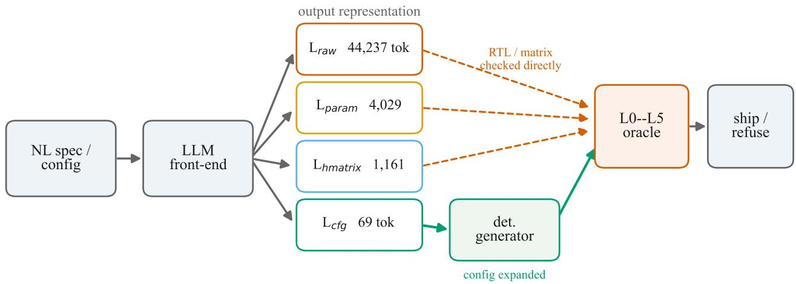
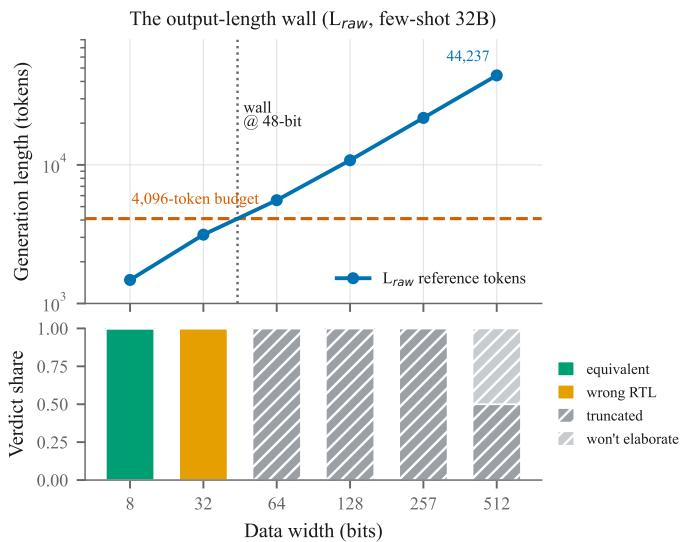
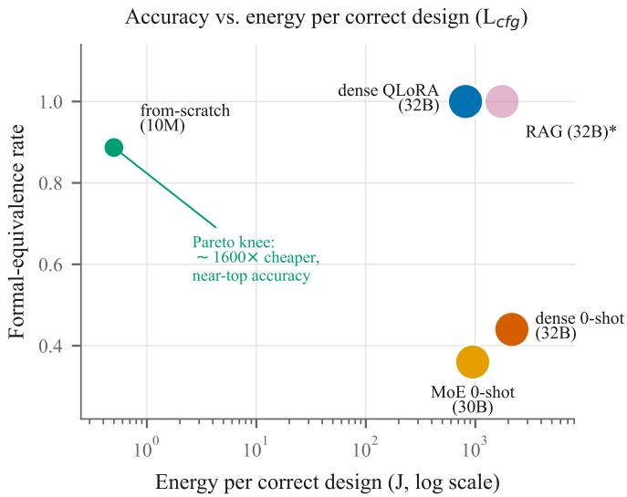

# Learn the Interface, Not the Implementation: Output Representation Dominates Training Regime in LLM-Based RTL Generation

Siddharth Patel†

Vikram Singh

Dept. of Electronics Engineering

STMicroelectronics

Siddharth Savyasachi Malu

Shiv Nadar Institution of Eminence

Greater Noida, India

AI Center of Excellence

Delhi-NCR, India

vikram.singh@st.com

Shiv Nadar Institution of Eminence

sp839@snu.edu.in

Delhi-NCR, India

siddharth.malu@snu.edu.in

Rohit Singh

Dept. of Electronics Engineering

Shiv Nadar Institution of Eminence

Delhi-NCR, India

rohit.singh@snu.edu.in

Abstract—Large-language-model register-transfer-level (RTL) generation has concentrated on how to train the model–finetuning, continued pre-training, reinforcement learning from a verifier. We argue this is the second-order question. On a bounded, formally-specifiable task–generating single-errorcorrecting, double-error-detecting (SECDED) ECC memory wrappers–we hold the task, data, and correctness oracle fixed and vary two axes independently: the training regime (seven settings) and the output representation (four levels, from fullyexpanded flat Verilog to an eight-field configuration expanded by a deterministic generator). Because a reference generator exists, correctness is decided by formal equivalence over a 107- point design space, not sampled from a hand-written testbench. Two results follow. (1) Representation dominates: every representation near raw RTL collapses to a ≤0.17 pass rate, while the configuration reaches 0.83 with no training at all–and once the model emits the configuration, every training regime lands in a 0.89–1.00 band. (2) Raw RTL hits a hard output-length wall: a 512-bit design is 44,237 tokens of flat Verilog against 69 tokens of configuration, so raw generation becomes infeasible above 32-bit data words rather than merely inaccurate. A sub-50M-parameter from-scratch model plus the verified generator reaches 0.89 formal-equivalence (against a 32B fine-tune’s 1.00) at ∼1600× lower inference energy per correct design, and inference energy dominates amortized training. The lesson is to learn the interface, not the implementation.

Index Terms—LLM for RTL, hardware generation, errorcorrecting codes, energy-efficient ML, program synthesis, neurosymbolic EDA, machine learning for design automation.

## I. INTRODUCTION

of flat parity logic. To specify the same hardware as an eightfield configuration—which a deterministic generator expands into that exact Verilog in milliseconds—takes 69. The two descriptions are equivalent; the gap between them is 640×, and this paper is about that gap. The prevailing question in LLM-based hardware generation is how to train the model— fine-tune it, pre-train it, reward it from a verifier. We show that a prior and larger question—what should the model output?—dominates it, deciding whether generation is even feasible, how often it is correct, and what it costs in energy. The incumbent a learned generator must beat is not another model but a deterministic tool that already emits every design correctly in six seconds; the only way a model earns its place is by writing less.

We make this precise. Fix a task with three properties that make it an unusually honest benchmark: it is bounded (a finite, enumerable parameter space), parameterised (structure repeats, so it is learnable), and formally checkable (a reference exists, so correctness is decidable rather than estimated). SECDED ECC memory-wrapper generation has all three. Every point in the space has a deterministic reference output, so we can ask of any model-generated design a question most RTL-generation work cannot answer cleanly: is it formally equivalent to the reference?

On this substrate we run a two-axis study. The first axis is the training regime: zero-shot, few-shot in-context learning, retrieval-augmented generation, LoRA and full supervised fine-tuning, continued pre-training then fine-tuning, and reinforcement learning from the formal oracle. This axis is where the literature lives. The second axis, which we argue matters more, is the output representation: the same design can be emitted as $\left( \mathrm { L } _ { \mathrm { r a w } } \right)$ flat Verilog, $\mathrm { ( L _ { p a r a m } ) }$ parameterised Verilog with generate loops, $( \mathrm { L } _ { \mathrm { h m a t r i x } } )$ a parity-check matrix plus wrapper options, or $\mathrm { ( L _ { c f g } ) }$ an eight-field configuration that a deterministic back-end expands into RTL. These four describe the same hardware and span three orders of magnitude in generation length. Holding the model and recipe constant and varying only the representation isolates its causal effect (Fig. 1).

## Contributions.

• An oracle-complete benchmark. Because a deterministic reference generator exists, every point in a $1 0 ^ { 7 } \mathrm { - }$ reachable design space has a machine-verified reference and formal equivalence is decidable. To our knowledge this is the first RTL-generation benchmark where correctness is decided rather than sampled from a small handwritten test set.

• A controlled two-axis study—seven training regimes × four output representations, one task, one dataset, one oracle—that isolates representation from training regime and shows the former dominates.

• The first energy-accounted RTL-LLM study, reported in the unit a deployment cares about (joules per correct design), together with a data-leakage result and a widthdisjoint split protocol that removes it.

• A specification-compression result: a sub-50Mparameter model, backed by the verified generator, reaches 0.89 formal-equivalence (against a 32B finetune’s 1.00) at ∼1600× lower inference energy per correct design—evidence that for bounded, formallyspecifiable tasks one should learn the interface, not the implementation.

## II. RELATED WORK

LLMs for RTL. A line of work benchmarks and improves language-model generation of Verilog: evaluation suites [1], [2], data- and fine-tuning-centric methods [3], [4], [5], correctness- and repair-oriented approaches [6], [7], and preference- or RL-based tuning [8], [9]. These works benchmark models: they hold the output (Verilog) fixed and vary the model or its training. Our study is orthogonal—we hold the model family fixed and vary the output representation, and show that axis dominates. Program synthesis. That generating into a constrained intermediate representation and expanding deterministically beats generating the final artifact directly is old in program synthesis and grammar-constrained decoding [10], [11]; we give a quantitative, energy-accounted instance for hardware and identify the mechanism—an outputlength wall—that makes it not merely better but necessary at scale. Energy accounting. Methodology for measuring ML training and inference energy [12], [13], [14], [15] motivates our instrumentation; to our knowledge no prior RTLgeneration study reports energy, and we report it per correct design.

## III. TASK AND BENCHMARK

SECDED wrappers. A SECDED code augments a kbit data word with r check bits so that any single-bit error is corrected and any double-bit error detected; we use the Hsiao odd-weight-column construction, which minimizes encoder/decoder XOR depth. The wrapper composes this datapath with a memory macro and options for port configuration, diagnostic readout, debug exposure, ECC-bypass, and bytewrite. Byte writes require a read-modify-write, which is only meaningful on a single-port memory, a design constraint we adopt and justify, not an arbitrary restriction.

TABLE I  
THE FOUR OUTPUT REPRESENTATIONS (512-BIT DESIGN).
<table><tr><td>Level</td><td>Output</td><td>Tokens</td><td>Back-end</td></tr><tr><td>Lraw</td><td>flat expanded Verilog</td><td>≈44,237</td><td>none</td></tr><tr><td>Lparam</td><td>parameterised, generate loops</td><td>≈4,029</td><td>none</td></tr><tr><td>Lhmatrix</td><td>parity matrix + wrapper opts</td><td>≈1,161</td><td>matrix expander</td></tr><tr><td> $\mathrm { L _ { c f g } }$ </td><td>8-field configuration</td><td>69</td><td>full generator</td></tr></table>

Design space and the leakage trap. The deployment space is the enumerable product of depth, width, port type, and four options subject to the byte-write rule: 3,584 valid configurations. A structural fact drives everything: the encoder and decoder depend on the data width alone, so across all 3,584 configurations there are only eight distinct encoders and eight distinct decoders – all combinatorial variety lives in the wrapper. Hence a config that shares its width with any training config shares its encoder file byte-for-byte, and a random config-level split leaks labels. We measure this: under config-disjoint splits the train–test near-duplicate rate reaches 0.65–1.00 depending on width overlap, and it rises monotonically with corpus size (the lowest split grows from 0.53 at 2,000 samples to 0.65 at 6,000), so these are a conservative lower bound. We therefore adopt width-disjoint splits for every generalization claim: test widths never appear in training in any representation, so a held-out design’s encoder was never seen in any form. Because the reference generator accepts arbitrary widths and depths, it is a free, perfectlylabelled data source over ${ \sim } 1 0 ^ { 7 }$ verifiable configurations – which is what lets a from-scratch model be trained at all— while the deployment grid serves as a held-out, in-distribution test set.

The oracle harness. Correctness is decided by a fivelevel harness, each a strict gate. L0 lints; L1 elaborates; L2 runs a self-checking testbench with exhaustive single-bit fault injection and random double-bit injection; L3 formally checks equivalence against the reference; L4 synthesizes and reports a PPA delta; L5 checks that illegal configurations are refused. Each level is validated on the reference itself before it scores models, so a passing score is trustworthy; L3/L4 use an open equivalence/synthesis flow (Yosys [10]).

The representation ladder. Table I defines the four output languages and their generation lengths for the widest design: the same task, spanning three orders of magnitude in length, with a full deterministic expander only at the shortest rung.

## IV. METHOD

Training regimes. We evaluate seven. Zero-shot and fewshot $( k \in \{ 1 , 3 , 5 \} )$ use a base coder model with no weight updates. Retrieval-augmented generation supplies the k nearest configurations as in-context demonstrations; we distinguish it from a nearest-neighbour-copy probe that returns the retrieved reference unchanged and, under width-disjoint splits, is structurally incapable of succeeding (a memorization control). LoRA and full supervised fine-tuning train on the labelled corpus; continued-pre-training-then-SFT first adapts on unlabelled RTL; verifier-guided RL optimizes a reward from compile, simulation, and formal-equivalence signals minus an area penalty—a dense, perfect, cost-free reward most RTL settings lack.

  
Fig. 1. The pipeline and the representation ladder. A natural-language spec or configuration enters the LLM front-end, which emits one of four output representations—shown with their 512-bit token counts. Only the configuration $\mathrm { ( L _ { c f g } ) }$ is expanded by a deterministic generator; the raw, parameterised, and parity-matrix forms are emitted as implementation and checked directly against the reference by a five-level oracle (L0–L5), then shipped or refused. The two longest representations exceed a practical single-response generation budget—the output-length wall.

Models. The fine-tuning rows use open-weight, selfhostable, Apache-2.0-licensed models: Qwen2.5-Coder-32B-Instruct (dense) and Qwen3-Coder-30B-A3B-Instruct (a mixture-of-experts model with ≈3B active parameters); the small full-fine-tune, CPT, and RL rows use Qwen2.5-Coder-1.5B-Instruct. The from-scratch models are decoder-only transformers swept at 10M/50M/125M/350M parameters; the headline configuration is a sub-50M model that emits only the eight-field configuration and runs on CPU, letting the deployed tool generate without a GPU.

Energy methodology. GPU energy is read from the device’s firmware energy counter as a delta across the run (avoiding power-polling error) and per GPU, so a co-resident job does not contaminate it—a subtlety that, uncorrected, roughly doubled our initial figures. We subtract a multi-minute idle baseline and repeat each measurement (n=3). Clocks were unpinned and RAPL unreadable, so figures are GPU energy only. We report joules per generated design and—the deployment-relevant unit—joules per correct design (J/design ÷ pass rate).

## V. RESULTS

Representation dominates. Table II is the study’s spine: pass rate for each training regime × output representation. Read it two ways. Across the ladder (the few-shot row, the only regime run at every representation): every representation closer to $\mathrm { R T L - L _ { r a w } , L _ { p a r a m } , L _ { h m a t r i x } }$ —collapses to 0.17, while $\mathrm { L _ { c f g } }$ reaches 0.83 with no training. Down the configuration column: every regime lands in a 0.89–1.00 band. Once the model emits the configuration, the training method barely matters. The lever is the representation, not the optimizer.

TABLE II  
PASS RATE BY REGIME × REPRESENTATION, SCORED BY L3 FORMAL EQUIVALENCE TO THE REFERENCE (IN-DISTRIBUTION). $\stackrel { \scriptscriptstyle 6 6 } { - } :$ INTENTIONALLY NOT RUN (SEC. V).
<table><tr><td>Regime \ Repr.</td><td> $\mathrm { L } _ { \mathrm { r a w } }$ </td><td> $\mathrm { { L _ { p a r a m } } }$ </td><td> $\mathrm { L } _ { \mathrm { h m a t r i x } }$ </td><td> $\mathrm { L _ { c f g } }$ </td></tr><tr><td>few-shot</td><td>0.17</td><td>0.17</td><td>0.17</td><td>0.83</td></tr><tr><td>nn-copy</td><td></td><td></td><td></td><td>0.00</td></tr><tr><td>RAG</td><td></td><td></td><td></td><td>1.00</td></tr><tr><td>LoRA-SFT</td><td></td><td></td><td>0.00†</td><td>1.00</td></tr><tr><td>full-SFT</td><td></td><td></td><td></td><td>0.975</td></tr><tr><td>CPT-SFT</td><td></td><td></td><td></td><td>1.00</td></tr><tr><td>verifier-RL</td><td></td><td></td><td></td><td>1.00</td></tr><tr><td>from-scratch</td><td></td><td></td><td></td><td>0.887</td></tr></table>

The token wall. The raw-RTL route does not merely lose accuracy; above a measurable width it becomes infeasible. A 512-bit flat encoder is thousands of parity terms; the full design is ≈44,237 tokens against 69 for the configuration, exceeding any current single-response generation budget. Fig. 2 plots pass rate against generation length per width, with truncation (“ran out of budget”) held as a verdict distinct from incorrect RTL (“got it wrong”): the former is the wall, the latter a correctness failure, and conflating them would erase the finding. At a 4,096-token budget, flat $\mathrm { L } _ { \mathrm { r a w } }$ generation is feasible only up to 32-bit data words (≈3,137 tokens) and infeasible at 48 bits and beyond (≈4,521 tokens). The wall is a property of the representation and the budget, not of the model.

Representation dominates even without a length wall. The parity-matrix rung $( \mathrm { L } _ { \mathrm { h m a t r i x } } ,$ , ≤1,161 tokens) is compact, so its failure is not a length wall but a correctness wall.

\*RAG energy is shared-box (provisional); all others GPU-isolated.  
  
Fig. 2. Pass rate versus generation length, per width. Truncation is shown distinct from incorrect RTL. Flat $\mathrm { L } _ { \mathrm { f a w } }$ generation is feasible only up to 32-bit words and hits the wall at 48 bits (4,096-token budget).

Five LoRA fine-tuning seeds do not close it: every seed reaches $\mathrm { L } 3 = 0 . 0 0$ , and, checked reference-independently by exhaustive fault injection, 0 of 60 emitted matrices is a valid SECDED code of any dimension—the model over-generates the column list, emitting r ≈26–181 check bits where 5–9 are required, often with even-weight or duplicate columns, so single-bit errors are mis-corrected. It does not emit a valid-butdifferent code; it does not emit a valid code at all. Only $\mathrm { L _ { c f g } , }$ where the oracle emits the matrix, reaches 1.00. Training does not buy a valid parity matrix at this budget; the representation does.

Energy: the specification-compression result. Fig. 3 and Table III report formal-equivalence rate against joules per correct design (energy per design divided by pass rate): the from-scratch configuration model is roughly three orders of magnitude (∼1600×) more efficient per correct design than the 32B fine-tune, at comparable accuracy. This is the result in one number—emitting 69 tokens of configuration into a verified generator, rather than tens of thousands of tokens of Verilog, is where the efficiency comes from. Amortized training energy is small against lifetime inference: 0.032 kWh of fine-tuning over the deployment grid is ∼32 J/design, against ∼814 J/design at inference for the same model—inference dominates amortized training by roughly 25×, and more as designs accumulate. This inverts the usual ML framing that fixates on training cost: lifetime cost is set by output length, which is the representation.

Scaling, OOD, and refusal. A from-scratch scaling sweep (10M–350M) with tokenizer and grammar-constraineddecoding ablations confirms that a sub-50M configuration model suffices. Out-of-distribution testing (Table IV) separates the regimes that tie at 1.00 in-distribution. Unseen widths degrade retrieval and the from-scratch model (0.89, 0.66) while the pretrained fine-tunes hold; unseen option combinations are easy for all (0.93–1.00), so the width axis is where generalization breaks. The sharpest separator is refusal of illegal configurations: every pretrained-LLM regime refuses perfectly (1.00)—it emits the illegal configuration faithfully and the oracle rejects it—but the efficiency-winning grammarconstrained from-scratch model refuses only 0.59, silently legalizing 41% of illegal specs. Trained only on the legal manifold, its constrained decoder cannot emit an invalid config, so it rounds illegal requests to nearby valid ones. The cheapest model carries a safety cost the expensive ones do not—an efficiency–safety trade-off only an illegal-input test exposes.

TABLE III  
JOULES PER correct DESIGN (= J/DESIGN ÷ PASS RATE). ALL ROWS ARE GPU-ISOLATED (PER-GPU NVML ENERGY COUNTER, IDLE-SUBTRACTED, $n { = } 3 .$ , GPU ENERGY ONLY); CLOCKS UNPINNED (SEC. VII).
<table><tr><td>Method  $\mathrm { ( L _ { c f g } ) }$ </td><td>Pass</td><td>J/design</td><td>J/correct</td></tr><tr><td>from-scratch (&lt;50M)</td><td>0.887</td><td>0.44</td><td>0.50</td></tr><tr><td>MoE zero-shot</td><td>0.36</td><td>341</td><td>947</td></tr><tr><td>dense QLoRA</td><td>1.00</td><td>814</td><td>814</td></tr><tr><td>dense zero-shot</td><td>0.44</td><td>950</td><td>2,159</td></tr></table>

  
Fig. 3. Formal-equivalence rate versus energy per correct design (log xaxis); bubble size is parameter count, colour is representation. All points are GPU-isolated (NVML counter, idle-subtracted, unpinned) except RAG, a provisional shared-box measurement (flagged in the plot). The fromscratch configuration model occupies the high-accuracy, low-energy corner— the specification-compression result made visual.

Why the raw-RTL cells are blank. The empty cells in Table II are not omissions: one does not fine-tune a model to emit 44k tokens of flat Verilog, so the $\mathrm { L _ { r a w } / L _ { p a r a m } }$ cells are blank because the representation is infeasible. The one compact rung without a length wall, $\mathrm { L } _ { \mathrm { h m a t r i x } }$ , we deliberately filled: the gap there is correctness, not feasibility.

## VI. DISCUSSION

Don’t fine-tune; retrieve. Four regimes reach 1.00 on the configuration, and one of them—retrieval-augmented generation—requires no weight updates, negligible energy, and trivial updating when the design space changes. On a bounded, template-structured task the honest recommendation is therefore not “fine-tune a model” but “retrieve and let the verified back-end expand.” The OOD table stress-tests this and it largely survives: retrieval refuses illegal configurations perfectly (1.00), and its one weakness is unseen widths (0.89), where a light fine-tune buys extrapolation. Notably the regime that does fail the safety test is the ultra-cheap grammarconstrained from-scratch model—so “cheapest” and “safest” are not the same choice.

TABLE IV  
OUT-OF-DISTRIBUTION BEHAVIOUR (LCFG); CONFIG-EXACT, EXCEPT THE LAST COLUMN (REFUSAL ACCURACY ON ILLEGAL SPECIFICATIONS: FRACTION not SILENTLY LEGALIZED).
<table><tr><td>Regime</td><td>ID (deploy)</td><td>OOD width</td><td>OOD combo</td><td>illegal refusal</td></tr><tr><td>RAG</td><td>1.00</td><td>0.887</td><td>0.93</td><td>1.00</td></tr><tr><td>LoRA-SFT</td><td>1.00</td><td>1.00</td><td>1.00</td><td>1.00</td></tr><tr><td>CPT-SFT</td><td>1.00</td><td>1.00</td><td>1.00</td><td>1.00</td></tr><tr><td>verifier-RL</td><td>1.00</td><td>0.975</td><td>0.95</td><td>1.00</td></tr><tr><td>from-scratch</td><td>0.887</td><td>0.662</td><td>1.00</td><td>0.59</td></tr></table>

When is an LLM the right EDA tool? Not to replace a working deterministic generator on its own turf—the incumbent shell command is faster and always correct—but at the edges it cannot serve: mapping an underspecified or natural-language request onto a valid configuration, behind a verification gate that returns RTL only when it is proven equivalent to the reference. The deployed architecture reflects this: the model writes the interface, the generator writes the implementation, and the oracle decides.

## VII. THREATS TO VALIDITY

We study one ECC scheme and one generator, so external validity is limited; the mechanism—an output-length wall and a representation that dodges it—is not specific to ECC, but a second oracle-complete task family is left to future work. The reference generator emits template-structured RTL, so results may not transfer to unconstrained human-written RTL; we quantify corpus entropy (few distinct encoders/decoders) so readers can calibrate. “Correctness” is equivalence to a standard minimal-Hsiao reference; a different valid construction would define a different reference, but a freshly-generated wrapper is internally self-consistent regardless. The energy figures are GPU-isolated—which removed a real co-residentjob contamination that had inflated earlier numbers—but the clocks are unpinned and RAPL was unreadable, so they are GPU energy only. The relative orderings (configuration ≪ raw RTL; MoE < dense; inference ≫ training) are robust to all of this and are the claims we rest on. The three OOD columns come from a single run per regime (reproducing the in-distribution headline exactly for three regimes and within seed variance for the other two), so the four-way tie is three robust regimes plus one higher-variance. Natural-language specifications are model-paraphrased; a held-out set of real user prompts, and a systematic contamination probe against pre-training data, are left to future work.

## VIII. CONCLUSION

On a bounded, formally-specifiable hardware-generation task with a decidable correctness oracle, the output representation dominates the training regime: raw RTL generation hits a hard output-length wall and becomes infeasible above a measurable width, while emitting a short configuration into a verified generator reaches near-perfect accuracy under essentially any training regime—including none. A sub-50M fromscratch model, backed by the generator, reaches 0.89 formalequivalence against a 32B fine-tune’s 1.00 at ∼1600× lower energy per correct design, and inference energy dominates amortized training. The engineering lesson is to learn the interface, not the implementation; the methodological lesson is that template-structured RTL benchmarks must control for cross-split near-duplication. We release the generator, the oracle-complete benchmark, the verification harness, and the from-scratch weights.

## REPRODUCIBILITY

All code, the frozen and hashed data splits, the verification harness, and the from-scratch weights are released in a public repository at https://github.com/thesid16/learn-the-interface. Every number in this paper is recorded—with its verification level, sample size, and provenance—in a machine-readable results file at the repository root, and the paper cites no number absent from it. A clean checkout reproduces the generator and oracle (property-tested), byte-level determinism (every configuration identical across two runs), and the width-disjoint leakage audit.

## ACKNOWLEDGMENT (AI DISCLOSURE)

In accordance with the conference policy: an AI coding assistant was used for portions of the software implementation. All numerical results were produced by the released, deterministic pipeline and verified by formal equivalence; the authors are responsible for all claims.

## REFERENCES

[1] M. Liu, N. Pinckney, B. Khailany, and H. Ren, “VerilogEval: Evaluating large language models for Verilog code generation,” in Proc. IEEE/ACM Int. Conf. Computer-Aided Design (ICCAD), 2023.

[2] Y. Lu, S. Liu, Q. Zhang, and Z. Xie, “RTLLM: An open-source benchmark for design RTL generation with large language model,” in Proc. Asia and South Pacific Design Automation Conf. (ASP-DAC), 2024.

[3] S. Thakur et al., “VeriGen: A large language model for Verilog code generation,” ACM Trans. Design Automation of Electronic Systems (TODAES), vol. 29, no. 3, 2024.

[4] S. Liu et al., “RTLCoder: Outperforming GPT-3.5 in design RTL generation with an open-source dataset and lightweight solution,” in Proc. IEEE Int. Workshop on LLM-Aided Design (LAD), 2024.

[5] M. Liu et al., “ChipNeMo: Domain-adapted LLMs for chip design,” arXiv:2311.00176, 2023.

[6] M. Liu, Y.-D. Tsai, W. Zhou, and H. Ren, “CraftRTL: High-quality synthetic data generation for Verilog code models with correct-byconstruction non-textual representations and targeted code repair,” in Proc. Int. Conf. Learning Representations (ICLR), 2025.

[7] F. Cui et al., “OriGen: Enhancing RTL code generation with code-tocode augmentation and self-reflection,” in Proc. IEEE/ACM Int. Conf. Computer-Aided Design (ICCAD), 2024.

[8] Z. Pei, H.-L. Zhen, M. Yuan, Y. Huang, and B. Yu, “BetterV: Controlled Verilog generation with discriminative guidance,” in Proc. Int. Conf. Machine Learning (ICML), 2024.

[9] Z. Chen et al., “ChipSeek-R1: Generating human-surpassing RTL with LLM via hierarchical reward-driven reinforcement learning,” arXiv:2507.04736, 2025.

[10] C. Wolf and J. Glaser, “Yosys—a free Verilog synthesis suite,” in Proc. Austrochip, 2013.

[11] S. Geng, M. Josifoski, M. Peyrard, and R. West, “Grammar-constrained decoding for structured NLP tasks without finetuning,” in Proc. Conf. Empirical Methods in Natural Language Processing (EMNLP), 2023.

[12] E. Strubell, A. Ganesh, and A. McCallum, “Energy and policy considerations for deep learning in NLP,” in Proc. Annual Meeting of the Association for Computational Linguistics (ACL), 2019.

[13] D. Patterson et al., “Carbon emissions and large neural network training,” arXiv:2104.10350, 2021.

[14] A. Tschand et al., “MLPerf Power: Benchmarking the energy efficiency of machine learning systems from µWatts to MWatts for sustainable AI,” in Proc. IEEE Int. Symp. High-Performance Computer Architecture (HPCA), 2025.

[15] J. You, J.-W. Chung, and M. Chowdhury, “Zeus: Understanding and optimizing GPU energy consumption of DNN training,” in Proc. USENIX Symp. Networked Systems Design and Implementation (NSDI), 2023.