# Learning from a Bandit Learner

Michela Petriconi University of Tübingen University of Technology Nuremberg

Nicolas Menet ETH Zurich

Claire Vernade University of Technology Nuremberg

## Abstract

Classical inverse bandit methods typically aim to recover true reward parameters. In contrast, this paper proposes inferring a demonstrator’s subjective beliefs, specifically, their internal sub-optimality gap estimates. We consider no-regret demonstrators following a randomized policy (e.g. Thompson sampling) and characterize a family of such algorithms for which per-step inversion is possible, allowing gap estimates to be recovered directly from the arm-selection distribution. Our analysis identifies an inherent stability-coverage trade-of. Inversion becomes ill-conditioned as the demonstrator concentrates its probability mass on a single arm, while the number of informative rounds depends on the rate at which its policy converges. We delineate conditions under which inversion is reliable and establish theoretical guarantees on the resulting estimation error. Experiments on simulated data support the analysis and illustrate how these conditions afect gap recovery in practice.

## 1 INTRODUCTION

Imagine going to the casino with a friend. As they decide to try their luck on the slot machines, you sit back and watch, observing them progressively allocate their coins to the machines. Suppose your friend (the learner) has recently read Bandit Algorithms (Lattimore and Szepesvári, 2020) and can perform a no-regret learning strategy, but you (the observer ) do not know exactly which one. Can you infer their belief on the average rewards of the machines?

We study the problem of learning from a learner (Jacq et al., 2019) in the bandit setting, a variation of the Inverse Bandits (IB) problem (Guo et al., 2022; Guha et al., 2024) that we address under diferent assumptions and observation models. Guo et al. (2022) study a white-box setting in which the observer knows the learner’s internal decision mechanism exactly and uses it explicitly to form estimates of the true mean rewards, that are recoverable only up to a constant due to the unidentifiability of inverse problems (Russell, 1998). In contrast, we propose a formulation that relaxes the white-box assumption. Specifically, we assume that the demonstrator belongs to a broad family of randomized, no-regret bandit algorithms, and that the observer has access to the realized action sequence, with neither knowledge of the exact policy that generated it nor of the rewards associated with the played actions. However, we assume that the observer can form an estimate of the demonstrator’s sampling probability. Under this structured grey-box assumption we target the learner’s internal beliefs about the means, which may not coincide with the true means (Halder et al., 2025). This shift is deliberate: these beliefs govern the behavior of a demonstrator that is still learning and, without additional information, are the only reward-related quantities that can be learned from its actions. Even if the beliefs on the rewards are biased, a second learner can leverage them to construct a better policy for the same task, in the spirit of “better than the demonstrator” approaches (Brown et al., 2020).

We focus on randomized algorithms, which implicitly or explicitly sample arms at each round from a distribution that depends on an internal estimate of the mean rewards and the learner’s uncertainty. The most prominent such algorithm is Thompson Sampling (TS) (Thompson, 1933; Russo et al., 2018), which pulls arms according to the probability that their mean reward is larger than all others, what Menet et al. (2025) call Probability of Maximality (PoM). In TS, the sampling probability is implicit via an indirect posterior sampling mechanism, making it dificult to recover the belief parameter in closed form from the sampling distribution.

Our first contribution is a general class of randomized bandit algorithms whose sampling probabilities admit a closed-form relationship with their internal mean estimates. Building on the Linear-Time Independencebased Estimator (LITE) of Menet et al. (2025), in Section 2.2 we introduce v-LITE Sampling (v-LS), which turns the LITE estimator into a sampling rule. Under suitable assumptions, we provide regret bounds for v-LS in Appendix B.

Our second contribution is an inversion method for this class of learners. In Section 4, we show how the demonstrator’s sampling probabilities can be inverted to recover its internal gap estimates. We derive inversion-error bounds when the sampling probabilities are available only through estimates, including under batched observations. To move beyond exactly specified v-LS demonstrators, we define a broader family of algorithms whose internal gaps and sampling policies are close to those of a reference v-LS learner. For this family, the reconstruction error is controlled jointly by the sampling-probability estimation error and the mismatch with the reference policy. We support these theoretical results with simulations.

## 2 PRELIMINARIES

A stochastic bandit instance (Lattimore and Szepesvári, 2020) is defined as a collection of reward distributions $\nu = ( \nu _ { a } : a \in [ K ] )$ , where $[ K ] : = \{ 1 , 2 , \dots , K \}$ denotes the set of available actions (bandit arms). For the remainder of this paper, we assume the reward noise to be zero-mean Gaussian, with variance $\alpha ^ { 2 }$ , meaning each arm’s reward distribution is $\nu _ { a } = \mathcal { N } ( \theta _ { a } , \alpha ^ { 2 } )$ , where $\theta _ { a } : = \mathbb { E } _ { R \sim \nu _ { a } } [ R ]$ denotes its expected reward. In our Bayesian formulation, the vector of arm means $\theta =$ $( \theta _ { 1 } , \ldots , \theta _ { K } )$ may have a correlated Gaussian prior; that is, its prior covariance matrix need not be diagonal. Conditional on $\theta ,$ the observation noise is independent across rounds.

The learner interacts with the environment over a horizon of $T$ rounds. At each round $t ,$ the learner selects an action $a _ { t } \in [ K ]$ , then the environment samples a reward $r _ { t } \sim \nu _ { a _ { t } }$ and reveals it to the learner.

Define $\begin{array} { r } { N _ { a } ( t ) : = \sum _ { i = 1 } ^ { t } \mathbb { 1 } \{ a _ { j } = a \} } \end{array}$ , i.e., the number of pulls of arm a at time t. The optimal arm is defined as $a ^ { * } : = \arg \operatorname* { m a x } _ { a \in [ K ] } \theta _ { a }$

A learning algorithm is said to be no-regret if its cumulative regret, $\mathbb { E } [ \sum _ { t = 1 } ^ { T } \theta _ { a ^ { * } } - \theta _ { a _ { t } } ]$ , grows sub-linearly with the horizon T. Classical algorithms known to achieve sub-linear regret include Upper Confidence Bound (UCB) (Auer et al., 2002; Srinivas et al., 2009) and TS (Thompson, 1933; Russo et al., 2018).

Throughout the paper, we use the terms learner and demonstrator interchangeably to refer to the online learning algorithm that sequentially selects actions, observes their rewards, and aims to minimize regret relative to the best arm. The observer, by contrast, has access only to the resulting action trajectory $\{ a _ { t } \} _ { t = 1 } ^ { T }$ , together with any information permitted by the specified observation protocol, and never observes the corresponding rewards.

## 2.1 TS and the Probability of Maximality

TS (Thompson, 1933; Agrawal and Goyal, 2013; Russo et al., 2018) is a Bayesian algorithm for sequential decision-making that balances exploration and exploitation through posterior sampling. While being arguably the oldest strategy for bandit play, it has remained popular, e.g., enabling analysis of coding agents (Menet et al., 2026a) or improving robustness of LLM posttraining (Menet et al., 2026b). In TS, the learner maintains a posterior distribution $p _ { t }$ over the unknown parameters $( \theta _ { a } ) _ { a \in [ K ] }$ governing the reward distribution of all arms. At each round $t ,$ the learner samples $Z _ { t } \sim p _ { t }$ from the current posterior and selects the arm

$$
a _ { t } = \operatorname * { a r g m a x } _ { a \in [ K ] } Z _ { a , t } ,\tag{1}
$$

observes the associated reward $r _ { t } \sim \nu _ { a _ { t } }$ , and updates the posterior via Bayes rule. In particular, under a Gaussian prior over the rewards, $\theta \sim \mathcal { N } ( \mu _ { 0 } , \Sigma _ { 0 } )$ and assuming known noise variance $\alpha ^ { 2 }$ , after selecting arm $a _ { t } = a$ the update has a closed form $\mathscr { N } ( \mu _ { t + 1 } , \Sigma _ { t + 1 } )$ Defining $H _ { t } ~ \in ~ \mathbb { R } ^ { K \times K }$ as a diagonal matrix with $[ H _ { t } ] _ { a , a } = N _ { a } ( t )$ , the covariance matrix and mean vector are updated as:

$$
\Sigma _ { t + 1 } = ( \Sigma _ { 0 } ^ { - 1 } + \alpha ^ { - 2 } H _ { t } ) ^ { - 1 } ,\tag{2}
$$

$$
\begin{array} { r } { \mu _ { t + 1 } = \Sigma _ { t + 1 } \left( \Sigma _ { 0 } ^ { - 1 } \mu _ { 0 } + \alpha ^ { - 2 } \sum _ { s = 1 } ^ { t } r _ { s } e _ { a _ { s } } \right) , } \end{array}\tag{3}
$$

where $e _ { a , \mathscr { a } }$ is the standard basis vector for the arm pulled at round s. We denote the marginals for each arm as $\mathcal { N } ( \mu _ { a , t } , \sigma _ { a , t } ^ { 2 } )$ , where $\mu _ { a , t } \ = \ [ \mu _ { t } ] _ { a }$ and $\sigma _ { a , t } ^ { 2 } = [ \Sigma _ { t } ] _ { a , a } .$ Importantly, $\Sigma _ { t }$ depends solely on the initial prior covariance and the action history, making the sequence of marginal uncertainties $\sigma _ { a , t }$ perfectly deterministic and observable (Equation (2)). In contrast, $\mu _ { t }$ depends on the observed rewards $r _ { s }$ (Equation (3)), which is observable to the learner but not to the inverse learner.

The randomized mechanism of Equation (1) was originally designed by Thompson (1933) to approximate the likelihood that one arm’s mean reward is larger than those of all other arms, the so called Probability of Maximality (PoM). Indeed, it can be shown1 that the conditional distribution of the identity of the optimal arm coincides exactly with that of the action chosen by TS:

$$
\underbrace { \mathbb { P } \big ( \arg \operatorname* { m a x } \theta _ { b } = \cdot \mid \mathcal { F } _ { t - 1 } \big ) } _ { : = \mathrm { P o M } ( t ) } = \underbrace { \mathbb { P } \big ( a _ { t } = \cdot \mid \mathcal { F } _ { t - 1 } \big ) } _ { \mathrm { T S ~ s a m p l i n g ~ p r o b . } }
$$

where $\mathcal { F } _ { t - 1 }$ denotes all observations up to round t − 1.

## 2.2 LITE sampling

Although the TS mechanism already provides samples from the PoM, direct access to it opens up new possibilities such as Entropy Search (Hennig and Schuler, 2012; Menet et al., 2025), Bayes-optimal batch selection (Fromer et al., 2025; Menet et al., 2025), policies for zero-sum two-player games (O’Donoghue and Lattimore, 2021), and scaling up Thompson sampling via fine-tuning of LLMs (Menet et al., 2026c).

Therefore, we introduce a family of algorithms whose sampling probability is directly connected to the PoM. Definition 2.1 (v-LITE). Let $v : \mathbb { R } \to ( 0 , 1 )$ be a strictly increasing and continuously diferentiable CDF, and let $\mu _ { a } \in \mathbb { R } , \sigma _ { a } > 0$ be given location and scale parameters for each arm a $\in [ K ]$ . We define the v-LITE estimator of PoM as the probability vector q with

$$
q _ { a } : = v \Big ( \frac { \mu _ { a } - \kappa ^ { * } } { \sigma _ { a } } \Big ) \quad \forall a \in [ K ] ,\tag{4}
$$

where the threshold $\kappa ^ { \ast } \in \mathbb { R }$ is the unique constant ensuring normalization, i.e., that $\textstyle \sum _ { a = 1 } ^ { K } q _ { a } = 1$

Given that this approximate PoM (qt) can be obtained eficiently via binary search for $\kappa ^ { * }$ (Menet et al., 2025), a natural approximation to TS is a randomized algorithm that samples arms directly according to v-LITE.

Definition 2.2 (v-LITE Sampling, v-LS). At round $t ,$ v-LS computes ${ { q } _ { a , t } }$ according to Definition 2.1, where $( \mu _ { a , t } , \sigma _ { a , t } )$ are the posterior mean and standard deviation of the Gaussian marginals $\theta _ { a }$ . Then, v-LS selects an action $a _ { t } \sim \operatorname { C a t } ( q _ { t } )$ and updates the posterior parameters.

The v-LS family is motivated by two prominent special cases that approximate TS:

• VBOS: Setting $v ( x ) = \Psi ( x ) : = \exp ( - ( \sqrt { x ^ { 2 } + 4 } -$ $x ) ^ { 2 } / 8 )$ recovers variational Bayesian optimistic sampling (VBOS), a popular and theoretically sound no-regret approximation of TS for subgaussian rewards (O’Donoghue and Lattimore, 2021; Tarbouriech et al., 2023; Menet et al., 2026c).

• F-LITE: Setting $v = \Phi$ , where Φ is the standard normal CDF, recovers the F-LITE estimator of Gaussian PoM (Menet et al., 2025). F-LITE is a highly accurate TS approximation derived using extreme value theory, though no-regret guarantees are not established for bandit play under Φ-LS.

v-LS applies under broad distributional assumptions; its no-regret properties are established in Appendix B. Particularly, for subgaussian θ and $v ( x ) = \Psi ( x ) ,$ it achieves $\tilde { \mathcal { O } } ( \sqrt { T K } )$ regret (Tarbouriech et al., 2023).

In the correlated Gaussian setting, this improves to $\widetilde { \mathcal { O } } ( \sqrt { T \gamma _ { T } } )$ (Menet et al., 2026c), where $\gamma _ { T }$ is the emaximum information gain (Srinivas et al., 2009) and scales as O(d log T) for an efective dimension d. We write LS when referring collectively to v-LS for all admissible choices of v.

## 3 PROBLEM FORMULATION

We consider a randomized no-regret algorithm A as a demonstrator. In each round t, A samples $a _ { t } \sim p _ { t }$ conditional on its interaction history $\mathcal { F } _ { t - 1 }$

The observer has access to the complete action trajectory $\{ a _ { t } \} _ { t = 1 } ^ { T }$ , but not to the corresponding rewards. We assume that the observation protocol permits the construction of estimates $\hat { p } _ { t }$ of the conditional action distributions $p _ { t } ,$ either from the trajectory itself or from additional action-level observations. In Section 4.2.1, we quantify how the estimation error in $\hat { p } _ { t }$ afects inversion under suitable approximation guarantees.

Access to $\hat { p } _ { t }$ is behavioral rather than white-box: the observer does not see the realized rewards, the demonstrator’s internal beliefs, or the exact mechanism mapping its history to $p _ { t }$ . We initially impose no relationship between the demonstrator’s internal reward estimates and its sampling probabilities. The structural assumptions that make inversion possible are introduced in Section 4.

Objective. Our goal is to recover the internal gap estimates that drive the demonstrator’s behavior, focusing on the rounds during which it is still actively exploring. Because the observer does not observe rewards, it cannot identify the true optimal arm. We therefore use the empirically most-pulled arm as an observable reference: $\begin{array} { r } { \hat { a } ^ { * } : = \arg \operatorname* { m a x } _ { a } N _ { a } ( T ) } \end{array}$ , where ties are broken arbitrarily. For each $a \in [ K ]$ and $t \leq T$ we define the demonstrator’s unobserved internal gap estimate relative to $\hat { a } ^ { * }$ as

$$
\Delta _ { a , t } ^ { \mathcal { A } } = \mu _ { \hat { a } ^ { * } , t } - \mu _ { a , t } ,\tag{5}
$$

where $\mu _ { a , t }$ is the demonstrator’s internal mean estimate for arm a at time t. These stepwise gaps act as a recentering of the internal estimates around the reference arm $\hat { a } ^ { * }$

Once the demonstrator concentrates its play on a single arm, its behavior becomes near-deterministic and therefore contains little information about the magnitude of the remaining gaps: many diferent internal gap values induce essentially the same near-deterministic behavior. In that regime, continued inversion is neither statistically stable nor necessary for explaining the demonstrator’s decisions. To reflect this, we restrict inversion to a set of relevant rounds, $M _ { T } ^ { \gamma }$ , where the demonstrator is still actively exploring, defined as:

Definition 3.1 (Relevant Rounds). For a fixed threshold $\gamma \in ( 0 , 1 / 2 )$ , a round $t \leq T$ belongs to the set of relevant rounds $M _ { T } ^ { \gamma }$ if $a _ { t } \neq \hat { a } ^ { * } , p _ { a _ { t } , t } \geq \gamma$ and $p _ { \hat { a } ^ { \ast } , t } \geq \gamma _ { \cdot }$ where $a _ { t }$ is the pulled arm and $\hat { a } ^ { * }$ is the reference arm.

This set depends on the demonstrator and the generated trajectory, with more details in Section 4.2 and Appendix A.1. Using the concept of relevant rounds for inversion, we define the trajectory-level inversion error as follows:

Definition 3.2 (Trajectory-Level Inversion Error). The trajectory-level decision-relevant inversion error is defined as the average gap reconstruction error on relevant rounds over the entire time horizon:

$$
\mathcal { E } _ { T } ^ { \gamma } : = \frac { 1 } { T } \sum _ { t = 1 } ^ { T } \mathbb { 1 } \{ t \in M _ { T } ^ { \gamma } \} \big | \hat { \Delta } _ { a _ { t } , t } - \Delta _ { a _ { t } , t } ^ { \mathcal { A } } \big | ,\tag{6}
$$

where $\hat { \Delta } _ { a _ { t } , t }$ is the reconstructed gap of arm $a _ { t }$ at time t.

This objective can be interpreted as follows. Define the realized relevant coverage as

$$
C _ { T } ^ { \gamma } : = \frac { | M _ { T } ^ { \gamma } | } { T } ,\tag{7}
$$

and the average reconstruction error over relevant rounds as

$$
L _ { T } ^ { \gamma } : = \frac { 1 } { \operatorname* { m a x } \{ | M _ { T } ^ { \gamma } | , 1 \} } \sum _ { t = 1 } ^ { T } \mathbb { 1 } \{ t \in M _ { T } ^ { \gamma } \} | \hat { \Delta } _ { a _ { t } , t } - { \Delta } _ { a _ { t } , t } ^ { A } | .
$$

Hence,

$$
\mathcal { E } _ { T } ^ { \gamma } = C _ { T } ^ { \gamma } L _ { T } ^ { \gamma } ,\tag{8}
$$

is a coverage-weighted error. Importantly, $C _ { T } ^ { \gamma }$ is determined by the demonstrator and the realized trajectory, not by the observer. Therefore, for a fixed demonstrator, horizon, and threshold, the observer cannot improve $\mathcal { E } _ { T } ^ { \gamma }$ by changing which rounds are inverted.

Coverage may decrease as the demonstrator concentrates on $\hat { a } ^ { * }$ , and can vanish in the limiting case. This is consistent with our objective: when $a _ { t } = \hat { a } ^ { * }$ , both the true and estimated relative to $\hat { a } ^ { * }$ are identically zero, while gaps involving vanishing-probability actions cannot be stably recovered from behavior.

Related work Our demonstrator-focused metric (6) deliberately departs from standard Inverse Bandits (IB) (Guo et al., 2022), which seek to recover the true underlying means ${ \widehat { \theta } } _ { a } .$ As shown by Guo et al. (2022), reconstructing $\hat { \theta } _ { a }$ sufers an information-theoretic lower bound of:

$$
\mathbb { E } [ | \hat { \theta } _ { a } - \theta _ { a } | ] \geq \frac { 1 } { 1 6 } \operatorname* { m i n } \Bigg \{ \frac { 1 } { \sqrt { \mathbb { E } [ N _ { a } ( T ) ] } } , 1 \Bigg \} .
$$

For standard no-regret demonstrators, where a suboptimal arm is pulled only ${ \cal O } ( \log T )$ times, the lower bound decreases only as $\Omega ( 1 / { \sqrt { \log T } } )$ Guo et al. (2022) provide nearly matching estimators for parameterized UCB (Auer et al., 2002; Srinivas et al., 2009) and successive-arm-elimination (Even-Dar et al., 2006) demonstrators. Although the logarithmic-regret case remains consistent, achieving a polynomially decreasing estimation error requires deliberately inflated exploration, resulting in $O ( T ^ { \alpha } )$ regret for some $\alpha > 0$ . Our objective is diferent: rather than recovering the stationary environment means, we reconstruct the demonstrator’s evolving internal gap estimates that govern its actions. Consequently, our method does not require modifying the demonstrator to induce additional exploration for true-reward identification. It applies to standard randomized no-regret demonstrators using actionlevel behavioral observations and permits approximate inversion under policy misspecification (Section 4.2).

## 4 iLITE: INVERTING LS

We start by illustrating the idea of our method in an idealized setting to build intuition.

## 4.1 Inversion in an idealized setting

We define v-LS (Definition 2.2) as our reference demonstrator. Under the additional assumptions below, we show that it can be perfectly inverted; we relax these assumptions in subsequent sections.

Assumption 4.1. The demonstrator is exactly v-LS. Assumption 4.2. At each time $t ,$ the observer has full knowledge of the sampling distribution $q _ { t }$ (Equation (4)) of the demonstrator, i.e., $a _ { t } \sim C a t ( q _ { t } )$ Assumption 4.3. The observer knows the initial prior covariance $\Sigma _ { 0 }$ , the reward noise variance $\alpha ^ { 2 }$

The sampling probability $q _ { t }$ reveals a directly computable scaled and shifted proxy for the mean posterior:

$$
z _ { a , t } : = v ^ { - 1 } ( q _ { a , t } ) = \frac { \mu _ { a , t } - \kappa _ { t } ^ { * } } { \sigma _ { a , t } } .\tag{9}
$$

As a result, it holds that

$$
\mu _ { a , t } = z _ { a , t } \sigma _ { a , t } + \kappa _ { t } ^ { * } ,\tag{10}
$$

where $\sigma _ { a , t } ^ { 2 }$ is the reward variance of arm a at time t and can be computed, as it only depends on the pulled arms up to time t and the prior, see Equation (2). Even if $\kappa _ { t } ^ { * }$ is unknown, it is only used internally by the demonstrator to normalize $q _ { t }$ . As a result, the internal gaps $\Delta _ { a , t } ^ { A }$ (Equation (5)) w.r.t. the most-pulled arm aˆ∗ := arg max $N _ { a } ( T )$ can be recovered exactly:

$$
\hat { \Delta } _ { a , t } = \Delta _ { a , t } ^ { \mathcal { A } } : = z _ { \hat { a } ^ { \ast } , t } \sigma _ { \hat { a } ^ { \ast } , t } - z _ { a , t } \sigma _ { a , t } .\tag{11}
$$

In this idealized setting, $\mathcal { E } _ { T } ^ { \gamma } = 0 \ \forall \gamma \in ( 0 , 1 )$ , i.e., perfect inversion can be performed.

## 4.2 Approximate iLITE

This perfect inversion relies on two major assumptions: the learner is exactly the reference demonstrator (Assumption 4.1), and its sampling probabilities are known without approximations (Assumption 4.2). In the following subsections, we relax these two assumptions. The proofs of this section are deferred to Appendix C.

## 4.2.1 PoM estimated

We first retain Assumption 4.1 but relax Assumption 4.2. The observer now has access only to estimates $\widehat { q _ { t } }$ of the v-LS distributions $q _ { t } .$ . For $\eta > 0$ , we define bthe uniform approximation event

$$
\mathcal { G } _ { \eta } : = \left\{ \operatorname* { m a x } _ { t \in \left[ T \right] } \operatorname* { m a x } _ { a \in \left[ K \right] } \left| \hat { q } _ { a , t } - q _ { a , t } \right| \leq \eta \right\} .\tag{12}
$$

Conditioned on this event occuring, we bound the inversion error $\mathcal { E } _ { T } ^ { \gamma }$ from Equation (6) in terms of $\eta .$ The result is independent of how $\hat { q } _ { t }$ is constructed: any observation protocol that ensures $\mathbb { P } ( \mathcal { G } _ { \eta } ) \ge 1 - \delta$ yields the corresponding high-probability inversion guarantee.

On $\mathcal { G } _ { \eta } ,$ inversion proceeds as in the idealized setting:

$$
\hat { \Delta } _ { a , t } = \hat { z } _ { \hat { a } ^ { * } , t } \sigma _ { \hat { a } ^ { * } , t } - \hat { z } _ { a , t } \sigma _ { a , t } , \qquad \hat { z } _ { a , t } : = v ^ { - 1 } ( \hat { q } _ { a , t } ) ,\tag{13}
$$

where the variances $\sigma _ { a , t } ^ { 2 }$ remain computable from the observed action trajectory. We refer to this inversion procedure as iLITE and summarize it in Algorithm 1.

The oracle relevance set $M _ { T } ^ { \gamma }$ from Definition 3.1 depends on the unknown probabilities $q _ { t }$ and is therefore unavailable to the observer. We instead define, for $\rho > 0$ , the corresponding empirical relevance set

$$
\widehat { M } _ { T } ^ { \rho } : = \left\{ t \in [ T ] : a _ { t } \neq \widehat { a } ^ { * } , \widehat { q } _ { a _ { t } , t } \geq \rho , \widehat { q } _ { \widehat { a } ^ { * } , t } \geq \rho \right\} .\tag{14}
$$

On $\mathcal { G } _ { \eta } .$ the true and empirical relevance sets satisfy

$$
\widehat { M } _ { T } ^ { \gamma + \eta } \subseteq M _ { T } ^ { \gamma } \subseteq \widehat { M } _ { T } ^ { \gamma - \eta } .\tag{15}
$$

Thus, by computing gap estimates on $\widehat { M } _ { T } ^ { \gamma - \eta }$ , iLITE ccovers every oracle-relevant round. This allows us to bound the oracle error $\mathcal { E } _ { T } ^ { \gamma }$ without requiring the observer to know $M _ { T } ^ { \gamma }$

Restricting inversion to relevant rounds is necessary because $v ^ { - 1 }$ is not globally Lipschitz on (0, 1): for the reference CDFs, $\left| ( v ^ { - 1 } ) ^ { \prime } ( u ) \right|$ diverges as u approaches 0 or 1, potentially amplifying small probability errors. We refer to Appendix A.1 for a detailed illustration of this non-Lipschitz behavior.

Therefore, we restrict gap recovery to a domain where $v ^ { - 1 }$ is guaranteed to be locally Lipschitz with a finite constant

$$
c _ { \beta } : = \operatorname* { s u p } _ { u \in [ \beta , 1 - \beta ] } \left. ( v ^ { - 1 } ) ^ { \prime } ( u ) \right. , \mathrm { w h e r e ~ } \beta \in ( 0 , 1 / 2 )\tag{16}
$$

In particular, if $t \in \widehat { M } _ { T } ^ { \gamma - \eta }$ , then, for each $j \in \{ a _ { t } , \widehat { a } ^ { * } \}$ it holds that $\hat { q } _ { j , t } \in \left[ \gamma - \eta , 1 - \gamma + \eta \right]$ . On $\mathcal { G } _ { \eta }$ b, this implies

$$
q _ { j , t } , \hat { q } _ { j , t } \in [ \gamma - 2 \eta , 1 - \gamma + 2 \eta ] \mathrm { a n d } \beta = \gamma - 2 \eta .
$$

In Algorithm 1, we set $\varrho = \gamma - \eta$ , so that iLITE computes gap estimates on $\hat { M } _ { T } ^ { \rho } ,$ which contains $M _ { T } ^ { \gamma }$ on $\mathcal { G } _ { \eta } .$

Algorithm 1 iLITE   
Require: Trajectory $\{ a _ { t } \} _ { t \le T } ,$ CDF $v , \Sigma _ { 0 } , \alpha ^ { 2 } , \rho \le 1 / 2$   
1: $\hat { a } ^ { \ast } \gets$ arg ma $\mathrm { x } _ { a \in [ K ] } N _ { a } ( T ) \nearrow / /$ Empirical best arm   
2: for $t \in \{ 1 , 2 , . . . , \bar { T } \}$ do   
3: // Obtain PoM estimates   
4: Compute $\hat { q } _ { a _ { t } , t } , \hat { q } _ { \hat { a } ^ { * } , t }$   
5: if $a _ { t } \neq \widehat { a } ^ { * }$ and $\hat { q } _ { a _ { t } , t } , \hat { q } _ { \hat { a } ^ { * } , t } \geq \rho$ then   
6: //Compute posterior variances   
7: Compute $\sigma _ { a _ { t } , t } , \sigma _ { \hat { a } ^ { * } , t }$ as in Equation (2)   
8: $\hat { z } _ { a _ { t } , t } \gets v ^ { - 1 } ( \hat { q } _ { a _ { t } , t } )$ and $\hat { z } _ { \hat { a } ^ { \ast } , t } \doteq v ^ { - 1 } ( \hat { q } _ { \hat { a } ^ { \ast } , t } )$   
9: $\hat { \Delta } _ { a _ { t } , t } \gets \hat { z } _ { \hat { a } ^ { * } , t } \sigma _ { \hat { a } ^ { * } , t } - \hat { z } _ { a _ { t } , t } \sigma _ { a _ { t } , t }$   
10: end if   
11: end for   
12: Return: $\hat { \Delta } _ { a _ { t } , t }$ for all relevant rounds

The following lemma quantifies how an error in the estimated sampling probabilities propagates through the inverse map $v ^ { - 1 }$

Lemma 4.1. Let $0 < \eta < \rho \leq 1 / 2$ . Suppose that $t \in \widehat { M } _ { T } ^ { \rho }$ is a relevant inversion round. On the event $\mathcal { G } _ { \eta } ,$

$$
| \hat { \Delta } _ { a _ { t } , t } - \Delta _ { a _ { t } , t } ^ { L S } | \leq ( | \sigma _ { \hat { a } ^ { * } , t } | + | \sigma _ { a _ { t } , t } | ) c _ { \rho - \eta } \eta ,\tag{17}
$$

where $c _ { \rho - \eta }$ is the Lipschitz constant of $v ^ { - 1 }$ on the truncated domain $\left[ \rho - \eta , 1 - \rho + \eta \right]$ , defined in Equation (16).

Aggregating the local error over the relevant rounds gives the following trajectory-level guarantee:

Theorem 4.1. Assume that A satisfies Assumption 4.1, that $\sigma _ { a , 0 } ^ { 2 } ~ \leq ~ 1$ for every $\textit { a } \in \ [ K ]$ , and $0 < 2 \eta < \gamma \leq 1 / 2$ . Then, on $\mathcal { G } _ { \eta } ,$ every realized action trajectory satisfies

$$
\mathcal { E } _ { T } ^ { \gamma } \leq c _ { \gamma - 2 \eta } \cdot \eta \Big ( \frac { ( \alpha \sqrt { 2 } + 1 ) \sqrt { \gamma _ { T } } + 2 \alpha } { \sqrt { T } } + \frac { t ^ { * } + 1 } { T } \Big ) .\tag{18}
$$

Here, $c _ { \gamma - 2 \eta }$ is the Lipschitz constant $o f \ v ^ { - 1 }$ on the truncated domain $\left[ \gamma - 2 \eta , 1 - \gamma + 2 \eta \right]$ , defined in Equation (16), γ is the maximal information $g a i n ^ { 2 }$ , and $\begin{array} { r } { t ^ { * } : = \sum _ { a \ne a ^ { * } } N _ { a } ( T ) } \end{array}$ counts the number of exploratory rounds.

Consequently, if $\mathbb { P } ( \mathcal { G } _ { \eta } ) \ge 1 - \delta _ { \mathrm { \ t \ m } }$ , then Equation (18) holds with probability at least $1 - \delta .$ . If $\mathcal { G } _ { \eta }$ holds almost surely, taking expectations gives the following result.

Corollary 4.1. Under the assumptions ofTheorem $4 . 1 ,$ $i f \mathcal { G } _ { \eta }$ holds almost surely, then

$$
\mathbb { E } [ \mathcal { E } _ { T } ^ { \gamma } ] \leq c _ { \gamma - 2 \eta } \cdot \eta \Big ( \frac { ( \alpha \sqrt { 2 } + 1 ) \sqrt { \gamma _ { T } } + 2 \alpha } { \sqrt { T } } + \frac { \mathbb { E } [ t ^ { * } ] + 1 } { T } \Big ) .
$$

The bound separates two sources of error. The factor $c _ { \gamma - 2 \eta ^ { \eta } }$ captures the amplification of the samplingprobability error by $v ^ { - 1 }$ . The remaining terms reflect the demonstrator’s learning dynamics: the informationgain contribution vanishes as $\sqrt { \gamma _ { T } / T }$ , while $t ^ { * } / T$ is the fraction of rounds on which the demonstrator selects an arm other than the hindsight reference arm. In particular, $\gamma _ { T } \in \mathcal { O } ( d \log T )$ scales with the efective dimension of the correlated arm space for d degrees of freedom.

To relate $\mathbb { E } [ t ^ { * } ] / T$ to regret, suppose additionally that the bandit instance has a unique optimal arm $a ^ { * }$ and define $\begin{array} { r } { \Delta _ { \operatorname* { m i n } } : = \operatorname* { m i n } _ { a \neq a ^ { * } } ( \theta _ { a ^ { * } } - \theta _ { a } ) > 0 } \end{array}$ . Let

$$
S _ { T } : = \sum _ { a \ne a ^ { * } } N _ { a } ( T )
$$

be the total number of suboptimal pulls. Then $t ^ { * } \leq$ $S _ { T }$ . Indeed, if $\hat { a } ^ { * } = a ^ { * }$ , the two quantities are equal. Otherwise, $N _ { \hat { a } ^ { * } } ( T ) \geq N _ { a ^ { * } } ( T )$ because $\hat { a } ^ { * }$ is the mostpulled arm, and hence

$$
t ^ { \ast } = N _ { a ^ { \ast } } ( T ) + S _ { T } - N _ { \hat { a } ^ { \ast } } ( T ) \leq S _ { T } .
$$

Therefore, if the demonstrator has expected regret bounded by $R ( T )$ ,

$$
\mathbb { E } [ t ^ { * } ] \leq \mathbb { E } [ S _ { T } ] \leq \frac { R ( T ) } { \Delta _ { \operatorname* { m i n } } } .\tag{19}
$$

Thus, for any v such that v-LS is a no-regret demonstrator satisfying $R ( T ) \in o ( T )$ , the remainder $\mathbb { E } [ t ^ { * } ] / T$ vanishes asymptotically.

Batched Bandit Inversion The preceding result is agnostic to how $\hat { q } _ { t }$ is constructed and requires only the uniform approximation guarantee. One possibility is to fit a parameterized temporal model $q _ { t } ( \phi )$ to the observed actions using maximum likelihood estimation (MLE), or maximum a posteriori (MAP) estimation when a prior on $\phi$ is available. These methods share information across rounds through the assumed temporal model, since a single action does not by itself identify $q _ { t }$

A simpler and widely used in practice alternative arises under batched play, where the sampling distribution remains fixed within each batch and can therefore be estimated directly from empirical action frequencies (Kalkanli and Ozgur, 2021). We focus on this setting.

We introduce a batched version of v-LS in which the learner updates its posterior, and hence its sampling distribution, only between batches. The same estimation method applies to any randomized batched demonstrator whose sampling distribution remains fixed within each batch.

Suppose that n divides $T ,$ and let $B = T / n$ denote the number of batches of size n. At the beginning of batch $b \in [ B ]$ , the batched v-LS computes a sampling distribution $q _ { b }$ from its current posterior. Conditionally on the history available before the batch, it then samples

$$
a _ { b , 1 } , \dots , a _ { b , n } \mid { \mathcal { F } } _ { ( b - 1 ) n } \stackrel { \mathrm { i . i . d . } } { \sim } \operatorname { C a t } ( q _ { b } ) ,
$$

and updates its posterior using the n collected rewards only at the end of the batch. Consequently, $q _ { b }$ remains fixed throughout batch $b ,$ and the observer obtains n conditionally independent samples from $\operatorname { C a t } ( q _ { b } )$ . The sampling probabilities can thus be estimated using the empirical action frequencies

$$
{ \hat { q } } _ { a , b } : = { \frac { 1 } { n } } \sum _ { j = 1 } ^ { n } \mathbb { 1 } \{ a _ { b , j } = a \} , \qquad a \in [ K ] .\tag{20}
$$

After the batch has been observed, the same estimate $\hat { q } _ { b }$ can be used as $\hat { q } _ { t }$ for every round t belonging to batch b.

Using Hoefding’s inequality together with a union bound, the next result provides an approximation guarantee that holds uniformly over all arms and batches Lemma 4.2. For any $\delta \in ( 0 , 1 )$ , define

$$
\eta _ { n , \delta } : = \sqrt { \frac { \log ( 2 K B / \delta ) } { 2 n } } .\tag{21}
$$

Then

$$
\mathbb { P } \left( \operatorname* { m a x } _ { b \in [ B ] } \operatorname* { m a x } _ { a \in [ K ] } | \hat { q } _ { a , b } - q _ { a , b } | \leq \eta _ { n , \delta } \right) \geq 1 - \delta .\tag{22}
$$

Define the uniform approximation event

$$
\mathcal G _ { n , \delta } : = \left\{ \operatorname* { m a x } _ { b \in \left[ B \right] } \operatorname* { m a x } _ { a \in \left[ K \right] } \left| \hat { q } _ { a , b } - q _ { a , b } \right| \le \eta _ { n , \delta } \right\} .\tag{23}
$$

Combining Lemma 4.2 with the local stability of the inverse map gives a trajectory-level guarantee.

Theorem 4.2. Let A be exactly batched ${ \mathfrak { v } } { - } L S , { \sigma } _ { a , 0 } ^ { 2 } \leq 1$ for every $a \in [ K ]$ , and the Gaussian observation-noise variance be $\alpha ^ { 2 }$ . Let $0 < 2 \eta _ { n , \delta } < \gamma \leq 1 / 2$ . On the event $\mathcal { G } _ { n , \delta }$ , every realized action trajectory satisfies

$$
\begin{array} { l } { \displaystyle \mathcal { E } _ { T } ^ { \gamma } \leq c _ { \gamma - 2 \eta _ { n , \delta } } \cdot \eta _ { n , \delta } \Bigg [ \frac { ( \alpha \sqrt { 2 } + \sqrt { n } ) \sqrt { \gamma _ { B } } + 2 \alpha } { \sqrt { T } } } \\ { \displaystyle + \frac { t ^ { * } + n ( 1 + B _ { \alpha } ) } { T } \Bigg ] . } \end{array}\tag{24}
$$

Here, $B _ { \alpha } : =$ min $\{ 1 , \alpha \}$ , γB is the maximal information gain, $c _ { \gamma - 2 \eta _ { n , i } }$ is defined as in Equation (16), and $t ^ { * } : =$ $\sum _ { a \ne a ^ { * } } \dot { N _ { a } ( T ) }$ . Consequently, by Lemma 4.2, the bound in Equation (24) holds with probability at least $1 - \delta$

The bound reveals a trade-of in the batch size n. Larger batches provide more samples from each fixed sampling distribution, reducing the estimation error as $\eta _ { n , \delta } \in \bar { O } ( n ^ { - 1 / 2 } )$ , up to logarithmic factors. However, delaying posterior updates introduces the explicit factors $\sqrt { n }$ and $n / T$ in Equation (24). Thus, larger batches improve probability estimation at the cost of less frequent learning updates.

## 4.2.2 (ε, ε˜)-LS-family

We relax Assumption 4.1 to allow demonstrators that difer from the reference v-LS learner. For every $t \in$ $M _ { T } ^ { \gamma }$ , the inversion error decomposes as

$$
\begin{array} { r } { | \hat { \Delta } _ { a _ { t } , t } - \Delta _ { a _ { t } , t } ^ { \mathcal { A } } | \leq | \hat { \Delta } _ { a _ { t } , t } - \Delta _ { a _ { t } , t } ^ { L S } | + | \Delta _ { a _ { t } , t } ^ { L S } - \Delta _ { a _ { t } , t } ^ { \mathcal { A } } | . } \end{array}\tag{25}
$$

The two terms capture, respectively, inversion error relative to the reference and discrepancy between the internal gaps of the reference and actual demonstrators. To quantify these discrepancies we introduce the following definitions.

Definition 4.1 (Gap mismatch). Let A and the reference LS learner be evaluated on the same realized history $\mathcal { F } _ { t - 1 }$ . Define

$$
\varepsilon _ { \mathrm { g a p } } ( A ; T ) : = \operatorname* { m a x } _ { t \in [ T ] } \left| \Delta _ { a _ { t } , t } ^ { \mathrm { L S } } - \Delta _ { a _ { t } , t } ^ { \mathcal { A } } \right| .
$$

Definition 4.2 (Sampling-policy mismatch). Let $p _ { t }$ denote the sampling distribution of A and let $q _ { t }$ denote the sampling distribution of the LS reference, with both policies evaluated conditionally on the same realized history $\mathcal { F } _ { t - 1 }$ . Define

$$
\varepsilon _ { \mathrm { p o l } } ( A ; T ) : = \operatorname* { m a x } _ { t \leq T } \operatorname* { m a x } _ { a \in [ K ] } \left| p _ { a , t } - q _ { a , t } \right| .
$$

Since $p _ { a , t } , q _ { a , t } \in [ 0 , 1 ]$ , we always have $\varepsilon _ { \mathrm { p o l } } ( A ; T ) ~ \in$ [0, 1]. Thus, this quantity is well-defined for every A. Definition 4.3 ((ε, ε˜)-LS family). An algorithm A belongs to the (ε, ε˜)-LS family if, almost surely,

$$
\varepsilon _ { \mathrm { p o l } } ( A ; T ) \leq \varepsilon \qquad \mathrm { a n d } \qquad \varepsilon _ { \mathrm { g a p } } ( A ; T ) \leq \tilde { \varepsilon } .
$$

These families are nested in both tolerances. The choices $\varepsilon = 0$ and $\tilde { \varepsilon } = 0$ correspond to exact agreement with the reference sampling policy and internal gaps, respectively, while ε = 1 imposes no policy restriction. The resulting inversion guarantees are informative when both tolerances are small, as shown below.

Conditional on the same realized history, the gap mismatch $\tilde { \varepsilon }$ is zero for any algorithm using the same

Gaussian prior and posterior-update rule as the reference learner. This includes TS and other posteriorbased acquisition rules such as EI (Jones et al., 1998), ES (Malakar and Knuth, 2011), and MES (Wang and Jegelka, 2017). Consequently, TS belongs to an $( \varepsilon , 0 ) .$ LS family, where the smallest admissible ε measures the discrepancy between its sampling probabilities and their v-LS approximation.

Theorem 4.3. Assume that A belongs to the $( \varepsilon , \tilde { \varepsilon } )$ LS-family, and $0 < 2 \varepsilon < \gamma \leq 1 / 2$ . Then, under the same variance and information-gain conditions as for the exact $v { - } L S$ result, almost surely, it holds that

$$
\mathcal { E } _ { T } ^ { \gamma } \leq c _ { \gamma - 2 \varepsilon } \cdot \varepsilon \Big ( \frac { ( \alpha \sqrt { 2 } + 1 ) \sqrt { \gamma _ { T } } + 2 \alpha } { \sqrt { T } } + \frac { t ^ { * } + 1 } { T } \Big ) + \tilde { \varepsilon } .\tag{26}
$$

Here, $c _ { \gamma - 2 \varepsilon }$ is the constant defined in Equation (16), evaluated $a t \gamma - 2 \varepsilon , \gamma _ { T }$ is the maximal information gain and $\begin{array} { r } { t ^ { * } : = \sum _ { a \ne \hat { a } ^ { * } } N _ { a } ( T ) } \end{array}$

When only estimates $\{ \hat { p } _ { t } \} _ { t = 1 } ^ { T }$ of the demonstrator’s sampling distributions are available, this result can be combined with the probability-estimation guarantees of the previous subsection.

## 5 EXPERIMENTS

We empirically investigate the two sources of inversion error predicted by our analysis: the sampling probability estimation and the reference policy misspecification. Additional experiments are deferred to Appendix D, where we also analyze misspecification of the prior $\Sigma _ { 0 }$ i.e. we relax Assumption 4.3.

We use $\ K \quad = \quad 4$ Gaussian arms with means $( 0 , 1 / 3 , 2 / 3 , 1 )$ , observation variance $\alpha ^ { 2 } \ = \ 1$ , independent $\mathcal { N } ( 0 , 1 )$ priors, and 100 simulations.

Batched probability estimation. We use batched Ψ-LS to illustrate the conditioning–coverage trade-of under an easily implementable observation protocol. The learner’s posterior and sampling distribution remain fixed within each batch, and we estimate q using empirical action frequencies. Exact-q inversion would recover the internal gaps up to numerical precision. The horizon considered here is $T = 2 0 0 0 0$

Figure 1 illustrates the two efects predicted by our analysis. Increasing $\gamma$ improves conditioning by moving the inverted probabilities away from the boundary, but reduces coverage. Increasing the batch size n improves the frequency estimate, bringing $c _ { \gamma - 2 \eta }$ closer to $c _ { \gamma }$ and reducing $c _ { \gamma - 2 \eta } \eta .$ . The excess coverage between exact and empirical relevance sets measures the resulting relevance-set error. Because n also determines how often the learner updates, diferences across batch sizes additionally reflect the efect of delayed feedback.

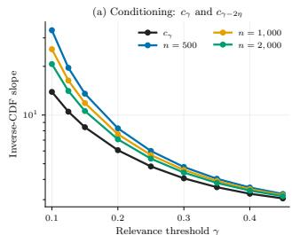

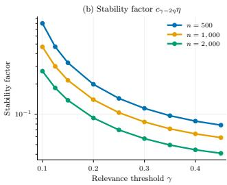

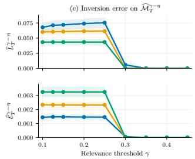

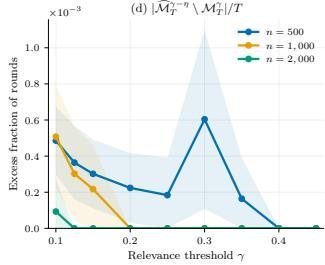  
Figure 1: Batched Ψ-LS for $n \in \{ 5 0 0 , 1 0 0 0 , 2 0 0 0 \}$ , over 100 trajectories. Here, η is the realized uniform error of the within-batch frequency estimator. Panel (a) compares $c _ { \gamma }$ with $c _ { \gamma - 2 \eta }$ , and Panel (b) reports the stability factor $c _ { \gamma - 2 \eta } \eta .$ Panel (c) shows the conditional and coverage-weighted inversion errors, $\widehat { L } _ { T } ^ { \gamma - \eta }$ and $\widehat { \mathcal { E } } _ { T } ^ { \gamma - \eta }$ b, computed on the practical relevance set $\widehat { \mathcal { M } } _ { T } ^ { \gamma - \eta }$ bPanel (d) reports the excess coverage $| \widehat { \mathcal { M } } _ { T } ^ { \gamma - \eta } \setminus \mathcal { M } _ { T } ^ { \gamma } | / T$ cQuantities are reported only for trajectories satisfying $2 \eta < \gamma ;$ shaded regions in Panels (c)–(d) are pointwise 95% confidence intervals.

End-to-end inversion. Finally, we invert TS, Maillard sampling (MS) (Maillard, 2011; Bian and Jun, 2022), and Boltzmann-Gumbel exploration (BGE) (Cesa-Bianchi et al., 2017) using their exact sampling probabilities at $\gamma = 0 . 4$ and horizon $T = 2 0 0 0$ . For each trajectory, we replay the Ψ-LS reference on the same history and retain trajectories satisfying $2 \varepsilon < \gamma$ We also invert a Φ-LS demonstrator through $\Psi ^ { - 1 }$ . Because the two LS demonstrators have identical posterior gaps on the same history, the resulting error isolates sampling-policy and inverse-link misspecification.

The middle panel displays the start-learn-converge behavior described by Garivier et al. (2019). Initially, the algorithms distribute pulls across the arms; during learning, alternative pulls remain frequent and the relevance set grows; finally, the algorithms concentrate on $\widehat { a } ^ { * }$ . In this last phase, both $1 - B _ { t } / t$ and $| \mathcal { M } _ { t } ^ { \gamma } | / t$ bapproach zero. Thus, vanishing coverage is mainly explained by the algorithm repeatedly selecting its estimated best arm, rather than only by alternative pulls being removed by the relevance threshold. On these best-arm rounds the target gap is zero by definition. Consequently, the conditional error stabilizes once few new relevant rounds are added, while $\mathcal { E } _ { t } ^ { \gamma }$ decreases. The Φ-LS curve also shows that using the wrong inverse link produces nonzero but bounded error in this experiment, providing empirical evidence of robustness to moderate misspecification of $v .$ To complement these robustness results, in Appendix D.4 we report empirical estimates of ε and ε˜ for each algorithm.

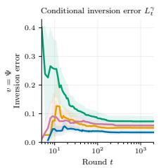

TS MS BGE Φ-LS Non-reference pulls 1 B /t Relevant set γ /t  
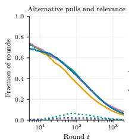

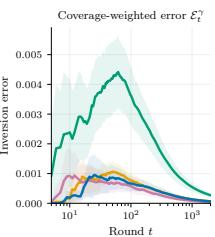  
Figure 2: End-to-end inversion for $v = \Psi$ $K = 4 ,$ $T = 2 0 0 0$ , and $\gamma = 0 . 4$ . The panels show conditional inversion error $L _ { t } ^ { \gamma }$ , the fractions of non-reference and relevant rounds, and coverage-weighted error $\mathcal { E } _ { t } ^ { \gamma }$ . Here $\begin{array} { r } { B _ { t } = \sum _ { s = 1 } ^ { t } \mathbb { 1 } \{ A _ { s } = \widehat { a } ^ { * } \} } \end{array}$ counts pulls of the estimated bbest, or reference, arm. Solid and dotted curves in the middle panel denote $1 - B _ { t } / t$ and $| \mathcal { M } _ { t } ^ { \gamma } | / t$ , respectively. Shading gives pointwise 95% confidence intervals over theorem-valid trajectories.

## 6 CONCLUSION

We introduce an inverse-bandit framework for recovering a demonstrator’s internal suboptimality gaps rather than the environment’s true rewards. We define the invertible v-LS class, extend it to the $( \varepsilon , \tilde { \varepsilon } ) { \mathrm { - L S } }$ family, and provide trajectory-level guarantees under approximate sampling probability estimation, policy misspecification, and batched bandit play.

Our results expose an intrinsic exploration-inversion trade-of. While the demonstrator explores, its sampling probabilities reveal its internal gaps; as its policy concentrates, diferent gap magnitudes produce nearly identical behavior, making stable inversion impossible. This limitation is inherent to the information contained in the action trajectory and reflected in the coverage $C _ { T } ^ { \gamma }$ , describing the fraction of invertible rounds.

Limitations and future work. Future work includes exploiting temporal continuity between rounds, which could enable probability estimation under weaker observation protocols. We empirically show one possibility in Appendix D.3. Other directions include extending the framework to other structured policies, such as KL-UCB variants (Garivier and Cappé, 2011), and studying its privacy implications. In particular, recovered gaps may reveal sensitive preferences of the users, connecting algorithm inversion to diferential privacy (Ou et al., 2024) remains an open question.

## ACKNOWLEDGMENTS

C. Vernade is funded by the Deutsche Forschungsgemeinschaft (DFG) under both the project 468806714 of the Emmy Noether Programme and under Germany’s Excellence Strategy – EXC number 2064/1 – Project number 390727645. CV also gratefully acknowledges funding from the European Union (ERC, ConSequentIAL, 101165883). Views and opinions expressed are however those of the author(s) only and do not necessarily reflect those of the European Union or the European Research Council. Neither the European Union nor the granting authority can be held responsible for them). CV and M. Petriconi also thank the international Max Planck Research School for Intelligent Systems (IMPRS-IS).

## References

Shipra Agrawal and Navin Goyal. Further optimal regret bounds for thompson sampling. In Carlos M. Carvalho and Pradeep Ravikumar, editors, Proceedings of the Sixteenth International Conference on Artificial Intelligence and Statistics, volume 31 of Proceedings of Machine Learning Research, pages 99–107, Scottsdale, Arizona, USA, 29 Apr–01 May 2013. PMLR.

Peter Auer, Nicolò Cesa-Bianchi, and Paul Fischer. Finite-time analysis of the multiarmed bandit problem. Machine Learning, 2002.

Jie Bian and Kwang-Sung Jun. Maillard sampling: Boltzmann exploration done optimally. In International Conference on Artificial Intelligence and Statistics, pages 54–72. PMLR, 2022.

Daniel S Brown, Wonjoon Goo, and Scott Niekum. Better-than-demonstrator imitation learning via automatically-ranked demonstrations. In Conference on robot learning, pages 330–359. PMLR, 2020.

Nicolò Cesa-Bianchi, Claudio Gentile, Gábor Lugosi, and Gergely Neu. Boltzmann exploration done right. Advances in neural information processing systems, 30, 2017.

Eyal Even-Dar, Shie Mannor, and Yishay Mansour. Action elimination and stopping conditions for the multi-armed bandit and reinforcement learning problems. Journal of Machine Learning Research, 7(39): 1079–1105, 2006.

Jenna Fromer, Runzhong Wang, Mrunali Manjrekar, Austin Tripp, José Miguel Hernández-Lobato, and Connor W Coley. Batched bayesian optimization by maximizing the probability of including the optimum. Journal of Chemical Information and Modeling, 65 (10):4808–4817, 2025.

Aurélien Garivier and Olivier Cappé. The kl-ucb algorithm for bounded stochastic bandits and beyond. In Proceedings of the 24th annual conference on learning theory, pages 359–376. JMLR Workshop and Conference Proceedings, 2011.

Aurélien Garivier, Pierre Ménard, and Gilles Stoltz. Explore first, exploit next: The true shape of regret in bandit problems. Mathematics of Operations Research, 44(2):377–399, 2019.

Robert M Gray. Entropy and information theory. Springer Science & Business Media, 2011.

Etash Kumar Guha, Jim Thannikary James, Krishna Acharya, Vidya Muthukumar, and Ashwin Pananjady. One shot inverse reinforcement learning for stochastic linear bandits. In The 40th Conference on Uncertainty in Artificial Intelligence, 2024.

Wenshuo Guo, Kumar K Agrawal, Aditya Grover, Vidya K Muthukumar, and Ashwin Pananjady. Learning from an exploring demonstrator: Optimal reward estimation for bandits. In International Conference on Artificial Intelligence and Statistics (AIS-TATS), 2022.

Budhaditya Halder, Shubhayan Pan, and Koulik Khamaru. Stable thompson sampling: Valid inference via variance inflation, 2025.

Philipp Hennig and Christian J Schuler. Entropy search for information-eficient global optimization. The Journal of Machine Learning Research, 13(1):1809– 1837, 2012.

Alexis Jacq, Matthieu Geist, Ana Paiva, and Olivier Pietquin. Learning from a learner. In Kamalika Chaudhuri and Ruslan Salakhutdinov, editors, Proceedings of the 36th International Conference on Machine Learning, volume 97 of Proceedings of Machine Learning Research, pages 2990–2999. PMLR, 09–15 Jun 2019.

Donald Jones, Matthias Schonlau, and William Welch. Eficient global optimization of expensive black-box functions. Journal of Global Optimization, 13:455– 492, 12 1998.

Cem Kalkanli and Ayfer Ozgur. Batched thompson sampling. Advances in Neural Information Processing Systems, 34:29984–29994, 2021.

Tor Lattimore and Csaba Szepesvári. Bandit Algorithms. Cambridge University Press, 2020.

Antoine Maillard. Fundamental limits of highdimensional estimation: a stroll between statistical physics, probability and random matrix theory. PhD thesis, Université Paris sciences et lettres, 2021.

Odalric-Ambrym Maillard. APPRENTISSAGE SÉQUENTIEL : Bandits, Statistique et Renforcement. Theses, Université des Sciences et Technolo-

gie de Lille - Lille I, October 2011. URL https: //theses.hal.science/tel-00845410.

Nabin K Malakar and Kevin H Knuth. Entropy-based search algorithm for experimental design. In AIP Conference Proceedings, volume 1305, pages 157–164. American Institute of Physics, 2011.

Nicolas Menet, Jonas Hübotter, Parnian Kassraie, and Andreas Krause. LITE: Eficiently estimating Gaussian probability of maximality. In International Conference on Artificial Intelligence and Statistics, volume 258, pages 4996–5004. Proceedings of Machine Learning Research, 2025.

Nicolas Menet, Michael Hersche, Andreas Krause, and Abbas Rahimi. A theoretical analysis of test-driven code generation. Advances in Neural Information Processing Systems, 39, 2026a.

Nicolas Menet, Andreas Krause, and Abbas Rahimi. POETS: Uncertainty-aware LLM optimization via compute-eficient policy ensembles. Advances in Neural Information Processing Systems, 39, 2026b.

Nicolas Menet, Aleksandar Terzic, Michael Hersche, Andreas Krause, and Abbas Rahimi. Thompson sampling via fine-tuning of LLMs. In International Conference on Learning Representations, 2026c.

Brendan O’Donoghue and Tor Lattimore. Variational Bayesian optimistic sampling. In Neural Information Processing Systems, 2021.

Tingting Ou, Rachel Cummings, and Marco Avella Medina. Thompson sampling itself is diferentially private. In International Conference on Artificial Intelligence and Statistics, pages 1576–1584. PMLR, 2024.

Stuart Russell. Learning agents for uncertain environments. In Proceedings of the eleventh annual conference on Computational learning theory, pages 101–103, 1998.

Daniel J Russo, Benjamin Van Roy, Abbas Kazerouni, Ian Osband, Zheng Wen, et al. A tutorial on thompson sampling. Foundations and Trends® in Machine Learning, 11(1):1–96, 2018.

Niranjan Srinivas, Andreas Krause, Sham M Kakade, and Matthias Seeger. Gaussian process optimization in the bandit setting: No regret and experimental design. arXiv preprint arXiv:0912.3995, 2009.

Jean Tarbouriech, Tor Lattimore, and Brendan O’Donoghue. Probabilistic inference in reinforcement learning done right. Advances in Neural Information Processing Systems, 36:33687–33725, 2023.

William R. Thompson. On the likelihood that one unknown probability exceeds another in view of the evidence of two samples. Biometrika, 25:285–294, 1933.

Zi Wang and Stefanie Jegelka. Max-value entropy search for eficient Bayesian optimization. In Doina Precup and Yee Whye Teh, editors, Proceedings of the 34th International Conference on Machine Learning, volume 70 of Proceedings of Machine Learning Research, pages 3627–3635. PMLR, 06–11 Aug 2017.

## A APPENDIX

## A.1 Stability of inverting v

Because v is a valid CDF, it must satisfy $v ^ { - 1 } ( q ) \to - \infty$ as $q \downarrow 0$ and $v ^ { - 1 } ( q ) \to \infty$ as $q \uparrow 1$ . Consequently, $v ^ { - 1 }$ cannot be globally Lipschitz on the open interval $( 0 , 1 )$ . More precisely, suppose that v is continuously diferentiable, with $v ^ { \prime } ( x ) > 0 ,$ , and that $v ^ { \prime } ( x )  0$ for $x  \pm \infty$ . By the inverse function theorem, the derivative of the inverse is given by

$$
( v ^ { - 1 } ) ^ { \prime } ( q ) = \frac { 1 } { v ^ { \prime } ( v ^ { - 1 } ( q ) ) } ,
$$

and therefore $| ( v ^ { - 1 } ) ^ { \prime } ( q ) | \to \infty$ as $q \downarrow 0$ or $q \uparrow 1$

In the context of inverse bandits, the external observer only has access to an empirical estimate $\hat { q }$ of the demonstrator’s true sampling probability $q .$ While qˆ typically concentrates around $q$ as the observation horizon grows, the non-Lipschitz nature of the inverse CDF means that even small estimation errors can be severely amplified during inversion. Near the boundary of the probability simplex, an arbitrarily small perturbation of q may produce an arbitrarily large perturbation of $v ^ { - 1 } ( q )$ , as illustrated in Figure 3. The inverse mapping is

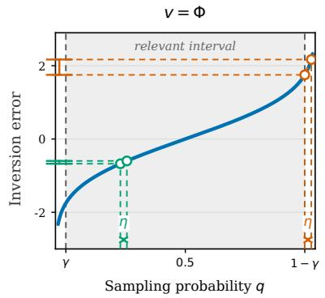

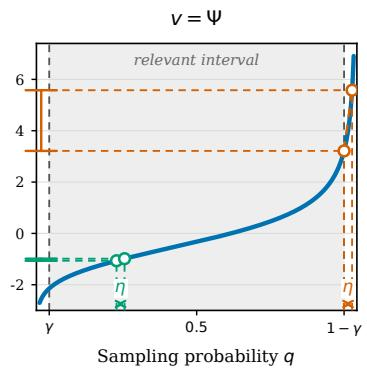  
Figure 3: Error amplification under inversion for two reference CDFs, $v = \Phi$ (Gaussian) and $v = \Psi$ . The same estimation error $| \hat { q } - q | < \eta$ is harmless inside the relevant interval $( \gamma , 1 - \gamma )$ but produces unbounded gap errors outside it.

nevertheless well-conditioned on every compact subinterval of $( 0 , 1 )$ . For any margin parameter $\gamma \in ( 0 , 1 )$ , define the worst-case slope of $v ^ { - 1 }$ within an η-neighborhood of the relevant interval:

$$
c _ { \gamma - 2 \eta } : = \operatorname* { s u p } _ { \substack { q \in [ \gamma - 2 \eta , 1 - \gamma + 2 \eta ] } } | ( v ^ { - 1 } ) ^ { \prime } ( q ) | < \infty .\tag{27}
$$

By the mean value theorem, the inversion error is then bounded linearly by the estimation error:

$$
\begin{array} { r } { | v ^ { - 1 } ( \hat { q } ) - v ^ { - 1 } ( q ) | \leq c _ { \gamma - 2 \eta } | \hat { q } - q | . } \end{array}
$$

This Lipschitz-type control motivates restricting the inversion to the set of relevant rounds $M _ { T } ^ { \gamma }$ , on which every arm’s sampling probability lies safely in $[ \gamma , 1 - \gamma ]$ . The cardinality $| M _ { T } ^ { \gamma } |$ counts the rounds on which the inversion is uniformly well-conditioned. As the demonstrator learns and concentrates its policy on the optimal arm, the sampling probabilities assigned to suboptimal arms decay towards zero, pushing the inversion into the ill-conditioned boundary regime. The restriction to $M _ { T } ^ { \gamma }$ is therefore not an artifact of our analysis, but an intrinsic requirement for any stable approximate inversion procedure.

It sufices to verify the lower bounds $q _ { a _ { t } , t } , q _ { \hat { a } ^ { * } , t } \geq \gamma$ . Indeed, since $a _ { t } \neq \hat { a } ^ { * }$ and the probabilities sum to one, these conditions automatically imply $q _ { a _ { t } , t } , q _ { \widehat { a } ^ { * } , t } \leq 1 - \gamma$ . We then restrict $\gamma \in ( 0 , 1 / 2 )$ in Definition 3.1 otherwise $q _ { a _ { t } , t } , q _ { \hat { a } ^ { * } , t } \geq \gamma$ could not be simultaneously satisfied fo $\gamma > 1 / 2$

## B GENERALIZED LITE SAMPLING

While the main text focuses on the Gaussian reward setting, where the posterior uncertainties σ are deterministically known to the observer, enabling exact closed-form inversion, extending LITE (Menet et al., 2025) to arbitrary arm distributions is a central secondary contribution of this paper. Many real-world applications rely on reward distributions that are non-Gaussian: click-through rates are Bernoulli, waiting times are Exponential, and clinical outcomes can follow heavy-tailed distributions. To invert demonstrators operating in these settings, we first formalize a generic sampling strategy that is both no-regret and invertible for arbitrary reward posteriors. The key idea is to characterize the tail behavior of the marginal reward posteriors through a reference CDF v.

To this end, let v be a continuous, strictly increasing CDF. The conditional tail expectation functional $g _ { v } : ( 0 , 1 ) \to$ R is defined by

$$
g _ { v } ( p ) : = \mathbb { E } [ Z | Z > v ^ { - 1 } ( p ) ] \cdot \mathbb { P } [ Z > v ^ { - 1 } ( p ) ] = \int _ { p } ^ { 1 } v ^ { - 1 } ( r ) d r
$$

Moreover, for $\mathbb { E } [ Z ] \in [ 0 , \infty )$ , it holds that $g _ { v } ( p ) \in [ 0 , \infty ) \ \forall p$

The associated quasi-surprisal $i _ { v } : ( 0 , 1 ) \to [ 0 , \infty )$ is defined by

$$
i _ { v } ( p ) : = \frac { 1 } { 2 } \left( \frac { g _ { v } ( p ) } { p } \right) ^ { 2 } .
$$

The quasi-surprisal measures how aggressively the tail of v decays: heavy-tailed distributions yield large $i _ { v }$ values for moderate $p ,$ while light-tailed distributions (such as the Gaussian) yield smaller values. When the reference function v is chosen to match the actual marginal tail decay of the posterior $\theta ,$ the resulting v-LS policy is guaranteed to be no-regret.

The following proposition makes this precise. It shows that if the posterior’s Cramér rate function dominates the quasi-surprisal induced by $v ,$ then the expected cumulative regret is sublinear. The quantity $\begin{array} { r } { H _ { v } ( q ) : = \sum _ { a } q _ { a } i _ { v } ( q _ { a } ) } \end{array}$ is the adapted quasi-entropy, which bounds the total exploration penalty of the randomized policy.

Definition B.1. The (Cramér) rate function Λ∗ of a random variable $X : \Omega  \mathbb { R }$ is defined as the convex conjugate of the cumulant generating function Λ, i.e.,

$$
\Lambda ^ { * } ( \alpha ) : = \operatorname* { s u p } _ { \beta > 0 } \alpha \beta - \Lambda ( \beta ) { \mathrm { ~ w h e r e ~ } } \Lambda ( \beta ) : = \log \mathbb { E } [ e ^ { \beta ( X - \mathbb { E } [ X ] ) } ] .
$$

Proposition B.1. Let $\theta _ { t } : \Omega \to \mathbb { R } ^ { K }$ be a sequence of random vectors with marginal (Cramér) rate function satisfying $( \Lambda _ { a _ { t } } ^ { * } ) ^ { - 1 } ( - \ln p ) \leq \sigma _ { a _ { t } , t } \sqrt { 2 i _ { v } ( p ) }$ for all $p \in ( 0 , 1 )$ . Let $q _ { t }$ be the v-LITE estimator at step t and $a _ { t } \sim q _ { t }$ Assume the adapted quasi-entropy is bounded: $\begin{array} { r } { H _ { v } ( q ) : = \sum _ { a \in [ K ] } q _ { a } i _ { v } ( q _ { a } ) \le \operatorname* { s u p } _ { q \in \Delta ^ { \kappa } } H _ { v } ( q ) = : I _ { v } ( K ) < \infty , } \end{array}$ , and that the cumulative predictive variance is bounded by a sublinear function $\begin{array} { r } { V _ { T } , \ i . e . , \ \mathbb { E } \big [ \sum _ { t = 1 } ^ { T } \sigma _ { a _ { t } , t } ^ { 2 } \big ] \leq V _ { T } } \end{array}$ . Then it holds that

$$
\begin{array} { r l } & { R e g ( T ) = \sum _ { t } { \mathbb E } [ \operatorname* { m a x } _ { a } \theta _ { a , t } - \theta _ { a _ { t } , t } ] } \\ & { \qquad \leq \sum _ { t } { \mathbb E } _ { a \sim q _ { t } } [ \sigma _ { a , t } \sqrt { 2 i _ { v } ( q _ { a , t } ) } ] } \\ & { \qquad \leq \sqrt { 2 I _ { v } ( K ) T V _ { T } } . } \end{array}
$$

Proof of Proposition B.1. The first inequality follows immediately from Lemma C.4:

$$
\begin{array} { r } { \sum _ { t = 1 } ^ { T } \mathbb { E } [ \operatorname* { m a x } _ { a } \theta _ { a , t } - \theta _ { a _ { t } , t } ] \leq \sum _ { t = 1 } ^ { T } \mathbb { E } \Big [ \mathcal { V } ( q _ { t } ) - \sum _ { a = 1 } ^ { K } q _ { a , t } \mu _ { a , t } \Big ] = \sum _ { t = 1 } ^ { T } \mathbb { E } \Big [ \sum _ { a = 1 } ^ { K } q _ { a , t } \sigma _ { a , t } \sqrt { 2 i _ { v } ( q _ { a , t } ) } \Big ] . } \end{array}
$$

For the second inequality, we apply the Cauchy-Schwarz inequality first over the arms, then over the time steps:

$$
\begin{array} { r l } & { \displaystyle \sum _ { t = 1 } ^ { T } \sum _ { a = 1 } ^ { K } q _ { a , t } \sigma _ { a , t } \sqrt { 2 i _ { v } ( q _ { a , t } ) } \leq \sum _ { t = 1 } ^ { T } \sqrt { \displaystyle \sum _ { a = 1 } ^ { K } 2 q _ { a , t } i _ { v } ( q _ { a , t } ) } \sqrt { \displaystyle \sum _ { a = 1 } ^ { K } q _ { a , t } \sigma _ { a , t } ^ { 2 } } } \\ & { \qquad \leq \sqrt { 2 I _ { v } ( K ) } \displaystyle \sum _ { t = 1 } ^ { T } \sqrt { \displaystyle \sum _ { a = 1 } ^ { K } q _ { a , t } \sigma _ { a , t } ^ { 2 } } } \\ & { \qquad \leq \sqrt { 2 I _ { v } ( K ) } \sqrt { T \displaystyle \sum _ { t = 1 } ^ { T } \sum _ { a = 1 } ^ { K } q _ { a , t } \sigma _ { a , t } ^ { 2 } } . } \end{array}
$$

Taking the expectation over the trajectory and applying Jensen’s inequality alongside the assumption on the cumulative variance yields:

$$
\mathbb { E } \Bigg [ \sqrt { 2 I _ { v } ( K ) T \sum _ { t = 1 } ^ { T } \sum _ { a = 1 } ^ { K } q _ { a , t } \sigma _ { a , t } ^ { 2 } } \Bigg ] \leq \sqrt { 2 I _ { v } ( K ) T \mathbb { E } \Bigg [ \sum _ { t = 1 } ^ { T } \sum _ { a = 1 } ^ { K } q _ { a , t } \sigma _ { a , t } ^ { 2 } \Bigg ] } = \sqrt { 2 I _ { v } ( K ) T \mathbb { E } \Bigg [ \sum _ { t = 1 } ^ { T } \sigma _ { a _ { t } , t } ^ { 2 } \Bigg ] } \leq \sqrt { 2 I _ { v } ( K ) T V _ { T } } .
$$

In practical deployments, including large-scale $\mathrm { A } / \mathrm { B }$ tests and federated learning systems, updating the posterior after every observation is often computationally prohibitive or impossible due to delayed feedback pipelines. Batched algorithms address this by freezing the sampling policy over windows of n consecutive rounds and updating only at batch boundaries. The following theorem extends the regret analysis of Proposition B.1 to this batched setting and provides the theoretical foundation for inverting batch-constrained demonstrators.

Theorem B.1 (Batched LS regret). Assume that v satisfies the assumptions of Proposition B.1 and that the adapted quasi-entropy is bounded: $\begin{array} { r } { H _ { v } ( q ) : = \sum _ { a \in [ K ] } q _ { a } i _ { v } ( q _ { a } ) \le \operatorname* { s u p } _ { q \in \Delta ^ { \kappa } } H _ { v } ( q ) = : I _ { v } ( K ) < \infty } \end{array}$ . If we assume Gaussian reward noise with variance $\alpha ^ { 2 }$ and Gaussian priors, then batched v-LS with batch size n and horizon $T = n B$ satisfies

$$
R e g ( T ) \leq 2 \sqrt { I _ { v } ( K ) T \frac { n } { C ( n , \alpha ) } \gamma _ { B } } ,
$$

where $C ( n , \alpha ) = \ln ( 1 + n / \alpha ^ { 2 } )$ and $\gamma _ { B }$ is the maximal information gain over B batches.

Remark B.1. For $v = \Psi$ , we have $I _ { \Psi } ( K ) \leq \log ( K )$ , and the bound simplifies to $\mathcal { O } ( \sqrt { T \gamma _ { B } \frac { n } { C ( n , \alpha ) } \log K } )$ . The ratio $n / \ln ( 1 + n / \alpha ^ { 2 } )$ grows almost linearly in $n ,$ reflecting the structural penalty of delayed posterior updates. Note that the bound recovers the non-batched rate when $n = 1$

Proof of Theorem B.1. Since batched v-LS updates its posterior only at batch boundaries, the sampling probabilities $q _ { b }$ and posterior standard deviations $\sigma _ { a , b }$ remain constant throughout each batch. Let $a _ { i , b }$ denote the i-th arm pulled in batch b. By Lemma C.4, applied with the posterior at the start of batch $b ,$ we have

$$
\mathrm { R e g } ( T ) = \sum _ { b = 1 } ^ { B } \sum _ { i = 1 } ^ { n } \mathbb { E } [ \operatorname* { m a x } _ { a } \theta _ { a } - \theta _ { a _ { i , b } } ] \leq \sum _ { b = 1 } ^ { B } \sum _ { i = 1 } ^ { n } \mathbb { E } _ { a _ { i , b } \sim q _ { b } } [ \sigma _ { a _ { i , b } , b } \sqrt { 2 i _ { v } ( q _ { b } ( a _ { i , b } ) ) } ] .
$$

This is identical in structure to the first inequality in the proof of Proposition B.1. Applying the same double Cauchy–Schwarz argument (first over arms within each batch, then over batches) yields

$$
\mathrm { R e g } ( T ) \leq \sqrt { 2 I _ { v } ( K ) T \mathbb { E } \left[ \sum _ { b = 1 } ^ { B } \sum _ { i = 1 } ^ { n } \sigma _ { a _ { i , b } , b } ^ { 2 } \right] } .
$$

Under the Gaussian prior and Gaussian noise assumptions, $\begin{array} { r } { \sum _ { i = 1 } ^ { b } \sigma _ { a _ { i . b } , b } ^ { 2 } = \mathrm { t r } ( \Sigma _ { b } ( X _ { 1 : b } ) ) } \end{array}$ , where $\Sigma _ { b } ( X _ { 1 : b } )$ is the n×n posterior covariance matrix of the arms pulled in batch b under the realized actions. Our batched generalization of the Elliptical Potential Lemma (Lemma C.6) bounds this for any realized action sequence $X _ { 1 : B }$ by the maximum information gain over fixed designs $\gamma _ { B }$ , giving

$$
\mathbb { E } \left[ \sum _ { b = 1 } ^ { B } \mathrm { t r } \big ( \Sigma _ { b } ( X _ { 1 : b } ) \big ) \right] \leq \frac { 2 n } { C ( n , \alpha ) } \gamma _ { B } ,
$$

where $C ( n , \alpha ) = \ln ( 1 + n / \alpha ^ { 2 } )$ . Substituting completes the proof.

## C PROOFS OF SECTION 4.2

Lemma 4.1. Let $0 < \eta < \rho \leq 1 / 2$ . Suppose that $t \in \widehat { M } _ { T } ^ { \rho }$ is a relevant inversion round. On the event $\mathcal { G } _ { \eta }$

$$
| \hat { \Delta } _ { a _ { t } , t } - \Delta _ { a _ { t } , t } ^ { L S } | \leq ( | \sigma _ { \hat { a } ^ { * } , t } | + | \sigma _ { a _ { t } , t } | ) c _ { \rho - \eta } \eta ,\tag{17}
$$

where $c _ { \rho - \eta }$ is the Lipschitz constant of $v ^ { - 1 }$ on the truncated domain $\left[ \rho - \eta , 1 - \rho + \eta \right]$ , defined in Equation (16).

Proof.

$$
\begin{array} { r l } & { | \hat { \Delta } _ { a _ { t } , t } , - \Delta _ { a _ { t } , t } ^ { L S } | : = | \hat { z } _ { \hat { a } ^ { * } , t } \sigma _ { \hat { a } ^ { * } , t } - \hat { z } _ { a _ { t } , t } \sigma _ { a _ { t } , t } - \left( z _ { \hat { a } ^ { * } , t } \sigma _ { \hat { a } ^ { * } , t } - z _ { a _ { t } , t } \sigma _ { a _ { t } , t } \right) | } \\ & { \leq | \hat { z } _ { \hat { a } ^ { * } , t } \sigma _ { \hat { a } ^ { * } , t } - z _ { \hat { a } ^ { * } , t } \sigma _ { \hat { a } ^ { * } , t } | + | z _ { a _ { t } , t } \sigma _ { a _ { t } , t } - \hat { z } _ { a _ { t } , t } \sigma _ { a _ { t } , t } | } \\ & { \leq | \sigma _ { \hat { a } ^ { * } , t } | | \hat { z } _ { \hat { a } ^ { * } , t } - z _ { \hat { a } ^ { * } , t } | + | \sigma _ { a _ { t } , t } | | \hat { z } _ { a _ { t } , t } - z _ { a _ { t } , t } | } \end{array}
$$

Observe that, for $t \in \widehat { M } _ { T } ^ { \rho }$

$$
\begin{array} { r } { | \hat { z } _ { a _ { t } , t } - z _ { a _ { t } , t } | : = | v ^ { - 1 } ( \hat { q } _ { a _ { t } , t } ) - v ^ { - 1 } ( q _ { a _ { t } , t } ) | \leq c _ { \rho - \eta } | \hat { q } _ { a _ { t } , t } - q _ { a _ { t } , t } | \leq c _ { \rho - \eta } \eta , } \end{array}
$$

since $v ^ { - 1 } : [ \rho - \eta , 1 - \rho + \eta ] \to \mathbb { R }$ is Lipschitz, with Lipschitz constant $c _ { \rho - \eta }$ . The same inequality holds for $\hat { a } ^ { * }$ Combining the inequalities concludes the proof. □

Theorem 4.1. Assume that A satisfies Assumption 4.1, that $\sigma _ { a , 0 } ^ { 2 } \leq 1$ for every $a \in [ K ]$ , and $0 < 2 \eta < \gamma \leq 1 / 2$ Then, on $\mathcal { G } _ { \eta }$ , every realized action trajectory satisfies

$$
\mathcal { E } _ { T } ^ { \gamma } \leq c _ { \gamma - 2 \eta } \cdot \eta \Big ( \frac { ( \alpha \sqrt { 2 } + 1 ) \sqrt { \gamma _ { T } } + 2 \alpha } { \sqrt { T } } + \frac { t ^ { * } + 1 } { T } \Big ) .\tag{18}
$$

Here, $c _ { \gamma - 2 \eta }$ is the Lipschitz constant $o f v ^ { - 1 }$ on the truncated domain $\left[ \gamma - 2 \eta , 1 - \gamma + 2 \eta \right]$ , defined in Equation (16), $\gamma _ { T }$ is the maximal information $g a i n ^ { 3 } .$ , and $\begin{array} { r } { t ^ { * } : = \sum _ { a \ne \hat { a } ^ { * } } N _ { a } ( T ) } \end{array}$ counts the number of exploratory rounds.

Proof. Using the fact that $M _ { T } ^ { \gamma } \subseteq \widehat { M } _ { T } ^ { \gamma - \eta }$ and Lemma 4.1 with $\rho = \gamma - \eta ,$ , we can write

$$
\mathcal { E } _ { T } ^ { \gamma } \leq \frac { 1 } { T } \sum _ { t = 1 } ^ { T } \mathbb { 1 } \{ t \in \widehat { M } _ { T } ^ { \gamma - \eta } \} \vert \hat { \Delta } _ { a _ { t } , t } - \Delta _ { a _ { t } , t } ^ { L S } \vert
$$

$$
\leq \frac { c _ { \gamma - 2 \eta } \eta } { T } \sum _ { t = 1 } ^ { T } \mathbb { 1 } \{ t \in \widehat { M } _ { T } ^ { \gamma - \eta } \} ( | \sigma _ { a _ { t } , t } | + | \sigma _ { \hat { a } ^ { * } , t } | )
$$

Using the Cauchy-Schwarz inequality for the first sum, we get:

$$
\frac { c _ { \gamma - 2 \eta } \eta } { T } \sum _ { t = 1 } ^ { T } \mathbb { 1 } \{ t \in \widehat { M } _ { T } ^ { \gamma - \eta } \} ( | \sigma _ { a _ { t } , t } | + | \sigma _ { \hat { a } ^ { * } , t } | )\tag{28}
$$

$$
\leq \frac { c _ { \gamma - 2 \eta } \eta } { T } \Big ( \sqrt { \sum _ { t = 1 } ^ { T } \sigma _ { a _ { t } , t } ^ { 2 } } \times \sqrt { T } + \sum _ { t = 1 } ^ { T } \mathbb { 1 } \{ t \in \widehat { M } _ { T } ^ { \gamma - \eta } \} \sigma _ { \hat { a } ^ { * } , t } \Big )\tag{29}
$$

$$
\leq \frac { c _ { \gamma - 2 \eta } \eta } { T } \Big ( \sqrt { T } \sqrt { \frac { C _ { \alpha } \gamma _ { T } } { 2 } } + \sum _ { t = 1 } ^ { T } \sigma _ { \hat { a } ^ { * } , t } \Big ) .\tag{30}
$$

Note that the last inequality applied Lemma C.5. It remains to bound

$$
\sum _ { t = 1 } ^ { T } \sigma _ { \hat { a } ^ { * } , t } .
$$

First, observe that:

$$
\begin{array} { r } { \sigma _ { \hat { a } ^ { * } , t } \leq \sqrt { \left( \frac { 1 } { \sigma _ { \hat { a } ^ { * } , 0 } ^ { 2 } } + \frac { N _ { \hat { a } ^ { * } ( t - 1 ) } } { \alpha ^ { 2 } } \right) ^ { - 1 } } \leq \frac { \alpha } { \sqrt { N _ { \hat { a } ^ { * } } ( t - 1 ) } } . } \end{array}
$$

We know that,

$$
N _ { \hat { a } ^ { * } } ( t - 1 ) = ( t - 1 ) - \sum _ { a \neq \hat { a } ^ { * } } N _ { a } ( t - 1 ) \geq ( t - 1 ) - \sum _ { a \neq \hat { a } ^ { * } } N _ { a } ( T ) ,\tag{31}
$$

here we should be careful because $\begin{array} { r } { ( t - 1 ) - \sum _ { a \ne \hat { a } ^ { * } } N _ { a } ( T ) } \end{array}$ could be negative. Therefore, denote $\begin{array} { r } { t ^ { * } : = \sum _ { a \ne a ^ { * } } N _ { a } ( T ) < } \end{array}$ $T ,$ , hence:

$$
\sum _ { t = 1 } ^ { T } \sigma _ { \hat { a } ^ { * } , t } = \sum _ { t = 1 } ^ { t ^ { * } + 1 } \sigma _ { \hat { a } ^ { * } , t } + \sum _ { t = t ^ { * } + 2 } ^ { T } \sigma _ { \hat { a } ^ { * } , t }\tag{32}
$$

$$
\leq t ^ { * } + 1 + \sum _ { t = t ^ { * } + 2 } ^ { T } \frac { \alpha } { \sqrt { N _ { \hat { a } ^ { * } } ( t - 1 ) } }\tag{33}
$$

$$
\leq t ^ { * } + 1 + \alpha \left( \sum _ { t = t ^ { * } + 2 } ^ { T } \frac { 1 } { \sqrt { t - 1 - t ^ { * } } } \right) \leq t ^ { * } + 1 + 2 \alpha \sqrt { T }\tag{34}
$$

Remark C.1. Since $\hat { a } ^ { * }$ is a most-pulled arm and $T \geq 1 , N _ { \hat { a } ^ { * } } ( T ) \geq 1$ . Hence $t ^ { * } = T - N _ { \widehat { a } ^ { * } } ( T ) \leq T - 1$ , so $t ^ { * } + 1 \leq T$

Where we upper bounded $\sigma _ { \hat { a } ^ { * } , t } \leq \sigma _ { \hat { a } ^ { * } , 0 } \leq 1$ in the first sum, and we use Equation (31) in the second one together with an integral comparison. Plugging this into Equation (30) we get:

$$
\frac { 1 } { T } \sum _ { t = 1 } ^ { T } \mathbb { 1 } \{ t \in M _ { T } ^ { \gamma } \} | \hat { \Delta } _ { a _ { t } , t } - \Delta _ { a _ { t } , t } ^ { L S } | \leq \frac { c _ { \gamma - 2 \eta } \eta } { T } \Big ( \sqrt { T } \sqrt { \frac { C _ { \alpha } \gamma _ { T } } { 2 } } + t ^ { * } + 1 + 2 \alpha \sqrt { T } \Big ) ,\tag{35}
$$

where $\begin{array} { r } { C _ { \alpha } : = \frac { 4 } { \ln { ( 1 + \alpha ^ { - 2 } ) } } } \end{array}$ . Finally, observing that $\frac { 2 } { \ln ( 1 + \alpha ^ { - 2 } ) } \le 2 \alpha ^ { 2 } + 1$ (since $\textstyle \ln ( 1 + x ) \geq { \frac { 2 x } { x + 2 } }$ for $x > 0 )$ and $\sqrt { 2 \alpha ^ { 2 } + 1 } \le \alpha \sqrt { 2 } + 1$ , concludes the proof. □

Lemma 4.2. For any $\delta \in ( 0 , 1 )$ , define

$$
\eta _ { n , \delta } : = \sqrt { \frac { \log ( 2 K B / \delta ) } { 2 n } } .\tag{21}
$$

Then

$$
\mathbb { P } \left( \operatorname* { m a x } _ { b \in [ B ] } \operatorname* { m a x } _ { a \in [ K ] } | \hat { q } _ { a , b } - q _ { a , b } | \leq \eta _ { n , \delta } \right) \geq 1 - \delta .\tag{22}
$$

Proof. Fix an arm $a \in [ K ]$ and a batch $b \in [ B ]$ . Conditionally on the history ${ \mathcal { F } } _ { ( b - 1 ) n }$ available before batch $b ,$ define

$$
X _ { b , j } ^ { a } : = \mathbf { 1 } \{ a _ { b , j } = a \} , \qquad j \in [ n ] .
$$

Because the sampling distribution remains fixed within batch $b ,$ the variables $X _ { b , 1 } ^ { a } , \ldots , X _ { b , n } ^ { a }$ are conditionally independent Bernoulli random variables with conditional mean ${ { q } _ { a , b } }$ . Moreover,

$$
\hat { q } _ { a , b } = \frac { 1 } { n } \sum _ { j = 1 } ^ { n } X _ { b , j } ^ { a } .
$$

Therefore, Hoefding’s inequality gives, for every $x > 0$

$$
\begin{array} { r } { \mathbb { P } ( | \hat { q } _ { a , b } - q _ { a , b } | > x | \mathcal { F } _ { b - 1 } ) \le 2 \exp ( - 2 n x ^ { 2 } ) . } \end{array}\tag{36}
$$

Taking expectations over $\mathcal { F } _ { b - 1 }$ yields

$$
\begin{array} { r } { \mathbb { P } \left( | \hat { q } _ { a , b } - q _ { a , b } | > x \right) \leq 2 \exp ( - 2 n x ^ { 2 } ) . } \end{array}\tag{37}
$$

Applying a union bound over the KB arm-batch pairs gives

$$
\begin{array} { r } { \mathbb { P } \left( \underset { b \in [ B ] } { \operatorname* { m a x } } \ \underset { a \in [ K ] } { \operatorname* { m a x } } \left| \hat { q } _ { a , b } - q _ { a , b } \right| > x \right) } \\ { \leq 2 K B \exp ( - 2 n x ^ { 2 } ) . } \end{array}\tag{38}
$$

Setting

$$
x = \sqrt { \frac { \log ( 2 K B / \delta ) } { 2 n } } = \eta _ { n , \delta }
$$

concludes the proof.

Theorem 4.2. Let A be exactly batched $v { - } L S , \sigma _ { a , 0 } ^ { 2 } \leq 1$ for every $a \in [ K ]$ , and the Gaussian observation-noise variance be $\alpha ^ { 2 }$ . Let $0 < 2 \eta _ { n , \delta } < \gamma \leq 1 / 2$ . On the event $\mathcal { G } _ { n , \delta . }$ , every realized action trajectory satisfies

$$
\begin{array} { l } { \displaystyle \mathcal { E } _ { T } ^ { \gamma } \leq c _ { \gamma - 2 \eta _ { n , \delta } } \cdot \eta _ { n , \delta } \Bigg [ \frac { ( \alpha \sqrt { 2 } + \sqrt { n } ) \sqrt { \gamma _ { B } } + 2 \alpha } { \sqrt { T } } } \\ { \displaystyle + \frac { t ^ { * } + n ( 1 + B _ { \alpha } ) } { T } \Bigg ] . } \end{array}\tag{24}
$$

Here, $B _ { \alpha } : = \mathrm { m i n } \{ 1 , \alpha \}$ , γB is the maximal information gain, $c _ { \gamma - 2 \eta _ { n , \delta } }$ is defined as in Equation (16), and $\begin{array} { r } { t ^ { * } : = \sum _ { a \ne \hat { a } ^ { * } } N _ { a } ( T ) } \end{array}$ . Consequently, by Lemma $4 . 2 ,$ the bound in Equation (24) holds with probability at least $1 - \delta$

Proof. On the event $\mathcal { G } _ { n , \delta }$ , Lemma 4.1 gives

$$
\begin{array} { r l } & { \mathcal { E } _ { T } ^ { \gamma } \leq \displaystyle \frac { 1 } { T } \sum _ { t = 1 } ^ { T } \mathbb { 1 } \{ t \in \widehat { M } _ { T } ^ { \gamma - \eta _ { n , \delta } } \} | \hat { \Delta } _ { a _ { t } , t } - \Delta _ { a _ { t } , t } ^ { A } | = } \\ & { = \displaystyle \frac { 1 } { T } \sum _ { b = 1 } ^ { B } \sum _ { t = n ( b - 1 ) + 1 } ^ { n b } \mathbb { 1 } \{ t \in \widehat { M } _ { T } ^ { \gamma - \eta _ { n , \delta } } \} | \hat { \Delta } _ { a _ { t } , t } - \Delta _ { a _ { t } , t } ^ { A } | } \\ & { \leq \frac { c _ { \gamma - 2 \eta _ { n , \delta } } \eta _ { n , \delta } } { T } \displaystyle \sum _ { b = 1 } ^ { B } \sum _ { t = n ( b - 1 ) + 1 } ^ { n b } \mathbb { 1 } \{ t \in \widehat { M } _ { T } ^ { \gamma - \eta _ { n , \delta } } \} ( | \sigma _ { a _ { t } , t } | + | \sigma _ { \hat { a } ^ { * } , t } | ) . } \end{array}
$$

Using Cauchy-Schwarz inequality we get

$$
\frac { c _ { \gamma - 2 \eta _ { n , \delta } } \eta _ { n , \delta } } { T } \sum _ { b = 1 } ^ { B } \sum _ { \substack { t = n ( b - 1 ) + 1 } } ^ { n b } \mathbb { 1 } \{ t \in \widehat { M } _ { T } ^ { \gamma - \eta _ { n , \delta } } \} ( | \sigma _ { a _ { t } , t } | + | \sigma _ { \hat { a } ^ { * } , t } | ) \leq\tag{39}
$$

$$
\frac { c _ { \gamma - 2 \eta _ { n , \delta } } \eta _ { n , \delta } } { T } \left( \sqrt { \sum _ { b = 1 } ^ { B } \sum _ { t = n ( b - 1 ) + 1 } ^ { n b } | \sigma _ { a _ { t } , t } | ^ { 2 } } \times \sqrt { n B } + \sum _ { b = 1 } ^ { B } \sum _ { t = n ( b - 1 ) + 1 } ^ { n b } | \sigma _ { \hat { a } ^ { * } , t } | \right)\tag{40}
$$

Since the posterior is constant within each batch, $\begin{array} { r } { \sum _ { t = n ( b - 1 ) + 1 } ^ { n b } \sigma _ { a _ { t } , t } ^ { 2 } = t r ( \Sigma _ { b } ) } \end{array}$ , with $\Sigma _ { b }$ covariance matrix as defined in Lemma C.6 for any sequence of $a _ { t }$ . Lemma C.6 holds for every deterministic batched design and can therefore be applied pathwise to the realized action sequence:

$$
\sqrt { \sum _ { b = 1 } ^ { B } \sum _ { t = n ( b - 1 ) + 1 } ^ { n b } | \sigma _ { a _ { t } , t } | ^ { 2 } } \times \sqrt { n B } = \sqrt { n B } \sqrt { \sum _ { b = 1 } ^ { B } t r ( \Sigma _ { b } ) } \leq \sqrt { n B } \sqrt { \frac { 2 n \gamma _ { B } } { C ( n , \alpha ) } } ,\tag{41}
$$

where $C ( n , \alpha ) : = \ln ( 1 + n / \alpha ^ { 2 } )$ . Note that, $\begin{array} { r } { \frac { 2 n } { \ln ( 1 + n / \alpha ^ { 2 } ) } \le 2 \alpha ^ { 2 } + n } \end{array}$ and $\sqrt { 2 \alpha ^ { 2 } + n } \le \alpha \sqrt { 2 } + \sqrt { n }$ , hence:

$$
\sqrt { n B } \sqrt { \frac { 2 n \gamma _ { B } } { C ( n , \alpha ) } } \leq \sqrt { n B } ( \alpha \sqrt { 2 } + \sqrt { n } ) \sqrt { \gamma _ { B } } .\tag{42}
$$

It remains to bound:

$$
\sum _ { b = 1 } ^ { B } \sum _ { t = n ( b - 1 ) + 1 } ^ { n b } | \sigma _ { \hat { a } ^ { * } , t } | = \sum _ { b = 1 } ^ { B } n \sigma _ { \hat { a } ^ { * } , b }\tag{43}
$$

since $\sigma _ { \hat { a } ^ { * } , t }$ gets updated only at the beginning of each batch, hence it stays constant for n steps (batch size). Here we proceed analogously to the proof of Theorem 4.1. Write

$$
t ^ { * } = \sum _ { a \neq \hat { a } ^ { * } } N _ { a } ( T ) = \ell n + r , \qquad \ell : = \left\lfloor \frac { t ^ { * } } { n } \right\rfloor , \qquad r = t ^ { * } \bmod n \in \{ 0 , \ldots , n - 1 \} .
$$

At the beginning of batch b,

$$
N _ { \hat { a } ^ { * } } ( n ( b - 1 ) ) = n ( b - 1 ) - \sum _ { a \neq \hat { a } ^ { * } } N _ { a } ( n ( b - 1 ) ) \geq n ( b - 1 ) - t ^ { * } ,
$$

the first $\ell + 1$ batches contribute at most $n ( \ell + 1 )$ , using $\sigma _ { \hat { a } ^ { * } , t } \leq 1$

If $\ell + 2 \leq B$ , we treat batch $\ell + 2$ separately and use

$$
n \sigma _ { \hat { a } ^ { * } , n ( \ell + 2 ) } \leq n \operatorname* { m i n } \left\{ 1 , \frac { \alpha } { \sqrt { n - r } } \right\} \leq n \operatorname* { m i n } \{ 1 , \alpha \} = : n B _ { \alpha }
$$

For the remaining batches, the summand is decreasing, so an integral comparison gives

$$
\sum _ { b = \ell + 3 } ^ { B } { \frac { n \alpha } { \sqrt { n ( b - 1 ) - t ^ { * } } } } \leq n \alpha \int _ { \ell + 2 } ^ { B } { \frac { d x } { \sqrt { n ( x - 1 ) - t ^ { * } } } }\tag{44}
$$

$$
= 2 \alpha \left( \sqrt { n ( B - 1 ) - t ^ { * } } - \sqrt { n - r } \right)\tag{45}
$$

$$
\leq 2 \alpha \sqrt { T } .\tag{46}
$$

Consequently,

$$
\sum _ { b = 1 } ^ { B } n \sigma _ { \hat { a } ^ { * } , n b } \leq n ( \ell + 1 ) + n B _ { \alpha } + 2 \alpha \sqrt { T }\tag{47}
$$

$$
= t ^ { * } - r + n + n B _ { \alpha } + 2 \alpha \sqrt { T }\tag{48}
$$

$$
\leq t ^ { \ast } + n \big ( 1 + B _ { \alpha } \big ) + 2 \alpha \sqrt { T } .\tag{49}
$$

If $\ell + 2 > B$ , the corresponding tail sum is empty and the same upper bound continues to hold.

Plugging Equation (49) and Equation (42) into Equation (39) we get:

$$
\frac { c _ { \gamma - 2 \eta _ { n , \delta } } \eta _ { n , \delta } } { T } \left( \sqrt { \sum _ { b = 1 } ^ { B } \sum _ { t = n ( b - 1 ) + 1 } ^ { n b } | \sigma _ { a _ { t } , t } | ^ { 2 } } \times \sqrt { n B } + \sum _ { b = 1 } ^ { B } \sum _ { t = n ( b - 1 ) + 1 } ^ { n b } | \sigma _ { \hat { a } ^ { * } , t } | \right)\tag{50}
$$

$$
\leq \frac { c _ { \gamma - 2 \eta _ { n , \delta } } \eta _ { n , \delta } } { T } \left( \sqrt { n B } ( \alpha \sqrt { 2 } + \sqrt { n } ) \sqrt { \gamma _ { B } } + t ^ { * } + n \big ( 1 + \operatorname* { m i n } \{ 1 , \alpha \} \big ) + 2 \alpha \sqrt { T } \big ) \right)\tag{51}
$$

Since $\mathbb { P } ( \mathcal { G } _ { n , \delta } ) \ge 1 - \delta$ by Lemma 4.2, the result holds with probability at least $1 - \delta .$

Theorem 4.3. Assume that A belongs to the $( \varepsilon , \tilde { \varepsilon } )$ -LS-family, and $0 < 2 \varepsilon < \gamma \leq 1 / 2$ . Then, under the same variance and information-gain conditions as for the exact v-LS result, almost surely, it holds that

$$
\mathcal { E } _ { T } ^ { \gamma } \leq c _ { \gamma - 2 \varepsilon } \cdot \varepsilon \bigg ( \frac { ( \alpha \sqrt { 2 } + 1 ) \sqrt { \gamma _ { T } } + 2 \alpha } { \sqrt { T } } + \frac { t ^ { * } + 1 } { T } \bigg ) + \tilde { \varepsilon } .\tag{26}
$$

Here, $c _ { \gamma - 2 \varepsilon }$ is the constant defined in Equation (16), evaluated at $\gamma - 2 \varepsilon$ , γT is the maximal information gain and $\begin{array} { r } { t ^ { * } : = \sum _ { a \ne \hat { a } ^ { * } } N _ { a } ( T ) } \end{array}$

Proof.

$$
\mathcal { E } _ { T } ^ { \gamma } \leq \frac { 1 } { T } \sum _ { t = 1 } ^ { T } \mathbb { 1 } \{ t \in \widehat { M } _ { T } ^ { \gamma - \varepsilon } \} \vert \hat { \Delta } _ { a _ { t } , t } - \Delta _ { a _ { t } , t } ^ { \mathcal { A } } \vert\tag{52}
$$

$$
\leq \frac { 1 } { T } \sum _ { t = 1 } ^ { T } \mathbb { 1 } \{ t \in \widehat { M } _ { T } ^ { \gamma - \varepsilon } \} \Big ( | \hat { \Delta } _ { a _ { t } , t } - \Delta _ { a _ { t } , t } ^ { L S } | + | \Delta _ { a _ { t } , t } ^ { L S } - \Delta _ { a _ { t } , t } ^ { A } | \Big )\tag{53}
$$

We first bound $\begin{array} { r } { \sum _ { t = 1 } ^ { T } \Im \{ t \ \in \ \widehat { M } _ { T } ^ { \gamma - \varepsilon } \} \big | \hat { \Delta } _ { a _ { t } , t } \ - \ \Delta _ { a _ { t } , t } ^ { L S } \big | } \end{array}$ . The proof is similar to the one of Theorem 4.1. We capply Lemma 4.1, by observing that $| p _ { a _ { t } , t } - q _ { a _ { t } , t } | \leq \varepsilon$ and replacing η with ε, hence:

$$
\sum _ { t = 1 } ^ { T } \mathbb { 1 } \{ t \in \widehat { M } _ { T } ^ { \gamma - \varepsilon } \} | \hat { \Delta } _ { a _ { t } , t } - \Delta _ { a _ { t } , t } ^ { L S } | \leq c _ { \gamma - 2 \varepsilon } \varepsilon \sum _ { t = 1 } ^ { T } \mathbb { 1 } \{ t \in \widehat { M } _ { T } ^ { \gamma - \varepsilon } \} ( | \sigma _ { a _ { t } , t } | + | \sigma _ { \hat { a } ^ { * } , t } | )
$$

Then, the proof is analogous to the one of Theorem 4.1 and

$$
\frac { 1 } { T } \sum _ { t = 1 } ^ { T } \mathbb { 1 } \{ t \in \widehat { M } _ { T } ^ { \gamma - \varepsilon } \} | \hat { \Delta } _ { a _ { t } , t } - \Delta _ { a _ { t } , t } ^ { L S } | \leq c _ { \gamma - 2 \varepsilon } \varepsilon \Big ( \frac { ( \alpha \sqrt { 2 } + 1 ) \sqrt { \gamma _ { T } } + 2 \alpha } { \sqrt { T } } + \frac { t ^ { * } + 1 } { T } \Big ) .
$$

Then we bound, $\begin{array} { r } { \sum _ { t = 1 } ^ { T } \mathbb { 1 } \{ t \in \widehat { M } _ { T } ^ { \gamma - \varepsilon } \} \vert \Delta _ { a _ { t } , t } ^ { L S } - \Delta _ { a _ { t } , t } ^ { \mathcal { A } } \vert . } \end{array}$ here we know by Definition 4.1 that $| \Delta _ { a _ { t } , t } ^ { L S } - \Delta _ { a _ { t } , t } ^ { A } | \leq \tilde { \varepsilon }$ hence:

$$
\sum _ { t = 1 } ^ { T } \Im \{ t \in \widehat { M } _ { T } ^ { \gamma - \varepsilon } \} | \Delta _ { a _ { t } , t } ^ { L S } - \Delta _ { a _ { t } , t } ^ { \mathcal { A } } | \leq \tilde { \varepsilon } T .
$$

Combining the bounds concludes the proof.

## C.1 Technical Lemmas

Lemma C.1 (Variational form of KL-divergence). Fix two probability distributions $p : \Sigma  [ 0 , 1 ]$ and $q : \Sigma  [ 0 , 1 ]$ over the measurable space $( \Omega , \Sigma )$ such that p is absolutely continuous with respect to $q \ ( p \ll q )$ . Then

$$
D _ { K L } [ p | | q ] = \operatorname* { s u p } _ { X } \{ \mathbb { E } _ { p } [ X ] - \ln \mathbb { E } _ { q } [ \exp X ] \} ,
$$

where the supremum is taken over all measurable $X : \Omega  \mathbb { R }$ such that $\mathbb { E } _ { p } [ X ]$ and $\mathbb { E } _ { q } [ \exp X ]$ are well-defined.

Proof. The proof generalizes Theorem 3.2 in Gray (2011) from discrete spaces to arbitrary probability spaces. Since $p \ll q .$ there exists a Radon-Nikodym derivative $\begin{array} { r } { \frac { d \rho } { d q } ( \omega ) , \mathrm { i . e . , } p ( A ) \stackrel { \circ } { = } \int _ { \mathcal { A } } \frac { d p } { d q } ( \omega ) d q ( \omega ) } \end{array}$ for a function $\textstyle { \bar { \frac { d p } { d q } } } ( \omega )$ uniquely defined q-a.e. Now, let $X : \Omega $ R be any random variable for which $\mathbb { E } _ { p } [ X ]$ and $\mathbb { E } _ { q } [ \exp X ]$ are well-defined. Then

$$
\begin{array} { r l } & { D _ { K L } [ p | | q ] - ( \mathbb { E } _ { p } [ X ] - \ln ( \mathbb { E } _ { q } [ \exp X ] ) ) = \mathbb { E } _ { p } [ \ln \frac { d p } { d q } ( \omega ) ] - \mathbb { E } _ { p } [ \ln \frac { \exp X } { \mathbb { E } _ { q } [ \exp X ] } ] } \\ & { \qquad = \mathbb { E } _ { p } [ \ln \left( \frac { d p } { d q } ( \omega ) \frac { \mathbb { E } _ { q } [ \exp X ] } { \exp ( X ) } \right) ] = \mathbb { E } _ { p } [ \ln \frac { d p } { d \lambda } ] = D _ { K L } [ p | | \lambda ] \geq 0 , } \end{array}
$$

where $\begin{array} { r } { \lambda ( \mathcal { A } ) : = \int _ { \mathcal { A } } \exp ( X ( \omega ) ) / \mathbb { E } _ { q } [ \exp X ] d q ( \omega ) } \end{array}$ is the tilted measure, and we used $\begin{array} { r } { \frac { \mathbb { E } _ { q } [ \exp { X } ] } { \exp ( X ) } = \frac { d q } { d \lambda } } \end{array}$

Lemma C.2 (Conditioned KL-divergence). Consider the probability space (Ω, Σ, P) and an event $B \in \Sigma \ o f$ non-zero probability, i.e. $\mathbb { P } [ B ] > 0$ . Then

$$
D _ { K L } [ \mathbb { P } [ \ \cdot \ | \boldsymbol { \mathcal { B } } ] \ | \ \mathbb { P } ] = - \ln \mathbb { P } [ \boldsymbol { \mathcal { B } } ] .
$$

Proof. According to the definition of conditional expectation it holds

$$
\mathbb { P } [ \boldsymbol { A } | \mathcal { B } ] = \frac { \mathbb { P } [ \boldsymbol { A } \cap \mathcal { B } ] } { \mathbb { P } [ \mathcal { B } ] } = \int _ { \mathcal { A } } \frac { \mathbb { 1 } _ { \omega \in \mathcal { B } } } { \mathbb { P } [ \mathcal { B } ] } \ d \mathbb { P } ( \omega ) \qquad \forall \boldsymbol { A } \in \Sigma ,
$$

where we recognize absolute continuity $\mathbb { P } [ \cdot | B ] \ll \mathbb { P }$ and identify the Radon-Nikodym derivative $\begin{array} { r } { \frac { d \mathbb { P } [ { \mathbf { \theta } } \cdot { \mathbf { \phi } } | B ] } { d \mathbb { P } } ( \omega ) = \frac { \mathbb { 1 } _ { \omega \in \mathcal { B } } } { \mathbb { P } \left[ B \right] } } \end{array}$ Plugging the derivative into the definition of Kullback-Leibler divergence results in the desired expression:

$$
\begin{array} { l } { { \displaystyle { \cal D } _ { K L } \big [ \mathbb { P } \big [ \cdot ~ | \mathcal { B } \big ] ~ | \big ] ~ \mathbb { P } \big ] : = \int _ { \Omega } \ln \displaystyle { \frac { d \mathbb { P } \big [ \cdot ~ | \mathcal { B } \big ] } { d \mathbb { P } } } d \mathbb { P } \big [ \cdot ~ | \mathcal { B } \big ] = \int _ { \Omega } \ln ( \displaystyle { \frac { d \mathbb { P } \big [ \cdot ~ | \mathcal { B } \big ] } { d \mathbb { P } } } ) \displaystyle { \frac { d \mathbb { P } \big [ \cdot ~ | \mathcal { B } \big ] } { d \mathbb { P } } } d \mathbb { P } } } \\ { { \displaystyle ~ = \int _ { \Omega } \ln ( \displaystyle { \frac { \mathbb { 1 } _ { \omega \in \mathcal { B } } } { \mathbb { P } [ \mathcal { B } ] } } ) \displaystyle { \frac { \mathbb { 1 } _ { \omega \in \mathcal { B } } } { \mathbb { P } [ \mathcal { B } ] } } d \mathbb { P } = - \ln \mathbb { P } [ \mathcal { B } ] . } } \end{array}
$$

Lemma C.3 (Upper bound on conditional expectation). Let $X : \Omega  \mathbb { R }$ be a random variable on (Ω, Σ, P) such that the (restricted) cumulant generating function $\Lambda : \mathbb { R } ^ { + } \to [ 0 , \infty ) \quad \beta \mapsto \ln \mathbb { E } [ \exp ( \beta ( X - \mathbb { E } [ X ] ) ) ]$ exists. Assume further that $\mathbb { P } [ B ] > 0 .$ , ensuring $\mathbb { P } [ \cdot | B ]$ is well-defined. Then with $\Lambda ^ { * }$ the Cramer rate function of X (see Definition B.1) and $( \bar { \Lambda ^ { * } } \bar { ) } ^ { - 1 } ( y ) : = \operatorname* { i n f } \{ s : \bar { \Lambda ^ { * } } ( \bar { s } ) \geq y \}$ its generalized inverse, it holds that

$$
\begin{array} { r } { \mathbb { E } [ X | \boldsymbol { \mathcal { B } } ] \leq \mathbb { E } [ X ] + ( \Lambda ^ { * } ) ^ { - 1 } ( - \ln \mathbb { P } [ \boldsymbol { \mathcal { B } } ] ) . } \end{array}
$$

Proof. The proof adapts Lemma 11 of Tarbouriech et al. (2023). We apply Lemma C.1 with $p ( \mathcal { E } ) = \mathbb { P } [ \mathcal { E } | B ]$ and $q ( \mathcal { E } ) = \mathbb { P } [ \mathcal { E } ]$ , and restrict the supremum over just the random variables $\{ \lambda ( X - \mathbb { E } X ) \} _ { \lambda \in \mathbb { R } _ { + } }$ . This gives

$$
\begin{array} { r l } & { D _ { K L } [ \mathbb { P } [ \cdot | \mathcal { B } ] | | \mathbb { P } ] \geq \underset { \lambda \in \mathbb { R } _ { + } } { \operatorname* { s u p } } \left\{ \lambda \mathbb { E } [ X - \mathbb { E } [ X ] \mid \mathcal { B } ] - \ln \mathbb { E } [ \exp ( \lambda ( X - \mathbb { E } [ X ] ) ) ] \right\} } \\ & { \quad \quad \quad = \operatorname* { s u p } \{ \lambda ( \mathbb { E } [ X | \mathcal { B } ] - \mathbb { E } [ X ] ) - \Lambda ( \lambda ) : \lambda \in \mathbb { R } _ { + } \} } \\ & { \quad \quad = \Lambda ^ { * } ( \mathbb { E } [ X | \mathcal { B } ] - \mathbb { E } [ X ] ) } \end{array}
$$

Furthermore, since the free parameter λ is restricted to positive values $\mathbb { R } ^ { + }$ , the one-sided Cramér transform $\Lambda ^ { * }$ is strictly monotonically increasing on its strictly positive upper-tail region. Thus, applying the generalized inverse $( \Lambda ^ { * } ) ^ { - 1 } ( y ) : = \operatorname* { i n f } \{ s : \Lambda ^ { * } ( s ) \geq y \}$ yields

$$
( \Lambda ^ { \ast } ) ^ { - 1 } ( D _ { K L } [ \mathbb { P } [ \cdot | \mathcal { B } ] \parallel \mathbb { P } ] ) \geq \mathbb { E } [ X | \mathcal { B } ] - \mathbb { E } [ X ] .
$$

As a final step, we use Lemma C.2, which states that $D _ { K L } [ \mathbb { P } [ \cdot | \boldsymbol { \mathcal { B } } ] | \mathbb { P } ] = - \ln \mathbb { P } [ \boldsymbol { \mathcal { B } } ]$

Lemma C.4. Let $\theta ~ : ~ \Omega ~ \to ~ \mathbb { R } ^ { K }$ be a random vector with marginal (Cramér) rate function satisfying $( \Lambda _ { a } ^ { * } ) ^ { - 1 } ( - \ln p ) \leq \sigma _ { a } \sqrt { 2 i _ { v } ( p ) } \ f o r \ a l l \ p \in ( 0 , 1 )$ . Define the variational value $\begin{array} { r } { \mathcal { V } ( p ) : = \sum _ { a } p _ { a } ( \mu _ { a } + \sigma _ { a } \sqrt { 2 i _ { v } ( p _ { a } ) } ) } \end{array}$ , the probability of maximality $p _ { a } ^ { * } : = \mathbb { P } [ a ^ { * } = a ] > 0$ , and let q be the v-LITE estimator. Then

$$
\mathbb { E } [ \theta _ { a ^ { * } } ] \leq \mathcal { V } ( p ^ { * } ) \leq \mathcal { V } ( q ) .
$$

Proof. First, note that an application of Lemma C.3 gives

$$
\begin{array} { r } { \mathbb { E } [ \theta _ { \alpha } \cdot | a ^ { * } = a ] \leq \mu _ { \alpha } + ( \Lambda _ { a } ^ { * } ) ^ { - 1 } ( - \ln \mathbb { P } [ a ^ { * } = a ] ) \implies \mathbb { E } [ \theta _ { \alpha ^ { * } } ] = \sum _ { a } p _ { \alpha } ^ { * } \mathbb { E } [ \theta _ { a ^ { * } } | a ^ { * } = a ] \leq \sum _ { a } p _ { \alpha } ^ { * } ( \mu _ { a } + ( \Lambda _ { a } ^ { * } ) ^ { - 1 } ( - \ln p _ { \alpha } ^ { * } ) ) . } \end{array}
$$

By substituting $p = p _ { a } ^ { * }$ directly into our assumed upper bound on the inverse Cramér transform, we obtain $( \Lambda _ { a } ^ { * } ) ^ { - 1 } ( - \ln p _ { a } ^ { * } ) \leq \sigma _ { a } \sqrt { 2 i _ { v } ( p _ { a } ^ { * } ) }$ . Plugging this in, we obtain $\mathbb { E } [ \theta _ { a ^ { * } } ] \le \mathcal { V } ( p ^ { * } )$ . Finally, we note that $\mathcal { V } ( p ^ { \ast } ) \leq$ $\begin{array} { r } { \operatorname* { m a x } _ { p \in \Delta ^ { K - 1 } } \mathcal { V } ( p ) = \mathcal { V } ( q ) } \end{array}$ , where the last equality follows from the characterization of the v-LITE estimator as the maximizer of V over the simplex (Menet et al., 2025). □

Lemma C.5 (Restatement of Lemma 4 in Menet et al. (2026c)). Let $\theta \sim \mathcal { N } ( \mu _ { 0 } , \Sigma _ { 0 } )$ be a multivariate Gaussian prior over K arms, such that the marginal prior variances satisfy $\sigma _ { a , 0 } ^ { 2 } \leq 1$ for all $a \in [ K ]$ . Let $L _ { T } : = ( a _ { t } ) _ { t = 1 } ^ { T }$ be a sequence of arm pulls with observations $X _ { a _ { t } } = \theta _ { a _ { t } } + \varepsilon _ { a _ { t } }$ . The independent observation noise is distributed as $\varepsilon _ { a _ { t } } \sim \mathcal { N } ( 0 , \alpha ^ { 2 } )$ at each step. Then the maximal information gain $\gamma _ { T }$ upper bounds the aggregated predictive marginal variances at the locations $( i . e . , \sigma _ { a _ { t } , t } ^ { 2 } ) _ { : }$

$$
\gamma _ { T } : = \operatorname* { m a x } _ { L _ { T } } I ( X _ { L _ { T } } ; \theta ) \geq \frac { 2 } { C _ { \alpha } } \sum _ { t = 1 } ^ { T } \sigma _ { a _ { t } , t } ^ { 2 } ,
$$

where $\begin{array} { r } { 1 / C _ { \alpha } : = \frac { \ln ( 1 + \alpha ^ { - 2 } ) } { 4 } } \end{array}$

Proof. We restate the proof from Menet et al. (2026c). The right-hand side is well-defined because the predictive variances $\sigma _ { a _ { t } , t } ^ { 2 }$ depend only on the observation locations $L _ { T }$ , not on the observed values. Next, note that $X _ { L _ { T } } | \theta$ is a multivariate normal with independent components of variance $\alpha ^ { 2 }$ , thus

$$
\begin{array} { r l } & { I ( X _ { L _ { T } } ; \theta ) = H [ X _ { L _ { T } } ] - H [ X _ { L _ { T } } | \theta ] } \\ & { ~ = H [ X _ { L _ { T } } ] - \frac { 1 } { 2 } \sum _ { t = 1 } ^ { T } \ln ( 2 \pi e \alpha ^ { 2 } ) . } \end{array}
$$

Furthermore, one may decompose

$$
\begin{array} { c } { { H [ X _ { L _ { t } } ] = H [ X _ { L _ { t - 1 } } ] + H [ X _ { a _ { t } } | X _ { L _ { t - 1 } } ] } } \\ { { { } } } \\ { { = H [ X _ { L _ { t - 1 } } ] + \frac { 1 } { 2 } \ln ( 2 \pi e ( \alpha ^ { 2 } + \sigma _ { a _ { t } , t } ^ { 2 } ) ) , } } \end{array}
$$

using that $X _ { a _ { t } } | X _ { L _ { t - 1 } }$ is Gaussian with variance $\alpha ^ { 2 } + \sigma _ { a _ { t } , t } ^ { 2 }$ . Recursively expanding then results in

$$
\begin{array} { r } { I ( X _ { L _ { T } } ; \theta ) = \frac { 1 } { 2 } \sum _ { t = 1 } ^ { T } \ln ( 1 + \alpha ^ { - 2 } \sigma _ { a _ { t } , t } ^ { 2 } ) . } \end{array}
$$

Finally, by assumption $\sigma _ { a _ { t } , t } ^ { 2 } \in [ 0 , 1 ]$ , allowing us to lower bound each summand:

$$
\begin{array} { r } { \sigma _ { a _ { t } , t } ^ { 2 } \le \frac { 1 } { 2 } \ln ( 1 + \alpha ^ { - 2 } \sigma _ { a _ { t } , t } ^ { 2 } ) \underbrace { \frac { 4 } { \ln ( 1 + \alpha ^ { - 2 } ) } } _ { = : C _ { \alpha } } . } \end{array}
$$

Indeed, the inequality is tight for $\sigma _ { a _ { t } , t } ^ { 2 } \in \{ 0 , 1 \}$ and holds in-between due to concavity of

$$
\sigma _ { a _ { t } , t } ^ { 2 } \mapsto \ln ( 1 + \alpha ^ { - 2 } \sigma _ { a _ { t } , t } ^ { 2 } ) - \sigma _ { a _ { t } , t } ^ { 2 } \ln ( 1 + \alpha ^ { - 2 } ) .
$$

We generalize the previous lemma to the case of a batched algorithm.

Lemma C.6 (Batched generalization of Lemma C.5). Let $\theta \sim \mathcal { N } ( \mu _ { 0 } , \Sigma _ { 0 } )$ be a multivariate Gaussian prior over K arms, with marginal prior variances $\sigma _ { a , 0 } ^ { 2 } \leq 1 \ f o r$ every $a \in [ K ]$ . Split the $T = n B$ rounds into B batches of size n.

Fix a deterministic batched action sequence

$$
x _ { 1 : B } = ( x _ { 1 } , \ldots , x _ { B } ) , \qquad x _ { b } = ( a _ { b , 1 } , \ldots , a _ { b , n } ) \in [ K ] ^ { n } .
$$

Under this fixed design, define

$$
Y _ { b , i } ^ { x } = \theta _ { a _ { b , i } } + \varepsilon _ { b , i } , \qquad \varepsilon _ { b , i } \overset { \mathrm { i . i . d . } } { \sim } \mathcal { N } ( 0 , \alpha ^ { 2 } ) ,
$$

and let

$$
Y _ { b } ^ { x } = ( Y _ { b , 1 } ^ { x } , \ldots , Y _ { b , n } ^ { x } ) , \qquad \theta _ { b } ^ { x } = ( \theta _ { a _ { b , 1 } } , \ldots , \theta _ { a _ { b , n } } ) .
$$

Define the posterior covariance matrix at the beginning of batch b by

$$
\Sigma _ { b } ( x _ { 1 : b } ) : = \mathrm { C o v } \left( \theta _ { b } ^ { x } \mid Y _ { 1 : b - 1 } ^ { x } \right) .
$$

Let

$$
\gamma _ { B } : = \operatorname* { m a x } _ { x _ { 1 : B } } I \left( Y _ { 1 : B } ^ { x } ; \theta \right)
$$

be the maximal information gain over B fixed batch designs. Then, for every deterministic design $x _ { 1 : B }$

$$
\gamma _ { B } \geq { \frac { C ( n , \alpha ) } { 2 n } } \sum _ { b = 1 } ^ { B } \operatorname { t r } ( \Sigma _ { b } ( x _ { 1 : b } ) ) ,
$$

where

$$
C ( n , \alpha ) : = \ln \left( 1 + { \frac { n } { \alpha ^ { 2 } } } \right) .
$$

Proof. Fix an arbitrary deterministic design $x _ { 1 : B }$ . By the chain rule for mutual information,

$$
\begin{array} { l } { { \displaystyle I \left( Y _ { 1 : B } ^ { x } ; \theta \right) = \sum _ { b = 1 } ^ { B } I \left( Y _ { b } ^ { x } ; \theta \bigm | Y _ { 1 : b - 1 } ^ { x } \right) } } \\ { { \displaystyle \quad = \frac 1 2 \sum _ { b = 1 } ^ { B } \ln \operatorname* { d e t } \left( I _ { n } + \alpha ^ { - 2 } \Sigma _ { b } ( x _ { 1 : b } ) \right) . } } \end{array}\tag{54}
$$

The second equality follows because, conditionally on $Y _ { 1 : b - 1 } ^ { x }$ , the vector $Y _ { b } ^ { x }$ is Gaussian with covariance

$$
\begin{array} { r } { \sum _ { b } ( x _ { 1 : b } ) + \alpha ^ { 2 } I _ { n } , } \end{array}
$$

whereas, conditionally on both θ and $Y _ { 1 : b - 1 } ^ { x }$ , its covariance is $\alpha ^ { 2 } I _ { n }$

Since $\Sigma _ { b } ( x _ { 1 : b } )$ is positive semidefinite,

$$
\operatorname* { d e t } \left( I _ { n } + \alpha ^ { - 2 } \Sigma _ { b } ( x _ { 1 : b } ) \right) \geq 1 + \frac { \mathrm { t r } ( \Sigma _ { b } ( x _ { 1 : b } ) ) } { \alpha ^ { 2 } } .
$$

Moreover, posterior marginal variances do not exceed their corresponding prior variances, and hence

$$
0 \leq \mathrm { t r } ( \Sigma _ { b } ( x _ { 1 : b } ) ) \leq n .
$$

By concavity of $z \mapsto \ln ( 1 + z )$ on $[ 0 , n / \alpha ^ { 2 } ]$

$$
\begin{array} { r l r } & { } & { \mathrm { l n } \operatorname* { d e t } \left( I _ { n } + \alpha ^ { - 2 } \Sigma _ { b } ( x _ { 1 : b } ) \right) \geq \mathrm { l n } \left( 1 + \frac { \mathrm { t r } \left( \Sigma _ { b } \left( x _ { 1 : b } \right) \right) } { \alpha ^ { 2 } } \right) } \\ & { } & { \qquad \quad \geq \frac { \mathrm { t r } \left( \Sigma _ { b } \left( x _ { 1 : b } \right) \right) } { n } \mathrm { l n } \left( 1 + \frac { n } { \alpha ^ { 2 } } \right) . } \end{array}\tag{55}
$$

(56)

Substituting this inequality into Equation (54) gives

$$
I \left( Y _ { 1 : B } ^ { x } ; \theta \right) \geq \frac { C ( n , \alpha ) } { 2 n } \sum _ { b = 1 } ^ { B } \mathrm { t r } ( \Sigma _ { b } ( x _ { 1 : b } ) ) .
$$

Finally, since

$$
\gamma _ { B } = \operatorname* { m a x } _ { x _ { 1 : B } } I \left( Y _ { 1 : B } ^ { x } ; \theta \right) ,
$$

we have

$$
\gamma _ { B } \geq I \left( Y _ { 1 : B } ^ { x } ; \theta \right)
$$

for every fixed design $x _ { 1 : B }$ , which proves the result.

## D ADDITIONAL EXPERIMENTS

## D.1 Role of relevance threshold

Inversion for $v = \Phi$ . We evaluate the efect of estimating the sampling probabilities in three Gaussian bandit environments: $K = 2$ with $\mu = ( 1 / 2 , 1 )$ , K = 4 with $\mu = ( 0 , 1 / 3 , 2 / 3 , 1 )$ , and $K = 8$ with

$$
\mu _ { a } = 1 - 0 . 1 ( a - 1 ) , \qquad a \in [ K ] .
$$

For every trajectory and round, we generate a sequence of 500 auxiliary categorical samples from the exact Φ-LS policy and construct $\widehat { q _ { t } }$ from nested prefixes of size $m \in \{ 1 0 0 , 2 0 0 , 5 0 0 \}$ . These samples neither update the learner bnor afect its trajectory. We measure the realized uniform estimation error

$$
\eta = \operatorname* { m a x } _ { t \leq T } \operatorname* { m a x } _ { a \in \left[ K \right] } \left| \widehat { q } _ { a , t } - q _ { a , t } \right| .
$$

Following the formulation of Theorem 4.1, inversion is performed on the enlarged practical relevance set $\widehat { \mathcal { M } } _ { T } ^ { \gamma - \eta }$ and quantities involving the inverse CDF are reported only for trajectories satisfying $2 \eta < \gamma$ c. Accordingly, the relevant conditioning constant is $c _ { \gamma - 2 \eta }$

Figure 4 illustrates the resulting conditioning–coverage trade-of. Increasing m brings $c _ { \gamma - 2 \eta }$ closer to $c _ { \gamma }$ , reduces the stability factor $c _ { \gamma - 2 \eta } \eta$ , and generally decreases both inversion errors and the enlargement of the relevance set. Missing segments correspond to thresholds for which fewer than ten trajectories satisfy $2 \eta < \gamma$ . They become more frequent as K increases because a uniformly accurate estimate of all sampling probabilities becomes harder. All results use $T = 2 0 0 0$ and are averaged over 100 independent trajectories.

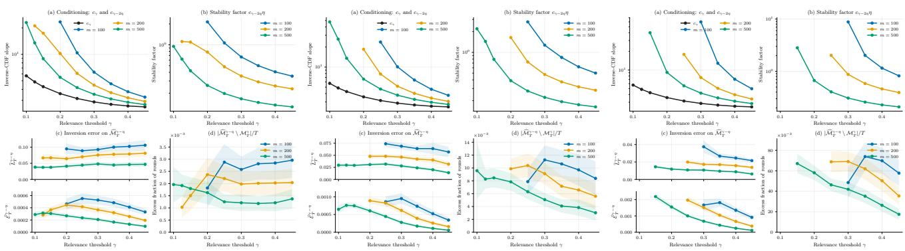  
K = 2  
K = 4  
K = 8  
Figure 4: Conservative non-batched inversion for Φ-LS with $K \in \{ 2 , 4 , 8 \}$ (left to right) and $m \in \{ 1 0 0 , 2 0 0 , 5 0 0 \}$ Panel (a) compares the intrinsic inverse-CDF slope $c _ { \gamma }$ with the median efective slope $c _ { \gamma - 2 \eta }$ . Panel (b) reports the median stability factor $c _ { \gamma - 2 \eta } \eta .$ Panel (c) reports the practical conditional and coverage-weighted inversion errors, $\widehat { L } _ { T } ^ { \gamma - \eta }$ and $\widehat { \mathcal { E } } _ { T } ^ { \gamma - \eta }$ , computed on $\widehat { \mathcal { M } } _ { T } ^ { \gamma - \eta }$ . Panel (d) reports the excess coverage $| \widehat { \mathcal { M } } _ { T } ^ { \gamma - \eta } \setminus \mathcal { M } _ { T } ^ { \gamma } | / T$ . Curves are b b cshown only when at least ten of the 100 trajectories satisfy $2 \eta < \gamma ;$ cshaded regions in Panels $\mathrm { ( c ) - ( d ) }$ are pointwise 95% confidence intervals.

Inversion for $v = \Psi .$ . We repeat the same experiment using Ψ-LS trajectories on the three environments above. At every round, the estimates with $m \in \{ 1 0 0 , 2 0 0 , 5 0 0 \}$ are constructed from nested prefixes of the same sequence of 500 auxiliary categorical samples. The practical relevance set and recovered gaps are computed using ${ \widehat { q } } ,$ whereas the exact sampling probabilities are used only to evaluate η, construct the oracle set $\mathcal { M } _ { T } ^ { \gamma }$ , and verify bthe exact inversion identity.

Figure 5 shows the stronger sensitivity of $\Psi ^ { - 1 }$ near the boundary of the probability simplex. Consequently, $c _ { \gamma - 2 \eta }$ and $c _ { \gamma - 2 \eta } \eta$ are generally larger than their Φ counterparts, and probability-estimation errors undergo greater amplification. Increasing m improves conditioning and reduces both the practical inversion error and the excess coverage. As for Φ-LS, missing low-threshold segments indicate that fewer than ten trajectories satisfy $2 \eta < \gamma ;$ this efect is most pronounced for $K = 8$ and $m = 1 0 0$ . Exact-probability inversion recovers the internal Ψ-LS gaps up to numerical precision.

## D.2 Batched algorithms

Batched Φ-LS. We also evaluate the role of the threshold when the demonstrator updates its sampling policy only at batch boundaries. Within a batch of size n, the sampling distribution is fixed, and the inverse learner estimates it directly from the observed action frequencies:

$$
\hat { q } _ { a , b } = \frac { 1 } { n } \sum _ { t \in \mathcal { B } _ { b } } \mathbb { 1 } \{ A _ { t } = a \} .
$$

We consider $n \in \{ 5 0 0 , 1 0 0 0 , 2 0 0 0 \}$ and use q both to determine the practical relevance set and to perform the binversion. The exact frozen policy q is used only to compute

$$
\eta = \operatorname* { m a x } _ { t , a } \left| \widehat { q } _ { a , t } - q _ { a , t } \right|
$$

and to provide an oracle coverage comparison. Figure 6 reports the resulting conditioning quantities, inversion errors, and coverage. Quantities involving $c _ { \gamma - 2 \eta }$ are displayed only when $2 \eta < \gamma$ , so missing segments correspond to configurations outside the stability regime of the theoretical guarantee. Increasing the batch size improves the frequency estimate, generally reduces the inversion error, and brings the q-based relevance set closer to the bexact-q set.All results are averaged over 100 independent trajectories of length $T = 2 0 0 0 0$

Batched Ψ-LS. Figure 7 repeats the conditioning experiment for batched Ψ-LS. The learner updates its posterior only at batch boundaries, while the observer estimates the sampling probabilities using the empirical action frequencies within each batch.

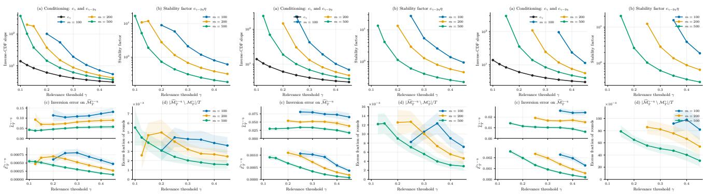  
K = 2  
K = 4  
K = 8  
Figure 5: Conservative non-batched inversion for Ψ-LS with $K \in \{ 2 , 4 , 8 \}$ (left to right) and $m \in \{ 1 0 0 , 2 0 0 , 5 0 0 \}$ Panels (a)–(d) report, respectively, $c _ { \gamma }$ and the median $c _ { \gamma - 2 \eta }$ , the median stability factor $c _ { \gamma - 2 \eta ^ { \eta } }$ , the practical inversion errors $\widehat { L } _ { T } ^ { \gamma - \eta }$ and $\widehat { \mathcal { E } } _ { T } ^ { \gamma - \eta }$ on $\widehat { \mathcal { M } } _ { T } ^ { \gamma - \eta }$ , and the excess coverage $| \widehat { \mathcal { M } } _ { T } ^ { \gamma - \eta } \setminus \mathcal { M } _ { T } ^ { \gamma } | / T .$ . Curves are shown only b bwhen at least ten trajectories satisfy $2 \eta < \gamma ;$ cshaded regions in Panels $\mathrm { ( c ) - ( d ) }$ are pointwise 95% confidence intervals over the valid trajectories.

## D.3 Sliding windows

We also study inversion when the observer has access only to the action trajectory and estimates the current sampling probabilities from a causal sliding window. For window length $n \in \{ 2 0 , 5 0 , 1 0 0 \}$ , we use

$$
\widehat { q } _ { a , t } ^ { ( n ) } = \frac { 1 } { n } \sum _ { s = t - n } ^ { t - 1 } \mathbb { 1 } \{ A _ { s } = a \} , \qquad t > n .
$$

Thus, $\widehat { q } _ { a , t } ^ { ( n ) }$ uses the frequencies of arm a in the previous n actions and does not use the current action. This bprovides a local, trajectory-based way to reflect temporal dependence and changes in the policy over time. Since the policy is not frozen within a sliding window, the estimate can reflect both finite-window variation and policy drift. Because actions are generated adaptively and the sampling policy may change within each window, we do not claim a theoretical guarantee for the accuracy of this estimator. We evaluate its empirical accuracy in simulation by comparing $\widehat { q _ { t } }$ with the known $q _ { t } ;$ deriving guarantees for this setting is left to future work.

bWe evaluate all window sizes on the common interval $t \geq 1 0 1$ , and report results for $T = 2 0 { , } 0 0 0$ over 100 independent trajectories. At each evaluated round, we compute $\eta _ { t } = \operatorname* { m a x } _ { a \in [ K ] } \left| \widehat { q } _ { a , t } - q _ { a , t } \right|$ and check the local condition $2 \eta _ { t } < \gamma _ { ; }$ , using $\gamma = 0 . 2 0$ . The action-frequency estimate $\widehat { q }$ bis used for practical relevance and gap inversion; the exact probabilities $q$ are used only to evaluate $\eta _ { t }$ band to compute the oracle coverage curve. In each figure, panel (a) shows the pointwise probability error and the threshold $\gamma / 2$ . Panel (b) compares the fraction of trajectories satisfying the local condition at round t with the stricter running condition $2 \operatorname* { m a x } _ { 1 0 1 \leq s \leq t } \eta _ { s } < \gamma$ Panel (c) reports the running conditional inversion error and its coverage-weighted counterpart on locally valid, empirically relevant rounds. Panel (d) compares relevance coverage computed from $\widehat { q }$ with oracle coverage computed from $q ,$ b both restricted to locally valid rounds. The pointwise error generally shrinks as the policies settle, while the running condition remains more restrictive because an early large error continues to afect the running maximum. Coverage-weighted error falls as relevant rounds become less frequent. Figures 8–10 show the results for Φ-LS, and Figures 11–13 show those for Ψ-LS.

## D.4 (ε, ε˜)-LS family

We empirically test Definition 4.3 for some common algorithms: TS, Maillard sampling (MS) (Maillard, 2021; Bian and Jun, 2022), and Boltzmann-Gumbel exploration (BGE) (Cesa-Bianchi et al., 2017) with the Φ-LS and Ψ-LS references. For each pair, we evaluate $\vert \Delta _ { a _ { t } , t } ^ { L S } - \Delta _ { a _ { t } , t } ^ { A } \vert$ and maxa $| p _ { a , t } - q _ { a , t } |$ on matched histories. We also compare Φ-LS and Ψ-LS directly. To examine how these quantities change with the number of arms, we consider a $K = 2$ Gaussian bandit with mean vector $\mu = ( 1 / 2 , 1 )$ , a $K = 4$ bandit with mean vector $\mu = ( 0 , 1 / 3 , 2 / 3 , 1 )$ ,

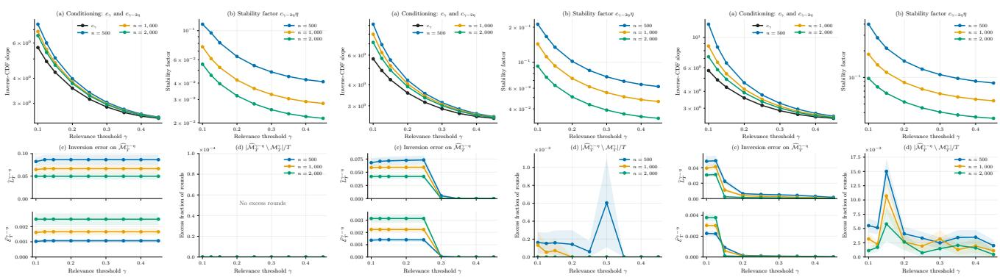  
K = 2  
K = 4  
K = 8

Figure 6: Batched iLITE-Φ conditioning and inversion results for $K \in \{ 2 , 4 , 8 \}$ (left to right), $T = 2 0 0 0 0$ , and batch sizes $n \in \{ 5 0 0 , 1 0 0 0 , 2 0 0 0 \}$ . Panel (a) compares $c _ { \gamma }$ with $c _ { \gamma - 2 \eta } ,$ and Panel (b) reports the stability factor $c _ { \gamma - 2 \eta } \eta$ . Panel (c) shows the conditional and coverage-weighted inversion errors, $\widehat { L } _ { T } ^ { \gamma - \eta }$ and $\widehat { \mathcal { E } } _ { T } ^ { \gamma - \eta }$ , computed on the practical relevance set $\widehat { \mathcal { M } } _ { T } ^ { \gamma - \eta }$ . Panel (d) reports the excess coverage $| \widehat { \mathcal { M } } _ { T } ^ { \gamma - \eta } \setminus \bar { \mathcal { M } } _ { T } ^ { \gamma } | / T$ b. Quantities are reported conly for trajectories satisfying $2 \eta < \gamma ;$ cshaded regions in Panels (c)–(d) are pointwise 95% confidence intervals.  
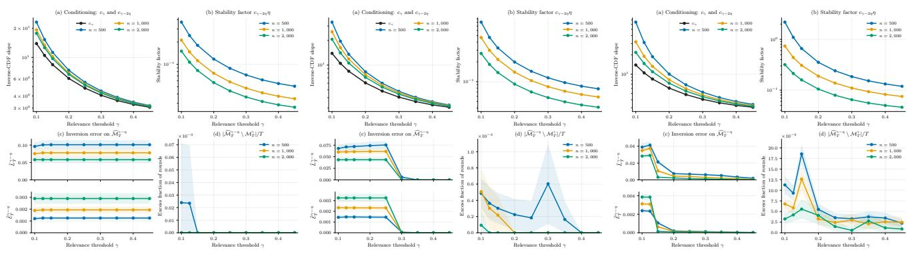  
K = 2  
K = 4  
K = 8  
Figure 7: Batched Ψ-LS conditioning experiment for $K \in \{ 2 , 4 , 8 \}$ (left to right), $T = 2 0 0 0 0 \mathrm { { ; } }$ , and batch sizes $n \in \{ 5 0 0 , 1 0 0 0 , 2 0 0 0 \}$ . Panel (a) compares $c _ { \gamma }$ with $c _ { \gamma - 2 \eta } ,$ and Panel (b) reports the stability factor $c _ { \gamma - 2 \eta } \eta .$ Panel (c) shows the conditional and coverage-weighted inversion errors, $\widehat { L } _ { T } ^ { \gamma - \eta }$ and $\widehat { \mathcal { E } } _ { T } ^ { \gamma - \eta }$ , computed on the practical relevance set $\widehat { \mathcal { M } } _ { T } ^ { \gamma - \eta }$ . Panel (d) reports the excess coverage $| \widehat { \mathcal { M } } _ { T } ^ { \gamma - \eta } \setminus \bar { \mathcal { M } } _ { T } ^ { \gamma } | / T$ b. Quantities are reported only for ctrajectories satisfying $2 \eta < \gamma ;$ cshaded regions in Panels (c)–(d) are pointwise 95% confidence intervals.

and a $K = 8$ Gaussian bandit with

$$
\mu _ { a } = 1 - 0 . 1 ( a - 1 ) , \qquad a \in [ K ] ,
$$

corresponding to $\mu = ( 1 , 0 . 9 , \ldots , 0 . 3 )$ . In all settings, the observation variance is $\alpha ^ { 2 } = 1$

Figure 14 separates discrepancies in the internal gap estimates from discrepancies in the resulting sampling policies. Since TS, Φ-LS, and Ψ-LS use the same Gaussian posterior update, their same-history gap discrepancies are zero up to numerical precision. In contrast, MS and BGE construct their estimates diferently and exhibit a transient gap discrepancy near initialization due to their forced initialization, which becomes larger as K increases but decreases as more observations are collected. The lower panels show that agreement in gap construction does not necessarily imply agreement between sampling policies: TS and the two LS variants remain relatively close, while MS and BGE display larger policy discrepancies, particularly for larger K. The horizontal axis begins at $t = K$ , marking the end of the forced initialization used by MS and BGE. Relative to the Ψ-LS reference, the discrepancy of TS also increases with K. These curves describe how the empirical discrepancies evolve over time; the corresponding trajectory-wise maxima are needed to assess the uniform conditions formally.

(a) Pointwise probability error ηt  
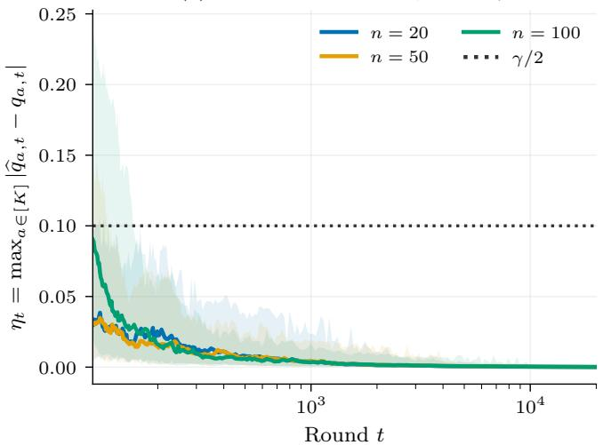  
(c) Inversion error on locally valid relevant rounds

(b) Validity of 2ηt < γ  
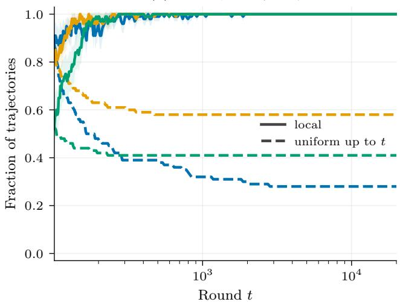  
(d) Locally valid relevance coverage

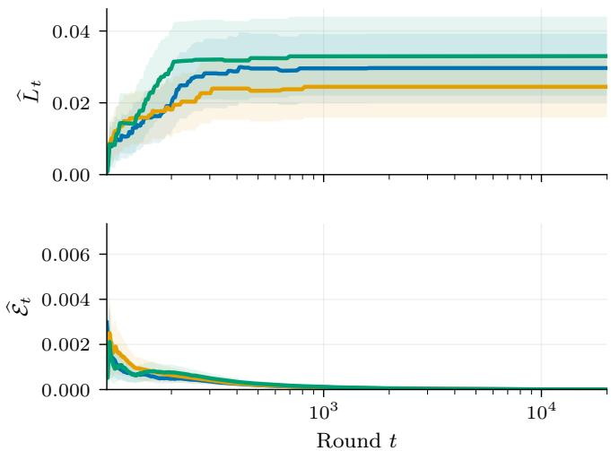

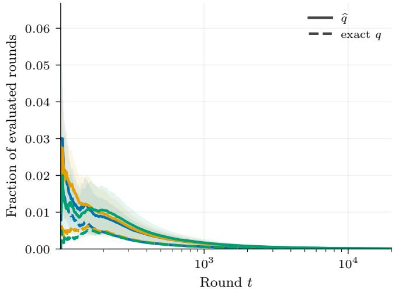  
Figure 8: Sliding-window inversion for Φ-LS with K = 2, $T = 2 0 { , } 0 0 0 .$ $\gamma = 0 . 2 0$ , and $n \in \{ 2 0 , 5 0 , 1 0 0 \}$ , averaged over 100 trajectories. Panels (a)–(d) show pointwise probability error, local and running-uniform validity, inversion error, and empirical versus oracle relevance coverage, respectively.

End-to-end inversion $v = \Psi$ We next evaluate the complete inversion procedure for TS, MS, and BGE at the fixed relevance threshold $\gamma = 0 . 4$ . Figures 15–17 should be interpreted together with the $( \varepsilon , \widetilde { \varepsilon } ) { \mathrm { - } } \mathrm { L S }$ comparison eabove. In that comparison, ε measures the discrepancy between the demonstrator’s sampling distribution and that of its Ψ-LS reference, whereas ε measures the discrepancy between their internal gaps when evaluated on the same realized history. The end-to-end experiment shows how these two forms of misspecification afect the gaps recovered by iLITE-Ψ.

Figures 15–17 show a clear dependence on the number of arms. For $K = 2$ , the relevance set is comparatively large and MS exhibits the largest conditional and coverage-weighted errors, followed by BGE and TS. The same qualitative ordering persists for $K = 4$ , although the relevant-round fraction and $\mathcal { E } _ { t } ^ { \gamma }$ are smaller. For $K = 8 .$ non-reference pulls remain frequent throughout the horizon, but very few rounds satisfy the relevance condition at $\gamma = 0 . 4 $ , since the sampling probability is distributed among more arms. Consequently, the coverage-weighted error becomes very small and the conditional-error curves are more irregular.

End-to-end inversion for $v = \Phi$ . Figures 18–20 complement the corresponding Ψ-inversion results. For $K = 2 ,$ MS again exhibits the largest conditional and coverage-weighted errors, while TS has the smallest error and BGE and Ψ-LS lie between them. The same ordering is broadly preserved for $K = 4 .$ , although the relevance set and $\mathcal { E } _ { t } ^ { \gamma }$ are smaller. Compared with inversion using $\bar { \Psi } ^ { - 1 }$ , the Φ inverse produces visibly smaller errors for TS and BGE in these two environments, showing that the choice of inverse CDF afects how policy misspecification is amplified. Conversely, applying $\Phi ^ { - 1 }$ to a Ψ-LS demonstrator produces a nonzero error, mirroring the error obtained when Φ-LS is inverted using $\Psi ^ { - 1 }$

(a) Pointwise probability error ηt  
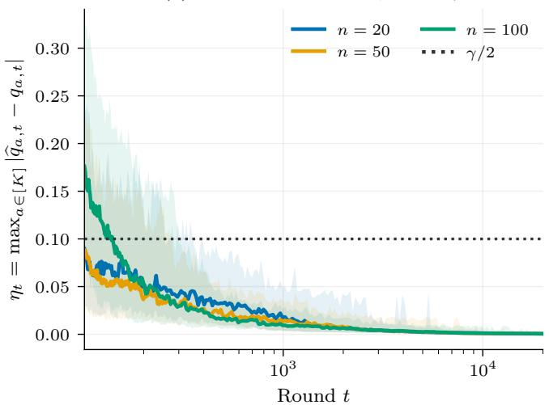  
(c) Inversion error on locally valid relevant rounds

(b) Validity of 2ηt < γ  
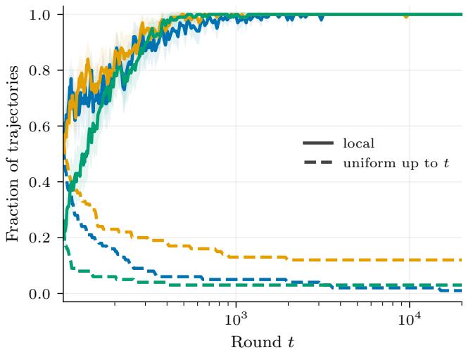  
(d) Locally valid relevance coverage

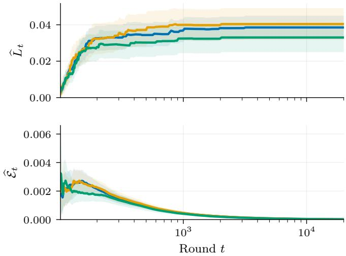

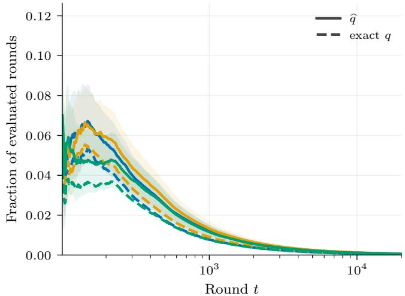  
Figure 9: Sliding-window inversion for Φ-LS with K = 4. The remaining settings and panels are the same as in Figure 8.

For $K = 8$ , both experiments exhibit substantial non-reference play but limited relevance at $\gamma = 0 . 4$ . Hence, the small coverage-weighted errors primarily reflect the contraction of the relevance set and should not be interpreted as improved inversion. This qualification is especially important for MS under $v = \Phi$ , for which only three trajectories satisfy $2 \varepsilon < \gamma$ . More generally, the Φ and Ψ results agree qualitatively on the role of K.

## D.5 Robustness to misspecification

We evaluate the efect of misspecifying the inverse learner’s Gaussian prior variance for $K = 4$ arms over a horizon of $T = 2 0 0 0$ . In each panel in Figures 21 and 22, we multiply the prior variance of one arm by $\rho \in \{ 0 . 2 5 , 0 . 5 , 2 , 4 \}$ leaving the other arms correctly specified. The demonstrator retains the correct prior variance $\sigma _ { a , 0 } ^ { 2 } = 1$ , while the inverse learner uses $\widetilde { \sigma } _ { a , 0 } ^ { 2 } = \rho \sigma _ { a , 0 } ^ { 2 }$ for the perturbed arm. We use the demonstrator’s exact sampling probabilities ein every inversion, so the observed error isolates prior misspecification rather than probability-estimation error. The dashed black curve is the matched-prior baseline and is zero up to numerical precision. Prior misspecification produces the largest errors during early learning, and these generally decrease as observations accumulate. This is consistent with Equation (2): as an arm’s pull count grows, the data-dependent term increasingly dominates the prior-variance contribution, reducing the influence of the initial misspecification. The efect is most pronounced when the best arm’s prior variance is perturbed, because the best arm enters the gap comparison at every relevant round. Results are averaged over 100 independent trajectories; shaded regions show 95% confidence intervals.

(a) Pointwise probability error ηt  
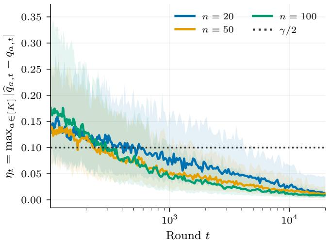  
(c) Inversion error on locally valid relevant rounds

(b) Validity of 2ηt < γ  
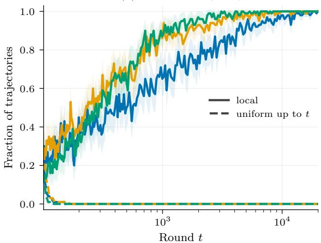  
(d) Locally valid relevance coverage

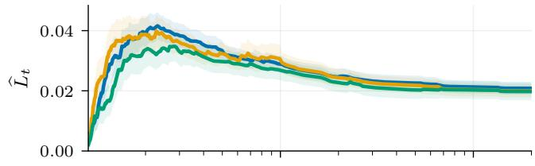

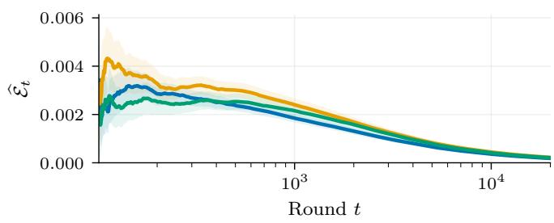

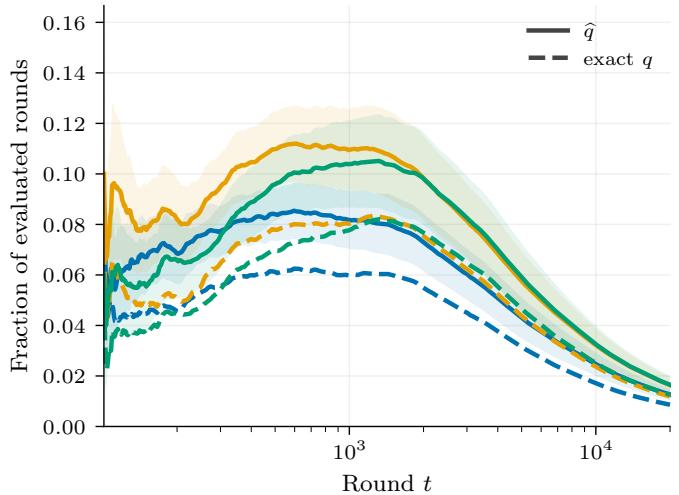  
Figure 10: Sliding-window inversion for Φ-LS with K = 8. The remaining settings and panels are the same as in Figure 8.

Round t  
(a) Pointwise probability error ηt  
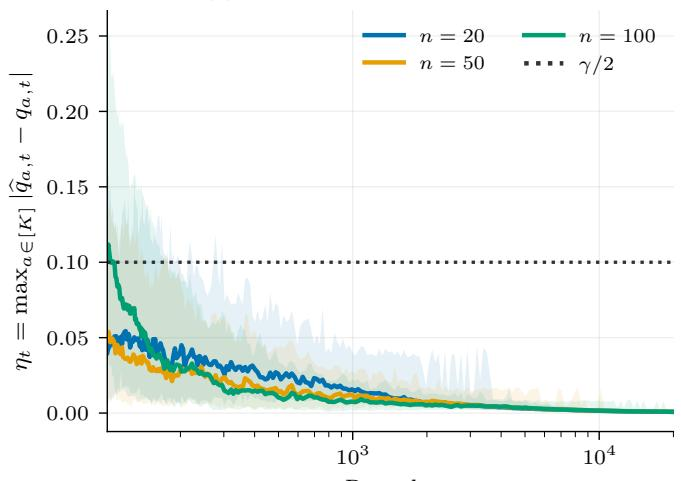

(b) Validity of 2ηt < γ  
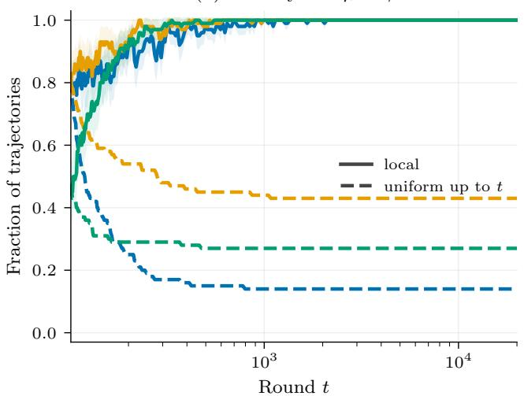

(c) Inversion error on locally valid relevant rounds  
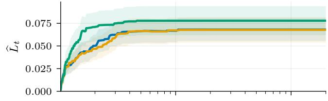  
(d) Locally valid relevance coverage

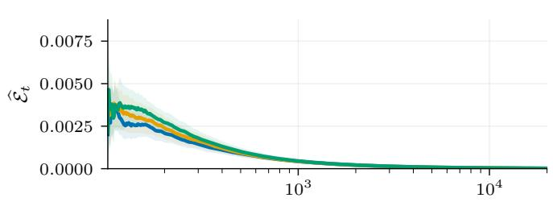  
Round t

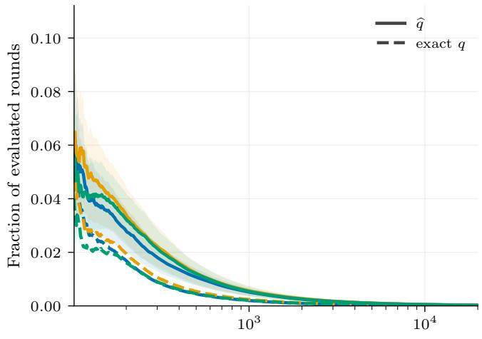  
Round t  
Figure 11: Sliding-window inversion for Ψ-LS with $K = 2 , T = 2 0 , 0 0 0 , \gamma = 0 . 2 0 \ i$ , and $n \in \{ 2 0 , 5 0 , 1 0 0 \}$ , averaged over 100 trajectories. Panels (a)–(d) show pointwise probability error, local and running-uniform validity, inversion error, and empirical versus oracle relevance coverage, respectively.

Round t  
(a) Pointwise probability error ηt  
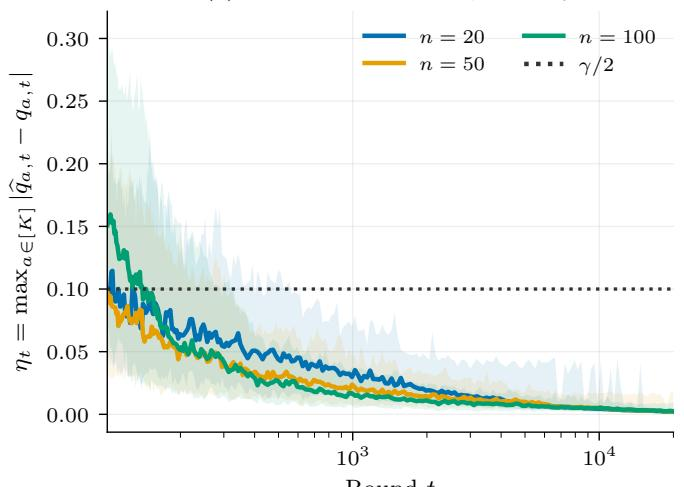

(b) Validity of 2ηt < γ  
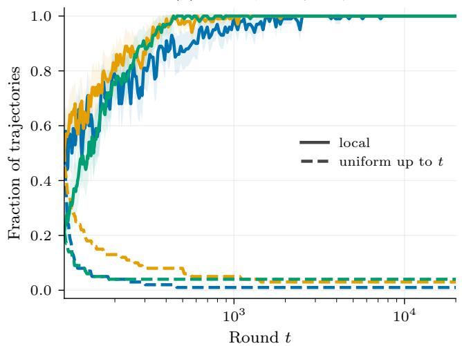  
(d) Locally valid relevance coverage

(c) Inversion error on locally valid relevant rounds  
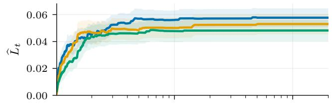

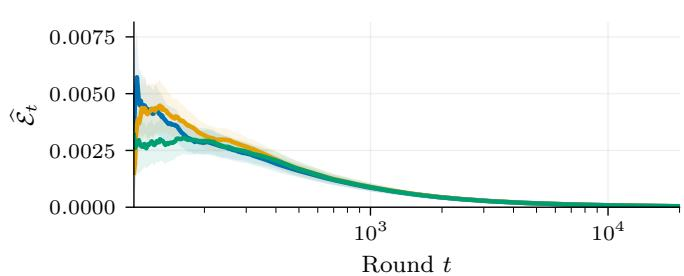

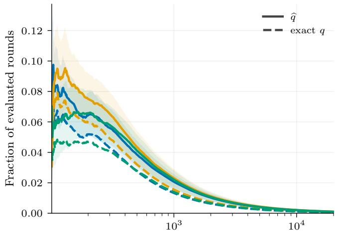  
Round t  
Figure 12: Sliding-window inversion for Ψ-LS with K = 4. The remaining settings and panels are the same as in Figure 11.

Round t  
(a) Pointwise probability error ηt  
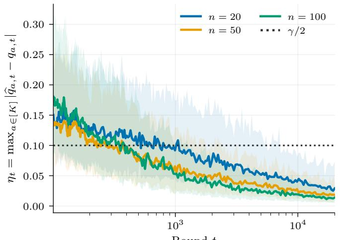

(b) Validity of 2ηt < γ  
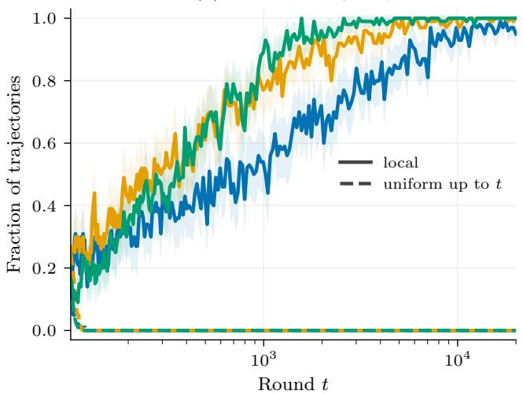  
(d) Locally valid relevance coverage

(c) Inversion error on locally valid relevant rounds  
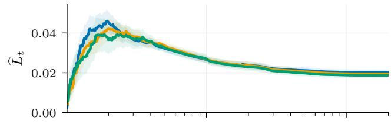

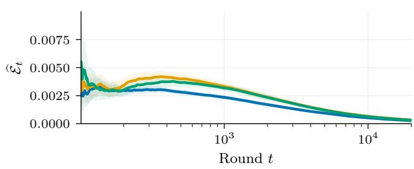

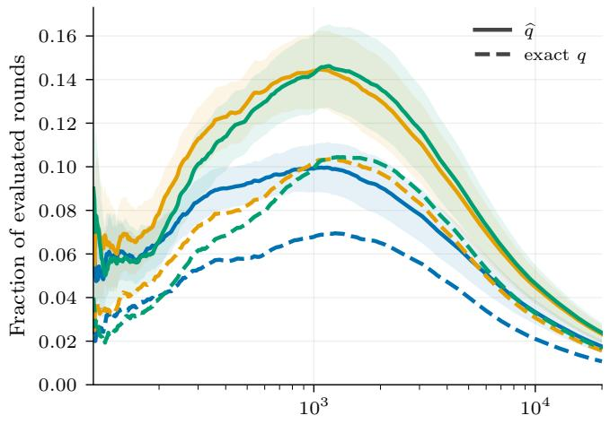  
Figure 13: Sliding-window inversion for Ψ-LS with $K = 8 .$ The remaining settings and panels are the same as in Figure 11.

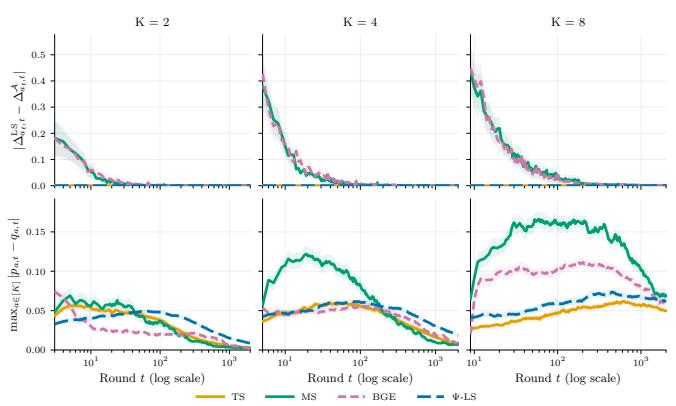  
(a) Φ-LS reference.

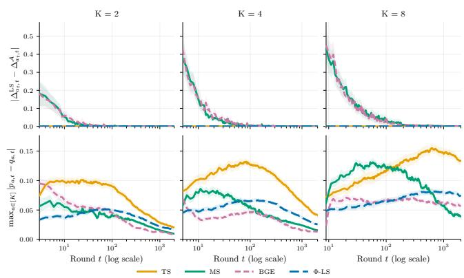  
(b) Ψ-LS reference.  
Figure 14: Same-history discrepancies relative to the Φ-LS reference (left) and the Ψ-LS reference $( \mathrm { r i g h t } )$ , for $K \in \{ 2 , 4 , 8 \}$ and $T = 2 0 0 0$ . The upper panels report the played-arm gap discrepancy $| \Delta _ { a _ { t } , t } ^ { \mathrm { r e f } } - \Delta _ { a _ { t } , t } ^ { \lambda } | $ , while the lower panels report the maximum sampling-policy discrepancy $\mathrm { m a x } _ { a \in [ K ] } | p _ { a , t } ^ { A } - q _ { a , t } ^ { \mathrm { r e f } } |$ . For each candidate trajectory, the reference policy is evaluated on the same realized action-reward history using exact sampling probabilities. Curves show the mean over 100 simulations and shaded regions show pointwise 95% confidence intervals. The horizontal axis begins at $t = K$ , marking the end of the forced initialization used by MS and BGE.

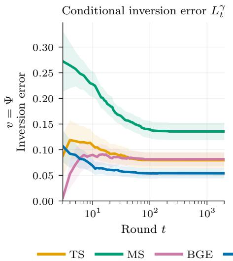

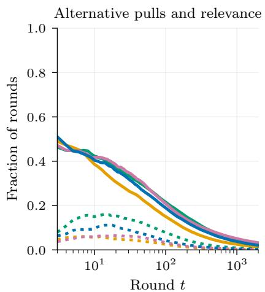

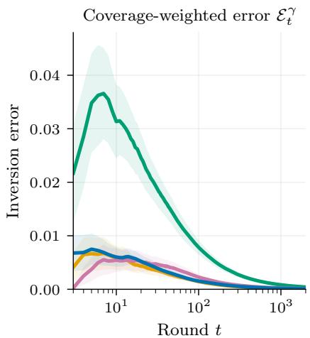  
TS MS BGE Φ-LS Non-reference pulls $1 - B _ { t } / t$ Relevant set $| \mathcal { M } _ { t } ^ { \gamma } | / t$

Figure 15: Fixed-threshold inversion with $v = \Psi$ for $K = 2 , T = 2 0 0 0$ , and $\gamma = 0 . 4$ . We invert TS, MS, BGE, and a Φ-LS demonstrator using the exact sampling probabilities. The panels report the conditional inversion error $L _ { t } ^ { \gamma }$ the non-reference pull fraction $1 - B _ { t } / t$ and relevant-round fraction $| \mathcal { M } _ { t } ^ { \gamma } | / t ,$ and the coverage-weighted error $\mathcal { E } _ { t } ^ { \gamma }$ Curves are restricted to trajectories satisfying $2 \varepsilon < \gamma ;$ shaded regions are pointwise 95% confidence intervals.

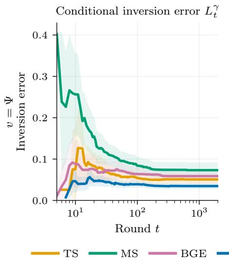

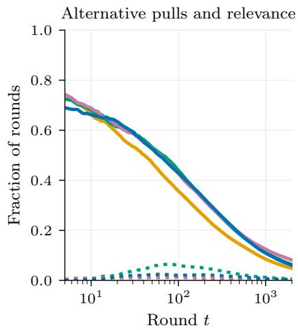

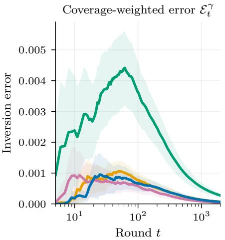  
TS MS BGE Φ-LS Non-reference pulls 1 $B _ { t } / t$ Relevant set $| \mathcal { M } _ { t } ^ { \gamma } | / t$  
Figure 16: Fixed-threshold inversion with $v = \Psi$ for $K = 4 , T = 2 0 0 0$ , and $\gamma = 0 . 4 .$ . The panels respectively report $L _ { t } ^ { \gamma }$ , the fractions of non-reference and relevant rounds, and $\mathcal { E } _ { t } ^ { \gamma }$ . The blue curve corresponds to a Φ-LS demonstrator inverted using $\Psi ^ { - 1 }$ and therefore isolates inverse-CDF misspecification. Exact sampling probabilities are used, and only trajectories satisfying $2 \varepsilon < \gamma$ contribute. Shaded regions are pointwise 95% confidence intervals.

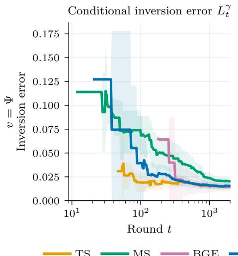

  
TS MS BGE Φ-LS Non-reference pulls $1 - B _ { t } / t$ Relevant set $| \mathcal { M } _ { t } ^ { \gamma } | / t$  
Figure 17: Fixed-threshold inversion with $v = \Psi$ for $K = 8 , T = 2 0 0 0$ , and $\gamma = 0 . 4 .$ . The three panels show the conditional inversion error, the decomposition into non-reference and relevant rounds, and the coverage-weighted inversion error. The Φ-LS curve illustrates inversion using a misspecified inverse CDF. Results use exact sampling probabilities and are restricted to trajectories satisfying $2 \varepsilon < \gamma$ . Shaded regions are pointwise 95% confidence intervals.

  
TS MS BGE Ψ-LS Non-reference pulls $1 - B _ { t } / t$ Relevant set $| \mathcal { M } _ { t } ^ { \gamma } | / t$  
Figure 18: Fixed-threshold inversion with $v = \Phi$ for $K = 2 , T = 2 0 0 0$ , and $\gamma = 0 . 4$ . We invert TS, MS, BGE, and a Ψ-LS demonstrator using the exact sampling probabilities. The left panel reports the conditional inversion error $L _ { t } ^ { \gamma }$ . The central panel shows the fraction of non-reference pulls, $1 - B _ { t } / t$ , together with the relevant-round fraction $| { \mathcal { M } } _ { t } ^ { \gamma } | / t .$ The right panel reports the coverage-weighted error $\mathcal { E } _ { t } ^ { \gamma }$ . Curves are computed over trajectories satisfying $2 \varepsilon < \gamma ;$ shaded regions are pointwise 95% confidence intervals.

  
TS MS BGE Ψ-LS Non-reference pulls 1 $B _ { t } / t$ Relevant set $| \mathcal { M } _ { t } ^ { \gamma } | / t$  
Figure 19: Fixed-threshold inversion with $v = \Phi$ for $K = 4$ $T = 2 0 0 0$ , and $\gamma = 0 . 4 .$ . The panels respectively report the conditional inversion error $L _ { t } ^ { \gamma }$ , the non-reference and relevant-round fractions, and the coverage-weighted error $\mathcal { E } _ { t } ^ { \gamma }$ . The blue curve corresponds to a Ψ-LS demonstrator inverted using $\Phi ^ { - 1 }$ . Exact sampling probabilities are used, and only trajectories satisfying $2 \varepsilon < \gamma$ contribute to each curve. Shaded regions are pointwise 95% confidence intervals.

  
TS MS BGE Ψ-LS Non-reference pulls $1 - B _ { t } / t$ Relevant set $| \mathcal { M } _ { t } ^ { \gamma } | / t$  
Figure 20: Fixed-threshold inversion with $v = \Phi$ for $K = 8 ,$ $T = 2 0 0 0$ , and $\gamma = 0 . 4 .$ The three panels show $L _ { t } ^ { \gamma }$ , the fractions of non-reference and relevant rounds, and $\mathcal { E } _ { t } ^ { \gamma }$ . The Ψ-LS curve illustrates inversion under inverse-CDF misspecification. Results use exact sampling probabilities and are restricted to trajectories satisfying $2 \varepsilon < \gamma .$ . For MS, this condition holds for only a small number of trajectories. Shaded regions are pointwise 95% confidence intervals.

Prior variance misspecified for arm a = 1  

Prior variance misspecified for arm a = 2  

Prior variance misspecified for arm a = 3  

Prior variance misspecified for arm a = 4  
  
Figure 21: Running conditional inversion error under prior-variance misspecification for Φ-LS. Each panel perturbs the inverse learner’s prior variance for the indicated arm; ρ denotes the multiplier in $\widetilde { \sigma } _ { a , 0 } ^ { 2 } = \rho \sigma _ { a , 0 } ^ { 2 }$ . The dashed curve is the correctly specified prior baseline.

Prior variance misspecified for arm a = 1  

Prior variance misspecified for arm $a = 2$  

Prior variance misspecified for arm $a = 3$  

Prior variance misspecified for arm $a = 4$  
  
Figure 22: Running conditional inversion error under prior-variance misspecification for Ψ-LS. The setup and conventions are the same as in Figure 21.