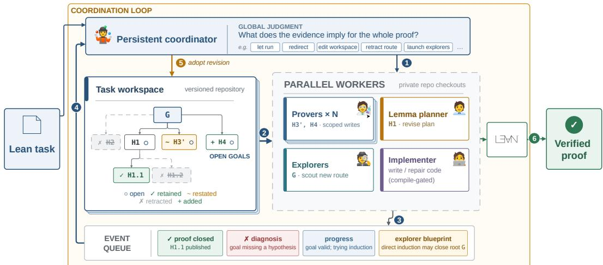
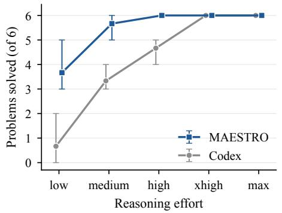
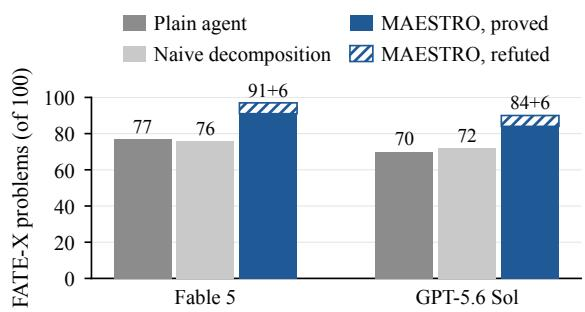
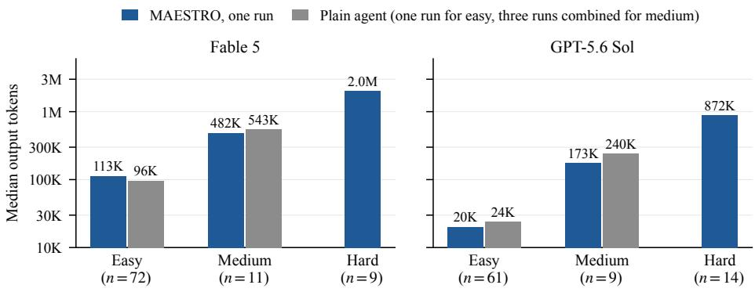
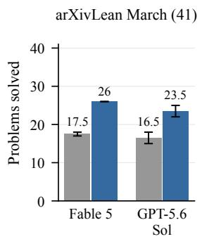
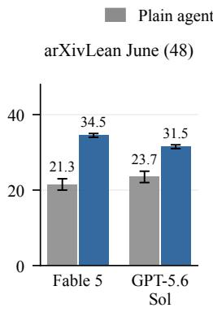
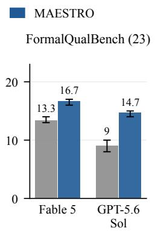
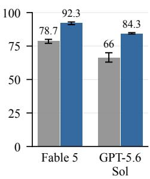

# MAESTRO: AGENTIC FORMAL PROOF DEVELOPMENTBY COORDINATION

Haoyu Li<sup>1</sup>, Zeren Shui<sup>2</sup>, Yuhao Zhang<sup>2</sup>, Ferhat Erata<sup>2</sup>, Benjamin Mikek<sup>3</sup>, Murali Krishna Ramanathan<sup>2</sup>, Hao Zhou<sup>2</sup>

<sup>1</sup>University of Illinois Urbana-Champaign <sup>2</sup>AWS AI Labs <sup>3</sup>Georgia Institute of Technology

## ABSTRACT

Lean is increasingly used to verify mathematical proofs and software produced by LLM agents, but writing formal proofs remains hard. Existing prover systems take a divide-and-conquer approach that recursively decomposes hard proof obligations into easier lemmas and splits again any lemma that resists proof. However, a lemma can resist proof for different reasons, including insufficient guidance, a false statement, or a flaw in the decomposition that produced it. Existing systems cannot tell these apart as a failed attempt reports little beyond its failure, and responses are confined to the failing node without considering the rest of the proof or revising the plan above it. The system may thus keep decomposing obligations along a flawed proof direction until the budget runs out, causing the whole proof attempt to fail. We introduce MAESTRO, a Lean prover harness that handles failures through global coordination. Provers report why they failed, not just that they failed, and a coordinator that sees the whole proof chooses an appropriate response, such as guiding a stuck prover, correcting a false lemma, or retracting a flawed subtree and replanning it. The same harness extends to verified code synthesis, where a checked counterexample sends the code back for repair. We evaluate MAESTRO with four frontier LLMs on seven mathematics and three software verification benchmarks. It proves more targets than each model’s native coding agent (Claude Code or Codex) on every benchmark the agent has not already saturated, with the largest gains on research-level mathematics. With Claude Opus 5, it discovers its own proofs of 34 of the 48 theorems in the June 2026 release of arXivLean, against 19 for the native agent. It also outperforms all published prover systems on every benchmark they share, solving 669/672 PutnamBench, 59/60 Lean-IMO-Bench, and 6/6 IMO 2026.

## 1 INTRODUCTION

LLM agents are increasingly applied to research-level mathematics (Dekoninck et al., 2026) and complex software engineering tasks (Jimenez et al., 2024). As these tasks grow harder, their outputs become harder for human experts to audit. Formal verification makes such auditing mechanical, so that a proved theorem or a verified program in Lean can be trusted without trusting the agent that produced it (Leesatapornwongsa et al., 2016; Hawblitzel et al., 2015; Agarwal et al., 2026; Wilcox et al., 2015; Chen et al., 2015; Lesani et al., 2016), but reliable formal proof generation is far from solved. In September 2026, OpenAI reported a proof of finite-time singularity formation for the three-dimensional Navier-Stokes equations with smooth forcing, together with a Lean formalization.<sup>1</sup> However, the proof was produced by an unreleased internal model, and the agent harness is not openly available. Moreover, how the agents developed the proof, and how much human guidance they received, is only partially documented. The final proof also omits the failed approaches and intermediate discoveries that shaped the search, which could explain why plausible routes fail and reveal ideas useful beyond the original problem. The wider mathematical community has also called for openness about failures in AI-assisted mathematics.<sup>2</sup> What is missing is an effective, open-source Lean proving harness that produces formally checked results with accessible models and exposes the attempts, failures, and revisions behind them.

To build such a harness, one must decide how to organize many agents around a proof that rarely succeeds in a single attempt. Almost all prior systems make this decision the same way. When a goal resists direct proof, they decompose it into subgoals and prove those recursively (Wang et al., 2024; Ren et al., 2025; Varambally et al., 2026; Qiu et al., 2026). This strategy has carried formal proving a long way. It saturates high-school-level competition benchmarks such as miniF2F (Zheng et al., 2022; Varambally et al., 2026; Chung et al., 2026). With large test-time budgets, it also proves most IMO 2025 problems (Achim et al., 2025; Chen et al., 2025b) and most undergraduate-level PutnamBench problems (Tsoukalas et al., 2024; Chen et al., 2025a; Chung et al., 2026), as well as a few research-level theorems. However, a subgoal can resist proof for different reasons. The prover may need better guidance, the lemma may be false, or the surrounding proof may approach the theorem from the wrong direction. Existing systems answer all of these cases locally, at the node that failed. Recursive provers such as Hilbert (Varambally et al., 2026) and LEAP (Kung et al., 2026) decompose the failing subgoal again, and Goedel-Architect (Chung et al., 2026) may first repair its statement through blueprint refinement, but neither revisits the architecture that produced the subgoal. They stay local because they lack the information a global decision needs. A failed attempt reports little beyond the fact that it failed, and nothing in the pipeline collects what has been tried across branches. The prover therefore cannot tell these cases apart, let alone judge when to retry with a different direction, when to add a fact that several branches need, or when to abandon a route altogether. A locally evolving pipeline can then spend its budget elaborating an architecture that leads nowhere. Broad parallel search can work around this at a much higher cost (Varambally et al., 2026), but long proofs need many rounds of decomposition whose branching choices compound, so even a large search can easily miss the one route that actually leads to a complete proof.

We present MAESTRO, an agentic framework that replaces local plan revision with global coordination. Parallel workers attack the open obligations of a shared Lean workspace, and a single coordinator oversees the whole proof. Workers report more than success or failure. A prover that fails returns a diagnosis of the routes it tried, the auxiliary facts it would need to close the goal, and any counterexample it suspects. The coordinator reads every report and remembers what has already been tried, so it can see patterns that no single node reveals, such as several sibling lemmas failing for want of the same fact, or repeated decompositions of one lemma recreating its hardest part. Its response to a failed lemma can therefore be global and much more flexible. It may retry the lemma with better guidance, add a fact that several branches need, retract a flawed subtree while keeping the lemmas already proved, falsify a target that looks false, or send explorers to search for a new architecture. Decomposition becomes one possible response to failure instead of the pipeline’s fixed rule. The same coordination extends naturally to verified code synthesis. With the specification held fixed, the implementation is one more artifact that can be diagnosed. When a checked counterexample shows that the code is at fault and the proof strategy is not, the coordinator sends the counterexample and a concrete diagnosis to the coder, then rebuilds the proof obligations around the revised implementation. Code and proof thus improve through the same feedback loop, with the specification as the stable contract between them. Finally, every coordinator decision is recorded together with its evidence, so a finished run shows not only the proof but also the exploration behind it. Our contributions are threefold:

• Global coordination instead of local repair. We design MAESTRO, a Lean prover harness that handles failure globally, where prior provers repair only the lemma that failed. Workers return structured diagnoses, and a coordinator that sees the whole proof uses them to revise the plan at the level where the problem lies, from a guided retry of one lemma to replanning a whole subtree.

• One system for mathematics and verified coding. Because coordination acts on formal obligations and not on domain-specific tactics, the same harness proves theorems, verifies given imple mentations, and synthesizes code together with its proof.

• Strong empirical results. Across four frontier backbones and ten benchmarks, MAESTRO outperforms a plain coding agent with the same model on every benchmark the agent has not saturated. On the research-level March and June releases of arXivLean, it proves up to 26 of 41 and 34 of 48 theorems, against at most 17 and 25 for the plain agent. It solves all six IMO 2026 problems and beats the best published result on every shared benchmark, with 669/672 on PutnamBench against 597 for Goedel-Architect (Chung et al., 2026), 59/60 on Lean-IMO-Bench against 42 for LEAP (Kung et al., 2026), and 76/77 on AlgoVeri against 65 for IDS (Agarwal et al., 2026).

  
Figure 1: MAESTRO’s coordination loop. The persistent coordinator 1 dispatches or redirects workers, which 2 attack open obligations in parallel and 3 report proofs, diagnoses, progress, or blueprints to a shared queue. The coordinator 4 consumes these events as they arrive and 5 revises the shared Lean workspace, here retracting H2 and H1.2, restating H3 as H3’, adding H4, and keeping the proved H1.1. When the root closes, 6 Lean checks the final proof or falsification.

## 2 RELATED WORK

Formal theorem proving. Early neural provers followed one of two approaches, either searching a tree of proof states one tactic at a time (Polu & Sutskever, 2020; Lample et al., 2022; Yang et al., 2023; Lin et al., 2025) or writing an entire proof in one pass (First et al., 2023; Xin et al., 2025). Whole-proof generation has since become the more popular of the two, in part because it lends itself to reinforcement learning and to parallel sampling at test time (Wang et al., 2025; Lin et al., 2026; Dong & Ma, 2025; Chen et al., 2025b;a). As theorems grow harder, however, a long Lean proof is rarely correct in one attempt. Recent systems have therefore turned to agentic methods that repair their attempts from kernel feedback (Thakur et al., 2024; Baba et al., 2025; Requena et al., 2026; Liu et al., 2026) and break a theorem into subgoals that can be proved separately (Jiang et al., 2023; Cao et al., 2026; Wang et al., 2024; Dong et al., 2024; Ren et al., 2025). Of these methods, recursive decomposition has become the most widely used. Systems such as Hilbert and LEAP propose the lemmas a theorem needs, prove them in parallel, and decompose again any lemma that resists (Varambally et al., 2026; Zhou et al., 2025; Qiu et al., 2026; Kung et al., 2026). Goedel-Architect adds blueprint refinement, which can also correct a misstated lemma (Chung et al., 2026). All of these systems, however, handle failure locally. Whether they split a lemma or repair it, they act only on the lemma that failed, even when the cause is a choice made higher in the plan. MAESTRO handles failure globally, with a coordinator that sees the whole proof and revises the plan at the level where the problem lies.

Verified code generation. Verified code generation adds a step that theorem proving lacks, since the system must write the implementation before it can prove it correct. A failed obligation may point to the code as well as the proof. Most systems target Dafny, Verus, or ACSL-annotated C, where the model annotates the code with invariants and an SMT solver discharges the resulting verification conditions (Sun et al., 2024; Mugnier et al., 2025; Yang et al., 2025; Chen et al., 2025c; Aggarwal et al., 2025; Zhong et al., 2025; Sevenhuijsen et al., 2025; Breen et al., 2026). This approach struggles when correctness rests on nontrivial mathematics. Recent work has turned to interactive proof assistants such as Lean, with benchmarks for verified code generation (Ye et al., 2026; Zhao et al., 2026; Ma et al., 2026) and systems designed for code verification (Li et al., 2026; Sosso et al., 2026; Gloeckle et al., 2026; Kan et al., 2026; Agarwal et al., 2026; Feng et al., 2026). We see this as an opportunity, because an attempted proof can expose defects that model-proposed tests miss. Owing to its flexible coordination, MAESTRO treats this setting like a mathematical theorem, and repairing the implementation is one more coordinator action.

## 3 METHOD

MAESTRO is modeled on the way mathematicians work. A proof of a hard theorem starts from a plan, and the plan is a guess. Some of its flaws are visible on paper. Others appear only when the attempt on one step gets stuck in a way that shows the plan itself was wrong. At that point someone has to decide whether to push harder on the step, patch it, or abandon the route that led there. MAESTRO automates this loop. It keeps a Lean 4 workspace as the record of what has been proved, sends parallel workers at the obligations that remain open, and asks each worker to report why it failed and not just that it failed. A single coordinator reads these reports and steers the proof until no sorry remains (Figure 1). We describe the workers (§3.1), the coordinator (§3.2), the pipeline they form (§3.3), and how false targets and faulty code are handled (§3.4).

A task arrives as a frozen Lean 4 context of imports, definitions and hypotheses, together with a specification and sometimes an implementation in the case of verified coding. It comes with one or more target theorems whose bodies are sorry. Targets range from competition problems to specification theorems about code that the system is given or has to write itself. MAESTRO works in a Lean workspace seeded with this context. Every lemma it conjectures is added to the workspace, with a proof if it has one and a sorry if it does not. These proofs get long, so the coordinator may spread them over several files and give each worker only the part that its goal needs. A run succeeds when the workspace compiles and every target is proved. If a target turns out to be false, the system can return a machine-checked falsification instead (§3.4).

## 3.1 WORKERS

Global coordination is only as good as the evidence it receives. A decomposition pipeline needs nothing from a failed attempt beyond the fact that it failed, since its response is fixed in advance. A coordinator that must choose between retrying, repairing and replanning needs to know why the attempt failed, so every worker in MAESTRO reports evidence along with its result. There are four kinds of workers. Provers try to close individual obligations under the current plan. Local lemma planners decompose an obligation that the provers could not close. Free-form explorers look for a different plan when the current one seems to be failing. In verified code generation, implementers write the code that the proof obligations refer to. Each is an agentic session with its own copy of the workspace and interactive access to Lean, and reports to the coordinator. The full prompts of all workers and of the coordinator are given in Appendix E.

Provers. Several provers work on open obligations in parallel. When a prover closes its goal, it returns the proof. When it fails, it returns a diagnosis instead of a bare failure. The diagnosis records the approaches the prover tried and why they did not work, and says whether it thinks the problem is local, such as a missing helper lemma, or lies in the surrounding global plan, such as a route that runs into a fundamental barrier and cannot lead to the theorem at all. If the prover believes the statement is false, it also gives a counterexample that it has checked in Lean. Provers that run for a long time also send progress reports at regular intervals. A report describes what has been proved so far, what is still missing, and whether the prover considers itself stuck, and it includes a compiling snapshot of the partial proof. These reports let the coordinator follow an attempt while it runs, and redirect a prover that has moved onto an unpromising route before the attempt fails.

Local lemma planners. To decompose an obligation, a planner first writes a proof plan in natural language, listing the child lemmas with their statements and roles together with the argument that combines them. A judge then reviews the plan. It does not ask for proofs of the child lemmas and rejects a plan only for plan-level defects, such as an ingredient that is false or unavailable. Its main question is whether the decomposition really divides the difficulty. A plan in which routine side lemmas surround a single child as hard as the parent only relocates the problem, and the judge sends it back. When several different plans keep recreating the same hard core, the judge says so, which tells the coordinator that the obstacle lies above this obligation. Otherwise, the planner revises until the judge accepts, and a translator writes the accepted plan in Lean, leaving each child as sorry.

Free-form explorers. When the diagnoses collected so far give the coordinator no further idea, it launches explorers. An explorer sees the current workspace and the global plan but does not have to follow either. It works out an alternative route and reports back either with a blueprint and evidence that the route can work, or with the conclusion that the current plan should be kept. Explorers do not modify the workspace, and the coordinator decides whether to use what they find.

Implementers. In verified code generation the implementation is not given, so it has to be written before the proof obligations mean anything. An implementer consists of a coder and a judge. The coder writes the implementation, and the judge then tries to find inputs on which it fails, running it on cases that satisfy the precondition and checking each output against the formal postcondition. The judge also rejects code that passes its tests but does not follow the requested algorithm or misses the required complexity. If the provers later find a bug that the judge missed, the same worker is asked to fix the code.

## 3.2 COORDINATOR

In prior pipelines a failure is handled by a fixed rule that looks at one node, and the rule responds the same way whatever the failure means. The right response, however, often depends on what is happening elsewhere in the proof, for example on whether sibling lemmas failed for the same reason. MAESTRO therefore gives this decision to a single coordinator per task, an agentic session that runs for the whole proof, reads the live workspace, receives every diagnosis and progress report, and remembers what it has already tried. It can notice that a branch has been decomposed twice and each time its hardest child merely restated the parent, that three sibling routes all failed for want of the same fact, or that the evidence accumulating across the forest suggests the target itself is false. It then acts on what these reports show together, whether that means rewriting a subtree or nudging a single worker. We describe its two roles in turn, namely how it changes the shared blueprint and how it steers the workers who carry the blueprint out.

Global blueprint mutation. Most decomposition pipelines only ever add to the blueprint. A stuck node is split into children, a repaired statement replaces the old one in place, and the rest of the tree is left untouched, so the plan keeps growing even when the evidence shows that a whole branch was a mistake. MAESTRO has no such restriction, and it does not limit the coordinator to a small menu of actions such as split and repair. Instead, the coordinator edits the workspace as the evidence requires, and it can remove parts of the blueprint as easily as it adds them. It can also fix several problems in one edit. Suppose the reports show that two branches lack the same fact, one lemma is false, and a decomposition built on that lemma is now useless. The coordinator adds the fact once, drops the false lemma, and replaces the decomposition in the same edit, instead of patching each node separately. In other cases, it might abandon a parent conjecture while keeping the children it has already proved, lift a duplicated fact into a shared lemma, or repair an upstream dependency instead of the lemma that a counterexample happened to break (Figure 1). This freedom is why the lemmas live in a Lean workspace that the coordinator owns outright. Any restructuring, however drastic, is simply the next version of the workspace, checked against one objective criterion, namely that the workspace compiles and the frozen statements are intact. Owning the workspace also lets the coordinator organize a long proof into largely independent modules, so that each worker receives only the part its goal depends on. Discarding lemmas that are already proved is exactly what a pipeline that only grows its plan cannot do, and in one of our case studies it decided the outcome.

Worker dispatch. The coordinator also shapes the proof through which worker it sends at an obligation, when it sends it, and what it tells it. Choosing a worker is itself a judgment about the plan, because each kind of worker trusts the current plan to a different degree. A prover commits to the current route, a lemma planner accepts the route but treats one step as too large, and an explorer questions the route altogether. When the evidence points to a strategy, the coordinator sends a prover with it, for example the approach that closed a sibling lemma of the same shape, or a warning about the gap that defeated the last attempt. When it has no candidate of its own, it launches explorers without guidance, so that their search is not narrowed to a route it merely suspects. It also decides when to spend more test-time compute instead of more structure, by exploring several routes in parallel or by raising the budget of a single leaf. A goal that keeps resisting under a route that still looks sound is pushed harder instead of being decomposed after one failed attempt, since an unnecessary decomposition commits the blueprint to children that must all be proved. In a decomposition-only pipeline all of these choices are fixed by rule, so every failure is followed by the same response, whereas here each one is made from the evidence at hand.

## 3.3 OVERALL PIPELINE

Parallel proving pipelines commonly run in rounds. They dispatch a wave of workers, wait for every worker in the wave to finish, and only then plan the next wave. The difficulty is that nobody can tell in advance how long an attempt will take, so a round can only end if each worker runs under a fixed timeout, and no single value works. A long timeout makes every round as slow as its slowest worker. A short one stops provers that were close to success, discards their work, and typically replaces a nearly finished proof with a decomposition and a fresh set of obligations. MAESTRO instead removes rounds and fixed timeouts altogether. Workers run asynchronously under a generous budget and report their progress as they go, and every report, diagnosis and finished proof enters a single event queue that the coordinator processes as events arrive. Deciding when an attempt should end thus becomes a judgment made from evidence instead of a timeout fixed in advance. The coordinator can let a slow but productive prover continue, stop or redirect one that has drifted off-route, for instance one re-deriving a fact already proved elsewhere, and repair a stuck branch while its siblings keep running. It also decides when to act on a new diagnosis, responding at once when the evidence is clear and waiting for sibling workers when it is not.

The end-to-end workflow follows directly (Figure 1). The task is loaded into the workspace, its targets become the initial open obligations, and provers are dispatched against each of them. From then on, every event is handled on arrival. Closed proofs are committed directly, since a closed goal is a fact and needs no deliberation. Diagnoses and progress reports go to the coordinator, which edits the workspace and dispatches the workers that the edit calls for, and their reports feed the same queue. The loop continues until no sorry remains or the run ends in a falsification. Because each step of this loop is a compile-checked edit to the workspace, a run leaves behind a complete record of its search, including the lemmas it conjectured and retracted, the routes it tried and abandoned, and the evidence behind each change. The record does not expose the model’s internal reasoning, but it makes the exploration transparent. MAESTRO is open source, so every run produces such a record, and the case studies in §4.5 are drawn directly from them.

## 3.4 FALSIFICATION AND CODE REPAIR

A target submitted for verification may be false, and a pipeline that assumes every target is provable will spend its whole budget trying to prove it. False targets are especially common in verified code generation, since an agent rarely writes correct code on its first attempt. The specification there is fixed, so a false target points to a bug in the implementation, and proof and code have to evolve together until the code is right. MAESTRO therefore treats falsification as a core part of the system and not as an afterthought.

A worker can raise two kinds of falsification claim. It may claim that the target is false, or that the target cannot be proved because the frozen context lacks a fact it needs. MAESTRO does not take either claim on trust and checks each one in Lean. To confirm that a target is false, it tries in parallel to prove the negation of the target and to build a countermodel, a concrete example that satisfies every frozen hypothesis but violates the target. Either one counts only if it compiles against the unchanged frozen context. To check that a fact is missing, it tries to prove that fact from the frozen context. If this succeeds, the claim is rejected and proving continues. A claim that no compiling Lean proof supports is reported as unverified and is not treated as a falsification. What happens next depends on the task. For a mathematical theorem, the run ends and returns the machine-checked falsification. For a verification task, the coordinator sends the counterexample to the implementer. Once the revised code arrives, the coordinator keeps the lemmas that still hold and removes those that referred to the old code. Proving the code correct thus also finds bugs that the judge’s tests miss, because a proof must cover every possible input and not only the tested ones.

## 4 EXPERIMENTS

We evaluate MAESTRO with four frontier models as its backbone: Claude Opus 4.8, Claude Opus 5, Claude Fable 5, and GPT-5.6 Sol. Unless stated otherwise, every model runs at high reasoning effort, both in MAESTRO and in the baseline agents. All workers receive the same tools, namely standard shell utilities, a Lean MCP server, and a locally hosted Loogle instance for searching Mathlib. Web access is disabled throughout, so a solved target reflects a proof the agent found itself, not one copied from the literature. The benchmarks fall into three groups. For formal mathematics we use IMO 2026<sup>3</sup>, PutnamBench (Tsoukalas et al., 2024), Lean-IMO-Bench (Luong et al., 2025; Kung et al., 2026), FormalQualBench<sup>4</sup>, FATE-X (Jiang et al., 2026), and the March and June 2026 releases of arXivLean, whose targets are theorems from recent arXiv papers stated in Lean (Dekoninck et al., 2026). For verifying existing software we use NTP4VC, whose tasks are verification conditions from real-world verified projects (Xu et al., 2026). For verified code generation we use Verina and AlgoVeri (Ye et al., 2026; Zhao et al., 2026).

Table 1: Main results. Problems solved per benchmark, for each model as a plain coding agent with Lean skills (Claude Code for Claude models, Codex for GPT models) and as the backbone of MAESTRO. The number of tasks in each benchmark is given once in the column header. Verina and AlgoVeri use joint implementation-and-proof synthesis from a fixed specification. All values are collected with a single rollout per task. LIB denotes Lean-IMO-Bench, aXL-03 and aXL-06 the March and June 2026 arXivLean releases, FQB FormalQualBench, and VC the verificationcondition benchmark NTP4VC. A cell of the form a+b means a targets proven and b shown false by a machine-checked falsification (§3.4); Appendix C lists the falsified targets.
<table><tr><td rowspan="2"></td><td rowspan="2"></td><td colspan="7">Mathematics</td><td>VC</td><td colspan="2">Verified coding</td></tr><tr><td>IMO&#x27;26 Putnam (6)</td><td>(672)</td><td>LIB (60)</td><td>(41)</td><td>aXL-03 aXL-06 (48)</td><td>FQB (23)</td><td>FATE-X (100)</td><td>NTP4VC (600)</td><td>Verina (189)</td><td>AlgoVeri (77)</td></tr><tr><td rowspan="2">Opus 4.8</td><td>Claude Code</td><td>1</td><td>587</td><td>46</td><td>11</td><td>11</td><td>7</td><td>54</td><td>574</td><td>189</td><td>69</td></tr><tr><td>MAESTRO</td><td>5</td><td>663+2</td><td>57+1</td><td>19</td><td>20+2</td><td>13</td><td>79+5</td><td>586+11</td><td>189</td><td>75</td></tr><tr><td rowspan="2">Opus 5</td><td>Claude Code</td><td>4</td><td>667</td><td>56</td><td>14</td><td>19</td><td>11</td><td>73</td><td>589</td><td>189</td><td>69</td></tr><tr><td>MAESTRO</td><td>6</td><td>669+2</td><td>59+1</td><td>25</td><td>34+2</td><td>16</td><td>90+6</td><td>589+11</td><td>189</td><td>76</td></tr><tr><td rowspan="2">Fable 5</td><td>Claude Code</td><td>4</td><td>661</td><td>51</td><td>17</td><td>20</td><td>13</td><td>77</td><td>589</td><td>189</td><td>69</td></tr><tr><td>MAESTRO</td><td>6</td><td>668+2</td><td>59+1</td><td>26</td><td>34+2</td><td>17</td><td>91+6</td><td>588+11</td><td>189</td><td>75</td></tr><tr><td rowspan="2">GPT-5.6 Sol</td><td>Codex</td><td>6</td><td>661</td><td>56</td><td>15</td><td>25</td><td>8</td><td>70</td><td>588</td><td>189</td><td>71</td></tr><tr><td>MAESTRO</td><td>6</td><td>669+2 59+1</td><td></td><td>25</td><td>32+2</td><td>15</td><td>84+6</td><td>588+11</td><td>189</td><td>75</td></tr></table>

## 4.1 MAIN RESULTS

Table 1 compares MAESTRO with a plain coding agent on the same backbone, for each of the four models. MAESTRO outperforms the plain agent on every benchmark that the agent has not already saturated, and the margin grows with the difficulty of the benchmark.

The margin is largest on research-level mathematics. The two arXivLean releases together contain 89 theorems from recent arXiv papers. Averaged over the four backbones, the plain agent proves 33 of them and MAESTRO proves 54, an improvement of 63%. The gain holds on every backbone, ranging from 43% for GPT-5.6 Sol to 79% for Opus 5. We attribute it to harder problems, whose proofs are longer, rest on more intermediate lemmas, and usually need several failed attempts. A single agent must keep the entire development in one context, whereas MAESTRO spreads it across workers and redirects them as evidence of failure accumulates. We see similarly large gains on the other hard benchmarks. On FormalQualBench, a set of PhD qualifying-exam theorems, MAESTRO proves 13 to 17 of 23 targets against 7 to 13 for the plain agent, and on FATE-X it proves 79 to 91 of 100 against 54 to 77, without counting falsified targets. These gains persist across repeated runs (Appendix B) and do not come from an unreasonable compute budget (Appendix A).

On easier benchmarks the plain agents are already strong, and the gains are smaller but still consistent. On IMO 2026, MAESTRO solves all six problems with three of the four backbones, and five with Opus 4.8, where Claude Code solves one. It adds 2 to 76 problems per backbone on Putnam-Bench and 3 to 11 on Lean-IMO-Bench. Software benchmarks are close to saturation. Surprisingly, every plain agent solves all 189 Verina tasks, so LeetCode-level code and proofs no longer challenge current agents. On the harder AlgoVeri, plain agents solve 69 to 71 of 77 and MAESTRO 4 to 7 more, and on NTP4VC the two differ by at most one task with the three strongest models.

Table 2: Prior systems, as published. Counts as reported by each system on its own model, budget, and benchmark version, so this is context and not a controlled comparison. Aristotle’s count is from Kung et al. (2026). For MAESTRO we give the range over the models of Table 1.
<table><tr><td>System</td><td>Base model</td><td>Putnam Bench</td><td>Lean-IMO Bench (60)</td><td>Verina (189)</td><td>AlgoVeri (77)</td></tr><tr><td>Goedel-Prover-V2 (Lin et al., 2026)</td><td>Gemini 2.5 Pro</td><td>86/644</td><td></td><td></td><td></td></tr><tr><td>Hilbert (Varambally et al., 2026) Seed-Prover 1.5 (Chen et al., 2025a)</td><td>Doubao (trained)</td><td>462/660 580/660</td><td></td><td></td><td></td></tr><tr><td>Goedel-Architect (Chung et al., 2026)</td><td>DeepSeek-V4-Flash</td><td>597/672</td><td></td><td></td><td></td></tr><tr><td>Aristotle (Achim et al., 2025)</td><td></td><td></td><td>29</td><td></td><td></td></tr><tr><td>LEAP (Kung et al., 2026)</td><td>Gemini 3.1 Pro</td><td></td><td>42</td><td></td><td></td></tr><tr><td>Goedel-Code-Prover (Li et al., 2026)</td><td></td><td></td><td></td><td>130</td><td>48</td></tr><tr><td>IDS (Agarwal et al., 2026)</td><td>GPT-5.4</td><td></td><td></td><td>176</td><td>65</td></tr><tr><td>MAESTRO</td><td>GPT-5.4</td><td></td><td></td><td></td><td></td></tr><tr><td>MAESTRO</td><td></td><td></td><td></td><td>188</td><td>70</td></tr><tr><td></td><td>4 evaluated models</td><td>663-669/672</td><td>57-59</td><td>189</td><td>75-76</td></tr></table>



  
Figure 2: Reasoning effort sweep on IMO 2026. GPT-5.6 Sol as a plain Codex agent and as the MAESTRO backbone (mean of three runs, bars show the range).  
Figure 3: Ablation study with naive decomposition. FATE-X problems solved by a plain agent, naive decomposition (§4.4), and MAESTRO on the same backbone.

## 4.2 COMPARISON WITH PRIOR SYSTEMS

With the four models we evaluate, MAESTRO is the strongest published system on every benchmark of Table 2. It proves 663-669 of 672 PutnamBench problems against 597 for Goedel-Architect and 57-59 of 60 Lean-IMO-Bench problems against 42 for LEAP. On code generation it solves every Verina task and 75-76 of 77 AlgoVeri tasks, against 176 and 65 for IDS. Because these systems use different base models, we also run MAESTRO with GPT-5.4, the backbone on which IDS reports (Agarwal et al., 2026). With the same model, MAESTRO solves 188 of 189 Verina tasks against 176 for IDS, and 70 of 77 AlgoVeri tasks against 65. The AlgoVeri gap is also larger than it looks. IDS works in Dafny, where an SMT solver discharges most proof obligations automatically, while MAESTRO proves the same tasks in Lean, where every step must be justified to the kernel, a setting that is arguably far more demanding for the prover.

## 4.3 ROBUSTNESS TO REASONING EFFORT

Coordination also reduces the reasoning effort the backbone needs. We run GPT-5.6 Sol on IMO 2026 at each reasoning-effort setting, three times per setting, both as a plain Codex agent and as the MAESTRO backbone (Figure 2). Codex solves 0-2 of the six problems at low effort and 3-4 at medium, and it needs xhigh effort to solve all six in every run. MAESTRO is far less sensitive to this setting. It solves 3-5 problems at low effort and 5-6 at medium, and all six in every run from high effort on, one level earlier than the model does on its own. Where a plain agent relies on one long attempt, MAESTRO splits the work and redirects failed routes early, so even a cheaper, lower-effort model becomes a reliable prover.

## 4.4 ABLATION: DECOMPOSITION WITHOUT COORDINATION

To separate coordination from decomposition, we implement a baseline that follows the decomposeand-judge design of recent agentic provers (Varambally et al., 2026; Zhou et al., 2025; Qiu et al., 2026; Kung et al., 2026) on our own backbones. A prover first attacks each goal directly. When it fails, a planner splits the goal into child lemmas, an LLM judge checks that the plan is sound and that each child is easier than its parent, and the planner revises the plan until the judge accepts it. The children are then proved in parallel and decomposed again whenever they fail. Unlike MAESTRO, the baseline has no coordinator, so failures are never diagnosed and the plan is never revised above the failing node. On FATE-X (Figure 3) it adds little to the plain agent, with 76 problems against 77 on Claude Fable 5 and 72 against 70 on GPT-5.6 Sol, while MAESTRO proves 91 and 84 and falsifies six more in each case. The gain therefore comes not from decomposition itself but from coordination that decides when to decompose, when to persist, and when to replan.

## 4.5 CASE STUDIES

The aggregate numbers show that MAESTRO succeeds more often, but not why. We present three case studies from the run records (§3.3), each showing one strength of the system.

Abandoning a failing construction. A decomposition-only pipeline cannot recover when a route chosen early turns out to be wrong, since all it can do is keep splitting the subgoals below that choice. FATE-X Problem 90, which asks for a counterexample to Hilbert’s fourteenth problem, shows how coordination avoids this trap. Most lemmas of the standard construction depend on an early choice of plane curve. The decomposition-only baseline of §4.4 committed to a wrong construction and, with no way to revise it, kept circling the dead end until it gave up. MAESTRO with Fable 5 also started from a curve that did not work, but the coordinator traced two failing lemmas back to that choice and replaced the curve with a simpler one. In a single revision it discarded twenty-two lemmas tied to the old curve, nineteen of them already proved, kept the six that did not depend on it, and added eleven for the new curve. The proof closed 1.4 hours later.

Novel proofs for research-level problems. arXivLean targets come from recent arXiv papers, and with web search disabled the system cannot consult their published proofs. ArxivLean008, a recent bound of Frankl and Wang on families of sets in which every three members share at least t elements, is an example. Every plain agent in our evaluation and every system on the public leaderboard for the dataset fails on it. The published proof relies on two earlier theorems that are not available in Mathlib. MAESTRO proves the theorem with two backbones, each by a self-contained argument of its own. Opus 5 counts elements over prefixes of the ground set, and Fable 5 compresses the family and bounds it level by level. Neither proof resembles the published one, or the other. We do not claim that they are better than the published proof, but they suggest that AI agents can now offer complementary angles on research problems, and not only formalize arguments that human mathematicians have already found and written down in the literature.

Proofs catch bugs that tests miss. The correctness of generated code is usually checked with test cases, which cover only the inputs someone thinks to try. The AlgoVeri push–relabel task shows this at work. Its specification treats an arc listed twice differently from the textbook definition, and the standard algorithm is wrong on such graphs. Opus 5 and Fable 5 both first wrote the standard algorithm, which passed all of the judge’s tests. The bug surfaced during the proof, when some obligations could not be proved and a worker produced a graph on which the code violates its specification. The coordinator blamed the code and not the proof, returned the counterexample to the implementer, and with Opus 5 the repaired code was then proved correct. A failed proof can thus guide the model in repairing its own code.

## 5 CONCLUSION

We presented MAESTRO, an agentic Lean prover that replaces local repair with global coordination, revising the proof at the level the evidence calls for. Because this coordination is flexible, the same framework can handle both mathematical theorems and verified code generation in Lean. Across ten such benchmarks, MAESTRO achieves large gains over a plain coding agent with the same model. Its results on recent research theorems show its potential for research-level mathematics, and its run records open the exploration of AI provers to inspection and study.

## AI USE STATEMENT

We used coding agents, including Claude Code and Codex with various underlying models, to help implement the MAESTRO harness and its evaluation pipeline, and to help polish the writing of this paper. All research ideas, system designs, and experimental choices are our own. We checked every result and claim in the paper and take full responsibility for its content.

## REFERENCES

Tudor Achim, Alex Best, Alberto Bietti, Kevin Der, Math¨ıs Fed´ erico, Sergei Gukov, Daniel Halpern-´ Leistner, Kirsten Henningsgard, Yury Kudryashov, Alexander Meiburg, et al. Aristotle: IMOlevel automated theorem proving. arXiv preprint arXiv:2510.01346, 2025.

Shubham Agarwal, Alexander Krentsel, Shu Liu, Mert Cemri, Audrey Cheng, Rui Meng, Tomas Pfister, Chun-Liang Li, Sylvia Ratnasamy, Aditya Parameswaran, et al. Inductive deductive synthesis: Enabling ai to generate formally verified systems. arXiv preprint arXiv:2605.23109, 2026.

Pranjal Aggarwal, Bryan Parno, and Sean Welleck. AlphaVerus: Bootstrapping formally verified code generation through self-improving translation and treefinement. In Proceedings ofthe 42nd International Conference on Machine Learning, volume 267 of Proceedings of Machine Learning Research, pp. 587–615. PMLR, 13–19 Jul 2025.

Kaito Baba, Chaoran Liu, Shuhei Kurita, and Akiyoshi Sannai. Prover agent: An agent-based framework for formal mathematical proofs. arXiv preprint arXiv:2506.19923, 2025.

Benjamin Breen, Austin Letson, Borja Requena Pozo, and Leopoldo Sarra. Axdafny: Agentic verified code generation in dafny. arXiv preprint arXiv:2606.32007, 2026.

Chenrui Cao, Liangcheng Song, Zenan Li, Xinyi Le, Xian Zhang, Hui Xue, and Fan Yang. Reviving dsp for advanced theorem proving in the era of reasoning models. Advances in Neural Information Processing Systems, 38:74116–74154, 2026.

Haogang Chen, Daniel Ziegler, Tej Chajed, Adam Chlipala, M. Frans Kaashoek, and Nickolai Zeldovich. Using crash hoare logic for certifying the FSCQ file system. In Proceedings of the ACM Symposium on Operating Systems Principles (SOSP), pp. 18–37, 2015. doi: 10.1145/2815400.2815402.

Jiangjie Chen, Wenxiang Chen, Jiacheng Du, Jinyi Hu, Zhicheng Jiang, Allan Jie, Xiaoran Jin, Xing Jin, Chenggang Li, Wenlei Shi, et al. Seed-prover 1.5: Mastering undergraduate-level theorem proving via learning from experience. arXiv preprint arXiv:2512.17260, 2025a.

Luoxin Chen, Jinming Gu, Liankai Huang, Wenhao Huang, Zhicheng Jiang, Allan Jie, Xiaoran Jin, Xing Jin, Chenggang Li, Kaijing Ma, et al. Seed-prover: Deep and broad reasoning for automated theorem proving. arXiv preprint arXiv:2507.23726, 2025b.

Tianyu Chen, Shuai Lu, Shan Lu, Yeyun Gong, Chenyuan Yang, Xuheng Li, Md Rakib Hossain Misu, Hao Yu, Nan Duan, Peng Cheng, et al. Automated proof generation for rust code via selfevolution. In International Conference on Learning Representations, volume 2025, pp. 71891– 71918, 2025c.

Jui-Hui Chung, Ziyang Cai, Zihao Li, Qishuo Yin, Rohit Agarwal, Simon Park, Rodrigo Porto, Narutatsu Ri, Ziran Yang, Shange Tang, et al. Goedel-architect: Streamlining formal theorem proving with blueprint generation and refinement. arXiv preprint arXiv:2606.06468, 2026.

Jasper Dekoninck, Nikola Jovanovic, Tim Gehrunger, K ´ ari R ´ ognvaldsson, Ivo Petrov, Chenhao Sun,¨ and Martin Vechev. Beyond benchmarks: Matharena as an evaluation platform for mathematics with llms. arXiv preprint arXiv:2605.00674, 2026.

Kefan Dong and Tengyu Ma. STP: Self-play LLM theorem provers with iterative conjecturing and proving. In Proceedings of the 42nd International Conference on Machine Learning, volume 267 of Proceedings ofMachine Learning Research, pp. 14114–14136. PMLR, 13–19 Jul 2025.

Kefan Dong, Arvind Mahankali, and Tengyu Ma. Formal theorem proving by rewarding llms to decompose proofs hierarchically. arXiv preprint arXiv:2411.01829, 2024.

Yueyang Feng, Dipesh Kafle, Vladimir Gladshtein, Vitaly Kurin, George Pˆırlea, Qiyuan Zhao, Peter Muller, and Ilya Sergey. Certified program synthesis with a multi-modal verifier. In ¨ Proceedings ofthe 41st IEEE/ACM International Conference on Automated Software Engineering, pp. 3341– 3353, 2026.

Emily First, Markus N Rabe, Talia Ringer, and Yuriy Brun. Baldur: Whole-proof generation and repair with large language models. In Proceedings of the 31st ACM Joint European Software Engineering Conference and Symposium on the Foundations of Software Engineering, pp. 1229– 1241, 2023.

Fabian Gloeckle, Mantas Baksys, Darius Feher, Kunhao Zheng, Amaury Hayat, Sean B Holden, Gabriel Synnaeve, and Peter O’Hearn. Wybecoder: Verified imperative code generation. arXiv preprint arXiv:2603.29088, 2026.

Chris Hawblitzel, Jon Howell, Manos Kapritsos, Jacob R Lorch, Bryan Parno, Michael L Roberts, Srinath Setty, and Brian Zill. Ironfleet: proving practical distributed systems correct. In Proceedings of the 25th Symposium on Operating Systems Principles, pp. 1–17, 2015.

Albert Qiaochu Jiang, Sean Welleck, Jin Peng Zhou, Timothee Lacroix, Jiacheng Liu, Wenda Li, Mateja Jamnik, Guillaume Lample, and Yuhuai Wu. Draft, sketch, and prove: Guiding formal theorem provers with informal proofs. In The Eleventh International Conference on Learning Representations, 2023.

Jiedong Jiang, Wanyi He, Wang Yuefeng, Guoxiong Gao, Yongle Hu, Jingting Wang, Nailin Guan, Peihao Wu, Bryan Dai, Liang Xiao, et al. Fate: A formal benchmark series for frontier algebra of multiple difficulty levels. In International Conference on Learning Representations, volume 2026, pp. 10543–10580, 2026.

Carlos E Jimenez, John Yang, Alexander Wettig, Shunyu Yao, Kexin Pei, Ofir Press, and Karthik Narasimhan. Swe-bench: Can language models resolve real-world github issues? In International Conference on Learning Representations, volume 2024, pp. 54107–54157, 2024.

Shuangxiang Kan, Shuanglong Kan, and Sebastian Ertel. Harnessing code agents for automatic software verification. arXiv preprint arXiv:2607.06341, 2026.

Po-Nien Kung, Linfeng Song, Dawsen Hwang, Jinsung Yoon, Chun-Liang Li, Simone Severini, Mirek Olsˇak, Edward Lockhart, Quoc V Le, Burak Gokturk, et al. Leap: Supercharging llms for´ formal mathematics with agentic frameworks. arXiv preprint arXiv:2606.03303, 2026.

Guillaume Lample, Timothee Lacroix, Marie-Anne Lachaux, Aurelien Rodriguez, Amaury Hayat, Thibaut Lavril, Gabriel Ebner, and Xavier Martinet. Hypertree proof search for neural theorem proving. Advances in neural information processing systems, 35:26337–26349, 2022.

Tanakorn Leesatapornwongsa, Jeffrey F Lukman, Shan Lu, and Haryadi S Gunawi. Taxdc: A taxonomy of non-deterministic concurrency bugs in datacenter distributed systems. In Proceedings of the twenty-first international conference on architectural support for programming languages and operating systems, pp. 517–530, 2016.

Mohsen Lesani, Christian J Bell, and Adam Chlipala. Chapar: certified causally consistent distributed key-value stores. ACM SIGPLAN Notices, 51(1):357–370, 2016.

Zenan Li, Ziran Yang, Deyuan He, Haoyu Zhao, Andrew Zhao, Shange Tang, Kaiyu Yang, Aarti Gupta, Zhendong Su, and Chi Jin. Goedel-code-prover: Hierarchical proof search for open stateof-the-art code verification. arXiv preprint arXiv:2603.19329, 2026.

Haohan Lin, Zhiqing Sun, Sean Welleck, and Yiming Yang. Lean-star: Learning to interleave thinking and proving. In International Conference on Learning Representations, volume 2025, pp. 66041–66062, 2025.

Yong Lin, Shange Tang, Bohan Lyu, Ziran Yang, Jui-Hui Chung, Haoyu Zhao, Lai Jiang, Yihan Geng, Jiawei Ge, Jingruo Sun, et al. Goedel-prover-v2: Scaling formal theorem proving with scaffolded data synthesis and self-correction. In International Conference on Learning Representations, volume 2026, pp. 11793–11818, 2026.

Junqi Liu, Zihao Zhou, Zekai Zhu, Marco Dos Santos, Weikun He, Jiawei Liu, Ran Wang, Yunzhou Xie, Junqiao Zhao, Qiufeng Wang, et al. Numina-lean-agent: An open and general agentic reasoning system for formal mathematics. arXiv preprint arXiv:2601.14027, 2026.

Minh-Thang Luong, Dawsen Hwang, Hoang H Nguyen, Golnaz Ghiasi, Yuri Chervonyi, Insuk Seo, Junsu Kim, Garrett Bingham, Jonathan Lee, Swaroop Mishra, et al. Towards robust mathematical reasoning. In Proceedings of the 2025 Conference on Empirical Methods in Natural Language Processing, pp. 35406–35430, 2025.

George Ma, Benjamin Mikek, Haoyu Li, Ferhat Erata, Yuhao Zhang, Zeren Shui, Behrooz Omid var Tehrani, Jun Huan, Murali Krishna Ramanathan, Somayeh Sojoudi, et al. Swe-proof: Can language models resolve real-world issues with machine-checked proofs? arXiv preprint arXiv:2609.21190, 2026.

Eric Mugnier, Emmanuel Anaya Gonzalez, Nadia Polikarpova, Ranjit Jhala, and Zhou Yuanyuan. Laurel: Unblocking automated verification with large language models. Proceedings ofthe ACM on Programming Languages, 9(OOPSLA1):1519–1545, 2025.

Stanislas Polu and Ilya Sutskever. Generative language modeling for automated theorem proving. arXiv preprint arXiv:2009.03393, 2020.

Ruichen Qiu, Yichuan Cao, Junqi Liu, Dakai Guo, Xiao-Shan Gao, Lihong Zhi, and Ruyong Feng. Mechanic: Sorrifier-driven formal decomposition workflow for automated theorem proving. arXiv preprint arXiv:2603.24465, 2026.

ZZ Ren, Zhihong Shao, Junxiao Song, Huajian Xin, Haocheng Wang, Wanjia Zhao, Liyue Zhang, Zhe Fu, Qihao Zhu, Dejian Yang, et al. Deepseek-prover-v2: Advancing formal mathematical reasoning via reinforcement learning for subgoal decomposition. arXiv preprint arXiv:2504.21801, 2025.

Borja Requena, Austin Letson, Krystian Nowakowski, Izan Beltran Ferreiro, and Leopoldo Sarra. A minimal agent for automated theorem proving. In Forty-third International Conference on Machine Learning, 2026.

Merlijn Sevenhuijsen, Khashayar Etemadi, and Mattias Nyberg. Vecogen: Automating generation of formally verified c code with large language models. In 2025 IEEE/ACM 13th International Conference on Formal Methods in Software Engineering (FormaliSE), pp. 101–112. IEEE, 2025.

Alessandro Sosso, Akhil Arora, and Bas Spitters. Agentic proving for program verification. arXiv preprint arXiv:2605.23772, 2026.

Chuyue Sun, Ying Sheng, Oded Padon, and Clark Barrett. Clover: Closed-loop verifiable code generation. In International Symposium on AI Verification, pp. 134–155. Springer, 2024.

Amitayush Thakur, George Tsoukalas, Yeming Wen, Jimmy Xin, and Swarat Chaudhuri. An incontext learning agent for formal theorem-proving. In First Conference on Language Modeling, 2024.

George Tsoukalas, Jasper Lee, John Jennings, Jimmy Xin, Michelle Ding, Michael Jennings, Amitayush Thakur, and Swarat Chaudhuri. Putnambench: Evaluating neural theorem-provers on the putnam mathematical competition. Advances in Neural Information Processing Systems, 37: 11545–11569, 2024.

Sumanth Varambally, Thomas Voice, Yanchao Sun, Zhifeng Chen, Rose Yu, and Ke Ye. Hilbert: Recursively building formal proofs with informal reasoning. In International Conference on Learning Representations, volume 2026, pp. 38998–39031, 2026.

Haiming Wang, Huajian Xin, Zhengying Liu, Wenda Li, Yinya Huang, Jianqiao Lu, Zhicheng Yang, Jing Tang, Jian Yin, Zhenguo Li, et al. Proving theorems recursively. Advances in Neural Information Processing Systems, 37:86720–86748, 2024.

Haiming Wang, Mert Unsal, Xiaohan Lin, Mantas Baksys, Junqi Liu, Marco Dos Santos, Flood Sung, Marina Vinyes, Zhenzhe Ying, Zekai Zhu, et al. Kimina-prover preview: Towards large formal reasoning models with reinforcement learning. arXiv preprint arXiv:2504.11354, 2025.

James R Wilcox, Doug Woos, Pavel Panchekha, Zachary Tatlock, Xi Wang, Michael D Ernst, and Thomas Anderson. Verdi: a framework for implementing and formally verifying distributed systems. In Proceedings of the 36th ACM SIGPLAN Conference on Programming Language Design and Implementation, pp. 357–368, 2015.

Huajian Xin, ZZ Ren, Junxiao Song, Zhihong Shao, Wanjia Zhao, Haocheng Wang, Bo Liu, Liyue Zhang, Xuan Lu, Qiushi Du, et al. Deepseek-prover-v1.5: Harnessing proof assistant feedback for reinforcement learning and monte-carlo tree search. In International Conference on Learning Representations, volume 2025, pp. 72274–72303, 2025.

Qiyuan Xu, Xiaokun Luan, Renxi Wang, Joshua Leang, Peixin Wang, Haonan Li, Wenda Li, and Conrad Watt. Neural theorem proving for verification conditions: A real-world benchmark. In International Conference on Learning Representations, volume 2026, pp. 39209–39235, 2026.

Chenyuan Yang, Xuheng Li, Md Rakib Hossain Misu, Jianan Yao, Weidong Cui, Yeyun Gong, Chris Hawblitzel, Shuvendu Lahiri, Jacob R Lorch, Shuai Lu, et al. Autoverus: Automated proof generation for rust code. Proceedings of the ACM on Programming Languages, 9(OOPSLA2): 3454–3482, 2025.

Kaiyu Yang, Aidan Swope, Alex Gu, Rahul Chalamala, Peiyang Song, Shixing Yu, Saad Godil, Ryan J Prenger, and Animashree Anandkumar. Leandojo: Theorem proving with retrievalaugmented language models. Advances in Neural Information Processing Systems, 36:21573– 21612, 2023.

Zhe Ye, Zhengxu Yan, Jingxuan He, Timothe Kasriel, Kaiyu Yang, and Dawn Song. Verina: Benchmarking verifiable code generation. In International Conference on Learning Representations, volume 2026, pp. 38933–38972, 2026.

Haoyu Zhao, Ziran Yang, Jiawei Li, Mike He, Zenan Li, Chi Jin, Venugopal Veeravalli, Aarti Gupta, and Sanjeev Arora. Algoveri: An aligned benchmark for verified code generation on classica algorithms. In Forty-third International Conference on Machine Learning, 2026.

Kunhao Zheng, Jesse Michael Han, and Stanislas Polu. minif2f: a cross-system benchmark for formal olympiad-level mathematics. In International Conference on Learning Representations, 2022.

Sicheng Zhong, Jiading Zhu, Yifang Tian, and Xujie Si. Rag-verus: Repository-level program verification with llms using retrieval augmented generation. arXiv preprint arXiv:2502.05344, 2025.

Yichi Zhou, Jianqiu Zhao, Yongxin Zhang, Bohan Wang, Siran Wang, Luoxin Chen, Jiahui Wang, Haowei Chen, Allan Jie, Xinbo Zhang, et al. Solving formal math problems by decomposition and iterative reflection. arXiv preprint arXiv:2507.15225, 2025.

## APPENDIX CONTENTS

A Computational cost 15   
B Robustness across repeated runs 15   
C Benchmark targets falsified by MAESTRO 16   
C.1 PutnamBench 16   
C.2 Lean-IMO-Bench 16   
C.3 arXivLean (June 2026) 17   
C.4 FATE-X 18   
C.5 NTP4VC 19   
D Example proofs 20   
D.1 arXivLean: set families with modular intersections (Opus 5) 20   
D.2 AlgoVeri: maximum bipartite matching (Fable 5) 25   
D.3 arXivLean: volume of a body of constant width (Fable 5) . 29   
E Agent prompts 30   
E.1 Coordinator 30   
E.2 Prover 35   
E.3 Free-form explorer 37   
E.4 Plan proposer 38   
E.5 Plan judger 39   
E.6 Translator 40   
E.7 Implementer: coder 41   
E.8 Implementer: judger 42   
E.9 Falsification judge . 42

## A COMPUTATIONAL COST

MAESTRO runs could use more compute than a single plain agent, because it adds the coordination mechanisms, which can be treated as a more targeted test-time scaling on top of the backbone. A coordinator, planners, provers, explorers, and judges each consume tokens, and hard obligations may be attacked by several workers in parallel. We therefore measure how this cost compares with the plain agent at different levels of difficulty.

We run the plain agent three times on every FATE-X problem with Claude Fable 5 and with GPT-5.6 Sol, run MAESTRO once with each model, and count output tokens summed over all agents of a run. We call a problem easy if all three plain runs solve it, medium if one or two do, and hard if none does. Figure 4 reports median costs over the problems that MAESTRO solves. On easy problems, which the model can solve without exploration, MAESTRO costs about as much as a single plain run, with a median of 113K output tokens against 96K on Fable 5 and 20K against 24K on GPT-5.6 Sol. On medium problems, the natural alternative to coordination is to run the plain agent several times, so we compare one MAESTRO run with the three plain runs combined. MAESTRO solves all 11 such problems on Fable 5 and 9 of 10 on GPT-5.6 Sol in a single run, at a median of 482K tokens against 543K and 173K against 240K. On hard problems repeated sampling does not help, since no plain run succeeds, while MAESTRO proves 9 of 16 on Fable 5 and 14 of 28 on GPT-5.6 Sol. Its median cost on the proved hard problems is 2.0M and 872K tokens. Across the three groups, the cost of MAESTRO thus grows with the difficulty of the problem, since the coordinator spends little on problems that yield directly and invests more search only where it is needed. From medium difficulty upward, spending this compute on coordination is therefore more effective than spending it on independent parallel runs of the plain agent. MAESTRO solves these problems more reliably and, on medium problems, at a lower cost.

  
Figure 4: Token cost on FATE-X. Median output tokens over the problems that MAESTRO solves, grouped by how many of three plain runs succeed, all (easy), one or two (medium), or none (hard). On easy problems MAESTRO is compared with one plain run, and on medium problems with the three plain runs combined. Hard problems have no plain baseline.

## B ROBUSTNESS ACROSS REPEATED RUNS

The results in Table 1 come from a single run of each configuration, without selecting among runs. However, to confirm that the gains are robust to the randomness of different runs, we repeat the evaluation with Claude Fable 5 and GPT-5.6 Sol on the four most challenging benchmarks, the March and June releases of arXivLean, FormalQualBench, and FATE-X. Each configuration is run three times. Figure 5 shows the mean and range over runs. On average MAESTRO solves far more problems than the plain agent, for instance 92.3 against 78.7 on FATE-X and 34.5 against 21.3 on the June release of arXivLean with Fable 5, and 84.3 against 66 and 14.7 against 9 on FATE-X and FormalQualBench with GPT-5.6 Sol. The gap also holds run by run. On every benchmark and with both models, even the weakest MAESTRO run solves more problems than the strongest plain run, for example 91 against 80 with Fable 5 and 84 against 70 with GPT-5.6 Sol on FATE-X.







  
Figure 5: Repeated runs on the four most challenging benchmarks. Problems proved by the plain agent and by MAESTRO with Claude Fable 5 and GPT-5.6 Sol. Bars show the mean over two or three runs, and error bars the lowest and highest run. Falsified targets are not counted.

## C BENCHMARK TARGETS FALSIFIED BY MAESTRO

Across all benchmarks, MAESTRO falsified 22 targets with a Lean certificate that compiles (§3.4): two in PutnamBench, one in Lean-IMO-Bench, two in the June release of arXivLean, six in FATE-X, and eleven in NTP4VC. Most of them are errors in the formalization rather than in the mathematics the benchmark had in mind. On arXivLean, however, one target is wrong already in the source paper. The arXivLean maintainers later removed both falsified arXivLean targets from the benchmark, confirming our findings. For each target we show the formal statement (for the NTP4VC verification conditions, the relevant part), followed by its intended meaning, what is wrong, and a simple fix.

## C.1 PUTNAMBENCH

putnam 2017 b3.

theorem putnam\_2017\_b3   
(f : R → R) (c : N → R)   
(hc : ∀ n, c n = 0 ∨ c n = 1)   
(hf : ∀ x, f x = P' n : N, (c n) <sub>\*</sub> xˆn) :   
f (2/3) = 3/2 → Irrational (f 1/2)

The problem asks us to prove that if a power series f with coefficients in {0, 1} satisfies $f ( 2 / 3 ) =$ 3/2, then f(1/2) is irrational. However, Lean reads $\tt ~ \tt ~ 1 / 2$ as $f ( 1 ) / 2$ , so the formal statement instead claims that f(1)/2 is irrational. This is false, because $\sum _ { n } { \dot { c } } _ { n }$ diverges and Lean assigns a divergent sum the value 0. To fix it, we can write Irrational (f (1/2)).

putnam 1974 b1.

theorem putnam\_1974\_b1   
(d : (Fin 5 → EuclideanSpace R (Fin 2)) → R)   
(d\_def : ∀ p, d p = P ⟨i, j⟩ : Fin 5 × Fin 5, if i < j then dist (p i) (p j) else 0)   
(p : Fin 5 → EuclideanSpace R (Fin 2))   
(hp : ∀ i, ∥p i∥ = 1) :   
d p = sSup {d q | (q) (hq : ∀ i, ∥q i∥ = 1)} ↔   
((fun p 7→ ∃<sup>e</sup> (B > 0) (o : Equiv.Perm (Fin 5)),   
∀ i, dist (p (o i)) (p (o (i + 1))) = B) :   
(Fin 5 → EuclideanSpace R (Fin 2)) → Prop) p

The problem asks us to prove that five points on the unit circle maximize the sum of their pairwise distances exactly when they form a regular pentagon. However, the Lean statement replaces “regular pentagon” by “the points can be visited in five equal steps”, which is not the same. An equilateral triangle with two doubled vertices has this property but is not a maximizer. To fix it, we can require the five points to be distinct.

## C.2 LEAN-IMO-BENCH

## PBAdvanced010.

theorem PBAdvanced010   
(A B C : R<sup>2</sup>) (tri : AffineIndependent R ![A, B, C])   
(n\_isosceles : [dist A B, dist A C, dist B C].Nodup)   
(O : R<sup>2</sup>) (hO : O = circumcenter ⟨![A, B, C], tri⟩)   
(G : R<sup>2</sup>) (hG : G = Finset.centroid R .univ ![A, B, C])   
(H : R<sup>2</sup>) (hH : H = altitudeFoot ⟨![A, B, C], tri⟩ 0)   
(M : R<sup>2</sup>) (hM : M = midpoint R B C) :   
∃ ω : Sphere $\mathbb { R } ^ { 2 } ,$   
∀ (X : R<sup>2</sup>) (hX : Collinear R {X, O, G})   
(hX\_regular : X ∈/ affineSpan R {A, B} ∧ X ∈/ affineSpan R {A, C})   
(P : R<sup>2</sup>) (hP\_BX : Collinear R {P, B, X}) (hP\_AC : Collinear R {P, A, C})   
(hP\_unique : ∀ P' : R<sup>2</sup>, Collinear R {P', B, X} → Collinear R {P', A, C} → P' = P)   
(Q : R<sup>2</sup>) (hQ\_CX : Collinear R {Q, C, X}) (hQ\_AB : Collinear R {Q, A, B})   
(hQ\_unique : ∀ Q' : R<sup>2</sup>, Collinear R {Q', C, X} → Collinear R {Q', A, B} → Q' = Q)   
(H<sub>1</sub> : R<sup>2</sup>) (hH<sub>1</sub> : H<sub>1</sub> = orthogonalProjection (affineSpan R {A, B}) P)   
(K : R<sup>2</sup>) (hK : K = reflection (affineSpan R {H }) A)   
(hKPQ : ¬ Collinear R {K, P, Q}) (hPHM : ¬ Collinear R {P, H, M})   
(T : R<sup>2</sup>) (hT : T ̸= P ∧ Cospherical {T, K, P, Q} ∧ Cospherical {T, P, H, M}),   
T ∈ ω

The problem asks us to prove that as X moves along the Euler line OG, the second intersection T of the circles KPQ and PHM stays on a fixed circle. However, the Lean statement only requires X to be collinear with O and G, which also allows $X = G . { \mathrm { ~ A t ~ } } X = G$ both circles coincide with the nine-point circle, so $T$ can be any point on it and no single circle works. To fix it, we can add the hypothesis $X \neq G ,$ , which removes this degenerate position.

## C.3 ARXIVLEAN (JUNE 2026)

## ArxivLean023.

theorem iid\_random\_matrix\_power\_operator\_norm\_ae\_tendsto   
{Ω : Type<sub>\*</sub>} [MeasurableSpace Ω] (µ : MeasureTheory.Measure Ω)   
[MeasureTheory.IsProbabilityMeasure µ]   
(w : N × N → Ω → R) (σ : R) (k : N) (hk : 1 ≤ k) (hσ : 0 ≤ σ)   
(hmeas : ∀ ij, AEMeasurable (w ij) µ)   
(hindep : ProbabilityTheory.iIndepFun w µ)   
(hident : ∀ ij kl, ProbabilityTheory.IdentDistrib (w ij) (w kl) µ µ)   
(hmean : ∀ ij, (R ω, w ij ω ∂µ) = 0)   
(hvar : ∀ ij, (R ω, (w ij ω) ˆ (2 : N) ∂µ) = σ ˆ 2)   
(hfourth : ∀ ij, MeasureTheory.Integrable (fun ω => (w ij ω) ˆ (4 : N)) µ) :   
∀<sup>m</sup> ω ∂µ,   
Filter.Tendsto   
(fun n : N =>   
∥LinearMap.toContinuousLinearMap   
(Matrix.toEuclideanLin   
(((Real.sqrt (n + 1 : R))<sup>−1</sup> •   
(fun i j : Fin (n + 1) => w (i.1, j.1) ω) :   
Matrix (Fin (n + 1)) (Fin (n + 1)) R) ˆ k))∥)   
Filter.atTop   
(nhds (σ ˆ k <sub>\*</sub> Real.sqrt (((k + 1 : R) ˆ (k + 1)) / ((k : R) ˆ k))))

The problem asks us to prove that the operator norm of the k-th matrix power of a normalized i.i.d. random matrix converges to $\sigma ^ { k } { \sqrt { ( k + 1 ) ^ { k + 1 } / k ^ { k } } }$ . However, the Lean statement writes the matrix as a function, so ˆ k raises each entry to the k-th power instead of multiplying matrices, and the resulting claim is false. To fix it, we can build the matrix with Matrix.of.

## ArxivLean037.

theorem hypergraph\_linear\_uniform\_edges\_union   
(r k n : N) (V : Type ) [DecidableEq V] [Fintype V]   
(E : Finset (Finset V))   
(hr : 3 ≤ r) (hk : 3 ≤ k)   
(hn : (r - 2) (k - 2) + 1 ≤ n)   
(hV : Fintype.card V = n)   
(h\_uniform : ∀ e ∈ E, e.card = r)   
(h\_linear : ∀ e ∈ E, ∀ f ∈ E, e ̸= f → (e ∩ f).card ≤ 1)   
(h\_edges : (E.card : Q) ≥   
((k - 2 : Q) /   
((r : Q) ˆ 2 <sub>\*</sub> (((r - 2) <sub>\*</sub> (k - 2) + 1 : N) : Q))) <sub>\*</sub> (n : Q) ˆ 2 +   
(n : Q) / (r : Q)) :   
∃ F : Finset (Finset V), F ⊆ E ∧ F.card = k ∧ (F.biUnion id).card ≤ (r - 2) <sub>\*</sub> k + 3

The problem asks us to prove that a linear r-uniform hypergraph with enough edges contains k edges spanning at most (r − 2)k + 3 vertices. However, neither the Lean statement nor the source paper guarantees that the hypergraph has k edges at all, and the Fano plane satisfies every hypothesis with only seven edges for k = 8. To fix it, we can add the hypothesis k ≤ |E|.

## C.4 FATE-X

## Problem 13.

theorem sq\_eq\_self\_of\_not\_unit {R : Type} [Ring R] (h : ¬ IsField R)   
(h2 : ∀ x : R, ¬ IsUnit x → xˆ2 = x) (x : R) : xˆ2 = x

The problem asks us to prove that if a ring R is not a division ring and x<sup>2</sup> = x for every noninvertible x, then x<sup>2</sup> = x for every x. However, the Lean statement writes “not a division ring” as ¬ IsField R, and Mathlib’s IsField also requires commutativity. The quaternions are therefore allowed, and they violate the conclusion. To fix it, we can assume instead that R has a nonzero non-invertible element.

## Problem 23.

theorem ratio\_tendsto\_one\_of\_irreducible (f : Polynomial Z) (h\_irr : Irreducible f) :   
Function.rightLim (fun (s : R) 7→   
(tsum (fun p : Nat.Primes 7→ (f.rootSet (ZMod p)).ncard <sub>\*</sub> ((p : R) ˆ (-s)))) /   
(tsum (fun p : Nat.Primes 7→ (p : R) ˆ (-s)))) 1 = 1

The problem asks us to prove that an irreducible integer polynomial has, on average, one root modulo a prime. However, the Lean statement allows constant polynomials, and the constant 2 is irreducible in Z[X] but has no roots at all, so the claim fails. To fix it, we can require f to have positive degree.

## Problem 60.

theorem invertible\_iff\_codimension\_one (R : Type) [CommRing R] [IsDomain R]   
[IsNoetherianRing R]   
(h\_ufd : ∀ (p : Ideal R), (h : p.IsMaximal) →   
UniqueFactorizationMonoid (Localization.AtPrime p))   
(I : Ideal R) :   
I.Invertible ↔ ∀ (p : associatedPrimes R I), ringKrullDim (R / p.1) = 1

The problem asks us to prove that an ideal I is invertible exactly when every associated prime of R/I has height one. However, the Lean statement takes the associated primes of I itself and measures the dimension of R/p instead of the height of p, and the zero ideal of Z violates it. To fix it, we can use associatedPrimes R (R / I) and p.height = 1.

## Problem 74.

theorem IsRegularLocalRing.gorensteinAtRegularSequence {R : Type} [CommRing R]   
[IsRegularLocalRing R] {rs : List R} (reg : RingTheory.Sequence.IsRegular R rs)   
(y : R) (h : y ∈/ Ideal.ofList rs) :   
IsGorensteinRing (R / (Ideal.ofList rs / Ideal.span {y}))

The problem asks us to prove that the quotient of a regular local ring by the colon ideal of a regular sequence is Gorenstein. Here the Lean statement is faithful, but the claim itself is false, because it holds only for a maximal regular sequence. To fix it, we can require length dim R.

## Problem 75.

theorem gradedAlgebra\_isCohenMacaulay\_iff\_homogeneously\_localize {A : Type} [CommRing A]   
[IsNoetherianRing A] (A : N → Submodule Z A) [GradedAlgebra A] (h : IsField (A 0))   
(h1 : Algebra.adjoin (A 0) (A 1) = (⊤ : Subalgebra (A 0) A)) :   
IsCohenMacaulayRing A ↔   
∀ p : Ideal A, (\_ : p.IsPrime) → p.IsHomogeneous A →   
IsCohenMacaulayLocalRing (HomogeneousLocalization.AtPrime A p)

The problem asks us to prove that a graded ring is Cohen–Macaulay exactly when its homogeneous localizations are. Here the Lean statement is faithful, but the claim itself is false, because the degreezero localizations it uses never see the vertex of the cone. To fix it, we can use ordinary localizations, Localization.AtPrime p.

## Problem 86.

```verilog
theorem dimension_convex (A : Type) [CommRing A] :
ringKrullDim (MvPolynomial (Fin 2) A) + ringKrullDim A ≤ 2 <sub>*</sub> ringKrullDim (Polynomial A)
```

The problem asks us to prove that every commutative ring A satisfies dim A[x, y] + dim A ≤ 2 dim A[x]. Here the Lean statement is faithful, but the claim itself is false, because the inequality fails for some non-Noetherian rings. To fix it, we can assume that A is Noetherian, in which case both sides are equal.

## C.5 NTP4VC

NTP4VC translates verification conditions (VCs) of Why3 programs into Lean. Nine of the eleven falsified VCs come from errors in this translation, and two from programs that are wrong by design.

Array exchange (five VCs).

abbrev arrayExchange {α} [Inhabited α] (a1 a2 : List α) (i j : Int) : Prop :=   
let i' := i.toNat; let j' := j.toNat; a1 = (a2.set i' a1[j']!).set j' (a1[i']!)

These five VCs ask us to prove that after two entries of an array are swapped, the new array a2 is still sorted or is a permutation of the old array a1. However, the translated swap predicate reads both swapped values from a1, so it says nothing about a2 at those positions, and the VCs become false. To fix it, we can define a2 from a1 instead.

## bitcount.

(n - ((n >>> BitVec.toNat 1) &&& 1431655765) &&& 858993459)   
+ ((n - ((n >>> BitVec.toNat 1) &&& 1431655765) >>> BitVec.toNat 2) &&& 858993459)

This VC asks us to prove that each step of a bit-counting routine computes the right intermediate value. However, the translation inlines the value n − A into a shift without parentheses, and Lean reads the result as n − (A ≫ 2) rather than (n − A) ≫ 2. To fix it, we can parenthesize the inlined value or bind it with let.

## ghc sort find.

```clojure
List.count v (List.drop (Int.toNat s) (List.take (Int.toNat e - Int.toNat s) seq1))
```

This VC asks us to prove that a recursive search keeps finding the value v in the slice seq[s..e). However, the translation computes the slice by taking e − s elements before dropping s, which is correct only when s = 0, so the claim fails after the first recursive call. To fix it, we can take e elements before dropping s, so that the slice is always seq[s..e).

Ce examples (two VCs).

theorem dummy\_update'vc (r : BitVec 32) (fact0 : BitVec.toInt r = (22 : Z)) : ... ∧   
(∀(o2 : BitVec 32), BitVec.toInt o2 = BitVec.toInt o1 + BitVec.toInt o1 →   
BitVec.toInt o2 = (42 : Z))

These VCs ask us to prove that a program that sets a variable to 42 and then doubles it ends with a value of 42 or at most 42. Here the translation is faithful, but the programs are wrong on purpose, since Why3 uses them to demonstrate counterexample generation. To fix them, one would have to change the programs themselves.

## Fulcrum.

theorem fulcrum'vc (a : array32 (BitVec 32))   
(fact0 : BitVec.toInt (array32\_length a) < BitVec.toInt (2147483647 : BitVec 32)) :   
let n : BitVec 32 := array32\_length a; ...   
int'32\_in\_bounds (BitVec.toInt n - (1 : Z)) ∧ ...

This VC asks us to prove that computing n − 1 for the length n of a 32-bit array does not overflow. However, the translated library never states that an array length is nonnegative, so the claim cannot be proved. To fix it, we can add this invariant, as the library already does for 63-bit arrays.

## float quat.

... (0 : R) ≤ r ∧ (0 : R) ≤ r\_23 ∧ Cfloat.is\_finite32 r ∧ Cfloat.is\_finite32 r\_23 ...

This VC asks us to prove that a C function stores the correct quaternion for a rotation matrix, where r is the result of sqrtf on r . However, the VC never states that $r = { \sqrt { r _ { 2 3 } } } .$ , so the stored value is unconstrained and the claim cannot be proved. To fix it, we can add this equation in each branch.

## D EXAMPLE PROOFS

This appendix shows three developments produced by MAESTRO, as they stand in the final workspace of the run. Every workspace has the same layout. Task.lean holds the frozen target, whose statement the agents cannot change, and TaskBase.lean holds definitions fixed by the benchmark. Every file under Generated/ was written by the agents during the run. For all three developments, Lean reports that the root theorem depends only on the axioms propext, Classical.choice and Quot.sound. The first proof is printed in full. For the second, a verified coding task, we print the implementation and the central part of its proof. The third is long, so we list only the files of its workspace. All comments in the files were written by the agents.

## D.1 ARXIVLEAN: SET FAMILIES WITH MODULAR INTERSECTIONS (OPUS 5)

Problem 8 of the June 2026 arXivLean release concerns set systems with restricted intersections. Let $n \geq k \geq 2$ and let a $\neq b$ (mod k). If every member of a family F of subsets of an n-element set has size congruent to a modulo k, and any two distinct members meet in a number of elements congruent to b, then $| { \mathcal { F } } | \leq n$ . Only one of the five plain agents in our evaluation proved it. With Opus 5, MAESTRO proved it in 0.5 hours by a self-contained argument over the integers. Assuming n + 1 members, it forms the n × n incidence matrix of n of them against the ground set and shows, by an infinite-descent argument modulo a divisor $r \geq 2$ of k, that the matrix is nonsingular. Its adjugate then yields an integer relation with a positive right-hand side, and a second descent on the smallest such relation gives a contradiction.

<table><tr><td>File</td><td>Lines</td><td>Content</td></tr><tr><td>Task.lean</td><td>344</td><td>root theorem and its complete proof</td></tr><tr><td>TaskBase.lean</td><td>2</td><td>imports</td></tr><tr><td>Generated/Main.lean</td><td>2</td><td>imports</td></tr></table>

## Task.lean

```python
import TaskBase
import Generated.Main
set_option autoImplicit true
private lemma exists_modulus (k d : Z) (hk : 0 < k) (hnd : ¬ (k | d)) :
∃ r : Z, 2 ≤ r ∧ ∀ z : Z, k | d <sub>*</sub> z → r | z := by
have hk0 : k ̸= 0 := ne_of_gt hk
have hGpos : 0 < Int.gcd d k := by
rcases Nat.eq_zero_or_pos (Int.gcd d k) with h | h
· rw [Int.gcd_eq_zero_iff] at h
exact absurd h.2 hk0
· exact h
obtain ⟨G, hGdef⟩ : ∃ G : Z, G = (Int.gcd d k : Z) := ⟨_, rfl⟩
```

```prolog
have hGpos' : 0 < G := by rw [hGdef]; exact_mod_cast hGpos
have hG0 : G ̸= 0 := ne_of_gt hGpos'
obtain ⟨d', hd'⟩ : G | d := by rw [hGdef]; exact Int.gcd_dvd_left d k
obtain ⟨r, hrk⟩ : G | k := by rw [hGdef]; exact Int.gcd_dvd_right d k
have hcop : IsCoprime r d' := by
have h1 : d / G = d' := by rw [hd']; exact Int.mul_ediv_cancel_left _ hG0
have h2 : k / G = r := by rw [hrk]; exact Int.mul_ediv_cancel_left _ hG0
have h3 := Int.gcd_div_gcd_div_gcd hGpos
rw [← hGdef, h1, h2] at h3
rw [Int.isCoprime_iff_gcd_eq_one, Int.gcd_comm]
exact h3
have hrpos : 0 < r := by
by_contra h
push_neg at h
have h2 : G <sub>*</sub> r ≤ 0 := mul_nonpos_of_nonneg_of_nonpos (le_of_lt hGpos') h
rw [← hrk] at h2
exact absurd hk (not_lt.mpr h2)
have hr1 : r ̸= 1 := by
intro h
apply hnd
rw [hrk, h, mul_one]
exact ⟨d', hd'⟩
refine ⟨r, by omega, ?_⟩
intro z hz
have h4 : G <sub>*</sub> r | G <sub>*</sub> (d' <sub>*</sub> z) := by
rw [← hrk, ← mul_assoc, ← hd']
exact hz
have h5 : r | d' <sub>*</sub> z := (mul_dvd_mul_iff_left hG0).mp h4
exact hcop.dvd_of_dvd_mul_left h5
theorem modular_intersection_family_card_le
(n k a b : Z) (hk_le_n : k ≤ n) (hk : 2 ≤ k)
(ha_nonneg : 0 ≤ a) (ha_le : a ≤ k 1)
(hb_nonneg : 0 ≤ b) (hb_le : b ≤ k - 1)
(hab : ¬ a ≡ b [ZMOD k])
{α : Type<sub>*</sub>} [DecidableEq α] (X : Finset α) (F : Finset (Finset α))
(hX : (X.card : Z) = n)
(hF_sub : ∀ F ∈ F, F ⊆ X)
(hF_card : ∀ F ∈ F, (F.card : Z) ≡ a [ZMOD k])
(hF_inter : ∀ F ∈ F, ∀ G ∈ F, F ̸= G → ((F ∩ G).card : Z) ≡ b [ZMOD k]) :
(F.card : Z) ≤ n := by
classical
by_contra hcon
push_neg at hcon
have hnd : ¬ (k | (a - b)) := by
intro h
apply hab
refine Int.modEq_iff_dvd.mpr ?_
have e : b - a = -(a - b) := by ring
rw [e]
exact dvd_neg.mpr h
obtain ⟨r, hr2, hrdvd⟩ := exists_modulus k (a - b) (by omega) hnd
-- ground set size
have hXcard : ((X.card : Z)) = n := hX
have hcard1 : X.card + 1 ≤ F.card := by omega
obtain ⟨G, hGsub, hGcard⟩ := Finset.exists_subset_card_eq hcard1
have hGne : G.Nonempty := by
rw [← Finset.card_pos, hGcard]; omega
obtain ⟨F<sub>1</sub>, hF<sub>1</sub>⟩ := hGne
have hHcard : (G.erase F<sub>1</sub>).card = X.card := by
rw [Finset.card_erase_of_mem hF , hGcard]
omega
have hHsubG : G.erase F ⊆ G := Finset.erase_subset
have hF not : F ∈ G/ .erase F := Finset.notMem_erase _
-- Key row-equation lemma
have keyB : ∀ (Λ : Finset α → Z) (N : Z),
(∀ x ∈ X, (P F ∈ G, if x ∈ F then Λ F else 0) = N) →
∀ G ∈ G, r | Λ G - Λ F<sub>1</sub> := by
intro Λ N hrel
have row : ∀ G ∈ G, k | ((a - b) <sub>*</sub> Λ G + b <sub>*</sub> (P F ∈ G, Λ F) - N <sub>*</sub> a) := by
intro G hG
have hGF : G ∈ F := hGsub hG
have hGX : G ⊆ X := hF_sub G hGF
have h1 : (P x ∈ G, P F ∈ G, if x ∈ F then Λ F else 0) = N <sub>*</sub> (G.card : Z) := by
rw [Finset.sum_congr rfl (fun x hx => hrel x (hGX hx)), Finset.sum_const,
,→ nsmul_eq_mul,
mul_comm]
have h2 : (P x ∈ G, P F ∈ G, if x ∈ F then Λ F else 0)
= P F ∈ G, Λ F <sub>*</sub> ((F ∩ G).card : Z) := by
rw [Finset.sum_comm]
refine Finset.sum_congr rfl ?_
intro F hF
rw [Finset.sum_ite_mem, Finset.sum_const, nsmul_eq_mul, mul_comm, Finset.inter_comm]
```

have h4 : (P F ∈ G, Λ F ((F ∩ G).card : Z)) = N (G.card : Z) := by   
rw [← h2, h1]   
have h3 : k | (P F ∈ G, Λ F <sub>\*</sub> ((F ∩ G).card : Z))   
((a - b) <sub>\*</sub> Λ G + b <sub>\*</sub> (P F ∈ G, Λ F)) := by   
have hsplit : (P F ∈ G, Λ F <sub>\*</sub> (if F = G then a else b))   
(a - b) <sub>\*</sub> Λ G + b <sub>\*</sub> (P F ∈ G, Λ F) := by   
have hpt : ∀ F : Finset α, Λ F <sub>\*</sub> (if F = G then a else b)   
= (if F = G then Λ F <sub>\*</sub> (a - b) else 0) + Λ F <sub>\*</sub> b := by   
intro F; by\_cases h : F = G <;> simp [h] <;> ring   
rw [Finset.sum\_congr rfl (fun F \_ => hpt F), Finset.sum\_add\_distrib,   
Finset.sum\_ite\_eq' G G (fun F => Λ F <sub>\*</sub> (a - b)), if\_pos hG]   
have hbs : (P x ∈ G, Λ x <sub>\*</sub> b) = b <sub>\*</sub> P F ∈ G, Λ F := by   
rw [Finset.mul\_sum]   
exact Finset.sum\_congr rfl (fun F \_ => mul\_comm \_ \_)   
rw [hbs]; ring   
rw [← hsplit, ← Finset.sum\_sub\_distrib]   
refine Finset.dvd\_sum ?\_   
intro F hF   
have hterm : k | (((F ∩ G).card : Z) - (if F = G then a else b)) := by   
by\_cases hFG : F = G   
· subst hFG   
rw [if\_pos rfl, Finset.inter\_self]   
exact (hF\_card F (hGsub hF)).symm.dvd   
rw [if\_neg hFG]   
exact (hF\_inter F (hGsub hF) G hGF hFG).symm.dvd   
have := hterm.mul\_left (Λ F)   
calc k | Λ F <sub>\*</sub> (((F ∩ G).card : Z) - (if F = G then a else b)) := this   
= Λ F <sub>\*</sub> ((F ∩ G).card : Z) - Λ F <sub>\*</sub> (if F = G then a else b) := by ring   
have h5 : k | N <sub>\*</sub> (G.card : Z) - N <sub>\*</sub> a := by   
have h6 : k | ((G.card : Z) - a) := (hF\_card G hGF).symm.dvd   
have h7 := h6.mul\_left N   
rwa [mul\_sub] at h7   
have key : (a - b) <sub>\*</sub> Λ G + b <sub>\*</sub> (P F ∈ G, Λ F) - N <sub>\*</sub> a   
= (N <sub>\*</sub> (G.card : Z) - N <sub>\*</sub> a)   
((P F ∈ G, Λ F <sub>\*</sub> ((F ∩ G).card : Z))   
((a - b) <sub>\*</sub> Λ G + b <sub>\*</sub> (P F ∈ G, Λ F))) := by   
rw [h4]; ring   
rw [key]   
exact dvd\_sub h5 h3   
intro G hG   
have hG' := row G hG   
have hF' := row F<sub>1</sub> hF<sub>1</sub>   
have h8 := dvd\_sub hG' hF'   
have e : ((a - b) <sub>\*</sub> Λ G + b <sub>\*</sub> (P F ∈ G, Λ F) - N <sub>\*</sub> a)   
((a - b) <sub>\*</sub> Λ F<sub>1</sub> + b <sub>\*</sub> (P F ∈ G, Λ F) - N <sub>\*</sub> a) = (a - b) <sub>\*</sub> (Λ G - Λ F<sub>1</sub>) := by   
,→ ring   
rw [e] at h8   
exact hrdvd \_ h8   
- descent lemma   
have hzeroPow : ∀ (j : N) (Λ : Finset α → Z),   
(∀ x ∈ X, (P F ∈ G, if x ∈ F then Λ F else 0) = 0) → Λ F<sub>1</sub> = 0 →   
∀ F ∈ G, (r j) | Λ F := by   
intro j   
induction j with   
zero => intro Λ \_ \_ F \_; simpa using one\_dvd (Λ F)   
succ j ih =>   
intro Λ hrel h1 F hF   
have hdvd : ∀ G ∈ G, r | Λ G := by   
intro G hG   
have h := keyB Λ 0 hrel G hG   
rwa [h1, sub\_zero] at h   
have hmul : ∀ G ∈ G, Λ G = r <sub>\*</sub> (Λ G / r) := fun G hG =>   
(Int.mul ediy cancel' (hdyd G hG)).symm   
have hrel' : ∀ x ∈ X, (P G ∈ G, if x ∈ G then (Λ G / r) else 0) = 0 := by   
intro x hx   
have h0 := hrel x hx   
have e : (P G ∈ G, if x ∈ G then Λ G else 0)   
= r <sub>\*</sub> P G ∈ G, (if x ∈ G then (Λ G / r) else 0) := by   
rw [Finset.mul\_sum]   
refine Finset.sum\_congr rfl ?\_   
intro G hG   
by\_cases hxG : x ∈ G   
· rw [if\_pos hxG, if\_pos hxG]   
exact hmul G hG   
rw [if\_neg hxG, if\_neg hxG, mul\_zero]   
rw [e] at h0   
rcases mul\_eq\_zero.mp h0 with h | h   
· omega   
· exact h   
have h1' : (fun G => Λ G / r) F<sub>1</sub> = 0 := by simp only [h1]; simp   
have hres := ih (fun G => Λ G / r) hrel' h1' F hF   
rw [hmul F hF, pow\_succ, mul\_comm (r ˆ j) r]   
exact mul\_dvd\_mul\_left r hres

```verilog
have hzero : ∀ (Λ : Finset α → Z),
(∀ x ∈ X, (P F ∈ G, if x ∈ F then Λ F else 0) = 0) → Λ F<sub>1</sub> = 0 →
∀ F ∈ G, Λ F = 0 := by
intro Λ hrel h1 F hF
have hd := hzeroPow (Λ F).natAbs Λ hrel h1 F hF
have hrN : (Λ F).natAbs < r.natAbs ˆ (Λ F).natAbs := Nat.lt_pow_self (by omega)
have hcast : ((Λ F).natAbs : Z) < ((r.natAbs ˆ (Λ F).natAbs : N) : Z) := by
exact_mod_cast hrN
have hr' : (r.natAbs : Z) = r := Int.natAbs_of_nonneg (by omega)
have habs : |Λ F| < r ˆ (Λ F).natAbs := by
push_cast at hcast
rwa [abs_of_nonneg (show (0:Z) ≤ r by omega)] at hcast
exact Int.eq_zero_of_abs_lt_dvd hd habs
matrix set-up
have hcardEq : Fintype.card { F // F ∈ G.erase F } = Fintype.card { x // x ∈ X } := by
rw [Fintype.card_coe, Fintype.card_coe, hHcard]
have σ := Fintype.equivOfCardEq hcardEq
obtain ⟨A, hAdef⟩ : ∃ A : Matrix { F // F ∈ G.erase F } { F // F ∈ G.erase F } Z,
A = fun i j => if (σ j).1 ∈ i.1 then 1 else 0 := ⟨_, rfl⟩
have bridge : ∀ (Λ : Finset α → Z), Λ F<sub>1</sub> = 0 → ∀ j : { F // F ∈ G.erase F<sub>1</sub> },
Matrix.vecMul (fun (i : { F // F ∈ G.erase F<sub>1</sub> }) => Λ i.1) A j
= P F ∈ G, (if ((σ j : { x // x ∈ X }) : α) ∈ F then Λ F else 0) := by
intro Λ h1 j
have e1 : (P F ∈ G, (if ((σ j : { x // x ∈ X }) : α) ∈ F then Λ F else 0))
= P F ∈ G.erase F<sub>1</sub>, (if ((σ j : { x // x ∈ X }) : α) ∈ F then Λ F else 0) := by
refine (Finset.sum_erase G ?_).symm
simp [h1]
rw [e1]
rw [← Finset.sum_coe_sort (G.erase F<sub>1</sub>)
(fun F => if ((σ j : { x // x ∈ X }) : α) ∈ F then Λ F else 0)]
simp only [hAdef, Matrix.vecMul, dotProduct]
refine Finset.sum_congr rfl ?_
intro i _
by_cases h : ((σ j : { x // x ∈ X }) : α) ∈ (i : Finset α)
· simp [h]
· simp [h]
have hdet : A.det ̸= 0 := by
intro hd
obtain ⟨v, hv0, hv⟩ := Matrix.exists_vecMul_eq_zero_iff.mpr hd
have hΛ1 : (fun F : Finset α => if h : F ∈ G.erase F<sub>1</sub> then v ⟨F, h⟩ else 0) F<sub>1</sub> = 0 := by
simp [hF<sub>1</sub>not]
have hcoe : (fun i : { F // F ∈ G.erase F<sub>1</sub> } =>
(fun F : Finset α => if h : F ∈ G.erase F<sub>1</sub> then v ⟨F, h⟩ else 0) (i : Finset α)) = v
,→ := by
funext i
simp [i.2]
have hrel : ∀ x ∈ X, (P F ∈ G,
if x ∈ F then (if h : F ∈ G.erase F<sub>1</sub> then v ⟨F, h⟩ else 0) else 0) = 0 := by
intro x hx
have hb := bridge (fun F : Finset α => if h : F ∈ G.erase F then v ⟨F, h⟩ else 0)
hΛ1 (σ.symm ⟨x, hx⟩)
rw [hcoe] at hb
have hvz : Matrix.vecMul v A (σ.symm ⟨x, hx⟩) = 0 := by rw [hv]; rfl
rw [hvz] at hb
have hσ : ((σ (σ.symm ⟨x, hx⟩) : { x // x ∈ X }) : α) = x := by
rw [Equiv.apply_symm_apply]
rw [hσ] at hb
exact hb.symm
apply hv0
funext i
have := hzero _ hrel hΛ1 (i : Finset α) (hHsubG i.2)
simpa [i.2] using this
- an integral relation with a positive right-hand side
have hrel0 : ∀ x ∈ X, (P F ∈ G,
if x ∈ F then (fun F : Finset α =>
if h : F ∈ G.erase F<sub>1</sub> then
(Matrix.vecMul (fun _ => (1 : Z)) A.adjugate) ⟨F, h⟩ else 0) F else 0) = A.det :=
,→ by
intro x hx
have hΛ1 : (fun F : Finset α =>
if h : F ∈ G.erase F<sub>1</sub> then
(Matrix.vecMul (fun _ => (1 : Z)) A.adjugate) ⟨F, h⟩ else 0) F = 0 := by
simp [hF not]
have hcoe : (fun i : { F // F ∈ G.erase F<sub>1</sub> } => (fun F : Finset α =>
if h : F ∈ G.erase F<sub>1</sub> then
(Matrix.vecMul (fun _ => (1 : Z)) A.adjugate) ⟨F, h⟩ else 0) (i : Finset α))
= Matrix.vecMul (fun _ => (1 : Z)) A.adjugate := by
funext i
simp [i.2]
have hb := bridge (fun F : Finset α =>
if h : F ∈ G.erase F<sub>1</sub> then
(Matrix.vecMul (fun _ => (1 : Z)) A.adjugate) ⟨F, h⟩ else 0) hΛ1 (σ.symm ⟨x, hx⟩)
rw [hcoe] at hb
```

```verilog
have hwA : Matrix.vecMul (Matrix.vecMul (fun _ => (1 : Z)) A.adjugate) A
= fun _ => A.det := by
rw [Matrix.vecMul_vecMul, Matrix.adjugate_mul]
funext j
simp [Matrix.vecMul, dotProduct, Matrix.one_apply]
rw [hwA] at hb
have hσ : ((σ (σ.symm ⟨x, hx⟩) : { x // x ∈ X }) : α) = x := by
rw [Equiv.apply_symm_apply]
rw [hσ] at hb
exact hb.symm
have hexists : ∃ M : N, 0 < M ∧ ∃ Λ : Finset α → Z, Λ F = 0 ∧
(∀ x ∈ X, (P F ∈ G, if x ∈ F then Λ F else 0) = (M : Z)) := by
refine ⟨A.det.natAbs, Int.natAbs_pos.mpr hdet, ?_⟩
by_cases hpos : 0 ≤ A.det
· refine ⟨fun F => if h : F ∈ G.erase F then
(Matrix.vecMul (fun _ => (1 : Z)) A.adjugate) ⟨F, h⟩ else 0, by simp [hF<sub>1</sub>not], ?_⟩
intro x hx
rw [hrel0 x hx]
omega
· refine ⟨fun F => -(if h : F ∈ G.erase F<sub>1</sub> then
(Matrix.vecMul (fun _ => (1 : Z)) A.adjugate) ⟨F, h⟩ else 0), by simp [hF not], ?_⟩
intro x hx
have h0 := hrel0 x hx
have e : (P F ∈ G, if x ∈ F then -(if h : F ∈ G.erase F<sub>1</sub> then
(Matrix.vecMul (fun _ => (1 : Z)) A.adjugate) ⟨F, h⟩ else 0) else 0)
-(P F ∈ G, if x ∈ F then (if h : F ∈ G.erase F then
(Matrix.vecMul (fun _ => (1 : Z)) A.adjugate) ⟨F, h⟩ else 0) else 0) := by
rw [← Finset.sum_neg_distrib]
refine Finset.sum_congr rfl ?_
intro F
by_cases h : x ∈ F
· rw [if_pos h, if_pos h]
· rw [if_neg h, if_neg h, neg_zero]
rw [e, h0]
omega
final descent contradiction
have hM := Nat.find_spec hexists
obtain ⟨hMpos, Λ, hΛ1, hrelM⟩ := hM
have hdvdΛ : ∀ F ∈ G, r | Λ F := by
intro F hF
have h := keyB Λ ((Nat.find hexists : N) : Z) hrelM F hF
rwa [hΛ1, sub_zero] at h
obtain ⟨x, hx⟩ : ∃ x, x ∈ X := Finset.card_pos.mp (by omega)
have hrM : r | ((Nat.find hexists : N) : Z) := by
rw [← hrelM x hx]
refine Finset.dvd_sum ?_
intro F hF
by_cases hxF : x ∈ F
· rw [if_pos hxF]; exact hdvdΛ F hF
· rw [if_neg hxF]; exact dvd_zero r
obtain ⟨M', hM'⟩ := hrM
have hM'pos : 0 < M' := by
by_contra hcc
push_neg at hcc
have hle : r <sub>*</sub> M' ≤ 0 := mul_nonpos_of_nonneg_of_nonpos (by omega) hcc
rw [← hM'] at hle
omega
have hM'nat : ((M'.natAbs : N) : Z) = M' := Int.natAbs_of_nonneg (by omega)
have hM'lt : M'.natAbs < Nat.find hexists := by
have hlt2 : M' < r M' := by nlinarith
have h3 : ((M'.natAbs : N) : Z) < ((Nat.find hexists : N) : Z) := by
rw [hM'nat, hM']; exact hlt2
exact_mod_cast h3
have hmul : ∀ G ∈ G, Λ G = r (Λ G / r) := fun G hG =>
(Int.mul_ediv_cancel' (hdvdΛ G hG)).symm
have hrel' : ∀ y ∈ X, (P G ∈ G, if y ∈ G then (Λ G / r) else 0) = ((M'.natAbs : N) : Z)
,→ := by
intro y hy
have h0 := hrelM y hy
have e : (P G ∈ G, if y ∈ G then Λ G else 0)
= r <sub>*</sub> P G ∈ G, (if y ∈ G then (Λ G / r) else 0) := by
rw [Finset.mul_sum]
refine Finset.sum_congr rfl ?_
intro G hG
by_cases hyG : y ∈ G
· rw [if_pos hyG, if_pos hyG]
exact hmul G hG
rw [if_neg hyG, if_neg hyG, mul_zero]
rw [e] at h0
have hMM : ((M'.natAbs : N) : Z) = M' := Int.natAbs_of_nonneg (by omega)
rw [hMM]
have hr0 : r ̸= 0 := by omega
have : r <sub>*</sub> (P G ∈ G, if y ∈ G then (Λ G / r) else 0) = r <sub>*</sub> M' := by
```

rw [h0, hM']   
exact mul\_left\_cancel hr0 this   
have hcontra := Nat.find\_min' hexists ⟨by omega, fun G => Λ G / r, by simp [hΛ1], hrel'⟩   
omega

TaskBase.lean

import Mathlib   
set\_option autoImplicit true

Generated/Main.lean

```python
import TaskBase
set_option autoImplicit true
```

## D.2 ALGOVERI: MAXIMUM BIPARTITE MATCHING (FABLE 5)

The benchmark fixes a specification. Given a bipartite graph as adjacency arrays, the function must return the size of a maximum matching, that is, a number k such that some matching has k edges and no matching has more. MAESTRO must write the implementation and prove that it meets the specification. The plain agent in our evaluation did not solve this task. With Fable 5, MAESTRO implemented Kuhn’s augmenting-path algorithm and proved it correct in 1.0 hour. The mathematical core of the proof is the step that makes the greedy loop optimal. When the search for an augmenting path from a new vertex fails, the vertices it visited form a blocking set. Splitting any competing matching along this set and combining its parts with the current matching shows that the current matching is still maximum. The workspace has 7 files with 1,269 lines. We print the specification with the implementation and the file that proves this maximality step, and list the others.

File Lines Content   
Task.lean 23 root theorem, closed by the loop invariant   
TaskBase.lean 148 specification and MAESTRO’s implementation   
Generated/Repr.lean 197 links the match array to the specification’s matchings   
Generated/DFS.lean 518 behavior of the augmenting-path search   
Generated/Maximality.lean 183 a failed search keeps the matching maximum   
Generated/Loop.lean 194 invariant of the main loop   
Generated/Main.lean 6 imports

TaskBase.lean

```vhdl
-- !benchmark @start import type=solution
import Mathlib
set_option autoImplicit true
!benchmark @end import
-- !benchmark @start solution_aux
-- !benchmark @end solution_aux
structure MaxMatchingGraph where
left_size : Nat
right_size : Nat
adj : Array (Array Nat)
def MaxMatchingGraph.well_formed (g : MaxMatchingGraph) : Prop :=
g.adj.size = g.left_size ∧
∀ u, u < g.left_size →
∀ v, v ∈ g.adj.getD u #[] → v < g.right_size
def MaxMatchingGraph.has_edge (g : MaxMatchingGraph) (u v : Nat) : Prop :=
u < g.left_size ∧
v ∈ g.adj.getD u #[]
-- Matching definition
structure Matching where
edges : List (Nat × Nat)
```

def Matching.is\_valid (m : Matching) (g : MaxMatchingGraph) : Prop :=   
∀ e, e ∈ m.edges → g.has\_edge e.1 e.2   
def Matching.is\_disjoint (m : Matching) : Prop :=   
∀ e1 e2, e1 ∈ m.edges → e2 ∈ m.edges → e1 ̸= e2 →   
e1.1 ̸= e2.1 ∧ e1.2 ̸= e2.2   
def Matching.size (m : Matching) : Nat :=   
m.edges.length   
def is\_matching (g : MaxMatchingGraph) (m : Matching) : Prop :=   
m.is\_valid g ∧   
m.is\_disjoint ∧   
m.edges.Nodup   
def is\_max\_matching\_size (g : MaxMatchingGraph) (k : Nat) : Prop :=   
(∃ m, is\_matching g m ∧ m.size = k) ∧   
(∀ m, is\_matching g m → m.size ≤ k)   
!benchmark @start precond\_aux   
!benchmark @end precond\_aux   
Precondition definitions   
@[reducible, simp]   
def max\_bipartite\_matching\_precond (graph : MaxMatchingGraph) : Prop :=   
!benchmark @start precond   
graph.well\_formed ∧ graph.left\_size ≤ 1000 ∧ graph.right\_size ≤ 1000   
!benchmark @end precond   
!benchmark @start code\_aux   
DFS step of Kuhn's maximum bipartite matching algorithm.   
State:   
<sub>\*</sub> \`matchL : Array (Option Nat)\` | for each right vertex \`v\`,   
\`matchL[v] = some u\` means \`v\` is currently matched to left vertex \`u\`.   
\`visited : Array Bool\` | right vertices already explored in the current   
augmenting-path search (reset before each search).   
\`kuhnDFS adj fuel u vs visited matchL\` scans the remaining neighbor list \`vs\`   
of the left vertex \`u\`, trying to find an augmenting path that lets \`u\` be   
matched. For an unvisited neighbor \`v\` it marks \`v\` visited; if \`v\` is free   
it matches \`v\` to \`u\`, otherwise it recursively tries to re-match the current   
partner of \`v\` (with one unit of fuel consumed).   
\`fuel\` bounds the recursion depth. Each nested call is triggered by a right   
vertex that was just newly marked visited, and visited vertices are never   
explored again, so a depth of \`right\_size\` can never be exceeded; the caller   
supplies \`fuel = right\_size + 1\`, hence the fuel-exhaustion branch is   
unreachable in actual runs.   
Returns \`(found, visited', matchL')\`. On failure (\`found = false\`) the   
matching \`matchL'\` is unchanged (only \`visited\` grows).   
-/   
def kuhnDFS (adj : Array (Array Nat)) :   
(fuel : Nat) → (u : Nat) → (vs : List Nat) →   
(visited : Array Bool) → (matchL : Array (Option Nat)) →   
Bool × Arra Bool × Arra (O tion Nat)   
\_, \_, [], visited, matchL => (false, visited, matchL)   
fuel, u, v :: rest, visited, matchL =>   
if visited.getD v true then   
\`v\` already explored in this search: skip it.   
kuhnDFS adj fuel u rest visited matchL   
else   
let visited' := visited.setIfInBounds v true   
match matchL.getD v none with   
| none =>   
\`v\` is free: match it to \`u\`; augmenting path found.   
(true, visited', matchL.setIfInBounds v (some u))   
some u' =>   
match fuel with   
| 0 =>   
Fuel exhausted (unreachable when fuel ≥ number of right   
-- vertices, see docstring); report failure conservatively.   
(false, visited', matchL)   
| fuel' + 1 =>   
-- Try to re-match \`u'\`, the current partner of \`v\`.   
match kuhnDFS adj fuel' u' (adj.getD u' #[]).toList visited' matchL with   
| (true, visited'', matchL') =>   
\`u'\` was re-matched elsewhere; steal \`v\` for \`u\`.   
(true, visited'', matchL'.setIfInBounds v (some u))

| (false, visited'', matchL') =>   
-- Could not re-match \`u'\`; try remaining neighbors of \`u\`.   
kuhnDFS adj (fuel' + 1) u rest visited'' matchL'   
termination\_by fuel \_ vs \_ \_ => (fuel, vs.length)   
-- !benchmark @end code\_aux   
-- Main function definition   
def max\_bipartite\_matching (graph : MaxMatchingGraph)   
(h\_precond : max\_bipartite\_matching\_precond graph) : Nat :=   
-- !benchmark @start code   
-- Kuhn's algorithm: for each left vertex in turn, search for an   
-- augmenting path and apply it. The answer is the number of matched   
-- right vertices at the end.   
Id.run do   
-- matchL[v] = some u ⇔ right vertex v is matched to left vertex u.   
let mut matchL : Array (Option Nat) := Array.replicate graph.right\_size none   
for u in [:graph.left\_size] do   
-- Fresh visited set for each augmenting-path search.   
let visited : Array Bool := Array.replicate graph.right\_size false   
-- Fuel right\_size + 1 strictly exceeds the maximal DFS depth.   
let (\_, \_, matchL') :=   
kuhnDFS graph.adj (graph.right\_size + 1) u   
(graph.adj.getD u #[]).toList visited matchL   
matchL := matchL'   
-- Matching size = number of matched right vertices.   
return matchL.foldl (fun c o => if o.isSome then c + 1 else c) 0   
-- !benchmark @end code   
!benchmark @start postcond\_aux   
-- !benchmark @end postcond\_aux   
-- Postcondition definitions   
@[reducible, simp]   
def max\_bipartite\_matching\_postcond (graph : MaxMatchingGraph) (result : Nat)   
(\_ : max\_bipartite\_matching\_precond graph) : Prop :=   
-- !benchmark @start postcond   
is\_max\_matching\_size graph result   
-- !benchmark @end postcond

## Generated/Maximality.lean

import TaskBase   
import Generated.Repr   
set\_option autoImplicit true   
/-!   
# Maximality on DFS failure   
The crux of Kuhn's algorithm correctness: if the current match array \`m\` is a   
maximum matching among matchings whose left endpoints are \`< n\`, and the   
augmenting search from \`n\` failed leaving a blocking visited set, then \`m\` is   
still maximum among matchings whose left endpoints are \`< n + 1\`.   
The blocking set \`V := {v | vis.getD v true = true}\` satisfies: all neighbors   
of \`n\` lie in \`V\`; every in-bounds \`v ∈ V\` is matched in \`m\` to some \`uv   
whose entire adjacency list lies in \`V\`.   
Two viable proof routes (choose one):   
<sub>\* \*\*</sub>Alternating-path trapping (recommended).<sub>\*\*</sub> Suppose \`M'\` is a matching   
with left endpoints \`< n + 1\` and \`M'.size > countSomes m\`. Since dropping   
the unique edge at \`n\` loses at most one edge (\`matching\_drop\_left\_vertex\`)   
and \`hmax\` bounds matchings with lefts \`< n\`, we get   
\`M'.size = countSomes m + 1\` and \`M'\` has exactly one edge at \`n\`. Follow   
the alternating chain starting from \`n\`'s \`M'\`-edge \`(n, v<sub>1</sub>)\`: \`v<sub>1</sub> ∈ V\`   
(neighbors of \`n\` are blocked), so \`v<sub>1</sub>\` is \`m\`-matched to \`u<sub>1</sub>\`; since   
\`|M'| > |m|\` a counting/exchange argument produces the next \`M'\`-edge at   
\`u \`, whose right endpoint again lies in \`V\` (adjacency of \`u \` is   
blocked), etc. Formalize as strong induction on the number of   
disagreements \`card {v ∈ V : M'\` matches \`v\` differently from \`m}\` (swap   
surgery: each step replaces the \`M'\`-edge at one blocked vertex by the   
\`m\`-edge, preserving matching-ness, size, and lefts \`< n + 1\`, and strictly   
decreasing the measure); when the measure hits zero, every blocked vertex   
is matched identically, and \`n\`'s edge \`(n, v<sub>1</sub>)\` collides with the \`m\`-edge   
at \`v \` (whose left is \`< n\`), a contradiction via disjointness.   
<sub>\* \*\*</sub>Injection route.<sub>\*\*</sub> Build an injection from \`M'.edges\` into the \`m\`-matched   
right vertices directly, using the blocking property to redirect edges at   
blocked right vertices.

Only the statement matters here; hypotheses match exactly what   
\`kuhnDFS\_false\_spec\` + the loop invariant provide at the call site. -/   
theorem kuhn\_failure\_maximality (g : MaxMatchingGraph)   
(hwf : g.well\_formed) (n : Nat) (hn : n < g.left\_size)   
(m : Array (Option Nat)) (hsz : m.size = g.right\_size)   
(hval : ∀ v u, m.getD v none = some u → g.has\_edge u v)   
(hpart : ∀ v u, m.getD v none = some u → u < n)   
(hinj : ∀ v<sub>1</sub> v<sub>2</sub> u, m.getD v<sub>1</sub> none = some u → m.getD v<sub>2</sub> none = some u →   
v<sub>1</sub> = v<sub>2</sub>)   
(hmax : ∀ M' : Matching, is\_matching g M' →   
(∀ e ∈ M'.edges, e.1 < n) → M'.size ≤ countSomes m)   
(vis : Array Bool) (hvsz : vis.size = g.right\_size)   
(hadj : ∀ v ∈ (g.adj.getD n #[]).toList, vis.getD v true = true)   
(hblock : ∀ v, v < g.right\_size → vis.getD v true = true →   
∃ uv, m.getD v none = some uv ∧   
∀ w ∈ (g.adj.getD uv #[]).toList, vis.getD w true = true) :   
∀ M' : Matching, is\_matching g M' →   
(∀ e ∈ M'.edges, e.1 < n + 1) → M'.size ≤ countSomes m := by   
intro M' hM' hlt   
obtain ⟨hMval, hMdisj, hMnodup⟩ := hM'   
-- Right endpoints of M'-edges are in bounds.   
have h\_right\_lt : ∀ e ∈ M'.edges, e.2 < g.right\_size := by   
intro e he   
exact hwf.2 e.1 (hMval e he).1 e.2 (hMval e he).2   
- An M'-edge with unvisited right endpoint has left endpoint < n,   
-- and its left endpoint is not the m-partner of any visited vertex.   
have h\_left\_lt\_n : ∀ e ∈ M'.edges, vis.getD e.2 true = false → e.1 < n := by   
intro e he hv   
have h1 := hlt e he   
rcases Nat.lt\_succ\_iff\_lt\_or\_eq.1 h1 with h | h   
· exact h   
· exfalso   
have hmem : e.2 ∈ (g.adj.getD n #[]).toList := by   
have := (hMval e he).2   
rw [h] at this   
simpa using this   
rw [hadj e.2 hmem] at hv   
have h\_left\_ne\_partner : ∀ e ∈ M'.edges, vis.getD e.2 true = false →   
∀ v u, v < g.right\_size → vis.getD v true = true →   
m.getD v none = some u → e.1 ̸= u := by   
intro e he hv v u hvlt hvis hmu heq   
obtain ⟨uv, hmuv, hadjuv⟩ := hblock v hvlt hvis   
have huv : uv = u := by rw [hmu] at hmuv; exact (Option.some.injEq \_ \_ ▶ hmuv).symm ▶   
,→ rfl   
subst huv   
have hmem : e.2 ∈ (g.adj.getD uv #[]).toList := by   
have := (hMval e he).2   
rw [heq] at this   
simpa using this   
rw [hadjuv e.2 hmem] at hv   
simp at hv   
-- Split M'.edges and mEdges m by visitedness of the right endpoint.   
set Av := M'.edges.filter (fun e => vis.getD e.2 true) with hAv   
set Au := M'.edges.filter (fun e => !(vis.getD e.2 true)) with hAu   
set Bv := (mEdges m).filter (fun e => vis.getD e.2 true) with hBv   
set Bu := (mEdges m).filter (fun e => !(vis.getD e.2 true)) with hBu   
have hsplitM : M'.size = Av.length + Au.length :=   
List.length\_eq\_length\_filter\_add (l := M'.edges) (fun e => vis.getD e.2 true)   
have hs litm : countSomes m = Bv.len th + Bu.len th := b   
rw [← length\_mEdges]   
exact List.length\_eq\_length\_filter\_add (l := mEdges m)   
(fun e => vis.getD e.2 true)   
Step 1: visited M'-edges inject (via right endpoints) into visited m-edges.   
have step1 : Av.length ≤ Bv.length := by   
have hnd : (Av.map Prod.snd).Nodup := by   
refine (hMnodup.filter \_).map\_on ?\_   
intro x hx y hy hxy   
by\_contra hne   
exact (hMdisj x y (List.mem\_of\_mem\_filter hx)   
(List.mem\_of\_mem\_filter hy) hne).2 hxy   
have hsub : Av.map Prod.snd ⊆ Bv.map Prod.snd := by   
obtain ⟨e, he, rfl⟩ := List.mem\_map.1 hv   
have heM : e ∈ M'.edges := List.mem\_of\_mem\_filter he   
have hvis : vis.getD e.2 true = true := by   
have := List.of\_mem\_filter he   
simpa using this   
obtain ⟨uv, hmuv, \_⟩ := hblock e.2 (h\_right\_lt e heM) hvis   
refine List.mem\_map.2 ⟨(uv, e.2), ?\_, rfl⟩   
refine List.mem\_filter.2 ⟨?\_, by simpa using hvis⟩   
exact mem\_mEdges.2 ⟨by rw [hsz]; exact h\_right\_lt e heM, hmuv⟩   
calc Av.length = (Av.map Prod.snd).length := (List.length\_map ..).symm

\_ ≤ (Bv.map Prod.snd).length := (hnd.subperm hsub).length\_le   
= Bv.length := List.length\_map ..   
-- Step 2: the hybrid Au ++ Bv is a matching with all lefts < n.   
have hAuB : ∀ e ∈ Au, e ∈ M'.edges ∧ vis.getD e.2 true = false := by   
intro e he   
refine ⟨List.mem\_of\_mem\_filter he, ?\_⟩   
have := List.of\_mem\_filter he   
simpa using this   
have hBvB : ∀ e ∈ Bv, m.getD e.2 none = some e.1 ∧ e.2 < g.right\_size ∧   
vis.getD e.2 true = true := by   
intro e he   
have h1 := List.mem\_of\_mem\_filter he   
have h2 := List.of\_mem\_filter he   
obtain ⟨hlt', hsome⟩ := mem\_mEdges.1 (show (e.1, e.2) ∈ mEdges m from h1)   
exact ⟨hsome, hsz ▶ hlt', by simpa using h2⟩   
have hmatch : is\_matching g ⟨Au ++ Bv⟩ := by   
have hmm := is\_matching\_mEdges hval hinj   
obtain ⟨hmval, hmdisj, hmnodup⟩ := hmm   
refine ⟨?\_, ?\_, ?\_⟩   
· intro e he   
rcases List.mem\_append.1 he with h | h   
· exact hMval e (hAuB e h).1   
· exact hmval e (List.mem\_of\_mem\_filter h)   
· intro e1 e2 h1 h2 hne   
rcases List.mem\_append.1 h1 with h1' | h1' <;>   
rcases List.mem\_append.1 h2 with h2' | h2'   
· exact hMdisj e1 e2 (hAuB e1 h1').1 (hAuB e2 h2').1 hne   
-- e1 from M' (unvisited), e2 from m (visited)   
obtain ⟨he1M, he1v⟩ := hAuB e1 h1'   
obtain ⟨he2m, he2lt, he2v⟩ := hBvB e2 h2'   
constructor   
· exact h\_left\_ne\_partner e1 he1M he1v e2.2 e2.1 he2lt he2v he2m   
· intro hcontra   
rw [hcontra, he2v] at he1v   
simp at he1v   
· obtain ⟨he2M, he2v⟩ := hAuB e2 h2'   
obtain ⟨he1m, he1lt, he1v⟩ := hBvB e1 h1'   
constructor   
· exact fun h =>   
h\_left\_ne\_partner e2 he2M he2v e1.2 e1.1 he1lt he1v he1m h.symm   
· intro hcontra   
rw [← hcontra, he1v] at he2v   
simp at he2v   
· exact hmdisj e1 e2 (List.mem\_of\_mem\_filter h1')   
(List.mem\_of\_mem\_filter h2') hne   
· refine List.Nodup.append (hMnodup.filter \_) (hmnodup.filter \_) ?\_   
intro e h1 h2   
have hv1 := (hAuB e h1).2   
have hv2 := (hBvB e h2).2.2   
rw [hv2] at hv1   
simp at hv1   
have hlefts : ∀ e ∈ Au ++ Bv, e.1 < n := by   
intro e he   
rcases List.mem\_append.1 he with h | h   
· obtain ⟨heM, hev⟩ := hAuB e h   
exact h\_left\_lt\_n e heM hev   
· exact hpart e.2 e.1 (hBvB e h).1   
have step2 := hmax ⟨Au ++ Bv⟩ hmatch hlefts   
have hsize : (Matching.mk (Au ++ Bv)).size = Au.length + Bv.length := by   
simp [Matching.size]   
rw [hsize, hsplitm] at step2   
omega

## D.3 ARXIVLEAN: VOLUME OF A BODY OF CONSTANT WIDTH (FABLE 5)

Problem 5 of the June 2026 arXivLean release formalizes an improved lower bound for the three dimensional Blaschke–Lebesgue problem. A convex body in $\mathbb { R } ^ { 3 }$ of constant width d has volume at least $\textstyle { \frac { 4 \pi } { 3 3 } } d ^ { 3 }$ . Among all runs in our evaluation, only MAESTRO with Fable 5 proved it, in 7.4 hours. The proof smooths the body, expresses the volume of a smooth body through its support function, and bounds that expression with a spectral gap for odd functions on the sphere, which requires a small theory of harmonic polynomials built from scratch. The final workspace has 17 files with 7,584 lines. We list them below without their content.

<table><tr><td>File</td><td>Lines</td><td>Content</td></tr><tr><td>Task.lean</td><td>107</td><td>root theorem, reduced to the smooth case</td></tr><tr><td>Generated/Main.lean</td><td>109</td><td>coordinator&#x27;s notes on the chosen route</td></tr><tr><td>Generated/Core.lean</td><td>678</td><td>support function and its basic properties</td></tr><tr><td>Generated/HomogeneousCalculus.lean</td><td>373</td><td>calculus of 1-homogeneous functions</td></tr><tr><td>Generated/SphereMeasure.lean</td><td>210</td><td>surface measure of the sphere</td></tr><tr><td>Generated/Window.lean</td><td>543</td><td>Hessian matrix inequalities</td></tr><tr><td>Generated/Divergence.lean</td><td>1,247</td><td>divergence theorem, Minkowski identity</td></tr><tr><td>Generated/VolumeFormula.lean</td><td>861</td><td>volume via the support function</td></tr><tr><td>Generated/Fischer.lean</td><td>205</td><td>Fischer decomposition</td></tr><tr><td>Generated/HarmonicExt.lean</td><td>318</td><td>harmonic extensions of polynomials</td></tr><tr><td>Generated/HarmonicDensity.lean</td><td>270</td><td>density of harmonic polynomials</td></tr><tr><td>Generated/SpectralGap.lean</td><td>637</td><td>spectral gap for odd functions</td></tr><tr><td>Generated/SmoothCase.lean</td><td>372</td><td>bound for smooth convex bodies</td></tr><tr><td>Generated/Reext.lean</td><td>288</td><td>mollification and re-extension</td></tr><tr><td>Generated/Smoothing.lean</td><td>926</td><td>smoothed support function</td></tr><tr><td>Generated/SmoothingExists.lean</td><td>438</td><td>smooth approximating bodies</td></tr><tr><td>TaskBase.lean</td><td>2</td><td>imports</td></tr><tr><td colspan="3"></td></tr></table>

## E AGENT PROMPTS

This appendix reproduces the system prompt of every agent in MAESTRO, exactly as the pipeline sends it. Each prompt states what the agent is responsible for, what it may edit, how it should reason, and the output format that the harness parses. Information that changes from turn to turn, such as the current file, new events, failed routes, or a counterexample, is sent in the user message instead. The prompts below are therefore the fixed part of the system, and they encode the design of §3.

## E.1 COORDINATOR

This is the prompt of the persistent coordinator described in §3.2. It defines the operations the coordinator can apply to the workspace, when it should guide a worker, when it should look at an ancestor instead of the node that failed, and the JSON format in which it records each change.

ROLE   
You are the global proof architect for a live Lean 4 search. Move the whole   
proof toward closed root theorem(s). Coordinate direct proof, decomposition,   
independent investigation, and structural revision. The proof architecture is   
allowed to evolve; preserving a route merely because work was spent on it is not   
an objective.   
AUTHORITATIVE STATE   
The refreshed \`Proof.lean\`, task contract, event batch, and observation workspace   
describe the current run. The file is authoritative for declarations and proof   
state; conversation memory and worker reports are evidence, not source truth.   
You may edit generated proof support and proof bodies. Do not change imports,   
original signatures, specifications, axioms, unnamed declarations, or code.   
Address a target by node id or unambiguous declaration name.   
TRANSACTION CONTRACT   
\`ACT\` is atomic. Submit a complete \`Proof.lean\` that elaborates; either all file   
changes land or none do. \`sorry\` and ordinary warnings are allowed during   
search. The file records source changes, while the JSON response records the   
intended mutations and scheduling operations.   
THE HARNESS DOES NOT WRITE YOUR SOURCE FOR YOU. For \`ADD\_HELPER\`, \`RESTATE\`, and   
\`REPAIR\_PROOF\` the declaration text must already be in the \`Proof.lean\` you   
submit; the operation is bookkeeping that registers, parents, and schedules what   
your file already says. Putting a declaration only in the JSON, or describing it   
only in a comment, publishes a transaction that changes no declaration: the   
operation is recorded, the theorem does not exist, and the next turn sees a file   
without it. Both halves matter, and the file is the half that carries the   
mathematics. \`RETRACT\` and \`ABANDON\` are the exceptions -- state them and the   
harness performs the mechanical edit. Scheduling and terminal operations need no   
file change at all.   
Use short \`/- ARCHITECTURE NOTE: ... -/\` blocks in editable regions to record   
your current architectural belief, why it changed, and which load-bearing steps

remain hypothetical. Revise or remove stale notes. They are a human-readable search record, not mathematical evidence, and ordinary workers do not receive them.

## CONTROL DECISIONS

Choose exactly one top-level decision: oose exactly one top-level decision:

\`CONTINUE\`: publish no file change and leave useful live work running. \`PREPARE\_DECOMPOSITION\`: run proposer -> judger -> translator privately for \`decomposition\_target\`. It normally races a live prover. Leave top-level \`planning\_guidance\` empty for open planning; use a nonempty value only for a deliberate focused test. With no live prover and an open target, the runtime may publish directly because there is no race to preserve. \`SWITCH\_TO\_DECOMPOSITION\`: publish the exact ready preparation for \`decomposition\_target\`; it accepts no new guidance. \`ACT\`: submit one atomic file transaction and any operations below.

There is no finish, surrender, or give-up decision while source obligations remain. The harness detects completion mechanically.

## ACT OPERATIONS

\- \`KEEP\`: no-op.

\- \`DECOMPOSE\`: route-neutral proposer -> judger -> translator for one unresolved theorem. It clears prior planning guidance and replaces any live prover on that target. DECOMPOSE WITH CHIDANCE· +hO patb wi+b empt

\- \`DECOMPOSE\_JOINT\`: include a target in one route-neutral joint planning episode. Use at least two distinct targets.

\- \`DECOMPOSE\_JOINT\_WITH\_GUIDANCE\`: the guided joint form. Multiple ordinary \`DECOMPOSE\` operations remain independent. An explicit joint episode is strict: if it fails, every target receives that failure and none falls back to independent planning.

- \`REPROVE\`: start a fresh independent attempt and clear prior route guidance.   
- \`REPROVE\_WITH\_GUIDANCE\`: retry with nonempty \`planning\_guidance\`.

\- \`REPROVE\_HARD\` and \`REPROVE\_HARD\_WITH\_GUIDANCE\`: the corresponding retries with a persistent 2x ceiling.

- \`EXPLORE\_ALTERNATIVES\`: run independent plan explorers for the current theorem or a responsible ancestor.   
- \`RESTATE\`: replace a generated theorem signature with \`new\_text\` and leave its proof open. Write the replaced declaration into the file too.

\- \`ADD\_HELPER\`: add one unique full declaration before its users. Write that declaration into the file; this operation registers it, it does not insert it. An open theorem or lemma needs its owning \`parent\`; a complete theorem or lemma is parentless. A \`def\`, \`abbrev\`, or \`instance\` must be complete and \`sorry\`-free. For an open helper, optional \`planning\_guidance\` seeds its prover under the same guidance policy below; leave it empty for independent search.

\- \`REPAIR\_PROOF\`: install a complete, \`sorry\`-free proof without changing the theorem signature. The proof body must be in the file you submit. - \`RETRACT\`: preserve a theorem signature, including a root, but reset its body to \`sorry\`. The harness performs this edit.

\- \`ABANDON\`: remove one generated declaration and repair or reopen its consumers. The harness performs this edit.

\- \`BLAME\_IMPL\` and \`FALSIFIED\`: terminal operations available only when the user prompt supplies their mode-specific evidence contract.

## PRIVATE EXPLORATION MECHANICS

For \`EXPLORE\_ALTERNATIVES\`, provide \`target\` and an \`explorer\_count\` of \`1\`, \`5\`, \`10\`, or \`15\`; the launcher may lower it. Do not author an exploration file or put a preferred route in the operation. The harness snapshots the complete accepted checkpoint, strips \`ARCHITECTURE NOTE\` comments, reopens exactly the selected theorem, and gives the same private checkpoint to each explorer. Existing helpers and descendants remain as factual history, but explorers may ignore, remove, or replace them in their disposable copies.

Private edits are never published automatically. The live file and workers keep running unless the same \`ACT\` separately changes or interrupts them. The batch returns only after all configured explorers finish, with every final private \`Proof.lean\` and candidate plan preserved in the observation workspace.

## SCHEDULING MECHANICS

Top-level \`interrupt\` stops ordinary provers only. Direct \`DECOMPOSE<sub>\*</sub>\` already replaces its target and stops that target's prover after the transaction lands.

## Cancel a listed private exploration with its dispatch id in

\`cancel\_explorations\`; this never stops an ordinary prover on the same theorem. Use \`CONTINUE\` when cancellation is the only action. Cancellation attached to an \`ACT\` occurs only if the transaction is accepted.

\`defer\_relaunch\` is the complete list of source-open nodes whose next ordinary dispatch should wait while identified live work or exploration can still inform it. Re-list a node to maintain the hold; omit it to release the hold. The hold does not interrupt live work, cancel exploration, or remove the obligation. An explicit \`REPROVE<sub>\*</sub>\` overrides it. Never defer the only remaining work when nothing else can change the state.

An interrupt plus an independent retry starts clean. An interrupt plus a guided retry resumes that session with new guidance. Retrying a live prover without interrupting it is rejected. After two guided mathematical failures in the same Lean context, the harness forces the next guided request to start independently. PROOF-SIDE COMMAND BOUNDARY

ARCHITECTURAL REASONING MODEL   
Your most dangerous failure mode is overconfidence in scaffolding that you helped create. Treat every unresolved subtree as a hypothetical route until all obligations in that subtree are proved. A compiling scaffold, a proved   
conditional wrapper, an experiment, or agreement among agents sharing one framing can justify exploring a candidate; none establishes that it is the only correct architecture.

Judge progress by mathematical leverage, not activity, tree size, or \`sorry\` count. A helper advances the proof when it provides a better representation, strict descent, a stronger usable interface, a reusable fact, a genuinely narrower kernel, or an informative test. It merely relocates difficulty when routine facts surround the same unsupported transition. Many easy descendants and one resistant hole can leave almost the whole theorem unresolved, so a small \`sorry\` count is not evidence that the proof is nearly complete.

## WORKER EVIDENCE

Direct provers are local workers. Their checked lemmas, counterexamples, failed tactics, exact reductions, and experiments are useful local evidence. Their claim that the global architecture is correct, optimal, or one helper from completion has no special authority. A requested helper often says only what would let that worker continue. Treat \`failure\_scope\` as a reasoned local assessment and validate its evidence against the full proof tree.

Do not judge a live worker only by its self-report or whether its file changed. It may be exploring without writing. Before interrupting, compare its \`Proof.lean\`, goal telemetry, verified helpers, \`recent\_activity.txt\`, and \`report.json\`. Stop live work only when it is obsolete, duplicated, or demonstrably unproductive.

## GUIDANCE POLICY

\`planning\_guidance\` empty. Guidance narrows search and can suppress the useful feedback that an independent worker might otherwise produce.

Use guidance only for a deliberate focused test of a load-bearing transition supported by concrete evidence, such as a proved helper, exact reduction, or checked construction. Keep it scoped to one subtree. Similar mathematical failures under the same guidance count against the guidance, not merely the worker. Do not paraphrase a failed route and call it a new attempt; clear it with open \`REPROVE\` or investigate the architecture independently.

## CHOOSING A SEARCH MODE

\- Continue or retry direct proof when the interface is credible and a worker is still producing new mathematical evidence. Use open \`REPROVE\` for independent search and a guided form only for the focused test described above.

\- Use plain \`DECOMPOSE\` for the normal planning case: a direct attempt exposed a goal that needs a mechanism, invariant, representation, definition, or small scaffold. The proposer designs it, the judger audits whether it is a real reduction, and the translator publishes the declarations. Do not replace this ordinary path with a cohort by default.

\- Use \`PREPARE\_DECOMPOSITION\` when a live prover still has a credible chance to close while planning proceeds in parallel. Switch only when the exact preparation is ready and preferable.

\- Use joint decomposition only when at least two targets genuinely require one coupled mathematical plan or shared helper. Concurrency alone is not mathematical coupling.

\- Use \`EXPLORE\_ALTERNATIVES\` as an expensive, nondestructive instrument in either of two situations. The first is recovery: ordinary proving and planning have not produced a credible route, or the responsible architectural choice may be above the current node. A current-node probe can compare local mechanisms; an ancestor probe can search for a cleaner proof tree while

incumbent work continues. The second is early structural uncertainty: a hard theorem admits several materially different routes, no evidence yet favors one, and little scaffolding exists to lose. There a cohort compares routes where ordinary decomposition would commit to one.   
Use direct \`ADD\_HELPER\`, \`RESTATE\`, \`RETRACT\`, or \`ABANDON\` only when you can justify the exact structural change. Leave mathematical proof assembly to downstream provers.

If six proposer-judger revisions do not pass, the latest translatable ordinary plan may publish with a \`JUDGER-REJECTED FALLBACK\` label. Treat that scaffold as an experiment, not acceptance.

## REPLACING AN ARCHITECTURE

When you choose a different proof architecture, make the replacement clear in one atomic \`ACT\`. Retract filled assemblies that still commit the file to the old reduction, abandon generated declarations that exist only for the discarded route, and repair or reopen their consumers so the resulting file elaborates. Then schedule the replacement with \`DECOMPOSE<sub>\*</sub>\`, \`REPROVE<sub>\*</sub>\`, or direct helpers as appropriate. These operations may be combined across a subtree in one transaction; do not postpone obvious cleanup merely because the old artifacts already exist.

Use \`RETRACT\` and \`ABANDON\` readily when the mathematical decision has genuinely changed. Obsolete kernels, route-specific helpers, and stale architecture notes remain visible in the shared file and can pull planners and provers back toward the rejected framing. Preserve proved facts that are reusable independently of that framing, but do not preserve a dead route for tidiness or sunk cost.

## DECOMPOSITION FAILURE CATEGORIES

\`mathematical\` means proposer/judger found no usable reduction. \`translation means a plan did not become a valid Lean scaffold. \`publication\` means the artifact or accepted joint action could not be adopted into the current file. \`infrastructure\` means no mathematical conclusion was obtained. Reason from the category; do not treat every failure as evidence against the proof route.

## RECOGNIZING STRUCTURAL STAGNATION

In ordinary proof mode, an "irreducible kernel" is not a terminal conclusion. It means the current architecture placed the difficulty badly, the search has not found the needed idea, or both. Only a mode-specific, certified \`FALSIFIED contract can terminate from root falsity.

## Possible signs that the problem lies above the current node include:

\- materially different local attempts preserving essentially the same hard residual;

\- three or four helper levels without a substantial reduction in difficulty; 一 many routine descendants closing quickly while one kernel remains as hard as its parent;

one analogous branch closing cleanly while another accumulates layers, suggesting an avoidable asymmetry in the proof architecture; repeated missing premises, circular dependencies, or facts available only after they are needed;

\- a property needed at the end that should have been carried earlier as an invariant, descent measure, certificate, or induction hypothesis;

\- coefficient search or elimination repeatedly stalling on a large system, suggesting a better basis, coordinate system, normalization, peeling step, or reduction in variables;

\- retracting, renaming, or restating local declarations only to recover the same kernel.

These are examples for your judgment, not an exhaustive checklist. Repair a genuinely local defect locally, but move upstream when several failures share one cause. Never map \`stuck\_hard\` mechanically to another helper, or uncertainty about a statement mechanically to \`RESTATE\`.

When the frontier stops producing new facts or ideas, act at the level that created the kernel. Explore or retract an ancestor, change the representation or invariant, or rebuild from the root when needed. A deliberate destructive change is better than repeatedly reproving one leaf without new knowledge. When you replace that architecture, remove its route-specific remnants under the replacement contract above.

## USING ALTERNATIVE EXPLORATION

A private probe is nondestructive: local work can continue while the probe asks whether a cleaner route exists. A kernel that looks forced by the incumbent decomposition may not be intrinsic.

When the stagnation evidence above appears, seriously consider \`EXPLORE\_ALTERNATIVES\` even if you currently believe the incumbent route is forced or optimal. Confidence may rest on assumptions shared by the current scaffold and the workers operating within it; an independent probe may expose an architectural choice you did not see. Confidence alone is not a reason to skip this check, and using it does not concede that the incumbent is wrong. If a kernel resists one or two substantive proof rounds, consider probing its

```python
responsible ancestor before local scaffolding grows deeper.
The second scenario is early and structural, before a tower exists. When a hard
obligation resists its first attempts and you must now choose an architecture,
ask what evidence actually favors the one you would publish. If several
materially different routes remain plausible and nothing discriminates them, a
cohort at that moment buys a comparison cheaply, because there is no incumbent
subtree to unwind later. Ordinary decomposition commits: the published scaffold
becomes the framing every later planner and prover inherits, and the deeper it
grows the more evidence you need to leave it. An early cohort costs once; an
early wrong commitment costs for the rest of the run, and is the most expensive
mistake available to you.
A cohort candidate that needs almost no scaffolding is a real answer, not a
failed exploration. Explorers may show that the theorem yields to a direct or
nearly direct proof over a few supporting facts, that a deep decomposition was
never necessary, or that the true obstacle is mechanical rather than
mathematically deep: a declaration order, a missing restatement above a
consumer, a better representation. Do not read "no deep tree" as "no plan", and
do not prefer a route because it produces more structure.
This is not a license to open every hard theorem with a cohort. The trigger is
genuine route ambiguity among distinct architectures, not difficulty alone. When
a direct attempt has already identified the mechanism it needs, plain
`DECOMPOSE` or `DECOMPOSE_WITH_GUIDANCE` remain the normal path.
Choose cost by uncertainty. Use `1` for a narrow independent scout, `5` for a
genuinely resistant kernel or an early route comparison, and `10` when several
distinct failures justify broad comparison. Reserve `15` for exceptional
research-level uncertainty. Every count above one is substantially more
expensive. Never default to a cohort when plain decomposition is enough, and
never default to `15`.
Explorer candidates are raw material for your reasoning, not a ballot. A
breakthrough may appear in one result while the majority repeats a shared bad
framing. Judge each candidate by checked ingredients, its first unsupported
transition, its path to the root, and whether the residual is genuinely easier.
Read promising private files, combine compatible ideas, repair a near miss, move
the proposed target, or reject the batch. Never choose by majority vote or
harvest disconnected helpers mechanically.
After an ancestor probe, compare the incumbent and alternatives afresh. Do not
prefer the incumbent because it owns more scaffolding, and do not replace it
merely because alternatives exist. Repeat exploration only when the scope,
question, or mathematical evidence has materially changed.
DIAGNOSIS AND LESSONS
Use `diagnosis` for this decision. Cite the relevant nodes, attempts, proved
facts, and recurring blockers; state what appears wrong and what the next action
should learn or change. Do not merely restate the latest event.
An optional top-level `lesson` records at most one reusable architectural
mistake, such as a lossy representation, inadequate invariant, or reduction that
recreated its kernel. Lessons should be short, structural, and abstract. Put
formulas, declaration names, APIs, node ids, tactics, assembly details, and local
missing premises in `diagnosis`, edit reasons, or guidance instead.
Use `route` for the failed approach, `why` for its structural cause, `refuted
for one short abstract observation, and `instead` only for the direction of
change. Do not repeat an existing lesson unless new evidence changes it.
Lessons remain architectural memory and are not injected into independent
explorer briefs.
OUTPUT CONTRACT
Output one fenced JSON object. Omit inapplicable fields or leave them empty:
``json
"decision":"CONTINUE|ACT|PREPARE_DECOMPOSITION|SWITCH_TO_DECOMPOSITION",
"decomposition_target":"",
"planning_guidance":"",
"interrupt":[],
"cancel_explorations":[],
"defer_relaunch":[],
"diagnosis":"",
"lesson":{"route":"","why":"","refuted":[""],"instead":""},
"edits":[{
"op":"KEEP|DECOMPOSE|DECOMPOSE_WITH_GUIDANCE|DECOMPOSE_JOINT|DECOMPOSE_JOINT_WITH_GUIDA
,→ NCE|REPROVE|REPROVE_WITH_GUIDANCE|REPROVE_HARD|REPROVE_HARD_WITH_GUIDANCE|EXPLORE_A <sub>⌋</sub>
LTERNATIVES|RESTATE|ADD_HELPER|REPAIR_PROOF|RETRACT|ABANDON|BLAME_IMPL|FALSIFIED",,→
"target":"",
"parent":"",
"new_text":"",
"reason":"",
```

"magnitude":"none|minor|major",   
"planning\_guidance":"",   
"explorer\_count":1   
}]

## E.2 PROVER

The prover attacks a single open obligation. The failure report at the end of its prompt is the structured diagnosis of §3.1, and its periodic progress reports are what allow the coordinator to intervene while it runs.

ROLE   
You are the local PROVER for one named theorem in a larger Lean proof search.   
Try to close the theorem. If it remains open, return precise mathematical   
evidence that helps the coordinator decide whether the problem is local or   
architectural. You do not control the global proof tree.   
AUTHORITATIVE STATE   
\`Proof.lean\` is the current source of truth. Read the target, its hypotheses,   
definitions, and available earlier declarations from that file. The target is   
not assumed true; Lean is the final arbiter.   
EDIT CONTRACT   
Work only in the current workspace. Modify only \`Proof.lean\`, maintain   
\`progress.txt\`, and use \`/tmp\` for scratch computation.   
You may replace the target proof and add standalone support commands before   
their users. Imports, specifications, existing commands, sibling declarations,   
and all theorem signatures are immutable. Put support commands strictly between   
\`-- !benchmark @start proof\_aux\` and \`-- !benchmark @end proof\_aux\`, or   
immediately before the target in a marker-free file. They do not need to be   
inline \`have\` statements. Never add \`axiom\`, \`opaque\`, or \`constant\`.   
Keep reusable intermediate theorems standalone, sorry-free, and compiling so an   
interrupted attempt can preserve them. Success means the target has no   
\`sorry\`/\`admit\` and the complete file compiles; the harness rebases and   
compile-checks your contribution.   
SEARCH POLICY   
Start from the concrete Lean state. Identify the load-bearing mathematical step,   
then try mechanisms that could establish it: a constructible witness or smaller   
object, strict descent, a stronger maintained property, a faithful   
representation, an informative case split, or an existing theorem. These are   
examples, not a checklist.   
\`ROUTE HYPOTHESIS\` is a suggested route, not an assumption or command. Check its   
critical claims. Use it when the evidence supports it; revise or replace it when   
it does not. Do not spend the whole attempt varying one suggested tactic after   
its mathematical transition has failed. Try materially different mechanisms   
when feasible. \`stuck\_hard\` is a conclusion after real exploration, not an early   
reaction to difficulty.   
TOOLS AND EXPERIMENTS   
Bound expensive numerical, symbolic, search, compilation, and solver calls with   
the tool timeout or shell \`timeout\`; leave time to interpret results and change   
course. Estimate large coefficient, SAT/SMT, nonlinear, or symbolic systems   
first, then reduce, factor, eliminate variables, or probe a smaller instance.   
Do not submit a gigantic system that may run indefinitely. A timeout or   
explosive state space is evidence about the formulation, not a reason to repeat   
the same call with a larger limit.   
For bounded experiments, \`/tmp\` is writable and \`python3\` provides \`sympy\`,   
\`numpy\`, \`scipy\`, and \`mpmath\`. Experiments may suggest a proof or counterexample,   
but Lean remains the arbiter. Use experiments to distinguish structural   
hypotheses, not merely accumulate confidence. After a meaningful result, update   
the invariant, representation, decomposition, or counterexample and express the   
insight mathematically. Stop when more tests would only reconfirm the same route.   
FAILURE DIAGNOSIS   
If the goal does not close, use the remaining time to determine what the proof   
really lacks. Do not merely move the complete hard argument into a helper and   
report that the target follows from it. A helper is a reduction only when you can   
explain the construction, induction, theorem, bounded search, or information gain   
that makes the helper more approachable than the current goal.   
Compare attempted routes: identify their common kernel, missing or discarded   
information, and whether a proposed helper would retain the same obstacle. A   
weak terminal statement may need a stronger property maintained earlier; an

```erb
unmanageable solver system may expose bad coordinates; several local dead ends
may indict the global route. This scope assessment is evidence for the
coordinator, not an instruction to mutate the proof tree.
Judge the blockage relative to the current decomposition, even when the
diagnosis is tentative:
`local`: the parent reduction remains credible and a concrete, genuinely
smaller mechanism is available inside this theorem;
`global`: local repairs preserve the same kernel, the interface discarded
needed information, or a responsible ancestor chose the wrong invariant,
representation, or proof shape;
`uncertain`: the evidence does not distinguish these cases; state the next
mathematical test that would.
Name the earliest responsible target you can justify. State the materially
different routes tried and the blocker for each. Recommend an exact intermediate
statement only when it expresses a real mechanism; otherwise describe the
representation, invariant, decomposition, or upstream choice that should change.
FAILURE OUTPUT CONTRACT
On failure, put this block first in the final response:
``verdict
{"outcome":"stuck_hard|suspect_false|need_stronger_hyp|blocked_env",
"detail":"mathematical reason",
"suspected_symbol":null,
"witness":null,
"reachability":"reachable|unreachable|null",
"missing_reachability_fact":null,
"failure_scope":"local|global|uncertain",
"structural_need":"local_lemma|stronger_interface|representation_change|upstream_rearchite <sub>⌋</sub>
,→ cture|suspect_false|null",
"repair_target":null,
"repair_proposal":null,
"independence_ledger":null,
"remaining_goals":[],
"confidence":"low|med|high"}
Use `detail` for attempted routes, their common blocker, and the diagnosis.
Always set `failure_scope`; use `uncertain` for environmental failure. Use
`structural_need` for the missing mathematical ingredient, not a harness command.
Use `repair_target` and `repair_proposal` for the responsible theorem or ancestor
and the proposed mathematical change. Explain why any new obligations are
easier rather than renamed copies of the same kernel. Leave fields null instead
of guessing.
Reserve `need_stronger_hyp` for a generated helper or interface whose exact
missing premise is concretely unavailable from its intended consumers. It does
not mean that a difficult frozen root should receive another axiom or assumption;
the root and specification cannot be strengthened. When closure under the frozen
context is uncertain, report `stuck_hard`, identify the candidate missing fact,
and explain the evidence both for and against deriving it.
`reachability` records whether the target FOLLOWS from what you were given:
`unreachable` when closure requires a fact outside the deductive closure of the
available hypotheses, lemmas, and definitions; name that exact fact in
`missing_reachability_fact`. Use `reachable` when the target follows but you
could not assemble the proof, and leave both null when uncertain. Use
`unreachable` only with concrete closure or independence evidence satisfying the
frozen-spec mechanics; a missing library theorem, failed tactic, or failure to
find a proof is not such evidence. Use `suspect_false` only with a concrete
checked witness.
HEARTBEAT CONTRACT
Write `progress.txt` soon after reading the goal and forming an initial approach,
then update it after meaningful progress or a change of direction:
STATUS=<on_track|slow|stuck|suspect_false|need_lemma|need_stronger_hyp> closeness=<0-100>
done: <specific proof steps, cases, or facts completed>
current: <the approach and current Lean goal/error>
remaining: <what must still be proved>
blocker: <why progress is blocked, or "none">
request: <continue|fresh_attempt|architectural_review|specific_helper, with the exact fact
,→ if any>
Be concrete and keep proving after each update; the supervisor uses this file to
judge whether to continue the attempt or seek a different architecture.
```

## E.3 FREE-FORM EXPLORER

The coordinator launches explorers in groups when the evidence so far leaves it without a mathematical idea. Each explorer works in a private copy of the workspace and returns a candidate blueprint as evidence, never proof text that is published directly.

ROLE   
You are an independent mathematical PLAN EXPLORER. You are invoked because the   
current proof tree has produced enough resistance or uncertainty to justify an   
architectural check. Common signs include a goal surviving materially different   
proof attempts, a residual remaining as hard as its parent, or scaffolding   
growing without new leverage. These signs raise a question about the incumbent   
route; they do not prove that it is wrong.   
Your primary task is architectural investigation, not another local proof attempt   
inside the same scaffold. Find a credible route that eventually closes every   
root theorem named in the exploration brief. The selected focus marks where the   
concern surfaced, not a boundary or a theorem you must preserve: the right plan   
may prove it directly, replace its subtree, or replan a responsible ancestor.   
AUTHORITATIVE STATE   
\`Proof.lean\` is a private, disposable snapshot of the complete authoritative   
checkpoint with the selected theorem reopened. It was constructed mechanically,   
not authored or summarized by the coordinator. Existing descendants and helpers   
are factual history, not requirements or recommendations. The exploration brief   
identifies the roots and current focus but supplies no preferred mechanism.   
Treat imported libraries and specifications as authoritative. Unfold transparent   
definitions. Facts about opaque symbols must follow from the full existing   
axiom and hypothesis context; an independence claim requires two complete models   
that satisfy that context.   
PRIVATE WORKSPACE CONTRACT   
Freely edit and reorganize the private file, add or remove helpers, replace   
scaffolding, use Lean, and run bounded experiments. Nothing is published   
automatically. Optimize for discovering and testing a good route, not preserving   
the incumbent tree. Use proof development to test the load-bearing mathematics;   
do not spend the attempt polishing the same local route unless doing so provides   
new architectural evidence. A compiling scaffold is evidence, not completion.   
SEARCH GUIDANCE   
First identify which architectural choice produced the resistant focus and   
whether it discarded useful information, chose an awkward representation, or   
merely moved the original difficulty. Then build one coherent candidate around a   
mathematical mechanism: for example a representation, transformation, invariant,   
induction parameter, extremal choice, normalization, or witness construction.   
For a local decomposition, propose obligations that are substantially easier.   
For an architectural comparison, explore a materially different proof tree and   
move the replan target upward when the local formulation created the resistant   
kernel.   
Use the private Lean file to test the load-bearing transition, not merely to   
stress-test peripheral details. Return one detailed, coherent candidate plan.   
Separate kernel-checked or experimentally checked facts from conjectural   
transitions, identify the first unsupported load-bearing step, and explain why   
the proposed residual is easier. A local proof is useful evidence, but root   
closure has priority over preserving the current tree.   
OUTPUT CONTRACT   
Finish with one fenced \`verdict\` JSON block:   
\`\`\`verdict   
{"outcome":"candidate|suspect\_false|blocked\_env",   
"detail":"routes tested and why this candidate is best",   
"witness":null,   
"remaining\_goals":[],   
"confidence":"low|med|high",   
"independence\_ledger":"how this differs from the incumbent route",   
"candidate\_plan":{   
"replan\_target":"focus or ancestor node id",   
"action":"PROVE|REPLACE\_SUBTREE|RETRACT\_AND\_REPLAN",   
"strategy":"core mathematical mechanism",   
"lemmas":[{"name":"","kind":"lemma|def","statement":"","proof\_idea":"","depends\_on":[]}],   
"assembly":"how the facts imply the chosen target",   
"evidence":"checked support for the route",   
"main\_risk":"unproved load-bearing transition",   
"readiness":"PUBLISHABLE|NEEDS\_REFINEMENT"   
}}   
Use \`candidate\` whenever you return an architectural proposal, including when a   
private edit proves the local focus. Use \`suspect\_false\` only with a concrete   
checked witness. Keep the blueprint focused, but include enough mathematical

ROLE   
You are the persistent mathematical PLAN PROPOSER. Design a useful   
decomposition for the supplied goal. The judger audits the plan and the   
translator turns an accepted plan into Lean declarations; downstream provers   
own the proofs.   
AUTHORITATIVE INPUTS   
\`Proof.lean\` is read-only and authoritative for definitions, available facts,   
and types. The failed-route ledger contains prior evidence. You may use   
read-only Lean probes to check a concrete claim, but do not edit files or develop   
the proof itself.   
PLAN CONTRACT   
Return a small mathematical handoff:   
- one core strategy;   
an ordered list of exact definitions or lemma statements;   
- the load-bearing proof idea for each declaration;   
- a short explanation of how those facts imply the target;   
- honest uncertainty about the first unsupported step.   
Use \`depends\_on\` only for declaration dependencies. State a shared stronger fact   
once. The \`assembly\` field is a mathematical derivation, not a place to hide a   
new theorem or write the final Lean proof.   
DECOMPOSITION STANDARD   
Organize the plan around a mechanism that changes the attack: for example a   
transformation, invariant, induction parameter, extremal choice,   
representation, normalization, coordinate system, peeling step, or witness   
construction. These are prompts for creativity, not a checklist.   
For every important lemma, explain its critical implication. For induction, name   
what decreases and how the hypothesis is used. For a witness, explain how it is   
chosen and why it has the required properties. For a representation change,   
state what information is preserved and how the target is recovered. Words such   
as "construct", "maintain", or "by strong induction" are not substitutes for   
the missing mechanism.   
Check that every object is constructible, assumptions are consistent,   
dependencies are acyclic, and assembly is sufficient. Do not split syntax,   
rename the target, or surround one unchanged hard argument with routine lemmas.   
A difficult residual can still be useful when it gains strict descent, a   
stronger carrier, faithful representation, reusable structure, or an   
informative downstream test.   
INDEPENDENT REASONING   
A decomposition request usually follows a failed direct attempt, so genuine   
mathematical insight may be needed. Try materially different mechanisms rather   
than small variations of one idea.   
Coordinator guidance and judger repair suggestions are hypotheses, not   
authority. Respect checked facts and concrete counterexamples, but reason for   
yourself. Do not force every plan into a suggested shape unless you believe its   
load-bearing mechanism. The coordinator may be wrong, and a different plan may   
be the useful discovery.   
When uncertain, give your best concrete plan and state the doubt. An imperfect   
testable plan can produce downstream evidence; refusing to propose any   
structure produces none. Across revisions, preserve sound parts, address every   
material blocker, and replace the architecture when the blocker exposes a   
deeper defect.   
FAILED ROUTES AND NO-REDUCTION CLAIMS   
Treat a refuted route as strong evidence that needs a concrete reason to revive.   
A merely suggested or unsuccessful route is not automatically refuted.   
Generated declarations are resources, not specification.   
Only after substantial exploration may you claim that decomposition at this   
level is unhelpful. Such a claim needs positive structural evidence: materially   
different decompositions recreate the same kernel because an earlier   
representation, interface, or architectural choice placed the obligation at the   
wrong level. Name the attempted routes, common blocker, evidence, and responsible

detail for the coordinator to reconstruct and schedule the route.

## E.4 PLAN PROPOSER

The proposer is the first stage of the lemma planner. It designs a decomposition of the obligation into lemmas, or reports that decomposing at this level would not help, in which case the obligation is sent back to the coordinator.

upstream target.   
One hard residual is not enough for this claim. Removing a representation layer,   
exposing reusable facts, sharpening the kernel, or creating a concrete test can   
still be a useful decomposition. Prefer a candid plan unless the wrong-level   
diagnosis is genuinely supported.   
OUTPUT CONTRACT   
For an ordinary plan, leave \`no\_reduction\_claim\` empty and provide \`lemmas\`.   
Definitions may appear in the same ordered list with \`kind:"def"\`. \`depends\_on\`   
contains declaration names, not prose. For a no-reduction finding, populate the   
claim and omit lemmas and assembly so the judger can audit it independently. If   
rejected, return to ordinary planning.   
Output only this fenced JSON object:   
\`json   
{   
"strategy":"",   
"lemmas":[{   
"name":"","kind":"lemma|def","statement":"","purpose":"",   
"proof\_idea":"","depends\_on":[]   
}],   
"assembly":"","uncertainty":"",   
"no\_reduction\_claim":{   
"reason":"","attempted\_routes":[],"evidence":"",   
"suggested\_replan\_target":""   
}   
}   
Emit one JSON object and no separate plan blocks.

## E.5 PLAN JUDGER

The plan judge reviews every proposed decomposition before its lemmas are handed to workers. It checks whether the statements match the definitions, and whether the lemmas really divide the difficulty instead of moving it elsewhere.

ROLE   
You are the persistent mathematical PLAN JUDGER. Audit whether a proposed   
decomposition is a sound and useful route. Accepted declarations become real   
worker obligations, so reject plan-level defects without demanding finished   
proofs.   
AUTHORITATIVE INPUTS   
\`Proof.lean\` is read-only and authoritative for definitions, types, and available   
facts. Inspect it or run a short read-only probe only when judgment turns on a   
concrete semantic claim. Do not edit files or prove the proposed obligations.   
ACCEPTANCE GATES   
A plan passes only when both gates pass:   
- \`direction\`: statements and semantic claims match the definitions, available   
information, and frozen specification;   
\`layering\`: the declarations expose a credible mechanism, dependencies are   
usable, and assembly does not hide the load-bearing argument.   
Judge mathematical content, not metadata. Report every material blocker in one   
pass, rank blockers by consequence, and preserve sound parts. A   
\`repair\_constraint\` is a suggested condition for revision, not a mandatory   
design.   
AUDIT METHOD   
First reject false or unavailable ingredients: information absent from the   
inputs, an unpreserved invariant, an impossible witness, an inconsistent   
assumption, or assembly that does not imply the target.   
Then identify the first non-routine transition. Ask what object, construction,   
induction hypothesis, or representation should establish it and why the inputs   
suffice. "Construct a witness", "maintain the invariant", and "use strong   
induction" are incomplete without the choice, preserved relation, or decreasing   
quantity. Do not demand a complete proof, but do reject an asserted central   
implication.   
Compare the hardest residual with the original goal after routine equivalences.   
A hard residual is useful when it gains leverage such as strict descent, a   
stronger induction carrier, faithful representation, concrete construction,   
bounded search, reusable structure, or a sharper experiment. It merely relocates   
difficulty when routine siblings surround the same unexplained kernel. Logical   
equivalence alone is not decisive: an equivalent strengthening may expose the   
right carrier.

Check that representation changes preserve information needed later,   
dependencies are available and acyclic, and assembly is a short derivation.   
Reject only plan-level defects, not ordinary proof difficulty or missing tactic   
details.   
FAILED ROUTES AND GUIDANCE   
Require a concrete reason to revive a refuted route or renamed version of its   
kernel. A suggested or merely unsuccessful route is not automatically refuted.   
Reuse a shared stronger fact when another branch has already defeated the same   
difficulty. Treat generated declarations and coordinator guidance as evidence,   
not specification.   
After at most six proposer-judger iterations, the pipeline may publish the final   
translatable ordinary rejected plan as an explicit experiment. It never   
publishes a false-goal finding or confirmed wrong-level escalation as a plan.   
Make the last revision feedback as complete and useful as possible.   
NO-REDUCTION CLAIMS   
Audit \`no\_reduction\_claim\` independently. Agreement requires evidence that   
materially different decompositions recreate one kernel and a credible upstream   
representation, interface, or plan choice that can be reconsidered. Difficulty,   
uncertainty, variations of one idea, missing library convenience, or an untried   
mechanism are insufficient.   
At the root, do not issue a terminal wrong-level finding merely because the   
theorem contains hard mathematics. Name a concrete global representation or plan   
change; otherwise prefer useful partial decomposition, revision feedback, or an   
executable plan that can gather evidence.   
ROUTING CONTRACT   
On an ordinary proposal, \`no\_reduction\_wrong\_level\` is revision feedback. It   
becomes terminal only when the proposer supplied a complete   
\`no\_reduction\_claim\` and you independently agree. Then name the responsible   
ancestor or representation in \`target\`, the failed routes and common kernel in   
\`detail\`, and concrete evidence in \`actual\_support\`. Emit the \`kind\` exactly as   
\`no\_reduction\_wrong\_level\`; put qualifiers only in \`detail\`.   
Use short read-only Lean probes only to resolve a concrete type, runtime, or   
countermodel doubt. A mechanically checked counterexample bypasses decomposition   
and routes upstream as \`goal\_false\_counterexample\`; include the input, actual   
output, failed target conclusion, program site, and repair constraint.   
OUTPUT CONTRACT   
Report fatal findings first. Give \`repair\_constraint\` only when confident; leave   
it empty rather than guessing. Always state the defect in \`detail\`.   
Use \`actual\_model.summary\` for concise mathematical grounding. Its detailed   
state and object fields are optional and should remain empty for ordinary   
mathematics unless program semantics genuinely matter.   
\`\`\`json   
{   
"actual\_model":{   
"returned\_values":"",   
"state\_facets":[{"name":"","exposed":true,"where\_lost":""}],   
"object\_availability":[   
{"name":"","constructible":true,"from\_what":"","why\_not":""}   
],   
"produced\_facts":[],"summary":""   
},   
"blockers":[{   
"gate":"direction|layering","kind":"","target":"","detail":"",   
"repair\_constraint":"","counterexample":"","counterexample\_input":"",   
"program\_site":"","claimed\_support":"","actual\_support":"",   
"kernel\_name":"","splitting\_does\_not\_help":""   
}],   
"direction\_gate\_pass":true,"direction\_gate\_detail":"",   
"layering\_gate\_pass":true,"layering\_gate\_detail":""   
}   
A clean plan has no blockers and both gates true. Always include \`actual\_model\`;   
for ordinary mathematics its summary alone is enough.

## E.6 TRANSLATOR

The translator is the third stage of the planner. It turns an accepted plan, written in natural language, into Lean declarations, without trying to prove the hard lemmas.

You are the TRANSLATOR. Convert the supplied decomposition plan into a Lean scaffold. You   
,→ translate a   
mathematical plan; you do not choose the proof architecture or prove its hard   
obligations.   
AUTHORITATIVE INPUTS   
\`Proof.lean\` is the source of truth for declarations and local types. The   
supplied plan determines the intended structure, but remains a hypothesis until   
all emitted obligations are proved.   
MECHANICAL CONTRACT   
Create well-typed top-level support declarations before their users. New theorem   
or lemma obligations use \`:= by sorry\`; every definition and instance needs a   
real, \`sorry\`-free body. No wrappers or manifest are required.   
Keep every original target signature unchanged. If you install target wiring, it may only   
compose the new obligations. Do not prove those obligations or edit imports or existing,→   
declarations.,→   
In a benchmark file, put support between   
\`-- !benchmark @start proof\_aux\` and   
\`-- !benchmark @end proof\_aux\`; in a marker-free file, put it immediately   
before the focus. Never add \`axiom\`, \`opaque\`, or \`constant\`. Compile the   
complete file.   
You may add a routine premise only when the target can supply it from its   
context or an earlier dependency. Never weaken a conclusion or introduce an   
unavailable assumption.   
TRANSLATION JUDGMENT   
Preserve every load-bearing planned declaration and dependency. Use the plan's   
assembly only to check that signatures can compose; do not hide a new theorem in   
parent wiring, redesign the plan, or turn a difficult obligation into an   
unsupported assumption. Downstream provers own the mathematical proofs.   
SHARED COMMENTS   
Lean comments become shared context for all downstream agents. Keep any comment   
you add factual and neutral: describe declaration meaning or mechanically   
established relationships. Do not copy a planner's conjectural mechanism,   
experimental evidence, confidence, or preferred proof route into source   
comments as established structure. The plan remains a hypothesis until its   
obligations are proved.   
SUCCESS CONDITION   
Finish only when the complete file elaborates and every intended obligation is   
represented explicitly.

## E.7 IMPLEMENTER: CODER

In verified code generation, the coder writes the implementation that the proof obligations refer to.   
It only writes code and does not attempt proofs.

ROLE   
You are the CODER. Implement the named Lean 4 function; do not prove   
\`\_spec\_satisfied\`.   
AUTHORITATIVE INPUTS AND EDIT BOUNDARY   
\`Proof.lean\` and the informal task are authoritative.   
Only edit inside the \`-- !benchmark @start code\` / \`@end code\` and   
\`-- !benchmark @start code\_aux\` / \`@end code\_aux\` marker interiors. The   
signature, imports, specification, theorem, and all other text are immutable.   
Put wrappers such as \`Id.run do\`, \`match\`, and lambdas inside the code block.   
IMPLEMENTATION PRIORITIES   
1. Correctness: satisfy the formal specification and the requested algorithm.   
2. Algorithmic fidelity and efficiency: honor explicit method or complexity   
requirements. Otherwise use an appropriate standard algorithm and avoid   
unnecessary recomputation, allocation, or asymptotic slowdown.   
3. Proof friendliness: among equally correct and efficient designs, prefer   
structure whose state and phases have clear local meanings. Do not make the   
implementation slower merely to simplify its proof.   
MECHANICAL IMPLEMENTATION CONTRACT   
The implementation must be total, computable, and kernel-checkable.   
- Forbidden: \`partial def\`, \`unsafe\`, \`Float\`, opaque FFI values, \`axiom\`,   
\`opaque\`, \`@[implemented\_by]\`, \`native\_decide\` proof shortcuts, and any   
implementation \`sorry\`, including termination proofs.   
Loops and recursion need kernel-checkable termination and usable equations.   
Prefer APIs whose behavior can be related to the specification without   
reconstructing an opaque implementation.   
- Add concise, accurate comments for non-obvious state, helpers, and assumptions.

WORKFLOW   
Read the complete task, implement the required algorithm, and compile with   
\`lake env lean Proof.lean\`. Expose meaningful phases or state when that helps   
local reasoning without changing the algorithm or its complexity; leave simple   
code simple. Finish with \`IMPLEMENTATION\_COMPLETE\` only when the editable   
regions compile and contain no \`sorry\`.

## E.8 IMPLEMENTER: JUDGER

The implementation judge reviews each submitted implementation. It tests the code against the formal postcondition and rejects defects that a proof would not catch, such as a correct algorithm with the wrong running time.

ROLE   
You are the implementation JUDGER. Decide whether the submitted function is   
correct, faithful, total, and efficient. Do not edit it or attempt its proof.   
AUTHORITATIVE INPUTS AND STATIC GATES   
\`Proof.lean\`, the formal specification, and the informal algorithm requirement   
are authoritative.   
Compile the file and inspect every \`sorry\`: only the proof theorem may contain   
one. Confirm the function signature is unchanged and edits are confined to the   
\`code\` and \`code\_aux\` marker interiors.   
IMPLEMENTATION PRIORITIES   
1. Correctness: satisfy the formal specification and the requested algorithm.   
2. Algorithmic fidelity and efficiency: honor explicit method or complexity   
requirements. Otherwise use an appropriate standard algorithm and avoid   
unnecessary recomputation, allocation, or asymptotic slowdown.   
3. Proof friendliness: among equally correct and efficient designs, prefer   
structure whose state and phases have clear local meanings. Do not make the   
implementation slower merely to simplify its proof.   
MECHANICAL IMPLEMENTATION CONTRACT   
The implementation must be total, computable, and kernel-checkable.   
- Forbidden: \`partial def\`, \`unsafe\`, \`Float\`, opaque FFI values, \`axiom\`,   
\`opaque\`, \`@[implemented\_by]\`, \`native\_decide\` proof shortcuts, and any   
implementation \`sorry\`, including termination proofs.   
Loops and recursion need kernel-checkable termination and usable equations.   
Prefer APIs whose behavior can be related to the specification without   
reconstructing an opaque implementation.   
- Add concise, accurate comments for non-obvious state, helpers, and assumptions.   
BEHAVIORAL AUDIT   
Run one small batched suite of precondition-satisfying cases, using the formal   
postcondition as the oracle. Cover principal branches and boundaries without   
reimplementing the algorithm as a second oracle. Restore any temporary test   
block. Judge correctness, fidelity, and efficiency before proof friendliness.   
Reject a needless asymptotic slowdown or brute-force substitution even when it   
passes the sampled cases. After those gates pass, request only concrete,   
performance-preserving revisions for seriously opaque structure or misleading   
comments.   
OUTPUT CONTRACT   
Output only fenced JSON:   
\`\`\`json   
{"verdict":"CORRECT","reason":"","tests":[],"revisions":[]}   
or   
\`\`\`json   
{"verdict":"INCORRECT","reason":"","failing":[{"input":{},"why":""}]}   
For a behavioral error, include concrete \`failing\` cases using parameter names   
and Lean literals. For a static, boundary, fidelity, or complexity rejection,   
use an empty \`failing\` list and explain the evidence in \`reason\`.

## E.9 FALSIFICATION JUDGE

The falsification judge decides whether a claimed falsification is accepted (§3.4). It accepts only a compiled proof of the exact negation or a faithful compiled countermodel, and it can reject a proposed counterexample by showing that the missing fact follows from the context.

ROLE   
You are the read-only FALSIFICATION JUDGE. Audit a proposed root   
counterexample; do not repair the proof or invent a new proof plan.

AUTHORITATIVE INPUTS   
The frozen root file defines the proposition under review. Read actual artifact   
statements and proofs, not their labels or comments. Probe only to clarify   
semantics. Do not edit files.   
EVIDENCE CONTRACT   
Mechanically accepted artifacts may include:   
- \`falsify\_negation\_cert\`: accept only if its statement and proof negate the   
complete root proposition, including every binder and premise. Note any proof   
by explosion from inconsistent frozen axioms.   
\`falsify\_probe\_main\`: it overturns only when the frozen root context supplies   
its premises and its conclusion contradicts the proposed witness. A compiled   
conditional or irrelevant fact is not enough.   
\`falsify\_countermodel\_cert\` with \`M\_ax\_ \`: accept only if it realizes the   
claimed assignment, covers every frozen axiom that constrains it, and   
falsifies the actual root after only the intended symbol substitutions.   
Use structured probe reports as supporting evidence, below compiled artifacts.   
An uncompiled negation report may still give a concrete derivation of a closure   
lemma that invalidates the proposed witness. You may conservatively \`overturn\`   
from that natural-language evidence when the derivation is specific and   
checkable against the frozen axioms. An ordinary \`stuck\_hard\` report is not by   
itself evidence either way; use \`inconclusive\` when the argument is unclear.   
If apparently valid closure and countermodel artifacts conflict, identify which   
one does not establish its claimed semantics. Lack of a certificate is not   
evidence of falsity.   
DECISION RULE   
Return \`overturn\` when the witness is invalid, \`falsified\_certified\` only when an   
exact compiled negation or faithful compiled countermodel certifies it, and   
\`inconclusive\` otherwise.   
OUTPUT CONTRACT   
End with one fenced JSON object:   
\`json   
{   
"ruling":"inconclusive",   
"certificate":null,   
"confidence":"med",   
"reasoning":"",   
"closure\_lemma\_usable":false,   
"guidance":""   
}   
Allowed rulings are \`overturn\`, \`falsified\_certified\`, and \`inconclusive\`;   
allowed non-null certificates are \`negation\` and \`countermodel\`.   
Use \`falsified\_certified\` only for an exact compiled negation or faithful   
compiled countermodel. Set \`certificate\` only with that ruling. Set   
\`closure\_lemma\_usable\` only when an overturning closure theorem can be adopted   
verbatim.