# NADS: Navigator-Guided Data Selection for Mitigating Catastrophic Forgetting in Fine-Tuning

Jianhao Zhang1 Ou Wu1 Yi Du1,2,\*

1Hangzhou Institute for Advanced Study,

University of Chinese Academy of Sciences, Hangzhou, China,

2Computer Network Information Center, Chinese Academy of Sciences, Beijing, China, zhangjianhao24@mails.ucas.ac.cn, wuou@ucas.ac.cn, duyi@cnic.cn

## Abstract

Catastrophic forgetting is a central obstacle in single-stage fine-tuning of large language models (LLMs) on a new task, especially when the original pretraining data are unavailable. Synthetic data offers a practical mitigation path, but candidate pools are often noisy and redundant, making effective selection essential. Existing methods often rely on indirect proxy signals whose alignment with actual training benefit can be limited, while utility–diversity selection over large candidate pools remains computationally demanding. To address these challenges, we propose NAvigator-guided Data Selection (NADS), a fine-tuning framework for LLMs. NADS first follows the target fine-tuning recipe without preservation regularization to obtain a navigator model, whose deviation from the pretrained model exposes recipe-induced capability drift. It then uses the predictive divergence between the navigator and the pretrained model to score forgetting-aware utility for each synthetic candidate, and constructs a constraint set through an efficient utility– diversity selection strategy. Finally, NADS fine-tunes on the new-task data while distilling pretrained behavior on the selected constraints to preserve general capabilities. Experiments show that NADS delivers a stronger balance between new-task performance and general capability preservation, while reducing utility–diversity selection overhead. Code at: https://github.com/zjh-vinky/NADS.

## 1 Introduction

Large language models (LLMs) have achieved remarkable performance across a wide range of natural language processing tasks and are increasingly deployed in real-world applications [1, 2]. As practical demands evolve, these models are often fine-tuned on new target data to adapt to emerging tasks [3– 5]. However, recent studies indicate that adapting to new data can also erode previously acquired capabilities [6, 7], even after a single fine-tuning stage, resulting in catastrophic forgetting [8–12].

Recent advances have explored diverse strategies for mitigating catastrophic forgetting during finetuning. Rehearsal-based methods revisit historical samples to preserve prior capabilities [13, 14], while representation-based methods mitigate forgetting through representational constraints [15, 16]. However, these methods generally assume access to pretraining data, which is often unavailable in realistic deployment settings. This limitation has motivated alternative approaches that do not rely on prior data, such as model merging [17], selective parameter updates [18], and importance weighting [11]. Recently, work has begun to leverage synthetic data for forgetting mitigation [19, 20].

Synthetic data offers a promising avenue for mitigating forgetting, yet the resulting candidate pools are often noisy and highly redundant, making effective data selection crucial [20, 21]. Many existing methods typically rely on indirect proxy signals such as perplexity to estimate sample utility, but these signals are not always well aligned with the actual training benefit [22–24]. Consequently, selected samples may appear plausible while contributing limited practical value [25–27]. To alleviate redundancy, prior work often incorporates diversity-promoting strategies [28, 29]. However, such strategies are often decoupled from utility estimation, making it difficult to jointly optimize sample quality and diversity. While determinantal point processes (DPPs) [30] provide an effective approach, their direct optimization is often computationally expensive for large-scale candidate pools, requiring O(KNd) [31] or $O ( K N ( d + \log { \bar { N } } ) )$ [32] to select K samples from a pool of size N. These limitations leave an unresolved challenge of how to perform training-aware and diversity-aware selection efficiently over large-scale synthetic candidate pools.

To tackle these challenges, we propose NAvigator-guided Data Selection (NADS), a novel finetuning framework for LLMs. NADS first follows the target fine-tuning recipe without preservation regularization to obtain a navigator model, whose deviation from the pretrained model deliberately exposes recipe-induced drift in pretrained behavior. This drift is then converted into a forgettingaware utility for selecting synthetic samples as preservation constraints. NADS further combines this utility with diversity-aware subset construction through a scalable optimization procedure with iterative cost $O ( T N ( E + \log K ) )$ . Finally, NADS fine-tunes on the new-task data while distilling pretrained behavior on the selected constraint set through knowledge distillation (KD), preserving general capabilities during task adaptation.

Our key contributions are summarized as follows:

• We propose NADS, a novel fine-tuning framework for LLMs that uses recipe-conditioned navigator drift to guide data selection for forgetting mitigation. NADS trains a navigator under the target recipe without preservation regularization to deliberately expose drift in pretrained capabilities and then uses this drift to estimate the forgetting-aware utility of candidate samples.

• We formulate constraint set construction as a utility–diversity selection problem, and propose an efficient optimization strategy that renders this otherwise costly DPP-based formulation practical at scale. The resulting method reduces utility–diversity selection cost while preserving sample quality and diversity. We further provide theoretical analysis that motivates the proposed framework.

• We conduct extensive experiments across two benchmarks and three model families spanning 3B– 9B parameters. Results show that NADS delivers a stronger balance between new-task adaptation and general capability preservation, while achieving this with lower utility–diversity selection cost.

## 2 Related Work

## 2.1 Mitigating Catastrophic Forgetting in LLM Fine-Tuning

Fine-tuning is the dominant paradigm for adapting large language models to evolving tasks and feedback, yet it often remains difficult to acquire new capabilities without degrading existing ones [33– 35]. To mitigate forgetting, various approaches have been proposed. Regularization-based methods augment the training objective with importance-weighted penalties [36–41]. Rehearsal-based methods preserve prior knowledge by interleaving stored or synthesized samples during subsequent training [19, 20, 42–44]. Architecture-based methods reduce interference by isolating task-specific capacity, from expandable or modular designs to parameter-efficient tuning that restricts updates to lightweight components [45–48]. Sample-space methods instead modulate the effective training signal via example reweighting, offering a lightweight way to balance stability and plasticity [11, 49– 51]. While some replay methods use post-fine-tuning model-behavior changes to identify forgotten samples [52], NADS uses an unconstrained navigator before final constrained training to estimate forgetting-aware utility, enabling proactive synthetic-constraint selection from large candidate pools.

## 2.2 Data Selection in LLM Fine-Tuning

Data selection aims to filter training data that meet desired quality requirements, improving efficiency while maintaining comparable or near-lossless performance. Existing methods often do so using indirect proxy signals (e.g., reliability, consistency, or difficulty scores) to estimate sample usefulness for target adaptation [53–58]. Another line of work uses optimization-related proxy signals (e.g., gradients or influence scores) [59–61]. Recently, cross-model discrepancies have been explored for data selection [62–64]. Additionally, many methods encourage coverage to prevent the selected subset from collapsing into near duplicates, either through diversity diagnostics or explicit qualitydiversity trade-offs [65–68], or through structured objectives that directly favor non-overlapping evidence [69–71]. Although these methods improve data selection for fine-tuning, their selection objectives are mostly designed to improve target-task performance or reduce fine-tuning cost, rather than to select preservation constraints against update-induced forgetting.

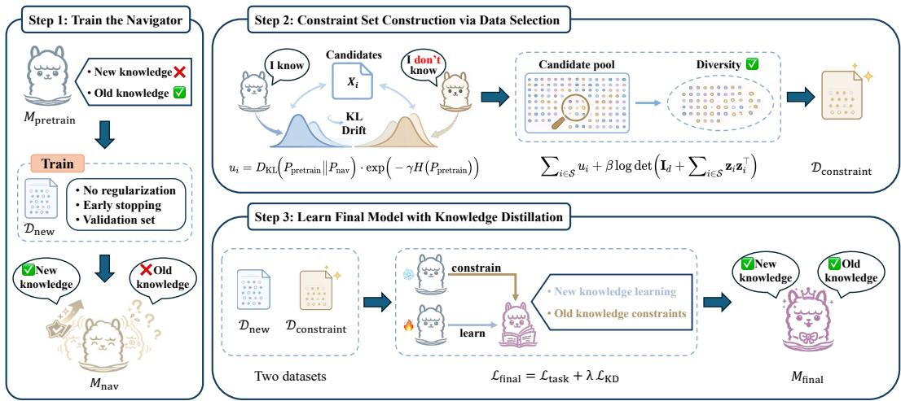  
Figure 1: The overall framework of NADS. First, we train a navigator $M _ { \mathrm { n a v } }$ from $M _ { \mathrm { p r e t r a i n } }$ on $\mathcal { D } _ { \mathrm { n e w } }$ without regularization. Next, we score sample utility from the predictive divergence between $M _ { \mathrm { n a v } }$ and $M _ { \mathrm { p r e t r a i n } } ,$ and construct $\mathcal { D } _ { \mathrm { c o n s t r a i n t } }$ via utility–diversity selection with DPPs. Finally, we train $M _ { \mathrm { f i n a l } }$ on $\mathcal { D } _ { \mathrm { n e w } }$ with distillation on $\mathcal { D } _ { \mathrm { c o n s t r a i n t } }$ to preserve general capabilities during new-task adaptation.

## 3 Methodology

## 3.1 Problem Definition

Let θ denote the model parameters. We consider a single-stage fine-tuning setting with a new-task dataset $\mathcal { D } _ { \mathrm { n e w } } = \{ ( x _ { i } , y _ { i } ) \} _ { i = 1 } ^ { M }$ , where the original pretraining data is unavailable but an auxiliary synthetic dataset $\mathcal { C } = \{ x _ { j } \} _ { j = 1 } ^ { N }$ is accessible. NADS first constructs a navigator model $M _ { \mathrm { n a v } }$ from the pretrained model $M _ { \mathrm { p r e t r a i n } }$ to select a constraint set ${ \mathcal { D } } _ { \mathrm { c o n s t r a i n t } } \subset { \mathcal { C } }$ . It then trains $M _ { \mathrm { f i n a l } }$ on $\mathcal { D } _ { \mathrm { n e w } }$ with KD regularization on $\mathcal { D } _ { \mathrm { c o n s t r a i n t } } ,$ improving new-task performance while preserving the capabilities of $M _ { \mathrm { p r e t r a i n } } .$ . The overall framework is illustrated in Fig. 1.

## 3.2 Navigator Model Construction

Existing studies [62–64, 72] have explored model-centric data selection that measures the learning value of data through model change before and after training, thereby linking sample evaluation to its actual benefit for task adaptation. However, they primarily use the model to facilitate new-task adaptation, without exploring its potential to reveal update-induced forgetting during fine-tuning. Further discussion of the distinctions between these methods and NADS in Appendix A.

Motivated by this observation, we construct a model to trace the unconstrained adaptation path under the target recipe. This model is fine-tuned from $M _ { \mathrm { p r e t r a i n } }$ on $\mathcal { D } _ { \mathrm { n e w } }$ without extra regularization, and therefore follows the realized training trajectory while naturally accumulating forgetting-related drift. Because it reveals how pretrained behavior drifts along this path and provides the guidance signal for subsequent forgetting-aware utility estimation, we refer to it as the navigator model $M _ { \mathrm { n a v } }$

Checkpoint Selection and Local Deviation of the Navigator. The navigator serves as a reference along the unconstrained training trajectory. We select its checkpoint by validation-based early stopping, for which the following proposition gives a standard guarantee.

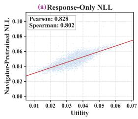

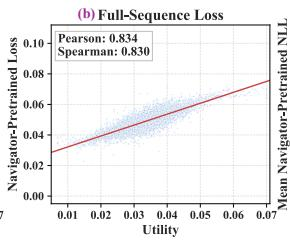

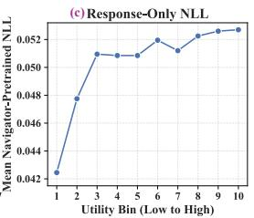

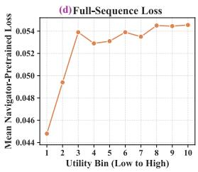  
Figure 2: (a–b) Utility versus response-only NLL degradation and full-sequence loss increase, with Pearson and Spearman measuring sample correlation and ranking consistency, respectively. (c–d) Mean response-only NLL degradation and full-sequence loss increase across utility deciles. Higherutility samples exhibit larger increases, indicating strong correlation with samples’ forgetting risk.

Proposition 1 (Validation selection as a near-best trajectory reference). Let $\{ \pmb { \theta } _ { t } \} _ { t = 0 } ^ { T }$ denote the unconstrained adaptation trajectory induced by the target recipe, and define $R ( \dot { t } ) : = \check { \mathcal { L } } _ { p o p } ( \pmb { \theta } _ { t } )$ and $\hat { R } ( t ) : = \mathcal { L } _ { \nu a l } ( \pmb { \theta } _ { t } )$ . Let $t _ { o p t } \in \arg \operatorname* { m i n } _ { t \in \{ 0 , \ldots , T \} } R ( t )$ and $t ^ { * } \in \arg \operatorname* { m i n } _ { t \in \{ 0 , \ldots , T \} } \hat { R } ( t )$ . Assume that there exists $\varepsilon > 0$ such that $| \hat { R } ( t ) - R ( t ) | \leq \varepsilon f o r$ all $t \in \{ 0 , \ldots , T \}$ . Then $R ( t ^ { * } ) - R ( t _ { o p t } ) \leq$ 2ε. Therefore, the validation-selected checkpoint is a near-best target-adapted reference state on the unconstrained trajectory in population new-task risk. The proof is given in Appendix B.1.

Because $M _ { \mathrm { n a v } }$ is trained without constraint data or anti-forgetting regularization, it follows the unconstrained adaptation path and exhibits a more aggressive drift away from $M _ { \mathrm { p r e t r a i n } }$ . The following proposition locally controls deviation from this reference under bounded updates.

Proposition 2 (Local deviation recursion around the navigator trajectory). Let $\{ \bar { \pmb { \theta } } _ { t } \} _ { t = 0 } ^ { T }$ denote the unconstrained trajectory, and let $\{ \pmb { \theta } _ { t } \} _ { t = 0 } ^ { T }$ denote the trajectory of $M _ { f i n a l }$ satisfying $\pmb \theta _ { t + 1 } =$ $\pmb { \theta } _ { t } - \eta \big ( \nabla L _ { t a s k } ( \pmb { \theta } _ { t } ) + \xi _ { t } \big )$ , where $\xi _ { t }$ is the preservation-gradient component (Section 3.5) and $\left\| \xi _ { t } \right\| \le \kappa .$ Assume that $\nabla L _ { t a s k }$ is L-Lipschitz. Then, for any step $t , \ \lVert \pmb { \theta } _ { t + 1 } - \bar { \pmb { \theta } } _ { t + 1 } \rVert \leq ( 1 +$ $\ddot { \eta } \dot { L } ) \ddot { | | } \pmb { \theta } _ { t } - \bar { \pmb { \theta } } _ { t } | | + \eta \kappa$ Consequently, for any local horizon $\tau \geq 0 ,$ $\begin{array} { r } { \operatorname* { s u p } _ { 0 \leq s \leq \tau } \| \pmb { \theta } _ { t + s } - \bar { \pmb { \theta } } _ { t + s } \| \leq } \end{array}$ $\begin{array} { r } { \| \pmb { \theta } _ { t } - \bar { \pmb { \theta } } _ { t } \| + \sum _ { j = 0 } ^ { \tau - 1 } \eta \big ( L \| \pmb { \theta } _ { t + j } - \bar { \pmb { \theta } } _ { t + j } \| + \kappa \big ) } \end{array}$ . Thus, bounded preservation updates locally control trajectory mismatch. The proof is given in Appendix B.2.

Appendix B.3 gives a conditional local perturbation view of navigator-side forgetting-risk ordering.

Concretely, we obtain $M _ { \mathrm { n a v } }$ by fine-tuning $M _ { \mathrm { p r e t r a i n } }$ on $\mathcal { D } _ { \mathrm { n e w } }$ with validation-based early stopping. When validation data are unavailable or unreliable $( \mathrm { e . g . }$ , data scarcity or label noise), we can use validation-free overfitting detection methods, such as the evolution of weight-matrix spectra [73]. We further analyze the performance and stability of $M _ { \mathrm { n a v } }$ through experiments in Section 4.3.

## 3.3 Constraint Set Construction via Data Selection

When constructing $\mathcal { D } _ { \mathrm { c o n s t r a i n t } } .$ , we aim to select samples that expose forgetting-related predictive drift under the target fine-tuning recipe while avoiding redundant selections. Since utility-only scoring can favor highly similar samples and sacrifice coverage, we formulate subset selection on the synthetic dataset C as a k-DPP [74] to jointly account for utility and diversity under a fixed budget $K$

Definition 1 (k-DPP). Let $\mathcal { C } = \{ x _ { i } \} _ { i = { \bar { \iota } } } ^ { N }$ indexed by $\mathcal { Y } = \{ 1 , \ldots , N \}$ , and let $S \subseteq \mathcal { V }$ denote a selected set. For a real symmetric positive semidefinite kernel $\mathbf { L } \in \mathbb { R } ^ { N \times N }$ , the k-DPP is defined by

$$
\mathbb { P } ( S ; { \mathbf { L } } ) \propto \operatorname* { d e t } ( { \mathbf { L } } _ { S } ) , \qquad | S | = K ,\tag{1}
$$

where $\mathbf { L } _ { S }$ is the principal submatrix of L indexed by S.

Following [30], we adopt the standard L-ensemble decomposition: $( \mathbf { L } ) _ { i j } = q _ { i } G _ { i j } q _ { j }$ , where $q _ { i } \in \mathbb { R } _ { + }$ is the quality score of sample $x _ { i }$ and $\mathbf G \succeq 0$ is a similarity kernel capturing pairwise diversity.

Forgetting Utility. $M _ { \mathrm { n a v } }$ reflects update-induced deviation from $M _ { \mathrm { p r e t r a i n } }$ during task adaptation. We therefore use the forward $\mathbf { K I }$ divergence from $M _ { \mathrm { p r e t r a i n } }$ to $M _ { \mathrm { n a v } }$ as a forgetting-aware utility signal. Larger divergence then indicates higher preservation priority for samples that deviate more from

pretrained behavior. However, not all large divergences are equally informative, as some may reflect noise or intrinsic uncertainty rather than forgetting-relevant changes. To suppress such spurious utility, we further apply a confidence gate derived from $M _ { \mathrm { p r e t r a i n } }$ . The resulting utility is defined as

$$
u _ { i } = \frac { 1 } { | x _ { i } | } \sum _ { t = 1 } ^ { | x _ { i } | } [ D _ { \mathrm { K L } } \Big ( P _ { \mathrm { p r e r a i n } } ( \cdot \mid x _ { i , < t } ) | | P _ { \mathrm { n a v } } ( \cdot \mid x _ { i , < t } )  \Big ) \cdot \exp \Big ( - \gamma  H \big ( P _ { \mathrm { p r e t r a i n } } ( \cdot \mid x _ { i , < t } ) \big )  \Big ) ] ,\tag{2}
$$

where $x _ { i }$ denotes the full sequence, $H ( p )$ denotes entropy, and $\gamma$ controls the confidence gate. As empirically supported by Fig. 2, higher-utility samples exhibit higher forgetting risk. To incorporate this utility into the $k { \mathrm { - D P P } }$ formulation, we define $q _ { i } \triangleq \exp { ( u _ { i } / ( 2 \beta ) ) }$ , where $\beta$ controls the scaling. This yields an additive objective in $u _ { i } .$ , linking utility estimation to subset selection. Appendix B.4 provides a local utility–KD alignment rationale, and Appendix D.3 shows that higher-utility candidates form more effective preservation constraints under the same KD objective.

Diversity Kernel. DPPs capture diversity through the determinant of the similarity submatrix $\mathbf { G } _ { S }$ thereby favoring subsets whose elements are mutually dissimilar under $\mathbf { G }$ . To operationalize this property, we construct G as an inner-product Gram kernel [75] with $G _ { i j } \triangleq \mathbf { z } _ { i } ^ { \top } \mathbf { z } _ { j }$ and $\mathbf { z } _ { i } \in \mathbb { R } ^ { d }$ , where d is the embedding dimension, and adopt the stabilized diversity term log det $\left( \mathbf { I } _ { K } ^ { } + \mathbf { G } _ { S } \right)$ [76], where $\mathbf { G } _ { S }$ is the principal submatrix indexed by S. Let $\mathbf { Z } _ { S } = [ \mathbf { z } _ { i } ] _ { i \in S } \mathbf { \bar { \mu } } \in \mathbb { R } ^ { d \times K }$ so that $\mathbf { G } _ { S } = \mathbf { Z } _ { S } ^ { \top } \mathbf { Z } _ { S }$ . Since this involves a $K \times K$ determinant, we apply Sylvester’s determinant identity [77] to rewrite it as

$$
\operatorname* { d e t } ( \mathbf { I } _ { K } + \mathbf { Z } _ { S } ^ { \top } \mathbf { Z } _ { S } ) = \operatorname* { d e t } ( \mathbf { I } _ { d } + \mathbf { Z } _ { S } \mathbf { Z } _ { S } ^ { \top } ) = \operatorname* { d e t } \Bigl ( \mathbf { I } _ { d } + \sum _ { i \in S } \mathbf { z } _ { i } \mathbf { z } _ { i } ^ { \top } \Bigr ) .\tag{3}
$$

$$
( { \bf L } ) _ { i j } = q _ { i } { \dot { G } } _ { i j } q _ { j }
$$

$$
| { \bar { S } } | = K 
$$

$$
q _ { i } = \exp ( u _ { i } / ( 2 \beta ) )
$$

$$
G _ { i j } = \mathbf { z } _ { i } ^ { \top } \mathbf { z } _ { j }
$$

$$
S ^ { * } = \underset { S \subseteq \mathcal { V } , | S | = K } { \arg \operatorname* { m a x } } \ \sum _ { i \in S } u _ { i } \ + \ \beta \log \operatorname* { d e t } \biggl ( \mathbf { I } _ { d } + \sum _ { i \in S } \mathbf { z } _ { i } \mathbf { z } _ { i } ^ { \top } \biggr ) .\tag{4}
$$

Theorem 1 gives a unified objective that jointly balances forgetting-related utility and subset diversity.   
The full derivation is provided in Appendix C.1.

While Theorem 1 yields a principled objective, directly applying it to large-scale subset selection remains computationally costly. Moreover, existing greedy solvers [31, 32] rely on repeated gain evaluation during subset expansion, which quickly becomes a major bottleneck at scale.

$$
M _ { \mathrm { p r e t r a i n } } , { \mathcal { D } } _ { \mathrm { n e w } } , { \mathcal { C } } = \{ x _ { i } \} _ { i = 1 } ^ { N } , \mathbf { w } ^ { ( 0 ) }  \mathbf { 0 } , K ,
$$

## 3.4 Efficient Data Selection Algorithm

We propose a scalable subset selection strategy, as summarized in Algorithm 1. Specifically, we recast Eq. (4) into a sparse-weight surrogate that retains its utility–diversity structure while making the optimization tractable. To further enhance optimization stability, we incorporate an $\ell _ { 2 }$ regularization term with strength $\nu .$ . The resulting objective is

$$
\gamma , \eta , \nu , \bar { T , } \lambda
$$

$$
M _ { \mathrm { f i n a l } }
$$

$$
M _ { \mathrm { n a v } }  M _ { \mathrm { p r e t r a i n } }
$$

$$
\mathcal { D } _ { \mathrm { n e w } }
$$

$$
\{ u _ { i } \} _ { i = 1 } ^ { N }
$$

$$
\{ z _ { i } \} _ { i = 1 } ^ { N }
$$

$$
\{ \tilde { z } _ { i } \} _ { i = 1 } ^ { N } .
$$

$$
\widetilde { F } ( \mathbf { w } )
$$

$$
\{ u _ { i } , \tilde { z } _ { i } \} _ { i = 1 } ^ { N }
$$

$$
t = 1 \mathrm { t o } \dot { T } \mathfrak { c }
$$

$$
\begin{array} { r } { \tilde { \mathbf { w } } ^ { ( t ) }  \mathcal { P } _ { K } \big ( \big ( \mathbf { w } ^ { ( t - 1 ) } + \eta \nabla \tilde { F } ( \mathbf { w } ^ { ( t - 1 ) } ) \big ) _ { + } \big ) } \end{array}
$$

$$
 \{ x _ { i } \mid i \in \Omega _ { K } ( \mathbf { w } ^ { ( T ) } ) \}
$$

$$
M _ { \mathrm { f i n a l } }
$$

$$
\mathcal { D } _ { \mathrm { n e w } }
$$

$$
\mathcal { D } _ { \mathrm { c } }
$$

$$
M _ { \mathrm { f i n a l } }
$$

$$
F ( \mathbf { w } ) { \triangleq } { \sum _ { i = 1 } ^ { N } } w _ { i } u _ { i } + \beta \log \operatorname* { d e t } \biggl ( \mathbf { I } _ { d } + \sum _ { i = 1 } ^ { N } w _ { i } \mathbf { z } _ { i } \mathbf { z } _ { i } ^ { \top } \biggr ) - \frac { \nu } { 2 } \| \mathbf { w } \| _ { 2 } ^ { 2 } , \quad \mathbf { w } ^ { * } = \mathop { \arg \operatorname* { m a x } } _ { \mathbf { w } \succ \mathbf { 0 } , \| \mathbf { w } \| _ { 0 } = K } F ( \mathbf { w } ) .\tag{5}
$$

Further analysis of the discrepancy between Eq. (4) and Eq. (5) is provided in Appendix C.2.

Random Projection and Whitening. We apply a Johnson–Lindenstrauss random projection [78] to improve efficiency while preserving feature geometry. Let $\mathbf { z } _ { i } \in \mathbb { R } ^ { d }$ denote the sample-level representation of $x _ { i } ,$ , obtained by mean pooling last-layer hidden states over non-padding tokens. After centering, we map the features into an E-dimensional space using $\mathbf { R } \in \mathbb { R } ^ { d \times E }$ with $\breve { E } \ll d \colon$

$$
\tilde { \mathbf { z } } _ { i } = \mathbf { R } ^ { \top } ( \mathbf { z } _ { i } - \pmb { \mu } ) , \quad \pmb { \mu } = \frac { 1 } { N } \sum _ { i = 1 } ^ { N } \mathbf { z } _ { i } .\tag{6}
$$

To further reduce feature anisotropy and off-diagonal coupling, we apply whitening [29] by computing $\begin{array} { r } { \Sigma = \frac { 1 } { N } \sum _ { i = 1 } ^ { N } \tilde { \bf z } _ { i } \tilde { \bf z } _ { i } ^ { \top } } \end{array}$ and updating $\tilde { \mathbf { z } } _ { i } \gets ( \boldsymbol { \Sigma } + \rho \mathbf { I } _ { E } ) ^ { - \frac { 1 } { 2 } } \tilde { \mathbf { z } } _ { i }$ , where $\rho$ is a regularization constant.

Diagonal Approximation. Optimizing the log-determinant term remains computationally demanding, as the covariance still couples different feature dimensions. To obtain a more tractable objective, we introduce a diagonal approximation. Specifically, let $\begin{array} { r } { \mathbf { A } ( \mathbf { w } ) \triangleq \sum _ { i = 1 } ^ { N } w _ { i } \tilde { \mathbf { z } } _ { i } \tilde { \mathbf { z } } _ { i } ^ { \intercal } } \end{array}$ and replace log det $( \mathbf { I } _ { E } +$ $\mathbf { A } ( \mathbf { w } ) )$ with $\begin{array} { r } { \sum _ { e = 1 } ^ { E } \log ( 1 + A _ { e e } ( \mathbf { w } ) ) } \end{array}$ ). Under this approximation, the objective becomes

$$
\tilde { F } ( \mathbf { w } ) \triangleq \sum _ { i = 1 } ^ { N } w _ { i } u _ { i } + \beta \sum _ { e = 1 } ^ { E } \log \left( 1 + \sum _ { i = 1 } ^ { N } w _ { i } \tilde { z } _ { i , e } ^ { 2 } \right) - \frac \nu 2 \| \mathbf { w } \| _ { 2 } ^ { 2 } , \quad \mathbf { w } \succeq \mathbf { 0 } , \ \| \mathbf { w } \| _ { 0 } = K ,\tag{7}
$$

where $\tilde { z } _ { i , e }$ denotes the e-th coordinate of $\tilde { \mathbf { z } } _ { i }$ , with diagonal error analysis in Appendix C.3.

Iterative Optimization. We adopt Iterative Hard Thresholding (IHT) [79] for scalable optimization under the nonnegativity and K-sparsity constraints. Specifically, we perform gradient ascent on $\tilde { F } ( \mathbf { w } )$ , followed by a nonnegative hard-thresholding step that yields the weights at iteration t

$$
\mathbf { w } ^ { ( t ) } = \mathcal { P } _ { K } \Big ( \big ( \mathbf { w } ^ { ( t - 1 ) } + \eta \nabla \tilde { F } ( \mathbf { w } ^ { ( t - 1 ) } ) \big ) _ { + } \Big ) ,\tag{8}
$$

where $\eta$ is the step size, $( \cdot ) _ { + }$ denotes elementwise nonnegativity truncation, and $\mathcal { P } _ { K }$ keeps the top-K entries and sets the rest to zero. After $T$ iterations, we set $S ^ { * } = \Omega _ { K } ( \mathbf { w } ^ { ( T ) } )$ and construct ${ \bar { \mathcal { D } } } _ { \mathrm { c o n s t r a i n t } } = \{ x _ { i } \ | \ i \in S ^ { * } \}$ , where $\Omega _ { K }$ returns the top-K indices. Appendices C.4, C.5, and C.6 provide the derivations of $\nabla \tilde { F } ( \mathbf { w } )$ and Eq. (8), together with analysis of the iterative procedure.

Time Complexity Analysis. The selection-stage complexity of NADS is $O ( N E d + E ^ { 3 } + T ( N E +$ N log K)). Random projection and whitening incur a one-time preprocessing cost of $O ( N E d + E ^ { 3 } )$ where the $O ( N E ^ { 2 } )$ whitening cost is dominated by $O ( N E d )$ since $E \ll d .$ In each iteration, computing $\begin{array} { r } { 1 + \sum _ { i = 1 } ^ { N } w _ { i } \tilde { z } _ { i , e } ^ { 2 } } \end{array}$ takes $O ( N E )$ time, and projecting onto the feasible set by retaining the top-K entries costs $O ( N$ log $K )$ . By contrast, Fast Greedy [31] evaluates gains over the full candidate pool when adding each element, resulting in $O ( K N d )$ complexity. Lazy-Fast variants [32] alleviate redundant gain evaluation via lazy updates, yet their reported overall complexity still remains $O ( K N ( d + \log N ) )$ . Overall, our optimization yields a markedly more efficient route to optimizing a scalable surrogate of Eq. (4) and remains well suited to large candidate pools.

## 3.5 Learning with Knowledge Distillation

We train $M _ { \mathrm { f i n a l } }$ on $\mathcal { D } _ { \mathrm { n e w } }$ and $\mathcal { D } _ { \mathrm { c o n s t r a i n t } }$ via KD, where $\mathcal { D } _ { \mathrm { n e w } }$ supports target-task adaptation and $\mathcal { D } _ { \mathrm { c o n s t r a i n t } }$ provides capability-preserving supervision from $M _ { \mathrm { p r e t r a i n } } .$ . The overall training objective is

$$
\mathcal { L } _ { \mathrm { f i n a l } } = \mathcal { L } _ { \mathrm { T a s k } } + \lambda \mathcal { L } _ { \mathrm { K D } } ,\tag{9}
$$

where $\lambda$ controls the distillation strength. Here, $\mathcal { L } _ { \mathrm { T a s k } }$ is the negative log-likelihood on $\mathcal { D } _ { \mathrm { n e w } } .$ encouraging $M _ { \mathrm { f i n a l } }$ to fit the target task, while ${ \mathcal { L } } _ { \mathrm { K D } }$ uses $M _ { \mathrm { p r e t r a i n } }$ as a teacher on $\mathcal { D } _ { \mathrm { c o n s t r a i n t } }$ and penalizes deviations of $M _ { \mathrm { f i n a l } }$ from pretrained predictive behavior on the selected constraint samples.

## 4 Experiments

We evaluate NADS along four key dimensions: Q1: Does NADS better balance target-task adaptation and general capability preservation than SOTA baselines? Q2: Does $M _ { \mathrm { n a v } }$ provide an effective reference under the target recipe? Q3: Can NADS select more effective and diverse data with lower selection-stage overhead than alternative selection methods? Q4: Do the key components of NADS each contribute meaningfully, and does the framework remain robust across hyperparameter settings?

## 4.1 Experiment Setup

Datasets & Evaluation Metrics. We conduct experiments on Magicoder [80] and MetaMathQA [81] to evaluate NADS, using Magpie-Qwen2.5-Pro-300K-Filtered [82] as the large-scale synthetic data source. Following recent studies [9–11, 83, 84], we decouple evaluation into target performance and general capability, with benchmark roles adjusted across scenarios. For Magicoder, HumanEval (HE) [85] is the target benchmark, while MMLU [86], HellaSwag (HASW) [87],

Table 1: Performance comparison with methods selecting $\mathcal { D } _ { \mathrm { c o n s t r a i n t } }$ for replay on Magicoder (%). The best results are highlighted in red, and the second-best results are highlighted in blue.
<table><tr><td rowspan="2">Model</td><td rowspan="2">Method</td><td colspan="5">General Capability ↑</td><td>Target ↑</td><td>Overall ↑</td></tr><tr><td>HASW</td><td>OBQA</td><td>MMLU</td><td>GSM8K</td><td> $\mathbf { A v } \mathbf { g } .$ </td><td>HE</td><td>Avg.</td></tr><tr><td rowspan="8">L-3B</td><td>Pre-trained</td><td> $5 5 . 8 3 _ { \pm 0 . 0 0 }$ </td><td> $3 1 . 2 0 { \scriptstyle \pm 0 . 0 0 }$ </td><td>56.92±0.00</td><td> $2 7 . 9 0 { \scriptstyle \pm 0 . 0 0 }$ </td><td>42.96±0.00</td><td> $2 8 . 1 6 _ { \pm 0 . 0 0 }$ </td><td> $3 5 . 5 6 { \scriptstyle \pm 0 . 0 0 }$ </td></tr><tr><td>Standard FT</td><td> $5 2 . 1 2 _ { \pm 0 . 5 2 }$ </td><td> $2 8 . 4 0 { \scriptstyle \pm 0 . 6 9 }$ </td><td> $4 8 . 6 1 _ { \pm 0 . 4 0 }$ </td><td> $2 0 . 7 5 _ { \pm 0 . 7 4 }$ </td><td> $3 7 . 4 7 _ { \pm 0 . 3 0 }$ </td><td> $4 5 . 1 3 _ { \pm 0 . 3 2 }$ </td><td> $4 1 . 3 0 { \scriptstyle \pm 0 . 2 2 }$ </td></tr><tr><td>LoRA</td><td> $5 3 . 3 8 _ { \pm 0 . 5 5 }$ </td><td> $2 9 . 4 7 _ { \pm 0 . 6 4 }$ </td><td> $5 1 . 9 8 _ { \pm 0 . 4 2 }$ </td><td> $2 1 . 1 8 { \scriptstyle \pm 0 . 7 9 }$ </td><td> $3 9 . 0 0 { \scriptstyle \pm 0 . 3 1 }$ </td><td> $4 1 . 9 2 _ { \pm 0 . 3 0 }$ </td><td> $4 0 . 4 6 _ { \pm 0 . 2 1 }$ </td></tr><tr><td>Random</td><td> $5 2 . 0 3 _ { \pm 0 . 5 4 }$ </td><td> $2 8 . 1 3 _ { \pm 0 . 6 4 }$ </td><td>49.21±0.43</td><td> $2 1 . 8 3 _ { \pm 0 . 7 3 }$ </td><td>37.80±0.30</td><td> $4 1 . 7 7 { \scriptstyle \pm 0 . 4 6 }$ </td><td> $3 9 . 7 9 _ { \pm 0 . 2 7 }$ </td></tr><tr><td>InsCL</td><td> $5 3 . 9 5 _ { \pm 0 . 5 4 }$ </td><td> $2 9 . 2 7 { \scriptstyle \pm 0 . 7 0 }$ </td><td> $5 4 . 8 6 { \scriptstyle \pm 0 . 4 3 }$ </td><td> $2 5 . 4 0 { \scriptstyle \pm 0 . 7 6 }$ </td><td> $4 0 . 8 7 _ { \pm 0 . 3 1 }$ </td><td> $4 2 . 0 2 _ { \pm 0 . 8 2 }$ </td><td> $4 1 . 4 5 _ { \pm 0 . 4 4 }$ </td></tr><tr><td>LER</td><td> $5 3 . 7 7 { \scriptstyle \pm 0 . 4 9 }$ </td><td> $2 9 . 4 7 _ { \pm 0 . 5 8 }$ </td><td> $5 3 . 8 9 _ { \pm 0 . 4 0 }$ </td><td> $2 4 . 8 2 _ { \pm 0 . 7 3 }$ </td><td> $4 0 . 4 9 _ { \pm 0 . 2 8 }$ </td><td> $4 3 . 1 2 _ { \pm 0 . 7 5 }$ </td><td> $4 1 . 8 1 _ { \pm 0 . 4 0 }$ </td></tr><tr><td> $\mathbf { M i x - c d }$ </td><td> $5 4 . 1 8 { \scriptstyle \pm 0 . 5 1 }$ </td><td> $3 0 . 4 7 { \scriptstyle \pm 0 . 6 1 }$ </td><td> $5 4 . 7 9 _ { \pm 0 . 4 1 }$ </td><td> $2 6 . 2 8 { \scriptstyle \pm 0 . 7 5 }$ </td><td> $4 1 . 4 3 \pm 0 . 2 9$ </td><td> $4 2 . 5 8 { \scriptstyle \pm 0 . 7 4 }$ </td><td> $4 2 . 0 1 { \scriptstyle \pm 0 . 4 0 }$ </td></tr><tr><td>NADS (Ours)</td><td> $5 5 . 1 7 { \scriptstyle \pm 0 . 4 9 }$  </td><td> $3 1 . 0 7 { \scriptstyle \pm 0 . 5 8 }$  </td><td> $5 6 . 4 5 _ { \pm 0 . 4 1 }$  </td><td> $2 7 . 3 7 { \scriptstyle \pm 0 . 6 7 }$ </td><td>一  $4 2 . 5 2 { \scriptstyle \pm 0 . 2 7 }$ </td><td>1  $4 4 . 3 9 { \scriptstyle \pm 0 . 4 0 }$ </td><td>1  $4 3 . 4 6 _ { \pm 0 . 2 4 }$  </td></tr><tr><td rowspan="8">Gem-4B</td><td>Pre-trained</td><td> $5 7 . 4 1 _ { \pm 0 . 0 0 }$ </td><td> $3 4 . 6 0 { \scriptstyle \pm 0 . 0 0 }$ </td><td> $6 0 . 2 4 { \scriptstyle \pm 0 . 0 0 }$ </td><td> $3 6 . 6 9 { \scriptstyle \pm 0 . 0 0 }$ </td><td> $4 7 . 2 4 _ { \pm 0 . 0 0 }$ </td><td> $3 5 . 7 7 { \scriptstyle \pm 0 . 0 0 }$ </td><td> $4 1 . 5 1 _ { \pm 0 . 0 0 }$ </td></tr><tr><td>Standard FT</td><td> $5 3 . 0 6 { \scriptstyle \pm 0 . 4 9 }$ </td><td> $3 1 . 2 7 { \scriptstyle \pm 0 . 7 0 }$ </td><td> $5 3 . 2 1 { \scriptstyle \pm 0 . 4 0 }$ </td><td> $2 3 . 7 8 { \scriptstyle \pm 0 . 6 8 }$ </td><td> $4 0 . 3 3 { \scriptstyle \pm 0 . 2 9 }$ </td><td> $5 8 . 1 7 { \scriptstyle \pm 0 . 8 9 }$ </td><td> $4 9 . 2 5 { \scriptstyle \pm 0 . 4 7 }$ </td></tr><tr><td>LoRA</td><td> $5 5 . 8 1 \pm 0 . 5 0$ </td><td> $3 1 . 8 0 { \scriptstyle \pm 0 . 6 0 }$ </td><td> $5 6 . 7 4 { \scriptstyle \pm 0 . 3 9 }$ </td><td> $3 1 . 6 1 { \scriptstyle \pm 0 . 8 2 }$ </td><td> $4 3 . 9 9 2 \mathrm { { \scriptstyle 0 . 3 0 } }$ </td><td> $5 4 . 6 9 { \scriptstyle \pm 0 . 9 1 }$ </td><td> $4 9 . 3 4 { \scriptstyle \pm 0 . 4 8 }$ </td></tr><tr><td>Random</td><td> $5 2 . 8 3 _ { \pm 0 . 5 1 }$ </td><td> $3 1 . 2 7 _ { \pm 0 . 6 4 }$ </td><td> $5 3 . 6 7 _ { \pm 0 . 4 0 }$ </td><td> $2 4 . 1 1 { \scriptstyle \pm 0 . 7 7 }$ </td><td> $4 0 . 4 7 { \scriptstyle \pm 0 . 3 0 }$ </td><td> $5 4 . 1 1 { \scriptstyle \pm 0 . 8 6 }$ </td><td> $4 7 . 2 9 _ { \pm 0 . 4 6 }$ </td></tr><tr><td>InsCL</td><td> $5 5 . 2 5 _ { \pm 0 . 4 9 }$ </td><td> $3 2 . 2 0 { \scriptstyle \pm 0 . 6 9 }$ </td><td> $5 8 . 0 7 { \scriptstyle \pm 0 . 3 9 }$ </td><td> $3 4 . 7 2 _ { \pm 0 . 8 6 }$ </td><td> $4 5 . 0 6 _ { \pm 0 . 3 1 }$ </td><td> $5 5 . 6 2 _ { \pm 0 . 9 2 }$ </td><td> $5 0 . 3 4 _ { \pm 0 . 4 9 }$ </td></tr><tr><td>LER</td><td> $5 6 . 8 8 { \scriptstyle \pm 0 . 5 0 }$ </td><td> $3 2 . 2 7 _ { \pm 0 . 6 4 }$ </td><td> $5 8 . 1 9 _ { \pm 0 . 4 0 }$ </td><td> $3 4 . 3 9 _ { \pm 0 . 8 4 }$ </td><td> $4 5 . 4 3 _ { \pm 0 . 3 1 }$ </td><td> $5 6 . 0 9 { \scriptstyle \pm 0 . 8 9 }$ </td><td> $5 0 . 7 6 { \scriptstyle \pm 0 . 4 7 }$ </td></tr><tr><td>Mix-cd</td><td> $5 6 . 4 1 _ { \pm 0 . 4 9 }$ </td><td> $3 3 . 0 7 _ { \pm 0 . 6 4 }$ </td><td> $5 7 . 2 8 _ { \pm 0 . 3 9 }$ </td><td> $3 4 . 7 5 _ { \pm 0 . 8 3 }$ </td><td> $4 5 . 3 8 _ { \pm 0 . 3 1 }$ </td><td> $5 5 . 8 7 _ { \pm 0 . 7 4 }$ </td><td> $5 0 . 6 3 _ { \pm 0 . 4 0 }$ </td></tr><tr><td>NADS (Ours)</td><td> $5 6 . 8 3 { \scriptstyle \pm 0 . 5 0 }$ </td><td> $3 3 . 1 3 _ { \pm 0 . 6 1 }$ </td><td> $5 9 . 6 2 { \scriptstyle \pm 0 . 4 0 }$ </td><td> $3 5 . 9 9 { \scriptstyle \pm 0 . 7 4 }$ </td><td> $4 6 . 3 9 { \scriptstyle \pm 0 . 2 9 }$ </td><td>1  $5 7 . 8 8 { \scriptstyle \pm 0 . 9 0 }$ </td><td>」  $5 2 . 1 4 _ { \pm 0 . 4 7 }$  一</td></tr><tr><td rowspan="8">Oe-9B</td><td>Pre-trained</td><td> $5 9 . 6 7 _ { \pm 0 . 0 0 }$ </td><td> $3 4 . 2 0 { \scriptstyle \pm 0 . 0 0 }$ </td><td> $7 2 . 3 9 { \scriptstyle \pm 0 . 0 0 }$ </td><td> $8 6 . 2 0 { \scriptstyle \pm 0 . 0 0 }$ </td><td> $6 3 . 1 2 _ { \pm 0 . 0 0 }$ </td><td> $6 1 . 0 5 _ { \pm 0 . 0 0 }$ </td><td> $6 2 . 0 9 _ { \pm 0 . 0 0 }$ </td></tr><tr><td>Standard FT</td><td> $5 4 . 2 1 { \scriptstyle \pm 0 . 5 0 }$ </td><td> $3 1 . 0 7 _ { \pm 0 . 6 4 }$ </td><td> $6 6 . 2 2 _ { \pm 0 . 3 9 } ^ { - }$ </td><td> $7 8 . 5 7 { \scriptstyle \pm 0 . 7 0 }$ </td><td> $5 7 . 5 2 { \scriptstyle \pm 0 . 2 9 }$ </td><td> $7 5 . 8 2 _ { \pm 0 . 8 1 }$ </td><td> $6 6 . 6 7 _ { \pm 0 . 4 3 }$ </td></tr><tr><td>LoRA</td><td> $5 6 . 7 3 { \scriptstyle \pm 0 . 4 9 }$ </td><td> $3 2 . 2 7 _ { \pm 0 . 6 1 }$ </td><td> $6 9 . 4 4 _ { \pm 0 . 3 7 }$ </td><td> $8 1 . 8 8 { \scriptstyle \pm 0 . 5 5 }$ </td><td> $6 0 . 0 8 { \scriptstyle \pm 0 . 2 6 }$ </td><td> $7 0 . 3 3 { \scriptstyle \pm 0 . 6 4 }$ </td><td> $6 5 . 2 1 { \scriptstyle \pm 0 . 3 4 }$ </td></tr><tr><td>Random</td><td> $5 4 . 7 8 { \scriptstyle \pm 0 . 5 0 }$ </td><td> $3 1 . 3 3 { \scriptstyle \pm 0 . 6 4 }$ </td><td> $6 5 . 2 9 _ { \pm 0 . 4 0 }$ </td><td> $7 9 . 2 3 _ { \pm 0 . 7 2 }$ </td><td> $5 7 . 6 6 { \scriptstyle \pm 0 . 2 9 }$ </td><td> $7 2 . 4 5 _ { \pm 0 . 8 2 }$ </td><td> $6 5 . 0 6 { \scriptstyle \pm 0 . 4 3 }$ </td></tr><tr><td>InsCL</td><td> $5 6 . 3 6 { \scriptstyle \pm 0 . 4 9 }$ </td><td> $3 2 . 2 7 _ { \pm 0 . 6 4 }$ </td><td> $7 0 . 1 8 { \scriptstyle \pm 0 . 3 7 }$ </td><td> $8 2 . 5 4 _ { \pm 0 . 4 6 }$ </td><td> $6 0 . 3 4 { \scriptstyle \pm 0 . 2 5 }$ </td><td> $7 1 . 2 9 _ { \pm 0 . 8 5 }$ </td><td> $6 5 . 8 2 _ { \pm 0 . 4 4 }$ </td></tr><tr><td>LER</td><td> $5 7 . 6 4 { \scriptstyle \pm 0 . 5 0 }$ </td><td> $3 2 . 3 3 { \scriptstyle \pm 0 . 6 1 }$ </td><td> $7 1 . 2 7 { \scriptstyle \pm 0 . 3 9 }$ </td><td> $8 3 . 3 5 { \scriptstyle \pm 0 . 6 8 }$ </td><td> $6 1 . 1 5 { \scriptstyle \pm 0 . 2 8 }$ </td><td> $7 2 . 1 5 { \scriptstyle \pm 0 . 8 1 }$ </td><td> $6 6 . 6 5 { \scriptstyle \pm 0 . 4 3 }$ </td></tr><tr><td> $\mathbf { M i x - c d }$ </td><td> $5 7 . 2 5 _ { \pm 0 . 4 9 }$ </td><td> $3 2 . 7 3 _ { \pm 0 . 6 1 }$ </td><td> $7 0 . 4 9 _ { \pm 0 . 4 1 }$ </td><td> $8 2 . 5 4 { \scriptstyle \pm 0 . 7 0 }$ </td><td> $6 0 . 7 5 { \scriptstyle \pm 0 . 2 8 }$ </td><td> $7 1 . 3 7 { \scriptstyle \pm 0 . 7 2 }$ </td><td> $6 6 . 0 6 { \scriptstyle \pm 0 . 3 9 }$ </td></tr><tr><td>NADS (Ours)</td><td> $5 8 . 4 9 _ { \pm 0 . 4 9 }$ </td><td> $3 3 . 1 3 _ { \pm 0 . 6 1 }$ </td><td> $7 1 . 6 1 \pm 0 . 4 1$ </td><td> $8 5 . 6 2 \pm 0 . 6 9$ </td><td> $6 2 . 2 1 { \scriptstyle \pm 0 . 2 8 }$ </td><td>」  $7 4 . 4 6 { \scriptstyle \pm 0 . 8 1 }$ </td><td>_  $6 8 . 3 4 _ { \pm 0 . 4 3 }$  一</td></tr></table>

Table 2: Cross-paradigm reference comparison with methods selecting $\mathcal { D } _ { \mathrm { n e w } }$ on Magicoder (%).
<table><tr><td rowspan="2">Model</td><td rowspan="2">Method</td><td colspan="5">General Capability ↑</td><td>Target ↑</td><td>Overall ↑</td></tr><tr><td>HASW</td><td>OBQA</td><td>MMLU</td><td>GSM8K</td><td> $\mathbf { A v } \mathbf { g } .$ </td><td>HE</td><td> $\mathbf { A v } \mathbf { g } .$ </td></tr><tr><td>L32</td><td>LESS</td><td> $5 4 . 1 2 { \scriptstyle \pm 0 . 4 9 }$ </td><td>30.67±0.61</td><td> $5 4 . 3 8 { \scriptstyle \pm 0 . 4 0 }$ </td><td> $2 3 . 7 3 _ { \pm 0 . 6 2 }$ </td><td> $4 0 . 7 3 { \scriptstyle \pm 0 . 2 7 }$ </td><td> $4 3 . 0 1 _ { \pm 0 . 8 4 }$ </td><td> $4 1 . 8 7 \pm 0 . 4 4$ </td></tr><tr><td></td><td>FisherSFT</td><td> $5 4 . 0 3 _ { \pm 0 . 4 9 }$ </td><td> $2 9 . 8 0 { \scriptstyle \pm 0 . 6 0 }$ </td><td> $5 2 . 8 9 _ { \pm 0 . 4 1 }$ </td><td> $2 3 . 1 5 _ { \pm 0 . 6 2 }$ </td><td> $3 9 . 9 7 _ { \pm 0 . 2 7 }$ </td><td> $4 1 . 8 5 _ { \pm 0 . 7 4 }$ </td><td> $4 0 . 9 1 _ { \pm 0 . 3 9 }$ </td></tr><tr><td></td><td>SPICE</td><td> $5 3 . 5 8 { \scriptstyle \pm 0 . 5 0 }$ </td><td> $2 9 . 6 0 { \scriptstyle \pm 0 . 6 0 }$ </td><td> $5 3 . 3 9 _ { \pm 0 . 4 0 }$ </td><td> $2 4 . 9 2 _ { \pm 0 . 7 3 }$ </td><td> $4 0 . 3 7 { \scriptstyle \pm 0 . 2 9 }$ </td><td> $4 2 . 6 1 _ { \pm 0 . 6 6 }$ </td><td> $4 1 . 4 9 _ { \pm 0 . 3 6 }$ </td></tr><tr><td></td><td>NADS (Ours)</td><td> $5 5 . 1 7 { \scriptstyle \pm 0 . 4 9 }$ </td><td> $3 1 . 0 7 { \scriptstyle \pm 0 . 5 8 }$ </td><td> $5 6 . 4 5 _ { \pm 0 . 4 1 }$ </td><td> $2 7 . 3 7 { \scriptstyle \pm 0 . 6 7 }$ </td><td> $4 2 . 5 2 { \scriptstyle \pm 0 . 2 7 }$ </td><td>1  $4 4 . 3 9 { \scriptstyle \pm 0 . 4 0 }$ </td><td> $4 3 . 4 6 _ { \pm 0 . 2 4 }$ </td></tr><tr><td></td><td>LESS</td><td> $5 5 . 5 6 { \scriptstyle \pm 0 . 5 2 }$ </td><td> $3 1 . 8 0 { \scriptstyle \pm 0 . 6 9 }$ </td><td> $5 7 . 2 6 _ { \pm 0 . 3 9 }$ </td><td> $3 5 . 0 8 _ { \pm 0 . 8 3 }$ </td><td> $4 4 . 9 3 _ { \pm 0 . 3 1 }$ </td><td> $5 7 . 0 7 _ { \pm 0 . 9 1 }$ </td><td> $5 1 . 0 0 { \scriptstyle \pm 0 . 4 8 }$ </td></tr><tr><td>Gema3</td><td>FisherSFT</td><td> $5 6 . 8 6 _ { \pm 0 . 5 1 }$ </td><td> $3 2 . 2 0 { \scriptstyle \pm 0 . 6 0 }$ </td><td> $5 6 . 0 5 _ { \pm 0 . 4 0 }$ </td><td> $3 5 . 3 8 { \scriptstyle \pm 0 . 8 2 }$ </td><td> $4 5 . 1 2 _ { \pm 0 . 3 0 }$ </td><td> $5 3 . 6 2 _ { \pm 0 . 7 4 }$ </td><td> $4 9 . 3 7 _ { \pm 0 . 4 0 }$ </td></tr><tr><td></td><td>SPICE</td><td> $5 5 . 9 5 _ { \pm 0 . 4 9 }$ </td><td> $3 1 . 6 0 { \scriptstyle \pm 0 . 6 0 }$ </td><td> $5 7 . 4 3 _ { \pm 0 . 3 9 }$ </td><td> $3 5 . 6 1 _ { \pm 0 . 8 5 }$ </td><td> $4 5 . 1 5 _ { \pm 0 . 3 1 }$ </td><td> $5 6 . 4 6 { \scriptstyle \pm 0 . 7 6 }$ </td><td> $5 0 . 8 1 _ { \pm 0 . 4 1 }$ </td></tr><tr><td></td><td>NADS (Ours)</td><td> $5 6 . 8 3 _ { \pm 0 . 5 0 }$ </td><td> $3 3 . 1 3 _ { \pm 0 . 6 1 }$ </td><td> $5 9 . 6 2 { \scriptstyle \pm 0 . 4 0 }$ </td><td> $3 5 . 9 9 \pm 0 . 7 4$ </td><td> $4 6 . 3 9 _ { \pm 0 . 2 9 }$ </td><td>1  $5 7 . 8 8 { \scriptstyle \pm 0 . 9 0 }$ </td><td> $5 2 . 1 4 _ { \pm 0 . 4 7 }$ </td></tr><tr><td>Own35</td><td>LESS</td><td> $5 7 . 0 6 _ { \pm 0 . 4 9 }$ </td><td> $3 2 . 8 7 _ { \pm 0 . 6 4 }$ </td><td> $6 9 . 6 8 { \scriptstyle \pm 0 . 4 0 }$ </td><td> $8 1 . 2 0 { \scriptstyle \pm 0 . 8 0 }$ </td><td> $6 0 . 2 0 { \scriptstyle \pm 0 . 3 0 }$ </td><td> $7 2 . 8 1 _ { \pm 0 . 6 1 }$ </td><td> $6 6 . 5 1 { \scriptstyle \pm 0 . 3 4 }$ </td></tr><tr><td></td><td>FisherSFT</td><td> $5 7 . 6 9 _ { \pm 0 . 5 0 }$ </td><td> $3 2 . 0 7 _ { \pm 0 . 6 1 }$ </td><td> $6 8 . 5 5 { \scriptstyle \pm 0 . 3 7 }$ </td><td> $8 1 . 3 0 { \scriptstyle \pm 0 . 7 4 }$ </td><td> $5 9 . 9 0 { \scriptstyle \pm 0 . 2 9 }$ </td><td> $7 1 . 8 0 { \scriptstyle \pm 0 . 8 3 }$ </td><td> $6 5 . 8 5 { \scriptstyle \pm 0 . 4 4 }$ </td></tr><tr><td></td><td>SPICE</td><td> $5 6 . 9 2 _ { \pm 0 . 4 9 }$ </td><td> $3 2 . 1 3 _ { \pm 0 . 6 1 }$ </td><td> $6 9 . 3 1 { \scriptstyle \pm 0 . 4 0 }$ </td><td> $8 3 . 4 2 _ { \pm 0 . 6 5 }$ </td><td> $6 0 . 4 5 _ { \pm 0 . 2 7 }$ </td><td> $7 2 . 3 5 { \scriptstyle \pm 0 . 7 8 }$ </td><td> $6 6 . 4 0 _ { \pm 0 . 4 1 }$ </td></tr><tr><td></td><td>NADS (Ours)</td><td> $5 8 . 4 9 _ { \pm 0 . 4 9 }$ </td><td> $3 3 . 1 3 _ { \pm 0 . 6 1 }$ </td><td> $7 1 . 6 1 \pm 0 . 4 1$ </td><td> $8 5 . 6 2 \pm 0 . 6 9$ </td><td> $6 2 . 2 1 { \scriptstyle \pm 0 . 2 8 }$ </td><td>」  $7 4 . 4 6 { \scriptstyle \pm 0 . 8 1 }$ </td><td> $6 8 . 3 4 { \scriptstyle \pm 0 . 4 3 }$ </td></tr></table>

GSM8K [88], and OpenBookQA (OBQA) [89] assess general capability. For MetaMathQA, GSM8K is the target benchmark, while HumanEval is moved to the general-capability suite. We report general capability (mean of four benchmarks), target performance, and Overall (arithmetic mean of the two).

Baselines & Implementation Details. We compare NADS with three baseline groups: 1) standard fine-tuning, including Standard Fine-Tuning (FT) and LoRA [90]; 2) replay-based constraint selection, including Random selection, InsCL [91], LER [92], and Mix-cd [52]; and 3) target-data selection, including LESS [59], FisherSFT [93], and SPICE [94]. We evaluate all methods on LLaMA3.2- 3B [95], Gemma3-4B [96], and Qwen3.5-9B [97]. For each target dataset, we hold out 1,000 examples for validation and use the remaining target-training split for all methods. Target-data selection methods select 10% of this split, whereas replay-based methods and NADS use the entire split with 5% of C as constraints. For NADS, we set $\gamma \overset { \cdot } { = } 0 . 7 , \nu = 3 \times 1 0 ^ { - 3 } , \beta = 1 . 0 , \lambda = 5 , T = 5 0 .$ and $E = 2 5 6$ . We report mean and standard deviation over three seeds. Details are in Appendix E.

## 4.2 Main Results (Q1)

Comparison Results. Table 1 reports the main Magicoder comparison with replay-based constraintselection methods. On LLaMA3.2, NADS achieves 42.52% general-capability and 43.46% overall averages, compared with 41.43% and 42.01% for the strongest baseline, while remaining competitive on the target task. Similar trends on Gemma3 and Qwen3.5 indicate stable gains across model scales. Since target-task data selection can also mitigate forgetting [8, 83, 98], Table 2 reports LESS, FisherSFT, and SPICE as cross-paradigm references, which select from $\mathcal { D } _ { \mathrm { n e w } }$ rather than constructing synthetic constraints. This reference comparison is not a direct ranking, but indicates that NADS remains competitive under a different selection paradigm. MetaMathQA results are in Appendix F.1.

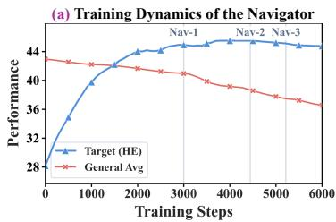

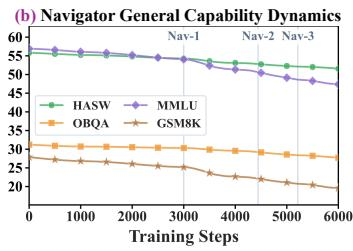

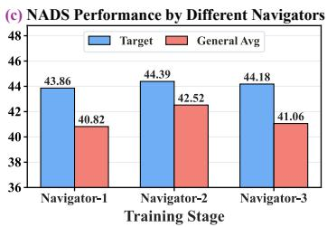  
Figure 3: (a) Training dynamics of the navigator model on the Magicoder dataset. (b) Dynamics of individual general-capability benchmarks during navigator training. (c) NADS performance with navigators selected at different training stages on Magicoder with LLaMA3.2-3B.

As shown in Table 1, existing replay-based baselines partly mitigate the adaptation–preservation trade-off, but limited gains reflect selection signals that do not target update-induced forgetting. In contrast, NADS constructs the constraint set from navigator-induced predictive drift, making selected samples more sensitive to forgetting-related changes under the target recipe. This targeted, less redundant constraint set supports target-task adaptation while maintaining stronger general capability.

Controlled comparison with a fixed KD objective. A potential concern is that the gains of NADS in Table 2 may come from the additional KD objective rather than the selected constraint set. Since NADS selects synthetic constraints rather than new-task samples, using LESS, FisherSFT, or SPICEselected data would evaluate a combined method instead of NADS itself. We therefore fix the KD objective and vary only the

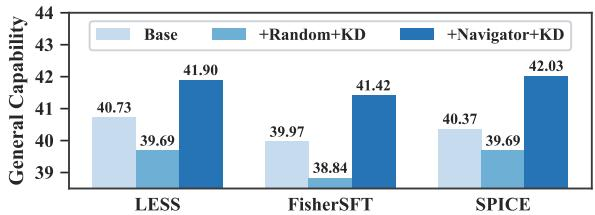  
Figure 4: Controlled comparison with a fixed KD objective on Magicoder with LLaMA3.2.

constraint source. We apply the same KD objective to three baselines with either random or navigatorselected constraints. As shown in Fig. 4, random constraints do not reliably preserve general capability and can even hurt retention, whereas navigator-selected constraints consistently improve it across baselines. This suggests that the improvement is not merely due to KD or additional constraint samples, but to the effectiveness of the selected constraints. Details are given in Appendix F.2.

## 4.3 Analysis of the Navigator Model (Q2)

The navigator $M _ { \mathrm { n a v } }$ is central to NADS, providing the signal for estimating update-induced forgetting risk. Thus, we examine whether $M _ { \mathrm { n a v } }$ is useful and stable in practice from the following two aspects.

Unconstrained Drift Behavior. Table 3 shows the performance of $M _ { \mathrm { p r e t r a i n } }$ and $M _ { \mathrm { n a v } }$ on Magicoder with LLaMA3.2. $M _ { \mathrm { n a v } }$ achieves much stronger new-task performance, indicating that it has effectively adapted to the target data. Meanwhile, because it is trained without any anti-forgetting constraints, this gain is accompanied by noticeable degradation on prior capability.

Table 3: Performance comparison between $M _ { \mathrm { p r e t r a i n } }$ and $M _ { \mathrm { n a v } }$
<table><tr><td>Model HASW OBQA MMLUGSM8K HE</td></tr><tr><td> $M _ { \mathrm { p r e t r a i n } }$  55.83 31.20 56.92 27.90 28.16</td></tr><tr><td> $M _ { \mathrm { n a v } }$  52.80 29.20 50.60 22.09 45.50</td></tr></table>

Training Dynamics of the Navigator Model. Fig. 3(a) and Fig. 3(b) depict the dynamics of new-task performance and general capability throughout $M _ { \mathrm { n a v } }$ training on LLaMA3.2-3B. As training proceeds, $M _ { \mathrm { n a v } }$ improves on the new task while progressively degrading on prior capability, reflecting increasing update-induced drift. To further examine how the navigator training stage affects constraint-set construction, Fig. 3(c) compares NADS using $M _ { \mathrm { n a v } ^ { - 1 } } , M _ { \mathrm { n a v } ^ { - 2 } }$ , and $M _ { \mathrm { n a v } } – 3$ from three training stages. $M _ { \mathrm { n a v } } – 1$ is trained too early and remains too close to $M _ { \mathrm { p r e t r a i n } } .$ resulting in a weak forgetting-risk signal # ! ! ! ! !and a less informative constraint set. $M _ { \mathrm { n a v } } – 3$ is trained for too long, causing more aggressive drift that biases forgetting-risk estimation and weakens general capability preservation. In contrast, $M _ { \mathrm { n a v } } – 2$ achieves the best trade-off between target-task performance and general capability preservation. #Additional checkpoint comparisons across models and target datasets and sensitivity analyses under validation-set perturbations are provided in Appendix F.3 and Appendix F.4, respectively.

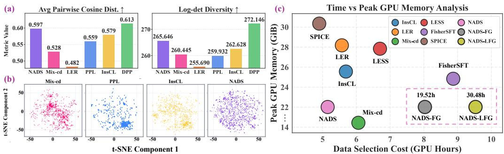  
	 	  	 	 	 	  	 	 	 	  	 	! ! !Figure 5: (a) Quantitative diversity diagnostics of selected data. (b) t-SNE visualizations of selected          data. (c) Data-selection cost in terms of selection time and peak GPU memory usage.

## 4.4 Effectiveness and Efficiency of Data Selection (Q3)

We further analyze the data selection strategy of NADS from three perspectives by examining whether it can select higher-quality data, maintain greater diversity, and reduce selection cost.

Quality of the Selected Data. We compare NADS with Random, PPL-based, and DPP-based selection on LLaMA3.2-3B under the same final KD objective and $D _ { \mathrm { c o n s t r a i n t } }$ budget. Selected-data quality is measured by downstream performance after training on each selected set. As shown in Table 4, the alternatives incur larger general-capability drops, indicating that NADS identifies higher-quality data.

Table 4: Controlled constraint-selection comparison on Magicoder.
<table><tr><td>Method</td><td>General</td><td>Target</td><td>Overall</td></tr><tr><td>Random</td><td>37.96</td><td>41.91</td><td>39.94</td></tr><tr><td>PPL-based</td><td>38.76</td><td>42.02</td><td>40.39</td></tr><tr><td>DPP-based</td><td>38.04</td><td>41.27</td><td>39.66</td></tr><tr><td>NADS</td><td>42.52</td><td>44.39</td><td>43.46</td></tr></table>

Diversity of the Selected Set. We further examine whether the proposed strategy selects more diverse data on Magicoder with LLaMA3.2-3B. As shown in Fig. 5(a), NADS achieves strong average pairwise cosine distance and log-det diversity among the compared methods, suggesting that it selects less redundant constraint samples. Fig. 5(b) further visualizes the selected samples using t-SNE [99] in the representation space, where the data selected by NADS are distributed more broadly than those selected by utility-oriented competing methods. Additional qualitative and quantitative comparisons with more selection methods are provided in Appendix F.5.

Data-Selection Efficiency. Fig. 5(c) compares the runtime and peak GPU memory of different data-selection methods for selecting 10% of the data under the same candidate pool and budget. The reported cost covers the selection stage, including method-specific score or utility computation, related preprocessing, and subset optimization. NADS reduces selection-stage runtime relative to competing methods while maintaining comparable peak GPU memory, demonstrating efficient largescale data selection. We further compare the overhead after replacing our optimizer with Fast Greedy (NADS-FG) [31] and Lazy-Fast Greedy (NADS-LFG) [32]. The time overhead analysis of $M _ { \mathrm { n a v } }$ and the performance–cost analysis of the complete training pipeline are provided in Appendix F.6. Stagewise and total computational costs across model sizes, including the cost savings from LoRA-based Navigator training, are reported in Appendix F.8.

## 4.5 Ablation Study and Sensitivity Analysis (Q4)

Ablation Study. We conduct ablation studies to assess the key components of NADS. We first ablate the KL-discrepancy factor in the original utility, leaving only the pretrained confidence gate for scoring candidate samples. We also remove the diversity-aware selection term and the confidence gate in utility estimation. As shown in Table 5, all modifications underperform the full NADS. The gate-only utility causes the largest degradation, indicating that pretrained confidence alone is

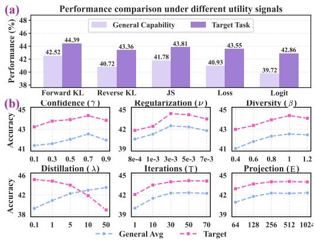

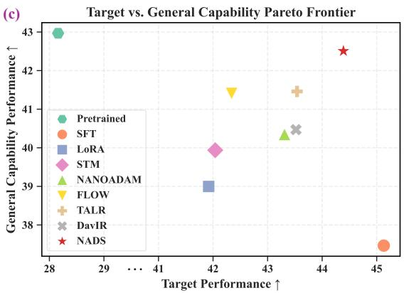  
Figure 6: (a) Performance comparison under different utility signals. (b) Hyperparameter sensitivity of NADS. (c) Comparison with catastrophic forgetting mitigation methods on the Pareto frontier.

insufficient and that navigator-induced predictive discrepancy provides essential forgettingaware information. Removing the diversityaware term or the confidence gate also consistently hurts performance, validating the proposed utility and diversity design. We further compare utility signals in Fig. 6(a). Forward KL

Table 5: Ablation of NADS components.
<table><tr><td>Method</td><td>General</td><td>Target</td><td>Overall</td></tr><tr><td>NADS</td><td>42.52</td><td>44.39</td><td>43.46</td></tr><tr><td>- w/o KL drift</td><td>37.64</td><td>42.31</td><td>39.98</td></tr><tr><td>- w/o Diversity</td><td>40.21</td><td>42.83</td><td>41.52</td></tr><tr><td>- w/o Entropy Gate</td><td>41.26</td><td>43.17</td><td>42.22</td></tr></table>

performs best, followed by JS divergence. This is consistent with the final KD objective, where the pretrained model serves as the teacher. Thus, measuring drift from the pretrained distribution provides a more aligned signal for selecting preservation constraints.

Hyperparameter Analysis. We conduct sensitivity analyses for the major hyperparameters in NADS. Fig. 6(b) shows that NADS remains effective over a broad range of settings. For most hyperparameters, moving from very small values to moderate ones improves performance, after which the curves largely plateau. The main exception is the distillation strength, which exhibits a clearer trade-off between target-task adaptation and general capability preservation. Larger values strengthen preservation, but overly strong distillation begins to hurt target-task performance. The best overall balance is therefore achieved in the intermediate regime.

Additional Robustness Analysis. We further examine whether NADS is sensitive to the candidate pool or constraint-set size. Results show that NADS remains effective across different candidate pools and constraint-set sizes, with detailed comparisons in Appendices F.9 and F.10. We also evaluate instruction-tuning performance using the Alpaca-GPT4 dataset [100] across ten general-capability benchmarks. Detailed experimental settings and results are provided in Appendix F.11.

## 4.6 Comparison with Catastrophic Forgetting Mitigation Methods

We compare NADS with recent catastrophic-forgetting mitigation methods, including STM [8], NANOADAM [101], FLOW [11], DavIR [62], and TALR [10]. Fig. 6(c) reports the comparison on Magicoder with LLaMA3.2-3B, where NADS achieves a favorable overall balance between new-task adaptation and general capability preservation. Detailed analyses and comparisons are in Appendix G.

## 5 Conclusion

We present NADS, a navigator-guided data selection framework for mitigating catastrophic forgetting in LLM fine-tuning without pretraining data. By converting recipe-induced navigator drift into a forgetting-aware signal, NADS selects diverse synthetic constraints that support pretrained-behavior preservation. Experiments across tasks and model families show that NADS improves the adaptation– preservation trade-off with practical selection cost. These results indicate that navigator-induced predictive drift provides a useful bridge between target-task adaptation and preservation-constraint selection. Future work may explore lower-cost navigator construction and adaptive selection strategies.

## Acknowledgments

We thank the anonymous NeurIPS 2026 reviewers for their constructive feedback. This work is supported by the National Natural Science Foundation of China under Grant No. 62476191 and 42550187, with computing resources provided by our research group.

## References

[1] H. Shi, Z. Xu, H. Wang, W. Qin, W. Wang, Y. Wang, Z. Wang, S. Ebrahimi, and H. Wang, “Continual learning of large language models: A comprehensive survey,” ACM Computing Surveys, vol. 58, no. 5, pp. 1–42, 2025.

[2] J. Guan, J. Wu, J.-N. Li, C. Cheng, and W. Wu, “A survey on personalized alignment—the missing piece for large language models in real-world applications,” in Findings ofthe Associationfor Computational Linguistics: ACL 2025, 2025, pp. 5313–5333.

[3] Z. Ke, Y. Ming, and S. Joty, “Adaptation of large language models,” in Proceedings of the 2025 Annual Conference of the Nations of the Americas Chapter of the Association for Computational Linguistics: Human Language Technologies (Volume 5: Tutorial Abstracts), 2025, pp. 30–37.

[4] W. Lu, R. K. Luu, and M. J. Buehler, “Fine-tuning large language models for domain adaptation: Exploration of training strategies, scaling, model merging and synergistic capabilities,” npj Computational Materials, vol. 11, no. 1, p. 84, 2025.

[5] T. Hui, Z. Zhang, S. Wang, W. Xu, Y. Sun, and H. Wu, “Hft: Half fine-tuning for large language models,” in Proceedings ofthe 63rd Annual Meeting ofthe Associationfor Computational Linguistics (Volume 1: Long Papers), 2025, pp. 12 791–12 819.

[6] L. Béthune, D. Grangier, D. Busbridge, E. Gualdoni, marco cuturi, and P. Ablin, “Scaling laws for forgetting during finetuning with pretraining data injection,” in Forty-second International Conference on Machine Learning, 2025.

[7] G. Hacohen and T. Tuytelaars, “Predicting the susceptibility of examples to catastrophic forgetting,” in International Conference on Machine Learning, 2025, pp. 21 546–21 569.

[8] C.-C. Wu, Z. R. Tam, C.-Y. Lin, Y.-N. Chen, S.-H. Sun, and H. yi Lee, “Mitigating forgetting in LLM finetuning via low-perplexity token learning,” in The Thirty-ninth Annual Conference on Neural Information Processing Systems, 2025.

[9] Y. Wang, A. Bai, N. Peng, and C.-J. Hsieh, “On the loss of context awareness in general instruction fine-tuning,” in The Thirty-ninth Annual Conference on Neural Information Processing Systems, 2025.

[10] J. Lin, Z. Wang, K. Qian, T. Wang, A. Srinivasan, H. Zeng, R. Jiao, X. Zhou, J. Gesi, D. Wang, Y. Guo, K. Zhong, W. Zhang, sujay sanghavi, C. Chen, H. Yun, and L. Li, “SFT doesn’t always hurt general capabilities: Revisiting domain-specific fine-tuning in LLMs,” in The Fourteenth International Conference on Learning Representations, 2026.

[11] S. Sanyal, H. Prairie, R. Das, A. Kavis, and S. Sanghavi, “Upweighting easy samples in fine-tuning mitigates forgetting,” in Forty-second International Conference on Machine Learning, 2025.

[12] W. F. Shen, X. Qiu, N. Cancedda, and N. D. Lane, “Don’t make it up: Preserving ignorance awareness in llm fine-tuning,” in NeurIPS 2025 Workshop: Reliable ML from Unreliable Data, 2025.

[13] J. Deng, Q. Wu, P. Ju, S. Lin, Y. Liang, and N. Shroff, “Unlocking the power of rehearsal in continual learning: A theoretical perspective,” in Forty-second International Conference on Machine Learning, 2025.

[14] I. Abbes, G. Subbaraj, M. Riemer, N. Islah, B. Therien, T. Tabaru, H. Kingetsu, S. Chandar, and I. Rish, “Revisiting replay and gradient alignment for continual pre-training of large language models,” 2025. [Online]. Available: https://arxiv.org/abs/2508.01908

[15] W. Ye, P. Zhang, J. Zhang, H. Gao, and M. Wang, “Distilling causal effect of data in continual fewshot relation learning,” in Proceedings of the 2024 Joint International Conference on Computational Linguistics, Language Resources and Evaluation (LREC-COLING 2024), 2024, pp. 5041–5051.

[16] J. He, H. Guo, K. Zhu, Z. Zhao, M. Tang, and J. Wang, “Seekr: Selective attention-guided knowledge retention for continual learning of large language models,” in Proceedings of the 2024 Conference on Empirical Methods in Natural Language Processing, 2024, pp. 3254–3266.

[17] E. Yang, A. Tang, L. Shen, G. Guo, X. Wang, X. Cao, and J. Zhang, “Continual model merging without data: Dual projections for balancing stability and plasticity,” in The Thirty-ninth Annual Conference on Neural Information Processing Systems, 2025.

[18] D. Biderman, J. Portes, J. J. G. Ortiz, M. Paul, P. Greengard, C. Jennings, D. King, S. Havens, V. Chiley, J. Frankle, C. Blakeney, and J. P. Cunningham, “LoRA learns less and forgets less,” Transactions on Machine Learning Research, 2024.

[19] J. Huang, L. Cui, A. Wang, C. Yang, X. Liao, L. Song, J. Yao, and J. Su, “Mitigating catastrophic forgetting in large language models with self-synthesized rehearsal,” in Proceedings ofthe 62nd Annual Meeting ofthe Associationfor Computational Linguistics (Volume 1: Long Papers), 2024, pp. 1416–1428.

[20] J. Wang, L. Ding, S. Wang, H. Li, Y. Luo, H. Zhao, H. Hu, and B. Du, “Self-evolving pseudo-rehearsal for catastrophic forgetting with task similarity in llms,” in The Thirty-ninth Annual Conference on Neural Information Processing Systems, 2025.

[21] F. Ding and B. Wang, “Improved supervised fine-tuning for large language models to mitigate catastrophic forgetting,” 2025. [Online]. Available: https://arxiv.org/abs/2506.09428

[22] Z. Liu, R. Ke, Y. Liu, F. Jiang, and H. Li, “Take the essence and discard the dross: A rethinking on data selection for fine-tuning large language models,” in Proceedings ofthe 2025 Conference ofthe Nations of the Americas Chapter of the Association for Computational Linguistics: Human Language Technologies (Volume 1: Long Papers), 2025, pp. 6595–6611.

[23] H. Ivison, M. Zhang, F. Brahman, P. W. Koh, and P. Dasigi, “Large-scale data selection for instruction tuning,” 2025. [Online]. Available: https://arxiv.org/abs/2503.01807

[24] J. Wang, X. Lin, R. Qiao, P. W. Koh, C.-S. Foo, and B. K. H. Low, “NICE data selection for instruction tuning in LLMs with non-differentiable evaluation metric,” in Forty-second International Conference on Machine Learning, 2025.

[25] Z. Yu, S. Das, and C. Xiong, “Mates: Model-aware data selection for efficient pretraining with data influence models,” Advances in Neural Information Processing Systems, vol. 37, pp. 108 735–108 759, 2024.

[26] D. Sam, A. Chakrabarti, A. Rostamizadeh, S. Ramalingam, G. Citovsky, and S. Kumar, “Analyzing simi larity metrics for data selection for language model pretraining,” in The Thirty-ninth Annual Conference on Neural Information Processing Systems, 2025.

[27] H. Cai, J. Li, M. M. Rahman, and W. Dong, “Low-confidence gold: Refining low-confidence samples for efficient instruction tuning,” 2026. [Online]. Available: https://arxiv.org/abs/2502.18978

[28] Y. Li, Z. Lan, L. Qingsong, Y. Li, and H.-T. Zheng, “Mdit: A model-free data interpolation method for diverse instruction tuning,” 2025. [Online]. Available: https://arxiv.org/abs/2504.07288

[29] A. Kessy, A. Lewin, and K. Strimmer, “Optimal whitening and decorrelation,” The American Statistician, vol. 72, no. 4, pp. 309–314, 2018.

[30] A. Kulesza, B. Taskar et al., “Determinantal point processes for machine learning,” Foundations and Trends® in Machine Learning, vol. 5, no. 2–3, pp. 123–286, 2012.

[31] L. Chen, G. Zhang, and E. Zhou, “Fast greedy map inference for determinantal point process to improve recommendation diversity,” Advances in neural information processing systems, vol. 31, 2018.

[32] S. Hemmi, T. Oki, S. Sakaue, K. Fujii, and S. Iwata, “Lazy and fast greedy map inference for determinantal point process,” Advances in Neural Information Processing Systems, vol. 35, pp. 2776–2789, 2022.

[33] L. Wang, X. Zhang, H. Su, and J. Zhu, “A comprehensive survey of continual learning: Theory, method and application,” IEEE transactions on pattern analysis and machine intelligence, vol. 46, no. 8, pp. 5362–5383, 2024.

[34] H. Li, L. Ding, M. Fang, and D. Tao, “Revisiting catastrophic forgetting in large language model tuning,” in Findings of the Association for Computational Linguistics: EMNLP 2024, 2024, pp. 4297–4308.

[35] Z. Wang, Y. Li, X. Qu, and Y. Cheng, “See: Continual fine-tuning with sequential ensemble of experts,” 2025. [Online]. Available: https://arxiv.org/abs/2504.06664

[36] Y. Wu, L.-K. Huang, R. Wang, D. Meng, and Y. Wei, “Meta continual learning revisited: Implicitly enhancing online hessian approximation via variance reduction,” in The Twelfth international conference on learning representations, 2024.

[37] Z. Wang and H. Huang, “Model sensitivity aware continual learning,” Advances in Neural Information Processing Systems, vol. 37, pp. 132 583–132 613, 2024.

[38] X. Zhao, H. Wang, W. Huang, and W. Lin, “A statistical theory of regularization-based continual learning,” in Forty-first International Conference on Machine Learning, 2024.

[39] K. Sarkar, “Adaptive variance-penalized continual learning with fisher regularization,” 2025. [Online]. Available: https://arxiv.org/abs/2508.16632

[40] X. Chen, L. Yang, and O. Wu, “One algorithm, two goals: Dual scoring for parameter and data selection in llm fine-tuning,” 2026. [Online]. Available: https://arxiv.org/abs/2605.06166

[41] L. Qing, O. Wu, and Y. Du, “Alphatoken: Decoupling adaptation and stability for path-aware response token valuation in llm post-training,” 2026. [Online]. Available: https://arxiv.org/abs/2606.01635

[42] W. Yin, J. Li, and C. Xiong, “Contintin: Continual learning from task instructions,” in Proceedings of the 60th Annual Meeting ofthe Associationfor Computational Linguistics (Volume 1: Long Papers), 2022, pp. 3062–3072.

[43] Z. Borsos, M. Mutny, and A. Krause, “Coresets via bilevel optimization for continual learning and streaming,” Advances in neural information processing systems, vol. 33, pp. 14 879–14 890, 2020.

[44] A. Maekawa, H. Kamigaito, K. Funakoshi, and M. Okumura, “Generative replay inspired by hippocampal memory indexing for continual language learning,” in Proceedings of the 17th Conference of the European Chapter of the Association for Computational Linguistics, 2023, pp. 930–942.

[45] L. Wang, X. Zhang, Q. Li, M. Zhang, H. Su, J. Zhu, and Y. Zhong, “Incorporating neuro-inspired adaptability for continual learning in artificial intelligence,” Nature Machine Intelligence, vol. 5, no. 12, pp. 1356–1368, 2023.

[46] W. Zhao, S. Wang, Y. Hu, Y. Zhao, B. Qin, X. Zhang, Q. Yang, D. Xu, and W. Che, “Sapt: A shared attention framework for parameter-efficient continual learning of large language models,” in Proceedings ofthe 62nd Annual Meeting ofthe Associationfor Computational Linguistics (Volume 1: Long Papers), 2024, pp. 11 641–11 661.

[47] W. Ren, X. Li, L. Wang, T. Zhao, and W. Qin, “Analyzing and reducing catastrophic forgetting in parameter efficient tuning,” 2024. [Online]. Available: https://arxiv.org/abs/2402.18865

[48] Y. Lu, B. Qian, C. Yuan, H. Jiang, and X. Wang, “Controlled low-rank adaptation with subspace regularization for continued training on large language models,” in Proceedings of the 63rd Annual Meeting ofthe Associationfor Computational Linguistics (Volume 1: Long Papers), 2025, pp. 19 165– 19 181.

[49] L. Chen, X. Han, L. Shen, J. Bai, and K.-F. Wong, “Vulnerability-aware alignment: Mitigating uneven forgetting in harmful fine-tuning,” 2025. [Online]. Available: https://arxiv.org/abs/2506.03850

[50] K. Yang, X. Liu, L. Ji, H. Li, Y. Gong, P. Cheng, and M. Yang, “Data mixing agent: Learning to re-weight domains for continual pre-training,” 2025. [Online]. Available: https://arxiv.org/abs/2507.15640

[51] D. Sow, H. Woisetschläger, S. K. Bulusu, S. Wang, H.-a. Jacobsen, and Y. Liang, “Dynamic loss-based sample reweighting for improved large language model pretraining,” in International Conference on Learning Representations, 2025.

[52] A. Bai, C.-K. Yeh, C.-J. Hsieh, and A. Taly, “An efficient rehearsal scheme for catastrophic forgetting mitigation during multi-stage fine-tuning,” in Findings ofthe Associationfor Computational Linguistics: NAACL 2025, 2025, pp. 2557–2569.

[53] L. Liu, X. Liu, D. F. Wong, D. Li, Z. Wang, B. Hu, and M. Zhang, “Selectit: Selective instruction tuning for llms via uncertainty-aware self-reflection,” Advances in Neural Information Processing Systems, vol. 37, pp. 97 800–97 825, 2024.

[54] M. Li, L. Chen, J. Chen, S. He, J. Gu, and T. Zhou, “Selective reflection-tuning: Student-selected data recycling for llm instruction-tuning,” in Findings of the Association for Computational Linguistics ACL 2024, 2024, pp. 16 189–16 211.

[55] Z. Li, Y. Hua, T. Vu, H. Zhan, L. Qu, and G. Haffari, “Scar: Data selection via style consistency-aware response ranking for efficient instruction-tuning of large language models,” in Proceedings ofthe 63rd Annual Meeting ofthe Associationfor Computational Linguistics (Volume 1: Long Papers), 2025, pp. 12 756–12 790.

[56] M. Shen, “Rethinking data selection for supervised fine-tuning,” 2024. [Online]. Available: https://arxiv.org/abs/2402.06094

[57] M. Li, Y. Zhang, Z. Li, J. Chen, L. Chen, N. Cheng, J. Wang, T. Zhou, and J. Xiao, “From quantity to quality: Boosting llm performance with self-guided data selection for instruction tuning,” in Proceedings ofthe 2024 Conference ofthe North American Chapter ofthe Associationfor Computational Linguistics: Human Language Technologies (Volume 1: Long Papers), 2024, pp. 7602–7635.

[58] F. Kang, H. A. Just, Y. Sun, H. Jahagirdar, Y. Zhang, R. Du, A. K. Sahu, and R. Jia, “Get more for less: Principled data selection for warming up fine-tuning in LLMs,” in The Twelfth International Conference on Learning Representations, 2024.

[59] M. Xia, S. Malladi, S. Gururangan, S. Arora, and D. Chen, “Less: selecting influential data for targeted instruction tuning,” in Proceedings ofthe 41st International Conference on Machine Learning, 2024, pp. 54 104–54 132.

[60] M. Nikdan, V. Cohen-Addad, D. Alistarh, and V. Mirrokni, “Efficient data selection at scale via influence distillation,” in The Thirty-ninth Annual Conference on Neural Information Processing Systems, 2025.

[61] S. Chen, Y. Qi, M. Ai, Y. Sun, R. Qiu, J. Zou, and J. He, “Influence-preserving proxies for gradientbased data selection in LLM finetuning,” in The Fourteenth International Conference on Learning Representations, 2026.

[62] H. Zhou, T. Liu, Q. Ma, Y. Zhang, J. Yuan, P. Liu, Y. You, and H. Yang, “Davir: Data selection via implicit reward for large language models,” in Proceedings of the 63rd Annual Meeting of the Association for Computational Linguistics (Volume 1: Long Papers), 2025, pp. 9220–9237.

[63] Y. Li, Z. Liu, Z. Li, Z. Lin, and J. Zhang, “Token-level data selection for safe LLM fine-tuning,” in The Fourteenth International Conference on Learning Representations, 2026.

[64] A. Taheri, A. Taban, Q. Wang, S. Ye, A. Mirzaei, T. Liu, and B. Han, “Forgetting: A new mechanism towards better large language model fine-tuning,” 2026. [Online]. Available: https://arxiv.org/abs/2508.04329

[65] A. Bukharin, S. Li, Z. Wang, J. Yang, B. Yin, X. Li, C. Zhang, T. Zhao, and H. Jiang, “Data diversity matters for robust instruction tuning,” in Findings of the Association for Computational Linguistics: EMNLP 2024, 2024, pp. 3411–3425.

[66] Y. Yang, Y. Nan, J. Ye, S. Dou, X. Wang, S. Li, H. Lv, T. Gui, Q. Zhang, and X.-J. Huang, “Measuring data diversity for instruction tuning: A systematic analysis and a reliable metric,” in Proceedings of the 63rd Annual Meeting of the Association for Computational Linguistics (Volume 1: Long Papers), 2025, pp. 18 530–18 549.

[67] Y. Chen, Y. Li, K. Hu, M. Zerun, H. HaochenYe, and K. Chen, “Mig: Automatic data selection for instruction tuning by maximizing information gain in semantic space,” in Findings ofthe Associationfor Computational Linguistics: ACL 2025, 2025, pp. 9902–9915.

[68] J. Zhang, C.-X. Zhang, Y. Liu, Y.-X. Jin, X.-W. Yang, B. Zheng, Y. Liu, and L.-Z. Guo, “D3: diversity, difficulty, and dependability-aware data selection for sample-efficient llm instruction tuning,” in Proceedings ofthe Thirty-Fourth International Joint Conference on Artificial Intelligence, 2025, pp. 8348–8356.

[69] X. Li, M. Gao, Z. Zhang, C. Yue, and H. Hu, “Selection of llm fine-tuning data based on orthogonal rules,” in Proceedings ofthe AAAI Conference on Artificial Intelligence, vol. 40, no. 37, 2026, pp. 31 760–31 768.

[70] Y. Zhao, L. Du, X. Ding, Y. Ouyang, H. Wang, K. Xiong, J. Gao, Z. Sun, D. Xu, Q. Yang et al., “Beyond similarity: A gradient-based graph method for instruction tuning data selection,” in Proceedings of the 63rd Annual Meeting of the Association for Computational Linguistics (Volume 1: Long Papers), 2025, pp. 24 391–24 404.

[71] L. P. Hoang, W. Zhang, and W. Lu, “Difficulty–diversity collaborative filtering for data-efficient LLM fine-tuning,” in The Fourteenth International Conference on Learning Representations, 2026.

[72] A. Jain, A. Montanari, and E. Sasoglu, “Train on validation (tov): Fast data selection with applications to fine-tuning,” in The Fourteenth International Conference on Learning Representations, 2026.

[73] J. He, H. Jiang, C. Li, S. Xin, and S. Yang, “Early-stopping for transformer model training,” 2025. [Online]. Available: https://arxiv.org/abs/2510.16074

[74] A. Kulesza and B. Taskar, “k-dpps: Fixed-size determinantal point processes,” in Proceedings of the 28th International Conference on Machine Learning (ICML-11), 2011, pp. 1193–1200.

[75] A. Belhadji, R. Bardenet, and P. Chainais, “A determinantal point process for column subset selection,” Journal ofmachine learning research, vol. 21, no. 197, pp. 1–62, 2020.

[76] Y. Chen, S. Chakraborty, L. Wolf, I. Paschalidis, and A. Pacchiano, “Post-training large language models for diverse high-quality responses,” in The Fourteenth International Conference on Learning Representations, 2026.

[77] R. A. Horn and C. R. Johnson, Matrix analysis. Cambridge university press, 2012.

[78] W. B. Johnson, J. Lindenstrauss et al., “Extensions of lipschitz mappings into a hilbert space,” Contemporary mathematics, vol. 26, no. 189-206, p. 1, 1984.

[79] T. Blumensath and M. E. Davies, “Iterative hard thresholding for compressed sensing,” Applied and computational harmonic analysis, vol. 27, no. 3, pp. 265–274, 2009.

[80] Y. Wei, Z. Wang, J. Liu, Y. Ding, and L. Zhang, “Magicoder: Empowering code generation with OSSinstruct,” in Proceedings ofthe 41st International Conference on Machine Learning, ser. Proceedings of Machine Learning Research, vol. 235. PMLR, 21–27 Jul 2024, pp. 52 632–52 657.

[81] L. Yu, W. Jiang, H. Shi, J. YU, Z. Liu, Y. Zhang, J. Kwok, Z. Li, A. Weller, and W. Liu, “Metamath: Bootstrap your own mathematical questions for large language models,” in The Twelfth International Conference on Learning Representations, 2024.

[82] Z. Xu, F. Jiang, L. Niu, Y. Deng, R. Poovendran, Y. Choi, and B. Y. Lin, “Magpie: Alignment data synthesis from scratch by prompting aligned LLMs with nothing,” in The Thirteenth International Conference on Learning Representations, 2025.

[83] Z. Liu, Y. Liu, S. Wang, Z. Song, J. Wang, J. Liu, Q. Liu, G. Chen, and Y. Wang, “Learn more, forget less: A gradient-aware data selection approach for llm,” Signal Processing, p. 110611, 2026.

[84] X. Yuan, C. Shen, S. Yan, kaiyuan liu, X. Zhang, S. Fan, L. Xie, W. Wang, R. Guan, Y. Wang, and J. Ye, “Differential fine-tuning large language models towards better diverse reasoning abilities,” in The Fourteenth International Conference on Learning Representations, 2026.

[85] M. Chen, J. Tworek, H. Jun, Q. Yuan, H. P. de Oliveira Pinto, and J. K. et al., “Evaluating large language models trained on code,” 2021. [Online]. Available: https://arxiv.org/abs/2107.03374

[86] D. Hendrycks, C. Burns, S. Basart, A. Zou, M. Mazeika, D. Song, and J. Steinhardt, “Measuring massive multitask language understanding,” in International Conference on Learning Representations, 2021.

[87] R. Zellers, A. Holtzman, Y. Bisk, A. Farhadi, and Y. Choi, “Hellaswag: Can a machine really finish your sentence?” in Proceedings ofthe 57th annual meeting ofthe associationfor computational linguistics, 2019, pp. 4791–4800.

[88] K. Cobbe, V. Kosaraju, M. Bavarian, M. Chen, H. Jun, L. Kaiser, M. Plappert, J. Tworek, J. Hilton, R. Nakano, C. Hesse, and J. Schulman, “Training verifiers to solve math word problems,” 2021. [Online]. Available: https://arxiv.org/abs/2110.14168

[89] T. Mihaylov, P. Clark, T. Khot, and A. Sabharwal, “Can a suit of armor conduct electricity? a new dataset for open book question answering,” in Proceedings of the 2018 conference on empirical methods in natural language processing, 2018, pp. 2381–2391.

[90] E. J. Hu, yelong shen, P. Wallis, Z. Allen-Zhu, Y. Li, S. Wang, L. Wang, and W. Chen, “Lora: Low-rank adaptation of large language models,” in International Conference on Learning Representations, 2022.

[91] Y. Wang, Y. Liu, C. Shi, H. Li, C. Chen, H. Lu, and Y. Yang, “Inscl: A data-efficient continual learning paradigm for fine-tuning large language models with instructions,” in Proceedings of the 2024 Conference of the North American Chapter of the Association for Computational Linguistics: Human Language Technologies (Volume 1: Long Papers), 2024, pp. 663–677.

[92] M. M’hamdi and J. May, “Leitner-guided memory replay for cross-lingual continual learning,” in Proceedings of the 2024 Conference of the North American Chapter of the Association for Computational Linguistics: Human Language Technologies (Volume 1: Long Papers), 2024, pp. 7808–7821.

[93] R. Deb, K. K. Thekumparampil, K. Kalantari, G. Hiranandani, S. Sabach, and B. Kveton, “FisherSFT: Data-efficient supervised fine-tuning of language models using information gain,” in Forty-second International Conference on Machine Learning, 2025.

[94] P. Chang, J. Zhang, B. Chen, C. Wang, C. Guo, Y. Zhang, Y. Gao, J. Xiang, Y. Gao, C. Sun, Y. Chen, and D. Kong, “SPICE: Submodular penalized information–conflict selection for efficient large language model training,” in The Fourteenth International Conference on Learning Representations, 2026. [Online]. Available: https://openreview.net/forum?id=9rCRy58TPF

[95] A. Grattafiori, A. Dubey, A. Jauhri, A. Pandey, and A. K. et al., “The llama 3 herd of models,” 2024. [Online]. Available: https://arxiv.org/abs/2407.21783

[96] G. Team, A. Kamath, J. Ferret, S. Pathak, N. Vieillard, and R. M. et al., “Gemma 3 technical report,” 2025. [Online]. Available: https://arxiv.org/abs/2503.19786

[97] Qwen Team, “Qwen3.5: Towards native multimodal agents,” February 2026. [Online]. Available: https://qwen.ai/blog?id=qwen3.5

[98] X. Zhang, Y. Tian, H. Wang, and Y. Song, “Training data selection with gradient orthogonality for efficient domain adaptation,” 2026. [Online]. Available: https://arxiv.org/abs/2602.06359

[99] L. Van der Maaten and G. Hinton, “Visualizing data using t-sne.” Journal of machine learning research, vol. 9, no. 11, 2008.

[100] B. Peng, C. Li, P. He, M. Galley, and J. Gao, “Instruction tuning with gpt-4,” 2023. [Online]. Available: https://arxiv.org/abs/2304.03277

[101] C. Zhou, T. Jacobs, A. Gadhikar, and R. Burkholz, “Pay attention to small weights,” in The Thirty-ninth Annual Conference on Neural Information Processing Systems, 2025.

[102] L. Gao, J. Tow, B. Abbasi, S. Biderman, S. Black, A. DiPofi, C. Foster, L. Golding, J. Hsu, A. Le Noac’h, H. Li, K. McDonell, N. Muennighoff, C. Ociepa, J. Phang, L. Reynolds, H. Schoelkopf, A. Skowron, L. Sutawika, E. Tang, A. Thite, B. Wang, K. Wang, and A. Zou, “The language model evaluation harness,” 07 2024. [Online]. Available: https://zenodo.org/records/12608602

[103] Z. Lin, Z. Gou, Y. Gong, X. Liu, Y. Shen, R. Xu, C. Lin, Y. Yang, J. Jiao, N. Duan, and W. Chen, “Not all tokens are what you need for pretraining,” in Advances in Neural Information Processing Systems, vol. 37, 2024, pp. 29 029–29 063.

[104] S. M. Xie, H. Pham, X. Dong, N. Du, H. Liu, Y. Lu, P. S. Liang, Q. V. Le, T. Ma, and A. W. Yu, “Doremi: Optimizing data mixtures speeds up language model pretraining,” in Advances in Neural Information Processing Systems, vol. 36, 2023, pp. 69 798–69 818.

[105] C. Xu, Q. Sun, K. Zheng, X. Geng, P. Zhao, J. Feng, C. Tao, Q. Lin, and D. Jiang, “WizardLM: Empowering large pre-trained language models to follow complex instructions,” in The Twelfth International Conference on Learning Representations, 2024.

[106] P. Clark, I. Cowhey, O. Etzioni, T. Khot, A. Sabharwal, C. Schoenick, and O. Tafjord, “Think you have solved question answering? try arc, the ai2 reasoning challenge,” 2018. [Online]. Available: https://arxiv.org/abs/1803.05457

[107] Y. Bisk, R. Zellers, R. Le Bras, J. Gao, and Y. Choi, “Piqa: Reasoning about physical commonsense in natural language,” in Proceedings of the AAAI conference on artificial intelligence, vol. 34, 2020, pp. 7432–7439.

[108] K. Sakaguchi, R. Le Bras, C. Bhagavatula, and Y. Choi, “Winogrande: An adversarial winograd schema challenge at scale,” in Proceedings of the AAAI Conference on Artificial Intelligence, vol. 34, 2020, pp. 8732–8740.

[109] S. Lin, J. Hilton, and O. Evans, “Truthfulqa: Measuring how models mimic human falsehoods,” in Proceedings of the 60th annual meeting of the association for computational linguistics (volume 1: long papers), 2022, pp. 3214–3252.

[110] M. Li, H. Chen, C. Wang, D. Nguyen, D. Li, and T. Zhou, “RuleR: Improving llm controllability by rule-based data recycling,” in Proceedings ofthe 2025 Conference ofthe Nations ofthe Americas Chapter of the Association for Computational Linguistics: Human Language Technologies (Volume 2: Short Papers), 2025, pp. 926–943.

[111] G. a. Han, “What makes good instruction-tuning data? an in-context learning perspective,” in Proceedings of the 64th Annual Meeting of the Association for Computational Linguistics (Volume 1: Long Papers). Association for Computational Linguistics, jul 2026, pp. 1013–1027.

[112] P. Mirza, L. Weber, and F. Küch, “Stratified selective sampling for instruction tuning with dedicated scoring strategy,” in Findings of the Association for Computational Linguistics: EMNLP 2025, 2025, pp. 19 949–19 974.

[113] J. Zhou, T. Lu, S. Mishra, S. Brahma, S. Basu, Y. Luan, D. Zhou, and L. Hou, “Instruction-following evaluation for large language models,” 2023. [Online]. Available: https://arxiv.org/abs/2311.07911

## A Comparison with Existing Model-Centric Data Selection Methods

In this section, we clarify the key distinction between the navigator model in NADS and the reference models adopted in prior model-centric data selection methods. Existing methods have shown that model differences can be used to construct informative selection signals. DavIR [62] scores samples by comparing the loss difference between the pretrained model and a reference model fine tuned on the full training set, and treats this score as an implicit reward. The resulting signal mainly reflects how much a sample contributes to target task adaptation. ToV [72] updates the model using a small validation set from the target distribution, and then scores samples according to the loss change before and after this update. Its reference model therefore also serves target domain utility estimation. TOSS [63] trains a safety-degraded model and a utility-oriented model on harmful reference data and high quality reference data, respectively, and identifies unsafe tokens through their loss difference. Forgetting [64] further fine tunes the base model on a sampled reference subset, and uses the resulting token level influence score to partition tokens for subsequent learning or forgetting. These methods use reference model differences for their respective selection or partitioning objectives.

The navigator in NADS is designed for a different role. It is obtained by applying the same target task adaptation recipe used in the final fine-tuning stage, but without retention regularization or constraint samples. The resulting navigator provides a recipe-conditioned estimate of forgetting risk for candidate constraint samples by comparing its predictions with those of the pretrained model. A larger predictive divergence indicates that the pretrained behavior on the sample is more likely to be altered under unconstrained target task adaptation. NADS therefore selects samples with higher estimated forgetting risk as preservation samples for the final fine-tuning stage.

## B Theoretical Analysis

## B.1 Proof of Proposition 1

In this section, we prove that the checkpoint selected by validation-based early stopping is near-best on the unconstrained adaptation trajectory.

Proof. Let $\{ \pmb { \theta } _ { t } \} _ { t = 0 } ^ { T }$ denote the unconstrained adaptation trajectory induced by the target recipe. Along this trajectory, define $R ( t ) \triangleq \mathcal { L } _ { \mathrm { p o p } } ( \pmb { \theta } _ { t } )$ and $\hat { R } ( t ) \triangleq { \mathcal { L } } _ { \mathrm { v a l } } ( \theta _ { t } )$ , where $R ( t )$ is the population new-task risk at checkpoint $\pmb \theta _ { t }$ , and $\hat { R } ( t )$ is the empirical validation loss on the held-out validation set. Let

$$
t _ { \mathrm { o p t } } \in \arg \operatorname* { m i n } _ { t \in \{ 0 , \ldots , T \} } R ( t ) , \qquad t ^ { * } \in \arg \operatorname* { m i n } _ { t \in \{ 0 , \ldots , T \} } \hat { R } ( t ) ,\tag{10}
$$

where $t _ { \mathrm { o p t } }$ denotes the population-risk minimizer along the unconstrained adaptation trajectory, and $t ^ { * }$ denotes the checkpoint selected by validation-based early stopping. By the definition of $t ^ { * }$ , we have $\hat { R } ( t ^ { * } ) \leq \hat { R } ( t )$ for all $t \in \{ 0 , \ldots , T \}$ . In particular, taking $t = t _ { \mathrm { o p t } }$ gives

$$
\hat { R } ( t ^ { * } ) \leq \hat { R } ( t _ { \mathrm { o p t } } ) .\tag{11}
$$

By assumption, there exists $\varepsilon > 0$ such that $| \hat { R } ( t ) - R ( t ) | \leq \varepsilon$ holds for all $t \in \{ 0 , \ldots , T \}$ Equivalently,

$$
R ( t ) - \varepsilon \le \hat { R } ( t ) \le R ( t ) + \varepsilon , \qquad \forall t \in \{ 0 , \ldots , T \} .\tag{12}
$$

Applying the left inequality in Eq. (12) at $t = t ^ { * }$ and the right inequality at $t = t _ { \mathrm { o p t } }$ , and combining them with Eq. (11), we obtain

$$
R ( t ^ { * } ) - \varepsilon \le \hat { R } ( t ^ { * } ) \le \hat { R } ( t _ { \mathrm { o p t } } ) \le R ( t _ { \mathrm { o p t } } ) + \varepsilon .\tag{13}
$$

Rearranging Eq. (13) yields $R ( t ^ { * } ) - R ( t _ { \mathrm { o p t } } ) \leq 2 \varepsilon$ . Therefore, the validation-selected checkpoint has population new-task risk within 2ε of the best checkpoint on the unconstrained adaptation trajectory.

## B.2 Proof of Proposition 2

In this section, we prove the local deviation recursion in Proposition 2, showing that bounded preservation updates control the mismatch between the training trajectory of $M _ { \mathrm { f i n a l } }$ and the unconstrained target-task trajectory over local horizons.

Proof. Let $d _ { t } : = \lVert \pmb { \theta } _ { t } - \bar { \pmb { \theta } } _ { t } \rVert$ denote the deviation between the constrained trajectory $\{ \pmb { \theta } _ { t } \} _ { t = 0 } ^ { T }$ and the unconstrained trajectory $\{ \bar { \pmb { \theta } } _ { t } \} _ { t = 0 } ^ { T }$ at step t. By the update rules $\pmb { \theta } _ { t + 1 } = \pmb { \theta } _ { t } - \eta \big ( \nabla L _ { \mathrm { t a s k } } ( \pmb { \theta } _ { t } ) + \xi _ { t } \big )$ and $\bar { \pmb { \theta } } _ { t + 1 } = \bar { \pmb { \theta } } _ { t } - \eta \nabla L _ { \mathrm { t a s k } } ( \bar { \pmb { \theta } } _ { t } )$ , their difference satisfies

$$
\pmb { \theta } _ { t + 1 } - \bar { \pmb { \theta } } _ { t + 1 } = \pmb { \theta } _ { t } - \bar { \pmb { \theta } } _ { t } - \eta \big ( \nabla L _ { \mathrm { t a s k } } ( \pmb { \theta } _ { t } ) - \nabla L _ { \mathrm { t a s k } } ( \bar { \pmb { \theta } } _ { t } ) \big ) - \eta \xi _ { t } .\tag{14}
$$

Taking norms and applying the triangle inequality yields

$$
d _ { t + 1 } \leq d _ { t } + \eta \Vert \nabla L _ { \mathrm { t a s k } } ( \pmb { \theta } _ { t } ) - \nabla L _ { \mathrm { t a s k } } ( \bar { \pmb { \theta } } _ { t } ) \Vert + \eta \Vert \xi _ { t } \Vert .\tag{15}
$$

By the L-Lipschitz continuity of $\nabla L _ { \mathrm { t a s k } }$ and the bound $\| \xi _ { t } \| \leq \kappa ,$ , we obtain $d _ { t + 1 } \leq ( 1 + \eta L ) d _ { t } + \eta \kappa$ Then, we fix a reference step t and an integer local horizon $\tau \in \{ 0 , \ldots , T - t \}$ . Iterating the one-step bound from step t onward gives that, for any $s \in \{ 0 , \ldots , \tau \}$

$$
d _ { t + s } \leq d _ { t } + \sum _ { j = 0 } ^ { s - 1 } \eta \bigl ( L d _ { t + j } + \kappa \bigr ) .\tag{16}
$$

Taking the supremum over $0 \leq s \leq \tau$ on the left-hand side yields

$$
\operatorname* { s u p } _ { 0 \leq s \leq \tau } d _ { t + s } \leq d _ { t } + \sum _ { j = 0 } ^ { \tau - 1 } \eta \big ( L d _ { t + j } + \kappa \big ) .\tag{17}
$$

Substituting back $d _ { t } = \lVert { \pmb { \theta } } _ { t } - { \bar { \pmb { \theta } } } _ { t } \rVert$ proves

$$
\operatorname* { s u p } _ { 0 \leq s \leq \tau } \| \theta _ { t + s } - \bar { \theta } _ { t + s } \| \leq \| \theta _ { t } - \bar { \theta } _ { t } \| + \sum _ { j = 0 } ^ { \tau - 1 } \eta \big ( L \| \theta _ { t + j } - \bar { \theta } _ { t + j } \| + \kappa \big ) .\tag{18}
$$

Therefore, bounded preservation updates locally control trajectory mismatch.

## B.3 Local perturbation of navigator-side forgetting-risk ordering

Corollary 1 (Local perturbation of navigator-side forgetting-risk ordering). Let $\Delta _ { \theta } ( x )$ denote the forgetting-risk score of sample x. Fix a reference step t and an integer local horizon $\tau \in$ $\{ 0 , \dot { \ldots } , T - \check { t } \}$ , and let $\mathcal { N } _ { t , \tau }$ denote a neighborhood containing the navigator and final trajectories over this horizon. Assume that,for each sample $x , \Delta _ { \theta } ( x )$ is Lipschitz on $\mathcal { N } _ { t , \tau }$ with local constant $G _ { t , \tau } ( x )$ . Define the local trajectory mismatch $B _ { t , \tau } : = \mathrm { \ s u p } _ { 0 \leq s \leq \tau } \| \pmb \theta _ { t + s } - \bar { \pmb \theta } _ { t + s } \|$ . Then,for any two samples $x _ { a }$ and $x _ { b } ,$

$$
\begin{array} { r } { \Big | [ \Delta _ { \theta _ { t + \tau } } ( x _ { a } ) - \Delta _ { \theta _ { t + \tau } } ( x _ { b } ) ] - [ \Delta _ { \bar { \theta } _ { t + \tau } } ( x _ { a } ) - \Delta _ { \bar { \theta } _ { t + \tau } } ( x _ { b } ) ] \Big | \leq \big ( G _ { t , \tau } ( x _ { a } ) + G _ { t , \tau } ( x _ { b } ) \big ) B _ { t , \tau } . } \end{array}
$$

Consequently, $i f \left| \Delta _ { \bar { \theta } _ { t + \tau } } ( x _ { a } ) - \Delta _ { \bar { \theta } _ { t + \tau } } ( x _ { b } ) \right| > \left( G _ { t , \tau } ( x _ { a } ) + G _ { t , \tau } ( x _ { b } ) \right) B _ { t , \tau } ,$ , then the pairwise ordering between $x _ { a }$ and $x _ { b }$ is preserved at step $t + \tau , i . e .$

$$
\mathrm { s i g n } \big ( \Delta _ { \theta _ { t + \tau } } ( x _ { a } ) - \Delta _ { \theta _ { t + \tau } } ( x _ { b } ) \big ) = \mathrm { s i g n } \big ( \Delta _ { \bar { \theta } _ { t + \tau } } ( x _ { a } ) - \Delta _ { \bar { \theta } _ { t + \tau } } ( x _ { b } ) \big ) .
$$

Thus, this corollary is a conditional local perturbation statement. When the relevant score sensitivities are moderate and the local trajectory mismatch remains limited, pairwise orderings with sufficiently large navigator-side margins are preserved under the constrained final trajectory. Appendix D.1 provides an empirical analysis of this ordering fidelity by varying the KD strength and measuring the agreement between navigator-induced candidate rankings and final-trajectory reference rankings.

## B.4 Theoretical connection between the KL-based utility and the KD objective

In this section, we clarify a local relation between the KL-based utility in NADS and the subset-level KD discrepancy in final training. We analyze how the utility shares the same token-level discrepancy as the KD objective, with an entropy-based reweighting that yields a confidence-aware local alignment with the capability-preserving regularizer at the navigator checkpoint.

For a sample $x ,$ define the distillation discrepancy under model parameter $\pmb { \theta }$ as

$$
f _ { x } ( \pmb \theta ) : = \frac { 1 } { | x | } \sum _ { t = 1 } ^ { | x | } D _ { \mathrm { K L } } \big ( P _ { \mathrm { p r e t r a i n } } ( \cdot \ : | \ : x _ { < t } ) \ : \big | \big | P _ { \pmb \theta } ( \cdot \ : | \ : x _ { < t } ) \big ) .\tag{19}
$$

For a subset $S \subseteq { \mathcal { C } }$ , define the corresponding set-level discrepancy as

$$
F _ { S } ( \pmb \theta ) : = \frac { 1 } { | S | } \sum _ { x \in S } f _ { x } ( \pmb \theta ) .\tag{20}
$$

Evaluating Eq. (20) at the navigator checkpoint $\theta _ { \mathrm { n a v } }$ yields the average KD discrepancy between the pretrained model and the navigator model over subset S. The utility used in NADS is defined as

$$
u ( x ) = { \frac { 1 } { | x | } } \sum _ { t = 1 } ^ { | x | } w _ { t } ( x ) D _ { \mathrm { K L } } { \big ( } P _ { \mathrm { p r e t r a i n } } ( \cdot \ | \ x _ { < t } ) \ \big | { \big | } \ P _ { \mathrm { n a v } } ( \cdot \ | \ x _ { < t } ) { \big ) } ,\tag{21}
$$

where $w _ { t } ( x ) = \exp \bigl ( - \gamma H ( P _ { \mathrm { p r e t r a i n } } ( \cdot \mid x _ { < t } ) ) \bigr )$ . We define the set-level averaged utility as

$$
\bar { U } ( S ) : = \frac { 1 } { | S | } \sum _ { x \in S } u ( x ) , \qquad U ( S ) : = \sum _ { x \in S } u ( x ) .\tag{22}
$$

Let $\delta _ { t } ( x ) : = D _ { \mathrm { K L } } \big ( P _ { \mathrm { p r e t r a i n } } ( \cdot \mid x _ { < t } ) \mid \big | P _ { \mathrm { n a v } } ( \cdot \mid x _ { < t } ) \big )$ denote the token-level KD discrepancy at the navigator checkpoint. Then both $F _ { S } ( \theta _ { \mathrm { n a v } } )$ and $\bar { U } ( S )$ are constructed from the same set of token-level discrepancies $\{ \bar { \delta } _ { t } ( x ) \}$ :

$$
F _ { S } ( \theta _ { \mathrm { n a v } } ) = \frac { 1 } { | S | } \sum _ { x \in S } \frac { 1 } { | x | } \sum _ { t = 1 } ^ { | x | } \delta _ { t } ( x ) , \qquad \bar { U } ( S ) = \frac { 1 } { | S | } \sum _ { x \in S } \frac { 1 } { | x | } \sum _ { t = 1 } ^ { | x | } w _ { t } ( x ) \delta _ { t } ( x ) .\tag{23}
$$

Hence, the utility and the KD discrepancy share the same underlying signal, differing only in whether token-level contributions are reweighted.

Importantly, the entropy gate $w _ { t } ( x ) = \exp ( - \gamma H ( \cdot ) )$ is monotone decreasing in the pretrained entropy. Thus, high-entropy positions are systematically down-weighted, whereas low-entropy positions contribute more strongly to the utility. This yields a confidence-aware reweighting of the KD discrepancy rather than an arbitrary transformation of the signal. Under this view, $\bar { U } ( S )$ can be interpreted as a confidence-aware, robustness-oriented proxy of $F _ { S } ( \theta _ { \mathrm { n a v } } )$ : it preserves the same discrepancy structure while reducing the influence of positions more likely to reflect intrinsic uncertainty or token-level noise.

This provides a local alignment rationale for the utility design in NADS. The final training objective reduces the KD discrepancy on the selected constraint set, while the selection utility evaluates the same navigator-side discrepancy with confidence-aware reweighting. Hence, the selection signal remains locally aligned with the KD objective while being less sensitive to high-entropy discrepancy patterns. Since $\gamma \geq 0$ and $0 \leq H ( \cdot ) \leq \log | V |$ , the gate satisfies $| V | ^ { - \gamma } \leq w _ { t } ( x ) \leq 1$ , implying $\bar { | } V | ^ { - \gamma } F _ { S } ( \pmb \theta _ { \mathrm { n a v } } ) \le \bar { U } ( S ) \le F _ { S } ( \pmb \theta _ { \mathrm { n a v } } )$ . This boundedness is mainly a consistency property; the primary role of the entropy gate is its monotone confidence-aware reweighting effect.

Overall, the KL-based utility and the KD regularizer are locally connected through the same navigatorside discrepancy. Around the navigator checkpoint, the utility serves as a confidence-aware proxy of this discrepancy, providing a locally aligned signal for constructing capability-preserving constraints. Appendix D.3 further examines this utility signal empirically by comparing constraint sets selected from different utility ranges under the same final KD objective.

## C Derivation Details of the Selection Algorithm

## C.1 Derivation of the Selection Objective

In this section, we derive the utility–diversity selection objective from the standard k-DPP formulation. We start from

$$
\begin{array} { r } { S ^ { \ast } = \underset { S \subseteq \mathcal { V } , \vert S \vert = K } { \arg \operatorname* { m a x } } \log \operatorname* { d e t } ( \mathbf { L } _ { S } ) , } \end{array}\tag{24}
$$

where $\mathbf { L } _ { S }$ denotes the principal submatrix of the L-ensemble kernel indexed by the subset S. Following the L-ensemble decomposition, let ${ \mathbf { L } } = \mathbf { Q } \mathbf { G } \mathbf { Q }$ , where $\mathbf { Q } \triangleq \operatorname { d i a g } ( q _ { 1 } , \dots , q _ { N } )$ and ${ \bf G } \succeq 0$ For any subset S, the corresponding principal submatrix can be written as ${ \bf L } _ { S } = { \bf Q } _ { S } { \bf G } _ { S } { \bf Q } _ { S }$

so taking determinants gives det $( { \bf L } _ { S } ) \ = \ \operatorname* { d e t } ( { \bf Q } _ { S } )$ det $\left( \mathbf { G } _ { S } \right)$ det $( \mathbf { Q } _ { S } )$ ). Since $\mathbf { Q } _ { S }$ is diagonal, det $\begin{array} { r } { ( \mathbf { Q } _ { S } ) = \prod _ { i \in S } q _ { i } } \end{array}$ , and therefore de $\begin{array} { r } { { \bf \Pi } _ { \langle } ( { \bf L } _ { S } ) = \left( \prod _ { i \in S } q _ { i } ^ { 2 } \right) \operatorname* { d e t } ( { \bf G } _ { S } ) } \end{array}$ . Taking logarithms yields

$$
\log \mathrm { d e t } ( \mathbf { L } _ { S } ) = 2 \sum _ { i \in { S } } \log q _ { i } + \log \mathrm { d e t } ( \mathbf { G } _ { S } ) .\tag{25}
$$

Substituting Eq. (25) into Eq. (24) gives the equivalent objective

$$
S ^ { * } = \underset { S \subseteq \mathcal { V } , | S | = K } { \arg \operatorname* { m a x } } \left( 2 \sum _ { i \in S } \log q _ { i } + \log \operatorname* { d e t } ( \mathbf { G } _ { S } ) \right) .\tag{26}
$$

We next substitute the quality parametrization $q _ { i } \triangleq \exp \bigl ( u _ { i } / ( 2 \beta ) \bigr )$ with $\beta > 0$ . Under this choice, and noting that multiplying the objective by the positive constant $\beta$ does not change the argmax, Eq. (26) becomes

$$
S ^ { * } = \operatorname * { a r g m a x } _ { S \subseteq \mathcal { Y } , | S | = K } \left( \frac { 1 } { \beta } \sum _ { i \in S } u _ { i } + \log \operatorname* { d e t } ( \mathbf { G } _ { S } ) \right) = \operatorname * { a r g m a x } _ { S \subseteq \mathcal { Y } , | S | = K } \left( \sum _ { i \in S } u _ { i } + \beta \log \operatorname* { d e t } ( \mathbf { G } _ { S } ) \right) ,\tag{27}
$$

Finally, we instantiate G as a Gram kernel built from the sample embeddings $\mathbf { z } _ { i } \in \mathbb { R } ^ { d }$ , so that $\mathbf { G } _ { S } = \mathbf { Z } _ { S } ^ { \top } \mathbf { Z } _ { S }$ , where $\mathbf { Z } _ { S } \triangleq [ \mathbf { z } _ { i } ] _ { i \in S } \in \mathbb { R } ^ { d \times K }$ . To improve numerical stability and avoid rank deficiency, we replace log det $\left( \mathbf { G } _ { S } \right)$ with the stabilized diversity term log det $\bigl ( \mathbf { I } _ { K } + \mathbf { G } _ { S } \bigr )$ [76] and apply Sylvester’s determinant identity [77]:

$$
\operatorname* { d e t } ( \mathbf { I } _ { K } + \mathbf { Z } _ { S } ^ { \top } \mathbf { Z } _ { S } ) = \operatorname* { d e t } ( \mathbf { I } _ { d } + \mathbf { Z } _ { S } \mathbf { Z } _ { S } ^ { \top } ) = \operatorname* { d e t } \Bigl ( \mathbf { I } _ { d } + \sum _ { i \in S } \mathbf { z } _ { i } \mathbf { z } _ { i } ^ { \top } \Bigr ) .\tag{28}
$$

Using this stabilized diversity term, Sylvester’s identity gives the objective

$$
S ^ { * } = \operatorname * { a r g m a x } _ { S \subseteq \mathcal { V } , | S | = K } \sum _ { i \in S } u _ { i } + \beta \log \operatorname* { d e t } \left( \mathbf { I } _ { d } + \sum _ { i \in S } \mathbf { z } _ { i } \mathbf { z } _ { i } ^ { \top } \right) ,\tag{29}
$$

which is the stabilized utility–diversity objective used in the main text.

## C.2 Objective Discrepancy Between the Discrete and Sparse Objectives

In this section, we analyze the discrepancy between the discrete subset-selection objective in Eq. (4) and the sparse continuous objective in Eq. (5).

Let $F _ { \mathrm { d i s c } } ( S )$ denote the discrete objective in $\mathrm { E q . } ( 4 ) , F _ { 0 } ( \mathbf { w } )$ the unregularized sparse objective, and $\begin{array} { r } { F _ { \mathrm { s p r } } ( \mathbf { w } ) \triangleq F _ { 0 } ( \mathbf { w } ) - \frac { \nu } { 2 } \Vert \mathbf { w } \Vert _ { 2 } ^ { 2 } } \end{array}$ the full sparse objective in Eq. (5). For any subset $S \subseteq [ N ]$ with $| S | = K$ , let $\mathbf { 1 } _ { S } \in \{ 0 , \bar { 1 } \} ^ { N }$ be its indicator vector. Then, by direct substitution, $F _ { 0 } ( { \bf 1 } _ { S } ) = F _ { \mathrm { d i s c } } ( S )$ This shows that the unregularized sparse objective exactly recovers the discrete objective when the weights are restricted to binary indicator vectors. For each coordinate,

$$
\frac { \partial F _ { 0 } ( \mathbf { w } ) } { \partial w _ { i } } = u _ { i } + \beta \mathbf { z } _ { i } ^ { \top } \Big ( \mathbf { I } _ { d } + \sum _ { j = 1 } ^ { N } w _ { j } \mathbf { z } _ { j } \mathbf { z } _ { j } ^ { \top } \Big ) ^ { - 1 } \mathbf { z } _ { i } .\tag{30}
$$

Since $\begin{array} { r } { \mathbf { I } _ { d } + \sum _ { j = 1 } ^ { N } w _ { j } \mathbf { z } _ { j } \mathbf { z } _ { j } ^ { \top } \succeq \mathbf { I } _ { d } } \end{array}$ , we have $\begin{array} { r } { \left( \mathbf { I } _ { d } + \sum _ { j = 1 } ^ { N } w _ { j } \mathbf { z } _ { j } \mathbf { z } _ { j } ^ { \top } \right) ^ { - 1 } \preceq \mathbf { I } _ { d } } \end{array}$ . Hence

$$
0 \leq \mathbf { z } _ { i } ^ { \top } \Big ( \mathbf { I } _ { d } + \sum _ { j = 1 } ^ { N } w _ { j } \mathbf { z } _ { j } \mathbf { z } _ { j } ^ { \top } \Big ) ^ { - 1 } \mathbf { z } _ { i } \leq \| \mathbf { z } _ { i } \| _ { 2 } ^ { 2 } ,\tag{31}
$$

which implies $\begin{array} { r } { \left| \frac { \partial F _ { 0 } ( \mathbf { w } ) } { \partial w _ { i } } \right| \leq | u _ { i } | + \beta \| \mathbf { z } _ { i } \| _ { 2 } ^ { 2 } } \end{array}$ . Let $L \triangleq \operatorname* { m a x } _ { 1 \leq i \leq N } \left( | u _ { i } | + \beta \| \mathbf { z } _ { i } \| _ { 2 } ^ { 2 } \right)$ . Then $\| \nabla F _ { 0 } ( \mathbf { w } ) \| _ { \infty } \leq$ L uniformly over the feasible region. Now fix any $\textbf { w } \succeq 0$ with $\| \mathbf { w } \| _ { 0 } = K$ , and let $S \ : = \ : \{ i$ $w _ { i } \neq 0 \}$ denote its induced support. Because both w and 1S are nonnegative and supported on $S ,$ every point on the line segment $\xi ( \tau ) = \mathbf { 1 } _ { S } + \tau ( \mathbf { w } - \mathbf { 1 } _ { S } )$ for $\tau \in [ 0 , 1 ]$ remains nonnegative and supported on $S _ { ☉ }$ , and the matrix inside the log-determinant remains positive definite along this segment. Applying the mean-value theorem, there exists some $\bar { \tau } \in ( 0 , 1 )$ such that $F _ { 0 } ( \mathbf { w } ) { - } F _ { 0 } ( \mathbf { 1 } _ { S } ) =$ $\langle \bar { \nabla } F _ { 0 } ( \xi ( \bar { \tau } ) ) , \bar { \mathbf { w } } - \mathbf { 1 } _ { S } \rangle$ . Hence,

$$
| F _ { 0 } ( \mathbf { w } ) - F _ { \mathrm { d i s c } } ( \boldsymbol { S } ) | = | F _ { 0 } ( \mathbf { w } ) - F _ { 0 } ( \mathbf { 1 } _ { \boldsymbol { S } } ) | \le \| \nabla F _ { 0 } ( \boldsymbol { \xi } ( \bar { \boldsymbol { \tau } } ) ) \| _ { \infty } \| \mathbf { w } - \mathbf { 1 } _ { \boldsymbol { S } } \| _ { 1 } \le L \| \mathbf { w } - \mathbf { 1 } _ { \boldsymbol { S } } \| _ { 1 } .\tag{32}
$$

Using the definition of $F _ { \mathrm { s p r } }$ , we further have

$$
F _ { \mathrm { s p r } } ( \mathbf { w } ) - F _ { \mathrm { d i s c } } ( S ) = F _ { 0 } ( \mathbf { w } ) - F _ { \mathrm { d i s c } } ( S ) - \frac { \nu } { 2 } \| \mathbf { w } \| _ { 2 } ^ { 2 } .\tag{33}
$$

Combining this with the previous bound yields

$$
- L \| \mathbf { w } - \mathbf { 1 } _ { S } \| _ { 1 } - \frac { \nu } { 2 } \| \mathbf { w } \| _ { 2 } ^ { 2 } \ \leq \ F _ { \mathrm { s p r } } ( \mathbf { w } ) - F _ { \mathrm { d i s c } } ( S ) \ \leq \ L \| \mathbf { w } - \mathbf { 1 } _ { S } \| _ { 1 } - \frac { \nu } { 2 } \| \mathbf { w } \| _ { 2 } ^ { 2 } .\tag{34}
$$

Eq. (34) shows that the discrepancy between the sparse objective and its corresponding discrete subset objective is controlled by the deviation of the relaxed weights from the binary indicator vector and the explicit quadratic regularization term.

Let $\mathbf { w } ^ { * }$ be any global maximizer of Eq. (5), and let $S ^ { * } = \{ i : w _ { i } ^ { * } \neq 0 \}$ be the selected index set induced by $\mathbf { w } ^ { * }$ . Applying Eq. (34) to $\mathbf { w } ^ { * }$ gives

$$
- L \| \mathbf { w } ^ { * } - \mathbf { 1 } _ { S ^ { * } } \| _ { 1 } - \frac { \nu } { 2 } \| \mathbf { w } ^ { * } \| _ { 2 } ^ { 2 } \leq F _ { \mathrm { s p r } } ( \mathbf { w } ^ { * } ) - F _ { \mathrm { d i s c } } ( S ^ { * } ) \leq L \| \mathbf { w } ^ { * } - \mathbf { 1 } _ { S ^ { * } } \| _ { 1 } - \frac { \nu } { 2 } \| \mathbf { w } ^ { * } \| _ { 2 } ^ { 2 } .\tag{35}
$$

Finally, let $S _ { \mathrm { d i s c } } ^ { * }$ denote any optimizer of Eq. (4). By optimality of the discrete solution, $F _ { \mathrm { d i s c } } ( S ^ { * } ) \leq$ $F _ { \mathrm { d i s c } } ( \mathrm { \dot { \cal S } } _ { \mathrm { d i s c } } ^ { * } )$ . Combining this with the upper bound in Eq. (35), we obtain

$$
F _ { \mathrm { s p r } } ( \mathbf { w } ^ { * } ) \leq F _ { \mathrm { d i s c } } ( S _ { \mathrm { d i s c } } ^ { * } ) + L \| \mathbf { w } ^ { * } - \mathbf { 1 } _ { S ^ { * } } \| _ { 1 } - \frac { \nu } { 2 } \| \mathbf { w } ^ { * } \| _ { 2 } ^ { 2 } .\tag{36}
$$

On the other hand, since ${ \mathbf { 1 } } _ { S _ { \mathrm { d i s } } ^ { * } }$ is feasible for Eq. (5), optimality of $\mathbf { w } ^ { * }$ implies

$$
F _ { \mathrm { s p r } } ( \mathbf { w } ^ { * } ) \geq F _ { \mathrm { s p r } } ( \mathbf { 1 } _ { S _ { \mathrm { d i s c } } ^ { * } } ) = F _ { \mathrm { d i s c } } ( S _ { \mathrm { d i s c } } ^ { * } ) - \frac { \nu } { 2 } \Vert \mathbf { 1 } _ { S _ { \mathrm { d i s c } } ^ { * } } \Vert _ { 2 } ^ { 2 } = F _ { \mathrm { d i s c } } ( S _ { \mathrm { d i s c } } ^ { * } ) - \frac { \nu } { 2 } K .\tag{37}
$$

Combining Eq. (36) and Eq. (37), we arrive at the sandwich bound

$$
F _ { \mathrm { d i s c } } ( S _ { \mathrm { d i s c } } ^ { * } ) - \frac { \nu } { 2 } K \leq F _ { \mathrm { s p r } } ( { \bf w } ^ { * } ) \leq F _ { \mathrm { d i s c } } ( S _ { \mathrm { d i s c } } ^ { * } ) + L \| { \bf w } ^ { * } - { \bf 1 } _ { S ^ { * } } \| _ { 1 } - \frac { \nu } { 2 } \| { \bf w } ^ { * } \| _ { 2 } ^ { 2 } .\tag{38}
$$

Therefore, Eq. (5) can be viewed as a subset-structured continuous relaxation of Eq. (4). On binary indicator vectors, the unregularized sparse objective exactly recovers the discrete objective, while the quadratic term acts as an explicit regularizer for the relaxed continuous weights. The optimal sparse objective value is bounded around the discrete optimum, with the gap controlled by the deviation from the binary indicator vector and the regularization term.

## C.3 Error Bound for the Diagonal Log-Determinant Approximation

In this section, we show that the error induced by the diagonal log-determinant approximation is characterized by the spectrum of the normalized off-diagonal coupling matrix of the whitened covariance accumulator.

Let $\begin{array} { r } { \mathbf { A } ( \mathbf { w } ) \triangleq \sum _ { i = 1 } ^ { N } w _ { i } \tilde { \mathbf { z } } _ { i } \tilde { \mathbf { z } } _ { i } ^ { \top } \in \mathbb { R } ^ { E \times E } } \end{array}$ with $\mathbf { w } \succeq \mathbf { 0 } ,$ , and define $\mathbf { B } ( \mathbf { w } ) \triangleq \mathbf { I } _ { E } + \mathbf { A } ( \mathbf { w } )$ . Since each outer product $\tilde { \mathbf { z } } _ { i } \tilde { \mathbf { z } } _ { i } ^ { \top }$ is positive semidefinite and each weight satisfies $w _ { i } \geq 0 .$ , we have $\mathbf { A } ( \mathbf { w } ) \succeq \mathbf { 0 }$ and therefore $\mathbf { B } ( \mathbf { w } ) \succ \mathbf { 0 }$ . Applying Hadamard’s inequality to $\mathbf { B } ( \mathbf { w } )$ gives $\begin{array} { r } { \mathrm { l e t } ( \mathbf { B } ( \mathbf { w } ) ) \leq \prod _ { e = 1 } ^ { E } [ \mathbf { B } ( \mathbf { w } ) ] _ { e e } . } \end{array}$ with equality if and only if $\mathbf { B } ( \mathbf { w } )$ is diagonal. Taking logarithms yields

$$
\log \operatorname* { d e t } \bigl ( \mathbf { I } _ { E } + \mathbf { A } ( \mathbf { w } ) \bigr ) \leq \sum _ { e = 1 } ^ { E } \log \bigl ( [ \mathbf { B } ( \mathbf { w } ) ] _ { e e } \bigr ) .\tag{39}
$$

Since $[ \mathbf { B } ( \mathbf { w } ) ] _ { e e } = 1 + [ \mathbf { A } ( \mathbf { w } ) ] _ { e e }$ , we obtain

$$
\log \operatorname* { d e t } \bigl ( \mathbf { I } _ { E } + \mathbf { A } ( \mathbf { w } ) \bigr ) \leq \sum _ { e = 1 } ^ { E } \log \bigl ( 1 + [ \mathbf { A } ( \mathbf { w } ) ] _ { e e } \bigr ) = \log \operatorname* { d e t } \bigl ( \mathbf { I } _ { E } + \operatorname { d i a g } ( \mathbf { A } ( \mathbf { w } ) ) \bigr ) .\tag{40}
$$

Moreover, by the definition of $\mathbf { A } ( \mathbf { w } )$ , we have $\begin{array} { r } { [ \mathbf { A } ( \mathbf { w } ) ] _ { e e } = \sum _ { i = 1 } ^ { N } w _ { i } \tilde { z } _ { i , e } ^ { 2 } } \end{array}$ , and therefore

$$
\log \operatorname* { d e t } \bigl ( \mathbf { I } _ { E } + \mathbf { A } ( \mathbf { w } ) \bigr ) \leq \sum _ { e = 1 } ^ { E } \log \left( 1 + \sum _ { i = 1 } ^ { N } w _ { i } \ : \tilde { z } _ { i , e } ^ { 2 } \right) .\tag{41}
$$

Thus, the diagonal log-determinant term provides a valid Hadamard-based upper approximation to the original diversity term. We next characterize the induced approximation gap.

We decompose $\mathbf { A } ( \mathbf { w } )$ into diagonal and off-diagonal components by defining $\mathbf { D } ( \mathbf { w } ) \triangleq \mathbf { I } _ { E } \ast$ $\mathrm { d i a g } ( \mathbf { A } ( \mathbf { w } ) )$ ) and $\mathbf { R } ( \mathbf { w } ) \triangleq \mathbf { A } ( \mathbf { w } ) - \mathrm { d i a g } ( \mathbf { A } ( \mathbf { w } ) )$ , so that $\mathbf { I } _ { E } + \mathbf { A ( w ) } = \mathbf { D ( w ) } + \mathbf { R ( w ) }$ . Since $\mathbf { A } ( \mathbf { w } ) \succeq \mathbf { 0 }$ , the matrix ${ \bf D } ( { \bf w } )$ is positive definite. We then define the normalized off-diagonal coupling matrix $\mathbf { C } ( \mathbf { w } ) \triangleq \mathbf { D } ( \mathbf { w } ) ^ { - \frac { 1 } { 2 } } \mathbf { R } ( \mathbf { w } ) \mathbf { D } ( \mathbf { w } ) ^ { - \frac { 1 } { 2 } }$ . Define the approximation gap

$$
\Delta _ { \mathrm { d i a g } } ( { \bf w } ) \triangleq \log \operatorname* { d e t } \big ( { \bf I } _ { E } + \mathrm { d i a g } ( { \bf A } ( { \bf w } ) ) \big ) - \log \operatorname* { d e t } \big ( { \bf I } _ { E } + { \bf A } ( { \bf w } ) \big ) .\tag{42}
$$

From the definition of $\mathbf { C } ( \mathbf { w } )$ , we have $\mathbf { R } ( \mathbf { w } ) = \mathbf { D } ( \mathbf { w } ) ^ { \frac { 1 } { 2 } } \mathbf { C } ( \mathbf { w } ) \mathbf { D } ( \mathbf { w } ) ^ { \frac { 1 } { 2 } }$ . It then follows that

$$
\mathbf { I } _ { E } + \mathbf { A ( w ) } = \mathbf { D ( w ) } + \mathbf { R ( w ) } = \mathbf { D ( w ) } ^ { \frac { 1 } { 2 } } \left( \mathbf { I } _ { E } + \mathbf { C ( w ) } \right) \mathbf { D ( w ) } ^ { \frac { 1 } { 2 } } .\tag{43}
$$

Taking determinants on both sides gives det $\bigl ( \mathbf { I } _ { E } + \mathbf { A } ( \mathbf { w } ) \bigr ) = \operatorname* { d e t } \bigl ( \mathbf { D } ( \mathbf { w } ) \bigr ) \operatorname* { d e t } \bigl ( \mathbf { I } _ { E } + \mathbf { C } ( \mathbf { w } ) \bigr )$ . Taking logarithms and using $\mathbf { D } ( \mathbf { w } ) = \mathbf { I } _ { E } + \mathrm { d i a g } ( \dot { \mathbf { A } } ( \mathbf { w } ) )$ , we obtain

$$
\begin{array} { r } { \Delta _ { \mathrm { d i a g } } ( \mathbf { w } ) = - \log \operatorname* { d e t } \bigl ( \mathbf { I } _ { E } + \mathbf { C } ( \mathbf { w } ) \bigr ) . } \end{array}\tag{44}
$$

The Hadamard inequality above immediately implies that $\Delta _ { \mathrm { d i a g } } ( \mathbf { w } ) \geq 0$ . Since

$$
\mathbf { I } _ { E } + \mathbf { C } ( \mathbf { w } ) = \mathbf { D } ( \mathbf { w } ) ^ { - \frac { 1 } { 2 } } \big ( \mathbf { I } _ { E } + \mathbf { A } ( \mathbf { w } ) \big ) \mathbf { D } ( \mathbf { w } ) ^ { - \frac { 1 } { 2 } } ,\tag{45}
$$

and both ${ \bf D } ( { \bf w } )$ and $\mathbf { I } _ { E } + \mathbf { A } ( \mathbf { w } )$ are positive definite, $\mathbf { I } _ { E } + \mathbf { C } ( \mathbf { w } )$ is also positive definite. Let $\lambda _ { 1 } , \ldots , \lambda _ { E }$ be the eigenvalues of $\mathbf { C } ( \mathbf { w } )$ . Then $\lambda _ { j } > - 1$ for all $j ,$ , so $\log ( 1 + \lambda _ { j } )$ is well defined. Since $\mathbf { C } ( \mathbf { w } )$ has zero diagonal, $\begin{array} { r } { \sum _ { j = 1 } ^ { E } \lambda _ { j } = \mathrm { T r } \big ( { \bf C } ( { \bf w } ) \big ) = 0 } \end{array}$ . Therefore,

$$
\Delta _ { \mathrm { d i a g } } ( { \bf w } ) = - \log \operatorname * { d e t } \bigl ( { \bf I } _ { E } + { \bf C } ( { \bf w } ) \bigr ) = \sum _ { j = 1 } ^ { E } \left( \lambda _ { j } - \log ( 1 + \lambda _ { j } ) \right) ,\tag{46}
$$

where the last equality uses $\textstyle \sum _ { j } \lambda _ { j } = 0$ . This identity shows that the diagonal approximation gap is exactly determined by the spectrum of the normalized off-diagonal coupling matrix.

We next derive a split-spectrum upper bound. Let $f ( x ) = x - \log ( 1 + x )$ on $( - 1 , \infty )$ . For $\lambda _ { j } \ \geq \ 0 .$ , Taylor’s theorem around zero gives $f ( \lambda _ { j } ) = { \textstyle \frac { 1 } { 2 } } f ^ { \prime \prime } ( \xi _ { j } ) \lambda _ { j } ^ { 2 }$ for some $\xi _ { j } \in [ 0 , \lambda _ { j } ]$ . Since $f ^ { \prime \prime } ( x ) = 1 / ( 1 + x ) ^ { 2 } \leq 1$ for $x \geq 0$ , we have $f ( \lambda _ { j } ) \leq \lambda _ { j } ^ { 2 } / 2$ . For $\lambda _ { j } < 0$ , Taylor’s theorem gives $f ( \lambda _ { j } ) = { \textstyle { \frac { 1 } { 2 } } } f ^ { \prime \prime } ( \xi _ { j } ) \lambda _ { j } ^ { 2 }$ for some $\xi _ { j } \in [ \lambda _ { j } , 0 ]$ . Since $f ^ { \prime \prime } ( x ) \stackrel {  } { = } 1 / ( 1 + x ) ^ { 2 }$ is decreasing on $( - 1 , \infty )$ , it is maximized over $[ \lambda _ { j } , 0 ]$ at $x = \lambda _ { j }$ . Hence $f ^ { \prime \prime } ( \xi _ { j } ) \leq 1 / ( 1 + \lambda _ { j } ) ^ { 2 }$ , and

$$
\lambda _ { j } - \log ( 1 + \lambda _ { j } ) \leq \left\{ \begin{array} { l l } { \frac { 1 } { 2 } \lambda _ { j } ^ { 2 } , } & { \lambda _ { j } \geq 0 , } \\ { \frac { \lambda _ { j } ^ { 2 } } { 2 ( 1 + \lambda _ { j } ) ^ { 2 } } , } & { \lambda _ { j } < 0 . } \end{array} \right.\tag{47}
$$

Applying this bound to all eigenvalues yields

$$
0 \leq \Delta _ { \mathrm { d i a g } } ( \mathbf { w } ) \leq \frac { 1 } { 2 } \sum _ { \lambda _ { j } \geq 0 } \lambda _ { j } ^ { 2 } + \frac { 1 } { 2 } \sum _ { \lambda _ { j } < 0 } \frac { \lambda _ { j } ^ { 2 } } { ( 1 + \lambda _ { j } ) ^ { 2 } } .\tag{48}
$$

The asymmetry between the two branches follows from the monotone decrease of $f ^ { \prime \prime } { : }$ positive eigenvalues admit a uniform quadratic bound, while negative eigenvalues approaching $- 1$ introduce the amplification factor $1 / ( 1 ^ { ' } + \lambda _ { j } ) ^ { 2 }$ . Thus, the split-spectrum bound separates benign positive eigen-directions from negative eigen-directions that can amplify the log-determinant gap.

For comparison, define $\delta ( \mathbf { w } ) \triangleq \lambda _ { \mathrm { m i n } } \big ( \mathbf { I } _ { E } + \mathbf { C } ( \mathbf { w } ) \big ) > 0$ . Since $1 + \lambda _ { j } \ \geq \ \delta ( \mathbf { w } )$ for all $j ,$ the split-spectrum bound further implies the coarser conditioning-aware bound

$$
0 \leq \Delta _ { \mathrm { d i a g } } ( \mathbf { w } ) \leq \frac { \| \mathbf { C } ( \mathbf { w } ) \| _ { F } ^ { 2 } } { 2 \delta ( \mathbf { w } ) ^ { 2 } } .\tag{49}
$$

This coarser form highlights the role of conditioning but can be conservative when only a small part of the spectrum lies near −1.

For the relative gap used in the empirical diagnostics, let $D _ { \mathrm { f u l l } } ( \mathbf { w } )$ = log det $\left( \mathbf { I } _ { E } + \mathbf { A } ( \mathbf { w } ) \right)$ . Following Appendix D.4, let $\epsilon > 0$ be a small numerical stabilizer. Then,

$$
\mathrm { R e l G a p } _ { \mathrm { d i a g } } ( \mathbf { w } ) = \frac { \Delta _ { \mathrm { d i a g } } ( \mathbf { w } ) } { | D _ { \mathrm { f u l l } } ( \mathbf { w } ) | + \epsilon } \leq \frac { \frac { 1 } { 2 } \sum _ { \lambda _ { j } \geq 0 } \lambda _ { j } ^ { 2 } + \frac { 1 } { 2 } \sum _ { \lambda _ { j } < 0 } \frac { \lambda _ { j } ^ { 2 } } { ( 1 + \lambda _ { j } ) ^ { 2 } } } { | D _ { \mathrm { f u l l } } ( \mathbf { w } ) | + \epsilon } .\tag{50}
$$

This normalized form matches the relative approximation gap reported in Appendix D.4.

Finally, since $\begin{array} { r } { \| \mathbf { C } ( \mathbf { w } ) \| _ { F } ^ { 2 } = \sum _ { j = 1 } ^ { E } \lambda _ { j } ^ { 2 } } \end{array}$ , the normalized off-diagonal energy can also be written entrywise as

$$
\| \mathbf { C } ( \mathbf { w } ) \| _ { F } ^ { 2 } = \sum _ { e \neq f } \frac { [ \mathbf { A } ( \mathbf { w } ) ] _ { e f } ^ { 2 } } { \left( 1 + [ \mathbf { A } ( \mathbf { w } ) ] _ { e e } \right) \left( 1 + [ \mathbf { A } ( \mathbf { w } ) ] _ { f f } \right) } .\tag{51}
$$

Therefore, the approximation gap is small when the normalized off-diagonal energy is small and the negative spectrum of $\mathbf { C } ( \mathbf { w } )$ stays away from −1, equivalently when $\bar { \delta ( \mathbf { w } ) } = \lambda _ { \operatorname* { m i n } } ( \mathbf { I } _ { E } + \mathbf { C } ( \mathbf { w } ) )$ is bounded away from zero. Thus, whitening can reduce the empirical diagonal approximation gap by lowering normalized off-diagonal coupling and improving the normalized covariance spectrum. Appendix D.4 evaluates the observed approximation gap and ranking consistency of the diagonal surrogate, while Appendix D.5 analyzes this bound on the final selected support by comparing the observed gap with the split-spectrum certificate.

## C.4 Closed-Form Gradient for IHT

In this section, we derive the closed-form gradient $\nabla \tilde { F } ( \mathbf { w } )$ used in the IHT update in Eq. (8). The surrogate objective in $\operatorname { E q . } \left( 7 \right)$ is

$$
\tilde { F } ( \mathbf { w } ) = \sum _ { i = 1 } ^ { N } w _ { i } u _ { i } + \beta \sum _ { e = 1 } ^ { E } \log \left( 1 + \sum _ { i = 1 } ^ { N } w _ { i } \ : \tilde { z } _ { i , e } ^ { 2 } \right) - \frac { \nu } { 2 } \| \mathbf { w } \| _ { 2 } ^ { 2 } .\tag{52}
$$

For notational convenience, define the aggregated per-dimension energy as $\begin{array} { r } { a _ { e } ( \mathbf { w } ) \triangleq \sum _ { i = 1 } ^ { N } w _ { i } \tilde { z } _ { i , e } ^ { 2 } } \end{array}$ for $e = 1 , \ldots , E$ . Then the diversity term can be written as ${ \textstyle \sum _ { e = 1 } ^ { E } \log ( 1 + a _ { e } ( \mathbf { w } ) ) }$

We differentiate the three terms in $\tilde { F } ( \mathbf { w } )$ separately. The linear utility term is immediate: since $\textstyle \sum _ { j = 1 } ^ { N } w _ { j } u _ { j }$ is linear in w, its partial derivative with respect to $w _ { i }$ is $\begin{array} { r } { \frac { \partial } { \partial w _ { i } } \sum _ { j = 1 } ^ { N } w _ { j } u _ { j } = u _ { i } } \end{array}$ . For the diversity term, applying the chain rule gives

$$
\frac { \partial } { \partial w _ { i } } \sum _ { e = 1 } ^ { E } \log ( 1 + a _ { e } ( \mathbf { w } ) ) = \sum _ { e = 1 } ^ { E } \frac { 1 } { 1 + a _ { e } ( \mathbf { w } ) } \cdot \frac { \partial a _ { e } ( \mathbf { w } ) } { \partial w _ { i } } .\tag{53}
$$

By the definition of $a _ { e } ( { \bf w } )$ , we have $\frac { \partial a _ { e } ( \mathbf { w } ) } { \partial w _ { i } } = \tilde { z } _ { i , e } ^ { 2 }$ . Substituting this into Eq. (53) yields

$$
\frac { \partial } { \partial w _ { i } } \sum _ { e = 1 } ^ { E } \log ( 1 + a _ { e } ( \mathbf { w } ) ) = \sum _ { e = 1 } ^ { E } \frac { \tilde { z } _ { i , e } ^ { 2 } } { 1 + a _ { e } ( \mathbf { w } ) } .\tag{54}
$$

For the quadratic regularization term, we directly obtain $\begin{array} { r } { \frac { \partial } { \partial w _ { i } } \left( - \frac { \nu } { 2 } \| \mathbf { w } \| _ { 2 } ^ { 2 } \right) = - \nu w _ { i } } \end{array}$ . Combining the derivatives of the linear utility term, the diversity term in Eq. (54), and the quadratic regularizer, the partial derivative of $\tilde { F } ( \mathbf { w } )$ with respect to $w _ { i }$ is

$$
\frac { \partial \tilde { F } ( \mathbf { w } ) } { \partial w _ { i } } = u _ { i } + \beta \sum _ { e = 1 } ^ { E } \frac { \tilde { z } _ { i , e } ^ { 2 } } { 1 + \sum _ { \ell = 1 } ^ { N } w _ { \ell } \tilde { z } _ { \ell , e } ^ { 2 } } - \nu w _ { i } , \qquad i = 1 , \dots , N .\tag{55}
$$

Accordingly, the full gradient vector is

$$
\nabla \tilde { F } ( \mathbf { w } ) = \left[ \frac { \partial \tilde { F } ( \mathbf { w } ) } { \partial w _ { 1 } } , \hdots , \frac { \partial \tilde { F } ( \mathbf { w } ) } { \partial w _ { N } } \right] ^ { \top } .\tag{56}
$$

## C.5 Closed-Form Projected Gradient Update

In this section, we derive the closed-form projected gradient update used in IHT. We consider the objective $\tilde { F } ( \mathbf { w } )$ defined in Eq. (7) and the constrained maximization problem

$$
\operatorname* { m a x } _ { \mathbf { w } \in \mathscr { C } } \tilde { F } ( \mathbf { w } ) , \qquad \mathscr { C } \triangleq \big \{ \mathbf { w } \in \mathbb { R } ^ { N } : \mathbf { w } \succeq \mathbf { 0 } , \ \| \mathbf { w } \| _ { 0 } = K \big \} .\tag{57}
$$

We focus on the nondegenerate projection case where the thresholded vector has at least K strictly positive entries after nonnegative truncation, as used in the closed-form derivation below. Starting from the current iterate $\mathbf { w } ^ { ( t - 1 ) }$ , we consider the first-order expansion of $\tilde { F }$ around $\mathbf { w } ^ { ( t - 1 ) }$

$$
\tilde { F } ( \mathbf w ) \approx \tilde { F } ( \mathbf w ^ { ( t - 1 ) } ) + \nabla \tilde { F } ( \mathbf w ^ { ( t - 1 ) } ) ^ { \top } ( \mathbf w - \mathbf w ^ { ( t - 1 ) } ) .\tag{58}
$$

This local approximation shows that the ascent direction is given by the gradient $\nabla \tilde { F } ( \mathbf w ^ { ( t - 1 ) } )$ Therefore, taking a first-order ascent step with step size $\eta > 0$ yields the intermediate iterate

$$
\mathbf { v } ^ { ( t ) } \triangleq \mathbf { w } ^ { ( t - 1 ) } + \eta \nabla \tilde { F } \Big ( \mathbf { w } ^ { ( t - 1 ) } \Big ) .\tag{59}
$$

Because the intermediate iterate may violate the nonnegativity and sparsity constraints, we project it back onto C in the Euclidean sense and define the next iterate as

$$
\mathbf { w } ^ { ( t ) } \triangleq \Pi _ { { \mathcal { C } } } \big ( \mathbf { v } ^ { ( t ) } \big ) , \qquad \Pi _ { { \mathcal { C } } } ( \mathbf { v } ) \triangleq \underset { \mathbf { w } \in { \mathcal { C } } } { \arg \operatorname* { m i n } } \ : \| \mathbf { w } - \mathbf { v } \| _ { 2 } ^ { 2 } .\tag{60}
$$

Consider the projection subproblem min $\mathbf { \psi } _ { \mathbf { w } \succeq \mathbf { 0 } , \| \mathbf { w } \| _ { 0 } = K } \mathbf { \psi } \| \mathbf { w } - \mathbf { v } \| _ { 2 } ^ { 2 }$ . Under this condition, the projection onto the exact- $\check { \boldsymbol { K } }$ nonnegative set is obtained by retaining $K$ positive coordinates. We first note that negative coordinates of v can never receive positive mass in the optimum. Indeed, for any coordinate i with $v _ { i } < 0$ and any feasible $w _ { i } \geq 0 ,$ , we have $( w _ { i } - v _ { i } ) ^ { 2 } \geq ( 0 ^ { ^ { \cdot } } - v _ { i } ) ^ { 2 }$ . Hence replacing w by zero cannot increase the objective, so an optimal solution must satisfy $w _ { i } = 0$ whenever $v _ { i } < 0 .$ . This reduces the problem to the nonnegative truncation $\mathbf { v } _ { + } \triangleq ( \mathbf { v } ) _ { + }$ , where $[ \mathbf { v } _ { + } ] _ { i } \triangleq$ max(vi, 0).

For any fixed index set $S \subseteq \{ 1 , \dots , N \}$ with $| S | = K$ , consider minimizing $\lVert \mathbf { w } - \mathbf { v } _ { + } \rVert _ { 2 } ^ { 2 }$ over all nonnegative vectors w satisfying $w _ { i } = 0$ for all $i \not \in S$ . Once the support is fixed to S, the objective is minimized by matching $\mathbf { v } _ { + }$ on the active coordinates, that is, by setting $w _ { i } = v _ { + , i }$ for $i \in S$ and $w _ { i } = 0$ otherwise. Substituting this minimizer gives $\begin{array} { r } { \| \mathbf { w } - \mathbf { v } _ { + } \| _ { 2 } ^ { 2 } = \sum _ { i \notin S } v _ { + , i } ^ { 2 } . } \end{array}$ Therefore, minimizing the projection objective is equivalent to choosing a set S of size $K$ that maximizes the retained energy $\textstyle { \sum } _ { i \in S } v _ { + , i } ^ { 2 }$ . The optimal set is thus given by the indices of the K largest entries of $\mathbf { v } _ { + }$ . Let $\Omega _ { K } ( \mathbf { v } _ { + } )$ denote an index set corresponding to the $K$ largest entries of $\mathbf { v } _ { + }$ . Then the hard-thresholding operator applied after nonnegative truncation can be written componentwise as

$$
[ \mathcal { P } _ { K } ( \mathbf { v } _ { + } ) ] _ { i } = \left\{ \begin{array} { l l } { v _ { + , i } , } & { i \in \Omega _ { K } ( \mathbf { v } _ { + } ) , } \\ { 0 , } & { \mathrm { o t h e r w i s e } . } \end{array} \right.\tag{61}
$$

Therefore, under the same condition, the Euclidean projection onto C admits the closed form $\Pi _ { C } ( { \bf { v } } ) =$ $\mathcal { P } _ { K } ( \mathbf { v } _ { + } )$ . Substituting this into Eq. (60), we obtain the IHT update

$$
\mathbf { w } ^ { ( t ) } = \mathcal { P } _ { K } \Big ( \big ( \mathbf { w } ^ { ( t - 1 ) } + \eta \nabla \tilde { F } ( \mathbf { w } ^ { ( t - 1 ) } ) \big ) _ { + } \Big ) .\tag{62}
$$

## C.6 Convergence Analysis of IHT after Selection Stabilization

In this section, we establish the convergence behavior of the IHT iteration after the selected subset stabilizes. We consider the update

$$
\mathbf { w } ^ { ( t ) } = \mathcal { P } _ { K } \Big ( \big ( \mathbf { w } ^ { ( t - 1 ) } + \eta \nabla \tilde { F } ( \mathbf { w } ^ { ( t - 1 ) } ) \big ) _ { + } \Big ) ,\tag{63}
$$

From Appendix C.4, the Hessian of $\tilde { F }$ is

$$
\nabla ^ { 2 } \tilde { F } ( \mathbf { w } ) = - \beta \sum _ { e = 1 } ^ { E } \frac { \mathbf { s } _ { e } \mathbf { s } _ { e } ^ { \top } } { ( 1 + a _ { e } ( \mathbf { w } ) ) ^ { 2 } } - \nu I , \qquad \mathbf { s } _ { e } = \left( \tilde { z } _ { 1 , e } ^ { 2 } , \dots , \tilde { z } _ { N , e } ^ { 2 } \right) ^ { \top } ,\tag{64}
$$

where $\begin{array} { r } { a _ { e } ( \mathbf { w } ) \triangleq \sum _ { i = 1 } ^ { N } w _ { i } \tilde { z } _ { i , e } ^ { 2 } } \end{array}$ . Assuming $\nu > 0$ , since $\beta > 0$ and each $\mathbf { s } _ { e } \mathbf { s } _ { e } ^ { \top }$ is positive semidefinite, we have $\nabla ^ { 2 } \tilde { F } ( \mathbf { w } ) \preceq - \nu I$ , so $\tilde { F }$ is ν-strongly concave. Moreover, since $\mathbf { w } \succeq \mathbf { 0 }$ implies $a _ { e } ( \mathbf { w } ) \geq 0$ we have $( 1 + \dot { a } _ { e } ( \mathbf { w } ) ) ^ { - 2 } \leq 1$ . Because the projected-whitened features are fixed, there exists

$$
L \triangleq \boldsymbol { \nu } + \beta \sum _ { e = 1 } ^ { E } \| \mathbf { s } _ { e } \| _ { 2 } ^ { 2 } < \infty\tag{65}
$$

such that $\| \nabla ^ { 2 } \tilde { F } ( \mathbf w ) \| _ { 2 } \le L$ , hence $\nabla \tilde { F }$ is L-Lipschitz. Let $\mathbf { w } ^ { * }$ be an accumulation point of the IHT sequence $\{ \mathbf { w } ^ { ( t ) } \}$ , and define the truncated forward vector $\bar { \mathbf { v } } ^ { * } \triangleq \left( \mathbf { w } ^ { * } + \eta \nabla \tilde { F } ( \mathbf { w } ^ { * } ) \right) _ { + }$ . Suppose that $\bar { \mathbf { v } } ^ { * }$ satisfies the strict top-K margin condition $\left[ \bar { \mathbf { v } } ^ { * } \right] _ { ( K ) } > \left[ \bar { \mathbf { v } } ^ { * } \right] _ { ( K + 1 ) }$ , where $\big [ \bar { \mathbf { v } } ^ { * } \big ] _ { ( k ) }$ is its k-th largest entry. Since $\mathbf { w } ^ { * }$ is an accumulation point, there exists a subsequence $\{ \mathbf { w } ^ { ( t _ { k } ) } \}$ with $\mathbf { w } ^ { ( t _ { k } ) } \to \mathbf { w } ^ { * }$

Define $\bar { \mathbf { v } } ^ { ( t ) } \triangleq \big ( \mathbf { w } ^ { ( t ) } + \eta \nabla \tilde { F } ( \mathbf { w } ^ { ( t ) } ) \big ) _ { + }$ . Since $\nabla \tilde { F }$ is continuous, any convergent subsequence $\mathbf { w } ^ { ( t _ { k } ) } \to \mathbf { w } ^ { * }$ induces the corresponding convergence $\bar { \mathbf { v } } ^ { ( t _ { k } ) } \to \bar { \mathbf { v } } ^ { * }$ . Let

$$
S ^ { * } \triangleq \Omega _ { K } \big ( \bar { \mathbf { v } } ^ { * } \big ) , \qquad \delta \triangleq \big [ \bar { \mathbf { v } } ^ { * } \big ] _ { ( K ) } - \big [ \bar { \mathbf { v } } ^ { * } \big ] _ { ( K + 1 ) } > 0 .\tag{66}
$$

Then there exists an index $k _ { 0 }$ such that $\| \bar { \mathbf { v } } ^ { ( t _ { k } ) } - \bar { \mathbf { v } } ^ { * } \| _ { \infty } < \frac { \delta } { 3 }$ for all $k \geq k _ { 0 }$ . For any $i \in S ^ { * }$ and any $j \notin S ^ { * }$ , the definition of δ gives $\bar { v } _ { i } ^ { * } - \bar { v } _ { j } ^ { * } \geq \delta$ . Combining this with the above bound, we have $\begin{array} { r } { \bar { v } _ { i } ^ { ( t _ { k } ) } \ge \bar { v } _ { i } ^ { * } - \frac { \delta } { 3 } } \end{array}$ and $\begin{array} { r } { \bar { v } _ { j } ^ { ( t _ { k } ) } \leq \bar { v } _ { j } ^ { * } + \frac { \delta } { 3 } } \end{array}$ for all $k \geq k _ { 0 }$ , and therefore

$$
\bar { v } _ { i } ^ { ( t _ { k } ) } - \bar { v } _ { j } ^ { ( t _ { k } ) } \geq \big ( \bar { v } _ { i } ^ { * } - \bar { v } _ { j } ^ { * } \big ) - \frac { 2 \delta } { 3 } \geq \frac { \delta } { 3 } > 0 .\tag{67}
$$

Therefore, $\Omega _ { K } ( \bar { \mathbf { v } } ^ { ( t _ { k } ) } ) = S ^ { * }$ for all sufficiently large k. This shows that the top-K selection map is locally stable around $\mathbf { w } ^ { * }$ under the strict margin condition. If the selected subset is fixed to $S ^ { * }$ from some iteration onward, for instance because the subsequent iterates remain in this stability neighborhood, the IHT dynamics reduce to projected gradient ascent over ${ \mathcal { C } } _ { S ^ { * } } \triangleq \{ \mathbf { w } \succeq \mathbf { 0 } \colon w _ { i } =$ 0 for i $\notin S ^ { * } \}$ , and the update takes the form

$$
\mathbf { w } ^ { ( t ) } = \Pi _ { \mathcal { C } _ { S ^ { * } } } \Big ( \mathbf { w } ^ { ( t - 1 ) } + \eta \nabla \tilde { F } ( \mathbf { w } ^ { ( t - 1 ) } ) \Big ) .\tag{68}
$$

Since $\mathcal { C } _ { S ^ { \ast } }$ is convex and $\tilde { F }$ is L-smooth and ν-strongly concave on it, standard projected-gradient ascent results imply that, for any $0 < \eta \leq 1 / L$ , the fixed-subset iteration converges to the unique maximizer $\hat { \mathbf { w } } _ { S ^ { * } } = \arg \operatorname* { m a x } _ { \mathbf { w } \in \mathcal { C } _ { S ^ { * } } } \tilde { F } ( \mathbf { w } )$ . Thus, the strict margin condition ensures local support stability, and once the support is fixed, the dynamics converge to the unique subset-restricted optimum of the regularized diagonal surrogate.

## C.7 Theoretical Analysis of the Selection Objective

This section provides a unified analysis of the gap between the original discrete objective in Eq. (4) and the final surrogate objective optimized in Eq. (7). We first decompose the end-to-end discrepancy into three explicit sources of error. We then further show that this discrepancy analysis implies near-optimality of the surrogate-induced subset under the original discrete objective.

## C.7.1 Analysis of the Objective Value Under Eq. 4 and Eq. 7

Let $F _ { \mathrm { d i s c } } ( S ) , F _ { \mathrm { s p r } } ( w )$ , and $\tilde { F } ( w )$ denote the objectives in Eq. (4), Eq. (5), and Eq. (7), respectively. We further define $F _ { \mathrm { p w } } ( w )$ as the counterpart of Eq. (5) obtained by replacing the original features with the projected-and-whitened features $\tilde { \mathbf { z } } _ { i }$ . For a feasible sparse weight vector $w \succeq 0$ with $\| w \| _ { 0 } = K$ let $\bar { S } ( \bar { w } ) : = \{ i : w _ { i } \neq 0 \}$ denote the subset induced by $w .$ . Then, by the triangle inequality, the discrepancy between Eq. (4) and Eq. (7) is bounded as

$$
\big | F _ { \mathrm { d i s c } } ( S ( w ) ) - \tilde { F } ( w ) \big | \le \big | F _ { \mathrm { d i s c } } ( S ( w ) ) - F _ { \mathrm { s p r } } ( w ) \big | + \big | F _ { \mathrm { s p r } } ( w ) - F _ { \mathrm { p w } } ( w ) \big | + \big | F _ { \mathrm { p w } } ( w ) - \tilde { F } ( w ) \big | .\tag{69}
$$

The first term captures the discrepancy introduced by relaxing subset selection into continuous sparse optimization, together with the explicit $\ell _ { 2 }$ regularization term. By Appendix C.2, this term satisfies

$$
\big | F _ { \mathrm { d i s c } } \big ( S ( w ) \big ) - F _ { \mathrm { s p r } } ( w ) \big | \le L \| w - \mathbf { 1 } _ { S ( w ) } \| _ { 1 } + \frac \nu 2 \| w \| _ { 2 } ^ { 2 } ,\tag{70}
$$

where $\begin{array} { r } { L : = \operatorname* { m a x } _ { 1 \leq i \leq N } \left( | u _ { i } | + \beta \| \mathbf { z } _ { i } \| _ { 2 } ^ { 2 } \right) } \end{array}$ . The second term quantifies the distortion introduced by random projection and whitening. Since the utility and regularization terms cancel, we have

$$
\big | F _ { \mathrm { s p r } } ( w ) - F _ { \mathrm { p w } } ( w ) \big | = \beta \Big | \log \operatorname* { d e t } \Big ( I _ { d } + \sum _ { i \in S ( w ) } w _ { i } \mathbf { z } _ { i } \mathbf { z } _ { i } ^ { \top } \Big ) - \log \operatorname* { d e t } \Big ( I _ { E } + \sum _ { i \in S ( w ) } w _ { i } \tilde { \mathbf { z } } _ { i } \tilde { \mathbf { z } } _ { i } ^ { \top } \Big ) \Big | .\tag{71}
$$

Let $Z _ { S ( w ) } \in \mathbb { R } ^ { d \times K }$ and $\tilde { Z } _ { S ( w ) } \in \mathbb { R } ^ { E \times K }$ denote the feature matrices of the selected subset, let $D _ { S ( w ) } ( w ) : = \mathrm { d i a g } ( w _ { i } ) _ { i \in S ( w ) }$ , and let $G _ { S ( w ) } : = Z _ { S ( w ) } ^ { \top } Z _ { S ( w ) }$ and $\tilde { G } _ { S ( w ) } : = \tilde { Z } _ { S ( w ) } ^ { \top } \tilde { Z } _ { S ( w ) }$ denote the corresponding unweighted Gram matrices. By Sylvester’s determinant identity, the above difference can be rewritten as the discrepancy between log det $\left( I _ { K } + D _ { S ( w ) } ( w ) ^ { { \frac { 1 } { 2 } } } G _ { S ( w ) } D _ { S ( w ) } ( w ) ^ { { \frac { 1 } { 2 } } } \right)$ and log det $\left( { \cal I } _ { K } + { \cal D } _ { S ( w ) } ( w ) ^ { \frac { 1 } { 2 } } \tilde { G } _ { S ( w ) } { \cal D } _ { S ( w ) } ( w ) ^ { \frac { 1 } { 2 } } \right)$

Assume that projection and whitening preserve the local weighted Gram geometry of the selected subset in the sense that

$$
\begin{array} { r } { \big \| D _ { S ( w ) } ( w ) ^ { \frac { 1 } { 2 } } \tilde { G } _ { S ( w ) } D _ { S ( w ) } ( w ) ^ { \frac { 1 } { 2 } } - D _ { S ( w ) } ( w ) ^ { \frac { 1 } { 2 } } G _ { S ( w ) } D _ { S ( w ) } ( w ) ^ { \frac { 1 } { 2 } } \big \| _ { 2 } \leq \varepsilon _ { \mathtt { p w } } ( S ( w ) , w ) . } \end{array}\tag{72}
$$

Then, by the matrix mean value theorem, there exists a positive semidefinite matrix $\mathbf { H } _ { S ( w ) , w }$ on the segment between the two weighted Gram matrices such that

$$
\begin{array} { r l } & { \big | F _ { \mathrm { s p r } } ( w ) - F _ { \mathrm { p w } } ( w ) \big | } \\ & { \qquad \leq \beta \| ( I _ { K } + \mathbf { H } _ { S ( w ) , w } ) ^ { - 1 } \| _ { 2 } } \\ & { \qquad \cdot \left\| D _ { S ( w ) } ( w ) ^ { \frac 1 2 } \tilde { G } _ { S ( w ) } D _ { S ( w ) } ( w ) ^ { \frac 1 2 } - D _ { S ( w ) } ( w ) ^ { \frac 1 2 } G _ { S ( w ) } D _ { S ( w ) } ( w ) ^ { \frac 1 2 } \right\| _ { * } } \end{array}\tag{73}
$$

Since $\mathbf { H } _ { S ( w ) , w } \succeq 0$ , we have $\| ( I _ { K } + \mathbf { H } _ { S ( w ) , w } ) ^ { - 1 } \| _ { 2 } \leq 1$ . Using $\| M \| _ { * } \leq K \| M \| _ { 2 }$ for any $K \times K$ matrix M, we obtain

$$
\bigl | F _ { \mathrm { s p r } } ( w ) - F _ { \mathrm { p w } } ( w ) \bigr | \leq \beta K \varepsilon _ { \mathrm { p w } } ( S ( w ) , w ) .\tag{74}
$$

The final term corresponds to the discrepancy introduced by replacing the full log-determinant of the projected covariance matrix with its diagonal surrogate. By the definition of $\bar { \Delta } _ { \mathrm { d i a g } } ( w )$ and the analysis in Appendix C.3, this term satisfies

$$
\left| F _ { \mathrm { p w } } ( w ) - \tilde { F } ( w ) \right| = \beta \Delta _ { \mathrm { d i a g } } ( w ) ,\tag{75}
$$

where $\Delta _ { \mathrm { d i a g } } ( w ) \geq 0$ denotes the diagonal approximation gap. Combining Eqs. (70), (74), and (75) with Eq. (69) yields

$$
\begin{array} { r } { \big | F _ { \mathrm { d i s c } } ( S ( w ) ) - \tilde { F } ( w ) \big | \leq \underbrace { L \| w - \mathbf 1 _ { S ( w ) } \| _ { 1 } + \frac { \nu } { 2 } \| w \| _ { 2 } ^ { 2 } } _ { \mathrm { R e l a x a t i o n ~ G a p } } + \underbrace { \beta K \varepsilon _ { \mathrm { p w } } ( S ( w ) , w ) } _ { \mathrm { P r o j e c t i o n ~ G a p } } + \underbrace { \beta \Delta _ { \mathrm { d i a g } } ( w ) } _ { \mathrm { D i a g o n a l ~ A p p r o x . ~ G a p } } } \end{array}\tag{76}
$$

Accordingly, under the local weighted-Gram preservation assumption, the gap between Eq. (4) and Eq. (7) is governed by the relaxation gap, projection-and-whitening distortion, and diagonal logdeterminant approximation gap. When these terms are controlled, the surrogate in Eq. (7) remains close to the original utility–diversity objective in Eq. (4).

## C.7.2 Analysis of Near-Optimality Under the Original Discrete Objective

The discrepancy bound above can be pushed one step further. Beyond objective-value closeness between Eq. (7) and Eq. (4), it shows that maximizing the surrogate yields a subset whose value under the original discrete objective is near-optimal up to an explicit error term.

To connect the pointwise discrepancy bound to optimizer behavior, define the feasible sparse set $\mathcal { W } _ { K } : = \{ w \succeq 0 : \| w \| _ { 0 } = K \}$ and, for any w $\in \mathcal { W } _ { K }$ , the aggregated discrepancy term

$$
\Gamma ( w ) : = L \| w - \mathbf 1 _ { S ( w ) } \| _ { 1 } + \frac { \nu } { 2 } \| w \| _ { 2 } ^ { 2 } + \beta K \varepsilon _ { \mathrm { p w } } ( S ( w ) , w ) + \beta \Delta _ { \mathrm { d i a g } } ( w ) .\tag{77}
$$

Here, $\Gamma ( w )$ aggregates the relaxation, regularization, projection-whitening, and diagonalapproximation errors between the surrogate and original discrete objectives. Then Eq. (76) becomes

$$
\big | F _ { \mathrm { d i s c } } ( S ( w ) ) - \tilde { F } ( w ) \big | \le \Gamma ( w ) , \qquad \forall w \in \mathcal { W } _ { K } .\tag{78}
$$

Now let $\hat { w } \in \arg \operatorname* { m a x } _ { w \in \mathcal { W } _ { K } } \tilde { F } ( w )$ and $\hat { S } : = S ( \hat { w } )$ , and let $S ^ { \ast } \in$ arg maxS⊆ $\scriptstyle \cdot y , | S | = K  F _ { \mathrm { d i s c } } ( S )$ denote an optimal subset of the original discrete objective. Define $w ^ { * } : = \mathbf { 1 } _ { S ^ { * } } \bar { \in } \dot { \mathcal { W } } _ { K }$ . Applying Eq. (78) to wˆ gives ${ \cal F } _ { \mathrm { d i s c } } ( \hat { \cal S } ) \geq \tilde { \cal F } ( \hat { w } ) - \Gamma ( \hat { w } )$ . Since wˆ maximizes $\tilde { F }$ over $\mathcal { W } _ { K }$ , we have $\tilde { F } ( \hat { w } ) \geq$ $\tilde { F } ( w ^ { * } )$ . Applying Eq. (78) to $w ^ { * }$ gives $\tilde { F } ( w ^ { * } ) \geq F _ { \mathrm { d i s c } } ( S ^ { * } ) - \Gamma ( w ^ { * } )$ . Combining these inequalities yields $F _ { \mathrm { d i s c } } ( \hat { S } ) \geq F _ { \mathrm { d i s c } } ( S ^ { * } ) - \Gamma ( \hat { w } ) - \Gamma ( w ^ { * } )$ . When both endpoint discrepancies satisfy $\Gamma ( \hat { w } ) \leq \bar { \Gamma }$ and $\Gamma ( w ^ { * } ) \leq \bar { \Gamma }$ , we obtain $F _ { \mathrm { d i s c } } ( \hat { S } ) \geq F _ { \mathrm { d i s c } } ( S ^ { * } ) - 2 \bar { \Gamma }$

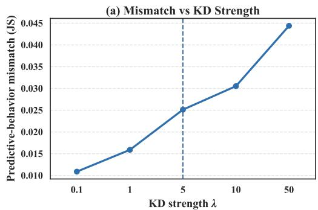

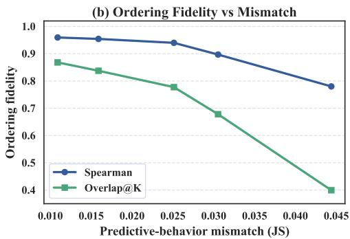  
Figure 7: Trajectory mismatch and ordering fidelity under different KD strengths on Magicoder with LLaMA3.2-3B. The dashed line marks the default setting $\lambda = 5$ used in the main experiments. Increasing λ enlarges the predictive-behavior mismatch between the unconstrained navigator and the constrained final model, while the navigator preserves high ordering fidelity in the practical regime.

Therefore, Eq. (78) further implies subset-level consistency. When the discrepancy terms are controlled at both the surrogate maximizer wˆ and the discrete optimum indicator $w ^ { * }$ , the subset induced by the surrogate maximizer remains within an explicit gap of 2Γ¯ from the optimum of the original discrete objective. This extends the previous discrepancy analysis from objective-value approximation to optimizer-level consistency, indicating that Eq. (7) remains connected to the original utility–diversity objective beyond pointwise objective values. Appendix D.6 further examines this subset-level consistency empirically by comparing the subsets selected by NADS, Fast Greedy, and Lazy-Fast Greedy under the original discrete objective $F _ { \mathrm { d i s c } }$

## D Validation Experiments for Theoretical Analysis

## D.1 Trajectory Mismatch and Ordering Fidelity

Appendix B.3 gives a local perturbation view of navigator-side forgetting-risk ordering. The navigator follows the unconstrained adaptation trajectory, whereas the final model is trained with KD regularization on the selected constraint set. Thus, the two trajectories need not coincide. This does not conflict with the role of the navigator in NADS, since the navigator is used to rank candidate samples by forgetting-aware utility rather than to reproduce the exact final training trajectory. We therefore examine whether the navigator preserves the ordering of forgetting-sensitive candidates when the final constrained trajectory deviates from the unconstrained one.

We conduct this analysis on Magicoder with LLaMA3.2-3B. We fix the navigator and the synthetic candidate pool, and vary the KD strength over $\lambda \in \{ 0 . 1 , 1 , 5 , 1 0 , 5 0 \}$ when training the final model. For each $\lambda ,$ we quantify trajectory mismatch by measuring the symmetric divergence between the predictive behaviors of the navigator and the final model on a fixed diagnostic subset $\mathcal { C } _ { \mathrm { d i a g } }$ as

$$
\mathrm { M i s m a t c h } = \frac { 1 } { | \mathcal { C } _ { \mathrm { d i a g } } | } \sum _ { \boldsymbol { x } _ { i } \in \mathcal { C } _ { \mathrm { d i a g } } } \frac { 1 } { | \boldsymbol { x } _ { i } | } \sum _ { t = 1 } ^ { | \boldsymbol { x } _ { i } | } D _ { \mathrm { J S } } \left( P _ { \mathrm { n a v } } ( \cdot \mid \boldsymbol { x } _ { i , < t } ) \| P _ { \mathrm { f i n a l } } ( \cdot \mid \boldsymbol { x } _ { i , < t } ) \right) .\tag{79}
$$

This metric captures how far the constrained final model moves away from the navigator’s unconstrained adaptation behavior at the prediction level. We then evaluate whether this deviation changes the utility-induced ordering of candidate samples by comparing the navigator-based scores with final-trajectory reference scores using Spearman correlation and Overlap@ $\mathbf { \bar { \boldsymbol { K } } }$ , where K follows the same constraint-set budget as in the main experiments.

As shown in Fig. 7, larger λ increases the predictive-behavior mismatch between the navigator and the final model. This is consistent with the KD objective, where stronger distillation pulls the final model closer to the pretrained distribution on selected constraints. Importantly, ordering fidelity remains high near the default NADS setting. $\mathrm { A t } \lambda = 5$ , Spearman is 0.94 and Overlap@ $\check { K }$ is $0 . 7 8 ,$ , showing that the navigator still provides a reliable ranking signal for forgetting-aware constraint selection. Under the stress setting $\lambda = 5 0$ , the mismatch grows substantially and both ordering metrics decline, indicating that overly strong preservation constraints can disrupt ranking agreement. These results support the intended use of the navigator as a ranking proxy: exact trajectory matching is unnecessary as long as the ordering of forgetting-sensitive candidates is preserved within the practical mismatch range induced by the KD objective.

## D.2 Utility Ranking Stability Across Navigator Checkpoints

The ordering analysis in Appendix B.3 provides a local and conditional view of when navigatorinduced utility rankings can be preserved under small changes of the navigator state. We further verify this local view experimentally by examining whether the NADS utility ranking remains stable across nearby navigator checkpoints. To this end, we recompute the utility scores on the same candidate pool using navigator checkpoints from different stages of the unconstrained adaptation trajectory.

We use the three navigator checkpoints $M _ { \mathrm { n a v } } - 1 , M _ { \mathrm { n a v } } - 2$ , and $M _ { \mathrm { n a v } } - 3$ considered in Fig. 3(c). For each checkpoint $s \in \{ 1 , 2 , 3 \}$ , we compute the NADS utility score $u _ { i } ^ { ( s ) }$ for every candidate sample $x _ { i } ,$ and obtain the corresponding score-induced ranking. We then measure the ranking agreement between two checkpoints using Spearman correlation and top-K overlap, defined as

$$
\mathrm { O v e r l a p } ( a , b ) = \frac { \left| \mathrm { T o p K } \big ( u ^ { ( a ) } \big ) \cap \mathrm { T o p K } \big ( u ^ { ( b ) } \big ) \right| } { K } .
$$

Spearman correlation evaluates global ranking consistency over the candidate pool, while top-K overlap focuses on whether the high-utility candidates used for constraint construction remain stable.

Table 6: Utility ranking stability across navigator checkpoints.
<table><tr><td>Checkpoint pair</td><td>Spearman</td><td>Top-K overlap</td></tr><tr><td> $M _ { \mathrm { n a v } } - 1 \mathrm { v s . } \ M _ { \mathrm { n a v } } - 2$ </td><td>0.67</td><td>0.56</td></tr><tr><td> $M _ { \mathrm { n a v } } - 2 \mathrm { v s . } M _ { \mathrm { n a v } } - 3$ </td><td>0.72</td><td>0.61</td></tr><tr><td> $M _ { \mathrm { n a v } } - 1 \mathrm { v s . } \ M _ { \mathrm { n a v } } - 3$ </td><td>0.47</td><td>0.39</td></tr></table>

As shown in Table 6, adjacent navigator checkpoints show stronger ranking agreement than the distant pair, suggesting that the utility ranking is locally consistent along the unconstrained adaptation trajectory but changes across substantially different navigator stages. This agrees with the checkpoint sensitivity in Fig. 3(c): an early navigator may stay too close to the pretrained model and provide a weak drift signal, whereas an overly late navigator may reflect excessive task-induced drift. Overall, this diagnostic supports the local ordering view in Appendix B.3 and explains the navigator-stage sensitivity in Fig. 3(c) at the ranking level.

Table 7: Utility-range analysis under the same final KD objective on Magicoder with LLaMA3.2-3B.
<table><tr><td>Constraint source</td><td>General Avg.</td><td>Target</td><td>Overall</td></tr><tr><td>Low-utility</td><td>37.82</td><td>41.78</td><td>39.80</td></tr><tr><td>Middle-utility</td><td>39.38</td><td>42.52</td><td>40.95</td></tr><tr><td>High-utility</td><td>41.78</td><td>43.81</td><td>42.80</td></tr><tr><td>Full NADS</td><td>42.52</td><td>44.39</td><td>43.46</td></tr></table>

## D.3 Utility Ranking and Constraint Effectiveness

Appendix B.4 establishes a local connection between the KL-based utility and the KD discrepancy in final training. Motivated by the utility–degradation correlation in Fig. 2, we examine whether the utility ranking translates into effective preservation constraints. We split the candidate pool into high-, middle-, and low-utility ranges by the NADS score. From each range, we select a diverse constraint set with the same budget K, then train the final model with the same $D _ { \mathrm { n e w } }$ , KD objective, distillation weight, and training recipe. Thus, variants differ only in the utility range used for $D _ { \mathrm { c o n s t r a i n t } }$

Specifically, the high-, middle-, and low-utility ranges contain the top, middle, and bottom 20% of candidates ranked by NADS utility, respectively. Within each range, we apply the same diversityaware subset construction procedure to select K constraint samples. We also include NADS, which performs utility–diversity selection over the full candidate pool, as the reference.

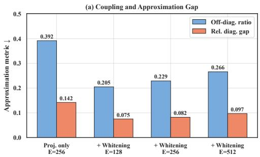

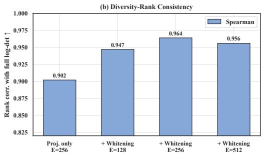  
Figure 8: Scalable selection surrogate consistency on Magicoder with LLaMA3.2. (a) reports the off-diagonal ratio and relative diagonal approximation gap. (b) reports Spearman rank correlation between the full log-det diversity term and its diagonal surrogate over same-size candidate subsets.

As shown in Table 7, high-utility constraint sets yield stronger general-capability retention than middle- and low-utility sets, while target performance remains stable. This shows that the utility score not only correlates with navigator-side degradation but also provides a useful ranking signal for preservation-constraint construction. Full NADS performs best, suggesting that hard truncation to one utility range is less effective than joint utility–diversity selection over the full candidate pool. These results further support navigator utility as a preservation-oriented signal for constraint construction.

## D.4 Consistency of the Scalable Selection Surrogate

Appendix C.3 analyzes the approximation gap introduced by replacing the full log-determinant diversity term with its diagonal surrogate. We further examine this approximation experimentally in the selection stage. The diversity term in NADS is based on a log-determinant objective, but repeatedly evaluating the full log-det term over high-dimensional features is computationally expensive. To make selection scalable, we use projected and whitened features and replace the full log-det diversity term with a diagonal surrogate. This surrogate is efficient, but it should preserve the behavior of the full diversity objective used for subset selection. We therefore examine the consistency between the diagonal surrogate and the full log-det diversity term.

Let $\tilde { z } _ { i } ~ \in { \mathbb { R } ^ { E } }$ be the projected feature of sample $x _ { i }$ . For a candidate subset S, define $A ( S ) =$ $\textstyle \sum _ { i \in S } { \tilde { z } } _ { i } { \tilde { z } } _ { i } ^ { \top }$ . The full and diagonal log-det diversity terms are $D _ { \mathrm { f u l l } } ( S ) = \log \operatorname* { d e t } \left( I + A ( S ) \right)$ and $\begin{array} { r } { D _ { \mathrm { d i a g } } ( S ) = \sum _ { e = 1 } ^ { E } } \end{array}$ log $( 1 + A _ { e e } ( S ) )$ ), respectively. Since the diagonal surrogate ignores the off-diagonal structure of $A ( S )$ , we measure the relative strength of the ignored component. Let $\pmb { R } ( S ) \bar { = } A ( S ) - \mathrm { d i a g } ( A ( S ) )$ ). We report the off-diagonal ratio

$$
\operatorname { O f f D i a g R a t i o } ( S ) = \frac { \| R ( S ) \| _ { F } } { \| A ( S ) \| _ { F } + \epsilon } ,\tag{80}
$$

and the relative diagonal approximation gap

$$
\mathrm { R e l G a p } _ { \mathrm { d i a g } } ( S ) = \frac { | D _ { \mathrm { f u l l } } ( S ) - D _ { \mathrm { d i a g } } ( S ) | } { | D _ { \mathrm { f u l l } } ( S ) | + \epsilon } .\tag{81}
$$

Both metrics are lower when the diagonal surrogate is a tighter approximation. We further evaluate whether the surrogate preserves the ranking behavior of the full diversity objective by computing the Spearman correlation between $D _ { \mathrm { f u l l } }$ and $D _ { \mathrm { d i a g } }$ over candidate subsets of the same size.

As shown in Fig. 8, projection-only features exhibit the largest off-diagonal ratio and relative diagonal gap, indicating that the diagonal surrogate is less consistent with the full log-det diversity term when feature correlations are not reduced. After whitening, both metrics decrease substantially. For the default setting $E = 2 5 6$ , the off-diagonal ratio decreases from 0.392 to 0.229, and the relative diagonal gap decreases from 0.142 to 0.082. This supports the role of whitening in reducing the off-diagonal structure ignored by the diagonal approximation.

The rank-consistency results further show that the diagonal surrogate preserves the subset-ranking behavior of the full diversity term. Projection-only features achieve a Spearman correlation of 0.902, while whitening improves the correlation across all projected dimensions. Although $E = 1 2 8$ yields the smallest approximation gap, its rank consistency is lower than that of $E \stackrel { = } { = } 2 5 6$ , suggesting stronger projection-induced information loss. The default setting $E = 2 5 6$ achieves the highest rank correlation of 0.964 while keeping the approximation gap low. Increasing the dimension to $E = 5 1 2$ slightly increases the off-diagonal ratio and approximation gap, with no further gain in rank consistency. These results provide experimental support for the diagonal approximation analysis in Appendix C.3. They show that whitening reduces the off-diagonal structure ignored by the diagonal surrogate, and that the default setting $\breve { E } = 2 5 6$ largely preserves the ranking behavior of the full log-determinant diversity term while keeping the approximation gap low.

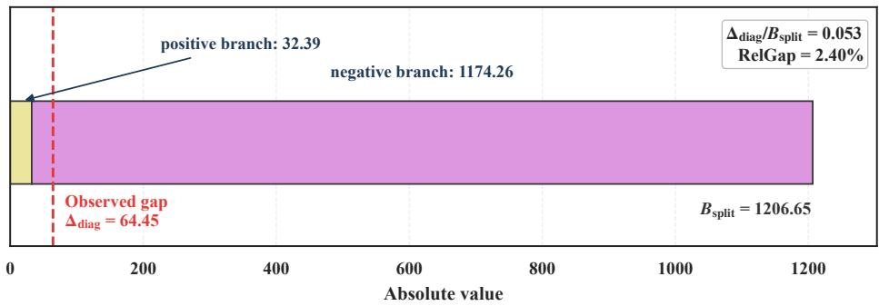  
Figure 9: Split-spectrum certificate for the diagonal log-determinant bound on the final selected constraint set. The stacked bar gives $B _ { \mathrm { s p l i t } } = \bar { B _ { + } } + B _ { - } \stackrel { \cdot } { = } 1 2 0 6 . 6 5$ . The dashed red line marks the observed gap $\Delta _ { \mathrm { d i a g } } = 6 4 . 4 5$ . The certificate ratio is $\Delta _ { \mathrm { d i a g } } / B _ { \mathrm { s p l i t } } = 0 . 0 5 3$ , and the observed relative approximation gap is 2.40%.

## D.5 Validation of the Diagonal Log-Determinant Bound

Appendix C.3 derives a split-spectrum upper bound for the diagonal log-determinant approximation gap. We evaluate both sides of this bound on the final constraint set selected by NADS under the default setting. Let $\Delta _ { \mathrm { d i a g } } = D _ { \mathrm { d i a g } } - D _ { \mathrm { f u l l } }$ denote the observed Hadamard gap. Following Appendix C.3, the corresponding upper bound is

$$
B _ { \mathrm { s p l i t } } = \underbrace { \frac { 1 } { 2 } \sum _ { \lambda _ { j } \geq 0 } \lambda _ { j } ^ { 2 } } _ { B _ { + } } + \underbrace { \frac { 1 } { 2 } \sum _ { \lambda _ { j } < 0 } \frac { \lambda _ { j } ^ { 2 } } { ( 1 + \lambda _ { j } ) ^ { 2 } } } _ { B _ { - } } ,\tag{82}
$$

where $\lambda _ { j }$ are the eigenvalues of the normalized off-diagonal coupling matrix C. Fig. 9 evaluates the C.3 bound in the actual selection setting. The observed gap $\Delta _ { \mathrm { d i a g } } ~ = ~ 6 4 . 4 5$ lies below the split-spectrum certificate $B _ { \mathrm { s p l i t } } = 1 2 0 6 . 6 5$ , with $\Delta _ { \mathrm { d i a g } } / B _ { \mathrm { s p l i t } } = 0 . 0 5 3$ . This shows that the diagonal approximation gap on the final selected constraint set satisfies the theoretical upper bound. Meanwhile, the relative gap between the diagonal surrogate and the full log-determinant term is only 2.40%, indicating that the scalable surrogate remains close to the full diversity term on the selected support.

The decomposition into $B _ { + }$ and $B _ { - }$ also follows the structure of Appendix C.3. The bound separates standard positive-spectrum contributions from the negative-spectrum branch that controls the worst case log-determinant behavior. Thus, the certificate supports the split-spectrum bound on the actual selected support while keeping the interpretation appropriately conservative.

## D.6 Consistency Analysis of the Optimization Objective

To further support the scalable selection strategy introduced in Sec. 3.4, we examine whether the subsets selected by NADS remain consistent with the original utility–diversity objective. We compare NADS with two greedy baselines, Fast Greedy [31] and Lazy-Fast Greedy [32], by evaluating all selected subsets under the original discrete objective $F _ { \mathrm { d i s c } }$ in Eq. (4).

We sample a candidate pool of size 30,000 from the synthetic dataset and select 1000 samples in each trial. We repeat this procedure over 100 independent random trials. For each comparison, let $S _ { \mathrm { N A D S } } ^ { ( t ) }$ and $S _ { \mathrm { G r e e d y } } ^ { ( t ) }$ denote the subsets returned by NADS and the corresponding greedy baseline in the t-th trial, respectively. Here, $S _ { \mathrm { G r e e d y } } ^ { ( t ) }$ refers to the subset selected by either Fast Greedy or Lazy-Fast

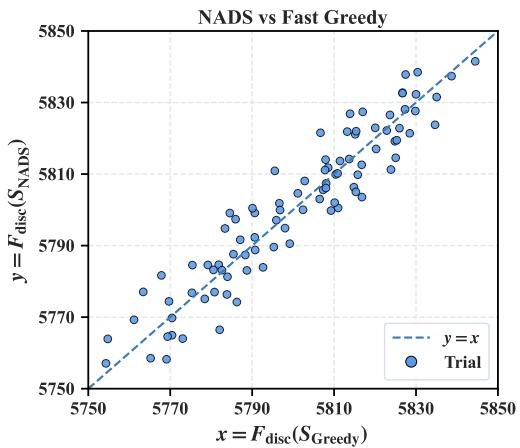

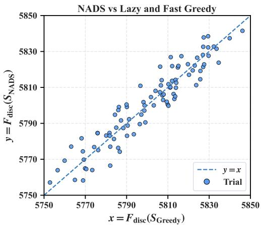  
Figure 10: Approximation consistency under the original discrete objective. Each point corresponds to one random trial under one greedy comparison. The x-axis denotes the objective value of the subset selected by Fast Greedy or Lazy-Fast Greedy, and the y-axis denotes that of NADS. Points near the diagonal indicate that the scalable NADS procedure remains close to greedy optimization when all subsets are evaluated under the original utility–diversity objective.

Greedy in the corresponding comparison. We evaluate both subsets using the original discrete objective $F _ { \mathrm { d i s c } } ( \cdot )$ in Eq. (4) and plot the paired values $x _ { t } = F _ { \mathrm { d i s c } } ( S _ { \mathrm { G r e e d y } } ^ { ( t ) } )$ and $y _ { t } = F _ { \mathrm { d i s c } } ( S _ { \mathrm { N A D S } } ^ { ( t ) } )$ , so that each point $( x _ { t } , y _ { t } )$ in Fig. 10 corresponds to one random trial under one greedy comparison. The dashed line denotes $y = x$ . Points above this line indicate that NADS achieves a higher objective value than the corresponding greedy baseline under the original discrete objective.

To quantify the signed deviation from the greedy solution, we define

$$
\Delta _ { \mathrm { r e l } } ^ { ( t ) } = \frac { F _ { \mathrm { d i s c } } ( S _ { \mathrm { N A D S } } ^ { ( t ) } ) - F _ { \mathrm { d i s c } } ( S _ { \mathrm { G r e e d y } } ^ { ( t ) } ) } { F _ { \mathrm { d i s c } } ( S _ { \mathrm { G r e e d y } } ^ { ( t ) } ) } .\tag{83}
$$

Points on the diagonal satisfy $x _ { t } = y _ { t }$ and therefore correspond to zero objective gap. As shown in Fig. 10, most points remain close to the diagonal across random trials and greedy comparisons. This indicates that the subsets selected by the scalable NADS procedure achieve objective values close to those of the greedy baselines when evaluated under the original discrete objective. The result suggests that the proposed approximation does not substantially deviate from the behavior of the original utility–diversity objective while enabling scalable selection.

## E Experimental Details

In this section, we provide detailed descriptions of the experimental setup for reproducibility. Section E.1 introduces the implementation and configurations of the baselines. Sections E.2 and E.3 describe the benchmarks and evaluation details used in our experiments. Section E.4 further present the implementation details, including hyperparameter settings and training configurations. Section E.5 describes the navigator training and validation setting for checkpoint selection.

## E.1 Baseline Details

We compare NADS against SOTA methods spanning PEFT, replay-based constraint selection methods, and target-data selection methods.

• Standard Fine-Tuning (Standard FT): This baseline updates all model parameters using the standard cross-entropy loss. It typically suffers from severe catastrophic forgetting and thus serves as a lower-bound reference for general capability preservation.

• LoRA [90]: This baseline injects trainable low-rank decomposition matrices into the Transformer layers while freezing the backbone parameters. Restricting the number of trainable parameters can itself effectively mitigate forgetting [18].

Table 8: Summary of training datasets used in our experiments.
<table><tr><td>Datasets</td><td>Aspect</td><td>Nums</td></tr><tr><td>Magicoder [80]</td><td>Code Generation</td><td>111K</td></tr><tr><td>MetaMathQA [81]</td><td>Math Reasoning</td><td>395K</td></tr><tr><td>Magpie-Qwen2.5-Pro-300K-Filtered [82]</td><td>1</td><td>300K</td></tr></table>

• InsCL [91]: InsCL is a replay-based method that selects replay data using instruction similarity measured by Wasserstein distance, and uses the instruction information metric InsInfo to characterize instruction complexity and diversity. By jointly training on target-task data and selected replay samples, InsCL mitigates catastrophic forgetting while preserving target-task adaptation.

• LER [92]: LER is a replay-based method that uses Leitner queuing, a human-inspired spaced repetition strategy, to select which historical samples should be replayed at each stage of learning. By prioritizing informative samples and adaptively scheduling their replay according to learning status, LER mitigates catastrophic forgetting while preserving adaptation to new data.

• Mix-cd [52]: Mix-cd is a replay-based method that selects and replays collateral damage samples, which are correctly predicted by the previous model but forgotten after incremental fine-tuning. By incorporating these selected samples into new-task training, Mix-cd mitigates catastrophic forgetting while improving the retention of previously acquired capabilities.

• LESS [59]: LESS is a selection method. It estimates the influence of training samples in an optimizer-aware manner and selects data by low-rank gradient similarity search with respect to a small set of target examples. By training on the selected subset, LESS improves adaptation to the target capability while substantially reducing the amount of training data required.

• FisherSFT [93]: FisherSFT is a selection-based method that selects training examples by maximizing information gain under the SFT objective, quantified via the Fisher information matrix. To make this objective practical for large language models, it adopts a last-layer linearization approximation, which enables efficient subset selection. Fine-tuning on the resulting subset improves adaptation efficiency while reducing the amount of training data required.

• SPICE [94]: SPICE is a selection-based method using a conflict-aware selector to balance sample informativeness and gradient alignment, while improving efficiency with early stopping and proxy models. Fine-tuning on the selected subset improves target performance at lower selection cost.

## E.2 Training Data Details

In our experiments, we consider two target training datasets: code generation and mathematical reasoning. For code generation, we use Magicoder [80], a decontaminated code dataset. For mathematical reasoning, we use MetaMathQA [81], a large-scale mathematical question-answering dataset constructed by augmenting questions from the training sets of GSM8K and MATH. In addition, we adopt Magpie-Qwen2.5-Pro-300K-Filtered [82] as a large-scale synthetic dataset, generated with the Magpie pipeline using Qwen2.5-72B-Instruct. Detailed dataset statistics are summarized in Table 8.

## E.3 Evaluation Details

We evaluate model performance from two perspectives: general capability retention and target-task performance. Following recent studies [9–11, 83, 84], we decouple them to assess task adaptation and preservation of pre-existing abilities, with benchmark roles adjusted across fine-tuning scenarios. For models fine-tuned on Magicoder [80], HumanEval [85] is the target-task benchmark for code generation, while HellaSwag [87], OpenBookQA [89], MMLU [86], and GSM8K [88] evaluate general capability retention. For models fine-tuned on MetaMathQA [81], GSM8K is the target-task benchmark for mathematical reasoning, while HellaSwag, OpenBookQA, MMLU, and HumanEval evaluate general capability retention. Here, HumanEval serves as an out-of-domain benchmark for retained code generation ability after math fine-tuning. Table 9 summarizes the settings. All benchmarks are evaluated with lm-evaluation-harness [102] using standard prompting setups. General Capability Avg. is the arithmetic mean over the four general-capability benchmarks, and Overall Avg. is the arithmetic mean of General Capability Avg. and target-task performance.

Table 9: Evaluation benchmarks and detailed settings.
<table><tr><td>Datasets</td><td>Aspects</td><td>Metrics</td><td>Nums</td><td>Evaluate</td></tr><tr><td>HellaSwag [87]</td><td>Commonsense Reasoning</td><td>Accuracy</td><td>10,042</td><td>0-shot</td></tr><tr><td>OpenBookQA [89]</td><td>Commonsense Reasoning</td><td>Accuracy</td><td>500</td><td>0-shot</td></tr><tr><td>MMLU [86]</td><td>Multi Task Understanding</td><td>Accuracy</td><td>14,042</td><td>5-shot</td></tr><tr><td>GSM8K [88]</td><td>Math Reasoning</td><td>Exact Match</td><td>1,319</td><td>5-shot</td></tr><tr><td>HumanEval [85]</td><td>Code Generation</td><td>PASS@1</td><td>164</td><td>0-shot</td></tr></table>

• HellaSwag: HellaSwag [87] is a challenge dataset for commonsense natural language inference. Given an event description or partial context, the model is required to choose the most plausible continuation from several candidate endings. The dataset is constructed via Adversarial Filtering, where a series of discriminators iteratively select adversarial machine-generated negative options, making the benchmark easy for humans but substantially more difficult for SOTA models. Models are typically evaluated using the Accuracy metrics.

• OpenBookQA: Open Book Question Answering [89] is a question-answering dataset inspired by open-book exams for evaluating a model’s understanding of a subject. It consists of elementaryschool-level multiple-choice science questions and assesses both the understanding of a core set of science facts and the ability to apply this knowledge to new situations. Models are typically evaluated using the Accuracy metric.

• MMLU: Massive Multitask Language Understanding [86] is a benchmark for evaluating the broad knowledge and reasoning abilities of models across multiple domains. It covers 57 subjects spanning STEM, humanities, social sciences, and professional knowledge. The dataset consists of multiple-choice questions, each with four or five answer options. For each subject, the model is required to select the correct answer based on its knowledge and reasoning. Models are typically evaluated using the Accuracy metric.

• GSM8K: Grade School Math 8K [88] is a benchmark dataset for evaluating the mathematical reasoning ability of models. It consists of grade-school-level math word problems, each accompanied by a step-by-step solution. Given a natural language problem, the model is required to generate a solution containing the correct numerical answer. The questions range from simple arithmetic to more complex multi-step reasoning. Models are typically evaluated using the EM metric.

• HumanEval: HumanEval [85] is a benchmark dataset proposed to evaluate the functional correctness of code generation models. It consists of 164 Python programming problems and is commonly evaluated using the PASS@1 metric. Given a problem description and a function signature, the model is required to generate Python code that implements the specified function. A generated solution is considered correct if it passes all provided unit tests.

We report three evaluation metrics in our experiments, which are defined as follows.

• Accuracy (ACC): Accuracy measures the proportion of correct predictions among all evaluation examples. Compared with Exact Match, it is less strict, as it allows multiple acceptable answers for a single example. Formally, it is defined as

$$
\mathsf { A C C } = \frac { 1 } { N } \sum _ { i = 1 } ^ { N } \mathbb { I } ( \hat { y } _ { i } \in Y _ { i } ) ,\tag{84}
$$

where N denotes the total number of evaluation examples, $\hat { y } _ { i }$ is the model prediction for the i-th example, and $Y _ { i }$ denotes the set of acceptable ground-truth answers for that example.

• Exact Match (EM): Exact Match measures whether the predicted answer exactly matches the reference answer after normalization. Compared with Accuracy, it is stricter because it requires an exact match between the predicted output and the gold answer string. Formally, it is defined as

$$
\mathrm { E M } = \frac { 1 } { N } \sum _ { i = 1 } ^ { N } \mathbb { I } ( \hat { y } _ { i } = y _ { i } ) ,\tag{85}
$$

where $\hat { y } _ { i }$ and $y _ { i }$ denote the predicted and reference answers for the i-th example, respectively.

Table 10: Performance comparison with methods selecting $\mathcal { D } _ { \mathrm { c o n s t r a i n t } }$ for replay on MetaMathQA (%). The best results are highlighted in red, and the second-best results are highlighted in blue.
<table><tr><td rowspan="2">Model</td><td rowspan="2">Method</td><td colspan="5">General Capability ↑</td><td>Target ↑</td><td>Overall ↑</td></tr><tr><td>HASW</td><td>OBQA</td><td>MMLU</td><td>HE</td><td>Avg.</td><td>GSM8K</td><td>Avg.</td></tr><tr><td rowspan="9">I--3B</td><td>Pre-trained</td><td> $5 5 . 8 3 _ { \pm 0 . 0 0 }$ </td><td> $3 1 . 2 0 { \scriptstyle \pm 0 . 0 0 }$ </td><td> $5 6 . 9 2 _ { \pm 0 . 0 0 }$ </td><td> $2 8 . 1 6 { \scriptstyle \pm 0 . 0 0 }$ </td><td> $4 3 . 0 3 _ { \pm 0 . 0 0 }$ </td><td> $2 7 . 9 0 { \scriptstyle \pm 0 . 0 0 }$ </td><td> $3 5 . 4 7 _ { \pm 0 . 0 0 }$ </td></tr><tr><td>Standard FT</td><td> $5 0 . 0 2 { \scriptstyle \pm 0 . 5 0 }$ </td><td> $2 8 . 4 0 { \scriptstyle \pm 0 . 5 3 }$ </td><td> $4 8 . 4 9 _ { \pm 0 . 4 1 }$ </td><td> $1 5 . 2 7 { \scriptstyle \pm 0 . 4 9 }$ </td><td> $3 5 . 5 5 { \scriptstyle \pm 0 . 2 4 }$ </td><td> $6 5 . 9 3 _ { \pm 0 . 8 1 }$ </td><td> $5 0 . 7 4 _ { \pm 0 . 4 2 }$ </td></tr><tr><td>LoRA</td><td> $5 2 . 0 6 _ { \pm 0 . 5 0 }$ </td><td> $2 8 . 6 0 { \scriptstyle \pm 0 . 5 3 }$ </td><td> $5 2 . 3 4 _ { \pm 0 . 4 0 }$ </td><td> $2 5 . 3 1 _ { \pm 0 . 5 2 }$ </td><td> $3 9 . 5 8 { \scriptstyle \pm 0 . 2 5 }$ </td><td> $6 1 . 0 3 { \scriptstyle \pm 0 . 8 3 }$ </td><td> $5 0 . 3 1 { \scriptstyle \pm 0 . 4 3 }$ </td></tr><tr><td>Random</td><td> $5 0 . 3 8 { \scriptstyle \pm 0 . 5 0 }$ </td><td> $2 8 . 4 7 { \scriptstyle \pm 0 . 5 8 }$ </td><td> $4 9 . 5 4 _ { \pm 0 . 4 0 }$ </td><td> $1 7 . 3 5 _ { \pm 0 . 4 6 }$ </td><td> $3 6 . 4 4 _ { \pm 0 . 2 4 }$ </td><td> $6 2 . 7 0 { \scriptstyle \pm 0 . 7 9 }$ </td><td> $4 9 . 5 7 _ { \pm 0 . 4 1 }$ </td></tr><tr><td>InsCL</td><td> $5 2 . 8 5 _ { \pm 0 . 5 0 }$ </td><td> $2 8 . 9 3 { \scriptstyle \pm 0 . 5 8 }$ </td><td> $5 5 . 1 7 { \scriptstyle \pm 0 . 4 0 }$ </td><td> $2 6 . 3 4 _ { \pm 0 . 2 1 }$ </td><td> $4 0 . 8 2 _ { \pm 0 . 2 2 }$ </td><td> $6 2 . 7 7 _ { \pm 0 . 8 7 }$ </td><td> $5 1 . 8 0 { \scriptstyle \pm 0 . 4 5 }$ </td></tr><tr><td>LER</td><td> $5 2 . 4 7 { \scriptstyle \pm 0 . 5 0 }$ </td><td> $3 0 . 1 3 { \scriptstyle \pm 0 . 5 8 }$ </td><td> $5 4 . 7 5 { \scriptstyle \pm 0 . 4 1 }$ </td><td> $2 7 . 7 8 { \scriptstyle \pm 0 . 3 3 }$ </td><td> $4 1 . 2 8 { \scriptstyle \pm 0 . 2 3 }$ </td><td> $6 3 . 0 3 { \scriptstyle \pm 0 . 8 2 }$ </td><td> $5 2 . 1 6 { \scriptstyle \pm 0 . 4 3 }$ </td></tr><tr><td>Mix-cd</td><td> $5 3 . 3 5 { \scriptstyle \pm 0 . 4 9 }$ </td><td> $3 0 . 2 0 { \scriptstyle \pm 0 . 5 3 }$ </td><td> $5 5 . 4 9 _ { \pm 0 . 4 0 }$ </td><td> $2 6 . 2 3 _ { \pm 0 . 2 1 }$ </td><td> $4 1 . 3 2 _ { \pm 0 . 2 1 }$ </td><td> $6 2 . 1 4 _ { \pm 0 . 8 6 }$ </td><td> $5 1 . 7 3 _ { \pm 0 . 4 4 }$ </td></tr><tr><td>_  $\mathrm { N A D S } \left( \mathrm { O u r s } \right)$ </td><td> $5 4 . 8 6 { \scriptstyle \pm 0 . 5 0 }$ </td><td> $3 0 . 8 0 { \scriptstyle \pm 0 . 6 0 }$ </td><td> $5 6 . 2 3 { \scriptstyle \pm 0 . 4 1 }$ </td><td> $2 8 . 2 1 \pm 0 . 4 2$ </td><td> $4 2 . 5 3 { \scriptstyle \pm 0 . 2 4 }$ </td><td> $6 5 . 1 8 { \scriptstyle \pm 0 . 8 3 }$ </td><td> $5 3 . 8 6 { \scriptstyle \pm 0 . 4 3 }$ </td></tr><tr><td>Pre-trained</td><td></td><td></td><td> $6 0 . 2 4 { \scriptstyle \pm 0 . 0 0 }$ </td><td></td><td></td><td></td><td>1</td></tr><tr><td rowspan="7">Gemm-4B</td><td></td><td> $5 7 . 4 1 _ { \pm 0 . 0 0 }$ </td><td> $3 4 . 6 0 { \scriptstyle \pm 0 . 0 0 }$ </td><td></td><td> $3 5 . 7 7 { \scriptstyle \pm 0 . 0 0 }$ </td><td> $4 7 . 0 1 _ { \pm 0 . 0 0 }$ </td><td> $3 6 . 6 9 _ { \pm 0 . 0 0 }$ </td><td> $4 1 . 8 5 _ { \pm 0 . 0 0 }$ </td></tr><tr><td>Standard FT LoRA</td><td> $5 1 . 4 2 _ { \pm 0 . 5 0 }$   $5 4 . 3 4 { \scriptstyle \pm 0 . 4 9 }$ </td><td> $3 0 . 2 0 { \scriptstyle \pm 0 . 5 3 }$ </td><td> $5 3 . 0 1 _ { \pm 0 . 4 0 }$ </td><td> $2 9 . 6 2 _ { \pm 0 . 4 3 }$ </td><td> $4 1 . 0 6 _ { \pm 0 . 2 4 }$ </td><td> $6 7 . 8 3 { \scriptstyle \pm 0 . 7 9 }$ </td><td> $5 4 . 4 5 _ { \pm 0 . 4 1 }$ </td></tr><tr><td>Random</td><td></td><td> $3 2 . 1 3 _ { \pm 0 . 6 4 }$ </td><td> $5 5 . 8 4 _ { \pm 0 . 3 9 }$ </td><td> $3 0 . 3 6 { \scriptstyle \pm 0 . 7 4 }$ </td><td> $4 3 . 1 7 _ { \pm 0 . 2 9 }$ </td><td> $6 3 . 0 3 _ { \pm 0 . 7 8 }$ </td><td> $5 3 . 1 0 { \scriptstyle \pm 0 . 4 2 }$ </td></tr><tr><td>InsCL</td><td> $5 1 . 1 2 _ { \pm 0 . 4 9 }$   $5 4 . 7 9 _ { \pm 0 . 5 0 }$ </td><td> $3 0 . 3 3 { \scriptstyle \pm 0 . 6 4 }$   $3 2 . 2 0 { \scriptstyle \pm 0 . 6 0 }$ </td><td> $5 3 . 5 6 _ { \pm 0 . 3 9 }$   $5 8 . 4 7 { \scriptstyle \pm 0 . 4 0 }$ </td><td> $2 9 . 5 8 _ { \pm 0 . 8 6 }$ </td><td> $4 1 . 1 5 _ { \pm 0 . 3 1 }$ </td><td> $6 3 . 9 1 _ { \pm 0 . 7 2 }$ </td><td> $5 2 . 5 3 { \scriptstyle \pm 0 . 3 9 }$ </td></tr><tr><td>LER</td><td> $5 5 . 1 8 _ { \pm 0 . 5 0 }$ </td><td> $3 2 . 8 7 _ { \pm 0 . 6 4 }$ </td><td> $5 8 . 2 3 _ { \pm 0 . 4 0 }$ </td><td> $3 1 . 6 3 { \scriptstyle \pm 0 . 9 0 }$   $3 2 . 5 4 { \scriptstyle \pm 0 . 7 5 }$ </td><td> $4 4 . 2 7 _ { \pm 0 . 3 2 }$   $4 4 . 7 1 { \scriptstyle \pm 0 . 3 0 }$ </td><td> $6 5 . 5 0 { \scriptstyle \pm 0 . 8 6 }$ </td><td> $5 4 . 8 9 _ { \pm 0 . 4 6 }$ </td></tr><tr><td> $\mathbf { M i x - c d }$ </td><td> $5 5 . 1 4 _ { \pm 0 . 5 0 }$ </td><td> $3 3 . 1 3 _ { \pm 0 . 6 4 }$ </td><td> $5 7 . 9 8 _ { \pm 0 . 3 9 }$ </td><td> $3 2 . 1 4 _ { \pm 0 . 8 9 }$ </td><td> $4 4 . 6 0 _ { \pm 0 . 3 2 }$ </td><td> $6 5 . 0 5 _ { \pm 0 . 8 4 }$   $6 4 . 7 2 _ { \pm 0 . 8 6 }$ </td><td> $5 4 . 8 8 _ { \pm 0 . 4 5 }$   $5 4 . 6 6 { \scriptstyle \pm 0 . 4 6 }$ </td></tr><tr><td>_  $\mathrm { N A D S } \left( \mathrm { O u r s } \right)$ </td><td> $5 5 . 4 6 { \scriptstyle \pm 0 . 5 0 }$ </td><td> $3 3 . 4 7 \pm 0 . 6 1$ </td><td> $5 9 . 3 1 { \scriptstyle \pm 0 . 4 0 }$ </td><td> $3 4 . 7 5 { \scriptstyle \pm 0 . 8 9 }$ </td><td> $4 5 . 7 5 { \scriptstyle \pm 0 . 3 1 }$ </td><td> $6 6 . 5 2 { \scriptstyle \pm 0 . 7 7 }$ </td><td> $5 6 . 1 4 { \scriptstyle \pm 0 . 4 2 }$ </td></tr></table>

• PASS@k: PASS@k is a standard metric for code generation. For each problem, the model generates k candidate solutions, and the metric estimates the probability that at least one solution passes all associated unit tests. Formally, it is defined as

$$
{ \mathrm { P A S S @ } } k = { \left\{ \begin{array} { l l } { 1 - { \frac { { \binom { n - c } { k } } } { \binom { n } { k } } } , } & { { \mathrm { i f } } n - c \geq k , } \\ { 1 , } & { { \mathrm { i f } } n - c < k , } \end{array} \right. }\tag{86}
$$

where n denotes the total number of generated solutions, c denotes the number of correct solutions among them, and k is the number of sampled solutions used for evaluation.

## E.4 Implementation Details

All methods are implemented under a unified fine-tuning setup and optimized with AdamW using a cosine learning-rate scheduler. For Magicoder, we use a global batch size of 64, maximum sequence length 4096, and 3 training epochs; for MetaMathQA, we use a global batch size of 128, maximum sequence length 1024, and 2 epochs. The warmup ratio is 0.03 in both settings. For each target dataset, we hold out 1,000 examples for validation and use the remaining target-training split for all methods. NADS uses the entire target-training split for target-task learning and selects $\mathcal { D } _ { \mathrm { c } }$ onstraint from the synthetic candidate pool C, with size fixed at 5% of C. Replay-based constraint selection methods, including Random selection, InsCL [91], LER [92], and Mix-cd [52], use the same targettraining split and replay size. Target-data selection methods, including LESS [59], FisherSFT [93], and SPICE [94], select 10% of the target-training split without using $\mathcal { D } _ { \mathrm { c o n s t r a i n t } } .$ We use official repositories for all baselines except LER and Mix-cd, whose code is unavailable. For NADS, we set the confidence gate $\gamma = 0 . 7 ,$ , regularization $\nu = 3 \times 1 0 ^ { - 3 }$ , diversity $\beta = 1 . 0 { \ : } .$ distillation $\lambda = 5 ,$ , IHT iterations $T = 5 0$ , and projection dimension $E = 2 5 6$ . We tune the learning rate for all methods in $[ 1 \times 1 0 ^ { - 5 } , 5 \times 1 0 ^ { - \frac { 1 } { 4 } } ]$ and report the best results. For NADS, the selected learning rates on Magicoder are $1 \times 1 0 ^ { - 4 } , \dot { 4 } \times 1 0 ^ { - \dot { 5 } }$ , and $7 \times 1 0 ^ { - 5 }$ for LLaMA3.2-3B, Gemma3-4B, and Qwen3.5-9B, respectively; on MetaMathQA, they are $5 \times 1 0 ^ { - 5 }$ and $2 \times 1 0 ^ { - 5 }$ for LLaMA3.2-3B and Gemma3-4B, respectively. All experiments are conducted on 4 NVIDIA A100 GPUs.

## E.5 Navigator Training and Validation Setting

For each target dataset, we construct the navigator by fine-tuning $M _ { \mathrm { p r e t r a i n } }$ on the target-task data without preservation regularization or constraint samples. The navigator follows the same target fine tuning recipe as the final adaptation stage, including the optimizer, scheduler, batch size, maximum sequence length, warmup ratio, and training epochs. For navigator early stopping, we hold out 1,000 examples from each of the two target datasets as the validation split and use the remaining

Table 11: Cross-paradigm comparison with methods selecting $\mathcal { D } _ { \mathrm { n e w } }$ on MetaMathQA (%).
<table><tr><td rowspan="2">Model</td><td rowspan="2">Method</td><td colspan="5">General Capability ↑</td><td>Target ↑</td><td>Overall ↑</td></tr><tr><td>HASW</td><td>OBQA</td><td>MMLU</td><td>HE</td><td> $\mathbf { A v } \mathbf { g } .$ </td><td>GSM8K</td><td> $\mathbf { A v } \mathbf { g } .$ </td></tr><tr><td rowspan="4">TLM3</td><td>LESS</td><td> $5 3 . 0 9 _ { \pm 0 . 4 9 }$ </td><td> $3 0 . 4 7 { \scriptstyle \pm 0 . 5 8 }$ </td><td> $5 3 . 6 2 _ { \pm 0 . 4 0 }$ </td><td> $2 6 . 2 7 { \scriptstyle \pm 0 . 5 2 }$ </td><td> $4 0 . 8 6 _ { \pm 0 . 2 5 }$ </td><td> $6 3 . 6 3 _ { \pm 0 . 8 7 }$ </td><td> $5 2 . 2 5 _ { \pm 0 . 4 5 }$ </td></tr><tr><td>FisherSFT</td><td> $5 3 . 0 1 _ { \pm 0 . 4 9 }$ </td><td> $2 9 . 6 0 { \scriptstyle \pm 0 . 6 0 }$ </td><td> $5 5 . 0 7 { \scriptstyle \pm 0 . 4 0 }$ </td><td> $2 6 . 9 4 _ { \pm 0 . 6 1 }$ </td><td> $4 1 . 1 6 _ { \pm 0 . 2 6 }$ </td><td> $6 1 . 4 6 { \scriptstyle \pm 0 . 8 7 }$ </td><td> $5 1 . 3 1 { \scriptstyle \pm 0 . 4 5 }$ </td></tr><tr><td>SPICE</td><td> $5 2 . 5 0 { \scriptstyle \pm 0 . 5 0 }$ </td><td> $2 9 . 1 3 { \scriptstyle \pm 0 . 5 8 }$ </td><td> $5 5 . 5 7 { \scriptstyle \pm 0 . 4 0 }$ </td><td> $2 7 . 4 8 { \scriptstyle \pm 0 . 5 9 }$ </td><td> $4 1 . 1 7 { \scriptstyle \pm 0 . 2 6 }$ </td><td> $6 2 . 5 5 { \scriptstyle \pm 0 . 8 5 }$ </td><td> $5 1 . 8 6 { \scriptstyle \pm 0 . 4 4 }$ </td></tr><tr><td>NADS (Ours)</td><td> $5 4 . 8 6 { \scriptstyle \pm 0 . 5 0 }$ </td><td> $3 0 . 8 0 { \scriptstyle \pm 0 . 6 0 }$ </td><td> $5 6 . 2 3 { \scriptstyle \pm 0 . 4 1 }$ </td><td> $2 8 . 2 1 \pm 0 . 4 2$ </td><td> $4 2 . 5 3 { \scriptstyle \pm 0 . 2 4 }$ </td><td> $6 5 . 1 8 { \scriptstyle \pm 0 . 8 3 }$ </td><td> $5 3 . 8 6 { \scriptstyle \pm 0 . 4 3 }$ </td></tr><tr><td rowspan="4">Gemma3</td><td>LESS</td><td> $5 4 . 9 3 _ { \pm 0 . 4 9 }$ </td><td> $3 2 . 0 0 { \scriptstyle \pm 0 . 6 0 }$ </td><td> $5 6 . 2 4 { \scriptstyle \pm 0 . 4 0 }$ </td><td> $3 0 . 9 7 { \scriptstyle \pm 0 . 8 9 }$ </td><td> $4 3 . 5 4 _ { \pm 0 . 3 2 }$ </td><td> $6 5 . 2 3 _ { \pm 0 . 7 7 }$ </td><td> $5 4 . 3 9 _ { \pm 0 . 4 2 }$ </td></tr><tr><td>FisherSFT</td><td> $5 5 . 2 6 _ { \pm 0 . 4 9 }$ </td><td> $3 3 . 0 7 _ { \pm 0 . 6 1 }$ </td><td> $5 6 . 6 3 _ { \pm 0 . 4 0 }$ </td><td> $3 2 . 4 8 _ { \pm 0 . 7 5 }$ </td><td> $4 4 . 3 6 { \scriptstyle \pm 0 . 2 9 }$ </td><td> $6 4 . 0 9 _ { \pm 0 . 8 3 }$ </td><td> $5 4 . 2 3 _ { \pm 0 . 4 4 }$ </td></tr><tr><td>SPICE</td><td> $5 5 . 5 2 { \scriptstyle \pm 0 . 5 0 }$ </td><td> $3 2 . 3 3 { \scriptstyle \pm 0 . 6 4 }$ </td><td> $5 7 . 4 9 _ { \pm 0 . 3 9 }$ </td><td> $3 2 . 8 7 _ { \pm 0 . 7 6 }$ </td><td> $4 4 . 5 5 { \scriptstyle \pm 0 . 2 9 }$ </td><td> $6 4 . 8 5 _ { \pm 0 . 8 2 }$ </td><td> $5 4 . 7 0 { \scriptstyle \pm 0 . 4 4 }$ </td></tr><tr><td>NADS (Ours)</td><td> $5 5 . 4 6 _ { \pm 0 . 5 0 }$ </td><td> $3 3 . 4 7 _ { \pm 0 . 6 1 }$ </td><td> $5 9 . 3 1 { \scriptstyle \pm 0 . 4 0 }$ </td><td> $3 4 . 7 5 { \scriptstyle \pm 0 . 8 9 }$ </td><td> $4 5 . 7 5 { \scriptstyle \pm 0 . 3 1 }$ </td><td> $6 6 . 5 2 { \scriptstyle \pm 0 . 7 7 }$ </td><td> $5 6 . 1 4 { \scriptstyle \pm 0 . 4 2 }$ </td></tr></table>

Table 12: Effect of constraint-set quality under the same KD objective. Random + KD uses randomly selected constraint data, while Navigator + KD uses navigator-selected constraint data.
<table><tr><td rowspan="2">Method</td><td colspan="5">General Capability ↑</td><td>Target ↑</td><td>Overall ↑</td></tr><tr><td>HASW</td><td>OBQA</td><td>MMLU</td><td>GSM8K</td><td>Avg.</td><td>HE</td><td>Avg.</td></tr><tr><td>LESS</td><td> $5 4 . 1 2 _ { \pm 0 . 4 9 }$ </td><td> $3 0 . 6 7 _ { \pm 0 . 6 1 }$ </td><td> $5 4 . 3 8 { \scriptstyle \pm 0 . 4 0 }$ </td><td> $2 3 . 7 3 _ { \pm 0 . 6 2 }$ </td><td> $4 0 . 7 3 _ { \pm 0 . 2 7 }$ </td><td> ${ \bf 4 3 . 0 1 _ { \pm 0 . 8 4 } }$ </td><td> $4 1 . 8 7 \pm 0 . 4 4$ </td></tr><tr><td> $\mathrm { L E S S } + \mathrm { R a n d o m } + \mathrm { K D }$ </td><td> $5 3 . 2 1 _ { \pm 0 . 4 9 }$ </td><td> $2 9 . 7 3 _ { \pm 0 . 6 1 }$ </td><td> $5 3 . 5 2 _ { \pm 0 . 3 9 }$ </td><td> $2 2 . 3 1 { \scriptstyle \pm 0 . 6 4 }$ </td><td> $3 9 . 6 9 _ { \pm 0 . 2 7 }$ </td><td> $4 2 . 1 5 _ { \pm 0 . 8 1 }$ </td><td> $4 0 . 9 2 _ { \pm 0 . 4 3 }$ </td></tr><tr><td> $\mathrm { L E S S + N a v i g a t o r + K D }$ </td><td> $\mathbf { 5 5 . 3 9 _ { \pm 0 . 4 9 } }$ </td><td> $\mathbf { 3 1 . 1 3 _ { \pm 0 . 6 1 } }$ </td><td> $\pm 5 5 . 7 4 _ { \pm 0 . 4 1 }$ </td><td> $\mathbf { 2 5 . 3 5 _ { \pm 0 . 6 4 } }$ </td><td> ${ \bf 4 1 . 9 0 _ { \pm 0 . 2 7 } }$ </td><td> $4 2 . 7 6 { \scriptstyle \pm 0 . 8 6 }$ </td><td> $\mathbf { 4 2 . 3 3 _ { \pm 0 . 4 5 } }$ </td></tr><tr><td>FisherSFT</td><td> $5 4 . 0 3 _ { \pm 0 . 4 9 }$ </td><td> $2 9 . 8 0 { \scriptstyle \pm 0 . 6 0 }$ </td><td> $5 2 . 8 9 _ { \pm 0 . 4 1 }$ </td><td> $2 3 . 1 5 _ { \pm 0 . 6 2 }$ </td><td> $3 9 . 9 7 _ { \pm 0 . 2 7 }$ </td><td> $4 1 . 8 5 _ { \pm 0 . 7 4 }$ </td><td> $4 0 . 9 1 _ { \pm 0 . 3 9 }$ </td></tr><tr><td> $\mathrm { F i s h e r S F T + R a n d o m + K D }$ </td><td> $5 2 . 4 4 _ { \pm 0 . 4 9 }$ </td><td> $2 9 . 3 3 _ { \pm 0 . 6 1 }$ </td><td> $5 1 . 7 1 { \scriptstyle \pm 0 . 4 0 }$ </td><td> $2 1 . 8 6 { \scriptstyle \pm 0 . 6 4 }$ </td><td> $3 8 . 8 4 _ { \pm 0 . 2 7 }$ </td><td> $4 1 . 2 6 { \scriptstyle \pm 0 . 8 2 }$ </td><td> $4 0 . 0 5 _ { \pm 0 . 4 3 }$ </td></tr><tr><td> $\mathrm { F i s h e r S F T + N a v i g a t o r + K D }$ </td><td> $\pm 5 5 . 6 1 _ { \pm 0 . 5 0 }$ </td><td> $\mathbf { 3 0 . 4 7 \pm 0 . 6 1 }$ </td><td> $\pm 4 . 3 3 \pm 0 . 4 0$ </td><td> $\pm 5 . 2 7 { \scriptstyle \pm 0 . 7 0 }$ </td><td> ${ \bf 4 1 . 4 2 \underline { { \cdot } } 0 . 2 8 }$ </td><td> $\mathbf { 4 2 . 0 6 { \scriptstyle \pm 0 . 7 9 } }$ </td><td> ${ \bf 4 1 . 7 4 _ { \pm 0 . 4 2 } }$ </td></tr><tr><td>SPICE</td><td> $5 3 . 5 8 { \scriptstyle \pm 0 . 5 0 }$ </td><td> $2 9 . 6 0 { \scriptstyle \pm 0 . 6 0 }$ </td><td> $5 3 . 3 9 _ { \pm 0 . 4 0 }$ </td><td> $2 4 . 9 2 _ { \pm 0 . 7 3 }$ </td><td> $4 0 . 3 7 { \scriptstyle \pm 0 . 2 9 }$ </td><td> ${ \bf 4 2 . 6 1 { _ { \pm 0 . 6 6 } } }$ </td><td> $4 1 . 4 9 _ { \pm 0 . 3 6 }$ </td></tr><tr><td> $\mathrm { S P I C E } + \mathrm { R a n d o m } + \mathrm { K D }$ </td><td> $5 3 . 4 2 { \scriptstyle \pm 0 . 5 0 }$ </td><td> $2 9 . 1 3 { \scriptstyle \pm 0 . 6 1 }$ </td><td> $5 2 . 5 8 { \scriptstyle \pm 0 . 4 1 }$ </td><td> $2 3 . 6 3 { \scriptstyle \pm 0 . 7 5 }$ </td><td> $3 9 . 6 9 { \scriptstyle \pm 0 . 2 9 }$ </td><td> $4 2 . 2 3 \pm 0 . 7 2$ </td><td> $4 0 . 9 6 { \scriptstyle \pm 0 . 3 9 }$ </td></tr><tr><td> $\mathrm { S P I C E } + \mathrm { N a v i g a t o r } + \mathrm { K D }$ </td><td> ${ \bar { 5 } } 5 . 2 1 _ { \pm 0 . 4 9 }$ </td><td> $\mathbf { 3 0 . 6 0 _ { \pm 0 . 6 0 } }$ </td><td> $\mathbf { 5 5 . 7 8 _ { \pm 0 . 3 9 } }$ </td><td> $\pm 6 . 5 4 _ { \pm 0 . 7 9 }$ </td><td> $\pm 2 . 0 3 _ { \pm 0 . 3 0 }$ </td><td> $4 2 . 4 9 _ { \pm 0 . 8 0 }$ </td><td> $\mathbf { 4 2 . 2 6 _ { \pm 0 . 4 3 } }$ </td></tr><tr><td>NADS</td><td> $5 5 . 1 7 { \scriptstyle \pm 0 . 4 9 }$ </td><td> $3 1 . 0 7 { \scriptstyle \pm 0 . 5 8 }$ </td><td> $5 6 . 4 5 { \scriptstyle \pm 0 . 4 1 }$ </td><td> $2 7 . 3 7 { \scriptstyle \pm 0 . 6 7 }$ </td><td> $4 2 . 5 2 { \scriptstyle \pm 0 . 2 7 }$ </td><td> $4 4 . 3 9 { \scriptstyle \pm 0 . 4 0 }$  1</td><td> $4 3 . 4 6 { \scriptstyle \pm 0 . 2 4 }$ </td></tr></table>

examples for navigator training. During navigator training, we evaluate checkpoints every 500 training steps and select the checkpoint with the lowest target-task validation negative log-likelihood on the corresponding validation split as $M _ { \mathrm { n a v } }$

## F Experimental Results and Analysis

## F.1 Results on MetaMathQA Benchmark

In this subsection, we present the experimental results on the MetaMathQA benchmark. We report results on LLaMA3.2-3B and Gemma3-4B. Qwen3.5-9B is not included in this setting because its mathematical performance is already strong before MetaMathQA fine-tuning, which leaves limited room for observing target-side adaptation and makes the trade-off analysis less informative.

Table 10 reports the results under each method’s native protocol. On LLaMA3.2-3B, NADS achieves 42.53% in general capability average and 53.86% in overall average, compared with 41.32% and 52.16% for the strongest baselines. On Gemma3-4B, NADS again obtains the best general capability average and overall average, reaching 45.75% and 56.14%, respectively. Although Standard FT achieves strong target performance, it suffers from a much larger degradation in general capability. In contrast, NADS maintains competitive target task performance while substantially improving general capability preservation, leading to the best overall trade off across both model architectures.

Table 11 further reports cross-paradigm reference results with methods that select samples from $\mathcal { D } _ { \mathrm { n e w } }$ Since these methods optimize the target-task subset rather than construct synthetic constraint data, this comparison serves as an additional reference rather than a direct same-protocol comparison. Under this reference setting, NADS achieves the best overall average on both LLaMA3.2-3B and Gemma3-4B, while maintaining strong target-task performance. These reference results indicate that NADS achieves a favorable adaptation–preservation balance under the MetaMathQA setting, maintaining strong target-task performance while better preserving general capabilities.

Table 13: Comparison of three Navigator checkpoints across five additional model–dataset combinations. Results (%) are obtained using a single seed.
<table><tr><td>Model</td><td>Target Dataset</td><td>Navigator</td><td>Target</td><td>General</td><td>Overall</td></tr><tr><td rowspan="3">LLaMA3.2-3B</td><td rowspan="3">MetaMathQA</td><td>Nav-1</td><td>64.75</td><td>41.21</td><td>52.98</td></tr><tr><td>Nav-2</td><td>65.35</td><td>42.71</td><td>54.03</td></tr><tr><td>Nav-3</td><td>65.05</td><td>41.73</td><td>53.39</td></tr><tr><td rowspan="5">Gemma3-4B</td><td rowspan="3">Magicoder</td><td>Nav-1</td><td>57.32</td><td>45.05</td><td>51.19</td></tr><tr><td>Nav-2</td><td>58.54</td><td>46.53</td><td>52.54</td></tr><tr><td>Nav-3</td><td>57.93</td><td>45.51</td><td>51.72</td></tr><tr><td rowspan="3">MetaMathQA</td><td>Nav-1</td><td>66.11</td><td>44.67</td><td>55.39</td></tr><tr><td>Nav-2</td><td>66.72</td><td>45.98</td><td>56.35</td></tr><tr><td>Nav-3</td><td>66.41</td><td>45.09</td><td>55.75</td></tr><tr><td rowspan="5">Qwen3.5-9B</td><td rowspan="3">Magicoder</td><td>Nav-1</td><td>73.78</td><td>61.05</td><td>67.42</td></tr><tr><td>Nav-2</td><td>74.39</td><td>62.17</td><td>68.28</td></tr><tr><td>Nav-3</td><td>74.39</td><td>61.36</td><td>67.88</td></tr><tr><td rowspan="2">MetaMathQA</td><td>Nav-1</td><td>90.90</td><td>54.74</td><td>72.82</td></tr><tr><td>Nav-2</td><td>91.43</td><td>55.93</td><td>73.68</td></tr><tr><td></td><td></td><td>Nav-3</td><td>91.13</td><td>55.07</td><td>73.10</td></tr></table>

## F.2 Controlled comparison under the same KD objective

In the main experiments, selection-based baselines fine-tune on selected subsets, creating a trainingscale mismatch with NADS. Since they use less new-task supervision, they naturally reduce updateinduced drift and operate in a preservation-favorable setting. To test whether this mismatch explains the performance gap, we conduct a controlled comparison on Magicoder with LLaMA3.2 by equipping these baselines with the same final KD objective as NADS. For each baseline, we train a separate navigator on its selected subset and construct a navigator-guided constraint set from the same synthetic pool. We also include a random-constraint variant under the same KD objective. As shown in Table 12, random constraints do not reliably improve retention and can even reduce general capability, whereas navigator-guided constraints consistently improve general capability across selection-based baselines. This indicates that NADS gains are not merely from adding KD, but from selecting more effective retention constraints from the noisy and redundant synthetic pool. The consistent gains across LESS, FisherSFT, and SPICE further suggest that navigator-guided constraint construction is transferable rather than method-specific.

## F.3 Checkpoint Selection across Models and Datasets

We evaluate Navigator checkpoint selection across five model–dataset combinations covering three models and two target datasets. All settings use the same validation-based early-stopping rule. We compare three checkpoints in each setting and report target-task, general-capability, and overall scores using a single seed. As shown in Table 13, Nav-2 selected by validation-based early stopping achieves the highest overall score in all five model–dataset combinations. This consistent result demonstrates the robustness of the checkpoint selection rule across different models and target datasets.

## F.4 Sensitivity to Validation-Set Perturbations

We assess the sensitivity of Navigator checkpoint selection to validation-set quality and distribution on Magicoder with LLaMA3.2, comparing the original validation set with three variants: 20% label noise, 40% label noise, and template shift. Label noise replaces the corresponding proportion of target answers with other samples’ answers; template shift uses a template different from the test set to simulate validation–evaluation mismatch. Results are averaged over three seeds and include sample-utility Spearman correlation and Top-K selection overlap relative to the original setting, alongside target-task, general-capability, and overall scores.

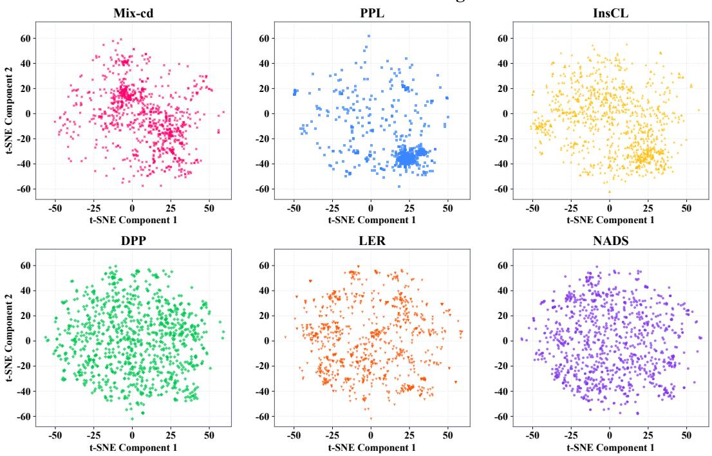  
Figure 11: t-SNE visualization of the selected data under different selection methods.

Table 14: Navigator selection sensitivity to validation perturbations on Magicoder with LLaMA3.2.
<table><tr><td>Validation</td><td>Utility Spearman</td><td>Top-K Overlap</td><td>Target</td><td>General</td><td>Overall</td></tr><tr><td>Original</td><td>1.00</td><td>1.00</td><td>44.39±0.40</td><td>42.52±0.27</td><td>43.46±0.24</td></tr><tr><td>20% label noise</td><td>0.83</td><td>0.72</td><td>44.11±0.35</td><td>41.72±0.31</td><td>42.92±0.26</td></tr><tr><td>40% label noise</td><td>0.69</td><td>0.58</td><td>43.29±0.61</td><td>40.94±0.35</td><td>42.12±0.30</td></tr><tr><td>Template shifted</td><td>0.76</td><td>0.64</td><td>43.70±0.35</td><td>41.20±0.33</td><td>42.45±0.28</td></tr></table>

As shown in Table 14, utility rank correlations remain between 0.69 and 0.83, while Top-K overlaps range from 0.58 to 0.72 across the three perturbed validation settings. Although the perturbations change utility rankings and selected samples, target-task, general-capability, and overall scores remain close to those obtained with the original validation set. These results support the robustness of Navigator-based data selection to the tested label noise and template shift.

## F.5 Diversity Analysis of the Selected Data

The main text presents representative selected-data visualizations. Here, we provide additional t-SNE [99] visualizations and quantitative diversity diagnostics for more selection methods. As shown in Fig. 11, the DPP-based selector serves as a diversity-oriented reference and broadly covers the semantic space. The PPL-based selector ranks by perplexity and concentrates on dense semantic regions, indicating stronger redundancy. Mix-cd selects samples correctly predicted by the previous model but forgotten by the subsequent model, yielding broad coarse-cluster coverage but less consistent geometric spread. InsCL estimates task similarity via Wasserstein Distance and biases sampling toward high-quality data with InsInfo, giving broader coverage than PPL and Mix-cd but still showing local clustering. LER dynamically updates memory and selects samples by Leitner-based learnability, yet its samples remain less dispersed in the continuous representation space.

To complement the visualization, Fig. 12 reports four diversity diagnostics: average pairwise cosine distance, normalized cluster entropy, effective rank, and log-det diversity. They measure sample-level separation, coarse cluster coverage, active representation directions, and selected-set geometric volume, respectively. DPP achieves the highest values, as expected from its diversity-oriented objective. NADS remains close to DPP on high-dimensional geometric metrics, including pairwise distance, effective rank, and log-det diversity, while outperforming other non-DPP baselines. Its normalized cluster entropy is lower than DPP and Mix-cd but remains high, indicating broad cluster coverage without simply maximizing uniform coarse-cluster spread. These results show that NADS preserves strong selected-set diversity while incorporating preservation-oriented utility.

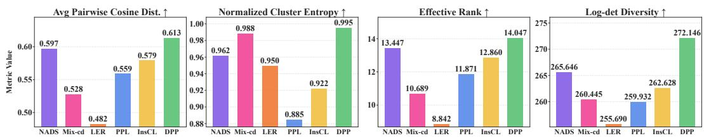  
Figure 12: Quantitative diversity diagnostics of the selected data under different selection methods. Higher values indicate stronger diversity under the corresponding metric.

## F.6 Computational Cost Analysis

In this section, we analyze the computational cost and performance–cost trade-off to show that the additional cost introduced by our method is acceptable and justified.

Selection Cost. Our setting aims to mitigate forgetting during fine-tuning while retaining gains on the new task, which requires estimating forgetting risk before the final training stage. NADS therefore uses a navigator to evaluate candidate samples. In the full-parameter setting, navigator training adds selection-stage cost. On Magicoder with LLaMA3.2-3B, it takes about 4 hours on 4 A100 GPUs, or 0.67 GPU-days. This one-time cost is incurred before final fine-tuning and remains practical at the considered scale. Appendix F.7 further examines a LoRA-based navigator as an efficient approximation, showing comparable performance with only a small drop. In the same setting, this variant uses 11.14 GB of GPU memory and takes about 3 hours on 4 A100 GPUs, or 0.5 GPU-days. Thus, although some baselines have lower selection overhead, the relevant comparison is the overall cost–performance trade-off, especially when severe forgetting must be controlled.

Performance–cost Trade-off. We further examine the performance–cost trade-off. Fig. 13 visualizes methods on Magicoder with LLaMA3.2-3B by training cost, peak GPU memory, and overall score. All methods are run with a per-device micro-batch size of 2 and an effective global batch size of 64 through gradient accumulation. Target-data selection methods select 10% of the target-training data from $\mathcal { D } _ { \mathrm { n e w } }$ , whereas replay-based methods and NADS select 5% of the synthetic candidates from C as constraints, matching the main experimental setting. We therefore separate the two groups rather than treating them as a direct ranking. Within the constraint-selection group, NADS achieves the highest Overall score with moderate training cost and peak memory. This suggests that navigator-guided utility and diversity-aware subset construction

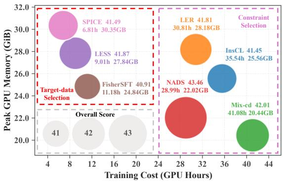  
Figure 13: Performance and cost visualization of different selection paradigms on Magicoder with LLaMA3.2-3B. Target-data selection methods select from $\mathcal { D } _ { \mathrm { n e w } } ,$ , whereas replay-based methods and NADS select constraints from the synthetic pool C.

provide a favorable effectiveness and efficiency balance for constructing preservation constraints.

## F.7 Efficient Navigator Approximation with LoRA

The navigator model is designed to trace the unconstrained adaptation path under the target recipe and expose the predictive drift induced by new-task fine-tuning. In principle, its training recipe should match that of the final model, except that preservation constraints are removed, thereby providing a recipe-aligned probe of adaptation-induced forgetting. However, NADS uses the navigator only to induce sample-level drift scores over candidate constraint samples, rather than to reproduce the exact parameter trajectory of the final model. Thus, a LoRA-based navigator can serve as an efficient approximation if it preserves the relative ranking of candidate samples under the drift signal.

Table 15: Comparison between full-parameter and LoRA-based navigators.
<table><tr><td>Navigator</td><td>Spearman</td><td>Overlap@K</td><td>Rel. Time</td><td>Rel. Mem.</td></tr><tr><td>LoRA navigator</td><td>0.89</td><td>0.82</td><td>0.74×</td><td>0.16×</td></tr><tr><td>Full navigator</td><td>1.00</td><td>1.00</td><td>1.00×</td><td>1.00×</td></tr></table>

Table 16: Comparison between LoRA-based and full-parameter navigators under the same final training objective. Both use the same synthetic candidate pool and KD objective.
<table><tr><td rowspan="2">Method</td><td colspan="5">General Capability ↑</td><td>Target ↑</td><td>Overall ↑</td></tr><tr><td>HASW</td><td>OBQA</td><td>MMLU</td><td>GSM8K</td><td>Avg.</td><td>HE</td><td>Avg.</td></tr><tr><td>NADS + LoRA navigator</td><td>55.03</td><td>30.93</td><td>56.24</td><td>27.22</td><td>42.36</td><td>44.28</td><td>43.32</td></tr><tr><td>NADS + Full navigator</td><td>55.17</td><td>31.07</td><td>56.45</td><td>27.37</td><td>42.52</td><td>44.39</td><td>43.46</td></tr></table>

Specifically, we train a LoRA-based navigator by adapting $M _ { \mathrm { p r e t r a i n } }$ on $\mathcal { D } _ { \mathrm { n e w } }$ without anti-forgetting regularization, using $\alpha = 1 6$ and rank $r = 3 2$ . The resulting $M _ { \mathrm { n a v } } ^ { \mathrm { L o R A } }$ approximates unconstrained adaptation within a low-rank update subspace. To test whether it preserves the NADS selection signal, we compare it with a full-parameter navigator $M _ { \mathrm { n a v } } ^ { \mathrm { F u l l } }$ on Magicoder with LLaMA3.2-3B. Let $s _ { i } ^ { \mathrm { L o R A } }$ and $s _ { i } ^ { \mathrm { F u l l } }$ denote the forgetting-aware scores assigned to candidate $x _ { i }$ by the two navigators. We measure their agreement using Spearman $\left( \{ s _ { i } ^ { \mathrm { L o R A } } \} _ { i = 1 } ^ { N } , \{ s _ { i } ^ { \mathrm { F u l l } } \} _ { i = 1 } ^ { N } \right)$ and top-K overlap:

$$
\operatorname { O v e r l a p @ } K = \frac { \left| \mathrm { T o p K } \left( \{ s _ { i } ^ { \mathrm { L o R A } } \} _ { i = 1 } ^ { N } \right) \cap \mathrm { T o p K } \left( \{ s _ { i } ^ { \mathrm { F u l l } } \} _ { i = 1 } ^ { N } \right) \right| } { K } .\tag{87}
$$

As shown in Table 15, the LoRA navigator achieves a Spearman correlation of 0.89 and an Overlap@K of 0.82 with the full-parameter navigator, while reducing relative training time to 0.74× and relative memory usage to 0.16×. This indicates that LoRA preserves most of the sample-ranking signal needed for constraint selection while reducing navigator construction cost.

We further compare the final performance obtained with the two navigator instantiations under the same synthetic candidate pool, constraint selection procedure, and KD objective. As shown in Table 16, NADS with the LoRA navigator achieves performance close to that of the full-parameter navigator, with only a small decrease in general capability average, target performance, and overall score. Overall, these results show that the LoRA navigator provides an efficient approximation to the full-parameter navigator. Thus, LoRA is a practical option when navigator construction cost is a concern, while the full-parameter navigator remains the most recipe-matched instantiation.

## F.8 Computational Cost across Model Sizes

We follow the evaluation convention adopted by closely related data-selection methods involving auxiliary training or scoring, including reference-model construction in DavIR [62] and RHO-1 [103], surrogate or warmup training in ToV [72] and LESS [59], and reference–proxy training in DoReMi [104]. Their main performance comparisons generally keep the final target-model training protocol fixed rather than reallocating auxiliary computational costs to longer baseline training. While comparisons under matched end-to-end computational budgets would provide a stricter assessment of computational fairness, we additionally report stage-wise and total costs to make this overhead explicit.

We compare the stage-wise and total computational costs of NADS on LLaMA3.2-3B, Gemma3-4B, and Qwen3.5-9B. All experiments use Magicoder and the same Magpie-Qwen2.5-Pro-300K-Filtered candidate pool, with costs measured in GPU-hours. As shown in Table 17, NADS achieves the highest overall scores among the compared methods on all three backbones, while subset optimization requires only 0.02 GPU-hours. The total cost increases from 44.82 to 113.43 GPU-hours as model size increases from 3B to 9B parameters. Using LoRA for navigator training reduces the 9B total cost to 97.28 GPU-hours while maintaining a comparable overall score of 68.13, versus 68.34 with full-parameter navigator training.

Table 17: Stage-wise computational costs (GPU-hours) and overall performance (%) on Magicoder. Parenthesized values correspond to LoRA-based Navigator training.
<table><tr><td>Model</td><td>Method</td><td>Navigator Training (LoRA)</td><td>Utility Computation</td><td>Subset Optimization</td><td>Final Training</td><td>Total Cost (LoRA)</td><td>Overall (LoRA)</td></tr><tr><td>LLaMA3.2-3B</td><td>InsCL</td><td>一</td><td>一</td><td>12.69</td><td>22.85</td><td>35.54</td><td>41.45</td></tr><tr><td></td><td>LER</td><td>1</td><td>一</td><td>7.96</td><td>22.85</td><td>30.81</td><td>41.81</td></tr><tr><td></td><td>Mix-cd</td><td>一</td><td>一</td><td>18.23</td><td>22.85</td><td>41.08</td><td>42.01</td></tr><tr><td></td><td>NADS</td><td>15.83 (11.72)</td><td>5.19</td><td>0.02</td><td>23.78</td><td>44.82 (40.71)</td><td>43.46 (43.32)</td></tr><tr><td>Gemma3-4B</td><td>InsCL</td><td>一</td><td>一</td><td>12.69</td><td>27.61</td><td>40.30</td><td>50.34</td></tr><tr><td></td><td>LER</td><td>一</td><td>一</td><td>9.67</td><td>27.61</td><td>37.28</td><td>50.76</td></tr><tr><td></td><td>Mix-cd</td><td>一</td><td>一</td><td>20.99</td><td>27.61</td><td>48.60</td><td>50.63</td></tr><tr><td></td><td>NADS</td><td>19.74 (15.39)</td><td>6.02</td><td>0.02</td><td>28.85</td><td>54.63 (50.28)</td><td>52.14 (51.96)</td></tr><tr><td>Qwen3.5-9B</td><td>InsCL</td><td></td><td>一</td><td>12.69</td><td>56.56</td><td>69.25</td><td>65.82</td></tr><tr><td></td><td>LER</td><td>一</td><td>一</td><td>18.11</td><td>56.56</td><td>74.67</td><td>66.65</td></tr><tr><td></td><td>Mix-cd</td><td></td><td>一</td><td>38.08</td><td>56.56</td><td>94.64</td><td>66.06</td></tr><tr><td></td><td>NADS</td><td>42.73 (26.58)</td><td>11.27</td><td>0.02</td><td>59.41</td><td>113.43 (97.28)</td><td>68.34 (68.13)</td></tr></table>

NADS Performance under Different Synthetic Datasets  
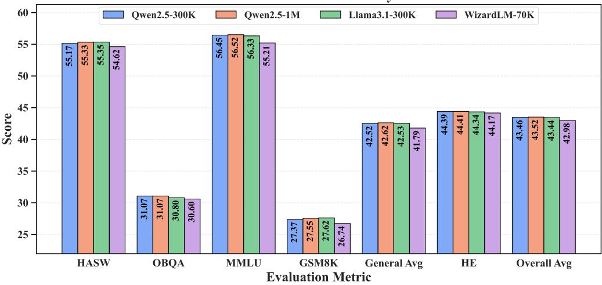  
Figure 14: NADS performance under different synthetic datasets across seven evaluation metrics on the Magicoder dataset with LLaMA3.2-3B. Each group of bars compares the results obtained with different synthetic data pools under the same setting.

## F.9 Effect of Constraint-Set Size

In this section, we study the effect of constraint-set size on NADS. Specifically, we vary the size of the selected constraint set and evaluate how it influences NADS in terms of general capability, target-task performance, and overall performance.

Table 18 reports results under different constraint-set sizes. When K = 1%, the subset is too small to provide sufficient preservation support. Increasing K to 3% and 5% markedly improves performance, showing that larger constraint sets provide stronger preservation signals. At 10%, performance continues to improve but with limited gain, suggesting saturation beyond a certain size. Thus, we use 5% as the default budget to match the main replay setting while emphasizing efficiency. When K further increases to 15%, performance declines, indicating that overly large constraint sets may introduce redundant or less informative samples and weaken selective construction. Overall, increasing K helps when the constraint set is small, but the benefit gradually saturates and can reverse when excessive samples are included.

Table 18: Target performance and general capability of NADS under different constraint-set sizes K.
<table><tr><td rowspan="2">K</td><td colspan="5">General Capability</td><td>Target</td><td>Overall</td></tr><tr><td>HASW</td><td>OBQA</td><td>MMLU</td><td>GSM8K</td><td>Avg.</td><td>HE</td><td>Avg.</td></tr><tr><td>1%</td><td>52.84</td><td>28.73</td><td>52.54</td><td>22.87</td><td>39.25</td><td>44.93</td><td>42.09</td></tr><tr><td>3%</td><td>53.97</td><td>30.13</td><td>54.62</td><td>25.40</td><td>41.03</td><td>44.50</td><td>42.77</td></tr><tr><td>5%</td><td>55.17</td><td>31.07</td><td>56.45</td><td>27.37</td><td>42.52</td><td>44.39</td><td>43.46</td></tr><tr><td>10%</td><td>55.34</td><td>31.13</td><td>56.73</td><td>27.42</td><td>42.66</td><td>44.38</td><td>43.52</td></tr><tr><td>15%</td><td>55.15</td><td>30.87</td><td>56.24</td><td>27.14</td><td>42.35</td><td>43.86</td><td>43.11</td></tr></table>

## F.10 Impact of Different Synthetic Datasets

In this section, we analyze the impact of synthetic datasets on NADS. NADS does not assume that the synthetic dataset used for constraint construction covers the model’s general capabilities. Instead, it treats the synthetic dataset as a candidate source for constructing the constraint set.

We compare Magpie-Qwen2.5-Pro-300K-Filtered [82], Magpie-Qwen2.5-Pro-1M-v0.1 [82], Magpie Llama-3.1-Pro-300K-Filtered [82], and WizardLM-evol-instruct-70k [105], covering both synthetic datasets of different scales and datasets of the same scale generated by different models. For fair comparison, we fix the constraint-set budget to 15,000 samples for all datasets, corresponding to 5% of Magpie-Qwen2.5-Pro-300K-Filtered. We then construct the constraint set from each synthetic dataset and evaluate its impact on NADS.

Fig. 14 reports results on seven evaluation metrics. Compared with Magpie-Qwen2.5-Pro-300K-Filtered, Magpie-Qwen2.5-Pro-1M-v0.1 generally yields slightly better or more stable results, suggesting that a larger synthetic pool can better support constraint-set construction. Magpie-Llama-3.1-Pro-300K-Filtered shows noticeable differences on some metrics, indicating that the generator model also affects constraint quality at a fixed data scale. In contrast, WizardLM-evol-instruct-70k performs worse on several metrics, likely due to its smaller scale and limited candidate coverage. Overall, synthetic dataset choice affects NADS mainly through candidate-pool quality and coverage, while the overall variation remains moderate.

## F.11 Results on Instruction Tuning

We further evaluate all methods by fine-tuning LLaMA3.2-3B on Alpaca-GPT4 [100] to assess broad instruction-tuning performance. Alpaca-GPT4 contains diverse instruction-following tasks, covering question answering, reasoning, writing, and formatting. For general capability, we report results on ARC-Challenge and ARC-Easy [106], PIQA [107], Winogrande [108], HellaSwag [87], OpenBookQA [89], TruthfulQA [109], MMLU [86], GSM8K [88], and HumanEval [85], and compute General Avg. as their arithmetic mean. Following recent instruction-tuning studies [110– 112], we use IFEval [113] and report prompt-level strict accuracy (PS), instruction-level strict accuracy (IS), prompt-level loose accuracy (PL), instruction-level loose accuracy (IL), and their arithmetic mean as IFEval Avg. Overall performance is computed as the average of General Avg. and IFEval Avg. Following the main experimental setup, we fine-tune on Alpaca-GPT4 for 3 epochs with a global batch size of 128 and a maximum sequence length of 4096. For NADS, the learning rate selected on Alpaca-GPT4 is $3 \times 1 0 ^ { - 5 }$

Table 19 reports the Alpaca-GPT4 results. Standard FT improves IFEval Avg. from 29.78 to 36.26, while reducing performance on MMLU, GSM8K, and HumanEval relative to the pre-trained model. InsCL, LER, and Mix-cd further improve average instruction-following performance, with Mixcd achieving the strongest baseline Overall score of 45.17. NADS achieves the highest General Avg., IFEval Avg., and Overall scores, reaching 52.45, 39.89, and 46.17, respectively. Among finetuned methods, NADS ranks first on all four IFEval metrics and eight of the ten general-capability benchmarks. These results demonstrate that NADS remains effective in broad instruction tuning, improving instruction following while preserving strong general capability.

Table 19: Performance comparison on general capability and IFEval benchmarks (%). Results are obtained using a single random seed. Pre-trained and Standard FT are excluded from the ranking. The best results are highlighted in red, and the second-best results are highlighted in blue.
<table><tr><td>Tasks</td><td>Pre-trained</td><td>Standard FT</td><td>InsCL</td><td>LER</td><td>Mix-cd</td><td>NADS</td></tr><tr><td colspan="7">General Capability ↑</td></tr><tr><td>ARC-Challenge</td><td>42.92</td><td>44.37</td><td>44.71</td><td>45.05</td><td>45.65</td><td>46.67</td></tr><tr><td>ARC-Easy</td><td>74.58</td><td>73.48</td><td>75.34</td><td>75.13</td><td>75.25</td><td>75.93</td></tr><tr><td>PIQA</td><td>76.28</td><td>75.41</td><td>76.50</td><td>76.71</td><td>77.58</td><td>77.37</td></tr><tr><td>HellaSwag</td><td>55.83</td><td>57.42</td><td>57.05</td><td>57.55</td><td>58.10</td><td>59.00</td></tr><tr><td>OpenBookQA</td><td>31.20</td><td>33.20</td><td>33.00</td><td>33.80</td><td>33.60</td><td>34.60</td></tr><tr><td>TruthfulQA</td><td>39.13</td><td>50.01</td><td>48.39</td><td>48.89</td><td>49.50</td><td>50.70</td></tr><tr><td>Winogrande</td><td>69.22</td><td>66.30</td><td>66.46</td><td>66.85</td><td>68.03</td><td>67.88</td></tr><tr><td>MMLU</td><td>56.92</td><td>53.42</td><td>54.20</td><td>54.60</td><td>55.15</td><td>55.90</td></tr><tr><td>GSM8K</td><td>27.90</td><td>24.03</td><td>24.11</td><td>24.72</td><td>25.47</td><td>27.22</td></tr><tr><td>HumanEval</td><td>28.16</td><td>26.22</td><td>25.61</td><td>27.44</td><td>26.83</td><td>29.27</td></tr><tr><td>Avg.</td><td>50.21</td><td>50.39</td><td>50.54</td><td>51.07</td><td>51.52</td><td>52.45</td></tr><tr><td colspan="7">IFEval (Target) ↑</td></tr><tr><td>Prompt (S)</td><td>21.81</td><td>30.13</td><td>32.35</td><td>32.90</td><td>33.64</td><td>34.75</td></tr><tr><td>Inst (S)</td><td>34.77</td><td>40.29</td><td>41.85</td><td>42.21</td><td>42.93</td><td>43.88</td></tr><tr><td>Prompt (L)</td><td>24.40</td><td>31.79</td><td>33.46</td><td>34.01</td><td>34.57</td><td>35.49</td></tr><tr><td>Inst (L)</td><td>38.13</td><td>42.81</td><td>43.53</td><td>44.48</td><td>44.12</td><td>45.44</td></tr><tr><td>Avg.</td><td>29.78</td><td>36.26</td><td>37.80</td><td>38.40</td><td>38.82</td><td>39.89</td></tr><tr><td colspan="7">Overall ↑</td></tr><tr><td>Avg.</td><td>40.00</td><td>43.33</td><td>44.17</td><td>44.74</td><td>45.17</td><td>46.17</td></tr></table>

## G Comparison with Catastrophic Forgetting Mitigation Methods

In this subsection, we compare NADS with representative catastrophic-forgetting mitigation methods, including STM [8], NANOADAM [101], FLOW [11], DavIR [62], and TALR [10]. Since this is a supplementary comparison beyond the main benchmark, we evaluate two datasets with two representative model backbones.

The full results on Magicoder and MetaMathQA are reported in Tables 20 and 21. Across both datasets and backbones, NADS achieves the best Overall Avg., indicating a more favorable balance between target-task adaptation and general capability preservation. On Magicoder, standard finetuning substantially improves the target task but clearly degrades general-capability benchmarks, reflecting the typical adaptation–preservation conflict. Existing mitigation methods reduce this degradation to varying degrees, but their preservation signals are parameter-centric, regularizationbased, or not explicitly tied to forgetting induced by the current target-task update. Thus, they often improve one side of the trade-off while leaving noticeable loss on the other. In contrast, NADS constructs preservation constraints from navigator-induced predictive drift, aligning the replay signal more directly with capabilities affected by the current adaptation trajectory. This yields the best Overall Avg. on both LLaMA3.2-3B and Gemma3-4B, with consistently strong General Capability Avg. and competitive target-task performance.

On MetaMathQA, the same trend appears under a different target capability. Standard fine-tuning attains strong GSM8K performance but noticeably weakens general capabilities, while existing mitigation baselines only partially recover this balance. NADS achieves the best Overall Avg. and General Capability Avg. on both backbones, showing that the selected synthetic constraints preserve broad capabilities even when the target task shifts to mathematical reasoning. Meanwhile, NADS maintains highly competitive GSM8K performance, suggesting that the preservation constraints do not simply over-regularize the model toward the pretrained state. Overall, NADS improves the adaptation–preservation trade-off across both code and math fine-tuning settings, rather than merely increasing target performance or retention in isolation.

Table 20: Comparison with catastrophic forgetting mitigation methods on Magicoder dataset (%). The best results are highlighted in red, and the second-best results are highlighted in blue.
<table><tr><td rowspan="2" colspan="2">Method</td><td colspan="5">General Capability ↑</td><td>Target ↑</td><td>Overall ↑</td></tr><tr><td>HASW</td><td>OBQA</td><td>MMLU</td><td>GSM8K</td><td> $\mathbf { A v } \mathbf { g } .$ </td><td>HE</td><td> $\mathbf { A v } \mathbf { g } .$ </td></tr><tr><td colspan="8">LLaMA3.2-3B</td></tr><tr><td>Pre-trained</td><td></td><td> $5 5 . 8 3 _ { \pm 0 . 0 0 }$ </td><td> $3 1 . 2 0 { \scriptstyle \pm 0 . 0 0 }$ </td><td> $5 6 . 9 2 _ { \pm 0 . 0 0 }$ </td><td> $2 7 . 9 0 { \scriptstyle \pm 0 . 0 0 }$ </td><td> $4 2 . 9 6 _ { \pm 0 . 0 0 }$ </td><td> $2 8 . 1 6 { \scriptstyle \pm 0 . 0 0 }$ </td><td> $3 5 . 5 6 { \scriptstyle \pm 0 . 0 0 }$ </td></tr><tr><td>Standard FT</td><td></td><td> $5 2 . 1 2 { \scriptstyle \pm 0 . 5 2 }$ </td><td> $2 8 . 4 0 { \scriptstyle \pm 0 . 6 9 }$ </td><td> $4 8 . 6 1 \pm 0 . 4 0$ </td><td> $2 0 . 7 5 { \scriptstyle \pm 0 . 7 4 }$ </td><td> $3 7 . 4 7 { \scriptstyle \pm 0 . 3 0 }$ </td><td> $4 5 . 1 3 { \scriptstyle \pm 0 . 3 2 }$ </td><td> $4 1 . 3 0 { \scriptstyle \pm 0 . 2 2 }$ </td></tr><tr><td>LoRA</td><td>ICLR 22</td><td> $5 3 . 3 8 { \scriptstyle \pm 0 . 5 5 }$ </td><td> $2 9 . 4 7 _ { \pm 0 . 6 4 }$ </td><td> $5 1 . 9 8 _ { \pm 0 . 4 2 }$ </td><td> $2 1 . 1 8 { \scriptstyle \pm 0 . 7 9 }$ </td><td> $3 9 . 0 0 { \scriptstyle \pm 0 . 3 1 }$ </td><td> $4 1 . 9 2 _ { \pm 0 . 3 0 }$ </td><td> $4 0 . 4 6 _ { \pm 0 . 2 1 }$ </td></tr><tr><td>STM</td><td>NIPS 25</td><td> $5 3 . 0 2 _ { \pm 0 . 4 9 }$ </td><td> $2 9 . 6 7 _ { \pm 0 . 6 1 }$ </td><td> $5 3 . 2 4 _ { \pm 0 . 4 1 }$ </td><td> $2 3 . 8 1 _ { \pm 0 . 7 5 }$ </td><td> $3 9 . 9 4 _ { \pm 0 . 2 9 }$ </td><td> $4 2 . 0 4 _ { \pm 0 . 8 2 }$ </td><td> $4 0 . 9 9 _ { \pm 0 . 4 4 }$ </td></tr><tr><td>NANOADAM</td><td>NIPS 25</td><td> $5 3 . 8 9 _ { \pm 0 . 4 9 }$ </td><td> $3 0 . 2 0 { \scriptstyle \pm 0 . 6 0 }$ </td><td> $5 2 . 8 3 _ { \pm 0 . 4 0 }$ </td><td> $2 4 . 4 4 _ { \pm 0 . 6 2 }$ </td><td> $4 0 . 3 4 _ { \pm 0 . 2 6 }$ </td><td> $4 3 . 3 1 _ { \pm 0 . 7 4 }$ </td><td> $4 1 . 8 3 _ { \pm 0 . 3 9 }$ </td></tr><tr><td>FLOW</td><td>ICML 25</td><td> $5 4 . 6 3 _ { \pm 0 . 5 0 }$ </td><td> $3 0 . 0 7 _ { \pm 0 . 6 1 }$ </td><td> $5 5 . 8 3 _ { \pm 0 . 4 2 }$ </td><td> $2 5 . 1 2 _ { \pm 0 . 6 3 }$ </td><td> $4 1 . 4 1 _ { \pm 0 . 2 7 }$ </td><td> $4 2 . 3 4 { \scriptstyle \pm 0 . 7 4 }$ </td><td> $4 1 . 8 8 _ { \pm 0 . 3 9 }$ </td></tr><tr><td>DavIR</td><td>ACL 25</td><td> $5 3 . 2 7 { \scriptstyle \pm 0 . 4 9 }$ </td><td> $2 9 . 2 0 { \scriptstyle \pm 0 . 6 0 }$ </td><td> $5 3 . 1 7 { \scriptstyle \pm 0 . 4 0 }$ </td><td> $2 5 . 7 0 { \scriptstyle \pm 0 . 7 6 }$ </td><td> $4 0 . 3 4 { \scriptstyle \pm 0 . 2 9 }$ </td><td> $4 3 . 5 2 _ { \pm 0 . 7 7 }$ </td><td> $4 1 . 9 3 _ { \pm 0 . 4 1 }$ </td></tr><tr><td>TALR</td><td>ICLR 26</td><td> $5 4 . 8 4 { \scriptstyle \pm 0 . 5 0 }$ </td><td> $3 0 . 1 3 { \scriptstyle \pm 0 . 6 4 }$ </td><td> $5 4 . 0 1 _ { \pm 0 . 4 1 }$ </td><td> $2 6 . 7 9 _ { \pm 0 . 7 4 }$ </td><td> $4 1 . 4 4 _ { \pm 0 . 2 9 }$ </td><td> $4 3 . 5 4 _ { \pm 0 . 7 5 }$ </td><td> $4 2 . 4 9 _ { \pm 0 . 4 0 }$ </td></tr><tr><td>NADS (Ours)</td><td></td><td> $5 5 . 1 7 { \scriptstyle \pm 0 . 4 9 }$ </td><td> $3 1 . 0 7 { \scriptstyle \pm 0 . 5 8 }$ </td><td> $5 6 . 4 5 { \scriptstyle \pm 0 . 4 1 }$ </td><td> $2 7 . 3 7 { \scriptstyle \pm 0 . 6 7 }$ </td><td> $4 2 . 5 2 { \scriptstyle \pm 0 . 2 7 }$ </td><td> $4 4 . 3 9 { \scriptstyle \pm 0 . 4 0 }$ </td><td> $4 3 . 4 6 \pm 0 . 2 4$ </td></tr><tr><td colspan="9">Gemma3-4B</td></tr><tr><td>Pre-trained</td><td></td><td> $5 7 . 4 1 _ { \pm 0 . 0 0 }$ </td><td> $3 4 . 6 0 { \scriptstyle \pm 0 . 0 0 }$ </td><td> $6 0 . 2 4 { \scriptstyle \pm 0 . 0 0 }$ </td><td> $3 6 . 6 9 _ { \pm 0 . 0 0 }$ </td><td> $4 7 . 2 4 _ { \pm 0 . 0 0 }$ </td><td> $3 5 . 7 7 { \scriptstyle \pm 0 . 0 0 }$ </td><td> $4 1 . 5 1 _ { \pm 0 . 0 0 }$ </td></tr><tr><td>Standard FT</td><td></td><td> $5 3 . 0 6 { \scriptstyle \pm 0 . 4 9 }$ </td><td> $3 1 . 2 7 { \scriptstyle \pm 0 . 7 0 }$ </td><td> $5 3 . 2 1 { \scriptstyle \pm 0 . 4 0 }$ </td><td> $2 3 . 7 8 { \scriptstyle \pm 0 . 6 8 }$ </td><td> $4 0 . 3 3 { \scriptstyle \pm 0 . 2 9 }$ </td><td> $5 8 . 1 7 { \scriptstyle \pm 0 . 8 9 }$ </td><td> $4 9 . 2 5 { \scriptstyle \pm 0 . 4 7 }$ </td></tr><tr><td>LoRA</td><td>ICLR 22</td><td> $5 5 . 8 1 _ { \pm 0 . 5 0 }$ </td><td> $3 1 . 8 0 { \scriptstyle \pm 0 . 6 0 }$ </td><td> $5 6 . 7 4 _ { \pm 0 . 3 9 }$ </td><td> $3 1 . 6 1 _ { \pm 0 . 8 2 }$ </td><td> $4 3 . 9 9 _ { \pm 0 . 3 0 }$ </td><td> $5 4 . 6 9 _ { \pm 0 . 9 1 }$ </td><td> $4 9 . 3 4 _ { \pm 0 . 4 8 }$ </td></tr><tr><td>STM</td><td>NIPS 25</td><td> $5 6 . 2 2 _ { \pm 0 . 4 9 }$ </td><td> $3 2 . 0 0 { \scriptstyle \pm 0 . 6 0 }$ </td><td> $5 8 . 6 9 _ { \pm 0 . 3 9 }$ </td><td> $3 3 . 1 3 _ { \pm 0 . 8 5 }$ </td><td> $4 5 . 0 1 _ { \pm 0 . 3 0 }$ </td><td> $5 5 . 4 2 _ { \pm 0 . 8 1 }$ </td><td> $5 0 . 2 2 _ { \pm 0 . 4 3 }$ </td></tr><tr><td>NANOADAM</td><td>NIPS 25</td><td> $5 6 . 4 8 _ { \pm 0 . 4 9 }$ </td><td> $3 2 . 0 7 _ { \pm 0 . 6 4 }$ </td><td> $5 8 . 9 1 _ { \pm 0 . 3 9 }$ </td><td> $3 3 . 0 6 _ { \pm 0 . 8 4 }$ </td><td> $4 5 . 1 3 _ { \pm 0 . 3 1 }$ </td><td> $5 6 . 2 7 { \scriptstyle \pm 0 . 9 0 }$ </td><td> $5 0 . 7 0 { \scriptstyle \pm 0 . 4 8 }$ </td></tr><tr><td>FLOW</td><td>ICML 25</td><td> $5 5 . 2 3 _ { \pm 0 . 5 0 }$ </td><td> $3 2 . 4 0 { \scriptstyle \pm 0 . 6 0 }$ </td><td> $5 8 . 1 7 { \scriptstyle \pm 0 . 4 0 }$ </td><td> $3 4 . 1 7 { \scriptstyle \pm 0 . 8 2 }$ </td><td> $4 4 . 9 9 _ { \pm 0 . 3 0 }$ </td><td> $5 5 . 8 6 _ { \pm 0 . 8 4 }$ </td><td> $5 0 . 4 3 _ { \pm 0 . 4 5 }$ </td></tr><tr><td>DavIR</td><td>ACL 25</td><td> $5 4 . 5 5 { \scriptstyle \pm 0 . 4 9 }$ </td><td> $3 1 . 6 0 { \scriptstyle \pm 0 . 6 9 }$ </td><td> $5 7 . 1 2 { \scriptstyle \pm 0 . 3 9 }$ </td><td> $3 0 . 6 0 { \scriptstyle \pm 0 . 8 6 }$ </td><td> $4 3 . 4 7 { \scriptstyle \pm 0 . 3 1 }$ </td><td> $5 7 . 4 6 { \scriptstyle \pm 0 . 7 2 }$ </td><td> $5 0 . 4 7 { \scriptstyle \pm 0 . 3 9 }$ </td></tr><tr><td>TALR</td><td>ICLR 26</td><td> $5 6 . 6 2 { \scriptstyle \pm 0 . 4 9 }$ </td><td> $3 2 . 2 7 _ { \pm 0 . 6 4 }$ </td><td> $5 9 . 7 9 { \scriptstyle \pm 0 . 3 9 }$ </td><td> $3 5 . 0 8 { \scriptstyle \pm 0 . 8 4 }$ </td><td> $4 5 . 9 4 _ { \pm 0 . 3 1 }$ </td><td> $5 6 . 0 8 _ { \pm 0 . 9 1 }$ </td><td> $5 1 . 0 1 { \scriptstyle \pm 0 . 4 8 }$ </td></tr><tr><td>NADS (Ours)</td><td></td><td> $5 6 . 8 3 { \scriptstyle \pm 0 . 5 0 }$ </td><td> $3 3 . 1 3 { \scriptstyle \pm 0 . 6 1 }$ </td><td> $5 9 . 6 2 { \scriptstyle \pm 0 . 4 0 }$ </td><td> $3 5 . 9 9 { \scriptstyle \pm 0 . 7 4 }$ </td><td> $4 6 . 3 9 { \scriptstyle \pm 0 . 2 9 }$ </td><td> $5 7 . 8 8 \pm 0 . 9 0$ </td><td> $5 2 . 1 4 \pm 0 . 4 7$ </td></tr></table>

Table 21: Comparison with catastrophic forgetting mitigation methods on MetaMathQA dataset (%). The best results are highlighted in red, and the second-best results are highlighted in blue.
<table><tr><td colspan="2">Method</td><td colspan="5">General Capability ↑</td><td>Target ↑</td><td>Overall ↑</td></tr><tr><td colspan="2"></td><td>HASW</td><td>OBQA</td><td>MMLU  $\overline { { L L a M A 3 . 2 – 3 B } }$ </td><td>HE</td><td> $\mathbf { A v } \mathbf { g } .$ </td><td>GSM8K</td><td> $\mathbf { A v } \mathbf { g } .$ </td></tr><tr><td colspan="9"></td></tr><tr><td>Pre-trained</td><td></td><td> $5 5 . 8 3 _ { \pm 0 . 0 0 }$ </td><td> $3 1 . 2 0 { \scriptstyle \pm 0 . 0 0 }$ </td><td> $5 6 . 9 2 _ { \pm 0 . 0 0 }$ </td><td> $2 8 . 1 6 { \scriptstyle \pm 0 . 0 0 }$ </td><td> $4 3 . 0 3 _ { \pm 0 . 0 0 }$ </td><td> $2 7 . 9 0 { \scriptstyle \pm 0 . 0 0 }$ </td><td> $3 5 . 4 7 _ { \pm 0 . 0 0 }$ </td></tr><tr><td>Standard FT</td><td></td><td> $5 0 . 0 2 { \scriptstyle \pm 0 . 5 0 }$ </td><td> $2 8 . 4 0 { \scriptstyle \pm 0 . 5 3 }$ </td><td> $4 8 . 4 9 _ { \pm 0 . 4 1 }$ </td><td> $1 5 . 2 7 { \scriptstyle \pm 0 . 4 9 }$ </td><td> $3 5 . 5 5 { \scriptstyle \pm 0 . 2 4 }$ </td><td> $6 5 . 9 3 { \scriptstyle \pm 0 . 8 1 }$ </td><td> $5 0 . 7 4 { \scriptstyle \pm 0 . 4 2 }$ </td></tr><tr><td> $\mathrm { L o R A }$ </td><td>ICLR 22</td><td> $5 2 . 0 6 _ { \pm 0 . 5 0 }$ </td><td> $2 8 . 6 0 { \scriptstyle \pm 0 . 5 3 }$ </td><td> $5 2 . 3 4 _ { \pm 0 . 4 0 }$ </td><td> $2 5 . 3 1 _ { \pm 0 . 5 2 }$ </td><td> $3 9 . 5 8 { \scriptstyle \pm 0 . 2 5 }$ </td><td> $6 1 . 0 3 { \scriptstyle \pm 0 . 8 3 }$ </td><td> $5 0 . 3 1 { \scriptstyle \pm 0 . 4 3 }$ </td></tr><tr><td>STM</td><td>NIPS 25</td><td> $5 3 . 0 7 { \scriptstyle \pm 0 . 4 9 }$ </td><td> $2 9 . 6 0 { \scriptstyle \pm 0 . 6 0 }$ </td><td> $5 3 . 6 5 { \scriptstyle \pm 0 . 4 1 }$ </td><td> $2 6 . 8 3 { \scriptstyle \pm 0 . 6 9 }$ </td><td> $4 0 . 7 9 2 0 . 2 8$ </td><td> $6 3 . 5 1 { \scriptstyle \pm 0 . 8 4 }$ </td><td> $5 2 . 1 5 { \scriptstyle \pm 0 . 4 4 }$ </td></tr><tr><td>NANOADAM</td><td>NIPS 25</td><td> $5 3 . 2 6 _ { \pm 0 . 5 0 }$ </td><td> $3 0 . 1 3 { \scriptstyle \pm 0 . 6 4 }$ </td><td> $5 4 . 9 2 _ { \pm 0 . 3 9 }$ </td><td> $2 6 . 4 3 _ { \pm 0 . 7 1 }$ </td><td> $4 1 . 1 9 _ { \pm 0 . 2 9 }$ </td><td> $6 4 . 4 2 _ { \pm 0 . 7 8 }$ </td><td> $5 2 . 8 1 _ { \pm 0 . 4 2 }$ </td></tr><tr><td>FLOW</td><td>ICML 25</td><td> $5 3 . 4 1 _ { \pm 0 . 4 9 }$ </td><td> $3 0 . 3 3 { \scriptstyle \pm 0 . 6 1 }$ </td><td> $5 5 . 8 6 _ { \pm 0 . 4 2 }$ </td><td> $2 6 . 9 7 { \scriptstyle \pm 0 . 7 5 }$ </td><td> $4 1 . 6 4 _ { \pm 0 . 2 9 }$ </td><td> $6 3 . 7 4 _ { \pm 0 . 7 4 }$ </td><td> $5 2 . 6 9 _ { \pm 0 . 4 0 }$ </td></tr><tr><td>DavIR</td><td>ACL 25</td><td> $5 2 . 3 7 { \scriptstyle \pm 0 . 4 9 }$ </td><td> $2 9 . 2 0 { \scriptstyle \pm 0 . 6 0 }$ </td><td> $5 3 . 7 2 _ { \pm 0 . 3 9 }$ </td><td> $2 5 . 8 3 _ { \pm 0 . 8 2 }$ </td><td> $4 0 . 2 8 { \scriptstyle \pm 0 . 3 0 }$ </td><td> $6 5 . 2 5 { \scriptstyle \pm 0 . 8 1 }$ </td><td> $5 2 . 7 7 { \scriptstyle \pm 0 . 4 3 }$ </td></tr><tr><td>TALR</td><td>ICLR 26</td><td> $5 3 . 5 2 { \scriptstyle \pm 0 . 4 9 }$   $5 4 . 8 6 { \scriptstyle \pm 0 . 5 0 }$ </td><td> $3 0 . 0 7 { \scriptstyle \pm 0 . 6 4 }$ </td><td> $5 5 . 9 4 _ { \pm 0 . 3 9 }$ </td><td> $2 7 . 3 2 { \scriptstyle \pm 0 . 7 4 }$ </td><td> $4 1 . 7 1 { \scriptstyle \pm 0 . 2 9 }$ </td><td> $6 3 . 6 8 _ { \pm 0 . 7 6 }$ </td><td> $5 2 . 7 0 { \scriptstyle \pm 0 . 4 1 }$ </td></tr><tr><td colspan="3">NADS (Ours)</td><td> $3 0 . 8 0 { \scriptstyle \pm 0 . 6 0 }$ </td><td> $5 6 . 2 3 { \scriptstyle \pm 0 . 4 1 }$  Gemma3-4B</td><td> $2 8 . 2 1 \pm 0 . 4 2$ </td><td> $4 2 . 5 3 { \scriptstyle \pm 0 . 2 4 }$ </td><td> $6 5 . 1 8 { \scriptstyle \pm 0 . 8 3 }$ </td><td> $5 3 . 8 6 \pm 0 . 4 3$ </td></tr><tr><td colspan="9"></td></tr><tr><td colspan="2">Pre-trained Standard FT</td><td> $5 7 . 4 1 _ { \pm 0 . 0 0 }$ </td><td> $3 4 . 6 0 { \scriptstyle \pm 0 . 0 0 }$ </td><td> $6 0 . 2 4 { \scriptstyle \pm 0 . 0 0 }$ </td><td> $3 5 . 7 7 { \scriptstyle \pm 0 . 0 0 }$ </td><td> $4 7 . 0 1 _ { \pm 0 . 0 0 }$ </td><td> $3 6 . 6 9 _ { \pm 0 . 0 0 }$ </td><td> $4 1 . 8 5 _ { \pm 0 . 0 0 }$ </td></tr><tr><td></td><td></td><td> $5 1 . 4 2 { \scriptstyle \pm 0 . 5 0 }$ </td><td> $3 0 . 2 0 { \scriptstyle \pm 0 . 5 3 }$ </td><td> $5 3 . 0 1 { \scriptstyle \pm 0 . 4 0 }$ </td><td> $2 9 . 6 2 { \scriptstyle \pm 0 . 4 3 }$ </td><td> $4 1 . 0 6 { \scriptstyle \pm 0 . 2 4 }$ </td><td> $6 7 . 8 3 { \scriptstyle \pm 0 . 7 9 }$ </td><td> $5 4 . 4 5 _ { \pm 0 . 4 1 }$ </td></tr><tr><td>LoRA</td><td>ICLR 22</td><td> $5 4 . 3 4 { \scriptstyle \pm 0 . 4 9 }$ </td><td> $3 2 . 1 3 _ { \pm 0 . 6 4 }$ </td><td> $5 5 . 8 4 _ { \pm 0 . 3 9 }$ </td><td> $3 0 . 3 6 { \scriptstyle \pm 0 . 7 4 }$ </td><td> $4 3 . 1 7 _ { \pm 0 . 2 9 }$ </td><td> $6 3 . 0 3 { \scriptstyle \pm 0 . 7 8 }$ </td><td> $5 3 . 1 0 { \scriptstyle \pm 0 . 4 2 }$ </td></tr><tr><td>STM</td><td>NIPS 25</td><td> $5 4 . 8 3 _ { \pm 0 . 5 1 }$ </td><td> $3 2 . 5 3 { \scriptstyle \pm 0 . 6 4 }$ </td><td> $5 8 . 1 5 _ { \pm 0 . 4 0 }$ </td><td> $3 3 . 0 6 _ { \pm 0 . 8 2 }$ </td><td> $4 4 . 6 4 _ { \pm 0 . 3 1 }$ </td><td> $6 4 . 8 5 _ { \pm 0 . 8 1 }$ </td><td> $5 4 . 7 5 _ { \pm 0 . 4 3 }$ </td></tr><tr><td>NANOADAM</td><td>NIPS 25</td><td> $5 5 . 1 9 _ { \pm 0 . 5 0 }$ </td><td> $3 3 . 1 3 _ { \pm 0 . 6 4 }$ </td><td> $5 7 . 9 4 _ { \pm 0 . 4 0 }$ </td><td> $3 2 . 9 3 _ { \pm 0 . 6 9 }$ </td><td> $4 4 . 8 0 { \scriptstyle \pm 0 . 2 8 }$ </td><td> $6 5 . 7 3 { \scriptstyle \pm 0 . 7 9 }$ </td><td> $5 5 . 2 7 { \scriptstyle \pm 0 . 4 2 }$ </td></tr><tr><td>FLOW</td><td>ICML 25</td><td> $5 4 . 9 2 _ { \pm 0 . 4 9 }$ </td><td> $3 2 . 6 7 _ { \pm 0 . 6 1 }$ </td><td> $5 8 . 2 7 { \scriptstyle \pm 0 . 4 1 }$ </td><td> $3 3 . 2 4 { \scriptstyle \pm 0 . 8 5 }$ </td><td> $4 4 . 7 8 _ { \pm 0 . 3 1 }$ </td><td> $6 4 . 7 7 { \scriptstyle \pm 0 . 8 5 }$ </td><td> $5 4 . 7 8 _ { \pm 0 . 4 5 }$ </td></tr><tr><td>DavIR</td><td>ACL 25</td><td> $5 4 . 8 3 _ { \pm 0 . 4 9 }$ </td><td> $3 1 . 8 7 _ { \pm 0 . 6 1 }$ </td><td> $5 6 . 6 7 _ { \pm 0 . 4 1 }$ </td><td> $3 1 . 4 1 _ { \pm 0 . 8 4 }$ </td><td> $4 3 . 7 0 { \scriptstyle \pm 0 . 3 0 }$ </td><td> $6 6 . 2 9 { \scriptstyle \pm 0 . 8 2 }$ </td><td> $5 5 . 0 0 { \scriptstyle \pm 0 . 4 4 }$ </td></tr><tr><td>TALR</td><td>ICLR 26</td><td> $5 5 . 0 3 _ { \pm 0 . 5 0 }$ </td><td> $3 2 . 8 7 _ { \pm 0 . 6 4 }$ </td><td> $5 8 . 1 6 _ { \pm 0 . 3 9 }$ </td><td> $3 3 . 2 8 \pm 0 . 8 9$ </td><td> $4 4 . 8 4 _ { \pm 0 . 3 2 }$ </td><td> $6 4 . 8 7 _ { \pm 0 . 7 7 }$ </td><td> $5 4 . 8 6 _ { \pm 0 . 4 2 }$ </td></tr><tr><td colspan="2">NADS (Ours)</td><td> $5 5 . 4 6 { \scriptstyle \pm 0 . 5 0 }$ </td><td> $3 3 . 4 7 \pm 0 . 6 1$ </td><td> $5 9 . 3 1 { \scriptstyle \pm 0 . 4 0 }$ </td><td> $3 4 . 7 5 { \scriptstyle \pm 0 . 8 9 }$ </td><td> $4 5 . 7 5 { \scriptstyle \pm 0 . 3 1 }$ </td><td> $6 6 . 5 2 { \scriptstyle \pm 0 . 7 7 }$ </td><td> $5 6 . 1 4 { \scriptstyle \pm 0 . 4 2 }$ </td></tr></table>

## H Limitations

A main limitation of NADS lies in navigator construction. We obtain the navigator by following the target fine-tuning recipe without preservation regularization, so its deviation from the pretrained model exposes recipe-induced drift. While simple and aligned with the adaptation process, this design makes the selection signal sensitive to the navigator checkpoint and training dynamics, and introduces an additional pre-selection cost before final fine-tuning. A navigator stopped too early may provide weak drift signals, whereas one trained too long may yield noisy or biased utility estimates. Although validation-based checkpoint selection and the cost analysis in Appendix F.6 support the practicality of this design, more adaptive and lower-cost navigator construction may further improve robustness across tasks and fine-tuning recipes.

## Broader Impacts

NADS aims to make LLM fine-tuning more stable by selecting synthetic constraints that help preserve pretrained behavior during new-task adaptation. This may reduce capability degradation and lower the cost of safer model adaptation. However, preserved pretrained behavior and synthetic candidate pools may still contain biases, factual errors, or unsafe content. Deployments in sensitive domains should therefore include task-specific safety evaluation, data-quality review, and misuse-risk assessment. Our experiments use public datasets, benchmarks, and base models, and do not collect user data or involve human-subject studies.

## Reproducibility

We will release code, configurations, prompt templates, and scripts for reproducing the main results. All datasets, benchmarks, synthetic candidate pools, and base models used in this work are publicly available. The repository will document preprocessing, split construction, navigator training, constraint selection, final fine-tuning, and evaluation commands.

## Licenses and Assets

We use publicly available datasets, benchmarks, synthetic data sources, and base models under their respective licenses and terms of use. NADS does not introduce a new dataset. Released assets will include code, configurations, scripts, and prompt templates, and will not redistribute third-party datasets or model weights unless permitted by their licenses.

## NeurIPS Paper Checklist

## 1. Claims

Question: Do the main claims made in the abstract and introduction accurately reflect the paper’s contributions and scope?

Answer: [Yes]

Justification: The main claims made in the abstract and introduction accurately reflect the paper’s contributions and scope.

Guidelines:

• The answer [N/A] means that the abstract and introduction do not include the claims made in the paper.

• The abstract and/or introduction should clearly state the claims made, including the contributions made in the paper and important assumptions and limitations. A [No] or [N/A] answer to this question will not be perceived well by the reviewers.

• The claims made should match theoretical and experimental results, and reflect how much the results can be expected to generalize to other settings.

• It is fine to include aspirational goals as motivation as long as it is clear that these goals are not attained by the paper.

## 2. Limitations

Question: Does the paper discuss the limitations of the work performed by the authors?

Answer: [Yes]

Justification: The paper discusses the limitations of the work in Appendix H.

Guidelines:

• The answer [N/A] means that the paper has no limitation while the answer [No] means that the paper has limitations, but those are not discussed in the paper.

• The authors are encouraged to create a separate “Limitations” section in their paper.

• The paper should point out any strong assumptions and how robust the results are to violations of these assumptions (e.g., independence assumptions, noiseless settings, model well-specification, asymptotic approximations only holding locally). The authors should reflect on how these assumptions might be violated in practice and what the implications would be.

• The authors should reflect on the scope of the claims made, e.g., if the approach was only tested on a few datasets or with a few runs. In general, empirical results often depend on implicit assumptions, which should be articulated.

• The authors should reflect on the factors that influence the performance of the approach. For example, a facial recognition algorithm may perform poorly when image resolution is low or images are taken in low lighting. Or a speech-to-text system might not be used reliably to provide closed captions for online lectures because it fails to handle technical jargon.

• The authors should discuss the computational efficiency of the proposed algorithms and how they scale with dataset size.

• If applicable, the authors should discuss possible limitations of their approach to address problems of privacy and fairness.

• While the authors might fear that complete honesty about limitations might be used by reviewers as grounds for rejection, a worse outcome might be that reviewers discover limitations that aren’t acknowledged in the paper. The authors should use their best judgment and recognize that individual actions in favor of transparency play an important role in developing norms that preserve the integrity of the community. Reviewers will be specifically instructed to not penalize honesty concerning limitations.

## 3. Theory assumptions and proofs

Question: For each theoretical result, does the paper provide the full set of assumptions and a complete (and correct) proof?

Answer: [Yes]

Justification: The paper states the assumptions required for each theoretical result and provides complete proofs in Appendix B and Appendix C.

## Guidelines:

• The answer [N/A] means that the paper does not include theoretical results.

• All the theorems, formulas, and proofs in the paper should be numbered and crossreferenced.

• All assumptions should be clearly stated or referenced in the statement of any theorems.

• The proofs can either appear in the main paper or the supplemental material, but if they appear in the supplemental material, the authors are encouraged to provide a short proof sketch to provide intuition.

• Inversely, any informal proof provided in the core of the paper should be complemented by formal proofs provided in appendix or supplemental material.

• Theorems and Lemmas that the proof relies upon should be properly referenced.

## 4. Experimental result reproducibility

Question: Does the paper fully disclose all the information needed to reproduce the main experimental results of the paper to the extent that it affects the main claims and/or conclusions of the paper (regardless of whether the code and data are provided or not)?

Answer: [Yes]

Justification: We specify the source of each baseline, dataset, and metric, and explain how to implement our method, which is simple to understand and implement. We also provide a zip file containing the code needed to reproduce our experiments, along with a README file with instructions.

Guidelines:

• The answer [N/A] means that the paper does not include experiments.

• If the paper includes experiments, a [No] answer to this question will not be perceived well by the reviewers: Making the paper reproducible is important, regardless of whether the code and data are provided or not.

• If the contribution is a dataset and/or model, the authors should describe the steps taken to make their results reproducible or verifiable.

• Depending on the contribution, reproducibility can be accomplished in various ways. For example, if the contribution is a novel architecture, describing the architecture fully might suffice, or if the contribution is a specific model and empirical evaluation, it may be necessary to either make it possible for others to replicate the model with the same dataset, or provide access to the model. In general. releasing code and data is often one good way to accomplish this, but reproducibility can also be provided via detailed instructions for how to replicate the results, access to a hosted model (e.g., in the case of a large language model), releasing of a model checkpoint, or other means that are appropriate to the research performed.

• While NeurIPS does not require releasing code, the conference does require all submissions to provide some reasonable avenue for reproducibility, which may depend on the nature of the contribution. For example

(a) If the contribution is primarily a new algorithm, the paper should make it clear how to reproduce that algorithm.

(b) If the contribution is primarily a new model architecture, the paper should describe the architecture clearly and fully.

(c) If the contribution is a new model (e.g., a large language model), then there should either be a way to access this model for reproducing the results or a way to reproduce the model (e.g., with an open-source dataset or instructions for how to construct the dataset).

(d) We recognize that reproducibility may be tricky in some cases, in which case authors are welcome to describe the particular way they provide for reproducibility. In the case of closed-source models, it may be that access to the model is limited in some way (e.g., to registered users), but it should be possible for other researchers to have some path to reproducing or verifying the results.

## 5. Open access to data and code

Question: Does the paper provide open access to the data and code, with sufficient instructions to faithfully reproduce the main experimental results, as described in supplemental material?

Answer: [Yes]

Justification: We provide the code needed to reproduce our experiments in the supplemental material. The accompanying README includes instructions for running the code and links to the datasets used in our experiments. We also cite the datasets in the paper.

Guidelines:

• The answer [N/A] means that paper does not include experiments requiring code.

• Please see the NeurIPS code and data submission guidelines (https://neurips.cc/ public/guides/CodeSubmissionPolicy) for more details.

• While we encourage the release of code and data, we understand that this might not be possible, so [No] is an acceptable answer. Papers cannot be rejected simply for not including code, unless this is central to the contribution (e.g., for a new open-source benchmark).

• The instructions should contain the exact command and environment needed to run to reproduce the results. See the NeurIPS code and data submission guidelines (https: //neurips.cc/public/guides/CodeSubmissionPolicy) for more details.

• The authors should provide instructions on data access and preparation, including how to access the raw data, preprocessed data, intermediate data, and generated data, etc.

• The authors should provide scripts to reproduce all experimental results for the new proposed method and baselines. If only a subset of experiments are reproducible, they should state which ones are omitted from the script and why.

• At submission time, to preserve anonymity, the authors should release anonymized versions (if applicable).

• Providing as much information as possible in supplemental material (appended to the paper) is recommended, but including URLs to data and code is permitted.

## 6. Experimental setting/details

Question: Does the paper specify all the training and test details (e.g., data splits, hyperparameters, how they were chosen, type of optimizer) necessary to understand the results?

Answer: [Yes]

Justification: We share our code and hyperparameters.

Guidelines:

• The answer [N/A] means that the paper does not include experiments.

• The experimental setting should be presented in the core of the paper to a level of detail that is necessary to appreciate the results and make sense of them.

• The full details can be provided either with the code, in appendix, or as supplemental material.

## 7. Experiment statistical significance

Question: Does the paper report error bars suitably and correctly defined or other appropriate information about the statistical significance of the experiments?

Answer: [Yes]

Justification: We report results as mean ± standard deviation over multiple runs for the main experiments. The standard deviation captures variability across different random seeds under the same experimental setting, and the evaluation protocol is described in the experimental section.

Guidelines:

• The answer [N/A] means that the paper does not include experiments.

• The authors should answer [Yes] if the results are accompanied by error bars, confidence intervals, or statistical significance tests, at least for the experiments that support the main claims of the paper.

• The factors of variability that the error bars are capturing should be clearly stated (for example, train/test split, initialization, random drawing of some parameter, or overall run with given experimental conditions).

• The method for calculating the error bars should be explained (closed form formula, call to a library function, bootstrap, etc.)

• The assumptions made should be given (e.g., Normally distributed errors).

• It should be clear whether the error bar is the standard deviation or the standard error of the mean.

• It is OK to report 1-sigma error bars, but one should state it. The authors should preferably report a 2-sigma error bar than state that they have a 96% CI, if the hypothesis of Normality of errors is not verified.

• For asymmetric distributions, the authors should be careful not to show in tables or figures symmetric error bars that would yield results that are out of range (e.g., negative error rates).

• If error bars are reported in tables or plots, the authors should explain in the text how they were calculated and reference the corresponding figures or tables in the text.

## 8. Experiments compute resources

Question: For each experiment, does the paper provide sufficient information on the computer resources (type of compute workers, memory, time of execution) needed to reproduce the experiments?

Answer: [Yes]

Justification: We discuss computational resources used for all experiments in Appendix F.6. Guidelines:

• The answer [N/A] means that the paper does not include experiments.

• The paper should indicate the type of compute workers CPU or GPU, internal cluster, or cloud provider, including relevant memory and storage.

• The paper should provide the amount of compute required for each of the individual experimental runs as well as estimate the total compute.

• The paper should disclose whether the full research project required more compute than the experiments reported in the paper (e.g., preliminary or failed experiments that didn’t make it into the paper).

## 9. Code of ethics

Question: Does the research conducted in the paper conform, in every respect, with the NeurIPS Code of Ethics https://neurips.cc/public/EthicsGuidelines?

Answer: [Yes]

Justification: The research conducted in the paper conforms, in every respect, with the NeurIPS Code of Ethics.

Guidelines:

• The answer [N/A] means that the authors have not reviewed the NeurIPS Code of Ethics.

• If the authors answer [No], they should explain the special circumstances that require a deviation from the Code of Ethics.

• The authors should make sure to preserve anonymity (e.g., if there is a special consideration due to laws or regulations in their jurisdiction).

## 10. Broader impacts

Question: Does the paper discuss both potential positive societal impacts and negative societal impacts of the work performed?

Answer: [Yes]

Justification: We discuss both positive and negative impacts. NADS may improve finetuning stability and reduce capability degradation, but preserved pretrained behavior and synthetic candidate pools may still contain biases, factual errors, or unsafe content. We therefore recommend safety evaluation, data-quality review, and misuse-risk assessment for sensitive deployments.

## Guidelines:

• The answer [N/A] means that there is no societal impact of the work performed.

• If the authors answer [N/A] or [No], they should explain why their work has no societal impact or why the paper does not address societal impact.

• Examples of negative societal impacts include potential malicious or unintended uses (e.g., disinformation, generating fake profiles, surveillance), fairness considerations (e.g., deployment of technologies that could make decisions that unfairly impact specific groups), privacy considerations, and security considerations.

• The conference expects that many papers will be foundational research and not tied to particular applications, let alone deployments. However, if there is a direct path to any negative applications, the authors should point it out. For example, it is legitimate to point out that an improvement in the quality of generative models could be used to generate Deepfakes for disinformation. On the other hand, it is not needed to point out that a generic algorithm for optimizing neural networks could enable people to train models that generate Deepfakes faster.

• The authors should consider possible harms that could arise when the technology is being used as intended and functioning correctly, harms that could arise when the technology is being used as intended but gives incorrect results, and harms following from (intentional or unintentional) misuse of the technology.

• If there are negative societal impacts, the authors could also discuss possible mitigation strategies (e.g., gated release of models, providing defenses in addition to attacks, mechanisms for monitoring misuse, mechanisms to monitor how a system learns from feedback over time, improving the efficiency and accessibility of ML).

## 11. Safeguards

Question: Does the paper describe safeguards that have been put in place for responsible release of data or models that have a high risk for misuse (e.g., pre-trained language models, image generators, or scraped datasets)?

Answer: [N/A]

Justification: Our work proposes a training technique for mitigating catastrophic forgetting and does not release models or datasets that pose a high risk of misuse.

Guidelines:

• The answer [N/A] means that the paper poses no such risks.

• Released models that have a high risk for misuse or dual-use should be released with necessary safeguards to allow for controlled use of the model, for example by requiring that users adhere to usage guidelines or restrictions to access the model or implementing safety filters.

• Datasets that have been scraped from the Internet could pose safety risks. The authors should describe how they avoided releasing unsafe images.

• We recognize that providing effective safeguards is challenging, and many papers do not require this, but we encourage authors to take this into account and make a best faith effort.

## 12. Licenses for existing assets

Question: Are the creators or original owners of assets (e.g., code, data, models), used in the paper, properly credited and are the license and terms of use explicitly mentioned and properly respected?

Answer: [Yes]

Justification: We cite the public datasets, benchmarks, synthetic data sources, and base models used in this work, and state that they are used under their respective licenses and terms of use. Released assets will include only code, configurations, scripts, and prompt templates, and will not redistribute third-party datasets or model weights unless permitted by their licenses.

Guidelines:

• The answer [N/A] means that the paper does not use existing assets.

• The authors should cite the original paper that produced the code package or dataset.

• The authors should state which version of the asset is used and, if possible, include a URL.

• The name of the license (e.g., CC-BY 4.0) should be included for each asset.

• For scraped data from a particular source (e.g., website), the copyright and terms of service of that source should be provided.

• If assets are released, the license, copyright information, and terms of use in the package should be provided. For popular datasets, paperswithcode.com/datasets has curated licenses for some datasets. Their licensing guide can help determine the license of a dataset.

• For existing datasets that are re-packaged, both the original license and the license of the derived asset (if it has changed) should be provided.

• If this information is not available online, the authors are encouraged to reach out to the asset’s creators.

## 13. New assets

Question: Are new assets introduced in the paper well documented and is the documentation provided alongside the assets?

Answer: [Yes]

Justification: We will release anonymized code, configurations, scripts, and prompt templates, with documentation describing preprocessing, split construction, navigator training, constraint selection, final fine-tuning, and evaluation commands.

Guidelines:

• The answer [N/A] means that the paper does not release new assets.

• Researchers should communicate the details of the dataset/code/model as part of their submissions via structured templates. This includes details about training, license, limitations, etc.

• The paper should discuss whether and how consent was obtained from people whose asset is used.

• At submission time, remember to anonymize your assets (if applicable). You can either create an anonymized URL or include an anonymized zip file.

## 14. Crowdsourcing and research with human subjects

Question: For crowdsourcing experiments and research with human subjects, does the paper include the full text of instructions given to participants and screenshots, if applicable, as well as details about compensation (if any)?

Answer: [N/A]

Justification: The paper does not involve crowdsourcing nor research with human subjects. Guidelines:

• The answer [N/A] means that the paper does not involve crowdsourcing nor research with human subjects.

• Including this information in the supplemental material is fine, but if the main contribution of the paper involves human subjects, then as much detail as possible should be included in the main paper.

• According to the NeurIPS Code of Ethics, workers involved in data collection, curation, or other labor should be paid at least the minimum wage in the country of the data collector.

## 15. Institutional review board (IRB) approvals or equivalent for research with human subjects

Question: Does the paper describe potential risks incurred by study participants, whether such risks were disclosed to the subjects, and whether Institutional Review Board (IRB) approvals (or an equivalent approval/review based on the requirements of your country or institution) were obtained?

Answer: [N/A]

Justification: The paper does not involve crowdsourcing nor research with human subjects. Guidelines:

• The answer [N/A] means that the paper does not involve crowdsourcing nor research with human subjects.

• Depending on the country in which research is conducted, IRB approval (or equivalent) may be required for any human subjects research. If you obtained IRB approval, you should clearly state this in the paper.

• We recognize that the procedures for this may vary significantly between institutions and locations, and we expect authors to adhere to the NeurIPS Code of Ethics and the guidelines for their institution.

• For initial submissions, do not include any information that would break anonymity (if applicable), such as the institution conducting the review.

## 16. Declaration of LLM usage

Question: Does the paper describe the usage of LLMs if it is an important, original, or non-standard component of the core methods in this research? Note that if the LLM is used only for writing, editing, or formatting purposes and does not impact the core methodology, scientific rigor, or originality of the research, declaration is not required.

Answer: [N/A]

Justification: The core method development in this research does not involve LLMs as any important, original, or non-standard components.

Guidelines:

• The answer [N/A] means that the core method development in this research does not involve LLMs as any important, original, or non-standard components.

• Please refer to our LLM policy in the NeurIPS handbook for what should or should not be described.