# Newton-Based Methods for Bilevel Optimization Beyond Lower-Level Strong Convexity

Youran Dong<sup>∗</sup> Junfeng Yang<sup>†</sup> Wei Yao<sup>‡</sup> Jin Zhang <sup>§</sup>

## Abstract

Bilevel optimization provides a framework for machine learning tasks such as hyperparameter optimization, data reweighting, and meta-learning. Existing Newton-based bilevel methods typically rely on the classical hypergradient formula, which is generally unavailable when lower-level solutions are nonunique and the lower-level Hessian is singular. We develop two Newton-based methods beyond lower-level strong convexity by exploiting curvature shared by the lower-level and multiplier updates. Newton-based GALET handles potentially singular lower-level curvature under a positive spectral-gap condition, exploiting its range structure to avoid the squared-Hessian multiplier system used in GALET. Newton-based BAMM uses a strongly convex aggregation model when the lower-level objective is convex and the upper-level objective is strongly convex in the lower-level variable. We establish convergence guarantees and improved complexity bounds relative to GALET and sl-BAMM under the corresponding assumptions. We further introduce GNBO, a generalized Newton-based framework that captures the shared-curvature structure of the proposed methods and several existing Newton and quasi-Newton bilevel methods. Experiments on synthetic problems, data hyper-cleaning, and GPT-2 data reweighting evaluate the proposed methods across diferent bilevel learning tasks.

Keywords: bilevel optimization, Newton methods, lower-level nonuniqueness, KKT conditions, oracle complexity

## 1 Introduction

Bilevel optimization models hierarchical learning and decision-making problems in which one optimization problem depends on the solution of another. It arises in hyperparameter optimization [Pedregosa, 2016, Franceschi et al., 2018], data cleaning and reweighting [Ren et al., 2018, Pan et al., 2025], meta-learning [Franceschi et al., 2018, Rajeswaran et al., 2019, Ji et al., 2020], and adversarial learning [Bishop et al., 2020, Wang et al., 2021, Zhang et al., 2022]. We consider the optimistic bilevel problem

$$
\operatorname* { m i n } _ { x \in \mathbb { R } ^ { m } , y \in Y ^ { * } ( x ) } f ( x , y ) , \qquad Y ^ { * } ( x ) : = \arg \operatorname* { m i n } _ { y \in \mathbb { R } ^ { n } } g ( x , y ) ,\tag{1}
$$

where f and g are the upper-level (UL) and lower-level (LL) objectives, respectively, and the LL problem may admit multiple solutions.

One of the main challenges in solving (1) stems from its nested optimization structure. When $g ( x , \cdot )$ is strongly convex, the LL problem admits a unique solution $y ^ { * } ( x )$ , and the bilevel problem reduces to minimizing the hyper-objective $\Phi ( x ) : = f ( x , y ^ { * } ( x ) )$ . Under standard smoothness assumptions, the implicit function theorem yields the hypergradient

$$
\nabla \Phi ( x ) = \nabla _ { 1 } f { \big ( } x , y ^ { * } ( x ) { \big ) } - \nabla _ { 1 2 } ^ { 2 } g { \big ( } x , y ^ { * } ( x ) { \big ) } { \big [ } \nabla _ { 2 2 } ^ { 2 } g { \big ( } x , y ^ { * } ( x ) { \big ) } { \big ] } ^ { - 1 } \nabla _ { 2 } f { \big ( } x , y ^ { * } ( x ) { \big ) } .\tag{2}
$$

A large body of bilevel optimization methods approximates the hypergradient in (2) and applies a gradient-type update to the UL variable. A standard approach is approximate implicit diferentiation (AID) [Pedregosa, 2016, Ghadimi and Wang, 2018, Grazzi et al., 2020, Ji et al., 2022, Chen et al., 2021, Hong et al., 2023, Dagr´eou et al., 2022, Chu et al., 2024, Ramzi et al., 2022, Fang et al., 2025, Dong et al., 2025]. AID involves two key approximation tasks: estimating the LL solution $y ^ { \ast } ( x )$ and approximating the Hessian-inverse vector product $\left[ \nabla _ { 2 2 } ^ { 2 } g \big ( x , y ^ { * } ( x ) \big ) \right] ^ { - 1 } \nabla _ { 2 } f \big ( x , y ^ { * } ( x ) \big )$ . Importantly, the Hessian $\nabla _ { 2 2 } ^ { 2 } g$ in the second task is the curvature of the same LL objective whose minimizer is estimated in the first, revealing a shared-curvature structure between the two tasks.

Motivated by this observation, several recent Newton-based bilevel methods exploit LL curvature to couple these two approximation tasks in diferent ways. SHINE [Ramzi et al., 2022] applies a quasi-Newton method to the LL problem and reuses the resulting quasi-Newton approximation to estimate the Hessian inverse in the hypergradient. qNBO [Fang et al., 2025] instead uses separate quasi-Newton procedures for the LL solution and the Hessian-inverse vector product, with nonasymptotic guarantees based on properties of BFGS updates. More recently, NBO [Dong et al., 2025] uses two inexact Newton directions involving the same LL Hessian to approximate the LL solution and the Hessian-inverse vector product, leading to improved nonasymptotic complexity bounds over existing AID methods. Together, these methods highlight the benefits of exploiting LL curvature in both LL optimization and hypergradient approximation.

The Newton-based methods discussed above rely on LL strong convexity and the resulting hypergradient formula (2). When the LL problem admits multiple solutions, however, the solution mapping becomes set-valued and the implicit diferentiation underlying (2) is generally unavailable. An alternative is to characterize LL optimality through first-order stationarity and consider

$$
\operatorname* { m i n } _ { x \in \mathbb { R } ^ { m } , \ y \in \mathbb { R } ^ { n } } f ( x , y ) \qquad \mathrm { s . t . } \qquad \nabla _ { 2 } g ( x , y ) = 0 .\tag{3}
$$

When $g ( x , \cdot )$ is convex or satisfies the Polyak– Lojasiewicz (PL) condition, its stationary points are global minimizers, making (3) equivalent to the original bilevel problem (1). This reformulation underlies several methods for bilevel optimization beyond LL strong convexity [Mehra and Hamm, 2021, Shen et al., 2025, Xiao et al., 2023, Liu et al., 2023, Hallak and Suissa, 2026].

The constrained viewpoint has led to several methods beyond LL strong convexity. Xiao et al. [2023] derive KKT-type necessary conditions for bilevel problems with PL LL objectives and develop GALET, whose convergence analysis assumes a uniform positive gap in the nonzero singular values of the LL Hessian. Liu et al. [2023] introduce an iteration-dependent aggregation model and develop the single-loop method sl-BAMM to approximate the resulting KKT-type residuals. Fully firstorder alternatives include BOME [Liu et al., 2022], which uses a value-function-based constrained reformulation and a modified dynamic barrier gradient method, and HJFBiO [Huang, 2024], which combines finite-diference estimators with projection-based updates for Hessian/Jacobian-free nonconvex-PL bilevel optimization under an additional nonsingularity condition on the LL Hessian at LL solutions.

## 1.1 Motivation and Contributions

The preceding discussion motivates extending Newton-type methods beyond LL strong convexity. When LL solutions are nonunique, the LL Hessian may be singular, making the classical hypergradient formula generally unavailable. This raises a natural question:

## Can Newton-type methods efectively address bilevel optimization with possibly nonunique lower-level solutions?

Our main contributions are summarized as follows.

(i) We develop Newton-based GALET for bilevel problems with possibly nonunique LL solutions under a positive spectral-gap condition, as also assumed in GALET [Xiao et al., 2023]. Starting from the KKT residuals of (3), we establish a range-inclusion property of the LL Hessian and exploit the curvature shared by the LL and multiplier residuals to construct Newton-type updates. This structure allows the multiplier update to use the LL Hessian directly, rather than the squared-Hessian system employed by GALET.

(ii) We develop Newton-based BAMM for problems with a convex LL objective and an UL objective strongly convex in the LL variable. Building on the aggregation model of sl-BAMM [Liu et al., 2023], we construct Newton-type LL and multiplier updates using the same positive-definite Hessian.

(iii) We establish convergence and complexity guarantees for both methods under assumptions comparable to those of GALET [Xiao et al., 2023] and sl-BAMM [Liu et al., 2023], respectively. The resulting bounds improve the corresponding complexity results, with gradient/Jacobianvector-product (JVP) and Hessian-vector-product costs analyzed separately. We further introduce GNBO, a generalized Newton-based framework that captures the shared-curvature structure of the proposed methods and several existing Newton and quasi-Newton approaches [Ramzi et al., 2022, Fang et al., 2025, Dong et al., 2025].

(iv) We evaluate the proposed methods on two synthetic examples, data hyper-cleaning with linear and neural models, and $\mathrm { G P T - 2 }$ data reweighting, examining their empirical performance across diferent bilevel learning tasks.

## 1.2 Notation

For a diferentiable function g, we denote its partial gradients with respect to x and y by $\nabla _ { 1 } g ( x , y )$ and $\nabla _ { 2 } g ( x , y )$ , respectively. For twice diferentiable $\boldsymbol { \jmath } , \nabla _ { 1 2 } ^ { 2 } g ( x , y ) \in \mathbb { R } ^ { m \times n }$ denotes the Jacobian of $\nabla _ { 1 } g ( x , y )$ with respect to y, and $\nabla _ { 2 2 } ^ { 2 } g ( x , y ) \in \mathbb { R } ^ { n \times n }$ denotes the Hessian with respect to $y .$ Unless otherwise specified, ∥·∥ denotes the Euclidean norm for vectors and the Frobenius norm for matrices, while $\| \cdot \| _ { \mathrm { o p } }$ denotes the spectral norm.

## 1.3 Organization

The remainder of the paper is organized as follows. Section 2 develops Newton-based GALET and Newton-based BAMM. Sections 3 and 4 present the convergence analysis and numerical experiments, respectively. Section 5 introduces GNBO as a unifying framework, and Section 6 concludes the paper. Detailed proofs and experimental details are provided in the appendices.

## 2 Newton-Based Bilevel Optimization Beyond Strong Convexity

## 2.1 From Hypergradients to KKT Residuals

We first revisit the shared-curvature structure in the strongly convex LL setting. When $g ( x , \cdot )$ is strongly convex, the LL solution $y ^ { \ast } ( x )$ is unique, and the hypergradient error induced by an inexact LL solution y is $O ( \| y - y ^ { * } ( x ) \| )$ under standard smoothness assumptions [Ghadimi and Wang, 2018]. Locally, a Newton step $y ^ { + } = y - [ \nabla _ { 2 2 } ^ { 2 } g ( x , y ) ] ^ { - 1 } \nabla _ { 2 } g ( x , y )$ reduces the LL solution error quadratically: $\| y ^ { + } - y ^ { * } ( x ) \| = O ( \| y - y ^ { * } ( x ) \| ^ { 2 } )$ . The Hessian-inverse vector product in (2) involves the same LL Hessian. Exploiting this shared-curvature structure, NBO [Dong et al., 2025] uses the following two-step procedure:

(i) Newton step. Approximately solve $\nabla _ { 2 2 } ^ { 2 } g ( x , y ) ( v , u ) = ( \nabla _ { 2 } g ( x , y ) , \nabla _ { 2 } f ( x , y ) )$

(ii) Hypergradient step. Set $d _ { x } : = \nabla _ { 1 } f ( x , y - v ) - \nabla _ { 1 2 } ^ { 2 } g ( x , y - v ) \iota$ and update the UL variable. Here, −v is an inexact Newton direction for the LL variable, while u approximates the Hessian-inverse vector product. Both involve the same LL Hessian.

When the LL solution may be nonunique, the classical hypergradient formula (2) is generally unavailable. We instead consider (3), with Lagrangian $\mathcal { L } ( x , y , u ) = f ( x , y ) - u ^ { \top } \nabla _ { 2 } g ( x , y )$ and KKT residuals

$$
\boldsymbol { r } _ { y } ( x , y ) = \nabla _ { 2 } g ( x , y ) ,\tag{4}
$$

$$
\boldsymbol { r } _ { u } ( x , y , u ) = \nabla _ { 2 } f ( x , y ) - \nabla _ { 2 2 } ^ { 2 } g ( x , y ) \boldsymbol { u } ,\tag{5}
$$

$$
r _ { x } ( x , y , u ) = \nabla _ { 1 } f ( x , y ) - \nabla _ { 1 2 } ^ { 2 } g ( x , y ) u .\tag{6}
$$

Under the PL condition and suitable regularity assumptions, $r _ { y } = r _ { u } = r _ { x } = 0$ is a necessary optimality condition [Xiao et al., 2023]. Under strong convexity, these conditions recover the LL solution, the Hessian-inverse vector product, and hypergradient stationarity, respectively [Liu et al., 2023].

The shared-curvature structure extends naturally to these residuals. For fixed x, Taylor expansion gives

$$
r _ { y } ( x , y - v ) = r _ { y } ( x , y ) - \nabla _ { 2 2 } ^ { 2 } g ( x , y ) v + O ( \| v \| ^ { 2 } ) .\tag{7}
$$

Hence, if $\nabla _ { 2 2 } ^ { 2 } g ( x , y ) v = \nabla _ { 2 } g ( x , y )$ and $\| v \| = O ( \| \nabla _ { 2 } g ( x , y ) \| )$ , then $\| \nabla _ { 2 } g ( x , y - v ) \| = O ( \| \nabla _ { 2 } g ( x , y ) \| ^ { 2 } )$ For the multiplier residual, $r _ { u } ( x , y , u ) = 0$ corresponds to $\nabla _ { 2 2 } ^ { 2 } g ( x , y ) u = \nabla _ { 2 } f ( x , y )$ . Thus, the LL and multiplier residuals give rise to two systems involving the same LL Hessian.

When the LL solution is nonunique, this Hessian may be singular, so the two systems need not have unique solutions. Rather than relying on a Hessian inverse, we therefore work directly with their residuals:

(i) Residual step. Given $( x , y )$ , construct v and u by reducing $r _ { 1 } : = \nabla _ { 2 } g ( x , y ) - \nabla _ { 2 2 } ^ { 2 } g ( x , y ) \ i$ and $r _ { 2 } : = \nabla _ { 2 } f ( x , y ) - \nabla _ { 2 2 } ^ { 2 } g ( x , y ) u .$

(ii) UL step. Construct $d _ { x }$ from $r _ { x } ( x , y - v , u )$ and use it to update x.

Here, $r _ { 1 }$ is the linearized residual associated with $r _ { y } ( x , y - v )$ , so −v is a Newton-type direction, while $r _ { 2 } = r _ { u } ( x , y , u )$ is the multiplier residual. This residual viewpoint preserves the shared-curvature structure without requiring an invertible LL Hessian and allows the two systems to be treated according to the problem structure.

We next instantiate this principle in two settings, leading to Newton-based GALET and Newton-based BAMM.

## 2.2 Newton-Based GALET

We first consider the positive spectral-gap setting.

Assumption 1. There exists $\mu > 0$ such that every nonzero singular value of $\nabla _ { 2 2 } ^ { 2 } g ( x , y )$ is uniformly bounded below by $\mu , \ i . e .$

$$
\operatorname* { i n f } _ { x , y } \sigma _ { \mathrm { m i n } } ^ { + } \bigl ( \nabla _ { 2 2 } ^ { 2 } g ( x , y ) \bigr ) \geq \mu ,
$$

where $\sigma _ { \mathrm { m i n } } ^ { + }$ denotes the smallest positive singular value.

Assumption 1, also used in GALET [Xiao et al., 2023], allows the LL Hessian to be singular and is therefore compatible with nonunique LL solutions. For example, $\begin{array} { r } { g ( x , y ) = \frac { 1 } { 2 } \| A ( x - y ) - b \| ^ { 2 } } \end{array}$ satisfies this assumption for a fixed matrix $A \in \mathbb { R } ^ { n \times n }$ with Rank $( A ) = r < n$ . It also implies $\| [ \nabla _ { 2 2 } ^ { 2 } g ( x , y ) ] ^ { \dagger } \| _ { \mathrm { o p } } \leq 1 / \mu$ . The following lemma characterizes the resulting LL structure. Its proof is given in Appendix B.

Lemma 1. Suppose Assumption 1 holds, $g ^ { \ast } ( x ) : = \mathrm { m i n } _ { y } g ( x , y ) > - \infty .$ , and $\nabla _ { 2 2 } ^ { 2 } g ( x , \cdot )$ is $L _ { g , 2 ^ { - } }$ Lipschitz. Then g(x, ·) is convex, $\nabla _ { 2 } g ( x , y ) \in$ Range $( \nabla _ { 2 2 } ^ { 2 } g ( x , y ) )$ , and $\| \nabla _ { 2 } g ( x , y ) \| \ge \mu$ dist $( y , Y ^ { * } ( x ) )$ . If, in addition, $\nabla _ { 2 } g ( \cdot , y )$ is $L _ { g , 1 } - L i p s c h i t z ,$ then Range $( \nabla _ { 2 1 } ^ { 2 } g ( x , y ) ) \subseteq$ Range $( \nabla _ { 2 2 } ^ { 2 } g ( x , y ) )$

Remark 1. By convexity and the error bound in Lemma 1,

$$
\begin{array} { r } { g ( x , y ) - g ^ { * } ( x ) \leq \| \nabla _ { 2 } g ( x , y ) \| \operatorname { d i s t } ( y , Y ^ { * } ( x ) ) \leq \mu ^ { - 1 } \| \nabla _ { 2 } g ( x , y ) \| ^ { 2 } . } \end{array}
$$

Thus, Assumption 1, together with the conditions of Lemma 1, implies the PL condition with parameter $\mu / 2$ , which is assumed separately in GALET [Xiao et al., 2023].

```perl
Algorithm 1 $\mathrm { G D } ( \mathcal { H } , q ; \gamma , T )$ for $H p = q ,$ with $\mathcal { H } ( p ) = H p$
1: Initialize $p ^ { 0 } = 0 .$
2: for $t = 0 , \ldots , T - 1$ do
3: $p ^ { t + 1 } = p ^ { t } - \gamma ( \mathcal { H } ( p ^ { t } ) - q )$
4: end for
5: Return $p ^ { T } .$
```

Algorithm Design To reduce the LL residual $r _ { y } ,$ we approximately solve

$$
\nabla _ { 2 2 } ^ { 2 } g ( x ^ { k } , y ^ { k } ) \boldsymbol { v } = \nabla _ { 2 } g ( x ^ { k } , y ^ { k } )\tag{8}
$$

for $v ^ { k }$ and set $\boldsymbol { y } ^ { k + 1 } \ : = \ : \boldsymbol { y } ^ { k } - \boldsymbol { v } ^ { k }$ . Although $\nabla _ { 2 2 } ^ { 2 } g ( x ^ { k } , y ^ { k } )$ may be singular, Lemma 1 ensures $\nabla _ { 2 } g ( x ^ { k } , y ^ { k } ) \in$ Range $( \nabla _ { 2 2 } ^ { 2 } g ( x ^ { k } , y ^ { k } ) )$ , so (8) is consistent. We approximately solve the linear systems using Algorithm 1, where H denotes a linear operator. Throughout, Hessian-vector products are computed via automatic diferentiation [Pearlmutter, 1994, Dagr´eou et al., 2024], without explicitly forming or storing the Hessian matrices.

For the multiplier update, let $q _ { k } : = \nabla _ { 2 } f ( x ^ { k } , y ^ { k } )$ , so $r _ { 2 } = q _ { k } - \nabla _ { 2 2 } ^ { 2 } g ( x ^ { k } , y ^ { k } ) u$ . Since $q _ { k }$ need not lie in Range $( \nabla _ { 2 2 } ^ { 2 } g ( x ^ { k } , y ^ { k } ) ) , r _ { 2 } = 0$ may be infeasible. Let $P _ { k } : = \bar { \nabla } _ { 2 2 } ^ { 2 } g ( x ^ { k } , y ^ { k } ) [ \nabla _ { 2 2 } ^ { 2 } g ( x ^ { k } , y ^ { k } ) ] ^ { \dagger }$ be the orthogonal projector onto Range $( \dot { \nabla } _ { 2 2 } ^ { 2 } g ( x ^ { k } , y ^ { k } ) )$ . Then

$$
r _ { 2 } = ( P _ { k } q _ { k } - \nabla _ { 2 2 } ^ { 2 } g ( x ^ { k } , y ^ { k } ) u ) + ( I - P _ { k } ) q _ { k } ,
$$

where the two components are orthogonal and the second is independent of u. We therefore reduce the controllable component through the consistent system

$$
\nabla _ { 2 2 } ^ { 2 } g ( x ^ { k } , y ^ { k } ) u = P _ { k } q _ { k } .\tag{9}
$$

The projection need not be computed explicitly. We justify this for both the multiplier residual and the UL direction.

First, applying Algorithm 1 directly to $( \nabla _ { 2 2 } ^ { 2 } g ( x ^ { k } , y ^ { k } ) , q _ { k } )$ gives

$$
p ^ { t + 1 } = p ^ { t } - \eta _ { k } \bigl ( \nabla _ { 2 2 } ^ { 2 } g ( x ^ { k } , y ^ { k } ) p ^ { t } - q _ { k } \bigr ) .
$$

Since $\nabla _ { 2 2 } ^ { 2 } g ( x ^ { k } , y ^ { k } )$ is symmetric, $P _ { k } \nabla _ { 2 2 } ^ { 2 } g ( x ^ { k } , y ^ { k } ) = \nabla _ { 2 2 } ^ { 2 } g ( x ^ { k } , y ^ { k } ) P _ { k } = \nabla _ { 2 2 } ^ { 2 } g ( x ^ { k } , y ^ { k } )$ , and hence

$$
P _ { k } p ^ { t + 1 } = P _ { k } p ^ { t } - \eta _ { k } \big ( \nabla _ { 2 2 } ^ { 2 } g ( x ^ { k } , y ^ { k } ) P _ { k } p ^ { t } - P _ { k } q _ { k } \big ) .
$$

Thus, $\{ P _ { k } p ^ { t } \}$ is exactly the GD sequence for the consistent system (9).

Second, Lemma 1 implies $\nabla _ { 1 2 } ^ { 2 } g ( x ^ { k } , y ^ { k } ) ( I - P _ { k } ) = 0 \ /$ Consequently,

$$
\nabla _ { 1 2 } ^ { 2 } g ( x ^ { k } , y ^ { k } ) P _ { k } p ^ { t } = \nabla _ { 1 2 } ^ { 2 } g ( x ^ { k } , y ^ { k } ) p ^ { t } , \qquad \nabla _ { 2 2 } ^ { 2 } g ( x ^ { k } , y ^ { k } ) P _ { k } p ^ { t } = \nabla _ { 2 2 } ^ { 2 } g ( x ^ { k } , y ^ { k } ) p ^ { t } .
$$

Hence, the component of $p ^ { t }$ in ker $\nabla _ { 2 2 } ^ { 2 } g ( x ^ { k } , y ^ { k } )$ afects neither the UL direction nor the Hessianweighted multiplier residual. We can therefore set $\boldsymbol { u } ^ { k + 1 } = \mathrm { G D } ( \nabla _ { 2 2 } ^ { 2 } g ( x ^ { k } , y ^ { k } ) , q _ { k } ; \eta _ { k } , T _ { 2 } )$ without explicitly forming $P _ { k }$

We then set

$$
d _ { x } ^ { k } = \nabla _ { 1 } f ( x ^ { k } , y ^ { k } ) - \nabla _ { 1 2 } ^ { 2 } g ( x ^ { k } , y ^ { k } ) u ^ { k + 1 } ,
$$

and update $x ^ { k + 1 } = x ^ { k } - \alpha _ { k } d _ { x } ^ { k }$ . Algorithm 2 summarizes Newton-based GALET. Unlike GALET [Xiao et al., 2023], which solves a squared-Hessian system, Newton-based GALET solves the LL Hessian system directly, requiring only one Hessian-vector product per inner GD step instead of two.

## 2.3 Newton-Based BAMM

We next consider problems with a convex LL objective and an UL objective strongly convex in the LL variable.

Algorithm 2 Newton-Based GALET   
1: Input: $\overline { { { x ^ { 0 } , y ^ { 0 } ; K , T _ { 1 } , T _ { 2 } ; } } }$ step sizes $\{ \alpha _ { k } , \gamma _ { k } , \eta _ { k } \}$   
2: for $k = 0 , \ldots , K - 1 { \bf d o }$   
3: Define $\begin{array} { r } { \mathcal { H } _ { k } ( p ) : = \nabla _ { 2 2 } ^ { 2 } g ( x ^ { k } , y ^ { k } ) p . } \end{array}$   
4: $v ^ { k } = \mathrm { G D } ( \bar { \mathcal { H } } _ { k } , \nabla _ { 2 } g ( \bar { x } ^ { k } , y ^ { k } ) ; \gamma _ { k } , T _ { 1 } )$   
5: $u ^ { k + 1 } = \mathrm { G D } ( \mathcal { H } _ { k } , \bar { \nabla } _ { 2 } f ( x ^ { k } , y ^ { k } ) ; \eta _ { k } , T _ { 2 } )$   
6: Update $y ^ { k + \mathrm { i } } = y ^ { k } - v ^ { k } .$   
7: Set $d _ { x } ^ { k } = \nabla _ { 1 } f ( x ^ { k } , y ^ { k } ) - \nabla _ { 1 2 } ^ { 2 } g ( x ^ { k } , y ^ { k } ) u ^ { k + 1 }$   
8: Update $x ^ { k + 1 } = x ^ { k } - \alpha _ { k } d _ { x } ^ { k } .$   
9: end for

Assumption 2. The lower-level function $g ( x , y )$ is convex in $y ,$ and the upper-level function $f ( x , y )$ is µ<sub>f</sub>-strongly convex in y.

sl-BAMM [Liu et al., 2023] uses the aggregation function $\psi _ { \sigma _ { k } } ( x , y ) : = \sigma _ { k } f ( x , y ) + ( 1 - \sigma _ { k } ) g ( x , y )$ where $0 < \sigma _ { k } < 1$ decreases to zero. By Assumption 2, $\psi _ { \sigma _ { k } } ( x , \cdot )$ is $\left( \sigma _ { k } \mu _ { f } \right)$ -strongly convex, with unique minimizer $y _ { \sigma _ { k } } ^ { * } ( x ) : = \arg \operatorname* { m i n } _ { y } \psi _ { \sigma _ { k } } ( x , y )$ . The corresponding residuals are

$$
\begin{array} { r l } & { ~ r _ { y } ( x , y ) = \nabla _ { 2 } \psi _ { \sigma _ { k } } ( x , y ) , } \\ & { ~ r _ { u } ( x , y , u ) = \nabla _ { 2 } f ( x , y ) - \nabla _ { 2 2 } ^ { 2 } \psi _ { \sigma _ { k } } ( x , y ) u , } \\ & { ~ r _ { x } ( x , y , u ) = \nabla _ { 1 } f ( x , y ) - \nabla _ { 1 2 } ^ { 2 } \psi _ { \sigma _ { k } } ( x , y ) u . } \end{array}
$$

As $\sigma _ { k }  0$ , these residuals approach those in (4)–(6). The LL and multiplier residuals share the aggregation Hessian $\nabla _ { 2 2 } ^ { 2 } \psi _ { \sigma _ { k } }$

Algorithm Design At iteration $k ,$ we approximately solve

$$
\nabla _ { 2 2 } ^ { 2 } \psi _ { \sigma _ { k } } ( x ^ { k } , y ^ { k } ) \boldsymbol { v } = \nabla _ { 2 } \psi _ { \sigma _ { k } } ( x ^ { k } , y ^ { k } )\tag{10}
$$

for $v ^ { k }$ and set $y ^ { k + 1 } = y ^ { k } - v ^ { k }$ . For the multiplier, we use the warm-start update $\boldsymbol { u } ^ { k + 1 } = \boldsymbol { u } ^ { k } - \boldsymbol { w } ^ { k }$ where $w ^ { k }$ approximately solves

$$
\nabla _ { 2 2 } ^ { 2 } \psi _ { \sigma _ { k } } ( x ^ { k } , y ^ { k } ) w = \nabla _ { 2 2 } ^ { 2 } \psi _ { \sigma _ { k } } ( x ^ { k } , y ^ { k } ) u ^ { k } - \nabla _ { 2 } f ( x ^ { k } , y ^ { k } ) .\tag{11}
$$

An exact solution of (11) yields $r _ { u } ( x ^ { k } , y ^ { k } , u ^ { k + 1 } ) = 0 .$

The two systems share the same aggregation Hessian. Unlike Newton-based GALET, no rangespace projection is needed because $\psi _ { \sigma _ { k } } ( x ^ { k } , \cdot )$ is $\left( \sigma _ { k } \mu _ { f } \right)$ -strongly convex, so its Hessian is positive definite for $\sigma _ { k } > 0$ . As $\sigma _ { k } \to 0$ , this modulus vanishes, and its decay must be controlled in the convergence analysis; see Theorem 3.2.

Following the UL residual, we set $d _ { x } ^ { k } = \nabla _ { 1 } f ( x ^ { k } , y ^ { k } ) - \nabla _ { 1 2 } ^ { 2 } \psi _ { \sigma _ { k } } ( x ^ { k } , y ^ { k } ) u ^ { k }$ and update $x ^ { k + 1 } =$ $x ^ { k } - \alpha _ { k } d _ { x } ^ { k }$ . Algorithm 3 summarizes Newton-based BAMM.

Algorithm 3 Newton-Based BAMM   
1: Input: $x ^ { 0 } , y ^ { 0 } , u ^ { 0 } ; K , \{ T _ { k } \} _ { k = 0 } ^ { K - 1 }$ ; step sizes $\{ \alpha _ { k } , \gamma _ { k } \} ;$ aggregation parameters $\left\{ \sigma _ { k } \right\}$   
2: for $k = 0 , \ldots , K - 1$ do   
3: Define $\mathcal { H } _ { k } ( p ) : = \nabla _ { 2 2 } ^ { 2 } \psi _ { \sigma _ { k } } ( x ^ { k } , y ^ { k } ) p .$   
4: $\boldsymbol { v } ^ { k } = \mathrm { G D } ( \mathcal { H } _ { k } , \nabla _ { 2 } \psi _ { \sigma _ { k } } ( x ^ { k } , y ^ { k } ) ; \gamma _ { k } , T _ { k } ) .$   
5: $w ^ { k } = \mathrm { G D } ( \mathcal { H } _ { k } , \mathcal { H } _ { k } ( u ^ { \tilde { k } } ) - \nabla _ { 2 } f ( x ^ { k } , y ^ { \dot { k } } ) ; \gamma _ { k } , T _ { k } ) .$   
6: Update $y ^ { \dot { k } + 1 } = y ^ { \dot { k } } - v ^ { k }$ and $\Breve { u } ^ { k + 1 } = u ^ { k } - w ^ { k }$   
7: Set $d _ { x } ^ { k } = \nabla _ { 1 } f ( x ^ { k } , y ^ { k } ) - \nabla _ { 1 2 } ^ { 2 } \psi _ { \sigma _ { k } } ( x ^ { k } , y ^ { k } ) u ^ { k } .$   
8: Update $\begin{array} { r } { x ^ { k + 1 } = x ^ { k } - \alpha _ { k } d _ { x } ^ { k } . } \end{array}$   
9: end for

## 3 Convergence Analysis

We establish convergence and complexity guarantees for Newton-based GALET and Newton-based BAMM; proofs are given in Appendix B. Both analyses use a Lyapunov argument. For Newton-based GALET, we combine the Lagrangian-type potential $\mathcal { P } _ { k } = f ( x ^ { k } , \hat { y } ^ { k } ) - u ^ { * } ( x ^ { k } , y ^ { k } ) ^ { \top } \nabla _ { 2 } g ( x ^ { k } , y ^ { k } )$ , where $u ^ { * } ( x ^ { k } , y ^ { k } ) = [ \nabla _ { 2 2 } ^ { 2 } g ( x ^ { k } , y ^ { k } ) ] ^ { \dagger } \nabla _ { 2 } \tilde { f } ( x ^ { k } , \tilde { y ^ { k } } )$ , with the LL residual $\| \dot { \nabla } _ { 2 } g ( x ^ { k } , y ^ { k } ) \| ^ { 2 }$ . For Newton-based BAMM, we combine $\mathcal { P } _ { k } = f ( x ^ { k } , y _ { \sigma _ { k } } ^ { * } ( x ^ { k } ) )$ ) with the LL and multiplier tracking errors.

The key ingredient is the local contraction induced by the inexact Newton LL update: the LL residual for Newton-based GALET and the LL tracking error for Newton-based BAMM, up to the UL perturbation and, for BAMM, the variation of $\sigma _ { k }$ . Suitable initialization and parameter choices keep the iterates in the required local regions.

## 3.1 Convergence Analysis of Newton-Based GALET

In addition to Assumption 1, we impose the following regularity conditions.

Assumption 3. (a) The UL function $f ( x , y )$ has an L<sub>f,1</sub>-Lipschitz continuous gradient.

(b) The LL function $g ( x , y )$ has an $L _ { g , \vec { . } }$ <sub>1</sub>-Lipschitz continuous gradient and an $L _ { g , 2 } { - } L i p s c h i t z$ continuous Hessian.

(c) There exists $C _ { f , 0 } > 0$ such that $\| \nabla _ { 1 } f ( x , y ) \| \le C _ { f , 0 }$ for all $x , y .$

(d) There exists $L _ { f , 0 } > 0$ such that $\lVert \nabla _ { 2 } f ( x , y ) \rVert \leq L _ { f , 0 }$ for all $x , y .$

Remark 2. Except for part $( c )$ , these conditions are also assumed in Xiao et al. [2023]. Part (c) bounds the UL direction and helps keep the LL iterates in the local region required for the Newtontype error reduction. It holds, for example, in data hyper-cleaning when the validation objective is independent of the UL variable, so $\nabla _ { 1 } f ( x , y ) = 0$

Following the necessary optimality conditions in [Xiao et al., 2023, Theorem 1], we adopt the stationarity measure used in GALET.

Definition 3.1. A point $( { \bar { x } } , { \bar { y } } )$ is ϵ-stationary ifthere exists u¯ such that $\mathcal { R } _ { x } ( \bar { x } , \bar { y } , \bar { u } ) \leq \epsilon , \mathcal { R } _ { u } ( \bar { x } , \bar { y } , \bar { u } ) \leq$ ϵ, and $\mathcal R _ { y } ( \bar { x } , \bar { y } ) \le \epsilon _ { \mathrm { : } }$ , where

$$
\begin{array} { r l } & { \mathcal { R } _ { x } ( x , y , u ) : = \| \nabla _ { 1 } f ( x , y ) - \nabla _ { 1 2 } ^ { 2 } g ( x , y ) u \| ^ { 2 } , } \\ & { \mathcal { R } _ { u } ( x , y , u ) : = \| \nabla _ { 2 2 } ^ { 2 } g ( x , y ) ( \nabla _ { 2 } f ( x , y ) - \nabla _ { 2 2 } ^ { 2 } g ( x , y ) u ) \| ^ { 2 } , } \\ & { \quad \mathcal { R } _ { y } ( x , y ) : = g ( x , y ) - \operatorname* { m i n } _ { \ b { \mathscr { s } } } g ( x , z ) . } \end{array}
$$

Here, $\mathcal { R } _ { u }$ is a Hessian-projected multiplier residual, accommodating a possibly singular LL Hessian. Let $L : = \operatorname* { m a x } \{ L _ { f , 1 } , L _ { g , 1 } , L _ { g , 2 } \}$ and $\kappa : = L / \mu$ . Without loss of generality, we assume $0 < \mu \leq 1$ . We next establish the complexity of Newton-based GALET.

Theorem 3.1. Suppose Assumptions 1 and 3 hold, and $f ^ { * } : = \operatorname* { i n f } _ { x , y \in Y ^ { * } ( x ) } f ( x , y ) > - \infty$ . For Newton-based GALET, choose $T _ { 1 } = \Theta ( \kappa ) , T _ { 2 } = \Theta ( \kappa \log ( \kappa K ) ) , \gamma _ { k } , \eta _ { k } = \bar { \Theta } ( 1 / \tilde { L _ { g , 1 } } ) \ w i t h \ 0 < \gamma _ { k } , \eta _ { k } \le \gamma _ { k } .$ $1 / L _ { g , 1 }$ , and $\alpha _ { k } = \alpha = c _ { \alpha } \kappa ^ { - 4 }$ for a suficiently small constant $c _ { \alpha } > 0$ . The constants in $T _ { 1 }$ and $T _ { 2 }$ are chosen suficiently large. Suppose further that $\| \nabla _ { 2 } g ( x ^ { 0 } , y ^ { 0 } ) \| \le$ min $\{ \mu ^ { 2 } / ( 2 L _ { g , 2 } ) , \mu ^ { 2 } / L \}$ . Then,

$$
\frac { 1 } { K } \sum _ { k = 0 } ^ { K - 1 } \mathcal { R } _ { x } ( x ^ { k } , y ^ { k } , u ^ { k + 1 } ) = O ( \kappa ^ { 4 } / K ) , \qquad \frac { 1 } { K } \sum _ { k = 0 } ^ { K - 1 } \mathcal { R } _ { u } ( x ^ { k } , y ^ { k } , u ^ { k + 1 } ) = O ( 1 / K ) ,
$$

$$
\frac { 1 } { K } \sum _ { k = 0 } ^ { K - 1 } \mathcal { R } _ { y } ( x ^ { k } , y ^ { k } ) = O ( 1 / ( \kappa ^ { 2 } K ) ) , \qquad \forall K \ge 1 .
$$

Consequently, Newton-based GALET finds an ϵ-stationary point in ${ \cal O } ( \kappa ^ { 4 } / \epsilon )$ outer iterations, requiring ${ \cal O } ( \kappa ^ { 4 } / \epsilon )$ gradient/JVP computations and ${ \cal O } \big ( \kappa ^ { 5 } \epsilon ^ { - 1 } \log ( \kappa / \epsilon ) \big )$ Hessian-vector products.

Remark 3. The initialization condition in Theorem 3.1 can be satisfied by gradient descent on $g ( x ^ { 0 } , \cdot )$ , requiring O(κ log κ) LL gradient evaluations, with dependence on the initial optimality gap and other problem constants omitted. This is a one-time cost. Each subsequent outer iteration requires O(1) gradient/JVP computations and $O ( T _ { 1 } + T _ { 2 } )$ Hessian-vector products, yielding the stated oracle-complexity bounds.

Under comparable assumptions, Newton-based GALET improves the gradient/JVP complexity of GALET from ${ \cal O } ( \kappa ^ { 6 } / \epsilon )$ to ${ \cal O } ( \kappa ^ { 4 } / \epsilon )$ and the Hessian-vector-product complexity from ${ \cal O } ( \kappa ^ { 8 } \epsilon ^ { - 1 } \log ( \kappa / \epsilon ) )$ to ${ \cal O } ( \kappa ^ { 5 } \epsilon ^ { - 1 } \log ( \kappa / \epsilon ) )$ . Two features contribute to these improvements. First, the inexact Newton LL update yields a local quadratic reduction of the LL residual up to the linear-system error (Lemma 4). Second, the range inclusion Range $( \nabla _ { 2 1 } ^ { 2 } g ( x , y ) ) \subseteq { \mathrm { R a n g e } }$ e $( \nabla _ { 2 2 } ^ { 2 } g ( x , y ) )$ allows the multiplier update to use the LL Hessian directly, rather than the squared-Hessian system used in GALET.

Compared with the GALET analysis [Xiao et al., 2023], two technical diferences are worth noting: (a) We establish a global lower bound for the Lyapunov function using the LL error bound and the lower boundedness of the bilevel objective, enabling the telescoping argument underlying our complexity guarantees. (b) Our stationarity bounds are evaluated at $( x ^ { \bar { k } } , y ^ { k } , u ^ { k + 1 } )$ rather than $( x ^ { k } , y ^ { k } , { \bar { u } } ^ { k } )$ , as the cold-start multiplier update directly controls the Hessian-weighted multiplier residual at $u ^ { k + 1 }$ without requiring a uniform bound on $\{ u ^ { k } \}$

## 3.2 Convergence Analysis of Newton-Based BAMM

In addition to Assumption 2, we impose the following regularity conditions.

Assumption 4. (a) The UL function $f ( x , y )$ has an $\textit { L } _ { f , 1 } { - } \boldsymbol { L } ^ { \prime }$ pschitz continuous gradient and an $L _ { f , 2 }$ -Lipschitz continuous Hessian, and is bounded below by $f _ { 0 }$

(b) The LL function $g ( x , y )$ has an $L _ { g , }$ -Lipschitz continuous gradient and an $L _ { g , 2 } { - } L i p s c h i t z$ continuous Hessian.

(c) There exists $C _ { f , 0 } > 0$ such that $\| \nabla _ { 1 } f ( x , y ) \| \le C _ { f , 0 }$ for all $x , y .$

Except for part (c), these conditions are also assumed in Liu et al. [2023]. As in the Newton-based GALET analysis, part (c) is used to preserve the local region required for the Newton-type error reduction; see Remark 2.

Under Assumptions 2 and $4 , \psi _ { \sigma _ { k } } ( x , \cdot )$ is $\left( \sigma _ { k } \mu _ { f } \right)$ -strongly convex, with $\boldsymbol { L } _ { \psi , { 1 ^ { - } } } ]$ Lipschitz gradient and $\scriptstyle L _ { \psi , 2 ^ { - } } I$ Lipschitz Hessian, where $\scriptstyle L _ { \psi , 1 }$ and $\scriptstyle L _ { \psi , 2 }$ are defined in (32). Define $y _ { \sigma } ^ { * } ( x ) : = \arg \operatorname* { m i n } _ { y } \psi _ { \sigma } ( x , y )$ and $u _ { \sigma } ^ { * } ( x ) : = [ \nabla _ { 2 2 } ^ { 2 } \psi _ { \sigma } ( x , y _ { \sigma } ^ { * } ( x ) ) ] ^ { - 1 } \nabla _ { 2 } f ( x , y _ { \sigma } ^ { * } ( x ) )$

Following Liu et al. [2023], we call $( x , y , u )$ ϵ-stationary if $\mathrm { K K T } ( x , y , u ) \leq \epsilon ,$ where

$$
\begin{array} { r } { \mathrm { K K T } ( x , y , u ) : = \| \nabla _ { 1 } f ( x , y ) - \nabla _ { 1 2 } ^ { 2 } g ( x , y ) u \| ^ { 2 } + \| \nabla _ { 2 } f ( x , y ) - \nabla _ { 2 2 } ^ { 2 } g ( x , y ) u \| ^ { 2 } + \| \nabla _ { 2 } g ( x , y ) \| ^ { 2 } . } \end{array}
$$

As in sl-BAMM [Liu et al., 2023], we analyze three boundedness settings. Throughout this subsection, O(·) and Θ(·) suppress dependence on $\mu _ { f } , L _ { f , 1 } , L _ { f , 2 } , L _ { g , 1 }$ , and $L _ { g , 2 }$

Theorem 3.2. Suppose Assumptions 2 and 4 hold, and let $0 < \tau < 1 / 3$ . For Newton-based BAMM, choose $\sigma _ { k } = \bar { \sigma } ( k + k _ { 0 } ) ^ { - p }$ with $\bar { \sigma } > 0$ and $0 < \sigma _ { k } < 1 , \gamma _ { k } = \Theta ( 1 / L _ { \psi , 1 } )$ with $0 < \gamma _ { k } \leq 1 / L _ { \psi , 1 }$ , and $T _ { k } = \Theta ( 1 / \sigma _ { k } )$ suficiently large so that $T _ { k } \geq \log ( 1 / 4 ) / \log ( 1 - \mu _ { f } \sigma _ { k } \gamma _ { k } )$ . Let $\bar { \alpha } > 0$ be fixed, choose $k _ { 0 }$ suficiently large, and suppose $\| y ^ { 0 } - y _ { \sigma _ { 0 } } ^ { * } ( x ^ { 0 } ) \| \leq \mu _ { f } \sigma _ { 0 } / ( 2 L _ { \psi , 2 } )$ . Then the following results hold.

• Case 1: Suppose $\{ x ^ { k } \} , \ \{ y ^ { k } \}$ , and $\{ u ^ { k } \}$ are bounded. For $0 < p < ( 1 - 3 \tau ) / 6$ , choose $\alpha _ { k } = \bar { \alpha } ( k + k _ { 0 } ) ^ { - 4 p - 2 \tau }$ . Then

$$
\operatorname* { m i n } _ { 0 \leq k \leq K - 1 } \mathrm { K K T } ( x ^ { k } , y ^ { k } , u ^ { k } ) = O \left( K ^ { - ( 1 - 6 p - 3 \tau ) } + K ^ { - 2 p } \right) .
$$

Choosing $p = ( 1 - 3 \tau ) / 8 ~ y i e l d s$ an ϵ-stationary iterate using $O ( \epsilon ^ { - 4 / ( 1 - 3 \tau ) } )$ gradient/JVP computations and $O ( \epsilon ^ { - ( 9 - 3 \tau ) / ( 2 - 6 \tau ) } )$ Hessian-vector products.

<table><tr><td>Setting</td><td>Condition</td><td>Method</td><td>Gradient/JVP computations</td><td>Hessian-vector products</td></tr><tr><td rowspan="2">PL with positive spectral gap</td><td rowspan="2"></td><td>GALET [Xiao et al., 2023</td><td> $O ( \kappa ^ { 6 } \epsilon ^ { - 1 } )$ </td><td> ${ \cal O } ( \kappa ^ { 8 } \epsilon ^ { - 1 } \log ( \kappa / \epsilon ) )$ </td></tr><tr><td>Newton-based GALET</td><td> $O ( \kappa ^ { 4 } \epsilon ^ { - 1 } )$ </td><td> ${ \cal O } ( \kappa ^ { 5 } \epsilon ^ { - 1 } \log ( \kappa / \epsilon ) )$ </td></tr><tr><td rowspan="6"> $g ( x , \cdot )$  convex,  $f ( x , \cdot )$  strongly convex</td><td rowspan="2"> $x ^ { k } , y ^ { k } , u ^ { k }$  bounded</td><td>sl-BAMM [Liu et al., 2023]</td><td> $O ( \epsilon ^ { - 1 1 / ( 2 - 6 \tau ) } )$ </td><td> $O ( \epsilon ^ { - 1 1 / ( 2 - 6 \tau ) } )$ </td></tr><tr><td>Newton-based BAMM</td><td> $O ( \epsilon ^ { - 4 / ( 1 - 3 \tau ) } )$ </td><td> ${ O ( \epsilon ^ { - ( 9 - 3 \tau ) / ( 2 - 6 \tau ) } ) }$ </td></tr><tr><td rowspan="2"> $\nabla _ { 2 } f _ { \sigma _ { k } } ^ { * } , u ^ { k }$  bounded</td><td>sl-BAMM [Liu et al., 2023]</td><td> $O ( \epsilon ^ { - 7 / ( 2 - 6 \tau ) } )$ </td><td> $O ( \epsilon ^ { - 7 / ( 2 - 6 \tau ) } )$ </td></tr><tr><td>Newton-based BAMM</td><td> $O ( \epsilon ^ { - 3 / ( 1 - 3 \tau ) } )$ </td><td> $O ( \epsilon ^ { - ( 7 - 3 \tau ) / ( 2 - 6 \tau ) } )$ </td></tr><tr><td rowspan="2"> $u _ { \sigma _ { k } } ^ { * } , u ^ { k }$  bounded</td><td>sl-BAMM [Liu et al., 2023</td><td> $O ( \epsilon ^ { - 5 / ( 2 - 6 \tau ) } )$ </td><td> $O ( \epsilon ^ { - 5 / ( 2 - 6 \tau ) } )$ </td></tr><tr><td>Newton-based BAMM</td><td> $O ( \epsilon ^ { - 2 / ( 1 - 3 \tau ) } )$ </td><td> $O ( \epsilon ^ { - ( 5 - 3 \tau ) / ( 2 - 6 \tau ) } )$ </td></tr></table>

Table 1: Complexity comparison with the corresponding baselines beyond LL strong convexity. For BAMM, O(·) suppresses dependence on $\mu _ { f } , L _ { f , 1 } , L _ { f , 2 } , L _ { g , 1 } , L _ { g , 2 }$

• Case 2: Suppose $\{ \nabla _ { 2 } f ( x ^ { k } , y _ { \sigma _ { k } } ^ { * } ( x ^ { k } ) ) \}$ } and $\{ u ^ { k } \}$ are bounded. For $0 < p < ( 1 - 3 \tau ) / 4$ , choose $\alpha _ { k } = \bar { \alpha } ( k + k _ { 0 } )$ <sup>−3p−2τ</sup>. Then

$$
\operatorname* { m i n } _ { 0 \leq k \leq K - 1 } \mathrm { K K T } ( x ^ { k } , y ^ { k } , u ^ { k } ) = O \left( K ^ { - ( 1 - 4 p - 3 \tau ) } + K ^ { - 2 p } \right) .
$$

Choosing $p = ( 1 - 3 \tau ) / 6$ yields an ϵ-stationary iterate using $O ( \epsilon ^ { - 3 / ( 1 - 3 \tau ) } )$ gradient/JVP computations and $O ( \epsilon ^ { - ( 7 - \overset { \cdot } { 3 } \tau ) / ( 2 - 6 \tau ) } )$ Hessian-vector products.

• Case 3: Suppose $\{ u _ { \sigma _ { k } } ^ { * } ( x ^ { k } ) \}$ and $\{ u ^ { k } \}$ are bounded. For $0 < p < ( 1 - 3 \tau ) / 2$ , choose $\alpha _ { k } = \bar { \alpha } ( k + k _ { 0 } ) ^ { - 2 p - 2 \tau }$ . Then

$$
\operatorname* { m i n } _ { 0 \leq k \leq K - 1 } \mathrm { K K T } ( x ^ { k } , y ^ { k } , u ^ { k } ) = O \left( K ^ { - ( 1 - 2 p - 3 \tau ) } + K ^ { - 2 p } \right) .
$$

Choosing $p = ( 1 - 3 \tau ) / 4$ yields an ϵ-stationary iterate using $O ( \epsilon ^ { - 2 / ( 1 - 3 \tau ) } )$ gradient/JVP computations and $O ( \epsilon ^ { - ( 5 - \stackrel { \smile } { 3 } \tau ) / ( 2 - 6 \tau ) } )$ Hessian-vector products.

Remark 4. The initialization condition in Theorem 3.2 can be satisfied by applying gradient descent to $\psi _ { \sigma _ { 0 } } ( x ^ { 0 } , \cdot )$ with $x ^ { 0 }$ and $\sigma _ { 0 }$ fixed. By strong convexity and smoothness, this requires ${ \cal O } ( \sigma _ { 0 } ^ { - 1 } \log ( 1 / \sigma _ { 0 } ) )$ LL gradient evaluations, with dependence on the initial distance and problem constants omitted. Since $k _ { 0 }$ can be chosen independently of K, this one-time cost does not change the stated asymptotic oracle-complexity bounds.

We conclude this section by comparing the complexity bounds of the proposed methods with their corresponding baselines. Table 1 summarizes the results. Outer-iteration complexities coincide with gradient/JVP complexities for all methods shown and are therefore omitted. Here, $\nabla _ { 2 } f _ { \sigma _ { k } } ^ { * } : = \nabla _ { 2 } f ( x ^ { k } , y _ { \sigma _ { k } } ^ { * } ( x ^ { k } ) )$ . The GALET bounds are derived from the analysis in Appendix F of Xiao et al. [2023], as detailed in Appendix B.3. The sl-BAMM bounds follow from Theorems 3.4–3.6 of Liu et al. [2023].

## 4 Numerical Experiments

We evaluate the proposed methods on two toy examples, data hyper-cleaning, and GPT-2 data reweighting.

## 4.1 Toy Examples

We first consider the positive spectral-gap setting:

$$
\begin{array} { l } { \displaystyle f ( x , y ) = \sum _ { i = 1 } ^ { m } \log \cosh ( x _ { i } - 2 ) + \sum _ { i = 1 } ^ { m } \log \cosh ( [ y _ { 1 } ] _ { i } + 3 [ y _ { 2 } ] _ { i } - 2 [ x ] _ { i } ) , } \\ { \displaystyle g ( x , y ) = \frac { \zeta } { 2 } \| y _ { 1 } - y _ { 2 } - x \| ^ { 2 } + \sum _ { i = 1 } ^ { m } \log \cosh ( [ y _ { 1 } ] _ { i } - [ y _ { 2 } ] _ { i } - [ x ] _ { i } ) , } \end{array}\tag{12}
$$

where $x \in \mathbb { R } ^ { m } , y = ( y _ { 1 } , y _ { 2 } ) \in \mathbb { R } ^ { 2 m }$ , and cosh $\mathbf { \boldsymbol { \mathrm { \ell } } } _ { 1 } ( t ) = ( e ^ { t } + e ^ { - t } ) / 2$ . The LL objective is not strongly convex in y and has solution set $\{ y : y _ { 1 } = y _ { 2 } + x \}$ . Its positive Hessian eigenvalues are uniformly bounded below by $2 \zeta$ , so Assumption 1 holds.

Figures 1 and 2 compare Newton-based GALET with GALET and GALET-Q, a variant that replaces Line 7 of Algorithm 1 in Xiao et al. [2023] by

$$
\begin{array} { r } { \boldsymbol { w } ^ { k , t + 1 } = \boldsymbol { w } ^ { k , t } - \rho \left( \nabla _ { 2 } f ( \boldsymbol { x } ^ { k } , \boldsymbol { y } ^ { k + 1 } ) + \nabla _ { 2 2 } ^ { 2 } g ( \boldsymbol { x } ^ { k } , \boldsymbol { y } ^ { k + 1 } ) \boldsymbol { w } ^ { k , t } \right) . } \end{array}
$$

GALET-Q thus applies GD directly to the multiplier linear system rather than the squared-residual problem used in GALET, isolating the efect of this modification.

We set $N = 1$ and $T = 5$ for GALET and $\mathrm { G A L E T - Q } .$ and $T _ { 1 } = 2 , T _ { 2 } = 6$ for Newton-based GALET. Since the GD subroutine starts from $p ^ { 0 } = 0$ , the first update $p ^ { 1 } = \gamma q$ is curvatureindependent, so T iterations contain $T - 1$ curvature-dependent refinements. Although the analysis uses $T _ { 1 } = \Theta ( \kappa )$ , we find that $T _ { 1 } ~ = ~ 2$ sufices in this example, consistent with the empirical observation in Dong et al. [2025]. We use additional iterations for the cold-start multiplier solve.

Figure 1 shows faster residual reduction for GALET-Q than GALET and a further improvement for Newton-based GALET. Figure 2 shows that increasing $T _ { 2 }$ reduces $\mathcal { R } _ { u } ,$ consistent with Lemma 5. We also vary the condition number in (12), where $\kappa = \Theta ( 1 / \zeta )$ . Figure 3 shows that Newton-based GALET degrades less as κ increases than GALET in this experiment.

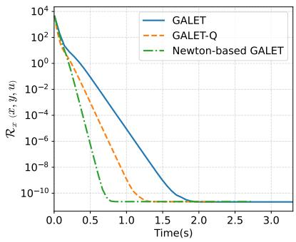

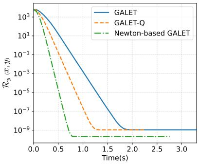  
Figure 1: GALET, $_ { \mathrm { G A L E T - Q , } }$ and Newton-based GALET on (12) with $\zeta = 1$ . Left: $\mathcal { R } _ { x }$ . Right: $\mathcal { R } _ { y } .$

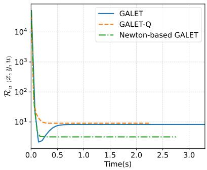

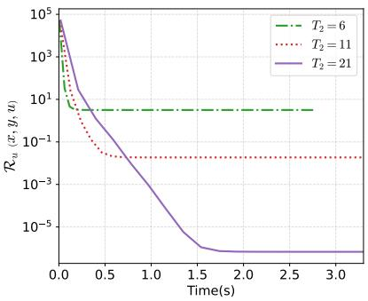  
Figure 2: Results on (12) with $\zeta = 1$ . Left: $\mathcal { R } _ { u }$ for GALET, $_ { \mathrm { G A L E T - Q } , }$ and Newton-based GALET. Right: $\mathcal { R } _ { u }$ for Newton-based GALET with $T _ { 2 } = 6 , 1 1 , 2 1$

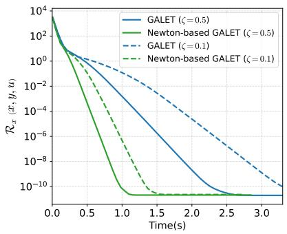

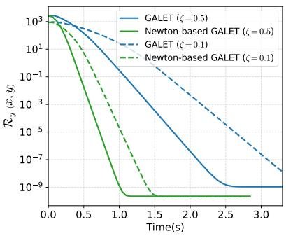  
Figure 3: GALET and Newton-based GALET on (12) with $\zeta = 0 . 5 , 0 . 1$ . Left: $\mathcal { R } _ { x }$ . Right: $\mathcal { R } _ { y }$

For the second setting, with a convex LL objective and an UL objective strongly convex in the LL variable, consider

$$
\begin{array} { l } { f ( x , y ) = \displaystyle \sum _ { i = 1 } ^ { m } \log \cosh \bigl ( x _ { i } - [ y _ { 2 } ] _ { i } \bigr ) + \frac 1 2 \| y _ { 1 } - e \| ^ { 2 } + \frac 1 2 \| y _ { 2 } \| ^ { 2 } , } \\ { g ( x , y ) = \displaystyle \frac 1 2 \| y _ { 1 } \| ^ { 2 } - \langle x , y _ { 1 } \rangle , } \end{array}\tag{13}
$$

where $x \in \mathbb { R } ^ { m } , y = ( y _ { 1 } , y _ { 2 } ) \in \mathbb { R } ^ { 2 m }$ , and e is the all-ones vector. The first term of $f$ is adapted from [Liu et al., 2023, Eq. (13)] to ensure that $\| \nabla _ { 1 } f ( x , y ) \|$ is uniformly bounded. The LL solution set is $\{ y : y _ { 1 } = x , \ y _ { 2 } \in \mathbb { R } ^ { m } \}$ , while $f ( x , \cdot )$ is strongly convex.

Figure 4 compares Newton-based BAMM with sl-BAMM. We set $T _ { k } = 2$ for Newton-based BAMM. On this example, Newton-based BAMM shows faster reduction in both the LL and KKT residuals.

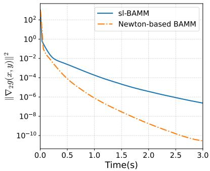

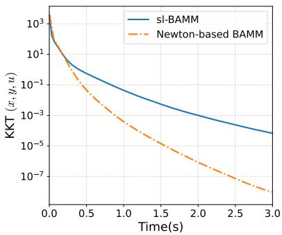  
Figure 4: Newton-based BAMM and sl-BAMM on (13), with stepsizes chosen according to Case 1 of Theorem 3.2.

## 4.2 Data Hyper-Cleaning

We next consider data hyper-cleaning, a standard bilevel optimization benchmark. The UL variable λ weights the training samples, while the LL variable ω represents the model parameters. We consider both linear and MLP models.

For the linear model, we use

$$
f ( \lambda , \omega ) = \frac { 1 } { | \mathscr { D } ^ { \prime } | } \sum _ { ( x _ { c } ^ { \prime } , y _ { c } ^ { \prime } ) \in \mathscr { D } ^ { \prime } } \mathcal { L } ( \omega x _ { c } ^ { \prime } , y _ { c } ^ { \prime } ) + c _ { r } \| \omega \| ^ { 2 } , \qquad g ( \lambda , \omega ) = \frac { 1 } { | \mathscr { D } | } \sum _ { ( x _ { c } , y _ { c } ) \in \mathscr { D } } \sigma ( \lambda _ { e } ) \mathcal { L } ( \omega x _ { e } , y _ { e } ) ,
$$

where D and $\mathcal { D } ^ { \prime }$ denote the training and validation sets, respectively, $\mathcal { L }$ is the cross-entropy loss, and $\sigma ( \lambda _ { e } )$ is the weight assigned to the e-th training sample. The LL objective is convex in $\omega ,$ while the quadratic regularizer with $c _ { r } > 0$ makes the UL objective strongly convex in $\omega ,$ , matching the setting of Newton-based BAMM.

We compare Newton-based BAMM with sl-BAMM on MNIST and FashionMNIST, using $T _ { k } = 2$ for Newton-based BAMM. Figure 5 shows faster reduction in the reported metrics for Newton-based BAMM on both datasets.

For the MLP model, we consider

$$
f ( \lambda , \omega ) = \frac { 1 } { | \mathscr { D } ^ { \prime } | } \sum _ { ( x _ { e } ^ { \prime } , y _ { e } ^ { \prime } ) \in \mathscr { D } ^ { \prime } } \mathcal { L } ( N ( x _ { e } ^ { \prime } , \omega ) , y _ { e } ^ { \prime } ) , \qquad g ( \lambda , \omega ) = \frac { 1 } { | \mathscr { D } | } \sum _ { ( x _ { e } , y _ { e } ) \in \mathscr { D } } \sigma ( \lambda _ { e } ) \mathcal { L } ( N ( x _ { e } , \omega ) , y _ { e } ) ,
$$

where $N ( \cdot , \omega )$ is a two-layer MLP. Unlike the linear setting, neither the convexity of the LL objective nor the strong convexity of the UL objective in ω is guaranteed. We therefore compare Newton-based GALET with GALET. Figure 6 shows that Newton-based GALET achieves higher accuracy within the reported running time on both datasets.

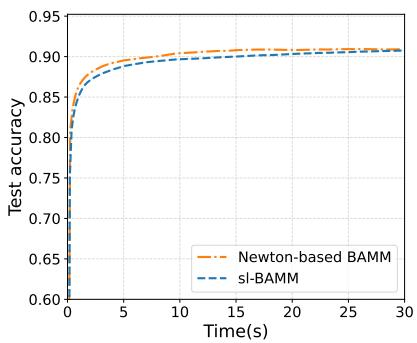

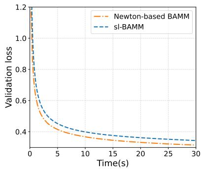

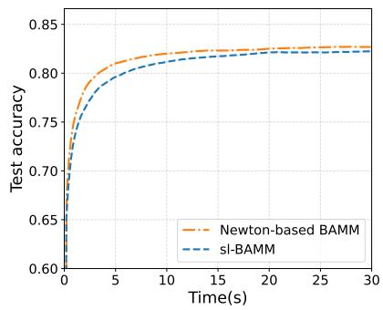

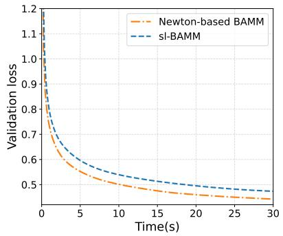  
Figure 5: Data hyper-cleaning with linear models. Comparison of sl-BAMM and Newton-based BAMM on MNIST (upper) and FashionMNIST (lower).

## 4.3 Data Denoising with GPT-2

We further evaluate Newton-based GALET on the data-denoising task of Pan et al. [2025], using GPT-2 with 124M parameters. The validation set $\mathcal { D } _ { \mathrm { v a l } }$ contains 1,000 clean Alpaca samples [Taori et al., 2023], while the training set consists of 1,000 clean samples $\mathcal { D } _ { 1 }$ and 9,000 corrupted samples $\mathcal { D } _ { 2 }$ , whose responses are replaced by $^ { 6 6 } \cdot ^ { 5 5 }$ . The goal is to assign a large weight to $\mathcal { D } _ { 1 }$ and a small weight to $\mathcal { D } _ { 2 }$

We formulate the task as

$$
f ( \lambda , w ) = \frac { 1 } { \left| \mathscr { D } _ { \mathrm { v a l } } \right| } \sum _ { z \in \mathscr { D } _ { \mathrm { v a l } } } \ell ( w ; z ) , \qquad g ( \lambda , w ) = \sum _ { i = 1 } ^ { 2 } \frac { \mathscr { p } _ { i } ( \lambda ) } { \left| \mathscr { D } _ { i } \right| } \sum _ { z \in \mathscr { D } _ { i } } \ell ( w ; z ) ,
$$

where w denotes the GPT-2 parameters, $\ell ( w ; z )$ is the causal language modeling loss, and $p _ { i } ( \lambda ) : =$ $\textstyle \exp ( \lambda _ { i } ) / \sum _ { i = 1 } ^ { 2 } \exp ( \lambda _ { j } )$ is the sampling weight of $\mathcal { D } _ { i }$

We compare Newton-based GALET with ScaleBiO [Pan et al., 2025], a single-loop first-order bilevel method. For Newton-based GALET, we set $T _ { 1 } = T _ { 2 } = 2 ;$ both methods use AdamW for all variable updates. Figure 7 shows that both methods increase the clean-source weight and decrease the corrupted-source weight, with Newton-based GALET adjusting the weights faster initially. After three epochs, Table 2 shows similar source weights but lower validation and test losses for

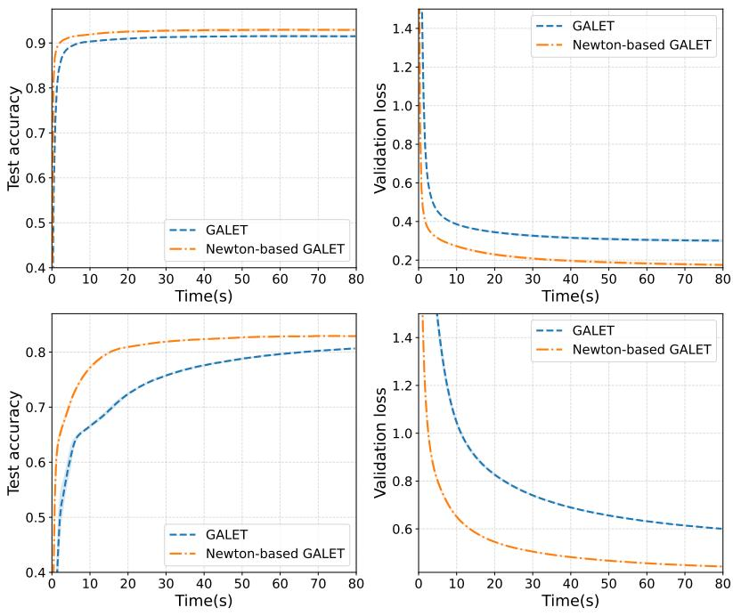

Figure 6: Data hyper-cleaning with two-layer MLPs. Comparison of GALET and Newton-based GALET on MNIST (upper) and FashionMNIST (lower).  
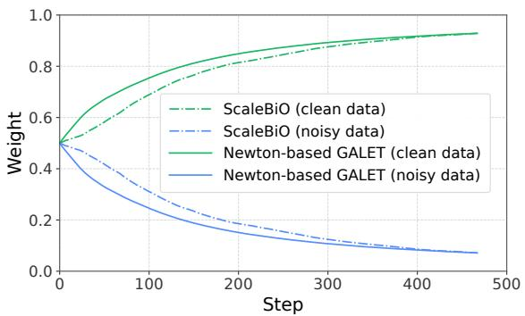  
Figure 7: Clean and corrupted data weights for ScaleBiO and Newton-based GALET, averaged over five random seeds.

Newton-based GALET, together with higher peak GPU memory due to the additional second-order computations.
<table><tr><td>Method</td><td></td><td>Clean weight Corrupted weight Validation loss Test loss Peak memory</td><td></td><td></td><td></td></tr><tr><td>ScaleBiO</td><td>0.928</td><td>0.072</td><td>2.603</td><td>2.555</td><td>9.984 GiB</td></tr><tr><td>Newton-based GALET</td><td>0.929</td><td>0.071</td><td>2.439</td><td>2.398</td><td>18.509 GiB</td></tr></table>

Table 2: GPT-2 data denoising after three training epochs, averaged over five random seeds.

## 5 A Generalized Newton-Based Framework

The proposed methods share a common structure: the LL and multiplier updates exploit curvature from the same LL model. Newton-based GALET uses g with potentially singular curvature, whereas Newton-based BAMM uses the strongly convex aggregation model $\psi _ { \sigma _ { k } }$ . Related structures also

appear in Newton and quasi-Newton bilevel methods [Ramzi et al., 2022, Fang et al., 2025, Dong et al., 2025]. We capture these common features in a generalized Newton-based framework for bilevel optimization (GNBO).

Lower-level model At iteration $k ,$ GNBO selects an LL model $h _ { k } ( x , y )$ with residuals

$$
\begin{array} { r l } & { \quad r _ { y } ( x , y ) = \nabla _ { 2 } h _ { k } ( x , y ) , } \\ & { \quad r _ { u } ( x , y , u ) = \nabla _ { 2 } f ( x , y ) - \nabla _ { 2 2 } ^ { 2 } h _ { k } ( x , y ) u , } \\ & { \quad r _ { x } ( x , y , u ) = \nabla _ { 1 } f ( x , y ) - \nabla _ { 1 2 } ^ { 2 } h _ { k } ( x , y ) u . } \end{array}
$$

Newton-based GALET takes $h _ { k } = g .$ , while Newton-based BAMM takes $h _ { k } = \psi _ { \sigma _ { k } } ;$ ; in both cases, $h _ { k }$ supplies the curvature shared by the LL and multiplier updates.

Lower-level update A Newton-type LL update targets $\nabla _ { 2 2 } ^ { 2 } h _ { k } ( x ^ { k } , y ) v = \nabla _ { 2 } h _ { k } ( x ^ { k } , y )$ . To allow one or multiple LL corrections per outer iteration, let $y ^ { 0 , k } = \tilde { y } ^ { k } , \ldots , y ^ { S , k } = y ^ { k + 1 }$ and consider

$$
B _ { v } ^ { s , k } v = q _ { v } ^ { s , k } ,\tag{14}
$$

where $B _ { v } ^ { s , k }$ approximates the curvature and $q _ { v } ^ { s , k }$ is derived from the LL residual. A subroutine $\mathcal { A } _ { v }$ approximately solves (14), followed by $y ^ { s + 1 , k } = y ^ { s , k } - \beta _ { s , k } v ^ { s , k }$ . Here, S counts LL corrections and $T _ { 1 } ^ { k }$ denotes the internal solver efort.

The multiplier and UL updates may use either the pre- or post-update LL point: $\tilde { y } ^ { k } \ =$ $\delta _ { y } y ^ { k } + ( 1 - \delta _ { y } ) y ^ { k + 1 }$ , where $\delta _ { y } \in \{ 0 , 1 \}$ . Thus, $\delta _ { y } = 0$ uses $y ^ { k + 1 }$ , while $\delta _ { y } = 1$ uses $y ^ { k }$ , as in Newton-based GALET, Newton-based BAMM, and NBO-GD.

Multiplier update At $\tilde { y } ^ { k }$ , the ideal multiplier system is $\nabla _ { 2 2 } ^ { 2 } h _ { k } ( x ^ { k } , \tilde { y } ^ { k } ) u = \nabla _ { 2 } f ( x ^ { k } , \tilde { y } ^ { k } )$ . GNBO represents its treatment by

$$
B _ { u } ^ { k } ( \delta _ { u } u ^ { k } - w ) = q _ { u } ^ { k } ,\tag{15}
$$

where $B _ { u } ^ { k }$ and $q _ { u } ^ { k }$ specify the curvature approximation and right-hand side. The indicator $\delta _ { u } \in \{ 0 , 1 \}$ distinguishes cold and warm starts: $\delta _ { u } = 0$ gives $u ^ { k + 1 } = - w ^ { k }$ , as in Newton-based GALET, while $\delta _ { u } \ : = \ : 1$ gives $u ^ { k + 1 } = u ^ { k } - w ^ { k }$ , as in Newton-based BAMM and NBO-GD. A subroutine $A _ { w }$ approximately solves (15), with $T _ { 2 } ^ { k }$ denoting the internal solver efort.

Upper-level update Set $\tilde { u } ^ { k } = \delta _ { u } u ^ { k } + ( 1 - \delta _ { u } ) u ^ { k + 1 }$ and

$$
d _ { x } ^ { k } = \nabla _ { 1 } f ( x ^ { k } , \tilde { y } ^ { k } ) - \nabla _ { 1 2 } ^ { 2 } h _ { k } ( x ^ { k } , \tilde { y } ^ { k } ) \tilde { u } ^ { k } .
$$

Then $x ^ { k + 1 } = x ^ { k } - \alpha _ { k } d _ { x } ^ { k }$ . Algorithm 4 summarizes the framework.

Algorithm 4 Generalized Newton-Based Bilevel Optimization (GNBO)   
1: Input: $\overline { { { x ^ { 0 } , y ^ { 0 } , u ^ { 0 } ; K , S , \{ T _ { 1 } ^ { k } , T _ { 2 } ^ { k } \} } } }$ ; step sizes $\{ \alpha _ { k } , \beta _ { s , k } \} ; \delta _ { y } , \delta _ { u } \in \{ 0 , 1 \}$   
2: for $k = 0 , \ldots , K - 1$ do   
3: Choose an LL model $h _ { k }$ and set $y ^ { 0 , k } = y ^ { k } .$ ▷ Lower-Level Update   
4: for $s = 0 , \ldots , S - 1$ do   
5: $v ^ { s , k } = \mathcal { A } _ { v } ( h _ { k } ; x ^ { k } , y ^ { s , k } ; T _ { 1 } ^ { k } )$ based on (14).   
6: $y ^ { s + 1 , k } = y ^ { s , k } - \beta _ { s , k } v ^ { s , k } .$   
7: end for   
8: Set $y ^ { k + 1 } = y ^ { S , k }$ and $\tilde { y } ^ { k } = \delta _ { y } y ^ { k } + ( 1 - \delta _ { y } ) y ^ { k + 1 }$   
9: $w ^ { k } = \mathcal { A } _ { w } ( h _ { k } ; x ^ { k } , \tilde { y } ^ { k } , u ^ { k } ; T _ { 2 } ^ { k } ) ^ { \smash { \mathrm { ~ \scriptsize ~ ( ~ ) ~ } } }$ based on (15). ▷ Multiplier Update   
10: Set $\boldsymbol { u } ^ { k + 1 } = \delta _ { u } \boldsymbol { u } ^ { k } - \boldsymbol { w } ^ { k }$ and $\tilde { u } ^ { k } = \delta _ { u } u ^ { k } + \big ( 1 - \delta _ { u } \big ) u ^ { k + 1 }$   
11: Set $d _ { x } ^ { k } = \nabla _ { 1 } f ( x ^ { k } , \tilde { y } ^ { k } ) - \nabla _ { 1 2 } ^ { 2 } h _ { k } ( x ^ { k } , \tilde { y } ^ { k } ) \tilde { u } ^ { k } .$ ▷ Upper-Level Update   
12: Set $x ^ { k + 1 } = x ^ { k } - \alpha _ { k } d _ { x } ^ { k } .$   
13: end for

The number of LL corrections $S$ is distinct from the internal solver efort: $S = 1$ means one LL update per outer iteration, even if computing its direction requires multiple solver iterations. Table 3 summarizes representative instances of GNBO.

<table><tr><td>Method</td><td>LL model LL corrections</td><td></td><td>Solver / curvature</td><td>(δy, δu)</td></tr><tr><td>SHINE [Ramzi et al., 2022]</td><td>g</td><td>Multiple</td><td>Quasi-Newton, reused</td><td>(0,0)</td></tr><tr><td>qNBO [Fang et al., 2025]</td><td>g</td><td>Multiple</td><td>Separate quasi-Newton</td><td>(0,0)</td></tr><tr><td>NBO-GD [Dong et al., 2025]</td><td>g</td><td>One</td><td>T GD steps, common Hessian</td><td>(1,1)</td></tr><tr><td>Newton-based GALET</td><td>g</td><td>One</td><td>T1/T2 GD steps, common Hessian</td><td>(1,0)</td></tr><tr><td>Newton-based BAMM</td><td>ψσk</td><td>One</td><td>Tk GD steps, common Hessian</td><td>(1,1)</td></tr></table>

Table 3: Representative instances of GNBO.

## 6 Concluding Remarks

We developed Newton-based methods for bilevel optimization beyond LL strong convexity and captured their shared-curvature structure through GNBO. For the settings studied, exploiting the same curvature in the LL and multiplier updates leads to improved complexity bounds over the corresponding baselines.

Several directions remain open. Hessian-vector products introduce additional memory and computational costs, particularly for large-scale neural networks. Improving scalability through parameter-eficient strategies such as LoRA [Hu et al., 2022] and LISA [Pan et al., 2024], or limitedmemory quasi-Newton approximations [Liu and Nocedal, 1989], is therefore of interest. Moreover, our methods use Newton-type LL and multiplier updates but retain a first-order UL update. Extending this approach to Newton-type UL updates under suitable higher-order smoothness conditions, as explored in recent work [Bi et al., 2026, Yang et al., 2026], is another direction for future study.

## A Experimental Details

All experiments are conducted on a machine with an Intel Xeon Gold 5218R CPU (2.10 GHz) and an NVIDIA H100 GPU (80 GB). The toy and data hyper-cleaning experiments are repeated over 10 runs, while the GPT-2 experiments use five random seeds.

Toy examples For $\mathrm { G A L E T , G A L E T { - } Q }$ , and Newton-based $\mathrm { G A L E T }$ , we set $\alpha _ { k } = \eta _ { k } = 0 . 1$ and $\gamma _ { k } = 0 . 0 1$ . For sl-BAMM, we use $p = 3 7 / 4 4 0$ and $\tau = 1 / 4 0$ ; for Newton-based BAMM, we use $p = 3 7 / 3 2 0$ and $\tau = 1 / 4 0$

Data hyper-cleaning For GALET and Newton-based GALET, we jointly tune $\left( \alpha _ { k } , \beta _ { k } , \eta _ { k } \right)$ by grid search, with $\alpha _ { k } \in \{ 1 0 ^ { 3 } , 1 0 ^ { 4 } , 1 0 ^ { 5 } \}$ and $\gamma _ { k } , \eta _ { k } \in \{ 1 0 ^ { - 3 / 2 } , 1 0 ^ { - 1 } , 1 0 ^ { - 1 / 2 } \}$ for MNIST or $\{ 1 0 ^ { - 5 / 2 } , 1 0 ^ { - 2 } , 1 0 ^ { - 3 / 2 } \}$ for FashionMNIST. For sl-BAMM and Newton-based BAMM, we use $( p , \tau ) =$ $( 3 7 / 4 4 0 , 1 / 4 0 )$ and $( 3 7 / 3 2 0 , 1 / 4 0 )$ , respectively.

Data denoising with GPT-2 ScaleBiO uses AdamW with a constant learning rate of $1 0 ^ { - 5 }$ for both model-variable updates. Newton-based GALET uses AdamW with the same learning rate for both linear-system solves. In both methods, the source-weight logits are updated using AdamW with a constant learning rate of $1 0 ^ { - 2 }$ . GPT-2 parameters are stored in $\mathrm { B F 1 6 . }$ with LISA disabled.

## B Proofs of Main Results and Auxiliary Lemmas

This appendix provides detailed proofs of the main convergence results, together with the statements and proofs of the auxiliary lemmas used in the analysis.

## B.1 Convergence Analysis of Newton-Based GALET

Proof of Lemma 1. Fix x. By Weyl’s inequality and the $L _ { g , \mathrm { { 2 ^ { - } } } } \mathrm { L i p s c h i t z }$ continuity of $\nabla _ { 2 2 } ^ { 2 } g ( x , \cdot )$ its eigenvalues vary continuously with y. Assumption 1 prevents any nonzero eigenvalue from crossing zero, so the inertia and rank of $\nabla _ { 2 2 } ^ { 2 } g ( x , y )$ are independent of y. At any $y ^ { \ast } \in Y ^ { \ast } ( x )$ , the second-order necessary condition gives $\nabla _ { 2 2 } ^ { 2 } g ( x , y ^ { * } ) \succeq 0$ . Hence $\nabla _ { 2 2 } ^ { 2 } g ( x , y ) \succeq 0$ for all $y ,$ and $g ( x , \cdot )$ is convex. Denote the common rank by r(x).

Apply [Hartman and Nirenberg, 1959, Lemma $2 ]$ to $p ( y ) : = \nabla _ { 2 } g ( x , y )$ , whose Jacobian has constant rank $r ( x )$ . Since $p ( y ^ { * } ) = 0$ , its zero set is locally an afine plane $y ^ { * } + L ( x )$ of dimension $n - r ( x )$ Convexity of $Y ^ { * } ( x ) = \{ y : p ( y ) = 0 \}$ extends this local characterization globally: $Y ^ { * } ( x ) = y ^ { * } + L ( x )$ Moreover, diferentiating $p ( y ^ { * } + t d ) = 0$ at $t ~ = ~ 0$ for d $\in \ L ( x )$ gives $L ( x ) \subseteq \ker ( \nabla _ { 2 2 } ^ { 2 } g ( x , y ^ { * } ) )$ . Since both spaces have dimension $n - r ( x )$

$$
Y ^ { * } ( x ) = y ^ { * } + K ( x ) , \qquad K ( x ) : = \ker ( \nabla _ { 2 2 } ^ { 2 } g ( x , y ^ { * } ) ) .\tag{16}
$$

Let $S ( x ) : = K ( x ) ^ { \perp }$ . For $d \in K ( x )$ , convexity and (16) imply $\langle \nabla _ { 2 } g ( x , y ) , y - y ^ { * } - t d \rangle \geq 0$ for every $t \in \mathbb R$ . Hence $\nabla _ { 2 } g ( x , y ) \perp K ( x )$ , so $\nabla _ { 2 } g ( x , y ) \in S ( x )$ . Diferentiating this relation with respect to y gives Range $( \nabla _ { 2 2 } ^ { 2 } g ( x , y ) ) \subseteq S ( x )$ . Both spaces have dimension $r ( x )$ ; therefore

$$
{ \mathrm { R a n g e ~ } } ( \nabla _ { 2 2 } ^ { 2 } g ( x , y ) ) = S ( x ) , \qquad \nabla _ { 2 } g ( x , y ) \in S ( x ) .\tag{17}
$$

Let $\hat { y }$ be the projection of y onto $Y ^ { \ast } ( x )$ . By (16), $y - { \hat { y } } \in S ( x )$ . Since the positive eigenvalues of the Hessian are at least $\mu , ( 1 7 )$ gives

$$
\langle \nabla _ { 2 } g ( x , y ) , y - \hat { y } \rangle = \int _ { 0 } ^ { 1 } ( y - \hat { y } ) ^ { \top } \nabla _ { 2 2 } ^ { 2 } g \big ( x , \hat { y } + s ( y - \hat { y } ) \big ) ( y - \hat { y } ) \mathrm { d } s \geq \mu \| y - \hat { y } \| ^ { 2 } .
$$

Thus, by Cauchy–Schwarz, $\| \nabla _ { 2 } g ( x , y ) \| \ge \mu \| y - \hat { y } \| = \mu$ dist $( y , Y ^ { * } ( x ) )$

Finally, suppose $\nabla _ { 2 } g ( \cdot , y )$ is $\begin{array} { r } { L _ { g , \mathrm { 1 ^ { - L } } } } \end{array}$ ipschitz. For $d \in K ( x ) , ( 1 6 )$ and the error bound give, for any $x ^ { \prime }$ and $t \in \mathbb { R }$

$$
\mathrm { d i s t } \ ( y ^ { * } ( x ) + t d , Y ^ { * } ( x ^ { \prime } ) ) \leq \frac { L _ { g , 1 } } { \mu } \| x ^ { \prime } - x \| .
$$

Since $Y ^ { * } ( x ^ { \prime } ) = y ^ { * } ( x ^ { \prime } ) + K ( x ^ { \prime } )$ , dividing by $t > 0$ and letting t → ∞ yields $d \in K ( x ^ { \prime } )$ . Interchanging x and $x ^ { \prime }$ shows that $K ( x ) = K ( x ^ { \prime } ) = : K$ , so $S : = K ^ { \perp }$ is independent of x. Since $\nabla _ { 2 } g ( x , y ) \in$ $S$ for all $x , y .$ , diferentiating with respect to x gives Range $( \nabla _ { 2 1 } ^ { 2 } g ( x , y ) ) \ \subseteq \ S$ . By (17), $S =$ Range $\big ( \nabla _ { 2 2 } ^ { 2 } g ( x , y ) \big )$ , and hence Range $( \nabla _ { 2 1 } ^ { 2 } g ( x , y ) ) \subseteq$ Range $( \nabla _ { 2 2 } ^ { 2 } g ( x , y ) )$ □

Following in part Xiao et al. [2023], define

$$
\begin{array} { r } { F ( x , y ; u ) : = f ( x , y ) - u ^ { \top } \nabla _ { 2 } g ( x , y ) , } \end{array}
$$

with u treated as fixed, and $u ^ { * } ( x , y ) : = [ \nabla _ { 2 2 } ^ { 2 } g ( x , y ) ] ^ { \dagger } \nabla _ { 2 } f ( x , y )$ . For the subsequent analysis, let

$$
L _ { F } : = L _ { f , 1 } + \frac { L _ { f , 0 } L _ { g , 2 } } { \mu } , \qquad L _ { u ^ { * } } : = \frac { ( 1 + \sqrt { 5 } ) L _ { f , 0 } L _ { g , 2 } } { 2 \mu ^ { 2 } } + \frac { L _ { f , 1 } } { \mu } .\tag{18}
$$

Lemma 2. Suppose Assumptions 1 and 3 hold. Then

$$
\| u ^ { * } ( x , y ) - u ^ { * } ( x ^ { \prime } , y ^ { \prime } ) \| \leq L _ { u ^ { * } } \big ( \| x - x ^ { \prime } \| + \| y - y ^ { \prime } \| \big ) .
$$

Proof. By Lemma 1, $\nabla _ { 2 2 } ^ { 2 } g ( x , y )$ has a common range, and hence constant rank, over $( x , y )$ . The result follows from the pseudoinverse perturbation bound [Stewart, 1977, Theorem 3.3] and the Lipschitz continuity of $\nabla _ { 2 2 } ^ { 2 } g$ and $\nabla _ { 2 } f ;$ see also [Xiao et al., 2023, Lemma 9]. □

Lemma 3. Suppose Assumptions 1 and 3 hold. Then Newton-based GALET satisfies

$$
\begin{array} { r l } & { \quad F ( x ^ { k + 1 } , y ^ { k + 1 } ; u ^ { * } ( x ^ { k + 1 } , y ^ { k + 1 } ) ) - F ( x ^ { k } , y ^ { k } ; u ^ { * } ( x ^ { k } , y ^ { k } ) ) } \\ & { \le \left( - \alpha _ { k } + \frac { \alpha _ { k } ^ { 2 } } { 2 } + \frac { L _ { F } \alpha _ { k } ^ { 2 } } { 2 } + \mu ^ { 2 } L _ { u ^ { * } } ^ { 2 } \alpha _ { k } ^ { 2 } + \frac { 3 L _ { g , 1 } ^ { 2 } \alpha _ { k } ^ { 2 } } { 2 \mu ^ { 2 } } \right) \| d _ { x } ^ { k } \| ^ { 2 } + \frac { 3 } { 2 \mu ^ { 2 } } \| \nabla _ { 2 } g ( x ^ { k } , y ^ { k } ) \| ^ { 2 } } \\ & { \quad + \left( \frac { L _ { F } } { 2 } + \mu ^ { 2 } L _ { u ^ { * } } ^ { 2 } + \frac { 3 L _ { g , 1 } ^ { 2 } } { 2 \mu ^ { 2 } } \right) \| v ^ { k } \| ^ { 2 } + \frac { L _ { g , 1 } ^ { 2 } } { 2 \mu ^ { 2 } } \| \nabla _ { 2 2 } ^ { 2 } g ( x ^ { k } , y ^ { k } ) u ^ { k + 1 } - \nabla _ { 2 2 } ^ { 2 } g ( x ^ { k } , y ^ { k } ) u ^ { * } ( x ^ { k } , y ^ { k } ) \| ^ { 2 } . } \end{array}
$$

Proof. Let $g _ { k } : = \nabla _ { 2 } g ( x ^ { k } , y ^ { k } )$ and $u _ { k } ^ { * } : = u ^ { * } ( x ^ { k } , y ^ { k } )$ . For fixed $u , F ( \cdot , \cdot ; u )$ has an $( L _ { f , 1 } + L _ { g , 2 } \| u \| ) \ –$ Lipschitz continuous gradient. Since $\| u _ { k } ^ { * } \| \leq L _ { f , 0 } / \mu , F ( \cdot , \cdot ; u _ { k } ^ { * } )$ has an $L _ { F ^ { - } } \mathrm { I }$ ipschitz continuous gradient. Decompose the potential diference as $\Delta _ { 1 } + \Delta _ { 2 }$ , where

$$
\begin{array} { r l } & { \Delta _ { 1 } : = F ( x ^ { k + 1 } , y ^ { k + 1 } ; u _ { k } ^ { * } ) - F ( x ^ { k } , y ^ { k } ; u _ { k } ^ { * } ) , } \\ & { } \\ & { \Delta _ { 2 } : = F ( x ^ { k + 1 } , y ^ { k + 1 } ; u ^ { * } ( x ^ { k + 1 } , y ^ { k + 1 } ) ) - F ( x ^ { k + 1 } , y ^ { k + 1 } ; u _ { k } ^ { * } ) . } \end{array}
$$

By $L _ { F }$ -smoothness,

$$
\begin{array} { l } { \displaystyle \Delta _ { 1 } \leq \langle \nabla _ { 1 } F ( x ^ { k } , y ^ { k } ; u _ { k } ^ { * } ) , x ^ { k + 1 } - x ^ { k } \rangle + \langle \nabla _ { 2 } F ( x ^ { k } , y ^ { k } ; u _ { k } ^ { * } ) , y ^ { k + 1 } - y ^ { k } \rangle } \\ { \displaystyle \qquad + \frac { L _ { F } } { 2 } \left( \| x ^ { k + 1 } - x ^ { k } \| ^ { 2 } + \| y ^ { k + 1 } - y ^ { k } \| ^ { 2 } \right) . } \end{array}\tag{19}
$$

By Lemma 1, Range $( \nabla _ { 2 1 } ^ { 2 } g ( x ^ { k } , y ^ { k } ) ) \subseteq$ Range $( \nabla _ { 2 2 } ^ { 2 } g ( x ^ { k } , y ^ { k } ) )$ . Since $\nabla _ { 2 2 } ^ { 2 } g ( x ^ { k } , y ^ { k } )$ is symmetric, this implies $\nabla _ { 1 2 } ^ { 2 } g ( x ^ { k } , y ^ { k } ) \ = \ \nabla _ { 1 2 } ^ { 2 } g ( x ^ { k } , y ^ { k } ) [ \nabla _ { 2 2 } ^ { 2 } g ( x ^ { k } , \tilde { y } ^ { k } ) ] ^ { \dagger } \nabla _ { 2 2 } ^ { 2 } g ( x ^ { k } , y ^ { k } )$ . Using this identity and $x ^ { k + 1 } - { \overset { \cdot } { x } } { } ^ { k } = - \alpha _ { k } d _ { x } ^ { k } .$

$$
\begin{array} { r l r } {  { \langle \nabla _ { 1 } F ( x ^ { k } , y ^ { k } ; u _ { k } ^ { * } ) , x ^ { k + 1 } - x ^ { k } \rangle = - \alpha _ { k } \| d _ { x } ^ { k } \| ^ { 2 } } } \\ & { } & { \quad +  \nabla _ { 1 2 } ^ { 2 } g ( x ^ { k } , y ^ { k } ) [ \nabla _ { 2 2 } ^ { 2 } g ( x ^ { k } , y ^ { k } ) ] ^ { \dagger } \big ( \nabla _ { 2 2 } ^ { 2 } g ( x ^ { k } , y ^ { k } ) u ^ { k + 1 } - \nabla _ { 2 2 } ^ { 2 } g ( x ^ { k } , y ^ { k } ) u _ { k } ^ { * } \big ) , x ^ { k + 1 } - x ^ { k }  } \\ & { \leq } & { \quad - ( \alpha _ { k } - \frac { \alpha _ { k } ^ { 2 } } { 2 } ) \| d _ { x } ^ { k } \| ^ { 2 } + \frac { L _ { g , 1 } ^ { 2 } } { 2 \mu ^ { 2 } } \| \nabla _ { 2 2 } ^ { 2 } g ( x ^ { k } , y ^ { k } ) u ^ { k + 1 } - \nabla _ { 2 2 } ^ { 2 } g ( x ^ { k } , y ^ { k } ) u _ { k } ^ { * } \| ^ { 2 } , } \end{array}
$$

where we used $\| \nabla _ { 1 2 } ^ { 2 } g ( x ^ { k } , y ^ { k } ) \| _ { \mathrm { o p } } \leq L _ { g , 1 }$ and $\| [ \nabla _ { 2 2 } ^ { 2 } g ( x ^ { k } , y ^ { k } ) ] ^ { \dagger } \| _ { \mathrm { o p } } \leq 1 / \mu$ . For the y-term, Algorithm 1 gives

$$
v ^ { k } = \gamma _ { k } \sum _ { i = 0 } ^ { T _ { 1 } - 1 } ( I - \gamma _ { k } \nabla _ { 2 2 } ^ { 2 } g ( x ^ { k } , y ^ { k } ) ) ^ { i } g _ { k } \in \mathrm { R a n g e } \ ( \nabla _ { 2 2 } ^ { 2 } g ( x ^ { k } , y ^ { k } ) ) .\tag{20}
$$

Let ${ \cal P } _ { k } : = \nabla _ { 2 2 } ^ { 2 } g ( x ^ { k } , y ^ { k } ) [ \nabla _ { 2 2 } ^ { 2 } g ( x ^ { k } , y ^ { k } ) ] ^ { \dagger }$ be the orthogonal projector onto Range $( \nabla _ { 2 2 } ^ { 2 } g ( x ^ { k } , y ^ { k } ) )$ Since $\nabla _ { 2 2 } ^ { 2 } g ( x ^ { k } , y ^ { k } ) u _ { k } ^ { * } = P _ { k } \nabla _ { 2 } f ( x ^ { k } , y ^ { k } )$

$$
\nabla _ { 2 } F ( x ^ { k } , y ^ { k } ; u _ { k } ^ { * } ) = ( I - P _ { k } ) \nabla _ { 2 } f ( x ^ { k } , y ^ { k } ) \in ( \operatorname { R a n g e } \ ( \nabla _ { 2 2 } ^ { 2 } g ( x ^ { k } , y ^ { k } ) ) ) ^ { \perp } .
$$

As $y ^ { k + 1 } - y ^ { k } = - v ^ { k } \in$ Range $( \nabla _ { 2 2 } ^ { 2 } g ( x ^ { k } , y ^ { k } ) )$ , the corresponding inner product in (19) vanishes. Hence

$$
\begin{array} { l } { \displaystyle \Delta _ { 1 } \leq \left( - \alpha _ { k } + \frac { \alpha _ { k } ^ { 2 } } { 2 } + \frac { L _ { F } \alpha _ { k } ^ { 2 } } { 2 } \right) \| d _ { x } ^ { k } \| ^ { 2 } + \frac { L _ { F } } { 2 } \| v ^ { k } \| ^ { 2 } } \\ { \displaystyle \qquad + \frac { L _ { g , 1 } ^ { 2 } } { 2 \mu ^ { 2 } } \| \nabla _ { 2 2 } ^ { 2 } g ( x ^ { k } , y ^ { k } ) u ^ { k + 1 } - \nabla _ { 2 2 } ^ { 2 } g ( x ^ { k } , y ^ { k } ) u _ { k } ^ { * } \| ^ { 2 } . } \end{array}\tag{21}
$$

For $\Delta _ { 2 }$ , linearity of F in u and Young’s inequality give

$$
\begin{array} { r l } & { \Delta _ { 2 } = \big \langle u _ { k } ^ { * } - u ^ { * } ( x ^ { k + 1 } , y ^ { k + 1 } ) , \nabla _ { 2 } g ( x ^ { k + 1 } , y ^ { k + 1 } ) \big \rangle } \\ & { \quad \leq \displaystyle \frac { \mu ^ { 2 } } { 2 } \| u ^ { * } ( x ^ { k + 1 } , y ^ { k + 1 } ) - u _ { k } ^ { * } \| ^ { 2 } + \frac { 1 } { 2 \mu ^ { 2 } } \| \nabla _ { 2 } g ( x ^ { k + 1 } , y ^ { k + 1 } ) \| ^ { 2 } . } \end{array}
$$

By Lemma 2 and the updates of x and $y .$

$$
\begin{array} { r } { \| u ^ { * } ( x ^ { k + 1 } , y ^ { k + 1 } ) - u _ { k } ^ { * } \| ^ { 2 } \leq 2 L _ { u ^ { * } } ^ { 2 } \left( \alpha _ { k } ^ { 2 } \| d _ { x } ^ { k } \| ^ { 2 } + \| v ^ { k } \| ^ { 2 } \right) . } \end{array}
$$

Moreover, the ${ \cal L } _ { g , 1 ^ { - 1 } }$ Lipschitz continuity of $\nabla _ { 2 } g$ gives

$$
\begin{array} { r } { \| \nabla _ { 2 } g ( x ^ { k + 1 } , y ^ { k + 1 } ) \| ^ { 2 } \leq 3 \| g _ { k } \| ^ { 2 } + 3 L _ { g , 1 } ^ { 2 } \alpha _ { k } ^ { 2 } \| d _ { x } ^ { k } \| ^ { 2 } + 3 L _ { g , 1 } ^ { 2 } \| v ^ { k } \| ^ { 2 } . } \end{array}
$$

Therefore,

$$
\Delta _ { 2 } \leq \left( \mu ^ { 2 } L _ { u ^ { * } } ^ { 2 } \alpha _ { k } ^ { 2 } + \frac { 3 L _ { g , 1 } ^ { 2 } \alpha _ { k } ^ { 2 } } { 2 \mu ^ { 2 } } \right) \| d _ { x } ^ { k } \| ^ { 2 } + \frac { 3 } { 2 \mu ^ { 2 } } \| g _ { k } \| ^ { 2 } + \left( \mu ^ { 2 } L _ { u ^ { * } } ^ { 2 } + \frac { 3 L _ { g , 1 } ^ { 2 } } { 2 \mu ^ { 2 } } \right) \| v ^ { k } \| ^ { 2 } .\tag{22}
$$

Combining (21) and (22) proves the result.

Lemma 4. Suppose Assumptions 1 and 3 hold. In Newton-based $G A L E T ,$ let $0 \leq \gamma _ { k } \leq 1 / L _ { g , 1 }$ and $T _ { 1 } \geq \log ( 1 / 4 ) / \log ( 1 - \mu \gamma _ { k } ) . \ I f \ \| \nabla _ { 2 } g ( x ^ { k } , y ^ { k } ) \| \leq \mu ^ { 2 } / ( 2 L _ { g , 2 } )$ , then

$$
\| \nabla _ { 2 } g ( x ^ { k + 1 } , y ^ { k + 1 } ) \| \leq \frac { 1 } { 2 } \| \nabla _ { 2 } g ( x ^ { k } , y ^ { k } ) \| + L _ { g , 1 } \| x ^ { k + 1 } - x ^ { k } \| .
$$

Proof. Let $g _ { k } : = \nabla _ { 2 } g ( x ^ { k } , y ^ { k } )$ . Since $y ^ { k + 1 } = y ^ { k } - v ^ { k }$ and $\nabla _ { 2 2 } ^ { 2 } g ( x ^ { k } , \cdot )$ is $L _ { g , }$ <sub>2</sub>-Lipschitz continuous, Taylor’s theorem gives

$$
\| \nabla _ { 2 } g ( x ^ { k } , y ^ { k + 1 } ) - g _ { k } + \nabla _ { 2 2 } ^ { 2 } g ( x ^ { k } , y ^ { k } ) v ^ { k } \| \leq \frac { L _ { g , 2 } } { 2 } \| v ^ { k } \| ^ { 2 } .
$$

Define $r _ { k } : = g _ { k } - \nabla _ { 2 2 } ^ { 2 } g ( x ^ { k } , y ^ { k } ) v ^ { k }$ . Then

$$
\| \nabla _ { 2 } g ( x ^ { k } , y ^ { k + 1 } ) \| \leq \frac { L _ { g , 2 } } { 2 } \| v ^ { k } \| ^ { 2 } + \| r _ { k } \| .\tag{23}
$$

By Lemma 1, $g _ { k } \in$ Range $( \nabla _ { 2 2 } ^ { 2 } g ( x ^ { k } , y ^ { k } ) )$ . Using (20) and the fact that the positive eigenvalues of $\nabla _ { 2 2 } ^ { 2 } g ( x ^ { k } , y ^ { k } )$ lie in $[ \mu , L _ { g , 1 } ]$ , we have

$$
\| v ^ { k } \| \leq { \frac { 1 } { \mu } } \| g _ { k } \| .\tag{24}
$$

To bound $r _ { k } .$ , let $v ^ { t , k }$ be the t-th iterate of $\mathrm { G D } ( \nabla _ { 2 2 } ^ { 2 } g ( x ^ { k } , y ^ { k } ) , g _ { k } ; \gamma _ { k } , T _ { 1 } )$ and set $r ^ { t , k } : = g _ { k } -$ $\nabla _ { 2 2 } ^ { 2 } g ( x ^ { k } , y ^ { k } ) v ^ { t , k }$ . Then $\boldsymbol { r } ^ { t + 1 , k } = ( I - \gamma _ { k } \nabla _ { 2 2 } ^ { 2 } g ( x ^ { k } , y ^ { \bar { k } } ) ) \boldsymbol { r } ^ { t , k }$ . Since $r ^ { t , k } \in$ Range $( \nabla _ { 2 2 } ^ { 2 } g ( x ^ { k } , y ^ { k } ) )$ , Assumption 1 and $\gamma _ { k } \leq 1 / L _ { g , 1 }$ imply

$$
\| r ^ { t + 1 , k } \| \leq ( 1 - \mu \gamma _ { k } ) \| r ^ { t , k } \| .
$$

As $v ^ { 0 , k } = 0 .$ , after $T _ { 1 }$ iterations,

$$
\| r _ { k } \| \leq ( 1 - \mu \gamma _ { k } ) ^ { T _ { 1 } } \| g _ { k } \| \leq { \frac { 1 } { 4 } } \| g _ { k } \| .\tag{25}
$$

Combining (23), (24), and (25),

$$
\| \nabla _ { 2 } g ( x ^ { k } , y ^ { k + 1 } ) \| \leq \frac { L _ { g , 2 } } { 2 \mu ^ { 2 } } \| g _ { k } \| ^ { 2 } + \frac { 1 } { 4 } \| g _ { k } \| \leq \frac { 1 } { 2 } \| g _ { k } \| ,
$$

where the last inequality uses $\| g _ { k } \| \le \mu ^ { 2 } / ( 2 L _ { g , 2 } )$ . Finally, the $L _ { g , }$ <sub>1</sub>-Lipschitz continuity of $\nabla _ { 2 } g$ gives

$$
\| \nabla _ { 2 } g ( x ^ { k + 1 } , y ^ { k + 1 } ) \| \leq \| \nabla _ { 2 } g ( x ^ { k } , y ^ { k + 1 } ) \| + L _ { g , 1 } \| x ^ { k + 1 } - x ^ { k } \| \leq \frac { 1 } { 2 } \| g _ { k } \| + L _ { g , 1 } \| x ^ { k + 1 } - x ^ { k } \| ,
$$

which proves the result.

Lemma 5. Suppose Assumptions 1 and 3 hold. In Newton-based GALET, $i f 0 \leq \eta _ { k } \leq 1 / L _ { g , 1 }$ , then

$$
\begin{array} { r } { \big \| \nabla _ { 2 2 } ^ { 2 } g ( x ^ { k } , y ^ { k } ) u ^ { k + 1 } - \nabla _ { 2 2 } ^ { 2 } g ( x ^ { k } , y ^ { k } ) [ \nabla _ { 2 2 } ^ { 2 } g ( x ^ { k } , y ^ { k } ) ] ^ { \dagger } \nabla _ { 2 } f ( x ^ { k } , y ^ { k } ) \big \| \leq L _ { f , 0 } ( 1 - \mu \eta _ { k } ) ^ { T _ { 2 } } . } \end{array}
$$

Proof. Let $\boldsymbol { u } ^ { t , k }$ be the t-th iterate of $\mathrm { G D } ( \nabla _ { 2 2 } ^ { 2 } g ( x ^ { k } , y ^ { k } ) , \nabla _ { 2 } f ( x ^ { k } , y ^ { k } ) ; \eta _ { k } , T _ { 2 } )$ and define $e ^ { t , k } : =$ $\nabla _ { 2 2 } ^ { 2 } \tilde { g } ( x ^ { k } , y ^ { k } ) u ^ { t , k } - \nabla _ { 2 2 } ^ { 2 } g ( x ^ { k } , y ^ { k } ) [ \nabla _ { 2 2 } ^ { 2 } g ( x ^ { k } , y ^ { k } ) ] ^ { \dagger } \tilde { \nabla } _ { 2 } ^ { 2 } f ( x ^ { k } , y ^ { k } )$ . The GD iteration gives $e ^ { t + 1 , k } = ( I -$ $\eta _ { k } \mathbf { \bar { V } } _ { 2 2 } ^ { 2 } g ( x ^ { k } , y ^ { k } ) ) e ^ { t , k }$ . Since $e ^ { t , k } \in$ Range $( \nabla _ { 2 2 } ^ { 2 } g ( x ^ { k } , y ^ { k } ) )$ , the nonzero eigenvalues of $\nabla _ { 2 2 } ^ { 2 } g ( x ^ { k } , y ^ { k } )$ lie in $[ \mu , L _ { g , 1 ] }$ , and $\eta _ { k } \le 1 / L _ { g , 1 }$

$$
\lVert e ^ { t + 1 , k } \rVert \leq ( 1 - \mu \eta _ { k } ) \lVert e ^ { t , k } \rVert .
$$

Moreover, $u ^ { 0 , k } \ = \ 0$ and $P _ { k } \ = \ \nabla _ { 2 2 } ^ { 2 } g ( x ^ { k } , y ^ { k } ) [ \nabla _ { 2 2 } ^ { 2 } g ( x ^ { k } , y ^ { k } ) ] ^ { \dagger }$ is the orthogonal projector onto Range $( \nabla _ { 2 2 } ^ { 2 } g ( x ^ { k } , y ^ { k } ) )$ , so

$$
\| e ^ { 0 , k } \| = \| P _ { k } \nabla _ { 2 } f ( x ^ { k } , y ^ { k } ) \| \leq \| \nabla _ { 2 } f ( x ^ { k } , y ^ { k } ) \| \leq L _ { f , 0 } .
$$

Therefore, $\Vert e ^ { T _ { 2 } , k } \Vert \leq L _ { f , 0 } ( 1 - \mu \eta _ { k } ) ^ { T _ { 2 } }$ . Since $\boldsymbol { u } ^ { k + 1 } = \boldsymbol { u } ^ { T _ { 2 } , k }$ , the result follows.

Proof of Theorem 3.1 . We first establish by induction the local-region bound

$$
\| \nabla _ { 2 } g ( x ^ { k } , y ^ { k } ) \| \leq \frac { \mu ^ { 2 } } { 2 L _ { g , 2 } } , \qquad k = 0 , \ldots , K .\tag{26}
$$

By Lemma 1, Range $( \nabla _ { 2 1 } ^ { 2 } g ( x ^ { k } , y ^ { k } ) ) \subseteq$ Range $( \nabla _ { 2 2 } ^ { 2 } g ( x ^ { k } , y ^ { k } ) )$ . Using $\| u ^ { * } ( x ^ { k } , y ^ { k } ) \| ~ \leq ~ L _ { f , 0 } / \mu$ $\| [ \nabla _ { 2 2 } ^ { 2 } g ( x ^ { k } , y ^ { k } ) ] ^ { \dagger } \| _ { \mathrm { o p } } \overset { - } { \leq } 1 / \mu$ , and Lemma $5 ,$ we obtain

$$
\Vert d _ { x } ^ { k } \Vert \leq C _ { f , 0 } + \frac { L _ { g , 1 } L _ { f , 0 } } { \mu } \big ( 1 + ( 1 - \mu \eta _ { k } ) ^ { T _ { 2 } } \big ) \leq C _ { f , 0 } + \frac { 2 L _ { g , 1 } L _ { f , 0 } } { \mu } = : D .
$$

If (26) holds at iteration $k ,$ Lemma 4 and $x ^ { k + 1 } - x ^ { k } = - \alpha d _ { x } ^ { k }$ give

$$
\| \nabla _ { 2 } g ( x ^ { k + 1 } , y ^ { k + 1 } ) \| \leq \frac { \mu ^ { 2 } } { 4 L _ { g , 2 } } + L _ { g , 1 } \alpha D .
$$

Thus, $\alpha \leq \mu ^ { 2 } / ( 4 L _ { g , 1 } L _ { g , 2 } D )$ preserves (26). Together with the initialization condition, induction proves (26). This requirement is satisfied by $\alpha = \Theta ( \kappa ^ { - 4 } )$ with a suficiently small constant factor, under the stated parameter-dependence convention.

Let $F _ { k } : = F ( x ^ { k } , y ^ { k } ; u ^ { * } ( x ^ { k } , y ^ { k } ) )$ and define the Lyapunov function

$$
V _ { k } : = F _ { k } - f ^ { * } + c \| \nabla _ { 2 } g ( x ^ { k } , y ^ { k } ) \| ^ { 2 } + \frac { L _ { f , 0 } ^ { 2 } } { c \mu ^ { 2 } } ,
$$

where $c > 0$ will be specified below. We first show that $V _ { k } \geq 0$

Let $\hat { y } ^ { k }$ be the Euclidean projection of $y ^ { k }$ onto $Y ^ { \ast } ( x ^ { k } )$ . By Assumption 3(d) and Lemma 1,

$$
f ( x ^ { k } , y ^ { k } ) \geq f ( x ^ { k } , \hat { y } ^ { k } ) - \frac { L _ { f , 0 } } { \mu } \| \nabla _ { 2 } g ( x ^ { k } , y ^ { k } ) \| \geq f ^ { * } - \frac { L _ { f , 0 } } { \mu } \| \nabla _ { 2 } g ( x ^ { k } , y ^ { k } ) \| .
$$

Moreover, since $\| u ^ { * } ( x ^ { k } , y ^ { k } ) \| \leq L _ { f , 0 } / \mu$

$$
F _ { k } \geq f ( x ^ { k } , y ^ { k } ) - \frac { L _ { f , 0 } } { \mu } \| \nabla _ { 2 } g ( x ^ { k } , y ^ { k } ) \| \geq f ^ { * } - \frac { 2 L _ { f , 0 } } { \mu } \| \nabla _ { 2 } g ( x ^ { k } , y ^ { k } ) \| .
$$

Consequently, completing the square yields

$$
V _ { k } \ge c \left( \| \nabla _ { 2 } g ( x ^ { k } , y ^ { k } ) \| - \frac { L _ { f , 0 } } { c \mu } \right) ^ { 2 } \ge 0 .
$$

This lower bound holds globally, without requiring (26), which is needed for the Newton-type contraction analysis.

Lemma 4 gives

$$
\| \nabla _ { 2 } g ( x ^ { k + 1 } , y ^ { k + 1 } ) \| ^ { 2 } \leq \frac { 1 } { 2 } \| \nabla _ { 2 } g ( x ^ { k } , y ^ { k } ) \| ^ { 2 } + 2 L _ { g , 1 } ^ { 2 } \alpha ^ { 2 } \| d _ { x } ^ { k } \| ^ { 2 } .\tag{27}
$$

Using $\| v ^ { k } \| \leq \mu ^ { - 1 } \| \nabla _ { 2 } g ( x ^ { k } , y ^ { k } ) \|$ from (24), Lemmas 3 and 5 together with (27) yield

$$
\begin{array} { r l } &  { \displaystyle { V _ { k + 1 } - V _ { k } \leq \left( - \alpha + \alpha ^ { 2 } \left( \frac { 1 + L _ { F } } { 2 } + \mu ^ { 2 } L _ { u ^ { * } } ^ { 2 } + \frac { 3 L _ { g , 1 } ^ { 2 } } { 2 \mu ^ { 2 } } + 2 c L _ { g , 1 } ^ { 2 } \right) \right) \| d _ { x } ^ { k } \| ^ { 2 } } } \\ & { \quad \quad \quad \quad \quad \quad \quad \quad + \left( - \frac { c } { 2 } + \frac { 3 + L _ { F } } { 2 \mu ^ { 2 } } + L _ { u ^ { * } } ^ { 2 } + \frac { 3 L _ { g , 1 } ^ { 2 } } { 2 \mu ^ { 4 } } \right) \| { \nabla _ { 2 } g ( x ^ { k } , y ^ { k } ) \| ^ { 2 } } + \frac { L _ { g , 1 } ^ { 2 } L _ { f , 0 } ^ { 2 } } { 2 \mu ^ { 2 } } ( 1 - \mu \eta _ { k } ) ^ { 2 T _ { 2 } } . } \end{array}
$$

The second coeficient is at most $- c / 4$ if

$$
c \geq \frac { 2 ( 3 + L _ { F } ) } { \mu ^ { 2 } } + 4 L _ { u ^ { * } } ^ { 2 } + \frac { 6 L _ { g , 1 } ^ { 2 } } { \mu ^ { 4 } } ,
$$

while the first is at most $- \alpha / 2$ if

$$
\alpha \leq \left( 1 + L _ { F } + 2 \mu ^ { 2 } L _ { u ^ { * } } ^ { 2 } + \frac { 3 L _ { g , 1 } ^ { 2 } } { \mu ^ { 2 } } + 4 c L _ { g , 1 } ^ { 2 } \right) ^ { - 1 } .
$$

The bounds on $L _ { F }$ and $L _ { u ^ { * } }$ , together with the parameter-dependence convention, allow us to choose $c = \Theta ( L ^ { 2 } / \mu ^ { 4 } )$ with a suficiently large constant and $\alpha = \Theta ( \kappa ^ { - 4 } )$ with a suficiently small constant. These choices satisfy both descent conditions and preserve (26).

Since $\eta _ { k } = \Theta ( 1 / L _ { g , 1 } )$ and $L _ { g , 1 } / \mu \le \kappa$ , there exists $c _ { \eta } > 0$ , independent of k and $\kappa ,$ such that $\mu \eta _ { k } \ge c _ { \eta } / \kappa$ . Choosing $T _ { 2 } \ge \kappa \log ( \kappa ^ { 2 } K ) / ( 2 c _ { \eta } )$ gives

$$
( 1 - \mu \eta _ { k } ) ^ { 2 T _ { 2 } } \leq e ^ { - 2 c _ { \eta } T _ { 2 } / \kappa } \leq \frac { 1 } { \kappa ^ { 2 } K } .\tag{28}
$$

Thus, $T _ { 2 } = \Theta ( \kappa \log ( \kappa K ) )$ with a suficiently large constant factor yields

$$
V _ { k + 1 } - V _ { k } \leq - \frac { \alpha } { 2 } \| d _ { x } ^ { k } \| ^ { 2 } - \frac { c } { 4 } \| \nabla _ { 2 } g ( x ^ { k } , y ^ { k } ) \| ^ { 2 } + \frac { L _ { f , 0 } ^ { 2 } } { 2 K } ,\tag{29}
$$

where we used $L _ { q , 1 } ^ { 2 } / \mu ^ { 2 } \leq \kappa ^ { 2 }$

It remains to bound $V _ { 0 } .$ By its definition, $\| u ^ { * } ( x ^ { 0 } , y ^ { 0 } ) \| \leq L _ { f , 0 } / \mu$ , and the initialization condition,

$$
\begin{array} { l } { { V _ { 0 } \le f ( x ^ { 0 } , y ^ { 0 } ) - f ^ { * } + \displaystyle \frac { L _ { f , 0 } } { \mu } \| \nabla _ { 2 } g ( x ^ { 0 } , y ^ { 0 } ) \| + c \| \nabla _ { 2 } g ( x ^ { 0 } , y ^ { 0 } ) \| ^ { 2 } + \displaystyle \frac { L _ { f , 0 } ^ { 2 } } { c \mu ^ { 2 } } } } \\ { { \le f ( x ^ { 0 } , y ^ { 0 } ) - f ^ { * } + \displaystyle \frac { L _ { f , 0 } } { \kappa } + \displaystyle \frac { c \mu ^ { 4 } } { L ^ { 2 } } + \displaystyle \frac { L _ { f , 0 } ^ { 2 } } { c \mu ^ { 2 } } . } } \end{array}
$$

Since $c = \Theta ( L ^ { 2 } / \mu ^ { 4 } )$ and $\kappa = L / \mu \geq 1$ , we have $V _ { 0 } = O ( 1 )$ with respect to $\kappa ,$ provided the initial objective gap and other problem constants are uniformly bounded.

Summing (29) over $k = 0 , \ldots , K - 1$ and using $V _ { K } \geq 0$ gives

$$
{ \frac { 1 } { K } } \sum _ { k = 0 } ^ { K - 1 } \| d _ { x } ^ { k } \| ^ { 2 } = O \left( { \frac { \kappa ^ { 4 } } { K } } \right) ,\tag{30}
$$

$$
{ \frac { 1 } { K } } \sum _ { k = 0 } ^ { K - 1 } \| \nabla _ { 2 } g ( x ^ { k } , y ^ { k } ) \| ^ { 2 } = O \left( { \frac { 1 } { c K } } \right) .\tag{31}
$$

Since $\mathcal { R } _ { x } ( x ^ { k } , y ^ { k } , u ^ { k + 1 } ) = \| d _ { x } ^ { k } \| ^ { 2 }$ , (30) gives the claimed $\mathcal { R } _ { x }$ bound. By the PL inequality following Lemma 1, $\mathcal { R } _ { y } ( x ^ { k } , y ^ { k } ) \leq \mu ^ { - 1 } \| \nabla _ { 2 } g ( x ^ { k } , y ^ { k } ) \| ^ { 2 }$ . Thus, (31) and $c = \Theta ( L ^ { 2 } / \mu ^ { 4 } )$ yield

$$
\frac { 1 } { K } \sum _ { k = 0 } ^ { K - 1 } \mathcal { R } _ { y } ( x ^ { k } , y ^ { k } ) = O \left( \frac { \mu } { \kappa ^ { 2 } K } \right) = O \left( \frac { 1 } { \kappa ^ { 2 } K } \right) ,
$$

where the last step uses $0 < \mu \leq 1$

For the multiplier residual, $\nabla _ { 2 2 } ^ { 2 } g ( x ^ { k } , y ^ { k } ) ( I - P _ { k } ) = 0$ and Lemma 5 give

$$
\begin{array} { r l } & { \mathcal { R } _ { u } ( x ^ { k } , y ^ { k } , u ^ { k + 1 } ) = \| \nabla _ { 2 2 } ^ { 2 } g ( x ^ { k } , y ^ { k } ) ( P _ { k } \nabla _ { 2 } f ( x ^ { k } , y ^ { k } ) - \nabla _ { 2 2 } ^ { 2 } g ( x ^ { k } , y ^ { k } ) u ^ { k + 1 } ) \| ^ { 2 } } \\ & { \qquad \leq L _ { g , 1 } ^ { 2 } L _ { f , 0 } ^ { 2 } ( 1 - \mu \eta _ { k } ) ^ { 2 T _ { 2 } } . } \end{array}
$$

By (28) and $L _ { g , 1 } / \mu \leq \kappa ,$ , we obtain

$$
\frac { 1 } { K } \sum _ { k = 0 } ^ { K - 1 } \mathcal { R } _ { u } ( x ^ { k } , y ^ { k } , u ^ { k + 1 } ) = O ( K ^ { - 1 } ) .
$$

Combining the three bounds, there exists $k ^ { * } \in \{ 0 , \ldots , K - 1 \}$ such that all three residuals at $( x ^ { k ^ { * } } , y ^ { k ^ { * } } , u ^ { k ^ { * } + 1 } )$ are $O ( \kappa ^ { 4 } / K )$ . Thus, $K = O ( \kappa ^ { 4 } / \epsilon )$ outer iterations sufice for ϵ-stationarity. Each outer iteration requires $O ( 1 )$ gradient/JVP computations and $T _ { 1 } + T _ { 2 } = O ( \kappa \log ( \kappa K ) )$ Hessianvector products. With $K = \stackrel { \cdot } { O } ( \kappa ^ { 4 } / \epsilon )$ , the total complexities are ${ \cal O } ( \kappa ^ { 4 } / \epsilon )$ gradient $/ \mathrm { J V P }$ computations and ${ \cal O } ( \kappa ^ { 5 } \epsilon ^ { - 1 } \log ( \kappa / \epsilon ) )$ ) Hessian-vector products. □

## B.2 Convergence Analysis for Newton-Based BAMM

For convenience, define

$$
\begin{array} { r l } & { L _ { \psi , 1 } : = L _ { g , 1 } + L _ { f , 1 } \underset { k \geq 0 } { \operatorname* { s u p } } \sigma _ { k } , \qquad L _ { \psi , 2 } : = L _ { g , 2 } + L _ { f , 2 } \underset { k \geq 0 } { \operatorname* { s u p } } \sigma _ { k } , } \\ & { C _ { \Phi 1 } : = L _ { \psi , 1 } ^ { 2 } L _ { \psi , 2 } + 2 L _ { \psi , 1 } L _ { \psi , 2 } \mu _ { f } \underset { k \geq 0 } { \operatorname* { s u p } } \sigma _ { k } + L _ { \psi , 2 } \mu _ { f } ^ { 2 } \underset { k \geq 0 } { \operatorname* { s u p } } \sigma _ { k } ^ { 2 } , } \\ & { C _ { \Phi 2 } : = L _ { \psi , 1 } ^ { 2 } L _ { f , 1 } + 2 L _ { \psi , 1 } L _ { f , 1 } \mu _ { f } \underset { k \geq 0 } { \operatorname* { s u p } } \sigma _ { k } + L _ { f , 1 } \mu _ { f } ^ { 2 } \underset { k \geq 0 } { \operatorname* { s u p } } \sigma _ { k } ^ { 2 } . } \end{array}\tag{32}
$$

The following lemma gives one-step tracking bounds for the LL and multiplier variables.

Lemma 6. Suppose Assumptions 2 and 4 hold. In Newton-based BAMM, let $0 \leq \gamma _ { k } \leq 1 / L _ { \psi , 1 }$ and $T _ { k } \geq \log ( 1 / 4 ) / \log ( 1 - \mu _ { f } \sigma _ { k } \gamma _ { k } )$ . Then

$$
\begin{array} { r l } & { \| y ^ { k + 1 } - y _ { \sigma _ { k + 1 } } ^ { * } ( x ^ { k + 1 } ) \| \leq \displaystyle \frac { 1 } { 4 } \| y ^ { k } - y _ { \sigma _ { k } } ^ { * } ( x ^ { k } ) \| + \frac { L _ { \psi , 2 } } { 2 \mu _ { f } \sigma _ { k } } \| y ^ { k } - y _ { \sigma _ { k } } ^ { * } ( x ^ { k } ) \| ^ { 2 } } \\ & { \qquad + \frac { L _ { \psi , 1 } } { \mu _ { f } \sigma _ { k } } \| x ^ { k + 1 } - x ^ { k } \| + \frac { 2 \| \nabla _ { 2 } f ( x ^ { k + 1 } , y _ { \sigma _ { k + 1 } } ^ { * } ( x ^ { k + 1 } ) ) \| } { \mu _ { f } } \frac { \sigma _ { k } - \sigma _ { k + 1 } } { \sigma _ { k } } , } \end{array}\tag{33}
$$

and

$$
\begin{array} { r l } & { \quad \| u ^ { k + 1 } - u _ { \sigma _ { k + 1 } } ^ { * } ( x ^ { k + 1 } ) \| } \\ & { \leq \frac { 1 } { 4 } \| u ^ { k } - u _ { \sigma _ { k } } ^ { * } ( x ^ { k } ) \| + \frac { 5 \left( L _ { f , 1 } + L _ { \psi , 2 } \| u _ { \sigma _ { k } } ^ { * } ( x ^ { k } ) \| \right) } { 4 \mu _ { f } \sigma _ { k } } \| y ^ { k } - y _ { \sigma _ { k } } ^ { * } ( x ^ { k } ) \| } \\ & { \quad + \left( 1 + \frac { L _ { \psi , 1 } } { \mu _ { f } \sigma _ { k } } \right) \frac { L _ { f , 1 } + L _ { \psi , 2 } \| u _ { \sigma _ { k } } ^ { * } ( x ^ { k } ) \| } { \mu _ { f } \sigma _ { k } } \| x ^ { k + 1 } - x ^ { k } \| } \\ & { \quad + \left( \frac { ( 2 L _ { f , 2 } + 2 L _ { g , 2 } ) \| u _ { \sigma _ { k + 1 } } ^ { * } ( x ^ { k + 1 } ) \| } { \mu _ { f } ^ { 2 } } + \frac { 4 L _ { f , 1 } + 2 L _ { g , 1 } } { \mu _ { f } ^ { 2 } } \right) \| \nabla _ { 2 } f ( x ^ { k + 1 } , y _ { \sigma _ { k + 1 } } ^ { * } ( x ^ { k + 1 } ) ) \| \frac { \sigma _ { k } - \sigma _ { k + 1 } } { \sigma _ { k } ^ { 2 } } . } \end{array}\tag{4}
$$

Proof. Let $y _ { k } ^ { * } : = y _ { \sigma _ { k } } ^ { * } ( x ^ { k } )$ and $H _ { k } ^ { \psi } : = \nabla _ { 2 2 } ^ { 2 } \psi _ { \sigma _ { k } } ( x ^ { k } , y ^ { k } )$ . Let $v ^ { t , k }$ be the t-th iterate of $\mathrm { G D } ( H _ { k } ^ { \psi } , \nabla _ { 2 } \psi _ { \sigma _ { k } } ( x ^ { k } , y ^ { k } ) ; \gamma _ { k } , T _ { k } )$ As in [Dong et al., 2025, Lemma E.3],

$$
\| y ^ { k } - v ^ { t + 1 , k } - y _ { k } ^ { * } \| \leq ( 1 - \mu _ { f } \sigma _ { k } \gamma _ { k } ) \| y ^ { k } - v ^ { t , k } - y _ { k } ^ { * } \| + \frac { L _ { \psi , 2 } \gamma _ { k } } { 2 } \| y ^ { k } - y _ { k } ^ { * } \| ^ { 2 } .
$$

After $T _ { k }$ iterations,

$$
\begin{array} { r l } & { \| y ^ { k + 1 } - y _ { k } ^ { * } \| \leq ( 1 - \mu _ { f } \sigma _ { k } \gamma _ { k } ) ^ { T _ { k } } \| y ^ { k } - y _ { k } ^ { * } \| + \frac { L _ { \psi , 2 } } { 2 \mu _ { f } \sigma _ { k } } \| y ^ { k } - y _ { k } ^ { * } \| ^ { 2 } } \\ & { \qquad \leq \frac { 1 } { 4 } \| y ^ { k } - y _ { k } ^ { * } \| + \frac { L _ { \psi , 2 } } { 2 \mu _ { f } \sigma _ { k } } \| y ^ { k } - y _ { k } ^ { * } \| ^ { 2 } . } \end{array}\tag{35}
$$

Moreover, [Liu et al., 2023, Lemma D.8] gives

$$
\| y _ { k } ^ { * } - y _ { \sigma _ { k + 1 } } ^ { * } ( x ^ { k + 1 } ) \| \leq \frac { L _ { \psi , 1 } } { \mu _ { f } \sigma _ { k } } \| x ^ { k + 1 } - x ^ { k } \| + \frac { 2 \| \nabla _ { 2 } f ( x ^ { k + 1 } , y _ { \sigma _ { k + 1 } } ^ { * } ( x ^ { k + 1 } ) ) \| } { \mu _ { f } } \frac { \sigma _ { k } - \sigma _ { k + 1 } } { \sigma _ { k } } .\tag{36}
$$

Combining (35) and (36) proves (33).

For the multiplier update, define $u _ { \sigma _ { k } } ^ { \ast } ( x ^ { k } , y ^ { k } ) : = ( H _ { k } ^ { \psi } ) ^ { - 1 } \nabla _ { 2 } f ( x ^ { k } , y ^ { k } )$ . Let $w ^ { t , k }$ be the t-th iterate of $\mathrm { G D } \big ( H _ { k } ^ { \psi } , H _ { k } ^ { \psi } u ^ { k } - \nabla _ { 2 } f ( x ^ { k } , y ^ { k } ) ; \gamma _ { k } , T _ { k } \big )$ . As in [Dong et al., 2025, Lemma E.3],

$$
\begin{array} { r } { \| u ^ { k } - w ^ { t + 1 , k } - u _ { \sigma _ { k } } ^ { * } ( x ^ { k } , y ^ { k } ) \| \leq ( 1 - \mu _ { f } \sigma _ { k } \gamma _ { k } ) \| u ^ { k } - w ^ { t , k } - u _ { \sigma _ { k } } ^ { * } ( x ^ { k } , y ^ { k } ) \| . } \end{array}
$$

Since $w ^ { 0 , k } = 0$ , after $T _ { k }$ iterations,

$$
\| u ^ { k + 1 } - u _ { \sigma _ { k } } ^ { * } ( x ^ { k } , y ^ { k } ) \| \leq \frac { 1 } { 4 } \| u ^ { k } - u _ { \sigma _ { k } } ^ { * } ( x ^ { k } ) \| + \frac { 1 } { 4 } \| u _ { \sigma _ { k } } ^ { * } ( x ^ { k } , y ^ { k } ) - u _ { \sigma _ { k } } ^ { * } ( x ^ { k } ) \| .
$$

Consequently,

$$
\begin{array} { l } { \| u ^ { k + 1 } - u _ { \sigma _ { k + 1 } } ^ { * } ( x ^ { k + 1 } ) \| \le \displaystyle \frac { 1 } { 4 } \| u ^ { k } - u _ { \sigma _ { k } } ^ { * } ( x ^ { k } ) \| + \displaystyle \frac { 5 } { 4 } \| u _ { \sigma _ { k } } ^ { * } ( x ^ { k } , y ^ { k } ) - u _ { \sigma _ { k } } ^ { * } ( x ^ { k } ) \| } \\ { + \| u _ { \sigma _ { k } } ^ { * } ( x ^ { k } ) - u _ { \sigma _ { k + 1 } } ^ { * } ( x ^ { k + 1 } ) \| . } \end{array}\tag{37}
$$

Using the $\left( \mu _ { f } \sigma _ { k } \right)$ )-strong convexity of $\psi _ { \sigma _ { k } } ( x ^ { k } , \cdot )$ and an argument similar to that for [Dong et al., 2025, Eq. (21)], we obtain

$$
\| u _ { \sigma _ { k } } ^ { * } ( x ^ { k } , y ^ { k } ) - u _ { \sigma _ { k } } ^ { * } ( x ^ { k } ) \| \leq \frac { L _ { f , 1 } + L _ { \psi , 2 } \| u _ { \sigma _ { k } } ^ { * } ( x ^ { k } ) \| } { \mu _ { f } \sigma _ { k } } \| y ^ { k } - y _ { k } ^ { * } \| .\tag{38}
$$

Finally, [Liu et al., 2023, Lemma D.8] gives

$$
\begin{array} { r l } & { \| u _ { \sigma _ { k + 1 } } ^ { * } ( x ^ { k + 1 } ) - u _ { \sigma _ { k } } ^ { * } ( x ^ { k } ) \| } \\ & { \leq \left( 1 + \frac { L _ { \psi , 1 } } { \mu _ { f } \sigma _ { k } } \right) \frac { L _ { f , 1 } + L _ { \psi , 2 } \| u _ { \sigma _ { k } } ^ { * } ( x ^ { k } ) \| } { \mu _ { f } \sigma _ { k } } \| x ^ { k + 1 } - x ^ { k } \| } \\ & { \quad + \left( \frac { ( 2 L _ { f , 2 } + 2 L _ { g , 2 } ) \| u _ { \sigma _ { k + 1 } } ^ { * } ( x ^ { k + 1 } ) \| } { \mu _ { f } ^ { 2 } } + \frac { 4 L _ { f , 1 } + 2 L _ { g , 1 } } { \mu _ { f } ^ { 2 } } \right) \| \nabla _ { 2 } f ( x ^ { k + 1 } , y _ { \sigma _ { k + 1 } } ^ { * } ( x ^ { k + 1 } ) ) \| \frac { \sigma _ { k } - \sigma _ { k + 1 } } { \sigma _ { k } ^ { 2 } } . } \end{array}\tag{39}
$$

Combining (37), (38), and (39) proves (34).

Proof of Theorem 3.2. Let $\Phi _ { \sigma } ( x ) : = f ( x , y _ { \sigma } ^ { * } ( x ) ) , e _ { y } ^ { k } : = y ^ { k } - y _ { \sigma _ { k } } ^ { * } ( x ^ { k } )$ , and $e _ { u } ^ { k } : = u ^ { k } - u _ { \sigma _ { k } } ^ { * } ( x ^ { k } )$ Define

$$
V _ { k } : = a _ { k } \big ( \Phi _ { \sigma _ { k } } ( x ^ { k } ) - f _ { 0 } \big ) + b _ { k } \| e _ { y } ^ { k } \| ^ { 2 } + c _ { k } \| e _ { u } ^ { k } \| ^ { 2 } ,
$$

where $a _ { k } , b _ { k } , c _ { k } > 0$ are non-increasing. Since $\Phi _ { \sigma _ { k } } ( x ^ { k } ) \ge f _ { 0 }$ , we have $V _ { k } \geq 0$ . By [Liu et al., 2023, Lemma $\mathrm { C . 1 } ]$

$$
\begin{array} { l } { \displaystyle \Phi _ { \sigma _ { k + 1 } } ( x ^ { k + 1 } ) - \Phi _ { \sigma _ { k } } ( x ^ { k } ) \leq - \frac { \alpha _ { k } } { 2 } \| \nabla \Phi _ { \sigma _ { k } } ( x ^ { k } ) \| ^ { 2 } } \\ { \displaystyle \quad - \frac { 1 } { 2 } \left( \frac { 1 } { \alpha _ { k } } - \frac { C _ { \Phi 1 } \| u _ { \sigma _ { k } } ^ { * } ( x ^ { k } ) \| + C _ { \Phi 2 } } { \mu _ { f } ^ { 2 } \sigma _ { k } ^ { 2 } } \right) \| x ^ { k + 1 } - x ^ { k } \| ^ { 2 } + \alpha _ { k } L _ { \psi , 1 } ^ { 2 } \| e _ { u } ^ { k } \| ^ { 2 } } \\ { \displaystyle \quad + \alpha _ { k } \big ( L _ { \psi , 2 } \| u _ { \sigma _ { k } } ^ { * } ( x ^ { k } ) \| + L _ { f , 1 } \big ) ^ { 2 } \| e _ { y } ^ { k } \| ^ { 2 } + \frac { 2 \| \nabla _ { 2 } f ( x ^ { k + 1 } , y _ { \sigma _ { k + 1 } } ^ { * } ( x ^ { k + 1 } ) ) \| ^ { 2 } } { \mu _ { f } } \frac { \sigma _ { k } - \sigma _ { k + 1 } } { \sigma _ { k } } . } \end{array}\tag{40}
$$

Let $U _ { k } : = \| u _ { \sigma _ { k } } ^ { * } ( x ^ { k } ) |$ ∥ and $G _ { k + 1 } : = \| \nabla _ { 2 } f ( x ^ { k + 1 } , y _ { \sigma _ { k + 1 } } ^ { * } ( x ^ { k + 1 } ) ) \|$ . Whenever $\| e _ { y } ^ { k } \| \le \mu _ { f } \sigma _ { k } / ( 2 L _ { \psi , 2 } )$ combining (40) with $( 3 3 )  { - } ( 3 4 )$ and the monotonicity of the Lyapunov weights gives

$$
\begin{array} { r l } & { V _ { k + 1 } - V _ { k } \leq - \frac { a k \delta k } { 2 } \| \nabla \Phi _ { \sigma , x } ( z ^ { k } ) \| ^ { 2 } } \\ & { - \left( \frac { a _ { k } } { 2 \sigma _ { k } } - \frac { a _ { k } ( C _ { k } , L ( E _ { k } + C _ { 2 } ) + \sin { k _ { k } L _ { \sigma , 1 } ^ { 2 } } ) } { 2 \mu _ { f } ^ { 2 } \sigma _ { k } ^ { 2 } } - \frac { 6 \alpha _ { k } ( L _ { f , 1 } + L _ { \sigma , 2 } L _ { k } ) ^ { 2 } } { \mu _ { f } ^ { 2 } \sigma _ { k } ^ { 2 } } \left( 1 + \frac { L _ { \nabla , 1 } } { \mu _ { f } \sigma _ { k } } \right) ^ { 2 } \right) \| x ^ { k + 1 } - x ^ { k } \| ^ { 2 } } \\ & { - \left( \frac { b _ { k } } { 2 } - a _ { k } \alpha _ { k } ( L _ { \nabla , 2 } U _ { k } + L _ { f , 1 } ) ^ { 2 } - \frac { 7 5 c _ { k } ( L _ { f , 1 } + L _ { \nabla , 2 } L _ { k } ) ^ { 2 } } { 8 \mu _ { f } ^ { 2 } \sigma _ { k } ^ { 2 } } \right) \| \varepsilon _ { y } ^ { k } \| ^ { 2 } } \\ & { - \left( \frac { 7 c _ { k } } { 8 } - a _ { k } \alpha _ { k } L _ { \nabla , 3 } ^ { 2 } , \right) \| x _ { u } ^ { k } \| ^ { 2 } } \\ & { + \frac { 2 a _ { k } G _ { k + 1 } ^ { 2 } } { \mu _ { f } } \frac { \sigma _ { k } } { \sigma _ { k } } - \sigma _ { k + 1 } + \frac { 1 6 \delta _ { k } G _ { k + 1 } ^ { 2 } } { \mu _ { f } ^ { 2 } } \left( \frac { \sigma _ { k } - \sigma _ { k + 1 } } { \sigma _ { k } } \right) ^ { 2 } } \\ &  + \frac { 6 c _ { k } G _ { k + 1 } ^ { 2 } }  \mu \end{array}\tag{1}
$$

Define

$$
\Pi _ { k } : = \| \nabla \Phi _ { \sigma _ { k } } ( { \boldsymbol x } ^ { k } ) \| ^ { 2 } + \| { \boldsymbol x } ^ { k + 1 } - { \boldsymbol x } ^ { k } \| ^ { 2 } + \| { \boldsymbol e } _ { y } ^ { k } \| ^ { 2 } + \| { \boldsymbol e } _ { u } ^ { k } \| ^ { 2 } .
$$

We next verify the local tracking conditions and Lyapunov descent for each boundedness setting, with $k _ { 0 }$ chosen independently of $K$

Case 1 Suppose $\{ x ^ { k } \} , \{ y ^ { k } \}$ , and $\{ u ^ { k } \}$ are bounded. By [Liu et al., 2023, Lemma $\mathrm { D . 5 } ]$

$$
\| \nabla _ { 2 } f ( x ^ { k } , y _ { \sigma _ { k } } ^ { * } ( x ^ { k } ) ) \| = O ( \sigma _ { k } ^ { - 1 } ) , \qquad \| u _ { \sigma _ { k } } ^ { * } ( x ^ { k } ) \| = O ( \sigma _ { k } ^ { - 2 } ) .
$$

Choose

$$
\sigma _ { k } = \frac { \bar { \sigma } } { ( k + k _ { 0 } ) ^ { p } } , \quad \alpha _ { k } = \frac { \bar { \alpha } } { ( k + k _ { 0 } ) ^ { 4 p + 2 \tau } } , \quad \alpha _ { k } = \frac { 1 } { ( k + k _ { 0 } ) ^ { 2 p + \tau } } , \quad b _ { k } = 1 , \quad c _ { k } = \frac { 1 } { ( k + k _ { 0 } ) ^ { 6 p + \tau } } .
$$

We first verify the local condition in (41). By Assumption 4, $\| d _ { x } ^ { k } \| \leq C _ { f , 0 } + L _ { \psi , 1 } ( \| e _ { u } ^ { k } \| + U _ { k } )$ Since $U _ { k } = { \cal O } ( ( k + k _ { 0 } ) ^ { 2 p } )$ ,

$$
\| x ^ { k + 1 } - x ^ { k } \| = O ( ( k + k _ { 0 } ) ^ { - 4 p - 2 \tau } ) \| e _ { u } ^ { k } \| + O ( ( k + k _ { 0 } ) ^ { - 2 p - 2 \tau } ) .
$$

Moreover, $( \sigma _ { k } - \sigma _ { k + 1 } ) / \sigma _ { k } = O ( ( k + k _ { 0 } ) ^ { - 1 } )$ and $( \sigma _ { k } - \sigma _ { k + 1 } ) / \sigma _ { k } ^ { 2 } = O ( ( k + k _ { 0 } ) ^ { - 1 + p } )$ . Whenever $\| e _ { y } ^ { k } \| \le \mu _ { f } \sigma _ { k } / ( 2 L _ { \psi , 2 } ) , ( 3 3 ) { - } ( 3 4 )$ give

$$
\lVert e _ { y } ^ { k + 1 } \rVert \leq \frac { 1 } { 2 } \lVert e _ { y } ^ { k } \rVert + O ( ( k + k _ { 0 } ) ^ { - 3 p - 2 \tau } ) \lVert e _ { u } ^ { k } \rVert + O ( ( k + k _ { 0 } ) ^ { - p - 2 \tau } ) + O ( ( k + k _ { 0 } ) ^ { - 1 + p } ) ,\tag{42}
$$

$$
\begin{array} { l } { \displaystyle \| e _ { u } ^ { k + 1 } \| \leq \frac { 1 } { 4 } \| e _ { u } ^ { k } \| + O ( ( k + k _ { 0 } ) ^ { 3 p } ) \| e _ { y } ^ { k } \| + O ( ( k + k _ { 0 } ) ^ { - 2 \tau } ) \| e _ { u } ^ { k } \| + O ( ( k + k _ { 0 } ) ^ { 2 p - 2 \tau } ) } \\ { \displaystyle \qquad + O ( ( k + k _ { 0 } ) ^ { - 1 + 4 p } ) . } \end{array}\tag{43}
$$

We prove by induction that

$$
\| e _ { y } ^ { k } \| \leq \frac { \mu _ { f } \sigma _ { k } } { 2 L _ { \psi , 2 } } , \qquad \| e _ { u } ^ { k } \| \leq ( k + k _ { 0 } ) ^ { 2 p + \tau } .\tag{44}
$$

Under $\left( 4 4 \right)$ , the perturbations in (42) are $O ( ( k + k _ { 0 } ) ^ { - p - 2 \tau } ) , O ( ( k + k _ { 0 } ) ^ { - p - \tau } )$ , and $O ( ( k + k _ { 0 } ) ^ { - 1 + p } )$ , all $o ( \sigma _ { k } )$ for $p < 1 / 2$ . Thus, for suficiently large k<sub>0</sub>, $\| e _ { y } ^ { k + 1 } \| \le \mu _ { f } \sigma _ { k + 1 } / ( 2 L _ { \psi , 2 } )$

Similarly, (43) gives

$$
\| e _ { u } ^ { k + 1 } \| \le \frac { 1 } { 4 } ( k + k _ { 0 } ) ^ { 2 p + \tau } + O ( ( k + k _ { 0 } ) ^ { 2 p } ) + O ( ( k + k _ { 0 } ) ^ { 2 p - 2 \tau } ) + O ( ( k + k _ { 0 } ) ^ { 2 p - \tau } ) + O ( ( k + k _ { 0 } ) ^ { - 1 + 4 p } ) ,
$$

which is at most $( k + k _ { 0 } + 1 ) ^ { 2 p + \tau }$ for suficiently large $k _ { 0 }$ and $p < 1 / 2$ . The initial LL bound holds by assumption, while $\lVert e _ { u } ^ { 0 } \rVert \le \lVert u ^ { 0 } \rVert + O ( k _ { 0 } ^ { 2 p } ) \le \dot { k } _ { 0 } ^ { 2 p + \ 7 }$ for suficiently large $k _ { 0 }$ . Hence (44) holds for all k.

Substituting these bounds into (41) and choosing $k _ { 0 }$ suficiently large gives

$$
\begin{array} { c } { { \displaystyle V _ { k + 1 } - V _ { k } \le - \frac { a _ { k } \alpha _ { k } } { 2 } \| \nabla \Phi _ { \sigma _ { k } } ( x ^ { k } ) \| ^ { 2 } - \frac { a _ { k } } { 4 \alpha _ { k } } \| x ^ { k + 1 } - x ^ { k } \| ^ { 2 } - \frac { 1 } { 4 } \| e _ { y } ^ { k } \| ^ { 2 } - \frac { 7 c _ { k } } { 1 6 } \| e _ { u } ^ { k } \| ^ { 2 } } } \\ { { + O ( ( k + k _ { 0 } ) ^ { - 1 - \tau } ) + O ( ( k + k _ { 0 } ) ^ { - 2 + 2 p } ) + O ( ( k + k _ { 0 } ) ^ { - 2 - \tau + 2 p } ) . } } \end{array}\tag{45}
$$

For $p < 1 / 2$ and $\tau > 0$ , the remainder terms are summable. Since $a _ { k } \alpha _ { k } = \Theta ( ( k + k _ { 0 } ) ^ { - 6 p - 3 \tau } )$ is, up to constants, the smallest descent weight, telescoping (45) and using $V _ { K } \geq 0$ give

$$
\frac { 1 } { K } \sum _ { k = 0 } ^ { K - 1 } \Pi _ { k } = O \left( \frac { 1 } { K a _ { K } \alpha _ { K } } \right) = O \left( K ^ { - ( 1 - 6 p - 3 \tau ) } \right) .\tag{46}
$$

By the boundedness of $\{ u ^ { k } \}$ and [Liu et al., 2023, Eq. (35)],

$$
\operatorname* { m i n } _ { 0 \leq k \leq K - 1 } \mathrm { K K T } ( x ^ { k } , y ^ { k } , u ^ { k } ) = O \left( K ^ { - ( 1 - 6 p - 3 \tau ) } + K ^ { - 2 p } \right) .
$$

Balancing the exponents gives $p = ( 1 - 3 \tau ) / 8$ , and hence an ϵ-stationary iterate within $K =$ $O ( \epsilon ^ { - 4 / ( 1 - 3 \tau ) } )$ outer iterations.

Each outer iteration requires $O ( 1 )$ gradien $; / \mathrm { J V P }$ computations and $T _ { k } = \Theta ( ( k + k _ { 0 } ) ^ { p } )$ Hessianvector products. Since $k _ { 0 }$ is independent of K, $\begin{array} { r } { \sum _ { k = 0 } ^ { K - 1 } T _ { k } = O ( K ^ { 1 + p } ) } \end{array}$ . With $p = ( 1 - 3 \tau ) / 8$ , the total complexities are $O ( \epsilon ^ { - 4 / ( 1 - 3 \tau ) } )$ gradien $/ \mathrm { J V P }$ computations and ${ \cal O } \dot { ( \epsilon ^ { - ( 9 - 3 \tau ) } / ( 2 - 6 \tau ) } )$ Hessian-vector products.

Case 2 Suppose $\{ \nabla _ { 2 } f ( x ^ { k } , y _ { \sigma _ { k } } ^ { * } ( x ^ { k } ) ) \}$ and $\{ u ^ { k } \}$ are bounded. $\mathrm { B y }$ the $\left( \mu _ { f } \sigma _ { k } \right)$ -strong convexity of $\psi _ { \sigma _ { k } } ( x ^ { k } , \cdot )$

$$
\| u _ { \sigma _ { k } } ^ { * } ( x ^ { k } ) \| \leq \frac { \| \nabla _ { 2 } f ( x ^ { k } , y _ { \sigma _ { k } } ^ { * } ( x ^ { k } ) ) \| } { \mu _ { f } \sigma _ { k } } = O ( \sigma _ { k } ^ { - 1 } ) .
$$

Choose

$$
\sigma _ { k } = \frac { \bar { \sigma } } { ( k + k _ { 0 } ) ^ { p } } , \quad \alpha _ { k } = \frac { \bar { \alpha } } { ( k + k _ { 0 } ) ^ { 3 p + 2 \tau } } , \quad a _ { k } = \frac { 1 } { ( k + k _ { 0 } ) ^ { p + \tau } } , \quad b _ { k } = 1 , \quad c _ { k } = \frac { 1 } { ( k + k _ { 0 } ) ^ { 4 p + \tau } } .
$$

$\mathrm { B y }$ Assumption 4 and the choice of $\alpha _ { k }$

$$
\| x ^ { k + 1 } - x ^ { k } \| = O ( ( k + k _ { 0 } ) ^ { - 3 p - 2 \tau } ) \| e _ { u } ^ { k } \| + O ( ( k + k _ { 0 } ) ^ { - 2 p - 2 \tau } ) .
$$

Whenever $\| e _ { y } ^ { k } \| \le \mu _ { f } \sigma _ { k } / ( 2 L _ { \psi , 2 } )$ , (33)–(34) give

$$
\| e _ { y } ^ { k + 1 } \| \leq \frac { 1 } { 2 } \| e _ { y } ^ { k } \| + O ( ( k + k _ { 0 } ) ^ { - 2 p - 2 \tau } ) \| e _ { u } ^ { k } \| + O ( ( k + k _ { 0 } ) ^ { - p - 2 \tau } ) + O ( ( k + k _ { 0 } ) ^ { - 1 } ) ,\tag{47}
$$

$$
\begin{array} { l } { \displaystyle \| e _ { u } ^ { k + 1 } \| \le \frac { 1 } { 4 } \| e _ { u } ^ { k } \| + O ( ( k + k _ { 0 } ) ^ { 2 p } ) \| e _ { y } ^ { k } \| + O ( ( k + k _ { 0 } ) ^ { - 2 \tau } ) \| e _ { u } ^ { k } \| } \\ { \displaystyle \quad \quad + O ( ( k + k _ { 0 } ) ^ { p - 2 \tau } ) + O ( ( k + k _ { 0 } ) ^ { - 1 + 2 p } ) . } \end{array}\tag{48}
$$

We prove by induction that

$$
\| e _ { y } ^ { k } \| \leq \frac { \mu _ { f } \sigma _ { k } } { 2 L _ { \psi , 2 } } , \qquad \| e _ { u } ^ { k } \| \leq ( k + k _ { 0 } ) ^ { p + \tau } .\tag{49}
$$

Under (49), the perturbations in (47) are $o ( \sigma _ { k } )$ for $0 < p < 1$ , so the LL bound holds at iteration $k + 1$ for suficiently large $k _ { 0 }$ . Similarly,

$$
\| e _ { u } ^ { k + 1 } \| \le \frac { 1 } { 4 } ( k + k _ { 0 } ) ^ { p + \tau } + O ( ( k + k _ { 0 } ) ^ { p } ) + O ( ( k + k _ { 0 } ) ^ { p - \tau } ) + O ( ( k + k _ { 0 } ) ^ { - 1 + 2 p } ) \le ( k + k _ { 0 } + 1 ) ^ { p + \tau } .
$$

The initial LL bound holds by assumption, while $\| e _ { u } ^ { 0 } \| \le \| u ^ { 0 } \| + O ( k _ { 0 } ^ { p } ) \le k _ { 0 } ^ { p + \tau }$ for suficiently large $k _ { 0 }$ . Hence (49) holds for all $k .$

Substituting these bounds into (41) and choosing $k _ { 0 }$ suficiently large gives

$$
\begin{array} { l } { { \displaystyle V _ { k + 1 } - V _ { k } \le - \frac { a _ { k } \alpha _ { k } } { 2 } \| \nabla \Phi _ { \sigma _ { k } } ( x ^ { k } ) \| ^ { 2 } - \frac { a _ { k } } { 4 \alpha _ { k } } \| x ^ { k + 1 } - x ^ { k } \| ^ { 2 } - \frac { 1 } { 4 } \| e _ { y } ^ { k } \| ^ { 2 } - \frac { 7 c _ { k } } { 1 6 } \| e _ { u } ^ { k } \| ^ { 2 } } } \\ { { \displaystyle \phantom { \frac { 1 } { 1 } } + { \cal O } \big ( ( k + k _ { 0 } ) ^ { - 1 - p - \tau } \big ) + { \cal O } \big ( ( k + k _ { 0 } ) ^ { - 2 } \big ) + { \cal O } \big ( ( k + k _ { 0 } ) ^ { - 2 - \tau } \big ) . } } \end{array}\tag{50}
$$

The remainder terms are summable. Since $a _ { k } \alpha _ { k } = \Theta ( ( k + k _ { 0 } ) ^ { - 4 p - 3 \tau } )$ is, up to constants, the smallest descent weight, telescoping (50) and using $V _ { K } \geq 0$ give

$$
\frac { 1 } { K } \sum _ { k = 0 } ^ { K - 1 } \Pi _ { k } = O \left( \frac { 1 } { K a _ { K } \alpha _ { K } } \right) = O \left( K ^ { - ( 1 - 4 p - 3 \tau ) } \right) .\tag{51}
$$

$\mathrm { B y }$ the boundedness of $\{ u ^ { k } \}$ and [Liu et al., 2023, Eq. (35)],

$$
\operatorname* { m i n } _ { 0 \leq k \leq K - 1 } \mathrm { K K T } ( x ^ { k } , y ^ { k } , u ^ { k } ) = O \left( K ^ { - ( 1 - 4 p - 3 \tau ) } + K ^ { - 2 p } \right) .
$$

Balancing the exponents gives $p = ( 1 - 3 \tau ) / 6$ , and hence an ϵ-stationary iterate within $K =$ $O ( \epsilon ^ { - 3 / ( 1 - 3 \tau ) } )$ outer iterations.

Each outer iteration requires O(1) gradient/JVP computations and $T _ { k } = \Theta ( ( k + k _ { 0 } ) ^ { p } )$ Hessianvector products. Since $k _ { 0 }$ is independent of $\begin{array} { r } { K , \sum _ { k = 0 } ^ { K - 1 } T _ { k } = O ( K ^ { 1 + p } ) } \end{array}$ . With $p = ( 1 - 3 \tau ) / 6$ , the total complexities are $O ( \epsilon ^ { - 3 / ( 1 - 3 \tau ) } )$ gradient/JVP computations and ${ \cal O } \dot { ( \epsilon ^ { - ( 7 - 3 \tau ) } / ( 2 - 6 \tau ) } )$ Hessian-vector products.

Case 3 Suppose $\{ u _ { \sigma _ { k } } ^ { * } ( x ^ { k } ) \}$ and $\{ u ^ { k } \}$ are bounded. Since

$$
\nabla _ { 2 } f ( x ^ { k } , y _ { \sigma _ { k } } ^ { * } ( x ^ { k } ) ) = \nabla _ { 2 2 } ^ { 2 } \psi _ { \sigma _ { k } } ( x ^ { k } , y _ { \sigma _ { k } } ^ { * } ( x ^ { k } ) ) u _ { \sigma _ { k } } ^ { * } ( x ^ { k } ) ,
$$

we have $\| \nabla _ { 2 } f ( x ^ { k } , y _ { \sigma _ { k } } ^ { * } ( x ^ { k } ) ) \| \le L _ { \psi , 1 } \| u _ { \sigma _ { k } } ^ { * } ( x ^ { k } ) \| = O ( 1 )$ . Choose

$$
\sigma _ { k } = \frac { \bar { \sigma } } { ( k + k _ { 0 } ) ^ { p } } , \quad \alpha _ { k } = \frac { \bar { \alpha } } { ( k + k _ { 0 } ) ^ { 2 p + 2 \tau } } , \quad a _ { k } = \frac { 1 } { ( k + k _ { 0 } ) ^ { \tau } } , \quad b _ { k } = 1 , \quad c _ { k } = \frac { 1 } { ( k + k _ { 0 } ) ^ { 2 p + \tau } } .
$$

By Assumption 4 and the choice of $\alpha _ { k }$

$$
\lVert \boldsymbol { x } ^ { k + 1 } - \boldsymbol { x } ^ { k } \rVert = O ( ( k + k _ { 0 } ) ^ { - 2 p - 2 \tau } ) ( 1 + \lVert \boldsymbol { e } _ { u } ^ { k } \rVert ) .
$$

Whenever $\| e _ { y } ^ { k } \| \le \mu _ { f } \sigma _ { k } / ( 2 L _ { \psi , 2 } )$ , (33)–(34) give

$$
\lVert e _ { y } ^ { k + 1 } \rVert \leq \frac { 1 } { 2 } \lVert e _ { y } ^ { k } \rVert + O ( ( k + k _ { 0 } ) ^ { - p - 2 \tau } ) ( 1 + \lVert e _ { u } ^ { k } \rVert ) + O ( ( k + k _ { 0 } ) ^ { - 1 } ) ,\tag{52}
$$

$$
\| e _ { u } ^ { k + 1 } \| \leq \frac { 1 } { 4 } \| e _ { u } ^ { k } \| + O ( ( k + k _ { 0 } ) ^ { p } ) \| e _ { y } ^ { k } \| + O ( ( k + k _ { 0 } ) ^ { - 2 \tau } ) ( 1 + \| e _ { u } ^ { k } \| ) + O ( ( k + k _ { 0 } ) ^ { - 1 + p } ) .\tag{53}
$$

We prove by induction that

$$
\| e _ { y } ^ { k } \| \leq \frac { \mu _ { f } \sigma _ { k } } { 2 L _ { \psi , 2 } } , \qquad \| e _ { u } ^ { k } \| \leq ( k + k _ { 0 } ) ^ { \tau } .\tag{54}
$$

Under (54), the perturbations in (52) are $o ( \sigma _ { k } )$ for $0 < p < 1$ , so the LL bound holds at iteration $k + 1$ for suficiently large $k _ { 0 }$ . Similarly,

$$
\| e _ { u } ^ { k + 1 } \| \le \frac { 1 } { 4 } ( k + k _ { 0 } ) ^ { \tau } + O ( 1 ) + O ( ( k + k _ { 0 } ) ^ { - \tau } ) + O ( ( k + k _ { 0 } ) ^ { - 1 + p } ) \le ( k + k _ { 0 } + 1 ) ^ { \tau } .
$$

The initial LL bound holds by assumption, while $\| e _ { u } ^ { 0 } \| = O ( 1 ) \leq k _ { 0 } ^ { \tau }$ for suficiently large $k _ { 0 }$ . Hence (54) holds for all k.

Substituting these bounds into (41) and choosing $k _ { 0 }$ suficiently large gives

$$
\begin{array} { l } { { \displaystyle V _ { k + 1 } - V _ { k } \le - \frac { a _ { k } \alpha _ { k } } { 2 } \| \nabla \Phi _ { \sigma _ { k } } ( x ^ { k } ) \| ^ { 2 } - \frac { a _ { k } } { 4 \alpha _ { k } } \| x ^ { k + 1 } - x ^ { k } \| ^ { 2 } - \frac { 1 } { 4 } \| e _ { y } ^ { k } \| ^ { 2 } - \frac { 7 c _ { k } } { 1 6 } \| e _ { u } ^ { k } \| ^ { 2 } } } \\ { { \displaystyle \phantom { \frac { 1 } { 1 } } + { \cal O } \big ( ( k + k _ { 0 } ) ^ { - 1 - \tau } \big ) + { \cal O } \big ( ( k + k _ { 0 } ) ^ { - 2 } \big ) + { \cal O } \big ( ( k + k _ { 0 } ) ^ { - 2 - \tau } \big ) . } } \end{array}\tag{55}
$$

The remainder terms are summable. Since $a _ { k } \alpha _ { k } = \Theta ( ( k + k _ { 0 } ) ^ { - 2 p - 3 \tau } )$ is, up to constants, the smallest descent weight, telescoping (55) and using $V _ { K } \geq 0$ give

$$
\frac { 1 } { K } \sum _ { k = 0 } ^ { K - 1 } \Pi _ { k } = O \left( \frac { 1 } { K a _ { K } \alpha _ { K } } \right) = O \left( K ^ { - ( 1 - 2 p - 3 \tau ) } \right) .\tag{56}
$$

$\mathrm { B y }$ the boundedness of $\{ u ^ { k } \}$ and [Liu et al., 2023, Eq. (35)],

$$
\operatorname* { m i n } _ { 0 \leq k \leq K - 1 } \mathrm { K K T } ( x ^ { k } , y ^ { k } , u ^ { k } ) = O \left( K ^ { - ( 1 - 2 p - 3 \tau ) } + K ^ { - 2 p } \right) .
$$

Balancing the exponents gives $p = ( 1 - 3 \tau ) / 4$ , and hence an ϵ-stationary iterate within $K =$ $O ( \epsilon ^ { - 2 / ( 1 - 3 \tau ) } )$ outer iterations.

Each outer iteration requires $O ( 1 )$ gradient/JVP computations and $T _ { k } = \Theta ( ( k + k _ { 0 } ) ^ { p } )$ Hessianvector products. Since $k _ { 0 }$ is independent of K, $\begin{array} { r } { \sum _ { k = 0 } ^ { K - 1 } T _ { k } = O ( K ^ { 1 + p } ) } \end{array}$ . With $p = ( 1 - 3 \tau ) / 4$ , the total complexities are $O ( \epsilon ^ { - 2 / ( 1 - 3 \tau ) } )$ gradient/JVP computations and ${ \cal O } \dot { ( } \epsilon ^ { - ( 5 - 3 \tau ) / ( 2 - \mathrm { \tilde { 6 } } \tau ) } )$ Hessian-vector products. □

## B.3 Derivation of the GALET Baseline Complexity Bounds

We derive condition-number-dependent complexity bounds for GALET from the analysis in $\mathrm { A p - }$ pendix F of Xiao et al. [2023].

Following Xiao et al. [2023], we take $N = \Theta ( 1 )$ . Under our parameter-dependence convention, the constants $L _ { w } , \ L _ { F }$ , and $L _ { g }$ in their analysis satisfy $L _ { w } = O ( L / \mu ^ { 2 } ) , L _ { F } = O ( L / \mu )$ , and $L _ { g } = O ( L ^ { 2 } / \mu )$ . The parameter restrictions following Eq. (42) then permit $c = \Theta ( L ^ { 3 } / \mu ^ { 4 } )$ and $\beta = \Theta ( 1 / L )$ . In particular, the UL stepsize restriction $\alpha \leq \mu _ { g } ^ { 2 } \beta / ( 8 c L _ { g , 1 } ^ { 2 } )$ , with $\mu _ { g } = \mu / 2$ , permits

$$
\alpha = \Theta \left( \frac { \mu ^ { 2 } \beta } { c L ^ { 2 } } \right) = \Theta ( \kappa ^ { - 6 } ) .
$$

GALET uses the Lyapunov function $V ^ { k } = F ( x ^ { k } , y ^ { k } ; u ^ { * } ( x ^ { k } , y ^ { k } ) ) + c \mathcal { R } _ { y } ( x ^ { k } , y ^ { k } )$ . We first establish a uniform lower bound. By the LL error bound and $\| u ^ { * } ( x , y ) \| \leq L _ { f , 0 } / \mu$ , as in the proof of Theorem 3.1,

$$
F ( x , y ; u ^ { * } ( x , y ) ) \geq f ^ { * } - \frac { 2 L _ { f , 0 } } { \mu } \| \nabla _ { 2 } g ( x , y ) \| .
$$

By smoothness of $g ( x , \cdot ) , \mathcal { R } _ { y } \geq \| \nabla _ { 2 } g \| ^ { 2 } / ( 2 L _ { g , 1 } )$ , completing the square yields

$$
V ^ { k } \ge f ^ { * } - \frac { 2 L _ { f , 0 } ^ { 2 } L _ { g , 1 } } { c \mu ^ { 2 } } = f ^ { * } - O ( \kappa ^ { - 2 } ) .
$$

Thus, we may choose a lower bound $\underline { { { V } } } = f ^ { * } - C$ , where $C = O ( 1 )$ with respect to $\kappa .$

Summing [Xiao et al., 2023, Eq. (42)] and using $V ^ { K } \geq V$ gives

$$
\frac { 1 } { K } \sum _ { k = 0 } ^ { K - 1 } \| d _ { x } ^ { k } \| ^ { 2 } \leq \frac { 1 6 ( V ^ { 0 } - { \underline { { V } } } ) } { \alpha K } + \frac { 8 L _ { g , 1 } ^ { 2 } } { K } \sum _ { k = 0 } ^ { K - 1 } b _ { k } ^ { 2 } ,
$$

where $b _ { k }$ measures the multiplier approximation error. Following Xiao et al. [2023], this error is controlled by choosing $T = \Theta ( \kappa ^ { 2 } \log ( \kappa K ) )$ ) inner iterations. The first term therefore depends on the initial Lyapunov gap $V ^ { 0 } - \underline { { V } }$

To control this gap, we additionally impose

$$
\mathcal { R } _ { y } ( x ^ { 0 } , y ^ { 0 } ) \leq \frac { \mu ^ { 4 } } { L ^ { 3 } } ,
$$

which ensures $c \mathcal { R } _ { y } ( x ^ { 0 } , y ^ { 0 } ) = O ( 1 )$ . Moreover, by the smoothness of $g$ and $\| u ^ { * } ( x ^ { 0 } , y ^ { 0 } ) \| \leq L _ { f , 0 } / \mu$

$$
| F ( x ^ { 0 } , y ^ { 0 } ; u ^ { * } ( x ^ { 0 } , y ^ { 0 } ) ) - f ( x ^ { 0 } , y ^ { 0 } ) | \leq \frac { L _ { f , 0 } } { \mu } \sqrt { 2 L _ { g , 1 } \mathcal { R } _ { y } ( x ^ { 0 } , y ^ { 0 } ) } = O ( \kappa ^ { - 1 } ) .
$$

Together with a uniformly bounded initial objective gap and the lower bound above, this yields $V ^ { 0 } - \underline { { { V } } } = O ( 1 )$

This initialization condition is not imposed in the original GALET analysis. Without it, an initialization satisfying $\mathcal { R } _ { y } ( x ^ { 0 } , y ^ { 0 } ) = \Theta ( 1 )$ contributes $\Theta ( c ) = \Theta ( \kappa ^ { 3 } / \mu )$ to $V ^ { 0 }$ , potentially increasing the resulting complexity bound. As discussed in Remark 3, this condition can be satisfied by a one-time LL initialization whose cost is independent of the target accuracy.

Substituting $\alpha = \Theta ( \kappa ^ { - 6 } )$ and $V ^ { 0 } - \underline { { { V } } } = O ( 1 )$ into the descent bound, and using the residual estimates in Appendix F of Xiao et al. [2023], yields ${ \cal O } ( \kappa ^ { 6 } / \epsilon )$ gradien $/ \mathrm { J V P }$ computations and ${ \cal O } ( \kappa ^ { 8 } \epsilon ^ { - 1 } \log ( \kappa / \epsilon ) )$ Hessian-vector products.

## References

Jiawen Bi, Jiaxiang Li, Mingyi Hong, and Shuzhong Zhang. On second-order methods for bilevel optimization. arXiv:2606.20534, 2026. 15

Nicholas Bishop, Long Tran-Thanh, and Enrico Gerding. Optimal learning from verified training data. In Advances in Neural Information Processing Systems, volume 33, pages 9520–9529, 2020. 1

Tianyi Chen, Yuejiao Sun, and Wotao Yin. Closing the gap: Tighter analysis of alternating stochastic gradient methods for bilevel problems. In Advances in Neural Information Processing Systems, volume 34, pages 25294–25307, 2021. 2

Tianshu Chu, Dachuan Xu, Wei Yao, and Jin Zhang. SPABA: A single-loop and probabilistic stochastic bilevel algorithm achieving optimal sample complexity. In International Conference on Machine Learning, volume 235, pages 8848–8903, 2024. 2

Mathieu Dagr´eou, Pierre Ablin, Samuel Vaiter, and Thomas Moreau. A framework for bilevel optimization that enables stochastic and global variance reduction algorithms. In Advances in Neural Information Processing Systems, volume 35, pages 26698–26710, 2022. 2

Mathieu Dagr´eou, Pierre Ablin, Samuel Vaiter, and Thomas Moreau. How to compute hessianvector products? ICLR Blogposts, 2024. URL https://iclr-blogposts.github.io/2024/ blog/bench-hvp/. 5

Youran Dong, Junfeng Yang, Wei Yao, and Jin Zhang. Eficient curvature-aware hypergradient approximation for bilevel optimization. In International Conference on Machine Learning, volume 267, pages 14231–14259, 2025. 2, 3, 10, 14, 15, 22

Sheng Fang, Yongjin Liu, Wei Yao, Chengming Yu, and Jin Zhang. qNBO: quasi-Newton meets bilevel optimization. In International Conference on Learning Representations, 2025. 2, 3, 14, 15

Luca Franceschi, Paolo Frasconi, Saverio Salzo, Riccardo Grazzi, and Massimiliano Pontil. Bilevel programming for hyperparameter optimization and meta-learning. In International Conference on Machine Learning, volume 80, pages 1568–1577, 2018. 1

Saeed Ghadimi and Mengdi Wang. Approximation methods for bilevel programming. arXiv:1802.02246, 2018. 2, 3

Riccardo Grazzi, Luca Franceschi, Massimiliano Pontil, and Saverio Salzo. On the iteration complexity of hypergradient computation. In International Conference on Machine Learning, volume 119, pages 3748–3758, 2020. 2

Nadav Hallak and Nitay Suissa. An augmented lagrangian approach to bi-level optimization via a smooth equilibrium constrained problem. Journal of Optimization Theory and Applications, 208 (3):105, 2026. 2

Philip Hartman and Louis Nirenberg. On spherical image maps whose jacobians do not change sign. American Journal of Mathematics, 81(4):901–920, 1959. 16

Mingyi Hong, Hoi-To Wai, Zhaoran Wang, and Zhuoran Yang. A two-timescale stochastic algorithm framework for bilevel optimization: Complexity analysis and application to actor-critic. SIAM Journal on Optimization, 33(1):147–180, 2023. 2

Edward J Hu, Yelong Shen, Phillip Wallis, Zeyuan Allen-Zhu, Yuanzhi Li, Shean Wang, Lu Wang, and Weizhu Chen. LoRA: Low-rank adaptation of large language models. In International Conference on Learning Representations, 2022. 15

Feihu Huang. Optimal Hessian/Jacobian-free nonconvex-PL bilevel optimization. In International Conference on Machine Learning, volume 235, pages 19598–19621, 2024. 2

Kaiyi Ji, Jason D Lee, Yingbin Liang, and H. Vincent Poor. Convergence of meta-learning with task-specific adaptation over partial parameters. In Advances in Neural Information Processing Systems, volume 33, pages 11490–11500, 2020. 1

Kaiyi Ji, Mingrui Liu, Yingbin Liang, and Lei Ying. Will bilevel optimizers benefit from loops. In Advances in Neural Information Processing Systems, volume 35, pages 3011–3023, 2022. 2

Bo Liu, Mao Ye, Stephen Wright, Peter Stone, and Qiang Liu. BOME! bilevel optimization made easy: A simple first-order approach. In Advances in Neural Information Processing Systems, volume 35, pages 17248–17262, 2022. 2

Dong C Liu and Jorge Nocedal. On the limited memory BFGS method for large scale optimization. Mathematical programming, 45(1):503–528, 1989. 15

Risheng Liu, Yaohua Liu, Wei Yao, Shangzhi Zeng, and Jin Zhang. Averaged method of multipliers for bi-level optimization without lower-level strong convexity. In International Conference on Machine Learning, pages 21839–21866, 2023. 2, 3, 4, 6, 8, 9, 11, 22, 23, 24, 25, 26

Akshay Mehra and Jihun Hamm. Penalty method for inversion-free deep bilevel optimization. In Asian Conference on Machine Learning, pages 347–362, 2021. 2

Rui Pan, Xiang Liu, Shizhe Diao, Renjie Pi, Jipeng Zhang, Chi Han, and Tong Zhang. LISA: Layerwise importance sampling for memory-eficient large language model fine-tuning. In Advances in Neural Information Processing Systems, volume 37, pages 57018–57049, 2024. 15

Rui Pan, Dylan Zhang, Hanning Zhang, Xingyuan Pan, Minrui Xu, Jipeng Zhang, Renjie Pi, Xiaoyu Wang, and Tong Zhang. Scalebio: Scalable bilevel optimization for llm data reweighting. In Proceedings of the 63rd Annual Meeting of the Association for Computational Linguistics (Volume 1: Long Papers), pages 31959–31982, 2025. 1, 12

Barak A Pearlmutter. Fast exact multiplication by the hessian. Neural Computation, 6(1):147–160, 1994. 5

Fabian Pedregosa. Hyperparameter optimization with approximate gradient. In International Conference on Machine Learning, volume 48, pages 737–746, 2016. 1, 2

Aravind Rajeswaran, Chelsea Finn, Sham M Kakade, and Sergey Levine. Meta-learning with implicit gradients. In Advances in Neural Information Processing Systems, volume 32, pages 113–124, 2019. 1

Zaccharie Ramzi, Florian Mannel, Shaojie Bai, Jean-Luc Starck, Philippe Ciuciu, and Thomas Moreau. SHINE: Sharing the inverse estimate from the forward pass for bi-level optimization and implicit models. In International Conference on Learning Representations, 2022. 2, 3, 14, 15

Mengye Ren, Wenyuan Zeng, Bin Yang, and Raquel Urtasun. Learning to reweight examples for robust deep learning. In International Conference on Machine Learning, pages 4334–4343, 2018. 1

Han Shen, Quan Xiao, and Tianyi Chen. On penalty-based bilevel gradient descent method. Mathematical Programming, 214:539–589, 2025. 2

Gilbert W Stewart. On the perturbation of pseudo-inverses, projections and linear least squares problems. SIAM Review, 19(4):634–662, 1977. 17

Rohan Taori, Ishaan Gulrajani, Tianyi Zhang, Yann Dubois, Xuechen Li, Carlos Guestrin, Percy Liang, and Tatsunori B Hashimoto. Stanford alpaca: An instruction-following llama model, 2023. 12

Jiali Wang, He Chen, Rujun Jiang, Xudong Li, and Zihao Li. Fast algorithms for Stackelberg prediction game with least squares loss. In International Conference on Machine Learning, volume 139, pages 10708–10716, 2021. 1

Quan Xiao, Songtao Lu, and Tianyi Chen. A generalized alternating method for bilevel optimization under the polyak- lojasiewicz condition. In Advances in Neural Information Processing Systems, volume 36, pages 63847–63873, 2023. 2, 3, 4, 5, 7, 8, 9, 10, 17, 26, 27

Sheng Yang, Chengchang Liu, Lesi Chen, and John Lui. Second-order bilevel optimization with accelerated convergence rates. arXiv:2605.06431, 2026. 15

Yihua Zhang, Guanhua Zhang, Prashant Khanduri, Mingyi Hong, Shiyu Chang, and Sijia Liu. Revisiting and advancing fast adversarial training through the lens of bi-level optimization. In International Conference on Machine Learning, volume 162, pages 26693–26712, 2022. 1