# OPDArena: Understanding Learning and Forgetting in On-Policy Distillation

Yuanze Xu\*1 Tianzhu Ye\*1 Hui Sun2   
Wenhui Wang1 Li Dong1 Furu Wei†1 1Microsoft Research 2Nankai University

## Abstract

On-policy distillation (OPD) is increasingly used for language model post-training, yet how teacher supervision shapes learning and forgetting remains unclear. We present OPDArena, a framework comparing supervised fine-tuning (SFT), reinforcement learning with verifiable rewards (RLVR), and OPD across five pretrained models and diverse teacher sources. It jointly evaluates mathematical learning, general capability retention, and predictive distribution changes. Teacher choice strongly shapes retention: students of RLVR-trained teachers improve on the target task while retaining prior capabilities, whereas students of SFT-trained teachers incur greater capability loss. Across post-training methods, out-of-domain (OOD) distribution change shows a more consistent positive association with forgetting than in-domain change. To understand how teacher choice affects these changes, we examine the additional information teachers provide relative to the student’s pretrained model. Controlled teacher comparisons show that the task-specific preferences teachers acquire through post-training make student updates more concentrated in-domain.

Code: github.com/StellarCurtain/OPDArena

## 1 Introduction

Post-training enables language models to acquire new skills, but can erode capabilities learned during pretraining (Wang et al., 2024; Luo et al., 2025). Compared with supervised fine-tuning (SFT) on fixed, off-policy responses, reinforcement learning with verifiable rewards (RLVR) often preserves prior capabilities better, a behavior linked to on-policy data and limited distributional change (Shenfeld et al., 2026; Zhang et al., 2026). On-policy distillation (OPD) combines student-generated responses with token-level teacher supervision (Gu et al., 2024; Agarwal et al., 2024; Li et al., 2026). OPD shares the on-policy setting, yet retention outcomes vary substantially across teacher configurations (Ye et al., 2026; Wang et al., 2026). This raises the question ofhow OPD compares with SFT and RLVR in learning and capability retention, and how teacher choice shapes these outcomes.

To answer the above question, we introduce OPDArena, a framework that systematically compares SFT, RLVR, and OPD across five Base models and four types of OPD teachers under a shared mathematical post-training setup. Figure 1 summarizes this comparison and reveals distinct learning and retention patterns: 1) RLVR and Self-OPD (RLVR) combine mathematical gains with strong retention, while on-policy self-distillation (OPSD) (Zhao et al., 2026) stays close to Base accuracy in both domains. 2) OPD from larger teachers and Self-OPD (SFT) incur more severe forgetting, while SFT has the largest average capability loss.

To understand these differences, we examine changes in predictive distributions. Across methods, OOD change shows a more consistent positive association with forgetting than in-domain change. This motivates examining update selectivity, measured by OOD prediction change per unit of in-domain change, in relation to the information teachers provide relative to student Base. Controlled comparisons of OPD teachers show that the preferences they acquire through SFT or RLVR concentrate student updates more strongly in-domain. The student’s own distribution further shapes how these preferences contribute to updates, helping explain the different rates at which task gains and forgetting are inherited.

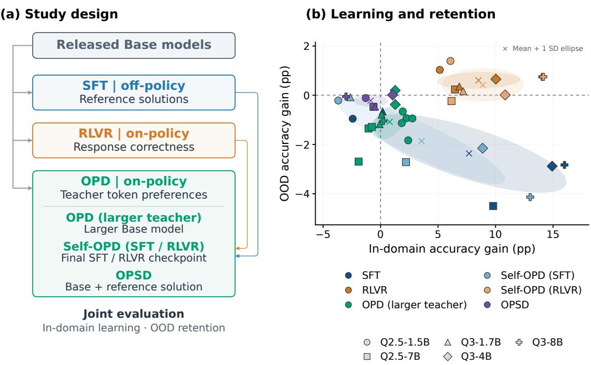

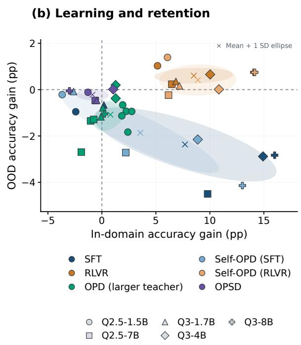  
Figure 1: Training methods and joint learning–retention outcomes. (a) Training paths and feedback sources from a shared Base model. (b) In-domain accuracy gain versus OOD accuracy gain from Base; colors identify methods and shapes identify models. Ellipses summarize variation across model–teacher configurations. RLVR and Self-OPD (RLVR) combine task learning with low forgetting.

Our contributions are:

• A systematic evaluation framework. OPDArena compares SFT, RLVR, and OPD teacher sources under a shared setup, jointly characterizing target-domain learning, general capability retention, and predictive distribution changes.

• A refined view of distribution change and retention. We show that OOD distribution change is more consistently associated with forgetting than in-domain change across student models and teacher configurations. We further use the OOD-to-in-domain change ratio, $\rho ,$ to characterize update selectivity.

• Teacher information and update selectivity. Controlled comparisons of OPD teachers show that preferences acquired through SFT or RLVR improve student update selectivity. Further analyses identify mismatches between teacher-preferred responses and the student’s distribution that can hinder task learning, helping explain why task gains and forgetting transfer at different rates.

## 2 Method

We compare post-training methods applied to the same released Qwen Base models and measure their effects on mathematical learning and general capability retention. Our framework distinguishes how supervision enters the model from how its predictions change across domains. We first describe the training signals and teacher configurations (Section 2.1), then define how we measure learning, forgetting, and distribution change (Section 2.2).

## 2.1 Training Signals and Teachers

Let $p _ { 0 }$ denote a Base model; $p _ { \theta }$ is the model being trained from it, and q is a frozen distillation teacher. The training set D contains problems x and reference solutions c. SFT learns from these fixed, off-policy solutions; RLVR and OPD use on-policy responses y generated by the model being trained. At response-token position $t \in \{ 1 , \ldots , | y | \}$ , where |y| is the response length, the student prefix is $\boldsymbol { s } _ { t } = ( x , y _ { < t } ) ; \boldsymbol { s } _ { t } ^ { \mathrm { T } }$ denotes the same problem and continuation with the teacher’s conditioning information. The training objectives are:

$$
\mathcal { L } _ { \mathrm { S F T } } ( \theta ) = - \mathbb { E } _ { ( x , c ) \sim \mathcal { D } } \left[ \sum _ { t } \log p _ { \theta } ( c _ { t } \mid x , c _ { < t } ) \right] ,\tag{1}
$$

$$
\begin{array} { r } { \mathcal { L } _ { \mathrm { R L V R } } ( \theta ) = - \mathbb { E } _ { x \sim \mathcal { D } , y \sim p _ { \theta } ( \cdot \vert x ) } \left[ R ( x , y ) \right] , } \end{array}\tag{2}
$$

$$
\begin{array} { r } { \mathcal { L } _ { \mathrm { O P D } } ( \boldsymbol { \theta } ; \bar { \boldsymbol { \theta } } ) = \mathbb { E } _ { s \sim d _ { \bar { \boldsymbol { \theta } } } } \left[ \mathrm { K L } \big ( p _ { \boldsymbol { \theta } } ( \cdot \mid s ) \big | \big | q ( \cdot \mid s ^ { \mathrm { T } } ) \big ) \right] . } \end{array}\tag{3}
$$

In Eq. (2), $R ( x , y )$ is a verifiable correctness reward. In Eq. $( 3 ) , d _ { \bar { \theta } }$ is the empirical prefix distribution collected with the current rollout policy $p _ { \bar { \theta } }$ , held fixed during the actor update. Reverse Kullback–Leibler (KL) divergence transfers teacher preferences at these student-generated prefixes (Gu et al., 2024; Agarwal et al., 2024).

Training feedback. Our RLVR baseline uses group relative policy optimization (GRPO) (Shao et al., 2024) with verifiable correctness rewards. Centering and scaling rewards within each group of responses to the same problem gives a relative advantage shared by all tokens in a response. OPD assigns token-dependent advantages through the teacher–student log-probability ratio. We use a student-weighted Top-16 approximation (Li et al., 2026). Input formats and the actor update settings are given in Appendices B.2 and B.4.

Teacher source. We study self-distillation from post-trained checkpoints, distinguishing Self-OPD (SFT) and Self-OPD (RLVR) by how the teacher is trained. We reuse the final saved checkpoints of the corresponding SFT and RLVR experiments reported here as frozen teachers. Each student starts from the same released Base model used in its teacher’s training. OPD from larger models uses frozen Base teachers with more parameters than the student, drawn from the same or a different model family. We use OPSD (Zhao et al., 2026) as a representative of self-distillation with privileged information, where the teacher receives additional context unavailable to the student. Within our shared OPD recipe, a frozen copy of the student’s Base model receives the problem and a reference solution, while the student receives only the problem and learns from the teacher’s probabilities on student-generated prefixes.

## 2.2 Capability and Distribution Measurements

For a task group ${ \mathcal { G } } ,$ let $\operatorname { A c c } _ { \mathcal { G } } ( p )$ denote model $p \mathrm { ^ { \circ } s }$ accuracy averaged equally across tasks in ${ \mathcal { G } } .$ We measure capability changes relative to Base:

$$
\Delta \operatorname { A c c } _ { d } ( p _ { \theta } ) = \operatorname { A c c } _ { d } ( p _ { \theta } ) - \operatorname { A c c } _ { d } ( p _ { 0 } ) , \qquad d \in \{ { \mathrm { i n } } , \operatorname { O O D } \} .\tag{4}
$$

Positive in-domain changes indicate learning gains, while negative OOD changes indicate forgetting. All changes are expressed in percentage points.

To compare the predictive distributions of any two models p and $q ,$ we use Jensen–Shannon (JS) divergence for a symmetric, bounded comparison. We evaluate their next-token predictions on the same fixed prefixes, with $\nu _ { j }$ denoting the prefix distribution for task $j \colon$

$$
D _ { \mathcal { G } } ( \boldsymbol { p } , \boldsymbol { q } ) = \frac { 1 } { | \mathcal { G } | } \sum _ { \boldsymbol { j } \in \mathcal { G } } \mathbb { E } _ { s \sim \nu _ { \boldsymbol { j } } } \left[ \operatorname { J S } \bigl ( \boldsymbol { p } ( \cdot \mid s ) , \boldsymbol { q } ( \cdot \mid s ) \bigr ) \right] .\tag{5}
$$

We use natural logarithms and $\begin{array} { r } { \mathrm { J S } ( p , q ) = \frac { 1 } { 2 } \mathrm { K L } ( p \| m ) + \frac { 1 } { 2 } \mathrm { K L } ( q \| m ) } \end{array}$ , where $m = ( p { + } q ) / 2$ . Distribution measurements use the full vocabulary and weight datasets equally. Prefix sampling is described in Appendix B.6.

## 3 Experiments

## 3.1 Experimental Setup

Models and methods. We experiment with the Qwen2.5 (Yang et al., 2024) (1.5B and 7B) and Qwen3 (Yang et al., 2025) (1.7B, 4B, and 8B) model families. We use their pretrained Base versions to compare post-training methods and teacher sources from a shared starting point before instruction tuning. For each model, all methods start from the same Base checkpoint. We compare the SFT, RLVR, and OPD configurations defined in Section 2.1. As shown in Figure 1(a), Self-OPD uses an $\mathrm { S F T }$ or RLVR endpoint as the frozen teacher for a new student initialized from Base.

<table><tr><td>Method (Teacher)</td><td colspan="3">Qwen2.5-1.5B</td><td colspan="3">Qwen2.5-7B</td></tr><tr><td></td><td colspan="2">In-domain</td><td>OOD</td><td colspan="2">In-domain</td><td>OOD</td></tr><tr><td>Base</td><td>13.93</td><td></td><td>35.20</td><td>26.08</td><td></td><td>49.82</td></tr><tr><td>SFT</td><td>11.50(−2.42)</td><td></td><td>34.25 (−0.95)</td><td>35.87 (+9.79)</td><td></td><td>45.32 (−4.50)</td></tr><tr><td>RLVR</td><td>19.08 (+5.15)</td><td></td><td>36.23 (+1.03)</td><td></td><td>32.56 (+6.48)</td><td>50.06 (+0.23)</td></tr><tr><td>OPD (Q2.5-7B)</td><td>15.85 (+1.93)</td><td></td><td>34.54 (-0.66)</td><td></td><td></td><td></td></tr><tr><td>OPD (Q2.5-14B)</td><td>16.18 (+2.26)</td><td></td><td>34.27 (−0.93)</td><td></td><td>25.03 (-1.05)</td><td>48.47 (-1.35)</td></tr><tr><td>OPD (Q3-4B)</td><td>15.77 (+1.85)</td><td></td><td>34.07 (-1.13)</td><td></td><td></td><td></td></tr><tr><td>OPD (Q3-8B)</td><td>16.33 (+2.40)</td><td></td><td>33.37 (-1.83)</td><td></td><td>24.17 (-1.91)</td><td>47.13 (-2.70)</td></tr><tr><td>OPD (Q3-14B)</td><td>16.69 (+2.76)</td><td></td><td>34.26 (−0.94)</td><td></td><td>25.32 (−0.76)</td><td>48.54 (-1.29)</td></tr><tr><td>Self-OPD (SFT)</td><td>10.25 (−3.68)</td><td></td><td>34.99 (−0.21)</td><td></td><td>28.29 (+2.21)</td><td>47.11(-2.72)</td></tr><tr><td>Self-OPD (RLVR)</td><td>20.00 (+6.08)</td><td></td><td>36.60 (+1.39)</td><td></td><td>32.25 (+6.17)</td><td>49.59 (−0.24)</td></tr><tr><td>OPSD</td><td>12.64 (−1.29)</td><td></td><td>35.09 (−0.11)</td><td>25.46 (−0.62)</td><td></td><td>49.35 (-0.47)</td></tr><tr><td rowspan="2">Method (Teacher)</td><td colspan="2"></td><td></td><td colspan="2"></td><td></td></tr><tr><td colspan="2">Qwen3-4B In-domain OOD</td><td></td><td colspan="2">In-domain</td><td>Qwen3-8B</td></tr><tr><td>Base</td><td colspan="2">26.85</td><td>45.45</td><td colspan="2">31.32</td><td>OOD 51.37</td></tr><tr><td>SFT</td><td>41.77 (+14.93)</td><td></td><td></td><td></td><td></td><td></td></tr><tr><td>RLVR</td><td>36.87 (+10.03)</td><td></td><td>42.57 (-2.88) 46.11 (+0.66)</td><td>47.32 (+16.00) 45.39 (+14.07)</td><td></td><td>48.54 (-2.83)</td></tr><tr><td>OPD (Q3-8B)</td><td></td><td></td><td></td><td></td><td></td><td>52.12 (+0.75)</td></tr><tr><td></td><td>28.12 (+1.28)</td><td></td><td>45.08 (−0.38)</td><td></td><td></td><td></td></tr><tr><td>OPD (Q3-14B)</td><td>28.11 (+1.27)</td><td></td><td>45.65 (+0.20)</td><td></td><td>31.56 (+0.24)</td><td>50.32 (−1.05)</td></tr><tr><td>Self-OPD (SFT)</td><td>35.72 (+8.88)</td><td></td><td>43.30 (-2.15)</td><td></td><td>44.34 (+13.02)</td><td>47.23 (-4.14)</td></tr><tr><td>Self-OPD (RLVR)</td><td>37.68 (+10.84)</td><td></td><td>45.46 (+0.01)</td><td></td><td>45.48 (+14.16)</td><td>52.12 (+0.75)</td></tr><tr><td>OPSD</td><td>27.89 (+1.05)</td><td></td><td>45.46 (+0.01)</td><td></td><td>28.31 (-3.01)</td><td>51.32 (−0.05)</td></tr></table>

Table 1: Main results for four Base models: accuracy (%) with changes from Base in parentheses (percentage points). Negative OOD changes indicate forgetting. RLVR and Self-OPD (RLVR) combine in-domain gains with strong capability retention.

Training. We train the five Base models on OpenR1-50K for one epoch, following previous work (Huang et al., 2026; Li et al., 2026). The models being trained receive Raw prompts without chat templates, matching the Base models’ text-completion format and keeping prompt formatting consistent across methods. Our Raw/Template baseline comparison supports this choice (Appendix B.1).

Evaluation. We evaluate in-domain mathematical reasoning on AMC23 and AIME24 (Li et al., 2024), AIME25 and HMMT25 (Balunovic et al., 2025), and Math500 (Lightman et al., 2024). OOD evaluations use HellaSwag (Zellers´ et al., 2019), ARC-Challenge (Clark et al., 2018), MMLU (Hendrycks et al., 2021a), IFEval (Zhou et al., 2023), TriviaQA (Joshi et al., 2017), BBH (Suzgun et al., 2023), and NQ-Open (Kwiatkowski et al., 2019; Lee et al., 2019). For each group, we report mean accuracy, weighting the five in-domain or seven OOD datasets equally. Main results are averaged over two training seeds. Full training and evaluation settings, including original-model baselines, are provided in Appendix B.

## 3.2 Main Results

Table 1 summarizes in-domain and OOD accuracy for four of the five Base models; Appendix C provides training curves and individual-task results for all five. Accuracies are averaged equally over datasets, with changes from Base in parentheses. Negative OOD changes indicate forgetting.

Learning and capability retention. As shown in Figure 1(b), RLVR and Self-OPD (RLVR) combine mathematical gains with OOD accuracy close to Base. SFT and Self-OPD (SFT) generally incur larger OOD losses. Thus, Self-OPD with SFT and RLVR teachers shows different retention patterns even though both variants learn from student-generated responses. Limited SFT gains and modest forgetting in the smallest models are consistent with prior observations of difficulty learning long reasoning traces (Li et al., 2025) and milder forgetting at smaller scales (Luo et al., 2025). OPD from larger Base teachers yields modest or inconsistent mathematical gains, accompanied by some OOD capability loss. OPSD largely preserves OOD accuracy, with details of its adaptation to Base models in Appendix E.

## 4 Analysis

We study the relationship between predictive distribution change and forgetting during post-training (Section 4.1). We then focus on OPD, examining how teacher information sources shape learning and retention (Section 4.2) and how students inherit teacher behavior through parameter and prediction trajectories (Section 4.3).

## 4.1 Distribution Change and Forgetting

Previous work links forgetting to KL divergence from the initial model on the training task (Shenfeld et al., 2026). We extend this perspective by comparing in-domain and OOD prediction changes across SFT, RLVR, and OPD. Using Eq. (5), we write $D _ { \mathrm { i n } } = D _ { \mathrm { i n } } ( p _ { 0 } , p _ { t } )$ and $D _ { \mathrm { O O D } } = D _ { \mathrm { O O D } } ( p _ { 0 } , p _ { t } )$ for prediction changes from the pretrained Base model $p _ { 0 }$ to $p _ { t }$ , the model at training step t.

OOD prediction change is more consistently associated with forgetting. Figure 2 compares checkpoints across SFT, RLVR, and OPD configurations. OOD JS, which measures prediction changes on the same tasks used to evaluate forgetting, is positively correlated with forgetting for each model, with stronger associations for the larger models.

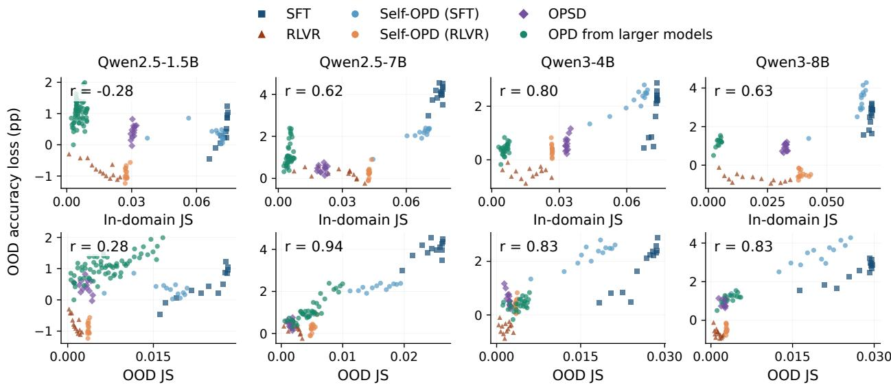  
Figure 2: Distribution change and forgetting. Horizontal axes show in-domain (top) and OOD (bottom) JS from Base; larger values indicate greater distribution change. The vertical axis shows OOD accuracy loss from Base; higher values indicate greater forgetting. Each point pairs JS and OOD accuracy at the same checkpoint. JS is in nats, averaged equally over five in-domain or seven OOD tasks; r is Pearson correlation. Qwen3-1.7B is shown in Appendix Figure 14.

Relative OOD change measures update selectivity. This association motivates seeking task learning with less accompanying OOD change. Since methods also produce different amounts of in-domain change, we define

$$
\rho = \frac { D _ { \mathrm { O O D } } } { D _ { \mathrm { i n } } } , \qquad D _ { \mathrm { i n } } > 0 .\tag{6}
$$

The ratio measures OOD change per unit of in-domain prediction change; lower $\rho$ indicates greater update selectivity, with changes more concentrated in the target domain.

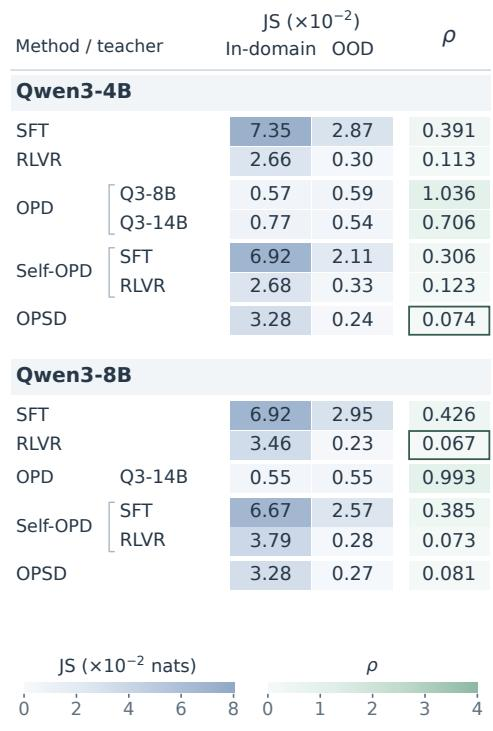

<table><tr><td rowspan=1 colspan=6>JS(×10⁻²)Method / teacher     In-domain OOD     ρQwen2.5-1.5B</td></tr><tr><td rowspan=1 colspan=2>SFT</td><td rowspan=1 colspan=1>7.43</td><td rowspan=1 colspan=1>2.80</td><td></td><td rowspan=1 colspan=1>0.377</td></tr><tr><td rowspan=1 colspan=1>RLVR</td><td rowspan=1 colspan=1></td><td rowspan=1 colspan=1>2.46</td><td rowspan=1 colspan=1>0.25</td><td></td><td rowspan=1 colspan=1>0.101</td></tr><tr><td rowspan=1 colspan=1></td><td rowspan=1 colspan=1>Q2.5-7B</td><td rowspan=1 colspan=1>0.58</td><td rowspan=1 colspan=1>0.82</td><td></td><td rowspan=1 colspan=1>1.410</td></tr><tr><td rowspan=1 colspan=1></td><td rowspan=1 colspan=1>Q2.5-14B</td><td rowspan=1 colspan=1>0.50</td><td rowspan=1 colspan=1>0.84</td><td></td><td rowspan=1 colspan=1>1.697</td></tr><tr><td rowspan=1 colspan=1>OPD</td><td rowspan=1 colspan=1>Q3-4B</td><td rowspan=1 colspan=1>0.45</td><td rowspan=1 colspan=1>1.55</td><td></td><td rowspan=1 colspan=1>3.472</td></tr><tr><td rowspan=1 colspan=1></td><td rowspan=1 colspan=1>Q3-8B</td><td rowspan=1 colspan=1>0.83</td><td rowspan=1 colspan=1>1.67</td><td></td><td rowspan=1 colspan=1>1.998</td></tr><tr><td rowspan=1 colspan=1></td><td rowspan=1 colspan=1>Q3-14B</td><td rowspan=1 colspan=1>0.92</td><td rowspan=1 colspan=1>1.02</td><td></td><td rowspan=1 colspan=1>1.110</td></tr><tr><td rowspan=2 colspan=1>Self-OPD</td><td rowspan=1 colspan=1>SFT</td><td rowspan=1 colspan=1>7.25</td><td rowspan=1 colspan=1>2.09</td><td></td><td rowspan=1 colspan=1>0.288</td></tr><tr><td rowspan=1 colspan=1>RLVR</td><td rowspan=1 colspan=1>2.70</td><td rowspan=1 colspan=1>0.35</td><td></td><td rowspan=1 colspan=1>0.131</td></tr><tr><td rowspan=2 colspan=2>OPSD</td><td rowspan=1 colspan=1>2.97</td><td rowspan=1 colspan=1>0.44</td><td></td><td rowspan=1 colspan=1>0.148</td></tr><tr><td rowspan=1 colspan=4></td></tr><tr><td rowspan=1 colspan=6>Qwen2.5-7B</td></tr><tr><td rowspan=1 colspan=1>SFT</td><td rowspan=1 colspan=1></td><td rowspan=1 colspan=1>7.70</td><td rowspan=1 colspan=1>2.63</td><td></td><td rowspan=1 colspan=1>0.341</td></tr><tr><td rowspan=1 colspan=1>RLVR</td><td rowspan=1 colspan=1></td><td rowspan=1 colspan=1>4.06</td><td rowspan=1 colspan=1>0.34</td><td></td><td rowspan=1 colspan=1>0.084</td></tr><tr><td rowspan=1 colspan=1></td><td rowspan=1 colspan=1>Q2.5-14B</td><td rowspan=1 colspan=1>0.48</td><td rowspan=1 colspan=1>0.54</td><td></td><td rowspan=1 colspan=1>1.135</td></tr><tr><td rowspan=1 colspan=1>OPD</td><td rowspan=1 colspan=1>Q3-8B</td><td rowspan=1 colspan=1>0.61</td><td rowspan=1 colspan=1>1.00</td><td></td><td rowspan=1 colspan=1>1.648</td></tr><tr><td rowspan=1 colspan=1></td><td rowspan=1 colspan=1>Q3-14B</td><td rowspan=1 colspan=1>0.75</td><td rowspan=1 colspan=1>0.65</td><td></td><td rowspan=1 colspan=1>0.872</td></tr><tr><td rowspan=2 colspan=1>Self-OPD</td><td rowspan=1 colspan=1>SFT</td><td rowspan=1 colspan=1>7.08</td><td rowspan=1 colspan=1>1.94</td><td></td><td rowspan=1 colspan=1>0.274</td></tr><tr><td rowspan=1 colspan=1>RLVR</td><td rowspan=1 colspan=1>4.22</td><td rowspan=1 colspan=1>0.47</td><td></td><td rowspan=1 colspan=1>0.111</td></tr><tr><td rowspan=1 colspan=2>OPSD</td><td rowspan=1 colspan=1>2.31</td><td rowspan=1 colspan=1>0.19</td><td></td><td rowspan=1 colspan=1>0.082</td></tr></table>

Figure 3: Prediction changes from Base across post-training methods. The first two columns show in-domain and OOD JS in $1 0 ^ { - 2 }$ nats; the last shows relative OOD influence $\rho .$ Boxes mark the lowest $\rho$ for each model.

Figure 3 applies this measure across post-training methods. Within OPD, larger Base teachers produce small in-domain changes and high $\rho ,$ while post-trained teachers and supervision with reference solutions distribute changes differently These differences under a shared distillation objective motivate examining the information provided by each teacher.

## 4.2 Teacher Information Sources and Relative OOD Influence

Given the association between OOD prediction change and forgetting, we examine how teacher choice affects OPD’s update selectivity and retention of OOD capabilities.

Stronger teacher OOD capabilities can accompany greater student forgetting. Table 2 compares a Qwen3-8B Base teacher with each student’s own RLVR-trained counterpart for Qwen2.5-1.5B and Qwen2.5-7B. Despite stronger OOD capability and comparable or better mathematical capability, the Base teacher yields lower student mathematical accuracy, more forgetting, and higher $\rho$ in both comparisons.

<table><tr><td>Teacher</td><td colspan="2">Teacher acc.</td><td colspan="2">Student acc.</td><td></td></tr><tr><td></td><td>Math</td><td>OOD</td><td>Math</td><td>OOD</td><td> $\rho$ </td></tr><tr><td>Student: Qwen2.5-1.5B Base</td><td></td><td></td><td>13.93</td><td>35.20</td><td></td></tr><tr><td>Qwen3-8B Base</td><td>31.32</td><td>51.37</td><td>16.33</td><td>33.37</td><td>1.998</td></tr><tr><td>Qwen2.5-1.5B RLVR</td><td>19.08</td><td>36.23</td><td>20.00</td><td>36.60</td><td>0.131</td></tr><tr><td>Student: Qwen2.5-7B Base</td><td></td><td></td><td>26.08</td><td>49.82</td><td></td></tr><tr><td>Qwen3-8B Base</td><td>31.32</td><td>51.37</td><td>24.17</td><td>47.13</td><td>1.648</td></tr><tr><td>Qwen2.5-7B RLVR</td><td>32.56</td><td>50.06</td><td>32.25</td><td>49.59</td><td>0.111</td></tr></table>

Table 2: Teacher and student accuracies (%) and student $\rho$ at step 780. Each block compares a larger Base teacher with the student’s own RLVR teacher; shaded headings identify the student and its Base accuracies. Datasets are weighted equally within each domain.

Teacher information and update selectivity. These OPD configurations produce markedly different retention and update selectivity. With the student initialization and distillation setup fixed, they differ in the additional information supplied by the teacher. We therefore examine what each teacher adds relative to student Base and how this information shapes update selectivity. We hypothesize that task-specific preferences concentrate updates in-domain, while general response habits also affect OOD predictions (Wang et al., 2026):

• OPD from larger Base teachers. These teachers produce high student $\rho .$ Their feedback reflects cross-model pretraining differences spanning mathematics and many other tasks. Even when OPD trains only on mathematical problems, fitting these broader preferences may change OOD predictions through shared parameters, contributing to higher $\rho .$

• Self-OPD (SFT). Starting from the student’s Base, SFT fits the teacher’s predictions to fixed external reference answers through off-policy training, learning their solution content and response habits. Self-OPD then conveys these acquired preferences through the teacher’s token-level predictions on student-generated responses. The inherited response habits may also affect OOD behavior.

• Self-OPD (RLVR). Starting from the student’s Base, RLVR adjusts the teacher’s distribution using correctness scores on its own on-policy responses. Self-OPD then conveys these reward-based adjustments through the teacher’s token-level predictions on student-generated responses. The acquired preference for higher-reward behavior may concentrate feedback more strongly on the target task.

• OPSD. Teacher weights remain identical to student Base, while an in-domain mathematical reference solution supplies problem-specific evidence through context. This evidence may concentrate feedback on the current task.

This hypothesis predicts that adding mathematical post-training to the same larger Base teacher will make its feedback more task-specific and lower student $\rho .$

Decomposing teacher preferences. Let $p _ { 0 }$ be student Base, $q _ { \mathrm { b a s e } }$ the larger Base, and $q _ { m }$ its endpoint after $m \in$ {SFT, RLVR} training. The teacher’s preferences relative to student Base decompose as

$$
\log \frac { q _ { m } ( v \mid s ) } { p _ { 0 } ( v \mid s ) } = \underbrace { \log \frac { q _ { \mathrm { b a s e } } ( v \mid s ) } { p _ { 0 } ( v \mid s ) } } _ { \delta _ { \mathrm { p r e } } ( v \mid s ) } + \underbrace { \log \frac { q _ { m } ( v \mid s ) } { q _ { \mathrm { b a s e } } ( v \mid s ) } } _ { \delta _ { m } ( v \mid s ) } .\tag{7}
$$

Following log-probability increment extraction (Heo et al., 2026), we apply the post-training changes to student Base to define

$$
q _ { \mathrm { i n c } , m } ( v \mid s ) = { \frac { p _ { 0 } ( v \mid s ) \exp [ \delta _ { m } ( v \mid s ) ] } { Z _ { m } ( s ) } } .\tag{8}
$$

Here $Z _ { m } ( s )$ normalizes the distribution. Multiplying student Base probabilities by the post-training ratios $q _ { m } / q _ { \mathrm { b a s e } }$ transfers the acquired changes onto the student’s own Base, retaining any SFT response habits. The resulting distribution defines a frozen teacher.

Post-training the teacher in-domain (A/B and A/D). With the student initialization and larger teacher’s pretrained starting point fixed, Table 3 compares the Base teacher (A) and its SFT (B) and RLVR (D) endpoints under the same OPD setup. In both model pairs, post-training the larger Base teacher with either SFT or RLVR lowers student $\rho .$ In-domain JS increases proportionally more than OOD JS, indicating that the acquired preferences concentrate student changes more strongly in-domain. Full RLVR teachers yield lower $\rho$ and better OOD retention than full SFT teachers, supporting a difference associated with how the teacher acquired its in-domain preferences.

Transferring post-training changes (B/C and D/E). Conditions C and E transfer the SFT and RLVR increments onto student Base, respectively, to examine whether selective updates require also fitting the larger Base’s predictions. For SFT (B/C), transferring the post-training increment preserves nearly the same in-domain JS while reducing OOD JS, $\rho ,$ and forgetting; for RLVR (D/E), $\rho$ remains comparably low. We interpret this contrast through the preferences each teacher acquires during post-training. The SFT increment includes preferences for the content and response patterns of external demonstrations (Chu et al., 2025). B combines these acquired preferences with imitation of the larger Base’s predictions; C’s improved retention indicates that this additional imitation contributes to the OOD cost of distilling the SFT teacher. Online RLVR improves rewards on its own responses and tends toward solutions close to its starting distribution. Its increment captures these reward-based adjustments to existing behavior. Our comparison suggests that

these task preferences largely determine the student’s relative OOD change, allowing RLVR’s conservative adaptation to carry over through distillation.
<table><tr><td rowspan="2">Teacher supervision</td><td colspan="3">Distribution change</td><td colspan="2">Accuracy (%)</td></tr><tr><td> $D _ { \mathrm { i n } }$ </td><td> $D _ { \mathrm { O O D } }$ </td><td>ρ</td><td>Math (∆)</td><td>OOD (∆)</td></tr><tr><td colspan="6">Qwen2.5-7B→Qwen2.5-1.5B</td></tr><tr><td>Student Base</td><td></td><td></td><td></td><td>13.93</td><td>35.20</td></tr><tr><td>A: Larger Base teacher</td><td>0.3696</td><td>0.1151</td><td>0.311</td><td>14.67 (+0.75)</td><td>34.82 (−0.39)</td></tr><tr><td>B: Larger SFT teacher</td><td>4.5711</td><td>0.9909</td><td>0.217</td><td>3.15 (−10.78)</td><td>34.52 (−0.69)</td></tr><tr><td>C: SFT increment</td><td>4.7088</td><td>0.7879</td><td>0.167</td><td>5.20(-8.73)</td><td>35.60 (+0.39)</td></tr><tr><td>D: Larger RLVR teacher E: RLVR increment</td><td>4.1650</td><td>0.6873</td><td>0.165</td><td>19.17(+5.25)</td><td>35.99 (+0.79)</td></tr><tr><td></td><td>4.0247</td><td>0.5658</td><td>0.141</td><td>19.22 (+5.29)</td><td>35.76(+0.56)</td></tr><tr><td colspan="6">Qwen3-8B→Qwen3-4B</td></tr><tr><td>Student Base</td><td></td><td></td><td></td><td>26.85</td><td>45.45</td></tr><tr><td>A: Larger Base teacher</td><td>0.3556</td><td>0.2286</td><td>0.643</td><td>27.85(+1.01)</td><td>45.76(+0.31)</td></tr><tr><td>B: Larger SFT teacher</td><td>5.3947</td><td>1.1765</td><td>0.218</td><td>28.72(+1.87)</td><td>43.54 (−1.92)</td></tr><tr><td>C: SFT increment</td><td>5.3346</td><td>0.8362</td><td>0.157</td><td>28.84(+1.99)</td><td>44.57 (−0.88)</td></tr><tr><td>D: Larger RLVR teacher</td><td>3.1320</td><td>0.4312</td><td>0.138</td><td>39.34 (+12.49)</td><td>45.22 (−0.23)</td></tr><tr><td>E: RLVR increment</td><td>2.8076</td><td>0.3995</td><td>0.142</td><td>41.54(+14.70)</td><td>45.27 (−0.19)</td></tr></table>

Table 3: Student distribution changes and capabilities under different information sources. All A–E conditions use student step 120. JS uses shared prefixes, is relative to Base, and is reported in $1 0 ^ { - 2 }$ nats. Parentheses show accuracy changes from Base in percentage points. Datasets are weighted equally within each domain; $\rho$ is undefined at Base.

These comparisons connect the information supplied by teachers to update selectivity and OOD retention. We next examine how students inherit learning and retention patterns from SFT and RLVR teachers, relating these patterns to parameter paths and prediction matching.

## 4.3 Parameter and Prediction Trajectories Behind Similar Behavior

Self-OPD reproduces source-dependent learning and retention patterns. We pair each Self-OPD student with the SFT/RLVR run that produced its frozen teacher. Both start from the same Base; the source run provides a reference for the capabilities and behavior the student inherits. Students of RLVR teachers approach teacher task performance early with similar capability retention. Students of SFT teachers incur OOD declines approaching or exceeding their teachers (Appendix D.3). We examine whether these shared behavioral patterns correspond to similar parameter paths.

Models along parameter lines provide a capability reference. We characterize the learning and retention available along the parameter directions defined by these endpoints. We first interpolate and extrapolate the SFT, RLVR, and Self-OPD endpoints (Huang et al., 2026) to examine changes in update magnitude:

$$
\theta _ { \lambda } = \theta _ { 0 } + \lambda ( \theta _ { \mathrm { e n d } } - \theta _ { 0 } ) .\tag{9}
$$

Here $\theta _ { 0 }$ and $\theta _ { \mathrm { e n d } }$ are the Base and trained parameters; $\lambda = 0$ and λ = 1 recover these two endpoints. The source SFT/RLVR endpoints are the frozen teachers, so their sweeps provide a capability reference along the Base–teacher line; Self-OPD sweeps examine the student’s own update direction.

Figure 4 shows broader ranges of retained task gains for RLVR-based updates, with a more consistent advantage in OOD retention: accuracy remains near Base even for $\lambda > 1$ , while forgetting grows faster along SFT-based directions. Sweet spots occur in interpolation for SFT-based updates and extrapolation for RLVR-based updates. These patterns motivate a geometric explanation for Self-OPD: students may inherit teacher behavior by moving along the same Base–teacher parameter direction.

Parameter and prediction distances evolve differently. We next test whether Self-OPD students actually move along the Base–teacher line. We measure parameter distances to the teacher, $d _ { \theta } .$ , and to the Base–teacher line, $d _ { \perp }$

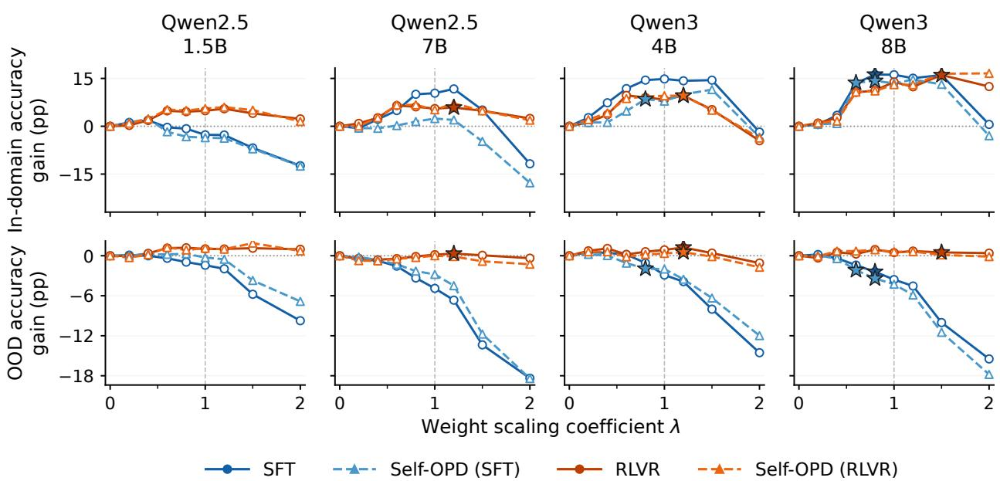  
Stars: sweet spots (λ > 0); both accuracies improve over an endpoint (λ = 1) with positive in-domain gain.

Figure 4: Accuracy changes from Base under weight scaling. Stars mark sweet-spot coefficients that improve both accuracies over the original endpoint, as defined in Appendix F.

normalized by the initial parameter gap (Appendix D.2). Prediction distance to the frozen teacher $q _ { T }$ is likewise normalized by its initial value:

$$
d _ { \mathrm { o u t } , d } ( t ) = \frac { D _ { d } ( p _ { t } , q _ { T } ) } { D _ { d } ( p _ { 0 } , q _ { T } ) } , \qquad d \in \{ \mathrm { i n } , \mathrm { O O D } \} .\tag{10}
$$

Figure 5 (left) shows that Self-OPD students develop substantial deviations from the Base–teacher line and remain distant from the teacher’s parameters. To examine how this parameter-space departure relates to behavior, we compare their predictions with those of the same fixed teachers. Figure 5 (right) shows that the RLVR-teacher student closely approaches teacher predictions in both domains. Both teacher sources reduce OOD prediction gaps, while SFT-teacher students generally retain larger in-domain gaps. Together, these measurements show that students can approach teacher behavior along different parameter paths, with different degrees of task learning and OOD change inherited from each source.

Appendix Table 9 reports the corresponding endpoint distances for the other four models.

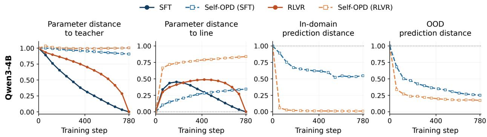  
Figure 5: Qwen3-4B parameter distances for SFT, RLVR, and their Self-OPD students (left), and student–teacher JS for the same students (right). Each distance is normalized by its corresponding initial Base–teacher gap.

Student probabilities shape preference transfer. Teacher feedback on prefixes the student rarely generates has fewer opportunities to contribute to training. This motivates examining how student probabilities affect the transfer of teacher preferences. Let $d _ { p _ { t } }$ be the training-prefix distribution and $A _ { t } ( v \mid s ) = \log q _ { T } ( v \mid s ) - \log p _ { t } ( v \mid s )$ the feedback. For a full-vocabulary score-function model with fixed sampling distributions and stop-gradient feedback, the mean gradient is

$$
\begin{array} { l } { \mu _ { t } ( v \mid s ) = p _ { t } ( v \mid s ) \big ( \overline { { A } } _ { t } ( s ) - A _ { t } ( v \mid s ) \big ) , } \\ { \mathbb { E } [ \nabla _ { \theta } \mathcal { L } ] = \mathbb { E } _ { s \sim d _ { p _ { t } } } \displaystyle \left[ \sum _ { v } \mu _ { t } ( v \mid s ) \nabla _ { \theta } z _ { t } ( v \mid s ) \right] , } \end{array}\tag{11}
$$

where $\overline { { A } } _ { t } ( s ) = \mathbb { E } _ { a \sim p _ { t } } [ A _ { t } ( a \mid s ) ]$ and $z _ { t }$ denotes student logits. Student prefix and token probabilities weight teacher feedback; these weights and the logit Jacobians change along the student’s path (Appendix G.1).

We first examine how readily students can generate their teachers’ response prefixes. On the same mathematical problems, SFT-teacher prefixes have lower probability under the shared Base than RLVR-teacher prefixes, and this difference persists during student training (Appendix D.4). Since OPD receives feedback on student-generated prefixes, teacher preferences associated with rarely visited prefixes have fewer opportunities to contribute to updates. This offers an explanation for slower transfer of SFT task gains relative to OOD changes.

Response openings provide a concrete instance of this mismatch. In our diagnostics, SFT teachers inherit openings such as Okay and Alright from reference answers, while their preferred opening tokens fall outside the Base student’s Top-16 candidates. In Self-OPD (SFT), zeroing feedback at the first response position during training improves final mathematical accuracy by 3.36 percentage points on average across five models relative to ordinary feedback, while the OOD accuracy difference is at most 0.53 percentage points per model (Appendix D.5). This intervention shows that feedback tied to teacher response habits can impede task learning.

## 5 Conclusion

OPDArena provides a shared framework for comparing task learning, capability retention, and predictive distribution changes across SFT, RLVR, and OPD. Across these methods, OOD distribution change is more consistently associated with forgetting than in-domain change, motivating $\rho$ as a measure of update selectivity. Controlled comparisons of OPD teachers show that the preferences they acquire through in-domain post-training lead to more selective student updates. The student’s own distribution further shapes how these preferences are inherited. These findings motivate selecting OPD teachers by the information they add relative to student Base and its interaction with student predictions, alongside teacher capabilities.

## References

Rishabh Agarwal, Nino Vieillard, Yongchao Zhou, Piotr Stanczyk, Sabela Ramos Garea, Matthieu Geist, and Olivier Bachem. On-Policy Distillation of Language Models: Learning from Self-Generated Mistakes. In International Conference on Learning Representations, pages 21246–21263, 2024. URL https://proceedings.iclr.c c/paper\_files/paper/2024/hash/5be69a584901a26c521c2b51e40a4c20-Abstract-Con ference.html.

Mislav Balunovic, Jasper Dekoninck, Ivo Petrov, Nikola Jovanovi´ c, and Martin Vechev. MathArena: Evaluating LLMs´ on Uncontaminated Math Competitions. In Advances in Neural Information Processing Systems, volume 38. Curran Associates, Inc., 2025. doi: 10.52202/085713-0679. URL https://proceedings.neurips.cc/paper\_f iles/paper/2025/hash/1d27c01ebd3e3aebe226b44fc970d803-Abstract-Datasets\_and\_ Benchmarks\_Track.html.

Tianzhe Chu, Yuexiang Zhai, Jihan Yang, Shengbang Tong, Saining Xie, Dale Schuurmans, Quoc V. Le, Sergey Levine, and Yi Ma. SFT Memorizes, RL Generalizes: A Comparative Study of Foundation Model Post-training. In Proceedings of the 42nd International Conference on Machine Learning, volume 267 of Proceedings of Machine Learning Research, pages 10818–10838, 2025. URL https://proceedings.mlr.press/v267/chu25c. html.

Peter Clark, Isaac Cowhey, Oren Etzioni, Tushar Khot, Ashish Sabharwal, Carissa Schoenick, and Oyvind Tafjord. Think you have solved question answering? try ARC, the AI2 reasoning challenge. arXiv preprint arXiv:1803.05457, 2018. URL https://arxiv.org/abs/1803.05457.

Yuxian Gu, Li Dong, Furu Wei, and Minlie Huang. MiniLLM: Knowledge Distillation of Large Language Models. In International Conference on Learning Representations, pages 32694–32717, 2024. URL https://proceeding s.iclr.cc/paper\_files/paper/2024/hash/8ac015d409635f196f9e3e9dcfb9a94e-Abstr act-Conference.html.

Dan Hendrycks, Collin Burns, Steven Basart, Andy Zou, Mantas Mazeika, Dawn Song, and Jacob Steinhardt. Measuring massive multitask language understanding. In International Conference on Learning Representations, 2021a. URL https://iclr.cc/virtual/2021/poster/2962.

Dan Hendrycks, Collin Burns, Saurav Kadavath, Akul Arora, Steven Basart, Eric Tang, Dawn Song, and Jacob Steinhardt. Measuring mathematical problem solving with the MATH dataset. In Proceedings of the Neural Information Processing Systems Track on Datasets and Benchmarks, volume 1, 2021b. URL https://datase ts-benchmarks-proceedings.neurips.cc/paper/2021/hash/be83ab3ecd0db773eb2dc1 b0a17836a1-Abstract-round2.html.

Byeongho Heo, Jaehui Hwang, Sangdoo Yun, and Dongyoon Han. On-Policy Delta Distillation. arXiv preprint arXiv:2607.15161, 2026. URL https://arxiv.org/abs/2607.15161.

Yangyi Huang, Ruotian Peng, Zeju Qiu, Jiale Kang, Yandong Wen, Bernhard Schölkopf, and Weiyang Liu. PEFT-Arena: Understanding Parameter-Efficient Finetuning from a Stability-Plasticity Perspective. arXiv preprint arXiv:2605.28819, 2026. URL https://arxiv.org/abs/2605.28819.

Hugging Face. Open R1: A Fully Open Reproduction of DeepSeek-R1, 2025. URL https://github.com/hug gingface/open-r1.

Mandar Joshi, Eunsol Choi, Daniel Weld, and Luke Zettlemoyer. TriviaQA: A large scale distantly supervised challenge dataset for reading comprehension. In Proceedings of the 55th Annual Meeting of the Association for Computational Linguistics (Volume 1: Long Papers), pages 1601–1611, Vancouver, Canada, July 2017. Association for Computational Linguistics. doi: 10.18653/v1/P17-1147. URL https://aclanthology.org/P17-114 7/.

Tom Kwiatkowski, Jennimaria Palomaki, Olivia Redfield, Michael Collins, Ankur Parikh, Chris Alberti, Danielle Epstein, Illia Polosukhin, Jacob Devlin, Kenton Lee, Kristina Toutanova, Llion Jones, Matthew Kelcey, Ming-Wei Chang, Andrew M. Dai, Jakob Uszkoreit, Quoc Le, and Slav Petrov. Natural questions: A benchmark for question answering research. Transactions ofthe Associationfor Computational Linguistics, 7:452–466, 2019. doi: 10.1162/tacl\_a\_00276. URL https://aclanthology.org/Q19-1026/.

Kenton Lee, Ming-Wei Chang, and Kristina Toutanova. Latent retrieval for weakly supervised open domain question answering. In Proceedings of the 57th Annual Meeting of the Association for Computational Linguistics, pages 6086–6096, Florence, Italy, July 2019. Association for Computational Linguistics. doi: 10.18653/v1/P19-1612. URL https://aclanthology.org/P19-1612/.

Jia Li, Edward Beeching, Lewis Tunstall, Ben Lipkin, Roman Soletskyi, Shengyi Costa Huang, Kashif Rasul, Longhui Yu, Albert Jiang, Ziju Shen, Zihan Qin, Bin Dong, Li Zhou, Yann Fleureau, Guillaume Lample, and Stanislas Polu. NuminaMath. Hugging Face dataset, 2024. URL https://huggingface.co/datasets/AI-MO/Numina Math-CoT.

Yaxuan Li, Yuxin Zuo, Bingxiang He, Jinqian Zhang, Chaojun Xiao, Cheng Qian, Tianyu Yu, Huan-ang Gao, Wenkai Yang, Zhiyuan Liu, and Ning Ding. Rethinking On-Policy Distillation of Large Language Models: Phenomenology, Mechanism, and Recipe. arXiv preprint arXiv:2604.13016, 2026. URL https://arxiv.org/abs/2604.1 3016.

Yuetai Li, Xiang Yue, Zhangchen Xu, Fengqing Jiang, Luyao Niu, Bill Yuchen Lin, Bhaskar Ramasubramanian, and Radha Poovendran. Small Models Struggle to Learn from Strong Reasoners. In Findings of the Association for

Computational Linguistics: ACL 2025, pages 25366–25394, 2025. doi: 10.18653/v1/2025.findings-acl.1301. URL https://aclanthology.org/2025.findings-acl.1301/.

Hunter Lightman, Vineet Kosaraju, Yuri Burda, Harrison Edwards, Bowen Baker, Teddy Lee, Jan Leike, John Schulman, Ilya Sutskever, and Karl Cobbe. Let’s verify step by step. In International Conference on Learning Representations, pages 39578–39601, 2024. URL https://proceedings.iclr.cc/paper\_files/paper/2024/has h/aca97732e30bcf1303bc22ac3924fd16-Abstract-Conference.html.

Yun Luo, Zhen Yang, Fandong Meng, Yafu Li, Jie Zhou, and Yue Zhang. An Empirical Study of Catastrophic Forgetting in Large Language Models During Continual Fine-Tuning. IEEE Transactions on Audio, Speech and Language Processing, 33:3776–3786, 2025. doi: 10.1109/TASLPRO.2025.3606231. URL https: //doi.org/10.1109/TASLPRO.2025.3606231.

Zhihong Shao, Peiyi Wang, Qihao Zhu, Runxin Xu, Junxiao Song, Xiao Bi, Haowei Zhang, Mingchuan Zhang, Y. K. Li, Y. Wu, and Daya Guo. DeepSeekMath: Pushing the Limits of Mathematical Reasoning in Open Language Models. arXiv preprint arXiv:2402.03300, 2024. URL https://arxiv.org/abs/2402.03300.

Idan Shenfeld, Jyothish Pari, and Pulkit Agrawal. RL’s Razor: Why Online Reinforcement Learning Forgets Less. In International Conference on Learning Representations, pages 59839–59864, 2026. URL https://proceeding s.iclr.cc/paper\_files/paper/2026/hash/618c95f4557c15b253fb0e6f548ea0c0-Abstr act-Conference.html.

Mirac Suzgun, Nathan Scales, Nathanael Schärli, Sebastian Gehrmann, Yi Tay, Hyung Won Chung, Aakanksha Chowdhery, Quoc Le, Ed Chi, Denny Zhou, and Jason Wei. Challenging BIG-bench tasks and whether chain-ofthought can solve them. In Findings ofthe Associationfor Computational Linguistics: ACL 2023, pages 13003–13051, Toronto, Canada, July 2023. Association for Computational Linguistics. doi: 10.18653/v1/2023.findings-acl.824. URL https://aclanthology.org/2023.findings-acl.824/.

Liyuan Wang, Xingxing Zhang, Hang Su, and Jun Zhu. A Comprehensive Survey of Continual Learning: Theory, Method and Application. IEEE Transactions on Pattern Analysis and Machine Intelligence, 46(8):5362–5383, 2024. doi: 10.1109/TPAMI.2024.3367329. URL https://doi.org/10.1109/TPAMI.2024.3367329.

Meng Wang, Haohan Zhao, Wenzhuo Liu, Lu Yang, Geng Liu, Haiyang Guo, Guo-Sen Xie, Gaofeng Meng, Hongbin Liu, and Fei Zhu. Denser ̸= Better: Limits of On-Policy Self-Distillation for Continual Post-Training. arXiv preprint arXiv:2607.01763, 2026. URL https://arxiv.org/abs/2607.01763.

An Yang, Baosong Yang, Beichen Zhang, Binyuan Hui, Bo Zheng, Bowen Yu, Chengyuan Li, Dayiheng Liu, Fei Huang, Haoran Wei, et al. Qwen2.5 Technical Report. arXiv preprint arXiv:2412.15115, 2024. URL https: //arxiv.org/abs/2412.15115.

An Yang, Anfeng Li, Baosong Yang, Beichen Zhang, Binyuan Hui, Bo Zheng, Bowen Yu, Chang Gao, Chengen Huang, Chenxu Lv, et al. Qwen3 Technical Report. arXiv preprint arXiv:2505.09388, 2025. URL https: //arxiv.org/abs/2505.09388.

Tianzhu Ye, Li Dong, Xun Wu, Shaohan Huang, and Furu Wei. On-Policy Context Distillation for Language Models. arXiv preprint arXiv:2602.12275, 2026. URL https://arxiv.org/abs/2602.12275.

Rowan Zellers, Ari Holtzman, Yonatan Bisk, Ali Farhadi, and Yejin Choi. HellaSwag: Can a machine really finish your sentence? In Proceedings ofthe 57th Annual Meeting ofthe Associationfor Computational Linguistics, pages 4791–4800, Florence, Italy, July 2019. Association for Computational Linguistics. doi: 10.18653/v1/P19-1472. URL https://aclanthology.org/P19-1472/.

Zhihao Zhang, Qiaole Dong, Qi Zhang, Enyu Zhou, Jun Zhao, Zhiheng Xi, Senjie Jin, Xiaoran Fan, Yuhao Zhou, Mingqi Wu, Yanwei Fu, Tao Ji, Tao Gui, Xuanjing Huang, and Kai Chen. Why Reinforcement Fine-Tuning Enables MLLMs Preserve Prior Knowledge Better: A Data Perspective. In International Conference on Learning Representations, pages 15201–15228, 2026. URL https://proceedings.iclr.cc/paper\_files/paper/2026/has h/19bc40fd7c90478f8dc07d80c133b0a4-Abstract-Conference.html.

Siyan Zhao, Zhihui Xie, Mengchen Liu, Jing Huang, Guan Pang, Feiyu Chen, and Aditya Grover. Self-Distilled Reasoner: On-Policy Self-Distillation for Large Language Models. In Proceedings of the 43rd International Conference on Machine Learning, volume 306 of Proceedings ofMachine Learning Research, pages 162433–162448. PMLR, 2026. URL https://proceedings.mlr.press/v306/zhao26be.html.

Jeffrey Zhou, Tianjian Lu, Swaroop Mishra, Siddhartha Brahma, Sujoy Basu, Yi Luan, Denny Zhou, and Le Hou. Instruction-following evaluation for large language models. arXiv preprint arXiv:2311.07911, 2023. URL https: //arxiv.org/abs/2311.07911.

## A Related Work

Learning and forgetting in post-training. Acquiring new skills while retaining prior capabilities is a central problem in continual learning (Wang et al., 2024). Empirical studies show that language-model fine-tuning can impair capabilities beyond the target task, motivating evaluations that jointly measure adaptation and retention (Luo et al., 2025). For language-model post-training, prior work connects the retention advantage of online RL to limited KL changes on the new task (Shenfeld et al., 2026). A complementary study of multimodal language models analyzes how supervision distributions affect learning and interference with prior knowledge (Zhang et al., 2026). Our comparison examines this learning–forgetting relationship under token-level supervision from different teachers.

On-policy distillation. Training on student-generated trajectories exposes a distillation teacher to the contexts its student actually visits, reducing the mismatch between training and deployment distributions (Agarwal et al., 2024). MiniLLM uses reverse-KL distillation to align student and teacher predictions (Gu et al., 2024). Subsequent analysis identifies compatible thinking patterns and additional teacher capabilities as important conditions for successful OPD, and traces learning to alignment on high-probability tokens at student-visited states (Li et al., 2026). Related work also finds that smaller models can struggle to learn from strong reasoning demonstrations (Li et al., 2025). These studie motivate our analysis of how teacher preferences affect student predictions across domains.

Self-distillation and teacher information. Teacher information can enter through both model parameters and conditioning context. In OPSD, access to a reference solution provides the teacher with privileged information hidden from the student (Zhao et al., 2026). On-policy context distillation similarly transfers information available in a teacher’s context into student parameters (Ye et al., 2026). Teacher conditioning, update rules, and the response tokens receiving supervision influence the resulting training signal (Zhao et al., 2026; Ye et al., 2026; Wang et al., 2026). On-policy delta distillation extracts post-training information through teacher log-probability differences (Heo et al., 2026). We use teacher comparisons and this decomposition to examine how contextual, pretrained, and post-trained preferences affect update selectivity.

Distribution changes and parameter paths. Prediction and parameter measurements provide complementary views of post-training. Distribution-based analyses connect supervision to changes in model behavior (Zhang et al., 2026). Complementary work jointly evaluates learning and retention across fine-tuning parameterizations and uses interpolation to study behavior along adaptation paths (Huang et al., 2026). We combine parameter and prediction measurements to examine how Self-OPD students acquire teacher behavior along their own training paths.

## B Experimental Details

## B.1 Base-Model Baselines

Tables 4 and 6 report standalone in-domain and OOD evaluations of the released Base models. Table 4 compares Raw inputs with the corresponding Qwen chat template; Table 5 reports the corresponding output lengths. Qwen’s documentation describes Base releases as pretrained models that have not learned the predefined chat template.1 Raw input yields higher mean in-domain accuracy than Template for every model in the paired comparison, supporting the use of the Base models’ text-completion format. We use Raw input for the models being trained and their evaluations. Accuracy values are percentages. For in-domain and OOD, training curves use a shared original-model baseline for each model and input configuration at the start of training.

Our target in-domain evaluation protocol specifies eight responses per problem at temperature 0.7 and top-p 0.95 for both the original models and training checkpoints. The input prompt is limited to 1,024 tokens. For AMC23, AIME24, AIME25, and HMMT25, each response is limited to 31,744 tokens, within a total context budget of 32,768 tokens. Math500 uses all 500 test problems with a response limit of 16,384 tokens and a total context budget of 17,408 tokens. Its evaluations use the Base-model Raw and Template configurations in Table 4, as well as every available saved checkpoint of the five Base models’ Raw training runs. Under this protocol, acc@8 is the fraction of correct responses averaged over eight samples and all problems in each dataset. Dataset sizes and scoring rules are listed in Appendix B.5.

Table 4: In-domain acc@8 (%) of the released Base models. The Mean column weights the five datasets equally. Raw and Template denote inputs without and with the corresponding Qwen chat template.
<table><tr><td>Model</td><td>Input</td><td>AMC23</td><td>AIME24</td><td>AIME25</td><td>HMMT25</td><td>Math500</td><td>Mean</td></tr><tr><td>Qwen2.5-1.5B Base</td><td>Raw</td><td>20.00</td><td>1.25</td><td>0.83</td><td>0.42</td><td>47.13</td><td>13.93</td></tr><tr><td>Qwen2.5-1.5B Base</td><td>Template</td><td>1.88</td><td>0.42</td><td>0.00</td><td>0.00</td><td>4.58</td><td>1.37</td></tr><tr><td>Qwen2.5-7B Base</td><td>Raw</td><td>46.88</td><td>9.17</td><td>5.00</td><td>2.08</td><td></td><td>67.28 26.08</td></tr><tr><td>Qwen2.5-7B Base</td><td>Template</td><td>31.25</td><td>6.67</td><td>3.33</td><td>0.42</td><td>57.03</td><td>19.74</td></tr><tr><td>Qwen2.5-14B Base</td><td>Raw</td><td>51.25</td><td>10.42</td><td>7.08</td><td>2.50</td><td>73.23</td><td>28.90</td></tr><tr><td>Qwen3-1.7B Base</td><td>Raw</td><td>32.50</td><td>4.17</td><td>4.58</td><td>0.00</td><td>59.58</td><td>20.17</td></tr><tr><td>Qwen3-1.7B Base</td><td>Template</td><td>14.38</td><td>2.08</td><td>0.42</td><td>0.42</td><td>25.75</td><td>8.61</td></tr><tr><td>Qwen3-4B Base</td><td>Raw</td><td>45.00</td><td>9.58</td><td>6.25</td><td>1.67</td><td>71.73</td><td>26.85</td></tr><tr><td>Qwen3-4B Base</td><td>Template</td><td>30.00</td><td>8.75</td><td>4.17</td><td>1.67</td><td>37.13</td><td>316.34</td></tr><tr><td>Qwen3-8B Base</td><td>Raw</td><td>57.50</td><td>12.08</td><td>11.25</td><td>0.00</td><td>75.78</td><td>331.32</td></tr><tr><td>Qwen3-8B Base</td><td>Template</td><td>48.75</td><td>12.08</td><td>10.00</td><td>2.50</td><td>67.50</td><td>28.17</td></tr><tr><td>Qwen3-14B Base</td><td>Raw</td><td>60.00</td><td>14.58</td><td>12.08</td><td>2.50</td><td></td><td>79.43 33.72</td></tr></table>

## B.2 Training Input Formats

All methods train on OpenR1-50K.

Rollout input format. All five Base models use Raw input for their rollout-based methods. The model receives only the original problem text:

{ORIGINAL\_PROBLEM}

No system message, user/assistant delimiters, chat generation prefix, or empty thinking block is inserted. Student rollouts and in-domain validation use the same Raw protocol. For Self-OPD and OPD from larger models, teachers also use Raw input when scoring student-generated responses.

Table 5: Mean in-domain output length in tokens for the same Base-model evaluations. The Mean column weights the five datasets equally. Math500 uses a 16,384-token response limit; the other datasets use 31,744 tokens.
<table><tr><td>Model</td><td>Input</td><td>AMC23</td><td>AIME24</td><td>AIME25</td><td>HMMT25</td><td>Math500</td><td>Mean</td></tr><tr><td>Qwen2.5-1.5B Base</td><td>Raw</td><td>2359.4</td><td>5101.0</td><td>3827.6</td><td>3450.3</td><td>1074.3</td><td>3162.5</td></tr><tr><td>Qwen2.5-1.5B Base</td><td>Template</td><td>25725.3</td><td>25467.4</td><td>25473.3</td><td>22321.9</td><td>13228.8</td><td>22443.4</td></tr><tr><td>Qwen2.5-7B Base</td><td>Raw</td><td>1160.0</td><td>3131.1</td><td>3121.3</td><td>2364.9</td><td>787.3</td><td>2112.9</td></tr><tr><td>Qwen2.5-7B Base</td><td>Template</td><td>1541.7</td><td>1985.4</td><td>2171.4</td><td>2038.7</td><td>696.8</td><td>1686.8</td></tr><tr><td>Qwen2.5-14B Base</td><td>Raw</td><td>912.9</td><td>1214.1</td><td>1483.7</td><td>1317.1</td><td>614.7</td><td>1108.5</td></tr><tr><td>Qwen3-1.7B Base</td><td>Raw</td><td>1807.0</td><td>5101.9</td><td>4117.2</td><td>4692.0</td><td>1073.2</td><td>3358.3</td></tr><tr><td>Qwen3-1.7B Base</td><td>Template</td><td>11554.2</td><td>14284.5</td><td>14597.9</td><td>12014.1</td><td>5884.6</td><td>11667.1</td></tr><tr><td>Qwen3-4B Base</td><td>Raw</td><td>1399.7</td><td>2901.5</td><td>1803.1</td><td>1610.1</td><td>719.4</td><td>1686.8</td></tr><tr><td>Qwen3-4B Base</td><td>Template</td><td>11628.7</td><td>11135.5</td><td>11435.0</td><td>10028.8</td><td>6385.6</td><td>10122.7</td></tr><tr><td>Qwen3-8B Base</td><td>Raw</td><td>1082.4</td><td>2600.4</td><td>2191.7</td><td>1612.8</td><td>711.8</td><td>1639.8</td></tr><tr><td>Qwen3-8B Base</td><td>Template</td><td>2077.9</td><td>4310.8</td><td>4274.0</td><td>3950.0</td><td>1068.1</td><td>3136.2</td></tr><tr><td>Qwen3-14B Base</td><td>Raw</td><td>1205.0</td><td>2291.0</td><td>1386.7</td><td>1060.6</td><td>663.0</td><td>1321.2</td></tr></table>

Table 6: OOD accuracy (%) of the released Base models with Raw input. The macro is an unweighted mean over the seven datasets. HellaSwag, ARC-Challenge, and MMLU use candidate likelihood; the other tasks score one generated response. Response budgets are listed in Table 8.
<table><tr><td>Model</td><td>HellaSwag</td><td>ARC-C</td><td>MMLU</td><td>IFEval</td><td>TriviaQA</td><td>BBH</td><td>NQ-Open</td><td>Macro</td></tr><tr><td>Qwen2.5-1.5B Base</td><td>49.22</td><td>39.45</td><td>61.40</td><td>20.70</td><td>22.00</td><td>42.59</td><td>11.05</td><td>35.20</td></tr><tr><td>Qwen2.5-7B Base</td><td>61.33</td><td>44.53</td><td>74.21</td><td>31.79</td><td>44.40</td><td>72.96</td><td>19.53</td><td>49.82</td></tr><tr><td>Qwen2.5-14B Base</td><td>62.11</td><td>50.78</td><td>78.07</td><td>31.79</td><td>55.20</td><td>79.63</td><td></td><td></td></tr><tr><td>Qwen3-1.7B Base</td><td>46.09</td><td>37.11</td><td>65.26</td><td>24.03</td><td>20.60</td><td>50.37</td><td>9.17</td><td>36.09</td></tr><tr><td>Qwen3-4B Base</td><td>53.13</td><td>41.02</td><td>75.09</td><td>31.98</td><td>34.00</td><td>66.67</td><td>16.29</td><td>45.45</td></tr><tr><td>Qwen3-8B Base</td><td>59.77</td><td>44.53</td><td>76.49</td><td>37.52</td><td>47.20</td><td>72.59</td><td>21.50</td><td>51.37</td></tr><tr><td>Qwen3-14B Base</td><td>61.72</td><td>48.44</td><td>80.70</td><td>43.25</td><td>54.80</td><td>79.26</td><td></td><td></td></tr></table>

SFT input format. Raw SFT tokenizes the original problem as the prompt and its complete worked solution as the target, without chat-control tokens. An end-of-sequence token is appended to the solution. Cross-entropy loss is applied only to solution and end-of-sequence tokens; prompt tokens are masked. This convention applies to both Qwen2.5 and Qwen3 Base students.

OPSD teacher augmentation. The teacher receives the original problem with the following private block; the student receives only the original user content:

Here is a privileged reference solution to the original problem:   
=== Reference Solution Begin ===   
{FULL\_REFERENCE\_SOLUTION}   
=== Reference Solution End ===   
Use the reference solution as private guidance. Independently solve the   
original problem, and produce the answer in the format requested in the   
original prompt.

For the OPSD accuracy comparisons, we append Answer to the original problem: on a new line after the private block and before the student response. This preserves the explicit transition supplied by the original OPSD teacher’s chat prompt while using the Raw text-completion format of our Base models (Zhao et al., 2026). The student receives only the Raw problem, and the teacher scores its tokens. Appendix E compares three teacher input formats, their answer-boundary diagnostics, and full training results, and specifies the Raw-teacher configuration used for the distribution comparison.

Table 7: Current OpenR1-50K training settings. OPD, Self-OPD, and OPSD share the listed optimization settings; the teacher input or token signal differs.
<table><tr><td>Setting</td><td>SFT</td><td>RLVR</td><td>OPD variants / OPSD</td></tr><tr><td>Train records</td><td>49,993</td><td>49,993</td><td>49,993</td></tr><tr><td>Epochs</td><td>1</td><td>1</td><td>1</td></tr><tr><td>Global batch</td><td>64</td><td>64</td><td>64</td></tr><tr><td>Learning rate</td><td>10-5</td><td>10⁻6</td><td>10-6</td></tr><tr><td>Optimizer</td><td>AdamW</td><td>AdamW</td><td>AdamW</td></tr><tr><td>Adam (β1, β2)</td><td>(0.9,0.999)</td><td>(0.9,0.999)</td><td>(0.9,0.999)</td></tr><tr><td>Adam €</td><td>10-8</td><td>10 8</td><td>10-8</td></tr><tr><td>Weight decay</td><td>0</td><td>0.01</td><td>0.01</td></tr><tr><td>Global gradient-norm clip</td><td>1.0</td><td>1.0</td><td>1.0</td></tr><tr><td>Schedule</td><td>cosine; 5% warmup</td><td>constant; no warmup</td><td>constant; no warmup</td></tr><tr><td>Training precision Sequence limits</td><td>BF16</td><td>FP32 FSDP model dtype</td><td>FP32 FSDP model dtype</td></tr><tr><td></td><td>14,336 total</td><td>1,024 prompt; 7,168 response</td><td>1,024 prompt; 7,168 response</td></tr><tr><td>Train responses per prompt Train sampling</td><td></td><td>8</td><td>4 student responses</td></tr><tr><td>Objective</td><td>assistant-token CE</td><td>temp. 1.0; top-p 1.0</td><td>student temp. 1.0; top-p 1.0</td></tr><tr><td>Teacher support</td><td></td><td>token-mean GRPO; KL 0</td><td>token-mean Top-16 teacher signal; KL 0</td></tr><tr><td>Validation / save interval</td><td>20 / 20 steps</td><td>20 / 20 steps</td><td>student top-16; student-p weighting</td></tr><tr><td></td><td></td><td></td><td>20 / 20 steps</td></tr><tr><td>GPUs per node</td><td>8 A100 GPUs</td><td>8 A100 GPUs</td><td>8 A100 GPUs</td></tr></table>

## B.3 Evaluation Input Formats

In-domain. Raw tokenizes the dataset user content directly without chat control tokens. For example, the complete Raw input for the first AIME25 validation item is:

Find the sum of all integer bases \$b>9\$ for which \$17\_{b}\$ is a divisor

The in-domain evaluations along the training curves use this Raw format. Standalone baseline input modes are identified in the baseline tables.

## OOD. All seven OOD tasks use task-native Raw input without a chat template.

HellaSwag scores candidate endings appended to the activity and context. ARC-Challenge scores each answer after the question and choices. MMLU uses zero-shot subject prompts and scores answer letters. IFEval checks the official instruction constraints; TriviaQA uses flexible answer containment. BBH uses three chain-of-thought examples and exact-matches the extracted final answer, stopping at EOS or a newline followed by Q:; paragraph breaks are allowed. We extract the last explicit conclusion, accepting capitalization, colon, “correct/final answer,” and boxed-answer variants. For multiple-choice tasks we retain the option label; for other tasks we extract the short answer in the required format, removing quotes and accompanying explanations. Otherwise, we use the text extracted after the first literal “the answer is” cue.

## B.4 Training Settings

Table 7 summarizes the training configurations. We use separate learning rates for SFT and on-policy methods, following prior training setups (Li et al., 2026; Huang et al., 2026). We train all methods on OpenR1-50K, a subset of the Open R1 data (Hugging Face, 2025), and evaluate on five in-domain and seven OOD tasks. The target in-domain evaluation protocol specifies eight responses per problem across all five datasets.

Our student Top-16 setting follows the ablation of Li et al. (2026): increasing k beyond 4 brings negligible additional accuracy gains, while Top-16 and Top-64 maintain smooth training. Top-16 retains this stability with lower candidateprocessing overhead than Top-64.

For RLVR, correctness is computed by the mathematical rule scorer and GRPO advantages are formed within each eight-response group. For OPD and OPSD, we evaluate the teacher on student-generated prefixes and use the student’s

Table 8: Target evaluation protocol: fixed validation suite and response budgets in tokens. OOD category subsamples use seed 42 and are reused at every checkpoint. A dash denotes likelihood scoring without response generation. The IFEval budget applies to the response prefix used for scoring.
<table><tr><td rowspan="2">Domain Dataset</td><td rowspan="2">Evaluation</td><td colspan="3">Response budget</td></tr><tr><td>Examples</td><td>(tokens)</td><td>Primary score</td></tr><tr><td rowspan="5">In-domain</td><td>AMC23</td><td>eight generated responses</td><td>40</td><td>31,744</td><td>acc@8</td></tr><tr><td>AIME24</td><td>eight generated responses</td><td>30</td><td>31,744</td><td>acc@8</td></tr><tr><td>AIME25</td><td>eight generated responses</td><td>30</td><td>31,744</td><td>acc@8</td></tr><tr><td>HMMT25</td><td>eight generated responses</td><td>30</td><td>31,744</td><td>acc@8</td></tr><tr><td>Math500</td><td>eight generated responses</td><td>500</td><td>16,384</td><td>acc@8</td></tr><tr><td rowspan="8">OOD</td><td>HellaSwag</td><td>candidate likelihood</td><td>256</td><td>一</td><td>normalized accuracy</td></tr><tr><td>ARC-Challenge</td><td>candidate likelihood</td><td>256</td><td></td><td>normalized accuracy</td></tr><tr><td>MMLU</td><td>candidate likelihood; 10 per subject</td><td>570</td><td></td><td>accuracy</td></tr><tr><td>IFEval</td><td>generation</td><td>541</td><td>512</td><td>prompt-strict accuracy</td></tr><tr><td>TriviaQA</td><td>generation</td><td>500</td><td>256</td><td>flexible answer containment</td></tr><tr><td>BBH</td><td>three-shot chain-of-thought; 10 per task</td><td>270</td><td>1,024</td><td>final-answer exact match</td></tr><tr><td>NQ-Open</td><td>five-shot generation</td><td>3,610</td><td>256</td><td>normalized exact match</td></tr><tr><td></td><td></td><td></td><td></td><td></td></tr></table>

Top-16 candidate tokens. Student probabilities normalized on that support weight the teacher–student log-probability difference; both log probabilities are evaluated under the full-vocabulary distributions. The prepared weights and coefficients are held fixed during the actor’s probability-ratio update. Self-OPD uses the final saved checkpoints of the corresponding SFT and RLVR training; teacher parameters remain frozen throughout distillation.

The main results in Tables 1–2 and Figures 1(b)–3 are averaged over two training seeds, as are the supplementary curves in Appendix C and Figures 12 and 14. For Self-OPD (SFT) and Self-OPD (RLVR), both training stages are repeated: SFT/RLVR teachers are trained with different seeds, and each frozen endpoint is used to train a new student from Base, with rollout seeds also varied between repeats.

## B.5 Validation Data and Scoring

AMC23 and AIME24/AIME25 use problems from the MAA mathematics competitions,2 and HMMT25 uses the February HMMT competition.3 Math500 is the evaluation subset of MATH (Hendrycks et al., 2021b) released by Lightman et al. (2024). The OOD suite comprises HellaSwag (Zellers et al., 2019), ARC-Challenge (Clark et al., 2018), MMLU (Hendrycks et al., 2021a), IFEval (Zhou et al., 2023), TriviaQA (Joshi et al., 2017), BBH (Suzgun et al., 2023), and the open-domain split of Natural Questions (Kwiatkowski et al., 2019; Lee et al., 2019). We compute each group mean only when all five in-domain or all seven OOD dataset accuracies are available, weighting datasets equally.

For IFEval, we retain the first 512 tokens of each generated response and apply the official prompt-level strict checks. This budget is shared by all methods, checkpoints, and original-model baselines, including the weight interpolation and extrapolation experiments. Answer lengths are measured on the retained text. All four generative OOD tasks sample one response per problem at temperature 0.7 and top-p 0.95, with the budgets in Table 8. HellaSwag, ARC-Challenge, and MMLU score the provided candidate answers without generating a response.

IFEval and NQ-Open use their full evaluation splits. The other OOD tasks use fixed subsets, with per-subject or per-task sampling where specified in Table 8. NQ-Open uses five fixed question–answer examples from its training split. Generation stops at a newline, period, or comma. We report exact match against any official answer alias after lowercasing, removing punctuation and English articles, and normalizing whitespace.

Math evaluation prompts end with “Please reason step by step, and put your final answer within \boxed{}.” OpenR1- 50K training prompts end with “Let’s think step by step and output the final answer within \boxed{}.”

## B.6 Predictive-Distribution Measurements

For each Base student, we construct a fixed prefix bank for all twelve datasets: five in-domain mathematics benchmarks and seven OOD benchmarks. We select 16 prompts per dataset and continue each with Base and an RLVR checkpoint for up to 128 tokens. Up to 16 positions per continuation are selected; the prompt and preceding response tokens at each position form a text prefix. All compared methods are evaluated on these same prefixes.

At each prefix, we compute JS divergence between full-vocabulary next-token distributions, using natural logarithms. We average over the fixed prefixes within each dataset and then weight datasets equally within each task group, as defined in Section 2.2. Base comparisons measure the change from initialization; comparisons with the respective SFT or RLVR teacher measure the distance between Self-OPD students and their teachers. The in-domain and OOD JS means require measurements for all five and all seven tasks, respectively.

For each model and method, Table 1 and Figure 1 report step-780 results. The table gives accuracies and changes from Base; the figure pairs in-domain gains with OOD accuracy gains. The overall forgetting hierarchy weights models equally, averaging larger-teacher configurations within each model before averaging across models. Figure 3 reports step-780 JS. Main-run distribution measurements are taken at saved checkpoints at intervals of 60 steps; correlations pair JS and accuracy at the same checkpoint.

## C Complete Raw Results

Figure 6 gives the training trajectories across all five Base models, methods, and teacher configurations, using the same task groups and Base references as Table 1. OPD, Self-OPD, and OPSD use Raw teachers; the OPSD teacher include the explicit answer boundary described in Appendix E.

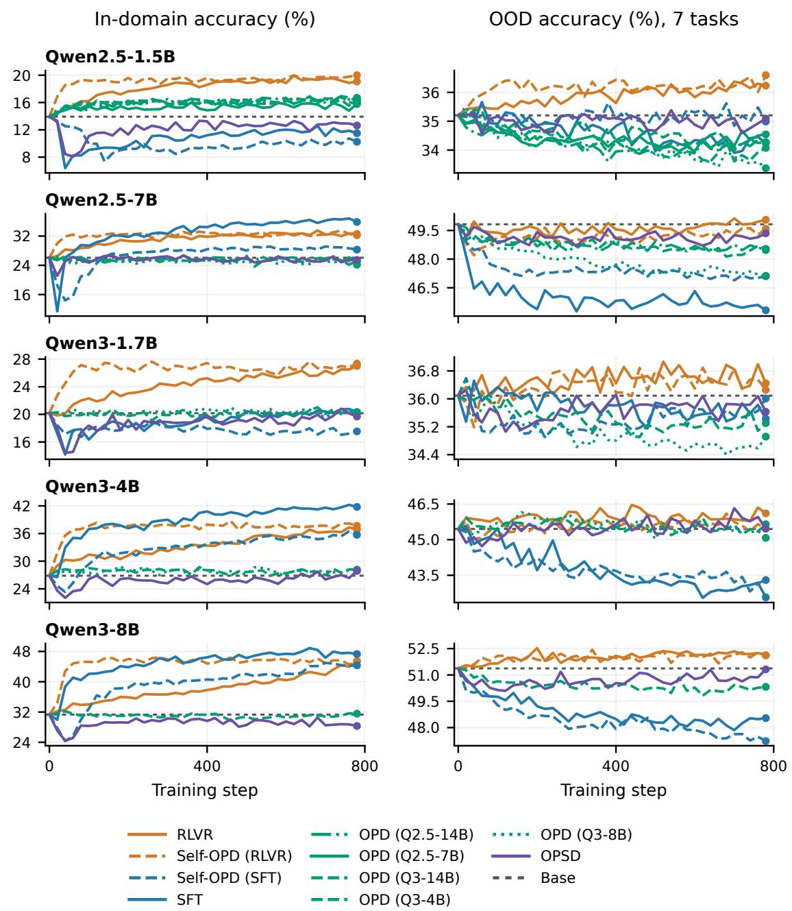  
Figure 6: In-domain learning and OOD retention throughout training. Curves show task-group mean accuracy; dashed horizontal lines mark Base. RLVR and Self-OPD (RLVR) combine in-domain learning with sustained capability retention.

Each figure below summarizes one Base student, combining in-domain and OOD evaluations. Panels show the five mathematical and seven OOD tasks; aggregate accuracies appear in Figure 6. Colors and line styles follow the overall method comparison.

Qwen2.5-1.5B Base — in-domain and OOD  
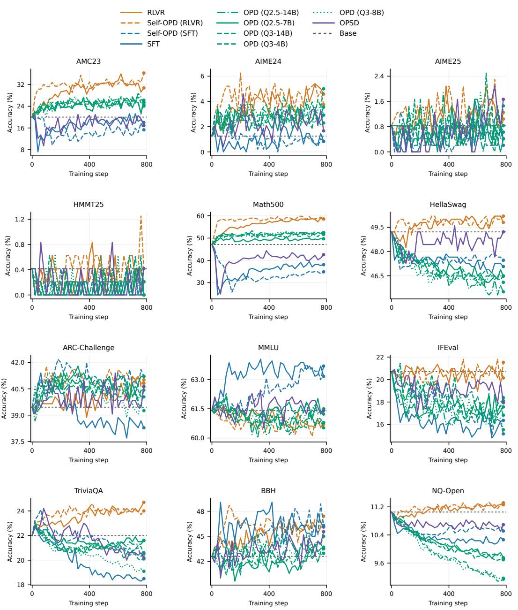  
Figure 7: Task accuracies during training for Qwen2.5-1.5B Base.

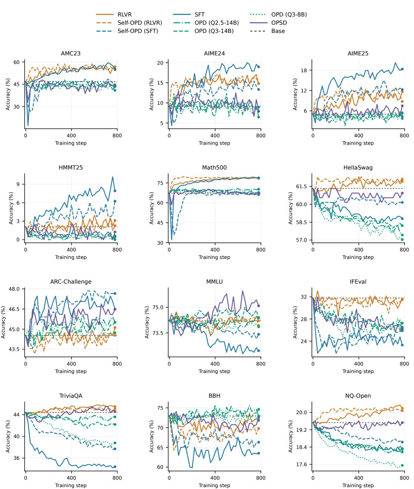  
Figure 8: Task accuracies during training for Qwen2.5-7B Base.

Qwen3-1.7B Base — in-domain and OOD  
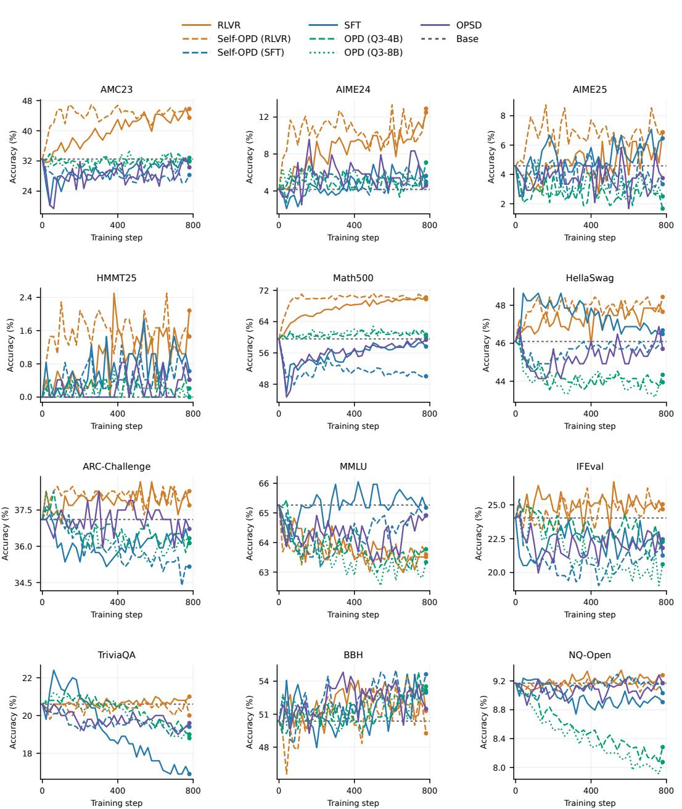  
Figure 9: Task accuracies during training for Qwen3-1.7B Base.

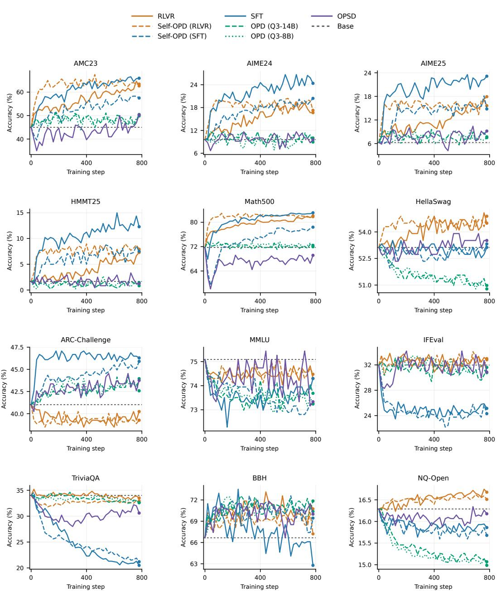  
Figure 10: Task accuracies during training for Qwen3-4B Base.

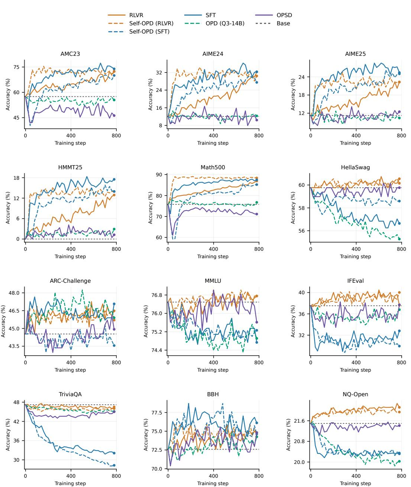  
Figure 11: Task accuracies during training for Qwen3-8B Base.

## D Supplementary Measurements for Analysis

## D.1 Student–Teacher Prediction Gaps

Let $B , T , S _ { t }$ denote student Base, the frozen teacher, and the current student at training step t. The right panels of Figure 5 track the normalized prediction distance defined in Eq. (10):

$$
d _ { \mathrm { o u t } , d } ( t ) = \frac { D _ { d } ( S _ { t } , T ) } { D _ { d } ( B , T ) } , \qquad d \in \{ \mathrm { i n } , \mathrm { O O D } \} .\tag{12}
$$

Lower $d _ { \mathrm { o u t } , d }$ means closer teacher predictions relative to the initial gap. The reduction in that gap is $1 - d _ { \mathrm { o u t } , d } ;$ changes from Base are separately measured by $D _ { d } ( B , S _ { t } )$

On shared evaluation prefixes, the square root of JS satisfies the triangle inequality, giving

$$
D _ { \mathrm { i n } } ( B , S _ { t } ) \geq \left[ \sqrt { D _ { \mathrm { i n } } ( B , T ) } - \sqrt { D _ { \mathrm { i n } } ( S _ { t } , T ) } \right] _ { + } ^ { 2 } .\tag{13}
$$

A teacher far from Base and a student close to that teacher therefore imply substantial student change. The bound also holds for mean conditional JS: the joint distribution $P _ { X } ( s , v ) = w _ { s } p _ { X } ( v \mid s )$ uses the same prefix weights for all models, and its JS equals the weighted mean of conditional JS.

## D.2 Parameter and Prediction Distances

Figure 5 presents Qwen3-4B using the same student–teacher pairs for parameter and prediction measurements. Table 9 reports the corresponding step-780 distances for the other four models, using the same paired students and teachers for both measurements. Parameter distances are Euclidean distances across all model parameters, normalized by the corresponding Base–teacher endpoint distance. Let $d _ { T } = \theta _ { T } - \theta _ { 0 }$ and $\begin{array} { r } { d _ { S } ( t ) = \theta _ { S _ { t } } - \theta _ { 0 } } \end{array}$ be the teacher and student displacements. The normalized distances are

$$
d _ { \theta } ( t ) = \frac { \| \theta _ { S _ { t } } - \theta _ { T } \| _ { 2 } } { \| d _ { T } \| _ { 2 } } , \qquad d _ { \bot } ( t ) = \frac { \| d _ { S } ( t ) - \alpha _ { t } d _ { T } \| _ { 2 } } { \| d _ { T } \| _ { 2 } } , \quad \alpha _ { t } = \frac { \langle d _ { S } ( t ) , d _ { T } \rangle } { \| d _ { T } \| _ { 2 } ^ { 2 } } .\tag{14}
$$

Here $\alpha _ { t }$ projects the student displacement onto the teacher direction; $d _ { \perp }$ includes the residual in all orthogonal directions and is zero for models on the Base–teacher line. The teacher endpoint is fixed throughout each trajectory, including the reference trajectory of the source training.

Prediction trajectories compare students of SFT and RLVR teachers with their respective teachers on fixed evaluation prefixes. In-domain tasks are AMC23, AIME24, AIME25, HMMT25, and Math500; OOD tasks are HellaSwag, ARC-Challenge, MMLU, IFEval, TriviaQA, BBH, and NQ. We average JS equally across datasets within each domain, then divide by the initial Base–teacher JS on the same prefixes. The normalized distance is one at Base. Each curve keeps its teacher and prefixes fixed.

Across the five models, Self-OPD students remain far from their teachers in parameter space and depart from the Base–teacher line as their prediction gaps shrink. Students of RLVR teachers approach teacher in-domain predictions closely; students of SFT teachers generally retain larger in-domain gaps. Both sources reduce OOD prediction gaps.

<table><tr><td rowspan="2">Student</td><td rowspan="2">Teacher</td><td colspan="2">Parameter distance</td><td colspan="2">Prediction distance</td></tr><tr><td> $d _ { \theta }$ </td><td> $d _ { \perp }$ </td><td> $d _ { \mathrm { o u t , i n } }$ </td><td> $d _ { \mathrm { o u t } }$  ,OOD</td></tr><tr><td rowspan="2">Qwen2.5-1.5B</td><td>SFT</td><td>0.825</td><td>0.355</td><td>0.493</td><td>0.361</td></tr><tr><td>RLVR</td><td>0.894</td><td>0.744</td><td>0.010</td><td>0.354</td></tr><tr><td rowspan="2">Qwen2.5-7B</td><td>SFT</td><td>0.976</td><td>0.471</td><td>0.601</td><td>0.173</td></tr><tr><td>RLVR</td><td>0.943</td><td>0.758</td><td>0.010</td><td>0.243</td></tr><tr><td rowspan="2">Qwen3-1.7B</td><td>SFT</td><td>1.003</td><td>0.516</td><td>0.705</td><td>0.187</td></tr><tr><td>RLVR</td><td>0.988</td><td>0.860</td><td>0.029</td><td>0.101</td></tr><tr><td rowspan="2">Qwen3-8B</td><td>SFT</td><td>0.998</td><td>0.457</td><td>0.084</td><td>0.238</td></tr><tr><td>RLVR</td><td>1.009</td><td>0.796</td><td>0.077</td><td>0.172</td></tr></table>

Table 9: Self-OPD distances to the corresponding SFT or RLVR teacher at step 780 for the four models supplementing Figure 5. Parameter and prediction distances are normalized by the initial Base–teacher gap; $d _ { \perp }$ measures departure from the Base–teacher line.

## D.3 Paired Capability Curves and Evaluation

Each Self-OPD student is paired with the SFT or RLVR run that produced its frozen teacher. Figure 12 uses completed in-domain and seven-task OOD evaluations.

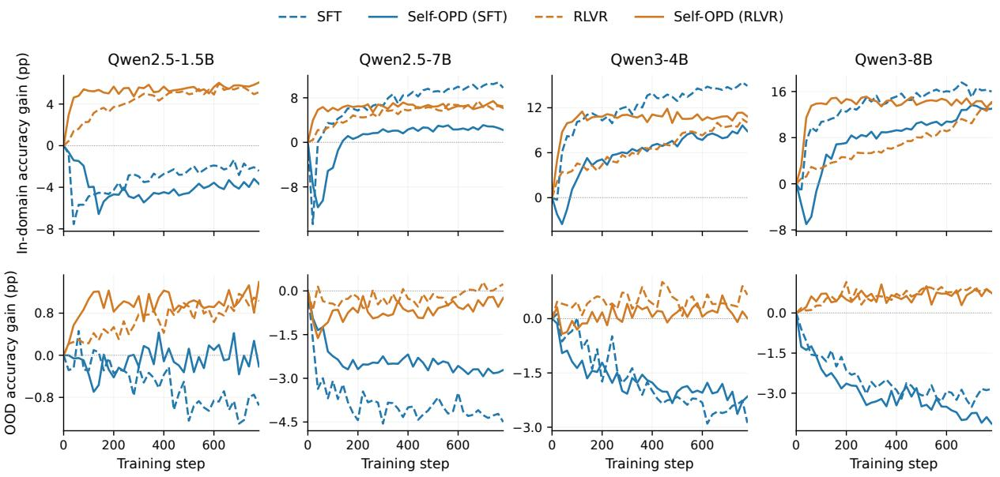  
Figure 12: Accuracy changes from Base for source training (dashed) and the corresponding Self-OPD student (solid). Students use a fixed endpoint teacher.

Source SFT/RLVR and Self-OPD evaluations use the same OOD scoring rules and equal dataset weights. RLVR students approach teacher task performance early, while larger SFT students inherit substantial OOD losses before matching task gains.

## D.4 Teacher-Prefix Probabilities Under the Student

We use Qwen2.5-7B and Qwen3-1.7B for this diagnostic. We fix 64 OpenR1 mathematical problems and generate four responses per problem from each SFT and RLVR endpoint teacher, using Raw inputs, temperature 1, top-p = 1, and a maximum response length of 1024 tokens. For the first L tokens of a teacher response, Base, both Self-OPD students,

and the generating teacher each compute

$$
\ell _ { L } ( p ; y \mid x ) = - { \frac { 1 } { L } } \sum _ { t = 1 } ^ { L } \log p ( y _ { t } \mid x , y _ { < t } ) .\tag{15}
$$

Lower scores mean higher probability for the same fixed-length prefix. We first average responses within a problem, then weight problems equally.

Table 10 gives cross-scoring results for two models at the same student checkpoints, 60 and 240. Both students increase the probability of their teachers’ prefixes. RLVR prefixes already have higher probability under Base, and their student approach teacher self-scores faster.

<table><tr><td>Prefix source</td><td>Base</td><td>SFT@60</td><td>SFT@240</td><td>RLVR@60</td><td>RLVR@240</td><td>Teacher</td></tr><tr><td colspan="7">Qwen2.5-7B</td></tr><tr><td>SFT</td><td>1.057</td><td>0.871</td><td>0.580</td><td>1.563</td><td>1.567</td><td>0.379</td></tr><tr><td>RLVR</td><td>0.230</td><td>0.330</td><td>0.436</td><td>0.106</td><td>0.096</td><td>0.094</td></tr><tr><td colspan="7">Qwen3-1.7B</td></tr><tr><td>SFT</td><td>0.967</td><td>0.839</td><td>0.665</td><td>1.855</td><td>1.822</td><td>0.458</td></tr><tr><td>RLVR</td><td>0.300</td><td>0.332</td><td>0.444</td><td>0.145</td><td>0.136</td><td>0.135</td></tr></table>

Table 10: Mean negative log probability over the first 128 tokens of teacher responses, in nats/token. SFT/RLVR columns denote students of the corresponding teacher source; @ denotes student training step. Each teacher contributes all 256 responses; the final column is scored by the teacher that generated them.

Correcting for teacher self-probability. Prefix scores also reflect how concentrated the teacher’s own generation distribution is. We therefore subtract teacher self-scored negative log probability from the Base score:

$$
g _ { L } ( q , p _ { 0 } ; y \mid x ) = { \frac { 1 } { L } } \sum _ { t = 1 } ^ { L } \log { \frac { q ( y _ { t } \mid x , y _ { < t } ) } { p _ { 0 } ( y _ { t } \mid x , y _ { < t } ) } } .\tag{16}
$$

Table 11 shows a larger teacher–Base scoring gap for SFT responses. This relationship persists when scoring only tokens 33–128, extending the source difference to later parts of the response.

<table><tr><td>Prefix source</td><td>Tokens 1–128</td><td>Tokens 33-128</td></tr><tr><td>Qwen2.5-7B</td><td></td><td></td></tr><tr><td>SFT</td><td>0.678</td><td>0.514</td></tr><tr><td>RLVR</td><td>0.136</td><td>0.122</td></tr><tr><td>Qwen3-1.7B</td><td></td><td></td></tr><tr><td>SFT</td><td>0.509</td><td>0.353</td></tr><tr><td>RLVR</td><td>0.165</td><td>0.132</td></tr></table>

Table 11: Scoring gaps after correcting for teacher self-probability, in nats/token. Larger values indicate a higher predictive cost under Base relative to the generating teacher.

## D.5 SFT Teacher Openings and First-Position Feedback

Opening preferences and candidate coverage. Of the 49,993 complete OpenR1 training solutions, 99.54% begin with Okay or Alright after stripping whitespace and ignoring case. SFT retains these openings in its training targets. On 64 fixed mathematical problems with four responses per problem, all 256 responses from each of the Qwen2.5-7B and Qwen3-1.7B SFT teachers begin with these words; none from their RLVR counterparts do. At each response position, OPD computes feedback on the student’s 16 highest-probability tokens. On the same Base-student responses, all positive probability mass added by either SFT teacher relative to Base at the first position falls outside this candidate set. At later sampled positions, the excluded fractions are only 7.02% and 8.87%, respectively, weighted by added probability mass. Thus, the teacher assigns low probability to the student’s usual openings while its preferred openings receive no direct candidate-level positive feedback.

Removing first-position feedback improves task transfer. We compare ordinary Self-OPD (SFT) with first-position feedback zeroed throughout a complete 780-step run for each of the five Qwen models. Each pair starts from the same pretrained Base and uses the same frozen SFT teacher at its final checkpoint, with Raw inputs for both student and teacher. The intervention zeros all 16 candidate feedback values at the first valid response position; later feedback, response masks, and the loss denominator are unchanged. Training follows the standard Self-OPD recipe with Top-16 feedback, AdamW, and 64 problems with four responses per problem in each batch. Evaluation uses ordinary generation and scoring, averaging datasets equally within the five-task in-domain and seven-task OOD groups. The common target evaluation protocol is specified in Appendix B.

<table><tr><td></td><td colspan="3">In-domain accuracy</td><td colspan="3">OOD accuracy</td></tr><tr><td>Model</td><td>Ordinary</td><td>Zeroed</td><td>∆</td><td>Ordinary</td><td>Zeroed</td><td>∆</td></tr><tr><td>Qwen2.5-1.5B</td><td>10.33</td><td>14.23</td><td>+3.91</td><td>34.93</td><td>34.58</td><td>-0.35</td></tr><tr><td>Qwen2.5-7B</td><td>28.49</td><td>34.57</td><td>+6.08</td><td>47.02</td><td>46.50</td><td>-0.52</td></tr><tr><td>Qwen3-1.7B</td><td>17.16</td><td>20.54</td><td>+3.38</td><td>35.59</td><td>35.71</td><td>+0.12</td></tr><tr><td>Qwen3-4B</td><td>34.71</td><td>38.82</td><td>+4.11</td><td>43.45</td><td>43.35</td><td>-0.10</td></tr><tr><td>Qwen3-8B</td><td>44.79</td><td>44.12</td><td>-0.66</td><td>47.10</td><td>47.63</td><td>+0.53</td></tr></table>

Table 12: Step-780 accuracy (%) with ordinary feedback and first-position feedback zeroed. ∆ is zeroed minus ordinary accuracy, in percentage points. Evaluation leaves all output positions unchanged.

Zeroing first-position feedback generally improves in-domain accuracy, with endpoint gains reaching 6.08 percentage points and OOD accuracy differences within 0.53 percentage points (Table 12). Figure 13 shows the complete training curves. A separate short-run Qwen2.5-7B comparison with matched data order and sampling seed also improves in-domain accuracy from 18.28% to 27.92% at step 20 and from 14.47% to 27.53% at step 40. Together with the opening and coverage measurements, these results show that first-position feedback can interfere with task transfer.

Task improvement and prediction matching. We also compare each student with Base and with its paired SFT teacher on the same fixed evaluation prefixes. JS uses the equal mixture of Base- and RLVR-generated prefixes, averaged equally over datasets within each domain. Both comparisons use absolute JS, without normalizing by the initial teacher–Base distance. Accuracy is evaluated every 20 updates and JS every 60 updates. Table 13 reports endpoint distances.
<table><tr><td colspan="2"></td><td colspan="2">JS to Base</td><td colspan="2">JS to SFT teacher</td></tr><tr><td>Model</td><td>Feedback</td><td>In-domain</td><td>OOD</td><td>In-domain</td><td>OOD</td></tr><tr><td rowspan="2">Qwen2.5-1.5B</td><td>Ordinary</td><td>7.200</td><td>2.136</td><td>3.658</td><td>1.007</td></tr><tr><td>First-position zeroed</td><td>4.172</td><td>1.750</td><td>4.917</td><td>0.860</td></tr><tr><td rowspan="2">Qwen2.5-7B</td><td>Ordinary</td><td>7.137</td><td>1.963</td><td>4.625</td><td>0.462</td></tr><tr><td>First-position zeroed</td><td>5.355</td><td>1.620</td><td>4.779</td><td>0.753</td></tr><tr><td rowspan="2">Qwen3-1.7B</td><td>Ordinary</td><td>6.165</td><td>2.149</td><td>4.555</td><td>0.521</td></tr><tr><td>First-position zeroed</td><td>3.006</td><td>1.811</td><td>4.588</td><td>0.534</td></tr><tr><td rowspan="2">Qwen3-4B</td><td>Ordinary</td><td>6.941</td><td>2.122</td><td>4.026</td><td>0.688</td></tr><tr><td>First-position zeroed</td><td>5.880</td><td>2.071</td><td>3.023</td><td>0.548</td></tr><tr><td rowspan="2">Qwen3-8B</td><td>Ordinary</td><td>6.519</td><td>2.653</td><td>0.582</td><td>0.707</td></tr><tr><td>First-position zeroed</td><td>4.037</td><td>2.303</td><td>4.569</td><td>0.615</td></tr></table>

Table 13: Step-780 JS in $1 0 ^ { - 2 }$ nats for the same ordinary and first-position-zeroed students. The references are the shared Base and the corresponding frozen SFT teacher.

Zeroing first-position feedback reduces both in-domain and OOD JS from Base for all five models. The in-domain accuracy gains do not consistently coincide with lower JS to the teacher. Improved task performance can therefore accompany smaller changes from Base without closer prediction matching to the teacher.

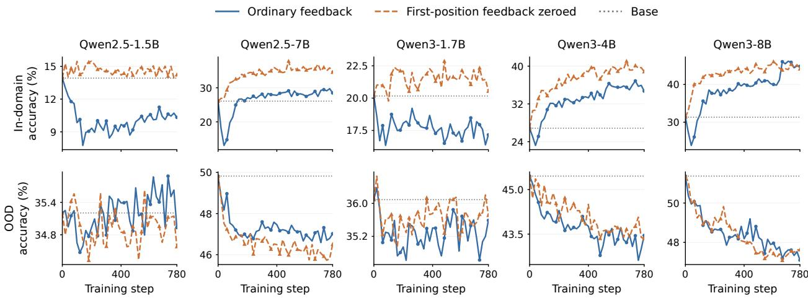  
Figure 13: Complete accuracy trajectories for ordinary Self-OPD (SFT) and its first-position feedback intervention across five models (columns), with in-domain accuracy above OOD accuracy. Both conditions use the same Base and frozen SFT teacher. Dotted horizontal lines mark Base accuracy.

## D.6 Additional RLVR-Teacher Comparisons

Table 14 reports two additional teacher–student pairs for Qwen3-1.7B at student step 120, using the A/D/E subset of conditions in Table 3. This fixed early-training comparison uses complete in-domain accuracy, OOD accuracy, and JS measurements for every group. The three student runs within each group use the same initialization, update settings, and evaluation prefixes, with only the teacher varying.
<table><tr><td>Teacher supervision</td><td colspan="3">Distribution change</td><td colspan="2">Accuracy (%)</td></tr><tr><td></td><td> $D _ { \mathrm { i n } }$ </td><td> $D _ { \mathrm { O O D } }$ </td><td>ρ</td><td>Math (∆)</td><td>OOD (∆)</td></tr><tr><td colspan="6">Qwen3-4B→Qwen3-1.7B</td></tr><tr><td>Student Base</td><td></td><td></td><td>一</td><td>20.17</td><td>36.09</td></tr><tr><td>A: Larger Base teacher</td><td>0.2692</td><td>0.1772</td><td>0.658</td><td>19.38 (−0.78)</td><td>35.96 (−0.13)</td></tr><tr><td>D: Larger RLVR teacher</td><td>4.1255</td><td>0.3643</td><td>0.088</td><td>24.21 (+4.04)</td><td>36.19 (+0.10)</td></tr><tr><td>E: RLVR increment</td><td>4.1056</td><td>0.3302</td><td>0.080</td><td>24.08 (+3.92)</td><td>36.05 (−0.04)</td></tr><tr><td colspan="6">Qwen3-8B→Qwen3-1.7B</td></tr><tr><td>Student Base</td><td></td><td></td><td></td><td>20.17</td><td>36.09</td></tr><tr><td>A: Larger Base teacher</td><td>0.3272</td><td>0.2875</td><td>0.879</td><td>20.65 (+0.49)</td><td>35.94 (−0.15)</td></tr><tr><td>D: Larger RLVR teacher</td><td>4.2713</td><td>0.3747</td><td>0.088</td><td>26.72 (+6.55)</td><td>37.04 (+0.94)</td></tr><tr><td>E: RLVR increment</td><td>4.1650</td><td>0.3205</td><td>0.077</td><td>27.02 (+6.85)</td><td>36.66(+0.57)</td></tr></table>

Table 14: Additional A/D/E comparisons for Qwen3-1.7B at student step 120. JS is relative to student Base in $1 0 ^ { - 2 }$ nats. Accuracies are percentages, with changes from Base in parentheses. Domains use equal dataset weights.

## D.7 Distribution Change and Forgetting: Additional Model

Figure 14 supplements Figure 2 with Qwen3-1.7B, using the same methods, evaluation prefixes, and dataset averages.

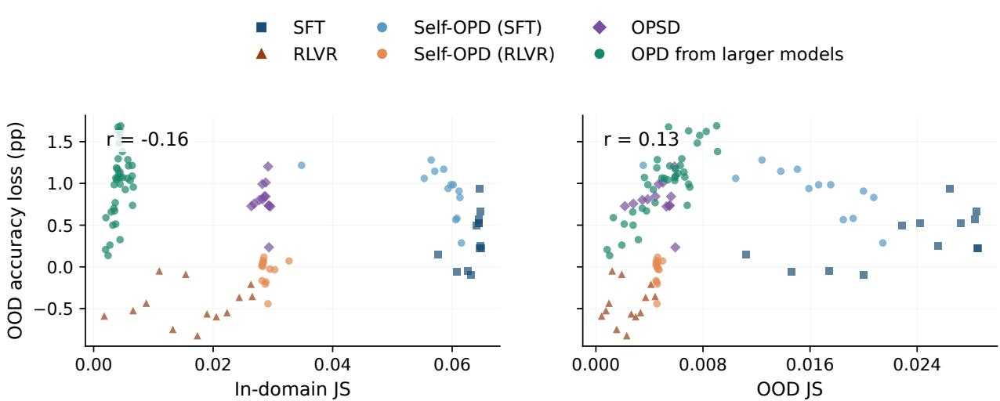  
Figure 14: Distribution change and forgetting for Qwen3-1.7B. Left: in-domain JS; right: OOD JS. Both panels show OOD accuracy loss at the corresponding checkpoint, with r denoting Pearson correlation.

## D.8 Training and Measurement Settings

All A–E comparisons use student step 120 and the training recipe in Appendix B.4: Top-16 feedback, AdamW, and 64 problems with four responses per problem. Student and teacher inputs are Raw. Within each comparison, initialization, training data, sampling, and optimization are fixed while the teacher varies. JS uses shared evaluation prefixes, with equal weights for Base- and RLVR-generated prefixes and equal dataset weights within each domain.

## D.9 Constructed-Teacher Normalization and Current-Student Feedback

Conditions C and E use $m \in \{ \mathrm { S F T } , \mathrm { R L V R } \}$ and the constructed teacher $q _ { \mathrm { i n c } , m }$ defined in Section 4.2. The models within each construction share a vocabulary. At each prefix, we combine logits from the frozen smaller Base, larger Base, and larger post-trained model, writing $z _ { r }$ for the logits of model r:

$$
q _ { \mathrm { i n c } , m } = \mathrm { s o f t m a x } ( z _ { p _ { 0 } } + z _ { q _ { m } } - z _ { q _ { \mathrm { b a s e } } } ) .\tag{17}
$$

The resulting ordinary OPD feedback is

$$
\log \frac { q _ { \mathrm { i n c } , m } ( v \mid s ) } { p _ { t } ( v \mid s ) } = \delta _ { m } ( v \mid s ) - \log \frac { p _ { t } ( v \mid s ) } { p _ { 0 } ( v \mid s ) } - \log Z _ { m } ( s ) .\tag{18}
$$

The student’s current change from Base is subtracted as training proceeds, while the teacher’s source models remain frozen.

## E OPSD: Teacher Input and Answer Boundaries

OPSD uses privileged reference solutions to provide token-level feedback on student-generated answers. Its original implementation uses chat-formatted teacher prompts, which provide an explicit transition from reference material to the response being scored (Zhao et al., 2026). We adapt this transition to the Raw text-completion setting of our Base models and compare three ways of presenting the same reference information.

## E.1 Three Teacher Input Formats

In all three settings, the student receives the Raw problem and generates its own response. The teacher uses the same Base weights as the student’s initialization, receives the problem and full reference solution, and scores the student-generated tokens. The private reference block and instruction are given in Appendix B.2. Only the teacher’s input formatting differs:

• Raw: concatenate the problem, private reference block, and instruction as plain text, followed directly by the student response.

• Chat template: package the same material as a user message and place the template’s assistant-start marker before the student response.

• Raw + answer boundary: retain the Raw input and append Answer to the original problem: on a new line before the response.

The resulting teacher prefixes have the following structure, where [private block] includes the reference and its instruction:

Raw: [problem] [private block] [student response]   
Chat: <user> [problem] [private block] </user>   
<assistant> [student response]   
Boundary: [problem] [private block]   
Answer to the original problem:   
[student response]

The role markers above are schematic; each model uses its corresponding template. Teacher weights remain those of the Base model in every setting. The original OPSD prompt likewise explicitly transitions from the reference solution to a new answer (Zhao et al., 2026).

## E.2 Preserving the Transition to a New Answer

Holding 64 mathematical problems and student responses fixed, we compare the three teacher prefixes before the first response token. Table 15 reports the teacher’s mean probability of the end-of-sequence token at this position. Direct Raw concatenation gives the teacher a strong preference to stop. Both the assistant-start marker and the textual answer boundary sharply reduce that preference.

<table><tr><td>Teacher</td><td>Raw</td><td>Chat template</td><td>Raw + answer boundary</td></tr><tr><td>Qwen2.5-7B</td><td>24.12</td><td>0.0100</td><td>0.0028</td></tr><tr><td>Qwen3-1.7B</td><td>15.36</td><td>0.0385</td><td>0.0034</td></tr></table>

Table 15: Teacher end-of-sequence probability (%) before the first student response token, with the problems and reference solutions fixed.

The stopping preference also affects training. In paired short Qwen2.5-7B runs, both settings begin with 12.11% empty student responses in the first batch. By the fourth batch, this rises to 21.09% with direct Raw concatenation and falls to 1.95% with the textual boundary. Each batch contains the same 64 problems with four responses per problem. These measurements suggest that simply removing the chat template can leave the Base teacher without a clear distinction between the completed reference solution and the student’s new answer. The assistant-start marker in the original prompting convention supplies this distinction; an explicit textual boundary preserves its role in a Raw prompt. Both forms of separation help the teacher provide feedback on the student’s own solution.

## E.3 Full Training Across Qwen Models

We compare complete 780-step runs for the five Qwen students. Students use OpenR1-50K, Top-16 feedback, AdamW, and the shared training settings in Appendix B. Table 16 gives final mathematical and OOD accuracy; Table 17 gives the corresponding JS and ρ. Figure 15 shows the accuracy trajectories. Each entry uses one training seed. The chat-template entries retain the original prompting convention, and the boundary entries are used in our main accuracy comparisons. Mathematical and OOD scores use the same five and seven datasets as the main evaluation, respectively. Distribution measurements compare each student with its Base on shared fixed prefixes, using the same task groups and averaging as Figure 3.

Adding the textual answer boundary improves mathematical accuracy over direct Raw concatenation for all five students. It also exceeds the chat-template result for four of the five students. Across formats, OOD accuracy changes much less than mathematical accuracy. Thus, separating the reference from the new answer is consequential for learning, and the most effective realization of that boundary depends on the model.

<table><tr><td>Student</td><td>Metric</td><td>Base</td><td>Raw</td><td>Chat template</td><td>Raw + boundary</td></tr><tr><td>Qwen2.5-1.5B</td><td>Math</td><td>13.93</td><td>5.63</td><td>6.86</td><td>12.64</td></tr><tr><td rowspan="2">Qwen2.5-7B</td><td>OOD</td><td>35.20</td><td>35.21</td><td>35.06</td><td>35.09</td></tr><tr><td>Math</td><td>26.08</td><td>8.61</td><td>22.44</td><td>25.46</td></tr><tr><td rowspan="2">Qwen3-1.7B</td><td>OOD</td><td>49.82</td><td>48.91</td><td>49.00</td><td>49.35</td></tr><tr><td>Math</td><td>20.16</td><td>9.62</td><td>19.34</td><td>19.68</td></tr><tr><td rowspan="2">Qwen3-4B</td><td>OOD</td><td>36.09</td><td>35.09</td><td>36.22</td><td>35.63</td></tr><tr><td>Math</td><td>26.85</td><td>19.51</td><td>25.55</td><td>27.89</td></tr><tr><td rowspan="2">Qwen3-8B</td><td>OOD</td><td>45.45</td><td>45.59</td><td>44.62</td><td>45.46</td></tr><tr><td>Math</td><td>31.32</td><td>25.10</td><td>29.40</td><td>28.31</td></tr><tr><td rowspan="2"></td><td>OOD</td><td>51.37</td><td>50.60</td><td>50.90</td><td>51.32</td></tr><tr><td></td><td></td><td></td><td></td><td></td></tr></table>

Table 16: OPSD accuracy (%) at step 780 under three teacher input formats. Students always receive Raw problems. Base is the untrained student; each metric averages its datasets equally.
<table><tr><td>Student</td><td>Teacher input</td><td> $D _ { \mathrm { i n } }$ </td><td> $D _ { \mathrm { O O D } }$ </td><td> $\rho$ </td></tr><tr><td>Qwen2.5-1.5B</td><td>Raw</td><td>2.965</td><td>0.440</td><td>0.148</td></tr><tr><td></td><td>Chat template</td><td>4.978</td><td>0.472</td><td>0.095</td></tr><tr><td></td><td>Raw + answer boundary</td><td>4.691</td><td>0.599</td><td>0.128</td></tr><tr><td>Qwen2.5-7B</td><td>Raw</td><td>2.308</td><td>0.189</td><td>0.082</td></tr><tr><td></td><td>Chat template</td><td>4.789</td><td>0.192</td><td>0.040</td></tr><tr><td></td><td>Raw + answer boundary</td><td>4.585</td><td>0.188</td><td>0.041</td></tr><tr><td>Qwen3-1.7B</td><td>Raw</td><td>2.920</td><td>0.587</td><td>0.201</td></tr><tr><td></td><td>Chat template</td><td>4.904</td><td>0.571</td><td>0.117</td></tr><tr><td></td><td>Raw + answer boundary</td><td>4.648</td><td>0.706</td><td>0.152</td></tr><tr><td>Qwen3-4B</td><td>Raw</td><td>3.278</td><td>0.244</td><td>0.074</td></tr><tr><td></td><td>Chat template</td><td>4.495</td><td>0.318</td><td>0.071</td></tr><tr><td></td><td>Raw + answer boundary</td><td>4.488</td><td>0.317</td><td>0.071</td></tr><tr><td>Qwen3-8B</td><td>Raw</td><td>3.280</td><td>0.266</td><td>0.081</td></tr><tr><td></td><td>Chat template</td><td>4.416</td><td>0.185</td><td>0.042</td></tr><tr><td></td><td>Raw + answer boundary</td><td>4.549</td><td>0.295</td><td>0.065</td></tr></table>

Table 17: OPSD distribution changes at step 780 for the same runs as Table 16. JS is measured relative to Base in $1 0 ^ { - 2 }$ nats; $\rho = D _ { \mathrm { O O D } } / D _ { \mathrm { i n } }$

Configurations used in the main comparisons. The accuracy comparisons in Figure 1(b) and Table 1 use a Raw student and a Raw teacher with the explicit answer boundary. This preserves the reference-to-answer transition in the original OPSD prompting convention while adapting it to Base models’ text-completion format. The distribution comparison in Figure 3 retains the plain Raw/Raw control to match teacher and student formatting without additional answer-start cues. Both configurations provide the same privileged reference information to the teacher. The complete accuracy and JS comparisons here document the effects of this input adaptation.

Teacher input can affect update selectivity. Interestingly, Chat formatting consistently raises in-domain JS relative to Raw, while changes in OOD JS are much smaller in absolute size and its five-model mean remains nearly unchanged. Consequently, ρ decreases. A textual answer boundary produces in-domain JS close to Chat formatting, showing that ordinary language cues can have a similar effect to role markers. These results suggest that teacher conditioning can introduce response preferences whose effects concentrate on the target domain. Together with the boundary variant’s accuracy improvements over plain Raw, they motivate optimizing teacher prompts to direct OPD feedback toward task learning while limiting accompanying OOD changes.

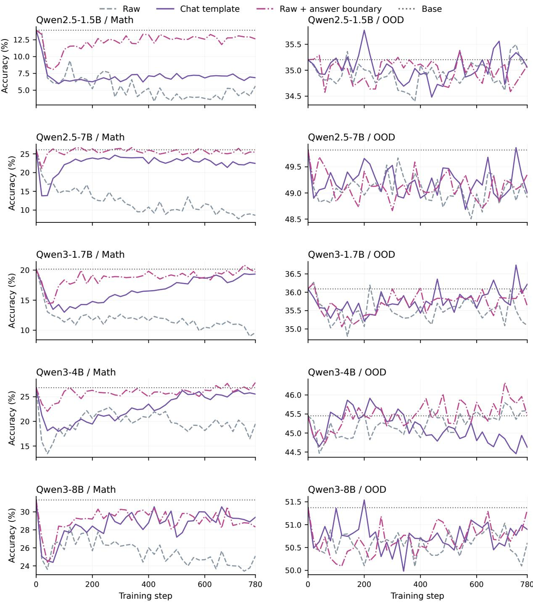  
Figure 15: OPSD mathematical and OOD accuracy throughout training under the three teacher input formats, one student per row. Dotted horizontal lines mark the common Base evaluation. Each curve uses measured checkpoints at 20-step intervals.

## F Weight Interpolation and Extrapolation

Section 4.3 compares SFT, RLVR, and their Self-OPD students under weight scaling. We retain these four methods for all five student models, using the original training seed and step-780 endpoints. Both the student and teacher use Raw input in Self-OPD. The SFT/RLVR sweeps reuse the corresponding source-training endpoints. The curves share the complete measured interval $0 \leq \lambda \leq 2$ . We rescale the weight difference between Base $( \theta _ { 0 } )$ and the trained endpoint $( \theta _ { \mathrm { e n d } } )$ , using the notation of Eq. (9):

$$
\begin{array} { r } { \theta _ { \lambda } = \theta _ { 0 } + \lambda ( \theta _ { \mathrm { e n d } } - \theta _ { 0 } ) , \qquad \lambda \in \{ 0 , 0 . 2 , 0 . 4 , 0 . 6 , 0 . 8 , 1 , 1 . 2 , 1 . 5 , 2 \} . } \end{array}
$$

Values $0 \leq \lambda \leq 1$ interpolate between the endpoints; $\lambda > 1$ extrapolates beyond the trained endpoint. Evaluation follows Appendix B. The points at $\lambda = 0$ and $\lambda = 1$ use the evaluations of Base and the corresponding trained endpoint, respectively.

Sweet-spot coefficients. Let $\Delta \mathrm { A c c } _ { \mathrm { i n } } ( \lambda )$ and $\Delta \mathrm { A c c } _ { \mathrm { O O D } } ( \lambda )$ be accuracy changes from Base, in percentage points. We mark sweet spots only for runs whose trained endpoint improves in-domain accuracy over Base, $\Delta \mathrm { A c c } _ { \mathrm { i n } } ( 1 ) > 0$ Stars in Figure 4 identify measured coefficients satisfying

$$
\begin{array} { r } { \lambda > 0 , \qquad \Delta \mathrm { A c c } _ { \mathrm { i n } } ( \lambda ) > \Delta \mathrm { A c c } _ { \mathrm { i n } } ( 1 ) , } \\ { \Delta \mathrm { A c c } _ { \mathrm { O O D } } ( \lambda ) > \Delta \mathrm { A c c } _ { \mathrm { O O D } } ( 1 ) . } \end{array}
$$

Both task means must be available at the candidate coefficient and at λ = 1. OOD accuracy is the equally weighted mean over the same tasks as the main evaluation.

The identified sweet spots lie within the interpolation range for SFT-based updates and the extrapolation range for RLVR-based updates. Learning rates and training progress can also affect the endpoint and the locations of these coefficients.

Learning and retention along a training direction. Interpolation toward Base can retain much of the in-domain gain while recovering OOD accuracy (Figure 4). Further extrapolation often reduces in-domain accuracy and accentuates SFT-family forgetting. RLVR directions preserve OOD accuracy over a broader range of weight scaling.

## G Supporting Analysis

## G.1 Student Probabilities in the Expected OPD Gradient

At a fixed prefix s, let $p = \operatorname { s o f t m a x } ( z )$ and sample $a \sim p .$ For the score-function surrogate $L = - \operatorname { s g } ( A ) \log p ( a )$ where sg denotes stop-gradient, define $m _ { v } = \mathbb { E } [ A \mid a = v , s ]$ . The gradient with respect to logit $z _ { v }$ and its conditional mean are

$$
g _ { v } = \frac { \partial L } { \partial z _ { v } } = - A \big ( \mathbf { 1 } \{ a = v \} - p ( v ) \big ) ,\tag{19}
$$

$$
\mu _ { v } ( s ) = \mathbb { E } [ g _ { v } \mid s ] = - p ( v ) m _ { v } + p ( v ) \sum _ { u } p ( u ) m _ { u } = p ( v ) { \bigl ( } \mathbb { E } [ A \mid s ] - m _ { v } { \bigr ) } .\tag{20}
$$

For ordinary OPD, $m _ { v } = \log q _ { T } ( v \mid s ) - \log p ( v \mid s )$ . The student’s current token probabilities weight differences in teacher preferences across candidates. Applying the chain rule and averaging over student-generated prefixes $d _ { p }$ gives

$$
\mathbb { E } [ \nabla _ { \theta } L ] = \mathbb { E } _ { s \sim d _ { p } } \left[ \sum _ { v } \mu _ { v } ( s ) \nabla _ { \theta } z _ { v } ( s ) \right] .\tag{21}
$$

Less frequently visited prefixes and lower-probability candidates receive smaller weights in this mean update. This full-vocabulary score-function model motivates the prefix analysis; the implemented candidate feedback and optimizer are specified in Appendix D.8.

Token-dependent feedback means that $m _ { v }$ varies with candidate $v$ at a fixed prefix. Random per-token feedback with the same conditional mean for every candidate still yields zero mean logit gradient. As student predictions approach the frozen teacher, ordinary OPD’s log-probability feedback and its mean gradient shrink.

## G.2 Local Directions After Calibrating In-Domain Change

A directional view of local JS. Let $p _ { 0 } = p _ { \theta _ { \mathrm { { 0 } } } }$ be student Base and consider a small update $\theta _ { \epsilon } = \theta _ { 0 } + \epsilon g$ along a fixed parameter direction $g .$ For domain $d \in \{ \mathrm { i n , O O D } \}$ }, fix evaluation prefixes and their task weights, represented by $\textstyle { S _ { d } }$ Define the score vector at Base and the domain’s predictive Fisher matrix:

$$
\psi _ { s } ( \boldsymbol { v } ) = \nabla _ { \boldsymbol { \theta } } \log p _ { \boldsymbol { \theta } } ( \boldsymbol { v } \mid \boldsymbol { s } ) | _ { \boldsymbol { \theta = \theta } _ { 0 } } , \qquad \mathcal { T } _ { d } = \mathbb { E } _ { s \sim \mathcal { S } _ { d } } \left[ \sum _ { \boldsymbol { v } } p _ { 0 } ( \boldsymbol { v } \mid \boldsymbol { s } ) \psi _ { s } ( \boldsymbol { v } ) \psi _ { s } ( \boldsymbol { v } ) ^ { \top } \right] .\tag{22}
$$

$\mathcal { T } _ { d }$ captures the local sensitivity of that domain’s predictions to parameter changes. Using natural logarithms, smooth conditional distributions, and positive probabilities, mean JS satisfies

$$
D _ { d } ( \theta _ { 0 } , \theta _ { \epsilon } ) = \frac { \epsilon ^ { 2 } } { 8 } g ^ { \top } \mathcal { T } _ { d } g + \mathcal { O } ( \epsilon ^ { 3 } ) .\tag{23}
$$

The per-prefix quadratic term of JS is $\frac { 1 } { 8 } \sum _ { v } ( p \theta _ { \epsilon } - p _ { 0 } ) ^ { 2 } / p _ { 0 }$ . Substituting $p _ { \theta _ { \epsilon } } ( v \mid s ) - p _ { 0 } ( v \mid s ) = \epsilon p _ { 0 } ( v \mid s ) \psi _ { s } ( v ) ^ { \top } g +$ $\mathcal { O } ( \epsilon ^ { 2 } )$ and averaging over fixed prefixes yields the result.

When $g ^ { \top } \mathbb { Z } _ { \mathrm { i n } } g > 0 ,$

$$
\rho ( \epsilon , g ) = \frac { D _ { \mathrm { O O D } } ( \theta _ { 0 } , \theta _ { \epsilon } ) } { D _ { \mathrm { i n } } ( \theta _ { 0 } , \theta _ { \epsilon } ) } = \frac { g ^ { \top } \mathcal { Z } _ { \mathrm { O O D } } g } { g ^ { \top } \mathcal { Z } _ { \mathrm { i n } } g } + \mathcal { O } ( \epsilon ) .\tag{24}
$$

Update magnitude cancels in the ratio of quadratic terms, leaving the relative influence of the direction on the two domains. This motivates calibrating in-domain change to compare the OOD influence of directions induced by different feedback sources.

Comparing calibrated directions. The local comparison reuses the same prefixes generated by Base and computes A/D/E update directions separately. For each direction, we adjust only its overall magnitude to reach a common in-domain JS target on calibration prefixes. We then measure in-domain JS, OOD JS, and $\rho$ on independent evaluation prefixes, so the reported in-domain JS can differ. Reference RLVR directions use parameter differences along the student’s original RLVR training, with the same calibration procedure.

<table><tr><td>Update direction In-domain  $\mathrm { J S \times 1 0 ^ { 5 } }$   $\mathrm { O O D ~ J S } \times 1 0 ^ { 5 }$ </td></tr><tr><td>Qwen3-1.7B</td></tr><tr><td>A: Base teacher 1.079 0.659 0.611</td></tr><tr><td>D: RLVR teacher 1.072 0.079 0.074</td></tr><tr><td>E: RLVR increment 0.938 0.053 0.056</td></tr><tr><td>RLVR parameter change (step 60) 1.228 0.071 0.058</td></tr><tr><td>RLVR parameter change (step 780) 1.098 0.069 0.063</td></tr><tr><td>Qwen3-4B</td></tr><tr><td>A: Base teacher 0.835 0.070 0.084</td></tr><tr><td>D: RLVR teacher 1.538 0.025 0.016</td></tr><tr><td>E: RLVR increment 1.573 0.024 0.015</td></tr></table>

Table 18: Independent-prefix measurements after calibrating in-domain JS to $1 0 ^ { - 5 }$ . Incorporating the teacher’s RLVR changes reduces relative OOD influence and brings it closer to the paired direct RLVR parameter directions.

## G.3 Teacher Information Relative to Base

Fix a student prefix s and let $s ^ { \mathrm { T } }$ contain the same problem and continuation under the teacher’s input format, including privileged context when present. On a common finite vocabulary with positive probabilities, the Base-relative teacher preference is

$$
\begin{array} { r l } & { b _ { q } ( v , s ) = \log \frac { q ( v \mid s ^ { \mathrm { T } } ) } { p _ { 0 } ( v \mid s ) } } \\ & { \phantom { a a a a a a a a a a a a a a a a a a a a a a a a a a a a a a a a a a a a a a a a a a a a } = \log \frac { p _ { 0 } ( v \mid s ^ { \mathrm { T } } ) } { p _ { 0 } ( v \mid s ) } + \log \frac { p _ { 0 } ( v \mid s ^ { \mathrm { T } } ) } { p _ { 0 } ( v \mid s ) } . } \end{array}\tag{25}
$$

The first term compares teacher and Base under identical inputs; the second isolates the effect of the teacher input on the Base model. For Self-OPD (SFT) and Self-OPD (RLVR), the first term contains the changes acquired during teacher training. For a larger Base teacher, it contains differences between pretrained models; a post-trained larger teacher additionally includes preferences acquired during post-training. For OPSD, the teacher is a frozen copy of Base, so the first term is zero and the signal comes from the augmented input.

Information in the A–E teachers. For $m \in \{ \mathrm { S F T } , \mathrm { R L V R } \} , q _ { m }$ denotes the full post-trained teacher in condition B or D, and $q _ { \mathrm { i n c } , m }$ the constructed teacher in condition C or E. The shared-input decomposition in Eq. (7) gives

$$
\begin{array} { r l } & { b _ { q _ { \mathrm { b a s e } } } = \delta _ { \mathrm { p r e } } , } \\ & { ~ b _ { q _ { m } } = \delta _ { \mathrm { p r e } } + \delta _ { m } , } \\ & { b _ { q _ { \mathrm { i n c } , m } } = \delta _ { m } - \log Z _ { m } ( s ) , } \end{array}\tag{26}
$$

where $\begin{array} { r } { Z _ { m } ( s ) = \sum _ { v } p _ { 0 } ( v \mid s ) \exp [ \delta _ { m } ( v \mid s ) ] } \end{array}$ . The last equality follows directly from normalizing p0 $\exp ( \delta _ { m } )$ . It identifies the information retained by the constructed teacher while accounting for its normalization.

Adding and subtracting log $p _ { 0 } ( v \mid s )$ gives

$$
\log \frac { q ( v \mid s ^ { \mathrm { T } } ) } { p _ { \theta } ( v \mid s ) } = b _ { q } ( v , s ) - \log \frac { p _ { \theta } ( v \mid s ) } { p _ { 0 } ( v \mid s ) } .\tag{27}
$$

At the initial student, the entire coefficient is $b _ { q } ( v , s )$ . As the student changes, its Base-relative log probability is subtracted from this fixed teacher preference. The per-token identity also holds on the student’s Top-16 support, before applying the detached weights used in training. Student-generated prefixes and candidate weights determine which teacher preferences contribute to each update.

For the full-vocabulary local objective, the same decomposition gives

$$
\begin{array} { r l } & { \mathrm { K L } \big ( p _ { \theta } ( \cdot \mid s ) \mid \mid q ( \cdot \mid s ^ { \mathrm { T } } ) \big ) } \\ & { \quad = \mathrm { K L } \big ( p _ { \theta } ( \cdot \mid s ) \mid \mid p _ { 0 } ( \cdot \mid s ) \big ) - \mathbb { E } _ { v \sim p _ { \theta } ( \cdot \mid s ) } [ b _ { q } ( v , s ) ] . } \end{array}\tag{28}
$$

This follows by expanding the log ratio inside the expectation. All teacher configurations share this form; their information sources determine the additional preferences $b _ { q } .$ . For conditions C and E,

$$
\mathrm { K L } ( p _ { \theta } \| q _ { \mathrm { i n c } , m } ) = \mathrm { K L } ( p _ { \theta } \| p _ { 0 } ) - \mathbb { E } _ { p _ { \theta } } [ \delta _ { m } ] + \log Z _ { m } ( s ) .\tag{29}
$$

At a fixed prefix, $Z _ { m } ( s )$ is independent of student parameters, so its gradient is zero. Both conditions therefore combine fitting the respective post-training increment with a penalty for the current student’s departure from Base. On any candidate set, centering with common normalized weights also cancels log $Z _ { m } ( s )$

Teacher distance and student change. For fixed evaluation prefixes, define the teacher’s relative distance from student Base by

$$
\rho _ { \mathrm { T } } ( q ; p _ { 0 } ) = \frac { D _ { \mathrm { O O D } } ( q , p _ { 0 } ) } { D _ { \mathrm { i n } } ( q , p _ { 0 } ) } , \qquad D _ { \mathrm { i n } } ( q , p _ { 0 } ) > 0 .\tag{30}
$$

The ratio compares the frozen target with student Base. The student’s $\rho$ instead measures changes reached along its optimization path, whose directions also depend on student prefix probabilities and logit Jacobians (Appendix G.1).

A fixed-Base signal compares teacher and Base on the same input: $A _ { \Delta } ( v , s ) = \log [ q ( v \mid s ^ { \mathrm { T } } ) / p _ { 0 } ( v \mid s ^ { \mathrm { T } } ) ]$ ]. Using $p _ { 0 } ( \cdot \mid s ^ { \mathrm { T } } )$ as the reference gives

$$
\begin{array} { r l } & { \mathrm { K L } \big ( p _ { \theta } ( \cdot \mid s ) \| q ( \cdot \mid s ^ { \mathrm { T } } ) \big ) } \\ & { \quad = \mathrm { K L } \big ( p _ { \theta } ( \cdot \mid s ) \| p _ { 0 } ( \cdot \mid s ^ { \mathrm { T } } ) \big ) - \mathbb { E } _ { v \sim p _ { \theta } ( \cdot \mid s ) } [ A _ { \Delta } ( v , s ) ] . } \end{array}\tag{31}
$$

Thus the current-student reference balances the teacher–Base preference against departure from the frozen reference distribution.

## G.4 Fixed-Base and Current-Student Feedback

To examine the role of the current student in feedback, we compare ordinary OPD with a fixed teacher-to-Base log ratio (Heo et al., 2026). Let $q$ be a frozen teacher, $p _ { 0 }$ the frozen student Base, and $p _ { \theta }$ the current student. At a student-generated prefix, s denotes the student input and $s ^ { \mathrm { T } }$ includes the teacher’s conditioning information. Define

$$
\begin{array} { r l } & { A _ { \mathrm { s e l f } } ( v , s ) = \log q ( v \mid s ^ { \mathrm { T } } ) - \log p _ { \theta } ( v \mid s ) , } \\ & { \ A _ { \Delta } ( v , s ) = \log q ( v \mid s ^ { \mathrm { T } } ) - \log p _ { 0 } ( v \mid s ^ { \mathrm { T } } ) . } \end{array}\tag{32}
$$

The fixed-Base signal compares teacher and Base under identical inputs. All log probabilities use the full vocabulary and the same scoring temperature. Conditions C and E use ordinary OPD feedback with $q = q _ { \mathrm { i n c } , m }$ , so they also subtract the current student’s log probability (Appendix D.9).

Sampling and feedback both depend on the student. Let $\mu _ { \theta }$ be the distribution of prefixes generated by the current student. Compare the two raw feedback choices on the same prefixes drawn from $\mu _ { \theta }$ . Ordinary OPD additionally uses $p _ { \theta }$ in its log-probability ratio (Eq. (32)). For full-vocabulary score updates with positive probabilities, define $g _ { A } = \mathbb { E } _ { s \sim \mu _ { \theta } , v \sim p _ { \theta } ( \cdot \vert s ) } [ A ( v , s ) \nabla _ { \theta } \log p _ { \theta } ( v \mid s ) ]$ . Holding sampled prefixes fixed when differentiating gives

$$
\begin{array} { r } { g _ { \Delta } - g _ { \mathrm { s e l f } } = \mathbb { E } _ { s \sim \mu _ { \theta } } \left[ \nabla _ { \theta } \mathrm { K L } \big ( p _ { \theta } ( \cdot \mid s ) \big | \big | p _ { 0 } ( \cdot \mid s ^ { \mathrm { T } } ) \big ) \right] . } \end{array}\tag{33}
$$

This follows by substituting the advantage difference and using $\mathbb { E } _ { p _ { \theta } } \nabla _ { \theta } \log p _ { \theta } = 0$ . The ordinary reference therefore corrects for the evolving student’s departure from the frozen Base distribution on the prefixes that this same student visits.

Feedback decreases as preferences are acquired. Fix a prefix, use identical input formats, and suppress the prefix notation. The teacher q may also be a constructed $q _ { \mathrm { i n c } , m }$ . Let $p _ { 0 }$ and $q$ have positive probabilities on a finite vocabulary, and consider the family

$$
b _ { v } = \log \frac { q _ { v } } { p _ { 0 , v } } , \qquad p _ { \alpha , v } = \frac { p _ { 0 , v } \exp ( \alpha b _ { v } ) } { Z _ { \alpha } } , \qquad Z _ { \alpha } = \sum _ { v } p _ { 0 , v } \exp ( \alpha b _ { v } ) , \quad 0 \leq \alpha \leq 1 .\tag{34}
$$

The endpoints are $p _ { 0 }$ and $q .$ Substitution yields

$$
A _ { \mathrm { s e l f } , v } = ( 1 - \alpha ) b _ { v } + \log Z _ { \alpha } , \qquad \overline { { A } } _ { \mathrm { s e l f } , v } = ( 1 - \alpha ) \overline { { A } } _ { \Delta , v } ,\tag{35}
$$

where bars subtract the expectation under $p _ { \alpha }$ . The centered identity also holds on a candidate set when both signals use the same normalized centering weights. The common constant has zero full-vocabulary score gradient. Thus the current-student reference reduces feedback in proportion to the remaining preference difference along this family. At $\alpha = 1$ , the teacher–student signal and its mean update vanish.

A reward-aligned model of the RLVR source. For a fixed problem and a common input format, let $r ( y )$ be the Base distribution over a finite set of complete responses, with positive probabilities, and let $R ( y ) \in \{ 0 , 1 \}$ denote correctness. Consider a teacher that reweights these responses by reward and a student along the same family:

$$
q _ { \beta } ( y ) = \frac { r ( y ) e ^ { \beta R ( y ) } } { Z _ { \beta } } , \qquad p _ { \tau } ( y ) = \frac { r ( y ) e ^ { \tau R ( y ) } } { Z _ { \tau } } , \qquad 0 \le \tau < \beta .\tag{36}
$$

The teacher is the optimizer of $\mathbb { E } _ { q } R { - } \beta ^ { - 1 } \mathrm { K L } ( q \| r )$ , as follows by rewriting this objective as $\beta ^ { - 1 }$ log $Z _ { \beta } - \beta ^ { - 1 } \mathrm { K L } ( q \| q _ { \beta } )$ This model represents training that changes the probability of correctness while preserving Base’s relative preferences among responses with the same reward.

The token-level implication follows from conditioning on prefixes. Let $V ( s ) = \operatorname* { P r } _ { r } ( R = 1 \mid s )$ and $Z _ { b } ( s ) = \mathbb { E } _ { r } [ e ^ { b R } \ |$ $s ] = 1 + ( e ^ { b } - 1 ) V ( s )$ . Since $q _ { b } ( v \mid s ) = r ( v \mid s ) Z _ { b } ( s v ) / Z _ { b } ( s )$ , the two raw signals are

$$
\begin{array} { r l } & { A _ { \Delta } ( v , s ) = \log Z _ { \beta } ( s v ) - \log Z _ { \beta } ( s ) , } \\ & { A _ { \mathrm { s e l f } } ( v , s ) = \log \frac { Z _ { \beta } ( s v ) } { Z _ { \tau } ( s v ) } - \log \frac { Z _ { \beta } ( s ) } { Z _ { \tau } ( s ) } . } \end{array}\tag{37}
$$

For a fixed s, both signals are increasing functions of $V ( s v )$ . Writing $k _ { b } = e ^ { b } - 1$ , their derivatives with respect to $V ( s v )$ are

$$
\frac { k _ { \beta } } { 1 + k _ { \beta } V ( s v ) } > 0 , \qquad \frac { k _ { \beta } - k _ { \tau } } { [ 1 + k _ { \beta } V ( s v ) ] [ 1 + k _ { \tau } V ( s v ) ] } > 0 .\tag{38}
$$

Thus the two references preserve the same ordering of token continuations by eventual success in this model, with feedback strength depending on the current student’s progress. The student’s success probability, $e ^ { \tau } V ( s v ) / Z _ { \tau } ( s v )$ , is also increasing in $V ( s v )$ , so this ordering agrees with expected correctness under the current student. The statement holds at every visited prefix even as on-policy rollouts change.

An SFT teacher fits a demonstration distribution whose probability ratios relative to Base can also vary among equally correct responses. Its fixed source signal can consequently retain response preferences beyond correctness as the student learns. $\mathrm { E q . } \ ( 3 5 )$ describes how the current-student reference reduces the remaining feedback as these preferences are acquired. The effect of these preferences on retained capabilities depends on their cross-domain influence, described in Appendix G.2.