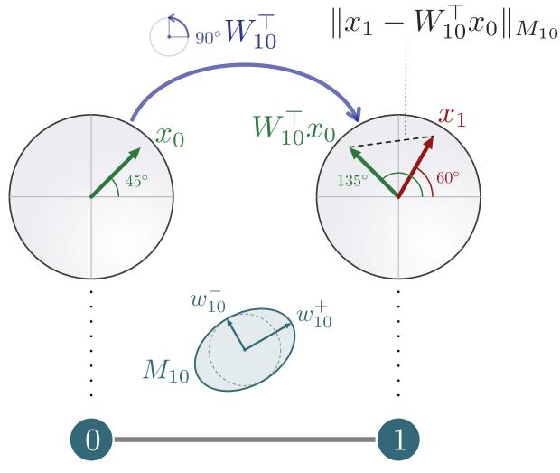
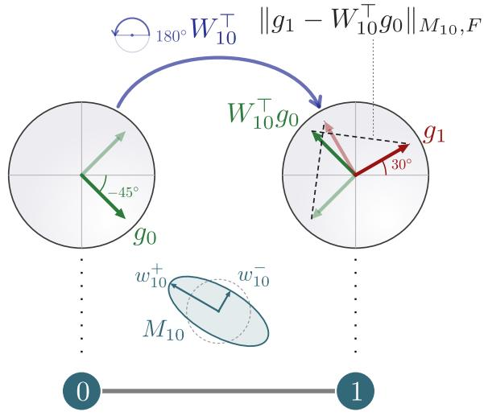
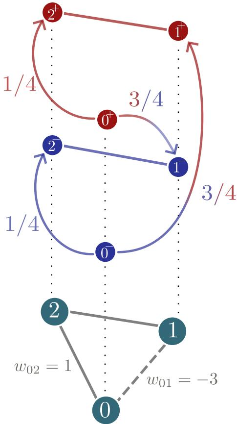
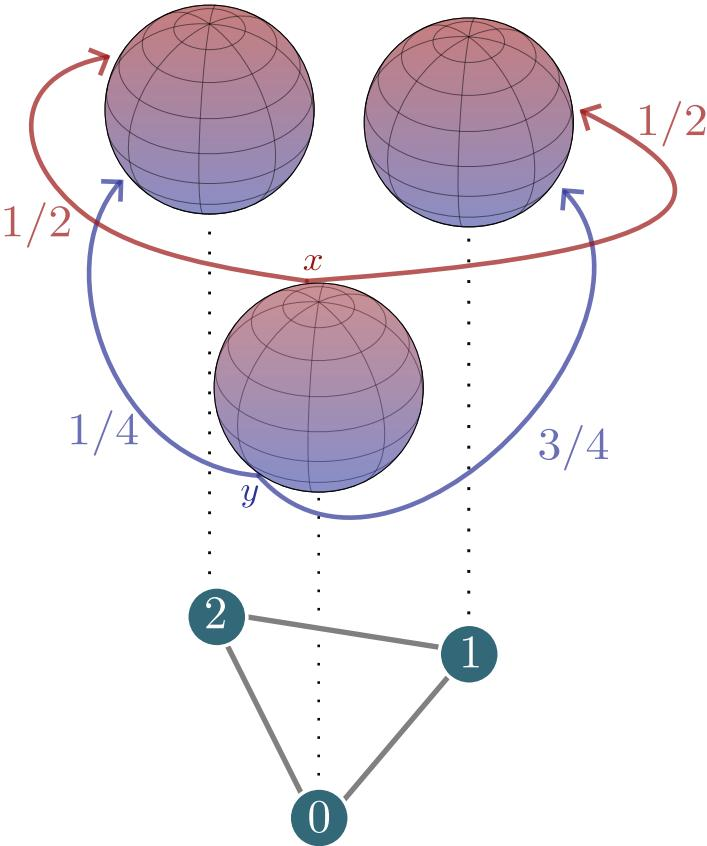
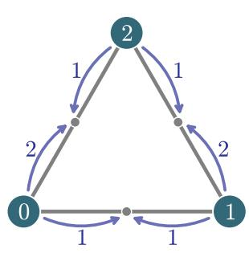
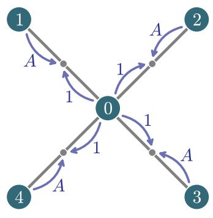
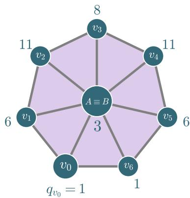

# A Bochner–Weitzenb¨ock Decomposition for Cellular Sheaf Laplacians, Curvature and Neural Sheaf Difusion

Francesco Maria Guadagnuolo<sup>1,2∗</sup> Alessio Borgi<sup>1,3</sup> Dorina Thanou<sup>4</sup> Pietro Li\`o<sup>3</sup>

<sup>1</sup>Sapienza University of Rome, Rome, Italy <sup>2</sup>Italian Institute of Artificial Intelligence (AI4I), Turin, Italy <sup>3</sup>University of Cambridge, Cambridge, United Kingdom <sup>4</sup>Ecole Polytechnique F´ed´erale de Lausanne (EPFL), Lausanne, Switzerland <sup>´</sup>

## Abstract

We extend the Bochner–Weitzenb¨ock decomposition to cellular sheaf Laplacians, splitting it into a positive semidefinite term, the Bochner sheaf Laplacian, and a block diagonal term, the Forman curvature. We show that the Bochner Laplacians form a class of cellular sheaves that extends both connection and matrix-weighted Laplacians, and generalizes signed graphs to d dimensions. We give a holonomy characterization of their kernel, prove the related Cheeger inequalities, and attach to them a random walk that generalizes the Gremban expansion. For the Forman term, we prove a discrete Bochner theorem, which bounds the first cohomology of a cellular sheaf with nonnegative curvature, and we read the whole decomposition as an opiniondynamics model. We then apply this machinery to Sheaf Neural Networks, whose learnt Laplacian is otherwise unobserved. The Bochner interpretation yields a node-level conviction score that acts as an operational importance measure under frozen-model interventions, while the Forman profile provides a local descriptor of the learnt operator.

## 1 Introduction

A sheaf prescribes how local data glue into global data, and turns the obstruction to gluing into a cohomological invariant [1–4]. On a graph or a simplicial complex, a cellular sheaf [5, 6] attaches a vector space to each cell and a linear map to each incidence, so that the theory becomes finite linear algebra. In this form sheaves have been used for fusing sensor readings [7], for distributed coordination and optimization [8, 9], and in topological data analysis [10–12], wherever a relation on a graph needs more than a scalar weight. Their central operator is the sheaf Laplacian, which has the foundations of a spectral theory [13] and a signal processing theory [14], and which models opinion dynamics, the stalks carrying private opinions and the restriction maps the discourse between agents [15].

In machine learning, where topology has entered from geometric deep learning [16] to higher-order domains such as simplicial complexes and hypergraphs [17, 18], the most notable application of sheaves is the Sheaf Neural Network [19, 20]. A graph neural network difuses node features along the edges, and fails on heterophilic graphs, where neighbours tend to carry diferent labels. A Sheaf Neural Network learns a sheaf over the graph and difuses with its sheaf Laplacian, so that each node transforms its message diferently for each neighbour, which restores separation power on heterophilic data. The sheaf is then an object produced by training. The limiting behaviour of sheaf difusion is described by the Hodge decomposition, which identifies the kernel of the sheaf Laplacian with sheaf cohomology. Three questions that are standard for the graph Laplacian, however, remain open for a general sheaf Laplacian. The first is spectral: a general spectral theory of cellular sheaves is still far from complete [13, 14], and Cheeger-type bounds, classical for graphs [21], are available only in special cases, notably connection Laplacians [22, 23]. The second is probabilistic: it is not clear how to attach to a sheaf Laplacian a vector-valued random walk, a question left open in [13]. The third is combinatorial: cellular sheaves lack an analogue of Forman’s Bochner decomposition [24], a local curvature, cheaper to compute than the spectrum and easier to interpret.

We address the three at once with a Bochner decomposition for cellular sheaves. Forman splits the Hodge Laplacian of a complex into a positive semidefinite term and a diagonal curvature term, using the absolute value of the of-diagonal entries; replacing it by the matrix absolute value $| A | : = { \sqrt { A A ^ { \top } } }$ extends the construction to every symmetric block matrix, hence to every sheaf Laplacian, on a graph or on a complex. We call Bochner matrices the class of Laplacians the first term belongs to. It extends the connection Laplacians, the matrix-weighted Laplacians [25, 26] and the weighted signed graphs [27]: a Bochner matrix is an anisotropic connection Laplacian, in which a positive semidefinite matrix replaces the scalar weight of an edge. We show that its kernel admits the same holonomy characterization known for connection Laplacians.

We then prove Cheeger inequalities for Bochner matrices, extending those of Bandeira, Singer and Spielman for connection Laplacians [22]: they relate the low eigenvalues of the normalized Bochner Laplacian to three frustration constants, the residuals of synchronization over $\mathbb { S } ^ { d - 1 }$ , partial or full, and over $O ( d )$ . We also attach to a Bochner matrix a random walk on $V \times \mathbb { S } ^ { d - 1 }$ , whose jump law depends on the orientation the walker carries. In the language of signed graphs it is a generalized Gremban expansion, each node being lifted to a whole sphere instead of two copies, and in the isotropic case it recovers the vector-valued walk of the connection Laplacian [23]. These two results answer the spectral and the probabilistic question.

The Forman term answers the combinatorial one. It is block diagonal, each block computed from the restriction maps at a single node. On 1-cells we call it the sheaf Forman Ricci curvature, and we prove a Bochner theorem for cellular sheaves: under nonnegative curvature, the first sheaf cohomology of a compact connected combinatorial n-manifold with d-dimensional stalks has dimension at most nd for $n \leq 3 ,$ , and at most d · D(M) in any dimension, with D(M) the local homological dimension of the complex. Together, the two terms give the decomposition a dynamical reading that generalizes [28]: sheaf difusion can be seen as a reaction-difusion process, the Bochner term difusive and the Forman term reactive. On a graph this is an opinion dynamics model, in which the Bochner term drives the agents towards a common conviction, the norm a stalk carries, and the Forman block measures how loudly an agent speaks relative to its neighbours, its relative volume.

We then return to Sheaf Neural Networks. The available theory describes what they can represent: convergence of sheaf difusion, and a universal approximation theorem by which a network can learn any sheaf on a graph. What is missing is a description of what the learning mechanism does: which region of the sheaf space a training pipeline reaches, and whether diferent pipelines are biased towards diferent regions. From the decomposition we derive two diagnostics of neural sheaf difusion, one per term: the conviction and the Forman profile. The conviction is an operational score of node importance: on a frozen trained network, removing the highest-conviction nodes is the most damaging intervention at every budget and in every perturbation mode, while removing the lowest-conviction ones costs less than removing arbitrary nodes of the same graph. The Forman profile tracks, layer by layer, how a learning mechanism navigates the sheaf space, and each of the three mechanisms we test leaves its own signature: normalized general sheaf learning converges to local alignment with the normalized graph Laplacian, unnormalized learning aligns with neither reference, and joint difusion [29] reverses the role of normalization. Evaluated without normalization, the profile of the same learnt maps stays far from that of the identity sheaf, so we read the alignment as an inductive bias towards one region of the sheaf space.

## 1.1 Related work

Sheaves on directed and undirected graphs have recently been given a diferential calculus [30], formalized for the Grothendieck topology and developed in the spirit of noncommutative geometry, where a Bochner Laplacian is defined as $\nabla ^ { * } \nabla$ for $\nabla$ the connection of a bundle over a graph. We work instead with cellular sheaves, hence over the Alexandrov topology, and our starting point is the decomposition of an existing sheaf Laplacian. A recent work also brings Forman curvature and sheaves together [31], building restriction maps as a function of the Forman curvature of the edges and using the resulting sheaf Laplacian for community detection; the direction there is the opposite of ours: we define a curvature from a cellular sheaf, while they use a graph curvature to define a particular sheaf. Finally, dynamical processes on connection Laplacians have received considerable attention lately [32–35], with a focus on Kuramoto models, Turing patterns and network coherence, and our framework opens the possibility of carrying those results to the anisotropic setting while still controlling the balance of the system through holonomy. We note that these works use the term “matrix-weighted $\mathrm { \ g r a p h } ^ { \mathrm { \prime \prime } }$ to mean a connection Laplacian, whereas we reserve it for the sense of [25].

Curvature has also been studied on connection Laplacians independently of sheaves. Liu, M¨unch and Peyerimhof [36] define a Bakry–Emery curvature for connection graphs and derive higher-order Buser<sup>´</sup> inequalities from it, with Cheeger constants mixing the expansion of the underlying graph with the frustration index of the signature. This notion of curvature was moreover reformulated in [37]. Such curvatures are available on a connection Laplacian because it generates a random walk, with scalar transition rates. For a general sheaf Laplacian it is not clear how to obtain one, and that failure is exactly the Forman term, which measures how far the diagonal is from the sum of the magnitudes of the of-diagonal blocks. Sheaf Laplacians with vanishing Forman term are the Bochner matrices, and these, as we show in this work, do carry a random walk, so we believe a Bakry–Emery curvature can<sup>´</sup> be built for them, and we leave this to future work.

Sheaf Neural Networks were introduced by Hansen and Gebhart [19] on a sheaf fixed in advance; Bodnar et al. [20] learn the sheaf from the data, and prove that a network can learn any sheaf on a graph. Several works have since studied the parametrization of the restriction maps, through connection Laplacians aligned with the data manifold [38], equivariant transport [39], or a difusion process on the restriction maps themselves, run jointly with the one on the node features [29]. Others have extended the architecture, to features on SPD manifolds [40] and to message difusion over flat vector bundles [41]. The sheaf formalism has also been used to generalize attention in graph neural networks [42]. On the theoretical side, oversmoothing has been related to a degeneration of the representation underlying the learnt sheaf [43]. On the other hand, Hernandez Caralt et al. [44] showed empirically that identity restriction maps perform similarly to learnt ones, which questions to what extent learning the sheaf matters. Finally, crucial features of graph neural networks such as over-squashing have been related to the curvature of the graph [45]. While we build a notion of Forman curvature for cellular sheaves, we do not pursue this direction, which would involve the Forman term of the sheaf Hodge Laplacian in degree 1; in Section 6.4 we compute instead the Forman term of the graph sheaf Laplacian, in degree 0, which to avoid ambiguity we call Forman term and not curvature. Studying over-squashing in Sheaf Neural Networks from this curvature perspective is left for future work. We refer to Sections 6.2 and 6.4 for a further discussion.

## 1.2 Organization of the paper

The paper is organized as follows. Section 2 fixes notation and recalls cellular sheaves, signed graphs and Forman’s decomposition. Section 3 introduces the Bochner decomposition for sheaf Laplacians, and Sections 4 and 5 study its two terms in turn: within the first, Section 4.2 proves the Cheeger inequalities and Section 4.3 attaches the random walk. Section 6 develops the dynamical reading and the applications to Sheaf Neural Networks. We conclude in Section 7. Proofs deferred from the body are collected in Appendix A, each statement being restated before its proof, further properties of Bochner matrices are in Appendix B, and the experimental protocols with the additional material are in Appendices C and D.

## 2 Background

This section fixes notation for cellular sheaves and their Laplacians, and recalls the facts on signed graphs and on Forman’s Bochner decomposition that the paper builds on.

## 2.1 Cellular sheaves on simplicial complexes

We follow [46, 47] for simplicial cochain complexes and [5, 6] for cellular sheaves. Let X be a finite simplicial complex, $X _ { k }$ its set of k-simplices and $n : = | X _ { 0 } |$ . We write $\sigma \leq \tau$ for inclusion of simplices, with no restriction on the diference in dimension, so that the simplices of X form the face poset; the words face and coface are reserved for the codimension-one case, the only one entering the formulas below. Fixing an orientation of each simplex, $\epsilon _ { \sigma \tau } \in \{ - 1 , 0 , + 1 \}$ is the relative orientation of a codimension-one pair, and vanishes when σ is not a face of τ.

Definition 2.1 (Cellular sheaf). A cellular sheaf F on X assigns to every simplex σ a finitedimensional real vector space $\mathcal { F } ( \sigma )$ , its stalk, and to every pair $\sigma \ \leq \ \tau \ a$ linear restriction map $\mathcal { F } _ { \sigma \underline { { \sf { d } } } \tau } \colon \mathcal { F } ( \sigma )  \mathcal { F } ( \tau )$ , with ${ \mathcal { F } } _ { \sigma { \underline { { \triangleleft } } } \sigma } = \operatorname { i d } _ { { \mathcal { F } } ( \sigma ) }$ and $\mathcal { F } _ { \rho \triangleleft \tau } = \mathcal { F } _ { \sigma \triangleleft \tau } \mathcal { F } _ { \rho \triangleleft \sigma }$ whenever $\rho \triangleleft \sigma \triangleleft \tau$

Equivalently, $\mathcal { F }$ is a functor from the face poset to finite-dimensional real vector spaces [5], and it is determined by the maps attached to faces. Throughout, every stalk has dimension d. On $C ^ { k } ( X ; { \mathcal { F } } ) = \bigoplus _ { \sigma \in X _ { k } } { \mathcal { F } } ( \sigma )$ the coboundary $\delta _ { k } \colon C ^ { k } ( X ; { \mathcal { F } } ) \to C ^ { k + 1 } ( X ; { \mathcal { F } } )$ is:

$$
( \delta _ { k } c ) _ { \tau } \ = \ \sum _ { \stackrel { \sigma \leq \tau } { \dim \sigma = k } } \ \epsilon _ { \sigma \tau } \mathcal { F } _ { \sigma \leq \tau } c _ { \sigma } ,\tag{2.1}
$$

it satisfies $\delta _ { k + 1 } \delta _ { k } = 0 .$ , and $\mathcal H ^ { k } ( X ; \mathcal F ) : = \ker \delta _ { k } / \operatorname { i m } \delta _ { k - 1 }$ is the sheaf cohomology of $\mathcal { F } ;$ the constant sheaf R recovers the simplicial cochain complex of $X$ . With the standard inner product on each $C ^ { k } ( X ; { \mathcal { F } } )$ and $\delta _ { k } ^ { * }$ the adjoint of $\delta _ { k }$ , the Hodge sheaf Laplacian $H _ { k } ^ { \mathcal { F } } = \delta _ { k - 1 } \delta _ { k - 1 } ^ { * } + \delta _ { k } ^ { * } \delta _ { k }$ is a positive semidefinite matrix with d×d blocks indexed by $X _ { k }$ , and ker $H _ { k } ^ { \mathcal { F } } \cong \mathcal { H } ^ { k } ( X ; \mathcal { F } )$ . We write $\partial : = \delta ^ { * }$ for the boundary operator, with the degree left implicit, so that $\partial ^ { * } = \delta$ . At $k = 0$ we write $L _ { \mathcal { F } } : = H _ { 0 } ^ { \mathcal { F } } = \delta _ { 0 } ^ { * } \delta _ { 0 }$ for the graph sheaf Laplacian; on a graph $G = ( V , E )$ its blocks are $\begin{array} { r } { ( L _ { \mathcal { F } } ) _ { v v } = \sum _ { e : v \overset { \triangledown } { = } e } \mathcal { F } _ { v \overset { \triangledown } { \ = } e } ^ { \top } \mathcal { F } _ { v \overset { \triangledown } { = } e } \mathrm { a n d } } \end{array}$ on an edge $e = ( v , u ) , ( L _ { \mathcal { F } } ) _ { v u } = - \mathcal { F } _ { v \leq e } ^ { \top } \mathcal { F } _ { u \leq e }$

Two classes of graph sheaf Laplacians recur below. Taking $\mathcal { F } _ { v \le e } = \sqrt { w _ { v u } } O _ { v \le e }$ with $O _ { v \underline { { \triangle } } e }$ orthogonal and $w _ { v u } \mathrm { ~ > ~ } 0$ gives of-diagonal blocks $- w _ { v u } W _ { v u } ^ { \top }$ , with $W _ { v u } ^ { \top } \bar { : = } \dot { O _ { v \triangleleft e } ^ { \top } O _ { u \triangleleft e }  } = \bar { O } ( d )$ : these are the connection Laplacians [22, 23], called bundle sheaves in Sheaf Neural Networks [19, 20]. Taking $\mathcal { F } _ { v \le e } = M _ { v u } ^ { 1 / 2 }$ with $M _ { v u } \succeq 0$ gives of-diagonal $\mathrm { b l o c k s } - M _ { v u }$ , without rotation: these are the matrixweighted Laplacians [25, 26]. With $D : =$ blockdiag $\left( ( L _ { \mathcal { F } } ) _ { v v } \right) _ { v \in V }$ the degree matrix, the normalized sheaf Laplacian $\Delta _ { \mathcal { F } } : = D ^ { - 1 / 2 } L _ { \mathcal { F } } D ^ { - 1 / 2 }$ has spectrum in $\left[ 0 , 2 \right] \left[ 1 3 \right]$ . We work with unweighted sheaves: every weighted sheaf Laplacian, and in particular every normalized one, is the Laplacian of some unweighted sheaf [13], a fact Sections 3 and 6.4 use directly.

## 2.2 Signed graphs, balance and holonomy

A signed graph $\Gamma = ( V , E , W )$ carries a symmetric weighted adjacency matrix W whose entries may be negative [27]. With degrees $\begin{array} { r } { d _ { v } : = \sum _ { u } | w _ { v u } | , D : = \mathrm { d i a g } ( d _ { v } ) } \end{array}$ , and $W = W ^ { + } - W ^ { - }$ split into its nonnegative parts, the signed Laplacian is $L _ { \Gamma } : = D - W = D - W ^ { + } + W ^ { - }$ , and its quadratic form is:

$$
{ x ^ { \top } } L _ { \Gamma } x = \sum _ { v u \in E } \left| w _ { v u } \right| \left( x _ { v } - \mathrm { s g n } ( w _ { v u } ) x _ { u } \right) ^ { 2 } ,\tag{2.2}
$$

so $L _ { \Gamma } \succeq 0$ . Unlike the unsigned case, the kernel may be trivial, and its dimension is a structural invariant [48], controlled by balance. A cycle is positive if it carries an even number of negative edges.

Definition 2.2 (Balance and antibalance). Γ is balanced if every cycle is positive, and antibalanced if the signed graph obtained by reversing every edge sign is balanced.

Theorem 2.1 (Structure theorem for balance [49, 50]). Γ is balanced if and only if there is a partition $V = V _ { 1 } \sqcup V _ { 2 }$ such that every edge within $V _ { 1 }$ or within $V _ { 2 }$ is positive and every edge between $V _ { 1 }$ and $V _ { 2 }$ is negative. It is antibalanced $i f$ and only if the same holds with the two signs exchanged.

The partition is visible in the spectrum [49, 51, 52]. Writing $\mathbb { 1 } _ { V _ { 1 } }$ for the indicator vector of $V _ { 1 }$

Theorem 2.2 (Kernel of a signed Laplacian). Let Γ be connected. Then Γ is balanced if and only if dim ker $L _ { \Gamma } = 1$ , in which case the kernel is spanned by $\mathbb { I } _ { V _ { 1 } } - \mathbb { I } _ { V _ { 2 } }$ for the partition of Theorem 2.1.

At the other end of the spectrum, the normalized signed Laplacian $I - D ^ { - 1 / 2 } W D ^ { - 1 / 2 }$ has spectrum in [0, 2] and attains 2 when $\Gamma$ is antibalanced [53]; a connected non-bipartite signed graph cannot be both balanced and antibalanced, since an odd cycle would be positive and negative at once. When Γ is not balanced, its frustration index, the minimal number of edges whose removal makes it balanced, measures how far it is from balance [54, 55]. Other quantitative measures of balance have also been proposed, together with related Cheeger inequalities for signed graphs [52, 56]. In the Gremban expansion [57–59] each vertex is split into a positive and a negative copy, a walker crossing a negative edge switching copy, so that $L _ { \Gamma }$ becomes an unsigned graph Laplacian on 2n vertices [27].

On a connection Laplacian, balance becomes holonomy. Every walk $\gamma : v _ { 0 } \to \cdots \to v _ { k }$ carries the transport map $T _ { \gamma } : = W _ { v _ { k - 1 } v _ { k } } \cdot \cdot \cdot W _ { v _ { 0 } v _ { 1 } } \in O ( d )$ , the connection has trivial holonomy when $T _ { \gamma } = I$ for every closed walk, and the kernel of the connection Laplacian has dimension at most $d ,$ with equality exactly in that case [20, 22, 23]. For $d = 1 , T _ { \gamma }$ is the product of the signs along γ, trivial holonomy is balance, and this is Theorem 2.2.

## 2.3 Forman’s Bochner decomposition

On a Riemannian manifold the Bochner–Weitzenb¨ock formula splits the Hodge Laplacian on 1-forms as $\Delta = \nabla ^ { * } \nabla + \mathrm { R i c }$ [60], and the Bochner theorem follows from it: under nonnegative Ricci curvature every harmonic 1-form is parallel, so the first cohomology has dimension at most n. Forman gave a combinatorial counterpart of both [24], resting on a splitting that applies to any symmetric matrix.

Definition 2.3 (Bochner and curvature terms). Let A be a symmetric n × n matrix. Define B by $B _ { i j } = A _ { i j } f o r i \ne j$ and $\begin{array} { r } { B _ { i i } = \sum _ { k \neq i } | A _ { i k } | } \end{array}$ , and set $F : = A - B$ , the diagonal matrix with $\begin{array} { r } { F _ { i i } = A _ { i i } - \sum _ { k \neq i } \left| A _ { i k } \right| } \end{array}$

The matrix $B$ is diagonally dominant, hence positive semidefinite, and it is a signed graph Laplacian; conversely a signed graph Laplacian is its own Bochner term, with $F = 0$ . In the scalar case the decomposition therefore reads: every symmetric matrix is a signed graph Laplacian plus a diagonal.

When A is a Hodge Laplacian, the diagonal remainder can be seen as a curvature. Forman works on weighted complexes, with a weight $w _ { \sigma } > 0$ on each simplex. Writing the Hodge Laplacian in the orthonormal basis of the weighted inner product, applying Definition 2.3 and rescaling by $w _ { \sigma }$ gives Forman’s curvature [24]:

$$
\begin{array} { r l } & { \mathcal { F } _ { k } ( \sigma ) = w _ { \sigma } \Bigg [ \underset { \sigma \leq \tau ^ { ( k + 1 ) } } { \sum } \frac { w _ { \sigma } } { w _ { \tau } } + \underset { \gamma ^ { ( k - 1 ) } \leq \sigma } { \sum } \frac { w _ { \gamma } } { w _ { \sigma } } } \\ & { \qquad - \underset { \sigma ^ { \prime } \neq \sigma } { \sum } \Bigg | \underset { \tau ^ { ( k + 1 ) } } { \sum } \epsilon _ { \sigma \tau } \epsilon _ { \sigma ^ { \prime } \tau } \frac { \sqrt { w _ { \sigma } w _ { \sigma ^ { \prime } } } } { w _ { \tau } } + \underset { \gamma ^ { ( k - 1 ) } } { \sum } \epsilon _ { \gamma \sigma } \epsilon _ { \gamma \sigma ^ { \prime } } \frac { w _ { \gamma } } { \sqrt { w _ { \sigma } w _ { \sigma ^ { \prime } } } } \Bigg | \Bigg ] , } \end{array}\tag{2.3}
$$

the bracket being exactly the Forman term $( F _ { k } ) _ { \sigma \sigma } .$ , so that ${ \mathcal F } _ { k } ( \sigma ) = w _ { \sigma } \cdot ( F _ { k } ) _ { \sigma \sigma }$ and the two coincide when every weight is 1. A positive factor does not change the sign on which every result below depends, and in the sheaf setting there are no weights, by the reduction of Section 2.1; therefore, we identify the curvature with the term and write $F _ { k }$ and Ric.

With unit weights, the Forman term is a local count. Two distinct k-simplices are upper adjacent, $\sigma \frown \sigma ^ { \prime }$ , if they share a coface, and lower adjacent, $\sigma \smile \sigma ^ { \prime }$ , if they share a face; they are parallel if exactly one of the two holds, and transverse if both do, in which case the contributions through the face and through the coface cancel. With d $\mathrm { g } _ { u }$ and $\deg _ { l }$ the numbers of cofaces and of faces:

$$
{ \cal F } _ { k } ( \sigma ) = \mathrm { d e g } _ { u } ( \sigma ) + \mathrm { d e g } _ { l } ( \sigma ) - \mathcal { H } \{ \mathrm { p a r a l l e l n e i g h b o u r s ~ o f ~ } \sigma \} ,\tag{2.4}
$$

which on an edge, where deg $_ l ( e ) = 2 ,$ is the Forman–Ricci curvature:

$$
\mathrm { R i c } ( e ) ~ = ~ \# \{ \mathrm { t r i a n g l e s ~ c o n t a i n i n g ~ } e \} + 2 - \# \{ \mathrm { p a r a l l e l ~ n e i g h b o u r s ~ o f ~ } e \} .\tag{2.5}
$$

At $k = 0$ every neighbour of a vertex is parallel, so $F _ { 0 } \equiv 0$ , and the construction carries no information at the vertices of a graph.

Forman’s theorem holds on quasiconvex complexes. A CW complex is regular when the characteristic map of every cell is a homeomorphism onto its image, so that the closure of each cell is a closed ball; incidence numbers then lie in $\{ 0 , \pm 1 \}$ , and exactly two p-cells lie between a $( p - 1 )$ -cell and a $( p + 1 ) { \mathrm { - c e l l } }$ . A compact regular CW complex is quasiconvex when two (p + 1)-cells whose closures share a p-cell $\beta$ meet exactly in ${ \bar { \beta } } .$ . Every simplicial and every polyhedral complex is quasiconvex; our results hold at this generality, and we write “simplicial complex” for readability. A combinatorial n-manifold is a complex in which the link of every vertex v, the subcomplex $\{ \sigma : v \not \in \sigma , \sigma \cup \{ v \} \in X \}$ is a triangulated $( n - 1 )$ )-sphere.

Theorem 2.3 (Forman’s Bochner theorem). Let M be a compact, connected, quasiconvex combinatorial n-manifold with $n \leq 3$ , and suppose $\operatorname { R i c } ( e ) \geq 0$ for every edge e. Then dim $\mathcal { H } ^ { 1 } ( M ) \leq n$

## 3 The Bochner Decomposition of a Sheaf Laplacian

For sheaf Laplacians with d-dimensional stalks the of-diagonal blocks $H _ { i j }$ are d × d matrices, so the scalar absolute value appearing in Forman’s construction must be replaced by the matrix absolute value $| A | : = { \sqrt { A A ^ { \top } } }$ . All stalks are assumed to have the same dimension $d .$

Definition 3.1 (Block Bochner decomposition). Let H be a symmetric block matrix in $\mathbb { R } ^ { n d , n d }$ with $d \times d$ blocks $H _ { i j }$ . The block matrix Bochner decomposition is:

$$
\begin{array} { r } { B _ { i j } = \left\{ \begin{array} { l l } { H _ { i j } } & { i \neq j , } \\ { \sum _ { j \neq i } | H _ { i j } | } & { i = j , } \end{array} \right. \quad \quad F _ { i j } = \left\{ \begin{array} { l l } { 0 } & { i \neq j , } \\ { H _ { i j } - \sum _ { k \neq i } | H _ { i k } | } & { i = j . } \end{array} \right. } \end{array}\tag{3.1}
$$

For this to define a Laplacian, B must be positive semidefinite. This holds for a class of block matrices wider than the Bochner term itself.

Definition 3.2 (Block diagonally dominant matrix). A block matrix $C \in \mathbb { R } ^ { n d , n d }$ , with blocks $C _ { i j }$ of dimension $d ,$ is block diagonally dominant $\begin{array} { r } { \ i f C _ { i i } \succeq \sum _ { j \neq i } | C _ { i j } | \ f o r } \end{array}$ every i.

Proposition 3.1. Every symmetric, block diagonally dominant matrix is positive semidefinite.

Proof. Fix $i \neq j$ and write $\begin{array} { r } { C _ { i j } = U \Sigma V ^ { \top } } \end{array}$ via the SVD, so that $| C _ { i j } | = U \Sigma U ^ { \top }$ and $| C _ { i j } ^ { \top } | = V \Sigma V ^ { \top }$ The block matrix $\begin{array} { r } { \left( \begin{array} { l l } { | C _ { i j } | } & { C _ { i j } } \\ { C _ { i j } ^ { \top } } & { | C _ { i j } ^ { \top } | } \end{array} \right) = \big ( \begin{array} { l } { U } \\ { V } \end{array} \big ) \Sigma \big ( \boldsymbol { \upsilon } ^ { \top } \ \boldsymbol { V } ^ { \top } \big ) \succeq 0 } \end{array}$ , and evaluating its quadratic form at $( x _ { i } ^ { \top } , x _ { j } ^ { \top } ) ^ { \top }$ gives:

$$
x _ { i } ^ { \top } C _ { i j } x _ { j } + x _ { j } ^ { \top } C _ { i j } ^ { \top } x _ { i } \ \ge \ - \big ( x _ { i } ^ { \top } | C _ { i j } | x _ { i } + x _ { j } ^ { \top } | C _ { i j } ^ { \top } | x _ { j } \big ) .\tag{3.2}
$$

Summing this bound over every of-diagonal pair:

$$
x ^ { \top } C x = \sum _ { i } x _ { i } ^ { \top } C _ { i i } x _ { i } + \sum _ { i \neq j } x _ { i } ^ { \top } C _ { i j } x _ { j } \ \geq \ \sum _ { i } x _ { i } ^ { \top } \Big ( C _ { i i } - \sum _ { j \neq i } | C _ { i j } | \Big ) x _ { i } \ \geq \ 0 .\tag{3.3}
$$

Remark 3.1. The step above, $\left( \begin{array} { c c } { { | A | } } & { { A } } \\ { { A ^ { \top } } } & { { | A ^ { \top } | } } \end{array} \right) \succeq 0$ for every matrix $A ,$ is essentially Corollary 1.3.7 of Bhatia [61]. Feingold and Varga’s block diagonal dominance criterion $\left[ 6 \mathcal { Q } \right]$ uses operator norms in place of the matrix absolute value, so Proposition 3.1 is a diferent hypothesis.

By the proposition above, $B \succeq 0$ , hence $B = C ^ { \top } C$ for some $C ,$ in analogy with $B _ { k } = \nabla ^ { * } \nabla$ in the continuous case.

Graph and Hodge sheaf Laplacians. Applying Definition 3.1 to the Hodge sheaf Laplacian $H _ { k } ^ { \mathcal { F } }$ = $\delta _ { k - 1 } \delta _ { k - 1 } ^ { * } + \delta _ { k } ^ { * } \delta _ { k }$ gives $( B _ { k } ) _ { \sigma \sigma ^ { \prime } } = ( { \cal H } _ { k } ) _ { \sigma \sigma ^ { \prime } }$ of the diagonal and $\begin{array} { r } { ( F _ { k } ) _ { \sigma \sigma } = ( H _ { k } ) _ { \sigma \sigma } - \sum _ { \sigma ^ { \prime } \ne \sigma } | ( H _ { k } ) _ { \sigma \sigma ^ { \prime } } | } \end{array}$ on it, so that $\begin{array} { r } { H _ { k } ^ { \mathcal { F } } = B _ { k } ^ { \mathcal { F } } + F _ { k } ^ { \mathcal { F } } } \end{array}$ , writing $\begin{array} { r } { L _ { \mathcal { F } } = B _ { \mathcal { F } } + F _ { \mathcal { F } } } \end{array}$ for $k = 0$ , the graph case. The Forman term is block diagonal, an endomorphism acting within each stalk, not a scalar. Following Forman’s terminology we call $\mathrm { R i c } _ { \mathcal { F } } : = F _ { 1 } ^ { \mathcal { F } }$ the curvature on 1-cells; on an edge e its block is:

$$
\begin{array} { r l } & { \mathrm { R i c } _ { \mathcal { F } } ( e ) = \displaystyle \sum _ { v : v \le e } \mathcal { F } _ { v \le e } \mathcal { F } _ { v \le e } ^ { \top } + \displaystyle \sum _ { t : e \le t } \mathcal { F } _ { e \le t } ^ { \top } \mathcal { F } _ { e \le t } } \\ & { \quad - \displaystyle \sum _ { \widetilde { e } \neq e } \Big | \displaystyle \sum _ { v } \epsilon _ { v e } \epsilon _ { v \widetilde { e } } \mathcal { F } _ { v \le e } \mathcal { F } _ { v \le \widetilde { e } } ^ { \top } + \displaystyle \sum _ { t } \epsilon _ { e t } \epsilon _ { \widetilde { e } t } \mathcal { F } _ { e \le t } ^ { \top } \mathcal { F } _ { \widetilde { e } \le t } \Big | , } \end{array}\tag{3.4}
$$

$\epsilon _ { \alpha \beta } \in \{ - 1 , 0 , + 1 \}$ encoding relative orientation, and the general k case being identical with k-cells in place of edges. Specializing to $k = 0$ , where cells have no faces, gives the vertex block:

$$
( F _ { \mathcal { F } } ) _ { v v } = \sum _ { e : v \underline { { \imath } } e } \Big ( \mathcal { F } _ { v \underline { { \leq } } e } ^ { \top } \mathcal { F } _ { v \underline { { \leq } } e } - \sqrt { \mathcal { F } _ { v \underline { { \leq } } e } ^ { \top } \mathcal { F } _ { u \underline { { \leq } } e } \mathcal { F } _ { u \underline { { \leq } } e } ^ { \top } \mathcal { F } _ { v \underline { { \leq } } e } } \Big ) .\tag{3.5}
$$

with u the other endpoint of $e .$ Unlike the classical graph Laplacian, whose Forman term vanishes at $k = 0 .$ , here it need not, so the vertex-level case is worth analyzing in its own right. A second diference with the classical theory is that there is no weight factor $w _ { \sigma }$ out front: by [13], every weighted sheaf Laplacian is the Laplacian of some unweighted sheaf, so no generality is lost by working unweighted, and the Forman term of the decomposition is the Forman curvature itself, with no rescaling. For a higher-order connection Laplacian, with $\mathcal { F } _ { v \le e } \mathcal { F } _ { v \le \tilde { e } } ^ { \top } = \mathcal { F } _ { e \le t } ^ { \top } \mathcal { F } _ { \tilde { e } \le t }$ whenever $e , \tilde { e }$ share both a face and a coface, (3.4) collapses to $( F _ { \mathcal { F } } ) _ { e e } = \chi ( e ) \cdot I$ , with $\chi ( e )$ exactly the scalar Forman curvature of the unweighted simplicial complex.

## 4 Bochner Matrices

The Bochner term of a sheaf Laplacian belongs to a class of block matrices that is worth studying on its own, as we show it contains Connection Laplacians, Matrix-Weighted Laplacians, and signed graphs. This section develops that class: its kernel and the top of its spectrum here, its Cheeger inequalities, and the random walk it carries.

## 4.1 Polar factors, the kernel and holonomy

We call a symmetric block matrix produced by Definition 3.1 a Bochner matrix:

$$
B = \left( \begin{array} { c c c c c } { \ddots } & { \vdots } & { } & { \vdots } & { } \\ { \cdots } & { \sum _ { w \sim v } | B _ { v w } | } & { \cdots } & { - B _ { v u } } & { \cdots } \\ { \vdots } & { \vdots } & { \ddots } & { \vdots } & { } \\ { \cdots } & { - B _ { v u } ^ { \top } } & { \cdots } & { \sum _ { w \sim u } | B _ { u w } | } & { \cdots } \\ { \vdots } & { \vdots } & { } & { \vdots } & { \ddots } \end{array} \right) ,\tag{4.1}
$$

supported exactly on the edges of G. Throughout we assume (H1) block symmetry, $B _ { u v } = B _ { v u } ^ { \top }$ ; (H2) invertibility, every $B _ { v u }$ invertible; (H3) connectivity: the graph on $v \sim u \iff B _ { v u } \neq 0$ is connected. Writing $\begin{array} { r } { B _ { v u } = U _ { v u } \Sigma _ { v u } V _ { v u } ^ { \top } } \end{array}$ via the SVD and setting $\mathcal { B } _ { v \underline { { { \sf { d e } } } } } : = \Sigma _ { v u } ^ { 1 / 2 } U _ { v u } ^ { \top } , \mathcal { B } _ { u \underline { { { \sf { d e } } } } } : = \Sigma _ { v u } ^ { 1 / 2 } V _ { v u } ^ { \top }$ on each edge $e = ( v , u )$ defines a sheaf B with graph Laplacian B. So the class of Bochner matrices is included in the class of graph sheaf Laplacians. Specializing the Bochner decomposition to $k = 0$ gives $L _ { \mathcal { F } } = L _ { B } + F _ { \mathcal { F } }$ every sheaf Laplacian is a Bochner sheaf Laplacian plus a block-diagonal perturbation, the Forman term. More generally, considering the decomposition $\mathbf { \bar { \xi } } _ { H _ { k } ^ { \mathcal { F } } } = B _ { k } ^ { \mathcal { F } } + F _ { k } ^ { \mathcal { F } } , B _ { k } ^ { \mathcal { F } }$ lives instead on the order-k adjacency graph of the complex, whose nodes are the k-simplices, two being adjacent if they are lower or upper adjacent.

Writing $\begin{array} { r } { B _ { v u } = U _ { v u } \Sigma _ { v u } V _ { v u } ^ { \top } = U _ { v u } \Sigma _ { v u } U _ { v u } ^ { \top } U _ { v u } V _ { v u } ^ { \top } } \end{array}$ gives the polar decomposition $B _ { v u } = M _ { v u } W _ { v u } ^ { \top }$ , with radial factor $M _ { v u } : = | B _ { v u } | = U _ { v u } \Sigma _ { v u } U _ { v u } ^ { \top } \succneq 0$ and angular factor $W _ { v u } : = V _ { v u } U _ { v u } ^ { \top } \in O ( d )$ . Since $B _ { u v } \ = \ B _ { v u } ^ { \top }$ , we get $W _ { u v } \ = \ W _ { v u } ^ { \top }$ and $W _ { v u } M _ { v u } W _ { v u } ^ { \top } = M _ { u v }$ . Write $\| z \| _ { M } ^ { 2 } : = z ^ { \top } M z$ for $M \succeq 0$ Since $| B _ { v u } | = M _ { v u } ,$ the diagonal blocks of B are $\begin{array} { r } { D _ { v } : = B _ { v v } = \sum _ { u \sim v } M _ { v u } , } \end{array}$ and we write $D : =$ blockdiag( $\mathbf { \cal { D } } _ { 1 } , \dots , \mathbf { \cal { D } } _ { n } )$ . A Bochner matrix could thus be seen as an anisotropic bundle sheaf: a rotation $W _ { v u }$ , as in a connection Laplacian, together with a connection strength $M _ { v u }$ that varies not only across edges but across directions of the stalk. This is the feature separating Bochner matrices from connection Laplacians, and what makes them a multidimensional generalization of weighted signed graphs, the sign of an edge replaced by $W _ { v u }$

Remark 4.1 (On the terminology). Throughout this work we treat Bochner matrices as a class extending the connection Laplacians of Singer and coauthors [22, 23]. In diferential geometry the Bochner Laplacian and the connection Laplacian are essentially the same operator. In our discrete setting they refer to distinct families of Laplacians, but this is simply because they come from two diferent constructions: connection Laplacians were obtained by discretizing bundles over manifolds, in the context of local PCA and vector difusion maps, whereas we arrive at Bochner matrices in purely algebraic terms, as the first term of the Bochner–Weitzenb¨ock decomposition of Section 3. The two nonetheless share the properties needed to model holonomy and parallel transport on a graph.

We now turn to the kernel characterization of the Bochner Laplacian.

Lemma 4.1 (Energy identity). For every $\begin{array} { r } { x \in \mathbb R ^ { n d } , x ^ { \top } B x = \frac { 1 } { 2 } \sum _ { v \neq u } \left. x _ { v } - W _ { v u } ^ { \top } x _ { u } \right. _ { M _ { v u } } ^ { 2 } \geq 0 } \end{array}$ , each unordered edge contributing equally from either orientation.

Proof. Expand $\begin{array} { r } { \left\| { x _ { v } - W _ { v u } ^ { \top } x _ { u } } \right\| _ { M _ { \ldots } } ^ { 2 } = \displaystyle { x _ { v } ^ { \top } M _ { v u } x _ { v } } - 2 x _ { v } ^ { \top } M _ { v u } W _ { v u } ^ { \top } x _ { u } + \boldsymbol { x } _ { u } ^ { \top } W _ { v u } M _ { v u } W _ { v u } ^ { \top } x _ { u } . } \end{array}$ The last term is $x _ { u } ^ { \top } M _ { u v } x _ { u } ,$ so summing the first and last terms over all ordered pairs and relabelling gives $\sum _ { v } x _ { v } ^ { \top } D _ { v } x _ { v } ;$ the middle term is $- 2 x _ { v } ^ { \top } B _ { v u } x _ { u }$ , the of-diagonal contribution to $x ^ { \top } B x$ . Nonnegativity is immediate since each $M _ { v u } \succeq 0$ □

When $M _ { v u } = w _ { v u } I$ this recovers the Dirichlet energy $\begin{array} { r } { \sum _ { v \neq u } w _ { v u } \left. x _ { v } - W _ { v u } ^ { \top } x _ { u } \right. ^ { 2 } } \end{array}$ of the Connection Laplacian [22]. Since $B \succeq 0$ , Lemma 4.1 shows $x \in \ker ( B )$ if every summand vanishes:

Proposition 4.1 (Kernel). Let B satisfy $( H 1 ) { - } ( H 2 )$ . Then $x \in \ker ( B )$ if $x _ { u } = W _ { v u } x _ { v }$ for every edge $( v , u )$ ; in particular $\| x _ { v } \|$ is constant on each connected component.

An immediate corollary: each summand vanishes if $x _ { v } = W _ { v u } ^ { \top } x _ { u }$ , and the orthogonal $W _ { v u }$ then preserves the norm along every edge.

With the kernel in hand, the same evaluation-map argument used for the Connection Laplacian [20, 22] applies verbatim (proof in Appendix A):

Proposition 4.2 (Kernel and holonomy). Let B sa $t i s f y \ ( H I ) - ( H ^ { g } )$ , and for a walk $\gamma : v _ { 0 }  \cdots  v _ { k }$ let $T _ { \gamma } : = W _ { v _ { k - 1 } v _ { k } } \cdot \cdot \cdot W _ { v _ { 0 } v _ { 1 } } \in O ( d )$ . Then dim ker $( B ) \leq d ,$ with equality if $T _ { \gamma } = I \ f o r$ every closed walk γ.

While the technique is unchanged from the connection-Laplacian case, the result is novel: despite carrying the extra radial data $M _ { v u }$ , Bochner matrices admit exactly the same holonomy characterization of the kernel, that depends only on angular factors. The same two propositions also settle the opposite end of the spectrum. By [13], the normalized Laplacian of any weighted cellular sheaf has spectrum in $[ 0 , 2 ]$ , with the same degree normalization used here; in particular spec $( \widetilde { B } ) \subseteq [ 0 , 2 ]$ 2 writing $\widetilde { B } : = D ^ { - 1 / 2 } B D ^ { - 1 / 2 }$ . The upper value is governed by the twist matrix $N : = 2 D - B$ : since $N _ { v u } = - B _ { v u } = - M _ { v u } W _ { v u } ^ { \top } , N$ is again a Bochner matrix, with the same radial factors as B but angular factors $- W _ { v u } ,$ whence $x ^ { \top } B x \leq 2 x ^ { \top } D x$ . Attaining the value 2 is therefore the balance of $N _ { ; }$ read through its twisted transport maps $\widehat { T } _ { \gamma } : = ( - 1 ) ^ { | \gamma | } T _ { \gamma }$ , and this is the multidimensional counterpart of antibalance.

Theorem 4.1 (Antibalance characterization). Let $E _ { 2 } ( \widetilde { B } )$ be the eigenspace of $\widetilde { B }$ for eigenvalue 2. Then $E _ { 2 } ( \widetilde { B } ) = D ^ { 1 / 2 } \ker ( N )$ , with $z \in \ker ( N )$ $i f f z _ { u } = - W _ { v u } z _ { v }$ on every edge; and dim $E _ { 2 } ( \widetilde { B } ) \leq d$ with equality if $T _ { \gamma } = ( - 1 ) ^ { | \gamma | } I$ for every closed walk.

This is immediate from $2 I - \widetilde { B } = D ^ { - 1 / 2 } N D ^ { - 1 / 2 }$ together with Propositions 4.1 and 4.2 applied to $N .$ When G is not bipartite, every $x \in$ ker(B) and $\mathrm { e v e r y } ~ z ~ \in \ \ker ( N )$ , the latter giving $E _ { 2 } ( \widetilde { B } ) =$ $D ^ { 1 / 2 } \ker ( N )$ , are moreover orthogonal at every vertex, $\langle x _ { v } , z _ { v } \rangle = 0$ , and the two spaces can coexist, which has no scalar analogue (Appendix B).

## 4.2 Cheeger inequalities and the synchronization problems

Seeing Bochner matrices as a generalization of both matrix-weighted Laplacians and connection Laplacians lets us extend techniques known for these two classes. Hansen’s comparison between the block spectrum of a matrix-weighted Laplacian and a scalar one [26] extends to Bochner matrices $( \mathrm { A p } \cdot$ pendix B). Here we follow the synchronization framework of Bandeira, Singer and Spielman $[ 2 2 , 6 3 ]$ extended to the anisotropic setting. Each of the three theorems below comes with an algorithm attaining the bound, since the nontrivial half of a Cheeger-type inequality is proved by exhibiting a good combinatorial object.

Definition 4.1 (Anisotropy constants and companion graph). For each edge, $w _ { v u } ^ { - } : = \lambda _ { \operatorname* { m i n } } ( M _ { v u } )$ ， $w _ { v u } ^ { + } : = \lambda _ { \operatorname* { m a x } } ( M _ { v u } )$ , and we set:

$$
\kappa _ { E } : = \operatorname* { m a x } _ { e \in E } \frac { w _ { e } ^ { + } } { w _ { e } ^ { - } } \geq 1 , \qquad \kappa _ { D } : = \operatorname* { m a x } _ { v \in V } \frac { \lambda _ { \operatorname* { m a x } } ( D _ { v } ) } { \lambda _ { \operatorname* { m i n } } ( D _ { v } ) } .\tag{4.2}
$$

For each vertex, $\begin{array} { r } { d _ { v } ^ { \pm } : = \sum _ { u \sim v } w _ { v u } ^ { \pm } } \end{array}$ . The companion graph $G _ { - }$ is the scalar weighted graph on V with weights ${ w _ { v u } ^ { - } }$ and degree matrix $D _ { 0 } ^ { - } : = \mathrm { d i a g } ( d _ { v } ^ { - } )$ ; its Laplacian $L _ { - }$ has $( L _ { - } ) _ { v v } = d _ { v } ^ { - }$ and $( L _ { - } ) _ { v u } =$ $- w _ { v u } ^ { - } \ f o r \ v \ \ne u ,$ and its normalized Laplacian is $\mathcal { L } _ { - } : = ( D _ { 0 } ^ { - } ) ^ { - 1 / 2 } L _ { - } ( \dot { D } _ { 0 } ^ { - } ) ^ { - 1 / 2 }$ . For $x \in \mathbb { R } ^ { n d }$ , the local norm vector $n _ { x } \in \mathbb { R } ^ { n } \ i s \ ( n _ { x } ) _ { v } : = \| x _ { v } \|$

By (H2)–(H3), G has the same edges as G and $\lambda _ { 2 } ( \mathcal { L } _ { - } ) > 0$ . Connection Laplacians are exactly the case $\kappa _ { E } = 1 ;$ matrix-weighted graphs $( W \equiv I )$ place no constraint on $\kappa _ { E } ,$ so the two degenerations are independent, and the results below reduce to the classical ones in the first.

Definition 4.2 (Frustration constants). For $M \succeq 0$ write $\left. A \right. _ { M , F } ^ { 2 } : = \operatorname { t r } ( A ^ { \top } M A )$ . With $\eta ( x ) : =$ $x ^ { \top } B x / x ^ { \top } D x$ , set:

$$
\eta _ { G } : = \operatorname* { m i n } _ { x : V \to \mathbb { S } ^ { d - 1 } } \eta ( x ) , \qquad \eta _ { G } ^ { * } : = \operatorname* { m i n } _ { \substack { x : V \to \mathbb { S } ^ { d - 1 } \cup \left\{ 0 \right\} } } \eta ( x ) ,\tag{4.3}
$$

and, for a group potential $g : V \to O ( d )$

$$
\nu ( g ) : = \frac { \frac { 1 } { 2 } \sum _ { v \neq u } \left\| g _ { v } - W _ { v u } ^ { \top } g _ { u } \right\| _ { M _ { v u } , F } ^ { 2 } } { \operatorname { v o l } ( G ) } , \qquad \operatorname { v o l } ( G ) : = \sum _ { v } \operatorname { t r } ( D _ { v } ) , \qquad \nu _ { G } : = \operatorname* { m i n } _ { g : V \to O ( d ) } \nu ( g ) .\tag{4.4}
$$

Each of the three measures how far B is from having a kernel configuration, in the sense of Proposition 4.1, just as the frustration index of a signed graph (Section 2.2) measures how far it is from being balanced. The three constants correspond to three feasible sets: a unit vector at some vertices, at every vertex, and a full orthonormal frame at every vertex, each measuring the residual of explaining the measured rotations $W _ { v u }$ as $g _ { u } g _ { v } ^ { - 1 }$ . Expanding $\nu ( g )$ columnwise and applying Lemma 4.1 to each column gives $\textstyle \nu ( g ) = \sum _ { k < d } ( g ^ { ( k ) } ) ^ { \top } \dot { B } g ^ { ( k ) } \big / \sum _ { k < d } ( \bar { g ^ { ( k ) } } ) ^ { \top } D g ^ { ( k ) }$ , so ν could be seen as η evaluated on d columns at once. This is why $\scriptstyle \sum _ { k < d } \lambda _ { k } ( { \widetilde { B } } )$ , not $\lambda _ { 1 } ( \widetilde { B } )$ alone, is the quantity compared against $\nu _ { G }$ below. Figure 1 pictures the $\mathbb { S } ^ { d - 1 }$ and the $O ( d )$ problem.



  
(a) $\mathbb { S } ^ { d - 1 }$ synchronization  
(b) O(d) synchronization  
Figure 1: The $\mathbb { S } ^ { d - 1 }$ and $O ( d )$ synchronization problems on a single edge, $d = 2 .$ (a) Each node carries a unit vector. The angular factor $W _ { 1 0 } ^ { \top } ,$ , here a rotation by $9 0 ^ { \circ }$ , transports $x _ { 0 }$ to the stalk of node 1, and the frustration of the edge is the discrepancy between $x _ { 1 }$ and $\bar { W } _ { 1 0 } ^ { \top } x _ { 0 }$ (dashed), weighted by the radial factor $M _ { 1 0 }$ . The ellipse below the edge draws $M _ { 1 0 }$ , with principal axes labelled by its largest and smallest eigenvalues $w _ { 1 0 } ^ { + }$ and $w _ { 1 0 } ^ { - } \colon$ a discrepancy along the first costs more than one along the second, while the dashed circle is the isotropic case of a connection Laplacian. (b) Each node carries an orthogonal frame $g _ { v } \in O ( d )$ , drawn as its two columns, and the frustration is $\left\| g _ { 1 } - W _ { 1 0 } ^ { \top } g _ { 0 } \right\| _ { M _ { 1 0 } , F } .$

Proposition 4.3 (Relaxation). Under (H1)–(H3): (a) $\lambda _ { 1 } ( \widetilde { B } ) \le \eta _ { G } ^ { * } \le \eta _ { G } ; \ ( b ) \lambda _ { 1 } ( \widetilde { B } ) \le \nu _ { G } ;$ (c) $\frac { 1 } { d \kappa _ { D } } \sum _ { k = 1 } ^ { d } \lambda _ { k } ( \widetilde { B } ) \leq \nu _ { G } .$

Proof in Appendix A. Parts (a) and (b) match the connection-Laplacian case; (c) does not, since ordinary vertex degrees no longer make the columns of a group potential D-orthogonal, and $\kappa _ { D }$ is the penalty for that failure.

Proposition 4.4 (Zero sets). Under (H1)–(H3), $\lambda _ { 1 } ( \widetilde { B } ) = 0 \iff \ker ( B ) \neq \{ 0 \} \iff \eta _ { G } =$ $0 \iff \eta _ { G } ^ { * } = 0$ . Moreover $\nu _ { G } = 0 \ i f f$ the transport maps $T _ { \gamma }$ are $p a t h$ independent, equivalently, by Proposition 4.2, if dim ker $( B ) = d$

Proof in Appendix A.

Partial synchronization. In the first problem some vertices are allowed to abstain.

Algorithm 4.1 (Partial synchronization). Input: a Bochner matrix B satisfying (H1)–(H3).

1. Form $\widetilde { B } = D ^ { - 1 / 2 } B D ^ { - 1 / 2 }$ and compute a unit eigenvector z for $\lambda _ { 1 } ( \widetilde { B } )$ .

2. Set $x : = D ^ { - 1 / 2 } z$ and rescale it so that max $\| x _ { v } \| = 1$

3. For $t \geq 0$ let $x ^ { > t }$ be $t h e$ thresholded normalization:

$$
x _ { v } ^ { > t } : = \left\{ { \begin{array} { l l } { x _ { v } / \left\| x _ { v } \right\| , } & { \left\| x _ { v } \right\| ^ { 2 } > t , } \\ { 0 , } & { o t h e r w i s e , } \end{array} } \right.\tag{4.5}
$$

and form the candidates $x ^ { > t }$ at the n thresholds $t = \left\| x _ { v } \right\| ^ { 2 } , v \in V$

4. Output: the candidate minimizing η.

Steps 3 and 4 turn the eigenvector into an admissible assignment, the step that Cheeger-type proofs call rounding. Step 3 needs only finitely many thresholds: as t varies, $x ^ { > t }$ changes only when t crosses one of the values ${ \bar { \| } } x _ { v } { \| } ^ { 2 }$ , so trying these at most n values covers every possible candidate.

Theorem 4.2 (Partial synchronization). Under $\left( H 1 \right) - \left( H 3 \right)$

$$
\lambda _ { 1 } ( \widetilde { B } ) \ \le \ \eta _ { G } ^ { * } \ \le \ \kappa _ { E } ^ { 3 / 2 } \sqrt { 1 0 \lambda _ { 1 } ( \widetilde { B } ) } ,\tag{4.6}
$$

and Algorithm 4.1 returns a partial assignment attaining the upper bound.

Proof in Appendix A.

Full synchronization. Moving from partial to full synchronization additionally requires controlling the connectivity of the companion graph, quantified by its spectral gap $\lambda _ { 2 } ( \mathcal { L } _ { - } )$ , exactly as when Bandeira, Singer and Spielman move from partial to full synchronization [22].

Algorithm 4.2 (Full synchronization). Input: a Bochner matrix B satisfying (H1)–(H3).

1. Form $\widetilde { B } = D ^ { - 1 / 2 } B D ^ { - 1 / 2 }$ and compute a unit eigenvector $z f o r \lambda _ { 1 } ( \widetilde { B } )$

2. Set $x : = D ^ { - 1 / 2 } z$

3. Output: the normalized assignment $\tilde { x } _ { \scriptscriptstyle  { - } }$ , given by $\tilde { x } _ { v } \ : = \ x _ { v } / \| x _ { v } \|$ where $x _ { v } \neq 0$ , and by an arbitrary unit vector where $x _ { v } = 0$

Theorem 4.3 (Full synchronization). Under $\left( H 1 \right) - \left( H 3 \right)$

$$
\lambda _ { 1 } ( \widetilde { B } ) \ \leq \ \eta _ { G } \ \leq \ \frac { 5 4 \kappa _ { E } ^ { 2 } } { \lambda _ { 2 } ( \mathcal { L } _ { - } ) } \lambda _ { 1 } ( \widetilde { B } ) ,\tag{4.7}
$$

and Algorithm $4 . 2$ returns a full assignment attaining the upper bound.

Proof in Appendix A.

Synchronization in $O ( d )$ . The third problem asks for a full orthonormal frame at every vertex. Its solution uses the polar projection: for nonsingular $X = P \Sigma Q ^ { \top } , \operatorname { P o l } ( X ) : = P Q ^ { \top }$ is the nearest orthogonal matrix in Frobenius norm. Alongside D we need the isotropized degree:

$$
\bar { d } _ { v } : = \frac 1 d \operatorname { t r } ( D _ { v } ) , \quad \bar { D } : = \mathrm { b l o c k d i a g } ( \bar { d } _ { v } I _ { d } ) , \quad \bar { B } : = \bar { D } ^ { - 1 / 2 } B \bar { D } ^ { - 1 / 2 } , \quad \overline { { \mathrm { v o l } } } : = \sum _ { v } \bar { d } _ { v } ,\tag{4.8}
$$

whose relevant property is that, D<sup>¯</sup> being a scalar multiple of the identity in each block, $x ^ { \top } \bar { D } x =$ $\begin{array} { r } { \sum _ { v } \bar { d } _ { v } \left\| x _ { v } \right\| ^ { 2 } = \hat { \left\| { n } _ { x } \right\| _ { \bar { D } _ { 0 } } } ^ { 2 } } \end{array}$ exactly, for every x (with $\bar { D } _ { 0 } : = \mathrm { d i a g } ( \bar { d } _ { v } ) )$ . The $O ( d )$ argument needs the d vectors at a vertex to be nearly orthonormal; under D<sup>¯</sup> this holds exactly, while under the ordinary degree D it holds only up to an additive error, where the argument needs a multiplicative one. D<sup>¯</sup> occurs only inside the construction: the statement of Theorem 4.4 involves $\tilde { B } , D$ and $\lambda _ { 2 } ( \mathcal { L } _ { - } )$ only.

Algorithm 4.3 (O(d) synchronization). Input: a Bochner matrix B satisfying (H1)–(H3).

1. Form $\begin{array} { r } { \bar { d } _ { v } = \frac { 1 } { d } \operatorname { t r } ( D _ { v } ) } \end{array}$ and $\bar { B } = \bar { D } ^ { - 1 / 2 } B \bar { D } ^ { - 1 / 2 }$

2. Compute orthonormal eigenvectors $z ^ { 1 } , \ldots , z ^ { d }$ of B<sup>¯</sup> for its d smallest eigenvalues $\lambda _ { 1 } ( \bar { B } ) \leq \cdots \leq$ $\lambda _ { d } ( \bar { B } )$

3. Set $x ^ { k } : = \sqrt { \mathrm { v o l } } \bar { D } ^ { - 1 / 2 } z ^ { k }$ for $k = 1 , \ldots , d ,$ and let $X _ { v } : = [ x _ { v } ^ { 1 } ~ \cdot \cdot ~ x _ { v } ^ { d } ] \in \mathbb R ^ { d \times d }$

4. Output: the group potential $g _ { v } : = \mathrm { P o l } ( X _ { v } )$ , computed from the SVD of $X _ { v }$ , setting $g _ { v } : = I _ { d }$ where $X _ { v }$ is singular.

Theorem 4.4 $( O ( d )$ synchronization). Under $\left( H 1 \right) - \left( H 3 \right)$

$$
\frac { 1 } { d \kappa _ { D } } \sum _ { k = 1 } ^ { d } \lambda _ { k } ( \widetilde { B } ) \le \nu _ { G } \le \frac { 2 ^ { 1 1 } \kappa _ { E } ^ { 3 } d ^ { 3 } } { \lambda _ { 2 } ( \mathcal { L } _ { - } ) } \sum _ { k = 1 } ^ { d } \lambda _ { k } ( \widetilde { B } ) ,\tag{4.9}
$$

with $\kappa _ { D } \leq \kappa _ { E }$ , and Algorithm $4 . 3$ returns a group potential attaining the upper bound. No hypothesis beyond (H1)–(H3) is required.

Proof in Appendix A.

In the isotropic case every $M _ { v u } = \omega _ { v u } I _ { d }$ , so $\kappa _ { E } = \kappa _ { D } = 1 , D _ { v } = d _ { v } I _ { d } , \bar { D } = D$ , and the companion graph G is the underlying weighted graph itself, so $\lambda _ { 2 } ( \mathcal { L } _ { - } ) = \lambda _ { 2 } ( \mathcal { L } _ { 0 } )$ , the second smallest eigenvalue of its normalized Laplacian, simple since the graph is connected by (H3). The three bounds then reduce to those of Bandeira, Singer and Spielman [22], up to the numerical constants: in place of our 54 in Theorem 4.3 and $2 ^ { 1 1 }$ in Theorem 4.4, they obtain 44 and $2 ^ { 1 0 }$ , by sharper bookkeeping at two steps we have not attempted to optimize.

The $\kappa _ { E } ^ { 3 / 2 }$ of Theorem 4.2 is three half-powers of the anisotropy: one from the estimate on a single edge, one from the Cauchy–Schwarz comparison of $x ^ { \top }$ Bx against the companion graph, and one from converting the resulting $\ell ^ { 1 }$ bound back into a bound on $\eta .$ In Theorem 4.3 the two comparisons appear outside any square root and give $\kappa _ { E } ^ { 2 }$ , while Theorem 4.4 carries one such comparison together with two further powers from passing to the isotropized degree, hence $\kappa _ { E } ^ { 3 }$ . Our technique stems directly from the approach of Bandeira, Singer and Spielman, with the anisotropy entering as a factor that rescales their estimates; we leave open finding other techniques that could improve these bounds.

Related Cheeger inequalities. Liu, M¨unch and Peyerimhof [36] prove Buser-type inequalities for connection Laplacians with orthogonal or unitary matrices, bounding eigenvalues from above under nonnegative Ricci curvature. Their Cheeger constants are mixtures of the expansion rate of the underlying graph and the frustration index of the signature. One open question would be to generalize Ricci curvature for Connection Laplacian to Bochner matrices, and, subsequently, apply analogous Cheeger inequalities to Bochner matrices.

For general sheaves, First and Kaufman [64] prove Cheeger-type inequalities bounding the coboundary expansion of sheaves obtained as quotients of a constant sheaf by a subsheaf. Their technique applies only to certain graphs, which they characterize, whereas the inequalities above hold for every Bochner matrix on an arbitrary graph. To our knowledge, the Bochner matrices defined in this work are therefore the largest class of cellular sheaves for which a Cheeger inequality is known on arbitrary graphs.

## 4.3 The anisotropic random walk

Attaching a random walk to a general sheaf Laplacian is nontrivial, and is left open by Hansen and Ghrist [13]. The obstruction is already visible for $d = 1 \colon$ the diagonal entry at v is $\sum _ { e } \mathcal { F } _ { v \le e } ^ { 2 }$ , the of-diagonal entry on $e \ = \ ( v , u )$ is the product $\mathcal { F } _ { v \le e } \mathcal { F } _ { u \le e }$ , and nothing forces the first to be the sum of the absolute values of the second, so no transition probability falls out naturally. It does for connection Laplacians, where $\begin{array} { r } { p _ { v u } = { w _ { v u } } / { \sum _ { \rho } { w _ { v \rho } } } } \end{array}$ induces the vector-valued walk of Bandeira and Singer [22, 23]; Bochner matrices repair the general case, since by construction their diagonal block is exactly the sum of the matrix absolute values of the of-diagonal ones.

Definition 4.3 (Anisotropic random walk). Let B satisfy (H1)–(H3). For each neighbour u of v set:

$$
P _ { v u } : = D _ { v } ^ { - 1 / 2 } M _ { v u } D _ { v } ^ { - 1 / 2 } \succeq 0 , \qquad \sum _ { u \neq v } P _ { v u } = D _ { v } ^ { - 1 / 2 } \Bigl ( \sum _ { u \neq v } M _ { v u } \Bigr ) D _ { v } ^ { - 1 / 2 } = I ,\tag{4.10}
$$

a Positive Operator-Valued Measure $( P O V M )$ at $v .$ Given a unit vector $\hat { x } _ { v } \in \mathbb S ^ { d - 1 }$ , the walker jumps to u with probability $p _ { v u } ( { \hat { x } } _ { v } ) : = { \hat { x } } _ { v } ^ { \top } P _ { v u } { \hat { x } } _ { v }$ and updates its vector deterministically as $\hat { x } \mapsto W _ { v u } \hat { x } .$ giving a Markov chain on $\mathcal { S } = V \times \mathbb { S } ^ { d - 1 }$ that moves from (v, xˆ) to $( u , W _ { v u } \hat { x } )$ with probability $p _ { v u } ( \hat { x } )$

The jump law is state-dependent: which neighbour the walker visits next depends on the direction ˆx it currently carries, large when ˆx aligns with the large eigenspace of $M _ { v u }$ and small against its small eigenspace. This is the ingredient that the anisotropy adds to the walk of a connection Laplacian. When $M _ { v u } = w _ { v u } I , P _ { v u }$ collapses to the scalar ${ w _ { v u } } / { \sum _ { \rho } w _ { v \rho } }$ times the identity, and the walk reduces to the classical vector-valued walk of the connection Laplacian [22, 23]. We also note that an efective conductance and resistance have recently been developed out of that notion of random walk [65].

For $d = 1 , { \cal O } ( 1 ) = \{ - 1 , + 1 \}$ and the walk is exactly the Gremban expansion of the signed graphs of Section 2.2: each node is lifted to two copies, one per sign, and $P _ { v u }$ collapses to the ordinary edge weight. The construction above lifts each node instead to a whole sphere $\mathbb { S } ^ { d - 1 }$ , one point per orientation available to a stalk vector, with the POVM $\{ P _ { v u } \}$ playing the role the unsigned Gremban weights play for $d = 1 \ ( \mathrm { F i g u r e \ 2 } )$ We call it the generalized Gremban expansion: it carries the scalar construction from ${ \mathbb S } ^ { 0 } = \{ - 1 , + 1 \}$ , where a step either flips a sign or does not, to $O ( d )$ -valued transport, where a step rotates an entire stalk vector.



  
(a) Gremban expansion  
(b) Generalized Gremban expansion  
Figure 2: The random walk of a Bochner matrix as a generalized Gremban expansion. (a) For the signed triangle with $w _ { 0 1 } = - 3$ (dashed) and $w _ { 0 2 } = 1$ , the Gremban expansion doubles each node into $v ^ { + }$ and $v ^ { - }$ . From node 0 the walker moves to node 1 with probability $3 / 4$ and to node 2 with probability $1 / 4$ , in proportion to $| w _ { 0 u } | ;$ crossing the negative edge flips its sign, $0 ^ { \pm } \to 1 ^ { \mp }$ , and crossing the positive one keeps it, $0 ^ { \pm }  2 ^ { \pm }$ . (b) For $d > 1$ each node is lifted to a sphere $\mathbb { S } ^ { d - 1 }$ , and the jump probability $p _ { 0 u } ( \hat { x } ) = \hat { x } ^ { \top } P _ { 0 u } \hat { x }$ depends on the direction the walker carries: in this example, from $y$ it reaches nodes 1 and 2 with probabilities $3 / 4$ and $1 / 4$ , from x with $1 / 2$ each (Definition 4.3).

Trajectories and conserved quantities. The fibre carries no randomness of its own. Each step applies $W _ { v _ { i } v _ { i + \cdot } }$ to the current vector, so a walker following $\gamma : v _ { 0 } \to \cdots \to v _ { t }$ ends in the state $( v _ { t } , T _ { \gamma } \hat { x } _ { 0 } )$ : the path determines the fibre, the transport maps of Proposition 4.2 reappear unchanged, and the randomness lies entirely in which path is taken. This makes the kernel visible along trajectories. The observables $f _ { y } ( v , { \hat { x } } ) : = \langle { \hat { x } } , y _ { v } \rangle$ that stay constant along every trajectory, and not merely in expectation, are exactly those with $y \in \ker ( B ) ;$ such a y is transported edge by edge by the same orthogonal map as the walker’s own vector, by Proposition 4.1, and orthogonal maps preserve inner products. Both statements are proved in Appendix A. Kernel vectors therefore confine the walker to a subset of each fibre. The walk is not reversible in general, while a variant with the same fibre update and a modified jump law is; both facts are in Appendix B.

## 5 Forman Sheaf Curvature

So far we have presented the Bochner–Weitzenb¨ock decomposition for each order k of the Hodge Laplacian of a simplicial complex, highlighting that even the node-graph case $k = 0$ is non-trivial. We then considered Bochner matrices, the first term arising from the Bochner decomposition, and studied them on their own, setting aside the decomposition they come from. In this section we turn back to the simplicial complex setting, and to the $k = 1$ case. Throughout this section we write $H _ { 1 } ^ { \mathcal { F } } = B _ { 1 } ^ { \mathcal { F } } + F _ { 1 } ^ { \mathcal { F } }$ for the Bochner decomposition of the 1-dimensional Hodge sheaf Laplacian, to keep it apart from the graph sheaf Laplacian $L _ { \mathcal { F } }$ of the previous sections. We show that the sheaf Forman term, which we call sheaf Forman Ricci curvature $\mathrm { R i c } _ { \mathcal { F } } : = F _ { 1 } ^ { \mathcal { F } }$ , controls the first sheaf cohomology dimension, dim $\mathcal { H } ^ { 1 } ( M ; \mathcal { F } )$ , when it is positive semidefinite everywhere. This is the analogue of the Bochner theorem for cellular sheaves, and we obtain it by generalizing Forman’s original techniques to our setting. Throughout, M is a compact, connected, quasiconvex regular CW complex and $\mathcal { F }$ has invertible restriction maps, everywhere of dimension $d .$

## 5.1 A Bochner theorem for cellular sheaves

The two ingredients of the theorem are assembled here: nonnegative curvature confines a harmonic cochain to the kernel of the Bochner term, and the kernel characterization of Section 4 then propagates a vanishing from one edge to its neighbours.

Corollary 5.1. Under Ric $\varepsilon \succeq 0$ , ker $( H _ { 1 } ^ { \mathcal { F } } ) = \ker ( B _ { 1 } ^ { \mathcal { F } } )$ ∩ ker(Ric<sub>F</sub>).

Proof. $B _ { 1 } ^ { \mathcal { F } } \succeq 0$ always (Proposition 3.1) and $\operatorname { R i c } _ { \mathcal { F } } \succeq 0$ by hypothesis, so for $c \in \ker ( H _ { 1 } ^ { \mathcal { F } } ) , \ 0 \ =$ $\langle H _ { 1 } ^ { \mathcal { F } } c , c \rangle = \langle B _ { 1 } ^ { \mathcal { F } } c , c \rangle + \langle \mathrm { R i c } _ { \mathcal { F } } c , c \rangle$ is a sum of two nonnegative terms, forcing both to vanish; since each is a positive semidefinite quadratic form, this forces $c \mathbf { \bar { \tau } } \in \ker ( B _ { 1 } ^ { \mathcal { F } } ) \cap \ker ( \operatorname { R i c } _ { \mathcal { F } } )$ . The reverse inclusion is immediate. □

Lemma 5.1. Let $\begin{array} { r } { c = \sum _ { e } c _ { e } e \in } \end{array}$ ker $\partial ^ { * } \cap$ ker $B _ { 1 } ^ { \mathcal { F } }$ , let f be a 2-cell, and let $e _ { 1 } , e _ { 2 } \leq f$ be edges with $\bar { e } _ { 1 } \cap \bar { e } _ { 2 } \neq \emptyset$ and $c _ { e _ { 1 } } = c _ { e _ { 2 } } = 0$ . Then $c _ { e } = 0$ for every $e \leq f$

Proof. Let $e \neq e _ { 1 } , e _ { 2 }$ be the remaining edge of $f .$ If e shares no vertex with $e _ { 1 }$ or $e _ { 2 }$ , the of-diagonal block of $B _ { 1 } ^ { \mathcal { F } }$ between e and $e _ { 1 }$ reduces to its up contribution alone, $\mathcal { F } _ { e \leq f } ^ { \top } \mathcal { F } _ { e _ { 1 } \leq f }$ , invertible as a product of invertible maps; the Bochner kernel characterization (Proposition 4.1) then gives $\| c _ { e } \| = \| c _ { e _ { 1 } } \| = 0$

Otherwise e shares a vertex with each of $e _ { 1 } , e _ { 2 }$ , and since M is a quasiconvex regular CW complex these are the only three edges of $f .$ . For $v _ { f } \in { \mathcal { F } } ( f )$ , extended by 0 elsewhere, ∂v<sub>f</sub> has one term per edge of $f ,$ each the transpose restriction map applied to $v _ { f } ;$ since $c _ { e _ { 1 } } = c _ { e _ { 2 } } = 0$ , we get $\langle \partial v _ { f } , c \rangle = \pm v _ { f } ^ { \top } \mathcal { F } _ { e \underline { { { \triangle } } } f } c _ { e }$ But $\langle \partial v _ { f } , c \rangle = \langle v _ { f } , \partial ^ { * } c \rangle = 0$ by hypothesis, for every $v _ { f }$ , so $\mathcal { F } _ { e \leq f } c _ { e } = 0 ;$ since $\mathcal { F } _ { e \le f }$ is invertible, $c _ { e } = 0$ □

Invertibility is what makes the last step work: without it, the argument only forces $c _ { e } \in \ker ( \mathcal { F } _ { e \leq f } )$ not $c _ { e } = 0$

Theorem 5.1 (Unique continuation). Let M be connected and $c \in$ ker $\partial ^ { * } \cap$ ker $B _ { 1 } ^ { \mathcal { F } }$ . If $c _ { e } = 0$ for every edge e incident to some fixed vertex, then $c = 0$

By induction on graph distance from that vertex: at distance 0 the hypothesis gives $c _ { e } = 0$ directly, and the inductive step propagates this to every edge at distance $k + 1$ via Lemma 5.1, using either parallel propagation (Proposition 4.1 applied to the pair) or the vertex relation, depending on whether the two edges at that step share a face. Full proof in Appendix A.

Propagation turns a local hypothesis into a global bound on $\mathcal { H } ^ { 1 }$ : it sufices to exhibit, at a single vertex, a small set of edges whose vanishing forces the rest.

Proposition 5.1. Let M be connected with $\operatorname { R i c } _ { \mathcal { F } } \succeq 0$ , and suppose $\mathrm { R i c } _ { \mathcal { F } } ( e ) \succ 0$ for every edge e at some fixed vertex. Then $\mathcal { H } ^ { 1 } ( M ; \mathcal { F } ) = 0$

Proof. By Corollary 5.1, a harmonic c lies in ker $( \operatorname { R i c } _ { \mathcal { F } } )$ , hence vanishes on every edge at that vertex by strict positivity there, and Theorem 5.1 gives $c = 0$ □

Theorem 5.2 (Bochner theorem for combinatorial manifolds). Let M be a compact connected combinatorial n-manifold, $n \leq 3$ , with $\operatorname { R i c } _ { \mathcal { F } } \succeq 0$ . Then dim $\mathcal { H } ^ { 1 } ( M ; \mathcal { F } ) \leq n d$

We follow Forman’s proof [24, Theorem 4.4]. By Corollary 5.1, a harmonic cochain c lies in ker $B _ { 1 } ^ { \mathcal { F } }$ and two facts about such a c at a vertex v carry the argument. The first is parallel propagation: if two edges at v are parallel (Section 2.3) and c vanishes on one, it vanishes on the other (Proposition 4.1). The second is the vertex relation: $\partial c = 0 \mathrm { a t } v ,$ so if c vanishes on every edge at v but one, it vanishes on that one too, the restriction maps being invertible. Forman’s proof chooses n edges at v such that, once c vanishes on them, these two facts force c to vanish on every edge at $v ;$ Theorem 5.1 then gives $c = 0$ , so the evaluation $c \mapsto \left( c _ { e _ { 1 } } , \ldots , c _ { e _ { n } } \right)$ is injective on $\mathcal { H } ^ { 1 } ( M ; \mathcal { F } )$ , whose dimension is therefore at most nd. For $n = 1$ one edge sufices, since the two edges at a vertex are parallel. For $n = 2$ take two edges at v sharing a face: every other edge at v is parallel to one of them, unless v has only three edges, and then the vertex relation kills the third. For $n = 3$ the choice of three edges uses the link of v, the cell structure on $\mathbb { S } ^ { 2 }$ whose vertices are the edges at v, two being adjacent when transverse, together with the fact that $K _ { 5 }$ does not embed in $\mathbb { S } ^ { 2 }$ . The choice depends only on the geometry of M; the sheaf enters only through the two facts above, and Appendix A checks them and recalls the choice.

Beyond $n = 3$ an explicit case analysis is out of reach, as Forman already notes in his original work, but a coarser, purely local quantity still bounds the cohomology.

Definition 5.1 (Local homological dimension [24]). At a vertex v, let ∼ be the equivalence relation on incident edges generated by not sharing a face, let $N ( v )$ be its number of classes, and set $D ( v ) : = N ( v )$ if every class has at least two elements, $D ( v ) : = N ( v ) - 1$ otherwise. The local homological dimension of M is $D ( M ) : = \operatorname* { i n f } _ { v } D ( v )$

Theorem 5.3. Let M be a compact connected combinatorial manifold with $\operatorname { R i c } _ { \mathcal { F } } ~ \succeq ~ 0$ . Then dim $\mathcal { H } ^ { 1 } ( M ; \mathcal { F } ) \le d \cdot D ( M )$

Full proof in Appendix A. Since $D ( v )$ depends only on the neighbourhood of v, the bound is computable from purely local data, which could make it usable in inductive settings such as trajectory prediction, where only the edges near the region of interest are known.

## 5.2 Comparison with combinatorial curvature

The same complex also carries the scalar Forman curvature $\mathrm { R i c } ( e ) ~ = ~ \mathrm { d e g } _ { u } ( e ) + \mathrm { d e g } _ { l } ( e ) ~ -$ #{parallel neighbours of e} of the unweighted case [24]. The two curvatures are independent: neither $\mathrm { R i c } \geq 0$ nor $\operatorname { R i c } _ { \mathcal { F } } \succeq 0$ implies the other, even on manifolds, so neither cohomology bound is a special case of the other. Throughout this part $d = 1$ , already enough for every phenomenon involved. The three examples below are drawn in Figure 3.

Remark 5.1 (Curvature depends on the presentation). Ric<sub>F</sub> is not invariant under sheaf isomorphism: it depends on the chosen restriction maps. The hypothesis $\operatorname { R i c } _ { \mathcal { F } } \succeq 0$ therefore reads as in the classical Bochner theorem, which does not ask every metric on a manifold to have nonnegative Ricci curvature, but only that one such metric be exhibited.

Example 5.1 (Nonnegative Ric everywhere, negative Ric<sub>F</sub> on some edge). Let M be the empty triangle, with vertices 0, 1, 2 and no 2-cell. Every edge has two parallel neighbours, so ${ \mathrm { R i c } } = 0 + 2 - 2 =$ 0. Take all restriction maps equal to 1 except $\mathcal { F } _ { 0 \underline { { \triangle } } [ 0 , 2 ] } = \mathcal { F } _ { 1 \underline { { \triangle } } [ 1 , 2 ] } = 2 $ . The sheaf is invertible, and $\mathrm { R i c } _ { \mathcal { F } } ( [ 0 , 1 ] ) = 2 - 2 - 2 = - 2 < 0$

Example 5.2 (Negative Ric everywhere, presentations of both signs everywhere). Let M be the star $S _ { 4 }$ , with center 0 and leaves $1 , \ldots , 4$ . Every spoke $e _ { i } = [ 0 , i$ ] has three parallel neighbours, so $\operatorname { R i c } ( e _ { i } ) = 0 + 2 - 3 = - 1$ . The sheaf with $\mathcal { F } _ { 0 \leq e _ { i } } = 1$ and $\mathcal { F } _ { i \leq e _ { i } } = A$ has $\operatorname { R i c } _ { \mathcal { F } } ( e _ { i } ) = 1 + A ^ { 2 } - 3 \geq 0 \ f o$ r $A \geq { \sqrt { 2 } }$ . It is isomorphic, via the gauge $P _ { 0 } = 1 , P _ { i } = A$ , to the constant sheaf R, whose curvature is −1 everywhere, so the same isomorphism class admits presentations of both signs (Remark 5.1).

The following example instead considers a combinatorial 2-manifold.

Example 5.3 (Negative Ric on some edges, positive Ric<sub>F</sub> everywhere, on a manifold). We exhibit a combinatorial 2-manifold M and a cellular sheaf $\mathcal { F }$ with invertible restriction maps such that $\mathrm { R i c } < 0$ on some edges of M while $\mathrm { R i c } _ { \mathcal { F } } \succ 0$ on every edge of M.

Let M be the bipyramid over a heptagon: equator $v _ { 0 } , \ldots , v _ { 6 }$ a 7-cycle, apexes A, B, and the 14 triangles $[ v _ { i } , v _ { i + 1 } , A ] , [ v _ { i } , v _ { i + 1 } , B ]$ with indices mod $^ { 7 , }$ so 9 vertices, 21 edges and 14 triangles. Every edge lies in exactly two triangles, so $\operatorname { R i c } ( [ u , v ] ) = 1 0 - \deg ( u ) - \deg ( v )$ , which equator degrees 4 and apex degrees 7 make +2 on the equator and −1 on each of the 14 spokes.

For F, fix a positive function q on the vertices and set $\mathcal { F } _ { v \le e } : = q _ { w }$ with w the other endpoint of $e ,$ and $\mathcal { F } _ { e \leq t } : = q _ { z }$ with z the vertex of t opposite $e ;$ the restriction maps are invertible. On transverse neighbours the up and down contributions to Ric<sub>F</sub> cancel as in the unweighted case, leaving only parallel ones:

$$
\mathrm { R i c } _ { \mathcal { F } } ( e ) = q _ { u } ^ { 2 } + q _ { v } ^ { 2 } + q _ { z _ { 1 } } ^ { 2 } + q _ { z _ { 2 } } ^ { 2 } - \sum _ { \tilde { e } p a r a l l e l \ t o e } q _ { x } q _ { y } ,\tag{5.1}
$$

with $e = [ w , x ]$ , each parallel neighbour $\tilde { e } = [ w , y ]$ , and $z _ { 1 } , z _ { 2 }$ the triangle apexes of e; so q tunes the parallel neighbours against the diagonal. A spoke $[ v _ { i } , A ]$ has parallel neighbours $[ v _ { i } , B ]$ at $v _ { i }$ and the four spokes $[ v _ { j } , A ] , j \neq i , i \pm 1$ , at A; an equator edge $[ v _ { i } , v _ { i + 1 } ]$ has $[ v _ { i - 1 } , v _ { i } ]$ and $[ v _ { i + 1 } , v _ { i + 2 } ]$ . Taking $( q _ { v _ { 0 } } , \ldots , q _ { v _ { 6 } } ) = ( 1 , 6 , 1 1 , 8 , 1 1 , 6 , 1 )$ and $q _ { A } = q _ { B } = 3$ gives:

<table><tr><td>edges  $( H _ { 1 } ^ { \mathcal { F } } ) _ { e e }$   $\textstyle \sum _ { \tilde { e } \neq e } | ( H _ { 1 } ^ { \mathcal { F } } ) _ { e \tilde { e } } |$  RicF</td></tr><tr><td> $[ v _ { 0 } , A ] , [ v _ { 0 } , B ] , [ v _ { 6 } , A ] , [ v _ { 6 } , B ]$  47 45</td></tr><tr><td>+2 167 165 +2</td></tr><tr><td> $[ v _ { 1 } , A ] , [ v _ { 1 } , B ] , [ v _ { 5 } , A ] , [ v _ { 5 } , B ]$   $[ v _ { 2 } , A ] , [ v _ { 2 } , B ] , [ v _ { 4 } , A ] , [ v _ { 4 } , B ]$ </td></tr><tr><td>230 218 +12</td></tr><tr><td> $[ v _ { 3 } , A ] , [ v _ { 3 } , B ]$  315 121 +194</td></tr><tr><td>[v6, v0] 20 12 +8</td></tr><tr><td> $[ v _ { 0 } , v _ { 1 } ] , [ v _ { 5 } , v _ { 6 } ]$  55 17 +38</td></tr><tr><td> $[ v _ { 2 } , v _ { 3 } ] , [ v _ { 3 } , v _ { 4 } ]$  203 169 +34</td></tr><tr><td> $[ v _ { 1 } , v _ { 2 } ] , [ v _ { 4 } , v _ { 5 } ]$  175 59 +116</td></tr></table>

Every entry is strictly positive, so $\mathrm { R i c } _ { \mathcal { F } } \succ 0$ on all 21 edges, while the first four rows are exactly the 14 spokes on which $\mathrm { R i c } = - 1$



  
(a) Empty triangle  
(b) Star $S _ { 4 }$

  
(c) Heptagonal bipyramid  
Figure 3: The three examples of this section, with $d = 1$ . (a) The empty triangle of Example 5.1: each arrow carries the restriction map from a vertex to an edge, all equal to 1 except $\mathcal { F } _ { 0 \triangleleft [ 0 , 2 ] } = \mathcal { F } _ { 1 \triangleleft [ 1 , 2 ] } = 2 $ (b) The star $S _ { 4 }$ of Example 5.2, with maps 1 from the center and A from the leaves. (c) The heptagonal bipyramid of Example 5.3 seen from above: the vertices A and B, one on each side of the equator, project onto the same point at the center. Next to each vertex is its value of $q ,$ which sets the restriction maps of the construction.

## 6 Dynamical Interpretation and Applications to Sheaf Neural Networks

With both terms characterized, the decomposition admits a dynamical reading, in which sheaf diffusion can be seen as a reaction-difusion process, and each term yields a computable quantity at

every node: the conviction and the relative volume. We then apply this machinery to Sheaf Neural Networks [19, 20], which learn a sheaf difusion on a graph parametrically, and we characterize their behaviour using these quantities.

## 6.1 A dynamical reading

The decomposition $\boldsymbol { H _ { k } ^ { \mathcal { F } } } = \boldsymbol { B _ { k } ^ { \mathcal { F } } } + \boldsymbol { F _ { k } ^ { \mathcal { F } } }$ could be read as a multi-dimensional reaction-difusion system, following the analogous reading of the Hodge Laplacian [28]: the Bochner term is difusive, driving the random walk of Section 4.3 on the $\mathbb { S } ^ { d - 1 }$ fibers, while the Forman term is reactive, an endomorphism forcing each stalk toward itself.

Remark 6.1. A random walk can also be built directly out of a Hodge Laplacian, without passing through its Bochner term. Schaub et al. [66] normalize the Hodge 1-Laplacian and lift the resulting operator, so that a walker carrying a quantity on a simplex may hold it, pass it along, or reverse its orientation, the probability of reversal being in general nonzero. That construction does not extend to general sheaves: already for d = 1 it does not produce stochastic matrices. Both dynamical readings are therefore available on a Hodge Laplacian, the lifted random walk and the reaction-difusion one, whereas on a sheaf Hodge Laplacian only the reaction-difusion interpretation carried by the Bochner and Forman split is available up to now.

Opinion dynamics. $\mathrm { A t } ~ k = 0$ , the decomposition $\begin{array} { r } { L _ { \mathcal { F } } = B _ { \mathcal { F } } + F _ { \mathcal { F } } } \end{array}$ can also be read through opinion dynamics [15]. The Bochner term drives agents toward equilibria of equal stalk norm, the shared value we call conviction: how strongly an opinion is held. The Forman block $( F _ { \mathcal { F } } ) _ { v v }$ measures how much more v’s opinion is amplified on an edge than its neighbour’s, the relative volume: how loudly v speaks relative to whom it speaks to.

If $F _ { \mathcal { F } } \succ 0$ everywhere, every agent is too confident for consensus to be possible: ker $\left( L _ { \mathcal { F } } \right) = \{ 0 \}$ If $F _ { \mathcal { F } } \succeq 0$ , consensus requires both equal conviction and compatible volume: since $B _ { \mathcal { F } }$ and $F _ { \mathcal { F } }$ are both positive semidefinite, ker $( L _ { \mathcal { F } } ) = \ker ( B _ { \mathcal { F } } ) \cap \ker ( F _ { \mathcal { F } } )$ , as in Corollary 5.1. At equilibrium $( \mathcal { F } _ { v \underline { { { \sf { d e } } } } } x _ { v } = \mathcal { F } _ { u \underline { { { \sf { d e } } } } } x _ { u } )$ , the two are complementary: a more convinced agent must express itself more softly so as not to dominate a less convinced one, and vice versa.

Each term therefore yields a quantity measurable on a trained Sheaf Neural Network. Through the Bochner term we observe the signal: how the conviction of each node varies along the difusion, and how far from equal it remains at equilibrium. Through the Forman term we observe the operator that propagates it: the reactive block at each node, its relative volume, read from the restriction maps.

Sections 6.3 and 6.4 develop each in turn on Sheaf Neural Networks, where the sheaf is learnt from data: the conviction identifies the nodes a trained network relies on, and the Forman profile tracks how the learning mechanism navigates the sheaf space.

## 6.2 Sheaf Neural Networks

A Sheaf Neural Network learns the sheaf from data and unrolls a discretized sheaf difusion as a network layer [19, 20]. Writing $X _ { t } \in \mathbb { R } ^ { n d \times f _ { t } }$ for the stacked node features and $\Delta _ { \mathcal { F } } = D _ { \mathcal { F } } ^ { - 1 / 2 } L _ { \mathcal { F } } D _ { \mathcal { F } } ^ { - 1 / 2 }$ for the normalized sheaf Laplacian, with $D _ { \mathcal { F } }$ the block diagonal of $L _ { \mathcal { F } } .$ , a layer takes the form:

$$
X _ { t + 1 } = X _ { t } - \varsigma \big ( \Delta _ { \mathcal { F } } ( t ) ( I _ { n } \otimes W _ { 1 } ) X _ { t } W _ { 2 } \big ) ,\tag{6.1}
$$

with $W _ { 1 }$ mixing the stalk dimensions, $W _ { 2 }$ the feature channels, and $\varsigma \mathrm { ~ a ~ }$ pointwise nonlinearity. The sheaf evolves with the features: the restriction maps at layer t are produced by a learnt map of the two endpoint representations, $\mathcal { F } _ { v \triangleleft e } ^ { ( t ) } = \varsigma ( \Theta [ x _ { v } ^ { ( t ) } | | x _ { u } ^ { ( t ) } ] )$ ), with Θ a learnt weight matrix.

On heterophilic graphs, where adjacent nodes tend to carry diferent labels, the harmonic space of the graph Laplacian can provably fail to separate the classes in the infinite-depth limit; asymmetric and sign-changing restriction maps restore separation power, and $d > 1$ extends this to the multiclass case [20]. The available theory consists of convergence results identifying the equilibria of sheaf difusion and of a universal approximation result, by which a network can learn any sheaf on a graph. Both describe what the model can represent. Neither describes what the learning mechanism does: which region of the sheaf space a training pipeline reaches, and whether diferent pipelines are biased toward diferent regions. The conviction and the Forman profile are computable on a trained network, and Sections 6.3 and 6.4 test whether what they measure is informative.

Experimental setting. We train on ten node classification benchmarks: Amazon Ratings, Minesweeper, Questions, Roman Empire and Tolokers [67], Cora, Citeseer and Pubmed [68], and Cornell and Wisconsin [69, 70]. We report test accuracy, and ROC-AUC on the three binary tasks, Minesweeper, Tolokers and Questions, under 10-fold cross-validation, with stalk dimension and depth chosen per dataset. Cornell and Wisconsin are left out of the aggregation of Section 6.3, their training pools being too small for a percentage budget, so the numbers there are over the remaining eight datasets. In the body we report the GeneralSheaf learner, which produces unconstrained $d \times d$ restriction maps, under the normalized Laplacian. The remaining hyperparameters are in Appendix D.1, and the other learners and regimes, the full metric battery and the per-dataset breakdowns in Appendices D and C.

## 6.3 Conviction analysis for SNNs

Definition 6.1 (Conviction). At difusion layer t the hidden state ofnode u is a matrix $X _ { t } [ u ] \in \mathbb { R } ^ { d \times f _ { t } }$ with d the stalk dimension and $f _ { t }$ the number of channels. Its conviction $i s ~ c _ { t } ( u ) : = \| X _ { t } [ u ] \| _ { F }$ , the Frobenius norm of the stalk, that is, the Euclidean norm of its vectorization.

The theory of Section 4 is stated for a single vector in $\mathbb { R } ^ { d } .$ , while a trained network carries $f _ { t }$ channels at once, so here it serves as a guide. We use the conviction at the last difusion layer, taken at the best-validation checkpoint; a z-scored average across layers is reported in Appendix C.3.

Comparisons with other node statistics are in Appendix C.2. Here we test whether the conviction is an importance score, that is, whether the nodes it ranks highest are those a trained network relies on. We train the network, record the conviction at the best-validation epoch, freeze the weights, perturb a selected set of training nodes, and re-evaluate. Nothing is retrained, so any change is attributable to the perturbation and not to a diferent optimization trajectory. We use three perturbation modes: masking sets the input features of the selected nodes to zero, gating multiplies their outgoing messages by zero and leaves their self-term intact, and pruning deletes them with their incident edges.

We compare nine selections of nodes: high and low conviction, high and low degree, high and low confidence, two degree-matched controls, which are random sets reproducing the degree distribution of the high- and low-conviction groups, and a uniformly random set. For each dataset we measure the drop in performance relative to the baseline’s headroom above chance (Appendix C.1), and we then average over datasets (Table 1, for masking). The full protocol is in Appendix C.1, and the per-dataset results are in Appendix C.4.

Table 1: Relative drop in performance (%) under zero masking, by selection strategy and budget. $\mathrm { M e a n } _ { \pm \mathrm { s } . \mathrm { e } . }$ across 8 datasets, each averaged over its folds. In each column, the most damaging and the least damaging selection are highlighted.
<table><tr><td rowspan="2">Zero masking Selection</td><td colspan="5">Budget (fraction of the training pool)</td></tr><tr><td>1%</td><td>5%</td><td>10%</td><td>20%</td><td>30%</td></tr><tr><td>High conviction</td><td> ${ \bf 0 . 5 1 { \scriptstyle \pm 0 . 1 7 } }$ </td><td> $1 . 3 4 { \scriptstyle \pm 0 . 3 9 }$ </td><td> $2 . 1 8 { \scriptstyle \pm 0 . 7 0 }$ </td><td> $3 . 5 3 { \scriptstyle \pm 1 . 2 6 }$ </td><td> $4 . 5 5 { \scriptstyle \pm 1 . 8 3 }$ </td></tr><tr><td>Low conviction</td><td> ${ \bf 0 . 0 2 _ { \pm 0 . 0 1 } }$ </td><td> $0 . 0 4 _ { \pm 0 . 0 4 }$ </td><td> $\mathbf { 0 . 0 7 _ { \pm 0 . 0 7 } }$ </td><td> $\mathbf { 0 . 2 0 _ { \pm 0 . 1 4 } }$ </td><td> ${ \bf 0 . 3 9 { \scriptstyle \pm 0 . 3 2 } }$ </td></tr><tr><td>High degree</td><td> $0 . 3 7 { \scriptstyle \pm 0 . 1 6 }$ </td><td> $0 . 7 5 { \scriptstyle \pm 0 . 2 8 }$ </td><td> $1 . 0 6 { \scriptstyle \pm 0 . 4 0 }$ </td><td> $1 . 7 6 { \scriptstyle \pm 0 . 6 8 }$ </td><td> $2 . 4 6 { \scriptstyle \pm 0 . 9 8 }$ </td></tr><tr><td>Low degree</td><td> $0 . 0 3 { \scriptstyle \pm 0 . 0 2 }$ </td><td> $0 . 1 9 { \scriptstyle \pm 0 . 1 0 }$ </td><td> $0 . 3 8 { \scriptstyle \pm 0 . 2 1 }$ </td><td> $0 . 8 5 { \scriptstyle \pm 0 . 4 4 }$ </td><td> $1 . 3 5 { \scriptstyle \pm 0 . 7 4 }$ </td></tr><tr><td>Degree-matched (high)</td><td> $0 . 0 6 { \scriptstyle \pm 0 . 0 7 }$ </td><td> $0 . 2 0 { \scriptstyle \pm 0 . 1 7 }$ </td><td> $0 . 3 8 { \scriptstyle \pm 0 . 3 2 }$ </td><td> $0 . 5 7 { \scriptstyle \pm 0 . 5 1 }$ </td><td> $0 . 9 3 { \scriptstyle \pm 0 . 6 2 }$ </td></tr><tr><td>Degree-matched (low)</td><td> $0 . 0 5 { \scriptstyle \pm 0 . 0 3 }$ </td><td> $0 . 2 6 _ { \pm 0 . 1 5 }$ </td><td> $0 . 4 7 _ { \pm 0 . 3 0 }$ </td><td> $1 . 2 6 _ { \pm 0 . 6 7 }$ </td><td> $2 . 1 9 _ { \pm 1 . 1 3 }$ </td></tr><tr><td>High confidence</td><td> $0 . 1 5 { \scriptstyle \pm 0 . 0 7 }$ </td><td> $0 . 5 5 { \scriptstyle \pm 0 . 1 6 }$ </td><td> $0 . 9 2 _ { \pm 0 . 2 8 }$ </td><td> $1 . 6 6 _ { \pm 0 . 5 4 }$ </td><td> $2 . 5 0 { \scriptstyle \pm 0 . 8 9 }$ </td></tr><tr><td>Low confidence</td><td> $0 . 0 4 { \scriptstyle \pm 0 . 0 3 }$ </td><td> $0 . 1 7 _ { \pm 0 . 1 2 }$ </td><td> $0 . 3 5 { \scriptstyle \pm 0 . 2 1 }$ </td><td> $0 . 8 0 { \scriptstyle \pm 0 . 4 3 }$ </td><td> $1 . 3 2 _ { \pm 0 . 6 9 }$ </td></tr><tr><td>Random</td><td> $0 . 0 7 { \scriptstyle \pm 0 . 0 4 }$ </td><td> $0 . 2 1 _ { \pm 0 . 1 5 }$ </td><td> $0 . 4 3 _ { \pm 0 . 2 9 }$ </td><td> $1 . 0 4 _ { \pm 0 . 5 5 }$ </td><td> $1 . 6 9 _ { \pm 0 . 8 9 }$ </td></tr></table>

Conviction measures node importance with respect to performance. Removing the highestconviction nodes is the most damaging intervention at every budget, and removing the lowestconviction ones the least. At the 10% budget of Table 1 the top costs $2 . 1 8 \pm 0 . 7 0 \%$ , the bottom $0 . 0 7 \pm 0 . 0 7 \%$ , a random set $0 . 4 3 \pm 0 . 2 9 \%$ , and a selection by degree $1 . 0 6 \pm 0 . 4 0 \%$ . Low-conviction nodes are thus more dispensable than an arbitrary node of the same graph, which is the comparison of interest for applications. We obtain the same pattern for the other perturbation modes, as shown in Appendix C.3.

The conviction is a graded score. In a decile experiment (Appendix C.3) the training pool is split into ten equal bins by conviction, and one bin is perturbed at a time. The damage stays close to zero over the bottom four bins and rises steadily from the fifth onward. From the bottom to the top decile, the damage goes from 0.07% to 2.18% for conviction, against 0.35% to 0.92% for confidence and 0.38% to 1.06% for degree. The conviction therefore grades how much each node matters, beyond separating the nodes to remove from the others. After this analysis of node importance, we believe the conviction could serve future and more extensive work on Sheaf Neural Networks, on their interpretability and explainability, and on their compression.

## 6.4 The Forman profile

The Forman term is block diagonal (Section 3), each block computed from the restriction maps at one node, so its spectrum describes the learnt operator node by node. We use it to track how a Sheaf Neural Network moves through the space of sheaves on a graph: any sheaf can be learnt [20], but which sheaves training actually reaches, and whether it favours some regions of the sheaf space, is open. Moreover, a second motivation comes from the implementation: the sheaf is re-estimated at every layer, so the network can be seen as running a geometric flow [71] on the sheaf, and the descriptor should follow it across epochs and across layers.

Definition 6.2 (Forman profile). Let F have d-dimensional stalks on a graph with n nodes, and for each node u let $\lambda _ { 1 } ( u ) \leq \cdots \leq \lambda _ { d } ( u )$ be the eigenvalues of $( F _ { \mathcal { F } } ) _ { u u }$ . The Forman profile of $\mathcal { F }$ is the matrix $\ b { f } ( \mathcal { F } ) = \left( \lambda _ { \boldsymbol { k } } ( \boldsymbol { u } ) \right) _ { \boldsymbol { u } < \boldsymbol { n } , \boldsymbol { k } < \boldsymbol { d } } \in \mathbb { R } ^ { \boldsymbol { n } \times \boldsymbol { d } }$ , whose k-th column is the distribution of the k-th eigenvalue of the Forman term across nodes.

Compared with the spectrum of the whole Laplacian, the Forman profile is local and cheap: it takes n eigendecompositions of $d \times d$ matrices instead of one of size nd. It is also interpretable, as the reactive half of the decomposition (Section 6.1) and as the term controlling the harmonic space under nonnegativity (Section 5). We are interested in comparing the learnt profiles with two references. The topological reference is the profile of the trivial sheaf under the normalized graph Laplacian, and depends on the graph alone; the zero reference is the profile of the unnormalized graph Laplacian, which vanishes identically (Section 3). We call closeness to the topological reference local alignment.

We report the 1-Wasserstein distance $W _ { 1 }$ between profile and reference, averaged over the eigenvalues of the Forman term and over folds, and give the other metrics in Appendix D.1. Spearman, Pearson and NRMSE agree with $W _ { 1 }$ , while RMSE does not, so the alignment is in the shape of the distribution, up to an ofset. Each dataset is treated separately and then averaged, with layers binned by relative depth as first, middle or last, since L varies across datasets. For readability, we report the spread across datasets: folds and layers within one dataset are correlated re-measurements of a single quantity, and pooling them would understate the uncertainty. We also show individual results, for one representative dataset per regime, in Tables 20–22 (Appendix D.4). The untrained checkpoint, where the sheaf is randomly initialized, is the control.

General (normalized) sheaf learning aligns with the normalized graph Laplacian. The learnt profile moves toward the topological reference along both axes of Table 2, with epochs and with depth. At initialization it sits at $W _ { 1 } \approx 0 . 4 1$ uniformly across depth; by the final checkpoint the deepest layer is at $0 . 2 5 3 \pm 0 . 0 5 6$ against $0 . 3 3 9 \pm 0 . 0 5 9$ for the first, with most of the movement in the first fifty epochs. The efect is absent at the untrained checkpoint, so normalization alone does not produce it: it is an implicit bias of the learning. Node by node, the learnt sheaf and the normalized Laplacian have similar Forman profiles, so at the end of training the relative volume of each node resembles that of the normalized Laplacian. This holds on most datasets, with the exceptions discussed below.

Each learning mechanism has its own bias. We repeat the analysis for the unnormalized sheaf Laplacian and for Joint Sheaf Difusion [29], normalized and unnormalized (Appendix D.3). The unnormalized Laplacian matches neither the zero nor the topological reference; unnormalized joint difusion diverges in the first epochs and middle layers, and recovers towards the end; normalized joint difusion diverges from both references as layers and epochs increase. The Forman profile therefore distinguishes how each mechanism moves through the sheaf space.

The learnt maps stay away from the identity. To see whether the learnt maps are identity-like, we evaluate the Forman profile of their unnormalized Laplacian, the maps having been trained with the normalized one, and, conversely, the normalized profile of maps trained without normalization (Appendix D.2). In the first case the profile stays far from the zero reference (Tables 14 and 15 in Appendix D.3). Locally the learnt maps act as the normalized Laplacian does, yet they can still difer from the identity sheaf, retaining features such as signs and transport.

Table 2: 1-Wasserstein distance between the Forman profile of the learnt normalized GeneralSheaf and the topological reference, by training epoch (rows; 0 is the untrained sheaf) and relative depth of the layer (columns). Darker cells are farther from the reference: the distance shrinks with training and with depth. $\mathrm { M e a n } _ { \pm \mathrm { s } . \mathrm { e } . }$ across 10 datasets, each averaged over its folds; 8 for the middle layer, which networks with $L = 2$ lack.
<table><tr><td colspan="4">GeneralSheaf, normalized</td><td rowspan="2">0.43</td></tr><tr><td></td><td></td><td>Layer</td><td></td></tr><tr><td>Epoch</td><td>First</td><td>Middle</td><td>Last</td><td rowspan="4"></td></tr><tr><td>0</td><td> $0 . 4 0 8 { \scriptstyle \pm 0 . 0 4 7 }$ </td><td> $0 . 4 2 2 _ { \pm 0 . 0 5 7 }$ </td><td> $0 . 4 0 8 { \scriptstyle \pm 0 . 0 4 7 }$ </td></tr><tr><td>1 5</td><td> $0 . 4 1 2 _ { \pm 0 . 0 4 6 }$ </td><td> $0 . 4 2 7 { \scriptstyle \pm 0 . 0 5 8 }$ </td><td> $0 . 4 1 7 _ { \pm 0 . 0 4 6 }$ </td></tr><tr><td>15</td><td> $0 . 4 0 2 _ { \pm 0 . 0 5 9 }$ </td><td> $0 . 3 9 8 { \scriptstyle \pm 0 . 0 7 4 }$ </td><td> $0 . 3 9 2 _ { \pm 0 . 0 6 0 }$ </td></tr><tr><td></td><td> $0 . 3 5 3 { \scriptstyle \pm 0 . 0 6 1 }$ </td><td> $0 . 3 5 2 { \scriptstyle \pm 0 . 0 7 5 }$ </td><td> $0 . 3 5 0 { \scriptstyle \pm 0 . 0 6 0 }$ </td><td rowspan="3">0.21</td></tr><tr><td>50</td><td> $0 . 3 1 0 { \scriptstyle \pm 0 . 0 5 8 }$ </td><td> $0 . 3 1 9 { \scriptstyle \pm 0 . 0 6 9 }$ </td><td> $0 . 2 5 8 { \scriptstyle \pm 0 . 0 5 5 }$ </td></tr><tr><td>200</td><td> $0 . 3 3 4 { \scriptstyle \pm 0 . 0 5 8 }$ </td><td> $0 . 3 5 0 { \scriptstyle \pm 0 . 0 7 0 }$ </td><td> $0 . 2 5 9 { \scriptstyle \pm 0 . 0 5 5 }$ </td></tr><tr><td>final</td><td> $0 . 3 3 9 { \scriptstyle \pm 0 . 0 5 9 }$ </td><td> $0 . 3 5 5 { \scriptstyle \pm 0 . 0 7 1 }$ </td><td> $0 . 2 5 3 { \scriptstyle \pm 0 . 0 5 6 }$ </td><td>0.00</td></tr></table>

Relation to representation degeneracy. The representation degeneracy reading of oversmoothing in Sheaf Neural Networks [43] argues, from performance analysis, that the optimizer is drawn towards a trivial subrepresentation of the learnt sheaf, without measuring the operator itself. Measuring it directly, we see local alignment with the topological reference while the maps stay away from the identity, in networks with few layers, far from oversmoothing; we interpret this as an inductive bias towards one region of the sheaf space. This may also explain why identity sheaves perform similarly to general ones [44]: general sheaves align locally with the normalized Laplacian, and so resemble normalized identity sheaves. Global features of the maps, which our lens does not see, may be what separates the two.

Exceptions. Minesweeper, Tolokers and Questions do not follow this pattern. None of the three loses task performance, with ROC-AUC 0.955 ± 0.006, $0 . 8 5 4 \pm 0 . 0 0 7$ and $0 . 7 6 7 \pm 0 . 0 1 4$ , so alignment is a tendency of the learning dynamics and not a condition for the sheaf to be predictive. Node homophily does not separate the two groups: Roman Empire and Amazon Ratings are strongly heterophilic, and behave as the homophilic datasets do. We hypothesize that the relevant factor is the feature-structure relationship of these three datasets, the only ones with two classes of nodes.

Limits. Our aim was to test whether the Forman profile is a relevant characteristic of sheaf difusion in real systems, and Sheaf Neural Networks are the setting in which we tested it. The analysis above already relates the profile to the learning mechanism, to normalization and to training; how the structure of the graph and that of its features shape it, which the exceptions above point to, will require a further analysis, for instance on synthetic benchmarks adapted to sheaves, which we expect to flow into a machine-learning study of the interpretability and explainability of Sheaf Neural Networks. The descriptor is also local: it sees only the relative magnitude, or volume, of the restriction maps, and misses their global features. At d = 1 it is insensitive to the sign of the maps, which is crucial for non-aggregative behaviour on heterophilic graphs. Comparing the distribution of the profile over the whole graph with a reference partly compensates for this locality. A spectral descriptor, such as the entropic susceptibility [72], could complement it once spectral sheaf theory is further developed.

## 7 Conclusion and Open Problems

In this work we introduced a Bochner decomposition for cellular sheaves, splitting a sheaf Laplacian into a positive semidefinite term, the Bochner sheaf Laplacian, and a block diagonal term, the Forman curvature, and we used it to answer a spectral, a probabilistic and a combinatorial question. The

Bochner term belongs to the class of Bochner matrices, which contains connection Laplacians, matrixweighted Laplacians and signed graphs. For this class we characterized the kernel by holonomy, proved Cheeger inequalities extending those of Bandeira, Singer and Spielman, with constants measuring the anisotropy, and attached a random walk on $V \stackrel { \textstyle \top } { \times } \mathbb { S } ^ { d - 1 }$ , the generalized Gremban expansion. The Forman term gives a discrete Bochner theorem for cellular sheaves, bounding the first sheaf cohomology under nonnegative curvature. Together, the two terms allow sheaf difusion to be seen as a reaction-difusion model in which, in an opinion dynamics interpretation, the Bochner term drives the agents towards a common conviction and the Forman term trades conviction of against volume.

Both terms also yield a quantity that can be measured on a trained model, the conviction and the Forman profile, which we derived from the theory and then tested on a real system, Sheaf Neural Networks. The conviction is a score of node importance: removing high-conviction nodes is the most damaging intervention in every perturbation mode, removing low-conviction nodes costs less than removing arbitrary ones, a degree-matched control rules out connectivity as the explanation, and the damage grows steadily with the conviction rank. The Forman profile tracks how a learning mechanism moves through the sheaf space, and each mechanism leaves its own signature: normalized general sheaf learning aligns locally with the normalized graph Laplacian while its maps stay away from the identity, which we interpret as an inductive bias towards one region of the sheaf space. A systematic investigation of both, from the standpoint of machine-learning interpretability and explainability, is left for future work: of the role of the relationship between the structure of the graph and its features, of whether these mechanisms vary across more recent sheaf architectures [73, 74], and of the extension of our metrics, which assume a constant stalk dimension d, to heterogeneous sheaves [75].

Several questions remain open. On the theoretical side, other techniques could sharpen the constants of the Cheeger inequalities, and relating the mixing time of the anisotropic random walk to the frustration constants of Section 4.2 is left for future work. Since Bochner matrices carry a random walk, we believe a Bakry–Emery curvature can be built for them, as it has been for connection<sup>´</sup> Laplacians [36]. Our framework also opens the possibility of carrying the dynamical processes recently studied on connection Laplacians, such as synchronization and Turing patterns [32–34], to the anisotropic setting, which we regard as one of the most promising directions.

On the empirical side, we believe the conviction and the Forman profile could become tools for the interpretability of Sheaf Neural Networks, and for compressing or sparsifying the graphs they operate on. The Forman profile could also be complemented by a global, spectral descriptor, once spectral sheaf theory supplies one, such as the entropic susceptibility [72], which detects the characteristic scales of difusion on a network. Finally, the fact that every sheaf Laplacian is a Bochner Laplacian plus a block diagonal term may itself be put to work, inside Sheaf Neural Networks or to build new classes of sheaves.

## Acknowledgements

F.M.G. carried out this work as his Master’s thesis at EPFL, while visiting the University of Cambridge, and acknowledges the support of the ELSA Mobility Program. The authors are grateful to Kathryn Hess Bellwald for supervising F.M.G.’s Master’s thesis at EPFL, from which this work originates. The authors also thank Ferran Hernandez Caralt for useful discussions and insights on joint sheaf difusion.

## Code availability

Our experiments build on the original implementation of Neural Sheaf Difusion by Bodnar et al. [20], https://github.com/twitter-research/neural-sheaf-difusion, which we modified to extract the conviction and the Forman profile. The full code will be made available upon acceptance of the manuscript.

## References

[1] Bredon, G.E.: Sheaf Theory, 2nd edn. Graduate Texts in Mathematics, vol. 170, p. 504. Springer, New York, NY (1997). https://doi.org/10.1007/978-1-4612-0647-7

[2] Iversen, B.: Cohomology of Sheaves. Universitext, p. 464. Springer, Berlin, Heidelberg (1986). https://doi.org/10.1007/978-3-642-82783-9

[3] Kashiwara, M., Schapira, P.: Sheaves on Manifolds. Grundlehren der mathematischen Wissenschaften, vol. 292, p. 512. Springer, Berlin, Heidelberg (1990). https://doi.org/10.1007/ 978-3-662-02661-8

[4] Houzel, C.: A short history: Les d´ebuts de la th´eorie des faisceaux. In: Kashiwara, M., Schapira, P. (eds.) Sheaves on Manifolds, pp. 7–22. Springer, Berlin, Heidelberg (1990). https://doi.org/ 10.1007/978-3-662-02661-8 2

[5] Curry, J.: Sheaves, Cosheaves and Applications (2014). https://arxiv.org/abs/1303.3255

[6] Rosiak, D.: Sheaf Theory Through Examples, p. 454. MIT Press, Cambridge, MA (2022). https://direct.mit.edu/books/oa-monograph/5460/Sheaf-Theory-through-Examples

[7] Robinson, M.: Sheaves are the canonical datastructure for sensor integration (2016). https: //arxiv.org/abs/1603.01446

[8] Hanks, T., Riess, H., Cohen, S., Gross, T., Hale, M., Fairbanks, J.: Distributed Multi-agent Coordination over Cellular Sheaves (2025). https://arxiv.org/abs/2504.02049

[9] Hansen, J., Ghrist, R.: Distributed optimization with sheaf homological constraints. In: 2019 57th Annual Allerton Conference on Communication, Control, and Computing (Allerton), pp. 565–571 (2019). https://doi.org/10.1109/ALLERTON.2019.8919796

[10] Curry, J.M.: Topological data analysis and cosheaves. Japan Journal of Industrial and Applied Mathematics 32(2), 333–371 (2015) https://doi.org/10.1007/s13160-015-0173-9

[11] Edelsbrunner, Letscher, Zomorodian: Topological persistence and simplification. Discrete & Computational Geometry 28(4), 511–533 (2002) https://doi.org/10.1007/s00454-002-2885-2

[12] Edelsbrunner, H., Harer, J.L.: Computational Topology: An Introduction. Miscellaneous Books, vol. 69, p. 241. American Mathematical Society, Providence, RI (2010). https://doi.org/10.1090/ mbk/069

[13] Hansen, J., Ghrist, R.: Toward a spectral theory of cellular sheaves. Journal of Applied and Computational Topology 3(4), 315–358 (2019) https://doi.org/10.1007/s41468-019-00038-7

[14] D’Acunto, G., Nino, L.D., Lorenzo, P.D., Barbarossa, S.: Sheaf-theoretic Signal Processing on Graphs: Spectral Theory, Filtering, and Sampling (2026). https://arxiv.org/abs/2608.01318

[15] Hansen, J., Ghrist, R.: Opinion dynamics on discourse sheaves. SIAM Journal on Applied Mathematics 81(5), 2033–2060 (2021) https://doi.org/10.1137/20M1341088

[16] Bronstein, M.M., Bruna, J., Cohen, T., Veliˇckovi´c, P.: Geometric Deep Learning: Grids, Groups, Graphs, Geodesics, and Gauges (2021). https://arxiv.org/abs/2104.13478

[17] Pontryagin, L.S.: Foundations of Combinatorial Topology, p. 99. Graylock Press, Rochester, NY (1952). Translated from the first (1947) Russian edition by F. Bagemihl, H. Komm, and W. Seidel. https://archive.org/details/pontryagin-foundations-of-combinatorial-topology

[18] Bretto, A.: Hypergraph Theory: An Introduction, 1st edn. Mathematical Engineering, p. 119. Springer, Cham (2013). https://doi.org/10.1007/978-3-319-00080-0

[19] Hansen, J., Gebhart, T.: Sheaf neural networks. NeurIPS Workshop: Topological Data Analysis and Beyond (2020)

[20] Bodnar, C., Di Giovanni, F., Chamberlain, B.P., Li\`o, P., Bronstein, M.M.: Neural sheaf difusion: A topological perspective on heterophily and oversmoothing in GNNs. Advances in Neural Information Processing Systems (NeurIPS) (2022)

[21] Chung, F.R.K.: Spectral Graph Theory. CBMS Regional Conference Series in Mathematics, vol. 92, p. 207. American Mathematical Society, Providence, RI (1997). https://doi.org/10.1090/ cbms/092

[22] Bandeira, A.S., Singer, A., Spielman, D.A.: A Cheeger inequality for the graph connection Laplacian. SIAM Journal on Matrix Analysis and Applications 34(4), 1611–1630 (2013) https: //doi.org/10.1137/120875338

[23] Singer, A., Wu, H.-t.: Vector difusion maps and the connection Laplacian. Communications on Pure and Applied Mathematics 65(8), 1067–1144 (2012) https://doi.org/10.1002/cpa.21395

[24] Forman, R.: Bochner’s method for cell complexes and combinatorial Ricci curvature. Discrete & Computational Geometry 29(3), 323–374 (2003) https://doi.org/10.1007/s00454-002-0743-x

[25] Trinh, M.H., Ahn, H.-S.: Matrix-Weighted Graphs: Theory and Applications, 1st edn. Lecture Notes in Control and Information Sciences, vol. 498, p. 361. Springer, Cham (2026). https: //doi.org/10.1007/978-3-032-03079-5

[26] Hansen, J.: Expansion in matrix-weighted graphs. Linear Algebra and its Applications 630, 252–273 (2021) https://doi.org/10.1016/j.laa.2021.08.009

[27] Tian, Y., Lambiotte, R.: Spreading and structural balance on signed networks. SIAM Journal on Applied Dynamical Systems 23(1), 50–80 (2024) https://doi.org/10.1137/22M1542325

[28] Nurisso, M., Morandini, M., Lucas, M., Vaccarino, F., Gili, T., Petri, G.: Higher-order Laplacian renormalization. Nature Physics 21(4), 661–668 (2025) https://doi.org/10.1038/ s41567-025-02784-1

[29] Hernandez Caralt, F., Bern´ardez Gil, G., Duta, I., Li\`o, P., Alarc´on Cot, E.: Joint difusion processes as an inductive bias in sheaf neural networks. In: Vadgama, S., Bekkers, E., Pouplin, A., Kaba, S.-O., Walters, R., Lawrence, H., Emerson, T., Kvinge, H., Tomczak, J., Jegelka, S. (eds.) Proceedings of the Geometry-grounded Representation Learning and Generative Modeling Workshop (GRaM). Proceedings of Machine Learning Research, vol. 251, pp. 249–263 (2024). https://proceedings.mlr.press/v251/hernandez-caralt24a.html

[30] Fioresi, R., Simonetti, A., Zanchetta, F.: Sheaves on Graphs and their Diferential Calculi (2026). https://arxiv.org/abs/2602.21176

[31] Wang, F.: Curvature-Guided Sheaf Difusion for Unsupervised Community Detection on Heterophilic Graphs (2026). https://arxiv.org/abs/2606.30249

[32] Gallo, A., Tian, Y., Lambiotte, R., Carletti, T.: Global synchronization in matrix-weighted networks. Communications Physics 8(1), 512 (2025) https://doi.org/10.1038/s42005-025-02419-0

[33] Gallo, A., Lambiotte, R., Carletti, T.: Synchronization of higher-dimensional Kuramoto oscillators on networks: From scalar to matrix-weighted couplings. Journal of Physics: Complexity (2026) https://doi.org/10.1088/2632-072X/ae76ad . arXiv:2603.08352

[34] Gallo, A., Segnou, W., Carletti, T.: Turing patterns in matrix-weighted networks. arXiv preprint arXiv:2602.13080 (2026)

[35] Tian, Y., Kojaku, S., Sayama, H., Lambiotte, R.: Matrix-weighted networks for modeling multidimensional dynamics: Theoretical foundations and applications to network coherence. Phys. Rev. Lett. 134, 237401 (2025) https://doi.org/10.1103/jw1k-6s7w

[36] Liu, S., M¨unch, F., Peyerimhof, N.: Curvature and higher order Buser inequalities for the graph connection Laplacian. SIAM Journal on Discrete Mathematics 33(1), 257–305 (2019) https://doi.org/10.1137/16m1056353

[37] Hu, C., Liu, S.: Discrete Bakry-Emery curvature tensors and matrices of connection graphs<sup>´</sup> (2026). https://arxiv.org/abs/2209.10762

[38] Barbero, F., Bodnar, C., Oc´ariz Borde, H., Bronstein, M., Veliˇckovi´c, P., Li\`o, P.: Sheaf neural networks with connection Laplacians. In: Cloninger, A., Doster, T., Emerson, T., Kaul, M., Ktena, I., Kvinge, H., Miolane, N., Rieck, B., Tymochko, S., Wolf, G. (eds.) Proceedings of Topological, Algebraic, and Geometric Learning Workshops 2022. Proceedings of Machine Learning Research, vol. 196, pp. 28–36 (2022). https://proceedings.mlr.press/v196/barbero22a.html

[39] Borgi, A., Severino, M., Silvestri, F., Li\`o, P.: Equivariant Sheaf Neural Networks: Learning Geometric Transport on Graphs (2026). https://arxiv.org/abs/2608.28853

[40] Peng, Y., Dong, J., Zeng, Y., Li, H., Ju, C., Feng, H., Taha, D., Wienhard, A., Xia, K.: Sheaf neural networks on SPD manifolds: Second-order geometric representation learning. In: Zhang, T., Dudik, M., Jaggi, M., Agarwal, A., Li, S., Schuurmans, D., Zhu, J., Berkenkamp, F., Dong, H., Bietti, A. (eds.) Proceedings of the 43rd International Conference on Machine Learning. Proceedings of Machine Learning Research, vol. 306, pp. 97981–98013 (2026). https://proceedings.mlr.press/v306/peng26e.html

[41] Bamberger, J., Barbero, F., Dong, X., Bronstein, M.: Bundle neural network for message difusion on graphs. In: Yue, Y., Garg, A., Peng, N., Sha, F., Yu, R. (eds.) International Conference on Learning Representations, pp. 16788–16813 (2025)

[42] Ali, R., Borgi, A., Severino, M., Gravina, A., Bacciu, D., Li\`o, P., Irwin, C.: Let the Heads Talk: Beyond Diagonal Graph Attention (2026). https://arxiv.org/abs/2610.01494

[43] D¨onmez, A., Mosig, A., Fritsche, E., Koch, K.: Oversmoothing as Representation Degeneracy in Neural Sheaf Difusion (2026). https://arxiv.org/abs/2605.11178

[44] Hernandez Caralt, F., Gonz\`alez i Catal\`a, M., Bazaga, A., Li\`o, P.: On the Necessity of Learnable Sheaf Laplacians (2026). https://arxiv.org/abs/2603.05395

[45] Topping, J., Di Giovanni, F., Chamberlain, B.P., Dong, X., Bronstein, M.M.: Understanding over-squashing and bottlenecks on graphs via curvature. In: International Conference on Learning Representations (2022)

[46] Muhammad, A., Egerstedt, M.: Control using higher order Laplacians in network topologies. In: Proceedings of the 17th International Symposium on Mathematical Theory of Networks and Systems (MTNS), Kyoto, Japan, pp. 1024–1038 (2006)

[47] Grady, L.J., Polimeni, J.R.: Discrete Calculus: Applied Analysis on Graphs for Computational Science, 1st edn., p. 366. Springer, London (2010). https://doi.org/10.1007/978-1-84996-290-2

[48] Zaslavsky, T.: Signed graphs. Discrete Applied Mathematics 4(1), 47–74 (1982) https://doi.org/ 10.1016/0166-218X(82)90033-6

[49] Harary, F.: On the notion of balance of a signed graph. Michigan Mathematical Journal 2, 143–146 (1953) https://doi.org/10.1307/mmj/1028989917

[50] Harary, F.: Structural duality. Behavioral Science 2(4), 255–265 (1957) https://doi.org/10.1002/ bs.3830020403 https://onlinelibrary.wiley.com/doi/pdf/10.1002/bs.3830020403

[51] Gallier, J.: Spectral Theory of Unsigned and Signed Graphs. Applications to Graph Clustering: a Survey (2016). https://arxiv.org/abs/1601.04692

[52] Atay, F.M., Liu, S.: Cheeger constants, structural balance, and spectral clustering analysis for signed graphs. Discrete Mathematics 343(1), 111616 (2020) https://doi.org/10.1016/j.disc.2019. 111616

[53] Li, H.-H., Li, J.-S.: Note on the normalized Laplacian eigenvalues of signed graphs. The Australasian Journal of Combinatorics [electronic only] 44 (2009)

[54] Zaslavsky, T.: Balanced decompositions of a signed graph. Journal of Combinatorial Theory, Series B 43(1), 1–13 (1987)

[55] Harary, F.: On the measurement of structural balance. Behavioral Science 4(4), 316–323 (1959) https://doi.org/10.1002/bs.3830040405

[56] Lange, C., Liu, S., Peyerimhof, N., Post, O.: Frustration index and Cheeger inequalities for discrete and continuous magnetic Laplacians. Calculus of Variations and Partial Diferential Equations 54(4), 4165–4196 (2015) https://doi.org/10.1007/s00526-015-0935-x

[57] Gremban, K.D.: Combinatorial preconditioners for sparse, symmetric, diagonally dominant linear systems. PhD thesis, Carnegie Mellon University, Pittsburgh (October 1996). CMU CS Tech Report CMU-CS-96-123. https://www.cs.cmu.edu/%7Eglmiller/Publications/Papers/ GrembanPHD.pdf

[58] Fox, A., Manteufel, T.A., Sanders, G.: Numerical methods for Gremban’s expansion of signed graphs. SIAM J. Scientific Computing 39(5) (2017) https://doi.org/10.1137/16M1082433

[59] Fox, A., Sanders, G., Knyazev, A.: Investigation of spectral clustering for signed graph matrix representations. In: 2018 IEEE High Performance Extreme Computing Conference (HPEC), pp. 1–7 (2018). https://doi.org/10.1109/HPEC.2018.8547575

[60] Petersen, P.: Riemannian Geometry, 3rd edn. Graduate Texts in Mathematics, vol. 171. Springer, Cham (2016). https://doi.org/10.1007/978-3-319-26654-1

[61] Bhatia, R.: Positive Definite Matrices. Princeton University Press, Princeton, NJ (2007). http://ieeexplore.ieee.org/document/9452503

[62] Feingold, D., Varga, R.: Block diagonally dominant matrices and generalizations of the gershgorin theorem. Pac. J. Math. 12 (1962) https://doi.org/10.2140/pjm.1962.12.1241

[63] Gao, T., Brodzki, J., Mukherjee, S.: The geometry of synchronization problems and learning group actions. Discrete & Computational Geometry 65(1), 150–211 (2021) https://doi.org/10. 1007/s00454-019-00100-2

[64] First, U.A., Kaufman, T.: The Cheeger Inequality and Coboundary Expansion: Beyond Constant Coeficients (2025). https://arxiv.org/abs/2208.01776

[65] Cloninger, A., Mishne, G., Oslandsbotn, A., Robertson, S.J., Wan, Z., Wang, Y.: Random walks, conductance, and resistance for the connection graph Laplacian. SIAM Journal on Matrix Analysis and Applications 45(3), 1541–1572 (2024) https://doi.org/10.1137/23M1595400

[66] Schaub, M.T., Benson, A.R., Horn, P., Lippner, G., Jadbabaie, A.: Random walks on simplicial complexes and the normalized Hodge 1-Laplacian. SIAM Review 62(2), 353–391 (2020) https: //doi.org/10.1137/18M1201019

[67] Platonov, O., Kuznedelev, D., Diskin, M., Babenko, A., Prokhorenkova, L.: A critical look at the evaluation of gnns under heterophily: Are we really making progress? In: The Eleventh International Conference on Learning Representations (2023)

[68] Sen, P., Namata, G., Bilgic, M., Getoor, L., Galligher, B., Eliassi-Rad, T.: Collective classification in network data. AI Magazine 29(3), 93–106 (2008) https://doi.org/10.1609/aimag.v29i3. 2157

[69] Pei, H., Wei, B., Chang, K.C.-C., Lei, Y., Yang, B.: Geom-gcn: Geometric graph convolutional networks. In: International Conference on Learning Representations (ICLR) (2020). arXiv:2002.05287

[70] Tang, J., Sun, J., Wang, C., Yang, Z.: Social influence analysis in large-scale networks. In: Proceedings of the 15th ACM SIGKDD International Conference on Knowledge Discovery and Data Mining, pp. 807–816. ACM, New York, NY, USA (2009). https://doi.org/10.1145/1557019. 1557108

[71] Hamilton, R.S.: Three-manifolds with positive Ricci curvature. Journal of Diferential Geometry 17, 255–306 (1982)

[72] Villegas, P., Gili, T., Caldarelli, G., Gabrielli, A.: Laplacian renormalization group for heterogeneous networks. Nature Physics 19(3), 445–450 (2023) https://doi.org/10.1038/ s41567-022-01866-8

[73] Borgi, A., Silvestri, F., Li\`o, P.: Polynomial Neural Sheaf Difusion: A Spectral Filtering Approach on Cellular Sheaves (2026). https://arxiv.org/abs/2512.00242

[74] Looy, J.-W.V., Trenta, A., Gravina, A., Borgi, A., Zanchetta, F., Li\`o, P., Bacciu, D., Fioresi, R.: Oscillatory Neural Dynamics over Sheaves (2026). https://arxiv.org/abs/2610.10018

[75] Braithwaite, L., Borgi, A., Onorato, G., Tarantelli, K., Restuccia, F., Silvestri, F., Li\`o, P.: Heterogeneous Sheaf Neural Networks (2026). https://arxiv.org/abs/2409.08036

[76] Li, R.-C.: New perturbation bounds for the unitary polar factor. SIAM Journal on Matrix Analysis and Applications 16(1), 327–332 (1995) https://doi.org/10.1137/S0895479893256359

[77] Kannan, M.R., Kumar, N., Pragada, S.: Normalized Laplacians for gain graphs. The American Journal of Combinatorics 1, 20–39 (2022) https://doi.org/10.63151/amjc.v1i.3

## A Additional Proofs

This appendix collects the proofs that do not sit inline with their statement: either because they are longer, or because the technique carries over unchanged from prior work and reads better collected in one place, without interrupting the results above. Each result is restated before its proof.

Proposition 4.2 (Kernel and holonomy). Let B satisfy (H1)–(H3), and for a walk $\gamma : v _ { 0 } $ $\cdots  v _ { k }$ let $T _ { \gamma } : = W _ { v _ { k - 1 } v _ { k } } \cdot \cdot \cdot W _ { v _ { 0 } v _ { 1 } } \in O ( d )$ . Then dim ker $( B ) \leq d ,$ with equality if $T _ { \gamma } = I$ for every closed walk $\gamma$

Proof. The evaluation map $\varphi _ { v } : \ker ( B ) \to \mathbb R ^ { d } , x \mapsto x _ { v } ,$ is injective by Proposition 4.1 and connectedness $( \mathrm { H 3 } ) \colon x _ { v } = 0$ forces $x _ { u } = 0$ at every neighbour, hence $x = 0$ by induction along the graph. So dim ker $\cdot ( B ) \leq d .$

If the transport maps are path independent, fix v and $\alpha \in \mathbb { R } ^ { d } ;$ ; setting $x _ { u } : = T _ { \gamma } \alpha$ for any path $\gamma$ from v to u is well defined, and for an edge $( w _ { 1 } , w _ { 2 } )$ , extending a path to $w _ { 1 }$ by that edge gives $x _ { w _ { 2 } } = W _ { w _ { 1 } w _ { 2 } } x _ { w _ { 1 } }$ , so $x \in$ ker(B) by Proposition 4.1; thus $\varphi _ { v }$ is surjective and dim ker $( B ) \ = \ d .$ Conversely if $\varphi _ { v }$ is surjective, every α extends to some $x \in \ker ( B )$ with $x _ { w } = T _ { \gamma } \alpha$ for every path $\gamma$ from v to w, by Proposition 4.1 again; two paths with the same endpoints then give $T _ { \gamma } \alpha = T _ { \gamma ^ { \prime } } \alpha$ for all α, hence $T _ { \gamma } = T _ { \gamma ^ { \prime } }$ , which is path independence, equivalent to $T _ { \gamma } = I$ on closed walks by concatenating a walk with the reverse of a reference one. □

The proofs of Section 4.2 use the following notation.

```latex
Symbol Meaning
$D _ { v } , D$ $\begin{array} { r } { D _ { v } = \sum _ { u \sim v } M _ { v u } , } \end{array}$ the diagonal blocks of $B ,$ and $D = \mathrm { b l o c k d i a g } ( D _ { v } )$
$\eta ( x )$ $x ^ { \top } B x / x ^ { \top }$ Dx for $x \neq 0$
$\eta _ { G } ^ { * }$ min $\eta ( x )$ over nonzero $x : V \to \mathbb { S } ^ { d - 1 } \cup \{ 0 \}$
$n _ { x }$ the local norm vector, $( n _ { x } ) _ { v } = \| x _ { v } \|$
$w _ { v u } ^ { \pm }$ $\lambda _ { \operatorname* { m i n } } ( M _ { v u } )$ and $\lambda _ { \operatorname* { m a x } } ( M _ { v u } )$
$\kappa _ { E } , \kappa ( M )$ $\operatorname* { m a x } _ { e } w _ { e } ^ { + } / w _ { e } ^ { - }$ , and $\lambda _ { \operatorname* { m a x } } ( M ) / \lambda _ { \operatorname* { m i n } } ( M )$ for $M \succ 0$
$d _ { v } ^ { - } , D _ { 0 } ^ { - }$ $\begin{array} { r } { \sum _ { u \sim v } w _ { v u } ^ { - } , } \end{array}$ and $\mathrm { d i a g } ( d _ { v } ^ { - } )$
$x ^ { > t }$ $x _ { v } ^ { > t } = x _ { v } / \| x _ { v } \| \ \mathrm { i f } \ \| x _ { v } \| ^ { 2 } > t ,$ and 0 otherwise
$\Phi ( y )$ $\begin{array} { r } { \sum _ { v \neq u } \sqrt { w _ { v u } ^ { - } } \left. y _ { v } - W _ { v u } ^ { \top } y _ { u } \right. _ { M _ { v u } } / \sum _ { v } d _ { v } ^ { - } \left. y _ { v } \right. \left( \mathrm { L e m m a ~ C } \right) } \end{array}$
```

Auxiliary lemmas for Section 4.2. We record three facts used throughout the Cheeger proofs, all resting on the Courant–Fischer characterization:

$$
\lambda _ { k } ( \widetilde { B } ) = \operatorname * { m i n } _ { \mathrm { d i m } S = k } \ \operatorname * { m a x } _ { 0 \neq x \in S } \eta ( x ) , \qquad \mathrm { i n ~ p a r t i c u l a r } \qquad \lambda _ { 1 } ( \widetilde { B } ) = \operatorname * { m i n } _ { x \neq 0 } \eta ( x ) ,\tag{A.1}
$$

which follows from the substitution $y = D ^ { 1 / 2 } x$ turning η into the Rayleigh quotient of ${ \widetilde { B } } .$ First, a compression bound: for symmetric $A \in \mathbb { R } ^ { N \times N }$ and $Q \in \mathbb { R } ^ { \dot { N } \times k }$ with orthonormal columns, $\lambda _ { i } ( Q ^ { \top } A Q ) \geq$ $\lambda _ { i } ( A )$ for $i \leq k$ , hence $\begin{array} { r } { \mathrm { t r } ( Q ^ { \top } A Q ) \geq \sum _ { i < k } \lambda _ { i } ( A ) } \end{array}$ . Indeed, by $( \mathrm { A } . 1 ) \ \lambda _ { i } ( Q ^ { \top } A Q )$ is a min-max over the i-dimensional subspaces $S \subseteq \mathbb { R } ^ { k }$ , and $Q ,$ being an isometry, sends each of them to the i-dimensional subspace $Q S \subseteq \mathbb { R } ^ { N }$ with the same Rayleigh quotients; so the min-max for $\lambda _ { i } ( Q ^ { \top } A Q )$ runs over a subfamily of the one for $\lambda _ { i } ( A )$ , and its value can only be larger. Second, a comparison toolkit. We write $D _ { 0 } ^ { - } : = \mathrm { d i a g } ( d _ { v } ^ { - } )$ for the degree matrix of the companion graph $G _ { - }$ of Definition 4.1 and vol $\begin{array} { r } { - : = \sum _ { v } \dot { d } _ { v } ^ { - } } \end{array}$ for its volume. Then for all $v , u \in V , z \in \mathbb { R } ^ { d }$ and $x \in \mathbb { R } ^ { n d }$ ，

(i) $d _ { v } ^ { - } \leq \lambda _ { \operatorname* { m i n } } ( D _ { v } ) \leq \lambda _ { \operatorname* { m a x } } ( D _ { v } ) \leq d _ { v } ^ { + } \leq \kappa _ { E } d _ { v } ^ { - }$ , in particular $\kappa _ { D } \leq \kappa _ { E } ;$

(ii) $\left\| n _ { x } \right\| _ { D _ { 0 } ^ { - } } ^ { 2 } \leq x ^ { \top } D x \leq \kappa _ { E } \left\| n _ { x } \right\| _ { D _ { 0 } ^ { - } } ^ { 2 }$ ;

(iii) $w _ { v u } ^ { - } \left\| z \right\| ^ { 2 } \leq \left\| z \right\| _ { M _ { v u } } ^ { 2 } \leq w _ { v u } ^ { + } \left\| z \right\| ^ { 2 } ;$

(iv) $n _ { x } ^ { \top } L _ { - } n _ { x } \leq x ^ { \top } B x .$

where (i) follows from super/subadditivity of $\lambda _ { \operatorname* { m i n } } , \lambda _ { \operatorname* { m a x } }$ on $\begin{array} { r } { D _ { v } = \sum _ { u } M _ { v u } , \mathrm { ( i i ) } } \end{array}$ and (iii) are Rayleigh bounds, and (iv) follows from the reverse triangle inequality applied to $\begin{array} { r } { \left\| x _ { v } - W _ { v u } ^ { \top } x _ { u } \right\| _ { M _ { \ast , \ast } } ^ { 2 } \geq } \end{array}$ $w _ { v u } ^ { - } ( \| x _ { v } \| - \| x _ { u } \| ) ^ { 2 }$ together with Lemma 4.1. Item $( \mathrm { i v } )$ is the bridge from the block problem to the scalar companion graph, and the source of most of the anisotropy constants. Third, a columnwise dictionary: for $X : \bar { V \to \mathbb { R } ^ { d \times d } }$ and $k = 1 , \ldots , d ,$ let $x _ { v } ^ { k } : = X _ { v } e _ { k } \in \bar { \mathbb R } ^ { d }$ be the k-th column of $X _ { v } ,$ with $e _ { k }$ the $k \mathrm { . }$ -th standard basis vector of $\mathbb { R } ^ { d }$ , and let $\boldsymbol { x } ^ { k } \in \mathbb { R } ^ { n d }$ collect these columns over all vertices:

$$
\frac { 1 } { 2 } \sum _ { v \neq u } \left\| X _ { v } - W _ { v u } ^ { \top } X _ { u } \right\| _ { M _ { v u } , F } ^ { 2 } = \sum _ { k \leq d } ( x ^ { k } ) ^ { \top } B x ^ { k } ,\tag{A.2}
$$

and if X is orthogonal-valued, $\begin{array} { r } { \sum _ { k } ( x ^ { k } ) ^ { \top } D x ^ { k } = \mathrm { v o l } ( G ) } \end{array}$ ; both follow from $\begin{array} { r } { \left. A \right. _ { M , F } ^ { 2 } = \sum _ { k } \left. A e _ { k } \right. _ { M } ^ { 2 } } \end{array}$ applied edgewise and vertexwise, the second using $g _ { v } g _ { v } ^ { \top } = I$

Proposition 4.3 (Relaxation). (a) $\begin{array} { r } { \lambda _ { 1 } ( \widetilde { B } ) \le \eta _ { G } ^ { * } \le \eta _ { G } ; ( \mathrm { b } ) \lambda _ { 1 } ( \widetilde { B } ) \le \nu _ { G } ; ( \mathrm { c } ) \frac { 1 } { d \kappa _ { D } } \sum _ { k \le d } \lambda _ { k } ( \widetilde { B } ) \le \nu _ { G } } \end{array}$

Proof. (a) By $( { \mathrm { A . 1 } } ) , \ \lambda _ { 1 } ( { \widetilde { B } } ) = \operatorname* { m i n } _ { x \neq 0 } \eta ( x )$ , and both frustration constants minimize η over subsets of $\mathbb { R } ^ { n d } \backslash \{ 0 \}$ ; the second inequality holds since every $\mathbb { S } ^ { d - 1 }$ -valued assignment is admissible for $\eta _ { G } ^ { * }$

For (b) and (c), fix $g : V \to O ( d )$ , let $x ^ { k }$ be its columns, set $y ^ { k } : = D ^ { 1 / 2 } x ^ { k }$ and $Y : = [ y ^ { 1 } \cdot \cdot \cdot y ^ { d } ]$ Since $( x ^ { k } ) ^ { \top } B x ^ { k } \ = \ ( y ^ { k } ) ^ { \top } \widetilde B y ^ { k }$ and $( x ^ { k } ) ^ { \top } D x ^ { k } \ = \ \left\| y ^ { k } \right\| ^ { 2 }$ , the columnwise dictionary gives $\nu ( g ) =$ $\mathrm { t r } ( Y ^ { \top } \widetilde { B } Y ) / \mathrm { t r } ( Y ^ { \top } Y )$

Y has rank d: if $Y c = 0$ then $\begin{array} { r } { \sum _ { k } c _ { k } x ^ { k } = 0 } \end{array}$ , and evaluating at any vertex gives $g _ { v } c = 0$ , so $c = 0$ . Let $Y = Q R$ be a QR factorization, R invertible, and set $S : = Q ^ { \top } \widetilde { B } Q \succeq 0 , P : = R R ^ { \top } \succ 0 ;$ by cyclicity of the trace, $\nu ( g ) = \mathrm { t r } ( S P ) / \mathrm { t r } ( P )$

(b) Diagonalizing $\begin{array} { r } { P = \sum _ { j } p _ { j } q _ { j } q _ { j } ^ { \intercal } } \end{array}$ with $p _ { j } > 0$ and $q _ { j }$ orthonormal, the Rayleigh bound gives $q _ { j } ^ { \intercal } S q _ { j } \geq$ $\lambda _ { 1 } ( S ) , \operatorname { s o } \operatorname { t r } ( S P ) \ge \lambda _ { 1 } ( S ) \operatorname { t r } ( P )$ ; the compression bound gives $\lambda _ { 1 } ( S ) \geq \lambda _ { 1 } ( { \widetilde { B } } )$ , and minimizing over g proves (b).

(c) Since R is square, $P = R R ^ { \top }$ and $R ^ { \top } R = Y ^ { \top } Y$ share eigenvalues. Moreover $\begin{array} { r } { Y ^ { \top } Y = \sum _ { v } g _ { v } ^ { \top } D _ { v } g _ { v } } \end{array}$ and conjugation by the orthogonal $g _ { v }$ preserves eigenvalues, so $\lambda _ { \operatorname* { m i n } } ( D _ { v } ) I \preceq g _ { v } ^ { \top } D _ { v } g _ { v } \preceq \overline { { \lambda } } _ { \operatorname* { m a x } } ( D _ { v } ) I ;$ summing over $v ,$ with $\begin{array} { r } { a : = \sum _ { v } \lambda _ { \operatorname* { m i n } } ( D _ { v } ) } \end{array}$ and $\begin{array} { r } { b : = \sum _ { v } \lambda _ { \operatorname* { m a x } } ( D _ { v } ) } \end{array}$

$$
a I \preceq Y ^ { \top } Y \preceq b I , \qquad { \mathrm { h e n c e } } \qquad \lambda _ { \operatorname* { m i n } } ( P ) \geq a , \quad \lambda _ { \operatorname* { m a x } } ( P ) \leq b .\tag{A.3}
$$

The trace of P is the sum of its d eigenvalues, each at most $\lambda _ { \operatorname* { m a x } } ( P )$ , so $\mathrm { t r } ( P ) \leq d \lambda _ { \operatorname* { m a x } } ( P ) \leq d b ;$ and $\lambda _ { \operatorname* { m a x } } ( D _ { v } ) \leq \kappa _ { D } \lambda _ { \operatorname* { m i n } } ( D _ { v } )$ for every v gives $b \le \kappa _ { D } a$ . Together, $\lambda _ { \operatorname* { m i n } } ( P ) \geq a \geq b / \kappa _ { D } \geq \mathrm { t r } ( P ) / ( d \kappa _ { D } )$ Splitting $P = \lambda _ { \operatorname* { m i n } } ( P ) I + P ^ { \prime }$ with $P ^ { \prime } \succeq 0$ and using t $\operatorname { r } ( S P ^ { \prime } ) = \operatorname { t r } ( S ^ { 1 / 2 } P ^ { \prime } S ^ { 1 / 2 } ) \geq 0 ;$

$$
\mathrm { t r } ( S P ) \geq \lambda _ { \operatorname* { m i n } } ( P ) \mathrm { t r } ( S ) \geq \lambda _ { \operatorname* { m i n } } ( P ) \sum _ { k \leq d } \lambda _ { k } ( \widetilde B ) \geq \frac { \mathrm { t r } ( P ) } { d \kappa _ { D } } \sum _ { k \leq d } \lambda _ { k } ( \widetilde B ) ,\tag{A.4}
$$

using the compression bound for the middle step. Divide by $\mathrm { t r } ( P )$ and minimize over $g .$ □

Proposition 4.4 (Zero sets). $\lambda _ { 1 } ( \widetilde { B } ) = 0 \longleftrightarrow \mathrm { k e r } ( B ) \neq \{ 0 \} \Longleftrightarrow \eta _ { G } = 0 \Longleftrightarrow \eta _ { G } ^ { * } = 0 .$ , and $\nu _ { G } = 0$ if the transport maps are path independent.

Proof. $\widetilde { B } = D ^ { - 1 / 2 } B D ^ { - 1 / 2 }$ with $D \succ 0$ , so $\widetilde { B }$ and B have the same rank, giving the first equivalence. If ke $\mathrm { r } ( B ) \neq \{ 0 \}$ , take $0 \neq x \in \ker ( B )$ : by Proposition 4.1 the norm $\| x _ { v } \|$ is a constant $c > 0$ , so $x / c$ maps V into $\mathbb { S } ^ { d - 1 }$ with $\eta ( x / c ) = 0$ , giving $\eta _ { G } = 0$ and a fortiori $\eta _ { G } ^ { * } = 0$ . Conversely if $\eta _ { G } ^ { * } = 0$ witnessed by $x \neq 0$ valued in $\mathring { \mathbb { S } } ^ { d - 1 } \cup \{ 0 \}$ , then Lemma 4.1 and (H2) give $x _ { v } = W _ { v u } ^ { \top } x _ { u }$ on every edge; the support $S : = \{ v : x _ { v } \neq 0 \}$ is nonempty, and no edge can leave it, since $v \in S$ , u $\notin S$ would force $x _ { v } = W _ { v u } ^ { \top } \cdot 0 = 0$ . By (H3), $S = V$ , so $x \in \ker ( B )$ is nonzero.

For the last claim, the columnwise dictionary gives $\nu ( g ) = 0$ if every column of $g$ lies in $\ker ( B )$ that is, by Proposition 4.1, if $g _ { u } = W _ { v u } g _ { u }$ on every edge. An orthogonal-valued g with this property exists exactly when the transport maps are path independent, which by Proposition 4.2 is equivalent to dim $\ker ( B ) = d$ □

Theorem 4.2 (Partial synchronization). $\lambda _ { 1 } ( \widetilde { B } ) \le \eta _ { G } ^ { * } \le \kappa _ { E } ^ { 3 / 2 } \sqrt { 1 0 \lambda _ { 1 } ( \widetilde { B } ) }$ , and Algorithm 4.1 attains the upper bound.

The lower bound is Proposition $4 . 3 ( \mathrm { a } )$ . For the upper bound we take an eigenvector for $\lambda _ { 1 } ( \widetilde { B } )$ , turn it into a partial assignment by a random threshold, and control the resulting quotient in four steps: a normalization inequality for a single M-norm (Lemma $\mathrm { A } )$ , its consequence on one edge (Lemma B), the sum over the graph in an $\ell ^ { 1 }$ form (Lemma C), and the passage back to the quotient η (Lemma D). Since $W _ { v u } ^ { \top }$ is a Euclidean isometry, the threshold test is unafected by it, and $\bar { W _ { v u } ^ { \top } } ( x _ { u } ^ { > t } ) \stackrel { \cdot } { = } ( W _ { v u } ^ { \top } x _ { u } ) ^ { > t }$

Lemma A (Weighted normalization inequality). Let $M \succ 0$ have condition number $\kappa ( M ) : =$ $\lambda _ { \operatorname* { m a x } } ( M ) / \lambda _ { \operatorname* { m i n } } ( M )$ . For all Euclidean unit vectors $y , z \in \mathbb { R } ^ { d }$ and all $\alpha \geq 1$

$$
\| z - y \| _ { M } + ( \alpha ^ { 2 } - 1 ) \left\| z \right\| _ { M } \leq \frac { \sqrt { 5 } } { 2 } \sqrt { \kappa ( M ) } \left\| \alpha z - y \right\| _ { M } ( 1 + \alpha ) .\tag{A.5}
$$

Proof. The three inequalities below use, in turn, $\| z \| = 1$ , the Euclidean inequality $\| z - y \| + \alpha ^ { 2 } - 1 \leq$ ${ \frac { \sqrt { 5 } } { 2 } } \parallel \alpha z - y \parallel ( 1 + \alpha )$ , which is Proposition A.1 of [22], and the lower Rayleigh bound $\| \alpha z - y \| ~ \le$ $\lambda _ { \operatorname* { m i n } } ( M ) ^ { - 1 / 2 } \left\| \alpha z - y \right\| _ { M } \colon$

$$
\begin{array} { r l } & { \| z - y \| _ { M } + ( \alpha ^ { 2 } - 1 ) \left\| z \right\| _ { M } \leq \sqrt { \lambda _ { \operatorname* { m a x } } ( M ) } \left( \left\| z - y \right\| + \alpha ^ { 2 } - 1 \right) } \\ & { \qquad \leq \sqrt { \lambda _ { \operatorname* { m a x } } ( M ) } \frac { \sqrt { 5 } } { 2 } \left\| \alpha z - y \right\| ( 1 + \alpha ) } \\ & { \qquad \leq \frac { \sqrt { 5 } } { 2 } \sqrt { \kappa ( M ) } \left\| \alpha z - y \right\| _ { M } ( 1 + \alpha ) . } \end{array}\tag{A.6}
$$

The factor $\sqrt { \kappa ( M ) }$ cannot be dispensed with. Take $\begin{array} { r } { M = \mathrm { d i a g } ( 1 , \varepsilon ) , \alpha = 2 , z = ( \frac { 1 } { 2 } , \frac { \sqrt { 3 } } { 2 } ) } \end{array}$ and $y = ( 1 , 0 )$ Then $\alpha z - y = ( 0 , \sqrt { 3 } )$ , so $\| \alpha z - y \| _ { M } = \sqrt { 3 \varepsilon }$ , while $\begin{array} { r } { \| z - y \| _ { M } \ge \frac { 1 } { 2 } } \end{array}$ and $\| z \| _ { M } \geq { \frac { 1 } { 2 } }$ make the lefthand side at least 2. Before normalization the two vectors difer only in the direction M does not see; normalizing both to unit length moves the discrepancy into the direction M does see, and this requires $\alpha \neq 1$ , so the efect comes from the rescaling and not from the rotation.

Lemma B (Per-edge estimate). Let $x \in \mathbb { R } ^ { n d }$ , with blocks $x _ { v } \in \mathbb { R } ^ { d }$ , satisfy max $_ { \cdot v } \| x _ { v } \| = 1$ , and let t be uniform on [0, 1]. Then for every ordered pair $( v , u )$

$$
\mathbb { E } _ { t } \left\| x _ { v } ^ { > t } - W _ { v u } ^ { \top } x _ { u } ^ { > t } \right\| _ { M _ { v u } } \leq \frac { \sqrt { 5 } } { 2 } \sqrt { \kappa _ { E } } \left\| x _ { v } - W _ { v u } ^ { \top } x _ { u } \right\| _ { M _ { v u } } \left( \left\| x _ { v } \right\| + \left\| x _ { u } \right\| \right) .\tag{A.7}
$$

Proof. Write $M : = M _ { v u } , a : = x _ { v }$ and $b : = W _ { v u } ^ { \top } x _ { u }$ , so that $\| b \| = \| x _ { u } \|$ and $b ^ { > t } = W _ { v u } ^ { \top } x _ { u } ^ { > t }$ . The claim is symmetric in a and $b ,$ so we may assume $\| b \| \leq \| a \| . \mathrm { ~ I f ~ } b = 0$ it holds directly: both sides are multiples of $\| a \| \| a \| _ { M }$ , the left with constant 1 and the right with $\frac { \sqrt { 5 } } { 2 } \sqrt { \kappa _ { E } } \geq 1$ . Otherwise $0 < \| b \| \leq \| a \| \leq 1$ , and we set:

$$
z : = { \frac { a } { \| a \| } } , \qquad y : = { \frac { b } { \| b \| } } , \qquad \alpha : = { \frac { \| a \| } { \| b \| } } \geq 1 .\tag{A.8}
$$

As t ranges over [0, 1] there are three regimes: with probability $\left\| \boldsymbol { b } \right\| ^ { 2 }$ both vectors survive and the normalized diference is $z - y ;$ with probability $\left\| a \right\| ^ { 2 } - \left\| b \right\| ^ { 2 }$ only a survives, leaving z; otherwise both vanish. Hence:

$$
\begin{array} { r } { \mathbb { E } _ { t } \left\| a ^ { > t } - b ^ { > t } \right\| _ { M } = \left\| b \right\| ^ { 2 } \left\| z - y \right\| _ { M } + \left( \left\| a \right\| ^ { 2 } - \left\| b \right\| ^ { 2 } \right) \left\| z \right\| _ { M } = \left\| b \right\| ^ { 2 } \left[ \left\| z - y \right\| _ { M } + \left( \alpha ^ { 2 } - 1 \right) \left\| z \right\| _ { M } \right] . } \end{array}\tag{A.9}
$$

Lemma A bounds the bracket. Since $\alpha z - y = ( a - b ) / \left\| b \right\|$ and $1 + \alpha = ( \| a \| + \| b \| ) / \| b \|$ , the two factors of ∥b∥ cancel, and $\kappa ( M _ { v u } ) \leq \kappa _ { E }$ concludes. □

Lemma C (Global $\ell ^ { 1 }$ estimate). Define:

$$
\Phi ( y ) : = \frac { \sum _ { v \neq u } \sqrt { w _ { v u } ^ { - } } \left\| y _ { v } - W _ { v u } ^ { \top } y _ { u } \right\| _ { M _ { v u } } } { \sum _ { v } d _ { v } ^ { - } \left\| y _ { v } \right\| } .\tag{A.10}
$$

If max<sub>v</sub> $\| x _ { v } \| = 1$ , there is $t \in [ 0 , 1 )$ with $\boldsymbol { x } ^ { > t } \neq 0$ and $\Phi ( x ^ { > t } ) \leq \kappa _ { E } \sqrt { 1 0 \eta ( x ) }$

Proof. Multiply Lemma B by $\sqrt { w _ { v u } ^ { - } }$ sum over ordered pairs, and apply Cauchy–Schwarz to the product of the two factors:

$$
\begin{array} { r } { \mathrm { ( A ) } : = \left\| x _ { v } - W _ { v u } ^ { \top } x _ { u } \right\| _ { M _ { v u } } \qquad \mathrm { a n d } \qquad \mathrm { ( B ) } : = \sqrt { w _ { v u } ^ { - } } \left( \| x _ { v } \| + \| x _ { u } \| \right) . } \end{array}\tag{A.11}
$$

For the first factor, Lemma 4.1 and item (ii) of the toolkit give:

$$
\sum _ { v \neq u } ( \mathsf { A } ) ^ { 2 } = 2 x ^ { \top } B x = 2 \eta ( x ) x ^ { \top } D x \leq 2 \kappa _ { E } \eta ( x ) \ \left\| n _ { x } \right\| _ { D _ { 0 } ^ { - } } ^ { 2 } .\tag{A.12}
$$

For the second, $( p + q ) ^ { 2 } \leq 2 ( p ^ { 2 } + q ^ { 2 } )$ and $w _ { v u } ^ { - } = w _ { u v } ^ { - }$ give:

$$
\sum _ { v \neq u } ( \mathrm { B } ) ^ { 2 } \leq 2 \sum _ { v \neq u } w _ { v u } ^ { - } \big ( \| x _ { v } \| ^ { 2 } + \| x _ { u } \| ^ { 2 } \big ) = 4 \sum _ { v } d _ { v } ^ { - } \left\| x _ { v } \right\| ^ { 2 } = 4 \left\| n _ { x } \right\| _ { D _ { 0 } ^ { - } } ^ { 2 } .\tag{A.13}
$$

Multiplying the two square roots by the constant of Lemma B:

$$
\begin{array} { r l } & { \mathbb { E } _ { t } [ \mathrm { n u m e r a t o r ~ o f ~ } \Phi ( x ^ { > t } ) ] \leq \frac { \sqrt { 5 } } { 2 } \sqrt { \kappa _ { E } } \cdot \sqrt { 2 \kappa _ { E } \eta ( x ) } \ \left\| n _ { x } \right\| _ { D _ { 0 } ^ { - } } \cdot 2 \left\| n _ { x } \right\| _ { D _ { 0 } ^ { - } } } \\ & { \qquad = \kappa _ { E } \sqrt { 1 0 \eta ( x ) } \ \left\| n _ { x } \right\| _ { D _ { 0 } ^ { - } } ^ { 2 } . } \end{array}\tag{A.14}
$$

For the denominator, $\| x _ { v } ^ { > t } \| \in \{ 0 , 1 \}$ , since $x _ { v } ^ { > t }$ is either a unit vector or zero, and ${ \left\| { x _ { v } } \right\| } ^ { 2 } \leq 1$ , so $\mathbb { E } _ { t } \left. x _ { v } ^ { > t } \right. = \operatorname* { P r } [ t < \left. x _ { v } \right. ^ { 2 } ] = \left. x _ { v } \right. ^ { 2 }$ , and therefore the expected denominator of $\Phi ( x ^ { > t } )$ is exactly $\begin{array} { r } { \sum _ { v } d _ { v } ^ { - } \left\| x _ { v } \right\| ^ { 2 } = \left\| n _ { x } \right\| _ { D _ { \mathrm { { n } } } ^ { - } } ^ { 2 } } \end{array}$ . With $c : = \kappa _ { E } \sqrt { 1 0 \eta ( x ) }$ the two estimates give $\mathbb { E } _ { t } [ \mathrm { n u m } ( t ) - c \mathrm { d e n } ( t ) ] \leq 0$ , so some realization of t has num $( t ) \leq c \mathrm { d e n } ( t )$ . For every $t < 1$ the vertex attaining $\| x _ { v } \| = 1$ survives, so $\boldsymbol { x } ^ { > t } \neq 0$ and the denominator is positive; dividing gives the claim. □

Lemma D (From $\ell ^ { 1 }$ to $\ell ^ { 2 } )$ . For every nonzero y : $V \to \mathbb { S } ^ { d - 1 } \cup \{ 0 \} , \eta ( y ) \leq \sqrt { \kappa _ { E } } \Phi ( y )$

Proof. Each $y _ { v }$ is a unit vector or zero, so $\left\| y _ { v } \right\| ^ { 2 } = \left\| y _ { v } \right\|$ and $\left\| y _ { v } - W _ { v u } ^ { \top } y _ { u } \right\| \leq 2$ . Writing the square as a product and bounding one factor by item (iii) of the toolkit:

$$
\begin{array} { r } { \frac { 1 } { 2 } \left. y _ { v } - W _ { v u } ^ { \top } y _ { u } \right. _ { M _ { v u } } ^ { 2 } \le \frac 1 2 \sqrt { w _ { v u } ^ { + } } \cdot 2 \cdot \left. y _ { v } - W _ { v u } ^ { \top } y _ { u } \right. _ { M _ { v u } } \le \sqrt { \kappa _ { E } w _ { v u } ^ { - } } \ \left. y _ { v } - W _ { v u } ^ { \top } y _ { u } \right. _ { M _ { v u } } , } \end{array}\tag{A.15}
$$

using $w _ { v u } ^ { + } \leq \kappa _ { E } w _ { v u } ^ { - }$ . Summing over ordered pairs bounds the numerator of η by $\sqrt { \kappa _ { E } }$ times that of Φ. For the denominator, item (i) of the toolkit gives:

$$
y ^ { \top } D y = \sum _ { v } y _ { v } ^ { \top } D _ { v } y _ { v } \geq \sum _ { v } \lambda _ { \operatorname* { m i n } } ( D _ { v } ) \left. y _ { v } \right. ^ { 2 } \geq \sum _ { v } d _ { v } ^ { - } \left. y _ { v } \right. ,\tag{A.16}
$$

which is the denominator of $\Phi$

Proof of Theorem $4 . 2$ . Let z be a unit eigenvector of $\widetilde { B }$ for $\lambda _ { 1 } ( \widetilde { B } )$ set $x : = D ^ { - 1 / 2 } z$ and rescale it so that max $\| x _ { v } \| = 1 ;$ since η is invariant under scaling, $\eta ( x ) = \lambda _ { 1 } ( \widetilde { B } )$ . By Lemma C there is t with $x ^ { > t } \neq 0$ and $\Phi ( x ^ { > t } ) \le \kappa _ { E } \sqrt { 1 0 \eta ( x ) }$ . The assignment $\boldsymbol { x } ^ { > t }$ takes values in $\mathbb { S } ^ { d - 1 } \cup \{ 0 \}$ and is nonzero, so it is admissible in the definition of $\eta _ { G } ^ { * }$ , and Lemma D gives:

$$
\eta _ { G } ^ { \ast } \leq \eta ( x ^ { > t } ) \leq \sqrt { \kappa _ { E } } \Phi ( x ^ { > t } ) \leq \kappa _ { E } ^ { 3 / 2 } \sqrt { 1 0 \lambda _ { 1 } ( \widetilde { B } ) } .\tag{A.17}
$$

Algorithm 4.1 enumerates all the breakpoints of $t \mapsto x ^ { > t }$ , hence finds a threshold at least as good.

Theorem 4.3 (Full synchronization). $\lambda _ { 1 } ( \widetilde { B } ) \le \eta _ { G } \le 5 4 \kappa _ { E } ^ { 2 } \lambda _ { 2 } ( \mathcal { L } _ { - } ) ^ { - 1 } \lambda _ { 1 } ( \widetilde { B } )$ , and Algorithm 4.2 attains the upper bound.

The lower bound is Proposition $4 . 3 ( \mathrm { a } )$ . For the upper bound we again start from $x : = D ^ { - 1 / 2 } z$ , with z a unit eigenvector of $\widetilde { B }$ for $\lambda _ { 1 } ( \widetilde { B } )$ , so that $\eta ( x ) = \lambda _ { 1 } ( \widetilde { B } )$ . Its energy is already as small as it can be; the only obstruction to being a full assignment is that the norms $\| x _ { v } \|$ are not all equal. So we normalize it vertex by vertex, $\tilde { x } _ { v } : = x _ { v } / \| x _ { v } \|$ , and show that normalizing costs at most a bounded factor. On an edge whose endpoints both have norm close to 1, normalizing is Lipschitz (Lemma E). The vertices of norm far from 1 are few: the norm profile $n _ { x }$ has small energy on the companion graph, hence is nearly constant by its spectral gap (Lemma F), and a nearly constant profile leaves little volume far from its mean (Lemma G). On the edges touching those vertices we pay a crude bound, weighted by their small volume, and adding the two contributions gives the constant (Lemma H). Besides the notation fixed above, the proof uses the following.

Symbol Meaning   
η<sub>G</sub> min η(x) over $x : V \to \mathbb { S } ^ { d - 1 }$   
x˜ $\tilde { x } _ { v } = x _ { v } / \| x _ { v } \| ,$ , and an arbitrary unit vector where $x _ { v } = 0$   
$L _ { - } , \mathcal { L } _ { - }$ the Laplacian of the companion graph $G _ { - }$ , with $( L _ { - } ) _ { v v } = d _ { v } ^ { - }$ and   
$( L _ { - } ) _ { v u } = - w _ { v u } ^ { - } ,$ and $\mathcal { L } _ { - } \stackrel {  } { = } ( D _ { 0 } ^ { - } ) ^ { - 1 / 2 } L _ { - } ( D _ { 0 } ^ { - } ) ^ { - 1 / 2 }$   
vol<sup>−</sup>, vol<sup>−</sup>(S) $\textstyle \sum _ { v } d _ { v } ^ { - } ,$ and $\textstyle \sum _ { v \in S } d _ { v } ^ { - }$ for $S \subseteq V$   
$I b _ { x } ( \delta )$ $\left\{ v : | \ \| x _ { v } \| - 1 | \geq \delta \right\}$ , the ill-balanced vertices

Lemma E (Normalization of two vectors). For nonzero $a , b \in \mathbb { R } ^ { d } ;$

$$
\Big \| \frac { a } { \| a \| } - \frac { b } { \| b \| } \Big \| \leq \frac { 2 \| a - b \| } { \| a \| + \| b \| } \leq \frac { \| a - b \| } { \operatorname* { m i n } ( \| a \| , \| b \| ) } .\tag{A.18}
$$

Proof. Write $p : = \| a \| , q : = \| b \|$ and $c : = \langle a / p , b / q \rangle \in [ - 1 , 1 ]$ , so that:

$$
\left\| { \frac { a } { p } } - { \frac { b } { q } } \right\| ^ { 2 } = 2 - 2 c , \qquad \left\| a - b \right\| ^ { 2 } = p ^ { 2 } + q ^ { 2 } - 2 p q c .\tag{A.19}
$$

The first inequality, squared, reads $( 2 - 2 c ) ( p + q ) ^ { 2 } \leq 4 ( p ^ { 2 } + q ^ { 2 } - 2 p q c )$ , and indeed $4 ( p ^ { 2 } + q ^ { 2 } - $ $2 p q c ) - 2 ( 1 - c ) ( p + q ) ^ { 2 } = 2 ( p - q ) ^ { 2 } ( 1 + c ) \geq 0$ since $c \geq - 1$ . The second inequality follows from $p + q \ge 2 \operatorname* { m i n } ( p , q )$ □

Lemma F (Norm profile). For every $x \neq 0$ there is $\alpha _ { x } \geq 0$ such that $u _ { x } : = n _ { x } - \alpha _ { x } { \bf 1 }$ satisfies $\mathbf { 1 } ^ { \top } D _ { 0 } ^ { - } u _ { x } = 0$ and the bound:

$$
\left. u _ { x } \right. _ { D _ { 0 } ^ { - } } ^ { 2 } \leq \frac { \kappa _ { E } \eta ( x ) } { \lambda _ { 2 } ( \mathcal { L } _ { - } ) } \left. n _ { x } \right. _ { D _ { 0 } ^ { - } } ^ { 2 } .\tag{A.20}
$$

Proof. Let $\alpha _ { x } : = ( \mathbf { 1 } ^ { \top } D _ { 0 } ^ { - } n _ { x } ) / ( \mathbf { 1 } ^ { \top } D _ { 0 } ^ { - } \mathbf { 1 } )$ , the minimizer of $\alpha \mapsto \left. n _ { x } - \alpha \mathbf { 1 } \right. _ { D _ { 0 } ^ { - } }$ . It is nonnegative since $n _ { x } \geq 0$ entrywise, and its stationarity condition is exactly $\mathbf { 1 } ^ { \top } D _ { 0 } ^ { - } u _ { x } \ = \ \mathrm { ~ 0 ~ }$ . Since $L _ { - } { \bf 1 } = 0$ , the variational characterization of the second eigenvalue of the normalized Laplacian of $G _ { - }$ reads:

$$
\lambda _ { 2 } ( \mathcal { L } _ { - } ) = \operatorname* { m i n } _ { \substack { 1 ^ { \top } D _ { 0 } ^ { - } u = 0 } } \frac { u ^ { \top } L _ { - } u } { \left\| u \right\| _ { D _ { 0 } ^ { - } } ^ { 2 } } ,\tag{A.21}
$$

which gives $u _ { x } ^ { \top } L _ { - } u _ { x } \geq \lambda _ { 2 } ( \mathcal { L } _ { - } ) \left. u _ { x } \right. _ { D _ { 0 } ^ { - } } ^ { 2 }$ . On the other hand $L _ { - } { \bf 1 } = 0$ makes the quadratic form invariant under adding multiples of 1, so $u _ { x } ^ { \top } L _ { - } u _ { x } = n _ { x } ^ { \top } L _ { - } n _ { x }$ , and items (iv) and (ii) of the toolkit give:

$$
\begin{array} { r } { n _ { x } ^ { \top } L _ { - } n _ { x } \leq x ^ { \top } B x = \eta ( x ) x ^ { \top } D x \leq \kappa _ { E } \eta ( x ) \ \left\| n _ { x } \right\| _ { D _ { 0 } ^ { - } } ^ { 2 } . } \end{array}\tag{A.22}
$$

Combining the two and dividing by $\lambda _ { 2 } ( \mathcal { L } _ { - } ) > 0$ gives the claim.

Lemma G (Ill-balanced vertices are few). Normalize x so that $\| n _ { x } \| _ { D _ { 0 } ^ { - } } ^ { 2 } = \mathrm { v o l } ^ { - }$ <sup>−</sup>, and set $I b _ { x } ( \delta ) : =$ $\left\{ v : | \ \| x _ { v } \| - 1 | \geq \delta \right\}$ . Then:

$$
\frac { \mathrm { v o l } ^ { - } \left( I b _ { x } ( \delta ) \right) } { \mathrm { v o l } ^ { - } } \le \frac { 4 } { \delta ^ { 2 } } \cdot \frac { \kappa _ { E } \eta ( x ) } { \lambda _ { 2 } ( \mathcal { L } _ { - } ) } .\tag{A.23}
$$

Proof. Write $\varepsilon : = \kappa _ { E } \eta ( x ) / \lambda _ { 2 } ( \mathcal { L } _ { - } )$ , so that Lemma F reads $\| u _ { x } \| _ { D _ { 0 } ^ { - } } ^ { 2 } \leq \varepsilon \mathrm { v o l } ^ { - }$ . First, $\alpha _ { x }$ is close to 1: since $\left\| \mathbf { 1 } \right\| _ { D _ { 0 } ^ { - } } ^ { 2 } = \mathrm { v o l } ^ { - } = \left\| n _ { x } \right\| _ { D _ { 0 } ^ { - } } ^ { 2 }$ , the reverse triangle inequality in $\lVert \cdot \rVert _ { D _ { 0 } ^ { - } }$ gives:

$$
| 1 - \alpha _ { x } | \sqrt { \mathrm { v o l } ^ { - } } = \big | \| n _ { x } \| _ { D _ { 0 } ^ { - } } - \alpha _ { x } \| \mathbf { 1 } \| _ { D _ { 0 } ^ { - } } \big | \leq \| u _ { x } \| _ { D _ { 0 } ^ { - } } \leq \sqrt { \varepsilon \mathrm { v o l } ^ { - } } ,\tag{A.24}
$$

hence $| 1 - \alpha _ { x } | \leq \sqrt { \varepsilon }$ . Second, ill-balanced vertices have a large fluctuation: for $v \in I b _ { x } ( \delta )$ :

$$
| ( u _ { x } ) _ { v } | = \left| \left\| x _ { v } \right\| - \alpha _ { x } \right| \geq \left| \left\| x _ { v } \right\| - 1 \right| - | 1 - \alpha _ { x } | \geq \delta - \sqrt { \varepsilon } .\tag{A.25}
$$

Suppose $\sqrt { \varepsilon } < \delta / 2$ , so that $\delta - \sqrt { \varepsilon } > \delta / 2 > 0$ . Restricting the sum defining $\left\| u _ { x } \right\| _ { D _ { 0 } ^ { - } } ^ { 2 }$ to $I b _ { x } ( \delta )$ , all its terms being nonnegative:

$$
\varepsilon \mathrm { v o l } ^ { - } \ \ge \ \| u _ { x } \| _ { { D } _ { 0 } ^ { - } } ^ { 2 } \ \ge \ \sum _ { v \in I b _ { x } ( \delta ) } d _ { v } ^ { - } \big ( u _ { x } \big ) _ { v } ^ { 2 } \ \ge \ \Big ( \frac { \delta } { 2 } \Big ) ^ { 2 } \mathrm { v o l } ^ { - } \big ( I b _ { x } ( \delta ) \big ) ,\tag{A.26}
$$

which rearranges to the claim. If instead $\sqrt { \varepsilon } \geq \delta / 2$ , then $4 \varepsilon / \delta ^ { 2 } \geq 1$ , while the left-hand side of the claim is at most 1. □

Lemma H (Cost of normalizing). For every x $\mathbf { \nabla } \cdot \ne 0$ and every $\gamma \in ( 0 , 1 )$

$$
\eta ( \tilde { x } ) \ \leq \ \kappa _ { E } ^ { 2 } \left[ \frac { 1 6 } { \gamma ^ { 2 } \lambda _ { 2 } ( \mathcal { L } _ { - } ) } + \frac { 1 } { ( 1 - \gamma ) ^ { 2 } } \right] \eta ( x ) ,\tag{A.27}
$$

and in particular, at $\gamma = 2 / 3 , \eta ( \tilde { x } ) \leq 5 4 \kappa _ { E } ^ { 2 } \lambda _ { 2 } ( \mathcal { L } _ { - } ) ^ { - 1 } \eta ( x )$

Proof. Both $\eta ( x )$ and ˜x are invariant under x 7→ cx for $c > 0 .$ , and $\begin{array} { r } { n _ { c x } = c n _ { x } ; } \end{array}$ so replacing x by cx with $c : = \sqrt { \mathrm { v o l } ^ { - } } / \| n _ { x } \| _ { D _ { 0 } ^ { - } }$ we may assume $\begin{array} { r } { \left\| \boldsymbol { n } _ { x } \right\| _ { D _ { 0 } ^ { - } } ^ { 2 } = \operatorname { v o l } ^ { - } ; } \end{array}$ put $I b : = I b _ { x } ( \gamma )$ . By Lemma 4.1 the numerator of η(˜x) is $\begin{array} { r } { \frac { 1 } { 2 } \sum _ { v \neq u } \left. \tilde { x } _ { v } - W _ { v u } ^ { \top } \tilde { x } _ { u } \right. _ { M _ { v u } } ^ { 2 } } \end{array}$ , and we split it into the ordered pairs meeting Ib and those avoiding it.

Denominator. Since $\| \tilde { x } _ { v } \| = 1$ for every $v ,$ item (i) of the toolkit gives:

$$
\tilde { x } ^ { \top } D \tilde { x } = \sum _ { v } \tilde { x } _ { v } ^ { \top } D _ { v } \tilde { x } _ { v } \geq \sum _ { v } \lambda _ { \operatorname* { m i n } } ( D _ { v } ) \geq \sum _ { v } d _ { v } ^ { - } = \mathrm { v o l } ^ { - } .\tag{A.28}
$$

Pairs meeting Ib. Here we use only $\left\| \tilde { x } _ { v } - W _ { v u } ^ { \top } \tilde { x } _ { u } \right\| \leq 2$ , so by item (iii) of the toolkit each summand is at most $4 w _ { v u } ^ { + }$ . These pairs lie in $\{ \{ v , u \} : \dot { v } \in I \dot { b } \} \cup \{ ( v , u ) : u \in I \dot { b } \}$ , and since $w _ { v u } ^ { + } = w _ { u v } ^ { + }$ the two families contribute equally, so, using $d _ { v } ^ { + } \leq \kappa _ { E } d _ { v } ^ { - }$ from item (i) and then Lemma G with $\delta = \gamma \colon$

$$
\frac { 1 } { 2 } \sum _ { ( v , u ) \mathrm { \scriptsize ~ m e e t i n g } \ I b } \left\| \tilde { x } _ { v } - W _ { v u } ^ { \top } \tilde { x } _ { u } \right\| _ { M _ { v u } } ^ { 2 } \le 4 \sum _ { v \in I b } d _ { v } ^ { + } \ \le \ 4 \kappa _ { E } \mathrm { v o l } ^ { - } ( I b ) \ \le \ \frac { 1 6 \kappa _ { E } ^ { 2 } } { \gamma ^ { 2 } } \cdot \frac { \eta ( x ) } { \lambda _ { 2 } ( \mathcal { L } _ { - } ) } \mathrm { v o l } ^ { - } .\tag{A.29}
$$

Pairs avoiding Ib. For $v \notin I b$ we have $\| x _ { v } \| > 1 - \gamma > 0 .$ , so $x _ { v } \neq 0 ;$ the arbitrary choice in the definition of $\tilde { x }$ therefore occurs only inside $I b ,$ , which the previous case has absorbed. Set $a : = x _ { v }$ and $b : = W _ { v u } ^ { \top } x _ { u }$ , both of norm greater than $1 - \gamma$ . Since $\bar { W } _ { v u } ^ { \top }$ is an isometry, $b / \| b \| = W _ { v u } ^ { \top } \tilde { x } _ { u }$ , and Lemma E gives:

$$
\left\| \widetilde { x } _ { v } - W _ { v u } ^ { \top } \widetilde { x } _ { u } \right\| \leq \frac { \left\| x _ { v } - W _ { v u } ^ { \top } x _ { u } \right\| } { 1 - \gamma } .\tag{A.30}
$$

Passing to the edge metric on both sides by item (iii) of the toolkit costs $w _ { v u } ^ { + } / w _ { v u } ^ { - } \leq \kappa _ { E }$ , and summing over all ordered pairs, every term being nonnegative, then using item (ii):

$$
\begin{array} { r l } & { \displaystyle \frac { 1 } { 2 } \sum _ { \mathrm { a v o i d i n g } \ I { b } } \left\| \tilde { x } _ { v } - W _ { v u } ^ { \top } \tilde { x } _ { u } \right\| _ { M _ { v u } } ^ { 2 } \leq \frac { \kappa _ { E } } { ( 1 - \gamma ) ^ { 2 } } \cdot \frac { 1 } { 2 } \displaystyle \sum _ { v \neq u } \left\| x _ { v } - W _ { v u } ^ { \top } x _ { u } \right\| _ { M _ { v u } } ^ { 2 } } \\ & { \qquad = \frac { \kappa _ { E } } { ( 1 - \gamma ) ^ { 2 } } \eta ( x ) x ^ { \top } D x \leq \frac { \kappa _ { E } ^ { 2 } } { ( 1 - \gamma ) ^ { 2 } } \eta ( x ) \mathrm { \ v o l ^ { - } } . } \end{array}\tag{A.31}
$$

Conclusion. Adding the two contributions and dividing by the denominator:

$$
\begin{array} { r l } & { \eta ( \widetilde x ) \le \displaystyle \frac { 1 } { \mathrm { v o l } ^ { - } } \left[ \frac { 1 6 \kappa _ { E } ^ { 2 } } { \gamma ^ { 2 } } \cdot \frac { \eta ( x ) } { \lambda _ { 2 } ( \mathcal { L } _ { - } ) } \mathrm { ~ v o l } ^ { - } + \frac { \kappa _ { E } ^ { 2 } } { ( 1 - \gamma ) ^ { 2 } } \eta ( x ) \mathrm { ~ v o l } ^ { - } \right] } \\ & { \quad \quad \quad = \kappa _ { E } ^ { 2 } \left[ \displaystyle \frac { 1 6 } { \gamma ^ { 2 } \lambda _ { 2 } ( \mathcal { L } _ { - } ) } + \frac { 1 } { ( 1 - \gamma ) ^ { 2 } } \right] \eta ( x ) . } \end{array}\tag{A.32}
$$

For the constant, $\lambda _ { 2 } ( \mathcal { L } _ { - } ) \leq 2$ gives:

$$
\frac { 1 6 } { \gamma ^ { 2 } \lambda _ { 2 } ( \mathcal { L } _ { - } ) } + \frac { 1 } { ( 1 - \gamma ) ^ { 2 } } = \frac { 1 } { \lambda _ { 2 } ( \mathcal { L } _ { - } ) } \left[ \frac { 1 6 } { \gamma ^ { 2 } } + \frac { \lambda _ { 2 } ( \mathcal { L } _ { - } ) } { ( 1 - \gamma ) ^ { 2 } } \right] \leq \frac { 1 } { \lambda _ { 2 } ( \mathcal { L } _ { - } ) } \left[ \frac { 1 6 } { \gamma ^ { 2 } } + \frac { 2 } { ( 1 - \gamma ) ^ { 2 } } \right] .\tag{A.33}
$$

The derivative of the bracket, $- 3 2 / \gamma ^ { 3 } + 4 / ( 1 - \gamma ) ^ { 3 }$ , vanishes when $\gamma ^ { 3 } = 8 ( 1 - \gamma ) ^ { 3 }$ , that is $\gamma = 2 / 3$ where the bracket equals $3 6 + 1 8 = 5 4$ □

Proof of Theorem $4 . 3 .$ With $x : = D ^ { - 1 / 2 } z$ as above, $\eta ( x ) = \lambda _ { 1 } ( \widetilde { B } )$ . The normalized assignment ˜x maps $V$ into $\mathbb { S } ^ { d - 1 }$ , so it is admissible in the definition of η<sub>G</sub>, and Lemma H gives:

$$
\eta _ { G } \leq \eta ( \tilde { x } ) \leq 5 4 \kappa _ { E } ^ { 2 } \lambda _ { 2 } ( \mathcal { L } _ { - } ) ^ { - 1 } \lambda _ { 1 } ( \widetilde { B } ) .\tag{A.34}
$$

This ˜x is exactly the output of Algorithm 4.2.

Theorem 4.4 (O(d) synchronization).

$$
\frac { 1 } { d \kappa _ { D } } \sum _ { k \le d } \lambda _ { k } ( \widetilde { B } ) \le \nu _ { G } \le \frac { 2 ^ { 1 1 } \kappa _ { E } ^ { 3 } d ^ { 3 } } { \lambda _ { 2 } ( \mathcal { L } _ { - } ) } \sum _ { k \le d } \lambda _ { k } ( \widetilde { B } ) ,\tag{A.35}
$$

and Algorithm 4.3 attains the upper bound.

The lower bound is Proposition 4.3(c). For the upper bound we take the eigenvectors of the d smallest eigenvalues, one per column, and at each vertex we replace the d × d matrix they form by its nearest orthogonal matrix, its polar factor. This polar projection is stable where the matrix is already close to orthogonal, that is, where its d columns are nearly orthonormal; we show that this fails only on a set of vertices of small volume, and pay a crude bound there.

The lengths of the columns are controlled as in the full synchronization proof, by the spectral gap of the companion graph. Their inner products are not controlled directly, and we recover them from lengths through the polarization identity: for $\begin{array} { r } { u : = \frac { 1 } { \sqrt { 2 } } ( x ^ { k } + x ^ { m } ) } \end{array}$ , expanding $\begin{array} { r } { \left\| u _ { v } \right\| ^ { 2 } = \frac { 1 } { 2 } \left\| x _ { v } ^ { k } + x _ { v } ^ { m } \right\| ^ { 2 } } \end{array}$ gives:

$$
\langle x _ { v } ^ { k } , x _ { v } ^ { m } \rangle \ : = \ : \| u _ { v } \| ^ { 2 } - \frac { \left\| x _ { v } ^ { k } \right\| ^ { 2 } + \left\| x _ { v } ^ { m } \right\| ^ { 2 } } { 2 } ,\tag{A.36}
$$

so that if the three lengths at v lie in $[ 1 - \delta , 1 + \delta ]$ , then $| \langle x _ { v } ^ { k } , x _ { v } ^ { m } \rangle | \leq ( 1 + \delta ) ^ { 2 } - ( 1 - \delta ) ^ { 2 } = 4 \delta$ . This requires u to carry the same normalization as $x ^ { k }$ and $x ^ { m } .$ , so that the same length estimates apply to all three, and this is why the argument runs in the isotropized normalization $\bar { D }$ of Algorithm 4.3. Since D<sup>¯</sup> is a scalar multiple of the identity in each block:

$$
x ^ { \top } \bar { D } x = \sum _ { v } \bar { d } _ { v } \| x _ { v } \| ^ { 2 } = \| n _ { x } \| _ { \bar { D } _ { 0 } } ^ { 2 } \qquad \mathrm { f o r ~ e v e r y ~ } x \in \mathbb { R } ^ { n d } ,\tag{A.37}
$$

with equality, and for D<sup>¯</sup>-orthogonal columns this makes the normalization of u exact (Lemma K). If the algorithm used D directly in place of $\bar { D } .$ , the identity (A.37) would hold only up to item (ii) of the toolkit, $\left\| n _ { x } \right\| _ { D _ { 0 } ^ { - } } ^ { 2 } \leq x ^ { \top } D x \leq \kappa _ { E } \left\| n _ { x } \right\| _ { D _ { 0 } ^ { - } } ^ { 2 }$ . Then u would come out with squared norm $\left( 1 + \tau \right) \mathrm { v o l } ^ { - }$ ， where |τ| is bounded by $\kappa _ { E } - 1$ and in general by nothing better, and the polarization bound would become $4 \delta + | \tau | ( 1 + \delta ) ^ { 2 }$ . The additional term $| \tau | ( 1 + \delta \bar { ) } ^ { 2 }$ does not shrink with $\delta ;$ since the inner products must be of order $1 / d ,$ , it could be controlled only by assuming $\kappa _ { E } - 1$ of order $1 / d ,$ that is, near isotropy.

The steps are then the following: convert between $\bar { D }$ and D (Lemma I), control lengths in the isotropized normalization (Lemma J), make polarization exact (Lemma K), bound the volume of the vertices where the columns are not nearly orthonormal (Lemma L), show that the matrix is well conditioned everywhere else (Lemma M), show that the polar step is stable there (Lemma N), and assemble (Lemma O). Besides the notation of the two previous cases, the proof uses the following.

<table><tr><td>Symbol</td><td>Meaning</td></tr><tr><td> $\Vert A \Vert _ { M , F }$ </td><td> $\operatorname { t r } ( A ^ { \top } M A ) ^ { 1 / 2 } { \mathrm { ~ f o r ~ } } A \in \mathbb { R } ^ { d \times d }$  and  $M \succeq 0$ </td></tr><tr><td> $\nu ( g ) , \nu _ { G }$ </td><td> $\begin{array} { r } { \frac { 1 } { 2 } \sum _ { v \ne u } \left\| g _ { v } - W _ { v u } ^ { \top } g _ { u } \right\| _ { M _ { v u } , F } ^ { 2 } / \operatorname { v o l } ( G ) . } \end{array}$  with  $\begin{array} { r } { \mathrm { v o l } ( G ) = \sum _ { v } \mathrm { t r } ( D _ { v } ) } \end{array}$  and its minimum over  $g : V \to { \bar { O ( d ) } }$ </td></tr><tr><td> $\kappa _ { D }$ </td><td> $\mathrm { m a x } _ { v } \lambda _ { \mathrm { m a x } } ( D _ { v } ) / \lambda _ { \mathrm { m i n } } ( D _ { v } )$ </td></tr><tr><td> $\bar { d } _ { v } , \bar { D } , \bar { D } _ { 0 }$ </td><td> $\begin{array} { r } { \frac { 1 } { d } \operatorname { t r } ( D _ { v } ) , \operatorname { b l o c k d i a g } ( \bar { d } _ { v } I _ { d } ) , } \end{array}$  and  $\mathrm { d i a g } ( \bar { d } _ { v } )$ </td></tr><tr><td> $\bar { B } , \bar { \eta } ( x )$ </td><td> $\bar { D } ^ { - 1 / 2 } B \bar { D } ^ { - 1 / 2 } ,$  and  $x ^ { \top } B x / x ^ { \top } \bar { D } x$ </td></tr><tr><td> ${ \overline { { \mathrm { v o l } } } } , { \overline { { \mathrm { v o l } } } } ( S )$ </td><td> $\begin{array} { r } { \sum _ { v } \bar { d } _ { v } , } \end{array}$  and  $\textstyle \sum _ { v \in S } { \bar { d } } _ { v }$ </td></tr><tr><td> $\bar { \lambda } _ { 2 }$ </td><td>the second smallest eigenvalue of  $\bar { D } _ { 0 } ^ { - 1 / 2 } L _ { - } \bar { D } _ { 0 } ^ { - 1 / 2 }$ </td></tr><tr><td> $\operatorname { P o l } ( X )$ </td><td> $P Q ^ { \top }$  , for an  $\operatorname { S V D } X = P \Sigma Q ^ { \top }$  of a nonsingular X</td></tr><tr><td> $X _ { v }$ </td><td> $[ x _ { v } ^ { 1 } \ \cdot \cdot \ x _ { v } ^ { d } ] \in \mathbb R ^ { d \times d }$ </td></tr></table>

Lemma I (Conversion). Let $\bar { \lambda } _ { 2 }$ be the second smallest eigenvalue of $\bar { D } _ { 0 } ^ { - 1 / 2 } L _ { - } \bar { D } _ { 0 } ^ { - 1 / 2 }$ , the analogue of $\lambda _ { 2 } ( \mathcal { L } _ { - } )$ with $\bar { D } _ { 0 }$ in place of $D _ { 0 } ^ { - }$ . Then

(i) $\begin{array} { r l } & { d _ { v } ^ { - } \le \lambda _ { \operatorname* { m i n } } ( D _ { v } ) \le \bar { d } _ { v } \le \lambda _ { \operatorname* { m a x } } ( D _ { v } ) \le d _ { v } ^ { + } \le \kappa _ { E } d _ { v } ^ { - } } \\ & { \kappa _ { D } \bar { D } ; } \end{array}$ , hence $D _ { 0 } ^ { - } \preceq D _ { 0 } \preceq \kappa _ { E } D _ { 0 } ^ { - }$ and $\kappa _ { D } ^ { - 1 } \bar { D } \preceq D \preceq$

(ii) $\bar { \lambda } _ { 2 } \geq \lambda _ { 2 } ( \mathcal { L } _ { - } ) / \kappa _ { E } ;$

(iii) $\begin{array} { r } { \bar { \lambda } _ { 2 } \leq \frac { n } { n - 1 } \leq 2 f o r n \geq 2 , } \end{array}$

(iv) $\lambda _ { k } ( \bar { B } ) \leq \kappa _ { D } \lambda _ { k } ( \widetilde { B } )$ for every k.

Proof. (i) Since $\begin{array} { r } { \bar { d } _ { v } = \frac { 1 } { d } \operatorname { t r } ( D _ { v } ) } \end{array}$ is the mean of the eigenvalues of $D _ { v }$ , it lies between the extreme ones, and the outer bounds are item (i) of the toolkit. For the block form:

$$
D _ { v } \preceq \lambda _ { \operatorname* { m a x } } ( D _ { v } ) I \preceq \kappa _ { D } \lambda _ { \operatorname* { m i n } } ( D _ { v } ) I \preceq \kappa _ { D } \bar { d } _ { v } I ,\tag{A.38}
$$

and symmetrically $D _ { v } \succeq \kappa _ { D } ^ { - 1 } \bar { d } _ { v } I$

(ii) For a positive diagonal Λ and $L _ { - } { \bf 1 } = 0$ , the second smallest eigenvalue of $\Lambda ^ { - 1 / 2 } L _ { - } \Lambda ^ { - 1 / 2 }$ can be written as:

$$
\operatorname* { m i n } _ { \substack { u \mathrm { \ n o n c o n s t a n t } } } \ \frac { u ^ { \top } L _ { - } u } { \operatorname* { m i n } _ { \substack { \alpha } } \left. u - \alpha \mathbf { 1 } \right. _ { \Lambda } ^ { 2 } } ,\tag{A.39}
$$

since subtracting from u its Λ-projection on 1 changes neither $u ^ { \top } L _ { - } u$ nor the denominator, and makes u orthogonal to 1 in the Λ-inner product. In this form the set over which one minimizes does not depend on Λ. Let $\alpha ^ { * }$ minimize $\| u - \alpha \mathbf { 1 } \| _ { D _ { 0 } ^ { - } }$ ; then by (i):

$$
\operatorname* { m i n } _ { \alpha } \left\| u - \alpha \mathbf { 1 } \right\| _ { \bar { D } _ { 0 } } ^ { 2 } \leq \left\| u - \alpha ^ { * } \mathbf { 1 } \right\| _ { \bar { D } _ { 0 } } ^ { 2 } \leq \kappa _ { E } \left\| u - \alpha ^ { * } \mathbf { 1 } \right\| _ { { D _ { 0 } ^ { - } } } ^ { 2 } = \kappa _ { E } \operatorname* { m i n } _ { \alpha } \left\| u - \alpha \mathbf { 1 } \right\| _ { { D _ { 0 } ^ { - } } } ^ { 2 } ,\tag{A.40}
$$

so each quotient for $\bar { D } _ { 0 }$ is at least $\kappa _ { E } ^ { - 1 }$ times the corresponding one for $D _ { 0 } ^ { - }$ , and minimizing over u gives the claim.

(iii) The trace of $\bar { D } _ { 0 } ^ { - 1 / 2 } L _ { - } \bar { D } _ { 0 } ^ { - 1 / 2 } \mathrm { ~ i s ~ } \sum _ { v } d _ { v } ^ { - } / \bar { d } _ { v } \leq n$ by (i). Its smallest eigenvalue is 0, so the second is at most the mean of the remaining $n - 1$ , that is at most $n / ( n - 1 )$ .

(iv) From $D \preceq \kappa _ { D } \bar { D }$ and $B \succeq 0 \colon$

$$
\frac { x ^ { \top } B x } { x ^ { \top } \bar { D } x } \leq \kappa _ { D } \frac { x ^ { \top } B x } { x ^ { \top } D x } \qquad \mathrm { f o r ~ e v e r y ~ } x \neq 0 .\tag{A.41}
$$

Both $\lambda _ { k } ( \bar { B } )$ and $\lambda _ { k } ( \widetilde { B } )$ are the min-max of these quotients over the same collection of k-dimensional subspaces, by $( \mathrm { A . 1 } )$ and its analogue for $\bar { D }$ , and a pointwise inequality is preserved by taking maxima and then minima. □

Lemma J (Lengths in the isotropized normalization). For x $\neq 0$ there is $\alpha _ { x } \geq 0$ such that $u _ { x } : = n _ { x } - \alpha _ { x } { \bf 1 }$ satisfies $\mathbf { 1 } ^ { \top } \bar { D } _ { 0 } u _ { x } = 0$ and the bound:

$$
\| u _ { x } \| _ { \bar { D } _ { 0 } } ^ { 2 } \leq \frac { \bar { \eta } ( x ) } { \bar { \lambda } _ { 2 } } \ \| n _ { x } \| _ { \bar { D } _ { 0 } } ^ { 2 } .\tag{A.42}
$$

Consequently, $i f \parallel n _ { x } \parallel _ { \bar { D } _ { 0 } } ^ { 2 } = \overline { { \mathrm { v o l } } }$ , then:

$$
\frac { \overline { { \mathrm { v o l } } } \big ( I b _ { x } ( \delta ) \big ) } { \overline { { \mathrm { v o l } } } } \ : \le \ : \frac { 4 } { \delta ^ { 2 } } \cdot \frac { \bar { \eta } ( x ) } { \bar { \lambda } _ { 2 } } .\tag{A.43}
$$

Proof. The proofs of Lemmas F and G carry over with $\bar { D } _ { 0 }$ in place of $D _ { 0 } ^ { - } , \overline { { \mathrm { v o l } } }$ in place of vol<sup>−</sup> and $\alpha _ { x } : = ( \mathbf { 1 } ^ { \top } \bar { D _ { 0 } } n _ { x } ) / ( \mathbf { 1 } ^ { \top } \bar { D } _ { 0 } \mathbf { 1 } )$ . The only change is in the chain of Lemma F, which now reads:

$$
\begin{array} { r } { \bar { \lambda } _ { 2 } \left\| u _ { x } \right\| _ { \bar { D } _ { 0 } } ^ { 2 } \leq u _ { x } ^ { \top } L _ { - } u _ { x } = n _ { x } ^ { \top } L _ { - } n _ { x } \leq x ^ { \top } B x = \bar { \eta } ( x ) x ^ { \top } \bar { D } x = \bar { \eta } ( x ) \left\| n _ { x } \right\| _ { \bar { D } _ { 0 } } ^ { 2 } , } \end{array}\tag{A.44}
$$

the last step being (A.37).

In the remainder we fix $x ^ { 1 } , \ldots , x ^ { d }$ pairwise D<sup>¯</sup>-orthogonal with $\| n _ { x ^ { k } } \| _ { \bar { D } _ { 0 } } ^ { 2 } = \overline { { \mathrm { v o l } } }$ for each $k ,$ and we set $X _ { v } : = [ x _ { v } ^ { 1 } ~ \cdot \cdot ~ x _ { v } ^ { d } ] \in \mathbb R ^ { d \times d }$

Lemma K (Exact polarization). For $k \neq$ m put $\begin{array} { r } { u : = \frac { 1 } { \sqrt { 2 } } ( x ^ { k } + x ^ { m } ) } \end{array}$ . Then $\| n _ { u } \| _ { \bar { D } _ { 0 } } ^ { 2 } = \overline { { \mathrm { v o l } } }$ exactly, and $\bar { \eta } ( u ) \leq \bar { \eta } ( x ^ { k } ) + \bar { \eta } ( x ^ { m } )$

Proof. By (A.37) and D<sup>¯</sup>-orthogonality:

$$
\begin{array} { r } { \| n _ { u } \| _ { \bar { D } _ { 0 } } ^ { 2 } = u ^ { \top } \bar { D } u = \frac { 1 } { 2 } \big [ ( x ^ { k } ) ^ { \top } \bar { D } x ^ { k } + ( x ^ { m } ) ^ { \top } \bar { D } x ^ { m } \big ] + ( x ^ { k } ) ^ { \top } \bar { D } x ^ { m } = \frac { 1 } { 2 } \left( 2 \overline { { \mathrm { v o l } } } \right) + 0 = \overline { { \mathrm { v o l } } } . } \end{array}\tag{A.45}
$$

Expanding both quadratic forms:

$$
\begin{array} { r } { \boldsymbol u ^ { \top } B \boldsymbol u = \frac { 1 } { 2 } ( \boldsymbol x ^ { k } + \boldsymbol x ^ { m } ) ^ { \top } B ( \boldsymbol x ^ { k } + \boldsymbol x ^ { m } ) = ( \boldsymbol x ^ { k } ) ^ { \top } B \boldsymbol x ^ { k } + ( \boldsymbol x ^ { m } ) ^ { \top } B \boldsymbol x ^ { m } - \frac { 1 } { 2 } ( \boldsymbol x ^ { k } - \boldsymbol x ^ { m } ) ^ { \top } B ( \boldsymbol x ^ { k } - \boldsymbol x ^ { m } ) \le ( \boldsymbol x ^ { k } ) ^ { \top } B \boldsymbol x ^ { k } + ( \boldsymbol x ^ { m } ) ^ { \top } B \boldsymbol x ^ { m } , } \end{array}\tag{A.46}
$$

the last step since $B \succeq 0 .$ , and all three quotients ¯η have the same denominator ${ \overline { { \mathrm { v o l } } } } .$

Lemma L (Bad volume). Put $I b _ { x y } ( \delta ) : = \{ v : | \langle x _ { v } , y _ { v } \rangle | > \delta \}$ and define:

$$
\mathcal { G } : = V \setminus \left[ \bigcup _ { k } I b _ { x ^ { k } } \left( \frac { 1 } { 8 d } \right) \cup \bigcup _ { k \neq m } I b _ { x ^ { k } x ^ { m } } \left( \frac { 1 } { 2 d } \right) \right] .\tag{A.47}
$$

Then:

$$
{ \frac { \overline { { \mathrm { v o l } } } ( \mathcal { G } ^ { c } ) } { \overline { { \mathrm { v o l } } } } } \ \leq \ { \frac { 2 ^ { 8 } d ^ { 3 } } { \bar { \lambda } _ { 2 } } } \sum _ { k \leq d } \bar { \eta } ( x ^ { k } ) .\tag{A.48}
$$

Proof. Fix $k \neq m$ , put $u ^ { k m } : = \textstyle { \frac { 1 } { \sqrt { 2 } } } ( x ^ { k } + x ^ { m } )$ , and suppose v lies in none of $I b _ { x ^ { k } } ( { \scriptstyle { \frac { 1 } { 8 d } } } ) , \ I b _ { x ^ { m } } ( { \scriptstyle { \frac { 1 } { 8 d } } } )$ $I b _ { u ^ { k m } } ( \frac { 1 } { 8 d } )$ . The three norms at v then lie in $\begin{array} { r } { [ 1 - \frac { 1 } { 8 d } , 1 + \frac { 1 } { 8 d } ] } \end{array}$ , and since $u ^ { k m }$ carries the same normalization by Lemma K, the polarization identity gives:

$$
\begin{array} { r l } & { | \langle x _ { v } ^ { k } , x _ { v } ^ { m } \rangle | = \Big | \left\| u _ { v } ^ { k m } \right\| ^ { 2 } - \frac { \left\| x _ { v } ^ { k } \right\| ^ { 2 } + \| x _ { v } ^ { m } \| ^ { 2 } } { 2 } \Big | \leq \big ( 1 + \frac { 1 } { 8 d } \big ) ^ { 2 } - \big ( 1 - \frac { 1 } { 8 d } \big ) ^ { 2 } = \frac { 1 } { 2 d } , } \end{array}\tag{A.49}
$$

so $v \not \in I b _ { x ^ { k } x ^ { m } } \big ( \frac { 1 } { \gamma _ { d } } \big )$ . Hence $\mathcal G ^ { c }$ is covered by the d sets $I b _ { x ^ { k } } ( \textstyle { \frac { 1 } { 8 d } } )$ together with the $\binom { d } { 2 }$ sets $I b _ { u ^ { k m } } ( \frac { 1 } { 8 d } )$ Lemma J at $\textstyle { \delta { \stackrel { = - } { = } } { \frac { 1 } { 8 d } } }$ , where $4 / \delta ^ { 2 } = 2 ^ { 8 } d ^ { 2 }$ , applies to each of them, and with $\bar { \eta } ( u ^ { k m } ) \overset { \sim } { \leq } \bar { \eta } ( x ^ { k } ) + \bar { \eta } ( x ^ { m } )$

$$
\frac { \mathrm { v o l } ( \mathcal { G } ^ { c } ) } { \mathrm { v o l } } \leq \frac { 2 ^ { 8 } d ^ { 2 } } { \bar { \lambda } _ { 2 } } \Big [ \sum _ { k } \bar { \eta } ( x ^ { k } ) + \sum _ { \{ k , m \} } \big ( \bar { \eta } ( x ^ { k } ) + \bar { \eta } ( x ^ { m } ) \big ) \Big ] .\tag{A.50}
$$

Each index k occurs in exactly $d - 1$ unordered pairs, so the bracket is $\begin{array} { r } { [ 1 + ( d - 1 ) ] \sum _ { k } \bar { \eta } ( x ^ { k } ) = } \end{array}$ $d \textstyle \sum _ { k } { \bar { \eta } } ( x ^ { k } )$ , which gives $2 ^ { 8 } d ^ { 3 }$ □

Lemma M (Smallest singular value on $\mathcal { G } )$ . For $v \in \mathcal { G } , \sigma _ { \operatorname* { m i n } } ( X _ { v } ) \geq 1 / \sqrt { 2 } ;$ in particular $X _ { v }$ is nonsingular.

Proof. Let $\Gamma : = X _ { v } ^ { \top } X _ { v }$ , whose entries are $\Gamma _ { k m } = \langle x _ { v } ^ { k } , x _ { v } ^ { m } \rangle$ . From an SVD $X _ { v } = P \Sigma Q ^ { \top }$ we get $\Gamma = Q \Sigma ^ { 2 } Q ^ { \top }$ , so $\lambda _ { \operatorname* { m i n } } ( \Gamma ) = \sigma _ { \operatorname* { m i n } } ( X _ { v } ) ^ { 2 }$ . On the diagonal, $v \not \in I b _ { x ^ { k } } ( \frac { 1 } { 8 d } )$ gives $\begin{array} { r } { \Gamma _ { k k } = \left. x _ { v } ^ { k } \right. ^ { 2 } \geq ( 1 - \frac { 1 } { 8 d } ) ^ { 2 } \geq } \end{array}$ $1 - { \textstyle \frac { 1 } { 4 d } }$ ; of the diagonal, $v \not \in I b _ { x ^ { k } x ^ { m } } \big ( \frac { 1 } { 2 d } \big )$ gives $\begin{array} { r } { \left| \Gamma _ { k m } \right| \le \frac { 1 } { 2 d } } \end{array}$

To bound $\lambda _ { \operatorname* { m i n } } ( \Gamma )$ from below we use the Gershgorin circle theorem: every eigenvalue λ of Γ satisfies $\begin{array} { r } { \left| { \lambda - \Gamma _ { k k } } \right| \le \sum _ { m \neq k } \left| { \Gamma _ { k m } } \right| } \end{array}$ for some k. We recall the short argument: let $\Gamma c = \lambda c$ with $c \neq 0 ,$ and choose $k { \mathrm { ~ w i t h ~ } } | c _ { k } | = \operatorname* { m a x } _ { m } | c _ { m } | > 0$ . The k-th row gives $\begin{array} { r } { ( \lambda - \Gamma _ { k k } ) c _ { k } = \sum _ { m \neq k } \Gamma _ { k m } c _ { m } } \end{array}$ , whence:

$$
\left| \lambda - \Gamma _ { k k } \right| \left| c _ { k } \right| \leq \sum _ { m \neq k } | \Gamma _ { k m } | \left| c _ { m } \right| \leq | c _ { k } | \sum _ { m \neq k } | \Gamma _ { k m } | ,\tag{A.51}
$$

so $\begin{array} { r } { \lambda \geq \Gamma _ { k k } - \sum _ { m \neq k } \left| \Gamma _ { k m } \right| } \end{array}$ . Each row has of-diagonal sum at most $( d - 1 ) \textstyle { \frac { 1 } { 2 d } }$ , therefore:

$$
\lambda _ { \operatorname* { m i n } } ( \Gamma ) \geq 1 - \frac { 1 } { 4 d } - \frac { d - 1 } { 2 d } = \frac { 1 } { 2 } + \frac { 1 } { 4 d } \geq \frac { 1 } { 2 } .\tag{A.52}
$$

□

Lemma N (Stability of the polar step). For $v , u \in \mathcal G$ and $g _ { v } : = \mathrm { P o l } ( X _ { v } )$

$$
\begin{array} { r } { \left. g _ { v } - W _ { v u } ^ { \top } g _ { u } \right. _ { M _ { v u } , F } ^ { 2 } \le 2 \kappa _ { E } \left. X _ { v } - W _ { v u } ^ { \top } X _ { u } \right. _ { M _ { v u } , F } ^ { 2 } . } \end{array}\tag{A.53}
$$

Proof. First, the polar factor is equivariant: if $X = P \Sigma Q ^ { \top }$ is an SVD and $W \in O ( d )$ , then $W ^ { \top } X$ = $( W ^ { \dagger } P ) \Sigma Q ^ { \dagger }$ is again one, so $\mathrm { P o l } ( W ^ { \top } X ) = W ^ { \top } \mathrm { P o l } ( X )$ and $\sigma _ { \mathrm { m i n } } ( W ^ { \top } X ) = \sigma _ { \mathrm { m i n } } ( X )$ . Put $A : = X _ { v }$ and $A ^ { \prime } : = W _ { v u } ^ { \top } X _ { u }$ . Then $W _ { v u } ^ { \top } g _ { u } = \mathrm { P o l } ( \tilde { A } ^ { \prime } )$ , and both $\sigma _ { \mathrm { m i n } } ( A )$ and $\sigma _ { \operatorname* { m i n } } ( A ^ { \prime } ) = \sigma _ { \operatorname* { m i n } } ( X _ { u } )$ are at least $1 / \sqrt { 2 }$ by Lemma M. The perturbation bound of [76]:

$$
\Vert \mathrm { P o l } ( A ) - \mathrm { P o l } ( A ^ { \prime } ) \Vert _ { F } \leq \frac { 2 } { \sigma _ { \operatorname* { m i n } } ( A ) + \sigma _ { \operatorname* { m i n } } ( A ^ { \prime } ) } \left. A - A ^ { \prime } \right. _ { F } ,\tag{A.54}
$$

therefore has prefactor at most $2 / { \sqrt { 2 } } = { \sqrt { 2 } }$ , and squaring:

$$
\left. g _ { v } - W _ { v u } ^ { \top } g _ { u } \right. _ { F } ^ { 2 } \leq 2 \left. X _ { v } - W _ { v u } ^ { \top } X _ { u } \right. _ { F } ^ { 2 } .\tag{A.55}
$$

Finally, item (iii) of the toolkit applied to each column gives $w _ { v u } ^ { - } \left\| C \right\| _ { F } ^ { 2 } \leq \left\| C \right\| _ { M _ { v u } , F } ^ { 2 } \leq w _ { v u } ^ { + } \left\| C \right\| _ { F } ^ { 2 }$ for every $C \in \mathbb { R } ^ { d \times d }$ ; converting the left-hand side with ${ w _ { v u } ^ { + } }$ and the right-hand side with $1 / w _ { v u } ^ { - }$ costs $w _ { v u } ^ { + } / w _ { v u } ^ { - } \leq \kappa _ { E } .$ □

Lemma O (Main $O ( d )$ estimate). Let $g _ { v } : = \mathrm { P o l } ( X _ { v } )$ , and $g _ { v } : = I _ { d }$ where $X _ { v }$ is singular. Then:

$$
\nu ( g ) \leq \frac { 2 ^ { 1 1 } \kappa _ { E } d ^ { 3 } } { \bar { \lambda } _ { 2 } } \sum _ { k \leq d } \bar { \eta } ( x ^ { k } ) .\tag{A.56}
$$

Proof. $\mathrm { B y }$ Lemma M the fallback $g _ { v } = I _ { d }$ occurs only on $\mathcal G ^ { c }$ , which the second case below covers. We split the ordered pairs in the numerator of $\nu ( g )$ accordingly.

Both endpoints in G. By Lemma N, extending the sum to all ordered pairs since every term is nonnegative, and then applying the columnwise dictionary to the matrix-valued map X:

$$
\frac { 1 } { 2 } \sum _ { v , u \in \mathcal { G } } \left. g _ { v } - W _ { v u } ^ { \top } g _ { u } \right. _ { M _ { v u } , F } ^ { 2 } \leq 2 \kappa _ { E } \sum _ { k } ( x ^ { k } ) ^ { \top } B x ^ { k } = 2 \kappa _ { E } \overline { { \mathrm { v o l } } } \sum _ { k } \bar { \eta } ( x ^ { k } ) ,\tag{A.57}
$$

using $( x ^ { k } ) ^ { \top } B x ^ { k } = { \bar { \eta } } ( x ^ { k } ) ( x ^ { k } ) ^ { \top } { \bar { D } } x ^ { k } = { \bar { \eta } } ( x ^ { k } ) { \overline { { \mathrm { v o l } } } } .$

At least one endpoint in $\mathcal G ^ { c }$ . Here we use only $g _ { v } , g _ { u } \in O ( d )$ : then $\| g _ { v } \| _ { F } = \sqrt { d }$ and $\left\| g _ { v } - W _ { v u } ^ { \top } g _ { u } \right\| _ { F } ^ { 2 } \leq$ $( { \sqrt { d } } + { \sqrt { d } } ) ^ { 2 } = 4 d ,$ so by item (iii) of the toolkit each summand is at most 4d $w _ { v u } ^ { + }$ . The two symmetric families of pairs contribute equally, and $d _ { v } ^ { + } \leq \kappa _ { E } \bar { d } _ { \iota }$ by Lemma I(i), so with Lemma L:

$$
\frac { 1 } { 2 } \sum _ { ( v , u ) \mathrm { \scriptsize ~ m e e t i n g ~ } \mathcal { G } ^ { c } } \big \| g _ { v } - W _ { v u } ^ { \top } g _ { u } \big \| _ { M _ { v u } , F } ^ { 2 } \ \le \ 4 d \sum _ { v \in \mathcal { G } ^ { c } } d _ { v } ^ { + } \ \le \ 4 d \kappa _ { E } \overline { { \mathrm { v o l } } } ( \mathcal { G } ^ { c } ) \ \le \ \frac { 2 ^ { 1 0 } \kappa _ { E } d ^ { 4 } } { \bar { \lambda } _ { 2 } } \overline { { \mathrm { v o l } } } \sum _ { k } \bar { \eta } ( x ^ { k } ) .\tag{A.58}
$$

Conclusion. The denominator of $\nu$ is $\begin{array} { r } { \mathrm { v o l } ( G ) = \sum _ { v } \mathrm { t r } ( D _ { v } ) = d \overline { { \mathrm { v o l } } } } \end{array}$ , so:

$$
\nu ( g ) \ \leq \ \Big ( \frac { 2 \kappa _ { E } } { d } + \frac { 2 ^ { 1 0 } \kappa _ { E } d ^ { 3 } } { \bar { \lambda } _ { 2 } } \Big ) \sum _ { k } \bar { \eta } ( x ^ { k } ) .\tag{A.59}
$$

Since $\bar { \lambda } _ { 2 } \leq 2$ by Lemma I(iii), $2 ^ { 1 0 } \kappa _ { E } d ^ { 3 } / \bar { \lambda } _ { 2 } \geq 2 ^ { 9 } \kappa _ { E } d ^ { 3 } \geq 2 \kappa _ { E } / d _ { \mathrm { : } }$ so the first term is dominated by the second and the sum is at most twice the second. □

Proof of Theorem 4.4. Run Algorithm 4.3. Since the $z ^ { k }$ are orthonormal, the vectors $\begin{array} { r l } { x ^ { k } } & { { } = } \end{array}$ vol $\bar { D } ^ { - 1 / 2 } z ^ { k }$ satisfy $( x ^ { k } ) ^ { \top } { \bar { D } } x ^ { l } = { \overline { { \operatorname { v o l } } } } ( z ^ { k } ) ^ { \top } z ^ { l } = { \overline { { \operatorname { v o l } } } } \delta _ { k l }$ , so the family is $\bar { D } .$ -orthogonal, $\| n _ { x ^ { k } } \| _ { \bar { D } _ { 0 } } ^ { 2 } = \overline { { \mathrm { v o l } } }$ by $\mathrm { ( A . 3 7 ) }$ , and $\bar { \eta } ( x ^ { k } ) = ( z ^ { k } ) ^ { \top } \bar { B } z ^ { k } = \lambda _ { k } ( \bar { B } )$ . The output $g$ is one particular group potential, so $\nu _ { G } \leq \nu ( g )$ , and Lemma O gives:

$$
\nu _ { G } \ \leq \ \frac { 2 ^ { 1 1 } \kappa _ { E } d ^ { 3 } } { \bar { \lambda } _ { 2 } } \sum _ { k \leq d } \lambda _ { k } ( \bar { B } ) .\tag{A.60}
$$

It remains to return to $\widetilde { B }$ and $\lambda _ { 2 } ( \mathcal { L } _ { - } )$ . By Lemma I(ii), $\bar { \lambda } _ { 2 } ^ { - 1 } \le \kappa _ { E } \lambda _ { 2 } ( \mathcal { L } _ { - } ) ^ { - 1 }$ , and by Lemma I(iv) and item (i) of the toolkit, $\lambda _ { k } ( \bar { B } ) \leq \kappa _ { D } \lambda _ { k } ( \widetilde B ) \leq \kappa _ { E } \lambda _ { k } ( \widetilde B )$ . These two factors, with the one already present, give:

$$
\nu _ { G } \leq \frac { 2 ^ { 1 1 } \kappa _ { E } ^ { 3 } d ^ { 3 } } { \lambda _ { 2 } ( \mathcal { L } _ { - } ) } \sum _ { k \leq d } \lambda _ { k } ( \widetilde { B } ) .\tag{A.61}
$$

Path determinacy (Section 4.3). If the walker of Definition 4.3 starts at $( v _ { 0 } , \hat { x } _ { 0 } )$ and follows $\gamma : v _ { 0 }  \cdots  v _ { t }$ , its state at time t is $( v _ { t } , T _ { \gamma } \hat { x } _ { 0 } )$ , with $T _ { \gamma }$ the transport map of Proposition 4.2.

Proof. Each step applies $W _ { v _ { i } v _ { i + 1 } }$ to the current vector, so composing along γ $\mathrm { g i }$ ves exactly $T _ { \gamma } \hat { x } _ { 0 }$ by definition of $T _ { \gamma }$ □

Conserved observables (Section 4.3). For $y \in \mathbb { R } ^ { n d }$ let $f _ { y } ( v , { \hat { x } } ) : = \langle { \hat { x } } , y _ { v } \rangle$ . Then $f _ { y }$ is constant along every trajectory, not merely in expectation, if and only if $y \in \ker ( B )$

Proof. If $y \in \ker ( B )$ , Proposition 4.1 gives $y _ { u } = W _ { v u } y _ { v }$ on every edge, so by path determinacy $\hat { x } _ { t }$ and $y _ { v _ { t } }$ are the images of ${ \hat { x } } _ { 0 }$ and $y _ { v _ { 0 } }$ under the same orthogonal $T _ { \gamma } { \mathrm { ; } }$ , and orthogonal maps preserve inner products.

Conversely, the increment of $f _ { y }$ along a step $v  u$ from state $\hat { x }$ is $\langle W _ { v u } \hat { x } , y _ { u } \rangle - \langle \hat { x } , y _ { v } \rangle = \langle \hat { x } , W _ { v u } ^ { \top } y _ { u } -$ $y _ { v } \rangle$ . By (H2) every edge is traversed with positive probability from every state, so if $f _ { y }$ is conserved this vanishes for every edge and every $\hat { x } \in \mathbb { S } ^ { d - 1 }$ , giving $y _ { u } = W _ { v u } y _ { v }$ on every edge, that is $y \in \ker ( B )$ by Proposition 4.1. □

Theorem 5.1 (Unique continuation). Let M be connected and $c \in$ ker $\partial ^ { * } \cap$ ker $B _ { 1 } ^ { \mathcal { F } }$ . If $c _ { e } = 0$ for every edge e incident to some fixed vertex, then $c = 0$

Proof. Let $D ( e )$ be the graph distance from e to the fixed vertex’s incident edges, well defined and finite since M is connected. We show $c _ { e } = 0$ for every e by induction on $D ( e )$ ; the base case $D ( e ) = 0$ is the hypothesis.

Assume $c _ { e } = 0$ for every e with $D ( e ) \ \leq \ k$ , and let e have $D ( e ) = k + 1$ , with neighbour $e _ { 1 }$ at distance k. If $e , e _ { 1 }$ are parallel, Proposition 4.1 gives $c _ { e } = 0$ directly. Otherwise they share a face $f ;$ let $v _ { 1 } \leq e , e _ { 1 } \leq f$ and let $e _ { 2 }$ be the other edge of $f$ lower adjacent to $e _ { 1 } .$ , at the vertex $v _ { 2 } \triangleleft e _ { 1 } , e _ { 2 }$ opposite v (this edge exists since M is regular). It sufices to show $c _ { e _ { 2 } } = 0$ , since Lemma 5.1 then gives $c _ { e } = 0$

If $k = 0$ , the fixed vertex is $v _ { 1 }$ or $v _ { 2 } \colon$ the first would give $D ( e ) = 0$ , a contradiction, so it is $v _ { 2 }$ , giving $D ( e _ { 2 } ) = 0$ directly. If $k > 0$ , take $e _ { 3 }$ with $D ( e _ { 3 } ) = k - 1$ sharing a vertex with $e _ { 1 } ;$ if that vertex were $v _ { 1 }$ then $D ( e ) = k ,$ , a contradiction, so it is v<sub>2</sub>, giving $D ( e _ { 2 } ) = k$ and $c _ { e _ { 2 } } = 0$ by the inductive hypothesis. □

Theorem 5.2 (Bochner theorem for combinatorial manifolds). Let M be a compact connected combinatorial n-manifold, $n \leq 3 .$ , with $\operatorname { R i c } _ { \mathcal { F } } \succeq 0$ . Then dim $\mathcal { H } ^ { 1 } ( M ; \mathcal { F } ) \leq n d .$

Proof. In each case we exhibit n edges at a vertex v whose vanishing forces every edge incident to v to vanish; Theorem 5.1 then makes the evaluation map ker $( H _ { 1 } ^ { \mathcal { F } } )  \mathcal { F } ( e _ { 1 } ) \oplus \dots \oplus \mathcal { F } ( e _ { n } )$ injective, giving dim $\mathcal { H } ^ { 1 } ( M ; \mathcal { F } ) = \mathrm { d i m } \ker ( H _ { 1 } ^ { \mathcal { F } } ) \leq n d$

$n \leq 1$ . For $n = 0 ,$ M is a single vertex and the claim is trivial. For $n = 1 , M$ is a circle: there are no 2-cells, every of-diagonal block of $B _ { 1 } ^ { \mathcal { F } }$ is a single invertible restriction map, and Proposition 4.1 makes $\varphi _ { e } :$ ker $( H _ { 1 } ^ { \mathcal { F } } ) \to \mathcal { F } ( e )$ injective for any single edge $e ,$ so $n = 1$ edge sufices.

$n = 2$ . Let $e _ { 1 } , e _ { 2 }$ be transverse (sharing both a vertex v and a face $f )$ . Order the edges at v as $e _ { 1 } , e _ { 2 } , \ldots , e _ { k }$ . If $k \geq 4$ , every 2-manifold forces each of $e _ { 3 } , \ldots , e _ { k }$ to be parallel to $e _ { 1 }$ or $e _ { 2 }$ , so Proposition 4.1 kills each of them directly once $c _ { e _ { 1 } } = c _ { e _ { 2 } } = 0$ , and unique continuation gives $c = 0$ Otherwise $e _ { 1 } , e _ { 2 } , e _ { 3 }$ are the only edges at $v ,$ pairwise sharing a triangle; for $x _ { v } \in \mathcal { F } ( v )$ extended by 0, harmonicity gives $0 = \langle \partial c , x _ { v } \rangle = \pm c _ { e _ { 3 } } ^ { \top } \mathcal { F } _ { v \underline { { \diamond } } e _ { 3 } } x _ { v }$ for every $x _ { v } ,$ so $c _ { e _ { 3 } } = 0$ , and unique continuation concludes.

$n = 3$ . We follow Forman’s proof [24, Theorem 4.4]. As for $n \leq 2$ , only two of its steps involve the coeficients of c, and both hold for sheaves with the same conclusion. The first is parallel propagation: if $e , \tilde { e }$ are parallel, $c _ { e } = 0$ forces $c _ { \tilde { e } } ~ = ~ 0$ (Proposition 4.1). The second is the vertex relation: if c vanishes on every edge at v except $e ^ { * }$ , harmonicity gives $0 = \langle \partial c , x _ { v } \rangle = \pm c _ { e ^ { * } } ^ { \top } \mathcal { F } _ { v \leq e ^ { * } } x _ { \imath }$ for every $x _ { v } \in \mathcal { F } ( v )$ ; a bilinear form vanishing for every $x _ { v }$ forces $\mathcal { F } _ { v \triangleleft e ^ { * } } ^ { \top } c _ { e ^ { * } } = 0$ , hence $c _ { e ^ { * } } = 0$ by invertibility, where Forman’s scalar version reads $\pm \omega _ { v } c _ { e ^ { * } } = 0$ . Everything else depends only on the geometry of $M$ , not on the sheaf: the choice of three edges at v whose vanishing forces, through these two steps, every edge at v to vanish, after which Theorem 5.1 gives $c = 0$ . We recall this choice briefly. The edges at v are the vertices of the link of v, a cell structure on $\mathbb { S } ^ { 2 }$ in which two of them are adjacent exactly when transverse. If v has four edges, any three will do, and the vertex relation kills the fourth. Otherwise let K be a maximal complete subgraph of the link; it has at most four vertices, since $K _ { 5 }$ does not embed in $\mathbb { S } ^ { 2 }$ . If K has at most three vertices, take the corresponding edges: by maximality, every other edge at v is parallel to one of them. If K has four, with edges $e _ { 1 } , \ldots , e _ { 4 }$ , the link vertex of a fifth edge $e _ { 5 }$ lies in one of the four triangles cut out by $K$ , say the one opposite $\boldsymbol { e } _ { 4 } ,$ so $e _ { 5 }$ is parallel to $e _ { 4 }$ . Take $e _ { 2 } , e _ { 3 } , e _ { 4 } \mathrm { : }$ propagation kills $e _ { 5 } { \mathrm { ; } }$ and then every further edge, which cannot be transverse to both $e _ { 4 }$ and $_ { e 5 } ;$ the vertex relation kills $e _ { 1 }$ □

Theorem 5.3. Let M be a compact connected combinatorial manifold with $\operatorname { R i c } _ { \mathcal { F } } \succeq 0$ . Then dim $\mathcal { H } ^ { 1 } ( M ; \mathcal { F } ) \le d \cdot D ( M )$

Proof. Fix v; we show dim ker $( H _ { 1 } ^ { \mathcal { F } } ) \leq d \cdot D ( v )$ . If every equivalence class (Definition 5.1) has at least two elements, $D ( v ) = N ( v )$ : choose one representative edge per class, and note every other edge at v shares its class with some representative, so Proposition 4.1 propagates a vanishing representative to the whole class; once every representative vanishes, so does every edge at $v ,$ and Theorem 5.1 gives $c = 0$

If instead some class $\{ e ^ { * } \}$ is a singleton, $D ( v ) = N ( v ) - 1$ : choose representatives for the remaining classes, and as above every edge at v other than $e ^ { * }$ vanishes once its representative does. Harmonicity then gives $0 = \langle \partial c , x _ { v } \rangle = c _ { e ^ { * } } ^ { \top } \mathcal { F } _ { v \underline { { { \ Q } } } e ^ { * } } \mathcal { x } _ { \imath }$ for every $x _ { v }$ , so $c _ { e ^ { * } } = 0$ as well, and unique continuation concludes. □

## B Further Properties of Bochner Matrices

This appendix collects results on Bochner matrices that the main text does not use: a comparison with a scalar Laplacian, the interplay of balance and antibalance, and two further properties of the random walk.

## B.1 Trace comparison

Following Hansen, we extend to Bochner matrices the comparison he develops between the block spectrum and a scalar one for matrix-weighted Laplacians [26].

Definition B.1 (Trace shadow). Set $\hat { w } _ { v u } : = \mathrm { t r } ( B _ { v u } )$ and define the trace shadow $\hat { L } \in \mathbb { R } ^ { n \times n }$ by $\hat { L } _ { v u } : = - \hat { w } _ { v u } ~ ( v \neq u ) , ~ \hat { L } _ { v v } : = \mathrm { t r } ( D _ { v } )$

Theorem B.1 (Trace comparison). $\hat { L }$ is symmetric and positive semidefinite. For every m:

$$
\sum _ { i \leq m d } \lambda _ { i } ( B ) \leq \sum _ { j \leq m } \lambda _ { j } ( \hat { L } ) , \quad \quad \sum _ { i > n d - m d } \lambda _ { i } ( B ) \geq \sum _ { j > n - m } \lambda _ { j } ( \hat { L } ) ,\tag{B.1}
$$

with equality at $m = n$

Proof. Symmetry and the split-vector identity. Symmetry is (H1), since $\hat { w } _ { u v } = \mathrm { t r } ( B _ { u v } ) = \mathrm { t r } ( B _ { v u } ^ { \top } ) =$ $\hat { w } _ { v u } .$ For $\xi \in \mathbb { R } ^ { n }$ and the standard basis $e _ { 1 } , \ldots , e _ { d } .$ , define $\xi \otimes e _ { \alpha } \mathrm { ~ b y ~ } ( \xi \otimes e _ { \alpha } ) _ { v } : = \xi _ { v } e _ { \alpha }$ . By Lemma 4.1 and $\begin{array} { r } { \sum _ { \alpha } ( \dot { A } e _ { \alpha } ) ^ { \top } M ( A e _ { \alpha } ) = \operatorname { t r } ( A ^ { \top } M A ) } \end{array}$

$$
\sum _ { \alpha = 1 } ^ { d } ( \xi \otimes e _ { \alpha } ) ^ { \top } B ( \xi \otimes e _ { \alpha } ) = \frac { 1 } { 2 } \sum _ { v \ne u } \mathrm { t r } \big [ ( \xi _ { v } I - \xi _ { u } W _ { v u } ^ { \top } ) ^ { \top } M _ { v u } ( \xi _ { v } I - \xi _ { u } W _ { v u } ^ { \top } ) \big ] ,\tag{B.2}
$$

and expanding, using $\mathrm { t r } ( W M W ^ { \top } ) = \mathrm { t r } ( M )$ , this equals $\begin{array} { r } { \sum _ { v } \xi _ { v } ^ { 2 } \operatorname { t r } ( D _ { v } ) - \sum _ { v \neq u } \xi _ { v } \xi _ { u } \hat { w } _ { v u } = \xi ^ { \top } \hat { L } \xi } \end{array}$ Taking $\xi$ a unit vector shows $\hat { L } \succeq 0 .$ since the left side is a sum of nonnegative terms.

Conclusion. Let $\xi ^ { 1 } , \dots , \xi ^ { m }$ be orthonormal eigenvectors of $\hat { L }$ for its m smallest eigenvalues and let $Q$ have the md columns $\xi ^ { j } \otimes e _ { \alpha }$ , orthonormal since $( \xi ^ { j } \otimes e _ { \alpha } ) ^ { \top } ( \xi ^ { l } \otimes e _ { \beta } ) = ( ( \xi ^ { j } ) ^ { \top } \xi ^ { l } ) \delta _ { \alpha \beta }$ . The compression bound of Appendix A applied to $A = B$ gives:

$$
\sum _ { i \leq m d } \lambda _ { i } ( B ) \leq \operatorname { t r } ( Q ^ { \top } B Q ) = \sum _ { j \leq m } \sum _ { \alpha } ( \xi ^ { j } \otimes e _ { \alpha } ) ^ { \top } B ( \xi ^ { j } \otimes e _ { \alpha } ) = \sum _ { j \leq m } \lambda _ { j } ( { \hat { L } } ) .\tag{B.3}
$$

The second inequality follows by the same argument applied to $- B$ and $- \hat { L }$ , whose eigenvalues are those of B and L<sup>ˆ</sup> with sign and order reversed. At $m = n , Q$ is square orthogonal and $\operatorname { t r } ( B ) =$ $\begin{array} { r } { \sum _ { v } \mathrm { t r } ( D _ { v } ) = \mathrm { t r } ( \hat { L } ) } \end{array}$ , giving equality. □

## B.2 Balance and antibalance

Proposition B.1 (The two extremes). Let $x \in \ker ( B ) , z \in \ker ( N )$ , and G connected. $I f G$ is not bipartite, then $\langle x _ { v } , z _ { v } \rangle = 0$ at every vertex, hence dim ker(B) + dim $E _ { 2 } ( \widetilde { B } ) \leq d$ . If G is bipartite, then dim ker $( B ) = \dim E _ { 2 } ( \widetilde { B } )$

Proof. Put $f ( v ) : = \langle x _ { v } , z _ { v } \rangle$ . Using $x _ { u } = W _ { v u } x _ { v } , z _ { u } = - W _ { v u } z _ { v }$ and orthogonality of $W _ { v u } , \ f ( u ) =$ $- f ( v )$ across every edge, so f alternates sign along every walk.

If G is not bipartite it has an odd cycle, and alternating sign around it forces $f = 0$ there, hence $f \equiv 0$ by connectedness: the evaluation images $K = \{ x _ { v _ { 0 } } \} , K ^ { \prime } = \{ z _ { v _ { 0 } } \}$ at a fixed vertex v are then orthogonal subspaces of $\mathbb { R } ^ { d }$ , of dimension dim ker $( B )$ and dim $E _ { 2 } ( \bar { B } )$ by Proposition 4.2 and Theorem 4.1, so their dimensions sum to at most d.

If G is bipartite with parts $V _ { + } \sqcup V _ { - }$ , then $z _ { v } : = x _ { v }$ on $V _ { + }$ and $z _ { v } : = - x _ { \iota }$ on $V _ { - }$ satisfies $z _ { u } = - W _ { v u } z _ { v }$ on every edge (exactly one endpoint changes sign), so $x \mapsto z$ is a linear isomorphism ker $( B ) \to \ker ( N )$ 2 whence the two dimensions agree. □

Similarly to our treatment, balancedness, bipartiteness and their joint efect on the spectrum of a normalized Laplacian have been investigated on gain graphs by Kannan et al. [77]. A Bochner matrix is not a gain graph: its edge label $B _ { v u } = M _ { v u } W _ { v u } ^ { \top }$ carries the group element $W _ { v u } \in O ( d )$ , but the radial factor $M _ { v u }$ obstructs the group structure.

The non-bipartite case has no scalar analogue: the two kernels are orthogonal pointwise at every vertex, yet can both be nonzero, whereas for $d = 1 \mathrm { ~ a ~ }$ connected non-bipartite graph cannot be simultaneously balanced and antibalanced. The triangle with $W _ { 1 2 } = W _ { 2 3 } = I , W _ { 3 1 } = \mathrm { d i a g } ( 1 , - 1 )$ attains this: dim ker $( B ) = \dim E _ { 2 } ( \widetilde { B } ) = 1$ , along the orthogonal directions e<sub>1</sub>, e<sub>2</sub>.

## B.3 Two further properties of the random walk

Confinement. Since a nonzero kernel vector never vanishes, choosing $x ^ { 1 } , \ldots , x ^ { k } \in \ker ( B ) , k : =$ dim ker(B), with orthonormal values at a fixed $v _ { 0 }$ gives k conserved directions at every node, and this confines the walker.

Corollary B.1 (Confinement). $W i t h \boldsymbol { x } ^ { 1 } , \ldots , \boldsymbol { x } ^ { k }$ as above, write $c _ { i } : = \langle \hat { x } _ { 0 } , x _ { v _ { 0 } } ^ { i } \rangle$ and $\textstyle r : = ( 1 - \sum _ { i } c _ { i } ^ { 2 } ) ^ { 1 / 2 }$ Then at every time $t , \langle \hat { x } _ { t } , x _ { v _ { t } } ^ { i } \rangle = c _ { i }$ for every $i ,$ and $\begin{array} { r } { \| \hat { \boldsymbol { x } } _ { t } - \sum _ { i } c _ { i } \boldsymbol { x } _ { v _ { t } } ^ { i } \| = { \boldsymbol { r } } \colon \quad } \end{array}$ the walker is confined to a set of dimension $d - k - 1$ inside the fibre. In particular the fibre carries no freedom at all, $\hat { x } _ { t }$ determined by $v _ { t }$ alone, when $k = d$ or when $\hat { x } _ { 0 } = x _ { v _ { 0 } }$ for some unit $x \in \ker ( B )$

Proof. By Proposition 4.1 each $x ^ { i }$ transports as $x _ { v _ { t } } ^ { i } = T _ { \gamma } x _ { v _ { 0 } } ^ { i }$ and $T _ { \gamma }$ orthogonal preserves inner products, so the $x _ { v } ^ { i }$ remain orthonormal at every node. Conservation applied to each $x ^ { i }$ gives $\langle \hat { x } _ { t } , x _ { v _ { t } } ^ { i } \rangle = c _ { i } ;$ since $\| \hat { x } _ { t } \| = 1$ , the component of $\hat { x } _ { t }$ orthogonal to span $\{ x _ { v _ { t } } ^ { i } \}$ has norm $\begin{array} { r } { ( 1 - \sum _ { i } c _ { i } ^ { 2 } ) ^ { 1 / 2 } = r } \end{array}$ . If $k = d$ the $\boldsymbol { x } _ { v _ { t } } ^ { i }$ form an orthonormal basis, so the $c _ { i }$ determine $\hat { x } _ { t }$ and $r = 0 ; \mathrm { i f } \hat { x } _ { 0 } = x _ { v _ { 0 } }$ for a unit $x \in \ker ( B )$ ), taking $x ^ { 1 } : = x { \mathrm { ~ g i v e s ~ } } c _ { 1 } = 1$ and again $r = 0$ □

The bound can be strict: for $d = 1$ on an unbalanced signed graph the reachable set collapses to $\{ - 1 , + 1 \}$ , the ordinary Gremban walk; for $d = 2$ on a cycle carrying an irrational rotation it is infinite, and dense in the circle.

Reversibility. The walk of Definition 4.3 is not reversible in general: detailed balance would force $M _ { v u } ,$ conjugated once by $D _ { v }$ and once by $D _ { u }$ , to give proportional quadratic forms, which fails unless every $D _ { v }$ is a scalar multiple of the identity.

Proposition B.2 (Failure of reversibility). There exist Bochner matrices satisfying $\left( H 1 \right) - \left( H 3 \right)$ for which the walk of Definition $4 . 3$ admits no reversible measure.

Proof. Take d = 2, G the triangle on {1, 2, 3}, and every angular factor equal to the identity, so the fibre never moves and $\{ 1 , 2 , 3 \} \times \{ e _ { 1 } \}$ is a closed class on which the walk is the three-state chain with $q _ { v u } = \omega _ { v } ^ { \top } M _ { v u } \omega _ { v } , \omega _ { v }$ the first column of $D _ { v } ^ { - 1 / 2 }$ . Take the edge weights:

$$
M _ { 1 2 } = \left( \begin{array} { c c } { { 2 } } & { { 1 } } \\ { { 1 } } & { { 2 } } \end{array} \right) , \quad M _ { 1 3 } = \left( \begin{array} { c c } { { 3 } } & { { 1 } } \\ { { 1 } } & { { 3 } } \end{array} \right) , \quad M _ { 2 3 } = \left( \begin{array} { c c } { { 5 / 2 } } & { { - 1 } } \\ { { - 1 } } & { { 5 / 2 } } \end{array} \right) ,\tag{B.4}
$$

all positive definite, so (H1)–(H3) hold. Then $\begin{array} { r } { D _ { 1 } = ( \frac { 5 ~ 2 } { 2 ~ 5 } ) , ~ D _ { 2 } = \frac { 9 } { 2 } I , ~ D _ { 3 } = \frac { 1 1 } { 2 } I . ~ D _ { 1 } } \end{array}$ has eigenvalues 7, 3 on $\begin{array} { r } { f _ { \pm } = \frac { 1 } { \sqrt { 2 } } ( 1 , \pm 1 ) } \end{array}$ , so the entries of $D _ { 1 } ^ { - 1 / 2 }$ are $\begin{array} { r } { a = \frac { \sqrt { 7 } } { 1 4 } + \frac { \sqrt { 3 } } { 6 } , b = \frac { \sqrt { 7 } } { 1 4 } - \frac { \sqrt { 3 } } { 6 } } \end{array}$ , with $\textstyle a ^ { 2 } + b ^ { 2 } = { \frac { 5 } { 2 1 } }$ and $a b = - { \frac { 1 } { 2 1 } }$ . Since the quadratic form of $\textstyle { \left( \begin{array} { l } { m } \\ { 1 } \end{array} \frac { 1 } { m } \right) }$ at $( a , b )$ is $m ( a ^ { 2 } + b ^ { 2 } ) + 2 a b ,$ we get $\begin{array} { r } { q _ { 1 2 } = \frac { 8 } { 2 1 } , q _ { 1 3 } = \frac { 1 3 } { 2 1 } } \end{array}$ at nodes 2, 3 the degree is scalar, so $\begin{array} { r } { q _ { 2 1 } = \frac { 4 } { 9 } , q _ { 2 3 } = \frac { 5 } { 9 } , q _ { 3 1 } = \frac { 6 } { 1 1 } , q _ { 3 2 } = \frac { 5 } { 1 1 } } \end{array}$ . Then q<sub>12</sub>q<sub>23</sub>q<sub>31</sub> = <sup>240</sup><sub>2079</sub> while $\begin{array} { r } { q _ { 1 3 } q _ { 3 2 } q _ { 2 1 } = \frac { 2 \breve { 6 } 0 } { 2 0 7 9 } } \end{array}$ , so Kolmogorov’s criterion fails and the chain is not reversible; a reversible measure for the whole walk would restrict to one on this closed class, so none exists. □

The fix is to normalize outside the quadratic form, dividing by $\hat { x } ^ { \top } D _ { v } \hat { x }$ . Since $M _ { u v } = W _ { v u } M _ { v u } W _ { v u } ^ { \top }$ by (H1), the scalar $\hat { x } ^ { \top } M _ { v u } \hat { x }$ is read identically from either end of the edge, which is what reversibility needs.

Proposition B.3 (A reversible variant). Under (H1)–(H3), the walk with the same fibre update but jump law

$$
p _ { v u } ^ { \mathrm { R } } ( \hat { x } ) : = \frac { \hat { x } ^ { \top } M _ { v u } \hat { x } } { \hat { x } ^ { \top } D _ { v } \hat { x } }\tag{B.5}
$$

is reversible with respect to the measure µ assigning $\{ v \} \times S$ the mass $\begin{array} { r } { \frac { d } { \mathrm { v o l } ( G ) } \int _ { S } \hat { x } ^ { \top } D _ { v } \hat { x } \sigma ( d \hat { x } ) , f o r \sigma } \end{array}$ the uniform measure on $\mathbb { S } ^ { d - 1 }$ , with marginal $\pi _ { v } = { \mathrm { t r } } ( D _ { v } ) / { \mathrm { v o l } } ( G )$ on V.

Proof. That $p _ { v u } ^ { \mathrm { R } }$ sums to 1 over the neighbours of v follows from $\begin{array} { r } { \sum _ { u \sim v } M _ { v u } = D _ { v } } \end{array}$ , and $\hat { x } ^ { \top } D _ { v } \hat { x } > 0$ by (H2). Since $\int _ { \mathbb { S } ^ { d - 1 } } \hat { \boldsymbol { x } } ^ { \top } D _ { v } \hat { \boldsymbol { x } } \sigma ( d \hat { \boldsymbol { x } } ) = \mathrm { t r } ( D _ { v } ) / d , \mu$ has total mass 1 and the stated marginal. The transition from $( v , { \hat { x } } )$ along $( v , u )$ leads to $( u , W _ { v u } \hat { x } )$ , and back along the same edge since $W _ { u v } = W _ { v u } ^ { \top }$ The forward flow is:

$$
\frac { d } { \operatorname { v o l } ( G ) } ( \hat { x } ^ { \top } D _ { v } \hat { x } ) \frac { \hat { x } ^ { \top } M _ { v u } \hat { x } } { \hat { x } ^ { \top } D _ { v } \hat { x } } = \frac { d } { \operatorname { v o l } ( G ) } \hat { x } ^ { \top } M _ { v u } \hat { x } ,\tag{B.6}
$$

and the backward flow, with $\hat { y } = W _ { v u } \hat { x }$ , is $\frac { d } { \mathrm { v o l } ( G ) } \hat { y } ^ { \top } M _ { u v } \hat { y }$ , equal to it since $W _ { v u } M _ { v u } W _ { v u } ^ { \top } = M _ { u v }$ by (H1). As $\hat { x } \mapsto W _ { v u } \hat { x }$ preserves $\sigma _ { : }$ , this integrates to detailed balance between measurable sets, and $\mu$ is stationary. □

The two jump laws coincide whenever $D _ { v }$ is a scalar multiple of the identity, in particular for connection Laplacians, and since both variants share the fibre update, path determinacy, the conserved observables and Corollary B.1 hold for either.

## C Conviction: Protocol and Additional Material

## C.1 Protocol

All interventions run on a model whose weights are loaded from the best-validation-epoch checkpoint and never updated. The candidate set is always a subset of the training nodes and the evaluation set always the full test set, so the quantity compared is identical across strategies, budgets and modes.

Interventions. Masking replaces the features of the selected nodes, by zero or by the dataset feature mean, and leaves the graph untouched; the mean is an unsupervised statistic computed over all nodes. Gating scales every cross-node entry of the sparse difusion Laplacian by the gate of the source node, so a gated node keeps its own state and only what it transmits is suppressed. In the hard variant used in the body the gate is 0 on the selected nodes and 1 elsewhere; in the soft variant of Appendix C.3 it varies continuously:

$$
g ( u ) ~ = ~ g _ { \mathrm { m i n } } + ( 1 - g _ { \mathrm { m i n } } ) \frac { s ( u ) - \operatorname* { m i n } _ { v } s ( v ) } { \operatorname* { m a x } _ { v } s ( v ) - \operatorname* { m i n } _ { v } s ( v ) } , \qquad g _ { \mathrm { m i n } } = 0 . 1 ,\tag{C.1}
$$

with s the ranking score. Pruning deletes the selected nodes together with their incident edges and relabels the remaining ones; since the graph size is fixed at model construction, a new model is built for the reduced graph and the same frozen parameters are loaded into it, so no parameter is re-estimated.

Selection strategies. At each budget k ∈ {1%, 5%, 10%, 20%, 30%} of the training pool we compare nine strategies: the top and the bottom k% by conviction, by degree and by prediction confidence; k uniformly random nodes; and two degree-matched controls, random sets reproducing the degree distribution of the high- and of the low-conviction group, built by greedy nearest-degree matching without replacement. Several nodes share the same degree or the same confidence, so the ranking by these criteria contains ties; they are broken at random with a seeded key, which keeps the selection reproducible.

Decile experiment. It sorts the training pool by one criterion, splits it into ten disjoint bins of equal size, and perturbs exactly one bin at a time, each against the same unperturbed baseline. Instead, the budget sweep itself is cumulative: its selections are nested, the 30% one containing the 10% one, since each budget takes the top (or the bottom) k% of the pool. The sweep therefore measures what a top-k selection costs, and the deciles how the damage is distributed along the score range. The decile experiment is run for conviction, confidence and degree, so the three orderings can be compared bin by bin.

Aggregation. The relative drop is formed fold by fold, each fold against its own unperturbed baseline, and normalized by the headroom above chance:

$$
\mathrm { d r o p } \% ( s ) = 1 0 0 \cdot \frac { m _ { \mathrm { b a s e l i n e } } - m _ { s } } { m _ { \mathrm { b a s e l i n e } } - m _ { \mathrm { c h a n c e } } } , \qquad m _ { \mathrm { c h a n c e } } = \left\{ 0 \qquad \mathrm { a c c u r a c y , } \atop 0 . 5 \quad \mathrm { R O C - A U C , }  \right.\tag{C.2}
$$

so a cell is the percentage of the learnt signal the intervention destroys, and means the same on an accuracy dataset and on an AUC one. Folds are then averaged within a dataset and the datasets averaged unweighted, so every benchmark counts the same. The quoted spread is the standard error across the per-dataset drops, and shows the variation across datasets.

Cornell and Wisconsin are excluded from the aggregation, since their training pools are too small for a percentage budget to be meaningful; every number reported is therefore over the remaining eight datasets.

The tables of this appendix follow the conventions of Table 1. Unless the caption says otherwise, a cell is the relative drop of Eq. (C.2), as mean across the eight datasets, each averaged over its folds. The bold label on top names the perturbation mode, and in the budget sweeps the most damaging and the least damaging selection of each column are highlighted.

## C.2 What the conviction measures

Section 6.3 settles by intervention whether the conviction identifies the nodes a trained network relies on. Before intervening, we check what the conviction is by correlating it with node properties that are already interpretable: the degree and the betweenness centrality, both topological; the model’s softmax confidence; and the input-gradient saliency, the norm of the gradient of the loss with respect to the raw node features. We also measure the Cohen’s d between the conviction of correctly and of incorrectly classified nodes, which shows how far the conviction by itself tells the two groups apart. All six quantities are computed at the last difusion layer, per fold, averaged over the folds of a dataset and then over the eight datasets, at the untrained and at the best-validation checkpoint.

The results are collected in Table 3. The conviction is moderately correlated with degree, $0 . 3 3 \pm 0 . 0 7 ,$ and with betweenness, 0.28±0.06, and both correlations are near zero at initialization, so the ordering they express is produced by training. The correlation with the model’s confidence is higher, $0 . 6 6 \pm 0 . 0 5 .$ but still moderate. Its correlation with saliency is weak and negative, −0.18 ± 0.09, the only negative entry of the six. The Cohen’s d is $0 . 5 4 \pm 0 . 0 9$ on the training split and $0 . 3 7 \pm 0 . 0 8$ on the test split, a small to moderate efect: the conviction does not by itself separate correct from incorrect nodes sharply.

The conviction is therefore not reducible to the topology or to the confidence: the topological correlations are moderate and appear only with training, and the agreement with the model’s confidence is partial.

Table 3: Spearman correlation between the conviction and four node properties, and absolute Cohen’s d between the conviction of correctly and incorrectly classified nodes, at the last difusion layer. Untrained is the epoch-0 checkpoint, a control.
<table><tr><td rowspan="2">Observable</td><td colspan="2">Checkpoint</td></tr><tr><td>Untrained</td><td>Best epoch</td></tr><tr><td>Spearman ρ with degree</td><td>0.07±0.10</td><td>0.33±0.07</td></tr><tr><td>Spearman ρ with betweenness</td><td>0.05±0.08</td><td>0.28±0.06</td></tr><tr><td>Spearman ρ with confidence</td><td>0.17±0.07</td><td>0.66±0.05</td></tr><tr><td>Spearman ρ with saliency</td><td>0.07±0.10</td><td>-0.18±0.09</td></tr><tr><td>|Cohen&#x27;s d|, train split</td><td>0.21±0.05</td><td>0.54±0.09</td></tr><tr><td>[Cohen&#x27;s d|, test split</td><td>0.24±0.05</td><td>0.37±0.08</td></tr></table>

## C.3 Robustness of the intervention

The other perturbation modes. Tables 4, 5 and 6 give the budget sweep for the three modes not shown in the body; zero masking appears as Table 1, and in all four the colored entries mark the most and the least damaging selection at each budget. High conviction is the most damaging selection in all four tables and at all five budgets, and low conviction the least; the only exception is the 1% gating budget, where low degree comes out marginally below it.

The decile experiment. Table 7 gives the deciles under zero masking. Of the three criteria, the conviction has the largest drop at bin 10 and usually the smallest at bin 1; its lower bins are close to zero and most of its growth occurs in the last two. Confidence and degree also increase along the bins, but more flatly and more irregularly. The experiment was run in all four modes; here we show one of them specifically.

A diferent conviction score. The body ranks nodes by last, the conviction at the final difusion layer, since that is the representation the classifier reads, but this rests on a single layer whose scale is arbitrary. We therefore repeat the analysis with avg z, in which the conviction of each post-difusion layer is z-scored separately and the results averaged, so no single layer dominates the ranking (Table 8).

Table 4: Budget sweep under mean masking, laid out as Table 1. High conviction is the most damaging selection at every budget, low conviction the least.
<table><tr><td rowspan="2">Mean masking Selection</td><td colspan="5">Budget (fraction of the training pool)</td></tr><tr><td>1%</td><td>5%</td><td>10%</td><td>20%</td><td>30%</td></tr><tr><td>High conviction</td><td> $0 . 5 0 { \scriptstyle \pm 0 . 1 6 }$ </td><td> $1 . 3 4 { \scriptstyle \pm 0 . 3 9 }$ </td><td> $2 . 1 9 { \scriptstyle \pm 0 . 7 2 }$ </td><td> $3 . 6 1 { \scriptstyle \pm 1 . 3 0 }$ </td><td> $4 . 6 6 _ { \pm 1 . 8 5 }$ </td></tr><tr><td>Low conviction</td><td> ${ \bf 0 . 0 1 } _ { \pm 0 . 0 2 }$ </td><td> $0 . 0 8 _ { \pm 0 . 0 5 }$ </td><td> $\mathbf { 0 . 1 4 _ { \pm 0 . 1 0 } }$ </td><td> $\mathbf { 0 . 3 6 _ { \pm 0 . 1 7 } }$ </td><td> $\mathbf { 0 . 5 7 { \scriptstyle \pm 0 . 3 8 } }$ </td></tr><tr><td>High degree</td><td> $0 . 3 8 { \scriptstyle \pm 0 . 1 6 }$ </td><td> $0 . 9 4 { \scriptstyle \pm 0 . 3 8 }$ </td><td> $1 . 3 5 { \scriptstyle \pm 0 . 5 9 }$ </td><td> $2 . 1 3 { \scriptstyle \pm 0 . 9 4 }$ </td><td> $2 . 9 1 _ { \pm 1 . 1 7 }$ </td></tr><tr><td>Low degree</td><td> $0 . 0 3 { \scriptstyle \pm 0 . 0 2 }$ </td><td> $0 . 1 8 { \scriptstyle \pm 0 . 1 1 }$ </td><td> $0 . 4 1 { \scriptstyle \pm 0 . 2 2 }$ </td><td> $0 . 8 8 { \scriptstyle \pm 0 . 4 8 }$ </td><td> $1 . 4 3 { \scriptstyle \pm 0 . 8 0 }$ </td></tr><tr><td>Degree-matched (high)</td><td> $0 . 0 9 { \scriptstyle \pm 0 . 0 7 }$ </td><td> $0 . 3 0 { \scriptstyle \pm 0 . 2 1 }$ </td><td> $0 . 5 2 _ { \pm 0 . 3 7 }$ </td><td> $0 . 7 7 { \scriptstyle \pm 0 . 6 3 }$ </td><td> $1 . 2 1 _ { \pm 0 . 7 1 }$ </td></tr><tr><td>Degree-matched (low)</td><td> $0 . 0 6 { \scriptstyle \pm 0 . 0 4 }$ </td><td> $0 . 2 6 { \scriptstyle \pm 0 . 1 5 }$ </td><td> $0 . 5 0 { \scriptstyle \pm 0 . 3 0 }$ </td><td> $1 . 2 8 { \scriptstyle \pm 0 . 6 9 }$ </td><td> $2 . 2 3 { \scriptstyle \pm 1 . 1 2 }$ </td></tr><tr><td>High confidence</td><td> $0 . 1 5 { \scriptstyle \pm 0 . 0 7 }$ </td><td> $0 . 5 1 { \scriptstyle \pm 0 . 1 6 }$ </td><td> $0 . 8 6 _ { \pm 0 . 2 4 }$ </td><td> $1 . 5 7 { \scriptstyle \pm 0 . 4 8 }$ </td><td> $2 . 2 5 { \scriptstyle \pm 0 . 7 8 }$ </td></tr><tr><td>Low confidence</td><td> $0 . 0 6 _ { \pm 0 . 0 4 }$ </td><td> $0 . 3 0 { \scriptstyle \pm 0 . 1 5 }$ </td><td> $0 . 6 1 _ { \pm 0 . 2 8 }$ </td><td> $1 . 2 9 { \scriptstyle \pm 0 . 5 8 }$ </td><td> $1 . 9 9 { \scriptstyle \pm 0 . 9 4 }$ </td></tr><tr><td>Random</td><td> $0 . 0 8 { \scriptstyle \pm 0 . 0 4 }$ </td><td> $0 . 2 5 { \scriptstyle \pm 0 . 1 6 }$ </td><td> $0 . 4 6 _ { \pm 0 . 3 2 }$ </td><td> $1 . 1 8 _ { \pm 0 . 6 0 }$ </td><td> $1 . 8 9 _ { \pm 0 . 9 4 }$ </td></tr></table>

Table 5: As Table 4, under hard gating. At the 1% budget low degree is marginally the least damaging.
<table><tr><td rowspan="2">Hard gating Selection</td><td colspan="5">Budget (fraction of the training pool)</td></tr><tr><td>1%</td><td>5%</td><td>10%</td><td>20%</td><td>30%</td></tr><tr><td>High conviction</td><td> $\mathbf { 0 . 8 1 _ { \pm 0 . 2 9 } }$ </td><td> $1 . 8 0 { \scriptstyle \pm 0 . 4 1 }$ </td><td> $2 . 7 7 { \scriptstyle \pm 0 . 6 6 }$ </td><td> $4 . 3 2 _ { \pm 1 . 2 7 }$ </td><td> ${ \bf 5 . 6 7 \pm 1 . 8 9 }$ </td></tr><tr><td>Low conviction</td><td> $0 . 0 5 { \scriptstyle \pm 0 . 0 3 }$ </td><td> ${ \bf 0 . 1 1 { \scriptstyle \pm 0 . 0 4 } }$ </td><td> $\mathbf { 0 . 1 8 { \scriptstyle \pm 0 . 0 9 } }$ </td><td> $\mathbf { 0 . 4 3 _ { \pm 0 . 2 2 } }$ </td><td> $\mathbf { 0 . 7 1 _ { \pm 0 . 4 5 } }$ </td></tr><tr><td>High degree</td><td> $0 . 6 5 { \scriptstyle \pm 0 . 2 0 }$ </td><td> $1 . 3 7 _ { \pm 0 . 3 7 }$ </td><td> $1 . 9 1 _ { \pm 0 . 4 5 }$ </td><td> $2 . 8 3 _ { \pm 0 . 7 3 }$ </td><td> $3 . 6 7 _ { \pm 1 . 0 4 }$ </td></tr><tr><td>Low degree</td><td> $\mathbf { 0 . 0 5 _ { \pm 0 . 0 2 } }$ </td><td> $0 . 2 6 _ { \pm 0 . 1 2 }$ </td><td> $0 . 5 8 { \scriptstyle \pm 0 . 2 7 }$ </td><td> $1 . 2 0 { \scriptstyle \pm 0 . 5 9 }$ </td><td> $1 . 9 1 _ { \pm 0 . 9 8 }$ </td></tr><tr><td>Degree-matched (high)</td><td> $0 . 1 2 _ { \pm 0 . 0 5 }$ </td><td> $0 . 3 7 { \scriptstyle \pm 0 . 1 9 }$ </td><td> $0 . 6 8 _ { \pm 0 . 3 5 }$ </td><td> $1 . 0 2 _ { \pm 0 . 6 0 }$ </td><td> $1 . 4 4 _ { \pm 0 . 8 6 }$ </td></tr><tr><td>Degree-matched (low)</td><td> $0 . 0 6 { \scriptstyle \pm 0 . 0 3 }$ </td><td> $0 . 3 1 { \scriptstyle \pm 0 . 1 8 }$ </td><td> $0 . 6 2 { \scriptstyle \pm 0 . 3 8 }$ </td><td> $1 . 5 3 { \scriptstyle \pm 0 . 8 4 }$ </td><td> $2 . 7 1 { \scriptstyle \pm 1 . 3 6 }$ </td></tr><tr><td>High confidence</td><td> $0 . 2 4 { \scriptstyle \pm 0 . 0 8 }$ </td><td> $0 . 7 5 { \scriptstyle \pm 0 . 2 0 }$ </td><td> $1 . 2 2 _ { \pm 0 . 2 9 }$ </td><td> $2 . 2 8 _ { \pm 0 . 5 9 }$ </td><td> $3 . 2 7 _ { \pm 0 . 9 8 }$ </td></tr><tr><td>Low confidence</td><td> $0 . 0 9 { \scriptstyle \pm 0 . 0 5 }$ </td><td> $0 . 3 5 { \scriptstyle \pm 0 . 1 7 }$ </td><td> $0 . 6 3 { \scriptstyle \pm 0 . 2 9 }$ </td><td> $1 . 2 9 { \scriptstyle \pm 0 . 6 0 }$ </td><td> $2 . 0 3 { \scriptstyle \pm 0 . 9 5 }$ </td></tr><tr><td>Random</td><td> $0 . 0 9 { \scriptstyle \pm 0 . 0 4 }$ </td><td> $0 . 3 4 { \scriptstyle \pm 0 . 1 7 }$ </td><td> $0 . 6 3 _ { \pm 0 . 3 4 }$ </td><td> $1 . 4 6 _ { \pm 0 . 6 9 }$ </td><td> $2 . 2 1 _ { \pm 1 . 0 3 }$ </td></tr></table>

Every conclusion is unchanged and the efect is slightly sharper: high conviction remains the most damaging selection and low conviction the least at every budget.

Soft gating. The soft variant attenuates the whole training pool at once: each node’s outgoing message is attenuated in proportion to its own score, so there is neither a budget nor a selection axis. Attenuating by conviction costs $3 . 0 9 \pm 0 . 9 5 \%$ , by degree $4 . 1 9 \pm 1 . 9 5 \%$ and by confidence $0 . 6 7 \pm 0 . 3 7 \%$ (Table 9). Unlike in the budget sweeps, conviction is therefore not the most damaging score here. A plausible reading is that the soft variant suppresses the low-conviction nodes and softens the highconviction ones at the same time, so the two efects the budget sweep isolates are superimposed and partly cancel.

Table 6: As Table 4, under pruning.
<table><tr><td rowspan="2">Pruning Selection</td><td colspan="5">Budget (fraction of the training pool)</td></tr><tr><td>1%</td><td>5%</td><td>10%</td><td>20%</td><td>30%</td></tr><tr><td>High conviction</td><td> $1 . 6 5 { \scriptstyle \pm 0 . 9 6 }$ </td><td> $2 . 9 5 _ { \pm 1 . 1 0 }$ </td><td> $4 . 0 2 _ { \pm 1 . 1 6 }$ </td><td> $5 . 6 4 _ { \pm 1 . 4 9 }$ </td><td> $7 . 0 8 _ { \pm 2 . 0 4 }$ </td></tr><tr><td>Low conviction</td><td> ${ \bf 0 . 0 1 } _ { \pm 0 . 0 1 }$ </td><td> $0 . 0 7 _ { \pm 0 . 0 5 }$ </td><td> ${ \bf 0 . 1 6 _ { \pm 0 . 1 1 } }$ </td><td> $\mathbf { 0 . 4 2 _ { \pm 0 . 2 8 } }$ </td><td> ${ \bf 0 . 8 1 { \scriptstyle \pm 0 . 5 7 } }$ </td></tr><tr><td>High degree</td><td> $1 . 3 6 _ { \pm 0 . 7 7 }$ </td><td> $2 . 6 8 _ { \pm 1 . 1 6 }$ </td><td> $3 . 4 8 _ { \pm 1 . 2 4 }$ </td><td> $4 . 8 2 _ { \pm 1 . 3 8 }$ </td><td> $5 . 7 7 { \scriptstyle \pm 1 . 5 7 }$ </td></tr><tr><td>Low degree</td><td> $0 . 0 4 { \scriptstyle \pm 0 . 0 3 }$ </td><td> $0 . 2 4 { \scriptstyle \pm 0 . 1 4 }$ </td><td> $0 . 5 4 { \scriptstyle \pm 0 . 3 0 }$ </td><td> $1 . 1 3 { \scriptstyle \pm 0 . 6 7 }$ </td><td> $1 . 8 8 _ { \pm 1 . 1 0 }$ </td></tr><tr><td>Degree-matched (high)</td><td> $0 . 2 0 { \scriptstyle \pm 0 . 0 5 }$ </td><td> $0 . 5 2 _ { \pm 0 . 2 1 }$ </td><td> $0 . 8 9 _ { \pm 0 . 4 1 }$ </td><td> $1 . 2 9 _ { \pm 0 . 7 6 }$ </td><td> $1 . 7 3 { \scriptstyle \pm 1 . 0 9 }$ </td></tr><tr><td>Degree-matched (low)</td><td> $0 . 0 7 { \scriptstyle \pm 0 . 0 4 }$ </td><td> $0 . 3 7 { \scriptstyle \pm 0 . 2 0 }$ </td><td> $0 . 6 7 { \scriptstyle \pm 0 . 4 1 }$ </td><td> $1 . 7 2 { \scriptstyle \pm 0 . 9 6 }$ </td><td> $2 . 9 2 _ { \pm 1 . 5 2 }$ </td></tr><tr><td>High confidence</td><td> $0 . 3 3 { \scriptstyle \pm 0 . 1 3 }$ </td><td> $0 . 8 7 _ { \pm 0 . 2 2 }$ </td><td> $1 . 3 7 _ { \pm 0 . 3 3 }$ </td><td> $2 . 4 9 _ { \pm 0 . 6 4 }$ </td><td> $3 . 5 2 _ { \pm 1 . 0 4 }$ </td></tr><tr><td>Low confidence</td><td> $0 . 1 4 { \scriptstyle \pm 0 . 0 9 }$ </td><td> $0 . 4 8 { \scriptstyle \pm 0 . 2 1 }$ </td><td> $0 . 9 0 { \scriptstyle \pm 0 . 3 6 }$ </td><td> $1 . 9 0 { \scriptstyle \pm 0 . 7 5 }$ </td><td> $2 . 9 7 _ { \pm 1 . 2 3 }$ </td></tr><tr><td>Random</td><td> $0 . 1 1 { \scriptstyle \pm 0 . 0 4 }$ </td><td> $0 . 4 3 _ { \pm 0 . 2 0 }$ </td><td> $0 . 7 8 { \scriptstyle \pm 0 . 3 8 }$ </td><td> $1 . 6 9 _ { \pm 0 . 8 3 }$ </td><td> $2 . 7 9 _ { \pm 1 . 2 4 }$ </td></tr></table>

Table 7: Decile experiment under zero masking. The training pool is split into ten equal bins by each ranking criterion (columns), from the lowest-scoring bin 1 to the highest-scoring bin 10 (rows), and one bin is perturbed at a time. The conviction has the largest drop at bin 10, and most of its growth occurs in the last two bins.
<table><tr><td rowspan="2">Zero masking Bin</td><td colspan="3">Ranking criterion</td></tr><tr><td>Conviction</td><td>Confidence</td><td>Degree</td></tr><tr><td>1</td><td> $0 . 0 7 _ { \pm 0 . 0 7 }$ </td><td> $0 . 3 5 { \scriptstyle \pm 0 . 2 1 }$ </td><td> $0 . 3 8 { \scriptstyle \pm 0 . 2 1 }$ </td></tr><tr><td>2</td><td> $0 . 0 9 { \scriptstyle \pm 0 . 0 8 }$ </td><td> $0 . 3 6 _ { \pm 0 . 2 1 }$ </td><td> $0 . 4 2 _ { \pm 0 . 2 2 }$ </td></tr><tr><td>3</td><td> $0 . 0 6 { \scriptstyle \pm 0 . 2 0 }$ </td><td> $0 . 3 9 { \scriptstyle \pm 0 . 2 6 }$ </td><td> $0 . 4 1 { \scriptstyle \pm 0 . 2 4 }$ </td></tr><tr><td>4</td><td> $0 . 1 7 _ { \pm 0 . 2 5 }$ </td><td> $0 . 4 2 _ { \pm 0 . 2 5 }$ </td><td> $0 . 3 7 { \scriptstyle \pm 0 . 2 7 }$ </td></tr><tr><td>5</td><td> $0 . 3 7 { \scriptstyle \pm 0 . 2 6 }$ </td><td> $0 . 4 8 { \scriptstyle \pm 0 . 3 8 }$ </td><td> $0 . 4 5 { \scriptstyle \pm 0 . 2 9 }$ </td></tr><tr><td>6</td><td> $0 . 4 1 _ { \pm 0 . 3 0 }$ </td><td> $0 . 5 8 { \scriptstyle \pm 0 . 4 1 }$ </td><td> $0 . 4 6 _ { \pm 0 . 3 1 }$ </td></tr><tr><td>7</td><td> $0 . 5 5 { \scriptstyle \pm 0 . 3 3 }$ </td><td> $0 . 6 1 _ { \pm 0 . 3 7 }$ </td><td> $0 . 5 5 { \scriptstyle \pm 0 . 2 9 }$ </td></tr><tr><td>8</td><td> $0 . 6 3 { \scriptstyle \pm 0 . 4 1 }$ </td><td> $0 . 5 8 { \scriptstyle \pm 0 . 3 7 }$ </td><td> $0 . 4 4 _ { \pm 0 . 3 1 }$ </td></tr><tr><td>9</td><td> $0 . 9 3 { \scriptstyle \pm 0 . 4 8 }$ </td><td> $0 . 6 1 _ { \pm 0 . 2 9 }$ </td><td> $0 . 5 6 _ { \pm 0 . 3 4 }$ </td></tr><tr><td>10</td><td> $2 . 1 8 _ { \pm 0 . 7 0 }$ </td><td> $0 . 9 2 _ { \pm 0 . 2 8 }$ </td><td> $1 . 0 6 _ { \pm 0 . 4 0 }$ </td></tr></table>

Table 8: As Table 1, with nodes ranked by the layer-averaged score avg z. The efect is unchanged, and slightly sharper.
<table><tr><td rowspan="2">Zero masking, avg_z Selection</td><td colspan="5">Budget (fraction of the training pool)</td></tr><tr><td>1%</td><td>5%</td><td>10%</td><td>20%</td><td>30%</td></tr><tr><td>High conviction</td><td> $0 . 5 6 _ { \pm 0 . 1 7 }$ </td><td> ${ \bf 1 . 6 8 _ { \pm 0 . 5 7 } }$ </td><td> $2 . 6 5 { \scriptstyle \pm 0 . 9 8 }$ </td><td> $4 . 1 0 { \scriptstyle \pm 1 . 6 1 }$ </td><td> ${ \bf 5 . 1 8 _ { \pm 2 . 2 1 } }$ </td></tr><tr><td>Low conviction</td><td> ${ \bf 0 . 0 1 } _ { \pm 0 . 0 1 }$ </td><td> ${ \bf 0 . 0 2 _ { \pm 0 . 0 3 } }$ </td><td> ${ \bf 0 . 0 2 _ { \pm 0 . 0 6 } }$ </td><td> $\mathbf { 0 . 1 3 { \scriptstyle \pm 0 . 1 8 } }$ </td><td> $\mathbf { 0 . 3 4 _ { \pm 0 . 2 9 } }$ </td></tr><tr><td>High degree</td><td> $0 . 3 7 { \scriptstyle \pm 0 . 1 6 }$ </td><td> $0 . 7 5 { \scriptstyle \pm 0 . 2 8 }$ </td><td> $1 . 0 6 _ { \pm 0 . 4 0 }$ </td><td> $1 . 7 6 { \scriptstyle \pm 0 . 6 9 }$ </td><td> $2 . 4 6 _ { \pm 0 . 9 8 }$ </td></tr><tr><td>Low degree</td><td> $0 . 0 3 { \scriptstyle \pm 0 . 0 2 }$ </td><td> $0 . 1 9 { \scriptstyle \pm 0 . 1 0 }$ </td><td> $0 . 3 8 { \scriptstyle \pm 0 . 2 1 }$ </td><td> $0 . 8 5 { \scriptstyle \pm 0 . 4 4 }$ </td><td> $1 . 3 5 { \scriptstyle \pm 0 . 7 4 }$ </td></tr><tr><td>Degree-matched (high)</td><td> $0 . 0 7 { \scriptstyle \pm 0 . 0 4 }$ </td><td> $0 . 1 9 { \scriptstyle \pm 0 . 1 5 }$ </td><td> $0 . 2 7 _ { \pm 0 . 2 6 }$ </td><td> $0 . 5 2 { \scriptstyle \pm 0 . 4 9 }$ </td><td> $0 . 7 7 _ { \pm 0 . 5 5 }$ </td></tr><tr><td>Degree-matched (low)</td><td> $0 . 0 6 { \scriptstyle \pm 0 . 0 3 }$ </td><td> $0 . 2 6 { \scriptstyle \pm 0 . 1 2 }$ </td><td> $0 . 4 9 { \scriptstyle \pm 0 . 3 3 }$ </td><td> $1 . 1 7 { \scriptstyle \pm 0 . 6 6 }$ </td><td> $2 . 2 2 { \scriptstyle \pm 1 . 2 3 }$ </td></tr><tr><td>High confidence</td><td> $0 . 1 5 { \scriptstyle \pm 0 . 0 7 }$ </td><td> $0 . 5 5 { \scriptstyle \pm 0 . 1 6 }$ </td><td> $0 . 9 2 _ { \pm 0 . 2 8 }$ </td><td> $1 . 6 6 _ { \pm 0 . 5 4 }$ </td><td> $2 . 5 0 { \scriptstyle \pm 0 . 8 9 }$ </td></tr><tr><td>Low confidence</td><td> $0 . 0 4 { \scriptstyle \pm 0 . 0 3 }$ </td><td> $0 . 1 7 { \scriptstyle \pm 0 . 1 2 }$ </td><td> $0 . 3 5 { \scriptstyle \pm 0 . 2 1 }$ </td><td> $0 . 8 0 { \scriptstyle \pm 0 . 4 3 }$ </td><td> $1 . 3 2 { \scriptstyle \pm 0 . 6 9 }$ </td></tr><tr><td>Random</td><td> $0 . 0 7 { \scriptstyle \pm 0 . 0 4 }$ </td><td> $0 . 2 1 _ { \pm 0 . 1 5 }$ </td><td> $0 . 4 3 _ { \pm 0 . 2 9 }$ </td><td> $1 . 0 4 _ { \pm 0 . 5 5 }$ </td><td> $1 . 6 9 _ { \pm 0 . 8 9 }$ </td></tr></table>

Table 9: Relative drop under soft gating, which attenuates the outgoing message of every training node in proportion to its score (gate floor $g _ { \mathrm { m i n } } = 0 . 1 )$ ; with no budget, each ranking score gives one number.
<table><tr><td>Soft gating Ranking score</td><td>Relative drop (%)</td></tr><tr><td>Confidence</td><td> $0 . 6 7 { \scriptstyle \pm 0 . 3 7 }$ </td></tr><tr><td>Conviction</td><td> $3 . 0 9 _ { \pm 0 . 9 5 }$ </td></tr><tr><td>Degree</td><td> $4 . 1 9 { \scriptstyle \pm 1 . 9 5 }$ </td></tr></table>

## C.4 Per-dataset results

Where the aggregate comes from. Tables 10 and 11 give the sweep dataset by dataset for the high and the low selections, under zero masking and conviction score last. Here a cell is the mean over the ten folds of that dataset, and the quoted spread is the standard error across folds, which shows how stable the efect is within a dataset; the aggregated tables instead show how it varies across the datasets. The high-conviction efect is large on Minesweeper and Roman Empire, which at the 10% budget lose 5.40±0.61% and 4.02±0.17% of the learnt signal, moderate on Amazon Ratings, Questions and Cora, and almost absent on Pubmed, Citeseer and Tolokers. That dispersion is what produces the wide between-dataset error bars of the aggregated tables. The ordering between strategies survives the disaggregation wherever there is an efect at all: at the 10% budget high conviction is more damaging than high degree on seven of the eight datasets; the exception is Tolokers, where neither strategy has an appreciable efect. Low conviction is the least damaging of the four strategies on the two datasets where the efect is large: it costs $0 . 0 0 \pm 0 . 0 2 \%$ on Minesweeper and $0 . 3 3 \pm 0 . 0 5 \%$ on Roman Empire, against the 5.40% and 4.02% above. A few cells are slightly negative, on Citeseer and Pubmed in particular, which means that the perturbed model scores marginally above its own baseline; these are the datasets on which no selection has an appreciable efect, so we read those values as noise around zero.

Table 10: Budget sweep under zero masking, dataset by dataset, for the high-degree and highconviction selections. Unlike the other tables, the spread is the standard error across the ten folds of each dataset.
<table><tr><td colspan="2">Zero masking, high</td><td colspan="5">Budget (fraction of the training pool)</td></tr><tr><td>Dataset</td><td>Selection</td><td>1%</td><td>5%</td><td>10%</td><td>20%</td><td>30%</td></tr><tr><td>Amazon Ratings</td><td>Degree</td><td> $1 . 2 5 { \scriptstyle \pm 0 . 1 7 }$ </td><td> $1 . 7 5 { \scriptstyle \pm 0 . 2 8 }$ </td><td> $2 . 1 4 _ { \pm 0 . 3 2 }$ </td><td> $3 . 1 4 _ { \pm 0 . 3 2 }$ </td><td> $3 . 9 0 { \scriptstyle \pm 0 . 2 7 }$ </td></tr><tr><td></td><td>Conviction</td><td> $1 . 1 6 { \scriptstyle \pm 0 . 1 7 }$ </td><td> $2 . 3 1 { \scriptstyle \pm 0 . 2 6 }$ </td><td> $2 . 9 3 { \scriptstyle \pm 0 . 2 9 }$ </td><td> $3 . 8 1 { \scriptstyle \pm 0 . 2 8 }$ </td><td> $4 . 4 8 { \scriptstyle \pm 0 . 2 8 }$ </td></tr><tr><td>Citeseer</td><td>Degree</td><td> $- 0 . 0 4 { \scriptstyle \pm 0 . 1 6 }$ </td><td> $- 0 . 3 9 { \scriptstyle \pm 0 . 2 1 }$ </td><td> $- 0 . 6 5 { \scriptstyle \pm 0 . 3 5 }$ </td><td> $\cdot 1 . 2 5 { \scriptstyle \pm 0 . 8 2 }$ </td><td> $\phantom { 0 } { - 1 . 7 4 \pm 1 . 0 5 }$ </td></tr><tr><td></td><td>Conviction</td><td> $0 . 0 6 { \scriptstyle \pm 0 . 1 7 }$ </td><td> $0 . 4 1 { \scriptstyle \pm 0 . 2 1 }$ </td><td> $0 . 6 2 _ { \pm 0 . 2 2 }$ </td><td> $1 . 2 0 { \scriptstyle \pm 0 . 3 1 }$ </td><td> $0 . 6 7 { \scriptstyle \pm 0 . 4 6 }$ </td></tr><tr><td>Cora</td><td>Degree</td><td> $0 . 4 6 { \scriptstyle \pm 0 . 1 7 }$ </td><td> $0 . 8 7 { \scriptstyle \pm 0 . 2 0 }$ </td><td> $0 . 9 9 { \scriptstyle \pm 0 . 3 7 }$ </td><td> $1 . 5 3 { \scriptstyle \pm 0 . 4 4 }$ </td><td> $2 . 2 1 { \scriptstyle \pm 0 . 4 5 }$ </td></tr><tr><td></td><td>Conviction</td><td> $0 . 4 6 { \scriptstyle \pm 0 . 1 6 }$ </td><td> $0 . 8 7 { \scriptstyle \pm 0 . 2 8 }$ </td><td> $1 . 2 3 { \scriptstyle \pm 0 . 3 2 }$ </td><td> $1 . 7 8 { \scriptstyle \pm 0 . 3 7 }$ </td><td> $2 . 2 9 { \scriptstyle \pm 0 . 4 9 }$ </td></tr><tr><td>Minesweeper</td><td>Degree</td><td> $0 . 1 4 { \scriptstyle \pm 0 . 0 3 }$ </td><td> $0 . 6 7 { \scriptstyle \pm 0 . 0 9 }$ </td><td> $1 . 4 6 { \scriptstyle \pm 0 . 1 0 }$ </td><td> $3 . 2 6 { \scriptstyle \pm 0 . 2 4 }$ </td><td> $5 . 3 1 { \scriptstyle \pm 0 . 2 9 }$ </td></tr><tr><td></td><td>Conviction</td><td> $0 . 5 4 { \scriptstyle \pm 0 . 1 2 }$ </td><td> $2 . 5 9 { \scriptstyle \pm 0 . 3 9 }$ </td><td> $5 . 4 0 { \scriptstyle \pm 0 . 6 1 }$ </td><td> $1 0 . 2 7 { \scriptstyle \pm 0 . 7 4 }$ </td><td> $1 4 . 7 0 { \scriptstyle \pm 0 . 7 7 }$ </td></tr><tr><td>Pubmed</td><td>Degree</td><td> $- 0 . 0 0 { \scriptstyle \pm 0 . 0 2 }$ </td><td> $0 . 0 3 { \scriptstyle \pm 0 . 0 5 }$ </td><td> $0 . 0 1 { \scriptstyle \pm 0 . 0 8 }$ </td><td> $0 . 1 7 { \scriptstyle \pm 0 . 0 9 }$ </td><td> $0 . 2 9 { \scriptstyle \pm 0 . 1 2 }$ </td></tr><tr><td></td><td>Conviction</td><td> $0 . 0 3 { \scriptstyle \pm 0 . 0 2 }$ </td><td> $0 . 0 9 { \scriptstyle \pm 0 . 0 7 }$ </td><td> $0 . 1 1 { \scriptstyle \pm 0 . 1 0 }$ </td><td> $0 . 1 8 { \scriptstyle \pm 0 . 0 8 }$ </td><td> $0 . 2 7 { \scriptstyle \pm 0 . 1 1 }$ </td></tr><tr><td>Questions</td><td>Degree</td><td> $0 . 7 9 { \scriptstyle \pm 0 . 3 4 }$ </td><td> $1 . 6 4 { \scriptstyle \pm 0 . 3 6 }$ </td><td> $1 . 8 5 { \scriptstyle \pm 0 . 4 2 }$ </td><td> $1 . 9 8 { \scriptstyle \pm 0 . 5 2 }$ </td><td> $2 . 1 2 { \scriptstyle \pm 0 . 5 5 }$ </td></tr><tr><td></td><td>Conviction</td><td> $1 . 2 6 { \scriptstyle \pm 0 . 3 4 }$ </td><td> $2 . 1 9 { \scriptstyle \pm 0 . 3 1 }$ </td><td> $3 . 1 0 { \scriptstyle \pm 0 . 4 1 }$ </td><td> $3 . 4 0 { \scriptstyle \pm 0 . 3 4 }$ </td><td> $3 . 3 2 { \scriptstyle \pm 0 . 3 2 }$ </td></tr><tr><td>Roman Empire</td><td>Degree</td><td> $0 . 3 7 { \scriptstyle \pm 0 . 0 4 }$ </td><td> $1 . 3 7 { \scriptstyle \pm 0 . 0 8 }$ </td><td> $2 . 4 8 _ { \pm 0 . 1 1 }$ </td><td> $4 . 7 4 { \scriptstyle \pm 0 . 1 3 }$ </td><td> $6 . 7 3 { \scriptstyle \pm 0 . 1 1 }$ </td></tr><tr><td></td><td>Conviction</td><td> $0 . 5 6 { \scriptstyle \pm 0 . 0 4 }$ </td><td> $2 . 3 0 { \scriptstyle \pm 0 . 1 1 }$ </td><td> $4 . 0 2 _ { \pm 0 . 1 7 }$ </td><td> $7 . 2 2 { \scriptstyle \pm 0 . 2 2 }$ </td><td> $9 . 9 5 { \scriptstyle \pm 0 . 2 0 }$ </td></tr><tr><td>Tolokers</td><td>Degree</td><td> $- 0 . 0 0 { \scriptstyle \pm 0 . 0 9 }$ </td><td> $0 . 1 0 { \scriptstyle \pm 0 . 1 5 }$ </td><td> $0 . 1 8 { \scriptstyle \pm 0 . 1 9 }$ </td><td> $0 . 5 2 { \scriptstyle \pm 0 . 3 1 }$ </td><td> $0 . 8 3 { \scriptstyle \pm 0 . 3 8 }$ </td></tr><tr><td></td><td>Conviction</td><td> $0 . 0 1 { \scriptstyle \pm 0 . 0 9 }$ </td><td> $- 0 . 0 5 { \scriptstyle \pm 0 . 1 2 }$ </td><td> $0 . 0 2 { \scriptstyle \pm 0 . 1 3 }$ </td><td> $0 . 3 4 { \scriptstyle \pm 0 . 1 8 }$ </td><td> $0 . 7 2 { \scriptstyle \pm 0 . 3 0 }$ </td></tr></table>

## C.5 The cost of pruning

Pruning is the only intervention that changes the graph, so for every (strategy, budget) pair we record the fraction of nodes and edges remaining, the number of connected components and the size of the giant component. These diagnostics show that under pruning degree and conviction are not on the same footing. Removing the top k% by degree deletes by construction the largest possible number of edges, 51.6 ± 4.3% of the graph at the 30% budget against $3 9 . 4 \pm 2 . 8 \%$ for the top k% by conviction (Table 12). Even so, its average cost at that budget, $5 . 7 7 \pm 1 . 5 7 \%$ , is not higher than that of conviction, $7 . 0 8 \pm 2 . 0 4 \%$ (Table 6).

The same diagnostics qualify the degree-matched control. At the 1% budget it removes $5 . 0 \pm 1 . 3 \%$ of the edges against 7.7 ± 3.1% for the high-conviction group, five times what a random selection of the same size removes, and it costs $0 . 2 0 \pm 0 . 0 5 \%$ against $1 . 6 5 \pm 0 . 9 6 \%$ . At the largest budgets the matching is diluted, since the pool of unused high-degree candidates is exhausted, and by the 30% budget the control deletes $2 8 . 3 \pm 1 . 7 \%$ of the edges, indistinguishable from a random selection. The control is therefore most informative at the small budgets, and should be read with this in mind at the large ones.

Table 11: As Table 10, for the low-degree and low-conviction selections.
<table><tr><td colspan="2">Zero masking, low</td><td colspan="5">Budget (fraction of the training pool)</td></tr><tr><td>Dataset</td><td>Selection</td><td>1%</td><td>5%</td><td>10%</td><td>20%</td><td>30%</td></tr><tr><td rowspan="2">Amazon Ratings</td><td>Degree</td><td> $0 . 0 2 { \scriptstyle \pm 0 . 0 5 }$ </td><td> $- 0 . 0 2 { \scriptstyle \pm 0 . 0 8 }$ </td><td> $0 . 0 5 { \scriptstyle \pm 0 . 1 2 }$ </td><td> $0 . 4 8 { \scriptstyle \pm 0 . 1 8 }$ </td><td> $0 . 7 3 { \scriptstyle \pm 0 . 2 0 }$ </td></tr><tr><td>Conviction</td><td> $- 0 . 0 2 _ { \pm 0 . 0 3 }$ </td><td> $- 0 . 0 2 _ { \pm 0 . 0 8 }$ </td><td> $0 . 0 7 { \scriptstyle \pm 0 . 0 9 }$ </td><td> $0 . 1 3 { \scriptstyle \pm 0 . 1 0 }$ </td><td> $0 . 5 6 { \scriptstyle \pm 0 . 2 2 }$ </td></tr><tr><td rowspan="2">Citeseer</td><td>Degree</td><td> $- 0 . 0 4 { \scriptstyle \pm 0 . 0 4 }$ </td><td> $- 0 . 0 5 { \scriptstyle \pm 0 . 1 1 }$ </td><td> $- 0 . 1 2 _ { \pm 0 . 1 6 }$ </td><td> $- 0 . 1 5 { \scriptstyle \pm 0 . 2 2 }$ </td><td> $- 0 . 2 9 { \scriptstyle \pm 0 . 3 5 }$ </td></tr><tr><td>Conviction</td><td> $0 . 0 8 { \scriptstyle \pm 0 . 0 9 }$ </td><td> $- 0 . 1 2 _ { \pm 0 . 1 8 }$ </td><td> $- 0 . 3 0 { \scriptstyle \pm 0 . 2 0 }$ </td><td> $- 0 . 6 2 _ { \pm 0 . 2 7 }$ </td><td> $\phantom { 0 } { - 1 . 6 0 } \pm 0 . 6 7$ </td></tr><tr><td rowspan="2">Cora</td><td>Degree</td><td> $0 . 0 0 { \scriptstyle \pm 0 . 0 0 }$ </td><td> $0 . 0 9 { \scriptstyle \pm 0 . 0 6 }$ </td><td> $0 . 0 9 { \scriptstyle \pm 0 . 1 4 }$ </td><td> $0 . 1 1 { \scriptstyle \pm 0 . 1 9 }$ </td><td> $0 . 1 4 { \scriptstyle \pm 0 . 1 8 }$ </td></tr><tr><td>Conviction</td><td> $- 0 . 0 2 _ { \pm 0 . 0 2 }$ </td><td> $0 . 0 5 { \scriptstyle \pm 0 . 0 6 }$ </td><td> $0 . 0 4 { \scriptstyle \pm 0 . 1 2 }$ </td><td> $0 . 2 9 { \scriptstyle \pm 0 . 1 5 }$ </td><td> $0 . 5 0 { \scriptstyle \pm 0 . 1 7 }$ </td></tr><tr><td rowspan="2">Minesweeper</td><td>Degree</td><td> $0 . 1 0 { \scriptstyle \pm 0 . 0 3 }$ </td><td> $0 . 6 2 { \scriptstyle \pm 0 . 0 7 }$ </td><td> $1 . 3 6 { \scriptstyle \pm 0 . 1 0 }$ </td><td> $2 . 9 8 { \scriptstyle \pm 0 . 1 6 }$ </td><td> $5 . 2 1 { \scriptstyle \pm 0 . 2 6 }$ </td></tr><tr><td>Conviction</td><td> $0 . 0 0 { \scriptstyle \pm 0 . 0 0 }$ </td><td> ${ \bf \delta } ^ { - 0 . 0 1 \pm 0 . 0 1 }$ </td><td> $0 . 0 0 { \scriptstyle \pm 0 . 0 2 }$ </td><td> $0 . 2 9 _ { \pm 0 . 1 1 }$ </td><td> $0 . 8 6 _ { \pm 0 . 1 6 }$ </td></tr><tr><td rowspan="2">Pubmed</td><td>Degree</td><td> $- 0 . 0 1 _ { \pm 0 . 0 1 }$ </td><td> $- 0 . 0 2 _ { \pm 0 . 0 2 }$ </td><td> $- 0 . 0 3 _ { \pm 0 . 0 3 }$ </td><td> $- 0 . 0 5 { \scriptstyle \pm 0 . 0 4 }$ </td><td> $- 0 . 0 7 { \scriptstyle \pm 0 . 0 5 }$ </td></tr><tr><td>Conviction</td><td> $- 0 . 0 0 { \scriptstyle \pm 0 . 0 0 }$ </td><td> $0 . 0 1 { \scriptstyle \pm 0 . 0 2 }$ </td><td> $0 . 0 1 { \scriptstyle \pm 0 . 0 3 }$ </td><td> $- 0 . 0 5 { \scriptstyle \pm 0 . 0 3 }$ </td><td> $- 0 . 0 1 _ { \pm 0 . 0 5 }$ </td></tr><tr><td rowspan="2">Questions</td><td>Degree</td><td> $0 . 0 3 { \scriptstyle \pm 0 . 0 2 }$ </td><td> $0 . 1 0 { \scriptstyle \pm 0 . 0 6 }$ </td><td> $0 . 2 1 { \scriptstyle \pm 0 . 0 8 }$ </td><td> $0 . 4 5 { \scriptstyle \pm 0 . 1 4 }$ </td><td> $0 . 5 7 { \scriptstyle \pm 0 . 1 4 }$ </td></tr><tr><td>Conviction</td><td> $0 . 0 8 { \scriptstyle \pm 0 . 0 5 }$ </td><td> $0 . 2 2 { \scriptstyle \pm 0 . 0 6 }$ </td><td> $0 . 2 6 { \scriptstyle \pm 0 . 1 3 }$ </td><td> $0 . 3 3 { \scriptstyle \pm 0 . 2 0 }$ </td><td> $0 . 5 0 { \scriptstyle \pm 0 . 2 5 }$ </td></tr><tr><td rowspan="2">Roman Empire</td><td>Degree</td><td> $0 . 1 4 { \scriptstyle \pm 0 . 0 3 }$ </td><td> $0 . 6 3 _ { \pm 0 . 0 4 }$ </td><td> $1 . 2 7 _ { \pm 0 . 0 8 }$ </td><td> $2 . 7 1 { \scriptstyle \pm 0 . 1 4 }$ </td><td> $4 . 1 6 _ { \pm 0 . 1 7 }$ </td></tr><tr><td>Conviction</td><td> $0 . 0 2 { \scriptstyle \pm 0 . 0 1 }$ </td><td> $0 . 1 4 { \scriptstyle \pm 0 . 0 3 }$ </td><td> $0 . 3 3 { \scriptstyle \pm 0 . 0 5 }$ </td><td> $0 . 7 4 { \scriptstyle \pm 0 . 0 8 }$ </td><td> $1 . 3 9 { \scriptstyle \pm 0 . 1 6 }$ </td></tr><tr><td rowspan="2">Tolokers</td><td>Degree</td><td> $0 . 0 2 { \scriptstyle \pm 0 . 0 3 }$ </td><td> $0 . 1 6 { \scriptstyle \pm 0 . 0 5 }$ </td><td> $0 . 2 3 { \scriptstyle \pm 0 . 0 6 }$ </td><td> $0 . 2 6 { \scriptstyle \pm 0 . 1 0 }$ </td><td> $0 . 3 6 { \scriptstyle \pm 0 . 1 0 }$ </td></tr><tr><td> $_ \mathrm { C o n v i c t i o n }$ </td><td> $0 . 0 3 { \scriptstyle \pm 0 . 0 1 }$ </td><td> $0 . 0 9 { \scriptstyle \pm 0 . 0 5 }$ </td><td> $0 . 1 5 { \scriptstyle \pm 0 . 0 9 }$ </td><td> $0 . 4 9 { \scriptstyle \pm 0 . 1 7 }$ </td><td> $0 . 9 5 { \scriptstyle \pm 0 . 2 9 }$ </td></tr></table>

Table 12: Percentage of the graph’s edges deleted under pruning, by selection strategy and budget; the performance cost of the same selections is in Table 6. Selecting by degree deletes the most edges.
<table><tr><td rowspan="2">Pruning</td><td colspan="5">Budget (fraction of the training pool)</td></tr><tr><td>1%</td><td>5%</td><td>10%</td><td>20%</td><td>30%</td></tr><tr><td>High conviction</td><td> $7 . 7 { \scriptstyle \pm 3 . 1 }$ </td><td> $1 5 . 9 { \scriptstyle \pm 3 . 5 }$ </td><td> $2 2 . 0 { \scriptstyle \pm 3 . 4 }$ </td><td> $3 1 . 3 { \pm } 3 . 1 $ </td><td> $3 9 . 4 { \scriptstyle \pm 2 . 8 }$ </td></tr><tr><td>Low conviction</td><td> $0 . 5 { \scriptstyle \pm 0 . 1 }$ </td><td> $2 . 7 _ { \pm 0 . 5 }$ </td><td> $5 . 6 { \scriptstyle \pm 1 . 0 }$ </td><td> $1 1 . 6 { \scriptstyle \pm 1 . 8 }$ </td><td> $1 8 . 0 { \scriptstyle \pm 2 . 5 }$ </td></tr><tr><td>High degree</td><td> $1 0 . 2 { \scriptstyle \pm 3 . 4 }$ </td><td> $2 3 . 5 { \pm } 5 . 1$ </td><td> $3 2 . 7 { \scriptstyle \pm 5 . 5 }$ </td><td> $4 4 . 2 { \scriptstyle \pm 5 . 1 }$ </td><td> $5 1 . 6 { \scriptstyle \pm 4 . 3 }$ </td></tr><tr><td>Low degree</td><td> $0 . 4 { \scriptstyle \pm 0 . 1 }$ </td><td> $1 . 9 { \scriptstyle \pm 0 . 6 }$ </td><td> $4 . 2 _ { \pm 1 . 2 }$ </td><td> $8 . 7 _ { \pm 2 . 5 }$ </td><td> $1 3 . 3 { \scriptstyle \pm 3 . 7 }$ </td></tr><tr><td>Degree-matched (high)</td><td> $5 . 0 { \pm } 1 . 3$ </td><td> $1 1 . 5 { \scriptstyle \pm 1 . 4 }$ </td><td> $1 6 . 6 { \scriptstyle \pm 1 . 3 }$ </td><td> $2 3 . 6 _ { \pm 1 . 1 }$ </td><td> $2 8 . 3 { \scriptstyle \pm 1 . 7 }$ </td></tr><tr><td>Degree-matched (low)</td><td> $0 . 5 { \scriptstyle \pm 0 . 1 }$ </td><td> $2 . 8 { \scriptstyle \pm 0 . 6 }$ </td><td> $5 . 9 { \pm } 1 . 1$ </td><td> $1 2 . 4 { \scriptstyle \pm 1 . 9 }$ </td><td> $1 9 . 3 { \scriptstyle \pm 2 . 6 }$ </td></tr><tr><td>High confidence</td><td> $2 . 0 { \scriptstyle \pm 0 . 4 }$ </td><td> $6 . 9 { \pm } 1 . 1$ </td><td> $1 1 . 7 _ { \pm 1 . 7 }$ </td><td> $2 0 . 3 { \scriptstyle \pm 2 . 6 }$ </td><td> $2 8 . 1 { \scriptstyle \pm 3 . 1 }$ </td></tr><tr><td>Low confidence</td><td> $1 . 7 _ { \pm 0 . 9 }$ </td><td> $7 . 1 \pm 2 . 6$ </td><td> $1 2 . 2 { \scriptstyle \pm 3 . 5 }$ </td><td> $2 0 . 7 _ { \pm 4 . 2 }$ </td><td> $2 8 . 2 { \scriptstyle \pm 4 . 5 }$ </td></tr><tr><td>Random</td><td> $1 . 0 { \scriptstyle \pm 0 . 1 }$ </td><td> $5 . 0 { \scriptstyle \pm 0 . 2 }$ </td><td> $1 0 . 0 { \scriptstyle \pm 0 . 4 }$ </td><td> $1 9 . 5 { \scriptstyle \pm 0 . 7 }$ </td><td> $2 8 . 3 { \scriptstyle \pm 1 . 0 }$ </td></tr></table>

## D The Forman Profile: Protocol and Additional Material

## D.1 Protocol

Models and training. Every configuration follows the same loop: the network is trained on the node classification task, and at selected epochs the Forman profile of the sheaf Laplacian currently produced by the restriction maps is extracted, layer by layer, and compared to the reference profiles. To extract it, we take the sheaf Laplacian produced at layer ℓ, apply Definition 3.1 to isolate the Forman term, and diagonalize each of its n diagonal blocks.

Two model families are studied. In GeneralSheaf, the learner reported in the body, a neural map sends each edge to an unconstrained d×d restriction map, $\mathcal { F } _ { v \triangleleft e } ^ { ( \ell ) } = \varsigma ( \bar { \Theta } [ x _ { v } ^ { ( \ell ) } | | x _ { u } ^ { ( \ell ) } ] )$ . In JointSheafParams [29] the node signals and the restriction maps are difused jointly at each layer ℓ:

$$
\begin{array} { r } { \left\{ \begin{array} { l l } { X ^ { ( \ell + 1 ) } = X ^ { ( \ell ) } - \varsigma \big ( ( \mathbf { I } _ { n d } - \alpha \Delta _ { \mathcal { F } ^ { ( \ell ) } } ) ( I _ { n } \otimes \Omega _ { 1 } ^ { ( \ell ) } ) X ^ { ( \ell ) } \Omega _ { 2 } ^ { ( \ell ) } \big ) , } \\ { \mathcal { F } ^ { \ast ( \ell + 1 ) } = \mathcal { F } ^ { \ast ( \ell ) } - \varsigma \big ( ( \mathbf { I } _ { 2 m d } - \beta \Delta _ { X ^ { ( \ell ) } } ) ( I _ { 2 m } \otimes \Omega _ { 1 } ^ { \ast ( \ell ) } ) \mathcal { F } ^ { \ast ( \ell ) } \Omega _ { 2 } ^ { \ast ( \ell ) } \big ) , } \end{array} \right. } \end{array}\tag{D.1}
$$

where $\mathcal { F } ^ { * } \in \mathbb { R } ^ { 2 m d \times d }$ stacks the 2m transposed restriction maps of the m edges, $\Delta _ { X ^ { ( \ell ) } }$ is the sheaf Laplacian built with the node signals in place of the restriction maps, $\Omega _ { 1 } , \Omega _ { 2 }$ and their starred counterparts are learnt weight matrices, and $\alpha , \beta$ are fixed coeficients weighting the two difusions. The maps are initialized at the identity sheaf, $\begin{array} { r } { \mathcal { F } ^ { ( 0 ) } = I _ { d } , } \end{array}$ so that for this family the profile measures drift from the trivial sheaf.

Each model is trained independently under both normalization regimes, with $\Delta _ { \mathcal { F } } = D _ { \mathcal { F } } ^ { - 1 / 2 } L _ { \mathcal { F } } D _ { \mathcal { F } } ^ { - 1 / 2 }$ and with the raw $L _ { \mathcal { F } } .$ . Training uses 10-fold cross-validation, 500 epochs and early stopping with patience 200. Stalk dimension and depth are chosen per dataset, $d \in \{ 2 , 3 , 5 \}$ and $L \in \{ 2 , \ldots , 6 \}$ Cornell and Wisconsin use $d = 2$ and $L = 2 .$ the larger benchmarks up to $d = 5$ and $L = 6 .$ Profiles are saved at epochs {0, 1, 5, 15, 50, 200} and at the last epoch, for every fold and every layer. Epoch 0 is the control: the sheaf is randomly initialized for GeneralSheaf, and is the identity sheaf for JointSheafParams.

Alignment metrics. All metrics are computed per eigenvalue of the Forman term, per layer, per checkpoint and per fold, then averaged over eigenvalues and folds, so a configuration yields one scalar per (checkpoint, layer) cell, with checkpoints on the rows and layers on the columns.

For normalized runs each eigenvalue channel $f _ { k }$ is compared to the topological reference $f ^ { \mathrm { t o p } }$ by Spearman ρ and Pearson $r ,$ by the 1-Wasserstein distance $W _ { 1 } .$ , by the RMSE between raw values, and by the NRMSE, the same $\ell _ { 2 }$ distance after z-scoring both profiles. RMSE and NRMSE difer only by the z-scoring, so the first sees location and scale and the second does not, and when they disagree, the profiles match in shape and difer in mean or scale. On the normalized runs the two do disagree, which is why the alignment of Section 6.4 is agreement in shape up to an ofset, and why $W _ { 1 }$ is the statistic reported in the body.

For unnormalized runs the baseline is ambiguous, since the unnormalized graph Laplacian has an identically zero profile. We therefore use both references: $W _ { 1 } ( f _ { k } , f _ { k } ^ { \mathrm { t o p } } )$ and $W _ { 1 } ( f _ { k } , \mathbf { 0 } )$ for distributional distance to the topological and the flat reference, Pearson r and NRMSE against $f _ { k } ^ { \mathrm { t o p } }$ for shape alignment independent of scale, and RMSE against 0, the root-mean-square magnitude of the learnt profile itself.

Aggregation. The global tables report $W _ { 1 }$ as a single statistic per checkpoint: for each dataset we average over folds and eigenvalues, then across datasets. Since L difers across datasets, layers are binned by relative depth: first, middle or last. When a bin spans more than one layer, as the middle bin of a six-layer network does, those layers are averaged together with the folds into one number per dataset, exactly as the eigenvalue channels already are; only then do we average across datasets. The quoted spread is therefore across datasets, and shows how much a pattern varies from one dataset to another. The global tables of Appendix D.3 report $W _ { 1 }$ only; the per-dataset tables of Appendix D.4 report all the metrics above.

## D.2 Separating normalization from training

To separate the efect of the learning from that of the normalization we recompute, for GeneralSheaf and at every checkpoint, a second Laplacian built from the same learnt restriction maps under the opposite normalization, the other Laplacian. This gives four profiles per dataset.

<table><tr><td colspan="3">Evaluated normalized  $\Delta { \_ }$  Evaluated unnormalized  $L _ { \mathcal { F } }$ </td></tr><tr><td>Maps trained norm=True</td><td>primary run</td><td>other Laplacian</td></tr><tr><td>Maps trained norm=False</td><td>other Laplacian</td><td>primary run</td></tr></table>

Each column fixes the normalization used at evaluation and varies only the regime the maps were trained under, so comparing the two entries of one column isolates the role of the training regime. The ablation compares each other Laplacian against the reference profiles, with the metrics above. The cross-comparison instead compares the two Laplacians of one column with each other: the Forman profile of the Laplacian built from the maps trained with $\mathtt { n o r m } { = } \mathtt { T } 1$ rue against that of the one built from the maps trained with norm=False, both evaluated with the same normalization, so that no reference profile is involved. It is done for GeneralSheaf, dataset by dataset, at every checkpoint and layer, and aggregated as in Appendix D.1; it measures how far apart the profiles produced by the two training regimes are.

## D.3 The Forman fingerprint of each learning mechanism

Section 6.4 reports the normalized GeneralSheaf runs, which converge to local alignment with the normalized graph Laplacian. The remaining mechanisms each leave a diferent signature: we read the diference in Forman-profile behaviour between these sheaf learning mechanisms as a fingerprint of the learning process.

All tables of this section share the layout of Table 2. Each cell is the 1-Wasserstein distance between two Forman profiles, with training epochs on the rows, epoch 0 being the initial sheaf, and the relative depth of the layer on the columns. Values are mean $\pm \mathrm { s . e . }$ across 10 datasets, each averaged over its folds, 8 for the middle layer, and darker cells are farther apart, on the scale of the colorbar beside each panel. The bold label names the mechanism; the caption gives the reference and the pattern.

Unnormalized general sheaf learning aligns with neither reference. The metrics against the topological reference stay almost constant in layer and epoch, while the distance from the zero reference is large and generally grows: on the large heterophilic datasets it peaks at intermediate depth and epoch, then recedes slightly but stays substantial (Table 13). We have no explanation for the non-monotonicity and read no mechanism into it.

Table 13: $W _ { 1 }$ distance of the unnormalized GeneralSheaf from the topological reference (top) and the zero reference (bottom). The profile aligns with neither.
<table><tr><td colspan="4">GeneralSheaf, unnormalized</td></tr><tr><td colspan="3">Layer</td></tr><tr><td>Epoch First</td><td>Middle</td><td>Last</td></tr><tr><td colspan="3">against the topological reference 0 0.56</td></tr><tr><td> $0 . 4 3 7 { \scriptstyle \pm 0 . 0 4 1 }$   $0 . 4 4 2 _ { \pm 0 . 0 4 2 }$   $0 . 4 5 3 { \scriptstyle \pm 0 . 0 4 0 }$ </td><td> $0 . 4 7 2 { \scriptstyle \pm 0 . 0 4 7 }$   $0 . 5 0 5 { \scriptstyle \pm 0 . 0 4 7 }$ </td><td> $0 . 4 6 3 { \scriptstyle \pm 0 . 0 4 0 }$   $0 . 4 9 1 _ { \pm 0 . 0 4 5 }$ </td></tr><tr><td>1 5 15</td><td> $0 . 5 5 4 { \scriptstyle \pm 0 . 0 5 1 }$ </td><td> $0 . 5 3 4 { \scriptstyle \pm 0 . 0 4 5 }$ </td></tr><tr><td> $0 . 4 7 3 { \scriptstyle \pm 0 . 0 4 0 }$  50  $0 . 4 6 4 { \scriptstyle \pm 0 . 0 3 8 }$ </td><td> $0 . 5 6 0 { \scriptstyle \pm 0 . 0 3 7 }$ </td><td> $0 . 5 2 6 { \scriptstyle \pm 0 . 0 3 7 }$  0.28  $0 . 5 0 2 _ { \pm 0 . 0 4 0 }$ </td></tr><tr><td>200  $0 . 4 6 0 { \scriptstyle \pm 0 . 0 3 9 }$ </td><td> $0 . 5 3 2 { \scriptstyle \pm 0 . 0 4 8 }$ </td><td> $0 . 4 6 9 _ { \pm 0 . 0 3 2 }$ </td></tr><tr><td>final  $0 . 4 6 0 { \scriptstyle \pm 0 . 0 3 9 }$ </td><td> $0 . 5 0 6 _ { \pm 0 . 0 4 7 }$   $0 . 5 0 5 { \scriptstyle \pm 0 . 0 4 7 }$ </td><td> $0 . 4 6 9 _ { \pm 0 . 0 3 0 }$ </td></tr><tr><td colspan="3">against the zero reference</td></tr><tr><td>0  $0 . 1 7 2 _ { \pm 0 . 1 4 3 }$ </td><td> $7 . 6 1 9 _ { \pm 6 . 9 5 5 }$ </td><td> $8 . 3 6 1 { \scriptstyle \pm 7 . 0 0 8 }$ </td></tr><tr><td>15</td><td> $0 . 2 2 9 { \scriptstyle \pm 0 . 1 8 0 }$   $8 . 7 7 5 { \scriptstyle \pm 7 . 7 2 4 }$   $0 . 3 9 9 { \scriptstyle \pm 0 . 2 8 7 }$ </td><td> $8 . 6 7 1 { \scriptstyle \pm 6 . 7 1 7 }$ </td></tr><tr><td>15</td><td> $8 . 7 1 8 { \scriptstyle \pm 7 . 2 2 0 }$ </td><td> $8 . 1 0 1 _ { \pm 6 . 0 5 7 }$  6.06</td></tr><tr><td> $0 . 6 0 3 { \scriptstyle \pm 0 . 4 0 9 }$  50</td><td> $9 . 0 7 5 _ { \pm 6 . 9 3 2 }$ </td><td> $6 . 9 5 5 { \scriptstyle \pm 4 . 4 4 8 }$ </td></tr><tr><td> $1 . 0 6 4 _ { \pm 0 . 5 7 3 }$  200  $1 . 2 7 7 { \scriptstyle \pm 0 . 5 3 0 }$ </td><td> $1 0 . 2 4 0 { \scriptstyle \pm 6 . 5 5 4 }$ </td><td> $6 . 0 0 4 { \scriptstyle \pm 3 . 4 4 8 }$   $5 . 6 8 0 { \scriptstyle \pm 2 . 7 2 4 }$ </td></tr><tr><td>final  $1 . 3 4 7 _ { \pm 0 . 5 9 1 }$ </td><td> $1 1 . 3 3 8 { \scriptstyle \pm 6 . 2 6 1 }$   $1 2 . 1 2 5 { \scriptstyle \pm 7 . 0 1 3 }$ </td><td> $5 . 5 3 6 { \scriptstyle \pm 2 . 6 3 6 }$  0.00</td></tr></table>

The alignment comes from normalization, and the maps stay away from the identity. Maps trained normalized but evaluated unnormalized lose their alignment to both references. Were they identity-like, evaluating them unnormalized would reproduce the unnormalized graph Laplacian, whose profile vanishes identically, and the profile would sit at the zero reference. In the other direction, maps trained unnormalized but evaluated normalized do align with the topological reference, in $W _ { 1 }$ as in the other metrics: they are not the identity, yet they build a Laplacian which, once normalized, sits close to the reference. The efect is absent at initialization (Tables 14 and 15).

Cross-comparison: the two normalization regimes. For GeneralSheaf, dataset by dataset, we compare the Forman profile of the maps trained normalized with that of the maps trained unnormalized, both evaluated normalized (Table 16) or both evaluated unnormalized (Table 17); no reference profile is involved (Appendix D.2). In both columns $W _ { 1 }$ stays sustained across checkpoints, neither vanishing nor blowing up, with values of the same size in the two (up to about 0.27 and 0.23). The Forman profiles produced by the two training regimes therefore neither converge to one another nor diverge, even where each aligns locally with the same reference.

Joint difusion reverses the role of normalization. Both joint regimes start at the identity sheaf, so their distances measure deviation from the identity. Unnormalized, the standard regime for this architecture, the small datasets stay very close to the identity sheaf while on the larger ones the maps deviate through the layers and are drawn back as training proceeds (Table 18). Normalized, the regime is less stable and needs a lower stalk dimension and fewer layers; there the maps deviate largely from the identity as training proceeds, which is the reverse of the unnormalized pattern (Table 19).

Table 14: $W _ { 1 }$ distance of the other Laplacian, with maps trained unnormalized and evaluated normalized (Appendix D.2), from the topological reference. Once normalized, the maps align with it as training proceeds.
<table><tr><td colspan="3">Other Laplacian: trained unnormalized, evaluated normalized</td><td rowspan="2">0.50</td></tr><tr><td>Epoch</td><td>First</td><td>Layer Middle</td></tr><tr><td>0</td><td> $0 . 4 0 8 { \scriptstyle \pm 0 . 0 4 7 }$ </td><td> $0 . 4 1 9 { \scriptstyle \pm 0 . 0 6 2 }$ </td><td>Last  $0 . 4 2 0 { \scriptstyle \pm 0 . 0 5 2 }$ </td></tr><tr><td>1</td><td> $0 . 4 1 6 _ { \pm 0 . 0 5 1 }$ </td><td> $0 . 4 5 2 _ { \pm 0 . 0 6 6 }$ </td><td> $0 . 4 2 5 { \scriptstyle \pm 0 . 0 5 7 }$ </td></tr><tr><td>5</td><td> $0 . 4 5 0 { \scriptstyle \pm 0 . 0 5 0 }$ </td><td> $0 . 4 9 9 { \scriptstyle \pm 0 . 0 6 8 }$ </td><td> $0 . 4 4 8 { \scriptstyle \pm 0 . 0 6 3 }$ </td></tr><tr><td>15</td><td> $0 . 4 2 4 { \scriptstyle \pm 0 . 0 5 3 }$ </td><td> $0 . 4 2 0 { \scriptstyle \pm 0 . 0 7 0 }$ </td><td> $0 . 3 9 8 { \scriptstyle \pm 0 . 0 7 5 }$ </td></tr><tr><td>50</td><td> $0 . 3 5 2 { \scriptstyle \pm 0 . 0 6 0 }$ </td><td> $0 . 3 4 8 { \scriptstyle \pm 0 . 0 9 8 }$ </td><td> $0 . 3 5 1 { \scriptstyle \pm 0 . 0 7 3 }$ </td></tr><tr><td>200</td><td> $0 . 2 8 7 _ { \pm 0 . 0 5 8 }$ </td><td> $0 . 2 0 7 _ { \pm 0 . 0 7 0 }$ </td><td> $0 . 2 0 3 _ { \pm 0 . 0 3 4 }$ </td></tr><tr><td>final</td><td> $0 . 2 9 0 { \scriptstyle \pm 0 . 0 5 9 }$ </td><td> $0 . 2 0 5 { \scriptstyle \pm 0 . 0 6 9 }$ </td><td> $0 . 2 0 9 { \scriptstyle \pm 0 . 0 3 2 }$ </td></tr></table>

Table 15: $W _ { 1 }$ distance of the other Laplacian, with maps trained normalized and evaluated unnormalized (Appendix D.2), from the topological reference (top) and the zero reference (bottom). The maps lose their alignment and stay far from the zero reference.
<table><tr><td colspan="4">Other Laplacian: trained normalized, evaluated unnormalized Layer</td></tr><tr><td>Epoch First</td><td>Middle</td><td>Last</td><td></td></tr><tr><td colspan="4">against the topological reference 0.52</td></tr><tr><td>0 15 15 50</td><td> $0 . 4 3 7 { \scriptstyle \pm 0 . 0 4 1 }$   $0 . 4 4 3 { \scriptstyle \pm 0 . 0 3 9 }$   $0 . 4 4 9 _ { \pm 0 . 0 3 7 }$   $0 . 4 5 1 { \scriptstyle \pm 0 . 0 3 8 }$   $0 . 4 5 2 _ { \pm 0 . 0 3 8 }$ </td><td> $0 . 4 6 8 _ { \pm 0 . 0 4 9 }$   $0 . 4 7 2 { \scriptstyle \pm 0 . 0 4 8 }$   $0 . 4 8 3 _ { \pm 0 . 0 4 3 }$   $0 . 5 1 5 { \scriptstyle \pm 0 . 0 4 3 }$   $0 . 5 0 0 { \scriptstyle \pm 0 . 0 4 2 }$ </td><td> $0 . 4 4 6 _ { \pm 0 . 0 4 2 }$   $0 . 4 5 5 { \scriptstyle \pm 0 . 0 3 9 }$   $0 . 4 6 9 _ { \pm 0 . 0 3 4 }$   $0 . 4 9 1 { \scriptstyle \pm 0 . 0 3 8 }$   $0 . 4 7 0 { \scriptstyle \pm 0 . 0 4 0 }$ </td></tr><tr><td>200 final</td><td> $0 . 4 4 7 { \scriptstyle \pm 0 . 0 3 4 }$   $0 . 4 5 1 { \scriptstyle \pm 0 . 0 3 5 }$ </td><td> $0 . 5 0 6 { \scriptstyle \pm 0 . 0 4 2 }$   $0 . 5 0 5 { \scriptstyle \pm 0 . 0 4 2 }$ </td><td> $0 . 4 6 6 { \scriptstyle \pm 0 . 0 4 2 }$   $0 . 4 7 6 { \scriptstyle \pm 0 . 0 4 3 }$  0.00</td></tr><tr><td colspan="4">against the zero  $r e f e r e n c e$ </td></tr><tr><td>0</td><td> $0 . 1 7 2 _ { \pm 0 . 1 4 3 }$ </td><td> $0 . 6 5 0 { \scriptstyle \pm 0 . 5 9 7 }$ </td><td> $1 . 2 0 3 { \scriptstyle \pm 1 . 1 2 8 }$ </td></tr><tr><td></td><td> $0 . 1 8 8 { \scriptstyle \pm 0 . 1 4 5 }$ </td><td> $0 . 7 3 5 { \scriptstyle \pm 0 . 6 4 8 }$ </td><td></td></tr><tr><td>1 5</td><td></td><td></td><td> $1 . 2 4 9 { \scriptstyle \pm 1 . 1 2 8 }$ </td></tr><tr><td></td><td> $0 . 5 3 0 { \scriptstyle \pm 0 . 3 3 1 }$ </td><td> $1 . 5 3 7 { \scriptstyle \pm 0 . 9 0 8 }$ </td><td> $1 . 7 8 5 { \scriptstyle \pm 1 . 0 7 2 }$ </td></tr><tr><td>15</td><td> $0 . 9 3 3 { \scriptstyle \pm 0 . 5 4 0 }$ </td><td> $2 . 4 5 8 { \scriptstyle \pm 1 . 2 5 9 }$ </td><td> $2 . 9 4 3 { \scriptstyle \pm 1 . 6 1 5 }$ </td></tr><tr><td>50</td><td> $1 . 0 2 7 _ { \pm 0 . 6 5 8 }$ </td><td> $2 . 6 9 7 _ { \pm 1 . 3 8 8 }$ </td><td> $3 . 9 2 2 { \scriptstyle \pm 1 . 8 4 9 }$ </td></tr><tr><td>200</td><td> $0 . 8 7 5 { \scriptstyle \pm 0 . 6 7 2 }$ </td><td> $2 . 5 4 8 { \scriptstyle \pm 1 . 5 9 3 }$ </td><td> $4 . 1 7 9 { \scriptstyle \pm 2 . 1 3 2 }$ </td></tr><tr><td>final</td><td> $0 . 9 3 8 { \scriptstyle \pm 0 . 7 0 5 }$ </td><td> $2 . 9 6 8 _ { \pm 1 . 8 9 5 }$ </td><td> $4 . 0 0 6 { \scriptstyle \pm 1 . 8 9 8 }$ </td></tr></table>

Table 16: $W _ { 1 }$ distance between the two Laplacians evaluated normalized, built from the maps trained normalized and unnormalized (cross-comparison, Appendix D.2). They stay apart and neither converge nor diverge.
<table><tr><td colspan="4">Cross-comparison, evaluated normalized Layer</td><td rowspan="2">0.27</td></tr><tr><td>Epoch</td><td>First</td><td>Middle</td><td>Last</td></tr><tr><td>0</td><td> $0 . 0 8 6 { \scriptstyle \pm 0 . 0 2 9 }$ </td><td> $0 . 0 9 6 { \scriptstyle \pm 0 . 0 1 4 }$ </td><td> $0 . 1 6 2 { \scriptstyle \pm 0 . 0 3 7 }$ </td><td rowspan="4">0.14</td></tr><tr><td>1</td><td> $0 . 1 1 8 { \scriptstyle \pm 0 . 0 2 5 }$ </td><td> $0 . 1 5 2 _ { \pm 0 . 0 2 8 }$ </td><td> $0 . 2 0 9 { \scriptstyle \pm 0 . 0 5 2 }$ </td></tr><tr><td>5</td><td> $0 . 1 3 9 { \scriptstyle \pm 0 . 0 2 7 }$ </td><td> $0 . 2 1 9 { \scriptstyle \pm 0 . 0 6 0 }$ </td><td> $0 . 2 0 3 { \scriptstyle \pm 0 . 0 5 0 }$ </td></tr><tr><td>15</td><td> $0 . 1 9 5 { \scriptstyle \pm 0 . 0 2 7 }$ </td><td> $0 . 2 1 4 { \scriptstyle \pm 0 . 0 3 0 }$ </td><td> $0 . 2 5 5 { \scriptstyle \pm 0 . 0 3 8 }$ </td></tr><tr><td>50</td><td> $0 . 1 5 8 { \scriptstyle \pm 0 . 0 2 3 }$ </td><td> $0 . 2 2 8 { \scriptstyle \pm 0 . 0 4 6 }$ </td><td> $0 . 2 6 8 { \scriptstyle \pm 0 . 0 4 7 }$ </td><td></td></tr><tr><td>200</td><td> $0 . 2 0 0 { \scriptstyle \pm 0 . 0 2 8 }$ </td><td> $0 . 2 4 0 { \scriptstyle \pm 0 . 0 3 8 }$ </td><td> $0 . 2 0 8 { \scriptstyle \pm 0 . 0 3 5 }$ </td><td></td></tr><tr><td>final</td><td> $0 . 2 0 4 { \scriptstyle \pm 0 . 0 2 8 }$ </td><td> $0 . 2 4 0 { \scriptstyle \pm 0 . 0 3 8 }$ </td><td> $0 . 2 2 4 { \scriptstyle \pm 0 . 0 4 3 }$ </td><td>0.00</td></tr></table>

Table 17: As Table 16, with both Laplacians evaluated unnormalized. The distances are of the same size.
<table><tr><td colspan="4">Cross-comparison, evaluated unnormalized Layer</td><td rowspan="2">0.23</td></tr><tr><td>Epoch</td><td>First</td><td>Middle</td><td>Last</td></tr><tr><td>0</td><td> $0 . 0 8 2 _ { \pm 0 . 0 3 0 }$ </td><td> $0 . 0 9 5 _ { \pm 0 . 0 1 5 }$ </td><td> $0 . 1 3 2 _ { \pm 0 . 0 2 5 }$ </td><td rowspan="4">0.12 0.00</td></tr><tr><td>1</td><td> $0 . 1 2 1 { \scriptstyle \pm 0 . 0 2 6 }$ </td><td> $0 . 1 4 3 { \scriptstyle \pm 0 . 0 3 5 }$ </td><td> $0 . 1 7 4 { \scriptstyle \pm 0 . 0 3 3 }$ </td></tr><tr><td>5</td><td> $0 . 1 5 3 { \scriptstyle \pm 0 . 0 3 3 }$ </td><td> $0 . 2 1 0 { \scriptstyle \pm 0 . 0 5 5 }$ </td><td> $0 . 2 3 2 { \scriptstyle \pm 0 . 0 5 1 }$ </td></tr><tr><td>15</td><td> $0 . 1 8 1 { \scriptstyle \pm 0 . 0 3 8 }$ </td><td> $0 . 2 2 2 _ { \pm 0 . 0 3 6 }$ </td><td> $0 . 2 2 7 { \scriptstyle \pm 0 . 0 2 1 }$ </td></tr><tr><td>50</td><td> $0 . 1 7 6 { \scriptstyle \pm 0 . 0 2 7 }$ </td><td> $0 . 1 8 3 { \scriptstyle \pm 0 . 0 2 2 }$ </td><td> $0 . 2 0 1 { \scriptstyle \pm 0 . 0 1 7 }$ </td><td rowspan="3"></td></tr><tr><td>200</td><td> $0 . 1 8 0 { \scriptstyle \pm 0 . 0 3 0 }$ </td><td> $0 . 1 6 5 { \scriptstyle \pm 0 . 0 1 4 }$ </td><td> $0 . 2 2 0 { \scriptstyle \pm 0 . 0 2 9 }$ </td></tr><tr><td>final</td><td> $0 . 1 7 3 { \scriptstyle \pm 0 . 0 2 5 }$ </td><td> $0 . 1 6 0 { \scriptstyle \pm 0 . 0 1 2 }$ </td><td> $0 . 2 3 2 { \scriptstyle \pm 0 . 0 3 7 }$ </td></tr></table>

Table 18: $W _ { 1 }$ distance of the unnormalized JointSheafParams, started at the identity sheaf, from the topological reference (top) and the zero reference (bottom), the latter measuring the deviation from the identity. The maps deviate through the layers and are drawn back with training.
<table><tr><td colspan="4">JointSheafParams, unnormalized</td><td rowspan="3">0.58</td></tr><tr><td></td><td colspan="3">Layer</td></tr><tr><td>Epoch</td><td>First</td><td>Middle</td><td>Last</td></tr><tr><td colspan="5">against the topological reference</td></tr><tr><td>0 1 5 15</td><td> $0 . 5 8 1 { \scriptstyle \pm 0 . 0 4 6 }$   $0 . 5 8 1 { \scriptstyle \pm 0 . 0 4 6 }$   $0 . 5 8 1 { \scriptstyle \pm 0 . 0 4 6 }$   $0 . 5 8 1 { \scriptstyle \pm 0 . 0 4 6 }$ </td><td> $0 . 4 4 4 _ { \pm 0 . 0 5 8 }$   $0 . 4 4 3 { \scriptstyle \pm 0 . 0 5 6 }$   $0 . 4 4 8 _ { \pm 0 . 0 5 2 }$   $0 . 4 4 6 { \scriptstyle \pm 0 . 0 5 2 }$ </td><td> $0 . 4 4 8 { \scriptstyle \pm 0 . 0 5 3 }$   $0 . 4 4 2 _ { \pm 0 . 0 5 3 }$   $0 . 4 5 1 { \scriptstyle \pm 0 . 0 4 8 }$   $0 . 4 5 2 { \scriptstyle \pm 0 . 0 4 2 }$ </td><td rowspan="3">0.29 0.00</td></tr><tr><td>50 200</td><td> $0 . 5 8 1 { \scriptstyle \pm 0 . 0 4 6 }$   $0 . 5 8 1 { \scriptstyle \pm 0 . 0 4 6 }$ </td><td> $0 . 4 5 3 { \scriptstyle \pm 0 . 0 4 8 }$   $0 . 4 6 8 { \scriptstyle \pm 0 . 0 3 7 }$ </td><td> $0 . 4 4 4 _ { \pm 0 . 0 3 3 }$   $0 . 4 6 5 { \scriptstyle \pm 0 . 0 2 7 }$ </td></tr><tr><td>final</td><td> $0 . 5 8 1 { \scriptstyle \pm 0 . 0 4 6 }$ </td><td> $0 . 4 7 5 { \scriptstyle \pm 0 . 0 3 1 }$ </td><td> $0 . 4 7 3 { \scriptstyle \pm 0 . 0 2 8 }$ </td></tr><tr><td colspan="5">against the zero  $r e f e r e n c e$ </td></tr><tr><td>0</td><td> $0 . 0 0 0 { \scriptstyle \pm 0 . 0 0 0 }$ </td><td> $2 . 7 6 0 _ { \pm 1 . 5 8 4 }$ </td><td> $3 . 6 3 2 { \scriptstyle \pm 1 . 8 1 1 }$ </td><td rowspan="4">4.01 2.00</td></tr><tr><td>1 5</td><td> $0 . 0 0 0 { \scriptstyle \pm 0 . 0 0 0 }$   $0 . 0 0 0 { \scriptstyle \pm 0 . 0 0 0 }$ </td><td> $2 . 7 3 7 { \scriptstyle \pm 1 . 5 5 3 }$   $2 . 7 1 8 { \scriptstyle \pm 1 . 5 1 8 }$ </td><td> $3 . 7 0 0 { \scriptstyle \pm 1 . 8 0 8 }$   $4 . 0 1 1 { \scriptstyle \pm 1 . 9 7 3 }$ </td></tr><tr><td>15</td><td> $0 . 0 0 0 { \scriptstyle \pm 0 . 0 0 0 }$ </td><td> $2 . 6 5 5 { \scriptstyle \pm 1 . 4 8 0 }$ </td><td> $3 . 9 6 7 { \scriptstyle \pm 2 . 0 6 8 }$ </td></tr><tr><td>50</td><td> $0 . 0 0 0 { \scriptstyle \pm 0 . 0 0 0 }$ </td><td> $1 . 8 9 2 _ { \pm 1 . 0 2 7 }$ </td><td> $2 . 5 4 5 { \scriptstyle \pm 1 . 4 6 8 }$ </td></tr><tr><td>200</td><td> $0 . 0 0 0 { \scriptstyle \pm 0 . 0 0 0 }$ </td><td> $0 . 5 2 3 { \scriptstyle \pm 0 . 2 1 1 }$ </td><td> $0 . 5 7 4 { \scriptstyle \pm 0 . 2 5 2 }$ </td><td rowspan="2">0.00</td></tr><tr><td>final</td><td> $0 . 0 0 0 { \scriptstyle \pm 0 . 0 0 0 }$ </td><td> $0 . 5 5 0 { \scriptstyle \pm 0 . 2 8 4 }$ </td><td> $0 . 5 8 5 { \scriptstyle \pm 0 . 3 1 7 }$ </td></tr></table>

Table 19: $W _ { 1 }$ distance of the normalized JointSheafParams, started at the identity sheaf, from the topological reference, which here measures the deviation from the identity. The deviation grows with training. Tolokers is excluded since its training is unstable (9 datasets, 7 for the middle layer). On Cora, PubMed and Questions training was interrupted, and these datasets enter with the folds that completed (between two and six of ten).
<table><tr><td colspan="3">JointSheafParams, normalized</td><td rowspan="2"></td></tr><tr><td></td><td></td><td>Layer</td></tr><tr><td>Epoch</td><td>First</td><td>Middle</td><td>Last</td><td rowspan="4">0.42</td></tr><tr><td>0 1</td><td> $0 . 0 0 0 { \scriptstyle \pm 0 . 0 0 0 }$ </td><td> $0 . 1 2 4 { \scriptstyle \pm 0 . 0 9 8 }$ </td><td> $0 . 2 0 1 { \scriptstyle \pm 0 . 0 7 8 }$ </td></tr><tr><td>5</td><td> $0 . 0 0 0 { \scriptstyle \pm 0 . 0 0 0 }$ </td><td> $0 . 1 3 0 { \scriptstyle \pm 0 . 0 9 7 }$ </td><td> $0 . 2 1 1 { \scriptstyle \pm 0 . 0 7 7 }$ </td></tr><tr><td>15</td><td> $0 . 0 0 0 { \scriptstyle \pm 0 . 0 0 0 }$ </td><td> $0 . 1 4 6 { \scriptstyle \pm 0 . 0 9 4 }$ </td><td> $0 . 2 2 6 { \scriptstyle \pm 0 . 0 7 5 }$ </td></tr><tr><td></td><td> $0 . 0 0 0 { \scriptstyle \pm 0 . 0 0 0 }$ </td><td> $0 . 1 8 1 { \scriptstyle \pm 0 . 0 9 0 }$ </td><td> $0 . 2 6 7 _ { \pm 0 . 0 6 8 }$ </td><td rowspan="4">0.21 0.00</td></tr><tr><td>50</td><td> $0 . 0 0 0 { \scriptstyle \pm 0 . 0 0 0 }$ </td><td> $0 . 2 0 3 { \scriptstyle \pm 0 . 0 8 4 }$ </td><td> $0 . 3 4 6 { \scriptstyle \pm 0 . 0 5 2 }$ </td></tr><tr><td>200</td><td> $0 . 0 0 0 { \scriptstyle \pm 0 . 0 0 0 }$ </td><td> $0 . 2 0 7 _ { \pm 0 . 0 7 6 }$ </td><td> $0 . 4 2 1 { \scriptstyle \pm 0 . 0 3 9 }$ </td></tr><tr><td>final</td><td> $0 . 0 0 0 { \scriptstyle \pm 0 . 0 0 0 }$ </td><td> $0 . 2 3 2 { \scriptstyle \pm 0 . 0 7 6 }$ </td><td> $0 . 4 2 2 { \scriptstyle \pm 0 . 0 3 3 }$ </td></tr></table>

## D.4 Per-dataset tables

The tables above average across datasets and report $W _ { 1 }$ only. Tables 20–22 give the per-dataset view, one representative dataset per regime, under the metrics of Appendix D.1. Each table has one block per metric, with training epochs on the rows and layers on the columns; each cell is averaged over the eigenvalues of the Forman term and given as ${ \mathrm { m e a n } } _ { \pm \mathbf { s } . \mathbf { e } . }$ across the ten folds of that dataset. Correlations are on a blue–red scale centred at zero, distances on a yellow–red scale, and a blank cell marks a correlation that is undefined because the profile is constant. The remaining datasets show similar patterns, with the exceptions discussed in Section 6.4.

Table 20 is the per-dataset counterpart of Table 2: on Roman Empire, alignment with the topological reference strengthens with epochs and, at fixed epoch, with depth. Table 21 is the counterpart of Table 13: on Citeseer, the unnormalized profile matches neither reference. Table 22 is the counterpart of Table 18: on Questions, the maps deviate from the identity through the layers, and the deviation is attenuated as training proceeds.

Table 20: Normalized GeneralSheaf on Roman Empire, d = 5, five layers, against the topological reference.
<table><tr><td colspan="6">GeneralSheaf, normalized: Roman Empire</td><td></td></tr><tr><td>Epoch</td><td>1</td><td>2</td><td>Layer 3</td><td>4</td><td>5</td><td></td></tr><tr><td colspan="7">Spearman ρ</td></tr><tr><td>0</td><td> $- 0 . 1 1 { \scriptstyle \pm 0 . 0 1 }$ </td><td> $- 0 . 1 3 { \scriptstyle \pm 0 . 0 2 }$ </td><td> $- 0 . 0 9 { \scriptstyle \pm 0 . 0 3 }$ </td><td> $- 0 . 1 1 { \scriptstyle \pm 0 . 0 2 }$ </td><td> $- 0 . 0 7 { \scriptstyle \pm 0 . 0 2 }$ </td><td rowspan="5">1.00</td></tr><tr><td>1</td><td> $- 0 . 0 4 _ { \pm 0 . 0 3 }$ </td><td> $- 0 . 0 6 _ { \pm 0 . 0 2 }$ </td><td> $- 0 . 0 4 _ { \pm 0 . 0 3 }$ </td><td> $- 0 . 0 2 _ { \pm 0 . 0 2 }$ </td><td> $- 0 . 0 4 _ { \pm 0 . 0 2 }$ </td></tr><tr><td>5</td><td> $0 . 2 0 { \scriptstyle \pm 0 . 0 5 }$ </td><td> $0 . 1 9 { \scriptstyle \pm 0 . 0 3 }$ </td><td> $0 . 2 5 { \scriptstyle \pm 0 . 0 2 }$ </td><td> $0 . 3 1 { \scriptstyle \pm 0 . 0 4 }$ </td><td> $0 . 3 5 { \scriptstyle \pm 0 . 0 2 }$ </td></tr><tr><td>15</td><td> $0 . 1 3 { \scriptstyle \pm 0 . 0 2 }$ </td><td> $0 . 2 4 { \scriptstyle \pm 0 . 0 2 }$ </td><td> $0 . 4 1 { \scriptstyle \pm 0 . 0 2 }$ </td><td> $0 . 5 2 { \scriptstyle \pm 0 . 0 2 }$ </td><td> $0 . 6 1 { \scriptstyle \pm 0 . 0 2 }$ </td></tr><tr><td>50</td><td> $0 . 2 1 { \scriptstyle \pm 0 . 0 3 }$ </td><td> $0 . 4 4 { \scriptstyle \pm 0 . 0 3 }$ </td><td> $0 . 5 9 { \scriptstyle \pm 0 . 0 2 }$ </td><td> $0 . 6 6 { \scriptstyle \pm 0 . 0 2 }$ </td><td> $0 . 7 2 { \scriptstyle \pm 0 . 0 2 }$ </td></tr><tr><td>200</td><td> $0 . 3 5 { \scriptstyle \pm 0 . 0 2 }$ </td><td> $0 . 4 6 { \scriptstyle \pm 0 . 0 4 }$ </td><td> $0 . 5 9 { \scriptstyle \pm 0 . 0 2 }$ </td><td> $0 . 6 7 { \scriptstyle \pm 0 . 0 2 }$ </td><td> $0 . 7 0 { \scriptstyle \pm 0 . 0 2 }$ </td><td></td></tr><tr><td>final</td><td> $0 . 4 9 { \scriptstyle \pm 0 . 0 3 }$ </td><td> $0 . 5 3 { \scriptstyle \pm 0 . 0 3 }$ </td><td> $0 . 5 9 { \scriptstyle \pm 0 . 0 2 }$ </td><td> $0 . 6 8 { \scriptstyle \pm 0 . 0 2 }$ </td><td> $0 . 7 0 { \scriptstyle \pm 0 . 0 2 }$ </td><td>-1.00</td></tr><tr><td colspan="7">Pearson r</td></tr><tr><td>0</td><td> $- 0 . 1 0 { \scriptstyle \pm 0 . 0 1 }$ </td><td> $- 0 . 1 0 { \scriptstyle \pm 0 . 0 1 }$ </td><td> $- 0 . 0 9 { \scriptstyle \pm 0 . 0 2 }$ </td><td> $- 0 . 0 9 { \scriptstyle \pm 0 . 0 2 }$ </td><td> $- 0 . 0 5 { \scriptstyle \pm 0 . 0 2 }$ </td><td rowspan="5">1.00</td></tr><tr><td>1</td><td> $- 0 . 0 2 _ { \pm 0 . 0 3 }$ </td><td> $- 0 . 0 4 { \scriptstyle \pm 0 . 0 3 }$ </td><td> $- 0 . 0 3 { \scriptstyle \pm 0 . 0 3 }$ </td><td> $0 . 0 0 { \scriptstyle \pm 0 . 0 2 }$ </td><td> $- 0 . 0 3 { \scriptstyle \pm 0 . 0 2 }$ </td></tr><tr><td>5</td><td> $0 . 1 5 { \scriptstyle \pm 0 . 0 4 }$ </td><td> $0 . 1 5 { \scriptstyle \pm 0 . 0 3 }$ </td><td> $0 . 2 1 _ { \pm 0 . 0 2 }$ </td><td> $0 . 2 8 _ { \pm 0 . 0 4 }$ </td><td> $0 . 3 3 { \scriptstyle \pm 0 . 0 2 }$ </td></tr><tr><td>15</td><td> $0 . 1 4 { \scriptstyle \pm 0 . 0 2 }$ </td><td> $0 . 2 3 { \scriptstyle \pm 0 . 0 2 }$ </td><td> $0 . 4 0 { \scriptstyle \pm 0 . 0 2 }$ </td><td> $0 . 5 3 { \scriptstyle \pm 0 . 0 3 }$ </td><td> $0 . 6 2 _ { \pm 0 . 0 2 }$ </td></tr><tr><td>50</td><td> $0 . 2 3 { \scriptstyle \pm 0 . 0 3 }$ </td><td> $0 . 4 6 { \scriptstyle \pm 0 . 0 3 }$ </td><td> $0 . 6 2 _ { \pm 0 . 0 2 }$ </td><td> $0 . 6 9 { \scriptstyle \pm 0 . 0 2 }$ </td><td> $0 . 7 5 { \scriptstyle \pm 0 . 0 2 }$ </td></tr><tr><td>200</td><td> $0 . 3 7 { \scriptstyle \pm 0 . 0 2 }$ </td><td> $0 . 5 0 { \scriptstyle \pm 0 . 0 4 }$ </td><td> $0 . 6 4 { \scriptstyle \pm 0 . 0 2 }$ </td><td> $0 . 7 1 { \scriptstyle \pm 0 . 0 2 }$ </td><td> $0 . 7 3 { \scriptstyle \pm 0 . 0 2 }$ </td><td></td></tr><tr><td>final</td><td> $0 . 4 9 { \scriptstyle \pm 0 . 0 3 }$ </td><td> $0 . 5 6 { \scriptstyle \pm 0 . 0 3 }$ </td><td> $0 . 6 4 { \scriptstyle \pm 0 . 0 2 }$ </td><td> $0 . 7 2 { \scriptstyle \pm 0 . 0 2 }$ </td><td> $0 . 7 4 { \scriptstyle \pm 0 . 0 2 }$ </td><td>-1.00</td></tr><tr><td colspan="7">W1</td></tr><tr><td>0</td><td> $0 . 3 7 { \scriptstyle \pm 0 . 0 1 }$ </td><td> $0 . 3 7 { \scriptstyle \pm 0 . 0 1 }$ </td><td> $0 . 3 8 { \scriptstyle \pm 0 . 0 0 }$ </td><td> $0 . 4 0 { \scriptstyle \pm 0 . 0 1 }$ </td><td> $0 . 3 8 { \scriptstyle \pm 0 . 0 1 }$ </td><td rowspan="6">0.90</td></tr><tr><td>1</td><td> $0 . 4 0 { \scriptstyle \pm 0 . 0 1 }$ </td><td> $0 . 4 0 { \scriptstyle \pm 0 . 0 1 }$ </td><td> $0 . 4 0 { \scriptstyle \pm 0 . 0 2 }$ </td><td> $0 . 4 1 { \scriptstyle \pm 0 . 0 1 }$ </td><td> $0 . 4 0 { \scriptstyle \pm 0 . 0 1 }$ </td></tr><tr><td>5</td><td> $0 . 2 9 { \scriptstyle \pm 0 . 0 1 }$ </td><td> $0 . 2 8 { \scriptstyle \pm 0 . 0 2 }$ </td><td> $0 . 2 4 { \scriptstyle \pm 0 . 0 1 }$ </td><td> $0 . 2 0 { \scriptstyle \pm 0 . 0 1 }$ </td><td> $0 . 1 8 { \scriptstyle \pm 0 . 0 1 }$ </td></tr><tr><td>15</td><td> $0 . 1 7 _ { \pm 0 . 0 1 }$ </td><td> $0 . 1 6 _ { \pm 0 . 0 1 }$ </td><td> $0 . 1 2 _ { \pm 0 . 0 1 }$ </td><td> $0 . 1 1 { \scriptstyle \pm 0 . 0 1 }$ </td><td> $0 . 1 1 { \scriptstyle \pm 0 . 0 0 }$ </td></tr><tr><td>50</td><td> $0 . 1 5 { \scriptstyle \pm 0 . 0 0 }$ </td><td> $0 . 1 2 { \scriptstyle \pm 0 . 0 1 }$ </td><td> $0 . 1 2 { \scriptstyle \pm 0 . 0 0 }$ </td><td> $0 . 1 1 { \scriptstyle \pm 0 . 0 0 }$ </td><td> $0 . 1 0 { \scriptstyle \pm 0 . 0 1 }$ </td></tr><tr><td>200</td><td> $0 . 1 8 { \scriptstyle \pm 0 . 0 1 }$ </td><td> $0 . 1 3 { \scriptstyle \pm 0 . 0 1 }$ </td><td> $0 . 1 3 { \scriptstyle \pm 0 . 0 1 }$ </td><td> $0 . 1 0 { \scriptstyle \pm 0 . 0 1 }$ </td><td> $0 . 1 1 { \scriptstyle \pm 0 . 0 1 }$ </td></tr><tr><td>final</td><td> $0 . 1 8 { \scriptstyle \pm 0 . 0 1 }$ </td><td> $0 . 1 3 { \scriptstyle \pm 0 . 0 1 }$ </td><td> $0 . 1 3 { \scriptstyle \pm 0 . 0 1 }$ </td><td> $0 . 1 0 { \scriptstyle \pm 0 . 0 1 }$ </td><td> $0 . 1 1 { \scriptstyle \pm 0 . 0 1 }$ </td><td>0.00</td></tr><tr><td colspan="7">RMSE</td></tr><tr><td>0</td><td> $0 . 1 1 { \scriptstyle \pm 0 . 0 0 }$ </td><td> $0 . 1 1 { \scriptstyle \pm 0 . 0 0 }$ </td><td> $0 . 1 1 { \scriptstyle \pm 0 . 0 0 }$ </td><td> $0 . 1 1 { \scriptstyle \pm 0 . 0 0 }$ </td><td> $0 . 1 1 { \scriptstyle \pm 0 . 0 0 }$ </td><td rowspan="5">0.60</td></tr><tr><td>1</td><td> $0 . 1 1 { \scriptstyle \pm 0 . 0 0 }$ </td><td> $0 . 1 1 { \scriptstyle \pm 0 . 0 0 }$ </td><td> $0 . 1 1 { \scriptstyle \pm 0 . 0 0 }$ </td><td> $0 . 1 1 { \scriptstyle \pm 0 . 0 0 }$ </td><td> $0 . 1 1 { \scriptstyle \pm 0 . 0 0 }$ </td></tr><tr><td>5</td><td> $0 . 1 6 { \scriptstyle \pm 0 . 0 0 }$ </td><td> $0 . 1 6 { \scriptstyle \pm 0 . 0 1 }$ </td><td> $0 . 1 7 { \scriptstyle \pm 0 . 0 1 }$ </td><td> $0 . 1 9 { \scriptstyle \pm 0 . 0 0 }$ </td><td> $0 . 1 9 { \scriptstyle \pm 0 . 0 0 }$ </td></tr><tr><td>15</td><td> $0 . 1 9 { \scriptstyle \pm 0 . 0 0 }$ </td><td> $0 . 2 0 { \scriptstyle \pm 0 . 0 0 }$ </td><td> $0 . 2 0 { \scriptstyle \pm 0 . 0 0 }$ </td><td> $0 . 2 1 { \scriptstyle \pm 0 . 0 0 }$ </td><td> $0 . 2 1 { \scriptstyle \pm 0 . 0 0 }$ </td></tr><tr><td>50</td><td> $0 . 1 9 { \scriptstyle \pm 0 . 0 0 }$ </td><td> $0 . 1 9 { \scriptstyle \pm 0 . 0 0 }$ </td><td> $0 . 2 0 { \scriptstyle \pm 0 . 0 0 }$ </td><td> $0 . 2 2 _ { \pm 0 . 0 0 }$ </td><td>0.23±0.01</td></tr><tr><td>200</td><td> $0 . 1 8 { \scriptstyle \pm 0 . 0 0 }$ </td><td> $0 . 1 9 { \scriptstyle \pm 0 . 0 0 }$ </td><td> $0 . 2 2 { \scriptstyle \pm 0 . 0 0 }$ </td><td> $0 . 2 3 { \scriptstyle \pm 0 . 0 0 }$ </td><td> $0 . 2 4 { \scriptstyle \pm 0 . 0 1 }$ </td><td></td></tr><tr><td>final</td><td> $0 . 1 7 { \scriptstyle \pm 0 . 0 0 }$ </td><td> $0 . 1 9 { \scriptstyle \pm 0 . 0 0 }$ </td><td> $0 . 2 2 { \scriptstyle \pm 0 . 0 0 }$ </td><td> $0 . 2 3 { \scriptstyle \pm 0 . 0 0 }$ </td><td> $0 . 2 4 { \scriptstyle \pm 0 . 0 1 }$ </td><td>0.00</td></tr><tr><td colspan="7">NRMSE</td></tr><tr><td>0</td><td> $1 . 4 8 { \scriptstyle \pm 0 . 0 1 }$ </td><td> $1 . 4 8 { \scriptstyle \pm 0 . 0 1 }$ </td><td> $1 . 4 7 { \scriptstyle \pm 0 . 0 2 }$ </td><td> $1 . 4 7 { \scriptstyle \pm 0 . 0 1 }$ </td><td> $1 . 4 4 { \scriptstyle \pm 0 . 0 1 }$ </td><td rowspan="5">0.90</td></tr><tr><td>1</td><td> $1 . 4 2 _ { \pm 0 . 0 2 }$ </td><td> $1 . 4 4 { \scriptstyle \pm 0 . 0 2 }$ </td><td> $1 . 4 3 { \scriptstyle \pm 0 . 0 2 }$ </td><td> $1 . 4 1 { \scriptstyle \pm 0 . 0 1 }$ </td><td> $1 . 4 3 { \scriptstyle \pm 0 . 0 2 }$ </td></tr><tr><td>5</td><td> $1 . 3 0 { \scriptstyle \pm 0 . 0 3 }$ </td><td> $1 . 3 0 { \scriptstyle \pm 0 . 0 2 }$ </td><td> $1 . 2 6 { \scriptstyle \pm 0 . 0 2 }$ </td><td> $1 . 1 9 { \scriptstyle \pm 0 . 0 3 }$ </td><td> $1 . 1 5 { \scriptstyle \pm 0 . 0 2 }$ </td></tr><tr><td>15</td><td> $1 . 3 1 { \scriptstyle \pm 0 . 0 2 }$ </td><td> $1 . 2 4 { \scriptstyle \pm 0 . 0 2 }$ </td><td> $1 . 0 9 { \scriptstyle \pm 0 . 0 2 }$ </td><td> $0 . 9 6 { \scriptstyle \pm 0 . 0 3 }$ </td><td> $0 . 8 6 { \scriptstyle \pm 0 . 0 2 }$ </td></tr><tr><td>50</td><td> $1 . 2 3 { \scriptstyle \pm 0 . 0 2 }$ </td><td> $1 . 0 4 { \scriptstyle \pm 0 . 0 3 }$ </td><td> $0 . 8 7 { \scriptstyle \pm 0 . 0 2 }$ </td><td> $0 . 7 8 { \scriptstyle \pm 0 . 0 2 }$ </td><td> $0 . 6 9 { \scriptstyle \pm 0 . 0 3 }$ </td></tr><tr><td>200</td><td> $1 . 1 2 _ { \pm 0 . 0 2 }$ </td><td> $0 . 9 9 { \scriptstyle \pm 0 . 0 4 }$ </td><td> $0 . 8 4 _ { \pm 0 . 0 2 }$ </td><td> $0 . 7 5 { \scriptstyle \pm 0 . 0 3 }$ </td><td> $0 . 7 1 { \scriptstyle \pm 0 . 0 3 }$ </td><td></td></tr><tr><td>final</td><td> $1 . 0 1 { \scriptstyle \pm 0 . 0 3 }$ </td><td> $0 . 9 3 { \scriptstyle \pm 0 . 0 4 }$ </td><td> $0 . 8 3 { \scriptstyle \pm 0 . 0 2 }$ </td><td> $0 . 7 4 { \scriptstyle \pm 0 . 0 2 }$ </td><td> $0 . 7 1 { \scriptstyle \pm 0 . 0 3 }$ </td><td>0.00</td></tr></table>

Table 21: Unnormalized GeneralSheaf on Citeseer, d = 5, four layers, against the topological and the zero reference.
<table><tr><td colspan="6">GeneralSheaf, unnormalized: Citeseer</td></tr><tr><td></td><td></td><td>Layer</td><td></td><td></td><td></td></tr><tr><td>Epoch</td><td>1</td><td>2</td><td>3</td><td>4</td><td></td></tr><tr><td colspan="6"> $W _ { 1 } ,$  topological</td></tr><tr><td>0</td><td> $0 . 3 5 { \scriptstyle \pm 0 . 0 0 }$ </td><td> $0 . 3 5 { \scriptstyle \pm 0 . 0 0 }$ </td><td> $0 . 3 5 { \scriptstyle \pm 0 . 0 0 }$ </td><td> $0 . 3 6 { \scriptstyle \pm 0 . 0 0 }$ </td><td>0.90</td></tr><tr><td>1</td><td> $0 . 3 6 _ { \pm 0 . 0 1 }$ </td><td> $0 . 3 5 { \scriptstyle \pm 0 . 0 0 }$ </td><td> $0 . 3 6 _ { \pm 0 . 0 0 }$ </td><td> $0 . 3 5 { \scriptstyle \pm 0 . 0 0 }$ </td><td></td></tr><tr><td>5</td><td> $0 . 3 6 { \scriptstyle \pm 0 . 0 0 }$ </td><td> $0 . 3 6 { \scriptstyle \pm 0 . 0 1 }$ </td><td> $0 . 3 8 { \scriptstyle \pm 0 . 0 1 }$ </td><td> $0 . 3 7 { \scriptstyle \pm 0 . 0 1 }$ </td><td></td></tr><tr><td>15</td><td> $0 . 4 2 _ { \pm 0 . 0 1 }$ </td><td> $0 . 5 1 { \scriptstyle \pm 0 . 0 2 }$ </td><td> $0 . 5 3 { \scriptstyle \pm 0 . 0 2 }$ </td><td> $0 . 6 2 _ { \pm 0 . 0 2 }$ </td><td>0.45</td></tr><tr><td>50</td><td> $0 . 5 0 { \scriptstyle \pm 0 . 0 1 }$ </td><td> $0 . 6 2 _ { \pm 0 . 0 1 }$ </td><td> $0 . 6 2 _ { \pm 0 . 0 1 }$ </td><td> $0 . 6 0 { \scriptstyle \pm 0 . 0 1 }$ </td><td></td></tr><tr><td>200</td><td> $0 . 4 8 { \scriptstyle \pm 0 . 0 1 }$ </td><td> $0 . 4 9 { \scriptstyle \pm 0 . 0 1 }$ </td><td> $0 . 4 2 _ { \pm 0 . 0 1 }$ </td><td> $0 . 4 0 { \scriptstyle \pm 0 . 0 1 }$ </td><td></td></tr><tr><td>final</td><td> $0 . 4 8 { \scriptstyle \pm 0 . 0 1 }$ </td><td> $0 . 4 8 { \scriptstyle \pm 0 . 0 1 }$ </td><td> $0 . 4 3 { \scriptstyle \pm 0 . 0 1 }$ </td><td> $0 . 4 0 { \scriptstyle \pm 0 . 0 1 }$ </td><td>0.00</td></tr><tr><td colspan="6">W1, zero</td></tr><tr><td>0</td><td> $0 . 0 0 { \scriptstyle \pm 0 . 0 0 }$ </td><td> $0 . 0 0 { \scriptstyle \pm 0 . 0 0 }$ </td><td> $0 . 0 0 { \scriptstyle \pm 0 . 0 0 }$ </td><td> $0 . 0 0 { \scriptstyle \pm 0 . 0 0 }$ </td><td>3.59</td></tr><tr><td>1</td><td> $0 . 0 0 { \scriptstyle \pm 0 . 0 0 }$ </td><td> $0 . 0 0 { \scriptstyle \pm 0 . 0 0 }$ </td><td> $0 . 0 0 { \scriptstyle \pm 0 . 0 0 }$ </td><td> $0 . 0 0 { \scriptstyle \pm 0 . 0 0 }$ </td><td></td></tr><tr><td>5</td><td> $0 . 0 0 { \scriptstyle \pm 0 . 0 0 }$ </td><td> $0 . 0 0 { \scriptstyle \pm 0 . 0 0 }$ </td><td> $0 . 0 0 { \scriptstyle \pm 0 . 0 0 }$ </td><td> $0 . 0 0 { \scriptstyle \pm 0 . 0 0 }$ </td><td></td></tr><tr><td>15</td><td> $0 . 0 0 { \scriptstyle \pm 0 . 0 0 }$ </td><td> $0 . 0 0 { \scriptstyle \pm 0 . 0 0 }$ </td><td> $0 . 0 1 { \scriptstyle \pm 0 . 0 0 }$ </td><td> $0 . 0 6 { \scriptstyle \pm 0 . 0 2 }$ </td><td>1.80</td></tr><tr><td>50</td><td> $0 . 0 2 { \scriptstyle \pm 0 . 0 0 }$ </td><td> $0 . 0 9 { \scriptstyle \pm 0 . 0 4 }$ </td><td> $0 . 4 0 { \scriptstyle \pm 0 . 0 8 }$ </td><td> $0 . 9 4 { \scriptstyle \pm 0 . 1 6 }$ </td><td></td></tr><tr><td>200</td><td> $0 . 2 5 { \scriptstyle \pm 0 . 0 2 }$ </td><td> $2 . 2 6 { \scriptstyle \pm 0 . 2 7 }$ </td><td> $3 . 1 7 { \scriptstyle \pm 0 . 2 2 }$ </td><td> $3 . 5 9 { \scriptstyle \pm 0 . 2 6 }$ </td><td></td></tr><tr><td>final</td><td> $0 . 2 6 { \scriptstyle \pm 0 . 0 2 }$ </td><td> $2 . 3 8 { \scriptstyle \pm 0 . 3 0 }$ </td><td> $3 . 2 5 { \scriptstyle \pm 0 . 2 0 }$ </td><td> $3 . 4 2 _ { \pm 0 . 2 7 }$ </td><td>0.00</td></tr><tr><td colspan="6">Pearson r,  $\scriptstyle t o p o l o g i c a l$ </td></tr><tr><td>0</td><td> $- 0 . 0 6 { \scriptstyle \pm 0 . 0 1 }$ </td><td> $- 0 . 0 3 { \scriptstyle \pm 0 . 0 1 }$ </td><td> $- 0 . 0 3 { \scriptstyle \pm 0 . 0 2 }$ </td><td> $- 0 . 0 9 { \scriptstyle \pm 0 . 0 2 }$ </td><td>1.00</td></tr><tr><td>1</td><td> $- 0 . 0 6 { \scriptstyle \pm 0 . 0 1 }$ </td><td> $- 0 . 0 4 { \scriptstyle \pm 0 . 0 1 }$ </td><td> $- 0 . 0 3 { \scriptstyle \pm 0 . 0 1 }$ </td><td> $- 0 . 0 3 { \scriptstyle \pm 0 . 0 1 }$ </td><td></td></tr><tr><td>5</td><td> $- 0 . 0 4 { \scriptstyle \pm 0 . 0 1 }$ </td><td> $- 0 . 0 2 { \scriptstyle \pm 0 . 0 1 }$ </td><td> $- 0 . 0 3 { \scriptstyle \pm 0 . 0 1 }$ </td><td> $- 0 . 0 2 { \scriptstyle \pm 0 . 0 1 }$ </td><td></td></tr><tr><td>15</td><td> $0 . 0 1 _ { \pm 0 . 0 1 }$ </td><td> $- 0 . 0 2 _ { \pm 0 . 0 2 }$ </td><td> $- 0 . 0 3 _ { \pm 0 . 0 2 }$ </td><td> $- 0 . 0 3 _ { \pm 0 . 0 2 }$ </td><td>0.00</td></tr><tr><td>50</td><td> $- 0 . 0 4 { \scriptstyle \pm 0 . 0 3 }$ </td><td> $- 0 . 0 4 { \scriptstyle \pm 0 . 0 3 }$ </td><td> $- 0 . 0 2 { \scriptstyle \pm 0 . 0 1 }$ </td><td> $- 0 . 0 3 { \scriptstyle \pm 0 . 0 2 }$ </td><td></td></tr><tr><td>200</td><td> $- 0 . 0 2 { \scriptstyle \pm 0 . 0 2 }$ </td><td> $- 0 . 0 7 { \scriptstyle \pm 0 . 0 1 }$ </td><td> $- 0 . 1 0 { \scriptstyle \pm 0 . 0 2 }$ </td><td> $- 0 . 1 0 { \scriptstyle \pm 0 . 0 1 }$ </td><td></td></tr><tr><td>final</td><td> $- 0 . 0 3 { \scriptstyle \pm 0 . 0 2 }$ </td><td> $- 0 . 0 7 { \scriptstyle \pm 0 . 0 1 }$ </td><td> $- 0 . 0 8 { \scriptstyle \pm 0 . 0 2 }$ </td><td> $- 0 . 1 2 _ { \pm 0 . 0 1 }$ </td><td>-1.00</td></tr><tr><td colspan="6">NRMSE, topological</td></tr><tr><td>0</td><td> $1 . 4 2 _ { \pm 0 . 0 1 }$ </td><td> $1 . 4 0 { \scriptstyle \pm 0 . 0 1 }$ </td><td> $1 . 3 9 { \scriptstyle \pm 0 . 0 1 }$ </td><td> $1 . 4 4 { \scriptstyle \pm 0 . 0 1 }$ </td><td>1.80</td></tr><tr><td>1</td><td> $1 . 4 2 _ { \pm 0 . 0 1 }$ </td><td> $1 . 4 0 { \scriptstyle \pm 0 . 0 1 }$ </td><td> $1 . 4 0 { \scriptstyle \pm 0 . 0 1 }$ </td><td> $1 . 4 0 { \scriptstyle \pm 0 . 0 1 }$ </td><td></td></tr><tr><td>5</td><td> $1 . 4 1 { \scriptstyle \pm 0 . 0 1 }$ </td><td> $1 . 3 9 { \scriptstyle \pm 0 . 0 1 }$ </td><td> $1 . 4 0 { \scriptstyle \pm 0 . 0 1 }$ </td><td> $1 . 4 0 { \scriptstyle \pm 0 . 0 1 }$ </td><td></td></tr><tr><td>15</td><td> $1 . 3 8 { \scriptstyle \pm 0 . 0 1 }$ </td><td> $1 . 4 1 { \scriptstyle \pm 0 . 0 2 }$ </td><td> $1 . 4 2 _ { \pm 0 . 0 1 }$ </td><td> $1 . 4 2 _ { \pm 0 . 0 1 }$ </td><td>0.90</td></tr><tr><td>50</td><td> $1 . 4 3 _ { \pm 0 . 0 2 }$ </td><td> $1 . 4 3 _ { \pm 0 . 0 2 }$ </td><td> $1 . 4 1 _ { \pm 0 . 0 1 }$ </td><td> $1 . 4 1 _ { \pm 0 . 0 1 }$ </td><td></td></tr><tr><td>200</td><td> $1 . 4 0 { \scriptstyle \pm 0 . 0 1 }$ </td><td> $1 . 4 3 { \scriptstyle \pm 0 . 0 0 }$ </td><td> $1 . 4 4 { \scriptstyle \pm 0 . 0 1 }$ </td><td> $1 . 4 4 { \scriptstyle \pm 0 . 0 1 }$ </td><td></td></tr><tr><td>final</td><td> $1 . 4 1 { \scriptstyle \pm 0 . 0 1 }$ </td><td> $1 . 4 3 { \scriptstyle \pm 0 . 0 1 }$ </td><td> $1 . 4 3 { \scriptstyle \pm 0 . 0 1 }$ </td><td> $1 . 4 5 { \scriptstyle \pm 0 . 0 1 }$ </td><td>0.00</td></tr><tr><td colspan="6">RMSE, zero</td></tr><tr><td>0</td><td> $0 . 0 0 { \scriptstyle \pm 0 . 0 0 }$ </td><td> $0 . 0 0 { \scriptstyle \pm 0 . 0 0 }$ </td><td> $0 . 0 0 { \scriptstyle \pm 0 . 0 0 }$ </td><td> $0 . 0 0 { \scriptstyle \pm 0 . 0 0 }$ </td><td>7.55</td></tr><tr><td>1</td><td> $0 . 0 0 { \scriptstyle \pm 0 . 0 0 }$ </td><td> $0 . 0 0 { \scriptstyle \pm 0 . 0 0 }$ </td><td> $0 . 0 0 { \scriptstyle \pm 0 . 0 0 }$ </td><td> $0 . 0 0 { \scriptstyle \pm 0 . 0 0 }$ </td><td></td></tr><tr><td>5</td><td> $0 . 0 0 { \scriptstyle \pm 0 . 0 0 }$ </td><td> $0 . 0 0 { \scriptstyle \pm 0 . 0 0 }$ </td><td> $0 . 0 0 { \scriptstyle \pm 0 . 0 0 }$ </td><td> $0 . 0 0 { \scriptstyle \pm 0 . 0 0 }$ </td><td></td></tr><tr><td>15</td><td> $0 . 0 0 { \scriptstyle \pm 0 . 0 0 }$ </td><td> $0 . 0 2 { \scriptstyle \pm 0 . 0 1 }$ </td><td> $0 . 1 1 { \scriptstyle \pm 0 . 0 5 }$ </td><td> $1 . 7 4 { \scriptstyle \pm 0 . 5 7 }$ </td><td>3.77</td></tr><tr><td>50</td><td> $0 . 1 1 { \scriptstyle \pm 0 . 0 2 }$ </td><td> $1 . 6 7 { \scriptstyle \pm 0 . 3 9 }$ </td><td> $4 . 0 5 { \scriptstyle \pm 0 . 5 3 }$ </td><td> $5 . 4 0 { \scriptstyle \pm 0 . 5 2 }$ </td><td></td></tr><tr><td>200</td><td> $1 . 2 2 _ { \pm 0 . 1 3 }$ </td><td> $7 . 1 1 { \scriptstyle \pm 0 . 3 4 }$ </td><td> $7 . 1 5 { \scriptstyle \pm 0 . 3 2 }$ </td><td> $7 . 5 0 { \scriptstyle \pm 0 . 5 4 }$ </td><td></td></tr><tr><td>final</td><td> $1 . 2 9 { \scriptstyle \pm 0 . 1 5 }$ </td><td> $7 . 4 3 { \scriptstyle \pm 0 . 4 2 }$ </td><td> $7 . 5 5 { \scriptstyle \pm 0 . 3 0 }$ </td><td> $7 . 0 0 { \scriptstyle \pm 0 . 5 3 }$ </td><td>0.00</td></tr></table>

Table 22: Unnormalized JointSheafParams on Questions, d = 5, four layers, started at the identity sheaf, against the topological and the zero reference. In the first layer the profile is constant, so its correlation is undefined.
<table><tr><td colspan="5">JointSheafParams, unnormalized: Questions Layer</td><td></td></tr><tr><td>Epoch</td><td>1</td><td>2</td><td>3</td><td>4</td><td></td></tr><tr><td colspan="6"> $W _ { 1 } ,$  topological</td></tr><tr><td>0</td><td> $0 . 4 4 { \scriptstyle \pm 0 . 0 0 }$ </td><td> $0 . 3 8 { \scriptstyle \pm 0 . 0 0 }$ </td><td> $0 . 4 8 _ { \pm 0 . 0 0 }$ </td><td> $0 . 4 8 _ { \pm 0 . 0 0 }$ </td><td>0.90</td></tr><tr><td>1</td><td> $0 . 4 4 { \scriptstyle \pm 0 . 0 0 }$ </td><td> $0 . 3 7 { \scriptstyle \pm 0 . 0 0 }$ </td><td> $0 . 4 6 { \scriptstyle \pm 0 . 0 0 }$ </td><td> $0 . 4 6 { \scriptstyle \pm 0 . 0 0 }$ </td><td></td></tr><tr><td>5</td><td> $0 . 4 4 { \scriptstyle \pm 0 . 0 0 }$ </td><td> $0 . 3 7 { \scriptstyle \pm 0 . 0 0 }$ </td><td> $0 . 4 3 { \scriptstyle \pm 0 . 0 0 }$ </td><td> $0 . 4 3 { \scriptstyle \pm 0 . 0 0 }$ </td><td>0.45</td></tr><tr><td>15</td><td> $0 . 4 4 { \scriptstyle \pm 0 . 0 0 }$ </td><td> $0 . 3 7 { \scriptstyle \pm 0 . 0 0 }$ </td><td> $0 . 4 2 _ { \pm 0 . 0 0 }$ </td><td> $0 . 4 1 { \scriptstyle \pm 0 . 0 0 }$ </td><td></td></tr><tr><td>50</td><td> $0 . 4 4 { \scriptstyle \pm 0 . 0 0 }$ </td><td> $0 . 3 7 { \scriptstyle \pm 0 . 0 0 }$ </td><td> $0 . 4 1 { \scriptstyle \pm 0 . 0 0 }$ </td><td> $0 . 4 0 { \scriptstyle \pm 0 . 0 0 }$ </td><td></td></tr><tr><td>200</td><td> $0 . 4 4 { \scriptstyle \pm 0 . 0 0 }$ </td><td> $0 . 3 9 { \scriptstyle \pm 0 . 0 0 }$ </td><td> $0 . 3 5 { \scriptstyle \pm 0 . 0 1 }$ </td><td> $0 . 3 6 { \scriptstyle \pm 0 . 0 1 }$ </td><td></td></tr><tr><td>final</td><td> $0 . 4 4 { \scriptstyle \pm 0 . 0 0 }$ </td><td> $0 . 4 0 { \scriptstyle \pm 0 . 0 0 }$ </td><td> $0 . 3 5 { \scriptstyle \pm 0 . 0 1 }$ </td><td> $0 . 3 6 { \scriptstyle \pm 0 . 0 2 }$ </td><td>0.00</td></tr><tr><td colspan="6"> $W _ { 1 } ,$  zero</td></tr><tr><td>0</td><td> $0 . 0 0 { \scriptstyle \pm 0 . 0 0 }$ </td><td> $0 . 0 1 { \scriptstyle \pm 0 . 0 0 }$ </td><td> $2 . 7 5 { \scriptstyle \pm 0 . 0 1 }$ </td><td> $2 . 1 8 { \scriptstyle \pm 0 . 0 1 }$ </td><td>2.75</td></tr><tr><td>1</td><td> $0 . 0 0 { \scriptstyle \pm 0 . 0 0 }$ </td><td> $0 . 0 2 _ { \pm 0 . 0 0 }$ </td><td> $2 . 7 4 { \scriptstyle \pm 0 . 0 3 }$ </td><td> $2 . 2 7 _ { \pm 0 . 0 3 }$ </td><td></td></tr><tr><td>5</td><td> $0 . 0 0 { \scriptstyle \pm 0 . 0 0 }$ </td><td> $0 . 0 8 { \scriptstyle \pm 0 . 0 0 }$ </td><td> $2 . 3 8 { \scriptstyle \pm 0 . 0 6 }$ </td><td> $2 . 2 0 { \scriptstyle \pm 0 . 0 5 }$ </td><td></td></tr><tr><td>15</td><td> $0 . 0 0 { \scriptstyle \pm 0 . 0 0 }$ </td><td> $0 . 1 7 { \scriptstyle \pm 0 . 0 1 }$ </td><td> $1 . 9 6 { \scriptstyle \pm 0 . 0 7 }$ </td><td> $2 . 1 1 { \scriptstyle \pm 0 . 1 0 }$ </td><td>1.37</td></tr><tr><td>50</td><td> $0 . 0 0 { \scriptstyle \pm 0 . 0 0 }$ </td><td> $0 . 1 1 { \scriptstyle \pm 0 . 0 1 }$ </td><td> $1 . 2 6 { \scriptstyle \pm 0 . 0 7 }$ </td><td> $2 . 2 3 { \scriptstyle \pm 0 . 2 0 }$ </td><td></td></tr><tr><td>200</td><td> $0 . 0 0 { \scriptstyle \pm 0 . 0 0 }$ </td><td> $0 . 0 0 { \scriptstyle \pm 0 . 0 0 }$ </td><td> $0 . 2 4 { \scriptstyle \pm 0 . 0 7 }$ </td><td> $0 . 4 7 { \scriptstyle \pm 0 . 1 2 }$ </td><td></td></tr><tr><td>final</td><td> $0 . 0 0 { \scriptstyle \pm 0 . 0 0 }$ </td><td> $0 . 0 1 { \scriptstyle \pm 0 . 0 0 }$ </td><td> $0 . 3 5 { \scriptstyle \pm 0 . 1 1 }$ </td><td> $0 . 2 4 { \scriptstyle \pm 0 . 0 8 }$ </td><td>0.00</td></tr><tr><td colspan="6">Pearson r, topological</td></tr><tr><td>0</td><td></td><td> $- 0 . 2 2 _ { \pm 0 . 0 1 }$ </td><td> $- 0 . 5 6 { \scriptstyle \pm 0 . 0 1 }$ </td><td> $- 0 . 6 1 { \scriptstyle \pm 0 . 0 1 }$ </td><td>1.00</td></tr><tr><td>1</td><td></td><td> $- 0 . 1 6 { \scriptstyle \pm 0 . 0 1 }$ </td><td> $- 0 . 4 6 { \scriptstyle \pm 0 . 0 1 }$ </td><td> $- 0 . 5 6 { \scriptstyle \pm 0 . 0 1 }$ </td><td></td></tr><tr><td>5</td><td></td><td> $- 0 . 0 9 _ { \pm 0 . 0 0 }$ </td><td> $- 0 . 2 6 _ { \pm 0 . 0 1 }$ </td><td> $- 0 . 4 4 _ { \pm 0 . 0 2 }$ </td><td></td></tr><tr><td>15</td><td></td><td> $- 0 . 0 8 { \scriptstyle \pm 0 . 0 0 }$ </td><td> $- 0 . 2 2 _ { \pm 0 . 0 1 }$ </td><td> $- 0 . 2 6 { \scriptstyle \pm 0 . 0 3 }$ </td><td>0.00</td></tr><tr><td>50</td><td></td><td> $- 0 . 0 9 { \scriptstyle \pm 0 . 0 0 }$ </td><td> $- 0 . 1 7 { \scriptstyle \pm 0 . 0 2 }$ </td><td> $- 0 . 1 3 { \scriptstyle \pm 0 . 0 3 }$ </td><td></td></tr><tr><td>200</td><td></td><td> $- 0 . 2 9 { \scriptstyle \pm 0 . 0 1 }$ </td><td> $- 0 . 2 2 { \scriptstyle \pm 0 . 0 4 }$ </td><td> $- 0 . 0 7 { \scriptstyle \pm 0 . 0 4 }$ </td><td></td></tr><tr><td>final</td><td></td><td> $- 0 . 2 4 { \scriptstyle \pm 0 . 0 1 }$ </td><td> $- 0 . 1 1 { \scriptstyle \pm 0 . 0 3 }$ </td><td> $0 . 0 1 { \scriptstyle \pm 0 . 0 6 }$ </td><td>-1.00</td></tr><tr><td colspan="6">NRMSE, topological</td></tr><tr><td>0</td><td> $1 . 0 0 { \scriptstyle \pm 0 . 0 0 }$ </td><td> $1 . 5 3 { \scriptstyle \pm 0 . 0 1 }$ </td><td> $1 . 7 5 { \scriptstyle \pm 0 . 0 1 }$ </td><td> $1 . 7 9 { \scriptstyle \pm 0 . 0 0 }$ </td><td>1.80</td></tr><tr><td>1</td><td> $1 . 0 0 { \scriptstyle \pm 0 . 0 0 }$ </td><td> $1 . 4 9 { \scriptstyle \pm 0 . 0 1 }$ </td><td> $1 . 6 8 { \scriptstyle \pm 0 . 0 1 }$ </td><td> $1 . 7 5 { \scriptstyle \pm 0 . 0 1 }$ </td><td></td></tr><tr><td>5</td><td> $1 . 0 0 { \scriptstyle \pm 0 . 0 0 }$ </td><td> $1 . 4 5 { \scriptstyle \pm 0 . 0 0 }$ </td><td> $1 . 5 4 { \scriptstyle \pm 0 . 0 1 }$ </td><td> $1 . 6 8 { \scriptstyle \pm 0 . 0 1 }$ </td><td>0.90</td></tr><tr><td>15</td><td> $1 . 0 0 { \scriptstyle \pm 0 . 0 0 }$ </td><td> $1 . 4 5 { \scriptstyle \pm 0 . 0 0 }$ </td><td> $1 . 5 1 { \scriptstyle \pm 0 . 0 1 }$ </td><td> $1 . 5 6 { \scriptstyle \pm 0 . 0 2 }$ </td><td></td></tr><tr><td>50</td><td> $1 . 0 0 { \scriptstyle \pm 0 . 0 0 }$ </td><td> $1 . 4 5 { \scriptstyle \pm 0 . 0 0 }$ </td><td> $1 . 4 8 { \scriptstyle \pm 0 . 0 2 }$ </td><td> $1 . 4 7 { \scriptstyle \pm 0 . 0 2 }$ </td><td></td></tr><tr><td>200</td><td> $1 . 0 0 { \scriptstyle \pm 0 . 0 0 }$ </td><td> $1 . 5 8 { \scriptstyle \pm 0 . 0 1 }$ </td><td> $1 . 5 5 { \scriptstyle \pm 0 . 0 2 }$ </td><td> $1 . 4 4 { \scriptstyle \pm 0 . 0 3 }$ </td><td></td></tr><tr><td>final</td><td> $1 . 0 0 { \scriptstyle \pm 0 . 0 0 }$ </td><td> $1 . 5 6 { \scriptstyle \pm 0 . 0 1 }$ </td><td> $1 . 4 7 { \scriptstyle \pm 0 . 0 3 }$ </td><td> $1 . 3 9 { \scriptstyle \pm 0 . 0 4 }$ </td><td>0.00</td></tr><tr><td colspan="6">RMSE, zero</td></tr><tr><td>0</td><td> $0 . 0 0 { \scriptstyle \pm 0 . 0 0 }$ </td><td> $0 . 0 6 { \scriptstyle \pm 0 . 0 0 }$ </td><td> $1 1 . 3 5 { \scriptstyle \pm 0 . 1 1 }$ </td><td> $8 . 3 3 { \scriptstyle \pm 0 . 0 9 }$ </td><td>14.38</td></tr><tr><td>1</td><td> $0 . 0 0 { \scriptstyle \pm 0 . 0 0 }$ </td><td> $0 . 1 1 { \scriptstyle \pm 0 . 0 0 }$ </td><td> $1 1 . 2 3 { \scriptstyle \pm 0 . 1 7 }$ </td><td> $9 . 1 6 { \scriptstyle \pm 0 . 1 9 }$ </td><td></td></tr><tr><td>5</td><td> $0 . 0 0 { \scriptstyle \pm 0 . 0 0 }$ </td><td> $0 . 5 0 { \scriptstyle \pm 0 . 0 3 }$ </td><td> $9 . 8 7 { \scriptstyle \pm 0 . 1 9 }$ </td><td> $1 0 . 4 2 _ { \pm 0 . 3 6 }$ </td><td></td></tr><tr><td>15</td><td> $0 . 0 0 { \scriptstyle \pm 0 . 0 0 }$ </td><td> $1 . 0 0 { \scriptstyle \pm 0 . 0 8 }$ </td><td> $8 . 5 9 { \scriptstyle \pm 0 . 2 5 }$ </td><td> $1 1 . 4 2 _ { \pm 0 . 6 5 }$ </td><td>7.19</td></tr><tr><td>50</td><td> $0 . 0 0 { \scriptstyle \pm 0 . 0 0 }$ </td><td> $0 . 7 0 { \scriptstyle \pm 0 . 0 6 }$ </td><td> $6 . 0 2 _ { \pm 0 . 3 0 }$ </td><td> $1 4 . 3 8 { \scriptstyle \pm 1 . 7 4 }$ </td><td></td></tr><tr><td>200</td><td> $0 . 0 0 { \scriptstyle \pm 0 . 0 0 }$ </td><td> $0 . 0 3 { \scriptstyle \pm 0 . 0 0 }$ </td><td> $1 . 8 1 { \scriptstyle \pm 0 . 5 2 }$ </td><td> $3 . 3 7 { \scriptstyle \pm 0 . 7 2 }$ </td><td></td></tr><tr><td>final</td><td> $0 . 0 0 { \scriptstyle \pm 0 . 0 0 }$ </td><td> $0 . 0 4 { \scriptstyle \pm 0 . 0 1 }$ </td><td> $3 . 1 0 { \scriptstyle \pm 1 . 0 1 }$ </td><td> $2 . 1 5 { \scriptstyle \pm 0 . 6 7 }$ </td><td>0.00</td></tr></table>