# AC/DC on a Budget – Alternating Sparse Phases

Rahul Nittala1, Advait Gadhikar1, Tom Jacobs1, Rebekka Burkholz1

1 CISPA Helmholtz Center for Information Security, Germany

rahul.nittala@cispa.de, advait.gadhikar@cispa.de, tom.jacobs@cispa.de, burkholz@cispa.de

## Abstract

State-of-the-art neural network sparsification relies on alternating dense and sparse training phases. While computationally expensive, dense phases are critical for performance. Our empirical analysis reveals the mechanics behind this gain: upon reintroduction, previously masked parameters receive disproportionately large gradients that drive essential mask rewiring and parameter sign-flipping. Building on these insights, we optimize the performance-to-FLOPs Pareto frontier through three innovations: (1) zero-initializing masked parameters during dense phases to promote relevant sign flips, (2) shortening dense phases, and (3) replacing the dense phase entirely with a sparse rewiring phase that updates only the active mask and a small, high-gradient fraction of out-of-mask weights. Evaluated on CIFAR100 and ImageNet, our variant ARC (Alternating Rewiring Compression) matches baseline AC/DC performance at a fraction of the computational cost, establishing a superior performance-to-FLOPs frontier also compared to standard sparse-to-sparse algorithms. Experiments with GPT-2 on OpenWebText further show improvements in validation perplexity and average zero-shot performance.

## 1 Introduction

The paradigm of overparameterization has led to significant breakthroughs across various machine learning tasks by enhancing optimization landscapes and model generalization ([51], [65], [2], [3]). Nevertheless, the high computational costs associated with training and deploying these models have increased the need for sparsification methods to alleviate hardware constraints ([45], [8]). However, most state-of-the-art sparsification methods, ranging from iterative magnitude pruning [24, 63] to continuous reparameterization [38, 80], rely on the dense model to guide the search for a generalizable sparse structure. While Pruning at Initialization (PaI) attempts to bypass this by training sparse masks from scratch, it often fails to match the performance of its dense-to-sparse counterparts [17]. This suggests that the initial dense training phase—or the analogous exploration in Dynamic Sparse Training (DST) [49, 13] through dense gradients—provides a critical "alignment" or "support expansion" that is currently irreplaceable. In this paper, we seek to understand the precise role dense training plays in finding optimal sparse masks and ask: Can this computational cost be minimized without sacrificing the benefits of dense alignment?

To investigate this, we use the AC/DC algorithm (Alternating Compressed/DeCompressed training) [60] as our primary lens. AC/DC’s explicit alternation between dense and sparse phases allows us to isolate and diagnose the impact of dense updates. We frame this investigation through the theoretical lens of saddle-to-saddle dynamics [58, 77]. Under this view, training is a sequence of transitions between singular modes; we argue that dense phases act as "rewiring windows" that provide access to off-support directions necessary to escape current sparse saddles. Moreover, we characterize this mechanism empirically by measuring parameter dynamics—specifically sign-flips and activation subspace stability. We find that dense phases facilitate critical alignment by allowing weights with small magnitudes (typically masked) but large gradients to re-enter the mask and correct their directional signal [19, 79]. Building on these insights, we make three propositions: (i) zero-initializing masked parameters during dense phases, (ii) truncating dense phases, (iii) Alternating Rewiring Compression (ARC), a method that replaces full dense updates with sparse updates (active sparse mask and a fraction of out of mask weights with large gradients). These three modifications each target a different aspect of the dense phase cost, while preserving the support-expansion mechanism we identify as essential. Our contributions are as follows:

• We propose a theory-motivated view of alternating sparse training as a sequence of sparse consolidation followed by support expansion, which links compressed-gradient Iterative Hard Thresholding (IHT) and saddle-to-saddle dynamics.

• We empirically show that sparse phases refine the current support, while dense phases expose high-gradient off-support coordinates that drive mask rewiring and sign corrections.

• We introduce three innovations: Zero init, truncated dense phases, and the method ARC, which reduces the dense-phase cost by updating only a small high-gradient subset of offsupport parameters.

• We demonstrate on CIFAR100 and ImageNet that ARC matches or exceeds the performance of AC/DC while significantly reducing theoretical FLOPs, improving the performanceto-FLOP tradeoff compared to AC/DC and RigL. GPT-2 experiments on OpenWebText additionally demonstrate improved perplexity and average zero-shot performance.

## 1.1 Related work

Existence of sparse solutions. The feasibility of pruning neural networks has been popularized by the lottery ticket [16], which has also been proven theoretically [47, 57, 53, 7, 6, 10, 20, 15]. Related experimental studies and theoretical investigations suggest that iterative approaches that learn the sparse structure and corresponding weights simultaneously might be required [56, 18].

Sparse training. Sparsification methods aim to find a sparse network that can generalize well with a subset of active parameters. This strategy description covers a broad class of algorithms. Pruning methods like Iterative Magnitude Pruning [16, 24], Learning Rate Rewinding [63], Woodfisher [67], CAP [39], Optimal Brain Surgeon [25, 74] start training a dense network and gradually sparsify it during the course of training, eliminating parameters after scoring them based on magnitude or other importance metrics. The post-training and iterative dense-to-sparse methods benefit from dense optimization and gradual support refinement, but retain substantial dense training cost. Continuous sparsification methods like spred [80], PILoT [27], STR[38], L0 regularized training [46] reparameterize training or use a regularizer to transition from dense to sparse networks. Even deeper reparameterization have been utilized for unstructured and structured sparse training [36, 35]. An orthogonal line of work, dynamic sparse training (DST) trains a random sparse network instead of a dense one. During training, DST methods smartly explore the space of the dense network by rewiring the mask randomly [49], based on gradient information [13, 40] or graph connectivity [78]. As DST methods instead keep the model sparse while periodically changing its connectivity, it can reduce theoretical training FLOPs but makes support discovery more constrained.

AC/DC [60] lies between dense-to-sparse and sparse-training approaches: it alternates fully dense exploration with fixed-support sparse consolidation. This provides access to dense optimization for support discovery, but incurs the dense FLOPs cost at every decompression. ARC retains the dense warmup and alternating support refinement, while replacing subsequent dense phases with sparser expansions of the inherited sparse support selected based on gradients. Our focus is therefore on retaining the support-expansion benefit of AC/DC without the fully dense intermediate training phases. Top-KAST similarly explores parameters beyond its sparse forward support, using a larger backward support, both selected by weight magnitude [32]. In contrast, ARC selects additional parameters based on off-support gradients at rewiring-phase boundaries and trains the expanded support in both forward and backward passes before pruning back to the target sparsity.

Training a fixed sparse mask from scratch. Pruning at initialization (PaI) selects a sparse mask before training and keeps its connectivity fixed [44, 20, 68, 42, 71, 61, 55]. Its difficulty in matching dense-to-sparse methods [17] motivates understanding what dense training contributes to support discovery. AC/DC’s explicitly separated phases allow us to isolate this contribution.

Small weights and sign flip importance. Recent works in sparse training [18, 19] have highlighted sign flipping as a primary performance bottleneck, enabling relevant sign-flips improves sparse training and can also improve optimization [28]. For this reason we define and measure these consequential sign-flips in the context of AC/DC to investigate parameter dynamics in dense training. On top of that to encourage sign flips we can focus on small weight parameters in the dense/rewiring phase [79].

Implicit bias and saddle-to-saddle dynamics. Implicit bias studies how optimization, architecture, and parameterization select particular solutions in overparameterized models beyond what is specified by the training objective alone [23, 73, 59, 27, 29, 43, 30, 12, 72, 14, 70]. More specifically, we draw on the saddle-to-saddle view of learning dynamics, a key driver behind implicit regularization. [66] derive exact gradient-flow dynamics for deep linear networks and show that learning proceeds progressively across singular modes, typically prioritizing dominant modes first in line with [1, 34, 41]. Building on this type of learning description, [31] shows small-initialization training as a sequence of transitions between saddle regions, where symmetry and sparsity influence which directions become active. For deep diagonal linear networks, [58] characterize saddle-to-saddle dynamics exactly in which coordinates are activated progressively along the optimization path or deactivated. Finally, [77] connect such transitions to simplicity bias in deep neural networks. This perspective is particularly relevant to alternating sparse training in general: fixed sparse phases can be interpreted as consolidating the currently active representation, while dense or rewiring phases provide access to new off-support directions that enable the next transition. We use this viewpoint as conceptual motivation for studying mask rewiring and support expansion in AC/DC.

## 2 Theory: Alternating sparse training phases

Our central question is whether the benefits of dense support expansion can be retained without updating every parameter. We first extend the convergence analysis of AC/DC to compressed gradients, then examine how alternating sparse phases can preserve saddle-to-saddle learning dynamics.

AC/DC (Alternating Compressed/DeCompressed Training) [60] follows an iterative hard-thresholding (IHT) principle [5] to minimize $f : \mathbb { R } ^ { N } \overset { \cdot } {  }$ R subject to $\| \theta \| _ { 0 } \leq k$ , where k is the target number of nonzero parameters. After dense warmup, AC/DC alternates magnitude-pruned, fixed-support sparse training with dense phases that restore masked parameters to their values at the end of the previous dense phase (Stale init), followed by sparse finetuning (Figure 6).

Notation and compressed updates. For a vector v, Top (v) returns the indices of its s largestmagnitude entries, with ties resolved by a fixed rule. For a coordinate set $A , P _ { A }$ retains coordinates in A and zeros the others, while $v _ { A }$ denotes restriction to A. The hard-thresholding operator is $T _ { s } ( v ) = P _ { \mathrm { T o p } _ { s } ( v ) } v .$

At iteration t, let $\theta _ { t }$ be the current parameters, $S _ { t } = \operatorname { s u p p } ( \theta _ { t } )$ their sparse support, and $g _ { t }$ a stochastic gradient. We consider the expanded support $A _ { t } = S _ { t } \cup G _ { t }$ , where $G _ { t } = \bar { \mathrm { T o p } } _ { q } ( ( g _ { t } ) _ { \bar { S } _ { t } ^ { c } } )$ selects the q largest-magnitude gradient coordinates outside $S _ { t }$ . The compressed gradient is $h _ { t } \doteq P _ { A _ { t } } g _ { t }$ . The inherited support preserves the current sparse representation, while $G _ { t }$ provides additional directions for support expansion.

Convergence with compressed gradients. We adapt the stochastic-IHT convergence analysis underlying AC/DC by replacing the dense gradient with $h _ { t }$ . As in the original analysis, we assume restricted smoothness, which controls objective changes along sparse directions, and a concentrated Polyak–Łojasiewicz (CPL) condition, which requires sufficiently large gradient energy to be concentrated on a small set of coordinates. For a global minimizer $\dot { \theta } ^ { \star }$ , the $( s , \alpha )$ -CPL condition requires

$$
\begin{array} { r } { \| T _ { s } ( \nabla f ( { \boldsymbol { \theta } } ) ) \| _ { 2 } ^ { 2 } \geq 2 \alpha \big ( f ( { \boldsymbol { \theta } } ) - f ( { \boldsymbol { \theta } } ^ { \star } ) \big ) . } \end{array}\tag{1}
$$

The precise assumptions are provided in Appendix B.

Replacing dense gradients with compressed updates additionally requires that the discarded gradient information be sufficiently small on the coordinates relevant to the IHT analysis.

Assumption 2.1 (Compressed-gradient accuracy). Let $\Delta _ { t } = f ( \theta _ { t } ) - f ( \theta ^ { \star } )$ . For every support $U _ { t }$ arising in the IHT analysis with $| U _ { t } | \leq 2 k + q ^ { \cdot } + 3 k ^ { \star }$ , the compressed gradient satisfies $\hat { \mathbb { E } } [ \| ( h _ { t } -$ $\nabla f ( \tilde { \theta _ { t } } ) ) _ { U _ { t } } \| _ { 2 } ^ { 2 } \mid \theta _ { t } \| \leq \sigma _ { \mathrm { c g } } ^ { \tilde { 2 } } + \rho \Delta _ { t } ,$ ,for constants $\bar { \sigma } _ { \mathrm { c g } } ^ { 2 } , \rho \ge 0$

Here $\sigma _ { \mathrm { c g } } ^ { 2 }$ bounds the error independent of suboptimality, while $\rho$ controls the state-dependent error introduced by gradient compression.

Theorem 2.2 (Convergence with compressed gradients). Let $f : \mathbb { R } ^ { N } $ R have a $k ^ { \star }$ -sparse global minimizer $\theta ^ { \star }$ . Suppose $\beta > \alpha > 0 , \ : f$ is $( 2 k + q + 3 k ^ { \star } , \beta )$ -restricted smooth and $( k ^ { \star } , \alpha ) – C P L$ and Assumption 2.1 holds. For universal constants $C _ { 0 } , C _ { 1 } > 0 ,$ , let $k \geq C _ { 0 } k ^ { \star } ( \beta / \alpha ) ^ { \dot { 2 } }$ and define $\lambda _ { \mathrm { c g } } = \alpha / ( \bar { 3 } 2 \beta ) - C _ { 1 } \beta \rho . \ I f \lambda _ { \mathrm { c g } } > 0 $ , stochastic IHT with $\eta = 1 / ( 2 \beta )$ and update $\ddot { \theta } _ { t + 1 } \stackrel { \cdot } { = } T _ { k } ( \theta _ { t } - \dot { \eta } h _ { t } )$ converges in $O ( \lambda _ { \mathrm { c g } } ^ { - 1 } \log ( \Delta _ { 0 } / \varepsilon ) )$ iterations to an expected suboptimality of at most $\varepsilon + O ( \beta \sigma _ { \mathrm { c g } } ^ { 2 } / \lambda _ { \mathrm { c g } } )$

The proof is provided in Appendix B. Thus, compressed-gradient rewiring preserves the qualitative IHT convergence behavior when the expanded support captures sufficient dense-gradient information, with compression error reducing the effective contraction rate.

Alternating sparse phases can preserve saddle-to-saddle learning dynamics. Beyond convergence, we seek to understand why the coordinates needed for learning change throughout training. Saddle-to-saddle dynamics describe learning as successive transitions between singular modes [58, 77]. In deep linear networks, learning progressively increases effective rank, prioritizing dominant singular directions [1, 34, 41]. We argue that alternating sparse phases can support the same progression: sparse phases consolidate previously learned modes, while rewiring phases expand the support to activate new ones.

We consider a linear network with one hidden layer, $f _ { W _ { 1 } , W _ { 2 } } ( x ) = W _ { 2 } W _ { 1 } x$ [66], trained with whitened inputs and population loss $\begin{array} { r } { \mathcal { L } ( W _ { 1 } , W _ { 2 } ) = \frac { 1 } { 2 } \| W _ { 2 } W _ { 1 } - M \| _ { F } ^ { 2 } } \end{array}$ . Here $M = \mathbb { E } [ y x ^ { \top } ] =$ $U \mathrm { d i a g } ( s _ { 1 } , \ldots , s _ { r } ) V ^ { \top }$ , where $s _ { 1 } > \cdot \cdot \cdot > s _ { r } > 0$ are the singular values, with corresponding singular vectors $u _ { i } , v _ { i }$ . Write $\theta = ( \operatorname { v e c } ( W _ { 1 } ) , \operatorname { v e c } ( W _ { 2 } ) )$ and $g ( \theta ) = \nabla _ { \theta } \mathcal { L } ( \theta )$ . Let $\begin{array} { r } { M _ { m } = \sum _ { i = 1 } ^ { m } { s _ { i } u _ { i } v _ { i } ^ { \top } } } \end{array}$ denote the first m singular modes and $\mathcal { M } _ { m }$ the corresponding rank-m saddle configurations.

We use m to index successive mode-learning phases. At phase m, let $\theta _ { m }$ denote the parameters at the phase boundary, $S _ { m }$ the inherited sparse support, and $A _ { m } = S _ { m } \cup G _ { m }$ its expansion, where $\overline { { G _ { m } } } ^ { \mathrm { ~ - ~ } } = \mathrm { T o p } _ { q } ( ( g ( \bar { \theta _ { m } } ) ) _ { S _ { m } ^ { c } } )$ . Let $e _ { m + 1 } ( \theta )$ denote the dense gradient component associated with activating the next singular mode.

The result relies on four assumptions: previously learned modes admit sparse representations preserved by pruning; the residual near $\mathcal { M } _ { m }$ is dominated by the next singular mode; the inherited support captures little of the corresponding escape direction; and the expanded support captures most of it. We denote the sparse approximation error by $\delta _ { m }$ , the fraction of the escape direction captured by $S _ { m }$ by $\alpha _ { m }$ , and the fraction missed by $A _ { m } \ \mathsf { b y } \ \varepsilon _ { m }$ . The formal conditions are stated in Assumptions $\mathrm { C . 9 \mathrm { - C . 1 2 } }$ in Appendix C. The connection to gradient compressibility is given in Proposition C.7.

Theorem 2.3 (Alternating sparse phases implement sparse saddle-to-saddle dynamics). Suppose Assumptions C.9– C.12 hold for phases $m = 0 , \ldots , r - 1$ , and L is L-smooth in a neighborhood of the relevant trajectories. Then each alternating cycle has thefollowing behavior.

1. Consolidation. Training on $S _ { m }$ primarily optimizes the sparse representation ofpreviously learned modes $1 , \ldots , m ,$ , approaching a neighborhood ofthe rank-m saddle $\mathcal { M } _ { m }$

2. Stalling on the old support. The inherited support contains only a small fraction $\alpha _ { m }$ of the escape direction toward mode $m + 1$ . Hence, training exclusively on $S _ { m }$ leaves the trajectory near the current sparse saddle.

3. Sparse escape by rewiring. The expanded support $A _ { m } = S _ { m } \cup G _ { m }$ captures at least a $1 - \varepsilon _ { m } ^ { 2 }$ fraction of the dense escape-direction energy, satisfying $\| P _ { A _ { m } } \bar { e } _ { m + 1 } ( \theta ) \| _ { 2 } ^ { 2 } \geq$ $( 1 - \varepsilon _ { m } ^ { 2 } ) \ddot { \| } \dot { e } _ { m + 1 } ( \theta ) \| _ { 2 } ^ { 2 }$ . Thus, rewiring provides access to directions needed to increase the learned strength ofmode $m + 1 .$

4. Support transition. After rewiring, magnitude pruning retains the coordinates needed to represent the newly learned mode, producing a support $S _ { m + 1 }$ that represents $M _ { m + 1 }$ up to approximation error $\delta _ { m + 1 }$

The result connects alternating sparse consolidation and support expansion to progressive mode learning. When the expanded support captures the relevant escape directions, sparse rewiring can preserve the transitions enabled by dense phases without requiring all parameters to be updated. The formal analysis is provided in Appendix C.

## 3 The Mechanics of AC/DC: Diagnosis

The theory in Section 2 shows that alternating sparse training can be viewed as a sequence of consolidation and support-expansion steps. We next ask whether related phase roles appear in practical AC/DC training: do fixed-support sparse phases mainly refine the current representation, while dense phases expose useful off-support directions? For this, we study AC/DC before introducing our algorithmic modifications. These diagnostics clarify the role of dense phases and indicate which parts of them may be compressible. Unless otherwise stated, we use ResNet18 on CIFAR100; training details are provided in Appendix D.

## 3.1 Sparse Phases Consolidate While Dense Phases Rewire

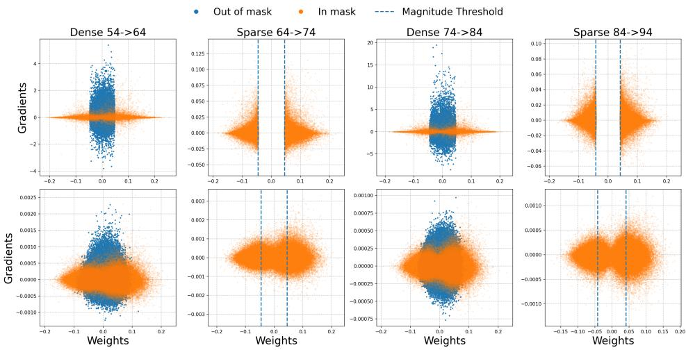  
Figure 1: Gradient–weight dynamics across AC/DC phases. Gradient versus weight scatter plots for layer4.0.conv2 of a 90% sparse ResNet18 on CIFAR100. Top and bottom rows show the beginning and end of each phase, respectively. During sparse phases, many active weights move toward small magnitude and small gradient. During dense phases, many reintroduced out-of-mask weights remain near zero but receive large gradients.

We first examine how coordinates retained by magnitude pruning differ from those excluded by the current mask. Figure 1 compares their weights and gradients across consecutive phases, connecting mask membership to the learning signal available to each coordinate.

Sparse phases refine the active support. Sparse training is restricted to the magnitude-pruned support St. Within this support, many active weights move toward smaller magnitudes and also have small gradients. Sparse phases therefore consolidate the current representation, separating coordinates that carry useful signal from low-magnitude, low-gradient coordinates that may be removed at the next pruning step.

Dense phases expose off-support gradient signal. When masked parameters in $S _ { t } ^ { c }$ are reintroduced, many have smaller magnitudes but receive large gradients, forming the vertical band near zero in Figure 1. This contrasts with the small, low-gradient active weights (St) at the end of sparse training. Dense phases allow these off-support coordinates to grow and compete for inclusion in the next mask. Thus, the dense phases act as rewiring windows, enabling the support for the next sparse phase to differ from the previous one. This mechanism is in line with the support-expansion role as described by Theorem 2.3.

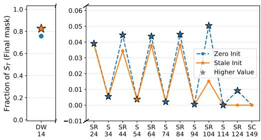

## 3.2 Sign flips

The gradient–weight analysis suggests that dense phases facilitate changes in the sparse mask. Yet, prior work has shown that the signs of surviving weights are also important for sparse training, and that improving sign alignment can help close the gap between sparse training from scratch and dense-to-sparse training [18, 19]. We therefore ask which phases of AC/DC establish the eventual signs of the parameters retained in the final sparse model. To study this retrospectively, we record the phase of each final-mask parameter’s last sign flip, after which the sign remains consistent across phases. Parameters that never flip are assigned to the warmup bin.

Figure 2a shows that most final-mask parameters settle their signs by the end of warmup. Among parameters corrected later, the last sign flips occur predominantly during dense rather than sparse phases. Dense phases therefore do not merely produce transient gradient activity: they provide windows in which parameters retained by the final sparse model resolve their eventual signs.

We compare two initialization strategies for masked parameters at the beginning of each dense phase. Stale init restores these parameters to their values at the end of the previous dense phase, whereas Zero init resets them to zero. With Stale init, most late sign corrections occur in early dense phases, while Zero init continues to produce corrections in later phases. This suggests that initialization influences when final parameter signs become established, motivating our Zero init modification in Section 4. The detailed counting protocol, layerwise and shortened-phase results, and corresponding ARC analysis are provided in Appendix G.

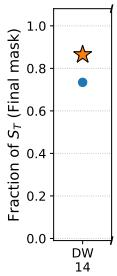

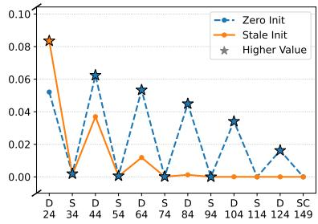  
(a) AC/DC  
(b) ARC  
Figure 2: Timing of final sign alignment. For each parameter retained in the final sparse mask, we record the phase in which it flips sign for the last time. The y-axis is normalized by the final mask size. DW, D, S, and SC denote dense warmup, dense, sparse, and sparse cooldown phases for AC/DC; in ARC, the corresponding non-sparse phases are rewiring phases on $A _ { t } = S _ { t } \cup G _ { t }$ . (a) In AC/DC, most final-mask parameters align during dense warmup, while later sign corrections occur mainly during dense phases. (b) The analogous ARC diagnostic is discussed after ARC is introduced in Section 4.

## 3.3 Activation Subspaces Reflect Sparse Consolidation and Dense Rewiring

The preceding diagnostics characterize AC/DC at the level of individual parameters, gradients, and masks. We next ask whether the alternating phases also leave a representation-level signature. The saddle-to-saddle perspective suggests that sparse phases consolidate the current representation, while dense phases allow larger but structured representation changes. We therefore track the leading eigenspaces of activation Gram matrices computed over the CIFAR100 training set at each epoch checkpoint. Their construction is detailed in Appendix F.

Let $U _ { t } ^ { ( r ) }$ denote an orthonormal basis for the subspace spanned by the top r activation Gram eigenvectors at epoch t. We measure subspace overlap as $\begin{array} { r } { S _ { r } ( t _ { 1 } , t _ { 2 } ) = \frac { 1 } { r } \left\| \boldsymbol { U } _ { t _ { 1 } } ^ { ( r ) } { } ^ { \top } \boldsymbol { U } _ { t _ { 2 } } ^ { ( r ) } \right\| _ { F } ^ { 2 } } \end{array}$ . We report both $S _ { r } ( t - 1 , t )$ , measuring consecutive-epoch stability, and $S _ { r } ( 0 , t )$ , measuring similarity to the first checkpoint of each phase.

Figure 3 compares an early and a later AC/DC cycle for layer3.1.conv2. Sparse phases preserve the leading activation subspaces more strongly than dense phases, especially for $r = 5$ and $r = 1 0$ This is consistent with sparse phases primarily consolidating the current representation under a fixed support. Dense phases, in contrast, show larger drift from the phase start, indicating more substantial representation updates. Importantly, dense-phase similarity remains substantial and changes smoothly across epochs. Thus, dense phases do not appear to reset the representation, but rather modify it while preserving much of the dominant activation subspace. The distinction between the phases becomes clearer in later cycles, where sparse phases show very high consecutive-epoch similarity while dense phases continue to permit representation changes. Full results across all four cycles and eigendirection heatmaps are provided in Appendix F.

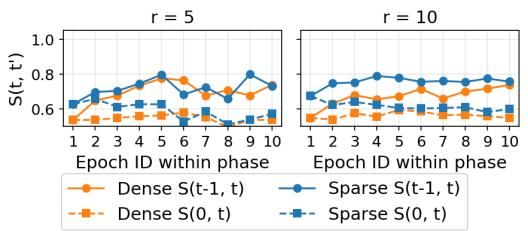  
(a) 1st: Sparse 24–34, Dense 34–44

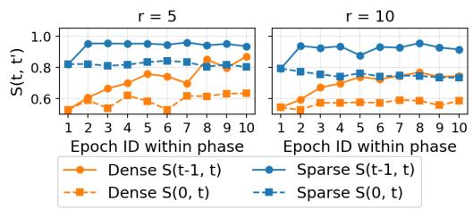  
(b) $4 ^ { t h }$ cycle: Sparse 84–94, Dense epochs 94–104  
Figure 3: Sparse phases preserve activation subspaces. Top-r activation Gram subspace similarity for layer3.1.conv2 of a 90% sparse ResNet18 on CIFAR100. We show an early and later AC/DC cycle. Sparse phases maintain higher subspace similarity. Dense phases show larger but smooth drift.

Together, the diagnostics identify dense phases as rewiring windows: they expose high-gradient off-support coordinates, enable persistent sign corrections, and permit smooth representation changes. This motivates preserving the inherited support while replacing full dense optimization with targeted updates of high-gradient off-support coordinates.

## 4 Method: Alternating Rewiring Compression

Motivated by these diagnostics, we pursue three complementary modifications to improve the performance–FLOP tradeoff: Zero init, truncated dense phases, and Alternating Rewiring Compression (ARC).

Zero init. In standard AC/DC, reintroduced parameters inherit their previous dense-phase values (Stale init), including their signs. Motivated by the sign-flip diagnostics in Section 3.2, we instead consider Zero init, which resets these parameters to zero: $\bar { \theta _ { i } } ^ { - }  0 \bar { \mathrm { ~ f o r ~ } } i \in S _ { t } ^ { c }$ . This removes inherited sign information, allowing the current gradient to determine their initial direction before they compete for inclusion in the next sparse mask. Zero init applies to all masked parameters during AC/DC’s dense phases, and only to the selected rewiring coordinates $G _ { t }$ in ARC.

Truncated dense phases. Standard AC/DC uses dense and sparse phases of equal length. If dense phases serve as rewiring windows, an immediate practical question is how long those windows need to be. We therefore evaluate schedules that keep the total cycle length fixed but shorten the dense portion. If a standard cycle uses D dense epochs and S sparse epochs, we replace it with $D ^ { \prime } < \bar { D }$ dense epochs and $S ^ { \prime } \stackrel { . } { = } D + S - D ^ { \prime }$ sparse epochs. This preserves the alternating schedule while reducing theoretical FLOPs by replacing dense epochs with sparse epochs. Furthermore, it is consistent with the smooth and gradual nature of the representation changes observed in Section 3.3.

ARC: sparse rewiring instead of dense phases. Zero init and truncation reduce the cost or improve the behavior of dense phases, but still rely on dense updates. ARC replaces the dense phase with a sparse rewiring phase. Instead of updating all parameters, ARC updates only $A _ { t } = \bar { S _ { t } } \cup G _ { t }$ , with $\bar { G } _ { t } = \mathrm { T o p } _ { q } \big ( ( | \bar { g } _ { t } | ) _ { S _ { t } ^ { c } } \big )$ , where $G _ { t }$ contains the largest-gradient coordinates outside the current sparse support. Here, q is the number of added parameters that were previously masked. In Section 5, the d in label like $A \bar { R } C ( d )$ specifies the density of $G _ { t }$ over the set of all parameters. The gradients used to construct $G _ { t }$ are aggregated over a small number of randomly sampled mini-batches, and $G _ { t }$ is selected once at the beginning of each rewiring phase. See Appendix D for more details.

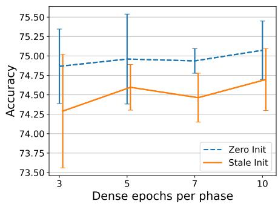

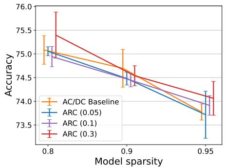  
Figure 4: Reducing and sparsifying rewiring phases. Results for ResNet18 on CIFAR100. Left: varying the number of dense epochs per AC/DC cycle at 90% sparsity. Right: comparing AC/DC with ARC variants using different $G _ { t }$ budgets across target sparsities.

During the rewiring phase, gradients and updates are restricted to $A _ { t }$ . The inherited support $S _ { t }$ continues training the current sparse representation, while $G _ { t }$ gives high-gradient off-support coordinates, identified as the primary driver of mask rewiring in Section 3.1, an opportunity to grow, and compete for inclusion in the next sparse mask. After the rewiring phase, magnitude pruning returns the model to the target sparsity, producing the sparse support for the following sparse phase. ARC is therefore a sparse-to-sparse method after the initial dense warmup. It keeps the alternating structure of AC/DC, but compresses the dense rewiring step onto $A _ { t } = S _ { t } \cup G _ { t }$ . Larger $G _ { t }$ more closely approximates full dense rewiring, while smaller $G _ { t }$ yields lower theoretical FLOPs.

Combined ARC setting. The three modifications can be applied together: our combined setting uses Zero init, shortened rewiring windows, and sparse updates on $\ r { A _ { t } } = \ r { S _ { t } } \cup \ r { G _ { t } }$ . Figure 2b shows that ARC retains the concentration of late sign corrections in rewiring phases. Appendix G gives the full comparison with AC/DC and the differences between the initialization variants.

## 5 End-to-End Performance and FLOP Tradeoffs

The preceding analysis motivates how to compress dense phases; we now test whether these choices preserve their benefits over complete training runs. We first examine the individual modifications and their accuracy–FLOP tradeoffs on CIFAR100, then evaluate their transfer to ImageNet and language modeling. We consider ResNet18 [26] on CIFAR100 [37], ResNet50 and DeiT-Small [69] on ImageNet [11], and GPT-2 124M [62] on OpenWebText [22]. We compare against AC/DC [60] and RigL [13], and include published Top-KAST [32] results for ResNet50. Our vision runs use three seeds; language-model results use one seed. We report theoretical FLOPs, including support-selection probes. Our implementation uses dense tensors with masks and does not demonstrate wall-clock acceleration. Training details and FLOP accounting are provided in Appendix D.

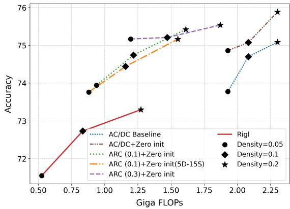  
Figure 5: Performance versus theoretical FLOPs. Accuracy–FLOP tradeoff for AC/DC, ARC variants, and RigL on CIFAR100. The horizontal axis reports epoch-averaged theoretical training GFLOPs per image, including support-selection probes.

## Shorter dense phases preserve performance.

We first test whether dense phases must have

the same duration as sparse phases. On CIFAR100 with ResNet18, we keep the total cycle length fixed and vary the number of dense epochs per phase. Figure 4 (left) shows that dense phases can be substantially shortened with little loss in accuracy. In particular, reducing the dense portion from 10 epochs to as few as 3 epochs maintains performance within the observed variation.

This result supports the view that much of the useful rewiring can occur early in the dense phase. Shortening dense phases, therefore, reduces theoretical FLOPs by replacing dense computation with sparse training. The same figure also shows that zero initialization is comparable to or better than stale initialization across dense-phase lengths, suggesting that reintroduced parameters do not need to preserve stale values in order to make effective use of the rewiring window.

ARC matches AC/DC with sparse rewiring. Shortening dense phases reduces how long all coordinates are trained; ARC addresses the complementary question of whether all coordinates need to participate at all. Figure 4 (right) compares ARC with varying $G _ { t }$ densities on CIFAR100. ARC with a sufficiently large rewiring density matches the performance of the AC/DC baseline while reducing theoretical FLOPs, because each rewiring phase updates only $A _ { t } = S _ { t } \cup G _ { t }$ rather than the full dense parameter set. Increasing the density of $G _ { t }$ improves performance: larger rewiring supports better approximate the dense phase, while smaller supports provide greater compression.

Table 1 reports the corresponding CIFAR100 results. ARC(0.1) already performs comparably to the AC/DC baseline across sparsity levels, while ARC(0.3) with zero initialization achieves the best accuracy at 95% and 90% sparsity and is competitive with the best AC/DC variant at 80% sparsity. Combining all three modifications—zero initialization, shorter rewiring windows, and sparse high-gradient rewiring—also remains competitive with AC/DC, despite using substantially fewer theoretical FLOPs.

Table 1: AC/DC, ARC and RigL on CIFAR100 with ResNet18.
<table><tr><td></td><td>Sparsity=0.95Sparsity=0.9 Sparsity=0.8</td><td></td><td></td></tr><tr><td>ARC (0.1)</td><td> $7 3 . 9 1 \pm 0 . 2 1$ </td><td> $7 4 . 4 5 \pm 0 . 1 4$ </td><td> $7 4 . 9 4 \pm 0 . 2 1$ </td></tr><tr><td>ARC (0.1) + Zero init</td><td> $7 3 . 9 4 \pm 0 . 2 6$ </td><td> $7 4 . 7 4 \pm 0 . 3 6$ </td><td> $7 5 . 4 2 \pm 0 . 1 9$ </td></tr><tr><td> $\mathbf { A R C } \left( 0 . 3 \right) + \mathbf { Z e r o } \mathrm { i n i t }$ </td><td> ${ \bf 7 5 . 1 7 \pm 0 . 9 8 }$ </td><td> $7 5 . 2 1 \pm 0 . 2 6$ </td><td> $7 5 . 5 4 \pm 0 . 5 8$ </td></tr><tr><td>ARC (0.1) + Zero init 5-D, 15-S</td><td> $7 3 . 7 6 \pm 0 . 3 4$ </td><td> $7 4 . 4 4 \pm 0 . 0 6$ </td><td> $7 5 . 1 6 \pm 0 . 2 0$ </td></tr><tr><td>AC/DC Baseline</td><td> $7 3 . 7 7 \pm 0 . 1 7$ </td><td> $7 4 . 7 0 \pm 0 . 4 0$ </td><td> $7 5 . 0 8 \pm 0 . 3 0$ </td></tr><tr><td> $\mathbf { A C / D C } + \mathbf { Z e r o } \ \mathrm { i n i t }$ </td><td> $7 4 . 8 6 \pm 0 . 3 8$ </td><td> ${ 7 5 . 0 7 \pm 0 . 3 8 }$ </td><td> $7 5 . 8 8 \pm 0 . 2 0$ </td></tr><tr><td>RigL</td><td> $7 1 . 5 5 \pm 0 . 2 6$ </td><td> $7 2 . 7 3 \pm 0 . 4 1$ </td><td> $7 3 . 3 0 \pm 0 . 1 4$ </td></tr></table>

Table 2: AC/DC, ARC and RigL on ImageNet with DeiT-Small. We report top-1 accuracy (%) and epoch-averaged theoretical training GFLOPs per image, including support-selection probes.
<table><tr><td rowspan="2"></td><td colspan="2">Sparsity=0.7</td><td colspan="2">Sparsity=0.5</td></tr><tr><td>Test Acc</td><td>GFLOPs</td><td>Test Acc</td><td>GFLOPs</td></tr><tr><td>ARC (0.2)</td><td> ${ \bf 7 6 . 5 0 \pm 0 . 2 1 }$ </td><td>13.34</td><td> $7 7 . 8 2 \pm 0 . 1 9$ </td><td>18.11</td></tr><tr><td> $\mathrm { A R C } \ ( 0 . 2 ) + \mathrm { Z e r o \ i n i t }$ </td><td> $7 6 . 2 1 \pm 0 . 2 2$ </td><td>13.34</td><td> $7 7 . 6 7 \pm 0 . 7 6$ </td><td>18.11</td></tr><tr><td>ARC (0.2) + Zero init 10-D, 20-S</td><td> $7 6 . 2 0 \pm 0 . 0 8$ </td><td>12.59</td><td> $7 7 . 4 0 \pm 0 . 2 7$ </td><td>17.36</td></tr><tr><td>AC/DC Baseline</td><td> $7 5 . 8 9 \pm 0 . 3 1$ </td><td>19.01</td><td> $7 7 . 4 3 3 \pm 0 . 3 0$ </td><td>21.52</td></tr><tr><td> $\mathbf { A C / D C } + \mathbf { Z e r o } \ \mathrm { i n i t }$ </td><td> $7 5 . 8 9 1 \pm 0 . 7 4$ </td><td>19.01</td><td> ${ \underline { { 7 7 . 8 2 \pm 0 . 1 2 } } }$ </td><td>21.52</td></tr><tr><td>RigL</td><td> $7 3 . 8 9 \pm 0 . 4 7$ </td><td>10.32</td><td> $7 6 . 2 5 \pm 0 . 1 8$ </td><td>15.30</td></tr></table>

Comparison with RigL and Pareto frontier. RigL is an important sparse-to-sparse baseline because it also avoids dense training phases through gradient-based rewiring. However, Table 1 shows that all AC/DC-style variants substantially outperform RigL on CIFAR100 at the same sparsity levels. Figure 5 further compares accuracy against theoretical FLOPs. ARC variants improve the performance–FLOP frontier relative to both AC/DC and RigL: they retain AC/DC-like accuracy while shifting to lower FLOP budgets.

ImageNet results. We next evaluate ARC on ImageNet, testing architectural transfer with DeiT-Small and high-sparsity training with ResNet50. For DeiT-Small, Table 2 shows that ARC(0.2)

Table 3: ResNet50/ImageNet at 95% sparsity. Published baselines from Table 2 of [60] and our three-seed ARC results. Inference FLOPs per image and full-run training FLOPs are normalized to dense; ARC includes selection probes. Top-KAST uses 95% forward and 50% backward sparsity.
<table><tr><td>Method</td><td>Top-1 (%)</td><td>Inference FLOPs</td><td>Training FLOPs</td></tr><tr><td colspan="4">Published baselines</td></tr><tr><td>RigL 1× (ERK)</td><td>69.70 ± 0.17</td><td>0.12×</td><td>0.13×</td></tr><tr><td>Top-KAST</td><td>71.96</td><td>0.08×</td><td>0.22×</td></tr><tr><td>AĆ/DC</td><td> $7 3 . 1 4 \pm 0 . 2 0$ </td><td>0.11×</td><td>0.53×</td></tr><tr><td colspan="4">Our runs</td></tr><tr><td>ARC-Stale</td><td> $7 2 . 0 8 3 \pm 0 . 0 7 7$ </td><td>0.0920×</td><td>0.2321×</td></tr><tr><td>ARC-Zero</td><td> $7 3 . 0 8 7 \pm 0 . 0 4 6$ </td><td>0.1079×</td><td>0.2431×</td></tr></table>

Table 4: GPT-2 124M on OpenWebText at 80% target sparsity. Results use one training seed (1337) and the end-of-training checkpoint. The zero-shot average is the arithmetic mean of seven task scores (%). Bold indicates the best result among the compared sparse methods.
<table><tr><td>Method</td><td>Validation loss ↓</td><td>Perplexity ↓</td><td>Zero-shot average ↑</td></tr><tr><td>AC/DC</td><td>3.13690</td><td>23.0327</td><td>36.27</td></tr><tr><td>RigL</td><td>3.13847</td><td>23.0685</td><td>35.67</td></tr><tr><td>ARC-Stale</td><td>3.06056</td><td>21.3395</td><td>36.35</td></tr><tr><td>ARC-Zero</td><td>3.05646</td><td>21.2521</td><td>37.29</td></tr></table>

outperforms standard AC/DC and RigL at both 50% and 70% sparsity, while using fewer theoretical GFLOPs than AC/DC. At 50% sparsity, it also matches AC/DC with zero initialization.

We further evaluate ResNet50 at 95% sparsity using the 100-epoch AC/DC benchmark [60]. Table 3 shows that ARC–Zero nearly matches AC/DC accuracy with 54% fewer theoretical training FLOPs. It also outperforms the published Top-KAST baseline in accuracy at a moderately higher FLOP budget. These results demonstrate that ARC’s accuracy–FLOP benefits extend across architectures and to high sparsity. Training details are provided in Appendix D.2, with a hardware-oriented 2:4 semi-structured extension in Appendix E.4.

Language modeling. We also evaluate GPT-2 124M trained from scratch on OpenWebText for 600,000 updates at 80% sparsity. Both ARC variants improve validation perplexity over AC/DC and RigL (Table 4). ARC–Zero reduces AC/DC perplexity from 23.03 to 21.25 (7.7%) and improves six of seven zero-shot task scores, increasing the average from 36.27% to 37.29%. Training details and task-wise results are provided in Appendices D.3 and E.3.

## 6 Conclusion

We show that the dense phases in AC/DC can be substantially compressed without losing its main benefit. Our theory frames alternating training as sparse consolidation followed by support expansion, and our diagnostics show the corresponding empirical pattern: sparse phases refine the current support, while dense phases expose high-gradient off-support coordinates that drive mask rewiring and persistent sign correction. This suggests that dense phases are not uniformly useful across all parameters. Building on this insight, we introduced Zero init, truncated dense phases, and ARC, which replaces each dense phase with sparse rewiring. Across CIFAR100 and ImageNet, ARC preserves AC/DC-level accuracy while reducing theoretical FLOPs and improving the performance– FLOP frontier relative to AC/DC and RigL. The GPT-2 results extend these benefits to language modeling, with lower perplexity and higher average zero-shot performance. This work focuses on unstructured sparsity, where theoretical FLOP reductions do not always translate directly into wall-clock speedups on current hardware. Nevertheless, unstructured sparsity remains a useful setting for studying the limits of sparse training. Its flexibility allows us to ask which parameters are needed, how sparse masks evolve, and which parts of dense training are essential. The resulting insights can inform both future sparse-training algorithms and more hardware-friendly structured variants.

## 7 Acknowledgements

We gratefully acknowledge the Gauss Centre for Supercomputing e.V. for funding this project by providing computing time on the GCS Supercomputer JUWELS at Jülich Supercomputing Centre (JSC). We are also grateful for funding from the European Research Council (ERC) under the Horizon Europe Framework Programme (HORIZON) for proposal number 101116395 SPARSE-ML.

## References

[1] Pierre Baldi and Kurt Hornik. Neural networks and principal component analysis: Learning from examples without local minima. Neural Networks, 2(1):53–58, 1989.

[2] David Barrett and Benoit Dherin. Implicit gradient regularization. In International Conference on Learning Representations, 2021.

[3] Mikhail Belkin, Daniel Hsu, Siyuan Ma, and Soumik Mandal. Reconciling modern machinelearning practice and the classical bias–variance trade-off. Proceedings ofthe National Academy ofSciences, 116(32):15849–15854, 2019.

[4] Yonatan Bisk, Rowan Zellers, Jianfeng Gao, Yejin Choi, et al. Piqa: Reasoning about physical commonsense in natural language. In Proceedings of the AAAI conference on artificial intelligence, volume 34, pages 7432–7439, 2020.

[5] Thomas Blumensath and Mike E Davies. Iterative thresholding for sparse approximations. Journal ofFourier analysis and Applications, 14(5-6):629–654, 2008.

[6] Rebekka Burkholz. Most activation functions can win the lottery without excessive depth. In Advances in Neural Information Processing Systems, 2022.

[7] Rebekka Burkholz, Nilanjana Laha, Rajarshi Mukherjee, and Alkis Gotovos. On the existence of universal lottery tickets. In International Conference on Learning Representations, 2022.

[8] Hongrong Cheng, Miao Zhang, and Javen Qinfeng Shi. A survey on deep neural network pruning: Taxonomy, comparison, analysis, and recommendations. IEEE Transactions on Pattern Analysis and Machine Intelligence, 46(12):10558–10578, 2024.

[9] Peter Clark, Isaac Cowhey, Oren Etzioni, Tushar Khot, Ashish Sabharwal, Carissa Schoenick, and Oyvind Tafjord. Think you have solved question answering? try arc, the ai2 reasoning challenge. arXiv preprint arXiv:1803.05457, 2018.

[10] Arthur da Cunha, Emanuele Natale, and Laurent Viennot. Proving the lottery ticket hypothesis for convolutional neural networks. In International Conference on Learning Representations, 2022.

[11] J. Deng, W. Dong, R. Socher, L.-J. Li, K. Li, and L. Fei-Fei. ImageNet: A Large-Scale Hierarchical Image Database. In CVPR09, 2009.

[12] Clémentine Carla Juliette Dominé, Nicolas Anguita, Alexandra Maria Proca, Lukas Braun, Daniel Kunin, Pedro A. M. Mediano, and Andrew M Saxe. From lazy to rich: Exact learning dynamics in deep linear networks. In UniReps: 2nd Edition of the Workshop on Unifying Representations in Neural Models, 2024.

[13] Utku Evci, Trevor Gale, Jacob Menick, Pablo Samuel Castro, and Erich Elsen. Rigging the lottery: Making all tickets winners. In International Conference on Machine Learning, pages 2943–2952. PMLR, 2020.

[14] Mathieu Even, Scott Pesme, Suriya Gunasekar, and Nicolas Flammarion. (s)gd over diagonal linear networks: Implicit regularisation, large stepsizes and edge of stability. ArXiv, abs/2302.08982, 2023.

[15] Damien Ferbach, Christos Tsirigotis, Gauthier Gidel, and Joey Bose. A general framework for proving the equivariant strong lottery ticket hypothesis. In International Conference on Learning Representations, 2023.

[16] Jonathan Frankle and Michael Carbin. The lottery ticket hypothesis: Finding sparse, trainable neural networks. In International Conference on Learning Representations, 2019.

[17] Jonathan Frankle, Gintare Karolina Dziugaite, Daniel Roy, and Michael Carbin. Pruning neural networks at initialization: Why are we missing the mark? In International Conference on Learning Representations, 2021.

[18] Advait Gadhikar and Rebekka Burkholz. Masks, signs, and learning rate rewinding. In Twelfth International Conference on Learning Representations, 2024.

[19] Advait Gadhikar, Tom Jacobs, Chao Zhou, and Rebekka Burkholz. Sign-in to the lottery: Reparameterizing sparse training. In The Thirty-ninth Annual Conference on Neural Information Processing Systems, 2025.

[20] Advait Harshal Gadhikar, Sohom Mukherjee, and Rebekka Burkholz. Why random pruning is all we need to start sparse. In International Conference on Machine Learning, 2023.

[21] Leo Gao, Jonathan Tow, Baber Abbasi, Stella Biderman, Sid Black, Anthony DiPofi, Charles Foster, Laurence Golding, Jeffrey Hsu, Alain Le Noac’h, Haonan Li, Kyle McDonell, Niklas Muennighoff, Chris Ociepa, Jason Phang, Laria Reynolds, Hailey Schoelkopf, Aviya Skowron, Lintang Sutawika, Eric Tang, Anish Thite, Ben Wang, Kevin Wang, and Andy Zou. The language model evaluation harness, 07 2024.

[22] Aaron Gokaslan and Vanya Cohen. Openwebtext corpus. http://Skylion007.github.io/ OpenWebTextCorpus, 2019.

[23] Suriya Gunasekar, Blake Woodworth, Srinadh Bhojanapalli, Behnam Neyshabur, and Nathan Srebro. Implicit regularization in matrix factorization, 2017.

[24] Song Han, Jeff Pool, John Tran, and William Dally. Learning both weights and connections for efficient neural network. Advances in neural information processing systems, 28, 2015.

[25] B. Hassibi, D.G. Stork, and G.J. Wolff. Optimal brain surgeon and general network pruning. In IEEE International Conference on Neural Networks, pages 293–299 vol.1, 1993.

[26] Kaiming He, X. Zhang, Shaoqing Ren, and Jian Sun. Deep residual learning for image recognition. 2016 IEEE Conference on Computer Vision and Pattern Recognition (CVPR), pages 770–778, 2015.

[27] Tom Jacobs and Rebekka Burkholz. Mask in the mirror: Implicit sparsification. In The Thirteenth International Conference on Learning Representations, 2025.

[28] Tom Jacobs, Advait Gadhikar, Celia Rubio-Madrigal, and Rebekka Burkholz. Ham: A hyperbolic step to regulate implicit bias. International Conference on Learning Representations, 2026.

[29] Tom Jacobs, Chao Zhou, and Rebekka Burkholz. Mirror, mirror of the flow: How does regularization shape implicit bias? In Forty-second International Conference on Machine Learning, 2025.

[30] Tom Jacobs, Chao Zhou, and Rebekka Burkholz. Never saddle: Reparameterized steepest descent as mirror flow. In The Fourteenth International Conference on Learning Representations, 2026.

[31] Arthur Jacot, François Ged, Berfin ¸Sim¸sek, Clément Hongler, and Franck Gabriel. Saddle-tosaddle dynamics in deep linear networks: Small initialization training, symmetry, and sparsity. arXiv preprint arXiv:2106.15933, 2021.

[32] Siddhant Jayakumar, Razvan Pascanu, Jack Rae, Simon Osindero, and Erich Elsen. Top-kast: Top-k always sparse training. Advances in Neural Information Processing Systems, 33:20744– 20754, 2020.

[33] Andrej Karpathy. nanogpt, 2022.

[34] Kenji Kawaguchi. Deep learning without poor local minima. In Advances in Neural Information Processing Systems, volume 29, pages 586–594, 2016.

[35] Chris Kolb, Laetitia Frost, Bernd Bischl, and David Rügamer. Differentiable sparsity via d-gating: Simple and versatile structured penalization. ArXiv, abs/2509.23898, 2025.

[36] Chris Kolb, Tobias Weber, Bernd Bischl, and David Rügamer. Deep weight factorization: Sparse learning through the lens of artificial symmetries. In The Thirteenth International Conference on Learning Representations, 2025.

[37] Alex Krizhevsky, Geoffrey Hinton, et al. Learning multiple layers of features from tiny images. 2009.

[38] Aditya Kusupati, Vivek Ramanujan, Raghav Somani, Mitchell Wortsman, Prateek Jain, Sham Kakade, and Ali Farhadi. Soft threshold weight reparameterization for learnable sparsity. In Proceedings of the International Conference on Machine Learning, July 2020.

[39] Denis Kuznedelev, Eldar Kurtic, Elias Frantar, and Dan Alistarh. Cap: Correlation-aware´ pruning for highly-accurate sparse vision models. Advances in Neural Information Processing Systems, 36, 2024.

[40] Mike Lasby, Anna Golubeva, Utku Evci, Mihai Nica, and Yani Ioannou. Dynamic sparse training with structured sparsity. arXiv preprint arXiv:2305.02299, 2023.

[41] Thomas Laurent and James von Brecht. Deep linear networks with arbitrary loss: All local minima are global. In Proceedings ofthe 35th International Conference on Machine Learning, volume 80, pages 2902–2907, 2018.

[42] Namhoon Lee, Thalaiyasingam Ajanthan, and Philip H. S. Torr. Snip: single-shot network pruning based on connection sensitivity. In International Conference on Learning Representations, 2019.

[43] Zhiyuan Li, Tianhao Wang, Jason D. Lee, and Sanjeev Arora. Implicit bias of gradient descent on reparametrized models: On equivalence to mirror descent. ArXiv, abs/2207.04036, 2022.

[44] Shiwei Liu, Tianlong Chen, Xiaohan Chen, Li Shen, Decebal Constantin Mocanu, Zhangyang Wang, and Mykola Pechenizkiy. The unreasonable effectiveness of random pruning: Return of the most naive baseline for sparse training. In International Conference on Learning Representations, 2021.

[45] Shiwei Liu, Lu Yin, Decebal Constantin Mocanu, and Mykola Pechenizkiy. Do we actually need dense over-parameterization? in-time over-parameterization in sparse training. In International Conference on Machine Learning, pages 6989–7000. PMLR, 2021.

[46] Christos Louizos, Max Welling, and Diederik P Kingma. Learning sparse neural networks through l\_0 regularization. In International Conference on Learning Representations, 2018.

[47] Eran Malach, Gilad Yehudai, Shai Shalev-Schwartz, and Ohad Shamir. Proving the lottery ticket hypothesis: Pruning is all you need. In International Conference on Machine Learning, 2020.

[48] Todor Mihaylov, Peter Clark, Tushar Khot, and Ashish Sabharwal. Can a suit of armor conduct electricity? a new dataset for open book question answering. In Proceedings of the 2018 conference on empirical methods in natural language processing, pages 2381–2391, 2018.

[49] Decebal Constantin Mocanu, Elena Mocanu, Peter Stone, Phuong H. Nguyen, Madeleine Gibescu, and Antonio Liotta. Scalable training of artificial neural networks with adaptive sparse connectivity inspired by network science. Nature Communications, 9(1), jun 2018.

[50] Sree Harsha Nelaturu, Advait Gadhikar, and Rebekka Burkholz. TurboPrune: High-Speed Distributed Lottery Ticket Training, 2024.

[51] Behnam Neyshabur, Srinadh Bhojanapalli, David McAllester, and Nati Srebro. Exploring generalization in deep learning. Advances in neural information processing systems, 30, 2017.

[52] NVIDIA. TensorRT documentation: Data formats and tensors. https://docs.nvidia. com/deeplearning/tensorrt/latest/inference-library/data-formats-tensors. html. Section on structured sparsity.

[53] Laurent Orseau, Marcus Hutter, and Omar Rivasplata. Logarithmic pruning is all you need. Advances in Neural Information Processing Systems, 33, 2020.

[54] Denis Paperno, Germán Kruszewski, Angeliki Lazaridou, Ngoc-Quan Pham, Raffaella Bernardi, Sandro Pezzelle, Marco Baroni, Gemma Boleda, and Raquel Fernández. The lambada dataset: Word prediction requiring a broad discourse context. In Proceedings ofthe 54th annual meeting of the association for computational linguistics (volume 1: Long papers), pages 1525–1534, 2016.

[55] Shreyas Malakarjun Patil and Constantine Dovrolis. Phew: Constructing sparse networks that learn fast and generalize well without training data. In International Conference on Machine Learning, pages 8432–8442. PMLR, 2021.

[56] Mansheej Paul, Feng Chen, Brett W. Larsen, Jonathan Frankle, Surya Ganguli, and Gintare Karolina Dziugaite. Unmasking the lottery ticket hypothesis: What’s encoded in a winning ticket’s mask? In The Eleventh International Conference on Learning Representations, 2023.

[57] Ankit Pensia, Shashank Rajput, Alliot Nagle, Harit Vishwakarma, and Dimitris Papailiopoulos. Optimal lottery tickets via subset sum: Logarithmic over-parameterization is sufficient. In Advances in Neural Information Processing Systems, volume 33, pages 2599–2610, 2020.

[58] Scott Pesme and Nicolas Flammarion. Saddle-to-saddle dynamics in diagonal linear networks, 2023.

[59] Scott Pesme, Loucas Pillaud-Vivien, and Nicolas Flammarion. Implicit bias of sgd for diagonal linear networks: a provable benefit of stochasticity, 2021.

[60] Alexandra Peste, Eugenia Iofinova, Adrian Vladu, and Dan Alistarh. Ac/dc: Alternating compressed/decompressed training of deep neural networks, 2021.

[61] Hoang Pham, The-Anh Ta, Shiwei Liu, Lichuan Xiang, Dung D. Le, Hongkai Wen, and Long Tran-Thanh. Towards data-agnostic pruning at initialization: What makes a good sparse mask? In Thirty-seventh Conference on Neural Information Processing Systems, 2023.

[62] Alec Radford, Jeff Wu, Rewon Child, David Luan, Dario Amodei, and Ilya Sutskever. Language models are unsupervised multitask learners. 2019.

[63] Alex Renda, Jonathan Frankle, and Michael Carbin. Comparing rewinding and fine-tuning in neural network pruning. In International Conference on Learning Representations, 2020.

[64] Keisuke Sakaguchi, Ronan Le Bras, Chandra Bhagavatula, and Yejin Choi. Winogrande: An adversarial winograd schema challenge at scale. Communications of the ACM, 64(9):99–106, 2021.

[65] Karthik Abinav Sankararaman, Soham De, Zheng Xu, W. Ronny Huang, and Tom Goldstein. The impact of neural network overparameterization on gradient confusion and stochastic gradient descent. In Hal Daumé III and Aarti Singh, editors, Proceedings of the 37th International Conference on Machine Learning, volume 119 of Proceedings ofMachine Learning Research, pages 8469–8479. PMLR, 13–18 Jul 2020.

[66] Andrew M. Saxe, James L. McClelland, and Surya Ganguli. Exact solutions to the nonlinear dynamics of learning in deep linear neural networks. In International Conference on Learning Representations, 2014.

[67] Sidak Pal Singh and Dan Alistarh. Woodfisher: Efficient second-order approximation for neural network compression. Advances in Neural Information Processing Systems, 33:18098–18109, 2020.

[68] Hidenori Tanaka, Daniel Kunin, Daniel L. Yamins, and Surya Ganguli. Pruning neural networks without any data by iteratively conserving synaptic flow. In Advances in Neural Information Processing Systems, 2020.

[69] Hugo Touvron, Matthieu Cord, Matthijs Douze, Francisco Massa, Alexandre Sablayrolles, and Hervé Jégou. Training data-efficient image transformers & distillation through attention. In International conference on machine learning, pages 10347–10357. PMLR, 2021.

[70] Tomas Vaškevicius, Varun Kanade, and Patrick Rebeschini. Implicit regularization for optimalˇ sparse recovery, 2019.

[71] Chaoqi Wang, Guodong Zhang, and Roger B. Grosse. Picking winning tickets before training by preserving gradient flow. In International Conference on Learning Representations, 2020.

[72] Shuyang Wang and Diego Klabjan. A mirror descent perspective of smoothed sign descent. In Conference on Uncertainty in Artificial Intelligence, 2024.

[73] Blake Woodworth, Suriya Gunasekar, Jason D. Lee, Edward Moroshko, Pedro Savarese, Itay Golan, Daniel Soudry, and Nathan Srebro. Kernel and rich regimes in overparametrized models, 2020.

[74] Xin Yu, Thiago Serra, Srikumar Ramalingam, and Shandian Zhe. The combinatorial brain surgeon: Pruning weights that cancel one another in neural networks, 2022.

[75] Sangdoo Yun, Dongyoon Han, Seong Joon Oh, Sanghyuk Chun, Junsuk Choe, and Youngjoon Yoo. Cutmix: Regularization strategy to train strong classifiers with localizable features. In Proceedings of the IEEE/CVF international conference on computer vision, pages 6023–6032, 2019.

[76] Rowan Zellers, Ari Holtzman, Yonatan Bisk, Ali Farhadi, and Yejin Choi. Hellaswag: Can a machine really finish your sentence? In Proceedings of the 57th annual meeting of the associationfor computational linguistics, pages 4791–4800, 2019.

[77] Yedi Zhang, Andrew M. Saxe, and Peter E. Latham. Saddle-to-saddle dynamics explains a simplicity bias across neural network architectures. In The Fourteenth International Conference on Learning Representations, 2026.

[78] Yingtao Zhang, Jialin Zhao, Wenjing Wu, Ziheng Liao, Umberto Michieli, and Carlo Vittorio Cannistraci. Brain-inspired sparse training enables transformers and llms to perform as fully connected. arXiv preprint arXiv:2501.19107, 2025.

[79] Chao Zhou, Tom Jacobs, Advait Gadhikar, and Rebekka Burkholz. Pay attention to small weights. In The Thirty-ninth Annual Conference on Neural Information Processing Systems, 2025.

[80] Liu Ziyin and Zihao Wang. spred: Solving l1 penalty with sgd, 2023.

## A AC/DC and ARC Schematic

Figure 6 shows the schematic for both AC/DC and ARC.

ARC (Alternating Rewiring Compression)  
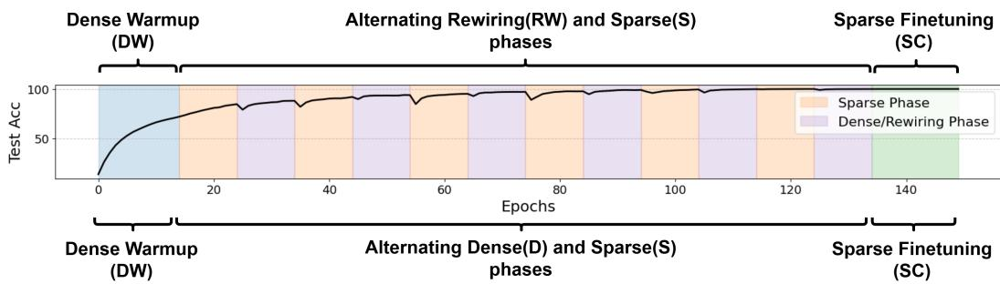  
AC/DC (Alternating Compression and De Compression)  
Figure 6: AC/DC & ARC Schematic. AC/DC finds a sparse network, by starting with a dense warmup, then alternating between dense and sparse phases and finally a sparse finetuning phase. ARC replaces the alternating dense phases with sparse rewiring phases.

## B Convergence theory

The main goal of this section is to prove convergence of a modified iterative hard thresholding algorithm that replaces dense training phases with sparse ones that compress the original dense gradient. Our theory relies on the following assumptions.

Assumption B.1 (Sparse optimum). There exists a global minimizer $\theta ^ { \star } \in$ arg minθ $f ( \theta )$ such that

$$
\| \theta ^ { \star } \| _ { 0 } \leq k ^ { \star } .
$$

Assumption B.2 (Restricted smoothness). The objective $f : \mathbb { R } ^ { N }  \mathbb { R } i s ( s , \beta )$ -smooth with

$$
s = 2 k + q + 3 k ^ { \star } .
$$

That is,for all θ and all s-sparse perturbations δ,

$$
f ( \theta + \delta ) \leq f ( \theta ) + \langle \nabla f ( \theta ) , \delta \rangle + \frac { \beta } { 2 } \| \delta \| _ { 2 } ^ { 2 } .
$$

Assumption B.3 (Concentrated PL condition). There exists $\alpha > 0$ such that f satisfies the $( k ^ { \star } , \alpha )$ concentrated PL condition defined in (1).

Assumption B.4 (Compressed-gradient accuracy). Let

$$
\Delta _ { t } = f ( \theta _ { t } ) - f ( \theta ^ { \star } ) .
$$

For every support $U _ { t }$ arising in the IHT proof, with

$$
| U _ { t } | \leq 2 k + q + 3 k ^ { \star } ,
$$

the compressed gradient $h _ { t } = P _ { A _ { t } g _ { t } }$ satisfies

$$
\mathbb { E } \big [ \| ( h _ { t } - \nabla f ( \theta _ { t } ) ) _ { U _ { t } } \| _ { 2 } ^ { 2 } \big | \theta _ { t } \big ] \le \sigma _ { \mathrm { c g } } ^ { 2 } + \rho \Delta _ { t } .
$$

Here $\sigma _ { \mathrm { c g } } ^ { 2 }$ is the stochastic-gradient variance remaining after projection, and $\rho \Delta _ { t }$ is the deterministic error introduced by gradient compression.

Lemma B.5 (One-step AC/DC bound with compressed gradients). Suppose Assumptions B.1, B.2, and B.3 hold. Let

$$
\theta _ { t + 1 } = T _ { k } ( \theta _ { t } - \eta h _ { t } ) , \qquad \eta = \frac { 1 } { 2 \beta } .
$$

There exist universal constants $C _ { 0 } , C _ { 1 } > 0$ such that, whenever

$$
k \geq C _ { 0 } k ^ { \star } \left( \frac { \beta } { \alpha } \right) ^ { 2 } ,
$$

we have

$$
\mathbb { E } [ \Delta _ { t + 1 } \mid \theta _ { t } ] \leq \left( 1 - \frac { \alpha } { 3 2 \beta } \right) \Delta _ { t } + C _ { 1 } \beta \mathbb { E } \big [ \| ( h _ { t } - \nabla f ( \theta _ { t } ) ) _ { U _ { t } } \| _ { 2 } ^ { 2 } \big | \theta _ { t } \big ] .
$$

Proof. Let

$$
S = \operatorname { s u p p } ( \theta _ { t } ) , \qquad S _ { 0 } = \operatorname { s u p p } ( \theta _ { t + 1 } ) , \qquad S ^ { \star } = \operatorname { s u p p } ( { \theta } ^ { \star } ) ,
$$

and let $U _ { t }$ denote the union of the supports appearing in the IHT projection argument:

$$
U _ { t } \supseteq S \cup S _ { 0 } \cup S ^ { \star } \cup A _ { t } , \qquad | U _ { t } | \leq 2 k + q + 3 k ^ { \star } .
$$

By restricted smoothness,

$$
f ( \theta _ { t + 1 } ) \leq f ( \theta _ { t } ) + \langle \nabla f ( \theta _ { t } ) , \theta _ { t + 1 } - \theta _ { t } \rangle + \frac { \beta } { 2 } \| \theta _ { t + 1 } - \theta _ { t } \| _ { 2 } ^ { 2 } .
$$

As in the stochastic-IHT proof for AC/DC, insert and subtract the ideal dense-gradient step:

$$
\theta _ { t } - \frac { 1 } { \beta } \nabla f ( \theta _ { t } ) .
$$

This gives

$$
f ( \theta _ { t + 1 } ) \leq f ( \theta _ { t } ) + \frac { \beta } { 2 } \left\| \theta _ { t + 1 } - \left( \theta _ { t } - \frac { 1 } { \beta } \nabla f ( \theta _ { t } ) \right) \right\| _ { 2 } ^ { 2 } - \frac { 1 } { 2 \beta } \| \nabla f ( \theta _ { t } ) \| _ { U _ { t } } ^ { 2 } .
$$

Now write

$$
\theta _ { t + 1 } = T _ { k } ( \theta _ { t } - \eta h _ { t } ) .
$$

The standard AC/DC/IHT projection argument controls the error introduced by applying $T _ { k }$ , provided

$$
k \gtrsim k ^ { \star } ( \beta / \alpha ) ^ { 2 } .
$$

In the exact-gradient case $h _ { t } = \nabla f ( \theta _ { t } )$ , this yields

$$
\Delta _ { t + 1 } \leq \left( 1 - \frac { \alpha } { 3 2 \beta } \right) \Delta _ { t } .
$$

When $h _ { t } \neq \nabla f ( \theta _ { t } )$ , every occurrence of the stochastic gradient in the AC/DC proof is replaced by

$$
h _ { t } = \nabla f ( \theta _ { t } ) + \boldsymbol { e } _ { t } , \qquad e _ { t } = h _ { t } - \nabla f ( \theta _ { t } ) .
$$

The additional terms are supported on $U _ { t }$ and are bounded by Young’s inequality:

$$
2 | \langle a , e _ { t } \rangle | \leq \lambda \| a \| _ { 2 } ^ { 2 } + \lambda ^ { - 1 } \| e _ { t } \| _ { 2 } ^ { 2 } .
$$

Choosing $\lambda$ as in the standard IHT proof, the terms involving $\| a \| _ { 2 } ^ { 2 }$ are absorbed into the densegradient contraction, while the remaining contribution is at most

$$
C _ { 1 } \beta \| ( h _ { t } - \nabla f ( \theta _ { t } ) ) _ { U _ { t } } \| _ { 2 } ^ { 2 } .
$$

Taking conditional expectation gives the claim.

Theorem B.6 (AC/DC with compressed gradient). Suppose Assumptions B.1–B.4 hold and

$$
k \geq C _ { 0 } k ^ { \star } \left( \frac { \beta } { \alpha } \right) ^ { 2 } .
$$

Define

$$
\lambda _ { \mathrm { c g } } = \frac { \alpha } { 3 2 \beta } - C _ { 1 } \beta \rho .
$$

If

$$
\lambda _ { \mathrm { c g } } > 0 ,
$$

then the compressed-gradient AC/DC update satisfies

$$
\begin{array} { r } { \mathbb { E } [ \Delta _ { t + 1 } ] \leq ( 1 - \lambda _ { \mathrm { c g } } ) \mathbb { E } [ \Delta _ { t } ] + C _ { 1 } \beta \sigma _ { \mathrm { c g } } ^ { 2 } . } \end{array}
$$

Consequently, after T iterations,

$$
\mathbb { E } [ \Delta _ { T } ] \leq ( 1 - \lambda _ { \mathrm { c g } } ) ^ { T } \Delta _ { 0 } + \frac { C _ { 1 } \beta \sigma _ { \mathrm { c g } } ^ { 2 } } { \lambda _ { \mathrm { c g } } } .
$$

Equivalently, for any tolerance $\varepsilon > 0 ,$ , after

$$
T = O \left( \frac { 1 } { \lambda _ { \mathrm { { c g } } } } \log \frac { \Delta _ { 0 } } { \varepsilon } \right)
$$

iterations, the method reaches

$$
\mathbb { E } [ f ( \theta _ { T } ) - f ( \theta ^ { \star } ) ] \leq \varepsilon + O \left( \frac { \beta \sigma _ { \mathrm { c g } } ^ { 2 } } { \lambda _ { \mathrm { c g } } } \right) .
$$

Proof. By Lemma B.5,

$$
\mathbb { E } [ \Delta _ { t + 1 } \mid \theta _ { t } ] \leq \left( 1 - \frac { \alpha } { 3 2 \beta } \right) \Delta _ { t } + C _ { 1 } \beta \mathbb { E } \big [ \| ( h _ { t } - \nabla f ( \theta _ { t } ) ) _ { U _ { t } } \| _ { 2 } ^ { 2 } \big | \theta _ { t } \big ] .
$$

Using Assumption B.4,

$$
\mathbb { E } [ \Delta _ { t + 1 } \mid \theta _ { t } ] \leq \left( 1 - \frac { \alpha } { 3 2 \beta } + C _ { 1 } \beta \rho \right) \Delta _ { t } + C _ { 1 } \beta \sigma _ { \mathrm { c g } } ^ { 2 } .
$$

By definition,

$$
\lambda _ { \mathrm { c g } } = \frac { \alpha } { 3 2 \beta } - C _ { 1 } \beta \rho ,
$$

so

$$
\begin{array} { r } { \mathbb { E } [ \Delta _ { t + 1 } \mid \theta _ { t } ] \leq ( 1 - \lambda _ { \mathrm { c g } } ) \Delta _ { t } + C _ { 1 } \beta \sigma _ { \mathrm { c g } } ^ { 2 } . } \end{array}
$$

Taking total expectation and unrolling the recursion gives

$$
\mathbb { E } [ \Delta _ { T } ] \le ( 1 - \lambda _ { \mathrm { c g } } ) ^ { T } \Delta _ { 0 } + C _ { 1 } \beta \sigma _ { \mathrm { c g } } ^ { 2 } \sum _ { j = 0 } ^ { T - 1 } ( 1 - \lambda _ { \mathrm { c g } } ) ^ { j } .
$$

Since

$$
\sum _ { j = 0 } ^ { T - 1 } ( 1 - \lambda _ { \mathrm { { c g } } } ) ^ { j } \leq \frac { 1 } { \lambda _ { \mathrm { { c g } } } } ,
$$

we obtain

$$
\mathbb { E } [ \Delta _ { T } ] \leq ( 1 - \lambda _ { \mathrm { c g } } ) ^ { T } \Delta _ { 0 } + \frac { C _ { 1 } \beta \sigma _ { \mathrm { c g } } ^ { 2 } } { \lambda _ { \mathrm { c g } } } .
$$

The stated iteration complexity follows by choosing T so that

$$
( 1 - \lambda _ { \mathrm { { c g } } } ) ^ { T } \Delta _ { 0 } \leq \varepsilon .
$$

## B.1 Verifying the compressed-gradient assumption

The previous theorem reduces the analysis to proving that

$$
P _ { A _ { t } } g _ { t }
$$

is a sufficiently accurate proxy for the dense gradient on the supports relevant to the IHT proof. The next proposition shows that this follows from gradient compressibility outside the inherited sparse mask.

Assumption B.7 (Old support plus growth support captures gradient energy). For every iterate $\theta _ { t }$ let $S _ { t } = \operatorname { s u p p } ( \theta _ { t } )$ . Suppose that there exists a set $B _ { t } \subseteq S _ { t } ^ { c }$ , with $| B _ { t } | = q ;$ , such that

$$
\| ( I - P _ { S _ { t } \cup B _ { t } } ) \nabla f ( \theta _ { t } ) \| _ { U _ { t } } ^ { 2 } \le \tau + \rho \Delta _ { t } .
$$

Proposition B.8 (Top-gradient growth gives the best proxy support). Let

$$
G _ { t } = \mathrm { T o p } _ { q } \big ( ( \nabla f ( \theta _ { t } ) ) _ { S _ { t } ^ { c } } \big ) , \qquad A _ { t } = S _ { t } \cup G _ { t } .
$$

If Assumption B.7 holds, then

$$
\| ( I - P _ { A _ { t } } ) \nabla f ( \theta _ { t } ) \| _ { U _ { t } } ^ { 2 } \leq \tau + \rho \Delta _ { t } .
$$

Therefore, top-gradient growth captures at least as much dense-gradient energy as any other $q \mathrm { - }$ coordinate growth set outside the inherited support.

Proof. The operator $\mathrm { T o p } _ { q }$ gives the best q-sparse approximation in Euclidean norm. Therefore, among all sets $B \subseteq S _ { t } ^ { c }$ with $| B | = q$

$$
\begin{array} { r } { \| ( I - P _ { S _ { t } \cup G _ { t } } ) \nabla f ( \theta _ { t } ) \| _ { U _ { t } } ^ { 2 } \le \| ( I - P _ { S _ { t } \cup B } ) \nabla f ( \theta _ { t } ) \| _ { U _ { t } } ^ { 2 } . } \end{array}
$$

Taking $B = B _ { t }$ from Assumption B.7 proves the result.

Proposition B.9 (From support capture to compressed-gradient accuracy). Suppose $g _ { t }$ is a stochastic gradient satisfying

$$
\begin{array} { r } { \mathbb { E } [ g _ { t } \mid \theta _ { t } ] = \nabla f ( \theta _ { t } ) , \qquad \mathbb { E } [ \| ( g _ { t } - \nabla f ( \theta _ { t } ) ) _ { A _ { t } } \| _ { 2 } ^ { 2 } \mid \theta _ { t } ] \le \sigma _ { A } ^ { 2 } . } \end{array}
$$

Assume also that

$$
\| ( I - P _ { A _ { t } } ) \nabla f ( \theta _ { t } ) \| _ { U _ { t } } ^ { 2 } \leq \tau + \rho \Delta _ { t } .
$$

Then $h _ { t } = P _ { A _ { t } g _ { t } }$ satisfies Assumption B.4 with

$$
\begin{array} { r } { \sigma _ { \mathrm { c g } } ^ { 2 } = 2 \sigma _ { A } ^ { 2 } + 2 \tau , \qquad \rho _ { \mathrm { c g } } = 2 \rho . } \end{array}
$$

Proof. We decompose

$$
h _ { t } - \nabla f ( \theta _ { t } ) = P _ { A _ { t } } ( g _ { t } - \nabla f ( \theta _ { t } ) ) - ( I - P _ { A _ { t } } ) \nabla f ( \theta _ { t } ) .
$$

Restricting to $U _ { t }$ and using $\begin{array} { r } { \| a + b \| _ { 2 } ^ { 2 } \leq 2 \| a \| _ { 2 } ^ { 2 } + 2 \| b \| _ { 2 } ^ { 2 } . } \end{array}$

$$
\begin{array} { r } { \| ( h _ { t } - \nabla f ( \theta _ { t } ) ) _ { U _ { t } } \| _ { 2 } ^ { 2 } \le 2 \| P _ { A _ { t } } ( g _ { t } - \nabla f ( \theta _ { t } ) ) \| _ { 2 } ^ { 2 } + 2 \| ( I - P _ { A _ { t } } ) \nabla f ( \theta _ { t } ) \| _ { U _ { t } } ^ { 2 } . } \end{array}
$$

Taking conditional expectation gives

$$
\begin{array} { r } { \mathbb { E } [ \| ( h _ { t } - \nabla f ( \theta _ { t } ) ) _ { U _ { t } } \| _ { 2 } ^ { 2 } \ | \ \theta _ { t } ] \le 2 \sigma _ { A } ^ { 2 } + 2 \tau + 2 \rho \Delta _ { t } . } \end{array}
$$

Thus Assumption B.4 holds with

$$
\begin{array} { r } { \sigma _ { \mathrm { c g } } ^ { 2 } = 2 \sigma _ { A } ^ { 2 } + 2 \tau , \qquad \rho _ { \mathrm { c g } } = 2 \rho . } \end{array}
$$

## C Saddle-to-saddle learning dynamics explain benefits of alternating phases

The convergence theory leaves us to understand the role of the alternating sparse phases during training. Our main intuitive argument is that saddle-to-saddle dynamics that learn singular directions in order of the dominant singular values focus learning on a low dimensional subspace. As long as the dynamics can be compressed to a sparse support, we naturally have to change the support when we enter a new learning phase to expand our low dimensional subspace by a new singular direction.

Again, we consider a three-layer linear network with one hidden layer,

$$
f _ { W _ { 1 } , W _ { 2 } } ( x ) = W _ { 2 } W _ { 1 } x ,
$$

trained on a population squared loss with whitened inputs. Let

$$
M = \mathbb { E } [ y x ^ { \top } ]
$$

denote the target input-output map, and write its singular value decomposition as

$$
M = U \mathrm { d i a g } ( s _ { 1 } , . . . , s _ { r } ) V ^ { \top } , \qquad s _ { 1 } > s _ { 2 } > \cdot \cdot \cdot > s _ { r } > 0 .
$$

The population loss is

$$
\mathcal { L } ( W _ { 1 } , W _ { 2 } ) = \frac { 1 } { 2 } \| W _ { 2 } W _ { 1 } - M \| _ { F } ^ { 2 } .
$$

We write

$$
\theta = ( \operatorname { v e c } ( W _ { 1 } ) , \operatorname { v e c } ( W _ { 2 } ) ) , \qquad g ( \theta ) = \nabla { \mathcal { L } } ( \theta ) .
$$

Similarly to previous section, for a coordinate set $A ,$ let $P _ { A }$ denote the coordinate projection that keeps the coordinates in A and sets all other coordinates to zero. At the start of a sparse-growth phase, let S be the support inherited from the previous magnitude-pruned phase. The growth phase activates

$$
A = S \cup G ,
$$

where

$$
G = \mathrm { T o p } _ { q } ( g ( \theta _ { 0 } ) _ { S ^ { c } } )
$$

is the set of the q largest-magnitude gradient coordinates outside S, computed at the beginning of the phase. During the phase we train only coordinates in A:

$$
\dot { \theta } _ { A } ( t ) = - P _ { A } g ( \theta _ { A } ( t ) ) .
$$

The dense gradient flow is

$$
\dot { \theta } _ { \star } ( t ) = - g ( \theta _ { \star } ( t ) ) .
$$

Assumption C.1 (Gradient capture by the inherited-plus-growth support in rewiring phase). Along the rewiring phase, the active support $A = S \cup G$ captures all but an ε-fraction of the dense gradient energy:

$$
\| ( I - P _ { A } ) g ( \theta _ { A } ( t ) ) \| _ { 2 } \le \varepsilon \| g ( \theta _ { A } ( t ) ) \| _ { 2 } \qquad f o r { a l l } \ t \in [ 0 , T ] .
$$

Theorem C.2 (Sparse-growth phases are dense-gradient perturbations). Assume L is L-smooth on a tube containing the dense and sparse-growth trajectories. Suppose Assumption C.1 holds and that $\| g ( \theta _ { A } ( t ) ) \| _ { 2 } \le G f o r t \in [ 0 , T ] . \ I f \theta _ { A } ( 0 ) = \theta _ { \star } ( 0 )$ , then

$$
\| \theta _ { A } ( t ) - \theta _ { \star } ( t ) \| _ { 2 } \leq \frac { \varepsilon G } { L } \left( e ^ { L t } - 1 \right) \qquad f o r \ a l l \ t \in [ 0 , T ] .
$$

Moreover, the instantaneous loss decrease during the sparse-growth phase satisfies

$$
\frac { d } { d t } \mathcal { L } ( \theta _ { A } ( t ) ) = - \| P _ { A } g ( \theta _ { A } ( t ) ) \| _ { 2 } ^ { 2 } \leq - ( 1 - \varepsilon ^ { 2 } ) \| g ( \theta _ { A } ( t ) ) \| _ { 2 } ^ { 2 } .
$$

Thus the sparse-growth phase achieves at least a $1 - \varepsilon ^ { 2 }$ fraction ofthe dense gradient-flow decrease in loss.

Proof. Write the sparse-growth dynamics as

$$
\dot { \theta } _ { A } = - P _ { A } g ( \theta _ { A } ) = - g ( \theta _ { A } ) + r _ { A } ( \theta _ { A } ) ,
$$

where

$$
r _ { A } ( \theta _ { A } ) = ( I - P _ { A } ) g ( \theta _ { A } ) .
$$

By Assumption C.1,

$$
\| r _ { A } ( \theta _ { A } ( t ) ) \| _ { 2 } \leq \varepsilon \| g ( \theta _ { A } ( t ) ) \| _ { 2 } \leq \varepsilon G .
$$

Let $e ( t ) = \theta _ { A } ( t ) - \theta _ { \star } ( t )$ . Then

$$
\dot { e } ( t ) = - g ( \theta _ { A } ( t ) ) + g ( \theta _ { \star } ( t ) ) + r _ { A } ( \theta _ { A } ( t ) ) .
$$

Using L-Lipschitzness of $g _ { \cdot }$

$$
\frac { d } { d t } \| e ( t ) \| _ { 2 } \leq L \| e ( t ) \| _ { 2 } + \varepsilon G .
$$

Since $e ( 0 ) = 0$ , Gronwall’s inequality gives

$$
\| e ( t ) \| _ { 2 } \leq \frac { \varepsilon G } { L } \left( e ^ { L t } - 1 \right) .
$$

For the loss decrease,

$$
\frac { d } { d t } \mathcal { L } ( \theta _ { A } ( t ) ) = \langle g ( \theta _ { A } ( t ) ) , \dot { \theta } _ { A } ( t ) \rangle = - \langle g ( \theta _ { A } ( t ) ) , P _ { A } g ( \theta _ { A } ( t ) ) \rangle .
$$

Since $P _ { A }$ is an orthogonal coordinate projection,

$$
\langle g , P _ { A } g \rangle = \| P _ { A } g \| _ { 2 } ^ { 2 } .
$$

Furthermore,

$$
\begin{array} { r } { \| P _ { A } g \| _ { 2 } ^ { 2 } = \| g \| _ { 2 } ^ { 2 } - \| ( I - P _ { A } ) g \| _ { 2 } ^ { 2 } \geq ( 1 - \varepsilon ^ { 2 } ) \| g \| _ { 2 } ^ { 2 } , } \end{array}
$$

which proves the claim.

## C.1 Preservation of SVD-mode learning order

Following the dense deep-linear analysis of Saxe et al., suppose the dense trajectory is initialized on the SVD-aligned manifold

$$
\begin{array} { r } { W _ { 2 } = U \mathrm { d i a g } ( b _ { i } ) R ^ { \top } , \qquad W _ { 1 } = R \mathrm { d i a g } ( a _ { i } ) V ^ { \top } . } \end{array}
$$

Then the dense dynamics decouple into singular modes:

$$
\dot { a } _ { i } = b _ { i } ( s _ { i } - a _ { i } b _ { i } ) , \qquad \dot { b } _ { i } = a _ { i } ( s _ { i } - a _ { i } b _ { i } ) .
$$

Let

$$
m _ { i } ( \theta ) = a _ { i } ( \theta ) b _ { i } ( \theta )
$$

denote the learned strength of singular mode i.

Assumption C.3 (Mode-separation margin). On a time interval $I \subseteq [ 0 , T ]$ , the dense dynamics have a strict mode velocity gap:

$$
\begin{array} { r } { \dot { m } _ { i } ^ { \star } ( t ) - \dot { m } _ { j } ^ { \star } ( t ) \geq \gamma \qquad f o r a l l t \in I , } \end{array}
$$

for some $\gamma > 0 ,$ , where i is the dominant mode and j is a competing lower singular mode.

Theorem C.4 (Sparse growth preserves mode ordering). Assume Assumptions C.1 and C.3. Suppose the mode coordinates mi and mj are differentiable in a neighborhood ofthe trajectories and satisfy

$$
\| \nabla m _ { i } ( \theta ) \| _ { 2 } \leq B , \qquad \| \nabla m _ { j } ( \theta ) \| _ { 2 } \leq B .
$$

If

$$
2 B \varepsilon G < \gamma ,
$$

then the sparse-growth phase preserves the dense ordering of the two mode velocities:

$$
\begin{array} { r } { \dot { m } _ { i } ^ { A } ( t ) > \dot { m } _ { j } ^ { A } ( t ) \qquad f o r a l l t \in I . } \end{array}
$$

In particular, whenever the dense dynamics learn mode i before mode j with a margin γ, the sparsegrowth phase preserves this ordering up to perturbation error controlled by the discarded gradient tail.

Proof. Along dense flow,

$$
\dot { m } _ { \ell } ^ { \star } ( t ) = - \langle \nabla m _ { \ell } ( \theta _ { \star } ( t ) ) , g ( \theta _ { \star } ( t ) ) \rangle .
$$

Along sparse-growth flow,

$$
\begin{array} { r } { \dot { m } _ { \ell } ^ { A } ( t ) = - \langle \nabla m _ { \ell } ( \theta _ { A } ( t ) ) , P _ { A } g ( \theta _ { A } ( t ) ) \rangle . } \end{array}
$$

Ignoring the trajectory-displacement error, which is controlled by Theorem C.2, the direct vector-field perturbation is

$$
\left| \left. \nabla m _ { \ell } ( \theta ) , g ( \theta ) \right. - \left. \nabla m _ { \ell } ( \theta ) , P _ { A } g ( \theta ) \right. \right| = \left| \left. \nabla m _ { \ell } ( \theta ) , ( I - P _ { A } ) g ( \theta ) \right. \right| .
$$

By Cauchy–Schwarz and Assumption C.1,

$$
| \langle \nabla m _ { \ell } ( \theta ) , ( I - P _ { A } ) g ( \theta ) \rangle | \leq B \varepsilon G .
$$

Therefore each mode velocity changes by at most $B \varepsilon G$ . Hence the pairwise gap changes by at most 2BεG. Since the dense gap is at least γ, we have

$$
\begin{array} { r } { \dot { m } _ { i } ^ { A } ( t ) - \dot { m } _ { j } ^ { A } ( t ) \geq \gamma - 2 B \varepsilon G > 0 . } \end{array}
$$

Thus the sparse-growth phase preserves the dense ordering.

## C.2 Why sparse initialization can induce gradient compressibility

The previous results reduce the problem to verifying Assumption C.1. We now give a sufficient condition under which the dense gradient is entrywise compressible.

Let

$$
E = M - W _ { 2 } W _ { 1 }
$$

denote the residual target map. The gradients are

$$
\nabla _ { W _ { 2 } } \mathcal { L } = - E W _ { 1 } ^ { \top } , \qquad \nabla _ { W _ { 1 } } \mathcal { L } = - W _ { 2 } ^ { \top } E .
$$

Suppose the residual is approximately low rank in the target singular basis:

$$
E = \sum _ { \ell = 1 } ^ { r } \rho _ { \ell } u _ { \ell } v _ { \ell } ^ { \top } + \Delta .
$$

Define the hidden responses

$$
h _ { \ell } = W _ { 1 } v _ { \ell } , \qquad z _ { \ell } = W _ { 2 } ^ { \top } u _ { \ell } .
$$

Then

$$
\nabla _ { W _ { 2 } } \mathcal { L } = - \sum _ { \ell = 1 } ^ { r } \rho _ { \ell } \boldsymbol { u } _ { \ell } \boldsymbol { h } _ { \ell } ^ { \top } - \Delta W _ { 1 } ^ { \top } ,
$$

and

$$
\nabla _ { W _ { 1 } } \mathcal { L } = - \sum _ { \ell = 1 } ^ { r } \rho _ { \ell } \boldsymbol { z } _ { \ell } \boldsymbol { v } _ { \ell } ^ { \top } - W _ { 2 } ^ { \top } \Delta .
$$

Thus the gradients are sums of outer products involving the hidden responses $h _ { \ell }$ and $z _ { \ell } .$

Lemma C.5 (Outer-product compressibility). Let $x \in \mathbb { R } ^ { m }$ and $y \in \mathbb { R } ^ { n }$ . Suppose there exist coordinate sets $I \subseteq [ m ]$ and $J \subseteq [ n ]$ such that

$$
\| x _ { I ^ { c } } \| _ { 2 } \leq \eta _ { x } \| x \| _ { 2 } , \qquad \| y _ { J ^ { c } } \| _ { 2 } \leq \eta _ { y } \| y \| _ { 2 } .
$$

Then the support $I \times J$ captures at least

$$
( 1 - \eta _ { x } ^ { 2 } ) ( 1 - \eta _ { y } ^ { 2 } )
$$

of the Frobenius energy $o f x y ^ { \top }$ . Equivalently,

$$
\Vert ( I - P _ { I \times J } ) ( x y ^ { \top } ) \Vert _ { F } \leq \sqrt { \eta _ { x } ^ { 2 } + \eta _ { y } ^ { 2 } - \eta _ { x } ^ { 2 } \eta _ { y } ^ { 2 } } \Vert x y ^ { \top } \Vert _ { F } .
$$

Since entrywise top-k gives the best k-sparse approximation in Frobenius norm, the same upper bound holds for $T _ { k } ( x y ^ { \top } )$ with $k = | I | | J |$

Proof. We have

$$
\| P _ { I \times J } ( x y ^ { \top } ) \| _ { F } ^ { 2 } = \| x _ { I } \| _ { 2 } ^ { 2 } \| y _ { J } \| _ { 2 } ^ { 2 } .
$$

By assumption,

$$
\| x _ { I } \| _ { 2 } ^ { 2 } \geq ( 1 - \eta _ { x } ^ { 2 } ) \| x \| _ { 2 } ^ { 2 } , \qquad \| y _ { J } \| _ { 2 } ^ { 2 } \geq ( 1 - \eta _ { y } ^ { 2 } ) \| y \| _ { 2 } ^ { 2 } .
$$

Therefore

$$
\begin{array} { r } { \| P _ { I \times J } ( x y ^ { \top } ) \| _ { F } ^ { 2 } \geq ( 1 - \eta _ { x } ^ { 2 } ) ( 1 - \eta _ { y } ^ { 2 } ) \| x \| _ { 2 } ^ { 2 } \| y \| _ { 2 } ^ { 2 } . } \end{array}
$$

Since

$$
\| x y ^ { \top } \| _ { F } ^ { 2 } = \| x \| _ { 2 } ^ { 2 } \| y \| _ { 2 } ^ { 2 } ,
$$

the residual satisfies

$$
\| ( I - P _ { I \times J } ) ( x y ^ { \top } ) \| _ { F } ^ { 2 } \leq \left( 1 - ( 1 - \eta _ { x } ^ { 2 } ) ( 1 - \eta _ { y } ^ { 2 } ) \right) \| x y ^ { \top } \| _ { F } ^ { 2 } .
$$

This gives the stated bound. The final claim follows because entrywise top-k is the minimizer of the Frobenius error over all k-sparse matrices. □

Assumption C.6 (Sparse-response condition induced by sparse initialization). For the residual modes that dominate training during the current phase, the hidden responses $h _ { \ell } = W _ { 1 } v _ { \ell }$ and $z _ { \ell } = W _ { 2 } ^ { \top }$ uℓ are entrywise compressible. That is,for each ℓ, there exist supports $H _ { \ell } , Z _ { \ell }$ with

$$
\left| H _ { \ell } \right| = p _ { h , \ell } , \qquad \left| Z _ { \ell } \right| = p _ { z , \ell } ,
$$

such that

$$
\| ( h _ { \ell } ) _ { H _ { \ell } ^ { c } } \| _ { 2 } \leq \eta _ { h , \ell } \| h _ { \ell } \| _ { 2 } , \qquad \| ( z _ { \ell } ) _ { Z _ { \ell } ^ { c } } \| _ { 2 } \leq \eta _ { z , \ell } \| z _ { \ell } \| _ { 2 } .
$$

Proposition C.7 (Sparse responses imply compressible dense gradients). Assume the residual decomposition above and Assumption C.6. Let

$$
K _ { 2 } = d _ { \mathrm { o u t } } \sum _ { \ell = 1 } ^ { r } p _ { h , \ell } , \qquad K _ { 1 } = d _ { \mathrm { i n } } \sum _ { \ell = 1 } ^ { r } p _ { z , \ell } .
$$

Then

$$
\| \nabla _ { W _ { 2 } } \mathcal { L } - T _ { K _ { 2 } } ( \nabla _ { W _ { 2 } } \mathcal { L } ) \| _ { F } \leq \sum _ { \ell = 1 } ^ { r } | \rho _ { \ell } | \eta _ { h , \ell } \| h _ { \ell } \| _ { 2 } + \| \Delta \| _ { F } \| W _ { 1 } \| _ { \mathrm { o p } } ,
$$

and

$$
\| \nabla _ { W _ { 1 } } \mathcal { L } - T _ { K _ { 1 } } ( \nabla _ { W _ { 1 } } \mathcal { L } ) \| _ { F } \leq \sum _ { \ell = 1 } ^ { r } | \rho _ { \ell } | \eta _ { z , \ell } \| z _ { \ell } \| _ { 2 } + \| W _ { 2 } \| _ { \mathrm { o p } } \| \Delta \| _ { F } .
$$

Consequently, if the residual is dominated by a small number of modes and the sparse initialization induces compressible hidden responses, then the dense gradient is entrywise compressible.

Proof. Consider the $W _ { 2 }$ gradient:

$$
\nabla _ { W _ { 2 } } \mathcal { L } = - \sum _ { \ell = 1 } ^ { r } \rho _ { \ell } \boldsymbol { u } _ { \ell } \boldsymbol { h } _ { \ell } ^ { \top } - \Delta W _ { 1 } ^ { \top } .
$$

For each term $u _ { \ell } h _ { \ell } ^ { \top }$ , take the full support of $u _ { \ell }$ and the compressible support $H _ { \ell }$ of $h _ { \ell }$ . Applying Lemma C.5 with $\eta _ { x } = 0$ and $\eta _ { y } = \eta _ { h , \ell }$ gives

$$
\left\| u _ { \ell } h _ { \ell } ^ { \top } - P _ { [ d _ { \mathrm { o u t } } ] \times H _ { \ell } } ( u _ { \ell } h _ { \ell } ^ { \top } ) \right\| _ { F } \leq \eta _ { h , \ell } \| u _ { \ell } h _ { \ell } ^ { \top } \| _ { F } .
$$

Since $\| u _ { \ell } \| _ { 2 } = 1$ , this becomes

$$
\begin{array} { r } { \big \| u _ { \ell } h _ { \ell } ^ { \top } - P _ { [ d _ { \mathrm { o u t } } ] \times H _ { \ell } } ( u _ { \ell } h _ { \ell } ^ { \top } ) \big \| _ { F } \leq \eta _ { h , \ell } \| h _ { \ell } \| _ { 2 } . } \end{array}
$$

Taking the union of these supports over ℓ gives a support of size at most $K _ { 2 }$ . By the triangle inequality,

$$
\Vert \nabla _ { W _ { 2 } } \mathcal { L } - P _ { \Gamma _ { 2 } } \nabla _ { W _ { 2 } } \mathcal { L } \Vert _ { F } \leq \sum _ { \ell = 1 } ^ { r } | \rho _ { \ell } | \eta _ { h , \ell } \Vert h _ { \ell } \Vert _ { 2 } + \Vert \Delta W _ { 1 } ^ { \top } \Vert _ { F } .
$$

Finally,

$$
\| \Delta W _ { 1 } ^ { \top } \| _ { F } \leq \| \Delta \| _ { F } \| W _ { 1 } \| _ { \mathrm { o p } } .
$$

Since $T _ { K _ { 2 } }$ is the best $K _ { 2 }$ -sparse approximation, it does no worse than the particular support $\Gamma _ { 2 }$ proving the first bound.

The proof for $\nabla _ { \boldsymbol { W } _ { 1 } } \mathcal { L }$ is identical, using

$$
\nabla _ { W _ { 1 } } \mathcal { L } = - \sum _ { \ell = 1 } ^ { r } \rho _ { \ell } \boldsymbol { z } _ { \ell } \boldsymbol { v } _ { \ell } ^ { \top } - W _ { 2 } ^ { \top } \Delta ,
$$

the full support of $v _ { \ell } .$ , and the compressible support $Z _ { \ell }$ of $z _ { \ell } .$

Corollary C.8 (Sufficient condition for rewiring phase). Suppose the inherited support S contains the large-magnitude coordinates produced by previously learned modes, and the added support G contains the largest coordinates of the gradient outside S. If Proposition C.7 implies

$$
\| ( I - P _ { S \cup G } ) g ( \theta ) \| _ { 2 } \leq \varepsilon \| g ( \theta ) \| _ { 2 }
$$

with ε small enough that

$$
2 B \varepsilon G < \gamma ,
$$

then the rewiring phase preserves the dominant-singular-mode ordering of the dense saddle-to-saddle dynamics on the interval where the dense mode gap is at least $\gamma .$

Summary. The main intuitive message is: Sparse growth preserves the saddle-to-saddle dynamics when S ∪ G captures most dense-gradient energy.

Sparse initialization alone does not guarantee entrywise gradient compressibility for arbitrary singular vectors. The sparse-response condition provides a sufficient condition for such compressibility, consistent with the motivation behind our empirical diagnostics.

## C.3 Alternating sparse phases as sparse saddle-to-saddle dynamics

We now interpret alternating sparse phases through the lens of saddle-to-saddle learning dynamics. Dense gradient flow in deep linear networks learns the target map by successively increasing the effective rank of the end-to-end predictor. We argue that alternating sparse phases implement the same mechanism in a sparse parameter space: one phase consolidates the current low-rank sparse solution, while the next phase rewires the support to activate coordinates needed for the next singular mode.

Let

$$
\mathcal { L } ( W _ { 1 } , W _ { 2 } ) = \frac { 1 } { 2 } \| W _ { 2 } W _ { 1 } - M \| _ { F } ^ { 2 } , \qquad M = U \mathrm { d i a g } ( s _ { 1 } , \dots , s _ { r } ) V ^ { \top } ,
$$

where

$$
s _ { 1 } > s _ { 2 } > \cdot \cdot \cdot > s _ { r } > 0 .
$$

Let $\theta = ( W _ { 1 } , W _ { 2 } )$ , and let $g ( \theta ) = \nabla \mathcal { L } ( \theta )$ . For a support $S ,$ write $P _ { S }$ for coordinate projection onto $S ,$ and define the support-restricted flow

$$
\dot { \theta } = - P _ { S } g ( \theta ) .
$$

We consider an alternating sparse algorithm indexed by phases $m = 0 , 1 , \ldots , r - 1$ . At phase $m _ { : }$ , the algorithm has a sparse support $S _ { m }$ . It first trains on $S _ { m } .$ , then constructs a growth support

$$
G _ { m } = \mathrm { T o p } _ { q } \bigl ( g ( \theta _ { m } ) _ { S _ { m } ^ { c } } \bigr ) ,
$$

and trains on the enlarged support

$$
A _ { m } = S _ { m } \cup G _ { m } .
$$

After the growth phase, the support is pruned by weight magnitude:

$$
S _ { m + 1 } = \mathrm { T o p } _ { s } ( \theta _ { m + 1 } ) .
$$

Low-dimensional spectral phases. Let $\mathcal { M } _ { m }$ denote the manifold of networks whose end-to-end map captures the first m singular modes,

$$
W _ { 2 } W _ { 1 } \approx M _ { m } : = \sum _ { i = 1 } ^ { m } s _ { i } u _ { i } v _ { i } ^ { \top } .
$$

In dense saddle-to-saddle dynamics, the trajectory moves through neighborhoods of $\mathcal { M } _ { 0 } , \mathcal { M } _ { 1 } , \ldots , \mathcal { M } _ { r }$ . Each $\mathcal { M } _ { m }$ behaves as a saddle for the full problem: it is stable along already learned modes and unstable in directions that activate mode $m + 1$

Assumption C.9 (Sparse representation of the current saddle). For each $m ,$ there exists a support $S _ { m } ^ { \star }$ ofsize at most s and a point $\theta _ { m } ^ { \star }$ supported on $S _ { m } ^ { \star }$ such that

$$
\lVert W _ { 2 } ^ { \star } W _ { 1 } ^ { \star } - M _ { m } \rVert _ { F } \leq \delta _ { m } .
$$

Moreover, the support $S _ { m }$ produced by magnitude pruning satisfies

$$
\lVert \theta _ { m } - P _ { S _ { m } } \theta _ { m } \rVert _ { 2 } \leq \delta _ { m } ,
$$

and $S _ { m }$ contains a support sufficient to represent $M _ { m }$ up to error $\delta _ { m }$

Assumption C.10 (Residual dominance by the next singular mode). Near $\mathcal { M } _ { m } ,$ , the residual is dominated by the next singular component:

$$
E _ { m } ( { \boldsymbol { \theta } } ) : = M - W _ { 2 } W _ { 1 } = s _ { m + 1 } u _ { m + 1 } v _ { m + 1 } ^ { \top } + R _ { m } ( { \boldsymbol { \theta } } ) ,
$$

with

$$
\Vert R _ { m } ( \theta ) \Vert _ { F } \leq \eta _ { m } s _ { m + 1 } , \qquad \eta _ { m } < 1 .
$$

Assumption C.11 (Sparse escape direction). Let $e _ { m + 1 } ( \theta )$ denote the dense escape component ofthe gradient that increases the learned strength ofsingular mode $m + 1$ . The enlarged support

$$
A _ { m } = S _ { m } \cup G _ { m }
$$

captures this escape direction up to error $\varepsilon _ { m } .$

$$
\begin{array} { r } { \| ( I - P _ { A _ { m } } ) e _ { m + 1 } ( \theta ) \| _ { 2 } \leq \varepsilon _ { m } \| e _ { m + 1 } ( \theta ) \| _ { 2 } . } \end{array}
$$

Assumption C.12 (No escape on the old support). The old support $S _ { m }$ has negligible projection onto the next escape direction:

$$
\begin{array} { r } { \| P _ { S _ { m } } e _ { m + 1 } ( \theta ) \| _ { 2 } \leq \alpha _ { m } \| e _ { m + 1 } ( \theta ) \| _ { 2 } , } \end{array}
$$

where $\alpha _ { m } \ll 1$

Assumption C.12 formalizes the need for rewiring: training only on $S _ { m }$ can consolidate the current mode, but it cannot efficiently move toward the next singular direction. Assumption C.11 states that the top-gradient growth set $G _ { m }$ supplies the missing coordinates needed to escape.

Theorem C.13 (Alternating sparse phases implement sparse saddle-to-saddle dynamics). Suppose Assumptions $C . 9 \mathrm { - } C . I 2$ hold for phases $m = 0 , \ldots , r - 1$ . Assume also that L is L-smooth in a neighborhood ofthe relevant trajectories.

Then each alternating cycle has thefollowing behavior.

1. Consolidation. Training on $S _ { m }$ decreases the loss primarily by optimizing the sparse representation ofthe already active modes $1 , \ldots , m ,$ , and approaches a neighborhood ofthe sparse rank-m saddle $\mathcal { M } _ { m } .$

2. Stalling on the old support. Near ${ \mathcal { M } } _ { m } ,$ the restricted gradient on $S _ { m }$ has only an $\alpha _ { m } \cdot$ fraction ofthe escape direction toward mode $m + 1$ . Hence training only on $S _ { m }$ leaves the trajectory near the rank-m sparse saddle.

3. Sparse escape by rewiring. Training on

$$
A _ { m } = S _ { m } \cup G _ { m }
$$

recovers a $1 - \varepsilon _ { m } ^ { 2 }$ fraction of the dense escape-direction energy:

$$
\begin{array} { r } { \| P _ { A _ { m } } e _ { m + 1 } ( \theta ) \| _ { 2 } ^ { 2 } \geq ( 1 - \varepsilon _ { m } ^ { 2 } ) \| e _ { m + 1 } ( \theta ) \| _ { 2 } ^ { 2 } . } \end{array}
$$

Therefore the enlarged sparse phase has a nontrivial component in the unstable direction that increases the learned strength ofsingular mode $m + 1$

4. Support transition. After the growth phase, magnitude pruning preserves the large coordinates created by learning mode m $+ 1 .$ . Hence the next support $S _ { m + 1 }$ represents $M _ { m + 1 }$ up to error $\delta _ { m + 1 }$

Consequently, the alternating sparse trajectory shadows the dense saddle-to-saddle sequence

$$
\mathcal { M } _ { 0 } \to \mathcal { M } _ { 1 } \to \cdots \to \mathcal { M } _ { r } ,
$$

up to perturbation errors controlled by $\delta _ { m } , \eta _ { m } , \alpha _ { m } , \varepsilon _ { m } .$

Proof. We prove the claim phase by phase.

Step 1: Consolidation on $S _ { m } .$ . By Assumption C.9, the support $S _ { m }$ contains a sparse parameterization of the first m singular modes. Therefore the restricted flow

$$
\dot { \theta } = - P _ { S _ { m } } g ( \theta )
$$

can reduce the component of the loss associated with the currently active modes. Near $M _ { m }$ , the residual is

$$
E _ { m } ( \theta ) = M - W _ { 2 } W _ { 1 } \approx \sum _ { i > m } s _ { i } u _ { i } v _ { i } ^ { \top } .
$$

By Assumption C.10, the dominant remaining residual is the $( m + 1 )$ )-st singular component.

Step 2: The old support lacks the next escape direction. Let $e _ { m + 1 } ( \theta )$ be the dense gradient component that increases the learned strength of mode $m + 1$ . Assumption C.12 gives

$$
\begin{array} { r } { \| P _ { S _ { m } } e _ { m + 1 } ( \theta ) \| _ { 2 } \leq \alpha _ { m } \| e _ { m + 1 } ( \theta ) \| _ { 2 } . } \end{array}
$$

Thus the old support contains little of the unstable direction needed to leave the rank-m saddle. Training on $S _ { m }$ can refine the sparse representation of the current modes, but it cannot efficiently activate mode $m + 1$ . This establishes the stalling behavior.

## Step 3: The growth support recovers the escape direction. The growth set is chosen as

$$
G _ { m } = \mathrm { T o p } _ { q } ( g ( \theta _ { m } ) _ { S _ { m } ^ { c } } ) .
$$

Since $G _ { m }$ contains the largest gradient coordinates outside the old support, and since the next-mode escape component dominates the residual gradient by Assumption C.10, Assumption C.11 implies

$$
\begin{array} { r } { \| ( I - P _ { A _ { m } } ) e _ { m + 1 } ( \theta ) \| _ { 2 } \leq \varepsilon _ { m } \| e _ { m + 1 } ( \theta ) \| _ { 2 } . } \end{array}
$$

Therefore

$$
\begin{array} { r } { \| P _ { A _ { m } } e _ { m + 1 } ( \theta ) \| _ { 2 } ^ { 2 } = \| e _ { m + 1 } ( \theta ) \| _ { 2 } ^ { 2 } - \| ( I - P _ { A _ { m } } ) e _ { m + 1 } ( \theta ) \| _ { 2 } ^ { 2 } \geq ( 1 - \varepsilon _ { m } ^ { 2 } ) \| e _ { m + 1 } ( \theta ) \| _ { 2 } ^ { 2 } . } \end{array}
$$

Thus the enlarged support $A _ { m }$ contains a substantial component of the unstable direction leading from $\mathcal { M } _ { m }$ toward $\mathcal { M } _ { m + 1 }$

Step 4: Sparse escape increases the next mode. Let $q _ { m + 1 } ( \theta )$ denote the learned strength of mode m + 1, for example

$$
\begin{array} { r } { q _ { m + 1 } ( \theta ) = { u } _ { m + 1 } ^ { \top } W _ { 2 } W _ { 1 } { v } _ { m + 1 } . } \end{array}
$$

Under dense gradient flow, the derivative of $q _ { m + 1 }$ is positive near $\mathcal { M } _ { m }$ because the residual is dominated by $s _ { m + 1 } u _ { m + 1 } v _ { m + 1 } ^ { \top }$ . Under sparse-growth flow,

$$
\dot { \theta } = - P _ { A _ { m } } g ( \theta ) .
$$

The change in the mode strength is

$$
\frac { d } { d t } q _ { m + 1 } ( \theta ) = - \langle \nabla q _ { m + 1 } ( \theta ) , P _ { A _ { m } } g ( \theta ) \rangle .
$$

Since $P _ { A _ { m } } g ( \theta )$ captures a $1 - \varepsilon _ { m } ^ { 2 }$ fraction of the escape direction, the sparse-growth phase preserves the positive mode-growth velocity up to an $O ( \varepsilon _ { m } )$ perturbation. Hence the trajectory moves away from $\mathcal { M } _ { m }$ in the direction of $\mathcal { M } _ { m + 1 }$

Step 5: Magnitude pruning consolidates the new mode. During the sparse-growth phase, coordi nates that contribute to mode $m + 1$ receive coherent updates and grow in magnitude. Coordinates not aligned with the first $m + 1$ modes either receive smaller updates or are not repeatedly reinforced. Hence magnitude pruning after the growth phase preserves a support $S _ { m + 1 }$ that represents

$$
M _ { m + 1 } = \sum _ { i = 1 } ^ { m + 1 } { s _ { i } u _ { i } v _ { i } ^ { \top } }
$$

up to error $\delta _ { m + 1 }$ , by Assumption C.9 applied at the next phase.

Repeating this argument for $m = 0 , \ldots , r - 1$ gives the claimed sparse saddle-to-saddle sequence.

## D Training details

Tables 5 and 6 provide the default hyperparameters for ResNet18/CIFAR100 and DeiT-Small/ImageNet. The CIFAR100 experiments use cross-entropy loss. The DeiT-Small experiments use label smoothing with confidence 0.9 and CutMix augmentation [75]. These experiments use three seeds (1, 2, and 3). For all vision experiments conducted by us, we report means and 95% normal-approximation confidence intervals over the three seeds. For all ARC experiments, masked parameters are restored to their values saved at the end of the preceding dense or rewiring phase (Stale init), or reset to zero (Zero init), before computing the gradients used to select $G _ { t }$ . The implementation is based on TurboPrune [50], and each run uses four NVIDIA A100 GPUs with 40GB memory. The additional ResNet50 and language-model settings are described below.

Table 5: Default training hyperparameters for ResNet18/CIFAR100 and DeiT-Small/ImageNet.
<table><tr><td>Configuration</td><td>CIFAR100 Experiment</td><td>ImageNet Experiment</td></tr><tr><td>Dataset</td><td>CIFAR100</td><td>ImageNet</td></tr><tr><td>Model</td><td>ResNet18</td><td>DeiT-small</td></tr><tr><td>LR</td><td>0.1</td><td>0.05</td></tr><tr><td>WD</td><td>1e − 4</td><td>1e − 1</td></tr><tr><td>Epochs</td><td>150</td><td>300</td></tr><tr><td>Batch Size</td><td>128</td><td>256</td></tr><tr><td>Optimizer</td><td>SGD</td><td>AdamW</td></tr><tr><td> $\beta _ { 1 }$ </td><td></td><td>0.9</td></tr><tr><td> $\beta _ { 2 }$ </td><td></td><td>0.999</td></tr><tr><td>Schedule</td><td>Triangular</td><td>Triangular</td></tr></table>

Table 6: Default AC/DC, ARC, and RigL settings for ResNet18/CIFAR100 and DeiT-Small/ImageNet. Shortened-phase configurations are specified separately in the corresponding experiments.
<table><tr><td>Configuration</td><td>CIFAR100 Experiment</td><td>ImageNet Experiment</td></tr><tr><td>ACDC/ARC Dense warmup epochs</td><td>15</td><td>15</td></tr><tr><td>ACDC/ARC Dense epochs</td><td>10</td><td>15</td></tr><tr><td>ACDC/ARC Sparse epochs</td><td>10</td><td>15</td></tr><tr><td>ACDC/ARC Sparse cooldown epochs</td><td>15</td><td>15</td></tr><tr><td>ARC - Batches to compute  $G _ { t }$ </td><td>5</td><td>5</td></tr><tr><td>RigL - Dense gradient accumulation steps</td><td>100</td><td>10</td></tr><tr><td>RigL - Rewiring steps</td><td>100</td><td>1000</td></tr></table>

## D.1 FLOP accounting

We count one multiply–accumulate as two FLOPs. Vision training costs are calculated layer by layer from the active support in each phase and accumulated over the training schedule, including the gradient probes used for support selection. For CIFAR100 and DeiT-Small, we report epoch-averaged training FLOPs per image:

$$
F _ { \mathrm { a v g } } = \frac { F _ { \mathrm { t o t a l } } } { E N _ { \mathrm { t r a i n } } } ,
$$

where $E$ is the number of training epochs and $N _ { \mathrm { t r a i n } }$ is the number of training images. For ResNet50, Table 3 reports total training FLOPs relative to the dense-training baseline. Inference FLOPs are calculated separately from the final support for one input image. Global sparsity can produce different layerwise allocations, so equal parameter sparsity need not imply equal inference FLOPs.

Support selection requires gradient probes over the eligible parameters, but is performed only at the beginning of each rewiring phase. The selected support remains fixed throughout that phase, so the selection cost is amortized over the subsequent training updates rather than incurred at every optimization step.

## D.2 ResNet50 on ImageNet

We follow the ResNet50/ImageNet training recipe from the AC/DC paper [60]. The eligible weights are those in convolutional and fully connected layers, excluding the first convolution and the final classification head. For the unstructured experiments, sparse phases use 95% target sparsity. The 100-epoch ARC schedule consists of five dense warmup epochs, eight cycles of five sparse epochs followed by five rewiring epochs, and fifteen sparse cooldown epochs.

Each rewiring phase has 30.65% density across eligible weights: the inherited 5% support plus an additional 25.65 percentage points selected using off-support gradient magnitudes. Support selection uses five probe batches at each of the eight rewiring boundaries. The cost of all forty probe batches is included in the reported training FLOPs. ARC–Stale and ARC–Zero use 0.7289 and 0.7634 EFLOPs, respectively, over the complete training run. Their final inference costs are 0.75437 and 0.8849 GFLOPs per image, respectively. Both ARC variants are evaluated over three seeds.

## D.3 Language-model training and evaluation

Shared training recipe. We train GPT-2 124M [62] from scratch using nanoGPT [33]. The model has twelve Transformer blocks, twelve attention heads, hidden dimension 768, tied input and output embeddings, and no biases or dropout. All methods use seed 1337 and the same base training recipe. The context length is 1,024 tokens and the effective batch size is 480 sequences, or 491,520 tokens per optimizer update. Training follows a 600,000-update schedule using AdamW with $( \beta _ { 1 } , \beta _ { 2 } ) = \mathsf { \bar { ( 0 . 9 , 0 . 9 5 ) } }$ , weight decay 0.1 on matrix parameters, gradient clipping at 1.0, and BF16 mixed precision. The learning rate increases linearly to $6 \times 1 0 ^ { - 4 }$ over 2,000 updates, then follows cosine decay to $6 \times 1 0 ^ { - 5 }$ . It is not restarted at phase boundaries.

Data. We use OpenWebText [22] with the nanoGPT preprocessing pipeline. A document-level split holds out 0.05% of the corpus for validation using split seed 2357. Documents are tokenized using the GPT-2 byte-pair encoding tokenizer, separated by end-of-text tokens, and concatenated. Training samples random 1,024-token windows with replacement.

Sparsity and phase schedules. Pruning applies to the 48 attention and MLP weight matrices, containing 84,934,656 parameters. Embeddings, the tied output head, and normalization parameters remain dense. The reported 80% sparsity refers to these eligible matrices. AC/DC and ARC use 120,000 dense warmup updates, three cycles of 60,000 sparse and 60,000 dense or rewiring updates, and 120,000 sparse cooldown updates. At each sparse-phase boundary, magnitude pruning is applied globally across eligible weights.

For ARC, each rewiring phase reactivates the highest-gradient 25% of masked weights within each layer, giving approximately 40% overall density across eligible matrices. Before computing the selection gradients, masked weights are restored to their stale values or reset to zero according to the variant. Both ARC variants average gradients over 100 probe mini-batches. The inherited and selected supports remain fixed throughout the rewiring phase, and weights outside this support are kept at zero.

RigL starts from an 80%-sparse random mask with ERK layerwise allocation. It rewires every 100 updates until update 450,000, using a cosine-decayed rewiring fraction starting at 0.3. It removes the smallest-magnitude active weights and activates inactive weights with the largest gradient magnitudes. Newly activated weights and their Adam moments are initialized to zero. The mask remains fixed for the final 150,000 updates.

Evaluation. All reported metrics use the end-of-training checkpoint, without checkpoint selection by validation performance. OpenWebText validation loss and perplexity are evaluated on 4,330 non-overlapping windows of 1,024 tokens. Zero-shot evaluation uses lm-evaluation-harness version 0.4.3 [21] through a nanoGPT wrapper. The wrapper excludes padded vocabulary logits before scoring. We evaluate the full validation sets for HellaSwag, PIQA, and WinoGrande, and the full test sets for OpenBookQA, ARC-Easy, ARC-Challenge, and LAMBADA. LAMBADA uses the lambada\_openai task. The reported average is the arithmetic mean of the seven task scores listed in Table 7.

## E Additional experiments

## E.1 Small weights receive large gradients

The observation that while sparse training causes parameter collapse, dense phase performs rewiring to recover relevant parameters can be observed across the layers of models (Figure 7) and even in AC/DC configurations with smaller dense phases (Figure 8).

## E.2 Replacing the dense phase: gradient-selected versus random support

Figure 9 evaluates replacing AC/DC’s dense phases with training restricted to a fixed random subset of parameters on ResNet18/CIFAR100. Random selection avoids the dense-gradient computation

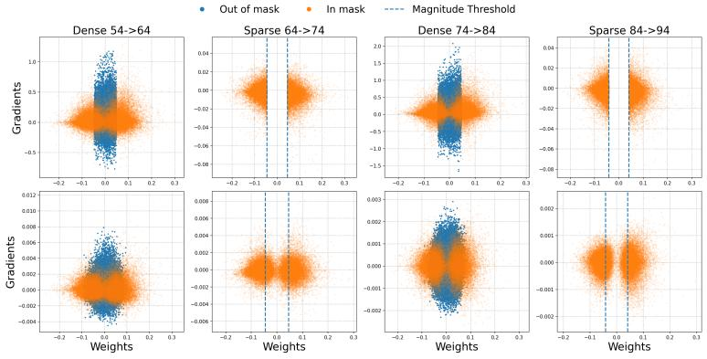

(a) layer2.0.conv2 of ResNet18  
  
(b) layer4.0.conv2 of ResNet18  
Figure 7: Gradient vs parameter scatter plots of parameters of layers of a 90% sparse ResNet18 model on CIFAR100. The plots are shown for the 3rd and 4th dense and sparse phases of the 10-Dense, 10-Sparse schedule of ACDC with Stale Init. (top) plots are at the beginning of a phase and (bottom) plots are at the end of a phase.

required to identify the rewiring support, but yields lower accuracy than selecting parameters with the largest gradient magnitudes. This comparison supports using gradient information to guide support selection during rewiring.

## E.3 Language-model evaluation results

Table 7 reports the complete zero-shot evaluation. We use normalized accuracy (acc\_norm) for OpenBookQA, ARC-Challenge, ARC-Easy, PIQA, and HellaSwag, and accuracy (acc) for Wino-Grande and LAMBADA. ARC–Zero achieves the highest average among the sparse methods and improves over AC/DC on six of the seven tasks.

For context, the dense nanoGPT reproduction [33] reports an OpenWebText validation loss of approximately 2.85, corresponding to perplexity 17.3. Our evaluation of the released OpenAI GPT-2 checkpoint [62] gives validation loss 3.11387 and perplexity 22.5081. These are external dense reference points rather than matched training baselines; the OpenAI checkpoint was trained on WebText, not OpenWebText.

## E.4 2:4 semi-structured sparsity

We evaluate a 2:4 semi-structured extension on ResNet50/ImageNet using the same base training recipe, phase schedule, and eligible layers as the unstructured ResNet50 experiments in Appendix D.2. The first convolution and final classification head remain dense.

During sparse phases, eligible convolutional weights follow a 2:4 pattern. For each output channel and kernel position (r, s), groups consist of four consecutive input channels. Magnitude pruning retains two weights in each group. This grouping follows NVIDIA’s documented convolutional structured-sparsity convention [52].

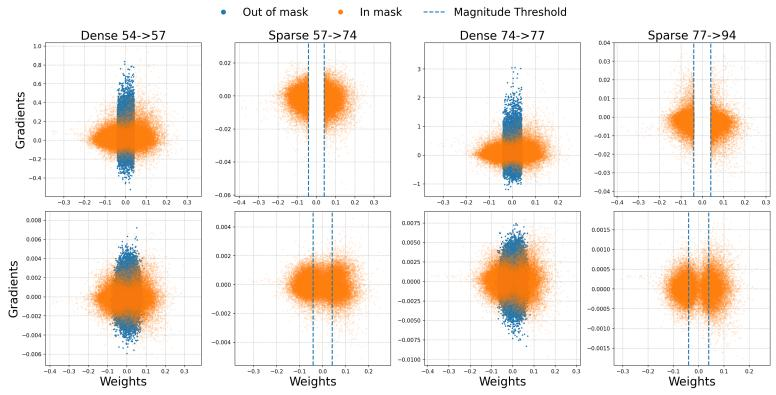

(a) layer2.0.conv2 of ResNet18  
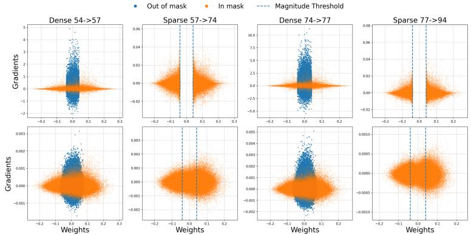  
(b) layer4.0.conv2 of ResNet18

Figure 8: Gradient vs parameter scatter plots of parameters of layers of a 90% sparse ResNet18 model on CIFAR100. The plots are shown for the 3rd and 4th dense and sparse phases of the 3-Dense, 17-Sparse schedule of ACDC with Stale Init. (top) plots are at the beginning of a phase and (bottom) plots are at the end of a phase.  
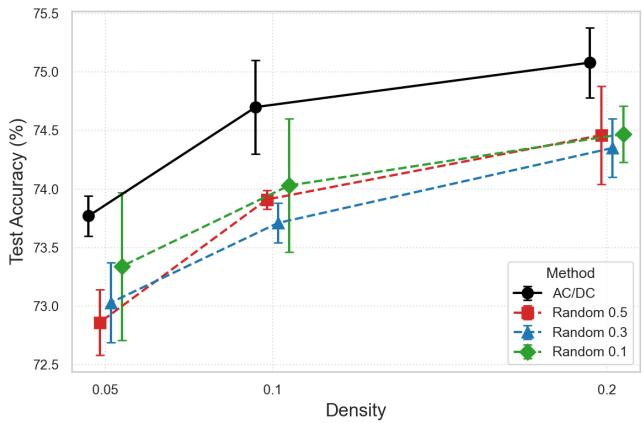  
Figure 9: Replacing dense phases in AC/DC with updating only a random subset of parameters for CIFAR100 trained on ResNet18.

At the beginning of each ARC rewiring phase, we use five probe mini-batches to score output channels by their off-mask gradient energy, separately within each layer. The highest-scoring half of the output channels are temporarily made dense, while the remaining channels retain their existing

Table 7: Zero-shot evaluation of GPT-2 124M. Scores are percentages from one training seed (1337). Bold indicates the best score among the four sparse methods. The final column evaluates the released dense OpenAI GPT-2 checkpoint as an external reference.
<table><tr><td rowspan="2">Task</td><td rowspan="2">AC/DC</td><td rowspan="2">ARC-Stale</td><td rowspan="2">ARC-Zero</td><td rowspan="2"></td><td rowspan="2">Dense GPT-2 reference</td></tr><tr><td>RigL</td></tr><tr><td>OpenBookQA [48]</td><td>26.80</td><td>27.00</td><td>26.20</td><td>25.40</td><td>26.40</td></tr><tr><td>ARC-Challenge [9]</td><td>23.21</td><td>23.38</td><td>23.55</td><td>22.10</td><td>22.10</td></tr><tr><td>ARC-Easy [9]</td><td>38.05</td><td>37.63</td><td>39.23</td><td>37.24</td><td>40.24</td></tr><tr><td>WinoGrande [64]</td><td>50.28</td><td>48.86</td><td>52.64</td><td>50.05</td><td>51.85</td></tr><tr><td>PIQA [4]</td><td>59.09</td><td>59.90</td><td>61.59</td><td>60.34</td><td>62.40</td></tr><tr><td>HellaSwag [76]</td><td>29.24</td><td>29.67</td><td>29.76</td><td>28.75</td><td>31.50</td></tr><tr><td>LAMBADA [54]</td><td>27.23</td><td>28.00</td><td>28.06</td><td>25.83</td><td>30.74</td></tr><tr><td>Average</td><td>36.27</td><td>36.35</td><td>37.29</td><td>35.67</td><td>37.89</td></tr></table>

Table 8: 2:4 semi-structured ResNet50 on ImageNet. Top-1 accuracy (%) is reported as the mean and 95% normal-approximation confidence interval over three seeds. ARC uses 75% density in eligible layers during rewiring; AC/DC uses fully dense decompression.
<table><tr><td>Method</td><td>Top-1 accuracy (%)</td></tr><tr><td>AC/DC-Stale ARC-Stale</td><td> $7 6 . 2 9 \pm 0 . 0 6$   $7 5 . 9 6 \pm 0 . 1 4$ </td></tr><tr><td>AC/DC-Zero</td><td> $7 6 . 4 1 \pm 0 . 0 7$ </td></tr><tr><td>ARC-Zero</td><td> $7 6 . 0 6 \pm 0 . 0 7$ </td></tr></table>

2:4 support. This gives 75% parameter density in eligible layers during rewiring, rather than fully dense decompression. The selected channel partition remains fixed throughout the phase. Before the following sparse phase, the temporarily dense channels are pruned back to 2:4 using weight magnitude.

Table 8 reports results over three seeds with 95% normal-approximation confidence intervals. ARC– Stale and ARC–Zero are within 0.33 and 0.35 percentage points of their corresponding AC/DC variants. Thus, targeted support expansion also retains accuracy close to AC/DC under a semistructured sparsity constraint. These experiments evaluate accuracy; they do not establish measured wall-clock acceleration.

## F Additional Activation Eigenspace Diagnostics

This appendix provides the construction and additional results for the activation-subspace diagnostic in Section 3.3.

Activation Gram matrix. For a fixed convolutional layer, let $Z _ { t } ( x ) \ \in \ \mathbb { R } ^ { C \times H \times W }$ denote its activations for image x at checkpoint t, where C is the number of output channels and H, W are the spatial feature-map dimensions. Flattening the spatial dimensions gives $F _ { t } ( x ) \in \mathbb { R } ^ { C \times H W }$ . We aggregate the per-image Gram matrices over the CIFAR100 training set D before computing the eigenvectors:

$$
K _ { t } = \frac { 1 } { | \mathcal { D } | } \sum _ { x \in \mathcal { D } } F _ { t } ( x ) F _ { t } ( x ) ^ { \top } \in \mathbb { R } ^ { C \times C } .\tag{2}
$$

Summing instead of averaging multiplies $K _ { t }$ by a positive scalar and therefore leaves its eigenspaces unchanged. Each entry measures the average inner product between two channels’ spatial activation maps. The leading eigenvectors identify channel combinations with the greatest activation energy.

Subspace comparison. Let $U _ { t } ^ { ( r ) } \in \mathbb { R } ^ { C \times r }$ contain orthonormal eigenvectors corresponding to the r largest eigenvalues of $K _ { t }$ . We define

$$
S _ { r } ( t _ { 1 } , t _ { 2 } ) = \frac { 1 } { r } \left\| \boldsymbol { U } _ { t _ { 1 } } ^ { ( r ) } ^ { \top } \boldsymbol { U } _ { t _ { 2 } } ^ { ( r ) } \right\| _ { F } ^ { 2 } .
$$

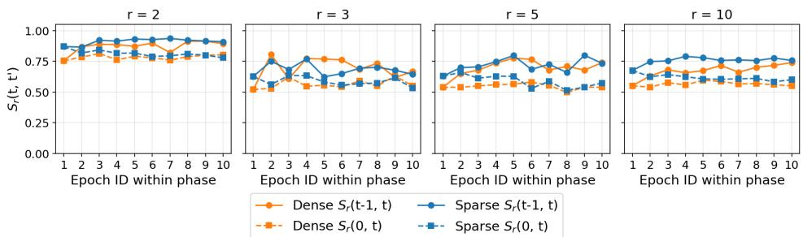

(a) First cycle (Sparse:24-34, Dense:34-44)  
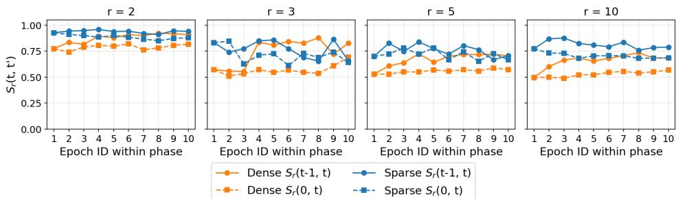

(b) Second cycle ((Sparse:44-54, Dense:54-64))  
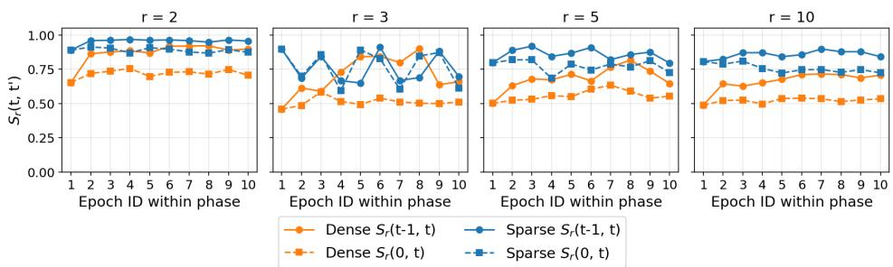

(c) Third cycle ((Sparse:64-74, Dense:74-84))  
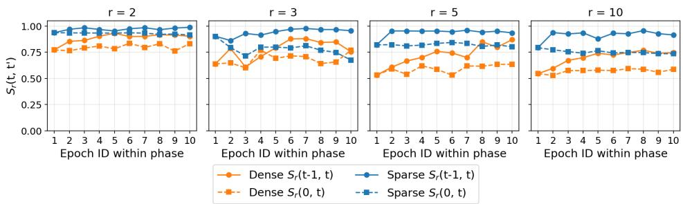  
(d) Fourth cycle ((Sparse:84-94, Dense:94-104))

Figure 10: Activation subspace similarity across the first four AC/DC cycles. For layer3.1.conv2 of a 90% sparse ResNet18 trained on CIFAR100, we compare the subspaces spanned by the top r ∈ {2, 3, 5, 10} activation Gram eigenvectors. We report consecutive-checkpoint similarity Sr(t − 1, t) and similarity to the first checkpoint of each phase Sr(0, t). Sparse phases consistently preserve leading activation subspaces more strongly than dense phases, especially for r = 5 and $r = 1 0$ Dense phases induce larger but smooth drift, consistent with their role as rewiring windows.

This is the average squared cosine of the principal angles between the two subspaces. It lies in [0, 1], equals one for coincident subspaces, and equals zero for orthogonal subspaces. Comparing subspaces avoids dependence on individual eigenvector signs or the choice of orthonormal basis within a retained subspace. We report consecutive-checkpoint similarity $S _ { r } ( t - 1 , t )$ and similarity to the first checkpoint of each phase, $S _ { r } ( 0 , t )$ . The time index is reset at the beginning of each phase.

We additionally show individual-eigendirection similarity heatmaps to examine changes within the leading spectrum.

Figure 10 reports this metric for the first four AC/DC cycles of layer3.1.conv2. Across cycles, sparse phases preserve leading activation subspaces more strongly than dense phases. This difference is most visible for r = 5 and r = 10. Later cycles show especially high sparse-phase similarity, consistent with increasing representation stability over training. Dense phases show larger drift from the phase start, but consecutive-epoch similarities remain substantial, indicating gradual representation movement rather than abrupt resets.

Figures 11, 12 provide the eigendirection cosine-similarity heatmaps for dense and sparse phases of the first and fourth cycles. These heatmaps show structured alignment among leading eigendirections, with greater mixing among lower-ranked directions. They provide a more detailed view of the subspace trends summarized in the main text.

## G Final-Mask Sign Flips Occur During Rewiring Windows

Prior work on lottery-ticket-style sparse training shows that surviving weights are characterized not only by their mask but also by their signs [16, 18]. Sign-In to the Lottery further studies sign correction as a mechanism for improving sparse training [19]. We use the timing of the last sign flip to identify when parameters undergo persistent directional corrections.

Counting protocol. A sign flip is a reversal between two nonzero parameter values. During dense phases, each parameter is compared against its last active nonzero value, carrying this reference across masked or zero-valued intervals. During sparse phases, active parameters are compared between consecutive checkpoints; pruned parameters cannot flip. Pruning and zero initialization are not themselves counted as sign reversals.

Each parameter is assigned to the phase containing its last sign flip. Parameters that never flip are assigned to the warmup bin, which therefore represents parameters whose signs have settled by the end of warmup. We apply this analysis separately to parameters retained in the final sparse mask and to parameters active at every intermediate checkpoint, for both Zero init and Stale init. For the final-mask plots, phase counts are normalized by the final mask size.

Additional AC/DC diagnostics. The main aggregate comparison is shown in Figure 2a. Most final-mask parameters settle their signs by the end of warmup, while later sign corrections occur mainly during dense phases. Stale initialization concentrates these corrections in early dense phases; zero initialization continues to produce corrections later in training.

Figure 13 compares the final-mask and always-active parameter sets under shortened dense phases. Figure 14 shows the corresponding layerwise analysis. The ability of Zero init to produce meaningful sign flips later in training persists across layers and shortened-phase configurations. Together with its stronger performance in Figure 4, these findings indicate that Zero init provides better directional correction.

Sign correction under ARC. Figure 2b applies the same final-mask sign-flip diagnostic to ARC. Late sign corrections occur primarily during ARC rewiring phases rather than sparse phases. Thus, replacing dense phases with sparse updates on $A _ { t } = S _ { t } \cup { \bar { G } } _ { t }$ preserves the phase-wise correction pattern observed in AC/DC, but compresses it onto a smaller active support.

The comparison between Stale init and Zero init also changes under ARC. In AC/DC, Stale init concentrates most late sign corrections in early dense phases. Under ARC, Stale init can maintain nontrivial sign correction across later rewiring phases. This suggests that restricting updates to high gradient reintroduced coordinates changes the reactivation dynamics while preserving the correction role of expanded phases.

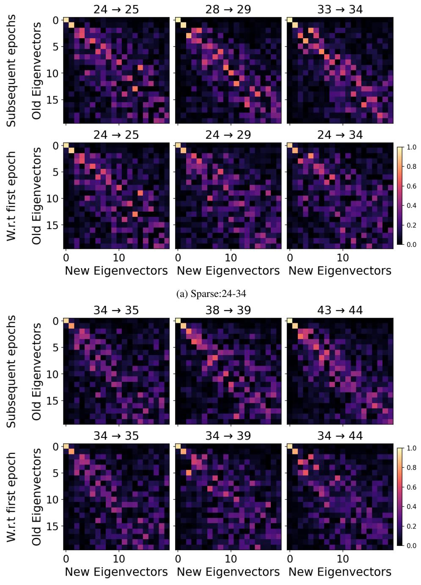  
(b) Dense:34-44  
Figure 11: Activation eigendirection similarities in the first AC/DC cycle. We compare activation-Gram eigenvectors for layer3.1.conv2 of a 90% sparse ResNet18 on CIFAR100 during the sparse phase (epochs 24–34) and dense phase (epochs 34–44). Within each panel, the top row compares consecutive checkpoints and the bottom row compares checkpoints with the phase start. Rows and columns index eigenvectors at the earlier and later checkpoints, respectively.

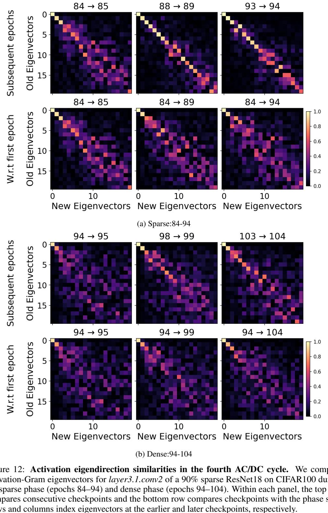

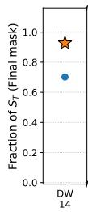

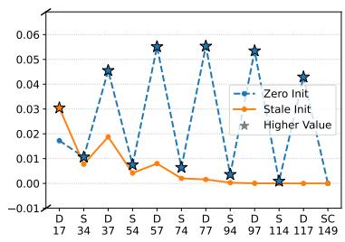  
(a)

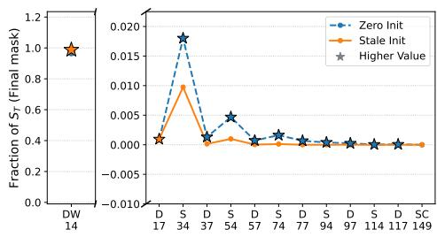  
(b)  
Figure 13: The plot shows the fraction of weights of ResNet18 that flip their sign for the last time during a specific phase of AC/DC (3-dense, 17-sparse). Panels compare sign convergence for parameters in (a) the final converged mask and (b) the stable core weights found in the intersection of all masks.

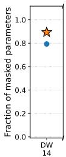

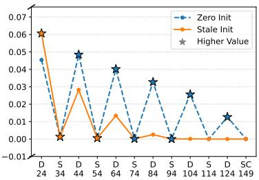  
(a) layer2.0.conv2 of ResNet18

DW 14  
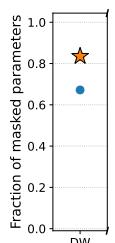

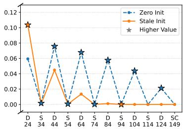  
(b) layer4.0.conv2 of ResNet18  
Figure 14: The plot shows the fraction of weights of specific layers of ResNet18 that flip their sign for the last time during a specific phase of AC/DC (10-dense, 10-sparse). Panels compare sign convergence for parameters of layers layer2.0.conv2(a) and layer4.0.conv2 in the final converged mask.