# ADAPTIVE MULTI-TOKEN PREDICTION: HOW FAR SHOULD WE GO?

Emile Anand, Mohammed Rehan Parwani, Xinyuan Cao

Georgia Institute of Technology

{eanand,mparwani3,xcao78}@gatech.edu

## ABSTRACT

Multi-token prediction (MTP) can accelerate language-model decoding by drafting several tokens and verifying them in a single target-model pass. However, the best speculation horizon changes with context: longer drafts offer greater amortization when reliable, but can waste compute on suffixes discarded after a rejection. Unlike autoregressive drafting, where a stopping rule can decide token by token, MTP must fix the horizon before drafting, as all heads fire in the same forward pass. We therefore formulate horizon selection as an online control problem, using verification feedback to learn how far the draft can be trusted in each context, and introduce Adaptive Multi-Token Prediction (AMTP): a lightweight controller that requires no retraining and leaves the exact verifier unchanged. To guide horizon selection, we characterize the expected number of tokens committed at each horizon via acceptance survival, the probability that a draft prefix is fully accepted. Before each round, AMTP predicts how far the draft is likely to survive and picks the horizon with the highest expected tokens per second, learning freely from every verification pass. Theoretically, we show that any online learner’s prediction error translates into throughput regret against the best horizon for each context, and in turn into a bound on wall-clock completion time. With online gradient descent, this regret is sublinear. Across five draft–target pairings built on Llama-3.1-8B-Instruct with Medusa heads, Meta’s MTP models, and Qwen3- 4B-Inst-2507-MTP, evaluated on AIME 2025 and GSM8K, AMTP decodes up to 4.1× faster than standard decoding and matches or outperforms the fixed window in 8 of 10 settings, with throughput gains of up to 10%.

## 1 INTRODUCTION

Autoregressive decoding generates each new token through an evaluation of a target language model. Speculative decoding reduces this sequential bottleneck by using a cheaper draft mechanism to propose several tokens and evaluating them in parallel with the target model (Stern et al., 2018; Leviathan et al., 2023; Chen et al., 2023). With an appropriate acceptance-and-correction rule, this procedure preserves the target distribution while committing multiple tokens in a single round (Leviathan et al., 2023; Chen et al., 2023; Xia et al., 2024). Multi-token prediction (MTP) provides a natural proposal mechanism by predicting several future tokens from a shared representation (Gloeckle et al., 2024; Cai et al., 2024; Ankner et al., 2024), and have witnessed enormous success in practice: for instance, MTP modules are now shipped in frontier models (DeepSeek-AI, 2024), and pretrained next-token models can be converted into MTP drafters without architectural changes (Samragh et al., 2025; Kirchenbauer et al., 2026; Zhao et al., 2026). These methods create an inference-time decision that is distinct from learning a good draft model: how many tokens should be proposed before the next verification step? We refer to this quantity as the speculation horizon.

The speculation horizon directly affects decoding efficiency. A longer horizon amortizes verification over more committed tokens when the draft is reliable, but after an early rejection the discarded suffix adds latency and no output. Horizon selection therefore balances the expected gain from additional accepted tokens against the risk of speculating too far. We evaluate each horizon by its conditional throughput: the ratio of its expected number of committed tokens to its expected round latency. Even for a fixed draft-target pair, the throughput-maximizing horizon varies with context, because acceptance probabilities at each draft position depend on context. For MTP, this choice has a structure that isn’t exploited in current methods (Anand et al., 2026): an autoregressive drafter can decide token by token whether to keep drafting, but MTP heads produce all draft tokens in a single forward pass, so the horizon must be fixed before drafting, from information available at that point.

Existing adaptive methods do not make this decision without additional training. Most stop an autoregressive drafter token by token, using a trained classifier or acceptance head (Mamou et al., 2024; Huang et al., 2024), entropy-based bounds (Agrawal et al., 2024; Zhang et al., 2025), or parallel drafting and verification (Liu et al., 2025). Others shape draft trees from confidence after drafting (Li et al., 2024b; 2025; Chen, 2026), prune verification prefixes with predicted survival probabilities (Cheng et al., 2026), or train reinforcement-learning policies for draft depth (Zhang et al., 2026). Concurrent work trains a router that selects the span length before decoding, but requires new prediction heads and verifies against greedy decoding only (Chintha et al., 2026). In fact, to our knowledge, AMTP is the first training-free method that selects the MTP horizon before drafting at every round. A complementary line of work uses verification feedback online to adapt the draft model (Liu et al., 2024; Qian et al., 2026) or to select among drafters and hyperparameter configurations with regret guarantees against the best fixed choice (Liu et al., 2026; Hou et al., 2025). However, in this work, we compare against the stronger benchmark of the best horizon at each visited context. We study how learning acceptance behavior from verification feedback affects horizon-selection performance, and, for a given target model and draft mechanism, we develop an online controller and bound its conditional throughput regret relative to the best horizon at each visited context in terms of cumulative prediction error. Section 2 discusses related work in detail.

To relate prediction error to horizon-selection, we first identify the acceptance statistics that influence the expected number of committed tokens for each horizon. A draft token can be committed as an accepted proposal only if all prior proposals are also accepted. We characterize the joint acceptance event via acceptance survival, the probability that a draft prefix is fully accepted, which further determines the expected number of committed tokens exactly. We express them in terms of conditional rejection hazards, where the hazard at a position is its rejection probability given acceptance of all prior proposals. Our analyses holds for general causal proposals, including independent and correlated prediction heads (Cai et al., 2024; Ankner et al., 2024). Estimating the hazards requires distinguishing between proposed and surviving prefixes: verification provides draft-target discrepancies along sampled proposal prefixes, whereas the hazards average these discrepancies under the distribution of prefixes that survive verification. So, we derive a survival-weighted regression objective that targets these conditional hazards, and its excess population loss is the survival-weighted hazard-prediction error that enters our throughput-regret bound, mirroring decision-focused learn ing, where prediction losses are judged by the induced decisions (Elmachtoub and Grigas, 2022).

We use this objective to develop Adaptive Multi-Token Prediction (AMTP), a training-free horizon controller equipped with an online adaptive learning algorithm. Before drafting, AMTP combines hazard-based forecasts of committed tokens with estimates of round latency to evaluate the throughput of each horizon. Short horizons, however, conceal verification feedback at later positions. To learn under this partial feedback, AMTP combines greedy throughput-based selection with randomized full-horizon exploration (Langford and Zhang, 2007) and uses inverse-probability weighting to obtain unbiased estimates of the survival-weighted regression loss.

Our contributions are as follows:

• Acceptance survival. We characterize horizon selection through accepted-prefix survival and round cost for general causal proposals, showing how survival determines the expected number of committed tokens for each horizon (§3).

• AMTP. We introduce a training-free online controller that chooses the MTP horizon before each round, by maximizing predicted tokens per second, learning from partial feedback of short horizons via randomized exploration and inverse-probability weighting (§4).

• Prediction error to wall-clock time. We show that the prediction error of any online learner translates into throughput regret against the best horizon for each context, and in turn into a bound on expected completion time. With online gradient descent (Zinkevich, 2003) under partial feedback, the regret is $O ( T ^ { 4 / 5 } ( 1 + P _ { T } ) ^ { 1 / 5 } )$ , which is sublinear (§5).

• Experiments. Across five draft–target pairings and two reasoning benchmarks, AMTP decodes up to 4.1× faster than standard decoding and matches or outperforms the fixed window in 8 of 10 settings, with throughput gains of up to 10% (§6).

## 2 RELATED WORK

Speculative decoding and multi-token proposals. Speculative decoding drafts tokens with a cheap proposal and verifies them in parallel with the target model, using an acceptance-and-correction rule that leaves the target distribution unchanged (Leviathan et al., 2023; Chen et al., 2023). Most work uses a separate next-token draft model, or, as in EAGLE, a lightweight head that drafts autoregressively at the feature level (Li et al., 2024a). Multi-token prediction (MTP) instead trains several future-token heads on a shared representation (Gloeckle et al., 2024); Medusa adds such heads to an existing model and verifies candidate continuations with tree attention (Cai et al., 2024), and recent work obtains MTP models from pretrained next-token models by self-distillation (Kirchenbauer et al., 2026). Joint multi-token prediction studies how to learn representations that support predicting several tokens at once (Ahn et al., 2025). We keep the exact verifier and study a different question: given a fixed proposal, how many tokens should we draft in each round?

Adaptive draft length for autoregressive drafters. A substantial line of work adapts the draft length of a next-token drafter. DISCO trains a classifier that decides after each drafted token whether to continue (Mamou et al., 2024); SpecDec++ adds an acceptance-prediction head to the draft model and stops once the predicted probability of a rejection crosses a threshold (Huang et al., 2024); AdaEDL stops when an entropy-based lower bound on the acceptance probability falls below a threshold (Agrawal et al., 2024); and SVIP derives a similar entropy-based stopping policy for longform generation (Zhang et al., 2025). EAGLE-2 instead grows a draft tree whose shape follows context-dependent confidence (Li et al., 2024b), and Learning to Draft trains reinforcement-learning policies for draft depth and verification size with throughput rewards (Zhang et al., 2026). These methods share a structural assumption: drafting is sequential, so the decision to stop can be made token by token, after each drafted token is observed and before the next one is paid for. However, MTP removes this option. All heads fire in the same forward pass, so the cost of drafting is incurred up front and the horizon must be fixed before any draft token is sampled. Truncating a complete MTP draft afterwards saves verification cost but not drafting cost, and choosing the cut point after inspecting sampled tokens can break exactness (Appendix 3.1). AMTP is designed for this setting: it chooses the horizon from pre-draft information only, and our statistical and online-optimization analysis of horizon selection and acceptance survival applies to any causal proposal, including both independent and correlated heads.

Online learning for speculative decoding. Verification feedback has also been used to adapt speculative decoding online. OnlineSpec updates an evolving draft model and relates its dynamic regret to accepted length at a fixed candidate length (Qian et al., 2026). Not-a-Bandit gives no-regret guarantees for selecting among draft models (Liu et al., 2026). BanditSpec treats speculative-decoding hyperparameters, including the speculation length, as bandit arms and bounds regret against the best fixed configuration (Hou et al., 2025). Our guarantee uses a stronger comparator, the best horizonfor each context along the realized decoding trajectory, and is learner-agnostic: any online regression method’s prediction error transfers to throughput regret, with online gradient descent (Zinkevich, 2003) as one instantiation. The broader strategy of translating prediction or optimization error into decision quality is related to perturbation-based model predictive control (Lin et al., 2022) and online adaptive policy selection (Lin et al., 2023; 2024), which rely on assumptions about the controlled dynamics, such as contractive perturbations, that we do not impose on the language-model prefixes.

## 3 SPECULATION AS A SURVIVAL PROBLEM

We first describe one round of speculation, and then show that a single sequence of rejection hazards determines the expected gain of every horizon.

## 3.1 ONE ROUND OF SPECULATION: DRAFT, VERIFY, COMMIT

At round $t ,$ let $H _ { t } ~ = ~ x _ { 1 : n _ { t } }$ be the committed prefix and let $\mathcal { F } _ { t }$ contain all information available before the next horizon is chosen, including $H _ { t }$ , system state, and the controller parameters. For $1 \leq k \leq K$ , we define the target and proposal block laws

$$
P _ { t } ^ { ( k ) } ( y _ { 1 : k } ) = \prod _ { j = 1 } ^ { k } p _ { t , j } ( y _ { j } | y _ { < j } ) , \qquad Q _ { t } ^ { ( k ) } ( y _ { 1 : k } ) = \prod _ { j = 1 } ^ { k } q _ { t , j } ( y _ { j } | y _ { < j } ) ,\tag{1}
$$

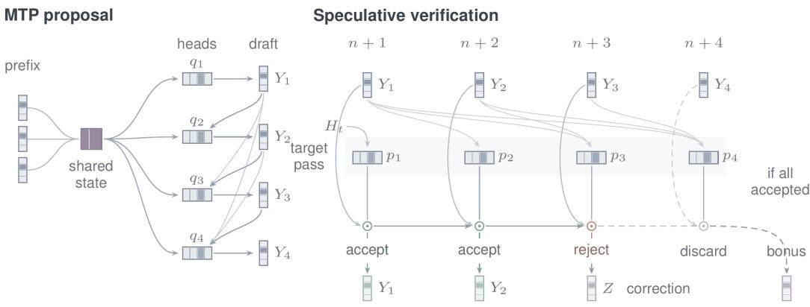  
Figure 1: MTP with exact verification. Proposal heads condition on earlier sampled tokens. One target pass scores $p _ { j } ( \cdot | H _ { t } , Y _ { < j } )$ , and circles denote prefix-ordered acceptance. Rejection emits a residual correction ${ \dot { Z } } .$ The dashed bonus branch requires full acceptance.

where conditioning on $H _ { t }$ and the fixed proposal parameters ϕ is suppressed. We let $P _ { t } : = P _ { t } ^ { ( K ) }$ and $Q _ { t } : = Q _ { t } ^ { ( K ) }$ . In this lens, independent MTP heads form the special case $q _ { t , j } ( \cdot | y _ { < j } ) = q _ { t , j } ( \cdot | H _ { t } )$ where recurrent or otherwise correlated heads (Ankner et al., 2024) keep the dependence on $y _ { < j }$ and our analytic framework covers both of these cases.

The horizon (or action) $k _ { t } \in \{ 1 , \ldots , K \}$ is chosen before the current draft is sampled. Moreover, every horizon truncates the same causal law $Q _ { t }$ , so changing k does not change the distribution of earlier draft tokens: it only decides how many of them are drafted and sent to the verifier. A round proceeds as in Figure 1: the drafter samples $Y _ { 1 : k } \sim Q _ { t } ^ { ( k ) }$ , and a single target pass scores all k positions. Exact speculative verification (Leviathan et al., 2023; Chen et al., 2023) then checks the draft from left to right, accepting $Y _ { j }$ with probability

$$
\alpha _ { t , j } : = \operatorname* { m i n } \left\{ 1 , \frac { p _ { t , j } ( Y _ { j } | Y _ { < j } ) } { q _ { t , j } ( Y _ { j } | Y _ { < j } ) } \right\} ,\tag{2}
$$

where $q _ { t , j } ( Y _ { j } | Y _ { < j } ) > 0$ on a sampled proposal. At the first rejection, the verifier draws a correction token from the normalized positive part of $p _ { t , j } - q _ { t , j }$ . If all k proposals are accepted, it draws a bonus token from the target conditional at the end of the draft. So, a round with horizon k commits $L _ { t } ( k ) = 1 + A _ { t } ( k )$ tokens, where $A _ { t } ( k )$ is the length of the accepted draft prefix, and the committed tokens follow the target law exactly (Leviathan et al., 2023; Chen et al., 2023). We analyze a fixed output-token budget where truncating the final output preserves its target law.

Exactness requires choosing the horizon before drafting. Exactness continues to hold when $k _ { t }$ is chosen adaptively, provided it depends only on $\mathcal { F } _ { t }$ and on randomness independent of the current draft. Earlier acceptance decisions depend only on earlier proposals and independent coins, so the verifier reaches position j with the proposal still distributed as $\overset { \cdot } { q } _ { t , j } ( \cdot | Y _ { < j } )$ , and the standard one-step argument applies at every position and every round, however poorly the horizon is chosen. However, choosing the horizon after seeing the draft can break this, even for a perfect drafter. To see this, let $p = q$ be independent fair bits, draw $Y _ { 1 } , Y _ { 2 }$ , and keep $k = 2 \operatorname { i f } Y _ { 2 } = \operatorname { i }$ and $k = 1$ otherwise. Every drafted token is accepted, so the second emitted token is $Y _ { 2 } = 1$ on the long branch and a new fair bonus token on the short one. It equals 1 with probability $3 / 4$ rather than $1 / { \overset { - } { 2 } } .$ . AMTP therefore fixes $k _ { t }$ before sampling the draft. Sampling transformations such as temperature or top-p truncation must be built into the p and $q$ the verifier uses.

Moreover, how likely a draft token is to pass depends on how far the proposal is from the target at that position. For a proposed prefix $u = y _ { < j }$ , we can measure this by the local discrepancy

$$
\begin{array} { r } { e _ { t , j } ( u ) : = \mathrm { T V } \big ( p _ { t , j } ( \cdot | u ) , q _ { t , j } ( \cdot | u ) \big ) = \frac 1 2 \| p _ { t , j } ( \cdot | u ) - q _ { t , j } ( \cdot | u ) \| _ { 1 } , } \end{array}\tag{3}
$$

which is exactly the probability that position $j$ is rejected given that the verifier reaches it along prefix u: equivalently, $\mathbb { E } [ \alpha _ { t , j } | \dot { Y _ { < j } } = \dot { u } , \mathcal { F } _ { t } ] = \dot { 1 } - e _ { t , j } ( u )$

Importantly, accurate token marginals do not guarantee an accurate multi-token proposal. For instance (as in Appendix $\mathbf { A } )$ , independent MTP heads can fit every position perfectly while missing dependencies among future tokens. The block KL divergence splits into a marginal fitting error and a dependence term that remains even for exact marginals. In a simple repeated-bit example, the block mismatch approaches its maximum while the expected number of committed tokens per round stays below three for every horizon, so longer windows add a verification cost with little additional token gain. The horizon should therefore be chosen from how long draft prefixes actually survive verification, and from what each round costs, rather than from marginal prediction accuracy alone.

## 3.2 SURVIVAL AND THE REJECTION HAZARD

We now make the the notion of “how long draft prefixes survive” precise, and formally define the acceptance survival and rejection hazard. For a virtual full draft $\mathrm { ~ \bar { ~ } { ~ Y ~ } ~ } \sim \mathrm { ~ Q _ { \it t } ~ } .$ , we define the prefix acceptance weight via $W _ { t , 0 } = 1$ and $\begin{array} { r } { W _ { t , j } = \prod _ { r = 1 } ^ { j } \alpha _ { t , r } } \end{array}$ , which is the probability that the verifier accepts all of $Y _ { 1 : j }$ given the sampled tokens.

Definition 1 (Acceptance survival). The acceptance survival is the probability ofaccepting at least j draft tokens, conditional on $\mathcal { F } _ { t }$ , and is given by $s _ { t , j } = \mathbb { E } _ { Q _ { t } } [ W _ { t , j } ]$ with $s _ { t , 0 } = 1$

Definition 2 (Rejection hazard). The rejection hazard at position j is the probability of rejection there, given that the preceding $j - 1$ proposals were accepted, and is given (conditional on $\mathcal { F } _ { t } )$ by

$$
h _ { t , j } = \frac { \mathbb { E } _ { Q _ { t } } [ W _ { t , j - 1 } e _ { t , j } ( Y _ { < j } ) ] } { s _ { t , j - 1 } } .\tag{4}
$$

When $s _ { t , j - 1 } = 0 \mathrm { . }$ , we set $h _ { t , j } = 0 ,$ , as later survival probabilities are zero regardless of this convention. Since $\mathbb { E } [ \alpha _ { t , j } | Y _ { < j } , \mathcal { F } _ { t } ] \stackrel { \sim } { = } 1 - e _ { t , j } ( Y _ { < j } )$ , the survival and expected gain follow from the hazard:

$$
s _ { t , j } = \prod _ { r = 1 } ^ { j } ( 1 - h _ { t , r } ) , \qquad G _ { t } ( k ) : = { \mathbb { E } } [ L _ { t } ( k ) | { \mathcal { F } } _ { t } ] = 1 + \sum _ { j = 1 } ^ { k } s _ { t , j } ,\tag{5}
$$

where quantities indexed by an action refer to the potential outcome of choosing that horizon, even if the policy assigns it zero probability. To justify why hazards are the right prediction target, we point to Equation 5: a single vector $\left( h _ { t , 1 } \ldots , h _ { t , K } \right)$ determines the expected gain of all K horizons at once, so a controller that predicts it can score every horizon before drafting. Indeed, the identities need no independence between draft positions, so they hold for correlated heads as well as independent ones.

Why the hazard is survival-weighted. The numerator of Equation 4 weights each prefix by its likelihood of surviving to position $j .$ Replacing $h _ { t , j }$ with the unweighted mean discrepancy $\mathbb { E } _ { Q _ { t } } [ e _ { t , j } ( Y _ { < j } ) ]$ is generally incorrect since prefixes that survive verification are distributed differently from arbitrary draft prefixes. For instance, consider a binary vocabulary $\{ a , b \}$ . The first head proposes a or b with probability $1 / 2$ each, while the target places mass $3 / 4$ on a, so $\alpha _ { t , 1 } = 1$ on a, $\alpha _ { t , 2 } = 1 / 2$ on b, and $\mathbf { \bar { \rho } } _ { s _ { t , 1 } } = 3 / 4$ . Then, suppose the second head matches the target exactly after a but has disjoint support from it after b, so $e _ { t , 2 } ( a ) = 0$ and $e _ { t , 2 } ( b ) = 1$ . The unweighted mean discrepancy at position 2 is $1 / 2 .$ , but $\begin{array} { r } { h _ { t , 2 } = \frac { 1 / 4 } { 3 / 4 } = 1 / 3 , } \end{array}$ , since a draft that starts with the poorly matched token b is less likely to reach position 2 at all. Here, the true gain is $\begin{array} { r } { G _ { 2 } ( 2 ) = 1 + \frac { 3 } { 4 } + \frac { 1 } { 2 } = 2 . 2 5 } \end{array}$ and plugging this in the unweighted mean gives 2.125. Section 4 shows how to build this change of prefix distribution into the learning objective.

## 4 ONLINE HORIZON CONTROL

Each round of speculative decoding poses a one-step control problem: before drafting, choose the horizon $k _ { t }$ that maximizes throughput. If the rejection hazards were known, Section 3 would solve this problem exactly, since Equation 5 gives the expected gain of every horizon. However, since they are not known, AMTP uses certainty equivalence: it plugs in predicted hazards, acts on them, and updates the predictor via online gradient descent (OGD) from the feedback that verification provides. Algorithm 1 gives the full loop and Figure 2 illustrates it.

The Control Problem. Let $C _ { t } ( k )$ be the conditional expected cost of a round with horizon k, includ ing drafting, verification, synchronization and all controller overhead, with $0 < c _ { \mathrm { m i n } } \leq C _ { t } ( k ) \leq$ $c _ { \mathrm { m a x } } < \infty$ . We compare horizons at the same learner state and under the same update protocol, where the controller’s objective is its throughput, and the optimal horizon at the current history is

$$
R _ { t } ( k ) = { \frac { G _ { t } ( k ) } { C _ { t } ( k ) } } , \qquad k _ { t } ^ { \star } \in \arg \operatorname* { m a x } _ { 1 \leq k \leq K } R _ { t } ( k ) .\tag{6}
$$

Algorithm 1 Adaptive Multi-Token Prediction   
Require: Maximum horizon $K ;$ parameter set Θ and $\theta _ { 1 } \in \Theta ;$ exploration rate $\varepsilon \in ( 0 , 1 ] ;$ ; step sizes   
$\begin{array} { r } { \eta _ { t } ; } \end{array}$ initial cost model $\widehat { C } _ { 1 }$   
1: for each speculative round $t = 1 , 2 , \dots { }$ . do   
2: Observe pre-draft features $z _ { t } ;$ predict hazards $\hat { h } _ { \theta _ { t } , t , j }$ and costs $\widehat { C } _ { t } ( j )$ for $j = 1 , \ldots , K$   
3: Set $\kappa _ { t } \gets$ arg maxk $\widehat { G } _ { t } ( k ) / \widehat { C } _ { t } ( k )$ using equation 7 ▷ plug-in control, $O ( K )$   
4: With probability ε set $k _ { t } \gets K ;$ otherwise $k _ { t } \gets \kappa _ { t }$ ▷ exploration   
5: Draft $\mathbf { \bar { \mathbf { Y } } } _ { 1 : k _ { t } } \sim \mathbf { \bar { Q } } _ { t } ^ { ( k _ { t } ) }$ and verify all $k _ { t }$ positions in one target pass   
6: Commit the accepted prefix and one correction or bonus token   
7: For $j \leq k _ { t } \colon$ record $\begin{array} { r } { e _ { t , j } ^ { \mathrm { o b s } } = e _ { t , j } ( Y _ { < j } ) , W _ { t , j - 1 } = \prod _ { r < j } \alpha _ { t , r } } \end{array}$ and $\pi _ { t , j } = ( 1 - \varepsilon ) \mathbf { 1 } \{ j \leq \kappa _ { t } \} + \varepsilon$   
8: Update $\theta _ { t + 1 }  \Pi _ { \Theta } \big ( \theta _ { t } - \eta _ { t } \nabla \hat { \ell } _ { t } ( \theta _ { t } ) \big )$ with $\widehat { \ell } _ { t }$ from equation 8 ▷ OGD   
9: Record the measured round cost $c _ { t }$ and update the cost model $\widehat { C } _ { t + 1 }$   
10: end for

AMTP predicts the rejection hazards $\hat { h } _ { \theta _ { t } , t , j } \in [ 0 , 1 ]$ from pre-draft features $z _ { t }$ and position $j ,$ and estimates rounds costs $\widehat { C } _ { t } ( k ) > 0$ , where the predictions are $\mathcal { F } _ { t }$ -measurable. It converts the hazard predictions into survival probabilities and expected token gains and selects a candidate horizon:

$$
\widehat { s } _ { t , j } = \prod _ { r = 1 } ^ { j } \bigl ( 1 - \widehat { h } _ { \theta _ { t } , t , r } \bigr ) , \qquad \widehat { G } _ { t } ( k ) = 1 + \sum _ { j = 1 } ^ { k } \widehat { s } _ { t , j } , \qquad \kappa _ { t } \in \mathop { \mathrm { a r g } } _ { 1 \leq k \leq K } \frac { \widehat { G } _ { t } ( k ) } { \widehat { C } _ { t } ( k ) } ,\tag{7}
$$

with a fixed tie-breaking rule. A running product and a running sum score all K horizons in $O ( K )$ time, and the controller does not assume that throughput is unimodal in $k ,$ and so the only part of Equation 7 that must be learned is the hazard forecaster $\theta _ { t }$

## 4.1 LEARNING THE HAZARDS VIA ONLINE GRADIENT DESCENT (OGD)

OGD needs a loss whose error is reflective of the error attributed to the control problem. Following the change of prefix distribution in Section 3.2, we use the survival-weighted population loss

$$
\ell _ { t } ( \theta ) = \mathbb { E } _ { Q _ { t } } \left[ \sum _ { j = 1 } ^ { K } W _ { t , j - 1 } \big ( e _ { t , j } ( Y _ { < j } ) - \hat { h } _ { \theta , t , j } \big ) ^ { 2 } \right] ,\tag{8}
$$

conditional on $\mathcal { F } _ { t } .$ , with the proposal law and features held fixed. Let $\ell _ { t } ^ { B }$ be the same expression with the true hazards $h _ { t , j }$ in place of $\hat { h } _ { \theta , t , j }$ . Then, $\ell _ { t } ^ { B }$ represents the minimum loss over unrestricted pre-draft hazard predictions. We then show the following calibration identity:

Lemma 1 (Calibration identity). For every $\mathcal { F } _ { t }$ -measurable parameter θ,

$$
\mathcal { E } _ { t } ( \theta ) : = \ell _ { t } ( \theta ) - \ell _ { t } ^ { B } = \sum _ { j = 1 } ^ { K } s _ { t , j - 1 } \big ( \hat { h } _ { \theta , t , j } - h _ { t , j } \big ) ^ { 2 } .\tag{9}
$$

Expanding the weighted square around $h _ { t , j }$ yields the identity, and the cross term vanishes by the hazard definition in (4); so, the loss is minimized by the true hazards, and its excess is a hazard error weighted by how often each position is reached: it is weighted less on positions that are less likely to survive verification. Section 5 shows that this excess controls the throughput lost.

The ideal learner. If verification revealed $e _ { t , j } ^ { \mathrm { o b s } } = e _ { t , j } ( Y _ { < j } )$ and $W _ { t , j - 1 }$ at all K positions of a draft $Y \sim Q _ { t }$ , then the realized loss $\begin{array} { r } { \tilde { \ell } _ { t } ( \theta ) = \sum _ { i = 1 } ^ { { K } ^ { \prime \prime } } W _ { t , j - 1 } ( e _ { t , i } ^ { \mathrm { o b s } } - \hat { h } _ { \theta , t , j } ) ^ { 2 } } \end{array}$ would be unbiased for $\ell _ { t } ( \theta )$ and the controller would simply run projected OGD (Zinkevich, 2003; Hazan, 2016):

$$
\theta _ { t + 1 } = \Pi _ { \Theta } \big ( \theta _ { t } - \eta \nabla \tilde { \ell } _ { t } ( \theta _ { t } ) \big ) ,\tag{10}
$$

where $\Pi _ { \Theta } ( \cdot )$ is the projection onto the (convex) set of parameters Θ. For an affine forecaster $\hat { h } _ { \theta , t , j } = \langle \theta , \dot { x } _ { t , j } \rangle$ , the gradient is $\begin{array} { r } { - 2 \sum _ { j } W _ { t , j - 1 } ( e _ { t , j } ^ { \mathrm { o b s } } - \dot { \langle \theta , x _ { t , j } \rangle } ) x _ { t , j } } \end{array}$ . This learner always acts greedily, and Section 5 shows that its throughput regret is sublinear in the number of rounds. However, this is an idealization as the discrepancy $e _ { t , j }$ compares the draft with the target distribution $p _ { t , j }$ , and the target computes $p _ { t , j }$ only at positions it verifies. So, a round that drafts $k _ { t } < K$ tokens gives no feedback at positions $\mathbf { \bar { \boldsymbol { k } } } _ { t } + 1 , \dots , K$ , and observing every position at each round would mean drafting and verifying the full window each time, which defeats the purpose of choosing the horizon. AMTP avoids this: it drafts the full window only in a small random fraction of rounds and re-weights the feedback so that the loss stays unbiased (Section 4).

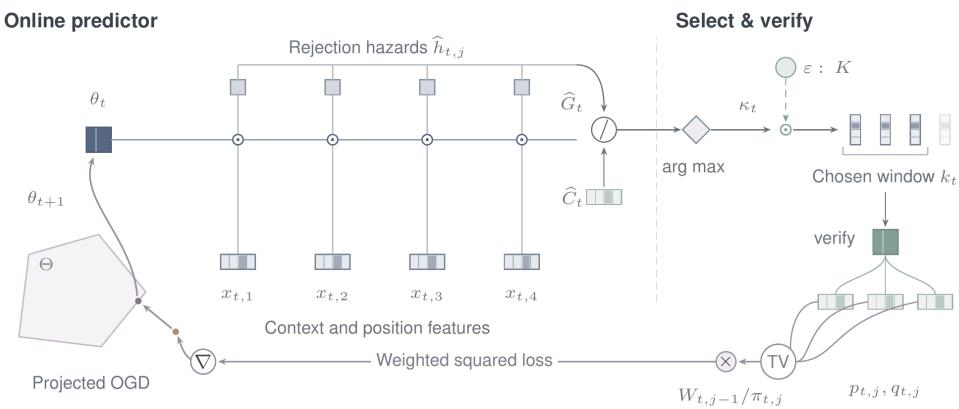  
Figure 2: AMTP’s online control loop. Before drafting, it picks the horizon with the highest predicted throughput. Verification feedback at every drafted position, including those after a rejection, enters the weighted loss in Equation 8, and an OGD step updates the hazard predictor.

## 4.2 LEARNING FROM PARTIAL FEEDBACK

A round with horizon $k _ { t }$ reveals feedback only at positions $1 , \ldots , k _ { t }$ . If a greedy controller underestimates late-position survival, its drafts might be short, it may never observe late positions, and it might never corrects the estimate. To address this, AMTP makes two changes to the ideal learner.

Exploration. With probability $1 - \varepsilon$ the controller drafts $k _ { t } = \kappa _ { t }$ , and with probability ε it drafts the full window $k _ { t } = K$ (Langford and Zhang, 2007). The randomness here is independent of the draft given $\mathcal { F } _ { t } ,$ so position j is observed with known probability $\pi _ { t , j } = ( 1 - \varepsilon ) \mathbf { 1 } \{ j \leq \kappa _ { t } \} + \varepsilon \geq \varepsilon .$ Other exploration schemes, such as Thompson sampling for contextual bandits (Zhang, 2021; Anand and Liaw, 2025), could replace uniform full-horizon exploration. We use ε-greedy exploration because it gives known inclusion probabilities, which is needed for inverse-probability weighting.

Inverse-probability weighting. After verification, $e _ { t , j } ^ { \mathrm { o b s } }$ and $W _ { t , j - 1 }$ are available for every $j \leq k _ { t }$ Then, reweighting each observed term by its inclusion probability gives

$$
\widehat { \ell } _ { t } ( \theta ) = \sum _ { j = 1 } ^ { k _ { t } } \frac { W _ { t , j - 1 } } { \pi _ { t , j } } \big ( e _ { t , j } ^ { \mathrm { o b s } } - \widehat { h } _ { \theta , t , j } \big ) ^ { 2 } , \qquad \mathbb { E } [ \widehat { \ell } _ { t } ( \theta ) | \mathcal { F } _ { t } ] = \ell _ { t } ( \theta ) .\tag{11}
$$

AMTP runs (10) with $\hat { \ell } _ { t }$ in place of $\tilde { \ell } _ { t } .$ , holding $W _ { t , j - 1 }$ and $\pi _ { t , j }$ fixed in line 8 of Alg 1. However, relative to the ideal learner, exploration costs some throughput in rounds drafting K, and the factor $1 / \pi _ { t , j } \le 1 / \varepsilon$ makes gradients noisier: we quantify both in Section 5.

## 5 FROM PREDICTION ERROR TO DECODING EFFICIENCY

We now ask how much decoding efficiency AMTP loses by acting on predicted rather than true hazards. First, we show that, for any online learner, the throughput regret against the best horizon at each visited history is controlled by the learner’s excess prediction loss. We then bound that loss for OGD, first for the ideal full-feedback learner and then for AMTP’s partial-feedback learner, and then we bound the price of partial feedback. Finally, we show how to convert the throughput regret into bounds on expected completion time and speedup. We give complete proofs in Appendix B.

## 5.1 PREDICTION ERROR TO THROUGHPUT REGRET

We allow the controller to maximize predicted throughput only approximately, with a selection error $\xi _ { t } \geq 0$ that accommodates exploration:

$$
\widehat { R } _ { t } ( k ) = \frac { \widehat { G } _ { t } ( k ) } { C _ { t } ( k ) } , \qquad \widehat { R } _ { t } ( k _ { t } ) \geq \operatorname* { m a x } _ { 1 \leq k \leq K } \widehat { R } _ { t } ( k ) - \xi _ { t } .\tag{12}
$$

For a comparator sequence $\theta _ { 1 : T } ^ { \star }$ , define

$$
\mathcal { R } _ { T } = \sum _ { t = 1 } ^ { T } \bigl ( \ell _ { t } ( \theta _ { t } ) - \ell _ { t } ( \theta _ { t } ^ { \star } ) \bigr ) , \qquad A _ { T } = \sum _ { t = 1 } ^ { T } \bigl ( \ell _ { t } ( \theta _ { t } ^ { \star } ) - \ell _ { t } ^ { B } \bigr ) , \qquad \mathcal { D } _ { T } = \sum _ { t = 1 } ^ { T } \bigl ( R _ { t } ( k _ { t } ^ { \star } ) - R _ { t } ( k _ { t } ) \bigr ) .
$$

Here $\mathcal { R } _ { T }$ is the learner’s regression regret against the comparator, $A _ { T } \geq 0$ is the comparator’s approximation error, and $\mathcal { D } _ { T }$ is the throughput regret against the best horizon at each history the learner visits. This comparator is stronger than the best fixed horizon: it may change from round to round

with the context. By Lemma $\begin{array} { r } { 1 , \mathcal { R } _ { T } + \mathcal { A } _ { T } = \sum _ { t = 1 } ^ { T } \mathcal { E } _ { t } ( \theta _ { t } ) \geq 0 } \end{array}$ . Write $\begin{array} { r } { \Lambda _ { K } = c _ { \mathrm { m i n } } ^ { - 1 } \sqrt { \frac { K ( K + 1 ) ( 2 K + 1 ) } { 6 } } } \end{array}$

Theorem 1 (Dynamic regret transfer). Under the preceding assumptions, for every comparator sequence and every realization ofthe pre-round histories and selected horizons, we have

$$
\mathcal { D } _ { T } \leq 2 \Lambda _ { K } \sqrt { T \left( \mathcal { R } _ { T } + \mathcal { A } _ { T } \right) } + \sum _ { t = 1 } ^ { T } \xi _ { t } .\tag{13}
$$

The key idea is to connect calibration to throughput prediction, and then to horizon selection. Telescoping the survival products and applying Lemma 1 bounds the error in predicted throughput uniformly over horizons. Combining this with Equation 12 bounds the per-round regret:

$$
\operatorname* { m a x } _ { 1 \leq k \leq K } \left| \widehat { R } _ { t } ( k ) - R _ { t } ( k ) \right| \leq \Lambda _ { K } \sqrt { \mathcal { E } _ { t } ( \theta _ { t } ) } , \qquad R _ { t } ( k _ { t } ^ { \star } ) - R _ { t } ( k _ { t } ) \leq 2 \Lambda _ { K } \sqrt { \mathcal { E } _ { t } ( \theta _ { t } ) } + \xi _ { t } .
$$

Summing over rounds and applying Cauchy–Schwarz gives Equation 13. A regression guarantee therefore becomes a throughput guarantee through the learner’s total excess prediction loss, including the comparator’s approximation error. Importantly, this does not depend on how $\theta _ { t }$ is produced, which allows us to use any online learning algorithm and transfer their guarantees to our setting.

Remark 1 (Sharpness). The square-root dependence in Eq. 13 cannot be improved uniformly. Prop. 2 with independent proposals and known costs incurs one-round throughput regret $\textstyle { \frac { 2 } { 5 } } { \sqrt { \mathcal { E } _ { t } ( \theta _ { t } ) } }$

Remark 2 (Estimated costs). Suppose instead that the controller uses $\widehat { C } _ { t } ( k ) \geq c _ { \operatorname* { m i n } } ,$ , and let $\delta _ { t } ^ { C } =$ max $\smash { 1 \le k \le K \left| \widehat { C } _ { t } ( k ) - C _ { t } ( k ) \right| }$ |. Then, measuring $\xi _ { t }$ relative to $\widehat { G } _ { t } ( k ) / \widehat { C } _ { t } ( k )$ gives

$$
\mathcal { D } _ { T } \leq 2 \Lambda _ { K } \sqrt { T \left( \mathcal { R } _ { T } + A _ { T } \right) } + \sum _ { t = 1 } ^ { T } \xi _ { t } + \frac { 2 ( K + 1 ) } { c _ { \operatorname* { m i n } } ^ { 2 } } \sum _ { t = 1 } ^ { T } \delta _ { t } ^ { C } .\tag{14}
$$

## 5.2 LEARNING THE HAZARDS WITH OGD

We now bound $\mathcal { R } _ { T }$ for the two learners of Section 4. Both use an affine forecaster $\hat { h } _ { \theta , t , j } = \langle \theta , x _ { t , j } \rangle$ on a nonempty closed convex set Θ of diameter at most D. The features are $\mathcal { F } _ { t }$ -measurable with $\| x _ { t , j } \| _ { 2 } ~ \le ~ \mathsf { \bar { F } }$ , and forecasts lie in [0, 1] for all $\theta ~ \in ~ \Theta$ . Initialize $\theta _ { 1 } ~ \in ~ \Theta$ . The comparator ${ \theta } _ { t } ^ { \star } \in \Theta$ is $\mathcal { F } _ { t }$ -measurable, and its path length is bounded almost surely by a deterministic quantity, ${ \begin{array} { r } { \sum _ { t = 1 } ^ { T - 1 } \| { \boldsymbol { \theta } } _ { t + 1 } ^ { \star } - { \boldsymbol { \theta } } _ { t } ^ { \star } \| _ { 2 } \leq P _ { T } } \end{array} }$ , as is standard for dynamic regret (Zinkevich, 2003; Besbes et al., 2015; Zhang et al., 2018). We assume known costs throughout this subsection.

Ideal full feedback. The ideal learner of Section 4 observes all K positions and always acts greedily, so $\xi _ { t } = 0$ . Its gradients $\nabla \tilde { \ell } _ { t } ( \theta _ { t } )$ are unbiased for $\nabla \ell _ { t } ( \theta _ { t } )$ and satisfy $\lVert \nabla \tilde { \ell } _ { t } ( \theta _ { t } ) \rVert _ { 2 } \leq 2 F K$ Corollary 1 (OGD with full feedback). Under these conditions, projected OGD (Equation 10) on thefull-feedback loss with constant step size $\eta > 0$ satisfies

$$
\mathbb { E } \mathcal { R } _ { T } \leq \frac { D ^ { 2 } + 2 D P _ { T } } { 2 \eta } + 2 \eta F ^ { 2 } K ^ { 2 } T .\tag{15}
$$

Under realizability, optimizing η, for fixed $K , c _ { \operatorname* { m i n } } , D , F ,$ , gives E $\mathcal { D } _ { T } = O \big ( T ^ { 3 / 4 } ( 1 + P _ { T } ) ^ { 1 / 4 } \big )$

Equation 10 is the standard projected-OGD argument with a moving comparator. Theorem 1 and Jensen’s inequality then give the final rate. We give the result for any unbiased gradient with bounded second moment in Equation 10. As Section 4 explains, this learner needs the target distribution at all K positions in every round, so this is only our benchmark for an implementable controller.

Partial feedback. AMTP replaces $\tilde { \ell } _ { t }$ with the observed loss. Here, the gradients remain unbiased, but each observed term is scaled by $\begin{array} { r } { \frac { 1 } { \pi _ { t . i } } \leq \frac { 1 } { \varepsilon } } \end{array}$ , so for $g _ { t } = \nabla \widehat { \ell } _ { t } ( \theta _ { t } )$ we have $\begin{array} { r } { \mathbb { E } [ \| g _ { t } \| _ { 2 } ^ { 2 } | \mathcal { F } _ { t } ] \le \frac { 4 F ^ { 2 } K ^ { 2 } } { \varepsilon } } \end{array}$ where exploration rounds contribute $\begin{array} { r } { \mathbb { E } \sum _ { t = 1 } ^ { T } \xi _ { t } \le \varepsilon T \frac { K + 1 } { c _ { \mathrm { m i n } } } } \end{array}$ to the selection error.

Corollary 2 (OGD with partial feedback). Under these conditions, Algorithm 1 with known costs, exploration rate $\varepsilon \in ( 0 , 1 ]$ and constant step size $\eta > 0$ satisfies

$$
\mathbb { E } \mathcal { R } _ { T } \leq \frac { D ^ { 2 } + 2 D P _ { T } } { 2 \eta } + \frac { 2 \eta F ^ { 2 } K ^ { 2 } T } { \varepsilon } .\tag{16}
$$

Under realizability, optimizing η, for fixed $K , c _ { \operatorname* { m i n } } , D , F ,$ , gives E $\mathcal { D } _ { T } = O \big ( T ^ { 4 / 5 } ( 1 + P _ { T } ) ^ { 1 / 5 } \big )$

The projected-OGD bound with the second-moment estimate above gives equation 16, and Theorem 1 with Jensen’s inequality and a balancing argument gives the final rate. This tuning uses the number of rounds T and a known bound $P _ { T }$ on comparator variation.

The price of partial feedback. Equations 15 and 16 differ only by the factor $\frac { 1 } { \varepsilon }$ in the gradient-noise term, and the rates differ only via the selection-error term $\varepsilon T$ . Here, exploration must be frequent enough to keep gradient noise in check, but it also drafts the full window when a shorter one may be better. Balancing these effects moves the rate from $T ^ { 3 / 4 } ( 1 + P _ { T } ) ^ { 1 / 4 } : 0 T ^ { 4 / 5 } ( 1 + P _ { T } ) ^ { 1 / 5 }$ , which are both sublinear when $P _ { T } = o ( T )$ . So, the average throughput approaches that of the best horizon at each history, and AMTP pays a vanishing gap for learning from the feedback of its horizon choices.

## 5.3 FROM THROUGHPUT REGRET TO SPEEDUP

We measure the throughput regret per round, as the goal is to minimize the time to produce an output. We fix an integer output budget $N \geq 1$ , and compare AMTP with a baseline under matched prompts, the same target output law and the same timing scope. Let $J _ { N } ^ { \mathrm { b a s e } }$ denote the baseline’s completion time and define its effective rate $r _ { \mathrm { b a s e } } ( N ) = \breve { N } / \mathbb { E } \bar { J } _ { N } ^ { \mathrm { b a s e } }$ , assuming $0 < \mathbb { E } J _ { N } ^ { \mathrm { b a s e } } < \infty$

Corollary 3 (Completion time and speedup). Given max1≤k≤K $R _ { t } ( k ) \geq \rho > 0$ at each visited history,for some constant $\rho ,$ let the realized round cost $c _ { t } \geq \overline { { 0 } } \ s a t i s f y \ \mathbb { E } [ c _ { t } | \mathcal { F } _ { t } , k _ { t } ] = C _ { t } ( k _ { t } )$ , and let

$$
\sigma _ { N } = \operatorname* { i n f } { \Big \{ } m \geq 1 : \sum _ { t = 1 } ^ { m } L _ { t } ( k _ { t } ) \geq N { \Big \} } , \qquad J _ { N } = \sum _ { t = 1 } ^ { \sigma _ { N } } c _ { t } .\tag{17}
$$

Extend the same policy to N rounds and suppose that $\mathbb { E } \mathcal { D } _ { N } \le B _ { N }$ . Then, the expected completion time and the speedup, defined as the ratio of expected completion times, satisfy

$$
\mathbb { E } J _ { N } \le \frac { N + K + c _ { \mathrm { m a x } } B _ { N } } { \rho } , \qquad S _ { N } : = \frac { \mathbb { E } J _ { N } ^ { \mathrm { b a s e } } } { \mathbb { E } J _ { N } } \ge \frac { \rho / r _ { \mathrm { b a s e } } ( N ) } { 1 + K / N + c _ { \mathrm { m a x } } B _ { N } / N } .\tag{18}
$$

In particular, $S _ { N } > 1$ whenever $\rho / r _ { \mathrm { b a s e } } ( N ) > 1 + K / N + c _ { \mathrm { m a x } } B _ { N } / N .$

To see why, let $\Delta _ { t } = R _ { t } ( k _ { t } ^ { \star } ) - R _ { t } ( k _ { t } ) \geq 0$ . The assumption on $\rho$ gives $G _ { t } ( k _ { t } ) \geq \rho C _ { t } ( k _ { t } ) - c _ { \operatorname* { m a x } } \Delta _ { t }$ Each round commits at least one token, so $\sigma _ { N } \leq N$ , and the final round overshoots the budget by at most $K$ tokens. Since $\{ \sigma _ { N } \geq t \}$ is determined before round $t ,$ conditional expectations gives

$$
\rho \mathbb { E } J _ { N } \le \mathbb { E } \sum _ { t = 1 } ^ { \sigma _ { N } } L _ { t } ( k _ { t } ) + c _ { \operatorname* { m a x } } \mathbb { E } \sum _ { t = 1 } ^ { \sigma _ { N } } \Delta _ { t } \le N + K + c _ { \operatorname* { m a x } } B _ { N } ,
$$

which is the bound in (18). Dividing the baseline’s completion time by this gives the claim.

Speedup guarantee of AMTP. Corollary 2 with $T = N$ gives $B _ { N } = O ( N ^ { 4 / 5 } ( 1 + P _ { N } ) ^ { 1 / 5 } )$ , so the penalty in Equation 18 is $O ( K / N + ( ( 1 + P _ { N } ) / N ) ^ { 1 / 5 } )$ . If $P _ { N } = o ( N )$ and $r _ { \mathrm { b a s e } } ( N ) \to r _ { 0 } > 0$ the penalty vanishes and lim inf $_ { N  \infty } S _ { N } \geq \rho / r _ { 0 }$ . Acceptance and round cost thus set the achievable speedup $\rho / r _ { 0 }$ , and learning the horizon costs only a vanishing fraction of it.

## 6 EXPERIMENTS

We evaluate AMTP on three self-speculative multi-token-prediction families (self-distilled Qwen3- 4B, Meta’s facebook/multi-token-prediction 7B, and Medusa heads on Llama-3.1-8B-Instruct) and two cross-model pairings with a separate, larger target (self-distilled 4B → Qwen3-14B; Meta MTP 7B → Llama-2-13B), on AIME 2025 and GSM8K (full setup in Table 4, Appendix D). All runs disable KV caching, so verification recomputes the full context each round; each condition is a single unseeded run, and we compare conditions only within a model since hardware differs across runs. The fixed-window baseline uses the largest window each draft supports (k=16, 4, 6); the adaptive controller is the affine hazard predictor and cost model of Section 4 with ε-bounded exploration, updated by one gradient step per round (hyperparameters in Table 5, Appendix D).

<table><tr><td></td><td></td><td colspan="2">AIME 2025</td><td colspan="2">GSM8K</td></tr><tr><td>Model</td><td>Decoding</td><td>tok/s</td><td>Speed-up</td><td>tok/s</td><td>Speed-up</td></tr><tr><td rowspan="3">Self-distilled Qwen3-4B</td><td>Plain (next-token)</td><td>18.8</td><td>1.00×</td><td>16.2</td><td>1.00×</td></tr><tr><td>Fixed k=16</td><td>34.0</td><td>1.81×</td><td>38.6</td><td>2.39×</td></tr><tr><td>Adaptive (ours)</td><td>34.5</td><td>1.83×</td><td>38.3</td><td>2.37×</td></tr><tr><td rowspan="3">Meta MTP 7B</td><td>Plain (next-token)</td><td>12.5</td><td>1.00×</td><td>4.7b</td><td>1.00×</td></tr><tr><td>Fixed k=4</td><td>37.7</td><td>3.01×</td><td>19.2b</td><td>4.09×</td></tr><tr><td>Adaptive (ours)</td><td>31.9</td><td>2.55×</td><td>19.4b</td><td>4.13×</td></tr><tr><td rowspan="3">Meta MTP 7B → Llama-2-13B</td><td>Plain (next-token)</td><td>6.2</td><td>1.00×</td><td>2.7b</td><td>1.00×</td></tr><tr><td>Fixed k=4</td><td>7.6</td><td>1.23×</td><td>4.7b</td><td>1.75×</td></tr><tr><td>Adaptive (ours)</td><td>28.2</td><td>4.55×</td><td>11.6b</td><td>4.30×</td></tr><tr><td rowspan="3">Medusa, Llama-3.1-8B</td><td>Plain (next-token)</td><td>10.7</td><td>1.00×</td><td>13.0</td><td>1.00×</td></tr><tr><td>Fixed k=6</td><td>23.6</td><td>2.20×</td><td>20.0</td><td>1.54×</td></tr><tr><td>Adaptive (ours)</td><td>25.3</td><td>2.37×</td><td>19.4</td><td>1.50×</td></tr><tr><td rowspan="3">Self-dist. 4B → Qwen3-14B</td><td>Plain (next-token)</td><td>10.4</td><td>1.00×</td><td>6.4ª</td><td>1.00×</td></tr><tr><td>Fixed k=16</td><td>22.5</td><td>2.17×</td><td>21.3</td><td>3.33×</td></tr><tr><td>Adaptive (ours)</td><td>24.7</td><td>2.38×</td><td>21.5</td><td>3.36×</td></tr></table>

Table 1: Decoding throughput (tokens/s) and speed-up over plain decoding for each draft/target pairing on AIME 2025 and GSM8K, with AMTP in bold if it exceeds the best fixed window by more than 1%. aPlain decoding run reached 1,166 of 1,319 GSM8K problems before its timeout: speed-up computed over that subset. bMeta MTP’s base checkpoints do not emit an end-of-sequence token after answering, so GSM8K runs for this pairing are capped at 100 problems, 100 rounds each.

Discussion. AMTP helps most when drafting and verification differ in cost and when reasoning traces are long and variable in length. The cross-model pairings, where draft and target are separate models, show the largest gains over the fixed window: Meta MTP 7B →Llama-2-13B improves throughput by 268% on AIME and 147% on GSM8K (over its best fixed window), and self-distilled 4B →Qwen3-14B by 10% on AIME while staying within 1% of the best fixed window on GSM8K. In the self-speculative pairings, draft and target share one forward pass, so a longer horizon costs little extra and there is less to gain: self-distilled 4B and Medusa improve by 2–7% on AIME and stay within 3% of the fixed window on GSM8K. The one regression is Meta MTP 7B on AIME (−15%). Meta’s base checkpoint does not reliably stop after answering, and every round of a longer generation costs more. We note, however, that its acceptance rate was higher under adaptive control throughout. Across all pairings, AMTP drafts fewer tokens per round while committing a similar number, allowing it to accept a higher fraction of what it drafts than any fixed window, converting wasted draft computation into completed tokens even where the net throughput effect is small.

## 7 CONCLUSION AND FUTURE WORK

In this work, we study how far MTP should speculate. Since all MTP heads fire in a single forward pass, the horizon must be chosen before drafting, and the right choice changes with context. We showed that acceptance survival determines the expected number of committed tokens at every horizon for any causal proposal, and built AMTP, an online controller that learns survival from verification feedback and picks the horizon with the highest predicted throughput, without retraining any model or changing the exact verifier. We show that any online learner’s prediction error translates into throughput regret against the best horizon for each context, and in turn into a bound on wall-clock completion time. Empirically, AMTP decodes up to 4.1× faster than standard decoding and matches or outperforms the fixed window in 8 of 10 settings.

<table><tr><td colspan="2" rowspan="2"></td><td colspan="2">Accept. (%)</td><td colspan="2">Tokens/round</td><td colspan="4">Accuracy (%)</td></tr><tr><td colspan="2">Fixed Adapt.</td><td colspan="2">Fixed</td><td colspan="2">Adapt.</td><td colspan="2">Fixed</td></tr><tr><td>Model</td><td>Eval</td><td></td><td></td><td></td><td></td><td>Plain</td><td></td><td>Adapt.</td></tr><tr><td>Self-distilled 4B</td><td>GSM8K</td><td>23</td><td>32</td><td>4.67</td><td>4.63</td><td>89.4</td><td>85.0</td><td>85.7</td></tr><tr><td>Medusa 8B</td><td>GSM8K</td><td>33 21</td><td>48 29</td><td>2.99 4.33</td><td>2.90</td><td>83.2 92.8ª</td><td>79.6</td><td>79.2</td></tr><tr><td>Self-dist. 4B → 14B</td><td>GSM8K AIME</td><td>18</td><td>34</td><td>3.84</td><td>4.33 3.83</td><td>20.0</td><td>92.9 30.0</td><td>93.5</td></tr><tr><td>Self-distilled 4B</td><td>AIME</td><td>50</td><td>57</td><td>3.00</td><td>3.03</td><td>0.0</td><td>0.0</td><td>26.7 0.0</td></tr><tr><td>Meta MTP 7B</td><td>AIME</td><td>44</td><td>52</td><td>2.76</td><td>2.51</td><td>0.0</td><td>0.0</td><td>0.0</td></tr><tr><td>Meta MTP 13B Medusa 8B</td><td>AIME</td><td>22</td><td>46</td><td>2.34</td><td>2.28</td><td>0.0</td><td>0.0</td><td>0.0</td></tr><tr><td></td><td></td><td>14</td><td>28</td><td>3.23</td><td>3.20</td><td>20.0</td><td>20.0</td><td></td></tr><tr><td>Self-dist. 4B → 14B</td><td>AIME</td><td></td><td></td><td></td><td></td><td></td><td></td><td>23.3</td></tr></table>

Table 2: Draft acceptance rate, tokens committed per verification round, and accuracy for plain decoding, the best fixed window and AMTP on AIME 2025 and GSM8K. aPlain decoding run reached 1,166 of 1,319 GSM8K problems before its time limit; accuracy computed over that subset.

<table><tr><td>Model</td><td>Eval</td><td>Mean kt</td><td>Std.</td><td>Range</td><td>Distinct k</td></tr><tr><td>Self-distilled 4B</td><td>GSM8K</td><td>11.21</td><td>2.73</td><td>1-16</td><td>16</td></tr><tr><td>Meta MTP 7B</td><td>AIME</td><td>3.54</td><td>0.69</td><td>1-4</td><td>4</td></tr><tr><td>Meta MTP 13B</td><td>AIME</td><td>2.93</td><td>0.99</td><td>1-4</td><td>4</td></tr><tr><td>Medusa 8B</td><td>GSM8K</td><td>3.95</td><td>1.02</td><td>1-6</td><td>6</td></tr></table>

Table 3: Distribution of the draft window $k _ { t }$ chosen by AMTP over all verification rounds of a run. We remark here that the window is not constant: it varies across rounds within a single generation and across generations.  
Self-distilled Qwen3-4B GSM8K

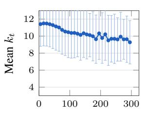  
Verification round

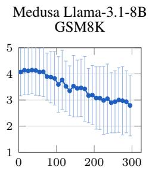  
Verification round

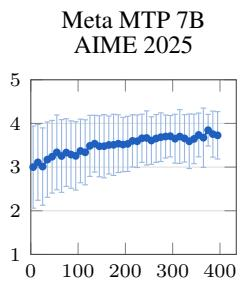  
Verification round  
Meta MTP 13B AIME 2025

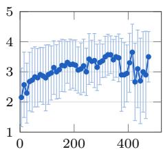  
Verification round  
Figure 3: Draft window chosen by AMTP, averaged over generations in bins of 10 verification rounds (points; bars show one standard deviation across rounds in the bin). The window adapts as generation proceeds instead of staying at a single value.

Several limitations point to future work. Our experiments decode one sequence at a time without a KV-cache: batched serving with caching changes the cost of each horizon and is a natural direction. Comparing hazard-based and direct survival prediction, and extending horizon control to tree-structured drafts, are promising directions. Finally, it would be interesting to extend our work to adaptive diffusion-based speculative methods.

## AI USE STATEMENT

Generative AI tools assisted with editing the manuscript, generating code for the experiments, identifying and summarizing related literature, and proof-checking the mathematical formulations and proofs. The authors are responsible for checking the final claims, proofs, and citations.

## ACKNOWLEDGEMENTS

We thank Adam Wierman, Jacob Abernethy, Matthew Fahrbach, and Sarah Liaw for helpful comments. EA’s research is supported by NSF Grant CCF 2338816.

## REFERENCES

Sudhanshu Agrawal, Wonseok Jeon, and Mingu Lee. AdaEDL: Early draft stopping for speculative decoding of large language models via an entropy-based lower bound on token acceptance probability. In Proceedings of the 4th NeurIPS Efficient Natural Language and Speech Processing Workshop, volume 262 of Proceedings of Machine Learning Research, 2024. URL https://proceedings.mlr.press/v262/agrawal24a.html.

Kwangjun Ahn, Alex Lamb, and John Langford. Efficient joint prediction of multiple future tokens. arXiv preprint arXiv:2503.21801, 2025. URL https://arxiv.org/abs/2503.21801.

Emile Anand and Sarah Liaw. Feel-good Thompson sampling for contextual bandits: a Markov chain Monte Carlo showdown. In Advances in Neural Information Processing Systems, volume 38, 2025.

Emile Anand, Abdullah Ateyeh, Archer Wang, and Marin Soljaciˇ c. Smat-attention: Structured´ long-context sequence modeling, 2026. URL https://arxiv.org/abs/2609.36062.

Zachary Ankner, Rishab Parthasarathy, Aniruddha Nrusimha, Christopher Rinard, Jonathan Ragan-Kelley, and William Brandon. Hydra: Sequentially-dependent draft heads for medusa decoding, 2024. URL https://arxiv.org/abs/2402.05109.

Omar Besbes, Yonatan Gur, and Assaf Zeevi. Non-stationary stochastic optimization. Operations Research, 63(5):1227–1244, 2015.

Tianle Cai, Yuhong Li, Zhengyang Geng, Hongwu Peng, Jason D. Lee, Deming Chen, and Tri Dao. Medusa: Simple LLM inference acceleration framework with multiple decoding heads. In Proceedings of the 41st International Conference on Machine Learning, volume 235 of Proceedings of Machine Learning Research, pages 5209–5235. PMLR, 2024. URL https: //proceedings.mlr.press/v235/cai24b.html.

Carrie Chen. EntMTP: Accelerating LLM inference with entropy guided multi token prediction. arXiv preprint arXiv:2606.27550, 2026.

Charlie Chen, Sebastian Borgeaud, Geoffrey Irving, Jean-Baptiste Lespiau, Laurent Sifre, and John Jumper. Accelerating large language model decoding with speculative sampling. arXiv preprint arXiv:2302.01318, 2023. URL https://arxiv.org/abs/2302.01318.

Xin Cheng, Xingkai Yu, Chenze Shao, Jiashi Li, Yunfan Xiong, Yi Qian, Jiaqi Zhu, Shirong Ma, Xiaokang Zhang, Jiasheng Ye, Qinyu Chen, Chengqi Deng, Jiping Yu, Damai Dai, Zhengyan Zhang, Yixuan Wei, Yixuan Tan, Wenkai Yang, Runxin Xu, Yu Wu, Zhean Xu, Xuanyu Wang, Muyang Chen, Rui Tian, Xiao Bi, Zhewen Hao, Shaoyuan Chen, Huanqi Cao, Wentao Zhang, Anyi Xu, Huishuai Zhang, Dongyan Zhao, and Wenfeng Liang. DSpark: Confidence-scheduled speculative decoding with semi-autoregressive generation. arXiv preprint arXiv:2607.05147, 2026. URL https://arxiv.org/abs/2607.05147.

Sai Sreenivas Chintha, Chidera Biringa, Rishab Sharma, Anusha Agrawal, Prachi Badarayani, Gemma Zhang, Nigel Boachie Kumankumah, Marco Ayala, and Sulaiman Vesal. Next token or vector? learning how far to decode. arXiv preprint arXiv:2610.22788, 2026.

DeepSeek-AI. DeepSeek-V3 technical report. arXiv preprint arXiv:2412.19437, 2024.

Adam N. Elmachtoub and Paul Grigas. Smart “predict, then optimize”. Management Science, 68 (1):9–26, 2022.

Fabian Gloeckle, Badr Youbi Idrissi, Baptiste Rozière, David Lopez-Paz, and Gabriel Synnaeve. Better & faster large language models via multi-token prediction. In Proceedings of the 41st International Conference on Machine Learning, volume 235 of Proceedings ofMachine Learning Research, pages 15706–15734. PMLR, 2024. URL https://proceedings.mlr.press/ v235/gloeckle24a.html.

Elad Hazan. Introduction to online convex optimization. Foundations and Trends in Optimization, 2(3–4):157–325, 2016.

Yunlong Hou, Fengzhuo Zhang, Cunxiao Du, Xuan Zhang, Jiachun Pan, Tianyu Pang, Chao Du, Vincent Y. F. Tan, and Zhuoran Yang. BanditSpec: Adaptive speculative decoding via bandit algorithms. In Proceedings of the 42nd International Conference on Machine Learning, volume 267 of Proceedings of Machine Learning Research, 2025. URL https://proceedings. mlr.press/v267/hou25h.html.

Kaixuan Huang, Xudong Guo, and Mengdi Wang. SpecDec++: Boosting speculative decoding via adaptive candidate lengths. arXiv preprint arXiv:2405.19715, 2024. URL https://arxiv. org/abs/2405.19715.

John Kirchenbauer, Abhimanyu Hans, Brian Bartoldson, Micah Goldblum, Ashwinee Panda, and Tom Goldstein. Multi-token prediction via self-distillation. arXiv preprint arXiv:2602.06019, 2026. URL https://arxiv.org/abs/2602.06019.

John Langford and Tong Zhang. The epoch-greedy algorithm for multi-armed bandits with side information. In Advances in Neural Information Processing Systems, volume 20, 2007.

Yaniv Leviathan, Matan Kalman, and Yossi Matias. Fast inference from transformers via speculative decoding. In Proceedings of the 40th International Conference on Machine Learning, volume 202 of Proceedings of Machine Learning Research, pages 19274–19286. PMLR, 2023. URL https://proceedings.mlr.press/v202/leviathan23a.html.

Yuhui Li, Fangyun Wei, Chao Zhang, and Hongyang Zhang. EAGLE: Speculative sampling requires rethinking feature uncertainty. In Proceedings of the 41st International Conference on Machine Learning, volume 235 of Proceedings ofMachine Learning Research, pages 28935–28948. PMLR, 2024a. URL https://proceedings.mlr.press/v235/li24bt.html.

Yuhui Li, Fangyun Wei, Chao Zhang, and Hongyang Zhang. EAGLE-2: Faster inference of language models with dynamic draft trees. In Proceedings of the 2024 Conference on Empirical Methods in Natural Language Processing, pages 7421–7432. Association for Computational Linguistics, 2024b. doi: 10.18653/v1/2024.emnlp-main.422. URL https://aclanthology. org/2024.emnlp-main.422/.

Yuhui Li, Fangyun Wei, Chao Zhang, and Hongyang Zhang. EAGLE-3: Scaling up inference acceleration of large language models via training-time test. In Advances in Neural Information Processing Systems, 2025.

Yiheng Lin, Yang Hu, Guannan Qu, Tongxin Li, and Adam Wierman. Boundedregret MPC via perturbation analysis: Prediction error, constraints, and nonlinearity. In Advances in Neural Information Processing Systems, volume 35, 2022. URL https://proceedings.neurips.cc/paper\_files/paper/2022/hash/ eadeef7c51ad86989cc3b311cb49ec89-Abstract-Conference.html.

Yiheng Lin, James A. Preiss, Emile Anand, Yingying Li, Yisong Yue, and Adam Wierman. Online adaptive policy selection in time-varying systems: No-regret via contractive perturbations. In Advances in Neural Information Processing Systems, volume 36, 2023. URL https://proceedings.neurips.cc/paper\_files/paper/2023/ hash/a7a7180fe7f82ff98eee0827c5e9c141-Abstract-Conference.html.

Yiheng Lin, James A. Preiss, Fengze Xie, Emile Anand, Soon-Jo Chung, Yisong Yue, and Adam Wierman. Online policy optimization in unknown nonlinear systems. In Shipra Agrawal and Aaron Roth, editors, Proceedings ofThirty Seventh Conference on Learning Theory, volume 247 of Proceedings of Machine Learning Research, pages 3475–3522. PMLR, 30 Jun–03 Jul 2024. URL https://proceedings.mlr.press/v247/lin24a.html.

Hongyi Liu, Jiaji Huang, Zhen Jia, Youngsuk Park, and Yu-Xiang Wang. Not-a-bandit: Provably no-regret drafter selection in speculative decoding for LLMs. In International Conference on Learning Representations, 2026. URL https://arxiv.org/abs/2510.20064.

Tianyu Liu, Yun Li, Qitan Lv, Kai Liu, Jianchen Zhu, Winston Hu, and Xiao Sun. Pearl: Parallel speculative decoding with adaptive draft length, 2025. URL https://arxiv.org/abs/ 2408.11850.

Xiaoxuan Liu, Lanxiang Hu, Peter Bailis, Alvin Cheung, Zhijie Deng, Ion Stoica, and Hao Zhang. Online speculative decoding. In Proceedings of the 41st International Conference on Machine Learning, volume 235 of Proceedings of Machine Learning Research, 2024.

Jonathan Mamou, Oren Pereg, Daniel Korat, Moshe Berchansky, Nadav Timor, Moshe Wasserblat, and Roy Schwartz. Dynamic speculation lookahead accelerates speculative decoding of large language models. In Proceedings of the 4th NeurIPS Efficient Natural Language and Speech Processing Workshop, volume 262 of Proceedings of Machine Learning Research, pages 456–467. PMLR, 2024. URL https://proceedings.mlr.press/v262/mamou24a.html.

Yu-Yang Qian, Hao-Cong Wu, Yichao Fu, Hao Zhang, and Peng Zhao. When drafts evolve: Speculative decoding meets online learning. arXiv preprint arXiv:2603.12617, 2026. URL https://arxiv.org/abs/2603.12617.

Mohammad Samragh, Arnav Kundu, David Harrison, Kumari Nishu, Devang Naik, Minsik Cho, and Mehrdad Farajtabar. Your llm knows the future: Uncovering its multi-token prediction potential, 2025. URL https://arxiv.org/abs/2507.11851.

Mitchell Stern, Noam Shazeer, and Jakob Uszkoreit. Blockwise parallel decoding for deep autoregressive models. In Advances in Neural Information Processing Systems, volume 31, 2018.

Heming Xia, Zhe Yang, Qingxiu Dong, Peiyi Wang, Yongqi Li, Tao Ge, Tianyu Liu, Wenjie Li, and Zhifang Sui. Unlocking efficiency in large language model inference: A comprehensive survey of speculative decoding, 2024. URL https://arxiv.org/abs/2401.07851.

Jiebin Zhang, Zhenghan Yu, Liang Wang, Nan Yang, Eugene J. Yu, Zheng Li, Yifan Song, Dawei Zhu, Xingxing Zhang, Furu Wei, and Sujian Li. Learning to draft: Adaptive speculative decoding with reinforcement learning. arXiv preprint arXiv:2603.01639, 2026. URL https://arxiv. org/abs/2603.01639.

Lijun Zhang, Shiyin Lu, and Zhi-Hua Zhou. Adaptive online learning in dynamic environments. In Advances in Neural Information Processing Systems, volume 31, 2018.

Tong Zhang. Feel-good thompson sampling for contextual bandits and reinforcement learning, 2021. URL https://arxiv.org/abs/2110.00871.

Ziyin Zhang, Jiahao Xu, Tian Liang, Xingyu Chen, Zhiwei He, Rui Wang, and Zhaopeng Tu. Draft model knows when to stop: Self-verification speculative decoding for long-form generation. In Proceedings of the 2025 Conference on Empirical Methods in Natural Language Processing, pages 16685–16697. Association for Computational Linguistics, 2025. doi: 10.18653/v1/2025. emnlp-main.844. URL https://aclanthology.org/2025.emnlp-main.844/.

Guoliang Zhao, Ruobing Xie, An Wang, Shuaipeng Li, Huaibing Xie, and Xingwu Sun. Selfdistillation for multi-token prediction. arXiv preprint arXiv:2603.23911, 2026.

Martin Zinkevich. Online convex programming and generalized infinitesimal gradient ascent. In Proceedings of the 20th International Conference on Machine Learning, 2003. URL https: //www.martin.zinkevich.org/publications/ICML03.pdf.

## Outline of the Appendices.

• Section A provides some motivation for adaptive horizon selection;

• Section B presents the proof of our main results;

• Section C shows how to estimate the costs and throughput measurements;

• Section D explains our experimental setup and provides further results.

## A WHY LONGER DRAFTS DEGRADE

Draft qualities can deteriorate with the horizon even if every head is accurate on its own. For independent heads, the block mismatch has two sources: marginal fitting error, and dependence among future target tokens that the heads cannot represent, neither of which individually determines the throughput-optimal horizon, which depends on the verifier’s acceptance profile and the round cost.

Fix a round, condition on its committed context, and suppress the round index. Let $P ^ { ( k ) }$ and $Q ^ { ( k ) }$ be the target and proposal laws over the next k tokens, assumed to be prefix marginals of common laws $P$ and $Q ,$ , and let $P _ { j }$ be the position-j target marginal. The vocabulary is finite and logarithms are natural; KL identities use the usual extended-value convention.

Proposition 1 (Dependence and marginal fit). For independent heads $\begin{array} { r } { Q ^ { ( k ) } \ = \ \prod _ { j = 1 } ^ { k } q _ { j } } \end{array}$ , let $\begin{array} { r } { \mathrm { T C } _ { P } ( Y _ { 1 : k } ) : = D _ { \mathrm { K L } } \big ( P ^ { ( k ) } \| \prod _ { j = 1 } ^ { k } P _ { j } \big ) } \end{array}$ be the total correlation of the target block. Then,

$$
D _ { \mathrm { K L } } ( P ^ { ( k ) } \| Q ^ { ( k ) } ) = \mathrm { T C } _ { P } ( Y _ { 1 : k } ) + \sum _ { j = 1 } ^ { k } D _ { \mathrm { K L } } ( P _ { j } \| q _ { j } ) ,\tag{19}
$$

and, at each position j,

$$
\begin{array} { r } { \mathbb { E } _ { Y _ { < j } \sim P ^ { ( j - 1 ) } } \big [ D _ { \mathrm { K L } } \big ( p _ { j } ( \cdot \mid Y _ { < j } ) \| q _ { j } \big ) \big ] = I _ { P } ( Y _ { j } ; Y _ { < j } ) + D _ { \mathrm { K L } } ( P _ { j } \| q _ { j } ) . } \end{array}\tag{20}
$$

Proof. Insert $\prod _ { j } P _ { j } ( y _ { j } )$ into the likelihood ratio:

$$
\log \frac { P ^ { ( k ) } ( y _ { 1 : k } ) } { \prod _ { j } q _ { j } ( y _ { j } ) } = \log \frac { P ^ { ( k ) } ( y _ { 1 : k } ) } { \prod _ { j } P _ { j } ( y _ { j } ) } + \sum _ { j } \log \frac { P _ { j } ( y _ { j } ) } { q _ { j } ( y _ { j } ) } ,
$$

and take expectations under $P ^ { ( k ) }$ . Inserting it in the conditional ratio $\frac { p _ { j } ( Y _ { j } | Y _ { < j } ) } { q _ { j } ( Y _ { j } ) }$ gives Eq. 20.

Even exact marginal heads, $q _ { j } ~ = ~ P _ { j }$ , therefore maintain the total correlation as their block KL divergence. The term $I _ { P } ( Y _ { j } ; \tilde { Y } _ { < j } )$ is the information about earlier target tokens that an independent head cannot use, and heads that condition on earlier proposed tokens can reduce it.

We now explain how the block mismatch grows with the horizon. Let $\delta ( k ) : = \mathrm { T V } ( P ^ { ( k ) } , Q ^ { ( k ) } )$ Because marginalization contracts total variation, we have

$$
\begin{array} { r l r } {  { 2 \delta ( k ) = \sum _ { y _ { 1 : k } , v } \Bigl | \sum _ { v } \bigl ( P ^ { ( k + 1 ) } ( y _ { 1 : k } , v ) - Q ^ { ( k + 1 ) } ( y _ { 1 : k } , v ) \bigr ) \Bigr | } } \\ & { } & { \leq \displaystyle \sum _ { y _ { 1 : k } , v } \bigl | P ^ { ( k + 1 ) } ( y _ { 1 : k } , v ) - Q ^ { ( k + 1 ) } ( y _ { 1 : k } , v ) \bigr | = 2 \delta ( k + 1 ) . } \end{array}
$$

Similarly, block mismatch caps survival: with the conditional kernels defined along a path, the probability that all k sequential checks accept is

$$
s _ { k } = \sum _ { y _ { 1 } \colon k } \prod _ { j = 1 } ^ { k } \operatorname* { m i n } \{ p _ { j } ( y _ { j } \mid y _ { < j } ) , q _ { j } ( y _ { j } \mid y _ { < j } ) \} \le 1 - \delta ( k ) ,\tag{21}
$$

since each product of minima is at most the minimum of the two products.

Example 1 (Perfect marginals, bounded gain). Let the target draw one fair bit B and repeat it, $Y _ { j } = B$ for all j, so $\bar { P ^ { ( k ) } ( 0 ^ { k } ) } = \bar { P ^ { ( k ) } ( 1 ^ { k } ) } \bar { = } 1 / 2$ . Independent heads with exact marginals draw a freshfair bit at each position, so $Q ^ { ( k ) } ( y _ { 1 : k } ) = 2 ^ { - k }$ . Then

$$
\delta ( k ) = 1 - 2 ^ { 1 - k } , \qquad D _ { \mathrm { K L } } ( P ^ { ( k ) } \| Q ^ { ( k ) } ) = ( k - 1 ) \log 2 .
$$

The first proposal is always accepted. Given that the prefixes have been accepted, each later target conditional is a point mass at the first bit while the proposal is uniform, so each later position is accepted with probability $1 { \dot { / } } 2$ . Therefore, we have that $s _ { j } = \overset { \cdot } { 2 } ^ { 1 - j }$ , and $\begin{array} { r } { G ( k ) = 1 \dot { + } \sum _ { i = 1 } ^ { k } 2 ^ { 1 - j } = \dot { 3 } - 2 ^ { 1 - k } \dot { < } 3 , } \end{array}$ , showing that exact marginals can coexist with block mismatch approaching 1 and an expected gain that never reaches 3 tokens, no matter how long the draft.

## B PROOFS OF THE EFFICIENCY GUARANTEES

This section proves the results stated in the main text, in the order they appear. Throughout, write $E _ { t } = \ell _ { t } ( \theta _ { t } ) - \ell _ { t } ^ { \mathrm { B } }$ and $\widehat { h } _ { t , r } = \widehat { h } _ { \theta _ { t } , t , r }$ . Then, by Lemma 1, we have $\textstyle \sum _ { t = 1 } ^ { T } E _ { t } = { \mathcal { R } } _ { T } + { \mathcal { A } } _ { T }$ .

Predictor class. We use an affine forecaster $\widehat { h } _ { \theta , t , j } \ = \ \langle \theta , x _ { t , j } \rangle$ . For instance, consider simplex weights θ and features $x _ { t , j } \in [ 0 , 1 ] ^ { d }$ : here, the loss is convex in θ and the forecasts stay in [0, 1].

ProofofLemma 1. Write $e _ { t , j } ( Y _ { < j } ) - \widehat { h } _ { \theta , t , j } = \left( e _ { t , j } ( Y _ { < j } ) - h _ { t , j } \right) + \left( h _ { t , j } - \widehat { h } _ { \theta , t , j } \right)$ and expand each square. By the definition of the hazard equation 4, the cross term vanishes:

$$
\mathbb { E } _ { Q _ { t } } \big [ W _ { t , j - 1 } \big ( e _ { t , j } ( Y _ { < j } ) - h _ { t , j } \big ) \big ] = 0 .
$$

The first square summed over j is $\ell _ { t } ^ { \mathrm { B } }$ , and the second is multiplied by $\mathbb { E } _ { Q _ { t } } [ W _ { t , j - 1 } ] = s _ { t , j - 1 }$ □

Proof of Theorem 1. First, telescoping the survival products gives

$$
\widehat { s } _ { t , j } - s _ { t , j } = \sum _ { r = 1 } ^ { j } s _ { t , r - 1 } \left( h _ { t , r } - \widehat { h } _ { t , r } \right) \prod _ { u = r + 1 } ^ { j } \left( 1 - \widehat { h } _ { t , u } \right) .
$$

Every factor in the product lies in $[ 0 , 1 ]$ , so summing over $j \leq k$ , applying Cauchy–Schwarz, and using $s _ { t , r - 1 } \leq 1$ and Lemma 1,

$$
\begin{array} { r l } {  { \big | \widehat { G } _ { t } ( k ) - G _ { t } ( k ) \big | \leq \sum _ { r = 1 } ^ { k } ( k - r + 1 ) s _ { t , r - 1 } \big | \widehat { h } _ { t , r } - h _ { t , r } \big | } } \\ & { \leq \Big ( \displaystyle \sum _ { r = 1 } ^ { k } ( k - r + 1 ) ^ { 2 } s _ { t , r - 1 } \Big ) ^ { 1 / 2 } \Big ( \displaystyle \sum _ { r = 1 } ^ { k } s _ { t , r - 1 } \big ( \widehat { h } _ { t , r } - h _ { t , r } \big ) ^ { 2 } \Big ) ^ { 1 / 2 } } \\ & { \leq \sqrt { \frac { k ( k + 1 ) ( 2 k + 1 ) } { 6 } } \sqrt { E _ { t } } . } \end{array}\tag{22}
$$

Dividing by $C _ { t } ( k ) \geq c _ { \operatorname* { m i n } }$ and using $k \leq K$ gives maxk $| \widehat { R } _ { t } ( k ) - R _ { t } ( k ) | \leq \Lambda _ { K } \sqrt { E _ { t } }$ . Combining this with the selection rule in equation 12 gives

$$
\begin{array} { r } { R _ { t } ( k _ { t } ^ { \star } ) - R _ { t } ( k _ { t } ) \leq \big [ R _ { t } ( k _ { t } ^ { \star } ) - \widehat { R } _ { t } ( k _ { t } ^ { \star } ) \big ] + \big [ \widehat { R } _ { t } ( k _ { t } ^ { \star } ) - \widehat { R } _ { t } ( k _ { t } ) \big ] + \big [ \widehat { R } _ { t } ( k _ { t } ) - R _ { t } ( k _ { t } ) \big ] \leq 2 \Lambda _ { K } \sqrt { E _ { t } } + \xi _ { t } . } \end{array}
$$

Then, by Cauchy–Schwarz, we have $\begin{array} { r } { \sum _ { t = 1 } ^ { T } \sqrt { E _ { t } } \leq \sqrt { T \sum _ { t } E _ { t } } = \sqrt { T ( \mathcal { R } _ { T } + \mathcal { A } _ { T } ) } . } \end{array}$

A general projected-OGD bound. Both learning corollaries follow from the standard projected-OGD argument (Zinkevich, 2003) with a moving comparator and stochastic gradients.

Lemma 2 (Projected OGD with a moving comparator). Let Θ be a nonempty closed convex set of diameter at most D, let $\theta _ { 1 } \in \Theta$ , and let each $\ell _ { t }$ be convex and differentiable on Θ. Suppose $\theta _ { t + 1 } = \Pi _ { \Theta } ( \theta _ { t } - \eta g _ { t } )$ with $\mathbb { E } [ g _ { t } | \mathcal { F } _ { t } ] = \nabla \ell _ { t } ( \theta _ { t } )$ and $\mathbb { E } [ \| g _ { t } \| _ { 2 } ^ { 2 } | \mathcal { F } _ { t } ] \stackrel {  } { \le } M ^ { 2 }$ . Let $\theta _ { t } ^ { \star } ~ \in { \ } \Theta$ be $\mathcal { F } _ { t } .$ measurable with $\begin{array} { r } { \sum _ { t < T } \| \theta _ { t + 1 } ^ { \star } - \theta _ { t } ^ { \star } \| _ { 2 } ^ { - } \leq P _ { T } } \end{array}$ almost surely,for a deterministic $P _ { T }$ . Then

$$
\mathbb { E } \mathcal { R } _ { T } \leq \frac { D ^ { 2 } + 2 D P _ { T } } { 2 \eta } + \frac { \eta M ^ { 2 } T } { 2 } .\tag{23}
$$

With $\begin{array} { r } { \eta = \sqrt { \frac { D ^ { 2 } + 2 D P _ { T } } { M ^ { 2 } T } } } \end{array}$ in the nondegenerate case, Theorem 1 and Jensen’s inequality give

$$
\mathbb { E } \mathcal { D } _ { T } \overset { } { \le } 2 \Lambda _ { K } \sqrt { T \Big ( M \sqrt { T ( D ^ { 2 } + 2 D P _ { T } ) } + \mathbb { E } \mathcal { A } _ { T } \Big ) } + \mathbb { E } \sum _ { t = 1 } ^ { T } \xi _ { t } .\tag{24}
$$

Proof. Nonexpansiveness of the projection gives

$$
\langle g _ { t } , \theta _ { t } - \theta _ { t } ^ { \star } \rangle \leq \frac { \| \theta _ { t } - \theta _ { t } ^ { \star } \| _ { 2 } ^ { 2 } - \| \theta _ { t + 1 } - \theta _ { t } ^ { \star } \| _ { 2 } ^ { 2 } } { 2 \eta } + \frac { \eta } { 2 } \| g _ { t } \| _ { 2 } ^ { 2 } .
$$

By convexity and conditional unbiasedness, the expectation of the left-hand side is at least $\mathbb { E } [ \ell _ { t } ( \theta _ { t } ) -$ $\mathcal { l } _ { t } \big ( \theta _ { t } ^ { \star } \big ) \big ]$ ]. To telescope against a moving comparator, we use

$$
\left| \| \theta _ { t + 1 } - \theta _ { t + 1 } ^ { \star } \| _ { 2 } ^ { 2 } - \| \theta _ { t + 1 } - \theta _ { t } ^ { \star } \| _ { 2 } ^ { 2 } \right| \leq 2 D \| \theta _ { t + 1 } ^ { \star } - \theta _ { t } ^ { \star } \| _ { 2 } .
$$

Summing over t proves equation 23. Substituting the chosen η gives $\mathbb { E } \mathcal { R } _ { T } \le M \sqrt { T ( D ^ { 2 } + 2 D P _ { T } ) } ,$ and equation 24 follows from Theorem 1 and Jensen’s inequality. □

ProofofCorollary 1 (fullfeedback). Here, $\begin{array} { r } { g _ { t } = - 2 \sum _ { j = 1 } ^ { K } W _ { t , j - 1 } \big ( e _ { t , j } ^ { \mathrm { o b s } } - \langle \theta _ { t } , x _ { t , j } \rangle \big ) x _ { t , j } } \end{array}$ is unbiased for $\nabla \ell _ { t } ( \theta _ { t } )$ , and since $W _ { t , j - 1 } \leq 1 , | e _ { t , j } ^ { \mathrm { o b s } } - \widehat { h } _ { t , j } | \leq 1$ and $\| x _ { t , j } \| _ { 2 } \leq F$ , we have $\| g _ { t } \| _ { 2 } \le 2 F K$ Apply Lemma 2 with $M = 2 F K$ and $\xi _ { t } = 0$ . Under realizability, $\bar { \Sigma } \mathcal { D } _ { T } = O \big ( T ^ { 3 / 4 } ( 1 + P _ { T } ) ^ { 1 / 4 } \big )$ for fixed $K , c _ { \mathrm { m i n } } , D , F$ 白

ProofofCorollary 2 (partialfeedback). Unbiased loss and gradient. Fix θ. Because the exploration coin is independent of the draft given $\mathcal { F } _ { t }$ , for each position

$$
\mathbb { E } \Big [ \frac { \mathbf { 1 } \{ k _ { t } \geq j \} } { \pi _ { t , j } } W _ { t , j - 1 } \big ( e _ { t , j } ^ { \mathrm { o b s } } - \widehat { h } _ { \theta , t , j } \big ) ^ { 2 } \Big | \mathcal { F } _ { t } \Big ] = \mathbb { E } _ { Q _ { t } } \Big [ W _ { t , j - 1 } \big ( e _ { t , j } \big ( Y _ { < j } \big ) - \widehat { h } _ { \theta , t , j } \big ) ^ { 2 } \Big ] .
$$

This discrepancy is needed only when the indicator is one. Summing over j shows that the observed loss is conditionally unbiased, and differentiating shows this for the gradient of the affine predictor.

Second moment. Using $\begin{array} { r } { \| \sum _ { j = 1 } ^ { K } v _ { j } \| _ { 2 } ^ { 2 } \leq K \sum _ { j = 1 } ^ { K } \| v _ { j } \| _ { 2 } ^ { 2 } , W _ { t , j - 1 } \leq 1 \mathrm { ~ a n d ~ } \mathbb { E } [ { \mathbf 1 } \{ k _ { t } \geq j } \} | \mathcal { F } _ { t } ] = \pi _ { t , j } ,  \end{array}$

$$
\mathbb { E } \big [ \| g _ { t } \| _ { 2 } ^ { 2 } | \mathcal { F } _ { t } \big ] \le 4 F ^ { 2 } K \sum _ { j = 1 } ^ { K } \frac { 1 } { \pi _ { t , j } } \le \frac { 4 F ^ { 2 } K ^ { 2 } } { \varepsilon } .
$$

Substituting $M ^ { 2 } = 4 F ^ { 2 } K ^ { 2 } / \varepsilon$ into equation 23 gives the regression bound.

Selection error. On a greedy round $\xi _ { t } = 0$ . On an exploration round, $\begin{array} { r } { \xi _ { t } = \operatorname* { m a x } _ { k } \widehat { R } _ { t } ( k ) - \widehat { R } _ { t } ( K ) \leq } \end{array}$ $( K + 1 ) / c _ { \operatorname* { m i n } } , \operatorname { s o } \mathbb { E } \sum _ { t } \xi _ { t } \leq \varepsilon T ( K + 1 ) / c _ { \operatorname* { m i n } }$ . Combining these bounds gives the final rates.

ProofofCorollary 3. Let $\Delta _ { t } = R _ { t } ( k _ { t } ^ { \star } ) - R _ { t } ( k _ { t } ) \geq 0$ . Since $R _ { t } ( k _ { t } ^ { \star } ) \geq \rho$ and $C _ { t } ( k _ { t } ) \leq c _ { \operatorname* { m a x } }$

$$
G _ { t } ( k _ { t } ) = C _ { t } ( k _ { t } ) \big ( R _ { t } ( k _ { t } ^ { \star } ) - \Delta _ { t } \big ) \geq \rho C _ { t } ( k _ { t } ) - c _ { \operatorname* { m a x } } \Delta _ { t } .
$$

Every round commits at least one token, so $\sigma _ { N } \leq N$ , and the last round overshoots the budget by at most K tokens: $\begin{array} { r } { N \leq \sum _ { t = 1 } ^ { \sigma _ { N } } L _ { t } \leq N + K } \end{array}$ . The event $\{ \sigma _ { N } \ge t \}$ is determined before round t, so taking conditional expectations round by round and summing gives

$$
\rho \mathbb { E } J _ { N } \leq \mathbb { E } \sum _ { t = 1 } ^ { \sigma _ { N } } L _ { t } + c _ { \operatorname* { m a x } } \mathbb { E } \sum _ { t = 1 } ^ { \sigma _ { N } } \Delta _ { t } \leq N + K + c _ { \operatorname* { m a x } } \mathbb { E } \mathcal { D } _ { N } ,
$$

where the last step uses $\sigma _ { N } \leq N$ and $\Delta _ { t } \geq 0$ . Dividing by $\rho$ gives the completion-time bound, and dividing the baseline’s expected completion time by it gives the speedup bound. □

The square-root dependence is tight. The transfer in Theorem 1 scales with the square root of the excess loss. The next result shows that this cannot be improved for the forecast-greedy controller, even with independent heads, known costs and $K = 2$

Proposition 2 (Square-root dependence is unavoidable). For every $\delta \in ( 0 , 1 / 2 )$ there is an exact speculative-decoding instance with $K = 2 ,$ , costs $C ( 1 ) = 1$ and $C ( 2 ) = 5 / 4 ,$ , and a pre-draft hazard forecast with excess loss $E = 4 \delta ^ { 2 }$ , such thatforecast-greedy selection incurs

$$
R ( k ^ { \star } ) - R ( \widehat { k } ) = \frac { 2 } { 5 } \sqrt { E } .\tag{25}
$$

Repeating the construction over T rounds gives

$$
\mathcal { D } _ { T } = \frac { 2 } { 5 } \sqrt { T \sum _ { t = 1 } ^ { T } E _ { t } } .\tag{26}
$$

Hence no uniform $o ( \sqrt { E } )$ one-round bound holds under the assumptions of the transfer theorem.

Proof. Instance. Take the vocabulary $\{ 0 , 1 \}$ and a target that emits 0 with probability one after every prefix. The independent proposal heads are $q _ { 1 } ( 0 ) = 1$ and $q _ { 2 } ( 0 ) = 1 / 2 \bar { + } \delta$ . The first token is always accepted, so $\bar { W _ { 1 } } = 1$ and $e _ { 1 } = h _ { 1 } = 0$ . At the second position $e _ { 2 } = \mathrm { T V } ( p _ { 2 } , q _ { 2 } ) = 1 / 2 - \delta \colon$ a proposed 0 is always accepted and a proposed 1 always rejected, and both the correction and the bonus token are 0. Hence $h _ { 2 } = 1 / 2 - \delta , s _ { 1 } = 1$ and $s _ { 2 } = 1 / 2 + \delta$

Forecast and excess loss. Take $\widehat { h } _ { 1 } = 0$ and $\widehat { h } _ { 2 } = 1 / 2 + \delta$ . The discrepancies are deterministic and $W _ { 0 } = W _ { 1 } = 1 , \mathrm { s o } \ell ( \widehat { h } ) = ( 2 \delta ) ^ { 2 } = 4 \delta ^ { 2 }$ and $\ell ^ { \mathrm { B } } = 0$ , giving $E = 4 \delta ^ { 2 }$ . Both the forecast and the true hazards lie in the affine class $\widehat { h } _ { \theta , j } = \theta _ { j } \mathrm { o n } \Theta = [ 0 , 1 ] ^ { 2 }$

Regret. Counting the correction or bonus token, $G ( 1 ) = \widehat { G } ( 1 ) = 2 , G ( 2 ) = 5 / 2 + \delta$ and ${ \widehat { G } } ( 2 ) =$ $5 / 2 - \delta$ . With the stated costs, $R ( 1 ) = \widehat { R } ( 1 ) = 2 , R ( 2 ) = 2 + 4 \delta / 5$ and $\widehat { R } ( 2 ) = 2 - 4 \delta / 5$ . So $k ^ { \star } = 2$ and $\widehat { k } = 1$ are unique, and the regret is $4 \delta / 5 = ( 2 / 5 ) \sqrt { E }$ . Since K and the costs stay fixed as $\delta \downarrow 0$ , no bound of the form $o ( \sqrt { E } )$ , and in particular none of the form $c E ,$ , can hold uniformly.

Many rounds. Use the same models, costs and forecasts at every round. All committed tokens are 0 and the models ignore the history, so these are consistent rounds of one decoding process, with $E _ { t } = 4 \delta ^ { 2 } \mathrm { ~ a n d ~ } \mathcal { D } _ { T } = 4 T \delta / 5 = ( 2 / 5 ) \sqrt { T \sum _ { t } E _ { t } }$ □

The construction above places the two horizons arbitrarily close to a decision boundary. When every suboptimal horizon is separated from the best one, the transfer becomes linear in the excess loss.

Proposition 3 (Transfer under a throughput gap). Under the known-cost assumptions ofTheorem 1, suppose $\exists \gamma > 0$ such that $R _ { t } ( k _ { t } ^ { \star } ) - \bar { R _ { t } } ( { \bar { k } } ) \in \bar { \{ 0 \} } \cup [ \gamma , \infty )$ for every round t and horizon k. Then

$$
\mathcal { D } _ { T } \leq \frac { 4 \Lambda _ { K } ^ { 2 } } { \gamma } \big ( \mathcal { R } _ { T } + \mathcal { A } _ { T } \big ) + 2 \sum _ { t = 1 } ^ { T } \xi _ { t } .
$$

Proof. Let $\Delta _ { t } = R _ { t } ( k _ { t } ^ { \star } ) - R _ { t } ( k _ { t } )$ and $d _ { t } = \Lambda _ { K } \sqrt { E _ { t } }$ . Step 2 of the proof of Theorem 1 gives $\Delta _ { t } \leq 2 d _ { t } + \xi _ { t } . \mathrm { ~ I f ~ } \Delta _ { t } = 0$ there is nothing to prove. Otherwise $\Delta _ { t } \geq \gamma _ { }$ , and Young’s inequality $2 d _ { t } \le \Delta _ { t } / 2 + 2 d _ { t } ^ { 2 } / \Delta _ { t }$ gives, after rearranging,

$$
\Delta _ { t } \leq \frac { 4 d _ { t } ^ { 2 } } { \Delta _ { t } } + 2 \xi _ { t } \leq \frac { 4 \Lambda _ { K } ^ { 2 } } { \gamma } E _ { t } + 2 \xi _ { t } .
$$

Summing over t completes the proof.

Predicting survival directly. Hazards are one way to parameterize acceptance survival. The same verification feedback also supports predicting $s _ { t , j }$ directly, using either of the labels

$$
Z _ { t , j } = W _ { t , j } , \qquad Z _ { t , j } ^ { \mathrm { R B } } = W _ { t , j - 1 } \bigl ( 1 - e _ { t , j } ^ { \mathrm { o b s } } \bigr ) .\tag{27}
$$

Both have conditional mean $s _ { t , j }$ given $\mathcal { F } _ { t }$ . The second equals $\mathbb { E } [ W _ { t , j } | \mathcal { F } _ { t } , Y _ { < j } ] \mathrm { , }$ : it integrates out the current proposed token, so it is a Rao–Blackwellization of the first and has no larger conditional variance. Both are available at every drafted position under the feedback assumptions of Section 4.

Let $\widehat { s } _ { \psi , t , j }$ be a pre-draft survival forecast, let $\zeta _ { t , j }$ be either label, and define $\begin{array} { r l } { \ell _ { t } ^ { \mathrm { S } } ( \psi ) } & { { } = } \end{array}$ $\begin{array} { r } { \mathbb { E } _ { Q _ { t } } \left[ \sum _ { j = 1 } ^ { K } ( \zeta _ { t , j } - \widehat { s } _ { \psi , t , j } ) ^ { 2 } \right] } \end{array}$ . As in Lemma 1, its excess loss is

$$
\boldsymbol { E } _ { t } ^ { \mathrm { S } } ( \psi ) : = \ell _ { t } ^ { \mathrm { S } } ( \psi ) - \ell _ { t } ^ { \mathrm { S } , B } = \sum _ { j = 1 } ^ { K } \left( \widehat { \boldsymbol { s } } _ { \psi , t , j } - \boldsymbol { s } _ { t , j } \right) ^ { 2 } .\tag{28}
$$

With the same exploration scheme, the observed loss $\begin{array} { r } { \widehat { \ell } _ { t } ^ { \mathrm { S } } ( \psi ) = \sum _ { j = 1 } ^ { k _ { t } } ( \zeta _ { t , j } - \widehat { s } _ { \psi , t , j } ) ^ { 2 } / \pi _ { t , j } } \end{array}$ is conditionally unbiased. With $\begin{array} { r } { \widehat { G } _ { t } ^ { \mathrm { S } } ( k ) = 1 + \sum _ { j = 1 } ^ { k } \widehat { s } _ { \psi _ { t } , t , j } } \end{array}$ , Cauchy-Schwarz gives

$$
\begin{array} { r } { \left| \widehat { G } _ { t } ^ { \mathrm { S } } ( k ) - G _ { t } ( k ) \right| \leq \sqrt { k } \sqrt { E _ { t } ^ { \mathrm { S } } ( \psi _ { t } ) } , } \end{array}\tag{29}
$$

so with known costs the one-round throughput regret is at most $2 \sqrt { K E _ { t } ^ { \mathrm { S } } ( \psi _ { t } ) } / c _ { \mathrm { m i n } } + \xi _ { t }$

## C ROUND COSTS AND MEASURED THROUGHPUT

The marginal value of an extra position makes the tradeoff explicit. If $\Delta C _ { t } ( k ) = C _ { t } ( k + 1 ) -$ $C _ { t } ( k ) \geq 0 .$ , then

$$
R _ { t } ( k + 1 ) \geq R _ { t } ( k ) \quad \Longleftrightarrow \quad s _ { t , k + 1 } \geq R _ { t } ( k ) \Delta C _ { t } ( k ) .\tag{30}
$$

The gain in expected committed tokens must cover the extra round cost. This comparison is local;   
the controller scores every candidate and does not assume that $R _ { t } ( k )$ is unimodal.

Estimated latency costs. Write $E _ { t } ~ = ~ E _ { t } ( \theta _ { t } )$ as in equation 9. If the controller instead uses $\widehat { R } _ { t } ( k ) = \widehat { G } _ { t } ( k ) / \widehat { C } _ { t } ( k )$ , assume $\widehat { C } _ { t } ( k ) \geq c _ { \operatorname* { m i n } }$ and define

$$
\delta _ { t } ^ { C } = \operatorname* { m a x } _ { 1 \leq k \leq K } | \widehat { C } _ { t } ( k ) - C _ { t } ( k ) | .
$$

Then

$$
\operatorname* { m a x } _ { k } | \widehat { R } _ { t } ( k ) - R _ { t } ( k ) | \leq \Lambda _ { K } \sqrt { E _ { t } } + \frac { K + 1 } { c _ { \operatorname* { m i n } } ^ { 2 } } \delta _ { t } ^ { C } .
$$

Thus Theorem 1 becomes

$$
\mathcal { D } _ { T } \leq 2 \Lambda _ { K } \sqrt { T ( \mathcal { R } _ { T } + \mathcal { A } _ { T } ) } + \frac { 2 ( K + 1 ) } { c _ { \operatorname* { m i n } } ^ { 2 } } \sum _ { t = 1 } ^ { T } \delta _ { t } ^ { C } + \sum _ { t = 1 } ^ { T } \xi _ { t } ,
$$

where $\xi _ { t }$ is now defined relative to the estimated-cost objective.

Connection to measured acceptance. Over T complete rounds, define the pooled draft acceptance rate, average window length, and average realized round cost by

$$
\widehat { \boldsymbol { a } } _ { T } = \frac { \sum _ { t = 1 } ^ { T } A _ { t } \left( \boldsymbol { k } _ { t } \right) } { \sum _ { t = 1 } ^ { T } k _ { t } } , \qquad \overline { { \boldsymbol { k } } } _ { T } = \frac { 1 } { T } \sum _ { t = 1 } ^ { T } k _ { t } , \qquad \overline { { \boldsymbol { c } } } _ { T } = \frac { 1 } { T } \sum _ { t = 1 } ^ { T } \boldsymbol { c } _ { t } .
$$

Since ${ \cal L } _ { t } = 1 + { \cal A } _ { t } ( k _ { t } )$ , the measured throughput satisfies the exact identity

$$
\frac { \sum _ { t = 1 } ^ { T } L _ { t } } { \sum _ { t = 1 } ^ { T } c _ { t } } = \frac { 1 + \widehat { a } _ { T } \overline { { k } } _ { T } } { \overline { { c } } _ { T } } .\tag{31}
$$

Consequently, acceptance improvements translate into throughput improvements through both the average window length and the round cost. Acceptance alone is insufficient: for a fixed context and draft law,

$$
\frac { \mathbb { E } [ A _ { t } ( k ) \mid \mathcal { F } _ { t } ] } { k } = \frac { 1 } { k } \sum _ { j = 1 } ^ { k } s _ { t , j }
$$

is nonincreasing in $k ,$ so shortening the window increases acceptance without increasing throughput.

The identity in equation 31 applies to complete rounds under the one-correction-or-bonus convention. An output cutoff or early end-of-sequence token requires recording the actual committed count; the pooled identity should not be applied blindly to such truncated rounds.

## D EXPERIMENTAL SETUP AND FURTHER RESULTS

This section describes our experimental setup and provides further results. We use the following checkpoints that can be found on HuggingFace:

1. jwkirchenbauer/Qwen3-4B-Inst-2507-MTP,

2. facebook/multi-token-prediction (7B\_1T\_4),

3. meta-llama/Llama-3.1-8B-Instruct with Medusa heads,

4. Qwen/Qwen3-14B,

5. meta-llama/Llama-2-{7b,13b}-hf.

Table 4: MTP draft/target experiment matrix, run without KV-caches. Rows 1-3 are the core selfspeculative pairings; rows 4-5 are the cross-model scaling pairings. Each row is evaluated on GSM8K and AIME 2025 with a fixed window, AMTP, and plain (next-token) decoding of the target.
<table><tr><td>#</td><td>Family</td><td>Pairing</td><td>Draft</td><td>Target</td><td>Plain baseline</td><td>Max k</td></tr><tr><td>1</td><td>Self-distilled</td><td>Self-speculative</td><td>Qwen3-4B-Inst-2507-MTP</td><td>Same checkpoint</td><td>Same checkpoint</td><td>16</td></tr><tr><td>2</td><td>Meta MTP</td><td>Self-speculative</td><td>multi-token-prediction 7B</td><td>Same checkpoint</td><td>Llama-2-7B</td><td>4</td></tr><tr><td>3</td><td>Medusa</td><td>Self-speculative</td><td>Llama-3.1-8B-Instruct + Medusa heads</td><td>Same checkpoint</td><td>Llama-3.1-8B-Instruct</td><td>6</td></tr><tr><td>4</td><td>Self-distilled</td><td>Cross-model</td><td>Qwen3-4B-Inst-2507-MTP</td><td>Qwen3-14B</td><td>Qwen3-14B</td><td>16</td></tr><tr><td>5</td><td>Meta MTP</td><td>Cross-model</td><td>multi-token-prediction 7B</td><td>Llama-2-13B</td><td>Llama-2-13B</td><td>4</td></tr></table>

Hardware and Software. Self-distilled Qwen3-4B, its Qwen3-14B cross-model pairing and Medusa runs use a NVIDIA H100 on a university SLURM cluster; Meta MTP runs use a single NVIDIA H100 SXM on a rented cloud pod. Every run occupies one GPU exclusively and processes one sample at a time, so measured wall time is not distorted by co-located jobs. Throughput is therefore comparable between conditions on the same hardware but not across the two hardware groups. Models are loaded in the checkpoint’s native precision through Hugging Face transformers; evaluations are driven by Inspect AI, using a custom model provider that wraps our speculativedecoding engine. The exact package versions are pinned in the released code’s lock file.

Tasks and Caps. AIME 2025 uses all 30 problems with a limit of 1,000 verification rounds and 3,000 generated tokens per problem. GSM8K uses the standard ten-shot prompt (fixed few-shot seed) with a limit of 300 rounds per problem for the speculative conditions. The self-distilled runs (self-speculative and paired with the Qwen3-14B target) use all 1,319 test problems; the Medusa runs use the first 250. The Meta MTP checkpoints are base models that do not emit an end-ofsequence token after answering, so they generate until the round cap; for the Meta 13B pair on GSM8K we therefore cap each of the first 100 problems at 100 rounds (300 tokens for plain decoding) and use identical caps across conditions, and we re-analyse the earlier 300-round Meta 7B fixed run on the same prefix. These runs measure throughput and acceptance only, since a 7–13B base model’s GSM8K accuracy is not a meaningful check of lossless decoding. The Qwen3-14B plain-decoding baseline for the self-distilled cross-model pairing reached 1,166 of 1,319 GSM8K problems before its time limit; its throughput and accuracy are computed over that completed subset, and the fixed and adaptive conditions for this pairing still cover all 1,319. Sampling draws from the unmodified softmax of each model (no temperature scaling), without a fixed random seed, so runs are not bit-for-bit repeatable.

Metrics. For a run with rounds $t = 1 , \ldots , T ,$ , let $c _ { t }$ be the number of tokens committed in round t (accepted drafts plus the one token sampled from the target), $k _ { t }$ the window used, and $\tau _ { t }$ the measured wall time of the round, including drafting, verification and synchronization.

$$
\begin{array} { r } { \mathrm { t o k e n s / r o u n d } = \frac { 1 } { T } \sum _ { t } c _ { t } , } \end{array}
$$

$$
\begin{array} { r } { \mathrm { a c c e p t a n c e ~ r a t e } = \frac { \sum _ { t } \left( c _ { t } - 1 \right) } { \sum _ { t } k _ { t } } , } \end{array}
$$

throughput (tok/s) = Pt ct P τt ,

$$
\begin{array} { r } { \mathrm { s p e e d - u p } = \frac { \mathrm { t h r o u g h p u t } } { \mathrm { t h r o u g h p u t o f p l a i n d e c o d i n g } } . } \end{array}
$$

For plain next-token decoding, a round produces exactly one token $( c _ { t } \mathrm { = } 1$ , no drafting). Sums run over all problems of an evaluation, so throughput is a token-weighted, not a per-problem, average. We report accuracy from the task’s own scorer.

<table><tr><td colspan="2">Quantity</td></tr><tr><td>Maximum window K</td><td>Value 4 / 6 / 16 (Meta / Medusa / self-dist.)</td></tr><tr><td>Hazard model</td><td>affine (linear, no sigmoid link), 5 inputs</td></tr><tr><td>Hazard optimiser, learning rate</td><td>Projected OGD, 0.01</td></tr><tr><td>Hazard projection radius D</td><td>10.0</td></tr><tr><td>Exploration rate ε</td><td>0.1</td></tr><tr><td>Cost optimiser, learning rate</td><td>Adam, 0.01</td></tr><tr><td>Start-up updates  $u _ { \mathrm { m i n } }$ </td><td>20</td></tr><tr><td>Context scale l, cost scale γ</td><td>100,1000</td></tr><tr><td>Checkpoint interval</td><td>every 50 updates</td></tr></table>

Table 5: AMTP configuration used in all experiments. No value was tuned per model or per task.

Baselines. Plain decoding uses the same target model and prompt with the standard autoregressive loop, also without a KV-cache, so speed-ups isolate the effect of speculation. For the self-speculative pairings (self-distilled Qwen3-4B, Medusa on Llama-3.1-8B-Instruct) the plain-decoding baseline is the same checkpoint decoding without drafting. Meta’s 7B multi-token-prediction checkpoint has no separately released plain next-token model, so its plain-decoding baseline is Llama-2-7B, the base architecture it was fine-tuned from; for the 13B pairing, the target itself, Llama-2-13B, is the baseline. For the self-distilled cross-model pairing, the baseline is the target alone, Qwen3-14B.

## D.1 DRAFT-MODEL IMPLEMENTATIONS

All draft models implement one interface: given the current context, return k sampled tokens together with the k distributions they were sampled from. The engine is agnostic to how the draft produces them, so AMTP and the verification step are shared across families.

Self-speculative and cross-model pairings. In a self-speculative pairing the same weights draft and verify and are loaded once. In a cross-model pairing a small multi-token-prediction draft proposes tokens for a larger target of the same vocabulary: self-distilled Qwen3-4B for Qwen3-14B, and Meta’s 7B multi-token-prediction model for Llama-2-13B. The engine checks that the draft and target share a tokenizer and vocabulary; the self-distilled model declares extra mask tokens.

Self-distilled Qwen3-4B (mask-token drafting). The checkpoint drafts k tokens in one forward pass by appending k−1 reserved mask tokens (ids 151669–151700) to the context and reading the logits at the last real position and at each mask position. It supports $k \leq 1 6$ . It ships without its own verification scheme, so verification is performed by our engine with the standard accept/reject rule.

Meta MTP (independent parallel heads). The 7B checkpoint has four output heads that read the trunk’s final hidden state and predict tokens t+1, . . . , t+4 independently. The checkpoint is not in Hugging Face format, so we load it with a self-contained implementation (transformer trunk, four heads, SentencePiece tokenizer). A single trunk forward produces all 4 distributions.

Medusa on Llama-3.1-8B-Instruct. Six residual-block heads, each with its own output projection, predict from the last hidden state of the base model. The base model’s own next-token distribution supplies position one; head i then predicts position i+2. Head weights are loaded from a separate repository, and the base model is the unmodified instruct checkpoint.

No KV-cache. All runs recompute the full context on every forward pass. This makes per-round cost depend visibly on context length, which AMTP’s cost model represents (Appendix D.2), and it removes cache-rollback logic that differs between attention variants and would confound the comparison across draft families. Absolute throughput is consequently lower than with an optimised cached implementation; the relative comparisons between conditions are what we report.

## D.2 ADAPTIVE MULTI-TOKEN PREDICTION DETAILS

Hazard targets. The hazard label at drafted position j is $\begin{array} { r } { \mathrm { T V } ( p _ { j } , q _ { j } ) = 1 - \sum _ { v } \operatorname* { m i n } ( p _ { j } ( v ) , q _ { j } ( v ) ) } \end{array}$ the probability that a token drawn from $p _ { j }$ is rejected. It is computed for every drafted position, including those after the first rejection, via the target distributions already produced by the verification.

Cost target. The cost model is fitted to the whole round’s measured wall time, as AMTP’s decision only needs the total. Since every run disables the KV-cache (Appendix D.1), the cost model includes context length as a feature alongside the window k; a model fit with context length excluded explains almost none of the round-to-round cost variance under this setting.

Checkpoint lineage. Control-block state is saved every 50 updates under a key made of the draft checkpoint, target checkpoint and an implementation tag. The tag changes whenever the cost regime changes, and the current tag identifies runs without a key–value cache and with the rescaled cost model, so weights fitted under a different regime are never loaded.

Start-up. For the first 20 updates the window is drawn with probability proportional to $1 / ( n _ { k } + 1 )$ so the cost model observes several window sizes. All conditions labelled “adaptive” begin with this phase; the numbers we report include it.

## D.3 COMPLETE RESULTS

Tables 7 and 8 list our final results behind the main-text tables, and Table 6 gives the distribution of windows chosen by AMTP. Tables 1–3 in the main text are derived from the same records.

<table><tr><td>Model / eval</td><td>k=1</td><td>2</td><td>3</td><td>4</td><td>5-6</td><td>≥7</td></tr><tr><td>Meta MTP 7B, AIME</td><td>1.4</td><td>7.3</td><td>27.0</td><td>64.3</td><td>0.0</td><td>0.0</td></tr><tr><td>Meta MTP 13B, AIME</td><td>9.5</td><td>24.6</td><td>29.5</td><td>36.5</td><td>0.0</td><td>0.0</td></tr><tr><td>Meta MTP 7B, GSM8K*</td><td>0.3</td><td>1.4</td><td>19.0</td><td>79.2</td><td>0.0</td><td>0.0</td></tr><tr><td>Meta MTP 13B, GSM8K*</td><td>0.5</td><td>2.9</td><td>16.7</td><td>79.9</td><td>0.0</td><td>0.0</td></tr><tr><td>Medusa 8B, GSM8K</td><td>0.1</td><td>4.7</td><td>29.2</td><td>43.5</td><td>22.5</td><td>0.0</td></tr><tr><td>Self-dist. 4B, GSM8K</td><td>0.0</td><td>0.0</td><td>0.0</td><td>0.2</td><td>2.9</td><td>96.9</td></tr><tr><td>Self-dist. 4B → 14B, AIME Self-dist. 4B → 14B, GSM8K</td><td>0.3 0.0</td><td>1.1 0.0</td><td>4.7 0.2</td><td>10.4 0.6</td><td>29.7 4.0</td><td>53.8 95.1</td></tr></table>

Table 6: Share of verification rounds (%) in which the control block chose each window size, over the full round population. The distribution is wide for every model, and the mode differs by model and by task. ∗Capped runs (first 100 problems, first 100 rounds).

<table><tr><td>Draft → target</td><td>Condition</td><td></td><td>Rounds Tok./round</td><td>Accept. (%)</td><td>Tok./s</td><td>Gen. (h)</td><td>Acc. (%)</td></tr><tr><td rowspan="3">Self-dist. Qwen3-4B</td><td>Plain</td><td>81,791</td><td>1.00</td><td></td><td>18.8</td><td>1.21</td><td>20.0</td></tr><tr><td>Fixed k=16</td><td>25,549</td><td>3.84</td><td>17.7</td><td>34.0</td><td>0.80</td><td>30.0</td></tr><tr><td>Adaptive</td><td>25,927</td><td>3.83</td><td>33.9</td><td>34.5</td><td>0.80</td><td>26.7</td></tr><tr><td rowspan="3">Self-dist. 4B → Qwen3-14B</td><td>Qwen3-14B</td><td>60,091</td><td>1.00</td><td>一</td><td>10.4</td><td>1.61</td><td>20.0</td></tr><tr><td>Fixed k=16</td><td>18,244</td><td>3.23</td><td>14.0</td><td>22.5</td><td>0.73</td><td>20.0</td></tr><tr><td>Adaptive</td><td>16,525</td><td>3.20</td><td>28.2</td><td>24.7</td><td>0.60</td><td>23.3</td></tr><tr><td rowspan="3">Meta MTP 7B</td><td>Llama-2-7B</td><td>13,190</td><td>1.00</td><td></td><td>12.5</td><td>0.29</td><td>0.0</td></tr><tr><td>Fixed k=4</td><td>7,009</td><td>3.00</td><td>50.0</td><td>37.7</td><td>0.16</td><td>0.0</td></tr><tr><td>Adaptive</td><td>11,268</td><td>3.03</td><td>57.2</td><td>31.9</td><td>0.30</td><td>0.0</td></tr><tr><td rowspan="3">Meta MTP 7B → Llama-2-13B</td><td>Llama-2-13B</td><td>14,309</td><td>1.00</td><td></td><td>6.2</td><td>0.64</td><td>0.0</td></tr><tr><td>Fixed k=4</td><td>5,370</td><td>2.76</td><td>43.9</td><td>7.6</td><td>0.54</td><td>0.0</td></tr><tr><td>Adaptive</td><td>2,772</td><td>2.51</td><td>51.6</td><td>28.2</td><td>0.07</td><td>0.0</td></tr><tr><td rowspan="3">Medusa Llama-3.1-8B</td><td>Plain</td><td>53,294</td><td>1.00</td><td></td><td>7.5</td><td>1.97</td><td>0.0</td></tr><tr><td>Fixed k=6</td><td>19,760</td><td>2.34</td><td>22.4</td><td>23.6</td><td>0.55</td><td>0.0</td></tr><tr><td>Adaptive</td><td>18,395</td><td>2.28</td><td>46.2</td><td>25.3</td><td>0.46</td><td>0.0</td></tr></table>

Table 7: AIME 2025 evaluations (n=30 problems in each row). Rounds: total verification rounds over all problems (one round is one token for plain decoding). Tok./s: total committed tokens per total measured round wall time. Gen. (h): summed round wall time. Acc.: fraction of problems answered correctly; it is 0 for every 7–13B model (Meta and Llama), so it carries no signal there.

Worked Examples. We provide real unedited excerpts from logged telemetry of a self-distilled Qwen3-4B adaptive run on AIME 2025: Let A be the set ofpositive integer divisors of2025. Let B be a randomly selected subset of A. The probability that B is a nonempty set with the property that the least common multiple of its elements is 2025 is $\textstyle { \frac { m } { n } } .$ , where m and n are relatively prime positive integers. Find $m + n$

<table><tr><td>Draft → target</td><td>Condition</td><td>Problems</td><td></td><td></td><td>Rounds Tok./round Accept. (%)</td><td>Tok./s</td><td>Gen. (h)</td><td>Acc. (%)</td></tr><tr><td rowspan="3">Self-dist. Qwen3-4B</td><td>Plain</td><td>1319</td><td>279,050</td><td>1.00</td><td>1</td><td>16.2</td><td>4.80</td><td>89.4</td></tr><tr><td>Fixed k=16</td><td>1319</td><td>64,008</td><td>4.67</td><td>23.0</td><td>38.6</td><td>2.15</td><td>85.0</td></tr><tr><td>Adaptive</td><td>1319</td><td>65,183</td><td>4.63</td><td>32.4</td><td>38.3</td><td>2.19</td><td>85.7</td></tr><tr><td rowspan="3">Self-dist. 4B → Qwen3-14B</td><td>Qwen3-14B†</td><td>1166</td><td>179,720</td><td>1.00</td><td></td><td>6.4</td><td>7.80</td><td>92.8</td></tr><tr><td>Fixed k=16</td><td>1319</td><td>47,643</td><td>4.33</td><td>20.8</td><td>21.3</td><td>2.69</td><td>92.9</td></tr><tr><td>Adaptive</td><td>1319</td><td>47,529</td><td>4.33</td><td>28.5</td><td>21.5</td><td>2.66</td><td>93.5</td></tr><tr><td rowspan="3">Meta MTP 7B*</td><td>Llama-2-7B</td><td>100</td><td>24,440</td><td>1.00</td><td></td><td>4.7</td><td>1.44</td><td>一</td></tr><tr><td>Fixed k=4</td><td>100</td><td>8,913</td><td>3.18</td><td>54.5</td><td>19.2</td><td>0.41</td><td>1</td></tr><tr><td>Adaptive</td><td>100</td><td>9,065</td><td>3.21</td><td>58.6</td><td>19.4</td><td>0.42</td><td>一</td></tr><tr><td rowspan="3">Meta MTP 7B → Llama-2-13B*</td><td>Llama-2-13B</td><td>100</td><td>23,660</td><td>1.00</td><td>一</td><td>2.7</td><td>2.46</td><td>一</td></tr><tr><td>Fixed k=4</td><td>100</td><td>8,108</td><td>2.72</td><td>42.9</td><td>4.7</td><td>1.31</td><td></td></tr><tr><td>Adaptive</td><td>100</td><td>8,206</td><td>2.75</td><td>46.6</td><td>11.6</td><td>0.54</td><td>一</td></tr><tr><td rowspan="3">Medusa Llama-3.1-8B</td><td>Plain</td><td>250</td><td>44,877</td><td>1.00</td><td>一</td><td>13.0</td><td>0.96</td><td>83.2</td></tr><tr><td>Fixed k=6</td><td>250</td><td>15,619</td><td>2.99</td><td>33.1</td><td>20.0</td><td>0.65</td><td>79.6</td></tr><tr><td>Adaptive</td><td>250</td><td>16,739</td><td>2.90</td><td>48.2</td><td>19.4</td><td>0.69</td><td>79.2</td></tr></table>

Table 8: Complete GSM8K results. Self-distilled 4B and Qwen3-14B target rows use all 1,319 problems where finished; Medusa uses the first 250 problems; ∗Meta MTP runs are capped (first 100 problems, first 100 rounds; ∼300 tokens for plain decoding) because the Meta base models do not terminate after answering, so their scored accuracy (1–4%, driven almost entirely by truncation) is not meaningful and is omitted. †The Qwen3-14B plain run reached 1,166 of 1,319 problems before its time limit; its accuracy is over those completed problems.

Example 1: a difficult stretch, seven consecutive rounds. Roughly 650 verification rounds into its own generated solution, the model is deriving the number of qualifying subsets. Table 9 lists seven consecutive rounds verbatim. In each round the control block first chooses a window $k _ { t }$ from its own hazard forecast, then drafts exactly $k _ { t }$ tokens; the accepted column gives how many of those were accepted before the first rejection (or all $k _ { t } ,$ if none were rejected), and correction gives the resampled token that replaced the first rejected draft token. Draft tokens past the rejection point are never verified and contribute nothing to the committed output.
<table><tr><td>Round</td><td> $k _ { t }$ </td><td colspan="7">Draft</td><td>Accepted</td><td>Correction</td></tr><tr><td>648</td><td>13</td><td colspan="7"> $2 7 6 8 - \_ 4 8 6 4 = \_ 2$ </td><td>13/13 (all)</td><td></td><td></td></tr><tr><td>649</td><td>12</td><td colspan="7"> $9 0 4 \leq 9 5 \forall \in \mathsf { S } \mathsf { B u t } \bigcup \bigcup \bigcirc \forall \bigcup \bigcirc \forall $ </td><td></td><td>4/12</td><td>Yes</td></tr><tr><td>650</td><td>14</td><td colspan="7"> $\mathtt { \_ n u m b e r \_ s u b s e t s }$ </td><td></td><td>1/14</td><td>So</td></tr><tr><td></td><td></td><td colspan="7"> $\cdot \mathrm { ~  ~ { ~ \mathsf ~ { ~ S ~ O ~ } ~ } ~ } , \mathsf { \Lambda } \Jdot { \nabla } \mathsf { \Lambda } \lrcorner \boldsymbol { \mathrm { n u m b e r } } \mathsf { \Lambda } \lrcorner \mathsf { o f } \mathrm { ~  ~ { \mathsf ~ { ~ 1 ~ } } ~ }$   $\yen 123,456,789$ </td><td></td><td></td><td></td></tr><tr><td></td><td></td><td colspan="7"> $\_ { } \star \star \_ { } \odot \_ { } \in \mathtt { l e m e n t } s$ </td><td></td><td></td><td></td></tr><tr><td></td><td>651 14</td><td colspan="7"> $, \mathrm {  ~ \mathcal ~ { \scriptstyle \mathscr { L } } h e ~ } \mathrm {  ~ \mathcal ~ { \scriptstyle \mathscr { L } } u m b e r ~ } \mathrm {  ~ \mathcal ~ { \scriptstyle \mathscr { L } } ~ } \mathrm {  ~ \_ \circ f ~ } \mathrm {  ~ \_ \leq ~ } \mathrm {  ~ \beta ~ }$ </td><td></td><td>3/14</td><td> $\_ \mathrm { o f }$ </td></tr><tr><td>652</td><td>16</td><td colspan="7"> $\uplus 4 0 4 \uplus \uplus \uplus \uplus \uplus \uplus \uplus \uplus \uplus \uplus$   $\ ! \neg \mathrm { { n o n } } \_ { \mathsf { w i t h } } \mathtt { B } \texttt { B } \_ { \mathsf { h a v e } } \_ { \mathsf { B } } \texttt { ( S }$ </td><td></td><td>1/16</td><td>empty</td></tr><tr><td></td><td></td><td colspan="7"> $\mathsf { \Omega } _ { \mathsf { L } } \mathsf { a r e } \mathsf { \Omega } _ { \mathsf { L } } 2 0 \hat { \mathsf { \Omega } } \hat { \mathsf { \Omega } } \hat { \mathsf { S } } \mathsf { \Omega } _ { \mathsf { L } } = \mathsf { \Omega } 2 \mathsf { \Omega }$ </td><td></td><td></td><td></td></tr><tr><td>653</td><td>8</td><td colspan="7"> $\mathsf { \_ s u b s e t s \_ s p s \_ s p \_ s p \_ p l } = \mathsf { \_ p } _ { \omega } \mathsf { \_ p l } ^ { \mathrm { ~ \tiny ~ 2 ~ } }$ </td><td></td><td></td><td>3/8 $</td></tr><tr><td>654</td><td>7</td><td colspan="7"> $\_ s \mathrm { u c h } \_ t h a t \_ s \mathrm { L } \cup \ S \quad ( S \cup S \cup S )$ </td><td></td><td>3/7</td><td>CM</td></tr></table>

Table 9: Seven consecutive real verification rounds (648–654) from one adaptive-control-block run. marks a leading space in a token; \$ and \ are literal draft tokens (the model was mid-LaTeX). All data is taken directly from logged round telemetry.

The committed text across these seven rounds, concatenated, reads: $^ {  } 2 7 6 8 \ - \ 4 8 6 4 =$ 27904\$\n\nYes.\n\nSo, the number of nonempty subsets \$S\$ such that $L C M ^ { \prime \prime }$ with two visible selfcorrections $( \Upsilon { \in } s , S \circ )$ where the model’s own verification caught a drafted continuation it would not have produced itself. The chosen window swings from $k _ { t } = 7$ to $k _ { t } \mathrm { { = } } 1 6$ round to round, and every round in this stretch needed at least one correction; this is a difficult patch of the derivation, not representative of the easier, longer-window stretches that dominate most of a generation.

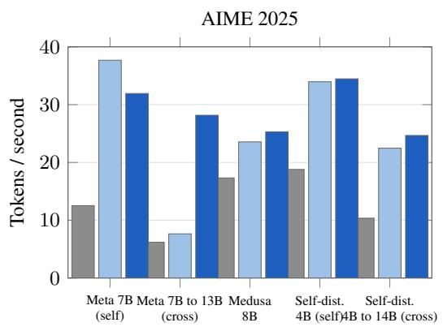

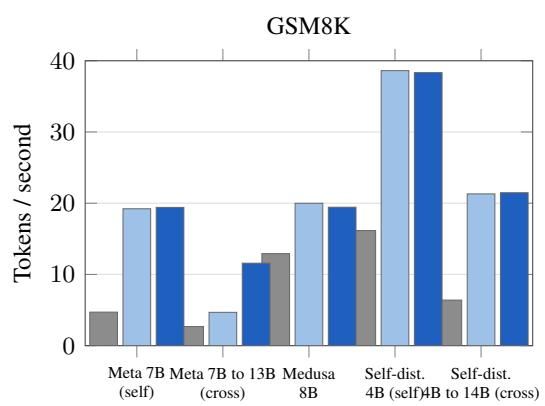  
(a) Decoding throughput (tokens/second) for plain decoding, the best fixed window, and AMTP, across all five pairings and both evaluation tasks. Every multi-token-prediction condition beats plain decoding; the Meta MTP cross-model pairing (facebook/multi-token-prediction draft to Llama-2-13B target) shows the largest absolute gap between fixed and adaptive.

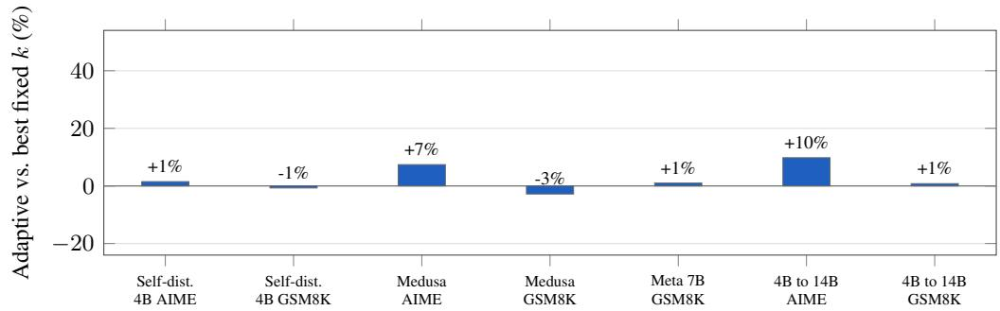  
(b) Throughput of AMTP, relative to the best fixed window, self-speculative pairings and the modest-effect cross-model pairing (self-distilled 4B→14B).

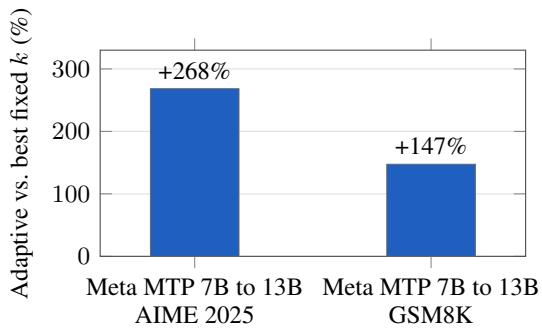  
(c) The cross-model Meta MTP pairing (draft/target cost asymmetry), shown on its own axis given the scale of the effect relative to every other condition.

Figure 4: Top: decoding throughput of plain decoding, the best fixed window and AMTP. Every multi-token-prediction condition is faster than plain decoding. Middle: throughput of AMTP relative to the best fixed window, for self-speculative pairings and the self-distilled cross-model pairing — effects are modest in both directions, within about 15% either way. Bottom: the Meta MTP crossmodel pairing, shown separately because its gain (+268% AIME, +147% GSM8K) is an order of magnitude larger than every other condition — draft/target cost asymmetry combined with long, variable-length reasoning produces the largest effect in this validation.

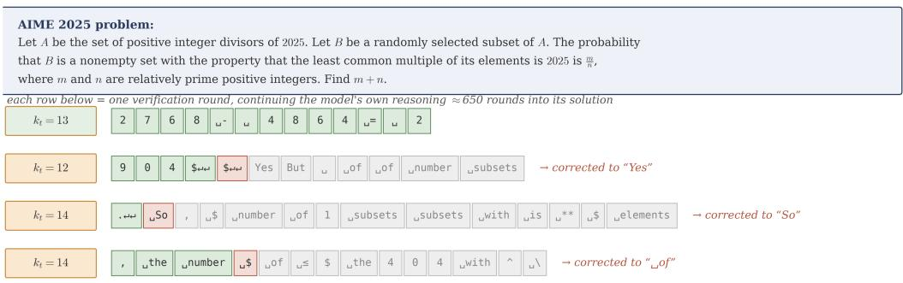  
Figure 5: Four consecutive real verification rounds (648–651) from one adaptive-control-block run on AIME 2025 (self-distilled Qwen3-4B). Green tokens were accepted, the red token was rejected and replaced by the correction shown on the right (resampled from the residual), and grey tokens were drafted but never verified because the round already stopped at the rejection. The control block re-selects the window $k _ { t }$ every round (shown on the left). All tokens, windows, and corrections are taken directly from logged telemetry.

Example 2: full acceptance with a bonus token. Later in the same run, round 101 is more typical of an easy stretch. The context ends “ . . . we want to count”, following directly from the probability setup. The control block forecasts rejection hazards $\widehat { h } _ { t , 1 } = 0 . 4 0 , \widehat { h } _ { t , 2 } = 0 . 4 8 , \widehat { h } _ { t , 3 } = 0 . 5 5$ for the next three positions, giving a predicted gain $\widehat { G } _ { t } ( 3 ) \approx 1 + 0 . 6 0 + 0 . 3 1 + 0 . 1 4 \approx$ 2.05 expected committed tokens, and the controller selects $\bar { k } _ { t } { = } 3$ . Table 10 lists the single round. Since the draft is verified in full with no rejection, the engine draws one additional bonus token directly from the target’s own distribution rather than discarding the round.
<table><tr><td>Round</td><td> $k _ { t }$ </td><td>Draft</td><td></td><td>Accepted Bonus</td><td></td></tr><tr><td>101</td><td>3</td><td></td><td>thenumber  $\_ \mathrm { o f }$ </td><td>3/3 (all)</td><td> $\_ { \mathrm { n o n } }$ </td></tr></table>

Table 10: One real verification round (101) with full acceptance, from the same adaptive-controlblock run as Table 9. The bonus token is sampled from the target’s distribution at the position immediately after the draft, since no rejection occurred.

The committed text for the round is therefore “ the number of non”, four tokens from a single target forward pass, with no correction needed.