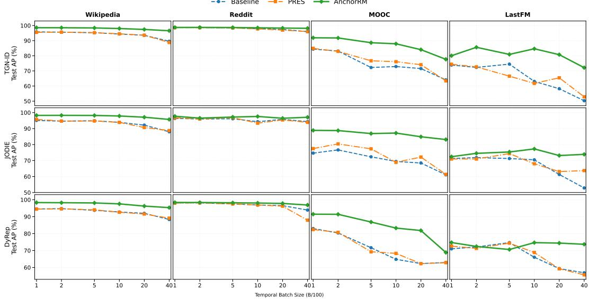
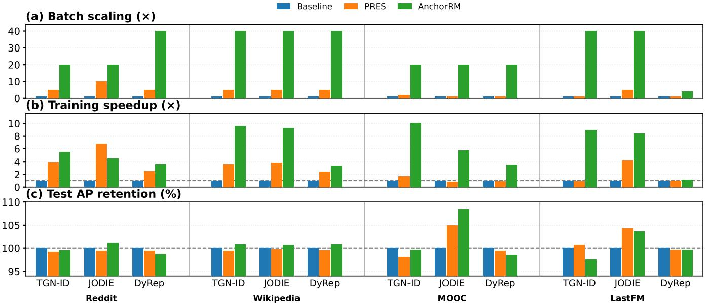
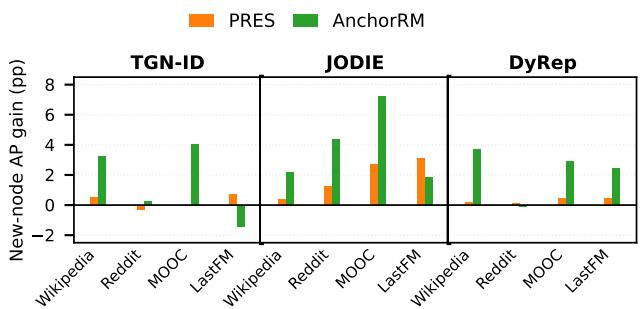
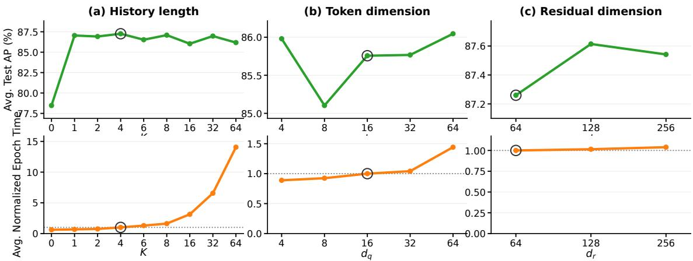

# AnchorRM: Parallel Intra-Batch State Reconstruction with Anchor-Based Residual Memory for Temporal Graph Neural Networks

Haroon Gharwi1\* Kai Shu2+ Yue Dai3\*

Department of Computer Science, Illinois Institute of Technology, Chicago, IL, USA

+Department of Computer Science, Emory University, Atlanta, GA, USA

1hgharwi@hawk.illinoistech.edu 2kai.shu@emory.edu 3ydai21@illinoistech.edu

## Abstract

Memory-based temporal graph neural networks (TGN) rely on recurrent node memories to capture evolving interaction histories. However, temporal mini-batching introduces a trade-of between computational eficiency and temporal fidelity: when a node appears multiple times within the same batch, later interactions are evaluated using stale pre-batch memory because the intermediate memory updates have not yet been committed. This problem becomes more severe as temporal batch size increases. To overcome this challenge, We propose AnchorRM, an anchor-based residual memory mechanism that reconstructs event-specific intra-batch node states without executing sequential recurrent updates. AnchorRM treats the last committed node memory at the beginning of each batch as a pre-batch fixed anchor and uses causally preceding same-batch interactions to infer the missing state evolution relative to that anchor. The learned residual then calibrates the anchor to reconstruct an eventspecific node memory for each interaction. Because each event-specific residual is predicted directly from the fixed anchor and its causal history, reconstructed states do not depend on previously reconstructed states and can therefore be computed in parallel within the batch while preserving temporal causality. Experiments across four temporal graph datasets and three memory-based backbones demonstrate that AnchorRM achieves an average 6.16× training speedup (up to 10.05×) and 28.67× batch scaling (up to 40×). These results demonstrate that AnchorRM substantially improves the scalability and training eficiency of memory-based temporal graph learning while maintaining competitive predictive performance.

## 1 Introduction

Temporal graphs model systems in which interactions, relationships, and node states evolve over time, with applications ranging from social and communication networks to recommender systems and financial transactions [6]. Unlike static graph representations, temporal graph models must account for both the structure of interactions and their temporal ordering. A prominent class of temporal graph neural networks (TGN) therefore maintains evolving node representations that summarize interaction history [7, 10, 8]. In particular, memory-based architectures such as Temporal Graph Networks (TGN) associate each node with a persistent memory that is updated as new interactions are observed, providing an explicit mechanism for carrying historical information through the event stream [8].

The recurrent nature of node memory, however, creates a tension between temporal fidelity and eficient batch-parallel execution. Ideally, if a node u participates in a sequence of interactions e1, e2, . . . , ek, the memory used at ek should reflect the efects of all causally preceding interactions involving u. Such sequential state propagation preserves the temporal dependency of the event stream, but it restricts parallel execution. Large temporal mini-batches are attractive for improving computational throughput, and scalable TGN systems have consequently developed increasingly optimized batching, sampling, memory-management, and distributedtraining mechanisms [13, 14].

Batch-parallel processing introduces a particular dificulty for memory-based TGNs when the same node occurs multiple times within a batch. Consider a node u that participates in several interactions at diferent positions of the same temporal batch. When these interactions are processed in parallel, a later occurrence may be evaluated before the state changes induced by its earlier same-batch interactions have been incorporated into persistent memory. Consequently, multiple interactions can rely on the same pre-batch memory even though they occur at diferent points in the temporal sequence. This loss of intra-batch temporal dependency has been identified as temporal discontinuity and becomes increasingly consequential as temporal batch size grows [9]. Recent work further shows that intra-batch information loss and outdated memory states can substantially afect the accuracy of memory-based TGNs under batch-parallel training [3].

We formulate this issue as a problem of missing intrabatch state evolution. At the beginning of a temporal batch, the last committed memory of node u provides a reliable representation of its history up to the batch boundary. We refer to this state as the node’s pre-batch anchor. For a later occurrence of u within the same batch, however, the memory required to represent the node at that event should additionally reflect its causally preceding same-batch interactions. The diference between this event-specific state and the available pre-batch anchor therefore corresponds to state evolution that has occurred in the temporal sequence but has not yet been materialized by the persistent recurrent memory.

Several recent approaches attempt to alleviate this tension between memory dependency and scalable execution. TGL and DistTGL improve the systems infrastructure for largescale and distributed temporal graph training [13, 14]. PRES explicitly addresses temporal discontinuity through an iterative prediction–correction procedure together with memorycoherence learning [9]. RBT measures intra-batch information loss more finely and combines batch refinement with memory compensation [3], while Cascade uses dependencyaware information to adapt temporal batch boundaries and determine how many revisits can be tolerated before memory inconsistency becomes harmful [2]. These approaches motivate a complementary question: instead of primarily restricting, partitioning, or iteratively correcting intra-batch dependencies, can the missing state required at each interaction be reconstructed directly from the causal information already available within the batch?

To address this question, we propose AnchorRM, an anchor-based residual memory mechanism for event-specific intra-batch state reconstruction. AnchorRM treats the last committed node memory at the beginning of each batch as a pre-batch anchor. For an interaction at position k, it uses the node’s causally preceding same-batch interactions to infer the missing change in memory since that anchor. This missing evolution is represented by a learned residual memory, which calibrates the pre-batch anchor to reconstruct the node state required at the current interaction. Thus, rather than predicting an event-specific state from scratch, AnchorRM estimates only the state change that has not yet been captured by persistent memory.

A key property of AnchorRM is that these event-specific states are not reconstructed recursively. For event k, the residual is inferred directly from the fixed pre-batch anchor and interactions occurring before k in the batch; it does not depend on the reconstructed state of event k − 1. Consequently, once causal same-batch histories have been identified, the residual corrections for diferent event positions can be evaluated in parallel. AnchorRM therefore preserves the causal information boundary of each interaction while removing the recurrent computational dependency among the reconstructed intra-batch states.

The resulting architecture operates at two complementary temporal scales. Persistent node memory captures committed evolution across temporal batches, whereas residual memory reconstructs the event-specific evolution that is temporarily missing inside the current batch. The reconstructed endpoint states are used for interaction prediction and are also incorporated into the messages that subsequently update persistent memory. AnchorRM therefore augments, rather than replaces, the underlying recurrent TGN memory mechanism.

Experiments across four temporal graph datasets and three memory-based backbones demonstrate the efectiveness of AnchorRM in large-batch temporal graph learning. under a relative validation-AP tolerance of ϵ = 0.01, AnchorRM achieves an average 28.67× temporal batch scaling (up to 40×) and 6.16× training speedup (up to 10.05×) relative to the original backbones. It maintains competitive predictive performance, achieving an average test AP of 87.43%, compared with 86.84% for the original backbones and 86.97% for PRES. These findings suggest that causal intra-batch state reconstruction enables more aggressive temporal batching while mitigating predictive degradation.

Our main contributions are as follows:

• We formulate the stale-memory problem in batch-parallel memory-based TGNs as an event-specific missing-state problem, where the unavailable intra-batch evolution is represented relative to the last committed pre-batch memory.

• We introduce AnchorRM, an anchor-based residual memory mechanism that uses causally preceding samebatch interactions to infer the missing state change and reconstruct the node memory required at each interaction.

• We develop a causal parallel formulation in which each event-specific residual is inferred directly from a shared pre-batch anchor and its corresponding causal history, eliminating recurrent dependencies among reconstructed states within a temporal batch.

• We conduct extensive experiments across four datasets and three memory-based backbones, demonstrating substantial improvements in accuracy-tolerant batch scaling and training eficiency. Ablation studies further investigate the efects of causal history capacity, residual reconstruction, and model dimensions.

## 2 Related Work

## 2.1 Memory-Based Temporal Graph Neural Networks

Continuous-time temporal graph models represent dynamic systems as streams of timestamped interactions and update node representations as new events arrive. JODIE models user and item trajectories using coupled recurrent neural networks and introduces t-Batch to construct time-consistent batches for eficient training [7]. DyRep models evolving node representations while jointly capturing communication and structural dynamics in dynamic graphs [10]. Temporal Graph Networks (TGN) provide a more general framework that combines node memory, message construction, temporal encoding, message aggregation, memory updating, and graphbased embedding modules [8]. Persistent node memories in these models are closely related to recurrent state modeling. Gated recurrent units (GRUs) update a hidden state by combining the previous state with newly observed information through learned gating mechanisms [1]. In memory-based temporal graph models, recurrent updaters such as GRUs can therefore be used to evolve persistent node states from temporally aggregated interaction messages.

## 2.2 Mitigating Intra-Batch Temporal Staleness

Several systems have been developed to improve the scalability of temporal graph neural networks. TGL provides a general framework for large-scale TGN training with optimized temporal sampling, mailbox storage, node-memory management, message passing, and scheduling mechanisms [13]. Its random chunk scheduling strategy is designed to reduce the impact of obsolete memories when large temporal batches are used. DistTGL extends memory-based TGN training to distributed GPU environments and addresses synchronization and communication challenges associated with distributed node memories [14].

Recent work has also studied the loss of temporal information introduced by batch-parallel processing. PRES characterizes the neglect of dependencies among temporally related interactions processed within the same batch as temporal discontinuity and introduces an iterative prediction–correction mechanism together with memory-coherence learning [9].

RBT formulates the problem in terms of intra-batch information loss, develops a finer-grained measure of this loss, and combines refined batch construction with memory compensation [3]. Cascade adopts a dependency-aware batching strategy that uses spatial independence and node-memory stability to determine when temporal dependencies can be relaxed while maintaining eficient execution [2].

## 2.3 Aggregation in Graph Neural Networks

Aggregation is a central operation in graph neural networks because a node representation is commonly constructed by combining information from multiple local signals. Graph-SAGE develops inductive representation learning through sampling and learned neighborhood aggregation [5]. Graph Attention Networks (GAT) introduce attention-based aggregation, allowing neighboring nodes to contribute with different learned importance weights [11]. Graph Isomorphism Networks (GIN) study the expressive power of neighborhood aggregation and show the importance of expressive aggregation functions for distinguishing diferent graph structures [12].

These works illustrate several major approaches to combining multiple inputs, including learned neighborhood aggregation, attention-based weighting, and expressive multiset aggregation. Such aggregation mechanisms are particularly relevant when models must combine a variable number of interaction or neighborhood signals into a fixed-dimensional representation.

## 2.4 Residual Memory Modeling

Residual modeling has also been explored in sequential learning. VARNN introduces an explicit residual-memory pathway in which recent prediction deviations are represented separately from the primary predictive state and used to recalibrate subsequent predictions [4]. This primary-state/residualstate decomposition provides a mechanism for separating the dominant temporal representation from additional information associated with recent deviations or variability. AnchorRM follows the broader principle of maintaining complementary primary and residual state information, but assigns the residual a diferent semantic role. Rather than representing prediction error, the residual in AnchorRM models the node-state evolution that is missing from the persistent memory due to causally preceding interactions within the current temporal batch. The persistent node memory therefore serves as the primary state, while the residual captures the uncommitted intra-batch evolution required to reconstruct an event-specific node state.

## 3 Preliminaries and Problem Formulation

## 3.1 Temporal Interaction Graphs

We consider a continuous-time temporal graph represented by a chronologically ordered sequence of interactions $\varepsilon =$ $\{ e _ { 1 } , e _ { 2 } , \ldots , e _ { T } \}$ , where each interaction is defined as $e _ { k } =$ $( u _ { k } , v _ { k } , t _ { k } , x _ { k } )$ . Here, $u _ { k }$ and $v _ { k }$ denote the source and destination nodes involved in the k-th interaction, $t _ { k }$ denotes its timestamp, and $x _ { k } \in \mathbb { R } ^ { d _ { x } }$ represents optional interaction features. We assume the interaction stream is processed in chronological order, $t _ { 1 } \leq t _ { 2 } \leq \dots \leq t _ { T }$ . The learning task considered in this work is temporal link prediction, where the model predicts whether an interaction between a pair of nodes occurs at a given point in the event stream using only information available before that interaction.

## 3.2 Persistent Memory in Temporal Graph Networks

Memory-based temporal graph neural networks maintain a persistent state for each node to summarize its historical interactions [8]. Let $h _ { u } \in \mathbb { R } ^ { d _ { h } }$ denote the persistent memory associated with node u. When a new interaction involving u is processed, a message $m _ { u }$ is constructed from the current interaction and relevant node states. An aggregated message is then used to update the node memory through a recurrent memory updater, $h _ { u } ^ { \mathrm { n e w } } = U ( h _ { u } ^ { \mathrm { o l d } } , m _ { u } )$ , where $U ( \cdot )$ may be implemented using a gated recurrent unit (GRU) [1].

This recurrent formulation naturally induces a temporal dependency between successive interactions involving the same node.

## 3.3 Temporal Mini-Batching

For computational eficiency, temporal interactions are commonly processed in chronological mini-batches. Let $\boldsymbol { B } =$ $\{ e _ { 1 } , e _ { 2 } , \dots , e _ { B } \}$ denote a temporal batch containing B consecutive interactions. For a node $u ,$ let $a _ { u } = h _ { u } ^ { \mathrm { p r e } }$ denote its last committed persistent memory immediately before processing the batch. We refer to $a _ { u }$ as the pre-batch state. If node u occurs only once in the batch, this pre-batch state contains all of its historical information available before that interaction, except for events involving other nodes that do not afect u’s recurrent state. The dificulty arises when u occurs multiple times within the same batch.

Suppose node u participates in interactions at batch positions $j _ { 1 } < j _ { 2 } < \dots < j _ { r } < k$ . Under exact sequential recurrent processing, the state required immediately before event $e _ { k }$ would be

$$
\mathfrak { h } _ { u , k } ^ { * } = U \Big ( \cdot \cdot \cdot U ( U ( a _ { u } , m _ { u , j _ { 1 } } ) , m _ { u , j _ { 2 } } ) \cdot \cdot \cdot , m _ { u , j _ { r } } \Big ) ,
$$

where $m _ { u , j _ { i } }$ denotes the message associated with node u at interaction position $j _ { i }$ . Therefore, ${ h } _ { u , k } ^ { * }$ contains the accumulated efect of the relevant same-batch interactions that occurred before $e _ { k }$

## 3.4 Intra-Batch Stale Memory

Batch-parallel processing can prevent these intermediate recurrent states from being materialized before later interactions in the same batch are evaluated. In this case, multiple occurrences of node u can use a state that remains close to the pre-batch memory, $h _ { u , k } ^ { \mathrm { b a t c h } }$ ≈ $a _ { u } ,$ , even though the sequentially correct state is ${ h } _ { u , k } ^ { * }$ . Consider three interactions involving node A:

$$
e _ { 1 } = ( A , B ) , \qquad e _ { 2 } = ( A , C ) , \qquad e _ { 3 } = ( A , D ) ,
$$

the exact temporal dependency is

$$
{ h } _ { A } ^ { ( 0 ) } \stackrel { e _ { 1 } } { \longrightarrow } { h } _ { A } ^ { ( 1 ) } \stackrel { e _ { 2 } } { \longrightarrow } { h } _ { A } ^ { ( 2 ) } \stackrel { e _ { 3 } } { \longrightarrow } { h } _ { A } ^ { ( 3 ) } .
$$

However, under large-batch processing, prediction at the three event positions may efectively use

$$
e _ { 1 } : h _ { A } ^ { ( 0 ) } , \qquad e _ { 2 } : h _ { A } ^ { ( 0 ) } , \qquad e _ { 3 } : h _ { A } ^ { ( 0 ) } ,
$$

before the corresponding same-batch updates are committed. For e3, the discrepancy is especially clear: the state required for prediction should contain the efects of $e _ { 1 }$ and $^ { e _ { 2 } , }$ but the available persistent memory may contain neither. This phenomenon is closely related to the temporal discontinuity and intra-batch information-loss problems identified in prior work [9, 3].

## 3.5 Missing Intra-Batch State Evolution

Rather than viewing stale memory only as an outdated-state problem, we formulate it in terms of the state evolution that is missing from the pre-batch memory. For node u at event position $k ,$ define the ideal missing state evolution as

$$
r _ { u , k } ^ { * } = h _ { u , k } ^ { * } - a _ { u } .
$$

The quantity $r _ { u , k } ^ { * }$ represents the cumulative efect of the causally preceding same-batch interactions involving node u that has not yet been reflected in its persistent memory. For the first occurrence of u in a batch, no earlier samebatch interaction involving u exists, and therefore $r _ { u , k } ^ { * } = 0$ For later occurrences, $r _ { u , k } ^ { * }$ generally becomes nonzero and depends on the sequence of preceding interactions involving u. Let the causal same-batch history available to node u before event position k be

$$
\mathcal { H } _ { u , k } = \left\{ q _ { u , j } : j < k , u \in e _ { j } \right\} ,
$$

where $q _ { u , j }$ denotes a representation of interaction $e _ { j }$ from the perspective of node u. By construction, $\mathcal { H } _ { u , k }$ contains only interactions that occur earlier than $e _ { k }$ in the temporal batch and therefore preserves event-order causality.

## 3.6 Problem Formulation

The objective is to recover the event-specific node state required at position k without explicitly executing the corresponding sequence of recurrent memory updates inside the batch. Equivalently, given the pre-batch state $a _ { u }$ and the causal same-batch history $\mathcal { H } _ { u , k }$ , we seek a function

$$
R _ { \theta } \left( a _ { u } , \mathcal { H } _ { u , k } \right)
$$

that approximates the missing state evolution, $R _ { \theta } \left( a _ { u } , \mathcal { H } _ { u , k } \right) \approx r _ { u , k } ^ { * } = h _ { u , k } ^ { * } - a _ { u }$ . Then, the corresponding reconstructed event-specific state is:

$$
\tilde { h } _ { u , k } = a _ { u } + R _ { \theta } \left( a _ { u } , \mathcal { H } _ { u , k } \right) .
$$

Thus, she desired reconstruction should satisfy three properties:

1. Causality. The reconstructed state for event k must depend only on information available before $e _ { k }$ . In particular, neither the current event nor future events may enter $\mathcal { H } _ { u , k }$

2. Event specificity. Repeated occurrences of the same node within a batch should be allowed to receive diferent reconstructed states according to their respective causal histories.

3. Parallelizability. Reconstruction of the state at position k should not require the previously reconstructed state at position $k - 1$ . Removing this recurrent dependency permits event-specific state reconstruction to be evaluated in parallel after the causal histories have been constructed.

This formulation transforms large-batch stale memory into a causal residual state-reconstruction problem. The next section introduces the proposed AnchorRM mechanism for estimating this missing intra-batch evolution.

## 4 AnchorRM: Anchor-Based Residual Memory Reconstruction

## 4.1 Overview

The formulation in Section 3 identifies the unavailable intrabatch state evolution for node u at event position k as $r _ { u , k } ^ { * } = h _ { u , k } ^ { * } - a _ { u } ,$ where $a _ { u }$ is the node state committed before the current temporal batch and ${ h } _ { u , k } ^ { * }$ is the state that would ideally incorporate the efects of all causally preceding samebatch interactions involving u. We propose AnchorRM, an anchor-based residual memory mechanism that directly estimates this missing evolution without executing the corresponding recurrent updates sequentially. For each node, the last committed persistent memory at the beginning of the batch is treated as a fixed anchor within that batch. Causally preceding same-batch interactions are encoded into event tokens and used to estimate an event-specific residual,

$$
\hat { \mathbf { r } } _ { u , k } = R _ { \theta } \left( a _ { u } , \mathcal { H } _ { u , k } \right) .
$$

The node state used at event k is reconstructed as

$$
\tilde { h } _ { u , k } = a _ { u } + \hat { \mathbf { r } } _ { u , k } .
$$

The reconstructed state therefore consists of two components: the committed historical information contained in $a _ { u }$ and an estimated correction for the state evolution that has occurred after that anchor but has not yet been committed to persistent memory.

## 4.2 Pre-Batch Memory Anchor

Consider a temporal batch $\boldsymbol { B } = \{ e 1 , e 2 , \ldots , e _ { B } \}$ . Before processing the interactions in B, AnchorRM retrieves the persistent memory of every node required by the batch. For node $u ,$ we define $a _ { u } = h _ { u } ^ { \mathrm { p r e } }$ as its pre-batch anchor. We additionally retain the node’s most recent committed update time, denoted by $\tau _ { u }$ . The anchor remains unchanged while event-specific states for the current batch are reconstructed. Importantly, it is fixed only within the current batch. After the batch has been processed and its messages have been committed, the updated persistent memory becomes the anchor for the next temporal batch.

Using a shared pre-batch anchor provides a stable reference point from which the missing state evolution at diferent event positions can be estimated independently.

## 4.3 Anchor-Conditioned Interaction Tokens

The residual required at a later interaction depends not only on how many earlier interactions involved the node, but also

on the content and temporal context of those interactions. We therefore encode each interaction into a compact nodeoriented event token. For an interaction

$$
e _ { k } = ( u _ { k } , v _ { k } , t _ { k } , x _ { k } ) ,
$$

the source-oriented token is constructed as $\begin{array} { r l } { q _ { u _ { k } , k } } & { { } = } \end{array}$ $E _ { \phi } \left( \left[ a _ { u _ { k } } , a _ { v _ { k } } , x _ { k } , \mathrm { T E } ( t _ { k } - \tau _ { u _ { k } } ) \right] \right)$ , where $E _ { \phi }$ is a learned event encoder and TE(·) denotes a temporal encoding. Similarly, the destination-oriented token reverses the endpoint roles, $q _ { v _ { k } , k } = E _ { \phi } \left( \left[ a _ { v _ { k } } , a _ { u _ { k } } , x _ { k } , \mathrm { T E } ( t _ { k } - \tau _ { v _ { k } } ) \right] \right)$ . Thus, the same interaction produces diferent representations from the perspectives of its two participating nodes. The node’s own anchor provides its historical context, while the partner anchor describes the state of the node with which it interacted. All event tokens in the batch are constructed from the prebatch anchor snapshot. Their construction therefore does not require sequential intra-batch memory updates.

## 4.4 Causal Same-Batch Interaction History

For node u at event position k, AnchorRM considers only interactions involving u that occur earlier in the same batch:

$$
\mathcal { H } _ { u , k } = \left[ q _ { u , j _ { 1 } } , q _ { u , j _ { 2 } } , \dots , q _ { u , j _ { r } } \right] ,
$$

where $j _ { 1 } < j _ { 2 } < \dots < j _ { r } < k$ . The strict condition $j < k$ is central to the construction. The token associated with the current event $e _ { k }$ is not included in the history used to reconstruct the state for $^ { e _ { k } , }$ and neither are tokens from future event positions. For the example introduced in Section 3, the causal histories of node A are

$$
\mathcal { H } _ { A , 1 } = \emptyset , \qquad \mathcal { H } _ { A , 2 } = [ q _ { A , 1 } ] , \qquad \mathcal { H } _ { A , 3 } = [ q _ { A , 1 } , q _ { A , 2 } ] .
$$

Consequently, the reconstructed state used for $e _ { 3 }$ can reflect the efects of $e _ { 1 }$ and $e _ { 2 } ,$ , but it cannot access information from $e _ { 3 }$ itself.

## 4.5 Fixed-Capacity Causal History with Masking

Diferent nodes can have diferent numbers of preceding interactions within a batch. To support tensorized computation, AnchorRM converts each variable-length causal history into a fixed-size representation. Let K denote the maximum number of preceding interaction tokens retained for each query. If more than K causal events are available, the most recent K are retained while preserving their chronological order. The resulting history tensor is $\bar { H _ { u , k } } \in \mathbb { R } ^ { K \times d _ { q } }$

where $d _ { q }$ is the event-token dimension. A corresponding binary mask $M _ { u , k } \in \{ 0 , 1 \} ^ { k }$

indicates which positions contain valid causal events. For example, if only three previous interactions are available and $K = 5$

$$
H _ { u , k } = \left[ \begin{array} { l } { q _ { u , j _ { 1 } } } \\ { q _ { u , j _ { 2 } } } \\ { q _ { u , j _ { 3 } } } \\ { 0 } \\ { 0 } \end{array} \right] , \qquad M _ { u , k } = [ 1 , 1 , 1 , 0 , 0 ] .
$$

The mask serves two purposes. First, it distinguishes valid interaction tokens from padded positions. Second, together with the history-construction rule $j < k ,$ it ensures that only causally available same-batch information is presented to the residual estimator. Masking itself does not determine how the preceding interactions should be combined. Instead, it specifies which history positions are valid, while the learned residual estimator determines how the corresponding interaction signals contribute to the reconstructed state.

## 4.6 Residual Memory Estimation

The masked causal history is combined with the pre-batch anchor to estimate the missing state evolution. Let

$$
\bar { H } _ { u , k } = \mathrm { v e c } \left( H _ { u , k } \odot M _ { u , k } \right)
$$

denote the flattened masked interaction history. AnchorRM computes

$$
{ \hat { \mathbf { r } } } _ { u , k } = R _ { \theta } \left( \left[ a _ { u } , { \bar { H } } _ { u , k } , M _ { u , k } \right] \right) ,
$$

where $R _ { \theta }$ is a feed-forward residual estimator.

The inclusion of the anchor allows the same interaction history to imply diferent corrections depending on the node’s committed state. The event tokens preserve information about the preceding interactions, while the mask provides the residual estimator with the valid history structure. If no causally preceding same-batch interaction involving u exists, no intra-batch correction is required and we set $\hat { \mathbf { r } } _ { u , k } =$ 0. Otherwise, the residual estimator approximates $\hat { \mathbf { r } } _ { u , k }$ ≈ $r _ { u , k } ^ { * } = h _ { u , k } ^ { * } - a _ { u }$ . The event-specific state is consequently reconstructed as $\tilde { h } _ { u , k } = a _ { u } + \hat { \mathbf { r } } _ { u , k }$

## 4.7 Interaction Prediction

For interaction $\boldsymbol { e } _ { k } = \left( u _ { k } , v _ { k } , t _ { k } , x _ { k } \right)$ , AnchorRM reconstructs the event-specific states of both endpoints, $\tilde { h } _ { u _ { k } , k } = a _ { u _ { k } }$ + $\hat { \mathbf { r } } _ { u _ { k } , k } , \tilde { h } _ { v _ { k } , k } = a _ { v _ { k } } + \hat { \mathbf { r } } _ { v _ { k } , k } .$

These states replace the stale pre-batch endpoint memories when computing the representation used for temporal link prediction. A scoring function $S _ { \psi }$ produces the interaction score,

$$
\hat { y } _ { k } = S _ { \psi } \left( \tilde { h } _ { u _ { k } , k } , \tilde { h } _ { v _ { k } , k } \right) .
$$

Negative node pairs are evaluated analogously using the causal history available to the queried nodes at the corresponding event position.

Therefore, two occurrences of the same node within one temporal batch need not use the same representation: each occurrence receives an event-specific state determined by the causal interaction history available at that position.

## 4.8 Persistent Memory Update

The reconstructed states are temporary event-specific representations; they do not replace the persistent TGN memory. After prediction, they are also used to construct the messages that will subsequently update persistent memory. For interaction $e _ { k } = ( u _ { k } , v _ { k } , t _ { k } , x _ { k } )$ , the endpoint messages are formed using the reconstructed states, $\begin{array} { r l r } { m _ { u _ { k } , k } } & { = } & { \Big [ \tilde { h } _ { u _ { k } , k } , \tilde { h } _ { v _ { k } , k } , x _ { k } , \mathrm { T E } ( t _ { k } - \tau _ { u _ { k } } ) \Big ] } \end{array}$ , and $\begin{array} { r l } { m _ { v _ { k } , k } } & { { } = } \end{array}$ $\left\lceil \tilde { h } _ { v _ { k } , k } , \tilde { h } _ { u _ { k } , k } , x _ { k } , \mathrm { T E } ( t _ { k } - \tau _ { v _ { k } } ) \right\rceil$ . The resulting messages are aggregated according to the underlying memory-based TGN and used by its recurrent updater to advance persistent node memory at the batch boundary.

## 4.9 Causality and Parallelization

AnchorRM separates temporal causality from recurrent computational dependency. Causality is enforced through the history condition $j < k$ , so the state used for event k can incorporate earlier same-batch interactions but cannot incorporate the current or future interactions.

At the same time, every residual has the form $\hat { \mathrm { \bf ~ r } } _ { u , k } =$ $R _ { \theta } \left( a _ { u } , \mathcal { H } _ { u , k } \right)$ , rather than $\hat { \mathbf { r } } _ { u , k } = R _ { \theta } \left( \tilde { h } _ { u , k - 1 } , q _ { u , k - 1 } \right)$ . Consequently, after the causal histories have been assembled, residual estimation across event positions does not require sequential recurrent execution. The method therefore preserves event-order causality while allowing intra-batch state reconstruction to be implemented with parallel tensor operations.

## 5 Experimental Setup

We evaluate AnchorRM for temporal link prediction with two objectives. First, we study whether causal intra-batch state reconstruction reduces the predictive degradation caused by increasingly large temporal batches. Second, we want to examine how much larger a temporal batch AnchorRM can support to the best-performing TGN configuration, and measure the corresponding training speedup. Unless otherwise stated, all main experiments use the default AnchorRM configuration $K = 4 ,$ event-token dimension $d _ { q } = 1 6$ , and residual hidden dimension $d _ { r } ~ = ~ 6 4$ Variations of these architectural parameters are reserved for the ablation study.

## 5.1 Datasets

We evaluate AnchorRM on four temporal interaction benchmarks: Wikipedia, Reddit, MOOC, and LastFM [7]. We follow the chronological preprocessing and inductive evaluation protocol used by TGN, preserving the temporal ordering of all interactions.

## 5.2 Baselines

We compare AnchorRM with established memory-based temporal graph learning methods and existing approaches for mitigating intra-batch temporal dependencies. Our primary baseline is Temporal Graph Networks (TGN) [8], which maintains persistent node memories through recurrent updates. To investigate generalization across memory-based architectures, we additionally consider JODIE [7], DyRep [10]. We further evaluate the PRES framework [9], which addresses temporal discontinuity through iterative prediction– correction and memory-coherence learning, using its oficial repository and the default experimental settings reported in the original paper. For controlled comparisons, we use consistent data splits, negative sampling, training budgets, and checkpoint-selection criteria. TGN, JODIE, DyRep, and AnchorRM are evaluated using the same tensorized execution backend.

## 5.3 Training Protocol

We train the evaluated backbones and their AnchorRM variants using a learning rate of $1 0 ^ { - 4 }$ and consistent chronological data splits. Each experiment was conducted on a single NVIDIA Tesla V100 GPU. Unless otherwise specified, the main batch-scaling experiments use a maximum of 100 training epochs, with checkpoints selected according to validation AP. We evaluate temporal batch sizes $B \in \{ 1 0 0 , 2 0 0 , 5 0 0$ , 1000, 2000, 4000}. For each backbone, the training configuration is kept fixed across batch sizes to isolate the efect of temporal batching.

Since persistent node memory represents part of the model’s temporal state, checkpoints preserve both the learned parameters and the corresponding memory state. Evaluation follows chronological order, with testing initialized from the memory state obtained after processing validation. Overall and new-node evaluations use separate memory backups to prevent interference between evaluation settings.

All main experiments use random seed 2026, with consistent data splits, fixed evaluation negative samplers, and matched optimization settings across the original backbones and their AnchorRM variants.

## 5.4 Evaluation Metrics

We report average precision (AP) for both overall temporal link prediction and inductive new-node prediction, where new nodes are those not observed during training [8]. AP is used for checkpoint selection and predictive performance evaluation. Fixed evaluation negative samplers are used across compared methods to ensure consistent evaluation.

## 5.4.1 Accuracy-Tolerant Batch Scaling and Training Speedup

Increasing temporal batch size can improve training eficiency but may degrade predictive performance due to intra-batch temporal dependencies. To quantify this accuracy–eficiency trade-of, we evaluate how much the temporal batch size can be increased while maintaining a prescribed level of predictive quality. We define the accuracy-tolerant batch-scaling factor as follows. Let $\mathcal { B } = \{ 1 0 0 , 2 0 0 , 5 0 0 , 1 0 0 0 , 2 0 0 0 , 4 0 0 0 \}$ denote the set of evaluated temporal batch sizes. For each backbone and dataset, we first select the reference configuration according to validation average precision (AP):

$$
B _ { \mathrm { b a s e } } ^ { * } = \arg \operatorname* { m a x } _ { B \in \mathcal { B } } { \mathrm { A P } } _ { \mathrm { b a s e } } ^ { \mathrm { v a l } } ( B ) .\tag{1}
$$

The corresponding reference validation accuracy is

$$
A _ { \mathrm { b a s e } } ^ { \mathrm { * } } = \mathrm { A P _ { b a s e } ^ { v a l } } \left( B _ { \mathrm { b a s e } } ^ { \mathrm { * } } \right) .\tag{2}
$$

Let $\epsilon \geq 0$ denote the maximum allowable relative degradation in validation AP. For each method M ∈ {PRES, AnchorRM}, we define the largest admissible batch size as

$$
B _ { M } ^ { * } ( \epsilon ) = \operatorname* { m a x } \left\{ B \in \mathcal { B } : \operatorname { A P } _ { M } ^ { \mathrm { v a l } } ( B ) \geq ( 1 - \epsilon ) A _ { \mathrm { b a s e } } ^ { * } \right\} .\tag{3}
$$

The resulting accuracy-tolerant batch-scaling factor is

$$
S _ { B } ( M , \epsilon ) = { \frac { B _ { M } ^ { * } ( \epsilon ) } { B _ { \mathrm { b a s e } } ^ { * } } } .\tag{4}
$$

  
Figure 1: Test AP across temporal batch sizes on Wikipedia, Reddit, MOOC, and LastFM using TGN-ID, JODIE, and DyRep backbones. AnchorRM generally maintains higher predictive performance as temporal batch sizes increase compared with the original backbones and PRES.

Table 1: Accuracy-tolerant batch scaling and training eficiency (ϵ = 0.01). Bold indicates the highest test AP within each backbone and dataset. Numbers in parentheses indicate batch size or seconds per epoch.
<table><tr><td></td><td colspan="3">REDDIT</td><td colspan="3">WIKI</td><td colspan="3">MO0C</td><td colspan="3">LASTFM</td></tr><tr><td>Model</td><td>|AP(%)</td><td>Batch</td><td>Speedup</td><td>|AP(%)</td><td>Batch</td><td>Speedup</td><td>|AP(%)</td><td>Batch</td><td>Speedup</td><td>|AP(%)</td><td>Batch</td><td>Speedup</td></tr><tr><td>TGN-ID</td><td>98.62</td><td>1× (200)</td><td>1.00× (8.84s)</td><td>95.81</td><td>1× (100)</td><td>1.00× (2.45s)</td><td>84.42</td><td>1× (100)</td><td>1.00× (7.61s)</td><td>73.87</td><td>1× (100)</td><td>1.00× (18.09s)</td></tr><tr><td>TGN-ID+PRES†</td><td>97.79</td><td>5× (1000)</td><td>3.91× (2.26s)</td><td>95.25</td><td>5× (500)</td><td>3.60× (0.68s)</td><td>82.89</td><td>2× (200)</td><td>1.71× (4.46s)</td><td>74.38</td><td>1× (100)</td><td>0.91× (19.98s)</td></tr><tr><td>TGN-ID+AnchorRM</td><td>98.15</td><td>20× (4000)</td><td>5.53× (1.60s)</td><td>96.55</td><td>40× (4000)</td><td>9.61× (0.25s)</td><td>84.04</td><td>20× (2000)</td><td>10.05× (0.76s)</td><td>72.15</td><td>40× (4000)</td><td>9.00× (2.01s)</td></tr><tr><td>JODIE</td><td>96.00</td><td>1× (200)</td><td>1.00× (6.96s)</td><td>95.10</td><td>1× (100)</td><td>1.00× (2.31s)</td><td>76.64</td><td>1× (200)</td><td>1.00× (3.32s)</td><td>71.28</td><td>1× (100)</td><td>1.00× (17.41s)</td></tr><tr><td>JODIE+PRES†</td><td>95.42</td><td>10× (2000)</td><td>6.73× (1.03s)</td><td>94.77</td><td>5× (500)</td><td>3.81× (0.61s)</td><td>80.41</td><td>1× (200)</td><td>0.84× (3.96s)</td><td>74.35</td><td>5× (500)</td><td>4.23× (4.12s)</td></tr><tr><td>JODIE+AnchorRM</td><td>97.08</td><td>20× (4000)</td><td>4.56× (1.53s)</td><td>95.73</td><td>40×(4000)</td><td>9.26× (0.25s)</td><td>83.15</td><td>20×(4000)</td><td>5.77× (0.58s)</td><td>73.87</td><td>40× (4000)</td><td>8.42× (2.07s)</td></tr><tr><td>DyRep</td><td>98.12</td><td>1× (100)</td><td>1.00× (19.53s)</td><td>94.55</td><td>1× (100)</td><td>1.00× (3.52s)</td><td>82.95</td><td>1× (100)</td><td>1.00× (9.72s)</td><td>74.68</td><td>1× (500)</td><td>1.00× (10.66s)</td></tr><tr><td>DyRep+PRES†</td><td>97.51</td><td>5× (500)</td><td>2.50× (7.81s)</td><td>94.03</td><td>5× (500)</td><td>2.42× (1.46s)</td><td>82.41</td><td>1× (100)</td><td>0.88× (11.02s)</td><td>74.37</td><td>1× (500)</td><td>0.96× (11.12s)</td></tr><tr><td>DyRep+AnchorRM</td><td>96.86</td><td>40×(4000)</td><td>3.60× (5.43s)</td><td>95.32</td><td>40×(4000)</td><td>3.40× (1.04s)</td><td>81.81</td><td>20× (2000)</td><td>3.56× (2.73s)</td><td>74.39</td><td>4× (2000)</td><td>1.17× (9.11s)</td></tr></table>

We additionally measure the corresponding training speedup as

$$
S _ { T } ( M , \epsilon ) = \frac { T _ { \mathrm { b a s e } } ( B _ { \mathrm { b a s e } } ^ { * } ) } { T _ { M } ( B _ { M } ^ { * } ( \epsilon ) ) } ,\tag{5}
$$

where $T _ { M } ( B )$ denotes the mean training time per epoch at batch size $B ,$ excluding validation and testing. We set ϵ = 0.01, corresponding to a 1% relative validation-AP tolerance. Batch sizes are selected using validation AP only, while the corresponding test AP is reported for final evaluation.

## 6 Main Results

We evaluate the predictive performance and training scalability of AnchorRM across three memory-based backbones and four temporal graph datasets. We first examine the efect of temporal batch size on test AP, followed by accuracy-tolerant batch scaling, training speedup, and inductive new-node performance.

## 6.1 Overall Predictive Performance

Table 1 summarizes the performance of AnchorRM against the original memory-based temporal graph backbones and PRES across four datasets under a 1% relative validation-AP tolerance. AnchorRM achieves an average 6.16× training speedup (up to 10.05×) and 28.67× batch scaling (up to 40×), while maintaining competitive predictive performance. Across the 12 backbone–dataset combinations, AnchorRM achieves an average test AP of 87.43%, compared with 86.84% for the baseline and 86.97% for PRES.

Figure 1 illustrates the efect of increasing temporal batch sizes on test AP across the three backbones and four datasets. While the original backbones and PRES generally exhibit substantial performance degradation at larger batch sizes, AnchorRM maintains more stable predictive performance, particularly on Wikipedia and MOOC. This suggests that residual-based memory calibration helps mitigate the degradation associated with large-batch temporal graph processing.

Figure 2 further highlights the accuracy–eficiency tradeof, where PRES achieves an average 3.83× batch scaling and 2.71× training speedup, compared with AnchorRM’s substantially larger gains. AnchorRM achieves higher test AP than the baseline across all three backbones on Wikipedia and across all four datasets with JODIE. The largest improvement occurs on JODIE/MOOC, where test AP increases from 76.64% to 83.15% (+6.51 percentage points), while increasing the temporal batch size from 200 to 4000 (20×). Overall, these findings demonstrate that AnchorRM enables substantially more eficient large-batch training while maintaining competitive predictive accuracy.

  
Figure 2: Overall accuracy-tolerant batch scaling and training eficiency under a relative validation-AP tolerance of $\epsilon = 0 . 0 1$ (a) Temporal batch-scaling factor. (b) Training speedup relative to the original backbone. (c) Test AP retention relative to the baseline, where 100% indicates equal predictive performance. Results cover four datasets and three memory-based tempora graph backbones.

  
Figure 3: New-node test AP improvement relative to the original backbones under a relative validation-AP tolerance of $\epsilon = 0 . 0 1$

## 6.2 Performance on New Nodes

Figure 3 shows that AnchorRM improves inductive new-node prediction, achieving an average test AP of 90.36%, compared with 87.80% for the baseline and 88.59% for PRES. AnchorRM outperforms the baseline in 10 of 12 configurations, with the largest improvement on JODIE/MOOC (+7.22 percentage points) at 20× batch scaling. These findings suggest that reconstructing event-specific states from causally preceding intra-batch interactions provides useful context for nodes with limited historical memory.

## 7 Ablation Studies

## 7.1 Architectural Sensitivity

We investigate the sensitivity of AnchorRM to three architectural parameters: the number of historical interactions $K ,$ the event-token dimension $d _ { q } ,$ and the residual hidden dimension $d _ { r }$ . Each parameter is varied independently while the others are fixed at their default values $( K = 4 , d _ { q } = 1 6 , d _ { r } = 6 4 )$ using a temporal batch size of $B = 4 0 0 0$ . Figure 4 reports average test AP and normalized epoch time across 12 backbone– dataset combinations. Epoch time is normalized relative to the default configuration for each backbone–dataset pair before averaging.

History Length (K). Increasing K from 0 to 1 improves average test AP from 78.47% to 87.04%, highlighting the importance of causal intra-batch history. Performance reaches 87.26% at K = 4, while longer histories provide no consistent improvement and substantially increase computational overhead. At K = 64, average test AP decreases to 86.18% despite considerably higher training cost.

Event-Token Dimension $\left( d _ { q } \right)$ . Increasing $d _ { q }$ from 16 to 64 yields only a marginal improvement in average test AP, from 85.76% to 86.05%, while increasing epoch time by approximately 31%. This indicates that larger event representations provide limited additional predictive benefits relative to their computational overhead.

  
Figure 4: Sensitivity of AnchorRM to (a) causal history length K, (b) event-token dimension $d _ { q } ,$ and (c) residual hidden dimension $d _ { r }$ . The top row reports average test AP, while the bottom row reports normalized training time relative to the default configuration. Results are averaged across 12 backbone–dataset combinations at $B = 4 0 0 0$

Table 2: Comparison of state reconstruction strategies on Wikipedia $( B = 4 0 0 0 , K = 1 6 , d _ { q } = 1 6 , d _ { r } = 6 4 )$ . Speedup is measured relative to direct reconstruction.
<table><tr><td>Method</td><td>Val AP</td><td>Test AP</td><td>New AP</td><td>Speedup</td></tr><tr><td>Residual</td><td>0.9766</td><td>0.9707</td><td>0.9664</td><td>0.998×</td></tr><tr><td>Direct</td><td>0.9702</td><td>0.9609</td><td>0.9617</td><td>1.000×</td></tr><tr><td>Direct-Calibrated</td><td>0.9701</td><td>0.9593</td><td>0.9593</td><td>0.993×</td></tr></table>

Residual Hidden Dimension (dr). Increasing dr from 64 to 128 improves average test AP from 87.26% to 87.61%, with negligible additional per-epoch cost. Further increasing $d _ { r }$ to 256 slightly reduces test AP to 87.54%. These results suggest that increasing residual reconstruction capacity provides modest benefits, with diminishing returns at larger dimensions.

Overall, the results indicate that short causal histories and compact representations provide a favorable accuracy– eficiency trade-of, while increasing architectural capacity ofers limited additional gains.

## 7.2 Residual vs. Direct State Reconstruction

We investigate whether AnchorRM benefits specifically from reconstructing the intra-batch state as a residual relative to the fixed pre-batch anchor, rather than predicting the complete state directly. To isolate this design choice, we keep the anchor, causal same-batch history, reconstruction network, and training configuration fixed, and vary only the reconstruction rule:

$$
\tilde { \mathbf { h } } _ { u , k } = \left\{ \begin{array} { l l } { \mathbf { a } _ { u } + F _ { \theta } ( \mathbf { a } _ { u } , \mathcal { H } _ { u , k } ) , } & { \mathrm { R e s i d u a l } , } \\ { F _ { \theta } ( \mathbf { a } _ { u } , \mathcal { H } _ { u , k } ) , } & { \mathrm { D i r e c t } , } \\ { \mathbf { a } _ { u } + \alpha \left( F _ { \theta } ( \mathbf { a } _ { u } , \mathcal { H } _ { u , k } ) - \mathbf { a } _ { u } \right) , } & { \mathrm { D i r e c t - C a l i b r a t e d } . } \end{array} \right.\tag{6}
$$

where $\alpha = \sigma ( \gamma )$ is a learned scalar. For nodes with no prior same-batch interaction, the reconstructed state defaults to the pre-batch anchor, such that when $\mathcal { H } _ { u , k } = \emptyset$ , all variants set $\tilde { \mathbf { h } } _ { u , k } = \mathbf { a } _ { u }$

As shown in Table 2, residual reconstruction achieves the strongest predictive performance across the evaluated variants. Relative to direct reconstruction, it improves test AP from 0.9609 to 0.9707, while also improving new-node AP from 0.9617 to 0.9664. The direct-calibrated variant does not close this gap, indicating that simply constraining a fullstate prediction toward the anchor is insuficient. All three variants exhibit nearly identical training speed, indicating that the accuracy improvements of residual reconstruction incur negligible computational overhead. Intuitively, the pre-batch anchor already captures the node’s established state, so the reconstruction network only needs to model the change induced by preceding same-batch interactions rather than relearning the full state. These results support anchor-relative residual prediction, as preserving the known pre-batch anchor and learning only the state change induced by preceding same-batch interactions provide a more efective inductive bias than directly reconstructing the full state.

## 8 conclusion

We introduced AnchorRM, a causal intra-batch state reconstruction mechanism for memory-based temporal graph neural networks. Instead of reusing stale pre-batch memories for multiple interactions within the same temporal batch, AnchorRM reconstructs each event-specific state from a fixed pre-batch anchor and its causally preceding same-batch history, while preserving parallel processing. Experiments show that AnchorRM substantially reduces the accuracy degradation caused by large temporal batches, with particularly strong improvements for new-node prediction. These results indicate that intra-batch state reconstruction enables more aggressive temporal batching while retaining high predictive accuracy. Overall, our approach identifies stale intra-batch memory as an important limitation to scaling memory-based temporal graph models and shows that causal state reconstruction provides an efective way to mitigate it.

## References

[1] Kyunghyun Cho, Bart van Merri¨enboer, Caglar Gulcehre, Dzmitry Bahdanau, Fethi Bougares, Holger Schwenk, and Yoshua Bengio. Learning phrase representations using RNN encoder–decoder for statistical machine translation. In Proceedings of the 2014 Conference on Empirical Methods in Natural Language Processing, pages 1724–1734. Association for Computational Linguistics, 2014.

[2] Yue Dai, Xulong Tang, and Youtao Zhang. Cascade: A dependency-aware eficient training framework for temporal graph neural networks. In Proceedings of the 30th ACM International Conference on Architectural Support for Programming Languages and Operating Systems, Volume 2, pages 95–110. Association for Computing Machinery, 2025.

[3] Zhengzhao Feng, Rui Wang, Longjiao Zhang, Tongya Zheng, Ziqi Huang, and Mingli Song. Eficient dynamic graphs learning with refined batch parallel training. In Proceedings of the Thirty-Fourth International Joint Conference on Artificial Intelligence, pages 2802–2810, 2025.

[4] Haroon Gharwi, Yue Dai, and Kai Shu. Variability Aware Recursive Neural Network (VARNN): A Residual-Memory Model for Capturing Temporal Deviation in Sequence Regression Modeling, 2025.

[5] William L. Hamilton, Zhitao Ying, and Jure Leskovec. Inductive representation learning on large graphs. In Advances in Neural Information Processing Systems, volume 30, pages 1024–1034, 2017.

[6] Seyed Mehran Kazemi, Rishab Goel, Kshitij Jain, Ivan Kobyzev, Akshay Sethi, Peter Forsyth, and Pascal Poupart. Representation learning for dynamic graphs: A survey. Journal of Machine Learning Research, 21(70):1– 73, 2020.

[7] Srijan Kumar, Xikun Zhang, and Jure Leskovec. Predicting dynamic embedding trajectory in temporal interaction networks. In Proceedings of the 25th ACM SIGKDD International Conference on Knowledge Discovery and Data Mining, pages 1269–1278, 2019.

[8] Emanuele Rossi, Ben Chamberlain, Fabrizio Frasca, Davide Eynard, Federico Monti, and Michael Bronstein. Temporal graph networks for deep learning on dynamic graphs. arXiv preprint arXiv:2006.10637, 2020.

[9] Junwei Su, Difan Zou, and Chuan Wu. PRES: Toward scalable memory-based dynamic graph neural networks. In International Conference on Learning Representations, 2024.

[10] Rakshit Trivedi, Mehrdad Farajtabar, Prasenjeet Biswal, and Hongyuan Zha. DyRep: Learning representations over dynamic graphs. In International Conference on Learning Representations, 2019.

[11] Petar Veliˇckovi´c, Guillem Cucurull, Arantxa Casanova, Adriana Romero, Pietro Li\`o, and Yoshua Bengio. Graph

attention networks. In International Conference on Learning Representations, 2018.

[12] Keyulu Xu, Weihua Hu, Jure Leskovec, and Stefanie Jegelka. How powerful are graph neural networks? In International Conference on Learning Representations, 2019.

[13] Hongkuan Zhou, Da Zheng, Israt Nisa, Vasileios Ioannidis, Xiang Song, and George Karypis. TGL: A general framework for temporal GNN training on billionscale graphs. Proceedings of the VLDB Endowment, 15(8):1572–1580, 2022.

[14] Hongkuan Zhou, Da Zheng, Xiang Song, George Karypis, and Viktor K. Prasanna. DistTGL: Distributed memorybased temporal graph neural network training. In Proceedings of the International Conference for High Performance Computing, Networking, Storage and Analysis, pages 39:1–39:12. Association for Computing Machinery, 2023.