# Anytime-Valid Runtime Monitoring of Learned Barrier Certificates

Zhipeng Cao1,2, Taoran Wu1,3, Weiru Cui1,3, Luke Ong4, Bai Xue1,2

1Institute of Software, Chinese Academy of Sciences

2School of Advanced Interdisciplinary Sciences, University of Chinese Academy of Sciences 3University of Chinese Academy of Sciences

4College of Computing and Data Science, Nanyang Technological University

## Abstract

Learned barrier certificates provide a principled mechanism for establishing safety of stochastic systems, but their validity may deteriorate during deployment when the underlying dynamics difer from those used for training. We propose an anytime-valid runtime monitor that audits a learned barrier certificate using observed closed-loop trajectories. The monitor is intended to detect loss of statistical support for the deployed barrier condition; it does not by itself guarantee detection before unsafe entry or safety of a subsequent intervention. Specifically, the conditional barrier-drift condition is formulated as an episode-wise sequential hypothesis test, and observed barrier increments are transformed into a nonnegative test supermartingale, yielding finite-sample false-alarm control under arbitrary stopping times. Inspired by finitehorizon safety verification, we further introduce a deterministic temporal shaping of the monitoring boundary, making the monitor more conservative early in a prescribed deployment horizon while preserving anytime-validity. The monitor is designed to detect statistical evidence that the safety certificate is no longer consistent with the observed dynamics, rather than to predict unsafe entry. To assess the monitor empirically, we evaluate empirical alarm behavior under valid and invalid certificates. Code and data are available at https://github.com/FormalCert-AI/runtime-barrier-monitor.

## 1 Introduction

Safety is a critical requirement for learning-enabled autonomous systems operating in uncertain and evolving environments. In robotics, autonomous driving, and cyberphysical infrastructure, even rare failures can be catastrophic, making purely data-driven validation insuficient for deployment (Chougule et al. 2023; Uesato et al. 2018). Consider an autonomous drone navigating a cluttered warehouse whose floor plan changes over time. A barrier trained in simulation may provide a probabilistic safety guarantee under the assumed system dynamics and disturbance model, but unmodeled disturbances or environmental changes may invalidate the deployed safety certificate. This motivates runtime monitoring mechanisms that continuously assess whether the assumptions supporting a deployed safety certificate remain consistent with observed system behavior and, when necessary, trigger appropriate safety interventions.

Barrier certificates (Prajna and Jadbabaie 2004; Prajna, Jadbabaie, and Pappas 2007) certify safety through a scalar function B(x) whose expected value does not increase along trajectories, ofering a scalable alternative to reachability analysis. In practice, however, the barrier B is learned from data, which introduces a fundamental verification gap: finite datasets provide incomplete coverage, simulation-to-reality mismatch induces distribution shift, and black-box models resist formal verification. In stochastic environments, iterative test-then-train refinement on counterexamples also cannot guarantee global validity of the updated certificate.

Rather than pursuing complete verification, we shift the focus to runtime monitoring and alarm-triggered intervention. The key idea is to continuously audit the deployed barrier using observed closed-loop trajectories and detect statistical evidence that the certificate is no longer consistent with the underlying dynamics. When suficient evidence accumulates, the monitor can trigger a predefined intervention or fallback mechanism, thereby providing a practical mechanism for responding to potential loss of certificate validity during deployment. It is worth noting that the monitor is not designed to predict the exact time of unsafe entry, nor does it guarantee detection before every safety violation. Its purpose is to identify statistically significant evidence that the validity of the safety certificate is in question.

To realize this, we formulate runtime barrier auditing as an anytime-valid sequential hypothesis test based on e-processes (test supermartingales) and predictable plug-in betting strategies (Ramdas et al. 2023; Shafer et al. 2011; Vovk and Wang 2021; Shafer 2021; Waudby-Smith and Ramdas 2022). Observed barrier-value increments are converted into betting factors whose product forms a nonnegative test supermartingale. Consequently, the monitor retains finitesample false-alarm control under arbitrary stopping times within an episode, allowing evidence to be assessed continuously without sacrificing the prescribed statistical validity. A finite deployment horizon also provides useful temporal structure for monitoring. Inspired by finite-horizon safety verification (Xue 2025), we introduce a deterministic timevarying scaling of the monitoring boundary that makes the monitor more conservative at early time steps and gradually approaches the standard anytime-valid threshold as the prescribed horizon is reached. The resulting framework combines anytime-valid runtime monitoring with a finite-horizon temporal boundary tailored to the deployment horizon.

The formal guarantee concerns the statistical validity of the barrier-condition monitor: when the learned barrier satisfies its conditional supermartingale condition, the probability of an alarm within an episode is controlled at the prescribed level. The theory does not guarantee detection of every barrier violation, detection before unsafe entry, or safety of the intervention taken after an alarm. These properties are therefore evaluated empirically and distinguished from the statistical false-alarm guarantee.

The contributions of this work are summarized as follows.

1. Anytime-valid barrier auditing: We formulate the conditional drift condition underlying a stochastic barrier certificate as an episode-wise sequential hypothesis test and construct an e-process from observed barrier increments. The monitor provides finite-sample level-α false-alarm control under arbitrary within-episode stopping times.

2. Finite-horizon boundary shaping: Motivated by finitehorizon safety verification results (Xue 2025), we introduce a deterministic time-varying scaling of the monitoring boundary to tailor the monitor to a prescribed finite deployment horizon. The resulting exponential boundary profile is more conservative at early time steps and gradually approaches the standard anytime-valid threshold as the deployment horizon is reached.

## Related Work

1). Runtime Verification and Statistical Monitoring. Runtime Verification (RV) monitors executions against formal specifications such as linear temporal logic (LTL) or signal temporal logic (STL) (Bauer, Leucker, and Schallhart 2011), but struggles in stochastic environments where deviations may arise from transient noise. Statistical Model Checking (SMC) (Clarke and Zuliani 2011) addresses stochastic systems through fixed-horizon sampling, but lacks time-uniform guarantees and support for arbitrary stopping times. Recent predictive RV approaches combine conformal prediction with STL specifications (Lindemann et al. 2023; Zhao et al. 2024; Cairoli, Paoletti, and Bortolussi 2023) and adaptive conformal inference (Gibbs and Candès 2021) to maintain coverage under distribution shifts. However, these methods provide only marginal or asymptotic guarantees and cannot ensure anytime-valid false-alarm control. Several works incorporate runtime monitoring into safety assurance. The adaptive shielding approach of (Feng et al. 2025) refines verified safe control envelopes online, but requires an expertspecified dynamics model and a verified fallback policy. Similarly, the shielding methods of (Alshiekh et al. 2018; Jansen et al. 2020) assume a known system model (deterministic or MDP) for ofline safety verification. Relatedly, (Yu, Žikelić, and Henzinger 2025) develops runtime monitors for detecting or predicting violations of learned certificates in deterministic continuous-time systems and uses the collected data for ofline repair. In contrast, our framework targets stochastic systems, where barrier conditions are defined through conditional expectations, and formulates runtime monitoring as an anytime-valid sequential hypothesis test based on e-processes (Ramdas et al. 2023; Shafer et al. 2011; Vovk and Wang 2021). The method is model-free, relying only on online observed trajectories, and provides evidence-triggered runtime intervention with uniform false-alarm control under arbitrary stopping times within each episode.

2). Barrier Certificates and Synthesis. Barrier certificates have been widely studied for safety verification and controller synthesis (Prajna and Jadbabaie 2004; Jagtap, Soudjani, and Zamani 2018; Cao et al. 2025; Xue 2025; Ames et al. 2019; Žikelić et al. 2023; Zhi et al. 2024; Abate, Giacobbe, and Roy 2024; Xue 2024; Henzinger et al. 2025; Xue 2026). Existing data-driven methods (Mathiesen et al. 2023; Nejati and $\mathrm { Z a - }$ mani 2023; Salamati et al. 2024; Wu et al. 2026; Mathiesen et al. 2026) focus on synthesizing barrier certificates under assumptions such as known dynamics. In contrast, our work does not synthesize barrier certificates; rather, it provides an anytime-valid runtime monitor for auditing deployed barrier certificates and detecting statistical evidence that their underlying drift conditions may no longer be consistent with the observed dynamics, particularly under distribution shifts. The resulting alarm-triggered trajectories can be reused as counterexamples for subsequent certificate updating using existing synthesis methods. This creates a complementary relationship with CEGIS (Abate et al. 2021; Zhao et al. 2023; Chatterjee et al. 2023): whereas CEGIS focuses on iterative certificate synthesis and refinement, our framework focuses on deployment-time monitoring of a learned certificate.

Paper organization. The remainder of the paper is organized as follows. Section 2 presents the problem formulation. Section 3 develops the proposed anytime-valid runtime monitoring framework, including the e-process construction, adaptive betting strategy, and finite-horizon boundary shaping. Section 4 evaluates the monitor on stochastic benchmark systems under both valid and invalid barrier certificates. Section 5 concludes the paper and discusses future directions.

## 2 Preliminaries

This section introduces the mathematical setting underlying our framework. We first review e-processes and anytimevalid inference, and then formalize the stochastic control system and the runtime safety monitoring problem.

## 2.1 E-Processes and Anytime-Valid Inference

We work on a probability space (Ω, F, P), where Ω is the sample space, $\dot { \mathcal { F } }$ is a σ-algebra, and P is a probability measure. Random variables are measurable functions defined on this probability space.

Definition 1 (Filtration). A filtration is an increasing sequence of sub-σ-algebras $\{ \dot { \mathcal { F } } _ { t } \} _ { t \geq 0 } o f \mathcal { F }$ such that $\mathcal { F } _ { s } \subseteq \mathcal { F } _ { t }$ for all $s \leq t$

A filtration models the information available at each time $t ; { \mathcal { F } } _ { t }$ contains exactly what is known up to that point.

Definition 2 (Martingale and supermartingale). $L e t \left( M _ { t } \right) _ { t > 0 }$ be a sequence of random variables adapted to $( \mathcal { F } _ { t } ) _ { t \geq 0 }$ . We say that $( M _ { t } ) _ { t \geq 0 }$ is a martingale if

1. M is F -measurablefor all $t \geq 0 _ { i }$

2. $\mathbb { E } [ | M _ { t } | ] < \infty f o r a l l t \ge 0 ,$

3. $\mathbb { E } [ M _ { t + 1 } \ | \ \mathcal { F } _ { t } ] = M _ { t }$ almost surely for all $t \geq 0 .$

Ifthe equality $\mathbb { E } [ M _ { t + 1 } \ | \ \mathcal { F } _ { t } ] = M _ { t }$ is weakened to $\mathbb { E } [ M _ { t + 1 } \ |$ $\begin{array} { r } { { \mathcal F } _ { t } ] \le \boxed { M _ { t } } } \end{array}$ , then $( M _ { t } )$ is called a supermartingale. In this case the process drifts downward in conditional expectation. Every martingale is a supermartingale.

When the filtration is understood, we simply refer to $( M _ { t } ) _ { t \geq 0 }$ as a martingale or supermartingale.

Definition 3 (E-process and test supermartingale). A nonnegative adapted process $( M _ { t } ) _ { t > 0 }$ is called an e-process under a null hypothesis $H _ { 0 } i f \mathbb { E } _ { H _ { 0 } } [ { \bar { M } } _ { \tau } ] \le 1$ for every bounded stopping time τ . A test supermartingale is an e-process that is also a supermartingale with $\bar { M _ { 0 } } ^ { \bar { } } = 1$ . Every test supermartingale is an e-process, but the converse is not true.

The power of these objects comes from a time-uniform tai bound. While Markov’s inequality controls a single nonnegative random variable, Ville’s inequality extends the control to the whole trajectory of a test supermartingale.

Proposition 1 (Ville’s inequality (Ville 1939)). $L e t \left( M _ { t } \right) _ { t \geq 0 }$ be a nonnegative test supermartingale under $H _ { 0 }$ . Then for any $\begin{array} { r } { \alpha \in ( \bar { 0 , 1 } ) , \mathbb { P } _ { H _ { 0 } } \left( \operatorname* { s u p } _ { t \geq 0 } M _ { t } \geq \frac { 1 } { \alpha } \right) \leq \alpha . } \end{array}$

If the process ever crosses the threshold $1 / \alpha$ , we may reject $H _ { 0 }$ with a false-alarm probability at most α.

A standard method to construct a test supermartingale is through e-variables. Let $( E _ { t } ) _ { t \geq 1 }$ be a sequence of nonnegative random variables such that $E _ { t }$ is $\mathcal { F } _ { t }$ -measurable and $\begin{array} { r } { \mathbb { E } _ { H _ { 0 } } [ E _ { t } ~ \vert ~ \mathcal { F } _ { t - 1 } ] ~ \le ~ 1 } \end{array}$ . Then the product process $\begin{array} { r } { M _ { t } \ : = \ \prod _ { k = 1 } ^ { t } E _ { k } } \end{array}$ with $M _ { 0 }   : = 1$ is a nonnegative supermartingale and hence an e-process. Each factor $E _ { k }$ can be seen as a local bet against the null; the product aggregates this evidence multiplicatively. Persistent small violations of the null accumulate steadily, while isolated fluctuations have little long-term efect. By Ville’s inequality, the test that stops and rejects $H _ { 0 }$ the first time $M _ { t } \ge \bar { 1 } / \alpha$ controls the type-I error at level $\alpha ,$ uniformly over all stopping times.

## 2.2 Problem Formulation

We consider a discrete-time stochastic dynamical system

$$
x _ { k + 1 } = f ( x _ { k } , u _ { k } , \omega _ { k } ) ,\tag{1}
$$

where $x _ { k } \in \mathbb { R } ^ { n }$ is the state, $u _ { k } \in \mathcal { U }$ is the control input, and $\omega _ { k }$ denotes an independent and identically distributed (i.i.d.) stochastic disturbance. Throughout this paper, both the system dynamics $f$ and the disturbance distribution are assumed to be unknown. The system is operated under a feedback policy $\pi : \mathbb { R } ^ { n }  \mathcal { U } _ { \ast }$ yielding the closed-loop dynamics $u _ { k } = \pi ( x _ { k } )$ . Let $( \mathcal { F } _ { k } ) _ { k \ge 0 }$ denote the natural filtration generated by the trajectory.

Safety objective. Let $S \subseteq \mathbb { R } ^ { n }$ denotes a safe set, $\mathcal { X } _ { 0 } \subset S$ denotes the initial set. The safety objective is to ensure that trajectories starting from an initial state $x _ { 0 } ~ \in ~ \mathcal { X } _ { 0 }$ remain within S with high probability, $\mathrm { i . e . , } \mathbb { P } \left( x _ { k } \in \mathcal { S } , \forall k \ge 0 \right)$

A standard approach to certifying such properties is through barrier certificates. To formalize the analysis, it is convenient to introduce the stopped (or frozen) system

$$
\hat { x } _ { k + 1 } = \left\{ \begin{array} { l l } { f ( \hat { x } _ { k } , \pi ( \hat { x } _ { k } ) , \omega _ { k } ) , } & { \mathrm { i f } ~ \hat { x } _ { k } \in \mathcal { S } , } \\ { \hat { x } _ { k } , } & { \mathrm { o t h e r w i s e } . } \end{array} \right.
$$

This construction ensures that once the trajectory exits $s ,$ it remains outside. The probability that the original system stays within S coincides with the probability that the stopped system never leaves S (Yu et al. 2023).

Barrier certificate condition (Kushner 1967; Yu et al. 2023). Assume that the barrier function $B : \mathbb { R } ^ { n } \to \mathbb { R } _ { > 0 }$ is integrable such that the following conditional expectation is well-defined. The function B is called a barrier certificate if it satisfies

$$
B ( x ) \geq 0 ,
$$

$$
\forall x \in \mathbb { R } ^ { n } ,\tag{2a}
$$

$$
B ( x ) \geq 1 ,
$$

$$
\forall x \notin S ,\tag{2b}
$$

$$
\mathbb { E } \left[ B ( \hat { x } _ { k + 1 } ) \mid \hat { x } _ { k } = x \right] \leq B ( x ) , \quad \quad \forall x \in \mathbb { R } ^ { n } .\tag{2c}
$$

The last condition states that B behaves as a supermartingale along the stopped system. If such a function exists, then for any $x _ { 0 } \in \mathcal { X } _ { 0 } , \mathbb { P } \left( x _ { k } \in \mathcal { S } , \forall k \ge 0 \right) \ge 1 - B ( x _ { 0 } )$

Remark 1. In this paper, we consider the barrier condition of the form (2c) for safety verification. Nevertheless, the proposed method is not restricted to this specificformulation and can be extended to more general barrier conditions, such as $\begin{array} { r } { \mathbb { E } \left[ B ( \hat { x } _ { k + 1 } ) \ | \ \hat { x } _ { k } = x \right] \leq \mathit { a } B ( x ) + b , \forall x \in \mathbb { R } ^ { n } } \end{array}$ , which is widely used infinite-time and infinite-time safety verification, as well as reach-avoid analysis (Xue 2025, 2026).

Problem of interest. We consider the setting where both the barrier certificate B and the controller π are learned from data, so condition (2c) may fail globally despite appearing sound on the training data. Rather than assuming the correctness of these learned components, our goal is to continuously audit their validity from realized trajectories while maintaining a time-uniform false-alarm probability bounded by a prescribed level $\alpha .$ The resulting monitor can serve as a component of a runtime detection mechanism, providing statistical evidence that the learned barrier certificate is no longer supported by the observed dynamics.

## 3 Anytime-Valid Runtime Monitoring of Learned Barrier Certificates

In this section, we introduce our anytime-valid sequential monitoring framework for runtime auditing of learned barrier certificates (Fig. 1). Instead of requiring ofline validation of a deployed barrier certificate, we continuously audit its consistency with observed closed-loop trajectories. By formulating barrier-condition monitoring as a sequential hypothesis test and constructing an e-process that accumulates evidence online, we obtain an anytime-valid monitor with finite-sample false-alarm control under arbitrary stopping times within an episode. The resulting evidence can be used to trigger predefined runtime interventions when the validity of the deployed safety certificate is called into question.

## 3.1 Anytime-Valid Monitoring

Trajectories and Barrier Consistency Hypothesis. We firstformalize the observed closed-loop trajectories and the barrier consistency hypothesis that the monitor will audit throughout deployment. A single run of the closed-loop system under the learned controller π produces a trajectory

$$
\boldsymbol { \xi } : = \{ \hat { x } _ { 0 } , \hat { x } _ { 1 } , \hat { x } _ { 2 } , \dots \} ,
$$

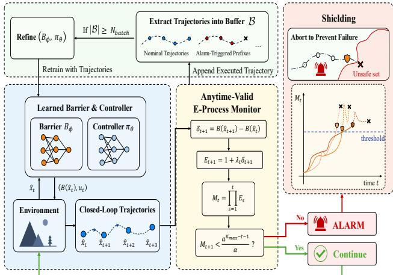  
Figure 1: Overview of the proposed framework for anytimevalid monitoring of learned barrier certificates.

with natural filtration $\mathcal { F } _ { t } : = \sigma ( \widehat { x } _ { 0 } , \ldots , \widehat { x } _ { t } )$ , which captures all information available up to time t within that specific episode, where ${ \hat { x } } _ { k + 1 } = f ( { \bar { \hat { x } } } _ { k } , \pi ( { \hat { x } } _ { k } ) , w _ { k } ) , k = 0 , 1 , 2$

The first two conditions of the barrier certificate $B$ can be constructed alone. Our task is to test whether the conditional supermartingale condition (2c) remains valid under the deployed dynamics. The monitor uses one realized trajectory to accumulate statistical evidence against this conditional null. The null hypothesis is therefore

$$
H _ { 0 } : \quad \mathbb { E } \big [ B ( \hat { x } _ { t + 1 } ) \mid \mathcal { F } _ { t } \big ] \leq B ( \hat { x } _ { t } ) ,\tag{3}
$$

for all $t \geq 0$ . Equivalently, defining the one-step increment

$$
\delta _ { t + 1 } : = B ( \hat { x } _ { t + 1 } ) - B ( \hat { x } _ { t } ) ,
$$

we test whether $\mathbb { E } [ \delta _ { t + 1 } \mid \mathcal { F } _ { t } ] \leq 0$ . Under the null the barrier should not drift upward in expectation and any systematic tendency to increase signals a potential safety violation.

Local Evidence. We now convert each observed increment into an evidence factor that behaves like a fair bet against the null. Define

$$
E _ { t + 1 } : = 1 + \lambda _ { t } \delta _ { t + 1 } ,
$$

where the betting fraction $\lambda _ { t } \geq 0$ is chosen at time t using only information available up to that point in the same episode $( \mathcal { F } _ { t }$ -measurable). Intuitively, if the barrier increases $( \delta _ { t + 1 } > 0 )$ , the factor exceeds 1, signalling a surprise. If the barrier decreases, the factor is $\leq 1 .$ , consistent with $H _ { 0 }$

Proposition 2 (One-step validity). Under $H _ { 0 } ,$ $i f \lambda _ { t } \geq 0 ,$ then $\mathbb { E } _ { H _ { 0 } } \Big [ E _ { t + 1 } \mid \mathcal { F } _ { t } \Big ] \leq 1$

Proof. By definition, E ${ } _ { \cdot H _ { 0 } } \bigl [ E _ { t + 1 } \mid \mathcal { F } _ { t } \bigr ] = 1 + \lambda _ { t } \mathbb { E } _ { H _ { 0 } } \bigl [ \delta _ { t + 1 } \mid$ $\mathcal { F } _ { t } \Big ]$ . Under $H _ { 0 }$ the conditional expectation of $\delta _ { t + 1 }$ is non-positive, and $\lambda _ { t } \geq 0$ , we have the conclusion.

Thus, under the null, each factor $E _ { t + 1 }$ has conditional expectation at most 1 – it is a “fair bet” in the sense that we cannot expect to accumulate evidence against a true null. The betting fraction $\lambda _ { t }$ controls the sensitivity of the monitor: larger values react more strongly to positive increments but require a tighter bound to preserve non-negativity.

Evidence Accumulation. Local bets are combined multiplicatively into a single cumulative score that reflects the total evidence against the null accumulated during the episode. The trajectory-level evidence process is

$$
M _ { t } : = \prod _ { s = 1 } ^ { t } E _ { s } , \qquad M _ { 0 } : = 1 .
$$

Because each factor $E _ { s }$ has conditional expectation $\leq 1$ , the product is a non-negative supermartingale under $H _ { 0 } , { \mathrm { a } }$ fact we record as a lemma if every factor $E _ { s }$ satisfies $E _ { s } \geq 0$

Lemma 1. Under $H _ { 0 }$ and $E _ { s } \ge 0 , \forall s \in \mathbb { N } , ( M _ { t } ) _ { t \ge 0 }$ is a test supermartingale.

Proof. Non-negativity is obvious. The process is adapted, and $\overset { \smile } { \mathbb { E } } _ { H _ { 0 } } [ M _ { t + 1 } \llap | \ \mathcal { F } _ { t } ] ^ {  } = M _ { t } \mathbb { E } _ { H _ { 0 } } [ E _ { t + 1 } \ | \ \mathcal { F } _ { t } ] \le M _ { t }$ , where we used that $M _ { t }$ is $\mathcal { F } _ { t }$ -measurable and the one-step bound from Proposition 2.

The product form of the e-process enables sustained evidence against the barrier condition to accumulate multiplicatively over time. When the observed barrier increments consistently provide evidence against $H _ { 0 }$ , the corresponding betting factors can compound the evidence substantially, whereas transient fluctuations whose efects do not persist have less lasting influence on the accumulated score. This allows the monitor to respond to systematic departures from the learned barrier condition without treating every stochastic fluctuation as a certificate violation.

Because $\{ M _ { t } \} _ { t \ge 0 }$ is a test supermartingale, Ville’s inequality applied to the stopping rule $\tau : =$ inf $\{ t \geq 1 : M _ { t } \geq$ $1 / \alpha \}$ bounds the false-alarm probability of any episode by α: if the evidence process crosses the threshold, we reject $H _ { 0 } ,$ and under $H _ { 0 }$ this occurs with probability at most α. The threshold crossing should therefore be interpreted as evidence that the deployed barrier condition has lost statistical support, rather than as a direct prediction of unsafe entry. The following subsection exploits a prescribed finite deployment horizon to introduce a time-varying monitoring boundary.

## 3.2 Data-driven adaptive betting on $\lambda _ { t }$ (DAB)

Even if the above theory is established, we still encounter the following two dificulties: 1. How to choose a suitable $\lambda _ { t }$ that can satisfy the nonnegativity constraint on $E _ { s }$ in Lemma 1; 2. Even if the constraints are met, how to adapt these bets to the observed barrier increments? Below we will introduce the design method of $\lambda _ { t }$ based on data-driven and using discounted empirical moments inspired by Adam.

Building on the Kelly betting principle in (Waudby-Smith and Ramdas 2022; Shafer 2021), we use an exponentially weighted version of the empirical first and second moments, inspired by the moment estimates in Adam (Kingma and Ba 2014). The unweighted case is recovered when $\gamma = 1$ Specifically, we choose $\lambda _ { t }$ based only on barrier increments observed up to time $t , \delta _ { s } = B ( \hat { x } _ { s } ) - B ( \hat { x } _ { s - 1 } )$ by setting $S _ { t } = \gamma S _ { t - 1 } + \delta _ { t } , Q _ { t } = \gamma Q _ { t - 1 } + \delta _ { t } ^ { 2 }$ , and

$$
\lambda _ { t } ^ { \mathrm { K } } = \operatorname* { m a x } \left( \frac { S _ { t } } { Q _ { t } + \varepsilon } , 0 \right) , \qquad \varepsilon > 0
$$

where $\gamma \in ( 0 , 1 ]$ is a fixed memory parameter. Both moments contain only increments observed by time $t ,$ before observing $\delta _ { t + 1 }$ . We set $S _ { 0 } = Q _ { 0 } = \lambda _ { 0 } = 0$ , and $\varepsilon = 1 \times 1 0 ^ { - 1 2 }$ , and then use

$$
\lambda _ { t } = \operatorname* { m i n } \biggl \{ \lambda _ { t } ^ { \mathrm { K } } , U , - \frac { 1 } { \underline { { \delta } } _ { t } } \biggr \} \geq 0 .\tag{4}
$$

Here, $U \ > \ 0$ prevents excessively large bets and $\begin{array} { r l } { \delta _ { t } } & { { } = } \end{array}$ $- B ( \hat { x } _ { t } )$ . Then $\delta _ { t + 1 } = B ( \hat { x } _ { t + 1 } ) - \dot { B } ( \hat { x } _ { t } \bar { ) } \geq - B ( \hat { x } _ { t } ) \breve { = } \delta _ { t } .$ leading to the conservative cap $\lambda _ { t } \le 1 / B ( \hat { x } _ { t } )$ . Under this choice, $E _ { t + 1 } = 1 + \lambda _ { t } \delta _ { t + 1 } \geq \mathsf { \bar { 1 } } - 1 \geq 0 .$

The intuition follows a growth-rate and Kelly-type principle. When the observed barrier increments fluctuate around zero, the estimated conditional drift remains small, resulting in a conservative betting fraction. In contrast, when the observed increments provide sustained evidence of a positive barrier drift, the estimated drift increases $\lambda _ { t } ,$ allowing the e-process to accumulate evidence more rapidly. Thus, the adaptive betting rule places greater weight on persistent departures from the learned barrier condition while remaining conservative when the observed dynamics provide little evidence against it.

We introduce $\gamma$ to address a specific cancellation efect in barrier increments: without forgetting $( \gamma = 1 ) , S _ { t } =$ $\begin{array} { r } { \sum _ { s = 1 } ^ { t } \delta _ { s } = B ( \hat { x } _ { t } ) - B ( \hat { x } _ { 0 } ) } \end{array}$ , so a sustained recent increase can remain masked by an earlier decrease, whereas $\gamma < 1$ discounts stale increments and allows the betting fraction to respond to increases relative to a recent barrier baseline. In the appendix, we provide a detailed demonstration of the scenarios in which the $\gamma = 1$ case fails.

## 3.3 Shaping the Abort Time via Deterministic Scaling

While the constant-threshold rule remains valid under arbitrary stopping times, it does not exploit the finite deployment horizon $K _ { \mathrm { m a x } }$ that often arises from practical constraints such as physical timeouts, fuel limits, or fixed simulation lengths. A finite horizon allows the monitoring boundary to be shaped so that early alarms require stronger evidence, reducing sensitivity to transient fluctuations, while the threshold gradually approaches the standard anytime-valid level as the horizon is reached. We therefore introduce a deterministic temporal scaling of the boundary that adjusts the monitor’s conservatism over the episode while preserving the false-alarm guarantee α.

We can achieve this temporal preference by scaling the supermartingale with a deterministic time factor, efectively shaping the abort boundary without altering the underlying evidence factor $E _ { s }$

$$
M _ { t } ^ { a } = a ^ { t } M _ { t } , \qquad a \geq 1 .
$$

Under $H _ { 0 }$ , because $\mathbb { E } _ { H _ { 0 } } [ M _ { t + 1 } \ | \ { \mathcal { F } } _ { t } ] \leq M _ { t }$ , the conditional expectation of the scaled process satisfies:

$$
\begin{array} { r l } & { \mathbb { E } _ { H _ { 0 } } [ M _ { t + 1 } ^ { a } \mid \mathcal { F } _ { t } ] = a ^ { t + 1 } \mathbb { E } _ { H _ { 0 } } [ M _ { t + 1 } \mid \mathcal { F } _ { t } ] } \\ & { \qquad \leq a ^ { t + 1 } M _ { t } = a M _ { t } ^ { a } . } \end{array}
$$

Thus, the expected value of $M _ { t + 1 } ^ { a }$ grows by at most a factor of $a .$ . Following the finite-horizon martingale properties established in Theorem 1 in (Xue 2025) (with $M _ { 0 } ^ { a } = 1 )$ , the probability of crossing the terminal threshold is bounded by $\alpha .$ . We can formalize this by defining the sequential stopping rule as the first moment the scaled monitor crosses $\textstyle { \frac { a ^ { K _ { \mathrm { m a x } } ^ { -  } } } { \alpha } } ;$

$$
\tau : = \operatorname* { i n f } \left. t \leq K _ { \operatorname* { m a x } } : M _ { t } ^ { a } \geq \frac { a ^ { K _ { \operatorname* { m a x } } } } { \alpha } \right. ,
$$

which guarantees that $\mathbb { P } _ { H _ { 0 } } ( \tau \le K _ { \operatorname* { m a x } } ) \le \alpha$ . Using $M _ { t } ^ { a } =$ $a ^ { t } M _ { t }$ , the stopping rule can be equivalently written as:

$$
\tau : = \operatorname* { i n f } \left. t \leq K _ { \operatorname* { m a x } } : M _ { t } \geq \frac { a ^ { K _ { \operatorname* { m a x } } - t } } { \alpha } \right. .
$$

Therefore, the time-varying threshold preserves the desired false-alarm control while allowing earlier detection to be emphasized through the parameter a. For $a = 1$ , the rule reduces to the constant-threshold baseline. If $\tau \leq K _ { \operatorname* { m a x } } .$ , the trajectory is stored as a counterexample and used to update the barrier function and the policy when necessary.

Theorem 1 (Anytime-valid falsification guarantee). Let $H _ { 0 }$ be as in (3). Suppose that $( M _ { t } ) _ { t \geq 0 }$ is a nonnegative test supermartingale under $H _ { 0 }$ . Define the rejection event $\mathcal { R } : =$ $\{ \tau \le K _ { \operatorname* { m a x } } \}$ . Then $\mathbb { P } _ { H _ { 0 } } ( \mathcal { R } ) \le \alpha$

Proof. Define the scaled process

$$
V _ { t } : = \frac { \alpha } { a ^ { K _ { \operatorname* { m a x } } } } M _ { t } ^ { a } .
$$

Since $( M _ { t } ) _ { t \geq 0 }$ is a nonnegative test supermartingale under $H _ { 0 } ,$

$$
\begin{array} { r l } & { \mathbb { E } _ { H _ { 0 } } [ V _ { t + 1 } \mid \mathcal { F } _ { t } ] = \frac { \alpha } { a ^ { K _ { \operatorname* { m a x } } } } a ^ { t + 1 } \mathbb { E } _ { H _ { 0 } } [ M _ { t + 1 } \mid \mathcal { F } _ { t } ] } \\ & { \qquad \leq \frac { \alpha } { a ^ { K _ { \operatorname* { m a x } } } } a ^ { t + 1 } M _ { t } } \\ & { \qquad = a V _ { t } . } \end{array}
$$

Thus, $V _ { t }$ satisfies the finite-horizon growth condition

$$
\mathbb { E } _ { H _ { 0 } } [ V _ { t + 1 } \mid \mathcal { F } _ { t } ] \le \frac { V _ { t } } { \bar { \alpha } } + \bar { \beta }
$$

from Theorem 1 in (Xue 2025), with

$$
\bar { \alpha } = \frac 1 a \in ( 0 , 1 ] , \qquad \bar { \beta } = 0 .
$$

Moreover,

$$
V _ { 0 } = \frac { \alpha } { a ^ { K _ { \operatorname* { m a x } } } } , \qquad \bar { \gamma } = \bar { \beta } \bar { \alpha } - ( \bar { \alpha } - 1 ) = 1 - \frac 1 a \in [ 0 , 1 ] .
$$

Therefore, the case $\bar { \alpha } \in ( 0 , 1 ]$ and $\bar { \boldsymbol { \gamma } } \in [ 0 , 1 ]$ of Theorem 1 in (Xue 2025) gives

$$
\begin{array} { r l r } {  { \mathbb { P } _ { H _ { 0 } } \bigg ( \operatorname* { s u p } _ { 0 \le t \le K _ { \operatorname* { m a x } } } V _ { t } \ge 1 \bigg ) \le V _ { 0 } \bar { \alpha } ^ { - K _ { \operatorname* { m a x } } } } } \\ & { } & { = \frac { \alpha } { a ^ { K _ { \operatorname* { m a x } } } } a ^ { K _ { \operatorname* { m a x } } } = \alpha . } \end{array}
$$

Finally,

$$
V _ { t } \geq 1 \Longleftrightarrow M _ { t } ^ { a } \geq \frac { a ^ { K _ { \operatorname* { m a x } } } } { \alpha } \Longleftrightarrow M _ { t } \geq \frac { a ^ { K _ { \operatorname* { m a x } } - t } } { \alpha } .
$$

Hence,

$$
\left\{ \operatorname* { s u p } _ { 0 \leq t \leq K _ { \operatorname* { m a x } } } V _ { t } \geq 1 \right\} = \{ \tau \leq K _ { \operatorname* { m a x } } \} ,
$$

and therefore

$$
\begin{array} { r } { \mathbb { P } _ { H _ { 0 } } ( \tau \leq K _ { \operatorname* { m a x } } ) \leq \alpha . } \end{array}
$$

This completes the proof.

Ultimately, this deterministic scaling mechanism has profound consequences for the temporal dynamics of the abort time.

• Case $a = 1 \colon M _ { t } ^ { a } = M _ { t }$ is a test supermartingale; the rejection threshold is $1 / \alpha$ and the test is valid for any stopping time (no bias toward early or late abort). While theoretically clean, it ignores the finite horizon and treats all time steps equally, which can be wasteful when resources are limited or early decisions are preferred.

• Case $a > 1$ (patient test): $a ^ { K _ { \mathrm { m a x } } - t }$ decreases exponentially over time, making the rejection threshold $a ^ { \dot { K } _ { \mathrm { m a x } } - t }$ highest initially and lowest near the deadline. Thus, early alarms require stronger evidence, while the test approaches the classical anytime-valid rule as $t \to K _ { \operatorname* { m a x } }$ This design is preferable when false alarms are costly or transient efects are common. For example, a drone may experience short-lived oscillations after takeof. A patient monitor avoids unnecessary aborts by requiring sustained evidence before intervention. Larger values of a improve robustness against transient fluctuations and spurious alarms, while values closer to 1 recover the standard monitor. This conservatism, however, reduces sensitivity to brief or rapidly developing safety violations.

By framing a as a patience parameter, the safety engineer can deliberately prioritize robustness against early noise or rapid detection and resource eficiency, choosing the mode that best aligns with the system’s physical characteristics and the cost of data collection.

## 3.4 Comparison with Direct Barrier Monitoring

Since the barrier value $B ( \hat { x } _ { t } )$ is a supermartingale under $H _ { 0 } ,$ one may ask whether directly monitoring the normalized barrier process $B ( \hat { x } _ { t } ) / B ( \hat { x } _ { 0 } )$ is suficient, making the proposed DAB mechanism unnecessary. Indeed, Ville’s inequality guarantees episode-wise false-alarm control at level α by raising an alarm whenever

$$
\frac { B ( \hat { x } _ { t } ) } { B ( \hat { x } _ { 0 } ) } \geq \frac { 1 } { \alpha } .
$$

Thus, direct barrier monitoring is statistically valid under $H _ { 0 }$ . Moreover, as shown in Remark 2, it is a special case of the proposed multiplicative e-process. The key distinction is that direct monitoring fixes the betting strategy, whereas DAB allows the betting strategy to adapt to the observed barrier increments.

1. Dependence on the initial barrier value. Both direct monitoring and DAB use the nominal alarm threshold $1 / \alpha$ when their evidence processes are normalized to start at 1. However, direct monitoring is based on the relative barrier value $B ( \hat { x } _ { t } ) / B ( \hat { x } _ { 0 } )$ , so its equivalent threshold in terms of the unnormalized barrier is $B ( \hat { x } _ { 0 } ) / \alpha$ . Consequently, the response of the normalized barrier process to a given absolute barrier change depends on the initial barrier value. DAB, in contrast, provides greater flexibility in how barrier increments contribute to the monitoring statistic through its adaptive betting strategy.

2. Adaptive evidence accumulation. Direct monitoring corresponds to the particular betting strategy $\begin{array} { r l } { \lambda _ { t } } & { { } = } \end{array}$ $1 / B ( \hat { x } _ { t } )$ , for which the multiplicative e-process reduces to $\dot { M _ { t } } ~ \dot { = } ~ B ( \hat { x } _ { t } ) / B ( \hat { x } _ { 0 } )$ . DAB allows alternative adaptive betting strategies that respond to recent barrier increments. In our implementation, DAB refrains from betting when the discounted sum $S _ { t }$ of recent increments is negative, avoiding evidence losses during these periods and preserving evidence for subsequent barrier increases. As demonstrated in our experiments, this flexibility can improve detection across a broader range of initial states. Such improvements are empirical, however, and do not imply that DAB always detects certificate degradation earlier than direct monitoring.

Remark 2. Direct barrier monitoring is recovered by choosing $\lambda _ { t } = 1 / B ( \hat { x } _ { t } )$ , provided $B ( \hat { x } _ { t } ) > 0$ . Specifically, with $\begin{array} { r } { \delta _ { t + 1 } = B ( \hat { x } _ { t + 1 } ) - B ( \hat { x } _ { t } ) , E _ { t + 1 } = 1 + \lambda _ { t } \delta _ { t + 1 } = \frac { B ( \hat { x } _ { t + 1 } ) } { B ( \hat { x } _ { t } ) } . } \end{array}$ Consequently,

$$
M _ { t } = \prod _ { s = 1 } ^ { t } E _ { s } = \frac { B ( \hat { x } _ { t } ) } { B ( \hat { x } _ { 0 } ) } , \qquad M _ { 0 } = 1 .
$$

Thus, direct barrier monitoring is a special case of the proposed multiplicative e-process. The potential benefit of DAB comes from its more flexible betting strategy and the resulting evidence accumulation, rather than from a stronger false-alarm guarantee.

## 3.5 Runtime Monitoring

The preceding subsections establish the statistical foundations of the proposed anytime-valid monitor. We now instantiate these results as a deployment-time runtime monitoring procedure.

In each deployment episode, the learned barrier $B _ { \phi }$ and policy $\pi _ { \theta }$ are fixed, and the monitor updates the e-process online using the observed closed-loop trajectory. The episode is terminated when the evidence process crosses the timevarying decision boundary. Under the null hypothesis that the deployed barrier satisfies the conditional drift condition, the probability of such an alarm within an episode is controlled at the prescribed level α, regardless of the stopping time. The monitoring procedure is independent of how the barrier is constructed and can therefore be applied to analytical, optimization-based, or learned barrier certificates, provided that the assumptions required by the monitor are satisfied. The collected trajectories can optionally be stored as counterexamples and used for subsequent barrier or policy refinement between episodes; such updates do not occur within an episode and are therefore separate from the anytime-valid monitoring procedure. The complete deployment procedure is summarized in Algorithm 1.

Algorithm 1: Anytime-Valid Runtime Monitoring   
Require: Initial barrier $B ( \hat { x } _ { 0 } )$ , policy $\pi _ { 0 } .$ , bufer size   
$N _ { \mathrm { b a t c h } }$ , significance level $\alpha ,$ maximum horizon $K _ { \operatorname* { m a x } } ,$   
and patience factor $a \ge 1$   
Ensure: Runtime monitoring   
1: Initialize $B _ { \phi }  B _ { 0 } , \pi _ { \theta } \stackrel { - } {  } \pi _ { 0 } , B  \varnothing$   
2: for deployment episode $r = 1 , 2 , \hdots { \bf d o }$   
3: Observe xˆ0; initialize $M _ { 0 } \gets 1$ and $\xi  ( \hat { x } _ { 0 } )$   
4: for $t = 0 , 1 , \ldots , K _ { \operatorname* { m a x } } - 1$ do   
5: Choose $\lambda _ { t } \geq 0$ as in Eq. (4)   
6: Set $u _ { t } \gets \pi _ { \theta } ( \hat { x } _ { t } )$ and observe $\hat { x } _ { t + 1 }$   
7: Append $( \hat { x } _ { t } , \dot { u } _ { t } , \hat { x } _ { t + 1 } )$ to ξ   
8: Compute $\delta _ { t + 1 } \gets \dot { B _ { \phi } } ( \hat { x } _ { t + 1 } ) - B _ { \phi } ( \hat { x } _ { t } )$   
9: Update $M _ { t + 1 } \gets M _ { t } ( 1 + \lambda _ { t } \delta _ { t + 1 } )$   
10: if $M _ { t + 1 } \geq a ^ { K _ { \operatorname* { m a x } } - ( t + 1 ) } / \alpha$ then   
11: Exit the episode; break   
12: end if   
13: if $\hat { x } _ { t + 1 } \notin S$ then   
14: Exit the episode; break   
15: end if   
16: end for   
17: $B  B \cup \{ \xi \}$   
18: if $| B | \ge \tilde { N _ { \mathrm { b a t c h } } }$ then   
19: Optional: Update $B _ { \phi } , \pi _ { \theta }$ using B; set $B  \emptyset$   
20: end if   
21: end for

Remark 3. The monitoring procedure is intended to operate while the system remains in the safe set S. By construction, the stopped process follows the original system’s dynamics whenever it is in the safe set S and remains frozen after exiting S. Consequently, the global supermartingale condition

$$
\begin{array} { r } { \mathbb { E } \left[ B ( \hat { \pmb x } _ { k + 1 } ) ~ | ~ \hat { \pmb x } _ { k } = { \pmb x } \right] \le B ( { \pmb x } ) , \qquad \forall { \pmb x } \in \mathbb { R } ^ { n } , } \end{array}
$$

is equivalent to the barrier-drift condition for the original system restricted to the safe set:

$$
\begin{array} { r } { \mathbb { E } \left[ B ( { \pmb x } _ { k + 1 } ) ~ | ~ { \pmb x } _ { k } = { \pmb x } \right] \le B ( { \pmb x } ) , \qquad \forall { \pmb x } \in \mathcal { S } . } \end{array}
$$

Indeed, outside S, the stopped process remains at its current state, so the supermartingale condition holds automatically with equality. Thus, the safe set S is precisely the region in which the barrier-drift condition needs to be monitored. Accordingly, each trajectory is terminated upon itsfirst exitfrom S or upon reaching the prescribed horizon $K _ { \mathrm { m a x } } ,$ , whichever occurs first. Thus, once a trajectory exits the safe set, there is no need to simulate its subsequent evolution.

Remark 4. The monitor is designed to detect statistical evidence against the learned barrier condition, rather than to predict unsafe entry. At the same time, the monitor can serve as a component of a runtime safety-shielding mechanism by triggering a predefined conservative intervention when suficient evidence indicates that the learned certificate is no longer consistent with the observed dynamics. Thus, a trajectory may move toward the unsafe region without triggering the monitor, provided that the monitored barrier condition remains statistically consistent with the observed dynamics. Such a situation does not constitute a failure of the proposed detection objective, since the monitor is intended to identify when the statistical supportfor the safety certificate has become questionable, rather than to predict every impending safety violation. Once suficient evidence against the barrier condition accumulates, the deployed certificate is treated as unsupported for continued operation, and the predefined intervention can be activated to reduce the risk of subsequent unsafe behavior.

Alg. 1 resets the e-process at the start of each episode, yielding false-alarm control at level $\alpha _ { r } ~ = ~ \alpha$ within each episode. The per-episode guarantee is appropriate when episodes are treated as separate operational units, as in episodic RL or session-based monitoring. If error control is instead required across $N _ { \mathrm { e p } }$ deployment episodes, the episode-wise error budget can be allocated such that $\begin{array} { r } { \sum _ { r = 1 } ^ { N _ { \mathrm { e p } } } \alpha _ { r } \leq \alpha . } \end{array}$ , for example, using $\begin{array} { r } { \alpha _ { r } = \frac { \alpha } { N _ { \mathrm { e p } } } } \end{array}$ or a summable sequence such as $\textstyle \alpha _ { r } = { \frac { \alpha } { 2 ^ { r } } }$ . By the union bound, the probability of at least one false alarm over all $N _ { \mathrm { e p } }$ episodes is then at most α. More elaborate cross-episode e-process constructions may also be considered when their required measurability and null conditions are satisfied. Such global error control involves a sensitivity trade-of: decreasing $\alpha _ { r }$ across episodes increases the rejection threshold $\frac { 1 } { \alpha _ { r } }$ and may reduce detection power in later episodes. We therefore use per-episode error control in our experiments and leave cross-episode error allocation as an application-dependent extension.

## 4 Experiments

We evaluate the proposed anytime-valid runtime monitoring framework on four benchmark systems. The experiments address three questions:

1. RQ1: whether the monitor preserves the prescribed falsealarm guarantee when the barrier certificate is valid;

2. RQ2: Can we detect environmental changes and invalid barrier certificates using our monitor?

3. RQ3: How does temporal boundary shaping trade fewer false alarms under valid certificates for delayed or missed detection under invalid certificates?

The default setting is $K _ { \operatorname* { m a x } { } } ~ = ~ 4 0 0 , ~ K _ { \operatorname* { m a x } { } }$ ln $a \ = \ 4 .$ $\gamma = 0 . 9 2$ , and $U = 1 \bar { 0 0 }$ , using the same runs. Table 1 also reports the standard anytime-valid rule $K _ { \mathrm { m a x } }$ ln $a = 0 ( a = 1 )$ . Subsection 4.1 answers RQ1, Subsection 4.2 answers RQ2. Subsection 4.3 answers RQ3. Detailed benchmark descriptions, implementation details, proofs of validity or counterexamples establishing invalidity for the candidate barriers are provided in Appendix A. The sensitivity of $K _ { \mathrm { m a x } }$ and $\lambda _ { t }$ is provided in Appendix B .

The formal objective of the proposed framework is runtime monitoring of the learned barrier condition. Theorem 1 provides a statistical guarantee for this objective: under $H _ { 0 } ,$ the probability of falsely rejecting the barrier-drift condition within an episode is at most α. This guarantee does not imply a lower bound on detection power or guarantee that an alarm occurs before an unsafe transition. Nevertheless, the monitor can serve as a component of a runtime safety-shielding mechanism: when suficient evidence is accumulated against the deployed barrier, a predefined intervention can be triggered rather than continuing to rely on an unsupported barrier. We therefore evaluate unsafe-rollout detection as a downstream operational detection measure of this monitoring mechanism in Subsection 4.4.

Why do we use $K _ { \mathrm { m a x } }$ ln a ? Since a enters the alarm threshold exponentially over the horizon, varying a directly makes it dificult to interpret the strength of threshold shaping. We therefore parameterize a in terms of $K _ { \mathrm { m a x } }$ ln a, which directly determines the logarithm of the threshold inflation factor at the beginning of the horizon relative to the terminal threshold. With this parameterization, the alarm threshold at step k is

$$
\ln M _ { k } \ \ge \ \ln ( 1 / \alpha ) + K _ { \operatorname* { m a x } } \ln a \Big ( 1 - \frac { k } { K _ { \operatorname* { m a x } } } \Big ) .
$$

Thus, at $k \ = \ 0 .$ , the threshold lies $K _ { \mathrm { m a x } }$ ln a above $\ln ( 1 / \alpha )$ , and it decreases linearly in k to ln $( 1 / \alpha )$ at $k = K _ { \operatorname* { m a x } }$ . The threshold $a ^ { K _ { \mathrm { m a x } } - k } / \alpha$ on $M _ { k }$ starts at $e ^ { K _ { \operatorname* { m a x } } \ln { a } } / \alpha$ and decreases exponentially to $1 / \alpha$

4.1 Runtime Monitoring under Valid Certificates Under a valid certificate, Theorem 1 guarantees that the probability of an alarm within the horizon $K _ { \mathrm { m a x } }$ is at most α for the system starting from the state in the initial set $\mathcal { X } _ { 0 }$ . To empirically assess the consistency of the observed alarm behavior within this theoretical guarantee, we sample N initial states $x _ { 0 } ^ { ( 1 ) } , \ldots , x _ { 0 } ^ { ( N ) }$ and simulate R independent trajectories from each initial state. Let $\tau ^ { ( i , j ) }$ be the alarm time of the monitor on the j-th trajectory from $x _ { 0 } ^ { ( i ) }$ . Let $T ^ { ( i , j ) }$ be the first exit step of this trajectory from $\mathcal { S } \ ( T ^ { ( i , j ) } \ = \ \infty$ if it stays in S). Following Remark 3, monitoring stops at min $( T ^ { ( i , j ) } , K _ { \operatorname* { m a x } } )$ , and the empirical alarm rate for $x _ { 0 } ^ { ( i ) }$ is

$$
\hat { p } _ { i } = \frac { 1 } { R } \sum _ { j = 1 } ^ { R } \mathbb { I } \big ( \tau ^ { ( i , j ) } \leq \mathrm { m i n } ( T ^ { ( i , j ) } , K _ { \mathrm { m a x } } ) \big ) .
$$

as well as the worst-case empirical alarm rate,

$$
\hat { p } ^ { \operatorname* { m a x } } = \operatorname* { m a x } _ { i } \hat { p } _ { i } .
$$

To summarize the empirical alarm across the sampled initial states, we call $x _ { 0 } ^ { ( i ) }$ empirically abnormal if $\hat { p } _ { i } >$ α and report the fraction of empirically abnormal initial states,

$$
\rho _ { \alpha } = \frac { 1 } { N } \sum _ { i = 1 } ^ { N } \mathbb { I } \big ( \hat { p } _ { i } > \alpha \big ) ,
$$

Under a valid certificate, we expect $\rho _ { \alpha }$ to be close to zero and $\hat { p } ^ { \mathrm { m a x } }$ to remain close to or below α, providing empirical support for the theoretical guarantee. Conversely, it is worth noting that observing empirical alarm rates below α does not, by itself, establish the validity of the certificate which will be discussed in detail in the Appendix B.2.

Results. We evaluate the monitor on two benchmark systems, for which globally valid barrier certificates satisfying (2) are available. We also compare two betting strategies: DAB and

<table><tr><td rowspan="2">System</td><td rowspan="2"></td><td colspan="2">Direct</td><td colspan="2">DAB</td></tr><tr><td> $\rho _ { \alpha }$ </td><td> $\hat { p } ^ { \mathrm { m a x } }$ </td><td> $\rho _ { \alpha }$ </td><td> $\hat { p } ^ { \mathrm { m a x } }$ </td></tr><tr><td>Valid certificates</td><td></td><td></td><td></td><td></td><td></td></tr><tr><td>System 1</td><td>0</td><td>0.00</td><td>4.80</td><td>0.00</td><td>0.90</td></tr><tr><td></td><td>4</td><td>0.00</td><td>0.20</td><td>0.00</td><td>0.10</td></tr><tr><td>System 2</td><td>0</td><td>0.00</td><td>0.00</td><td>0.00</td><td>0.00</td></tr><tr><td></td><td>4</td><td>0.00</td><td>0.00</td><td>0.00</td><td>0.00</td></tr><tr><td>Invalid certificates</td><td></td><td></td><td></td><td></td><td></td></tr><tr><td>System 2-input</td><td>0</td><td>18.10</td><td>100.00</td><td>82.10</td><td>92.00</td></tr><tr><td></td><td>4</td><td>17.90</td><td>100.00</td><td>79.90</td><td>81.50</td></tr><tr><td>System 3</td><td>0</td><td>24.00</td><td>69.40</td><td>79.00</td><td>96.30</td></tr><tr><td></td><td>4</td><td>23.80</td><td>63.60</td><td>78.40</td><td>95.10</td></tr></table>

Table 1: Runtime monitoring under valid and invalid certificates with $K _ { \mathrm { m a x } }$ ln $ { \boldsymbol { a } } \ = \  { \boldsymbol { 0 } }$ and the default setting $K _ { \mathrm { m a x } }$ ln $a = 4$ on the same runs. $\rho _ { \alpha }$ is the fraction of initial states with $\hat { p } _ { i } > \alpha$ and $\hat { p } ^ { \mathrm { m a x } } =$ maxi pˆi is the worst-case alarm rate. $\mathbf { \hat { N } } = 1 0 ^ { 3 }$ initial states, $R = 1 0 ^ { 3 }$ trajectories per initial state, $K _ { \operatorname* { m a x } } = 4 0 0 , \alpha = 0 . 0 5$ . All values are percentages. Figure 3 shows the full distribution of $\hat { p } .$

Direct $\begin{array} { r } { ( \lambda _ { t } = \frac { 1 } { B ( \hat { x } _ { t } ) } ) } \end{array}$ . As shown in Table 1, both monitors achieve $\hat { p } ^ { \mathrm { m a x } } <$ α under both rules, which is consistent with the conclusion of $\mathbb { P } _ { H _ { 0 } } ( \mathcal { R } ) \le \alpha$ in Theorem 1. However, the rates for the direct betting remain slightly higher than those for the DAB. As shown in Figure 5, System 1 has lower values in the initial points $B ( x _ { 0 } )$ , thereby increasing the probability of an alarm when $\dot { B ( x _ { t } ) } / B ( \hat { x } _ { 0 } ) > 1 / \alpha$ . In contrast, our method is far less sensitive to the initial value and is therefore much less afected by this issue. Overall, these observations are both consistent with the anytime-valid false-alarm guarantee under a valid certificate.

## 4.2 Runtime Monitoring under Invalid Certificates

In this subsection, we will answer RQ2 by investigating scenarios involving invalid barriers. The remaining systems in Table 1 have invalid barrier certificates. We consider two scenarios: (1) initially, we obtain a valid barrier function for System 2 in RQ1. However, environmental changes are inevitable in real-world scenarios. To simulate such a scenario, we actively injected noise $b _ { k }$ into state $x _ { 2 }$ from step $k = 1 0 0$ onward:

$$
\begin{array} { c } { { x _ { 2 , k + 1 } = x _ { 2 , k } + 0 . 0 1 \big ( ( 0 . 8 + \xi _ { k } ) x _ { 1 , k } } } \\ { { + \ : 1 0 \left( x _ { 1 , k } ^ { 2 } - 0 . 2 1 \right) x _ { 2 , k } + b _ { k } \big ) } } \end{array}\tag{5}
$$

where $b _ { k } \sim \mathcal { U } [ 0 , 0 . 4 5 ]$ and the equation of $x _ { 1 }$ is unchanged. Although the true environmental dynamics can be unknown in our monitor, we test the original valid function against the modified dynamical system and discovered counterexamples. Consequently, the original barrier function proved to be invalid in the changed environment. (2) The environment has not changed, but due to the sample-based training, the barrier function for system 3 is invalid from the start. We also find a counterexample establishing that this candidate is invalid.

Results. When $K _ { \operatorname* { m a x } } \ln a \ = \ 4 .$ under invalid certificates, both methods detect substantial deviations from the prescribed alarm behavior, but their performance difers across the two systems. In System 2-input attack, direct betting has a worst-case alarm rate of 100%, compared with 81.5% for DAB. However, DAB identifies a much larger fraction of abnormal initial states, with $\rho _ { \alpha } = 7 9 . 9 \%$ compared with 17.9% for direct betting. In System 3, DAB performs better in terms of both metrics: its $\rho _ { \alpha }$ reaches 78.40%, compared with 23.80% for direct betting, while its worst-case alarm rate is 95.10%, compared with 63.60% for direct betting. These results highlight the complementary roles of the two metrics. A high worst-case alarm rate $\hat { p } ^ { \mathrm { m a x } }$ indicates that the monitor frequently raises alarms for at least one sampled initial state, suggesting that the deployed barrier condition may no longer be trustworthy. Meanwhile, $\rho _ { \alpha }$ quantifies the fraction of sampled initial states for which the empirical alarm rate exceeds α, revealing how widely this evidence of potential barrier invalidity occurs across the initial states.

## 4.3 The patience parameter a

We introduce a as a deployment-time design parameter for the monitoring boundary. For fixed $\alpha , K _ { \operatorname* { m a x } } ,$ , and betting strategy, changing a leaves the underlying evidence process $M _ { k }$ unchanged and modifies only the decision rule applied to that evidence. Its choice expresses the trade-of between avoiding unnecessary intervention and detecting certificate invalidity promptly. A larger a is appropriate when unnecessary early interventions are costly and the application can tolerate delayed detection.

The experimental results in Subsections 4.1 and 4.2, reported in Table 1 and Figure 5, show that increasing a cannot increase the number of alarms and cannot advance the first alarm time. This observation is consistent with the theoretical analysis: a larger a raises the rejection threshold at early time steps, making the monitor more conservative. To illustrate how this afects monitoring under valid and invalid certificates, we consider Systems 1, System 2+input and System 3. In System 1, where the barrier certificate is valid, the DAB evidence process exhibits a transient increase that triggers an alarm when $a = 1$ , but then drops rapidly (we give an example trajectory in Figure 2). Since the certificate is valid in this scenario, the threshold crossing is a false alarm caused by a temporary fluctuation, with no sustained evidence against the barrier condition. Increasing the temporal scaling to $K _ { \mathrm { m a x } }$ ln $a = 4$ raises the early-time rejection threshold, preventing the evidence process from triggering an alarm. In this case, the more conservative threshold helps avoid an unnecessary alarm. In contrast, in System 2+input and System 3, where the barrier certificate is invalid, increasing the temporal scaling to $K _ { \mathrm { m a x } }$ ln a = 4 delays the alarm compared with the case $a = 1$ , but the evidence eventually becomes suficient to cross the rejection threshold. Thus, the monitor still detects evidence against the barrier condition, albeit later. These examples illustrate the trade-of controlled by a: a more conservative threshold can suppress alarms caused by transient fluctuations under a valid certificate, but may also delay the detection of an invalid certificate.

In practice, before deployment, we do not know whether this barrier is valid. Thus, a should be selected according to the desired level of confidence in the deployed certificate and the trade-of between avoiding unnecessary alarms and detecting degradation promptly. When the certificate is considered highly trustworthy and avoiding unnecessary alarms is the priority, a larger a can be used to make the monitor more conservative. In contrast, when the validity of the certificate is uncertain or degradation is suspected, setting $a = 1$ is preferable because it allows earlier detection. In particular, we recommend $a = 1$ when prompt detection of potential certificate invalidity is the primary objective. When there is some disturbance in the early stages of the system, we recommend choosing $a > 1$

## 4.4 Practical Applications of Algorithm 1

In this subsection, we empirically investigate two potential downstream applications of our runtime monitoring method: improving the adaptability of learned barrier certificates through retraining and detecting unsafe rollouts before the first safety violation. The latter evaluates the monitor’s potential to serve as a component of a runtime safety-shielding mechanism. These experiments provide empirical evidence of the potential benefits of monitoring-guided retraining and early detection, but do not establish formal guarantees for either capability.

Following Algorithm 1, we will update the barrier using data collected from the environment: for System 2 under the input attack we retrain only the barrier function, and for System 3 we retrain both the barrier function and the policy. We then check whether the alarm rates return below α.

Results. (1) For System 2 under the input attack, retraining the barrier function reduces the worst-case alarm rate $\hat { p } ^ { \mathrm { m a \bar { x } } }$ over the sampled initial states from 100.00% to 0.00% for the direct rule and from 81.50% to 0.00% for DAB. For System 3, $\hat { p } ^ { \mathrm { m a x } }$ decreases from 63.60% to 0.00% for the direct rule and from 95.10% to 0.00% for DAB. After retraining, neither monitor raises an alarm in any run of either system, so $\rho _ { \alpha } =$ 0. (2) With the accumulation of evidence $M _ { k } ,$ , we find that our method could terminate the trajectory in advance, before the state leaves the safe set S. Before retraining, 42.88% of the evaluated System 3 trajectories exited the safe set S within the evaluation horizon. Among these exiting trajectories, DAB raised an alarm strictly before the first exit in 47.09% of cases under the default setting $K _ { \mathrm { m a x } }$ ln $a \ = \ 4 ,$ , compared with 11.88% for Direct. With $a \ = \ 1$ , the corresponding rates were 51.81% and 22.56%, respectively. These pre-exit alarms provide an opportunity for intervention before unsafe entry.

## 5 Conclusions and Future Work

We introduced an anytime-valid framework for runtime monitoring of learned barrier certificates in stochastic systems. By continuously auditing observed barrier-value increments with an e-process, the proposed monitor provides finite-sample false-alarm control under arbitrary stopping times within each deployment episode. Motivated by finitehorizon safety verification, we further introduced a temporal boundary-shaping mechanism that adjusts the conservatism of the monitor over a prescribed deployment horizon. Experiments under valid certificates, certificate degradation, and distribution shifts demonstrate the practical utility of the framework for detecting statistical evidence against the barrier condition and supporting conservative runtime intervention.

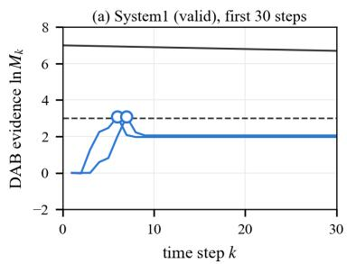

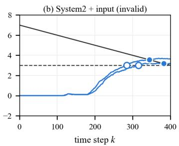

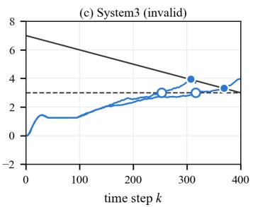  
DAB evidence of one run  alarm, a = 1  alarm, default --- threshold, a = 1 — threshold, Kmaxlna = 4 (default)  
Figure 2: The trade-of between avoiding unnecessary alarms and detecting degradation promptly.

Several directions remain for future work. First, extending the framework to safe RL, continuous-time dynamics, and partially observable systems would broaden its applicability. Second, validation on real robotic platforms under non-stationary environments would further demonstrate its practical value. Third, the relationship between barriercondition violations and detection power, detection delay, and pre-violation detection warrants further theoretical and empirical study. Moreover, the finite-horizon factor a can be further studied as a time-varying parameter to adapt the monitoring strategy.

## References

Abate, A.; Ahmed, D.; Edwards, A.; Giacobbe, M.; and Perufo, A. 2021. FOSSIL: a software tool for the formal synthesis of lyapunov functions and barrier certificates using neural networks. In Proceedings of the 24th international conference on hybrid systems: computation and control, 1– 11.

Abate, A.; Giacobbe, M.; and Roy, D. 2024. Stochastic omega-regular verification and control with supermartingales. In International Conference on Computer Aided Verification, 395–419. Springer.

Alshiekh, M.; Bloem, R.; Ehlers, R.; Könighofer, B.; Niekum, S.; and Topcu, U. 2018. Safe reinforcement learning via shielding. In Proceedings ofthe AAAI conference on artificial intelligence, volume 32.

Ames, A. D.; Coogan, S.; Egerstedt, M.; Notomista, G.; Sreenath, K.; and Tabuada, P. 2019. Control barrier functions: Theory and applications. In 2019 18th European control conference (ECC), 3420–3431. Ieee.

Bauer, A.; Leucker, M.; and Schallhart, C. 2011. Runtime verification for LTL and TLTL. ACM Transactions on Software Engineering and Methodology (TOSEM), 20(4): 1–64.

Cairoli, F.; Paoletti, N.; and Bortolussi, L. 2023. Conformal Quantitative Predictive Monitoring of STL Requirements for

Stochastic Processes. In Proceedings ofthe 26th ACM International Conference on Hybrid Systems: Computation and Control (HSCC), 1–11.

Cao, Z.; Wang, P.; Ong, L.; Žikelić, Ð.; Wagner, D.; and Xue, B. 2025. Comparative Analysis of Barrier-like Function Methods for Reach-Avoid Verification in Stochastic Discrete-Time Systems. arXiv preprint arXiv:2512.05348.

Chatterjee, K.; Henzinger, T. A.; Lechner, M.; and Žikelić, Ð. 2023. A learner-verifier framework for neural network controllers and certificates of stochastic systems. In International Conference on Tools and Algorithmsfor the Construction and Analysis ofSystems, 3–25. Springer.

Chougule, A.; Chamola, V.; Sam, A.; Yu, F. R.; and Sikdar, B. 2023. A comprehensive review on limitations of autonomous driving and its impact on accidents and collisions. IEEE Open Journal ofVehicular Technology, 5: 142–161.

Clarke, E. M.; and Zuliani, P. 2011. Statistical model checking for cyber-physical systems. In International symposium on automated technologyfor verification and analysis, 1–12. Springer.

Feng, Y.; Zhu, J.; Platzer, A.; and Laurent, J. 2025. Adaptive shielding via parametric safety proofs. Proceedings of the ACM on Programming Languages, 9(OOPSLA1): 816–843.

Gibbs, I.; and Candès, E. J. 2021. Adaptive Conformal Inference Under Distribution Shift. Journal of Machine Learning Research, 22(178): 1–59.

Gowal, S.; Dvijotham, K.; Stanforth, R.; Bunel, R.; Qin, C.; Uesato, J.; Arandjelovic, R.; Mann, T.; and Kohli, P. 2019. On the Efectiveness of Interval Bound Propagation for Training Verifiably Robust Models. arXiv:1810.12715.

Henzinger, T. A.; Mallik, K.; Sadeghi, P.; and Žikelić, Ð. 2025. Supermartingale certificates for quantitative omegaregular verification and control. In International Conference on Computer Aided Verification, 29–55. Springer.

Jagtap, P.; Soudjani, S.; and Zamani, M. 2018. Temporal logic verification of stochastic systems using barrier certificates. In International Symposium on Automated Technology for Verification and Analysis, 177–193. Springer.

Jansen, N.; Könighofer, B.; Junges, S.; Serban, A.; and Bloem, R. 2020. Safe reinforcement learning using probabilistic shields. In 31st International Conference on Concurrency Theory (CONCUR 2020), 3–1. Schloss Dagstuhl– Leibniz-Zentrum für Informatik.

Kingma, D. P.; and Ba, J. 2014. Adam: A method for stochastic optimization. arXiv preprint arXiv:1412.6980.

Kushner, H. J. 1967. Stochastic stability and control. Academic Press, Inc.

Lindemann, L.; Qin, X.; Deshmukh, J. V.; and Pappas, G. J. 2023. Conformal prediction for stl runtime verification. In Proceedings of the ACM/IEEE 14th International Conference on Cyber-Physical Systems (with CPS-IoT Week 2023), 142–153.

Mathiesen, F. B.; Romao, L.; Calvert, S. C.; Abate, A.; and Laurenti, L. 2023. Inner approximations of stochastic programs for data-driven stochastic barrier function design. In 2023 62nd IEEE Conference on Decision and Control (CDC), 3073–3080. IEEE.

Mathiesen, F. B.; Romao, L.; Calvert, S. C.; Laurenti, L.; and Abate, A. 2026. A data-driven approach for safety quantification of non-linear stochastic systems with unknown additive noise distribution. Automatica, 193: 113187.

Nejati, A.; and Zamani, M. 2023. Data-driven synthesis of safety controllers via multiple control barrier certificates. IEEE Control Systems Letters, 7: 2497–2502.

Prajna, S.; and Jadbabaie, A. 2004. Safety verification of hybrid systems using barrier certificates. In International workshop on hybrid systems: Computation and control, 477– 492. Springer.

Prajna, S.; Jadbabaie, A.; and Pappas, G. J. 2007. A Framework for Worst-Case and Stochastic Safety Verification Using Barrier Certificates. IEEE Transactions on Automatic Control, 52(8): 1415–1428.

Ramdas, A.; Grünwald, P.; Vovk, V.; and Shafer, G. 2023. Game-theoretic statistics and safe anytime-valid inference. Statistical Science, 38(4): 576–601.

Salamati, A.; Lavaei, A.; Soudjani, S.; and Zamani, M. 2024. Data-driven verification and synthesis of stochastic systems via barrier certificates. Automatica, 159: 111323.

Shafer, G. 2021. Testing by Betting: A Strategy for Statistical and Scientific Communication. Journal of the Royal Statistical Society Series A: Statistics in Society, 184: 407–431.

Shafer, G.; Shen, A.; Vereshchagin, N.; and Vovk, V. 2011. Test martingales, Bayes factors and p-values. Statistical Science, 84–101.

Uesato, J.; Kumar, A.; Szepesvari, C.; Erez, T.; Ruderman, A.; Anderson, K.; Heess, N.; Kohli, P.; et al. 2018. Rigorous agent evaluation: An adversarial approach to uncover catastrophic failures. arXiv preprint arXiv:1812.01647.

Vertovec, N.; Mathiesen, F. B.; Badings, T.; Laurenti, L.; and Abate, A. 2025. Scalable verification ofneural control barrier functions using linear bound propagation. arXiv preprint arXiv:2511.06341.

Ville, J. 1939. Etude critique de la notion de collectif, volume 3. Gauthier-Villars Paris.

Vovk, V.; and Wang, R. 2021. E-values: Calibration, combination and applications. The Annals of Statistics, 49(3): 1736–1754.

Waudby-Smith, I.; and Ramdas, A. 2022. Estimating means of bounded random variables by betting. arXiv:2010.09686.

Wu, T.; Wagner, D.; Ong, C.-H. L.; and Xue, B. 2026. PAC Finite-Time Safety Guarantees for Stochastic Systems with Unknown Disturbance Distributions. In Proceedings of the 29th ACM International Conference on Hybrid Systems: Computation and Control (HSCC ’26). Association for Computing Machinery (ACM).

Wu, T.; Yu, Y.; Xia, B.; Wang, J.; and Xue, B. 2024. A framework for safe probabilistic invariance verification of stochastic dynamical systems. arXiv preprint arXiv:2404.09007.

Xue, B. 2024. Reach-avoid controllers synthesis for safety critical systems. IEEE Transactions on Automatic Control, 69(12): 8892–8899.

Xue, B. 2025. Finite-time safety and reach-avoid verification of stochastic discrete-time systems. Information and Computation, 105368.

Xue, B. 2026. Suficient and necessary barrier-like conditions for safety and reach-avoid verification of stochastic discrete-time systems. Automatica, 187: 112919.

Yu, E.; Žikelić, Ð.; and Henzinger, T. A. 2025. Neural control and certificate repair via runtime monitoring. In Proceedings of the AAAI Conference on Artificial Intelligence, volume 39, 26409–26417.

Yu, Y.; Wu, T.; Xia, B.; Wang, J.; and Xue, B. 2023. Safe probabilistic invariance verification for stochastic discretetime dynamical systems. In 2023 62nd IEEE Conference on Decision and Control (CDC), 5804–5811. IEEE.

Zhao, H.; Qi, N.; Dehbi, L.; Zeng, X.; and Yang, Z. 2023. Formal synthesis of neural barrier certificates for continuous systems via counterexample guided learning. ACM Transactions on Embedded Computing Systems, 22(5s): 1–21.

Zhao, Y.; Hoxha, B.; Fainekos, G.; Deshmukh, J. V.; and Lindemann, L. 2024. Robust conformal prediction for STL runtime verification under distribution shift. In 2024 ACM/IEEE 15th International Conference on Cyber-Physical Systems (ICCPS), 169–179. IEEE.

Zhi, D.; Wang, P.; Liu, S.; Ong, C.-H. L.; and Zhang, M. 2024. Unifying qualitative and quantitative safety verification of dnn-controlled systems. In International Conference on Computer Aided Verification, 401–426. Springer.

Žikelić, Ð.; Lechner, M.; Henzinger, T. A.; and Chatterjee, K. 2023. Learning control policies for stochastic systems with reach-avoid guarantees. In Proceedings of the AAAI Conference on Artificial Intelligence, volume 37, 11926– 11935.

## A Benchmark details

A function B is a barrier certificate if it satisfies the three conditions (2a), (2b), and (2c). For a state $x \in S ,$ , let $x ^ { + }$ denote its next state. For $x \notin S ,$ , the stopped system stays at x, so (2c) holds with equality there, and it only has to be checked on S. To show that a candidate is valid, all three conditions must hold everywhere. To show that it is invalid, we can just find a single counterexample $x \in S$ sufices: $\mathbb { E } [ B ( x ^ { + } ) \mid x ] > B ( x )$

System1: stochastic polynomial system (1D). Dynamics. The state $x \in \mathbb { R }$ evolves according to

$$
x _ { k + 1 } = ( 0 . 5 + 1 . 5 \xi _ { k } ) x _ { k } ( 1 - x _ { k } ^ { 2 } ) , \qquad \xi _ { k } \sim \mathcal { U } [ - 1 , 1 ] .
$$

The disturbances are independent across time.   
Sets and sampling.

$$
\mathcal { X } _ { 0 } = [ - 0 . 4 , 0 . 4 ] , \ S = ( - 1 , 1 ) .
$$

Initial states are sampled uniformly from $\mathcal { X } _ { 0 } .$ , independently of the disturbance sequence.

System 1: valid. We choose the candidate $B ( x ) = x ^ { 2 }$ . It satisfies (2a), and (2b) holds since $| x | \geq 1$ implies $x ^ { 2 } \geq 1 .$ For (2c), $x ^ { + } = ( 0 . 5 + 1 . 5 \xi ) x ( 1 - \overset { \cdot } { x ^ { 2 } } )$ with $\dot { \xi } \sim \mathcal { U } [ - 1 , 1 ] ,$ and $\begin{array} { r l } { \mathbb { E } [ ( 0 . 5 + 1 . 5 \xi ) ^ { 2 } ] } & { { } = \vec { 0 . 2 5 } + 1 . 5 \mathbb { E } [ \xi ] + 2 . 2 5 \mathbb { E } [ \xi ^ { 2 } ] \ \stackrel { = } { = } } \end{array}$ $0 . 2 5 + \dot { 0 } + 0 . 7 5 = 1$ . Hence, for every $x \in S .$

$$
\begin{array} { r } { \mathbb { E } [ B ( x ^ { + } ) \mid x ] - B ( x ) = x ^ { 2 } ( 1 - x ^ { 2 } ) ^ { 2 } - x ^ { 2 } } \\ { = - x ^ { 4 } ( 2 - x ^ { 2 } ) \leq 0 . } \end{array}
$$

System2: Van der Pol oscillator (2D) (Wu et al. 2024). Dynamics. The state $x = ( x _ { 1 } , x _ { 2 } ) \in \mathbb { R } ^ { 2 }$ evolves:

$$
\begin{array} { r l } & { x _ { 1 , k + 1 } = x _ { 1 , k } + 0 . 0 1 \left( - 2 x _ { 2 , k } \right) , } \\ & { x _ { 2 , k + 1 } = x _ { 2 , k } + 0 . 0 1 \big ( ( 0 . 8 + \xi _ { k } ) x _ { 1 , k } } \\ & { \qquad + 1 0 \big ( x _ { 1 , k } ^ { 2 } - 0 . 2 1 \big ) x _ { 2 , k } \big ) , } \end{array}
$$

where $\xi _ { k } \sim \mathcal { U } [ - 0 . 1 , 0 . 1 ]$ . The disturbances are independent across time.

Sets and sampling.

$$
\mathcal { X } _ { 0 } = \{ x : x _ { 1 } ^ { 2 } + x _ { 2 } ^ { 2 } < 0 . 0 1 \} , \mathcal { S } = \{ x : x _ { 1 } ^ { 2 } + x _ { 2 } ^ { 2 } \leq 1 \} .
$$

Initial states are sampled uniformly from $\mathcal { X } _ { 0 } .$ , independently of the disturbance sequence.

System 2: valid. The candidate is a polynomial B ofdegree 10, computed together with SOS multipliers $s _ { 0 } , s _ { 1 } , s _ { 2 }$ of degree 10 by the SOS program using the method proposed in (Wu et al. 2024):

$$
\begin{array} { r l } & { \underset { \ b { B , s _ { 0 } , s _ { 1 } , s _ { 2 } , \gamma } } { \mathrm { m i n } } ~ \gamma } \\ & { \qquad \mathrm { s . t . } ~ \boldsymbol { B } , ~ s _ { 0 } , ~ s _ { 1 } , ~ s _ { 2 } \mathrm { \ a r e \ S O S } , } \\ & { \qquad \boldsymbol { B } - 1 - s _ { 2 } \left( \left\| \boldsymbol { x } \right\| ^ { 2 } - 1 \right) \mathrm { i s \ S O S } , } \\ & { \qquad \boldsymbol { B } - \mathbb { E } [ \boldsymbol { B } ( \boldsymbol { x } ^ { + } ) \mid \boldsymbol { x } ] + s _ { 1 } \left( \left\| \boldsymbol { x } \right\| ^ { 2 } - 1 \right) \mathrm { i s \ S O S } , } \\ & { \qquad \gamma - B + s _ { 0 } \left( \left\| \boldsymbol { x } \right\| ^ { 2 } - 0 . 0 1 \right) \mathrm { i s \ S O S } . } \end{array}
$$

Each constraint implies one condition. A sum of squares is nonnegative, so $\bar { B \ \geq 0 }$ , which is (2a). For $x \notin { \mathcal { S } } , \| x \| ^ { 2 } -$

$1 > 0$ and $s _ { 2 } \geq 0 ,$ , so $B ( x ) - 1 \geq s _ { 2 } ( x ) ( \| x \| ^ { 2 } - 1 ) \geq 0 \quad$ which is (2b). For $x \in \dot { S } , \| x \| ^ { 2 } - 1 \leq \dot { 0 }$ and $s _ { 1 } \geq 0$ , so $B ( x ) - \mathbb { E } [ B ( x ^ { + } ) \mid x ] \geq s _ { 1 } ^ { \cdot } ( \ddot { x } ) ( 1 - \| x \| ^ { 2 } ) \geq 0 .$ , which is (2c). We solve the program with YALMIP and MOSEK.

To simulate the changed environments in reality, we actively injected noise b into state $x _ { 2 }$ from step $k = 1 0 0 \mathrm { o n } \mathrm { - }$ ward:

$$
\begin{array} { c } { { x _ { 2 , k + 1 } = x _ { 2 , k } + 0 . 0 1 \big ( ( 0 . 8 + \xi _ { k } ) x _ { 1 , k } } } \\ { { + \ : 1 0 \left( x _ { 1 , k } ^ { 2 } - 0 . 2 1 \right) x _ { 2 , k } + b _ { k } \big ) } } \end{array}\tag{6}
$$

where $b _ { k } \sim \mathcal { U } [ 0 , 0 . 4 5 ]$ and the equation of $x _ { 1 }$ is unchanged.

System 2+input: invalid. The candidate of system 2+input is the certificate of System 2. Since both the system and the candidate barrier function are polynomial, we can directly compute the function value at a given point, as well as the $\bar { \mathbb { E } } B ( x ^ { + } )$ . At $x ~ = ~ ( - 0 . 0 7 , 0 . 3 0 )$ , we obtain $\mathbb { E } [ B ( x ^ { + } ) \mid x ] \stackrel { . } { = } 0$ .203196 and $B ( x ) \ = \ 0 . 1 9 8 6 2 3$ , so x is a counterexample. Then the candidate in system 2 before is invalid in system 2+input.

System3: polynomial oscillator (2D) (Abate et al. 2021; Vertovec et al. 2025). Dynamics. We applied Euler discretization to the continuous system from the original text. With $\boldsymbol { x } = ( x _ { 1 } , x _ { 2 } )$ and $\Delta t = 0 . 1$ , the system is

$$
\begin{array} { c } { { x _ { k + 1 } = x _ { k } + \Delta t \left[ x _ { 1 , k } ^ { 3 } / 3 - x _ { 1 , k } ^ { 2 , k } - x _ { 2 , k } + u _ { k } \right] + \sigma w _ { k } , } } \\ { { w _ { k } \sim \mathcal { U } ( [ - 1 , 1 ] ^ { 2 } ) . } } \end{array}\tag{7}
$$

The disturbances are independent across time and $\sigma = 0 . 0 1$ In the refinement stage, we train the policy and barrier func tion using neural networks with $| u | \overset { \cdot } { \leq } 1 . 5 $

Sets and sampling. Let

$$
\begin{array} { r l } & { \mathcal { X } _ { 0 } = \mathcal { B } ( ( 1 . 5 , 0 ) , 0 . 5 ) \cup [ - 1 . 8 , - 1 . 4 ] \times [ - 0 . 1 , 0 . 1 ] } \\ & { \qquad \cup [ - 1 . 4 , - 1 . 2 ] \times [ - 0 . 5 , 0 . 1 ] , } \\ & { \mathcal { X } = [ - 3 . 5 , 2 ] \times [ - 2 , 1 ] , } \\ & { \mathcal { D } = \mathcal { B } ( ( - 1 , - 1 ) , 0 . 4 ) \cup ( [ 0 . 4 , 0 . 6 ] \times [ 0 . 1 , 0 . 5 ] ) } \\ & { \qquad \cup ( [ 0 . 4 , 0 . 8 ] \times [ 0 . 1 , 0 . 3 ] ) . } \end{array}
$$

We define the safe set by $S = \mathcal { X } \setminus \mathcal { D }$

System 3: invalid. The policy $u ( x ) = 1 . 5 \operatorname { t a n h } ( N _ { \pi } ( x ) )$ and the barrier $B ( x ) = \mathrm { { \bar { s o f t p l u s } } } ( { \dot { N } } _ { B } ( x ) )$ are neural networks trained from samples. Finding a valid certificate for such a stochastic system is dificult, and it is not needed here. The closed-loop dynamics are $x ^ { + } = m ( x ) + 0 . 0 1$ w with w $\tau \sim \mathcal { U } ( [ - 1 , 1 ] ^ { \frac { 1 } { 2 } } )$ , where

$$
m ( x ) = \left( x _ { 1 } + 0 . 1 x _ { 2 } , x _ { 2 } + 0 . 1 \left( x _ { 1 } ^ { 3 } / 3 - x _ { 1 } - x _ { 2 } + u ( x ) \right) \right)
$$

is the next state without noise. Since B is a neural network, it’s hard to provide the closed form for $\mathbb { E } [ B ( x ^ { + } ) \mid x ]$ . So we bound it by partitioning the noise, as in (Cao et al. 2025), and by interval bound propagation through $N _ { B }$ (Gowal et al. 2019). We split $[ - 1 , 1 ] ^ { 2 }$ into $2 0 \times 2 0$ cells $C _ { j }$ of probability $1 / 4 0 { \dot { 0 } }$ each. For $w \in C _ { j }$ , the successor lies in the box $Z _ { j } =$ $m ( x ) + 0 . 0 1 C _ { j }$ , and interval bound propagation through $N _ { B }$ gives a lower bound $\begin{array} { r } { \underline { { B } } _ { j } \leq \operatorname* { m i n } _ { z \in Z _ { j } } \overline { { B ( z ) } } } \end{array}$ . Hence

$$
\mathbb { E } [ B ( x ^ { + } ) \mid x ] \ \geq \ \frac { 1 } { 4 0 0 } \sum _ { j = 1 } ^ { 4 0 0 } \underline { { B } } _ { j } .
$$

The upper bound is obtained in the same way. At $\begin{array} { l l l } { x } & { = } & { \left( 0 . 7 9 , - 0 . 3 2 \right) } \end{array}$ , we obtain $\mathbb { E } [ B ( x ^ { + } ) \quad | \quad { \dot { x } } ] \quad \in$ [0.132798, 0.136322] and $B ( x ) ~ \leq ~ 0$ .126608. The lower bound of the expectation exceeds $B ( x )$ , so x is a counterexample and the candidate barrier function is invalid.

Computing environment. All experiments were run on an Apple M4 Pro machine (12 CPU cores, 24 GB of memory) with Python 3.12 (NumPy 2.4, SciPy 1.16, and PyTorch 2.5 for training). The SOS program for System 2 was solved with MATLAB R2025a, YALMIP and MOSEK 11.1.

## B Further analysis

## B.1 Additional Analysis of the Main Experiments

Why does a change in a have diferent efects on system 2 +input versus system 3? Figure 4(a, b) shows the distribution of DAB’s alarm rates over the sweep $K _ { \mathrm { m a x } }$ ln a ∈ $\{ 0 , 1 , 2 , 4 , 8 \} \colon \rho _ { \alpha }$ stays within 2.2 points on both systems, while $\hat { p } ^ { \mathrm { m a x } }$ falls from 92.0% to 81.0% on System 2-input and only from 96.3% to 92.2% on System 3. Figure $4 ( \mathrm { c } , \mathrm { d } )$ shows why. Every threshold equals ln $( 1 / \alpha )$ at $k = K$ max, so a run whose evidence is still above ln $( 1 / \alpha )$ at the horizon raises an alarm for every a. A larger a can only remove the alarm of a run that crosses ln $( 1 / \bar { \alpha } )$ before $K _ { \mathrm { m a x } }$ and stays below the tilted thresholds. On System 2+input the evidence settles just above $\ln ( 1 / \alpha )$ from about $k = 3 0 0$ on, so many runs cross $1 / \alpha$ late and only marginally, and the tilted thresholds remove part of them. On System 3 the evidence keeps rising until $K _ { \mathrm { m a x } } ,$ so almost every run that crosses $1 / \alpha$ also crosses the tilted thresholds.

Why do the two betting strategies difer on the invalid systems? Figure 5 helps explain the diferent behaviors of the two betting strategies through the distribution ofthe initial barrier values $B ( x _ { 0 } )$ . For direct betting, the evidence process satisfies $M _ { k } = B ( \hat { x } _ { k } ) / B ( x _ { 0 } )$ , so the alarm condition for $a = 1$ is equivalent to

$$
B ( \hat { x } _ { k } ) \geq \frac { B ( x _ { 0 } ) } { \alpha } .
$$

Thus, a smaller initial barrier value yields a lower alarm threshold, making an alarm easier to trigger. System 2-input attack contains many initial states with small $B ( x _ { 0 } )$ , and direct betting reaches a 100% empirical alarm rate for initial states with $B ( x _ { 0 } ) = 0 . 0 0 1$ . However, this behavior is concentrated among a subset of the sampled initial states, as reflected by $\rho _ { \alpha } = 1 7 . 9 0 \%$ (Table 1, $K _ { \mathrm { m a x } }$ ln a = 4; 18.10% with $a = 1 )$ . The same logic applies to the case where $a > 1$ since the threshold $a ^ { K _ { \mathrm { m a x } } - k } \dot { B ( x _ { 0 } ) } / \alpha$ is still proportional to $B ( x _ { 0 } )$ ).

In contrast, the initial barrier values in System 3 are generally larger, resulting in higher alarm thresholds for direct betting. Accordingly, Figure 5(b)–(d) shows that its empirical alarm rate decreases rapidly as $B ( x _ { 0 } )$ increases. DAB, however, adapts its betting fraction based on the observed barrier increments and exhibits nonzero empirical alarm rate over a broad range of initial barrier values. This helps explain why DAB achieves a higher fraction of empirically abnormal initial states and a higher worst-case empirical alarm rate than direct betting in System 3.

## B.2 Sensitivity analysis

Next, we study how the horizon $K _ { \mathrm { m a x } }$ , and the betting rule $\lambda _ { t }$ afect the alarm rates. In these analyses, we vary only one parameter while keeping the others constant.

Valid certificates. No choice of these parameters can raise the false-alarm probability above α. Under $H _ { 0 } , \mathbb { E } [ \delta _ { t + 1 } \ ]$ $\mathcal { F } _ { t } ] \leq 0$ . The barrier can still increase at single steps, but for every $\lambda _ { t }$ chosen from past observations, $\check { E } _ { t + 1 } \geq 0$ and $\mathbb { E } [ E _ { t + 1 } \mathbf { \bar { \mid } } \mathcal { F } _ { t } ] = 1 + \lambda _ { t } \mathbb { E } [ \delta _ { t + 1 } \mid \mathcal { F } _ { t } ] \leq 1$ . Hence $M _ { k }$ is a test supermartingale for every γ and $U$ , and Theorem 1 holds for every $K _ { \mathrm { m a x } }$ and every $a \ge 1$ . The first two rows of Figure 7 confirm that the alarm rates of System 1 and System 2 stay below α in all settings.

Invalid certificates. In scenarios where certificates are invalid, various parameters will influence the corresponding alarm rates, we will also provide specific recommendations for parameter selection in practical deployment.

1. The horizon factor $K _ { \mathrm { m a x } }$ We vary $K _ { \mathrm { m a x } } \quad \in$ $\{ 1 0 0 , 2 0 0 , \ldots , 8 0 0 \}$ with $a \ = \ 1$ , i.e., with the constant threshold $1 / \alpha .$ . We choose $a = 1$ here not because it is the best value of $^ { a , }$ but to isolate the efect of the horizon on the alarms: with $K _ { \mathrm { m a x } }$ ln a fixed, $a = e ^ { K _ { \operatorname* { m a x } } \ln { a } / K _ { \operatorname* { m a x } } }$ and the threshold at every step k would change together with $K _ { \mathrm { m a x } } .$ so the efect of the horizon could not be separated from that of the threshold shaping, which is studied separately in Figure 4.

Results. Figure $\mathrm { 7 ( a , d ) }$ shows that the alarm rates for the valid systems remain unchanged as $K _ { \mathrm { m a x } }$ varies. With $a = 1$ and a fixed $K _ { \mathrm { m a x } } .$ , the share of runs that have raised an alarm by step k is non-decreasing in k: as the monitored trajectory approaches $K _ { \mathrm { m a x } } ,$ it can only increase or stay constant. The observed rates remain below or equal to $\alpha ,$ , consistent with the anytime-valid guarantee. For System 2+input, the attack starts at $k = 1 0 0$ . Thus, when $K _ { \mathrm { m a x } } = 1 0 0$ , the monitored trajectory contains no attacked step, and no alarms are raised (Figure $7 ( \mathrm { g } ) )$ . For System 3, the barrier function is invalid from the start, but the evidence ln $M _ { k }$ needs about 300 steps to reach ln $( 1 / \alpha )$ . At $K _ { \operatorname* { m a x } } = 1 0 0$ , the evidence ln $M _ { k }$ remains well below the alarm threshold $\ln ( 1 / \alpha )$ (Figure 4(d)), so no alarms are raised (Figure $7 ( \mathrm { j } ) )$ . From $K _ { \mathrm { m a x } } = 3 0 0$ onward, DAB achieves higher $\rho _ { \alpha }$ than Direct betting, indicating that DAB is more efective at detecting the loss of validity of the barrier certificates over these horizons.

In practice, the choice of $K _ { \mathrm { m a x } }$ involves a trade-of between the monitoring horizon and the desired level of confidence in the barrier certificate. A shorter horizon limits the time over which evidence against the certificate can accumulate, whereas a longer horizon provides more opportunities to detect a loss of validity. Since the validity of the barrier certificate is generally unknown a priori, $\dot { K } _ { \operatorname* { m a x } }$ should be selected according to the practical monitoring requirements and the desired level of trust in the certificate. In particular, a shorter horizon may be appropriate when the certificate is considered highly trustworthy and limiting alarms is a priority, whereas a longer horizon may be preferred when more extensive monitoring is needed to detect potential invalidity.

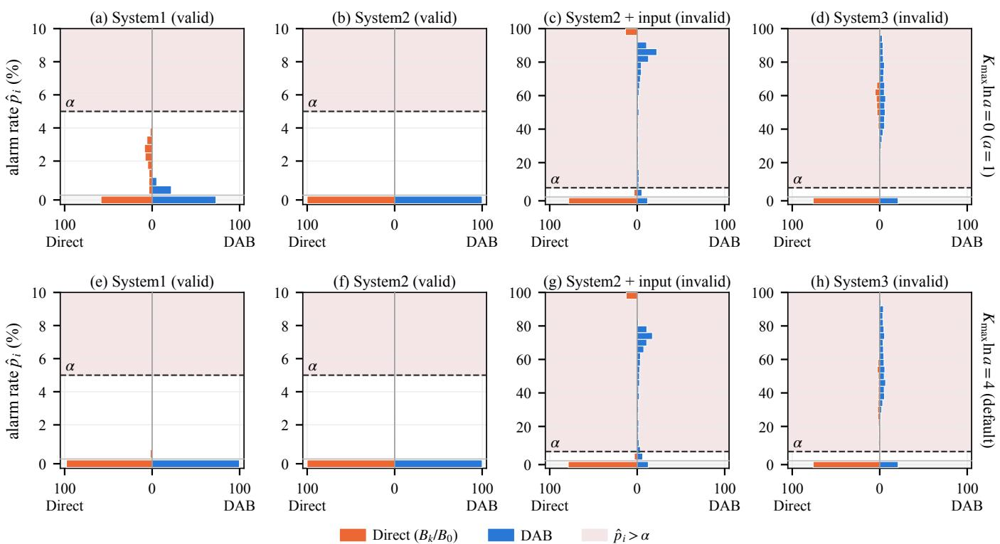  
Figure 3: Distribution of the alarm rate $\hat { p } _ { i }$ over the $N = 1 0 ^ { 3 }$ initial states, Direct (left half) against DAB (right half), with the standard rule $K _ { \mathrm { m a x } }$ ln $a = 0$ (top row) and the default $K _ { \mathrm { m a x } }$ ln $a = 4$ (bottom row); the row below each axis holds the share of initial states with $\hat { p } _ { i } = 0$

2. Betting rule $\lambda _ { t } .$ Direct uses $\lambda _ { t } ~ = ~ 1 / B ( \hat { x } _ { t } )$ and has no tunable parameters. Therefore, its alarm rates remain unchanged across the parameter setting in the second and third column of the Figure 7. In contrast, DAB uses

$$
\lambda _ { t } = \operatorname* { m i n } ( \lambda _ { t } ^ { \mathrm { K } } , U , 1 / B ( \hat { x } _ { t } ) ) ,
$$

where $\lambda _ { t } ^ { \mathrm { K } }$ depends on the discounted sums $S _ { t }$ and $Q _ { t }$ of past increments, with the discount factor $\gamma .$ . When $\gamma = 1$ , earlier decreases in the barrier can ofset subsequent increases in $S _ { t }$ As shown in Figure 7(h,k), both invalid systems consequently exhibit substantially fewer alarms. Lowering γ from 1 raises detection on both systems. Below 0.9, System 3 is flat while System 2+input declines, indicating that the efectiveness of the discount factor depends on the system.

The cap U mainly limits the betting factor when the Kellybased factor is not the active constraint. Figure 7(i, l) shows that DAB produces alarm rates above α for System 2+input only for $\bar { U } \ge 1 0 0$ , whereas the alarm rates for System 3 change little once $U \geq 1 3$ . These results suggest that the value of U needed to achieve efective detection depends on the system. In practice, U can be selected through a sensitivity analysis, choosing a value beyond which increasing the cap yields little additional improvement in detection performance. Increasing U does not compromise the anytime-valid guarantee, because the constraint $\dot { \lambda } _ { t } \le 1 / B ( \hat { x } _ { t } )$ remains in force. Consistent with this guarantee, the alarm rates for the valid systems remain below $\alpha ,$ even when $U = 1 0 0 0$

We also try other betting strategies. We compare our adaptive betting rule with fixed betting rules computed from the same barrier increments. For any betting sequence with $0 \leq \lambda _ { t } \leq 1 / B _ { t } .$ , define $\begin{array} { r } { M _ { t } ( \lambda ) = \prod _ { s = 1 } ^ { t } ( 1 + \lambda _ { s - 1 } \delta _ { s } ) } \end{array}$ . Monitors use the threshold $a ^ { K _ { \mathrm { m a x } } - t } / \alpha$ of the main experiments $( K _ { \operatorname* { m a x } } \ln a = 4 )$ for their own betting sequences, and they use the average of the $M _ { s } ( \lambda )$ values for multiple fixed parameter values when they have the same weights. For Direct, $M _ { t } = B _ { t } / B _ { 0 }$ . The fraction mixture uses $\lambda _ { t } ^ { ( c ) } = c / B _ { t } , c \in$ $\mathcal { C } = \{ 0 . 2 , 0 . 5 , 0 . 7 5 , 1 \}$ . The absolute mixture uses the fixed absolute bet $\lambda _ { t } ^ { ( \beta ) }$ for $\beta \in { \mathcal { A } }$ with $\mathcal { A } _ { 1 } = \{ 1 , 1 0 , 2 0 , 1 0 0 \}$ , and $\mathcal { A } _ { 2 } = \{ 1 0 , 3 0 , 6 0 , 1 0 0 \}$ . In each episode, each component of the absolute mixture keeps c and β fixed. In DAB, $\bar { S } _ { t }$ and $Q _ { t }$ are γ-discounted sums of past $\delta _ { s }$ and $\delta _ { s } ^ { 2 } ( \mathrm { E q . } ( 4 ) )$ .

What do these methods guarantee? For betting components under $H _ { 0 } ,$ their equal-weight mixtures are also nonnegative supermartingales. So Theorem 1 can be applied to all betting rules in Table 2.

Results. Table 3 and Figure 6 show that all monitors keep the alarm rates of the valid systems below α, with $\hat { p } ^ { \mathrm { m a x } } \leq 0 . \dot { 5 } 0 \%$

(d) System3 (invalid)  
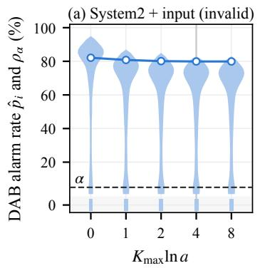

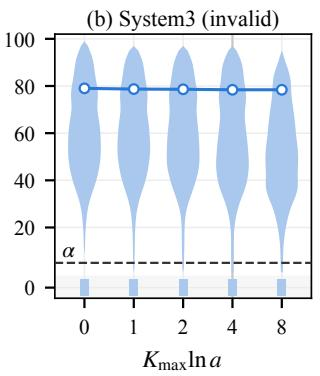

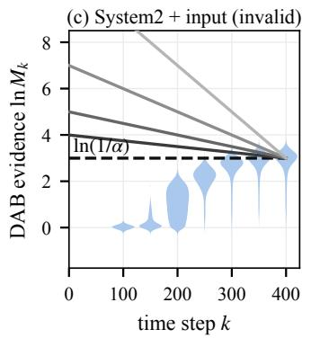

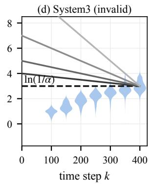  
threshold, Kmaxlna = 0 1 2 4 8 DAB: distribution $- \mathsf { O } - \rho _ { \alpha }$ default

Figure 4: Efect of the patience parameter a on the DAB alarm rates and evidence for the invalid certificates.  
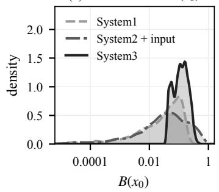

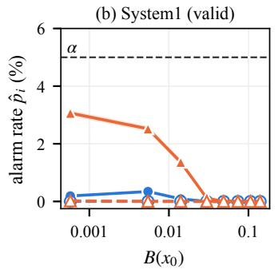

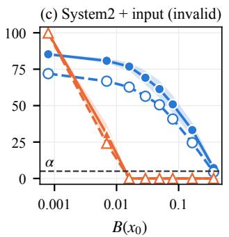

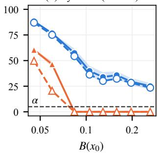  
Direct (Bk/B0) DAB Kmaxln a = 0 (a = 1) Kmaxln a = 4 (default) 95% CI (a = 1)

Figure 5: Initial barrier value $B ( x _ { 0 } )$ and alarm rate: solid lines and filled markers for the standard rule $K _ { \mathrm { m a x } }$ ln $a = 0 .$ , dashed lines and hollow markers for the default $K _ { \mathrm { m a x } }$ ln $a = 4$
<table><tr><td>Betting rules  $\mathbf { B e t } \lambda _ { t }$ </td><td>Alarm</td><td></td><td>Guar.</td></tr><tr><td>Direct</td><td> $1 / B _ { t }$ </td><td> $\begin{array} { r } { M _ { t } \ge \frac { a ^ { K _ { \operatorname* { m a x } } - t } } { \alpha } } \end{array}$ </td><td>√</td></tr><tr><td>Fraction mix.</td><td> $c / B _ { t } , c \in \mathcal { C }$ </td><td> $\begin{array} { r } { \bar { M } _ { t } \ge \frac { a ^ { K _ { \operatorname* { m a x } } - t } } { \alpha } } \end{array}$ </td><td>V</td></tr><tr><td>Absolute mix.</td><td> $\operatorname* { m i n } \{ \beta , 1 / B _ { t } \} , \beta \in \mathcal { A } _ { j }$ </td><td> $\begin{array} { r } { \bar { M } _ { t } \ge \frac { a ^ { K _ { \operatorname* { m a x } } - t } } { \alpha } } \end{array}$ </td><td>V</td></tr><tr><td>DAB</td><td>Eq.4</td><td> $\begin{array} { r } { M _ { t } \geq \frac { a ^ { K _ { \operatorname* { m a x } } - t } } { \alpha } } \end{array}$ </td><td>V</td></tr></table>

Table 2: Compared betting rules, all driven by the increments $\delta _ { t } = B _ { t } - B _ { t - 1 }$ . Guar.: $\bar { P _ { H _ { 0 } } } ( \tau \leq K _ { \operatorname* { m a x } { } } \mid x _ { 0 } ) \leq$ α for every $x _ { 0 }$ (Theorem 1).

on System 1 and no alarm on System 2.

On the invalid systems, DAB raises alarm rates above α for 79.90% of the initial states of System 2-input attack and 78.40% of those of System 3. For Direct, these shares are only 17.90% and 23.80%, and for the mixtures they are at most 22.40%. This is because a fixed bet is also placed while the barrier decreases, which multiplies the evidence by a factor below one. For example, the barrier of System 2- input attack decreases for many steps before the attack, and the fixed bets lose evidence during this period. DAB does not bet when the discounted sum $S _ { t }$ of recent increments is negative, and thus keeps its evidence for the steps where the barrier rises. Moreover, the mixture methods may be less efective because they average the evidence processes of their components. Consequently, strong evidence accumulated by a single component may be diluted by the others, preventing the mixture from reaching the alarm threshold.

## C Training Details

We train the neural barrier $B _ { \phi }$ (with a softplus output layer so that $B _ { \phi } \geq 0$ structurally) by minimizing soft penalties on the barrier conditions. Given a batch of constraint states $\{ x _ { i } \} _ { i = 1 } ^ { N }$ sampled from the safe region, we simulate M independent successor states $x _ { i , j } ^ { \prime } \sim \breve { P } ( \cdot \mid x _ { i } , \pi _ { \theta } ( x _ { i } ) )$ for each $x _ { i }$ and estimate the conditional expectation by $\widehat { \mathbb { E } } [ B _ { \phi } ( x ^ { \prime } ) \ | \ x _ { i } ] =$ $\begin{array} { r } { \frac { 1 } { M } \sum _ { j = 1 } ^ { M } B _ { \phi } ( x _ { i , j } ^ { \prime } ) } \end{array}$ . The supermartingale decrease condition is enforced by

$$
\mathcal { L } _ { \mathrm { d e c } } = \frac { 1 } { N } \sum _ { i = 1 } ^ { N } \mathrm { R e L U } \Big ( \widehat { \mathbb { E } } [ B _ { \phi } ( \boldsymbol { x } ^ { \prime } ) \mid \boldsymbol { x } _ { i } ] - B _ { \phi } ( \boldsymbol { x } _ { i } ) \Big ) ,\tag{8}
$$

<table><tr><td rowspan="2">System</td><td colspan="2">Direct</td><td colspan="2">Fraction mix.</td><td colspan="2">Absolute mix.  $\mathcal { A } _ { 1 }$ </td><td colspan="2">Absolute mix.  $\boldsymbol { A } _ { 2 }$ </td><td colspan="2">DAB</td></tr><tr><td> $\rho _ { \alpha }$ </td><td> $\hat { p } ^ { \mathrm { m a x } }$ </td><td> $\rho _ { \alpha }$ </td><td> $\hat { p } ^ { \mathrm { m a x } }$ </td><td> $\rho _ { \alpha }$ </td><td> $\hat { p } ^ { \mathrm { m a x } }$ </td><td> $\rho _ { \alpha }$ </td><td> $\hat { p } ^ { \mathrm { m a x } }$ </td><td> $\rho _ { \alpha }$ </td><td> $\hat { p } ^ { \mathrm { m a x } }$ </td></tr><tr><td>Valid certificates</td><td></td><td></td><td></td><td></td><td></td><td></td><td></td><td></td><td></td><td></td></tr><tr><td>System 1</td><td>0.00</td><td>0.20</td><td>0.00</td><td>0.50</td><td>0.00</td><td>0.00</td><td>0.00</td><td>0.00</td><td>0.00</td><td>0.10</td></tr><tr><td>System 2</td><td>0.00</td><td>0.00</td><td>0.00</td><td>0.00</td><td>0.00</td><td>0.00</td><td>0.00</td><td>0.00</td><td>0.00</td><td>0.00</td></tr><tr><td>Invalid certificates</td><td></td><td></td><td></td><td></td><td></td><td></td><td></td><td></td><td></td><td></td></tr><tr><td>System 2-input attack</td><td>17.90</td><td>100.00</td><td>11.30</td><td>100.00</td><td>0.00</td><td>0.00</td><td>0.00</td><td>1.20</td><td>79.90</td><td>81.50</td></tr><tr><td>System 3</td><td>23.80</td><td>63.60</td><td>0.00</td><td>0.00</td><td>9.30</td><td>29.50</td><td>22.40</td><td>58.80</td><td>78.40</td><td>95.10</td></tr></table>

Table 3: Comparison with other monitors on the runs of Table 1. $N = 1 0 ^ { 3 }$ initial states, $R = 1 0 ^ { 3 }$ trajectories per initial state, $K _ { \operatorname* { m a x } } = 4 0 0 , \bar { K } _ { \operatorname* { m a x } } \ln a = 4 , \alpha = 0 . 0 5$ . All values are percentages.

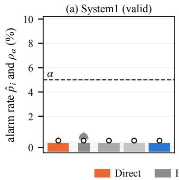

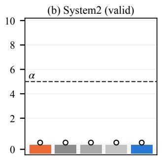

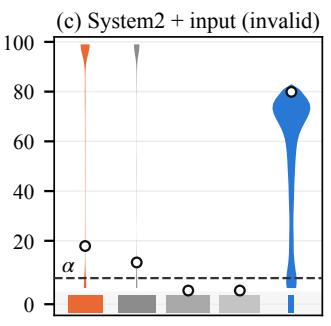

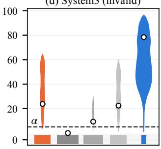  
Figure 6: Distribution of the alarm rates $\hat { p } _ { i }$ over the initial states for all monitors $( K _ { \operatorname* { m a x } }$ ln $a = 4 )$ .

while the initial and unsafe conditions are enforced on sampled sets $\{ x _ { 0 } ^ { ( i ) } \} _ { i = 1 } ^ { N _ { 0 } } \subset \mathcal { X } _ { 0 }$ and $\{ x _ { u } ^ { ( i ) } \} _ { i = 1 } ^ { N _ { u } } \subset \mathcal X _ { u }$ by

$$
\mathcal { L } _ { \mathrm { i n i t } } = \frac { 1 } { N _ { 0 } } \sum _ { i = 1 } ^ { N _ { 0 } } \mathrm { R e L U } \big ( B _ { \phi } ( x _ { 0 } ^ { ( i ) } ) - b \big ) ,\tag{9}
$$

$$
\mathcal { L } _ { \mathrm { u n s a f e } } = \frac { 1 } { N _ { u } } \sum _ { i = 1 } ^ { N _ { u } } \mathrm { R e L U } \big ( 1 - B _ { \phi } ( x _ { u } ^ { ( i ) } ) \big ) ,
$$

where $b > 0$ is an upper bound on the initial barrier value. The total loss is

$$
{ \mathcal { L } } ( \phi ) = w _ { 1 } { \mathcal { L } } _ { \mathrm { d e c } } + w _ { 2 } { \mathcal { L } } _ { \mathrm { u n s a f e } } + w _ { 3 } { \mathcal { L } } _ { \mathrm { i n i t } } ,\tag{10}
$$

where $w _ { 1 } , w _ { 2 } , w _ { 3 } > 0$ are weighting parameters. All terms are optimized with Adam. In this paper, we mainly focus on online training, where collecting multiple independent successors from the same state may be impractical. We therefore set $M = 1$ . Although the resulting single-sample Monte Carlo estimate is unbiased for E $[ B _ { \phi } ( { \bf { \bar { x } } } ^ { \prime } ) \mid { \bf { \bar { x } } } _ { i } ]$ , it has higher variance. Moreover, applying the nonlinear ReLU penalty to a single-sample estimate does not provide an unbiased estimate of the ideal expected decrease loss. Consequently, the learned barrier is not necessarily a valid certificate. Nevertheless, the runtime monitor can detect potential violations and intervene against unsafe behavior. The neural network output $B _ { \phi }$ uses a Softplus activation, which ensures that $B _ { \phi } \bar { ( } x ) \geq 0$ . We then define the deployed barrier function by the piecewise extension

(12)

Therefore, the nonnegativity condition and the unsafe-set condition $\bar { B } _ { \phi } ( x ) \geq 1$ for all $x \not \in S$ are satisfied structurally. During deployment, the runtime monitor evaluates $\bar { B } _ { \phi }$ and computes the barrier increments as

$$
\bar { B } _ { \phi } ( x ) = \left\{ \begin{array} { l l } { B _ { \phi } ( x ) , } & { x \in \mathcal { S } , } \\ { 1 , } & { x \notin \mathcal { S } . } \end{array} \right.\tag{11}
$$

$$
\delta _ { t + 1 } = \bar { B } _ { \phi } ( \hat { x } _ { t + 1 } ) - \bar { B } _ { \phi } ( \hat { x } _ { t } ) .
$$

The sampled unsafe-set loss is retained as an auxiliary training term to encourage the neural-network output to approach the prescribed unsafe value near the boundary of the safe set.

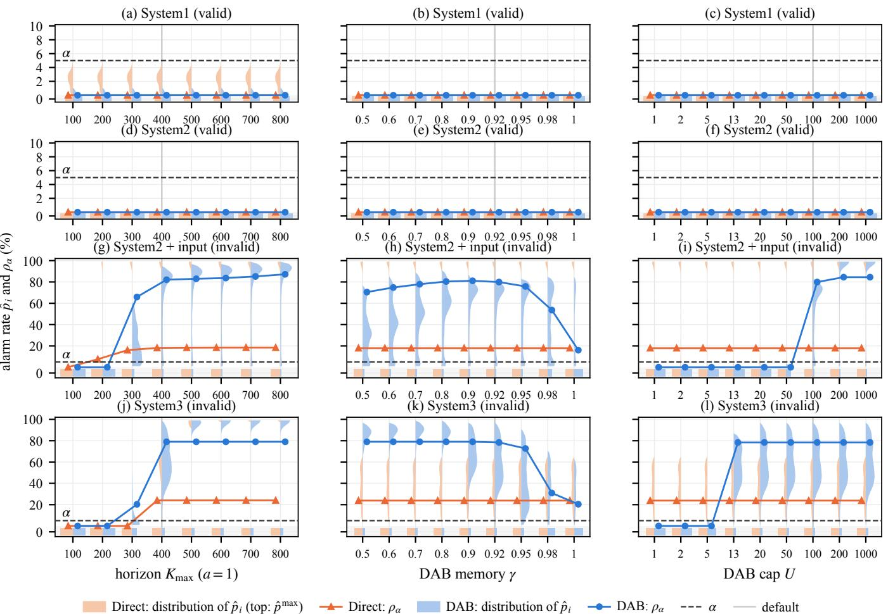  
Figure 7: Sensitivity to the horizon $K _ { \mathrm { m a x } } .$ , DAB memory γ and DAB cap U.