# Ask to Learn: Query-Based Collaborative Reinforcement Learning

Kaicheng Zhang<sup>1</sup>, Hongqian Niu<sup>1</sup>, Laixi Shi<sup>2</sup>, Didong Li<sup>1</sup>, Guannan Qu<sup>3</sup>, and Zhun Deng<sup>1</sup>

<sup>1</sup>University of North Carolina at Chapel Hill <sup>2</sup>Johns Hopkins University <sup>3</sup>Carnegie Mellon University

## Abstract

Ofline reinforcement learning is fundamentally limited by the coverage of the available data, while collecting additional trajectories through online exploration may be costly, unsafe, or infeasible. We study whether this limitation can be overcome without directly interacting with the underlying environment. Motivated by practical settings such as collaborator-mediated simulation, where a collaborator can provide information complementary to the ofline data, we introduce query-based collaborative reinforcement learning to study how to acquire this information eficiently. The learner starts with a fixed ofline dataset and adaptively queries state-time pairs; the collaborator samples an action according to a fixed, possibly suboptimal policy, and the simulator returns the corresponding reward and next state. For finite-horizon tabular problems, we derive an instance-dependent informationtheoretic lower bound on the additional queries required to identify an ε-optimal policy and develop a local quadratic approximation. Guided by this characterization, we develop an adaptive queryallocation algorithm whose query complexity nearly matches the local benchmark under suitable conditions. Experiments on multiple synthetic and semi-synthetic environments demonstrate the empirical eficiency of the proposed method.

## Contents

Introduction 3   
2 Related Work 5   
3 Setup 6   
4 A Key Quantity Guiding Algorithm Design 8   
5 Algorithm Overview 11   
6 Theoretical Guarantees 13   
7 Experiments 15   
8 Summary 18   
References 19   
A Full Algorithm and Auxiliary Definitions 22   
A.1 Unknown collaborator policy 22   
A.2 Complete procedure 23   
A.3 Complete pseudocode 30   
B Proofs of Main Results 32   
B.1 Proof of Theorem 4.1 32   
B.2 Proof of Corollary 4.2 39   
B.3 Proof of Lemma 4.3 44   
B.4 Proof of Theorem 6.1 45   
B.5 Proof of Theorem 6.2 54   
B.6 Proof of Theorem 6.3 58   
B.7 Proof of Theorem 6.4 64   
C Robustness to a Shifted Collaborator Simulator 68   
C.1 Additional quantities 69   
C.2 A robust global event 69   
C.3 Auxiliary Lemmas . 73   
C.4 The robustness theorem 78   
D Technical Lemmas 85   
E Additional Simulation Details and Results 92   
E.1 Implementation and Protocol 92   
E.2 Summary of Results . . 95   
E.3 Simulation 1: Contextual Bandit . 97   
E.4 Simulation 2: Multiple Sequential Decisions 99   
E.5 Simulation 3: Decisions with Long-Term Consequences 101   
E.6 Results with C = 1 105   
F PRISM Application Details 111   
G Code Availability & Computing 113

## 1 Introduction

Collecting new trajectories for reinforcement learning (RL) can be costly, slow, or unsafe. In healthcare, for example, it is generally infeasible to deploy exploratory treatment policies on patients solely for data collection. Ofline RL avoids such interaction by learning from historical records, but its guarantees depend critically on the coverage of the available data [Jin et al., 2021; Li et al., 2024; Xie et al., 2021; Yin and Wang, 2021]. The absence of feasible online exploration, however, does not preclude access to additional information through simulation. We study how a learner can acquire this information eficiently through collaboration.

We introduce query-based collaborative reinforcement learning, in which a learner augments a fixed ofline dataset with observations from a collaborator-mediated simulator. At each query, the learner selects a state-time pair; the collaborator samples an action according to a fixed, possibly suboptimal policy, and the simulator returns the corresponding reward and next state. The learner thus controls where information is collected, but not which action generates it. Our central question is:

Given the available ofline data, when is it possible to identify a near-optimal policy through collaboration, and how should queries be allocated to do so eficiently?

This setting is motivated by systems that couple decision models with simulators. In head-and-neck cancer treatment, Wentzel et al. [2025] combine a model of physician treatment decisions with a patient simulator that predicts treatment responses and clinical outcomes. In our abstraction of such a system, a query specifies the patient state and treatment stage, while the physician model selects the treatment and the simulator supplies its consequences. Related structures arise in power-system dispatch, where a rule-based decision strategy interacts with a simulated grid [Xu et al., 2024], and in process control, where a human digital twin emulates an operator’s corrective actions in a simulated plant [Balaji et al., 2023].

The collaborator need not be uniformly informative. For example, a hospital’s records may contain treatments that an externally developed clinical digital twin rarely or never selects, while the twin may provide information about patient states poorly represented in those records. The two sources should therefore be viewed as complementary rather than interchangeable. Unlike imitation learning, our objective is not to recover the collaborator’s policy, but to use both information sources to identify a near-optimal policy for the underlying decision process.

This division of control also distinguishes our setting from standard trajectory-based hybrid RL, which supplements ofline data by executing exploration policies [Ball et al., 2023; Huang et al., 2025; Song et al., 2022]. Here, the learner can request observations at a chosen state-time pair without first reaching that state through a trajectory. Conversely, unlike unrestricted generative-model access [Agarwal et al., 2020; Azar et al., 2012; Sidford et al., 2018; Zanette et al., 2019], it cannot directly select the sampled action. The query strategy must therefore account for both the information already available ofline and the collaborator’s sampling restrictions.

Uniformly querying all state-time pairs is generally ineficient. The ofline data may already estimate some parts of the decision process accurately, while leaving others uncertain. More importantly, not every uncertainty is equally relevant: identifying a good policy requires resolving comparisons between plausible alternatives, rather than estimating every reward and transition equally accurately. Poor coverage alone therefore need not make a state the best query location. An eficient strategy should direct queries toward the policy comparisons that remain statistically dificult after accounting for the ofline data, subject to which observations the collaborator can supply.

The sampling restriction also means that some uncertainty may persist indefinitely. If the collaborator never selects an action at a given state-time pair, no amount of querying can provide additional observations of that action there. Its estimation remains limited by the fixed ofline data, potentially imposing an irreducible certification limit. A learning procedure must therefore account not only for how to allocate queries, but also for when additional queries cannot suficiently reduce the uncertainty needed to certify

  
Figure 1: Query-based collaborative RL. The learner augments ofline data with simulated experience, choosing state-time queries but not the actions sampled by the fixed-policy collaborator.

## the target accuracy.

Contributions. We initiate the framework of query-based collaborative reinforcement learning, where an instance-dependent analysis is natural because the value of additional queries depends strongly on the ofline coverage, collaborator support and the structure of the underlying MDP, which can vary substantially across instances. Hence, a worst-case analysis obscures this heterogeneity and cannot capture how the ofline data and collaborator jointly reduce the remaining uncertainty. For a target suboptimality ε > 0 and failure probability δ ∈ (0, 1), our main results are as follows.

– Information-theoretic lower bound and local characterization. We derive an exact KL-based lowerbound benchmark for the additional collaborator queries required to identify an ε-optimal policy with probability at least 1 − δ. We then derive a tractable local quadratic surrogate that makes explicit the roles of policy-comparison margins, local reward-transition variability, ofline coverage, and collaborator support.

– Lower-bound-guided adaptive querying. We show that the same local variance structure governs the lower-bound approximation and the leading finite-sample uncertainty of policy-value comparisons. Guided by this connection, we develop an epoch-based algorithm that progressively narrows the candidate policy class and allocates queries through a local minimax design problem. The design jointly selects a reference policy and state–time query locations, concentrating observations on comparisons that remain dificult after exploiting the ofline data.

– Finite-sample guarantees and near-matching complexity. We establish finite-query termination and high-probability suboptimality guarantees for the returned policy, covering both near-optimality certification and stopping at the certification limit. In the certifiable regime, under the stated assumptions, the leading query-complexity term is governed by the same local quadratic characteristic, evaluated at a polylogarithmically reduced efective ofline sample size. We additionally establish robustness to row-wise simulator misspecification measured in total variation.

Empirically, we evaluate the method on three synthetic environments (contextual bandit, multi-stage MDP, and an MDP with long-term consequences), and a semi-synthetic drug-response application. Compared with uniform and coverage-based allocation, our adaptive allocation certifies an ε-optimal policy with 3-22 times fewer collaborator queries in an eficient implementation and returns better policies at equal budgets.

## 2 Related Work

Worst-case sample complexity in tabular RL. A large body of work studies the worst-case sample complexity of learning a near-optimal policy in tabular MDPs. In ofline RL, where the learner must rely entirely on a fixed dataset, guarantees of related work necessarily depend on how well the behavior policy covers the state–action pairs relevant to an optimal policy. A sequence of works has established sample complexity guarantees under various notions of coverage, including single-policy concentrability [Shi et al., 2022; Li et al., 2024].

At the other extreme, the generative-model setting allows the learner to request samples from arbitrary state–action pairs. Classical and more recent results characterize the minimax sample complexity of uniformly querying under such access [Gheshlaghi Azar et al., 2013; Agarwal et al., 2020].

Instance-dependent policy identification. Our work is closely related to a growing literature on instance-dependent reinforcement learning, which seeks to exploit the specific structure of the underlying MDP to obtain substantially sharper sample-complexity guarantees than worst-case bounds. Rather than characterizing dificulty solely through global quantities such as the size of the state–action space or worst-case coverage coeficients, these results adapt to instance-specific features such as visitation probabilities, local variances, and suboptimality gaps. Hence the resulting guarantees can be much smaller than worst-case rates on favorable instances.

In ofline tabular RL, Yin and Wang [2021] derived variance-sensitive instance-dependent guarantees while Wang et al. [2022] showed that, under suitable coverage conditions, the sample complexity can be improved when the minimum suboptimality gap is bounded away from zero.

A related line of work studies instance-dependent policy identification in online RL. For online tabular RL, Wagenmaker et al. [2022] developed instance-dependent PAC guarantees that adapt to local action gaps, thereby allowing substantially smaller sample complexity on MDPs in which suboptimal actions can be identified quickly. In contrast, Wagenmaker and Jamieson [2022] studied instance-dependent policy identification from a policy-level perspective, with complexity controlled by the suboptimal policy gap. More recently, Narang et al. [2024] showed that directly estimating value diferences between candidate policies can lead to substantially sharper identification guarantees than estimating each policy value separately.

Instance dependence has also been studied under generative-model access. For discounted tabular MDPs, Zanette et al. [2019] derived structure-aware sample-complexity guarantees that adapt to local reward and transition variances as well as suboptimality action gaps, and can avoid an explicit polynomial dependence on the efective horizon in favorable instances.

Imitation learning and learning with expert queries. Several ideas underlying our framework also appear in the imitation-learning literature, particularly the selective use of expert supervision and the combination of expert information with other sources of data. Judah et al. [2014] studied active imitation learning, where the learner adaptively selects informative states at which to query the expert for an action, with the goal of reducing the number of expert labels. Liu et al. [2022] studied adversarial policy imitation with linear function approximation and, in their ofline setting, combined expert demonstrations with an additional ofline dataset collected by a prior policy. They showed that this supplementary dataset can improve the statistical eficiency of imitation learning under suitable coverage conditions. More closely related to our use of the collaborator, Amortila et al. [2022] considered eficient learning with a small number of expert-action queries. In their setting, an expert query provides only the expert’s action and the learner implements it and interacts with the environment, and the goal is to learn a policy that performs at least nearly as well as the expert rather than to identify a near-optimal policy.

Adaptive querying and complementary information. Eficient information acquisition is also studied beyond RL. Ding et al. [2026] adaptively select questions and respondents to infer latent group properties under budget constraints, while Liu et al. [2026] allocate reasoning samples across questions for eficient test-time self-consistency. Related work also exploits complementary information: weak-strong model collaboration combines specialized knowledge with general reasoning [Jiao et al., 2025]. Our setting instead concerns near-optimal policy identification from ofline data and adaptively queried simulator observations. The collaborator’s fixed action policy restricts which uncertainties can be reduced, making both query eficiency and the attainability of the target accuracy central to the analysis.

## 3 Setup

In this section, we formalize the reinforcement learning setting we study.

Tabular MDPs. Following Li et al. [2024], we consider a finite-horizon, time-inhomogeneous tabular MDP

$$
\begin{array} { r } { \mathcal { M } = ( S , \mathcal { A } , H , \rho , \{ { \bf P } _ { h } \} _ { h = 1 } ^ { H } , \{ { \bf R } _ { h } \} _ { h = 1 } ^ { H } ) , } \end{array}
$$

where $\boldsymbol { \mathcal { S } }$ and A are finite state and action spaces of sizes $| S |$ and $| { \mathcal { A } } | ,$ H is the horizon, and $\rho$ is the initial-state distribution. Write $[ m ] : = \{ 1 , \ldots , m \}$ for integers $m \geqslant 1 . \mathrm { A t }$ stage $h \in [ H ]$ , the transition kernel ${ \bf P } _ { h }$ assigns probability $P _ { h } ( s ^ { \prime } \mid s , a )$ to next state $s ^ { \prime }$ from $( s , a )$ . The random reward vector $\mathbf { R } _ { h } \in [ 0 , 1 ] ^ { | S | | A | }$ has components $R _ { h } ( s , a )$ with means $r _ { h } ( s , a ) : = \mathbb { E } [ R _ { h } ( s , a ) ]$ . For every $( h , s , a )$ , we assume that, conditional on $( S _ { h } , A _ { h } ) = ( s , a )$ , the reward and next state are independent.

Preliminaries for analysis. A policy $\pi = \{ \pi _ { h } \} _ { h = 1 } ^ { H }$ assigns action distributions $\pi _ { h } ( \cdot \mid s ) \in \Delta _ { \mathcal { A } } ,$ where $\Delta _ { \mathcal { A } }$ is the probability simplex over ${ \mathcal { A } } .$ Let $\Pi _ { d }$ denote the deterministic policy class, with $\pi _ { h } ( s ) \in { \cal A }$ the selected action. Write $\mathbb { E } _ { \mathcal { M } } ^ { \pi }$ and $\mathbb { P } _ { \mathcal { M } , \pi }$ for trajectory expectation and probability under π in $\mathcal { M }$ . Define the value and action-value functions by

$$
\begin{array} { r l } & { V _ { h } ^ { \pi } ( s ) : = \mathbb { E } _ { \boldsymbol { \mathcal { M } } } ^ { \pi } \left[ \displaystyle \sum _ { t = h } ^ { H } R _ { t } ( S _ { t } , A _ { t } ) \mid S _ { h } = s \right] , } \\ & { Q _ { h } ^ { \pi } ( s , a ) : = r _ { h } ( s , a ) + \mathbb { E } _ { S ^ { \prime } \sim P _ { h } ( \cdot \mid s , a ) } [ V _ { h + 1 } ^ { \pi } ( S ^ { \prime } ) ] , } \end{array}
$$

with the terminal convention $V _ { H + 1 } ^ { \pi } ( s ) = 0$ . The initial value is $V _ { 1 } ^ { \pi } : = \mathbb { E } _ { S _ { 1 } \sim \rho } [ V _ { 1 } ^ { \pi } ( S _ { 1 } ) ]$ . The state and state-action occupancies are

$$
\begin{array} { r } { d _ { h } ^ { \pi } ( s ) : = \mathbb { P } _ { \mathcal { M } , \pi } ( S _ { h } = s ) , \quad d _ { h s a } ^ { \pi } : = d _ { h } ^ { \pi } ( s ) \pi _ { h } ( a \mid s ) . } \end{array}
$$

We further define the optimal value and the set of optimal deterministic policies by

$$
V _ { 1 } ^ { \star } : = \operatorname* { m a x } _ { \pi \in \Pi _ { d } } V _ { 1 } ^ { \pi } , \qquad \Pi ^ { \star } ( { \mathcal { M } } ) : = \arg \operatorname* { m a x } _ { \pi \in \Pi _ { d } } V _ { 1 } ^ { \pi } .
$$

The policy gap

$$
\Delta _ { \mathcal { M } } ( \pi ) : = V _ { 1 } ^ { \star } - V _ { 1 } ^ { \pi }
$$

defines the ε-optimal set

$$
\Pi _ { \varepsilon } ( { \mathcal { M } } ) : = \{ \pi \in \Pi _ { d } : \Delta _ { { \mathcal { M } } } ( \pi ) \leqslant \varepsilon \} .
$$

For any $\pi ^ { \star } \in \Pi ^ { \star } ( { \mathcal { M } } )$ , define

$$
\Delta _ { \operatorname* { m i n } } : = \operatorname* { m i n } _ { \pi \in \Pi _ { d } \backslash \{ \pi ^ { \star } \} } \Delta _ { { \mathcal { M } } } ( \pi ) .\tag{1}
$$

This definition does not depend on the choice of $\pi ^ { \star }$ . In particular, if the optimal deterministic policy is unique, then $\Delta _ { \mathrm { m i n } }$ is the smallest strictly positive suboptimality gap, whereas if there are multiple optimal deterministic policies, then $\Delta _ { \operatorname* { m i n } } = 0$

Empirical estimation. We next construct the empirical MDP from a given dataset D and define corresponding policy values and visitation probabilities. For each $( h , s , a )$ , suppose the dataset D contains $N _ { h s a }$ reward-next-state observations $\{ ( \boldsymbol { R } _ { h s a } ^ { ( i ) } , \boldsymbol { S } _ { h s a } ^ { \prime ( i ) } ) \} _ { i = 1 } ^ { N _ { h s a } }$ , such that

$$
\mathcal { D } = \bigcup _ { h , s , a } \left\{ ( R _ { h s a } ^ { ( i ) } , S _ { h s a } ^ { \prime ( i ) } ) : i \in [ N _ { h s a } ] \right\} .
$$

For $N _ { h s a } > 0$ , define

$$
\widehat { r } _ { h } ^ { D } ( s , a ) : = \frac { 1 } { N _ { h s a } } \sum _ { i = 1 } ^ { N _ { h s a } } R _ { h s a } ^ { ( i ) } ,
$$

$$
\widehat { P } _ { h } ^ { D } ( s ^ { \prime } \mid s , a ) : = \frac { 1 } { N _ { h s a } } \sum _ { i = 1 } ^ { N _ { h s a } } \mathbf { 1 } \{ S _ { h s a } ^ { \prime ( i ) } = s ^ { \prime } \} .
$$

These estimates define the empirical MDP $\widehat { \mathcal { M } } ^ { D } = ( S , \mathcal { A } , H , \rho , \widehat { P } ^ { D } , \widehat { r } ^ { \mathcal { D } } )$ . For any policy $\pi ,$ let $\widehat { V } _ { h } ^ { \pi , D }$ and $\widehat { Q } _ { h } ^ { \pi , D }$ denote its value and action-value functions under this MDP. Its state and state–action occupancies are

$$
\widehat { d } _ { h } ^ { \pi , \mathcal { D } } ( s ) : = \mathbb { P } _ { \widehat { \mathcal { M } ^ { \cal D } } , \pi } ( S _ { h } = s ) , \qquad \widehat { d } _ { h s a } ^ { \pi , \mathcal { D } } : = \widehat { d } _ { h } ^ { \pi , \mathcal { D } } ( s ) \pi _ { h } ( a \mid s ) .
$$

Beyond ofline data: collaborator-mediated simulator. The learner receives an ofline dataset $\mathcal { D } _ { 0 } =$ $\{ \tau _ { i } \} _ { i = 1 } ^ { n _ { 0 } }$ of $n _ { 0 }$ trajectories generated by an unknown behavior policy µ in $\mathcal { M } ,$ with $N _ { 0 , h s a }$ observations of $( \bar { R _ { h } } , \bar { S _ { h + 1 } } )$ collected at $( h , s , a )$ . It also accesses a collaborator-mediated simulator: for any queried state-time pair $( h , s )$ , the collaborator draws $A \sim \pi _ { h } ^ { c } ( \cdot \mid s )$ under a fixed, possibly suboptimal policy $\pi ^ { c } ,$ and the simulator returns reward $R _ { h } ( s , A )$ and next state $S ^ { \prime } \sim P _ { h } ( \cdot \mid s , A )$ . Each request and its resulting sample $( A , R _ { h } ( s , A ) , S ^ { \prime } )$ constitute a collaborator $q u e r y ^ { 1 }$ . Thus, the learner chooses the state-time pair, but not the sampled action.

We define the minimum positive collaborator-action probability by

$$
p _ { \operatorname* { m i n } } ^ { c } : = \operatorname* { m i n } _ { ( h , s , a ) : \pi _ { h } ^ { c } ( a | s ) > 0 } \pi _ { h } ^ { c } ( a \mid s ) .
$$

This interaction protocol difers from both standard online RL and the generative-model setting. In those settings, the learner chooses the action to execute or sample, whereas here a fundamental new challenge is that the learner chooses only $( h , s )$ , while the action is determined by the collaborator policy $\pi _ { h } ^ { c } ( \cdot \vert s )$ . Hence, even with infinitely many queries, full state-action coverage may be impossible because if $\overset { \cdot } { \pi } { } _ { h } ^ { c } ( a \mid s ) = 0$ , no additional samples can be collected at $( h , s , a )$ . Consequently, the learner will be unable to reduce the uncertainty associated with some state-action pairs beyond what is already provided by the ofline data, even with unlimited collaborator queries. This creates a learning objective fundamentally diferent from those in standard online reinforcement learning and generative-model settings, since the learner must account for uncertainty that cannot be eliminated through additional interaction.

Table 1: Auxiliary notation used in Section 4.
<table><tr><td>Symbol</td><td>Definition</td><td>Meaning</td></tr><tr><td> ${ \mathcal { L } } _ { { \mathcal { M } } } ( X )$ </td><td>Law of a random variable X under M</td><td>Probability law</td></tr><tr><td> $\nu _ { h s a } ^ { \mathcal { M } }$ </td><td> $\mathcal { L } _ { \mathcal { M } } ( R _ { h } ( s , a ) , S _ { h + 1 } \mid S _ { h } = s , A _ { h } = a )$ </td><td>Observation law</td></tr><tr><td> $\mathrm { K L } _ { h s a } ( \mathcal { M } , \widetilde { \mathcal { M } } )$ </td><td> $\mathrm { K L } ( \nu _ { h s a } ^ { \mathcal { M } } | | \nu _ { h s a } ^ { \widetilde { \mathcal { M } } } )$ </td><td>Local information</td></tr><tr><td> $\Delta _ { H | S | }$ </td><td> $\{ \lambda \in \mathbb { R } _ { + } ^ { H \times | \mathcal { S } | } : \sum _ { h , s } \lambda _ { h s } = 1 \}$ </td><td>Query allocations</td></tr><tr><td> $q _ { h s a } ^ { A }$ </td><td> $\lambda _ { h s } \pi _ { h } ^ { c } ( a \mid s )$ </td><td>Sampling proportion</td></tr><tr><td> $J _ { \mu } ( { \mathcal { M } } , { \widetilde { \mathcal { M } } } )$ </td><td> $\begin{array} { r } { \sum _ { h , s , a } d _ { h s a } ^ { \mu } \mathrm { K L } _ { h s a } ( \mathcal { M } , \widetilde { \mathcal { M } } ) } \end{array}$ </td><td>Offline information</td></tr><tr><td> $\dot { I _ { \lambda } } ( \mathcal { M } , \widetilde { \mathcal { M } } )$ </td><td> $\begin{array} { r l } { \sum _ { h , s , a } q _ { h s a } ^ { \lambda } \mathrm { K L } _ { h s a } ( \mathcal { M } , \widetilde { \mathcal { M } } ) } & { { } } \end{array}$ </td><td>Query information</td></tr><tr><td> $D ( \pi , { \bar { \pi } } )$ </td><td> $V _ { 1 } ^ { \pi } - V _ { 1 } ^ { \pi }$ </td><td>Value difference</td></tr><tr><td> $\widehat { \cal D } ( \pi , \bar { \pi } )$ </td><td> $\widehat { V } _ { 1 } ^ { \pi } - \widehat { V } _ { 1 } ^ { \pi }$ </td><td>Empirical value differ-</td></tr><tr><td> $b ( \pi , { \bar { \pi } } )$ </td><td> $\varepsilon - D ( \pi , { \bar { \pi } } )$ </td><td>ence</td></tr><tr><td> $G _ { h s a } ^ { r } ( \pi , \bar { \pi } )$ </td><td> $d _ { h s a } ^ { \pi } - d _ { h s a } ^ { \bar { \pi } }$ </td><td>Certification margin</td></tr><tr><td> $G _ { h s a } ^ { \tilde { P } ^ { \cdots } } ( \pi , \bar { \pi } ) ( s ^ { \prime } )$ </td><td> $d _ { h s a } ^ { \widetilde { \pi } ^ { \cdots } } V _ { h + 1 } ^ { \pi ^ { \cdots } } ( s ^ { \prime } ) - d _ { h s a } ^ { \bar { \pi } } V _ { h + 1 } ^ { \bar { \pi } } ( s ^ { \prime } )$ </td><td>Reward sensitivity Transition sensitivity</td></tr><tr><td> $\Psi _ { h s a } ^ { \pi , \bar { \pi } } ( r , s ^ { \prime } )$ </td><td> $G _ { h s a } ^ { r } ( \pi , \bar { \pi } ) r + G _ { h s a } ^ { P } ( \pi , \bar { \pi } ) ( s ^ { \prime } )$ </td><td></td></tr><tr><td></td><td></td><td>Local influence</td></tr><tr><td> ${ \cal L } _ { h s a } ( \pi , \bar { \pi } )$ </td><td> $| G _ { h s a } ^ { r } ( \pi , \bar { \pi } ) | + \mathrm { r a n g e } ( G _ { h s a } ^ { P } ( \pi , \bar { \pi } ) )$ </td><td>Range bound</td></tr></table>

Our Desiderata: Optimal Allocation of Collaborator Queries. Given a target accuracy $\varepsilon > 0$ and confidence level $\delta \in ( 0 , 1 )$ , an algorithm is (ε, δ)-PAC if it returns a policy $\widehat { \pi } \in \Pi _ { d }$ satisfying

$$
\mathbb { P } _ { \mathcal { M } } \left( V _ { 1 } ^ { \star } - V _ { 1 } ^ { \widehat { \pi } } \leqslant \varepsilon \right) \geqslant 1 - \delta .
$$

Here the probability includes the randomness of the ofline dataset, the collaborator observations, and the algorithm. Our goal is to design an adaptive procedure that accounts for the statistical limitations of both available information sources. If the target accuracy ε is attainable from the fixed ofline dataset together with additional collaborator-mediated observations, the procedure should achieve the desired (ε, δ)-PAC guarantee. If ε is not attainable, the procedure should instead return a policy satisfying an $( \varepsilon ^ { \prime } , \delta ) \ – \mathrm { P A C }$ guarantee for some attainable resolution $\varepsilon ^ { \prime } > \varepsilon$ . Here, $\varepsilon ^ { \prime }$ should reflect the irreducible uncertainty induced by the finite ofline dataset and by state-action pairs whose uncertainty cannot be further reduced through collaborator queries.

When the target ε is attainable, our further objective is to use as few collaborator queries as possible. The key design question is therefore how to determine the required query budget B and allocate it across state-time pairs. We represent a normalized query allocation by

$$
\lambda = \{ \lambda _ { h s } \} _ { h , s } \in \Delta _ { H | S | } : = \{ \ell \in \mathbb { R } _ { + } ^ { H \times | S | } : \sum _ { h , s } \ell _ { h s } = 1 \} ,
$$

where $\lambda _ { h s }$ denotes the fraction of collaborator queries assigned to $( h , s )$ . Since a query at $( h , s )$ generates an action according to $\pi _ { h } ^ { c } ( \cdot \vert s )$ , the corresponding sampling proportion at $( h , s , a ) \mathrm { i s } \lambda _ { h s } \pi _ { h } ^ { c } ( a \mid s )$ . Consequently, the optimal allocation depends on the particular MDP, the information already contained in the ofline data, and the collaborator policy. Our objective is therefore instance-dependent: whenever the target accuracy is attainable, we seek an adaptive (ε, δ)-PAC procedure whose collaborator-query complexity is governed by the intrinsic dificulty of the underlying instance.

## 4 A Key Quantity Guiding Algorithm Design

To guide query allocation, we derive an information-theoretic lower bound on the additional collaborator queries needed for an $( \varepsilon , \delta ) \mathrm { \mathrm { - P A C } }$ guarantee and develop a local approximation that reveals an explicit local variance structure. The same local variance structure governs finite-sample uncertainty in policy-value comparisons. Reducing this uncertainty targets the dificult comparisons identified by the lower bound, motivating our adaptive query-design criterion. Auxiliary notation for this section is collected in Table 1.

Information-theoretic lower bound. For all $\pi \in \Pi _ { \varepsilon } ( \mathcal { M } )$ , let

$$
\mathcal { A } _ { \varepsilon } ( \pi ) : = \left\{ \widetilde { \mathcal { M } } : V _ { 1 } ^ { \star } ( \widetilde { \mathcal { M } } ) - V _ { 1 } ^ { \pi } ( \widetilde { \mathcal { M } } ) > \varepsilon \right\}
$$

denote the set of alternative MDPs under which π is no longer ε-optimal. Here all alternative MDPs share the same state and action spaces, horizon, initial-state distribution, behavior policy, and collaborator policy as M. Only the reward and transition laws are allowed to vary.

We next characterize the asymptotic query complexity in the high-confidence regime. Following the standard log(1/δ) scaling in fixed-confidence identification [Al-Marjani et al., 2023; Garivier and Kaufmann, 2016], we consider a joint asymptotic regime in which the ofline sample size grows on the same scale, so that ofline and queried information contribute nontrivially at leading order. Specifically, let $n _ { 0 , \delta }$ denote the number of ofline trajectories available at confidence level $\delta ,$ and suppose that

$$
\frac { n _ { 0 , \delta } } { \log ( 1 / \delta ) } \longrightarrow \kappa \in [ 0 , \infty ) .
$$

Under this normalization, the ofline information and the information acquired through collaborator queries can be compared directly in the asymptotic lower bound.

We define the characteristic threshold

$$
T _ { \varepsilon , \kappa } ^ { \star } ( \mathcal { M } ) : = \operatorname* { m i n } _ { \widetilde { \pi } \in \Pi _ { \varepsilon } ( \mathcal { M } ) } \operatorname* { i n f } _ { \lambda \in \Delta _ { H | \mathcal { S } | } } \operatorname* { i n f } \Bigg \{ t \geqslant 0 : \operatorname* { i n f } _ { \widetilde { \mathcal { M } } \in \mathcal { A } _ { \varepsilon } ( \widetilde { \pi } ) } \Bigg [ \kappa J _ { \mu } ( \mathcal { M } , \widetilde { \mathcal { M } } ) + t I _ { \lambda } ( \mathcal { M } , \widetilde { \mathcal { M } } ) \Bigg ] \geqslant 1 \Bigg \} ,
$$

which captures the smallest asymptotic query budget, under the best state-time allocation, required to rule out all alternative MDPs.

Theorem 4.1 (Information-theoretic lower bound). For any family of (ε, δ)-PAC algorithms, let $\tau _ { \delta }$ denote the number of collaborator queries before stopping. Then

$$
\operatorname* { l i m } _ { \delta \downarrow 0 } \operatorname* { i n f } _ { \mathbf { \delta } } \frac { \mathbb { E } _ { \mathcal { M } } [ \tau _ { \delta } ] } { \log ( 1 / \delta ) } \geqslant T _ { \varepsilon , \kappa } ^ { \star } ( \mathcal { M } ) .
$$

Although $T _ { \varepsilon , \kappa } ^ { \star } ( \mathcal { M } )$ provides an exact KL-based characterization of our information-theoretic lower-bound benchmark, optimization over alternative MDPs leaves its dependence on policy gaps, occupancies, reward–transition variability, ofline coverage, and collaborator support implicit. We therefore linearize policy-value diferences around M and quadratically approximate the KL divergence. The resulting formulation expresses dificulty through policy-comparison margins and local variances, directly connecting the lower bound to the finite-sample uncertainty controlled by our algorithm.

For a deterministic policy pair $( \bar { \pi } , \pi )$ , based on the notation in Table 1, define the local variance as

$$
\begin{array} { r } { \Gamma _ { h s a } ( \pi , \bar { \pi } ) : = \mathrm { V a r } _ { \mathcal M } \big ( \Psi _ { h s a } ^ { \pi , \bar { \pi } } ( R _ { h } , S _ { h + 1 } ) \big | S _ { h } = s , A _ { h } = a \big ) . } \end{array}
$$

Corollary 4.2 (Local quadratic characteristic threshold). Consider the local alternative problem in $T _ { \varepsilon , \kappa } ^ { \star }$ restricted to admissible $\widetilde { \mathcal { M } } \in \mathcal { A } _ { \varepsilon } ( \bar { \pi } )$ whose row distributions satisfy

$$
\nu _ { h s a } ^ { \widetilde { \mathcal { M } } } \sim \nu _ { h s a } ^ { \mathcal { M } } , \qquad \left\| \log \frac { d \nu _ { h s a } ^ { \widetilde { \mathcal { M } } } } { d \nu _ { h s a } ^ { \mathcal { M } } } \right\| _ { \infty } < \infty , \qquad \forall ( h , s , a ) ,\tag{2}
$$

where ∼ denotes mutual absolute continuity. Consider its local quadratic surrogate obtained, for each challenger $\pi \neq { \bar { \pi } } ,$ by replacing the exact alternative constraint with its first-order linearization at M and each row-wise KL divergence with its leading quadratic term. Then the resulting local quadratic characteristic threshold is

$$
T _ { \mathrm { L Q } , \kappa } ( \mathcal M ) : = \operatorname* { m i n } _ { \bar { \pi } \in \Pi _ { \varepsilon } ( \mathcal M ) } \operatorname* { i n f } _ { \lambda \in \Delta _ { H | S | } } \operatorname* { i n f } \Bigg \{ t \geqslant 0 : \operatorname* { m a x } _ { \pi \in \Pi _ { d } \backslash \{ \bar { \pi } \} } \frac { 2 } { b ( \pi , \bar { \pi } ) ^ { 2 } } \sum _ { h , s , a } \frac { \Gamma _ { h s a } ( \pi , \bar { \pi } ) } { \kappa d _ { h s a } ^ { \mu } + t q _ { h s a } ^ { \lambda } } \leqslant 1 \Bigg \} .
$$

Here since the denominator in the local quadratic criterion may vanish, we adopt the following extendedvalue convention throughout. For $\Gamma \geqslant 0 .$

$$
{ \frac { \Gamma } { 0 } } : = \left\{ { \begin{array} { l l } { + \infty , } & { \Gamma > 0 , } \\ { 0 , } & { \Gamma = 0 . } \end{array} } \right.
$$

Moreover, any policy-comparison term with $b ( \pi , { \bar { \pi } } ) = 0$ is defined to be +∞. The same convention applies to all subsequent quantities derived from the local quadratic criterion.

Thus, $\Gamma _ { h s a } ( \pi , \bar { \pi } )$ governs the local statistical uncertainty contributed by observations at $( h , s , a )$ to the comparison between π and $\bar { \pi } .$

Local Bernstein bound for policy-value diferences. Interestingly, the same local variance structure also appears in finite-sample estimation. Suppose that, for each $( h , s , a )$ , we observe $N _ { h s a }$ independent reward–next-state samples from $\nu _ { h s a } ^ { \mathcal { M } }$ , and let $\widehat { \cal D } ( \pi , \bar { \pi } )$ denote the corresponding plug-in estimate of $D ( \pi , { \bar { \pi } } )$ .

Lemma 4.3 (Local Bernstein bound for policy-value diferences). For any fixed $\pi , \bar { \pi } \in \Pi _ { d } ,$ , with probability at least $1 - \delta$

$$
\begin{array} { r l } & { \left| \widehat { D } ( \pi , \bar { \pi } ) - D ( \pi , \bar { \pi } ) \right| \leqslant C \sqrt { \log \displaystyle \frac { 2 } { \delta } \sum _ { h , s , a } \frac { \Gamma _ { h s a } ( \pi , \bar { \pi } ) } { N _ { h s a } } } } \\ & { \qquad + C \log \displaystyle \frac { 2 } { \delta } \sum _ { h , s , a } \frac { L _ { h s a } ( \pi , \bar { \pi } ) } { N _ { h s a } } + | \mathrm { R e m } _ { N } ( \pi , \bar { \pi } ) | , } \end{array}
$$

where $\mathrm { R e m } _ { N } ( \pi , \bar { \pi } )$ collects the higher-order terms in the plug-in expansion of the policy-value diference and $C > 0$ is a universal constant.

Lemma 4.3 shows that the leading finite-sample uncertainty in comparing π and π¯ is governed by

$$
\sum _ { h , s , a } \frac { \Gamma _ { h s a } ( \pi , \bar { \pi } ) } { N _ { h s a } } ,
$$

which is precisely the same variance structure appearing in $T _ { \mathrm { L Q } , \kappa } ( \mathcal { M } )$ . This motivates us to focus on this quantity, whose role in policy certification we now make explicit.

Policy-certification interpretation. Let $\pi ^ { \star }$ denote an optimal deterministic policy. Then π¯ is ε-optimal if and only if

$$
\varepsilon - D ( \pi ^ { \star } , { \bar { \pi } } ) \geqslant 0 .
$$

Since $\pi ^ { \star }$ is unknown to the learner, we express this inequality equivalently as the uniform condition

$$
b ( \pi , \bar { \pi } ) : = \varepsilon - D ( \pi , \bar { \pi } ) \geqslant 0 , \qquad \forall \pi \in \Pi _ { d } .
$$

Since the true margins are unknown, the learner must certify them using their empirical counterparts

$$
\widehat { b } ( \pi , \bar { \pi } ) = \varepsilon - \widehat { D } ( \pi , \bar { \pi } ) .
$$

For a challenger π with $\begin{array}{c} b ( \pi , { \bar { \pi } } ) > 0 _ { \mathrm { \end{array} } }$ , it is suficient to estimate $D ( \pi , { \bar { \pi } } )$ to an accuracy smaller than this margin. In particular, if

$$
\left| \widehat { D } ( \pi , \bar { \pi } ) - D ( \pi , \bar { \pi } ) \right| \lesssim b ( \pi , \bar { \pi } ) ,
$$

then the sign of the corresponding certification inequality can be reliably determined. By Lemma 4.3, up to logarithmic and lower-order terms, this corresponds to

$$
\sum _ { h , s , a } \frac { \Gamma _ { h s a } ( \pi , \bar { \pi } ) } { N _ { h s a } } \lesssim b ( \pi , \bar { \pi } ) ^ { 2 } .\tag{3}
$$

Hence, requiring (3) to hold uniformly over all $\pi \neq { \bar { \pi } }$ gives rise to the maximization over $\pi \in \Pi _ { d } \ \backslash \ \{ \bar { \pi } \}$ in $T _ { \mathrm { L Q } , \kappa } .$ . Since it sufices to certify one ε-optimal policy, the minimization over $\bar { \pi } \in \Pi _ { \varepsilon } ( \mathcal { M } )$ selects the easiest valid candidate, while the infimum over $\lambda \in \Delta _ { H | S | }$ selects the most informative admissible query allocation. The remaining infimum over t therefore gives the smallest additional query budget for which such uniform certification is possible.

## 5 Algorithm Overview

In this section, we develop an epoch-based adaptive algorithm that progressively narrows the set of plausible policies. Our design is partly inspired by the adaptive elimination and experimental-design principles in Zanette et al. [2019] and Narang et al. [2024], while adapting these ideas to our setting. At each epoch, the learner first uses fresh data to refine the active policy class and, if the algorithm does not stop, solves a lower-bound-guided query-allocation problem for the next epoch to reduce uncertainty in the remaining policy comparisons. We outline the design below and defer the formal algorithm to Appendix A.

Trimming and splitting ofline data. We apply the two-fold trimming procedure of Li et al. [2024] to remove within-trajectory dependence for concentration analysis, then split the data into a historical sample $\mathcal { D } _ { 0 } ^ { \mathcal { G } }$ for estimating policy sensitivities and an inference sample $\mathcal { D } _ { 0 } ^ { \mathcal { D } }$ for estimating policy diferences. We partition the latter into disjoint epoch-wise folds $\{ \mathcal { D } _ { 0 , k } ^ { \mathcal { D } } \} _ { k \geqslant 1 }$ with fractions

$$
w _ { k } : = \frac { 6 } { \pi ^ { 2 } k ^ { 2 } } .
$$

Each fold’s outcomes are revealed only at epoch k, ensuring independence from the policy class and query allocation conditional on the pre-epoch history and preserving the estimator’s centering.

Epoch-wise iteration. At epoch $k \geqslant 1$ , we set $\varepsilon _ { k } : = H 2 ^ { 1 - k }$ and issue $m _ { k } ^ { \mathrm { s t } }$ collaborator queries at every state– time pair and, for $k \geqslant 2 ,$ execute the allocation $\widehat { \pmb { n } } _ { k - 1 }$ chosen in the previous epoch. The stabilization batch ensures fresh coverage of collaborator-supported rows, reducing non-leading errors to $O ( \varepsilon _ { k } )$ . Together with the ofline fold $\begin{array} { r } { \breve { \mathcal { D } } _ { 0 , k } ^ { \mathcal { D } } , } \end{array}$ these samples form the fresh inference sample $\mathcal { D } _ { k } ^ { D }$

$$
\widehat { \Pi } _ { 0 } = \widehat { \Pi } _ { 1 } = \Pi _ { d } .
$$

At $k = 1$ , no policy-class update is required. For $k \geqslant 2 .$ , we use only $\mathcal { D } _ { k } ^ { D }$ to estimate policy diferences relative to the previous reference policy $\bar { \pi } _ { k - 1 }$ and update

$$
\widehat { \Pi } _ { k } : = \Bigl \{ \pi \in \widehat { \Pi } _ { k - 1 } : \operatorname* { m a x } _ { \pi ^ { \prime } \in \widehat { \Pi } _ { k - 1 } } \Big [ \widehat { D } _ { k } ( \pi ^ { \prime } , \bar { \pi } _ { k - 1 } ) - \widehat { D } _ { k } ( \pi , \bar { \pi } _ { k - 1 } ) \Big ] \leqslant \frac { 5 } { 2 } \varepsilon _ { k } \Bigr \} .
$$

Thus, we retain policies whose empirical values are within $5 \varepsilon _ { k } / 2$ of the best in $\widehat { \Pi } _ { k - 1 }$

For $k = 1$ , we choose an arbitrary

$$
\widehat { \pi } _ { 1 } \in \widehat { \Pi } _ { 1 } .
$$

For every $k \geqslant 2$ , after the active class has been updated, choose

$$
\widehat { \pi _ { k } } \in \mathop { \mathrm { a r g } } \operatorname* { m a x } _ { \pi \in \widehat { \Pi } _ { k } } \widehat { V } _ { 1 } ^ { \pi , k , D } .
$$

If the algorithm does not stop after the current localization step, we add the fresh sample $\mathcal { D } _ { k } ^ { D }$ to the historical sample. Using the resulting empirical MDP $\widehat { M } _ { k } ^ { \mathcal { G } }$ and its reward and transition sensitivities, we construct tight high-probability upper bounds $\overline { { \Gamma } } _ { k , h s a } ( \pi , \bar { \pi } )$ on $\Gamma _ { h s a } ( \pi , \bar { \pi } )$ for $\pi , \bar { \pi } \in \widehat { \Pi } _ { k }$

Define the regularized margin

$$
\widehat { b } _ { k , \mathrm { r e g } } ( \pi , \bar { \pi } ) : = \operatorname* { m a x } \{ \varepsilon - \widehat { D } _ { k } ( \pi , \bar { \pi } ) , 4 \varepsilon _ { k } \} .
$$

For a state–time allocation $\pmb { n } = \{ n _ { h s } \} _ { h , s } ,$ , the predicted next-epoch row counts are

$$
\begin{array} { r } { N _ { k + 1 , h s a } ^ { + } ( \pmb { n } ) : = N _ { 0 , k + 1 , h s a } ^ { \mathcal { D } } + \big ( m _ { k + 1 } ^ { \mathrm { s t } } + n _ { h s } \big ) \widehat { \pi } _ { h } ^ { c } ( a \mid s ) , } \end{array}
$$

where $N _ { 0 , k + 1 , h s a } ^ { \mathcal { D } }$ is the next ofline fold’s row count, $m _ { k + 1 } ^ { \mathrm { s t } }$ is the stabilization budget per state–time pair, and $\widehat { \pi } _ { h } ^ { c } ( a \mid s )$ denotes the collaborator-policy proxy described in Appendix $\operatorname { A } ;$ when $\pi ^ { c }$ is known, we simply take ${ \widehat { \pi } } ^ { c } = \pi ^ { c }$

The leading prospective radius is

$$
\widehat { \mathrm { \bf { r a d } } } _ { k } ^ { + } ( \pi , \bar { \pi } ; \boldsymbol { n } ) : = C _ { 0 } \sqrt { \beta _ { k + 1 } \sum _ { h , s , a } \frac { \overline { { \Gamma } } _ { k , h s a } ( \pi , \bar { \pi } ) } { N _ { k + 1 , h s a } ^ { + } ( \boldsymbol { n } ) } } ,
$$

where $C _ { 0 }$ is universal and $\beta _ { k + 1 }$ is the logarithmic confidence factor defined in the appendix.

For budget $B \in \mathbb { N } .$ , let

$$
\mathcal { N } ( B ) : = \left\{ \pmb { n } \in \mathbb { N } ^ { H | S | } : \sum _ { h , s } { n _ { h s } } \leqslant B \right\} ,
$$

and jointly optimize the reference policy and allocation:

$$
\widehat { \Phi } _ { k } ^ { \star } ( B ) : = \operatorname* { m i n } _ { \bar { \pi } \in \widehat { \Pi } _ { k } } \operatorname* { i n f } _ { \substack { n \in \mathcal { N } ( B ) } } \operatorname* { m a x } _ { \pi \in \widehat { \Pi } _ { k } \backslash \{ \bar { \pi } \} } \frac { \widehat { \mathrm { r a d } } _ { k } ^ { + } ( \pi , \bar { \pi } ; \pmb { n } ) } { \widehat { b } _ { k , \mathrm { r e g } } ( \pi , \bar { \pi } ) } .
$$

Before solving the finite-budget problem, we compute the infinite-budget value of the current prospective design

$$
\widehat { \Phi } _ { k , \infty } ^ { \star } : = \operatorname* { l i m } _ { B \to \infty } \widehat { \Phi } _ { k } ^ { \star } ( B ) .
$$

If

$$
\widehat { \Phi } _ { k , \infty } ^ { \star } \geqslant \frac { 1 } { 3 2 } ,
$$

the algorithm stops, since even unlimited collaborator queries cannot reduce the normalized uncertainty below the certification threshold. Otherwise,

$$
\widehat { \Phi } _ { k , \infty } ^ { \star } < \frac { 1 } { 3 2 } < \frac { 1 } { 1 6 } ,
$$

so some finite budget attains the target level 1/16. We choose the smallest

$$
B _ { k } \in \left\{ 1 , 2 , 4 , 8 , \ldots \right\}
$$

satisfying

$$
\widehat { \Phi } _ { k } ^ { \star } ( B _ { k } ) \leqslant \frac { 1 } { 1 6 } ,
$$

store a corresponding optimizer $( \bar { \pi } _ { k } , \widehat { \pmb { n } _ { k } } )$ , and execute $\widehat { \pmb { n } _ { k } }$ at epoch $k + 1$

Stopping rules and output. Let ${ \mathsf { O f f C o v e r } } _ { k }$ denote the ofline-coverage indicator defined formally in Appendix $\mathrm { A }$ which checks whether every collaborator-unsupported row has suficient fresh ofline coverage for inference at epoch k and suficient cumulative ofline coverage for historical sensitivity estimation. Before entering the first epoch, we check the ofline-coverage condition OfCover . If

$$
{ \mathsf { O f f C o v e r } } _ { 1 } = 0 ,
$$

the algorithm stops and returns an arbitrary policy in $\Pi _ { d }$

After updating $\widehat { \Pi } _ { k } , \mathrm { i f } \left| \widehat { \Pi } _ { k } \right| = 1$ , we return the unique remaining policy. If instead $\varepsilon _ { k } \leqslant \varepsilon ,$ we return $\widehat { \pi _ { k } }$

If neither condition holds, we release the current fresh sample into the historical pool and construct the sensitivity and variance estimates used for the next-epoch design. Before performing that design, we evaluate the next-epoch ofline-coverage condition using the row counts recorded during preprocessing. If

$$
\mathsf { O f f C o v e r } _ { k + 1 } = 0 ,
$$

some collaborator-unsupported row cannot satisfy the required fresh or historical coverage at epoch $k + 1$ and additional collaborator queries cannot repair this deficiency. We therefore stop and return $\widehat { \pi _ { k } }$

Otherwise, we compute

$$
\widehat { \Phi } _ { k , \infty } ^ { \star } : = \operatorname* { l i m } _ { B \to \infty } \widehat { \Phi } _ { k } ^ { \star } ( B ) .
$$

If $\widehat { \Phi } _ { k , \infty } ^ { \star } \geqslant \frac { 1 } { 3 2 }$ , the remaining uncertainty cannot be suficiently reduced even with unlimited collaborator queries, and we return $\widehat { \pi _ { k } }$ . Otherwise, we select the next finite-budget allocation as described above and proceed to epoch $k + 1$

## 6 Theoretical Guarantees

We now state the main theoretical guarantees of our algorithm.

Stopping and correctness. Our first result shows that the algorithm terminates after finitely many collaborator queries and characterizes the accuracy of the returned policy.

Theorem 6.1 (Finite stopping and accuracy at termination). With probability at least $1 - \delta _ { i }$ , the following statements hold.

1. Finite stopping. The algorithm terminates after finitely many collaborator queries, at an epoch $k _ { \mathrm { s t o p } }$ satisfying

$$
k _ { \mathrm { s t o p } } = O \biggl ( 1 + \log \frac { H } { \varepsilon \lor \Delta _ { \mathrm { m i n } } } \biggr ) .
$$

2. Accuracy at termination. If the algorithm terminates at epoch k and returns $\widehat { \pi _ { k } }$ , then

$$
V _ { 1 } ^ { \star } - V _ { 1 } ^ { \widehat { \pi } _ { k } } \leqslant \varepsilon _ { k } = H 2 ^ { 1 - k } .
$$

In particular, if the algorithm stops with $\varepsilon _ { k } \leqslant \varepsilon \ o r \left| \widehat { \Pi } _ { k } \right| = 1$ , then its output policy is ε-optimal.

Theorem 6.1 guarantees finite-epoch termination and bounds the suboptimality of the returned policy at the terminal resolution. The requested accuracy is certified when $\varepsilon _ { k } \leqslant \varepsilon$ or the active policy class is a singleton.

If the algorithm stops because the next ofline fold cannot provide the required coverage on collaboratorunsupported rows, the fixed ofline data fail a row-wise lower-order coverage requirement arising from the construction in Appendix $\operatorname { A } ;$ see Remark A.1. The next theorem addresses the other stopping event, triggered by the infinite-budget design criterion $\widehat { \Phi } _ { k , \infty } ^ { \star } \geqslant \frac { 1 } { 3 2 }$

Let $\mathcal { U } _ { c } : = \{ ( h , s , a ) : \pi _ { h } ^ { c } ( a \mid s ) = 0 \}$ denote the collaborator-unsupported region. Define $\mathcal { F } _ { \infty } ( \eta ; n )$ as

$$
\operatorname* { i n f } _ { \bar { \pi } \in \Pi _ { \eta } ( \mathcal { M } ) } \operatorname* { s u p } _ { \pi \in \Pi _ { d } \backslash \{ \bar { \pi } \} } \frac { 2 } { b _ { \eta } ( \pi , \bar { \pi } ) ^ { 2 } } \sum _ { ( h , s , a ) \in \mathcal { U } _ { c } } \frac { \Gamma _ { h s a } ( \pi , \bar { \pi } ) } { n d _ { h s a } ^ { \mu } } ,
$$

while using the extended-value conventions stated above. Note that taking the infinite-query limit in $T _ { \mathrm { L Q } , n }$ eliminates the collaborator-supported terms, leaving $\mathcal { F } _ { \infty } ( \eta ; n _ { 0 } )$ as the local quadratic dificulty of certifying an η-optimal policy from the fixed ofline data on $\mathcal { U } _ { c }$

We define the local quadratic certification threshold to characterize the local quadratic accuracy limit induced by collaborator-unsupported rows to be

$$
\varepsilon ^ { \mathrm { l i m } } ( n _ { 0 } ) : = \operatorname* { i n f } \left( \{ \eta \in ( 0 , H ] : \mathcal { F } _ { \infty } ( \eta ; n _ { 0 } ) \leqslant 1 \} \cup \{ H \} \right) .
$$

Thus $\varepsilon ^ { \operatorname* { l i m } } ( n _ { 0 } ) \in [ 0 , H ]$ . Here if $\left\{ \eta \in ( 0 , H ] : \mathcal { F } _ { \infty } ( \eta ; n _ { 0 } ) \leqslant 1 \right\}$ is empty, we set $\varepsilon ^ { \mathrm { l i m } } ( n _ { 0 } ) = H$ , corresponding to the trivial suboptimality bound.

Theorem 6.2 (Nearly reaching the local quadratic certification threshold). With probability at least $1 - \delta ,$ if the algorithm stops at epoch k because $\widehat { \Phi } _ { k , \infty } ^ { \star } \geqslant 1 / 3 2$ , then

$$
\varepsilon _ { k } \leqslant \varepsilon ^ { \mathrm { l i m } } \Biggl ( \frac { n _ { 0 } } { H | \cal S | \ p o l y l o g ( H , | \cal S | , | \cal A | , 1 / ( \varepsilon \vee \Delta _ { \mathrm { m i n } } ) , 1 / \delta ) } \Biggr ) .
$$

Thus, the algorithm attains a terminal resolution no worse than the local-quadratic certification threshold evaluated at the reduced efective ofline sample size.

Collaborator-query complexity. We define the finite-sample counterpart of the local quadratic characteristic time $T _ { L Q , \kappa }$ as

$$
T _ { \mathrm { L Q } , n _ { 0 } } ( \mathcal M ) : = \operatorname* { m i n } _ { \bar { \pi } \in \Pi _ { \varepsilon } ( \mathcal M ) } \operatorname* { i n f } _ { \lambda \in \Delta _ { H | \mathcal S | } } \operatorname* { i n f } \Bigg \{ t \geqslant 0 : \operatorname* { m a x } _ { \pi \in \Pi _ { d } \backslash \{ \bar { \pi } \} } \frac { 2 } { b ( \pi , \bar { \pi } ) ^ { 2 } } \sum _ { h , s , a } \frac { \Gamma _ { h s a } ( \pi , \bar { \pi } ) } { n _ { 0 } d _ { h s a } ^ { \mu } + t q _ { h s a } ^ { \lambda } } \leqslant 1 \Bigg \} .
$$

Next we show that there is an upper bound of the collaborator-query complexity that nearly matches it. Theorem 6.3 (Instance-dependent collaborator-query complexity). With probability at least $1 - \delta ,$ the total number $N _ { q }$ of collaborator queries satisfies

$$
\begin{array} { r } { N _ { q } \leqslant \widetilde { O } \Big ( T _ { \mathrm { L Q } , n _ { 0 } / L _ { \varepsilon } } ( \mathcal { M } ) \Big ) + \mathrm { p o l y } \Big ( H , | \mathcal { S } | , | \mathcal { A } | , ( p _ { \mathrm { m i n } } ^ { c } ) ^ { - 1 } \Big ) \widetilde { O } \Big ( \frac { 1 } { \varepsilon \vee \Delta _ { \mathrm { m i n } } } \Big ) , } \end{array}
$$

where

$$
L _ { \varepsilon } = \mathrm { p o l y l o g } \left( H , | S | , | A | , \frac { 1 } { \delta } , \frac { H } { \varepsilon \vee \Delta _ { \mathrm { m i n } } } , \left| \Pi _ { 3 \varepsilon _ { k _ { 0 } } } ( { \mathcal { M } } ) \right| \right) , \qquad k _ { 0 } : = \left\lceil \sqrt { K _ { \star } } \right\rceil ,
$$

with

$$
K _ { \star } : = \left\lceil \log _ { 2 } \frac { 6 H } { \varepsilon \vee \Delta _ { \operatorname* { m i n } } } \right\rceil + 1 .
$$

Worst-case vs. instance-dependent complexity. We finally illustrate the distinction between the worstcase statistical dificulty of the problem and the instance-dependent complexity captured by $T _ { \mathrm { L Q } }$ . For simplicity, consider the setting with no ofline data and a full-support collaborator.

Theorem 6.4 (Worst-case and instance-dependent characteristic times). Suppose first that $\begin{array} { r } { | S | \geqslant 6 , | { \cal M } | \geqslant 2 , } \end{array}$ and that there exists an integer $d \geqslant 1$ such that

$$
| S | = 3 + { \frac { | { \mathcal { A } } | ^ { d } - 1 } { | { \mathcal { A } } | - 1 } } .
$$

Assume moreover that 3 | H and

$$
H \geqslant 3 \big ( d \vee 4 \sqrt { 2 } \varepsilon \big ) .
$$

Then, for every

$$
p _ { \operatorname* { m i n } } ^ { c } \in ( 0 , 1 / | \mathcal { A } | ] ,
$$

there exists a finite-horizon tabular MDP $\mathcal { M } _ { \varepsilon }$ with |S| states, $| { \cal A } |$ actions, and horizon H, together with a full-support collaborator policy satisfying

$$
\operatorname* { m i n } _ { h , s , a } \pi _ { h } ^ { c } ( a \mid s ) = p _ { \mathrm { m i n } } ^ { c } ,
$$

such that

$$
T _ { \varepsilon , 0 } ^ { \star } ( { \mathcal { M } } _ { \varepsilon } ) \gtrsim \frac { H ^ { 3 } | S | } { p _ { \mathrm { m i n } } ^ { c } \varepsilon ^ { 2 } } .
$$

On the other hand, let M be any finite-horizon tabular MDP and suppose that the collaborator has full support with

$$
\operatorname* { m i n } _ { h , s , a } \pi _ { h } ^ { c } ( a \mid s ) \geqslant p _ { \mathrm { m i n } } ^ { c } .
$$

Then

$$
T _ { \mathrm { L Q , 0 } } ( \mathcal M ) \lesssim \frac { H ^ { 3 } | \mathcal S | } { p _ { \mathrm { m i n } } ^ { c } ( \varepsilon + \Delta _ { \mathrm { m i n } } ) ^ { 2 } } \lesssim \frac { H ^ { 3 } | \mathcal S | } { p _ { \mathrm { m i n } } ^ { c } \varepsilon ^ { 2 } } .
$$

In particular, when $\Delta _ { \operatorname* { m i n } } \gg \varepsilon ,$ the local-quadratic characteristic time can be much smaller than the worst-case $\varepsilon ^ { - \bar { 2 } } \ r a t e .$

Theorem 6.4 shows that the local-quadratic characteristic time is controlled by the worst-case $H ^ { 3 } | \boldsymbol { S } | / ( p _ { \mathrm { m i n } } ^ { c } \varepsilon ^ { 2 } )$ scaling, while automatically adapting to instances in which the optimal policy is well separated in value from other policies.

## 7 Experiments

First, we compare lower-bound-guided querying (adaptive) with uniform and coverage allocation in three synthetic simulations. All three run the same algorithm on the same ofline sample and stabilization batches, difering only in the query allocation. Each environment (Figure 2) has a few hard decisions: Simulation 1 is an eight-context bandit whose smallest gap lies in its most frequent context; Simulation 2 is an H = 5 MDP with two close calls at diferent stages, y and the noisier $p ;$ and Simulation 3 is an absorbing MDP whose decision at the root has a value gap that grows with the horizon H. The behavior policy rarely takes the optimal action at these decisions, while the collaborator takes it with probability 0.6. We set ε = 0.01 (0.02 in Simulation 2); every suboptimal policy is more than ε from optimal. We present $n _ { 0 } = 5 0 0$ ofline trajectories, δ = 0.05 and 300 paired trials (full simulation details and other $n _ { 0 }$ in Appendix E).

We run two versions of the algorithm (full details in Appendix E). The theory-aligned version follows Section 5. The eficient version pools all data instead of using fresh folds, eliminates any candidate beaten by more than the design’s confidence radius, and only tops up the stabilization batch each epoch, since earlier batches remain in use.

Simulation Results. In all three simulations, adaptive allocation does what the lower bound suggests and spends most of its queries on the dificult decisions (Figure 3c). Between 59% and 80% of the theory-aligned version’s queries go to Context 8, the close calls p and y, and the root of Simulation 3, against only 3-22% under uniform allocation. It therefore certifies far sooner (Figure 3b). The eficient version stops after about $1 0 ^ { 4 }$ queries, while uniform and coverage allocation need 5-22 times as many. The gap is widest in Simulation 3, where uniform allocation spends nearly all its queries on absorbing states that carry no decision. Adaptive allocation also recovers the optimal policy earlier (Figure 3a):

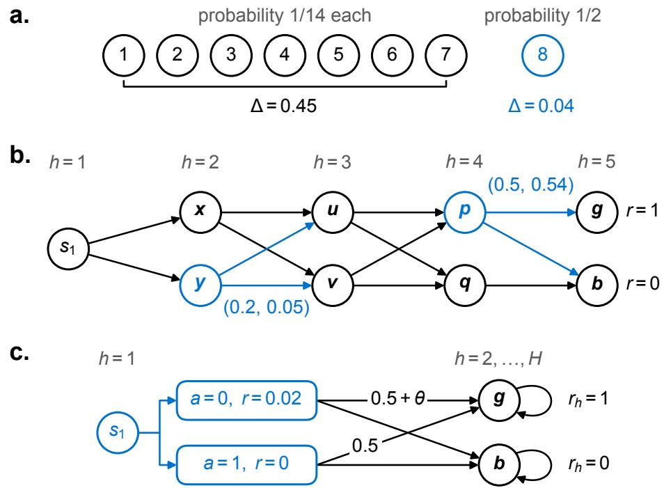  
Figure 2: Simulation setups. a. Contextual bandit with reward gap ∆. b. Sequential decisions (H = 5) with transition probabilities under $( a = 0 , a = 1 )$ . c. Long-term consequences (varying H) where the value gap 0.02 + (H − 1)θ grows with the horizon. Blue marks the hard decisions.

after a few thousand queries the eficient version returns it in 96-98% of trials, against 77-86% for the baselines. The theory-aligned version shows the same pattern, with peak recovery gains of 10-21 points, but at 16-44 times the eficient version’s cost. No stopping run returned a policy that is not ε-optimal.

Drug-response application. We next apply the method to the PRISM repurposing screen [Corsello et al., 2020]. Contexts are six cancer lineages, actions are dasatinib and selumetinib (2.5µM), and the reward is 1 when a cell line’s viability falls to at most half of control. A query chooses a lineage; the collaborator picks either drug with probability 1/2 and reveals the response of a random line from a 116-line benchmark held out from the lines used to choose the drugs. The initial log has 116 records that all reveal one drug (dasatinib in half the trials, selumetinib in the rest), so it cannot compare the drugs. A policy assigns a drug to each lineage (64 policies), and its value is the lineage-weighted response rate. The weights act as the context distribution and are either equal or each lineage’s share of new cases of these six cancers worldwide in 2022 [Bray et al., 2024] (lung 42%, colorectal 33%, the other four 5-9%, with melanoma for skin). Dasatinib is better in four lineages, and selumetinib is narrowly better in the two close calls, colorectal (7/14 vs. 8/14 responders) and skin (10/18 vs. 12/18). With $\varepsilon = 0 . 0 1$ , only colorectal matters under incidence weights. We use the simulation constants, $\delta = 0 . 0 5$ and 400 paired trials (Appendix F).

Under both weightings (Figure 4), the eficient version of adaptive allocation certifies an ε-optimal policy after about $6 \times 1 0 ^ { 3 }$ queries, roughly a third of what uniform or coverage allocation needs, and no stopping run returned a policy that is not ε-optimal. At fixed budgets, after about 800 queries under incidence weights it returns an ε-optimal policy in 89% of trials, against about 80% for both baselines, and under equal weights it pulls ahead of both by about $3 \times 1 0 ^ { 3 }$ queries. Rather than spreading queries evenly, adaptive allocation concentrates them on the close calls that decide the policy (Figure 4c). Over half go to colorectal under incidence weights, and most go to skin, colorectal and pancreas under equal weights. Lineages where one drug clearly wins receive few queries, even lung, which carries 42% of the incidence weight. The theory-aligned version shows the same ordering at about 25 times the cost; its recovery gains are smaller, though clear under incidence weights, and it still needs far fewer queries than the baselines.

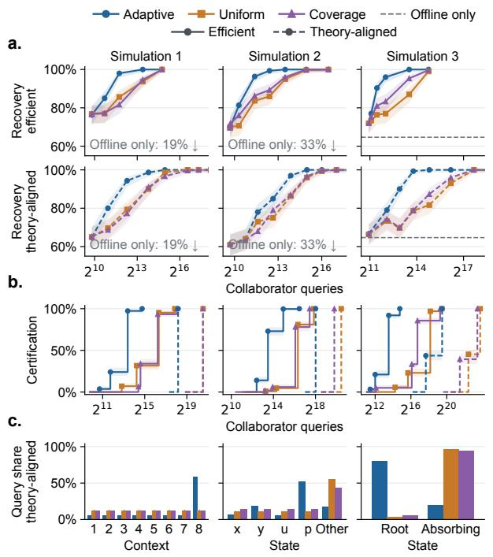  
Figure 3: Simulations 1–3 at $n _ { 0 } = 5 0 0 _ { \mathrm { { \it \cdot } } }$ , 300 trials, and $H = 1 5$ for Simulation 3 for the eficient implementation (solid) and the theory-aligned algorithm of Section 5 (dashed). a. Fraction of trials returning the optimal policy under fixed budget collaborator queries. b. Fraction of trials whose stopping rule has returned, each method under its own allocation. c. Allocation of the theory-aligned queries.

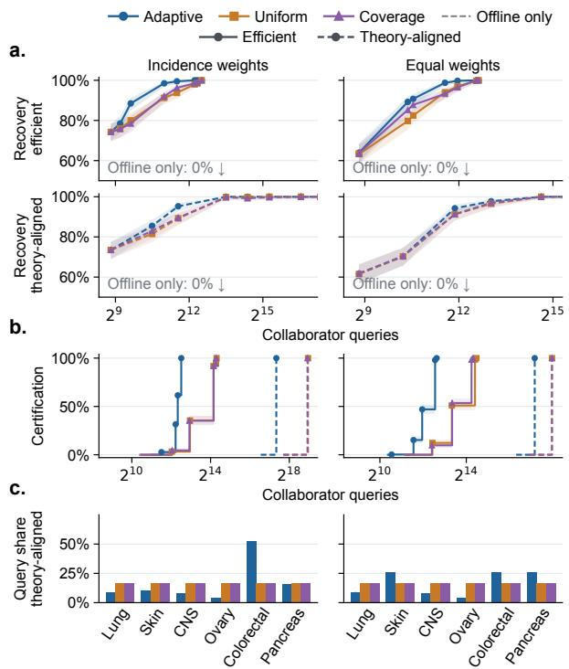  
Figure 4: PRISM application over 400 trials under incidence (left) and equal (right) lineage weights. a. Fraction of trials returning an ε-optimal policy $\left( \varepsilon = 0 . 0 1 \right)$ under fixed budgets. b. Fraction of trials whose stopping rule has returned. c. Each method’s share of the theoryaligned version’s queries by lineage.

## 8 Summary

We introduced query-based collaborative reinforcement learning, a novel setting in which a learner augments a fixed ofline dataset by choosing state–time queries to a collaborator-mediated simulator, while the sampled action is determined by a fixed and possibly suboptimal collaborator policy. We derived an instance-dependent information-theoretic lower bound and a local quadratic characterization. It motivates an adaptive algorithm that progressively localizes the policy class and allocates queries through a lower-bound-guided minimax design. Our analysis establishes finite stopping and highprobability accuracy guarantees and shows that, in the certifiable regime, the leading query-complexity term nearly tracks the local quadratic benchmark.

Our experiments illustrate the resulting instance dependence. Across three synthetic environments and a semi-synthetic drug-response application, adaptive allocation concentrates queries on the policy comparisons that remain dificult after incorporating the ofline data, rather than simply on the leastcovered state–action pairs. This substantially reduces the number of collaborator queries needed for certification relative to uniform and coverage-based allocation.

The current theory focuses on finite tabular MDPs, a fixed collaborator, and a theory-aligned implementation with fresh epoch-wise data splitting. Natural directions for future work include establishing sharper guarantees for data-reusing and eficient implementations, developing more computationally scalable algorithms, extending the framework to function approximation, and studying fixed-budget settings with heterogeneous query costs or state-time-specific budget constraints.

## References

Alekh Agarwal, Sham Kakade, and Lin F. Yang. Model-based reinforcement learning with a generative model is minimax optimal. In Jacob Abernethy and Shivani Agarwal, editors, Proceedings of Thirty Third Conference on Learning Theory, volume 125 of Proceedings ofMachine Learning Research, pages 67–83. PMLR, 09–12 Jul 2020.

Aymen Al-Marjani, Andrea Tirinzoni, and Emilie Kaufmann. Towards instance-optimality in online pac reinforcement learning. arXiv preprint arXiv:2311.05638, 2023.

Philip Amortila, Nan Jiang, Dhruv Madeka, and Dean P Foster. A few expert queries sufices for sampleeficient rl with resets and linear value approximation. Advances in Neural Information Processing Systems, 35:29637–29648, 2022.

Donald WK Andrews. Laws of large numbers for dependent non-identically distributed random variables. Econometric theory, 4(3):458–467, 1988.

Mohammad Gheshlaghi Azar, Rémi Munos, and Bert Kappen. On the sample complexity of reinforcement learning with a generative model. arXiv preprint arXiv:1206.6461, 2012.

Bharatwaajan Balaji, Mohammed Aatif Shahab, Babji Srinivasan, and Rajagopalan Srinivasan. Act-r based human digital twin to enhance operators’ performance in process industries. Frontiers in human neuroscience, 17:1038060, 2023.

Philip J Ball, Laura Smith, Ilya Kostrikov, and Sergey Levine. Eficient online reinforcement learning with ofline data. In International Conference on Machine Learning, pages 1577–1594. PMLR, 2023.

Freddie Bray, Mathieu Laversanne, Hyuna Sung, Jacques Ferlay, Rebecca L Siegel, Isabelle Soerjomataram, and Ahmedin Jemal. Global cancer statistics 2022: Globocan estimates of incidence and mortality worldwide for 36 cancers in 185 countries. CA: a cancer journal for clinicians, 74(3):229–263, 2024.

Steven M Corsello, Rohith T Nagari, Ryan D Spangler, Jordan Rossen, Mustafa Kocak, Jordan G Bryan, Ranad Humeidi, David Peck, Xiaoyun Wu, Andrew A Tang, et al. Discovering the anticancer potential of non-oncology drugs by systematic viability profiling. Nature cancer, 1(2):235–248, 2020.

Rémy Degenne and Wouter M Koolen. Pure exploration with multiple correct answers. Advances in Neural Information Processing Systems, 32, 2019.

Ruomeng Ding, Tianwei Gao, Thomas P Zollo, Eitan Bachmat, Richard Zemel, and Zhun Deng. Whom to query for what: Adaptive group elicitation via multi-turn LLM interactions. In Proceedings of the 43rd International Conference on Machine Learning, volume 306 of Proceedings ofMachine Learning Research, pages 24902–24924. PMLR, 2026. URL https://proceedings.mlr.press/v306/ding26d.html.

Omar Darwiche Domingues, Pierre Ménard, Emilie Kaufmann, and Michal Valko. Episodic reinforcement learning in finite mdps: Minimax lower bounds revisited. In Algorithmic Learning Theory, pages 578– 598. PMLR, 2021.

Aurélien Garivier and Emilie Kaufmann. Optimal best arm identification with fixed confidence. In Conference on Learning Theory, pages 998–1027. PMLR, 2016.

Mohammad Gheshlaghi Azar, Rémi Munos, and Hilbert J Kappen. Minimax pac bounds on the sample complexity of reinforcement learning with a generative model. Machine learning, 91(3):325–349, 2013.

Ruiquan Huang, Donghao Li, Chengshuai Shi, Cong Shen, and Jing Yang. Augmenting online rl with ofline data is all you need: A unified hybrid rl algorithm design and analysis. arXiv preprint arXiv:2505.13768, 2025.

Yizhu Jiao, Xuchao Zhang, Zhaoyang Wang, Yubo Ma, Zhun Deng, Rujia Wang, Chetan Bansal, Saravan Rajmohan, Jiawei Han, and Huaxiu Yao. Synergistic weak-strong collaboration by aligning preferences. In Proceedings of the 63rd Annual Meeting of the Association for Computational Linguistics (Volume 1:

Long Papers), pages 20355–20371, Vienna, Austria, 2025. Association for Computational Linguistics. doi: 10.18653/v1/2025.acl-long.995. URL https://aclanthology.org/2025.acl-long.995/.

Ying Jin, Zhuoran Yang, and Zhaoran Wang. Is pessimism provably eficient for ofline rl? In International conference on machine learning, pages 5084–5096. PMLR, 2021.

Kshitij Judah, Alan P. Fern, Thomas G. Dietterich, and Prasad Tadepalli. Active imitation learning: Formal and practical reductions to i.i.d. learning. Journal of Machine Learning Research, 15(120): 4105–4143, 2014. URL http://jmlr.org/papers/v15/judah14a.html.

Gen Li, Laixi Shi, Yuxin Chen, Yuejie Chi, and Yuting Wei. Settling the sample complexity of modelbased ofline reinforcement learning. The Annals of Statistics, 52(1):233 – 260, 2024. doi: 10.1214/ 23-AOS2342.

Zhangyi Liu, Huaizhi Qu, Xiaowei Yin, He Sun, Yanjun Han, Tianlong Chen, and Zhun Deng. PETS: A principled framework towards optimal trajectory allocation for eficient test-time self-consistency. In Proceedings of the 43rd International Conference on Machine Learning, volume 306 of Proceedings of Machine Learning Research, pages 78028–78065. PMLR, 2026. URL https://proceedings.mlr. press/v306/liu26dg.html.

Zhihan Liu, Yufeng Zhang, Zuyue Fu, Zhuoran Yang, and Zhaoran Wang. Learning from demonstration: Provably eficient adversarial policy imitation with linear function approximation. In International conference on machine learning, pages 14094–14138. PMLR, 2022.

Andreas Maurer and Massimiliano Pontil. Empirical bernstein bounds and sample variance penalization. arXiv preprint arXiv:0907.3740, 2009.

Adhyyan Narang, Andrew Wagenmaker, Lillian J Ratlif, and Kevin Jamieson. Sample complexity reduction via policy diference estimation in tabular reinforcement learning. Advances in Neural Information Processing Systems, 37:22772–22826, 2024.

Laixi Shi, Gen Li, Yuting Wei, Yuxin Chen, and Yuejie Chi. Pessimistic q-learning for ofline reinforcement learning: Towards optimal sample complexity. In International conference on machine learning, pages 19967–20025. PMLR, 2022.

Aaron Sidford, Mengdi Wang, Xian Wu, Lin F Yang, and Yinyu Ye. Near-optimal time and sample complexities for solving discounted markov decision process with a generative model. arXiv preprint arXiv:1806.01492, 2018.

Yuda Song, Yifei Zhou, Ayush Sekhari, J Andrew Bagnell, Akshay Krishnamurthy, and Wen Sun. Hybrid rl: Using both ofline and online data can make rl eficient. arXiv preprint arXiv:2210.06718, 2022.

Andrew Wagenmaker and Kevin G Jamieson. Instance-dependent near-optimal policy identification in linear mdps via online experiment design. Advances in Neural Information Processing Systems, 35: 5968–5981, 2022.

Andrew J Wagenmaker, Max Simchowitz, and Kevin Jamieson. Beyond no regret: Instance-dependent pac reinforcement learning. In Conference on Learning Theory, pages 358–418. PMLR, 2022.

Xinqi Wang, Qiwen Cui, and Simon S Du. On gap-dependent bounds for ofline reinforcement learning. Advances in Neural Information Processing Systems, 35:14865–14877, 2022.

Andrew Wentzel, Serageldin Attia, Xinhua Zhang, Guadalupe Canahuate, Clifton David Fuller, and G. Elisabeta Marai. Ditto: A visual digital twin for interventions and temporal treatment outcomes in head and neck cancer. IEEE Transactions on Visualization and Computer Graphics, 31(1):65–75, 2025. doi: 10.1109/TVCG.2024.3456160.

Tengyang Xie, Ching-An Cheng, Nan Jiang, Paul Mineiro, and Alekh Agarwal. Bellman-consistent pessimism for ofline reinforcement learning. Advances in neural information processing systems, 34: 6683–6694, 2021.

Siyang Xu, Jiebei Zhu, Bingsen Li, Lujie Yu, Xueke Zhu, Hongjie Jia, Chi Yung Chung, Campbell D Booth, and Vladimir Terzija. Real-time power system dispatch scheme using grid expert strategy-based imitation learning. International Journal of Electrical Power & Energy Systems, 161:110148, 2024.

Ming Yin and Yu-Xiang Wang. Asymptotically eficient of-policy evaluation for tabular reinforcement learning. In International Conference on Artificial Intelligence and Statistics, pages 3948–3958. PMLR, 2020.

Ming Yin and Yu-Xiang Wang. Towards instance-optimal ofline reinforcement learning with pessimism. Advances in neural information processing systems, 34:4065–4078, 2021.

Andrea Zanette, Mykel J Kochenderfer, and Emma Brunskill. Almost horizon-free structure-aware best policy identification with a generative model. Advances in Neural Information Processing Systems, 32, 2019.

## A Full Algorithm and Auxiliary Definitions

This appendix additionally provides the complete version of our algorithm described in Section 5 and defines several auxiliary quantities and steps that were left implicit in the main text.

## A.1 Unknown collaborator policy

For clarity, our main theoretical development assumes that the collaborator policy $\pi ^ { c }$ is known, in which case we simply set ${ \widehat { \pi } } ^ { c } = \pi ^ { c }$ throughout the section. Importantly, this assumption is not essential. In practice, $\pi ^ { c }$ may be unknown to the learner, but its support and the quantities needed by our allocation rule can be learned with a lightweight uniform-query initialization phase with negligible query overhead.

Suppose that a known constant $p _ { \mathrm { m i n } } > 0$ satisfies

$$
\operatorname* { m i n } _ { ( h , s , a ) : \pi _ { h } ^ { c } ( a | s ) > 0 } \pi _ { h } ^ { c } ( a \mid s ) \geqslant p _ { \mathrm { m i n } } > 0 .
$$

Fix $\zeta \in ( 0 , 1 )$ and $\delta _ { 0 } \in ( 0 , 1 )$ . Before running the main algorithm, query every state–time pair $( h , s )$ an equal number $m _ { 0 }$ of times, and let

$$
{ \widetilde { \pi } } _ { h } ^ { c } ( a \mid s ) : = { \frac { 1 } { m _ { 0 } } } \sum _ { i = 1 } ^ { m _ { 0 } } \mathbf { 1 } \{ A _ { i } ^ { h , s } = a \}
$$

be the resulting empirical collaborator distribution, where $A _ { 1 } ^ { h , s } , \ldots , A _ { m _ { 0 } } ^ { h , s }$ are the actions returned by the collaborator from the $m _ { 0 }$ independent queries at $( h , s )$ . Define

$$
\eta : = \frac { \zeta } { 2 + \zeta } .
$$

By a multiplicative Chernof bound and a union bound over $( h , s , a )$ , it sufices to take

$$
m _ { 0 } = \left\lceil \frac { C } { \zeta ^ { 2 } p _ { \mathrm { m i n } } } \log \frac { 2 H | \cal { S } | | \cal { A } | } { \delta _ { 0 } } \right\rceil ,
$$

for a suficiently large universal constant $C > 0 ,$ , to ensure, with probability at least $1 - \delta _ { 0 }$ , that simultaneously for every $( h , s , a )$ with $\pi _ { h } ^ { c } ( a \mid s ) > 0$

$$
( 1 - \eta ) \pi _ { h } ^ { c } ( a \mid s ) \leqslant \widetilde { \pi } _ { h } ^ { c } ( a \mid s ) \leqslant ( 1 + \eta ) \pi _ { h } ^ { c } ( a \mid s ) .
$$

Since unsupported actions are never sampled, on the same event the empirical unsupported set exactly recovers the true one:

$$
\widehat { \mathcal { U } } _ { c } : = \{ ( h , s , a ) : \widetilde { \pi } _ { h } ^ { c } ( a | s ) = 0 \} = \mathcal { U } _ { c } : = \{ ( h , s , a ) : \pi _ { h } ^ { c } ( a | s ) = 0 \} .
$$

For the subsequent algorithm, define the multiplicative upper estimate

$$
{ \widehat { \pi } } _ { h } ^ { \mathrm { u p } } ( a \mid s ) : = { \frac { { \widetilde { \pi } } _ { h } ^ { c } ( a \mid s ) } { 1 - \eta } } ,
$$

and the conservative proxy

$$
{ \widehat { \pi } } _ { h } ^ { c } ( a \mid s ) : = { \frac { 1 } { 1 + \zeta } } { \widehat { \pi } } _ { h } ^ { \operatorname * { u p } } ( a \mid s ) .
$$

Our choice of η gives

$$
{ \frac { 1 + \eta } { 1 - \eta } } = 1 + \zeta ,
$$

and therefore, simultaneously over all supported rows,

$$
\frac { 1 } { 1 + \zeta } \pi _ { h } ^ { c } ( a \mid s ) \leqslant { \widehat { \pi } } _ { h } ^ { c } ( a \mid s ) \leqslant \pi _ { h } ^ { c } ( a \mid s ) .
$$

In general, $\widehat { \pi _ { h } ^ { c } } ( \cdot \vert s )$ need not sum to one and should be viewed as a conservative, generally sub-probability proxy for the collaborator action probabilities, rather than as a policy distribution. This causes no dificulty because it is used only in the query-allocation and efective-count calculations, where a coordinatewise lower proxy is suficient.

The cost of this initialization is only

$$
N _ { \mathrm { i n i t } } = H | S | m _ { 0 } = O \left( \frac { H | S | } { \zeta ^ { 2 } p _ { \mathrm { m i n } } } \log \frac { H | S | | A | } { \delta _ { 0 } } \right)
$$

collaborator queries, independent of the target accuracy ε. Moreover, replacing $\pi ^ { c }$ by $\widehat { \pi } ^ { c }$ incurs at most a multiplicative $1 + \zeta$ overhead in the subsequent query complexity. Indeed,

$$
( 1 + \zeta ) { \widehat { \pi } } _ { h } ^ { c } ( a \mid s ) \geqslant \pi _ { h } ^ { c } ( a \mid s ) ,
$$

so multiplying any allocation designed with the true collaborator policy by $1 + \zeta$ provides at least the same efective number of samples on every $( h , s , a )$

Consequently, if the main algorithm is run with confidence parameter δ, then the corresponding guarantees derived under known $\pi ^ { c }$ continue to hold under unknown $\pi ^ { c }$ with probability at least $1 - \delta - \delta _ { 0 }$ with the following modifications to the query-complexity bound: an additive initialization cost $N _ { \mathrm { i n i t } } ,$ a multiplicative $1 + \zeta$ factor on the leading adaptive-query term, and replacement of $p _ { \mathrm { m i n } } ^ { c }$ by the known lower bound $p _ { \mathrm { m i n } }$ in the stabilization and other lower-order query terms. In particular, to retain an overall confidence level of $1 - \delta ,$ , one may run the initialization with failure probability $\delta / 2$ and the main algorithm with confidence parameter $\delta / 2$

Thus exact knowledge of the collaborator action probabilities is not required, provided that a known positive lower bound $p _ { \mathrm { m i n } } \leqslant p _ { \mathrm { m i n } } ^ { c }$ is available. In the algorithmic description in this section, we retain $\widehat { \pi } ^ { c }$ and $p _ { \mathrm { m i n } }$ . For the known-policy theoretical analysis, we set ${ \widehat { \pi } } ^ { c } = \pi ^ { c }$ and $p _ { \mathrm { m i n } } = p _ { \mathrm { m i n } } ^ { c } ;$ the unknown-policy guarantees follow with the initialization cost and parameter substitutions described above.

## A.2 Complete procedure

The procedure begins with a one-time preprocessing step applied to the ofline data. It then enters the epoch-wise iteration $k = 1 , 2 , \ldots$ , where each epoch consists of four stages: fresh-data acquisition, policy localization, historical sensitivity estimation, and lower-bound-guided prospective query design. All notation is summarized in Table 2.

Ofline preprocessing. We first preprocess the ofline trajectories before any adaptive querying takes place. If $n _ { 0 } = 0 .$ , skip the step and set all ofline subsamples and their row counts to be empty and zero, respectively. Otherwise, apply the two-fold trimming procedure [Li et al., 2024, Step 2 of Algorithm 3] with

$$
\delta _ { \mathrm { t r i m } } = { \frac { \delta } { 4 8 } } .
$$

The retained observations are equally split into two disjoint parts, $\mathcal { D } _ { 0 } ^ { \mathcal { G } }$ and $\mathcal { D } _ { 0 } ^ { \mathcal { D } }$

We further partition $\mathcal { D } _ { 0 } ^ { \mathcal { D } }$ into disjoint fresh folds,

$$
\mathcal { D } _ { 0 } ^ { D } = \Big \lfloor \frac { \ d } { \ d _ { k \geqslant 1 } } \mathcal { D } _ { 0 , k } ^ { D } , \qquad w _ { k } = \frac { \ d _ { 6 } } { \pi ^ { 2 } k ^ { 2 } } ,
$$

where $w _ { k }$ specifies the proportion of $\mathcal { D } _ { 0 } ^ { \mathcal { D } }$ assigned to the kth fresh fold. The row counts

$$
N _ { 0 , k , h s a } ^ { \mathcal { D } } : = \# \left\{ \operatorname { r o w - } ( h , s , a ) \operatorname { o b s e r v a t i o n s } \operatorname { i n } \mathcal { D } _ { 0 , k } ^ { \mathcal { D } } \right\}
$$

are recorded at preprocessing time, but the corresponding reward and next-state observations are not revealed to the inference procedure until epoch k. Thus the prospective design at epoch $k - 1$ may use the row counts of the next ofline fold without reusing its reward–transition observations for estimation.

Similarly, let

$$
N _ { 0 , h s a } ^ { \mathcal { G } } : = \# \big \{ \mathrm { r o w } \cdot ( h , s , a ) \mathrm { o b s e r v a t i o n s \ i n } \mathcal { D } _ { 0 } ^ { \mathcal { G } } \big \} .
$$

The active policy class and the initial adaptive allocation are initialized as

$$
\widehat { \Pi } _ { 0 } : = \Pi _ { d } , \qquad \widehat { \mathbf { n } } _ { 0 } : = \mathbf { 0 } .
$$

Stage 1: Fresh data acquisition and stabilization. At epoch $k ,$ set

$$
\varepsilon _ { k } : = H 2 ^ { - ( k - 1 ) }
$$

and let

$$
q _ { k - 1 } : = | \widehat { \Pi } _ { k - 1 } | ^ { 2 } ,
$$

which determines the epoch-dependent confidence parameter $\beta _ { k }$ through Table 2.

To guarantee suficient accuracy of the historical sensitivity estimates, for $\eta > 0$ define

$$
n ^ { \mathrm { s e n } } ( \eta ) : = \operatorname* { m i n } \left\{ n \geqslant 2 : \frac { C _ { \mathrm { s e n } } ^ { 2 } \beta ^ { \mathcal { G } } ( m ) } { 2 m } \leqslant \eta \quad \mathrm { f o r ~ a l l ~ } m \geqslant n \right\} ,\tag{4}
$$

and set

$$
n _ { k + 1 } ^ { \mathrm { s e n } } : = n ^ { \mathrm { s e n } } ( \varepsilon _ { k + 1 } ) = n ^ { \mathrm { s e n } } \bigg ( \frac { \varepsilon _ { k } } { 2 } \bigg ) .\tag{5}
$$

Together with the uniform-concentration threshold $n _ { k } ^ { \mathrm { u c } }$ defined in Table 2, this determines the stabilization batch size

$$
m _ { k } ^ { \mathrm { s t } } : = \left\lceil \frac { 1 } { p _ { \mathrm { m i n } } } \mathrm { m a x } \left\{ 2 n _ { k } ^ { \mathrm { u c } } , 2 n _ { k + 1 } ^ { \mathrm { s e n } } , 8 \beta _ { k } , 5 0 w _ { k } \ell _ { \mathrm { t r i m } } + 2 \right\} \right\rceil .\tag{6}
$$

The stabilization sample can increase only rows that are supported by the collaborator. Let $\mathcal { U } _ { c }$ denote the set of collaborator-unsupported rows. Such rows must therefore be supplied entirely by the ofline data. For each row define the cumulative historical ofline count

$$
N _ { k , h s a } ^ { \mathcal { G } , \mathrm { o f f } } : = N _ { 0 , h s a } ^ { \mathcal { G } } + \sum _ { j = 1 } ^ { k } N _ { 0 , j , h s a } ^ { D } .\tag{7}
$$

All counts on the right-hand side are recorded during preprocessing and are therefore known before the corresponding observations are used for inference.

We define the ofline-coverage indicator

$$
\mathsf { O f f C o v e r } _ { k } : = 1  \begin{array} { l l } { N _ { \mathrm { 0 } , k , h s a } ^ { \mathcal { D } } \geqslant n _ { k } ^ { \mathrm { u c } } \vee ( 5 0 w _ { k } \ell _ { \mathrm { t r i m } } + 2 ) , } \\ { N _ { k , h s a } ^ { \mathcal { G } , \mathrm { o f f } } \geqslant n _ { k + 1 } ^ { \mathrm { s e n } } , } \end{array}  \quad \mathrm { f o r ~ e v e r y ~ } ( h , s , a ) \in \mathcal { U } _ { c }  .\tag{8}
$$

When $\mathcal { U } _ { c } = \emptyset$ , we set OfCove $\boldsymbol { \mathsf { r } } _ { k } = 1$

Remark A.1. By construction, the coverage thresholds entering OfCover are lower order relative to the traditional leading scale ${ \cal O } ( 1 / \varepsilon ^ { 2 } )$ [Li et al., 2024]. Indeed,

$$
n _ { k } ^ { \mathrm { u c } } = \widetilde O ( \varepsilon _ { k } ^ { - 1 } ) , \qquad n _ { k + 1 } ^ { \mathrm { s e n } } = \widetilde O ( \varepsilon _ { k } ^ { - 1 } ) .
$$

Thus the condition OfCove $\boldsymbol { \mathsf { r } } _ { k } = 1$ enforces only the auxiliary coverage needed for the fresh-sample and sensitivity-control steps of our construction.

Before entering the first epoch, the algorithm evaluates ${ \mathsf { O f f C o v e r } } _ { 1 }$ using the row counts recorded during preprocessing. If

$$
{ \mathsf { O f f C o v e r } } _ { 1 } = 0 ,
$$

the algorithm terminates and returns an arbitrary policy in $\Pi _ { d }$ . For every $k \geqslant 2$ , the condition OfCove $\mathsf { r } _ { k } =$ 1 has already been verified at the end of epoch $k { - } 1$ , before any epoch-k observations are used for inference. Consequently, every epoch that is actually entered satisfies

$$
{ \mathsf { O f f C o v e r } } _ { k } = 1 .\tag{9}
$$

The algorithm then acquires three sources of fresh data. First, reveal the ofline observations in $\mathcal { D } _ { 0 , k } ^ { D }$ Second, for $k \geqslant 2 ,$ , execute the adaptive allocation

$$
\widehat { \mathbf { n } } _ { k - 1 } = \{ \widehat { n } _ { k - 1 , h s } \} _ { h , s }
$$

selected at the end of epoch $k - 1 \mathrm { : }$ : for every $( h , s )$ , the collaborator is queried exactly $\widehat { n } _ { k - 1 , h s }$ <sub>s</sub> times, producing $\mathcal { Q } _ { k } ^ { \mathrm { a d } }$ . At the first epoch there is no previous adaptive allocation, so

$$
\mathcal { Q } _ { 1 } ^ { \mathrm { a d } } : = \emptyset .
$$

Third, independently of the adaptive allocation, query every state–time pair $( h , s )$ exactly $m _ { k } ^ { \mathrm { s t } }$ times and denote the resulting stabilization observations by $\mathcal { Q } _ { k } ^ { \mathrm { s t } }$

The fresh inference sample at epoch k is therefore

$$
\mathcal { D } _ { k } ^ { D } : = \mathcal { D } _ { 0 , k } ^ { D } \cup \mathcal { Q } _ { k } ^ { \mathrm { a d } } \cup \mathcal { Q } _ { k } ^ { \mathrm { s t } } ,\tag{10}
$$

with row counts

$$
N _ { k , h s a } ^ { \mathcal { D } } : = \# \Big \{ \mathrm { r o w } - ( h , s , a ) \mathrm { o b s e r v a t i o n s \ i n } \mathcal { D } _ { k } ^ { \mathcal { D } } \Big \} .\tag{11}
$$

Stage 2: Fresh inference and localization of the policy class. Construct the fresh empirical MDP

$$
\widehat { M } _ { k } ^ { D } = ( \widehat { r _ { k } ^ { D } } , \widehat { P _ { k } ^ { D } } )
$$

from $\mathcal { D } _ { k } ^ { D }$ . For every deterministic policy $\pi _ { \rho }$ let $\widehat { V } _ { h } ^ { \pi , k , D }$ denote its value function in $\widehat { M } _ { k } ^ { D }$ . For a policy pair $( \pi , { \bar { \pi } } )$ define the empirical value diference

$$
\widehat { D } _ { k } ( \pi , \bar { \pi } ) : = \widehat { V } _ { 1 } ^ { \pi , k , D } - \widehat { V } _ { 1 } ^ { \bar { \pi } , k , D } .\tag{12}
$$

For $k = 1$ , define

$$
\widehat { \Pi } _ { 1 } : = \Pi _ { d } .\tag{13}
$$

For every $k \geqslant 2 ,$ , the reference policy $\bar { \pi } _ { k - 1 }$ was selected by the minimax design at the end of epoch $k - 1$ The new active class is obtained by retaining policies whose empirical value is within the prescribed localization radius of the best empirical response to this reference:

$$
\widehat { \Pi } _ { k } : = \left\{ \pi \in \widehat { \Pi } _ { k - 1 } : \operatorname* { m a x } _ { \pi ^ { \prime } \in \widehat { \Pi } _ { k - 1 } } \left[ \widehat { D } _ { k } ( \pi ^ { \prime } , \bar { \pi } _ { k - 1 } ) - \widehat { D } _ { k } ( \pi , \bar { \pi } _ { k - 1 } ) \right] \leqslant \frac { 5 } { 2 } \varepsilon _ { k } \right\} .\tag{14}
$$

After the active class has been updated, define the reported policy as follows. For $k = 1$ , let $\widehat { \pi _ { 1 } }$ be an arbitrary policy in $\widehat { \Pi } _ { 1 } = \Pi _ { d }$ . For every $k \geqslant 2$ , define

$$
\widehat { \pi _ { k } } \in \mathop { \mathrm { a r g } } \operatorname* { m a x } _ { \pi \in \widehat { \Pi } _ { k } } \widehat { V } _ { 1 } ^ { \pi , k , D } .\tag{15}
$$

If

$$
| \widehat { \Pi } _ { k } | = 1 ,
$$

the unique remaining policy is returned and the algorithm terminates. Likewise, if

$$
\varepsilon _ { k } \leqslant \varepsilon ,
$$

the active class has reached the target localization scale and the algorithm returns $\widehat { \pi _ { k } }$ . Otherwise, proceed to Stage 3.

Stage 3: Historical sensitivity and local-variance estimation. If the algorithm has not terminated after Stage 2, release the current fresh observations into the historical sample and define

$$
\mathcal { Z } _ { k } ^ { \mathcal { G } } : = \mathcal { D } _ { 0 } ^ { \mathcal { G } } \cup \bigcup _ { j = 1 } ^ { k } \mathcal { D } _ { j } ^ { D } .\tag{16}
$$

For each row let

$$
N _ { k , h s a } ^ { \mathcal { G } } : = \# \big \{ \mathrm { r o w } \cdot ( h , s , a ) \mathrm { o b s e r v a t i o n s \ i n } \mathcal { Z } _ { k } ^ { \mathcal { G } } \big \} ,\tag{17}
$$

and construct the historical empirical MDP

$$
\begin{array} { r } { \widehat { M } _ { k } ^ { \mathcal { G } } = ( \widehat { r } _ { k } ^ { \mathcal { G } } , \widehat { P } _ { k } ^ { \mathcal { G } } ) . } \end{array}
$$

For a deterministic policy $\pi ,$ let $\widehat { V } _ { h } ^ { \pi , k , \mathcal { G } }$ and $\widehat { d } _ { h s a } ^ { \pi , k , \mathcal { G } }$ denote its value function and state–action occupancy under $\widehat { M } _ { k } ^ { \mathcal { G } }$

For every pair $\pi , \bar { \pi } \in \widehat { \Pi } _ { k }$ , define the empirical reward sensitivity

$$
\widehat { G } _ { k , h s a } ^ { r } ( \pi , \bar { \pi } ) : = \widehat { d } _ { h s a } ^ { \bar { \pi } , k , \mathcal { G } } - \widehat { d } _ { h s a } ^ { \bar { \pi } , k , \mathcal { G } } ,\tag{18}
$$

and the empirical transition sensitivity

$$
\begin{array} { r l } & { \widehat { G } _ { k , h s a } ^ { P } ( \pi , \bar { \pi } ) ( s ^ { \prime } ) : = \widehat { d } _ { h s a } ^ { \bar { \pi } , k , \mathcal { G } } \widehat { V } _ { h + 1 } ^ { \pi , k , \mathcal { G } } ( s ^ { \prime } ) } \\ & { \qquad - \widehat { d } _ { h s a } ^ { \bar { \pi } , k , \mathcal { G } } \widehat { V } _ { h + 1 } ^ { \bar { \pi } , k , \mathcal { G } } ( s ^ { \prime } ) . } \end{array}\tag{19}
$$

The associated plug-in influence score is

$$
\widehat { \Psi } _ { k , h s a } ^ { \pi , \bar { \pi } } ( r , s ^ { \prime } ) : = \widehat { G } _ { k , h s a } ^ { r } ( \pi , \bar { \pi } ) r + \widehat { G } _ { k , h s a } ^ { P } ( \pi , \bar { \pi } ) ( s ^ { \prime } ) .\tag{20}
$$

To control the discrepancy between the empirical and population influence scores, for $N _ { k , h s a } ^ { \mathcal { G } } > 0$ define

$$
\alpha _ { k , h s a } ^ { \mathcal { G } , r } = \alpha _ { k , h s a } ^ { \mathcal { G } , P } : = \operatorname* { m i n } \left\{ 1 , \sqrt { \frac { \beta ^ { \mathcal { G } } ( N _ { k , h s a } ^ { \mathcal { G } } ) } { 2 N _ { k , h s a } ^ { \mathcal { G } } } } \right\} .\tag{21}
$$

Let

$$
\alpha _ { k } ^ { \mathcal { G } , r } : = \operatorname* { m a x } _ { h , s , a } \alpha _ { k , h s a } ^ { \mathcal { G } , r } , \qquad \alpha _ { k } ^ { \mathcal { G } , P } : = \operatorname* { m a x } _ { h , s , a } \alpha _ { k , h s a } ^ { \mathcal { G } , P } .
$$

Set $E _ { k , H + 1 } ^ { V , \mathcal { G } } : = 0$ and, for $h \leqslant H ,$ define

$$
E _ { k , h } ^ { V , \mathcal { G } } : = ( H - h + 1 ) \alpha _ { k } ^ { \mathcal { G } , r } + \frac { ( H - h ) ( H - h + 1 ) } { 2 } | S | \alpha _ { k } ^ { \mathcal { G } , P } ,\tag{22}
$$

and

$$
\Delta _ { k , h s a } ^ { \mathcal { G } } : = 2 ( h - 1 ) ( H - h + 1 ) | S | \alpha _ { k } ^ { \mathcal { G } , P } + 2 E _ { k , h + 1 } ^ { V , \mathcal { G } } .\tag{23}
$$

For unsupported rows,

$$
N _ { k , h s a } ^ { \mathcal { G } } = N _ { k , h s a } ^ { \mathcal { G } , \mathrm { o f f } } ,
$$

since collaborator querying can never generate observations from such rows. By (9),

$$
N _ { k , h s a } ^ { \mathcal { G } } \geqslant n _ { k + 1 } ^ { \mathrm { s e n } } , \qquad \forall ( h , s , a ) \in \mathcal { U } _ { c } .
$$

The sensitivity envelope above is used to construct an upper confidence envelope for the local variance $\Gamma _ { h s a } ( \pi , \bar { \pi } )$ . For $\mathrm { \tilde { \Gamma } } N _ { k , h s a } ^ { D } \geqslant \mathrm { \tilde { 2 } }$ , first define the fresh-sample mean of the plug-in score,

$$
\overline { { \widehat { \Psi } } } _ { k , h s a } ^ { \pi , \bar { \pi } } : = \frac { 1 } { N _ { k , h s a } ^ { \mathcal { D } } } \sum _ { i = 1 } ^ { N _ { k , h s a } ^ { \mathcal { D } } } \widehat { \Psi } _ { k , h s a } ^ { \pi , \bar { \pi } } \Big ( R _ { k , h s a } ^ { ( i ) } , S _ { k , h s a } ^ { \prime ( i ) } \Big ) ,\tag{24}
$$

and its empirical variance

$$
\widehat { \Gamma } _ { k , h s a } ^ { \mathrm { r a w } } ( \pi , \bar { \pi } ) : = \frac { 1 } { N _ { k , h s a } ^ { D } - 1 } \sum _ { i = 1 } ^ { N _ { k , h s a } ^ { D } } \Big ( \widehat { \Psi } _ { k , h s a } ^ { \pi , \bar { \pi } } ( R _ { k , h s a } ^ { ( i ) } , S _ { k , h s a } ^ { \prime ( i ) } ) - \overline { { \widehat { \Psi } } } _ { k , h s a } ^ { \pi , \bar { \pi } } \Big ) ^ { 2 } .\tag{25}
$$

The local-variance envelope is then

$$
\overline { { \Gamma } } _ { k , h s a } ( \pi , \bar { \pi } ) : = \left[ \sqrt { \widehat { \Gamma } _ { k , h s a } ^ { \mathrm { r a w } } ( \pi , \bar { \pi } ) } + 2 H \sqrt { \frac { 2 \beta _ { k } } { N _ { k , h s a } ^ { \mathscr D } - 1 } } + \sqrt { 2 } \Delta _ { k , h s a } ^ { \mathscr G } \right] ^ { 2 }\tag{26}
$$

whenever $N _ { k , h s a } ^ { \mathcal { D } } \geqslant 2$ . If $N _ { k , h s a } ^ { \mathcal { D } } \leqslant 1$ , set instead

$$
\overline { { { \Gamma } } } _ { k , h s a } ( \pi , \bar { \pi } ) : = H ^ { 2 } .\tag{27}
$$

Stage 4: Lower-bound-guided prospective minimax design. The final stage uses the localized policy class $\widehat { \Pi } _ { k }$ and the local-variance envelopes $\overline { { \Gamma } } _ { k , h s a }$ to determine both a reference policy and an adaptive collaborator-query allocation for epoch $k + 1$

For every $\pi , \bar { \pi } \in \widehat { \Pi } _ { k } ,$ , define the regularized empirical margin

$$
\widehat { b } _ { k , \mathrm { r e g } } ( \pi , \bar { \pi } ) : = \operatorname* { m a x } \Big \{ \varepsilon - \widehat { D } _ { k } ( \pi , \bar { \pi } ) , 4 \varepsilon _ { k } \Big \} .\tag{28}
$$

Set

$$
\varepsilon _ { k + 1 } = { \frac { \varepsilon _ { k } } { 2 } } , \qquad q _ { k } = | \widehat \Pi _ { k } | ^ { 2 } ,
$$

and compute the next-epoch quantities

$$
\beta _ { k + 1 } , \qquad n _ { k + 1 } ^ { \mathrm { u c } } , \qquad n _ { k + 2 } ^ { \mathrm { s e n } } , \qquad m _ { k + 1 } ^ { \mathrm { s t } }
$$

from Table 2, (5), and (6).

Because all ofline row counts are known from preprocessing, OfCove $\cdot _ { k + 1 }$ can be evaluated before any epoch-(k + 1) observation is revealed. If

$$
\mathsf { O f f C o v e r } _ { k + 1 } = 0 ,
$$

then some collaborator-unsupported row cannot meet the fresh or historical coverage requirement at the next epoch, and collaborator querying cannot repair this deficiency. The algorithm therefore terminates and returns $\widehat { \pi _ { k } }$

Hence every epoch that reaches the prospective minimax design satisfies

$$
{ \mathsf { O f f C o v e r } } _ { k + 1 } = 1 .\tag{29}
$$

For a prospective adaptive allocation

$$
\mathbf { n } = \{ n _ { h s } \} _ { h , s } \in \mathbb { N } ^ { H | S | } ,
$$

the expected row count available for fresh inference at epoch $k + 1$ is

$$
\begin{array} { r } { N _ { k + 1 , h s a } ^ { + } ( { \bf n } ) : = N _ { 0 , k + 1 , h s a } ^ { \mathcal { D } } + \left( m _ { k + 1 } ^ { \mathrm { s t } } + n _ { h s } \right) \widehat { \pi } _ { h } ^ { c } ( a \mid s ) . } \end{array}\tag{30}
$$

Here ${ N } _ { 0 , k + 1 , h s a } ^ { \mathcal { D } }$ is known from ofline preprocessing even though the corresponding observations are not revealed until epoch $k + 1$

Define the prospective pairwise radius

$$
\widehat { \mathrm { r a d } } _ { k } ^ { + } ( \pi , \bar { \pi } ; \mathbf { n } ) : = C _ { 0 } \sqrt { \beta _ { k + 1 } \sum _ { h , s , a } \frac { \overline { { \Gamma } } _ { k , h s a } ( \pi , \bar { \pi } ) } { N _ { k + 1 , h s a } ^ { + } ( \mathbf { n } ) } } ,\tag{31}
$$

where we set $C _ { 0 } = 8 .$

For a total adaptive-query budget $B \geqslant 0 ,$ , define the feasible allocation set

$$
\mathcal { N } ( B ) : = \left\{ \mathbf { n } = \{ n _ { h s } \} _ { h , s } \in \mathbb { N } ^ { H | S | } : \sum _ { h , s } n _ { h s } \leqslant B \right\} .\tag{32}
$$

The lower-bound-guided design jointly selects a reference policy and an allocation by solving

$$
\widehat { \Phi } _ { k } ^ { \star } ( B ) : = \operatorname* { m i n } _ { \bar { \pi } \in \widehat { \Pi } _ { k } } \operatorname* { i n f } _ { \mathbf { n } \in \mathcal { N } ( B ) } \operatorname* { m a x } _ { \pi \in \widehat { \Pi } _ { k } \backslash \{ \bar { \pi } \} } \frac { \widehat { \mathrm { r a d } } _ { k } ^ { + } ( \pi , \bar { \pi } ; \mathbf { n } ) } { \widehat { b } _ { k , \mathrm { r e g } } ( \pi , \bar { \pi } ) } .\tag{33}
$$

Thus the allocation is chosen to minimize the largest normalized uncertainty over policies that remain statistically plausible after localization.

Because $\mathcal { N } ( B _ { 1 } ) \subseteq \mathcal { N } ( B _ { 2 } )$ whenever $B _ { 1 } \leqslant B _ { 2 }$ , the function $\widehat { \Phi } _ { k } ^ { \star } ( B )$ is nonincreasing in B. Its infinite-budget limit is

$$
\widehat { \Phi } _ { k , \infty } ^ { \star } : = \operatorname* { l i m } _ { B \to \infty } \widehat { \Phi } _ { k } ^ { \star } ( B ) = \operatorname* { i n f } _ { B < \infty } \widehat { \Phi } _ { k } ^ { \star } ( B ) .\tag{34}
$$

If

$$
\widehat { \Phi } _ { k , \infty } ^ { \star } \geqslant \frac { 1 } { 3 2 } ,
$$

then the infinite-budget normalized uncertainty remains above the prescribed certification-limit threshold, and the algorithm terminates and returns $\dot { \widehat { \pi } } _ { k }$

Otherwise,

$$
\widehat { \Phi } _ { k , \infty } ^ { \star } < \frac { 1 } { 3 2 } < \frac { 1 } { 1 6 } ,
$$

so, by the definition of the infimum and monotonicity of $\widehat { \Phi } _ { k } ^ { \star } ( B )$ , some finite query budget attains the design threshold 1/16. Search over the dyadic grid

$$
\mathcal { B } _ { \mathrm { d y a d } } : = \{ 1 , 2 , 4 , 8 , . . . \}
$$

and choose

$$
B _ { k } : = \operatorname* { m i n } \bigg \{ B \in { \mathcal { B } } _ { \mathrm { d y a d } } : \widehat { \Phi } _ { k } ^ { \star } ( B ) \leqslant \frac { 1 } { 1 6 } \bigg \} .\tag{35}
$$

Finally, select a corresponding minimax optimizer

$$
\left( \bar { \pi } _ { k } , \widehat { \mathbf { n } _ { k } } \right) \in \arg \operatorname* { m i n } _ { \bar { \pi } \in \widehat { \Pi } _ { k } } \ \operatorname* { m a x } _ { \pi \in \widehat { \Pi } _ { k } \setminus \{ \bar { \pi } \} } \frac { \widehat { \mathrm { r a d } _ { k } } ( \pi , \bar { \pi } ; \mathbf { n } ) } { \widehat { b } _ { k , \mathrm { r e g } } ( \pi , \bar { \pi } ) } .\tag{36}
$$

The reference policy $\bar { \pi } _ { k }$ is used in the next localization step, while the allocation $\widehat { \mathbf { n } _ { k } }$ is stored and executed only at epoch $k + 1$

Table 2: Notation and constants used in Algorithm 1.
<table><tr><td>Quantity</td><td>Definition and role</td></tr><tr><td> $\delta _ { \mathrm { t r i m } }$ </td><td>Failure probability used in the two-fold trimming step:  $\delta _ { \mathrm { t r i m } } : = \delta / 4 8 .$ </td></tr><tr><td> $\ell _ { \mathrm { t r i m } }$ </td><td> $\ell _ { \mathrm { t r i m } } : = \log \biggr ( \frac { ( n _ { 0 } \vee 1 ) H } { \delta _ { \mathrm { t r i m } } } \biggr ) .$  Logarithmic factor used in the trimming bound:</td></tr><tr><td> $w _ { k }$ </td><td>Fraction of the inference-side offline sample assigned to fold k:  $w _ { k } : = 6 / ( \pi ^ { 2 } k ^ { 2 } )$  , with  $\begin{array} { r } { \sum _ { k \geqslant 1 } w _ { k } = 1 } \end{array}$ </td></tr><tr><td> $\mathcal { D } _ { 0 } ^ { \tilde { \mathcal { G } } } , \mathcal { D } _ { 0 , k } ^ { D }$ </td><td>Historical part of the trimmed offline sample and the kth fresh inference fold. The complete table of row counts  $N _ { 0 , k , h s a } ^ { \mathcal { D } }$  is recorded during preprocessing, while the corresponding reward-transition</td></tr><tr><td> $\mathcal { U } _ { c }$ </td><td>observations are not used for inference until epoch k. Collaborator-unsupported rows:  $\mathcal { U } _ { c } : = \{ ( h , s , a ) : \pi _ { h } ^ { c } ( a \mid s ) = 0 \} .$ </td></tr><tr><td>Pmin</td><td>known lower bound on the minimum positive collaborator-action probability:  $\begin{array} { r } { 0 < p _ { \operatorname* { m i n } } \leqslant \operatorname* { m i n } _ { ( h , s , a ) \notin \mathcal { U } _ { c } } \pi _ { h } ^ { c } ( a \mid s ) . } \end{array}$ </td></tr><tr><td> $\varepsilon _ { k }$ </td><td>Epoch resolution:  $\varepsilon _ { k } : = \ddot { H } 2 ^ { - ( k - 1 ) } .$ </td></tr><tr><td> $\mathcal { P } _ { k }$ </td><td>Predictable parent pair class used for epoch-k concentration:  $\mathcal { P } _ { k } : = \widehat { \Pi } _ { k - 1 } \times \widehat { \Pi } _ { k - 1 }$  . It is measurable</td></tr><tr><td> $q _ { k }$ </td><td>before the fresh epoch-k observations are revealed. Pair-count bound:</td></tr><tr><td> $\beta _ { k }$ </td><td> $q _ { k } : = | \widehat { \Pi } _ { k } | ^ { 2 } .$  Thus  $| \mathcal { P } _ { k } | \leqslant q _ { k - 1 }$  Epoch-wise logarithmic factor:</td></tr><tr><td></td><td> $\beta _ { k } : = \log \left( \frac { 2 \pi ^ { 2 } k ^ { 2 } H | S | | A | ( | S | + 1 ) q _ { k - 1 } } { \delta } \right) .$ </td></tr><tr><td> $\beta ^ { \mathcal { G } } ( n )$ </td><td>Anytime logarithmic factor for historical sensitivity estimation:</td></tr><tr><td></td><td> $\beta ^ { \mathcal { G } } ( n ) : = \log \Bigg ( \frac { 2 \pi ^ { 2 } n ^ { 2 } H | S | | A | ( | S | + 1 ) } { \delta } \Bigg ) .$ </td></tr><tr><td> $C _ { \mathrm { { s e n } } }$ </td><td>Sensitivity-envelope constant:  $C _ { \mathrm { s e n } } : = | \boldsymbol { S } | H ^ { 2 } \vee$  4|S|.</td></tr><tr><td> $K _ { H }$ </td><td>Coefficient appearing in the second-order model remainder:</td></tr><tr><td></td><td> $K _ { H } : = H ( H - 1 ) | \boldsymbol { S } | + \frac { H ( H - 1 ) ( H - 2 ) } { 3 } | \boldsymbol { S } | ^ { 2 } .$ </td></tr><tr><td></td><td></td></tr><tr><td></td><td></td></tr><tr><td> $C _ { \mathrm { u c } }$ </td><td>Uniform-coverage constant:</td></tr><tr><td></td><td></td></tr><tr><td></td><td> $C _ { \mathrm { u c } } : = \operatorname* { m a x } \left\{ 6 4 H ^ { 2 } , 8 K _ { H } , 6 7 5 8 4 H | { \cal S } | | { \cal A } | \right\} .$ </td></tr><tr><td></td><td></td></tr><tr><td></td><td></td></tr><tr><td> $C _ { 0 }$ </td><td></td></tr><tr><td></td><td>Numerical constant in the leading prospective radius:  $C _ { 0 } : = 8 .$ </td></tr><tr><td> $n ^ { \mathrm { s e n } } ( \eta )$ </td><td>Historical row count sufficient to guarantee that the squared sensitivity envelope is at most η;</td></tr><tr><td></td><td>defined in (4).</td></tr><tr><td> $n _ { k } ^ { \mathrm { u c } }$ </td><td> $\begin{array} { r } { n _ { k } ^ { \mathrm { u c } } : = \bigg \lceil C _ { \mathrm { u c } } \frac { \beta _ { k } } { \varepsilon _ { k } } \bigg \rceil . } \end{array}$ </td></tr><tr><td></td><td>Fresh row-wise coverage threshold:</td></tr><tr><td></td><td></td></tr><tr><td></td><td></td></tr><tr><td></td><td></td></tr><tr><td></td><td></td></tr><tr><td> $m _ { k } ^ { \mathrm { s t } }$ </td><td></td></tr><tr><td></td><td></td></tr><tr><td></td><td>Number of uniform stabilization queries made at every state-time pair during epoch k; defined in</td></tr><tr><td></td><td></td></tr><tr><td></td><td></td></tr><tr><td></td><td></td></tr><tr><td></td><td></td></tr><tr><td></td><td>(6).</td></tr><tr><td></td><td></td></tr><tr><td></td><td></td></tr><tr><td></td><td></td></tr><tr><td></td><td></td></tr><tr><td></td><td></td></tr><tr><td></td><td></td></tr><tr><td></td><td></td></tr><tr><td></td><td></td></tr><tr><td></td><td></td></tr><tr><td></td><td></td></tr><tr><td></td><td></td></tr><tr><td></td><td></td></tr><tr><td></td><td></td></tr><tr><td></td><td></td></tr><tr><td></td><td></td></tr><tr><td></td><td></td></tr><tr><td></td><td></td></tr><tr><td></td><td></td></tr><tr><td></td><td></td></tr><tr><td></td><td></td></tr><tr><td></td><td></td></tr><tr><td></td><td></td></tr><tr><td></td><td></td></tr><tr><td></td><td></td></tr><tr><td></td><td></td></tr><tr><td></td><td></td></tr><tr><td></td><td></td></tr><tr><td></td><td></td></tr><tr><td></td><td></td></tr><tr><td></td><td></td></tr><tr><td></td><td></td></tr><tr><td></td><td></td></tr><tr><td></td><td></td></tr><tr><td></td><td></td></tr></table>

Continued on next page.

Table 2: Notation and constants used in Algorithm 1 (continued).  
```latex
Quantity Definition and role
$\mathcal { Q } _ { k } ^ { \mathrm { a d } } , \mathcal { Q } _ { k } ^ { \mathrm { s t } }$ Adaptive and uniform-stabilization query batches collected at epoch k. For $k = 1 , \mathcal { Q } _ { 1 } ^ { \mathrm { a d } } : = \emptyset .$
$\mathcal { D } _ { k } ^ { \tilde { \mathcal { D } } }$ Fresh inference sample at epoch k: $\bar { \mathcal { D } } _ { k } ^ { D } : = \mathcal { D } _ { 0 , k } ^ { D } \cup \mathcal { Q } _ { k } ^ { { \mathrm { a d } } } \cup \mathcal { Q } _ { k } ^ { \mathrm { s t } } .$
$N _ { t . . t } ^ { \mathbf { \ddot { \cal D } } }$ Number of row- $\cdot ( h , s , a )$ observations in $\mathcal { D } _ { k } ^ { D }$
,hsa
$\widehat { M } _ { k } ^ { \mathcal { D } }$ Empirical MDP constructed only from the fresh inference sample $\mathcal { D } _ { k } ^ { D } .$
$\widehat { D } _ { k } ( \pi , \bar { \pi } )$ Fresh empirical value diference: $\widehat { D } _ { k } ( \pi , \bar { \pi } ) : = \widehat { V } _ { 1 } ^ { \pi , k , D } - \widehat { V } _ { 1 } ^ { \bar { \pi } , k , D } .$
$\widehat { \Pi } _ { k }$ Localized active policy class. We initialize $\widehat { \Pi } _ { 0 } = \Pi _ { d }$ and set $\widehat { \Pi } _ { 1 } = \Pi _ { d } ;$ for $k \geqslant 2$ it is defined in (14).
$\widehat { \pi } _ { k }$ Reported policy: $\widehat { \pi } _ { 1 }$ is an arbitrary policy in $\Pi _ { d } ;$ for $k \geqslant 2 ,$
$\widehat { \pi } _ { k } \in \mathop { \mathrm { a r g ~ m a x } } _ { \pi \in \widehat { \Pi } _ { k } } \widehat { V } _ { 1 } ^ { \pi , k , D } .$
For k ⩾ 2, this is equivalently the empirical best response to any fixed reference policy.
$\mathcal { Z } _ { k } ^ { \mathcal { G } }$ Cumulative historical sample available after epoch-k inference: $\mathcal { Z } _ { k } ^ { \mathcal { G } } : = \mathcal { D } _ { 0 } ^ { \mathcal { G } } \cup \bigcup _ { j = 1 } ^ { k } \mathcal { D } _ { j } ^ { \mathcal { D } }$ . It is used for
sensitivity estimation and subsequent query design.
$N _ { k , h s a } ^ { \mathcal { G } }$ Number of $\mathrm { r o w } - ( h , s , a )$ observations in $\mathcal { Z } _ { k } ^ { \mathcal { G } } .$
$\widehat { M } _ { k } ^ { \mathcal { G } }$ Historical empirical MDP constructed from $\mathcal { Z } _ { k } ^ { \mathcal { G } } .$
$\widehat { G } _ { k } ^ { r } , \widehat { G } _ { k } ^ { P } , \widehat { \Psi } _ { k }$ Empirical reward sensitivity, transition sensitivity, and plug-in influence score defined in (18)–(20).
$\Delta _ { k , h s a } ^ { \mathcal { G } }$ Uniform sensitivity error envelope satisfying
$\operatorname* { s u p } _ { r , s ^ { \prime } } \left| \widehat { \Psi } _ { k , h s a } ^ { \pi , \bar { \pi } } ( r , s ^ { \prime } ) - \Psi _ { h s a } ^ { \pi , \bar { \pi } } ( r , s ^ { \prime } ) \right| \leqslant \Delta _ { k , h s a } ^ { \mathcal G }$
on the historical sensitivity event.
$\widehat { \Gamma } _ { k , h s a } ^ { \mathrm { r a w } }$ Sample variance of the plug-in influence score $\widehat { \Psi } _ { k }$ evaluated on the current fresh sample $\it { \Delta } D _ { k } ^ { D } .$ The
score and the sample need not be independent.
$\overline { { \Gamma } } _ { k , h s a }$ Reuse-safe upper confidence envelope for the population local variance $\Gamma _ { h s a } ;$ see $( 2 6 )$
${ \mathsf { O f f C o v e r } } _ { k }$ Indicator that every collaborator-unsupported row has suficient fresh epoch-k ofline coverage for
inference and suficient cumulative ofline coverage for historical sensitivity estimation; see (8).
$\widehat { b } _ { k , \mathrm { r e g } }$ Regularized empirical certification margin:
$\widehat { b } _ { k , \mathrm { r e g } } ( \pi , \bar { \pi } ) : = \operatorname* { m a x } \Big \{ \varepsilon - \widehat { D } _ { k } ( \pi , \bar { \pi } ) , 4 \varepsilon _ { k } \Big \} .$
$N _ { k + 1 , h s a } ^ { + } ( n )$ Predicted row count at epoch $k + 1 .$
$\widehat { \mathrm { r a d } _ { k } } ^ { + }$ Leading prospective radius defined in (31).
$\mathcal { N } ( B )$ Integer state–time allocations using at most B adaptive queries:
$\mathcal { N } ( B ) : = \left\{ \pmb { n } = \{ \pmb { n } _ { h s } \} _ { h , s } \in \mathbb { N } ^ { H | S | } : \sum _ { h , s } \pmb { n } _ { h s } \leqslant B \right\} .$
$\widehat { \Phi } _ { k } ^ { \star } ( B )$ Joint reference-policy/allocation design objective defined in $( 3 3 )$
$\Phi _ { k , \infty } ^ { \star }$ Infinite-budget value of the current prospective design: $\begin{array} { r } { \widehat { \Phi } _ { k , \infty } ^ { \star } : = \operatorname* { l i m } _ { B \to \infty } \widehat { \Phi } _ { k } ^ { \star } ( B ) . } \end{array}$
```

## A.3 Complete pseudocode

The complete pseudocode is given in Algorithm 1.

Algorithm 1 Lower-Bound-Guided Adaptive Collaborator Querying   
Require: Ofline trajectories ${ \mathcal D } _ { 0 } ,$ target accuracy ε, confidence level $\delta ,$ collaborator access, a known lower bound   
$0 < p _ { \mathrm { { m i n } } } \leqslant p _ { \mathrm { { m i n } } } ^ { c }$ and policy proxy $\widehat { \pi } ^ { c }$ (with $\dot { \pi ^ { c } } = \pi ^ { c }$ when $\pi ^ { c }$ is known).   
1: If $\mathcal { D } _ { 0 } = \emptyset .$ , skip the trimming step; otherwise, apply the two-fold trimming procedure [Li et al., 2024, Step 2 in   
Algorithm 3] with $\delta _ { \mathrm { t r i m } } = \delta / 4 8 .$   
2: Split the retained observations into $\mathcal { D } _ { 0 } ^ { \mathcal { G } }$ and $\mathcal { D } _ { 0 } ^ { D }$ , and partition $\mathcal { D } _ { 0 } ^ { \mathcal { D } }$ into fresh folds $\{ \mathcal { D } _ { 0 , k } ^ { \mathcal { D } } \} _ { k \geqslant 1 }$ using weights   
$w _ { k } = 6 / ( \pi ^ { 2 } k ^ { 2 } )$   
3: Set   
$\begin{array} { r } { \widehat { \Pi } _ { 0 } \gets \Pi _ { d } , \qquad \widehat { \mathbf { n } } _ { 0 } \gets \mathbf { 0 } . } \end{array}$   
4: for $k = 1 , 2 , \dots$ . do

5: Set   
$\varepsilon _ { k } \gets H 2 ^ { - ( k - 1 ) } ,$ $q _ { k - 1 }  \vert \widehat { \Pi } _ { k - 1 } \vert ^ { 2 } ,$   
and compute $\beta _ { k } , n _ { k } ^ { \mathrm { u c } } , n _ { k + 1 } ^ { \mathrm { s e n } }$ , and $m _ { k } ^ { \mathrm { s t } }$ according to Table $2 , ( 5 ) ,$ and (6).   
6: if $k = \mathrm { 1 }$ then   
7: if OfCover = 0 then   
8: return any policy in $\Pi _ { d } .$   
9: end if   
10: end if   
11: Reveal the observations in $\mathcal { D } _ { 0 , k } ^ { D } .$   
12: if $k = 1$ then   
13: Set $\mathcal { Q } _ { 1 } ^ { \mathrm { a d } }  \mathcal { O } .$   
14: else   
15: Execute $\widehat { \mathbf { n } _ { k - 1 } }$ and denote the resulting observations by $\mathcal { Q } _ { k } ^ { \mathrm { a d } } .$   
16: end if   
17: Query every state–time pair (h, s) exactly $m _ { k } ^ { \mathrm { s t } }$ times and denote the resulting observations by $\mathcal { Q } _ { k } ^ { \mathrm { s t } }$   
18: Form $\mathcal { D } _ { k } ^ { D }$ according to (10), record $\{ N _ { k , h s a } ^ { \mathcal { D } } \} _ { h , s , a } ,$ and construct $\widehat { M } _ { k } ^ { D }$   
19: if $k = 1$ then   
20: Set   
$\widehat { \Pi } _ { 1 } \gets \Pi _ { d }$   
and choose any   
$\widehat { \pi } _ { 1 } \in \widehat { \Pi } _ { 1 } .$   
21: else   
22: Compute $\widehat { D } _ { k } ( \cdot , \bar { \pi } _ { k - 1 } )$ in $\widehat { M } _ { k } ^ { D } .$   
23: Update $\widehat { \Pi } _ { k }$ according to (14).   
24: Choose   
$\widehat { \pi _ { k } }$ ∈ arg max ${ \widehat { V } } _ { 1 } ^ { \pi , k , D } .$   
π∈Πb<sub>k</sub>   
25: end if   
26: if $| \widehat { \Pi } _ { k } | = 1$ then   
27: return the unique policy in $\widehat { \Pi } _ { k }$   
28: end if   
29: if $\varepsilon _ { k } \leqslant \varepsilon$ then   
30: return $\widehat { \pi } _ { k } .$   
31: end if   
32: Release $\mathcal { D } _ { k } ^ { D }$ into the historical sample and form $\mathcal { Z } _ { k } ^ { \mathcal { G } }$ according to (16).   
33: Construct $\widehat { M } _ { k } ^ { \mathcal { G } }$ and compute $\widehat { G } _ { k } ^ { r } , \widehat { G } _ { k } ^ { P } , \widehat { \Psi } _ { k } ,$ , and $\Delta _ { k } ^ { \mathcal { G } }$ according to (18)–(23)   
34: Compute $\widehat { \Gamma } _ { k , h s a } ^ { \mathrm { r a w } } ( \pi , \bar { \pi } )$ and $\overline { { \Gamma } } _ { k , h s a } ( \pi , \bar { \pi } )$ for all $\pi , \widetilde { \pi } \in \widehat { \Pi } _ { k }$ using (25)–(27).   
35: Compute $\widehat { b } _ { k , \mathrm { r e g } }$ according to (28).   
36: Set   
$\varepsilon _ { k + 1 }  { \frac { \varepsilon _ { k } } { 2 } } , \qquad q _ { k }  \vert \widehat { \Pi } _ { k } \vert ^ { 2 } ,$   
and compute $\beta _ { k + 1 } , n _ { k + 1 } ^ { \mathrm { u c } } , n _ { k + 2 } ^ { \mathrm { s e n } }$ , and $m _ { k + 1 } ^ { \mathrm { s t } }$ according to Table 2, (5), and (6).   
37: if OfCove $\boldsymbol { \Gamma } _ { k + 1 } = \ddot { 0 }$ then   
38: return ${ \widehat { \pi } } _ { k } .$   
39: end if   
40: Form the prospective counts $N _ { k + 1 , h s a } ^ { + } ( \mathbf n )$ and prospective radii $\widehat { \mathrm { r a d } _ { k } ^ { + } } ( \pi , \bar { \pi } ; \mathbf { n } )$ according to (30) and (31).   
41: Compute $\widehat { \Phi } _ { k , \infty } ^ { \star }$ according to (34).   
42: if $\widehat { \Phi } _ { k , \infty } ^ { \star } \geqslant 1 / 3 2$ then   
43: return $\widehat { \pi _ { k } }$   
44: end if   
45: Choose the smallest dyadic $B _ { k }$ satisfying (35) and compute $( \bar { \pi } _ { k } , \widehat { \pmb { n } _ { k } } )$ according to (36).   
46: Store $\bar { \pi } _ { k }$ and $\widehat { \pmb { n } _ { k } }$   
47: end for

## B Proofs of Main Results

## B.1 Proof of Theorem 4.1

Proof. We first consider $T _ { \varepsilon , \kappa } ^ { \star } ( \mathcal { M } ) \in ( 0 , + \infty )$ . Fix

$$
\bar { \pi } \in \Pi _ { \varepsilon } ( \mathcal { M } ) ,
$$

and define

$$
T _ { \bar { \pi } } : = \operatorname* { i n f } _ { \lambda \in \Delta _ { H | \mathcal { S } | } } \operatorname* { i n f } \Bigg \{ t \geqslant 0 : \operatorname* { i n f } _ { \widetilde { \mathcal { M } } \in A _ { \varepsilon } ( \bar { \pi } ) } \left[ \kappa J _ { \mu } ( \mathcal { M } , \widetilde { \mathcal { M } } ) + t I _ { \lambda } ( \mathcal { M } , \widetilde { \mathcal { M } } ) \right] \geqslant 1 \Bigg \} .
$$

Then

$$
T _ { \varepsilon , \kappa } ^ { \star } ( { \cal M } ) = \operatorname* { m i n } _ { \bar { \pi } \in \Pi _ { \varepsilon } ( { \cal M } ) } T _ { \bar { \pi } } .
$$

We first show that restricting the alternatives to models with finite row-wise KL divergences does not change $T _ { \bar { \pi } }$ . Define

$$
\mathcal { A } _ { \varepsilon } ^ { \mathrm { f i n } } ( \bar { \pi } ) : = \left\{ \widetilde { \mathcal { M } } \in \mathcal { A } _ { \varepsilon } ( \bar { \pi } ) : { \mathrm { K L } } _ { h s a } ( \mathcal { M } , \widetilde { \mathcal { M } } ) < \infty \ \mathrm { f o r ~ e v e r y ~ } ( h , s , a ) \right\} .
$$

Fix any $\lambda \in \Delta _ { H | S | }$ and finite $t \geqslant 0$ , and write

$$
c _ { h s a } : = \kappa d _ { h s a } ^ { \mu } + t q _ { h s a } ^ { \lambda } , \qquad C _ { \lambda , t } ( \widetilde { \mathcal { M } } ) : = \sum _ { h , s , a } c _ { h s a } \mathrm { K L } _ { h s a } ( \mathcal { M } , \widetilde { \mathcal { M } } ) .
$$

Thus

$$
C _ { \lambda , t } ( \widetilde { \mathcal { M } } ) = \kappa J _ { \mu } ( \mathcal { M } , \widetilde { \mathcal { M } } ) + t I _ { \lambda } ( \mathcal { M } , \widetilde { \mathcal { M } } ) .
$$

We use the conventions $0 \cdot ( + \infty ) = 0$ and inf $\varnothing = + \infty$

Let

$$
\nu : = \operatorname* { i n f } _ { \widetilde { \mathcal { M } } \in \mathcal { A } _ { \varepsilon } ( \bar { \pi } ) } C _ { \lambda , t } ( \widetilde { \mathcal { M } } ) , \qquad \nu _ { \mathrm { f i n } } : = \operatorname* { i n f } _ { \widetilde { \mathcal { M } } \in \mathcal { A } _ { \varepsilon } ^ { \mathrm { f i n } } ( \bar { \pi } ) } C _ { \lambda , t } ( \widetilde { \mathcal { M } } ) .
$$

The set inclusion gives $\nu \leqslant \nu _ { \mathrm { f i n } }$ . If $\upsilon = + \infty$ , equality is immediate. Otherwise, for any $\xi > 0$ , choose $\widetilde { \mathcal { M } } \in \mathcal { A } _ { \varepsilon } ( \bar { \pi } )$ such that

$$
C _ { \lambda , t } ( \widetilde { \mathcal { M } } ) \leqslant \upsilon + \xi < \infty .
$$

For each row $x = ( h , s , a )$ , let $\mathbf { R } _ { x } , \mathbf { P } _ { x }$ and $\widetilde { \mathbf { R } } _ { x } , \widetilde { \mathbf { P } } _ { x }$ denote the reward and next-state marginal laws under M and ${ \widetilde { \mathcal { M } } } ,$ respectively. For $\alpha \in ( 0 , 1 )$ , construct ${ \widetilde { \mathcal { M } } } _ { \alpha }$ by replacing these alternative marginals with

$$
\widetilde { \mathbf { R } } _ { x , \alpha } : = ( 1 - \alpha ) \widetilde { \mathbf { R } } _ { x } + \alpha \mathbf { R } _ { x } , \qquad \widetilde { \mathbf { P } } _ { x , \alpha } : = ( 1 - \alpha ) \widetilde { \mathbf { P } } _ { x } + \alpha \mathbf { P } _ { x } .
$$

Then

$$
\mathrm { K L } _ { x } ( \mathcal { M } , \widetilde { \mathcal { M } } _ { \alpha } ) \leqslant 2 \log ( 1 / \alpha ) < \infty \qquad \mathrm { f o r ~ e v e r y ~ } x .
$$

As $\boldsymbol { \alpha } \downarrow 0 ,$ the reward means and transition probabilities of ${ \widetilde { \mathcal { M } } } _ { \alpha }$ converge to those of ${ \widetilde { \mathcal { M } } } .$ By continuity of finite-horizon policy values and the strict inequality

$$
V _ { 1 } ^ { \star } ( { \widetilde { \mathcal { M } } } ) - V _ { 1 } ^ { \bar { \pi } } ( { \widetilde { \mathcal { M } } } ) > \varepsilon ,
$$

we have $\widetilde { \mathcal { M } } _ { \alpha } \in \mathcal { A } _ { \varepsilon } ^ { \mathrm { f i n } } ( \bar { \pi } )$ for all suficiently small $\alpha > 0 .$

Moreover, finiteness of $C _ { \lambda , t } ( \widetilde { \mathcal { M } } )$ implies that $\mathrm { K L } _ { x } ( \mathcal { M } , \widetilde { \mathcal { M } } ) < \infty$ whenever $c _ { x } > 0$ . By the construction of $\widetilde { M } _ { \alpha }$

$$
\mathrm { K L } _ { x } ( \mathcal { M } , \widetilde { \mathcal { M } } _ { \alpha } ) \leqslant \mathrm { K L } _ { x } ( \mathcal { M } , \widetilde { \mathcal { M } } ) - 2 \log ( 1 - \alpha ) .
$$

Since $\textstyle \sum _ { x } c _ { x } = \kappa H + t .$ , it follows that, for all suficiently small $\alpha > 0$

$$
\begin{array} { r } { \nu _ { \mathrm { f i n } } \leqslant C _ { \lambda , t } ( \widetilde { \mathcal { M } } _ { \alpha } ) \leqslant \nu + \xi - 2 ( \kappa H + t ) \log ( 1 - \alpha ) . } \end{array}
$$

Letting α ↓ 0 and then $\xi \downarrow 0$ yields $\nu _ { \mathrm { f i n } } \leqslant \nu ,$ , proving equality.

Thus the two inner infima agree for every finite $t \geqslant 0$ . Their threshold-feasible sets are therefore identical, so

$$
\begin{array} { r l } & { \operatorname* { i n f } \left\{ t \geqslant 0 : \displaystyle \operatorname* { i n f } _ { \widetilde { \mathcal { M } } \in \mathcal { A } _ { \varepsilon } ( \bar { \pi } ) } \big [ \kappa J _ { \mu } ( \mathcal { M } , \widetilde { \mathcal { M } } ) + t I _ { \lambda } ( \mathcal { M } , \widetilde { \mathcal { M } } ) \big ] \geqslant 1 \right\} } \\ & { \qquad = \operatorname* { i n f } \left\{ t \geqslant 0 : \displaystyle \operatorname* { i n f } _ { \widetilde { \mathcal { M } } \in \mathcal { A } _ { \varepsilon } ^ { \mathrm { f i n } } ( \bar { \pi } ) } \big [ \kappa J _ { \mu } ( \mathcal { M } , \widetilde { \mathcal { M } } ) + t I _ { \lambda } ( \mathcal { M } , \widetilde { \mathcal { M } } ) \big ] \geqslant 1 \right\} . } \end{array}
$$

Taking the infimum over λ shows that $T _ { \bar { \pi } }$ is unchanged by this restriction. Since $\bar { \pi } \in \Pi _ { \varepsilon } ( \mathcal { M } )$ was arbitrary, the same holds for $T _ { \varepsilon , \kappa } ^ { \star } ( \mathcal { M } )$

In the remainder of this proof, all alternative models are taken from $A _ { \varepsilon } ^ { \mathrm { f i n } } ( \bar { \pi } ) ;$ we omit the superscript fin for notational simplicity.

Fix $0 < t < T _ { \bar { \pi } }$ . By the definition of $T _ { \bar { \pi } } .$ , for every $\lambda \in \Delta _ { H | S | }$

$$
\operatorname* { i n f } _ { { \widetilde { \mathcal { M } } } \in { \mathcal { A } } _ { \varepsilon } ( { \widetilde { \pi } } ) } \left[ \kappa J _ { \mu } ( { \mathcal { M } } , { \widetilde { \mathcal { M } } } ) + t I _ { \lambda } ( { \mathcal { M } } , { \widetilde { \mathcal { M } } } ) \right] < 1 .
$$

The map

$$
\lambda \mapsto \operatorname* { i n f } _ { \widetilde { \mathcal { M } } \in \mathcal { A } _ { \varepsilon } ( \bar { \pi } ) } \biggl [ \kappa J _ { \mu } ( \mathcal { M } , \widetilde { \mathcal { M } } ) + t I _ { \lambda } ( \mathcal { M } , \widetilde { \mathcal { M } } ) \biggr ]
$$

is upper semicontinuous, since it is the infimum of afine continuous functions of λ. Since $\Delta _ { H | S | }$ is compact, its supremum is attained. Hence

$$
c _ { \bar { \pi } , t } : = \operatorname* { s u p } _ { \lambda \in \Delta _ { H | S | } } \operatorname* { i n f } _ { \widetilde { \mathcal { M } } \in \mathcal { A } _ { \varepsilon } ( \bar { \pi } ) } \left[ \kappa J _ { \mu } ( \mathcal { M } , \widetilde { \mathcal { M } } ) + t I _ { \lambda } ( \mathcal { M } , \widetilde { \mathcal { M } } ) \right] < 1 .\tag{37}
$$

For every alternative model $\widetilde { \mathcal { M } } \in \mathcal { A } _ { \varepsilon } ( \bar { \pi } )$ , define

$$
I _ { h s } ^ { c } ( \mathcal { M } , \widetilde { \mathcal { M } } ) : = \sum _ { a \in \mathcal { A } } \pi _ { h } ^ { c } ( a \left| s \right) \mathrm { K L } \Big ( \nu _ { h s a } ^ { \mathcal { M } } \Big \| \nu _ { h s a } ^ { \widetilde { \mathcal { M } } } \Big ) .
$$

Then

$$
I _ { \lambda } ( \mathcal { M } , \widetilde { \mathcal { M } } ) = \sum _ { h , s } \lambda _ { h s } I _ { h s } ^ { c } ( \mathcal { M } , \widetilde { \mathcal { M } } ) .
$$

Then define the information vector

$$
d ( \widetilde { \mathcal { M } } ) : = \left( J _ { \mu } ( \mathcal { M } , \widetilde { \mathcal { M } } ) , \left\{ I _ { h s } ^ { c } ( \mathcal { M } , \widetilde { \mathcal { M } } ) \right\} _ { h , s } \right) \in \mathbb { R } _ { + } ^ { 1 + H | S | } .
$$

For

$$
d = ( d _ { 0 } , \{ d _ { h s } \} _ { h , s } ) \in \mathbb { R } _ { + } ^ { 1 + H | S | } ,
$$

let

$$
F _ { t } ( \lambda , d ) : = \kappa d _ { 0 } + t \sum _ { h , s } \lambda _ { h s } d _ { h s } .
$$

By construction,

$$
F _ { t } \left( \lambda , d ( \widetilde { \mathcal { M } } ) \right) = \kappa J _ { \mu } ( \mathcal { M } , \widetilde { \mathcal { M } } ) + t I _ { \lambda } ( \mathcal { M } , \widetilde { \mathcal { M } } ) .
$$

Let

$$
\mathcal { D } _ { \bar { \pi } } : = \left\{ d ( \widetilde { \mathcal { M } } ) : \widetilde { \mathcal { M } } \in \mathcal { A } _ { \varepsilon } ( \bar { \pi } ) \right\} ,
$$

and

$$
\mathcal { C } _ { \bar { \pi } } : = \overline { { { \mathrm { c o n v } ( \mathcal { D } _ { \bar { \pi } } ) } } } .
$$

Since $F _ { t } ( \lambda , \cdot )$ is continuous and linear, for every fixed $\lambda \in \Delta _ { H | S | }$

$$
\operatorname* { i n f } _ { d \in \mathscr { C } _ { \bar { \pi } } } F _ { t } ( \lambda , d ) = \operatorname* { i n f } _ { d \in \mathscr { D } _ { \bar { \pi } } } F _ { t } ( \lambda , d ) .
$$

Therefore,

$$
c _ { \bar { \pi } , t } = \operatorname* { s u p } _ { \lambda \in \Delta _ { H | \mathcal { S } | } } \operatorname* { i n f } _ { d \in \mathcal { C } _ { \bar { \pi } } } F _ { t } ( \lambda , d ) .
$$

The set $\Delta _ { H | S | }$ is compact and convex, $\mathcal { C } _ { \bar { \pi } }$ is convex, and $F _ { t }$ is continuous and afine in each argument. Sion’s minimax theorem therefore gives

$$
c _ { \bar { \pi } , t } = \operatorname* { i n f } _ { d \in \mathcal { C } _ { \bar { \pi } } } \operatorname* { s u p } _ { \lambda \in \Delta _ { H | S | } } F _ { t } ( \lambda , d ) .\tag{38}
$$

Choose constants

$$
\begin{array} { r } { c _ { \bar { \pi } , t } < c _ { 0 } < c _ { 1 } < c _ { 2 } < 1 . } \end{array}
$$

By (38), there exists $d ^ { \star } \in { \mathcal { C } } _ { \bar { \pi } }$ such that

$$
\operatorname* { s u p } _ { \lambda \in \Delta _ { H | \mathcal { S } | } } F _ { t } ( \lambda , d ^ { \star } ) < c _ { 0 } .
$$

Moreover,

$$
\operatorname* { s u p } _ { \lambda \in \Delta _ { H | S | } } F _ { t } ( \lambda , d ) = \kappa d _ { 0 } + t \operatorname* { m a x } _ { h , s } d _ { h s } ,
$$

so this supremum is continuous in $d .$

Since

$$
\mathcal { C } _ { \bar { \pi } } = \overline { { { \mathrm { c o n v } ( \mathcal { D } _ { \bar { \pi } } ) } } } ,
$$

continuity then implies that there exists

$$
\bar { d } \in \mathrm { c o n v } ( \mathcal { D } _ { \bar { \pi } } )
$$

such that

$$
\operatorname* { s u p } _ { \lambda \in \Delta _ { H | S | } } F _ { t } ( \lambda , \bar { d } ) < c _ { 1 } .
$$

By Carathéodory’s theorem, <sup>¯</sup>d can be represented as a convex combination of at most $H | S | + 2$ elements of $\mathcal { D } _ { \bar { \pi } }$ . Hence there exist m $\leqslant H | S | + 2$ alternative models

$$
\widetilde { \mathcal { M } } _ { 1 } , \hdots , \widetilde { \mathcal { M } } _ { m } \in \mathcal { A } _ { \varepsilon } ( \bar { \pi } ) ,
$$

and weights

$$
\alpha _ { 1 } , \ldots , \alpha _ { m } > 0 , \qquad \sum _ { i = 1 } ^ { m } \alpha _ { i } = 1 ,
$$

such that

$$
\bar { d } = \sum _ { i = 1 } ^ { m } \alpha _ { i } d ( \widetilde { \mathscr { M } } _ { i } ) .
$$

Consequently, for every $\lambda \in \Delta _ { H | S | }$

$$
\sum _ { i = 1 } ^ { m } \alpha _ { i } \bigg [ \kappa J _ { \mu } ( \mathcal { M } , \widetilde { \mathcal { M } } _ { i } ) + t I _ { \lambda } ( \mathcal { M } , \widetilde { \mathcal { M } } _ { i } ) \bigg ] < c _ { 1 } < 1 .\tag{39}
$$

Set $\begin{array} { r } { n _ { \delta } : = \left| \ t \log \left( \frac { 1 } { \delta } \right) \right| } \end{array}$ . Consider the history consisting of the ofline dataset, the learner’s internal randomization, and all collaborator-query observations up to query $n _ { \delta } \wedge \tau _ { \delta }$

For each $i \in [ m ] .$ , let

$$
\Lambda _ { i , \delta } : = \log { \frac { d \mathbb { P } _ { \mathcal { M } } } { d \mathbb { P } _ { \widetilde { \mathcal { M } } _ { i } } } }
$$

denote the log-likelihood ratio of this truncated history, and define the mixture law

$$
\mathbb { Q } _ { \delta } : = \sum _ { i = 1 } ^ { m } \alpha _ { i } \mathbb { P } _ { \widetilde { \mathcal { M } } _ { i } } .
$$

Since

$$
\frac { d \mathbb { Q } _ { \delta } } { d \mathbb { P } _ { \mathcal { M } } } = \sum _ { i = 1 } ^ { m } \alpha _ { i } e ^ { - \Lambda _ { i , \delta } } ,
$$

we have

$$
\log { \frac { d \mathbb { P } _ { \mathcal { M } } } { d \mathbb { Q } _ { \delta } } } \leqslant \sum _ { i = 1 } ^ { m } \alpha _ { i } \Lambda _ { i , \delta } .\tag{40}
$$

For brevity, write

$$
J _ { i } : = J _ { \mu } ( { \mathcal { M } } , { \widetilde { \mathcal { M } } } _ { i } ) , \qquad I _ { i , h s } ^ { c } : = I _ { h s } ^ { c } ( { \mathcal { M } } , { \widetilde { \mathcal { M } } } _ { i } ) .
$$

Let

$$
Z _ { 1 } ^ { 0 } , \ldots , Z _ { n _ { 0 , \delta } } ^ { 0 }
$$

denote the independent ofline trajectories generated by the behavior policy $\mu .$ For the jth trajectory define

$$
\ell _ { j , i } ^ { 0 } : = \log \frac { d \mathbb { P } _ { \mathcal { M } } ^ { \mu } } { d \mathbb { P } _ { \widetilde { \mathcal { M } } _ { i } } ^ { \mu } } ( Z _ { j } ^ { 0 } ) .
$$

By the chain rule for KL divergence and the definition of $J _ { \mu } ,$

$$
\mathbb { E } _ { \mathcal { M } } [ \ell _ { j , i } ^ { 0 } ] = J _ { i } .
$$

Thus

$$
\sum _ { j = 1 } ^ { n _ { 0 , \delta } } \ell _ { j , i } ^ { 0 } = n _ { 0 , \delta } J _ { i } + M _ { i , \delta } ^ { 0 } ,
$$

where

$$
M _ { i , \delta } ^ { 0 } : = \sum _ { j = 1 } ^ { n _ { 0 , \delta } } \bigl ( \ell _ { j , i } ^ { 0 } - J _ { i } \bigr )
$$

is a martingale.

We next consider the collaborator-query observations. Let $X _ { q } = ( H _ { q } , S _ { q } )$ be the state-time pair selected at the qth query and let

$$
Y _ { q } = ( A _ { q } , R _ { q } , S _ { q } ^ { \prime } )
$$

be the corresponding observation. Let $\mathcal { F } _ { q - 1 }$ contain the ofline data, the learner’s internal randomization, and all information available immediately before the qth query. Then both the decision to issue the qth query and $X _ { q }$ are $\mathcal { F } _ { q - 1 }$ -measurable.

Conditional on $X _ { q } = ( h , s ) .$

$$
A _ { q } \sim \pi _ { h } ^ { c } ( \cdot \mid s )
$$

under both M and ${ \widetilde { \mathcal { M } } } _ { i } ,$ so the collaborator’s action probability cancels from the likelihood ratio. Define

$$
\ell _ { q , i } ^ { c } : = { \bf 1 } \{ q \leqslant \tau _ { \delta } \} \log \frac { d \mathbb { P } _ { \mathcal { M } } ( Y _ { q } \mid X _ { q } , \mathcal { F } _ { q - 1 } ) } { d \mathbb { P } _ { \widetilde { \mathcal { M } _ { i } } } ( Y _ { q } \mid X _ { q } , \mathcal { F } _ { q - 1 } ) } .
$$

Then

$$
\mathbb { E } _ { \mathcal { M } } \big [ \ell _ { q , i } ^ { c } \mid \mathcal { F } _ { q - 1 } \big ] = \mathbf { 1 } \{ q \leqslant \tau _ { \delta } \} I _ { i , H _ { q } S _ { q } } ^ { c } .
$$

Define

$$
N _ { h s } ^ { ( \delta ) } : = \sum _ { q = 1 } ^ { n _ { \delta } } \mathbf { 1 } \left\{ q \leqslant \tau _ { \delta } , X _ { q } = ( h , s ) \right\} .
$$

Then

$$
\sum _ { h , s } N _ { h s } ^ { ( \delta ) } = n _ { \delta } \wedge \tau _ { \delta } \leqslant n _ { \delta } .
$$

Summing the query-level log-likelihood increments gives

$$
\sum _ { q = 1 } ^ { n _ { \delta } } \ell _ { q , i } ^ { c } = \sum _ { h , s } N _ { h s } ^ { ( \delta ) } I _ { i , h s } ^ { c } + M _ { i , \delta } ^ { c } ,
$$

where

$$
M _ { i , \delta } ^ { c } : = \sum _ { q = 1 } ^ { n _ { \delta } } \left[ \ell _ { q , i } ^ { c } - \mathbb { E } _ { \mathcal { M } } \left[ \ell _ { q , i } ^ { c } \mid \mathcal { F } _ { q - 1 } \right] \right]
$$

is a martingale.

Combining the ofline and collaborator-query parts yields

$$
\Lambda _ { i , \delta } = n _ { 0 , \delta } J _ { i } + \sum _ { h , s } N _ { h s } ^ { ( \delta ) } I _ { i , h s } ^ { c } + M _ { i , \delta } ,
$$

where

$$
M _ { i , \delta } : = M _ { i , \delta } ^ { 0 } + M _ { i , \delta } ^ { c } .
$$

Therefore,

$$
\sum _ { i = 1 } ^ { m } \alpha _ { i } \Lambda _ { i , \delta } = A _ { \delta } + M _ { \delta } ,
$$

where

$$
A _ { \delta } : = \sum _ { i = 1 } ^ { m } \alpha _ { i } \left[ n _ { 0 , \delta } J _ { i } + \sum _ { h , s } N _ { h s } ^ { ( \delta ) } I _ { i , h s } ^ { c } \right]
$$

and

$$
\mathcal { M } _ { \delta } : = \sum _ { i = 1 } ^ { m } \alpha _ { i } M _ { i , \delta } .
$$

We first control the predictable term $A _ { \delta } .$ . Fix an arbitrary

$$
\lambda ^ { 0 } \in \Delta _ { H | S | } .
$$

For each realization define

$$
\lambda _ { h s } ^ { ( \delta ) } : = \frac { N _ { h s } ^ { ( \delta ) } } { n _ { \delta } } + \left( 1 - \frac { \sum _ { h ^ { \prime } , s ^ { \prime } } N _ { h ^ { \prime } s ^ { \prime } } ^ { ( \delta ) } } { n _ { \delta } } \right) \lambda _ { h s } ^ { 0 } .
$$

Then

$$
\lambda ^ { ( \delta ) } \in \Delta _ { H | S | } .
$$

Since

$$
\sum _ { h , s } N _ { h s } ^ { ( \delta ) } I _ { i , h s } ^ { c } \leqslant n _ { \delta } \sum _ { h , s } \lambda _ { h s } ^ { ( \delta ) } I _ { i , h s } ^ { c } = n _ { \delta } I _ { \lambda ^ { ( \delta ) } } ( \mathcal { M } , \widetilde { \mathcal { M } } _ { i } ) ,
$$

we have

$$
\begin{array} { r l } & { \displaystyle \frac { A _ { \delta } } { \log ( 1 / \delta ) } \leqslant \sum _ { i = 1 } ^ { m } \alpha _ { i } \left[ \frac { n _ { 0 , \delta } } { \log ( 1 / \delta ) } J _ { i } + \frac { n _ { \delta } } { \log ( 1 / \delta ) } I _ { \lambda ^ { ( \delta ) } } ( \mathcal { M } , \widetilde { \mathcal { M } } _ { i } ) \right] } \\ & { \quad \quad \quad = \displaystyle \sum _ { i = 1 } ^ { m } \alpha _ { i } \left[ \kappa J _ { i } + t I _ { \lambda ^ { ( \delta ) } } ( \mathcal { M } , \widetilde { \mathcal { M } } _ { i } ) \right] + R _ { \delta } , } \end{array}
$$

where

$$
| R _ { \delta } | \leqslant \left| \frac { n _ { 0 , \delta } } { \log ( 1 / \delta ) } - \kappa \right| \sum _ { i = 1 } ^ { m } \alpha _ { i } J _ { i } + \left| \frac { n _ { \delta } } { \log ( 1 / \delta ) } - t \right| \sum _ { i = 1 } ^ { m } \alpha _ { i } \operatorname* { s u p } _ { \lambda \in \Delta _ { H | S | } } I _ { \lambda } ( \mathcal { M } , \widetilde { \mathcal { M } } _ { i } ) .
$$

Since

$$
\frac { n _ { 0 , \delta } } { \log ( 1 / \delta ) } \to \kappa , \qquad \frac { n _ { \delta } } { \log ( 1 / \delta ) } \to t ,
$$

we have

$$
R _ { \delta } \to 0 .
$$

Hence, by (39),

$$
\frac { A _ { \delta } } { \log ( 1 / \delta ) } \leqslant c _ { 1 } + o ( 1 ) .
$$

Thus, for all suficiently small $\delta ,$

$$
A _ { \delta } \leqslant \frac { c _ { 1 } + c _ { 2 } } { 2 } \log ( 1 / \delta ) .\tag{41}
$$

It remains to control the martingale term $\mathcal { M } _ { \delta }$ . For any $P , Q$ with KL $. ( P \| Q ) < \infty$

$$
\mathbb { E } _ { P } \left| \log \frac { d P } { d Q } \right| \leqslant \mathrm { K L } ( P \| Q ) + \frac { 2 } { e } < \infty .
$$

Since only finitely many positive-weight alternatives and finitely many query rows are involved, the centered log-likelihood increments forming $\mathcal { M } _ { \delta }$ are uniformly integrable. Moreover, after concatenating the ofline and collaborator-query increments, they form a martingale-diference triangular array. Therefore, by Theorem 1 in Andrews [1988]

$$
\frac { \mathcal { M } _ { \delta } } { n _ { 0 , \delta } + n _ { \delta } } \xrightarrow [ ] { \mathbb { P } _ { \mathcal { M } } } 0 .
$$

Since

$$
\frac { n _ { 0 , \delta } + n _ { \delta } } { \log ( 1 / \delta ) } \longrightarrow \kappa + t ,
$$

it follows that

$$
\frac { \mathcal { M } _ { \delta } } { \log ( 1 / \delta ) } \xrightarrow { \mathbb { P } _ { \mathcal { M } } } 0 .
$$

Combining this with (40) and (41), we obtain

$$
\mathbb { P } _ { \mathcal { M } } \left( \log \frac { d \mathbb { P } _ { \mathcal { M } } } { d \mathbb { Q } _ { \delta } } > c _ { 2 } \log ( 1 / \delta ) \right) \longrightarrow 0 .\tag{42}
$$

Now define

$$
C _ { \bar { \pi } , \delta } : = \{ \widehat { \pi } = \bar { \pi } , \tau _ { \delta } \leqslant n _ { \delta } \} .
$$

For every $i \in [ m ]$

$$
\widetilde { \mathcal { M } } _ { i } \in \mathcal { A } _ { \varepsilon } ( \bar { \pi } ) ,
$$

so

$$
V _ { 1 } ^ { \star } ( \widetilde { \mathcal { M } } _ { i } ) - V _ { 1 } ^ { \bar { \pi } } ( \widetilde { \mathcal { M } } _ { i } ) > \varepsilon .
$$

Thus π¯ is not ε-optimal under ${ \widetilde { \mathcal { M } } } _ { i }$ , and the $( \varepsilon , \delta ) \mathrm { \mathrm { - P A C } }$ property gives

$$
\mathbb { P } _ { \widetilde { \mathcal { M } } _ { i } } ( C _ { \bar { \pi } , \delta } ) \leqslant \mathbb { P } _ { \widetilde { \mathcal { M } } _ { i } } ( \widehat { \pi } = \bar { \pi } ) \leqslant \delta .
$$

Therefore,

$$
\mathbb { Q } _ { \delta } ( C _ { \bar { \pi } , \delta } ) = \sum _ { i = 1 } ^ { m } \alpha _ { i } \mathbb { P } _ { \widetilde { \mathcal { M } } _ { i } } ( C _ { \bar { \pi } , \delta } ) \leqslant \delta .
$$

For any event C and any $x > 0 ,$ , by Proposition 18 in Degenne and Koolen [2019],

$$
\mathbb { P } _ { \mathcal { M } } ( C ) \leqslant e ^ { x } \mathbb { Q } _ { \delta } ( C ) + \mathbb { P } _ { \mathcal { M } } \left( \log \frac { d \mathbb { P } _ { \mathcal { M } } } { d \mathbb { Q } _ { \delta } } > x \right) .
$$

Taking

$$
x = c _ { 2 } \log ( 1 / \delta )
$$

and using (42) yields

$$
\mathbb { P } _ { \mathcal { M } } ( C _ { \bar { \pi } , \delta } ) \leqslant \delta ^ { 1 - c _ { 2 } } + o ( 1 ) \longrightarrow 0 .\tag{43}
$$

We now conclude the proof. Suppose first that

$$
0 < T _ { \varepsilon , \kappa } ^ { \star } ( { \mathcal { M } } ) < \infty .
$$

Fix $\xi \in ( 0 , 1 )$ and let

$$
t = ( 1 - \xi ) T _ { \varepsilon , \kappa } ^ { \star } ( { \mathcal { M } } ) .
$$

Since

$$
T _ { \varepsilon , \kappa } ^ { \star } ( \mathcal { M } ) = \operatorname* { m i n } _ { \bar { \pi } \in \Pi _ { \varepsilon } ( \mathcal { M } ) } T _ { \bar { \pi } } ,
$$

we have

$$
t < T _ { \bar { \pi } }
$$

for every $\bar { \pi } \in \Pi _ { \varepsilon } ( \mathcal { M } )$ . Therefore, (43) holds for every such π¯.

By the (ε, δ)-PAC property under M,

$$
\mathbb { P } _ { \mathcal { M } } \left( \widehat { \pi } \notin \Pi _ { \varepsilon } ( \mathcal { M } ) \right) \leqslant \delta .
$$

Moreover, since $\tau _ { \delta }$ is integer-valued,

$$
\tau _ { \delta } < t \log ( 1 / \delta ) \quad \Longrightarrow \quad \tau _ { \delta } \leqslant n _ { \delta } .
$$

Since $\Pi _ { d }$ is finite,

$$
\mathbb { P } _ { \mathcal { M } } ( \tau _ { \delta } < t \log ( 1 / \delta ) ) \leqslant \mathbb { P } _ { \mathcal { M } } ( \widehat { \pi } \notin \Pi _ { \varepsilon } ( \mathcal { M } ) ) + \sum _ { \bar { \pi } \in \Pi _ { \varepsilon } ( \mathcal { M } ) } \mathbb { P } _ { \mathcal { M } } ( \widehat { \pi } = \bar { \pi } , \tau _ { \delta } \leqslant n _ { \delta } )
$$

$$
\leqslant \delta + o ( 1 )  0 .
$$

It follows that

$$
\mathbb { E } _ { \mathcal { M } } [ \tau _ { \delta } ] \geqslant t \log ( 1 / \delta ) \mathbb { P } _ { \mathcal { M } } \left( \tau _ { \delta } \geqslant t \log ( 1 / \delta ) \right) ,
$$

and therefore

$$
\operatorname* { l i m i n f } _ { \delta \downarrow 0 } { \frac { \mathbb { E } _ { \mathcal { M } } [ \tau _ { \delta } ] } { \log ( 1 / \delta ) } } \geqslant t .
$$

Hence

$$
\operatorname* { l i m i n f } _ { \delta \downarrow 0 } \frac { \mathbb { E } _ { \mathcal { M } } [ \tau _ { \delta } ] } { \log ( 1 / \delta ) } \geqslant ( 1 - \xi ) T _ { \varepsilon , \kappa } ^ { \star } ( \mathcal { M } ) .
$$

Letting ξ ↓ 0 gives

$$
\operatorname* { l i m } _ { \delta \downarrow 0 } \operatorname* { i n f } _ { \mathbf { \delta } } \frac { \mathbb { E } _ { \mathcal { M } } [ \tau _ { \delta } ] } { \log ( 1 / \delta ) } \geqslant T _ { \varepsilon , \kappa } ^ { \star } ( \mathcal { M } ) .
$$

If $T _ { \varepsilon , \kappa } ^ { \star } ( \mathcal { M } ) = 0 ,$ , the desired inequality is immediate.

Finally, suppose $T _ { \varepsilon , \kappa } ^ { \star } ( \mathcal { M } ) = + \infty$ . Since $\Pi _ { \varepsilon } ( \mathcal { M } )$ is finite, this implies

$$
T _ { \bar { \pi } } = + \infty \qquad \forall \bar { \pi } \in \Pi _ { \varepsilon } ( \mathcal { M } ) .
$$

Thus the preceding argument applies to every finite $t > 0 ,$ , giving

$$
\operatorname* { l i m } _ { \delta \downarrow 0 } \operatorname* { l i m f } _ { \log ( 1 / \delta ) } \geqslant t
$$

for every finite t. Therefore,

$$
\operatorname* { l i m } _ { \delta \downarrow 0 } \operatorname* { l i m } _ { \bf { \delta } } \frac { \mathbb { E } _ { { \mathcal { M } } } [ \tau _ { \delta } ] } { \log ( 1 / \delta ) } = + \infty .
$$

This completes the proof.

Remark B.1. The proof of Theorem 4.1 follows from the proof strategy of Theorem 1 in Al-Marjani et al. [2023]. The main diference in our setting is that the information comes from two sources and we also retain the exact KL-divergence formulation of the information quantities throughout the lower-bound argument.

## B.2 Proof of Corollary 4.2

Proof. Fix

$$
\bar { \pi } \in \Pi _ { \varepsilon } ( \mathcal { M } ) , \qquad \lambda \in \Delta _ { H | \mathcal { S } | } , \qquad t \geqslant 0 ,
$$

and write

$$
c _ { h s a } = \kappa d _ { h s a } ^ { \mu } + t q _ { h s a } ^ { \lambda } .
$$

By definition,

$$
\kappa J _ { \mu } ( \mathcal { M } , \widetilde { \mathcal { M } } ) + t I _ { \lambda } ( \mathcal { M } , \widetilde { \mathcal { M } } ) = \sum _ { h , s , a } c _ { h s a } \mathrm { K L } _ { h s a } ( \mathcal { M } , \widetilde { \mathcal { M } } ) .\tag{44}
$$

We start from the exact alternative problem. Since

$$
V _ { 1 } ^ { \star } ( \widetilde { \mathcal { M } } ) = \operatorname* { m a x } _ { \pi \in \Pi _ { d } } V _ { 1 } ^ { \pi } ( \widetilde { \mathcal { M } } ) ,
$$

we have

$$
{ \mathcal A } _ { \varepsilon } ( \bar { \pi } ) = \bigcup _ { \pi \in \Pi _ { d } \backslash \{ \bar { \pi } \} } \Bigl \{ \widetilde { \mathcal M } \colon V _ { 1 } ^ { \pi } ( \widetilde { \mathcal M } ) - V _ { 1 } ^ { \bar { \pi } } ( \widetilde { \mathcal M } ) > \varepsilon \Bigr \} .
$$

Hence, since $\Pi _ { d }$ is finite,

$$
\operatorname* { i n f } _ { \widetilde { \mathcal { M } } \in A _ { \varepsilon } ( \widetilde { \pi } ) } \left[ \kappa J _ { \mu } ( \mathcal { M } , \widetilde { \mathcal { M } } ) + t I _ { \lambda } ( \mathcal { M } , \widetilde { \mathcal { M } } ) \right] = \operatorname* { m i n } _ { \pi \in \Pi _ { d } \backslash \{ \widetilde { \pi } \} } \operatorname* { i n f } _ { \widetilde { \mathcal { M } } : \widetilde { \mathcal { M } } \atop V _ { 1 } ^ { \pi } ( \widetilde { \mathcal { M } } ) - V _ { 1 } ^ { \pi } ( \widetilde { \mathcal { M } } ) > \varepsilon } \sum _ { h , s , a } c _ { h s a } \mathrm { K L } _ { h s a } ( \mathcal { M } , \widetilde { \mathcal { M } } ) .\tag{45}
$$

It therefore sufices to derive the local approximation of the inner problem for a fixed challenger $\pi \in \Pi _ { d } \setminus \{ \bar { \pi } \}$

For each row $( h , s , a )$ , recall

$$
\nu _ { h s a } ^ { \mathcal { M } } = \mathcal { L } _ { \mathcal { M } } ( R _ { h } , S _ { h + 1 } \mid S _ { h } = s , A _ { h } = a ) .
$$

We consider bounded additive score directions

$$
g _ { h s a } ( R _ { h } , S _ { h + 1 } ) = g _ { h s a } ^ { r } ( R _ { h } ) + g _ { h s a } ^ { P } ( S _ { h + 1 } )
$$

satisfying

$$
\mathbb { E } _ { \mathcal { M } } [ g _ { h s a } \mid s , a ] = 0 , \qquad \mathbb { E } _ { \mathcal { M } } [ g _ { h s a } ^ { 2 } \mid s , a ] = 1 .\tag{46}
$$

The unit-variance normalization is imposed only on nonzero perturbation directions. An unperturbed row is represented by $\eta _ { h s a } = 0$ and $g _ { h s a } \equiv 0$ . In particular, if a row admits no nonzero centered score, it is left unchanged and contributes zero to both the linearized constraint and the quadratic information cost. All derivative and Taylor identities below for normalized scores apply only to nonzero directions.

For such a direction and any η in a neighborhood of zero, define the perturbed row law explicitly by

$$
\frac { d \nu _ { h s a } ^ { \eta } } { d \nu _ { h s a } ^ { \mathcal { M } } } = \exp \big \{ \eta g _ { h s a } - \psi _ { h s a } ( \eta ) \big \} , \qquad \psi _ { h s a } ( \eta ) : = \log \mathbb { E } _ { \mathcal { M } } \left[ e ^ { \eta g _ { h s a } } \mid s , a \right] .\tag{47}
$$

Because $g _ { h s a }$ is bounded, $\psi _ { h s a } ( \eta )$ is finite for both positive and negative η, so (47) defines a two-sided local path through $\nu _ { h s a } ^ { \mathcal { M } }$

Importantly, every row distribution satisfying (2) admits such a bounded exponential-tilt representation. Indeed, let

$$
\ell _ { h s a } : = \log \frac { d \nu _ { h s a } ^ { \widetilde { M } } } { d \nu _ { h s a } ^ { \mathcal { M } } } .
$$

By (2), $\ell _ { h s a } \in L ^ { \infty } ( \nu _ { h s a } ^ { \mathcal { M } } )$ . If Va $\mathrm { ~ r ~ } _ { \mathcal { M } } ( \ell _ { h s a } \mid s , a ) > 0$ , set

$$
\eta _ { h s a } : = \sqrt { \mathrm { V a r } _ { \mathcal { M } } ( \ell _ { h s a } \mid s , a ) } , \qquad g _ { h s a } : = \frac { \ell _ { h s a } - \mathbb { E } _ { \mathcal { M } } [ \ell _ { h s a } \mid s , a ] } { \eta _ { h s a } } .
$$

Then $g _ { h s a }$ is bounded and satisfies

$$
\mathbb { E } _ { \mathcal { M } } [ g _ { h s a } \mid s , a ] = 0 , \qquad \mathbb { E } _ { \mathcal { M } } [ g _ { h s a } ^ { 2 } \mid s , a ] = 1 .
$$

Moreover,

$$
\psi _ { h s a } ( \eta _ { h s a } ) = \log { \mathbb { E } _ { \mathcal { M } } \left[ e ^ { \eta _ { h s a } g _ { h s a } } \mid s , a \right] } = - \mathbb { E } _ { \mathcal { M } } [ \ell _ { h s a } \mid s , a ] ,
$$

because

$$
\mathbb { E } _ { \mathcal { M } } [ e ^ { \ell _ { h s a } } \mid s , a ] = \int \frac { d \nu _ { h s a } ^ { \widetilde { \mathcal { M } } } } { d \nu _ { h s a } ^ { \mathcal { M } } } d \nu _ { h s a } ^ { \mathcal { M } } = 1 .
$$

Therefore

$$
\eta _ { h s a } g _ { h s a } - \psi _ { h s a } ( \eta _ { h s a } ) = \ell _ { h s a } ,
$$

and hence

$$
\frac { d \nu _ { h s a } ^ { \widetilde { M } } } { d \nu _ { h s a } ^ { \mathcal { M } } } = \exp \left\{ \eta _ { h s a } g _ { h s a } - \psi _ { h s a } ( \eta _ { h s a } ) \right\} .
$$

If $\operatorname { V a r } _ { \mathcal { M } } ( \ell _ { h s a } \mid s , a ) = 0 .$ , it implies $\ell _ { h s a } = 0$ almost surely, so $\nu _ { h s a } ^ { \widetilde { \mathcal { M } } } = \nu _ { h s a } ^ { \mathcal { M } }$ , which corresponds to $\eta _ { h s a } = 0$ Thus the bounded exponential-tilt parametrization is exact for the row-wise alternative class specified in (2).

By (46),

$$
\psi _ { h s a } ( 0 ) = 0 , \quad \quad \psi _ { h s a } ^ { \prime } ( 0 ) = 0 , \quad \quad \psi _ { h s a } ^ { \prime \prime } ( 0 ) = 1 .
$$

Since $g _ { h s a }$ is bounded, $\psi _ { h s a }$ has bounded derivatives in a neighborhood of zero, and therefore

$$
\psi _ { h s a } ( \eta ) = \frac { \eta ^ { 2 } } 2 + o ( | \eta | ^ { 2 } ) .\tag{48}
$$

It follows from (47) that

$$
\frac { d \nu _ { h s a } ^ { \eta } } { d \nu _ { h s a } ^ { \mathcal { M } } } = \exp \left\{ \eta g _ { h s a } - \psi _ { h s a } ( \eta ) \right\} = 1 + \eta g _ { h s a } + O ( \eta ^ { 2 } ) ,\tag{49}
$$

where the remainder is uniform over the support of the row law.

Consequently, for every bounded row-wise function $\varphi ( R _ { h } , S _ { h + 1 } )$

$$
\mathbb { E } _ { \nu _ { h s a } ^ { \eta } } [ \varphi ] - \mathbb { E } _ { \nu _ { h s a } ^ { M } } [ \varphi ] = \mathbb { E } _ { \mathcal { M } } [ \varphi ( \frac { d \nu _ { h s a } ^ { \eta } } { d \nu _ { h s a } ^ { M } } - 1 ) | s , a ] = \eta \mathbb { E } _ { \mathcal { M } } [ \varphi g _ { h s a } \mid s , a ] + O ( \eta ^ { 2 } ) .\tag{50}
$$

Finally,

$$
\begin{array} { r l } & { \mathrm { K L } \big ( \nu _ { h s a } ^ { \mathcal { M } } , \nu _ { h s a } ^ { \eta } \big ) = \mathbb { E } _ { \mathcal { M } } \left[ \log \frac { d \nu _ { h s a } ^ { \mathcal { M } } } { d \nu _ { h s a } ^ { \eta } } \Bigg | s , a \right] } \\ & { \qquad = - \eta \mathbb { E } _ { \mathcal { M } } [ g _ { h s a } \mid s , a ] + \psi _ { h s a } ( \eta ) } \\ & { \qquad = \displaystyle \frac { \eta ^ { 2 } } { 2 } + o ( | \eta | ^ { 2 } ) , } \end{array}\tag{51}
$$

where the last equality follows from (46) and (48).

Applying (50) to $\varphi ( R , S ^ { \prime } ) = R$ and to ϕ( $R , S ^ { \prime } ) = \mathbf { 1 } \{ S ^ { \prime } = s ^ { \prime } \}$ yields

$$
\widetilde { r _ { h } } ( s , a ) - r _ { h } ( s , a ) = \eta _ { h s a } \mathbb { E } _ { \mathcal { M } } [ R _ { h } g _ { h s a } \mid s , a ] + O ( \eta _ { h s a } ^ { 2 } ) ,
$$

and

$$
\widetilde { P } _ { h } ( s ^ { \prime } \mid s , a ) - P _ { h } ( s ^ { \prime } \mid s , a ) = \eta _ { h s a } \mathbb { E } _ { \mathcal { M } } [ \mathbf { 1 } \{ S _ { h + 1 } = s ^ { \prime } \} g _ { h s a } \mid s , a ] + O ( \eta _ { h s a } ^ { 2 } ) .
$$

We now linearize the exact alternative constraint in (45). By Lemma D.1,

$$
\begin{array} { r l } & { \left( V _ { 1 } ^ { \pi } ( \widetilde { \mathcal { M } } _ { \eta } ) - V _ { 1 } ^ { \pi } ( \widetilde { \mathcal { M } } _ { \eta } ) \right) - \left( V _ { 1 } ^ { \pi } ( \mathcal { M } ) - V _ { 1 } ^ { \pi } ( \mathcal { M } ) \right) = \displaystyle \sum _ { h , s , a } G _ { h s a } ^ { r } ( \pi , \bar { \pi } ) \left( \widetilde { r } _ { h } ( s , a ) - r _ { h } ( s , a ) \right) } \\ & { \qquad + \displaystyle \sum _ { h , s , a , s ^ { \prime } } G _ { h s a } ^ { p } ( \pi , \bar { \pi } ) ( s ^ { \prime } ) \left( \widetilde { P } _ { h } ( s ^ { \prime } \mid s , a ) - P _ { h } ( s ^ { \prime } \mid s , a ) \right) + O ( \| \eta \| _ { \infty } ^ { 2 } ) . } \end{array}\tag{52}
$$

Here the remainder is second order because the explicit remainder in Lemma D.1 is a sum of products between a model perturbation and an occupancy perturbation, and the latter is $O ( \| \eta \| _ { \infty } )$ for a finitehorizon finite-state MDP.

Using

$$
\Psi _ { h s a } ^ { \pi , \bar { \pi } } ( R _ { h } , S _ { h + 1 } ) = G _ { h s a } ^ { r } ( \pi , \bar { \pi } ) R _ { h } + G _ { h s a } ^ { P } ( \pi , \bar { \pi } ) ( S _ { h + 1 } ) ,
$$

equation (52) becomes

$$
\left( V _ { 1 } ^ { \pi } ( \widetilde { \mathcal { M } } _ { \eta } ) - V _ { 1 } ^ { \pi } ( \widetilde { \mathcal { M } } _ { \eta } ) \right) - \left( V _ { 1 } ^ { \pi } ( \mathcal { M } ) - V _ { 1 } ^ { \bar { \pi } } ( \mathcal { M } ) \right) = \sum _ { h , s , a } \eta _ { h s a } \mathbb { E } _ { M } \left[ \Psi _ { h s a } ^ { \pi , \bar { \pi } } g _ { h s a } \left| s , a \right. \right] + o ( \| \eta \| _ { \infty } ) .\tag{53}
$$

Since the scores are centered,

$$
\mathbb { E } _ { \mathcal { M } } [ \Psi _ { h s a } ^ { \pi , \tilde { \pi } } g _ { h s a } \mid s , a ] = \mathbb { E } _ { \mathcal { M } } \big [ \big ( \Psi _ { h s a } ^ { \pi , \tilde { \pi } } - \mathbb { E } _ { \mathcal { M } } [ \Psi _ { h s a } ^ { \pi , \tilde { \pi } } \mid s , a ] \big ) g _ { h s a } \mid s , a \big ] .
$$

Recall

$$
b ( \pi , \bar { \pi } ) = \varepsilon - \left( V _ { 1 } ^ { \pi } ( \mathcal { M } ) - V _ { 1 } ^ { \bar { \pi } } ( \mathcal { M } ) \right) .
$$

Therefore, retaining only the first-order term in (53), the exact challenger constraint

$$
V _ { 1 } ^ { \pi } ( { \widetilde { \mathcal { M } } } ) - V _ { 1 } ^ { \bar { \pi } } ( { \widetilde { \mathcal { M } } } ) > \varepsilon
$$

is replaced by the constraint

$$
\sum _ { h , s , a } \eta _ { h s a } \mathbb { E } _ { \mathcal { M } } \left[ \left( \Psi _ { h s a } ^ { \pi , \bar { \pi } } - \mathbb { E } _ { \mathcal { M } } [ \Psi _ { h s a } ^ { \pi , \bar { \pi } } \mid s , a ] \right) g _ { h s a } \mid s , a \right] \geqslant b ( \pi , \bar { \pi } ) .\tag{54}
$$

where we replace the strict inequality by its closure because it does not change the infimum of the quadratic objective.

Likewise, substituting (51) into the exact information cost (44) and retaining only the leading quadratic term gives

$$
\frac { 1 } { 2 } \sum _ { h , s , a } c _ { h s a } \eta _ { h s a } ^ { 2 } .\tag{55}
$$

Thus, after replacing both the exact alternative constraint and the exact information cost by their leading local terms, the challenger-specific problem becomes

$$
{ \operatorname* { i n f } _ { \{ g _ { h s a } , \eta _ { h s a } \} } \left\{ \frac { 1 } { 2 } \sum _ { h , s , a } c _ { h s a } \eta _ { h s a } ^ { 2 } \right\} , }\tag{56}
$$

under (46) and (54).

We first optimize over the score directions. By Cauchy-Schwarz inequality,

$$
\left| \mathbb { E } _ { \mathcal { M } } \left[ \left( \Psi _ { h s a } ^ { \pi , \bar { \pi } } - \mathbb { E } _ { \mathcal { M } } [ \Psi _ { h s a } ^ { \pi , \bar { \pi } } \mid s , a ] \right) g _ { h s a } \mid s , a \right] \right| \leqslant \sqrt { \Gamma _ { h s a } ( \pi , \bar { \pi } ) } .\tag{57}
$$

Whenever $\Gamma _ { h s a } ( \pi , \bar { \pi } ) > 0 .$ , equality is attained by

$$
g _ { h s a } ^ { \star } = \frac { \Psi _ { h s a } ^ { \pi , \bar { \pi } } - \mathbb { E } _ { \mathcal { M } } [ \Psi _ { h s a } ^ { \pi , \bar { \pi } } \mid s , a ] } { \sqrt { \Gamma _ { h s a } ( \pi , \bar { \pi } ) } } .\tag{58}
$$

This is an admissible local direction. Indeed, $R _ { h } \in [ 0 , 1 ] , S _ { h + 1 }$ has finite support, and $\Psi _ { h s a } ^ { \pi , \bar { \pi } }$ is additive in $( R _ { h } , S _ { h + 1 } ) ;$ hence $g _ { h s a } ^ { \star }$ is bounded and additive, so the row-wise exponential tilt described above remains within the reward–transition product model. Its sign may be reversed without afecting either (46) or the quadratic information cost.

Consequently, after optimizing over $g _ { h s a . }$ , the local problem is

$$
\operatorname * { i n f } _ { \{ \eta _ { h s a } \} } \left\{ \frac { 1 } { 2 } \sum _ { h , s , a } c _ { h s a } \eta _ { h s a } ^ { 2 } : \sum _ { h , s , a } \sqrt { \Gamma _ { h s a } ( \pi , \bar { \pi } ) } | \eta _ { h s a } | \geqslant b ( \pi , \bar { \pi } ) \right\} .\tag{59}
$$

Suppose first that $b ( \pi , { \bar { \pi } } ) > 0$ and $c _ { h s a } > 0$ whenever $\Gamma _ { h s a } ( \pi , \bar { \pi } ) > 0$ . Then

$$
\left( \sum _ { h , s , a } \sqrt { \Gamma _ { h s a } ( \pi , \bar { \pi } ) } | \eta _ { h s a } | \right) ^ { 2 } \leqslant \left( \sum _ { h , s , a } \frac { \Gamma _ { h s a } ( \pi , \bar { \pi } ) } { c _ { h s a } } \right) \left( \sum _ { h , s , a } c _ { h s a } \eta _ { h s a } ^ { 2 } \right) .
$$

Hence every feasible perturbation satisfies

$$
{ \frac { 1 } { 2 } } \sum _ { h , s , a } c _ { h s a } \eta _ { h s a } ^ { 2 } \geqslant { \frac { b ( \pi , { \bar { \pi } } ) ^ { 2 } } { 2 \displaystyle \sum _ { h , s , a } \frac { \Gamma _ { h s a } ( \pi , { \bar { \pi } } ) } { c _ { h s a } } } } .
$$

Equality is attained by choosing

$$
| \eta _ { h s a } | = \frac { b ( \pi , \bar { \pi } ) } { \displaystyle \sum _ { \tilde { h } , \tilde { s } , \tilde { a } } \frac { \Gamma _ { \tilde { h } \tilde { s } \tilde { a } } ( \pi , \bar { \pi } ) } { c _ { \tilde { h } \tilde { s } \tilde { a } } } } \frac { \sqrt { \Gamma _ { h s a } ( \pi , \bar { \pi } ) } } { c _ { h s a } } .
$$

Therefore the challenger-specific local quadratic information is

$$
\frac { b ( \pi , \bar { \pi } ) ^ { 2 } } { 2 \displaystyle \sum _ { h , s , a } \frac { \Gamma _ { h s a } ( \pi , \bar { \pi } ) } { \kappa d _ { h s a } ^ { \mu } + t q _ { h s a } ^ { \lambda } } } .\tag{60}
$$

If $c _ { h s a } = 0$ for some row with $\Gamma _ { h s a } ( \pi , \bar { \pi } ) > 0$ , that row can satisfy the constraint at zero quadratic information cost, and the local infimum is zero. If $\Gamma _ { h s a } ( \pi , \bar { \pi } ) = 0$ for every row and $b ( \pi , { \bar { \pi } } ) > 0$ , the constraint is infeasible and the local cost is +∞. Finally, if $b ( \pi , { \bar { \pi } } ) = 0 .$ , the local infimum is zero.

Taking the minimum over challengers, the local quadratic surrogate of the exact inner information problem in (45) is therefore

$$
\operatorname * { m i n } _ { \pi \in \Pi _ { d } \backslash \{ \bar { \pi } \} } \frac { b ( \pi , \bar { \pi } ) ^ { 2 } } { 2 \displaystyle \sum _ { h , s , a } \frac { \Gamma _ { h s a } ( \pi , \bar { \pi } ) } { \kappa d _ { h s a } ^ { \mu } + t q _ { h s a } ^ { \lambda } } } .
$$

Hence the exact information constraint

$$
\operatorname* { i n f } _ { { \widetilde { \mathcal { M } } } \in { \mathcal { A } } _ { \varepsilon } ( { \bar { \pi } } ) } \left[ \kappa J _ { \mu } ( { \mathcal { M } } , { \widetilde { { \mathcal { M } } } } ) + t I _ { \lambda } ( { \mathcal { M } } , { \widetilde { { \mathcal { M } } } } ) \right] \geqslant 1
$$

is locally replaced by

$$
\begin{array} { r l r } {  { \frac { b ( \pi , \bar { \pi } ) ^ { 2 } } { 2 \displaystyle \sum _ { h , s , a } \frac { \Gamma _ { h s a } ( \pi , \bar { \pi } ) } { \kappa d _ { h s a } ^ { \mu } + t q _ { h s a } ^ { \lambda } } } \geqslant 1 } } \quad  & { \forall \pi \in \Pi _ { d } \setminus \{ \bar { \pi } \} . } \end{array}
$$

Equivalently,

$$
\operatorname* { m a x } _ { \pi \in \Pi _ { d } \backslash \{ \bar { \pi } \} } \frac { 2 } { b ( \pi , \bar { \pi } ) ^ { 2 } } \sum _ { h , s , a } \frac { \Gamma _ { h s a } ( \pi , \bar { \pi } ) } { \kappa d _ { h s a } ^ { \mu } + t q _ { h s a } ^ { \lambda } } \leqslant 1 ,\tag{61}
$$

where a term with $b ( \pi , { \bar { \pi } } ) = 0$ is understood as +∞.

Finally, substituting (61) into the outer optimization defining the characteristic threshold gives

$$
T _ { \mathrm { L Q , \kappa } } ( \mathcal M ) : = \operatorname* { m i n } _ { \bar { \pi } \in \Pi _ { \varepsilon } ( \mathcal M ) } \operatorname* { i n f } _ { \lambda \in \Delta _ { H | S | } } \operatorname* { i n f } \Bigg \{ t \geqslant 0 : \operatorname* { m a x } _ { \pi \in \Pi _ { d } \backslash \{ \bar { \pi } \} } \frac 2 { b ( \pi , \bar { \pi } ) ^ { 2 } } \sum _ { h , s , a } \frac { \Gamma _ { h s a } ( \pi , \bar { \pi } ) } { \kappa d _ { h s a } ^ { \mu } + t q _ { h s a } ^ { \lambda } } \leqslant 1 \Bigg \} ,
$$

which is the claimed local quadratic characteristic threshold.

## B.3 Proof of Lemma 4.3

Proof. By Lemma D.1,

$$
\begin{array} { l } { { \displaystyle \widehat { D } ( \pi , \bar { \pi } ) - D ( \pi , \bar { \pi } ) = \sum _ { h , s , a } G _ { h s a } ^ { r } ( \pi , \bar { \pi } ) \widehat { ( r _ { h } } ( s , a ) - r _ { h } ( s , a ) ) } \ ~ } \\ { { + \sum _ { h , s , a , s ^ { \prime } } G _ { h s a } ^ { P } ( \pi , \bar { \pi } ) ( s ^ { \prime } ) \Big ( \widehat { P _ { h } } ( s ^ { \prime } \mid s , a ) - P _ { h } ( s ^ { \prime } \mid s , a ) \Big ) } \ ~ } \\ { { + \mathrm { R e m } _ { N } ( \pi , \bar { \pi } ) . } \ ~ } \end{array}
$$

For each row, recall

$$
\Psi _ { h s a } ^ { \pi , \bar { \pi } } ( r , s ^ { \prime } ) = G _ { h s a } ^ { r } ( \pi , \bar { \pi } ) r + G _ { h s a } ^ { P } ( \pi , \bar { \pi } ) ( s ^ { \prime } ) .
$$

Since

$$
\widehat { r _ { h } } ( s , a ) = \frac { 1 } { N _ { h s a } } \sum _ { i = 1 } ^ { N _ { h s a } } R _ { h s a } ^ { ( i ) }
$$

and

$$
\widehat { P _ { h } } ( s ^ { \prime } \mid s , a ) = \frac { 1 } { N _ { h s a } } \sum _ { i = 1 } ^ { N _ { h s a } } \mathbf { 1 } \left\{ S _ { h s a } ^ { \prime ( i ) } = s ^ { \prime } \right\} ,
$$

the linear part of the preceding expansion can be written exactly as

$$
\sum _ { h , s , a } \frac { 1 } { N _ { h s a } } \sum _ { i = 1 } ^ { N _ { h s a } } \biggl [ \Psi _ { h s a } ^ { \pi , \bar { \pi } } \left( Z _ { h s a } ^ { \left( i \right) } \right) - \mathbb { E } _ { \mathcal { M } } \left[ \Psi _ { h s a } ^ { \pi , \bar { \pi } } \left( Z \right) \mid S _ { h } = s , A _ { h } = a \right] \biggr ] .
$$

Define

$$
X _ { h s a } ^ { ( i ) } : = \frac { 1 } { N _ { h s a } } \left[ \Psi _ { h s a } ^ { \pi , \bar { \pi } } \left( Z _ { h s a } ^ { ( i ) } \right) - \mathbb { E } _ { \mathcal { M } } \left[ \Psi _ { h s a } ^ { \pi , \bar { \pi } } ( Z ) \mid S _ { h } = s , A _ { h } = a \right] \right] .
$$

Conditional on the row counts, the variables $\{ X _ { h s a } ^ { ( i ) } \} _ { h , s , a , i }$ are independent and centered.

By the definition of $\Gamma _ { h s a } ( \pi , \bar { \pi } )$

$$
\operatorname { V a r } _ { \mathcal { M } } \left( X _ { h s a } ^ { ( i ) } \right) = \frac { \Gamma _ { h s a } ( \pi , \bar { \pi } ) } { N _ { h s a } ^ { 2 } } .
$$

Therefore the variance of the full linear term is

$$
\begin{array} { r l r } {  { \sum _ { h , s , a } \sum _ { i = 1 } ^ { N _ { h s a } } \mathrm { V a r } _ { \mathcal { M } } \Big ( X _ { h s a } ^ { ( i ) } \Big ) = \sum _ { h , s , a } N _ { h s a } \frac { \Gamma _ { h s a } ( \pi , \bar { \pi } ) } { N _ { h s a } ^ { 2 } } } } \\ & { } & { = \sum _ { h , s , a } \frac { \Gamma _ { h s a } ( \pi , \bar { \pi } ) } { N _ { h s a } } . } \end{array}
$$

Moreover, letting

$$
L _ { h s a } ( \pi , \bar { \pi } ) : = \mathrm { r a n g e } \left( \Psi _ { h s a } ^ { \pi , \bar { \pi } } \right) ,
$$

we have

$$
\left| \Psi _ { h s a } ^ { \pi , \bar { \pi } } ( Z ) - \mathbb { E } _ { \mathcal { M } } \big [ \Psi _ { h s a } ^ { \pi , \bar { \pi } } ( Z ) \mid S _ { h } = s , A _ { h } = a \big ] \right| \leqslant L _ { h s a } ( \pi , \bar { \pi } ) ,
$$

and consequently

$$
\left| X _ { h s a } ^ { ( i ) } \right| \leqslant \frac { L _ { h s a } ( \pi , \bar { \pi } ) } { N _ { h s a } } .
$$

Thus

$$
\operatorname* { m a x } _ { h , s , a , i } \left| X _ { h s a } ^ { ( i ) } \right| \leqslant \operatorname* { m a x } _ { h , s , a } \frac { L _ { h s a } ( \pi , \bar { \pi } ) } { N _ { h s a } } .
$$

Applying Bernstein’s inequality to the sum of the independent centered variables $\{ X _ { h s a } ^ { ( i ) } \}$ gives, with probability at least $1 - \delta ,$

$$
\begin{array} { r l r } {  {  \sum _ { h , s , a } \frac { 1 } { N _ { h s a } } \sum _ { i = 1 } ^ { N _ { h s a } } [ \Psi _ { h s a } ^ { \pi , \bar { \pi } } ( Z _ { h s a } ^ { ( i ) } ) - \mathbb { E } _ { \mathcal { M } } [ \Psi _ { h s a } ^ { \pi , \bar { \pi } } ( Z ) \mid S _ { h } = s , A _ { h } = a ] ]  } } \\ & { } & { \leqslant \sqrt { 2 \log \frac { 2 } { \delta } } \sum _ { h , s , a } \frac { \Gamma _ { h s a } ( \pi , \bar { \pi } ) } { N _ { h s a } } + \frac { 1 } { 3 } \log \frac { 2 } { \delta } \operatorname* { m a x } _ { h , s , a } \frac { L _ { h s a } ( \pi , \bar { \pi } ) } { N _ { h s a } } . } \end{array}
$$

Combining this inequality with the plug-in decomposition yields

$$
\begin{array} { l } { \displaystyle \left| \widehat { D } ( \pi , \bar { \pi } ) - D ( \pi , \bar { \pi } ) \right| \leqslant \sqrt { 2 \log \frac { 2 } { \delta } \sum _ { h , s , a } \frac { \Gamma _ { h s a } ( \pi , \bar { \pi } ) } { N _ { h s a } } } } \\ { \displaystyle \ + \frac { 1 } { 3 } \log \frac { 2 } { \delta } \operatorname* { m a x } _ { h , s , a } \frac { L _ { h s a } ( \pi , \bar { \pi } ) } { N _ { h s a } } } \\ { \displaystyle \ + | { \mathrm { R e } } { \mathrm { m } } _ { N } ( \pi , \bar { \pi } ) | . } \end{array}
$$

## B.4 Proof of Theorem 6.1

Proof. We first construct a global event on which all concentration statements used by the algorithm hold simultaneously.

The trimming event. Let $\mathcal { E } _ { \mathrm { t r i m } }$ denote the event in Lemma D.2. Since

$$
\delta _ { \mathrm { t r i m } } = { \frac { \delta } { 4 8 } } ,
$$

Lemma D.2 gives

$$
\mathbb { P } _ { \mathcal { M } } \big ( \mathcal { E } _ { \mathrm { t r i m } } ^ { c } \big ) \leqslant 8 \delta _ { \mathrm { t r i m } } = \frac { \delta } { 6 } .
$$

Remark D.3 shows that at the cost of a failure probability $\delta / 6 ,$ we can suppose the trimmed ofline data is iid within each row and independent across rows, conditional on its row counts.

The stabilization event. For epoch $k ,$ let

$$
N _ { k , h s a } ^ { \mathrm { q } } : = N _ { k , h s a } ^ { \mathrm { a d } } + N _ { k , h s a } ^ { \mathrm { s t } } .
$$

Conditional on the history before epoch $k ,$

$$
{ \cal N } _ { k , h s a } ^ { \ P } \sim \mathrm { B i n o m i a l } \left( \widehat { n } _ { k - 1 , h s } + m _ { k } ^ { \mathrm { s t } } , \pi _ { h } ^ { c } ( a \mid s ) \right)
$$

for every collaborator-supported row. Write

$$
\begin{array} { r } { \mu _ { k , h s a } : = \left( \widehat { n } _ { k - 1 , h s } + m _ { k } ^ { \mathrm { s t } } \right) \pi _ { h } ^ { c } ( a \mid s ) . } \end{array}
$$

By (6),

$$
\mu _ { k , h s a } \geqslant m _ { k } ^ { \mathrm { s t } } p _ { \operatorname* { m i n } } \geqslant \operatorname* { m a x } \left\{ 2 n _ { k } ^ { \mathrm { u c } } , 2 n _ { k + 1 } ^ { \mathrm { s e n } } , 8 \beta _ { k } \right\} .
$$

Let $\mathcal { E } _ { \mathrm { s t } }$ be the event that

$$
N _ { k , h s a } ^ { q } \geqslant \frac { 1 } { 2 } \mu _ { k , h s a }
$$

simultaneously over all epochs and collaborator-supported rows. The multiplicative Chernof bound gives

$$
\mathbb { P } _ { \mathcal { M } } \left( N _ { k , h s a } ^ { \ P } < \frac { 1 } { 2 } \mu _ { k , h s a } \mid \mathcal { F } _ { k - 1 } \right) \leqslant \exp \left( - \frac { \mu _ { k , h s a } } { 8 } \right) \leqslant e ^ { - \beta _ { k } } .
$$

Consequently,

$$
\mathbb { P } _ { \mathcal { M } } ( \mathcal { E } _ { \mathrm { s t } } ^ { c } ) \leqslant \frac { \delta } { 1 2 } .
$$

On ${ \mathcal E } _ { \mathrm { s t } } ^ { \ } ,$ , every supported row satisfies

$$
N _ { k , h s a } ^ { \mathscr { D } } \geqslant N _ { k , h s a } ^ { \mathrm { q } } \geqslant \frac { 1 } { 2 } \mu _ { k , h s a } \geqslant n _ { k } ^ { \mathrm { u c } } \vee n _ { k + 1 } ^ { \mathrm { s e n } } .\tag{62}
$$

Moreover, under the theoretical convention $\widehat { \pi } ^ { c } = \pi ^ { c } , \mathrm { i f } \widehat { \mathbf { n } } _ { k - 1 }$ is the allocation selected at epoch $k - 1$ , then

$$
N _ { k , h s a } ^ { D } \geqslant \frac { 1 } { 2 } N _ { k , h s a } ^ { + } \mathopen { } \mathclose \bgroup \left( \widehat { \mathbf { n } } _ { k - 1 } \aftergroup \egroup \right) .\tag{63}
$$

The historical sensitivity event. For each row $( h , s , a )$ , enumerate the observations entering the historical sample in their row-wise order of arrival as

$$
Z _ { h s a , 1 } , Z _ { h s a , 2 } , \ldots , \qquad Z _ { h s a , i } = ( R _ { h s a , i } , S _ { h s a , i } ^ { \prime } ) ,
$$

and let $\mathcal { G } _ { h s a , i }$ denote the sigma-field containing all observations and query decisions made before the (i + 1)st observation from that row is revealed.

Since the query decision and the collaborator action are determined before the corresponding reward and next state are observed, for every $i \geqslant 1$

$$
R _ { h s a , i } - r _ { h } ( s , a )
$$

and

$$
\mathbf { 1 } \{ S _ { h s a , i } ^ { ' } = s ^ { \prime } \} - P _ { h } ( s ^ { \prime } \mid s , a )
$$

are bounded martingale diference sequences.

The historical sample size $N _ { k , h s a } ^ { \mathcal { G } }$ is random and depends on the adaptive querying history. We therefore require a concentration event that holds simultaneously over all possible row-wise sample sizes, rather than only at a fixed deterministic sample size. For $n \geqslant 1$ , define

$$
\beta ^ { \mathcal { G } } ( n ) : = \log \Bigg ( \frac { 2 \pi ^ { 2 } n ^ { 2 } H | S | | A | ( | S | + 1 ) } { \delta } \Bigg ) .
$$

For a fixed row $( h , s , a )$ and a fixed $n ,$ the martingale Hoefding inequality gives

$$
\mathbb { P } _ { \mathcal { M } } \left( \left| \frac { 1 } { n } \sum _ { i = 1 } ^ { n } R _ { h s a , i } - r _ { h } ( s , a ) \right| > \sqrt { \frac { \beta ^ { \mathcal { G } } ( n ) } { 2 n } } \right) \leqslant 2 e ^ { - \beta ^ { \mathcal { G } } ( n ) } .
$$

Similarly for all $s ^ { \prime } \in \mathcal S$

$$
\mathbb { P } _ { \mathcal { M } } \left( \left| \frac { 1 } { n } \sum _ { i = 1 } ^ { n } \mathbf { 1 } \{ S _ { h s a , i } ^ { \prime } = s ^ { \prime } \} - P _ { h } ( s ^ { \prime } \mid s , a ) \right| > \sqrt { \frac { \beta ^ { \mathcal { G } } ( n ) } { 2 n } } \right) \leqslant 2 e ^ { - \beta ^ { \mathcal { G } } ( n ) } .
$$

Let $\mathcal { E } _ { G }$ denote the event that the preceding inequalities hold simultaneously for every row $( h , s , a )$ , every reward or transition coordinate, and every integer $n \geqslant 1$ . A union bound over the $H | S | | A |$ rows, the reward coordinate and the |S| transition coordinates, and all possible sample sizes gives

$$
\begin{array} { l } { \displaystyle \mathbb { P } _ { \mathcal { M } } \big ( \mathcal { E } _ { G } ^ { c } \mid \mathcal { E } _ { \mathrm { t r i m } } \big ) \leqslant 2 H | \mathcal { S } | | \mathcal { A } | ( | \mathcal { S } | + 1 ) \displaystyle \sum _ { n \geqslant 1 } e ^ { - \beta ^ { \mathcal { G } } ( n ) } } \\ { \displaystyle \qquad = 2 H | \mathcal { S } | | \mathcal { A } | ( | \mathcal { S } | + 1 ) \displaystyle \sum _ { n \geqslant 1 } \frac { \delta } { 2 \pi ^ { 2 } n ^ { 2 } H | \mathcal { S } | | \mathcal { A } | ( | \mathcal { S } | + 1 ) } } \\ { \displaystyle \qquad = \frac { \delta } { \pi ^ { 2 } } \displaystyle \sum _ { n \geqslant 1 } \frac { 1 } { n ^ { 2 } } } \\ { \displaystyle \qquad = \frac { \delta } { 6 } . } \end{array}
$$

Thus, on ${ \mathcal { E } } _ { G } ,$ for every deterministic $n \geqslant 1$

$$
\begin{array} { r } { \left| \widehat { r } _ { h s a , n } - r _ { h } ( s , a ) \right| \leqslant \operatorname* { m i n } \left\{ 1 , \sqrt { \frac { \beta ^ { \mathcal { G } } ( n ) } { 2 n } } \right\} , } \end{array}
$$

and

$$
\left\| \widehat { P } _ { h s a , n } ( \cdot ) - P _ { h } ( \cdot \mid s , a ) \right\| _ { \infty } \leqslant \operatorname* { m i n } \left\{ 1 , \sqrt { \frac { \beta ^ { \mathcal { G } } ( n ) } { 2 n } } \right\} .
$$

Because these inequalities hold simultaneously for all $n \geqslant 1$ , they may be evaluated at the random historical count $n = N _ { k , h s a } ^ { \mathcal { G } }$ . Consequently, simultaneously for every epoch k and every row,

$$
\left| \widehat { r } _ { k , h } ^ { \mathcal { G } } ( s , a ) - r _ { h } ( s , a ) \right| \leqslant \alpha _ { k , h s a } ^ { \mathcal { G } , r } ,
$$

and

$$
\begin{array} { r } { \left. \widehat { P } _ { k , h } ^ { \mathcal { G } } ( \cdot \mid s , a ) - P _ { h } ( \cdot \mid s , a ) \right. _ { \infty } \leqslant \alpha _ { k , h s a } ^ { \mathcal { G } , P } , } \end{array}
$$

whenever $N _ { k , h s a } ^ { \mathcal { G } } > 0$

Finally, by definition

$$
\Delta _ { k , h s a } ^ { \mathcal { G } } \leqslant C _ { \mathrm { s e n } } \operatorname* { m a x } \Bigl \{ \alpha _ { k } ^ { \mathcal { G } , r } , \alpha _ { k } ^ { \mathcal { G } , P } \Bigr \} .
$$

Hence, whenever every row contains at least $n _ { k + 1 } ^ { \mathrm { s e n } }$ observations, we have

$$
\left( \Delta _ { k , h s a } ^ { \mathcal { G } } \right) ^ { 2 } \leqslant \varepsilon _ { k + 1 } , \qquad \mathrm { f o r ~ e v e r y ~ } ( h , s , a ) .\tag{64}
$$

Also on ${ \mathcal { E } } _ { G } ,$ for any fixed $( h , s , a )$ and policy pair $( \pi , { \bar { \pi } } )$ , recall that

$$
\Psi _ { h s a } ^ { \pi , \bar { \pi } } ( r , s ^ { \prime } ) = G _ { h s a } ^ { r } ( \pi , \bar { \pi } ) r + G _ { h s a } ^ { P } ( \pi , \bar { \pi } ) ( s ^ { \prime } ) ,
$$

and analogously

$$
\widehat { \Psi } _ { k , h s a } ^ { \pi , \bar { \pi } } ( r , s ^ { \prime } ) = \widehat { G } _ { k , h s a } ^ { r } ( \pi , \bar { \pi } ) r + \widehat { G } _ { k , h s a } ^ { P } ( \pi , \bar { \pi } ) ( s ^ { \prime } ) .
$$

Hence, since $r \in \left[ 0 , 1 \right]$

$$
\bigl | \widehat { \Psi } _ { k , h s a } ^ { \pi , \bar { \pi } } ( r , s ^ { \prime } ) - \Psi _ { h s a } ^ { \pi , \bar { \pi } } ( r , s ^ { \prime } ) \bigr | \leqslant \bigl | \widehat { G } _ { k , h s a } ^ { r } ( \pi , \bar { \pi } ) - G _ { h s a } ^ { r } ( \pi , \bar { \pi } ) \bigr | + \bigl | \widehat { G } _ { k , h s a } ^ { P } ( \pi , \bar { \pi } ) ( s ^ { \prime } ) - G _ { h s a } ^ { P } ( \pi , \bar { \pi } ) ( s ^ { \prime } ) \bigr | .
$$

For the reward-sensitivity term,

$$
\begin{array} { r l } & { \left| \widehat { G } _ { k , h s a } ^ { r } ( \pi , \bar { \pi } ) - G _ { h s a } ^ { r } ( \pi , \bar { \pi } ) \right| } \\ & { = \left| \left( \widehat { d } _ { h s a } ^ { \pi , k , \mathcal { G } } - \widehat { d } _ { h s a } ^ { \bar { \pi } , k , \mathcal { G } } \right) - \left( d _ { h s a } ^ { \pi } - d _ { h s a } ^ { \bar { \pi } } \right) \right| } \\ & { \leqslant \left| \widehat { d } _ { h s a } ^ { \pi , k , \mathcal { G } } - d _ { h s a } ^ { \pi } \right| + \left| \widehat { d } _ { h s a } ^ { \bar { \pi } , k , \mathcal { G } } - d _ { h s a } ^ { \bar { \pi } } \right| } \\ & { \leqslant 2 ( h - 1 ) | S | \alpha _ { k } ^ { \mathcal { G } , P } . } \end{array}
$$

For the transition-sensitivity term, first, for either $\rho \in \{ \pi , { \bar { \pi } } \}$

$$
\begin{array} { r l } & { \left| \widehat { d } _ { h s a } ^ { p , k , \mathcal { G } } \widehat { V } _ { h + 1 } ^ { \rho , k , \mathcal { G } } ( s ^ { \prime } ) - d _ { h s a } ^ { \rho } V _ { h + 1 } ^ { \rho } ( s ^ { \prime } ) \right| } \\ & { \leqslant \left| \widehat { d } _ { h s a } ^ { p , k , \mathcal { G } } - d _ { h s a } ^ { \rho } \right| \left| \widehat { V } _ { h + 1 } ^ { \rho , k , \mathcal { G } } ( s ^ { \prime } ) \right| + d _ { h s a } ^ { \rho } \left| \widehat { V } _ { h + 1 } ^ { \rho , k , \mathcal { G } } ( s ^ { \prime } ) - V _ { h + 1 } ^ { \rho } ( s ^ { \prime } ) \right| } \\ & { \leqslant ( h - 1 ) ( H - h ) | S | \alpha _ { k } ^ { \mathcal { G } , P } + E _ { k , h + 1 } ^ { V , \mathcal { G } } , } \end{array}
$$

where we used $0 \leqslant \widehat { V } _ { h + 1 } ^ { \rho , k , \mathcal { G } } \leqslant H - h$ and $0 \leqslant d _ { h s a } ^ { \rho } \leqslant 1$ . Therefore,

$$
\left| \widehat { G } _ { k , h s a } ^ { P } ( \pi , \bar { \pi } ) ( s ^ { \prime } ) - G _ { h s a } ^ { P } ( \pi , \bar { \pi } ) ( s ^ { \prime } ) \right| \leqslant 2 ( h - 1 ) ( H - h ) | S | \alpha _ { k } ^ { \mathcal G , P } + 2 E _ { k , h + 1 } ^ { V , \mathcal G } .
$$

Combining the two bounds gives

$$
\begin{array} { r l } & { \big | \widehat { \Psi } _ { k , h s a } ^ { \pi , \bar { \pi } } ( r , s ^ { \prime } ) - \Psi _ { h s a } ^ { \pi , \bar { \pi } } ( r , s ^ { \prime } ) \big | } \\ & { \leqslant 2 ( h - 1 ) | S | \alpha _ { k } ^ { \mathcal { G } , P } + 2 ( h - 1 ) ( H - h ) | S | \alpha _ { k } ^ { \mathcal { G } , P } + 2 E _ { k , h + 1 } ^ { V , \mathcal { G } } } \\ & { = 2 ( h - 1 ) ( H - h + 1 ) | S | \alpha _ { k } ^ { \mathcal { G } , P } + 2 E _ { k , h + 1 } ^ { V , \mathcal { G } } } \\ & { = \Delta _ { k , h s a } ^ { \mathcal { G } } . } \end{array}
$$

Since the right-hand side does not depend on $r \mathrm { o r } s ^ { \prime } ,$ we conclude that

$$
\operatorname* { s u p } _ { r , s ^ { \prime } } \left| \widehat { \Psi } _ { k , h s a } ^ { \pi , \bar { \pi } } ( r , s ^ { \prime } ) - \Psi _ { h s a } ^ { \pi , \bar { \pi } } ( r , s ^ { \prime } ) \right| \leqslant \Delta _ { k , h s a } ^ { \mathcal G } .\tag{65}
$$

The fresh sample concentration event. For each reached epoch k and row $( h , s , a )$ , define

$$
\begin{array} { r } { \alpha _ { k , h s a } ^ { \mathcal { D } , r } = \alpha _ { k , h s a } ^ { \mathcal { D } , P } : = \left\{ \begin{array} { l l } { \operatorname* { m i n } \left\{ 1 , \sqrt { \frac { \beta _ { k } } { 2 N _ { k , h s a } ^ { \mathcal { D } } } } \right\} , } & { N _ { k , h s a } ^ { \mathcal { D } } > 0 , } \\ { 1 , } & { N _ { k , h s a } ^ { \mathcal { D } } = 0 . } \end{array} \right. } \end{array}
$$

Let

$$
\alpha _ { k } ^ { \mathscr { D } , r } : = \operatorname* { m a x } _ { h , s , a } \alpha _ { k , h s a } ^ { \mathscr { D } , r } , \qquad \alpha _ { k } ^ { \mathscr { D } , P } : = \operatorname* { m a x } _ { h , s , a } \alpha _ { k , h s a } ^ { \mathscr { D } , P } ,
$$

and define the uniform remainder bound

$$
\begin{array} { r } { \overline { { \mathrm { R e m } } } _ { k } : = K _ { H } \left( \alpha _ { k } ^ { { D } , r } \vee \alpha _ { k } ^ { { D } , { P } } \right) ^ { 2 } . } \end{array}
$$

Let $\mathcal { E } _ { D }$ denote the event that, simultaneously over all epochs and rows,

$$
\begin{array} { r } { \left| \widehat { r } _ { k , h } ^ { D } ( s , a ) - r _ { h } ( s , a ) \right| \leqslant \alpha _ { k , h s a } ^ { D , r } , } \end{array}
$$

and

$$
\left\| \widetilde { P } _ { k , h } ^ { D } ( \cdot \mid s , a ) - P _ { h } ( \cdot \mid s , a ) \right\| _ { \infty } \leqslant \alpha _ { k , h s a } ^ { D , P } .
$$

Conditional on the history preceding epoch k and on the realized row counts, the observations in the fresh sample $\mathcal { D } _ { k } ^ { D }$ are row-wise iid with the correct row laws. Therefore Hoefding’s inequality and the choice of $\beta _ { k }$ give

$$
\mathbb { P } _ { \mathcal { M } } \left( \mathcal { E } _ { D } ^ { c } \mid \mathcal { E } _ { \mathrm { t r i m } } \right) \leqslant \frac { \delta } { 6 } .
$$

On $\mathcal { E } _ { D } .$ , Lemma D.5 gives

$$
\left| \mathrm { R e m } _ { \widehat { M } _ { k } ^ { D } } ( \pi , \bar { \pi } ) \right| \leqslant \overline { { \mathrm { R e m } } } _ { k }\tag{66}
$$

simultaneously over all relevant policy pairs.

The local-variance and Bernstein events. Let

$$
\mathcal { P } _ { k } : = \widehat { \Pi } _ { k - 1 } ^ { 2 } .
$$

Since ${ \widehat { \Pi } } _ { k } \subseteq { \widehat { \Pi } } _ { k - 1 }$ , every policy pair used after the epoch-k localization belongs to $\mathcal { P } _ { k }$ . Let $\mathcal { E } _ { \Gamma }$ denote the intersection of the standard-deviation concentration events ${ \mathcal E } _ { \mathrm { v a r } }$ from Lemma $\mathrm { D . 4 } ,$ applied to the fixed population scores $\Psi _ { h s a } ^ { \pi , \bar { \pi } }$ , simultaneously over all reached epochs, rows with $N _ { k , h s a } ^ { \mathcal { D } } \geqslant 2$ , and policy pairs $( \pi , \bar { \pi } ) \in \mathcal { P } _ { k }$ . Then by Lemma D.4,

$$
\mathbb { P } _ { \mathcal { M } } \left( \mathcal { E } _ { \Gamma } ^ { c } \mid \mathcal { E } _ { \mathrm { t r i m } } \right) \leqslant \frac { \delta } { 6 } ,
$$

and under $\mathcal { E } _ { \Gamma } \cap \mathcal { E } _ { G } ,$ , by Lemma D.4 and (65),

$$
\Gamma _ { h s a } ( \pi , \bar { \pi } ) \leqslant \overline { { \Gamma } } _ { k , h s a } ( \pi , \bar { \pi } ) \leqslant 3 \left[ \Gamma _ { h s a } ( \pi , \bar { \pi } ) + \frac { 3 2 H ^ { 2 } \beta _ { k } } { N _ { k , h s a } ^ { \mathscr D } - 1 } + 9 \Bigl ( \Delta _ { k , h s a } ^ { \mathscr G } \Bigr ) ^ { 2 } \right]\tag{67}
$$

holds.

Let $\mathcal { E } _ { B }$ be the event on which Lemma D.6 holds simultaneously over all epochs and all policy pairs in the predictable parent classes. The same confidence allocation gives

$$
\mathbb { P } _ { \mathcal { M } } \left( \mathcal { E } _ { B } ^ { c } \mid \mathcal { E } _ { \mathrm { t r i m } } \right) \leqslant \frac { \delta } { 6 } .
$$

The global good event. Define

$$
\mathcal { E } : = \mathcal { E } _ { \mathrm { t r i m } } \cap \mathcal { E } _ { G } \cap \mathcal { E } _ { D } \cap \mathcal { E } _ { \Gamma } \cap \mathcal { E } _ { B } \cap \mathcal { E } _ { \mathrm { s t } } .
$$

The preceding bounds imply

$$
\mathbb { P } _ { \mathcal { M } } ( \mathcal { E } ^ { c } ) \leqslant \frac { \delta } { 6 } + \frac { \delta } { 6 } + \frac { \delta } { 6 } + \frac { \delta } { 6 } + \frac { \delta } { 6 } + \frac { \delta } { 1 2 } = \frac { 1 1 \delta } { 1 2 } < \delta .
$$

Hence

$$
\mathbb { P } _ { \mathcal { M } } ( \mathcal { E } ) \geqslant 1 - \delta .
$$

We work on E for the remainder of the proof.

Policy Localization. We prove simultaneously by induction that every epoch k that completes the localization step satisfies

$$
\Pi _ { \varepsilon _ { k } } \subseteq \widehat { \Pi } _ { k } \subseteq \Pi _ { 3 \varepsilon _ { k } } ,\tag{68}
$$

and, whenever epoch k reaches the prospective design step,

$$
\widehat { b } _ { k , \mathrm { r e g } } ( \pi , \bar { \pi } ) = 4 \varepsilon _ { k } , \qquad \forall \pi , \bar { \pi } \in \widehat { \Pi } _ { k } .\tag{69}
$$

At the initial epoch, we have $\varepsilon _ { 1 } = H$ . Whenever epoch 1 proceeds past the ofline-coverage check, recall that we set $\widehat { \Pi } _ { 1 } = \Pi _ { d }$ . Since every deterministic policy has value in [0,H],

$$
\Pi _ { \varepsilon _ { 1 } } = \Pi _ { d } = \widehat { \Pi } _ { 1 } ,
$$

so (68) holds for k = 1. Moreover, if epoch 1 reaches the prospective design step, then $\varepsilon < \varepsilon _ { 1 } = H$ . Since empirical policy values also lie in [0, H],

$$
\widehat { D } _ { 1 } ( \pi , \bar { \pi } ) \geqslant - H = - \varepsilon _ { 1 }
$$

for every $\pi , \bar { \pi } \in \widehat { \Pi } _ { 1 }$ . Therefore

$$
\varepsilon - \widehat { D } _ { 1 } ( \pi , \bar { \pi } ) \leqslant \varepsilon + \varepsilon _ { 1 } < 2 \varepsilon _ { 1 } < 4 \varepsilon _ { 1 } ,
$$

and hence, by the definition of the regularized margin,

$$
\widehat { b } _ { 1 , \mathrm { r e g } } ( \pi , \bar { \pi } ) = 4 \varepsilon _ { 1 } .
$$

Thus both statements hold at the initial epoch.

Suppose that the two induction statements hold at epoch $k ,$ that epoch k reaches the prospective design step, and that

$$
{ \mathsf { O f f C o v e r } } _ { k + 1 } = 1 .
$$

By (69),

$$
\widehat { b } _ { k , \mathrm { r e g } } ( \pi , \bar { \pi } ) = 4 \varepsilon _ { k } , \qquad \pi , \bar { \pi } \in \widehat { \Pi } _ { k } .
$$

Since $B _ { k }$ is chosen so that

$$
\widehat { \Phi } _ { k } ^ { \star } ( B _ { k } ) \leqslant \frac { 1 } { 1 6 } ,
$$

the optimizer $( \bar { \pi } _ { k } , \widehat { \mathbf { n } _ { k } } )$ satisfies

$$
\operatorname* { m a x } _ { \pi \in \widehat { \Pi } _ { k } } \widehat { \mathrm { r a d } } _ { k } ^ { + } \left( \pi , \bar { \pi } _ { k } ; \widehat { \mathbf { n } } _ { k } \right) \leqslant \frac { 4 \varepsilon _ { k } } { 1 6 } = \frac { \varepsilon _ { k + 1 } } { 2 } .\tag{70}
$$

Together with ${ \sf O f f C o v e r } _ { k + 1 } = 1$ and (62), this implies

$$
N _ { k + 1 , h s a } ^ { D } \geqslant n _ { k + 1 } ^ { \mathrm { u c } } \qquad \forall ( h , s , a ) .\tag{71}
$$

Fix $\pi \in \widehat { \Pi } _ { k }$ . On $\mathcal { E } _ { \mathrm { s t } } \cap \mathcal { E } _ { \Gamma }$ , (63), (67), and (70) give

$$
\begin{array} { r l } & { \sqrt { 2 \beta _ { k + 1 } } \displaystyle \sum _ { h , s , a } \frac { \Gamma _ { h s a } ( \boldsymbol { \pi } , \boldsymbol { \pi } _ { k } ) } { N _ { k + 1 , h s a } ^ { 2 } } } \\ & { \leqslant 2 \sqrt { \beta _ { k + 1 } } \displaystyle \sum _ { h , s , a } \overline { { \frac { \Gamma _ { k , h s a } ( \boldsymbol { \pi } , \boldsymbol { \pi } _ { k } ) } { N _ { k + 1 , h s a } ^ { 2 } ( \widehat { \mathbf { n } } _ { k } ) } } } } \\ & { = \frac { 1 } { 4 } \displaystyle \widehat { \mathbf { r } \mathrm { a d } _ { k } } ^ { + } ( \boldsymbol { \pi } , \widehat { \boldsymbol { \pi } } _ { k } ; \widehat { \mathbf { n } } _ { k } ) } \\ & { \leqslant \frac { \varepsilon _ { k + 1 } } { 8 } . } \end{array}\tag{72}
$$

It remains to control the Bernstein range term and the nonlinear remainder.

By the definition

$$
n _ { k + 1 } ^ { \mathrm { u c } } = \left\lceil \frac { C _ { \mathrm { u c } } \beta _ { k + 1 } } { \varepsilon _ { k + 1 } } \right\rceil , \qquad C _ { \mathrm { u c } } \geqslant \mathrm { m a x } \left\{ 6 4 H ^ { 2 } , 8 K _ { H } \right\} ,
$$

(71) yields

$$
\frac { 2 H } { 3 } \beta _ { k + 1 } \operatorname* { m a x } _ { h , s , a } \frac { 1 } { N _ { k + 1 , h s a } ^ { D } } \leqslant \frac { 2 H } { 3 C _ { \mathrm { u c } } } \varepsilon _ { k + 1 } \leqslant \frac { \varepsilon _ { k + 1 } } { 9 6 } .\tag{73}
$$

Furthermore,

$$
\alpha _ { k + 1 } ^ { D , r } \vee \alpha _ { k + 1 } ^ { D , P } \leqslant \sqrt { \frac { \beta _ { k + 1 } } { 2 n _ { k + 1 } ^ { \mathrm { u c } } } } .
$$

Therefore Lemma D.5 and $C _ { \mathrm { u c } } \geqslant 8 K _ { H }$ imply

$$
\begin{array} { r l r } {  { | \mathrm { R e m } _ { \widehat { \mathcal { M } } _ { k + 1 } ^ { D } } ( \pi , \bar { \pi } _ { k } ) | \leqslant K _ { H } \frac { \beta _ { k + 1 } } { 2 n _ { k + 1 } ^ { \mathrm { u c } } } } } \\ & { } & { \leqslant \frac { \varepsilon _ { k + 1 } } { 1 6 } . } \end{array}\tag{74}
$$

where $\mathrm { R e m } _ { \widehat { \mathcal { M } } _ { k + 1 } ^ { D } } \left( \pi , \bar { \pi } _ { k } \right)$ is defined in Lemma D.1. Combining (73) and (74),

$$
\frac { 2 H } { 3 } \beta _ { k + 1 } \operatorname* { m a x } _ { h , s , a } \frac { 1 } { N _ { k + 1 , h s a } ^ { D } } + \left| \mathrm { R e m } _ { \widehat { \mathcal { M } } _ { k + 1 } ^ { D } } ( \pi , \bar { \pi } _ { k } ) \right| < \frac { \varepsilon _ { k + 1 } } { 8 } .\tag{75}
$$

Applying Lemma D.1 and Lemma D.6, and combining (72) with (75), we obtain

$$
\operatorname* { s u p } _ { \pi \in \widehat { \Pi } _ { k } } \left| \widehat { D } _ { k + 1 } \left( \pi , \bar { \pi } _ { k } \right) - D \left( \pi , \bar { \pi } _ { k } \right) \right| \leqslant \frac { \varepsilon _ { k + 1 } } { 4 } .\tag{76}
$$

First take any $\pi \in \Pi _ { \varepsilon _ { k + 1 } }$ . Since $\varepsilon _ { k + 1 } \leqslant \varepsilon _ { k }$

$$
\pi \in \Pi _ { \varepsilon _ { k } } \subseteq \widehat { \Pi } _ { k } .
$$

For every $\pi ^ { \prime } \in \widehat { \Pi } _ { k }$

$$
D \left( \pi ^ { \prime } , \bar { \pi } _ { k } \right) - D \left( \pi , \bar { \pi } _ { k } \right) = V _ { 1 } ^ { \pi ^ { \prime } } - V _ { 1 } ^ { \pi } \leqslant V _ { 1 } ^ { \star } - V _ { 1 } ^ { \pi } \leqslant \varepsilon _ { k + 1 } .
$$

Using (76) twice,

$$
\widehat { D } _ { k + 1 } \left( \pi ^ { \prime } , \bar { \pi } _ { k } \right) - \widehat { D } _ { k + 1 } \left( \pi , \bar { \pi } _ { k } \right) \leqslant D \left( \pi ^ { \prime } , \bar { \pi } _ { k } \right) - D \left( \pi , \bar { \pi } _ { k } \right) + \frac { \varepsilon _ { k + 1 } } { 2 } < \frac { 5 } { 2 } \varepsilon _ { k + 1 } .
$$

Hence, by the localization rule (14),

$$
\Pi _ { \varepsilon _ { k + 1 } } \subseteq \widehat { \Pi } _ { k + 1 } .
$$

Conversely, take $\textstyle \pi \in \widehat { \Pi } _ { k + 1 }$ . Since

$$
\pi ^ { \star } \in \Pi _ { \varepsilon _ { k } } \subseteq \widehat { \Pi } _ { k } ,
$$

the localization rule (14) gives

$$
\widehat { D } _ { k + 1 } \left( \pi ^ { \star } , \bar { \pi } _ { k } \right) - \widehat { D } _ { k + 1 } \left( \pi , \bar { \pi } _ { k } \right) \leqslant \frac { 5 } { 2 } \varepsilon _ { k + 1 } .
$$

Again using (76) twice,

$$
\begin{array} { r l } & { V _ { 1 } ^ { \star } - V _ { 1 } ^ { \pi } = D \left( \pi ^ { \star } , \bar { \pi } _ { k } \right) - D \left( \pi , \bar { \pi } _ { k } \right) } \\ & { \qquad \leqslant \widehat { D } _ { k + 1 } \left( \pi ^ { \star } , \bar { \pi } _ { k } \right) - \widehat { D } _ { k + 1 } \left( \pi , \bar { \pi } _ { k } \right) + \displaystyle \frac { \varepsilon _ { k + 1 } } { 2 } } \\ & { \qquad \leqslant 3 \varepsilon _ { k + 1 } . } \end{array}
$$

Thus

$$
\widehat { \Pi } _ { k + 1 } \subseteq \Pi _ { 3 \varepsilon _ { k + 1 } } ,
$$

and therefore

$$
\Pi _ { \varepsilon _ { k + 1 } } \subseteq \widehat { \Pi } _ { k + 1 } \subseteq \Pi _ { 3 \varepsilon _ { k + 1 } } .
$$

It remains to propagate the regularized-margin statement. Suppose that epoch $k + 1$ reaches the prospective design step. Then, by the stopping rule,

$$
\begin{array} { r } { \varepsilon < \varepsilon _ { k + 1 } . } \end{array}
$$

For any $\pi , \bar { \pi } \in \widehat { \Pi } _ { k + 1 }$ , we have $\bar { \pi } \in \widehat { \Pi } _ { k } .$ , and the localization rule for π gives

$$
\operatorname* { m a x } _ { \pi ^ { \prime } \in \widehat { \Pi } _ { k } } \left[ \widehat { D } _ { k + 1 } \left( \pi ^ { \prime } , \bar { \pi } _ { k } \right) - \widehat { D } _ { k + 1 } \left( \pi , \bar { \pi } _ { k } \right) \right] \leqslant \frac { 5 } { 2 } \varepsilon _ { k + 1 } .
$$

In particular, taking $\pi ^ { \prime } = \bar { \pi }$

$$
\widehat { D } _ { k + 1 } \left( \bar { \pi } , \bar { \pi } _ { k } \right) - \widehat { D } _ { k + 1 } \left( \pi , \bar { \pi } _ { k } \right) \leqslant \frac { 5 } { 2 } \varepsilon _ { k + 1 } .
$$

Since empirical value diferences satisfy

$$
\widehat { D } _ { k + 1 } ( \pi , \bar { \pi } ) = \widehat { D } _ { k + 1 } ( \pi , \bar { \pi } _ { k } ) - \widehat { D } _ { k + 1 } ( \bar { \pi } , \bar { \pi } _ { k } ) ,
$$

it follows that

$$
\widehat { D } _ { k + 1 } ( \pi , \bar { \pi } ) \geqslant - \frac { 5 } { 2 } \varepsilon _ { k + 1 } .
$$

Therefore

$$
\varepsilon - \widehat { D } _ { k + 1 } ( \pi , \bar { \pi } ) \leqslant \varepsilon + \frac { 5 } { 2 } \varepsilon _ { k + 1 } < 4 \varepsilon _ { k + 1 } .
$$

By the definition of the regularized margin,

$$
\widehat { b } _ { k + 1 , \mathrm { r e g } } ( \pi , \bar { \pi } ) = 4 \varepsilon _ { k + 1 } , \qquad \forall \pi , \bar { \pi } \in \widehat { \Pi } _ { k + 1 } .
$$

Thus both induction statements hold at epoch $k + 1$ , completing the induction.

Accuracy of the output at a stopping epoch. First suppose that the algorithm terminates at the initial ofline-coverage check because

$$
{ \mathsf { O f f C o v e r } } _ { 1 } = 0 .
$$

The algorithm then returns an arbitrary policy in $\Pi _ { d } .$ . Since all policy values lie in [0, H] and $\varepsilon _ { 1 } = H$

$$
V _ { 1 } ^ { \star } - V _ { 1 } ^ { \widehat \pi _ { 1 } } \leqslant H = \varepsilon _ { 1 } .
$$

Now suppose that the algorithm stops after completing the localization step at some epoch $k \geqslant 1$

If $k = 1$ , then again

$$
V _ { 1 } ^ { \star } - V _ { 1 } ^ { \widehat \pi _ { 1 } } \leqslant H = \varepsilon _ { 1 } ,
$$

so the desired guarantee holds.

It remains to consider $k \geqslant 2$ . Since epoch k is entered, epoch k − 1 completed prospective design. Hence (76), applied with $k - 1$ in place of k, gives

$$
\operatorname* { s u p } _ { \pi \in \widehat { \Pi } _ { k - 1 } } \left| \widehat { D } _ { k } \left( \pi , \bar { \pi } _ { k - 1 } \right) - D \left( \pi , \bar { \pi } _ { k - 1 } \right) \right| \leqslant \frac { \varepsilon _ { k } } { 4 } .\tag{77}
$$

If

then, by (68),

$$
| \widehat { \Pi } _ { k } | = 1 ,
$$

$$
\pi ^ { \star } \in \Pi _ { \varepsilon _ { k } } \subseteq \widehat { \Pi } _ { k } .
$$

Therefore

$$
\widehat { \Pi } _ { k } = \{ \pi ^ { \star } \} ,
$$

and the returned policy is optimal.

For every other stopping rule occurring after the epoch-k localization step, including

$$
\varepsilon _ { k } \leqslant \varepsilon , \qquad \mathsf { O H C C o v e r } _ { k + 1 } = 0 , \qquad \mathsf { o r } \qquad \widehat { \Phi } _ { k , \infty } ^ { \star } \geqslant \frac { 1 } { 3 2 } ,
$$

the algorithm returns

$$
\widehat { \pi _ { k } } \in \mathop { \mathrm { a r g } } \operatorname* { m a x } _ { \pi \in \widehat { \Pi } _ { k } } \widehat { V } _ { 1 } ^ { \pi , k , D } .
$$

By (68),

$$
\pi ^ { \star } \in \Pi _ { \varepsilon _ { k } } \subseteq \widehat { \Pi } _ { k } \subseteq \widehat { \Pi } _ { k - 1 } .
$$

Moreover,

$$
\widehat { \pi } _ { k } \in \widehat { \Pi } _ { k } \subseteq \widehat { \Pi } _ { k - 1 } .
$$

Since $\widehat { \pi _ { k } }$ maximizes the fresh empirical value over $\widehat { \Pi } _ { k } .$

$$
\widehat { D } _ { k } \left( \pi ^ { \star } , \bar { \pi } _ { k - 1 } \right) - \widehat { D } _ { k } \left( \widehat { \pi } _ { k } , \bar { \pi } _ { k - 1 } \right) \leqslant 0 .
$$

Using (77) for $\pi ^ { \star }$ and $\widehat { \pi _ { k } } .$ , respectively, gives

$$
\begin{array} { r l } & { V _ { 1 } ^ { \star } - V _ { 1 } ^ { \widehat { \pi _ { k } } } = D \left( \pi ^ { \star } , \bar { \pi } _ { k - 1 } \right) - D \left( \widehat { \pi _ { k } } , \bar { \pi } _ { k - 1 } \right) } \\ & { \qquad \leqslant \widehat { D _ { k } } \left( \pi ^ { \star } , \bar { \pi } _ { k - 1 } \right) - \widehat { D _ { k } } \left( \widehat { \pi _ { k } } , \bar { \pi } _ { k - 1 } \right) + \displaystyle \frac { \varepsilon _ { k } } { 2 } } \\ & { \qquad \leqslant \displaystyle \frac { \varepsilon _ { k } } { 2 } } \\ & { \qquad \leqslant \varepsilon _ { k } . } \end{array}
$$

Therefore every stopping output covered by the theorem is $\varepsilon _ { k } { \mathrm { - o p t i m a l } }$

Finite termination and number of epochs. It remains to show that the algorithm cannot continue indefinitely.

At any epoch $k ,$ the algorithm may terminate immediately because of one of its stopping conditions. Otherwise, it reaches the prospective design step with

$$
\widehat { \Phi } _ { k , \infty } ^ { \star } < \frac { 1 } { 3 2 } .
$$

Since $\widehat { \Phi } _ { k } ^ { \star } ( B )$ is nonincreasing in B and

$$
{ \widehat { \Phi } } _ { k , \infty } ^ { \star } = \operatorname* { i n f } _ { B < \infty } { \widehat { \Phi } } _ { k } ^ { \star } ( B ) ,
$$

there exists a finite $B _ { 0 }$ such that

$$
\widehat { \Phi } _ { k } ^ { \star } ( B _ { 0 } ) \leqslant \frac { 1 } { 3 2 } .
$$

Hence the dyadic search defining $B _ { k }$ terminates after finitely many steps, and every nonterminal epoch advances to the next epoch.

Since

$$
\varepsilon _ { k } = H 2 ^ { - ( k - 1 ) } ,
$$

the first epoch satisfying

$$
\varepsilon _ { k } \leqslant \varepsilon
$$

obeys

$$
k \leqslant 2 + \log _ { 2 } { \frac { H } { \varepsilon } } .
$$

If the algorithm has not stopped earlier, it therefore stops at this epoch. Consequently,

$$
k _ { \mathrm { s t o p } } = O \left( \log { \frac { H } { \varepsilon } } \right) .
$$

Whenever

$$
3 \varepsilon _ { k } < \Delta _ { \operatorname* { m i n } } ,
$$

(68) implies

$$
\widehat { \Pi } _ { k } \subseteq \Pi _ { 3 \varepsilon _ { k } } = \{ \pi ^ { \star } \} .
$$

Together with $\pi ^ { \star } \in \widehat { \Pi } _ { k }$ , this gives

$$
\widehat { \Pi } _ { k } = \{ \pi ^ { \star } \} ,
$$

so the singleton stopping rule terminates the algorithm at epoch k.

Thus the algorithm stops no later than the first epoch for which either

$$
\varepsilon _ { k } \leqslant \varepsilon \qquad \mathrm { o r } \qquad 3 \varepsilon _ { k } < \Delta _ { \mathrm { m i n } } .
$$

Since $\varepsilon _ { k } = H 2 ^ { - ( k - 1 ) }$

$$
k _ { \mathrm { s t o p } } = O \left( 1 + \log _ { 2 } { \frac { H } { \varepsilon \lor \Delta _ { \mathrm { m i n } } } } \right) .
$$

This proves both claims.

## B.5 Proof of Theorem 6.2

Proof. Condition on the global good event used in the proof of Theorem 6.1, which holds with probability at least 1 − δ. If $\begin{array} { r } { n _ { 0 } = 0 . } \end{array}$ , the conclusion follows from $\varepsilon _ { k } ^ { - } \leqslant H = \varepsilon ^ { \mathrm { l i m } } ( 0 )$ . We therefore assume $n _ { 0 } > 0$ below. Suppose that the algorithm stops at epoch k because

$$
\widehat { \Phi } _ { k , \infty } ^ { \star } \geqslant \frac { 1 } { 3 2 } .
$$

Every epoch reaching the computation of $\widehat { \Phi } _ { k , \infty } ^ { \star }$ satisfies $\varepsilon _ { k } > \varepsilon$ . Moreover, by (68),

$$
\Pi _ { \varepsilon _ { k } } ( M ) \subseteq \widehat { \Pi } _ { k } \subseteq \Pi _ { 3 \varepsilon _ { k } } ( M ) .
$$

Fix any

$$
\bar { \pi } \in \Pi _ { \varepsilon _ { k } } ( M ) .
$$

Since $\bar { \pi } \in \widehat { \Pi } _ { k }$ and $\widehat { \Phi } _ { k , \infty } ^ { \star }$ minimizes over the reference policy,

$$
\frac { 1 } { 3 2 } \leqslant \operatorname* { m a x } _ { \pi \in \widehat { \Pi } _ { k } } \frac { \sqrt { \beta _ { k + 1 } \sum _ { x \in \mathcal { U } _ { c } } \frac { \overline { { \Gamma } } _ { k , x } ( \pi , \bar { \pi } ) } { N _ { 0 , k + 1 , x } ^ { D } } } } { \widehat { b } _ { k , \mathrm { r e g } } ( \pi , \bar { \pi } ) } .\tag{78}
$$

Here the infinite-query limit removes all collaborator-supported rows, leaving only $x \in \mathcal { U } _ { c }$

We first compare the empirical variance envelope with the population variance. By Lemma D.4, we obtain

$$
\overline { { \Gamma } } _ { k , x } ( \pi , \bar { \pi } ) \leqslant 3 \left[ \Gamma _ { x } ( \pi , \bar { \pi } ) + \frac { 3 2 H ^ { 2 } \beta _ { k } } { N _ { k , x } ^ { D } - 1 } + 9 \big ( \Delta _ { k , x } ^ { \mathcal { G } } \big ) ^ { 2 } \right] .
$$

Because epoch k reaches prospective design, every row used in this variance envelope satisfies the uniform fresh-row coverage condition

$$
N _ { k , x } ^ { D } \geqslant n _ { k } ^ { \mathrm { u c } } = \left\lceil C _ { \mathrm { u c } } \frac { \beta _ { k } } { \varepsilon _ { k } } \right\rceil .
$$

Since $C _ { \mathrm { u c } } \beta _ { k } / \varepsilon _ { k } \geqslant 2 ,$

$$
N _ { k , x } ^ { D } - 1 \geqslant n _ { k } ^ { \mathrm { u c } } - 1 \geqslant \frac { C _ { \mathrm { u c } } \beta _ { k } } { 2 \varepsilon _ { k } } .
$$

Therefore, using $C _ { \mathrm { u c } } \geqslant 6 4 H ^ { 2 }$

$$
\frac { 3 2 H ^ { 2 } \beta _ { k } } { N _ { k , x } ^ { D } - 1 } \leqslant \varepsilon _ { k } .
$$

The historical sensitivity guarantee on the same good event gives

$$
\left( \Delta _ { k , x } ^ { \mathcal { G } } \right) ^ { 2 } \leqslant \varepsilon _ { k + 1 } = \frac { \varepsilon _ { k } } { 2 } .
$$

Hence, uniformly over $\pi \in \widehat { \Pi } _ { k }$ and $x ,$

$$
\overline { { \Gamma } } _ { k , x } ( \pi , \bar { \pi } ) \leqslant 3 \Gamma _ { x } ( \pi , \bar { \pi } ) + \frac { 3 3 } { 2 } \varepsilon _ { k } .\tag{79}
$$

We next compare the regularized empirical margin with the population $\varepsilon _ { k } .$ -margin. Recall that

$$
b _ { \varepsilon _ { k } } ( \pi , \bar { \pi } ) : = \varepsilon _ { k } - D ( \pi , \bar { \pi } ) = \varepsilon _ { k } - V _ { 1 } ^ { \pi } + V _ { 1 } ^ { \bar { \pi } } .
$$

Since $\bar { \pi } \in \Pi _ { \varepsilon _ { k } } ( M )$

$$
D ( \pi , \bar { \pi } ) \leqslant V _ { 1 } ^ { \star } - V _ { 1 } ^ { \bar { \pi } } \leqslant \varepsilon _ { k } ,
$$

and therefore

$$
b _ { \varepsilon _ { k } } ( \pi , \bar { \pi } ) \geqslant 0 .
$$

On the other hand, $\pi \in \widehat { \Pi } _ { k } \subseteq \Pi _ { 3 \varepsilon _ { k } } ( M )$ implies

$$
D ( \pi , \bar { \pi } ) = \left( V _ { 1 } ^ { \star } - V _ { 1 } ^ { \bar { \pi } } \right) - \left( V _ { 1 } ^ { \star } - V _ { 1 } ^ { \pi } \right) \geqslant - 3 \varepsilon _ { k } .
$$

Thus

$$
0 \leqslant b _ { \varepsilon _ { k } } ( \pi , \bar { \pi } ) \leqslant 4 \varepsilon _ { k } .
$$

By definition,

$$
\begin{array} { r } { \widehat { b } _ { k , \mathrm { r e g } } ( \pi , \bar { \pi } ) = \operatorname* { m a x } \left\{ \varepsilon - \widehat { D } _ { k } ( \pi , \bar { \pi } ) , 4 \varepsilon _ { k } \right\} , } \end{array}
$$

so in particular

$$
\widehat { b } _ { k , \mathrm { r e g } } ( \pi , \bar { \pi } ) \geqslant 4 \varepsilon _ { k } \geqslant b _ { \varepsilon _ { k } } ( \pi , \bar { \pi } ) .\tag{80}
$$

We now control the additive part in (79). Since the algorithm has reached prospective design, ${ \mathsf { O f f C o v e r } } _ { k + 1 } =$ 1 on every $x \in \mathcal { U } _ { c . }$ , and hence

$$
N _ { 0 , k + 1 , x } ^ { D } \geqslant n _ { k + 1 } ^ { \mathrm { u c } } = \left\lceil C _ { \mathrm { u c } } \frac { \beta _ { k + 1 } } { \varepsilon _ { k + 1 } } \right\rceil , \qquad x \in \mathcal { U } _ { c } .
$$

Using $\varepsilon _ { k + 1 } = \varepsilon _ { k } / 2$ and $| \mathcal { U } _ { c } | \leqslant H | S | | \mathcal { A } |$

$$
\frac { \beta _ { k + 1 } } { \varepsilon _ { k } } \sum _ { x \in \mathcal { U } _ { c } } \frac { 1 } { N _ { 0 , k + 1 , x } ^ { \mathcal { D } } } \leqslant \frac { H | \mathcal { S } | | \mathcal { A } | } { 2 C _ { \mathrm { u c } } } .
$$

Combining this with (79) and (80) gives

$$
\begin{array} { r l } & { \underset { \mathrm { c r o i l } } { \mathrm { S u b s } } \sqrt { \displaystyle \frac { \hat { \beta } _ { k + 1 } } { \hat { \beta } _ { k + 1 } } \sum _ { \ell = k \neq 1 } ^ { \ell } \frac { \hat { \beta } _ { k + 1 } ( \ell , \boldsymbol { R } , \boldsymbol { R } ) } { \hat { \beta } _ { k + 1 , x } } } } \\ & { \underset { \mathrm { c r o i l } } { \mathrm { m a x } } \mathrm { ~ } \frac { \sqrt { \displaystyle \hat { \beta } _ { k + 1 } } } { \hat { \beta } _ { k + \mathrm { c g r o } } ( \ell , \boldsymbol { R } , \boldsymbol { R } ) } } \\ & { \leqslant 8 \mathrm { V } \overline { { { \mathrm { S u b s } } } } \frac { \displaystyle \sum _ { \ell = k \neq 1 } ^ { \ell } \frac { \hat { \beta } _ { k + 1 } } { \hat { \beta } _ { k + 1 } } \sum _ { \ell = k \neq 1 } ^ { \ell } \frac { \hat { \beta } _ { k + 1 } ( \ell , \boldsymbol { R } , \boldsymbol { R } ) } { \hat { \beta } _ { k + 1 , x } } } { \hat { \beta } _ { k + \mathrm { c g r o } } ( \ell , \boldsymbol { R } , \boldsymbol { R } ) } } \\ & { \qquad + 2 \sqrt { \displaystyle \frac { 3 \hat { \beta } _ { k + 1 } } { 2 } \sum _ { \ell = k \neq 1 } ^ { \ell } \sum _ { \ell = k \neq 1 } ^ { \ell } \frac { 1 } { \hat { \beta } _ { k + 1 , x } } } } \\ & { \qquad \quad \quad \times \mathrm { e x b } \displaystyle \sum _ { \ell = k \neq 1 } ^ { \ell } \frac { \sum _ { \ell = k \neq 1 } ^ { \ell } \hat { \beta } _ { k } ( \ell , \boldsymbol { R } , \boldsymbol { R } ) } { \hat { \beta } _ { k + 1 } ( \ell , \boldsymbol { R } , \boldsymbol { R } ) } } \\ &  \leqslant 8 \mathrm { V } \displaystyle \frac { \sqrt { \displaystyle \hat { \beta } _ { k + 1 } } } { \hat { \beta } _ { k + 1 } ( \ell , \boldsymbol { R } , \boldsymbol { R } ) } + \ \end{array}
$$

With

$$
C _ { \mathrm { u c } } \geqslant 6 7 5 8 4 H | S | | A | = 4 0 9 6 \cdot \frac { 3 3 } { 2 } H | S | | A | ,
$$

the last term is at most

$$
{ \frac { 1 } { 3 2 { \sqrt { 2 } } } } .
$$

Combining this with (78) yields

$$
\operatorname* { m a x } _ { \pi \in \widehat { \Pi } _ { k } } \frac { \sqrt { \beta _ { k + 1 } \sum _ { x \in \mathcal { U } _ { c } } \frac { \Gamma _ { x } ( \pi , \bar { \pi } ) } { N _ { 0 , k + 1 , x } ^ { D } } } } { \widehat { b } _ { k , \mathrm { r e g } } ( \pi , \bar { \pi } ) } \geqslant c _ { 0 } ,
$$

where

$$
c _ { 0 } : = \frac { 1 - 2 ^ { - 1 / 2 } } { 2 5 6 \sqrt { 3 } } > 0 .
$$

By (80),

$$
\frac { 1 } { b _ { \varepsilon _ { k } } ( \pi , \bar { \pi } ) } \geqslant \frac { 1 } { \widehat { b } _ { k , \mathrm { r e g } } ( \pi , \bar { \pi } ) } ,
$$

and therefore

$$
c _ { 0 } \leqslant \operatorname* { m a x } _ { \pi \in \widehat { \Pi } _ { k } } \frac { \sqrt { \beta _ { k + 1 } \sum _ { x \in \mathcal { U } _ { c } } \frac { \Gamma _ { x } ( \pi , \bar { \pi } ) } { N _ { 0 , k + 1 , x } ^ { D } } } } { b _ { \varepsilon _ { k } } ( \pi , \bar { \pi } ) } .\tag{81}
$$

It remains to replace the realized ofline counts by their population counterparts. On the two-fold trimming event, Lemma D.2 and the deterministic epoch-wise split give

$$
N _ { 0 , k + 1 , x } ^ { \mathcal { D } } \geqslant \left[ \frac { w _ { k + 1 } } { 2 } \left[ \frac { n _ { 0 } d _ { x } ^ { \mu } } { 8 } - 5 \sqrt { n _ { 0 } d _ { x } ^ { \mu } \ell _ { \mathrm { t r i m } } } \right] _ { + } - 2 \right] _ { + } .
$$

Using

$$
5 \sqrt { y \ell _ { \mathrm { t r i m } } } \leqslant \frac { y } { 1 6 } + 1 0 0 \ell _ { \mathrm { t r i m } } , \qquad y \geqslant 0 ,
$$

with $y = n _ { 0 } d _ { x } ^ { \mu }$ , we obtain

$$
N _ { 0 , k + 1 , x } ^ { \mathcal { D } } \geqslant \left[ \frac { w _ { k + 1 } n _ { 0 } d _ { x } ^ { \mu } } { 3 2 } - 5 0 w _ { k + 1 } \ell _ { \mathrm { t r i m } } - 2 \right] _ { + } .\tag{82}
$$

On the other hand, because the algorithm has reached the prospective design at epoch k, we have

$$
{ \mathsf { O f f C o v e r } } _ { k + 1 } = 1 .
$$

Hence, for every $\boldsymbol { x } \in \mathcal { U } _ { c } .$

$$
N _ { 0 , k + 1 , x } ^ { D } \geqslant 5 0 w _ { k + 1 } \ell _ { \mathrm { t r i m } } + 2 .\tag{83}
$$

Then (82) and (83) imply

$$
N _ { 0 , k + 1 , x } ^ { \mathcal { D } } \geqslant \frac { w _ { k + 1 } n _ { 0 } d _ { x } ^ { \mu } } { 6 4 } , \qquad \forall x \in \mathcal { U } _ { c } .\tag{84}
$$

It follows from (81) and (84) that

$$
c _ { 0 } \leqslant \sqrt { \frac { 6 4 \beta _ { k + 1 } } { w _ { k + 1 } } } \operatorname* { m a x } _ { \pi \in \widehat { \Pi } _ { k } } \frac { \sqrt { \sum _ { x \in \mathcal { U } _ { c } } } \frac { \Gamma _ { x } ( \pi , \bar { \pi } ) } { n _ { 0 } d _ { x } ^ { \mu } } } { b _ { \varepsilon _ { k } } ( \pi , \bar { \pi } ) } .
$$

Hence, for some universal constant $c _ { 1 } > 0 .$

$$
\operatorname* { s u p } _ { \pi \in \Pi _ { d } \backslash \{ \bar { \pi } \} } \frac { 2 } { b _ { \varepsilon _ { k } } ( \pi , \bar { \pi } ) ^ { 2 } } \sum _ { x \in \mathcal { U } _ { c } } \frac { \Gamma _ { x } ( \pi , \bar { \pi } ) } { n _ { 0 } d _ { x } ^ { \mu } } \geqslant c _ { 1 } \frac { w _ { k + 1 } } { \beta _ { k + 1 } } .
$$

Here we used $\widehat { \Pi } _ { k } \subseteq \Pi _ { d } ;$ moreover, the policy witnessing the positive lower bound cannot equal ${ \bar { \pi } } ,$ since $\Gamma _ { x } ( \bar { \pi } , \bar { \pi } ) = 0$ for every x.

The preceding inequality holds for every $\bar { \pi } \in \Pi _ { \varepsilon _ { k } } ( M )$ . Taking the infimum over $\bar { \pi }$ and recalling the definition of ${ \mathcal { F } } _ { \infty }$ therefore gives

$$
\mathcal { F } _ { \infty } ( \varepsilon _ { k } ; n _ { 0 } ) \geqslant c _ { 1 } \frac { w _ { k + 1 } } { \beta _ { k + 1 } } .
$$

Since

$$
w _ { k + 1 } = { \frac { 6 } { \pi ^ { 2 } ( k + 1 ) ^ { 2 } } } ,
$$

there exists a universal constant $c _ { 2 } > 0$ such that

$$
\mathcal { F } _ { \infty } ( \varepsilon _ { k } ; n _ { 0 } ) \geqslant \frac { 2 c _ { 2 } } { \beta _ { k + 1 } ( k + 1 ) ^ { 2 } } .\tag{85}
$$

By homogeneity in the efective ofline sample size,

$$
\mathcal { F } _ { \infty } ( \eta ; n ) = \frac { n _ { 0 } } { n } \mathcal { F } _ { \infty } ( \eta ; n _ { 0 } ) .
$$

Set

$$
n _ { k } ^ { \mathrm { l i m } } : = \frac { c _ { 2 } n _ { 0 } } { \beta _ { k + 1 } ( k + 1 ) ^ { 2 } } .
$$

Then (85) implies

$$
\begin{array} { r } { \mathcal { F } _ { \infty } \left( \varepsilon _ { k } ; n _ { k } ^ { \mathrm { l i m } } \right) \geqslant 2 > 1 . } \end{array}
$$

Because $\mathcal { F } _ { \infty } ( \eta ; n )$ is nonincreasing in $\eta ,$ and by the definition of $\varepsilon ^ { \mathrm { l i m } } ( n )$ , we conclude that

$$
\varepsilon _ { k } \leqslant \varepsilon ^ { \mathrm { l i m } } \left( \frac { c _ { 2 } n _ { 0 } } { \beta _ { k + 1 } ( k + 1 ) ^ { 2 } } \right) .\tag{86}
$$

Finally, Theorem 6.1 implies that every epoch reaching prospective design satisfies

$$
k = O \left( \log { \frac { H } { \varepsilon \vee \Delta _ { \mathrm { m i n } } } } \right) .
$$

Moreover, from the definition of the confidence parameter and $\widehat { \Pi } _ { k } \subseteq \Pi _ { d }$

$$
\beta _ { k + 1 } = O \left( H | S | \log ( | A | ) + \log { \frac { ( k + 1 ) H | S | | A | } { \delta } } \right) .
$$

Consequently,

$$
\beta _ { k + 1 } ( k + 1 ) ^ { 2 } \leqslant H | S | \mathrm { ~ p o l y l o g } \left( H , | S | , | A | , \frac { 1 } { \varepsilon \vee \Delta _ { \mathrm { m i n } } } , \frac { 1 } { \delta } \right) .
$$

Since $\varepsilon ^ { \mathrm { l i m } } ( n )$ is nonincreasing in n, (86) yields

$$
\varepsilon _ { k } \leqslant \varepsilon ^ { \mathrm { l i m } } \left( \frac { n _ { 0 } } { H | \boldsymbol { S } | \operatorname { p o l y l o g } \left( H , | \boldsymbol { S } | , | \boldsymbol { A } | , 1 / ( \varepsilon \vee \Delta _ { \mathrm { m i n } } ) , 1 / \delta \right) } \right) ,
$$

## B.6 Proof of Theorem 6.3

Proof. We work throughout on the global good event $\mathcal { E }$ constructed in the proof of Theorem 6.1. By construction,

$$
\mathbb { P } _ { \mathcal { M } } ( \mathcal { E } ) \geqslant 1 - \delta .
$$

On this event, the proof of Theorem 6.1 shows every epoch k that reaches the prospective allocation step satisfies

$$
\Pi _ { \varepsilon _ { k } } ( { \mathcal { M } } ) \subseteq { \widehat { \Pi } } _ { k } \subseteq \Pi _ { 3 \varepsilon _ { k } } ( { \mathcal { M } } ) ,\tag{87}
$$

and

$$
\widehat { b } _ { k , \mathrm { r e g } } ( \pi , \bar { \pi } ) = 4 \varepsilon _ { k } , \qquad \pi , \bar { \pi } \in \widehat { \Pi } _ { k } .\tag{88}
$$

By Theorem 6.1, the algorithm stops no later than the first epoch at which either $\varepsilon _ { k } \leqslant \varepsilon \ \mathrm { o r } \ 3 \varepsilon _ { k } < \Delta _ { \mathrm { m i n } }$ Hence

$$
\varepsilon _ { K _ { \star } } = H 2 ^ { - \lceil \log _ { 2 } ( 6 H / ( \varepsilon \vee \Delta _ { \operatorname* { m i n } } ) ) \rceil } \leqslant \frac { \varepsilon \vee \Delta _ { \operatorname* { m i n } } } { 6 } ,
$$

If $\varepsilon \geqslant \Delta _ { \mathrm { m i n } } ,$ this implies $\varepsilon _ { K _ { \star } } < \varepsilon ;$ if $\Delta _ { \mathrm { m i n } } > \varepsilon ,$ then $\Delta _ { \operatorname* { m i n } } > 0$ , and hence the optimal deterministic policy is unique, so (87) and $3 \varepsilon _ { K _ { \star } } < \Delta _ { \operatorname* { m i n } }$ imply that $\widehat { \Pi } _ { K _ { \star } }$ is a singleton. Therefore

$$
\varepsilon _ { k _ { \mathrm { s t o p } } } \geqslant \varepsilon _ { K _ { \star } } \geqslant \frac { \varepsilon \vee \Delta _ { \mathrm { m i n } } } { 1 2 } \qquad \mathrm { a n d } \qquad k _ { \mathrm { s t o p } } \leqslant K _ { \star }\tag{89}
$$

A finite budget controlled by the epoch-wise local quantity. For every collaborator-supported row, the definition of $m _ { k } ^ { \mathrm { s t } }$ gives

$$
m _ { k } ^ { \mathrm { s t } } \pi _ { h } ^ { c } ( a  { \left| \begin{array} { r } { s } \end{array} \right) } \geqslant 5 0 w _ { k } \ell _ { \mathrm { t r i m } } + 2 .
$$

Hence by (82),

$$
N _ { 0 , k , h s a } ^ { \mathscr { D } } + m _ { k } ^ { \mathrm { s t } } \pi _ { h } ^ { c } ( a \vert s ) \geqslant \frac { n _ { 0 } w _ { k } d _ { h s a } ^ { \mu } } { 3 2 } .\tag{90}
$$

Fix a design epoch $k < K _ { \star }$ . For this paragraph, let

$$
T _ { \mathrm { L Q } } ^ { k } ( \mathcal { M } ) : = \operatorname* { i n f } _ { \bar { \pi } \in \Pi _ { \varepsilon _ { k } } ( M ) } \operatorname* { i n f } _ { \lambda \in \Delta _ { H | S | } } \operatorname* { i n f } _ { } \Bigg \{ T \geqslant 0 : \operatorname* { s u p } _ { \pi \in \Pi _ { 3 \varepsilon _ { k } } ( M ) } \frac { \overline { { \beta } } _ { k + 1 } } { \varepsilon _ { k } ^ { 2 } } \sum _ { h , s , a } \frac { \Gamma _ { h s a } ( \pi , \bar { \pi } ) } { n _ { 0 } w _ { k + 1 } d _ { h s a } ^ { \mu } + T \lambda _ { h s } \pi _ { h } ^ { c } ( a | s ) } \leqslant c _ { \mathrm { L Q } } \Bigg \} ,\tag{91}
$$

where

$$
\overline { { \beta } } _ { k + 1 } : = \log \left( \frac { 2 \pi ^ { 2 } ( k + 1 ) ^ { 2 } H | S | | A | ( | S | + 1 ) \left| \Pi _ { 3 \varepsilon _ { k } } ( \mathcal { M } ) \right| ^ { 2 } } { \delta } \right)
$$

with $c _ { \mathrm { L Q } } = 2 ^ { - 2 0 }$ . By (87),

$$
\widehat { \Pi } _ { k } \subseteq \Pi _ { 3 \varepsilon _ { k } } ( { \mathcal { M } } ) ,
$$

and hence $\beta _ { k + 1 } \leqslant \overline { { \beta } } _ { k + 1 }$

Take any

$$
T > T _ { \mathrm { L Q } } ^ { k } ( \mathcal { M } ) .
$$

Then there exist

$$
\bar { \pi } ^ { 0 } \in \Pi _ { \varepsilon _ { k } } ( \mathcal { M } ) , \qquad \lambda \in \Delta _ { H | S | }
$$

such that

$$
\operatorname* { s u p } _ { \pi \in \Pi _ { 3 \varepsilon _ { k } } ( \mathcal { M } ) } \frac { \overline { { \beta } } _ { k + 1 } } { \varepsilon _ { k } ^ { 2 } } \sum _ { h , s , a } \frac { \Gamma _ { h s a } ( \pi , \bar { \pi } ^ { 0 } ) } { n _ { 0 } w _ { k + 1 } d _ { h s a } ^ { \mu } + T \lambda _ { h s } \pi _ { h } ^ { c } ( a \mid s ) } \leqslant c _ { \mathrm { L Q } } .\tag{92}
$$

By (87), $\bar { \pi } ^ { 0 } \in \widehat { \Pi } _ { k }$

Since the algorithm reaches the design step and does not stop at the infinite-budget criterion,

$$
\widehat { \Phi } _ { k , \infty } ^ { \star } < \frac { 1 } { 3 2 } .
$$

Because $\widehat { \Pi } _ { k }$ is finite, there exists $\bar { \pi } _ { k } ^ { \infty } \in \widehat { \Pi } _ { k }$ such that

$$
\operatorname* { m a x } _ { \pi \in \widehat { \Pi } _ { k } } \frac { C _ { 0 } } { 4 \varepsilon _ { k } } \sqrt { \beta _ { k + 1 } \sum _ { ( h , s , a ) \in \mathcal { U } _ { c } } \frac { \overline { { \Gamma } } _ { k , h s a } ( \pi , \bar { \pi } _ { k } ^ { \infty } ) } { N _ { 0 , k + 1 , h s a } ^ { \mathcal { D } } } } < \frac { 1 } { 3 2 } .\tag{93}
$$

Since $C _ { 0 } = 8 .$

$$
\frac { \beta _ { k + 1 } } { \varepsilon _ { k } ^ { 2 } } \sum _ { ( h , s , a ) \in \mathcal { U } _ { c } } \frac { \overline { { \Gamma } } _ { k , h s a } ( \pi , \bar { \pi } _ { k } ^ { \infty } ) } { N _ { 0 , k + 1 , h s a } ^ { D } } < \frac { 1 } { 4 0 9 6 } , \qquad \forall \pi \in \widehat { \Pi } _ { k } .\tag{94}
$$

Now allocate

$$
n _ { h s } : = \lceil T \lambda _ { h s } \rceil , \qquad { \bf n } : = \{ n _ { h s } \} _ { h , s } .
$$

Then

$$
\sum _ { h , s } n _ { h s } \leqslant T + H | S | .\tag{95}
$$

For every collaborator-supported row, (90) gives

$$
\begin{array} { r l r } {  { N _ { k + 1 , h s a } ^ { + } ( \bar { \mathbf { n } } ) = N _ { 0 , k + 1 , h s a } ^ { D } + \big ( m _ { k + 1 } ^ { s t } + n _ { h s } \big ) \pi _ { h } ^ { c } ( a \mid s ) } } \\ & { } & \\ & { } & { \geqslant \frac { n _ { 0 } w _ { k + 1 } d _ { h s a } ^ { \mu } } { 3 2 } + T \lambda _ { h s } \pi _ { h } ^ { c } ( a \mid s ) } \\ & { } & { \geqslant \frac { 1 } { 3 2 } \big ( n _ { 0 } w _ { k + 1 } d _ { h s a } ^ { \mu } + T \lambda _ { h s } \pi _ { h } ^ { c } ( a \mid s ) \big ) . } \end{array}
$$

For every $\pi \in \widehat { \Pi } _ { k } \subseteq \Pi _ { 3 \varepsilon _ { k } } ( { \mathcal { M } } )$ , we have

$$
\Psi _ { h s a } ^ { \pi , \bar { \pi } _ { k } ^ { \infty } } = \Psi _ { h s a } ^ { \pi , \bar { \pi } ^ { 0 } } - \Psi _ { h s a } ^ { \bar { \pi } _ { k } ^ { \infty } , \bar { \pi } ^ { 0 } } .
$$

Therefore

$$
\Gamma _ { h s a } ( \pi , \bar { \pi } _ { k } ^ { \infty } ) \leqslant 2 \Gamma _ { h s a } ( \pi , \bar { \pi } ^ { 0 } ) + 2 \Gamma _ { h s a } ( \bar { \pi } _ { k } ^ { \infty } , \bar { \pi } ^ { 0 } ) .
$$

Both π and $\bar { \pi } _ { k } ^ { \infty }$ belong to $\Pi _ { 3 \varepsilon _ { k } } ( { \mathcal { M } } )$ , so (92), together with $\begin{array} { r } { \beta _ { k + 1 } \leqslant \overline { { \beta } } _ { k + 1 } , } \end{array}$ yields

$$
\frac { \beta _ { k + 1 } } { \varepsilon _ { k } ^ { 2 } } \sum _ { ( h , s , a ) \notin \mathcal { U } _ { c } } \frac { \Gamma _ { h s a } ( \pi , \bar { \pi } _ { k } ^ { \infty } ) } { N _ { k + 1 , h s a } ^ { + } ( { \bf n } ) } \leqslant 1 2 8 c _ { \mathrm { L Q } } .\tag{96}
$$

On the global good event, the variance envelope (79) satisfies

$$
\overline { { \Gamma } } _ { k , h s a } ( \pi , \bar { \pi } _ { k } ^ { \infty } ) \leqslant 3 \Gamma _ { h s a } ( \pi , \bar { \pi } _ { k } ^ { \infty } ) + C _ { \mathrm { e n v } } \varepsilon _ { k } .\tag{97}
$$

with $C _ { \mathrm { e n v } } = 3 3 / 2$ . Moreover, every collaborator-supported row satisfies

$$
N _ { k + 1 , h s a } ^ { + } ( { \mathbf { n } } ) \geqslant m _ { k + 1 } ^ { \mathrm { s t } } p _ { \mathrm { m i n } } \geqslant 2 n _ { k + 1 } ^ { \mathrm { u c } } .
$$

Since

$$
n _ { k + 1 } ^ { \mathrm { u c } } \geqslant \frac { C _ { \mathrm { u c } } \beta _ { k + 1 } } { \varepsilon _ { k + 1 } } = \frac { 2 C _ { \mathrm { u c } } \beta _ { k + 1 } } { \varepsilon _ { k } } ,
$$

we have

$$
\frac { \beta _ { k + 1 } } { \varepsilon _ { k } } \sum _ { ( h , s , a ) \notin \mathcal { U } _ { c } } \frac { 1 } { N _ { k + 1 , h s a } ^ { + } ( \bar { \mathbf { n } } ) } \leqslant \frac { H | \mathcal { S } | | \mathcal { A } | } { 4 C _ { \mathrm { u c } } } .\tag{98}
$$

Combining (96), (94), (97), and (98), we obtain, for every π ∈ Πb ,

$$
\begin{array} { r l r } {  { \frac { \beta _ { k + 1 } } { \varepsilon _ { k } ^ { 2 } } \sum _ { h , s , a } \frac { \overline { { \Gamma } } _ { k , h s a } ( \pi , \bar { \pi } _ { k } ^ { \infty } ) } { N _ { k + 1 , h s a } ^ { + } ( \mathbf n ) } \leqslant 3 8 4 c _ { \mathrm { L Q } } + \frac { 1 } { 4 0 9 6 } + \frac { C _ { \mathrm { e n v } } H | \mathcal { S } | | \mathcal { A } | } { 4 C _ { \mathrm { u c } } } } } \\ & { } & { \leqslant \frac { 3 } { 8 1 9 2 } + \frac { 2 } { 8 1 9 2 } + \frac { 2 } { 8 1 9 2 } } \\ & { } & { = \frac { 7 } { 8 1 9 2 } . } \end{array}
$$

Here we used $c _ { \mathrm { L Q } } = 2 ^ { - 2 0 }$ and $C _ { \mathrm { u c } } \geqslant 1 0 2 4 C _ { \mathrm { e n v } }$ H|S||A|. Using (88),

$$
\begin{array} { l l r } { \displaystyle \widetilde { \frac { \mathrm { r a d } _ { k } ^ { + } } { b _ { k , \mathrm { r e g } } ^ { - } ( \pi , \bar { \pi } _ { k } ^ { \infty } ) } } = \frac { 8 } { 4 \varepsilon _ { k } } \sqrt { \beta _ { k + 1 } \sum _ { h , s , a } \frac { \overline { { \Gamma } } _ { k , h s a } ^ { - } ( \pi , \bar { \pi } _ { k } ^ { \infty } ) } { N _ { k + 1 , h s a } ^ { + } ( { \bf n } ) } } } \\ { \displaystyle \leqslant 2 \sqrt { \frac { 7 } { 8 1 9 2 } } < \frac { 1 } { 1 6 } . } \end{array}
$$

Thus the allocation n is feasible for the empirical minimax program with total size at most $T + H | S |$ . Since $B _ { k }$ is the smallest dyadic budget attaining the threshold $1 / 1 6 ,$ letting $T \downarrow T _ { \mathrm { L Q } } ^ { k } ( \mathcal { M } )$ gives

$$
B _ { k } \leqslant C \left( T _ { \mathrm { L Q } } ^ { k } ( \mathcal { M } ) + H | \mathcal { S } | \right)\tag{99}
$$

for a universal constant $C .$

Early epochs. Let

$$
k _ { 0 } : = \lceil \sqrt { K _ { \star } } \rceil .
$$

For $k \leqslant k _ { 0 } .$ , we use a crude uniform allocation. Note that

$$
\Gamma _ { h s a } ( \pi , \bar { \pi } ) \leqslant 4 H ^ { 2 } .\tag{100}
$$

As above, because the epoch reaches the design step,

$$
\widehat { \Phi } _ { k , \infty } ^ { \star } < \frac { 1 } { 3 2 } ,
$$

so we may choose $\bar { \pi } _ { k } ^ { \infty }$ satisfying (94).

Let

$$
B ^ { \prime } : = 1 2 2 8 8 C _ { \mathrm { w c } } \frac { \overline { { { \beta } } } _ { k + 1 } } { \varepsilon _ { k } ^ { 2 } } , \qquad C _ { \mathrm { w c } } : = \frac { 4 H ^ { 4 } | \cal { S } | ^ { 2 } | \cal { A } | } { p _ { \mathrm { m i n } } ^ { c } } ,
$$

and take

$$
n _ { h s } = \left\lceil \frac { B ^ { \prime } } { H | S | } \right\rceil .
$$

The actual size of this allocation is

$$
\sum _ { h , s } n _ { h s } \leqslant B ^ { \prime } + H | S | .
$$

For every collaborator-supported row,

$$
N _ { k + 1 , h s a } ^ { + } ( { \bf n } ) \geqslant n _ { h s } \pi _ { h } ^ { c } ( a \vert s ) \geqslant \frac { B ^ { \prime } p _ { \operatorname* { m i n } } ^ { c } } { H \vert S \vert } .
$$

Therefore, by (100),

$$
\sum _ { ( h , s , a ) \not \in \mathcal { U } _ { c } } \frac { \Gamma _ { h s a } ( \pi , \bar { \pi } _ { k } ^ { \infty } ) } { N _ { k + 1 , h s a } ^ { + } ( { \bf n } ) } \leqslant \frac { C _ { \mathrm { w c } } } { B ^ { \prime } } .
$$

Since $\beta _ { k + 1 } \leqslant \overline { { \beta } } _ { k + 1 }$

$$
\frac { \beta _ { k + 1 } } { \varepsilon _ { k } ^ { 2 } } \sum _ { ( h , s , a ) \notin \mathcal { U } _ { c } } \frac { 3 \Gamma _ { h s a } ( \pi , \bar { \pi } _ { k } ^ { \infty } ) } { N _ { k + 1 , h s a } ^ { + } ( { \bf n } ) } \leqslant \frac { 1 } { 4 0 9 6 } .
$$

The unsupported-row contribution is at most 1/4096 by (94), and the additive part of the variance envelope is at most 1/4096 by (98) and the choice of $C _ { \mathrm { { u c } } } .$ Hence

$$
\frac { \beta _ { k + 1 } } { \varepsilon _ { k } ^ { 2 } } \sum _ { h , s , a } \frac { \overline { { \Gamma } } _ { k , h s a } ( \pi , \bar { \pi } _ { k } ^ { \infty } ) } { N _ { k + 1 , h s a } ^ { + } ( { \bf n } ) } \leqslant \frac { 3 } { 4 0 9 6 } .
$$

Consequently,

$$
\frac { \widehat { \mathrm { r a d } _ { k } ^ { + } } ( \pi , \bar { \pi } _ { k } ^ { \infty } ; \mathbf { n } ) } { \widehat { b _ { k , \mathrm { r e g } } } ( \pi , \bar { \pi } _ { k } ^ { \infty } ) } \leqslant 2 \sqrt { \frac { 3 } { 4 0 9 6 } } < \frac { 1 } { 1 6 } .
$$

After the dyadic search,

$$
B _ { k } \leqslant C _ { \mathrm { e a r l y } } \frac { \overline { { \beta } } _ { k + 1 } } { \varepsilon _ { k } ^ { 2 } } + 2 H | \mathcal { S } | , \qquad k \leqslant k _ { 0 } ,\tag{101}
$$

where $C _ { \mathrm { e a r l y } }$ depends polynomially only on $H , | S | , | A | , ( p _ { \operatorname* { m i n } } ^ { c } ) ^ { - 1 }$

Since

$$
\varepsilon _ { k } = H 2 ^ { - ( k - 1 ) } ,
$$

$$
\sum _ { k = 1 } ^ { k _ { 0 } } \frac { 1 } { \varepsilon _ { k } ^ { 2 } } \leqslant \frac { 4 ^ { k _ { 0 } } } { 3 H ^ { 2 } } .
$$

If $K _ { \star } \geqslant 7$ , then

$$
2 k _ { 0 } = 2 \Big \lceil \sqrt { K _ { \star } } \Big \rceil \leqslant K _ { \star } - 1 ,
$$

so

$$
4 ^ { k _ { 0 } } \leqslant 2 ^ { K _ { \star } - 1 } < \frac { 1 2 H } { \varepsilon \lor \Delta _ { \operatorname* { m i n } } } .
$$

The finitely many cases $K _ { \star } < 7$ are absorbed into the constant. Since $\overline { { \beta } } _ { k + 1 }$ is logarithmic,

$$
\sum _ { k \leqslant k _ { 0 } } B _ { k } = \widetilde { O } \Bigg ( \frac { 1 } { \varepsilon \lor \Delta _ { \mathrm { m i n } } } \Bigg ) .\tag{102}
$$

Tail epochs. For $n \geqslant 0 ,$ , recall

$$
T _ { \mathrm { L Q } , n } ( \mathcal M ) : = \operatorname* { m i n } _ { \bar { \pi } \in \Pi _ { \varepsilon } ( \mathcal M ) } \operatorname* { i n f } _ { \lambda \in \Delta _ { H | \mathcal S | } } \operatorname* { i n f } _ { | t | \geqslant 0 } \bigg \{ t \geqslant 0 : \operatorname* { m a x } _ { \pi \in \Pi _ { d } \backslash \{ \bar { \pi } \} } \frac { 2 } { b ( \pi , \bar { \pi } ) ^ { 2 } } \sum _ { h , s , a } \frac { \Gamma _ { h s a } ( \pi , \bar { \pi } ) } { n d _ { h s a } ^ { \mu } + t \lambda _ { h s } \pi _ { h } ^ { c } ( a \mid s ) } \leqslant 1 \bigg \} .\tag{103}
$$

As usual, the ratio is interpreted in the extended-value sense when $b ( \pi , { \bar { \pi } } ) = 0$ . The map $n \mapsto T _ { \mathrm { L Q } , n } ( \mathcal { M } )$ is nonincreasing. Suppose $k _ { \mathrm { s t o p } } > k _ { 0 }$ . Otherwise, the following tail-epoch analysis is vacuous.

For a tail epoch $k _ { 0 } < k < k _ { \mathrm { s t o p } } ,$ set

$$
a _ { k } : = \frac { 8 \overline { { \beta } } _ { k + 1 } } { c _ { \mathrm { L Q } } } , \qquad n _ { k } ^ { \mathrm { e f f } } : = \frac { n _ { 0 } w _ { k + 1 } } { a _ { k } } .
$$

Take any

$$
t > T _ { \mathrm { L Q } , n _ { k } ^ { \mathrm { e f f } } } ( \mathcal { M } ) .
$$

Then there exist

$$
\bar { \pi } \in \Pi _ { \varepsilon } ( \mathcal { M } ) , \qquad \lambda \in \Delta _ { H | S | }
$$

such that

$$
\operatorname* { m a x } _ { \pi \in \Pi _ { d } \backslash \{ \bar { \pi } \} } \frac { 2 } { b ( \pi , \bar { \pi } ) ^ { 2 } } \sum _ { h , s , a } \frac { \Gamma _ { h s a } ( \pi , \bar { \pi } ) } { n _ { k } ^ { \mathrm { e f f } } d _ { h s a } ^ { \mu } + t \lambda _ { h s } \pi _ { h } ^ { c } ( a \mid s ) } \leqslant 1 .\tag{104}
$$

Because epoch k reaches the design step, $\varepsilon _ { k } > \varepsilon ,$ and hence

$$
\bar { \pi } \in \Pi _ { \varepsilon } ( \mathcal { M } ) \subseteq \Pi _ { \varepsilon _ { k } } ( \mathcal { M } ) .
$$

For every $\pi \in \Pi _ { 3 \varepsilon _ { k } } ( \mathcal { M } )$

$$
b ( \pi , { \bar { \pi } } ) \in [ 0 , 4 \varepsilon _ { k } ] .
$$

Therefore (104) implies

$$
\begin{array} { r } { \displaystyle \sum _ { h , s , a } \frac { \Gamma _ { h s a } ( \pi , \bar { \pi } ) } { n _ { k } ^ { \mathrm { e f f } } d _ { h s a } ^ { \mu } + t \lambda _ { h s } \pi _ { h } ^ { c } ( a \mid s ) } \leqslant 8 \varepsilon _ { k } ^ { 2 } , \qquad \pi \in \Pi _ { 3 \varepsilon _ { k } } ( \mathcal { M } ) . } \end{array}\tag{105}
$$

Set $T = a _ { k } t$ . Since

$$
n _ { 0 } w _ { k + 1 } d _ { h s a } ^ { \mu } = a _ { k } n _ { k } ^ { \mathrm { e f f } } d _ { h s a } ^ { \mu } ,
$$

(105) gives

$$
\begin{array} { r l } & { \displaystyle \operatorname* { s u p } _ { \pi \in \Pi _ { 3 \varepsilon _ { k } } ( { \mathcal { M } } ) } \frac { \overline { { \beta } } _ { k + 1 } } { \varepsilon _ { k } ^ { 2 } } \sum _ { h , s , a } \frac { \Gamma _ { h s a } ( \pi , \bar { \pi } ) } { n _ { 0 } w _ { k + 1 } d _ { h s a } ^ { \mu } + T \lambda _ { h s } \pi _ { h } ^ { c } ( a \mid s ) } } \\ & { \displaystyle \quad \leqslant \frac { 8 \overline { { \beta } } _ { k + 1 } } { a _ { k } } = c _ { \mathrm { L Q } } . } \end{array}
$$

Hence

$$
T _ { \mathrm { L Q } } ^ { k } ( \mathcal { M } ) \leqslant a _ { k } T _ { \mathrm { L Q } , n _ { k } ^ { \mathrm { e f f } } } ( \mathcal { M } ) .\tag{106}
$$

Now choose

$$
L _ { \varepsilon } \geqslant 1 \vee \operatorname* { m a x } _ { k _ { 0 } < k < K _ { \star } } \frac { a _ { k } } { w _ { k + 1 } } .\tag{107}
$$

The maximum over an empty index set is understood as zero. Since $w _ { k } = 6 / ( \pi ^ { 2 } k ^ { 2 } ) , L _ { \varepsilon }$ is polynomial in logarithms of

$$
H , \quad | S | , \quad | A | , \quad \frac { H } { \varepsilon \vee \Delta _ { \mathrm { m i n } } } , \quad \frac { 1 } { \delta } , \quad \left| \Pi _ { 3 \varepsilon _ { k _ { 0 } } } ( \mathcal { M } ) \right| .
$$

For every tail epoch,

$$
n _ { k } ^ { \mathrm { e f f } } = \frac { n _ { 0 } w _ { k + 1 } } { a _ { k } } \geqslant \frac { n _ { 0 } } { L _ { \varepsilon } } .
$$

By monotonicity of $T _ { \mathrm { L Q } , n } ,$

$$
T _ { \mathrm { L Q } , n _ { k } ^ { \mathrm { e f f } } } ( \mathcal { M } ) \leqslant T _ { \mathrm { L Q } , n _ { 0 } / L _ { \varepsilon } } ( \mathcal { M } ) .\tag{108}
$$

Combining (99), (106), and (108),

$$
\sum _ { k = k _ { 0 } + 1 } ^ { k _ { \mathrm { s t o p } } - 1 } B _ { k } \leqslant C \left( \sum _ { k = k _ { 0 } + 1 } ^ { K _ { \star } - 1 } a _ { k } \right) T _ { \mathrm { L Q } , n _ { 0 } / L _ { \varepsilon } } ( \mathcal { M } ) + C H | \mathcal { S } | K _ { \star } .
$$

The sum of the $a _ { k } \mathrm { ' s }$ is polylogarithmic, and

$$
K _ { \star } = O \left( 1 + \log \frac { H } { \varepsilon \lor \Delta _ { \operatorname* { m i n } } } \right) .
$$

Therefore

$$
\sum _ { k = k _ { 0 } + 1 } ^ { k _ { \mathrm { s t o p } } - 1 } B _ { k } = \widetilde { O } \left( T _ { \mathrm { L Q } , n _ { 0 } / L _ { \varepsilon } } ( \mathcal { M } ) \right) + \widetilde { O } \left( \frac { 1 } { \varepsilon \vee \Delta _ { \mathrm { m i n } } } \right) .\tag{109}
$$

Stabilization queries. Only the allocations selected before the terminal epoch are executed, whereas a stabilization batch is collected at every reached epoch. Thus

$$
N _ { q } ( k _ { \mathrm { s t o p } } ) \leqslant \sum _ { k = 1 } ^ { k _ { \mathrm { s t o p } } - 1 } B _ { k } + H | S | \sum _ { k = 1 } ^ { k _ { \mathrm { s t o p } } } m _ { k } ^ { \mathrm { s t } } .\tag{110}
$$

By the definition of $m _ { k } ^ { \mathrm { s t } }$

$$
m _ { k } ^ { \mathrm { s t } } \leqslant 1 + \frac { 1 } { p _ { \mathrm { m i n } } } \Bigl ( 2 n _ { k } ^ { \mathrm { u c } } + 2 n _ { k + 1 } ^ { \mathrm { s e n } } + 8 \beta _ { k } + 5 0 w _ { k } \ell _ { \mathrm { t r i m } } + 2 \Bigr ) .
$$

Furthermore,

$$
n _ { k } ^ { \mathrm { u c } } = O \left( \frac { C _ { \mathrm { u c } } \beta _ { k } } { \varepsilon _ { k } } \right) , \qquad n _ { k + 1 } ^ { \mathrm { s e n } } = \widetilde O \left( \frac { C _ { \mathrm { s e n } } ^ { 2 } } { \varepsilon _ { k + 1 } } \right) .
$$

Since $\varepsilon _ { k } = H 2 ^ { - ( k - 1 ) }$

$$
\sum _ { k = 1 } ^ { k _ { \mathrm { s t o p } } } \frac { 1 } { \varepsilon _ { k } } \leqslant \frac { 2 } { \varepsilon _ { k _ { \mathrm { s t o p } } } } ,
$$

and therefore

$$
\sum _ { k = 1 } ^ { k _ { \mathrm { s t o p } } } \frac { \beta _ { k } } { \varepsilon _ { k } } = \widetilde { O } \left( \frac { 1 } { \varepsilon _ { k _ { \mathrm { s t o p } } } } \right) , \qquad \sum _ { k = 1 } ^ { k _ { \mathrm { s t o p } } } n _ { k + 1 } ^ { \mathrm { s e n } } = \widetilde { O } \left( \frac { 1 } { \varepsilon _ { k _ { \mathrm { s t o p } } } } \right) .
$$

Moreover,

$$
\sum _ { k \geq 1 } w _ { k } = 1 ,
$$

so

$$
\sum _ { k = 1 } ^ { k _ { \mathrm { s t o p } } } w _ { k } \ell _ { \mathrm { t r i m } } \leqslant \ell _ { \mathrm { t r i m } } ,
$$

while

$$
\sum _ { k = 1 } ^ { k _ { \mathrm { s t o p } } } ( \beta _ { k } + 1 ) = \widetilde { \cal O } ( k _ { \mathrm { s t o p } } ) .
$$

Consequently,

$$
H | S | \sum _ { k = 1 } ^ { k _ { \mathrm { s t o p } } } m _ { k } ^ { \mathrm { s t } } = \widetilde { O } \Bigg ( \frac { 1 } { \varepsilon _ { k _ { \mathrm { s t o p } } } } \Bigg ) .
$$

Using (89),

$$
H | S | \sum _ { k = 1 } ^ { k _ { \mathrm { s t o p } } } m _ { k } ^ { \mathrm { s t } } = \widetilde { O } \Bigg ( \frac { 1 } { \varepsilon \lor \Delta _ { \mathrm { m i n } } } \Bigg ) .\tag{111}
$$

Finally, combining (102), (109), (110), and (111), we obtain

$$
N _ { q } ( k _ { \mathrm { s t o p } } ) \leqslant \widetilde { O } \left( T _ { \mathrm { L Q } , n _ { 0 } / L _ { \varepsilon } } ( \mathcal { M } ) \right) + \widetilde { O } \left( \frac { 1 } { \varepsilon \vee \Delta _ { \operatorname* { m i n } } } \right) ,
$$

which proves the theorem.

## B.7 Proof of Theorem 6.4

Proof. First we use the hard family introduced in the proof of Theorem 7 of Domingues et al. [2021].

The state space consists of three special states, a waiting state $s _ { \mathrm { w } } , \mathsf { a }$ good absorbing state $s _ { \mathrm { g } } ,$ and a bad absorbing state ${ \mathit { s } } _ { \mathrm { b } } ,$ together with a full $| { \mathcal { A } } | { \mathrm { - a r y } }$ tree of depth $d - 1$ containing the remaining $| S | - 3$ states. Let $s _ { \mathrm { r o o t } }$ denote the root of the tree and let $\mathcal { L }$ be the set of its leaves, with

$$
L : = | { \mathcal { L } } | .
$$

As shown in Domingues et al. [2021], this construction satisfies

$$
L \geqslant { \frac { | S | } { 4 } } .
$$

The initial state is $s _ { \mathrm { w } } .$ Choose

$$
\bar { H } : = { \frac { H } { 3 } } , \qquad \widetilde { \varepsilon } : = { \frac { 2 \varepsilon } { H - \bar { H } - d } } .
$$

The waiting state $s _ { w }$ contains a distinguished action $a _ { \mathrm { w } } .$ . For every stage h and action $^ { a , }$

$$
P _ { h } ( s _ { \mathrm { w } } \vert s _ { \mathrm { w } } , a ) = \mathbf { 1 } \{ a = a _ { \mathrm { w } } , h < \bar { H } \} ,
$$

and

$$
P _ { h } ( s _ { \mathrm { r o o t } } \mid s _ { \mathrm { w } } , a ) = 1 - P _ { h } ( s _ { \mathrm { w } } \mid s _ { \mathrm { w } } , a ) .
$$

Transitions inside the tree are deterministic. At every internal tree state, action $a \in [ | A | ]$ leads to the a-th child. Since the depth of the tree is $d - 1 .$ , by choosing when to leave $s _ { \mathrm { w } }$ and which actions to take along the tree, a deterministic policy can reach any leaf $\ell \in { \mathcal { L } }$ at any stage

$$
h \in \{ 1 + d , \ldots , \bar { H } + d \} .
$$

Accordingly, define the set of hard triples

$$
\mathcal { T } : = \{ 1 + d , . . . , \bar { H } + d \} \times \mathcal { L } \times [ | A | ] .\tag{112}
$$

For every $i = ( h ^ { \star } , \ell ^ { \star } , a ^ { \star } ) \in \mathcal { T }$ , define an MDP $M _ { i } = M ( h ^ { \star } , \ell ^ { \star } , a ^ { \star } )$ as follows. For a leaf $\ell \in { \mathcal { L } }$ and action $a \in [ | A | ]$ , let

$$
P _ { h } ^ { M _ { i } } ( s _ { \mathrm { g } } \mid \ell , a ) = \frac { 1 } { 2 } + \Delta _ { i } ( h , \ell , a ) ,
$$

and

$$
P _ { h } ^ { M _ { i } } ( s _ { \mathsf { b } } \mid \ell , a ) = \frac { 1 } { 2 } - \Delta _ { i } ( h , \ell , a ) ,
$$

where

$$
\begin{array} { r } { \Delta _ { i } ( h , \ell , a ) : = \widetilde { \varepsilon } { \bf 1 } \left\{ ( h , \ell , a ) = ( h ^ { \star } , \ell ^ { \star } , a ^ { \star } ) \right\} . } \end{array}
$$

Thus $M _ { i }$ difers from the baseline dynamics only at the single leaf–stage–action triple $( h ^ { \star } , \ell ^ { \star } , a ^ { \star } )$ Both $s _ { \mathrm { g } }$ and $s _ { \mathrm { b } }$ are absorbing:

$$
P _ { h } ( s _ { \mathrm { g } } \mid s _ { \mathrm { g } } , a ) = 1 , \qquad P _ { h } ( s _ { \mathrm { b } } \mid s _ { \mathrm { b } } , a ) = 1
$$

for every h and a. The reward is deterministic, depends only on the current state, and is given by

$$
r _ { h } ( s , a ) = \mathbf { 1 } \left\{ s = s _ { \mathrm { g } } , h \geqslant \bar { H } + d + 1 \right\} .
$$

Hence entering $s _ { \mathrm { g } }$ through any admissible leaf–stage triple produces exactly

$$
H - { \bar { H } } - d
$$

rewarding stages, independently of the time at which the tree was entered.

Finally, define the reference MDP $M _ { 0 }$ by setting

$$
\Delta _ { 0 } ( h , \ell , a ) = 0 \qquad \mathrm { f o r ~ e v e r y ~ } ( h , \ell , a ) .
$$

Equivalently, under $M _ { 0 } .$

$$
P _ { h } ^ { M _ { 0 } } ( s _ { \mathrm { g } } \mid \ell , a ) = P _ { h } ^ { M _ { 0 } } ( s _ { \mathrm { b } } \mid \ell , a ) = \frac { 1 } { 2 }
$$

for every leaf–stage–action triple. The resulting hard family is therefore

$$
\mathcal { C } _ { \bar { H } , \widetilde { \varepsilon } } = \{ M _ { 0 } \} \cup \{ M _ { i } : i \in \mathcal { T } \} .
$$

Under $M _ { 0 } ,$ the probability of reaching s is $s _ { \mathrm { g } }$ $1 / 2$ regardless of the leaf, stage, and action selected by the policy. Consequently, every deterministic policy has value

$$
V _ { 1 } ^ { \pi } ( M _ { 0 } ) = \frac { H - \bar { H } - d } { 2 } , \qquad \forall \pi \in \Pi _ { d } ,
$$

and therefore

$$
\Pi _ { \varepsilon } ( M _ { 0 } ) = \Pi _ { d } .\tag{113}
$$

Now fix an arbitrary $\bar { \pi } \in \Pi _ { \varepsilon } ( M _ { 0 } )$ . Because all transitions prior to the leaf are deterministic, π¯ reaches exactly one leaf at exactly one stage and takes exactly one action there. Denote the resulting triple by

$$
i _ { \bar { \pi } } = ( h _ { \bar { \pi } } , \ell _ { \bar { \pi } } , a _ { \bar { \pi } } ) \in \mathcal { T } .
$$

For every

$$
i \in \mathcal { T } \backslash \{ i _ { \bar { \pi } } \} ,
$$

the policy π¯ never visits the perturbed row of $M _ { i }$ . Hence

$$
V _ { 1 } ^ { \bar { \pi } } ( M _ { i } ) = V _ { 1 } ^ { \bar { \pi } } ( M _ { 0 } ) = \frac { H - \bar { H } - d } { 2 } .
$$

On the other hand, there exists a deterministic policy that waits for the appropriate number of stages, follows the unique path to the perturbed leaf, and chooses the perturbed action. Its value under $M _ { i }$ is

$$
\left( H - \bar { H } - d \right) \left( \frac 1 2 + \widehat \varepsilon \right) .
$$

Therefore

$$
V _ { 1 } ^ { \star } ( M _ { i } ) - V _ { 1 } ^ { \bar { \pi } } ( M _ { i } ) = ( H - \bar { H } - d ) \widetilde { \varepsilon } = 2 \varepsilon > \varepsilon .
$$

It follows that

$$
M _ { i } \in \mathcal { A } _ { \varepsilon } ( \bar { \pi } ) , \qquad \forall i \in \mathcal { T } \setminus \{ i _ { \bar { \pi } } \} .\tag{114}
$$

For each hard state-time pair

$$
( h , \ell ) \in \mathcal { I } : = \{ 1 + d , . . . , \bar { H } + d \} \times \mathcal { L } ,
$$

choose a distinguished action $a _ { h \ell } ^ { \mathrm { r } } \in \mathcal { A }$ . Fix any

$$
p _ { \operatorname* { m i n } } ^ { c } \in ( 0 , 1 / | \mathcal { A } | ] ,
$$

and equip every MDP in the family with a full-support collaborator satisfying

$$
\pi _ { h } ^ { c } ( a _ { h \ell } ^ { \mathrm { r } } \mid \ell ) = p _ { \mathrm { m i n } } ^ { c }
$$

on every hard pair $( h , \ell ) ,$ while distributing the remaining mass $1 - p _ { \mathrm { m i n } } ^ { c }$ equally over the other $| { \mathcal { A } } | - 1$ actions so that every action has probability at least $p _ { \mathrm { m i n } } ^ { c }$ . Thus the minimum collaborator probability is exactly $p _ { \mathrm { m i n } } ^ { c }$

It is enough to restrict attention to the subfamily

$$
\mathcal { T } _ { e } : = \Big \{ ( h , \ell , a _ { h \ell } ^ { \mathrm { r } } ) : ( h , \ell ) \in \mathcal { T } \Big \} .
$$

For a fixed $\bar { \pi } \in \Pi _ { \varepsilon } ( M _ { 0 } ) = \Pi _ { d } .$ , at most one element of $\boldsymbol { \mathcal { T } } _ { e }$ coincides with the unique leaf–stage–action triple visited by π¯. Hence, by (114), all the remaining $| \mathcal { T } _ { e } | - 1$ alternatives belong to $A _ { \varepsilon } ( \bar { \pi } )$

For $i = ( h , \ell , a _ { h \ell } ^ { \mathrm { r } } ) \in \mathcal { T } _ { e } , M _ { i }$ difers from $M _ { 0 }$ only at this row, and therefore

$$
I _ { \lambda } ( M _ { 0 } , M _ { i } ) = \lambda _ { h \ell } p _ { \mathrm { m i n } } ^ { c } \mathrm { k l } \left( \frac { 1 } { 2 } , \frac { 1 } { 2 } + \widehat { \varepsilon } \right) .
$$

Consequently,

$$
T _ { \varepsilon , 0 } ^ { \star } ( M _ { 0 } ) = \operatorname* { m i n } _ { \bar { \pi } \in \Pi _ { \varepsilon } ( M _ { 0 } ) } \operatorname* { i n f } _ { \lambda \in \Delta _ { H | S | } } \left[ \operatorname* { i n f } _ { \widetilde { M } \in \mathcal { A } _ { \varepsilon } ( \bar { \pi } ) } I _ { \lambda } ( M _ { 0 } , \widetilde { M } ) \right] ^ { - 1 }
$$

$$
\begin{array} { r l } & { \mathrm { \geqslant ~ } \underset { \pi \mathrm { e f f } _ { 1 } , \ldots \times \ell _ { M } , \eta _ { \ell } \mathrm { e f f } } { \operatorname* { m i n } } \left[ \underset { ( \mathrm { f } , \ell , a _ { M } , \ell ) \in \mathcal { L } _ { \pi } ( \ell , \underline { { n } } _ { \ell } ) \in \mathcal { L } _ { \ell } ( \underline { { \ell } } _ { \underline { { \lambda } } } ) } { \operatorname* { m i n } } { \operatorname* { m i n } } \lambda _ { h \ell } p _ { \operatorname* { m i n } } ^ { c } \mathrm { k l } \left( \frac { 1 } { 2 } , \frac { 1 } { 2 } + \widetilde { \varepsilon } \right) \right] ^ { - 1 } } \\ & { \mathrm { \geqslant ~ } \frac { | \widetilde { L } _ { \ell } | - 1 } { p _ { \operatorname* { m i n } } ^ { c } \mathrm { k l } \left( \frac { 1 } { 2 } , \frac { 1 } { 2 } + \widetilde { \varepsilon } \right) } } \\ & { \mathrm { \geqslant ~ } \frac { | \widetilde { L } _ { \ell } | - 1 } { 4 p _ { \operatorname* { m i n } } ^ { c } \widetilde { \varepsilon } ^ { 2 } } } \\ & { \mathrm { = } \frac { ( | \widetilde { L } _ { \ell } | - 1 ) ( H - \widetilde { \varepsilon } - d ) ^ { 2 } } { 1 6 p _ { \operatorname* { m i n } } ^ { c } \varepsilon ^ { 2 } } } \\ & { \mathrm { \geqslant ~ } \frac { H ^ { 5 } | \widetilde { \varepsilon } | } { p _ { \operatorname* { m i n } } ^ { c } \varepsilon ^ { 2 } } , } \end{array}\tag{115}
$$

where we use

$$
\operatorname* { m i n } _ { \substack { ( h , \ell ) \in \mathcal { T } \backslash \{ ( h _ { \bar { \pi } } , \ell _ { \bar { \pi } } ) \} } } \lambda _ { h \ell } \leqslant \frac { 1 } { | \mathcal { T } _ { e } | - 1 } .
$$

and

$$
\operatorname { k l } \left( { \frac { 1 } { 2 } } , { \frac { 1 } { 2 } } + x \right) \leqslant 4 x ^ { 2 } , \qquad \forall | x | \leqslant { \frac { 1 } { 2 { \sqrt { 2 } } } } .
$$

Taking $M _ { \varepsilon } : = M _ { 0 }$ proves the worst-case claim.

Then we prove the second statement. Now let M be an arbitrary finite-horizon MDP. Fix any

$$
\pi ^ { \star } \in \Pi ^ { \star } ( M ) .
$$

Since $\pi ^ { \star } \in \Pi _ { \varepsilon } ( M )$

$$
T _ { \mathrm { L Q } , 0 } ( M ) \leqslant 2 \operatorname* { i n f } _ { \lambda \in \Delta _ { H | \mathcal { S } } } \operatorname* { m a x } _ { \pi \in \Pi _ { d } \backslash \left\{ \pi ^ { \star } \right\} } \frac { \sum _ { h , s , a } \frac { \Gamma _ { h s a } ( \pi , \pi ^ { \star } ) } { \lambda _ { h s } \pi _ { h } ^ { c } ( a \mid s ) } } { b ( \pi , \pi ^ { \star } ) ^ { 2 } } .
$$

Moreover, for every $\pi \neq \pi ^ { \star }$

$$
b ( \pi , \pi ^ { \star } ) = \varepsilon - \left( V _ { 1 } ^ { \pi } - V _ { 1 } ^ { \pi ^ { \star } } \right) = \varepsilon + \Delta _ { M } ( \pi ) \geqslant \varepsilon + \Delta _ { \operatorname* { m i n } } .
$$

In particular, when the optimal deterministic policy is not unique, $\Delta _ { \operatorname* { m i n } } = 0 .$ , so the same bound remains valid.

It remains to control the numerator uniformly over π. Recall that

$$
\begin{array} { r } { \Gamma _ { h s a } ( \pi , \pi ^ { \star } ) = \left( d _ { h s a } ^ { \pi } - d _ { h s a } ^ { \pi ^ { \star } } \right) ^ { 2 } \mathrm { V a r } ( R _ { h } ( s , a ) ) + \mathrm { V a r } _ { S ^ { \prime } \sim P _ { h } ( \cdot \vert s , a ) } \left[ d _ { h s a } ^ { \pi } V _ { h + 1 } ^ { \pi } ( S ^ { \prime } ) - d _ { h s a } ^ { \pi ^ { \star } } V _ { h + 1 } ^ { \pi ^ { \star } } ( S ^ { \prime } ) \right] . } \end{array}
$$

Since rewards are bounded in [0,1], $\mathrm { V a r } ( R _ { h } ( s , a ) ) \leqslant 1$ , and for every h,

$$
\sum _ { s , a } d _ { h s a } ^ { \pi } = 1 , \qquad 0 \leqslant d _ { h s a } ^ { \pi } \leqslant 1 ,
$$

we obtain

$$
\begin{array} { r l r } {  { \sum _ { h , s , a } \bigl ( d _ { h s a } ^ { \boldsymbol { \pi } } - d _ { h s a } ^ { \boldsymbol { \pi } ^ { \star } } \bigr ) ^ { 2 } \mathrm { V a r } ( R _ { h } ( s , a ) ) \leqslant 2 \sum _ { h , s , a } \bigl [ ( d _ { h s a } ^ { \boldsymbol { \pi } } ) ^ { 2 } + ( d _ { h s a } ^ { \boldsymbol { \pi } ^ { \star } } ) ^ { 2 } \bigr ] } } \\ & { } & { \ q _ { s } \in 4 H . } \end{array}
$$

For the transition term, we have

$$
\begin{array} { r l } {  { \sum _ { h , s , a } \mathrm { V a r } _ { P _ { h } } [ d _ { h s a } ^ { \pi } V _ { h + 1 } ^ { \pi } ( S ^ { \prime } ) - d _ { h s a } ^ { \pi ^ { \star } } V _ { h + 1 } ^ { \pi ^ { \star } } ( S ^ { \prime } ) ] } \quad } & { } \\ & { \leqslant 2 \sum _ { h , s , a } ( d _ { h s a } ^ { \pi } ) ^ { 2 } \mathrm { V a r } _ { P _ { h } } ( V _ { h + 1 } ^ { \pi } ( S ^ { \prime } ) ) + 2 \sum _ { h , s , a } ( d _ { h s a } ^ { \pi ^ { \star } } ) ^ { 2 } \mathrm { V a r } _ { S ^ { \prime } \sim P _ { h } ( \cdot \vert s , a ) } ( V _ { h + 1 } ^ { \pi ^ { \star } } ( S ^ { \prime } ) ) } \\ & { \leqslant 2 \sum _ { h , s , a } d _ { h s a } ^ { \pi } \mathrm { V a r } _ { P _ { h } } ( V _ { h + 1 } ^ { \pi } ( S ^ { \prime } ) ) + 2 \sum _ { h , s , a } d _ { h s a } ^ { \pi ^ { \star } } \mathrm { V a r } _ { P _ { h } } ( V _ { h + 1 } ^ { \pi ^ { \star } } ( S ^ { \prime } ) ) . } \end{array}
$$

For any policy $\pi ,$ Lemma 3.4 in Yin and Wang [2020] yields

$$
\sum _ { h , s , a } d _ { h s a } ^ { \pi } \operatorname { V a r } _ { P _ { h } ( \cdot | s , a ) } \big ( V _ { h + 1 } ^ { \pi } ( S ^ { \prime } ) \big ) \leqslant H ^ { 2 } ,
$$

Thus

$$
\sum _ { h , s , a } \Gamma _ { h s a } ( \pi , \pi ^ { \star } ) \leqslant 4 H + 4 H ^ { 2 } .
$$

Therefore

$$
\begin{array} { r l } & { T _ { 1 , \mathrm { Q } , 0 } ( M ) = \underset { \pi \in \Pi _ { \ell } ( A ) } { \mathrm { m i n } } \underset { | \le i \le M _ { 1 } | \le | x _ { i } | \le n } { \mathrm { i n f } } \underset { b ^ { \alpha , n } } { \mathrm { m a x } } \frac { 2 } { b ( \pi , \pi ) ^ { 2 } } \underset { b , s , a } { \sum _ { \tilde { h } _ { i } \le M _ { i } } } \pi ( \pi , \tilde { \pi } ) } \\ & { \leqslant \underset { \lambda \in \Delta _ { 1 } | \le | x _ { i } | \le n } { \mathrm { i n f } } \frac { 2 } { | x _ { i } | \le | x _ { i } | } } \\ & { \leqslant \frac { 2 \pi | | S | } { \kappa \le \Delta _ { 1 } | \le | x _ { i } | \le | x _ { i } | } \frac { 2 } { b \kappa \le \Delta _ { 1 } \sin ^ { 2 } \beta } \underset { b , s , a } { \sum _ { \tilde { h } _ { i } \le \tilde { h } _ { i } } } \frac { \Gamma _ { b \tilde { h } _ { i } } ( \pi , \pi ^ { * } ) } { \kappa _ { i } ^ { 2 } ( a | s ) } } \\ &  \leqslant \frac { 2 \pi | | S | } { P _ { \mathrm { m i n } } ^ { c } ( \star + \Delta _ { \mathrm { m i n } } ) ^ { 2 } \frac { \operatorname* { m a x } } { n \le w } \frac { 1 } { b \kappa _ { i } , a } } \\ & { \leqslant \frac { H ^ { 3 } | S | } { P _ { \mathrm { m i n } } ^ { c } ( \star + \Delta _ { \mathrm { m i n } } ) ^ { 2 } } } \\ & { \leqslant C \frac { H ^ { 3 } | S | } { p _ { \mathrm { m i n } } ^ { c } ( \star ) c ^ { 2 } } . } \end{array}\tag{116}
$$

In particular, when $\Delta _ { \operatorname* { m i n } } \gg \varepsilon ,$ the bound no longer scales with $\varepsilon ^ { - 2 }$ and is instead controlled by $H ^ { 3 } \dot { | } S \vert / ( p _ { \mathrm { m i n } } ^ { c } \Delta _ { \mathrm { m i n } } ^ { 2 } )$ ■

## C Robustness to a Shifted Collaborator Simulator

In practice, the collaborator simulator need not reproduce the true reward–transition law exactly. Unlike sampling noise, a systematic simulator error cannot be removed merely by issuing more queries, and an error introduced at an early localization epoch may propagate to later epochs. We show that Algorithm 1 remains stable under such a shift without any modification. The shift parameters introduced below are used only for analysis and are neither known to the learner nor used by the algorithm.

For a row

$$
x = ( h , s , a ) ,
$$

write

$$
\nu _ { x } ^ { \mathcal { M } } : = \mathcal { L } _ { \mathcal { M } } ( R _ { h } , S _ { h + 1 } \mid S _ { h } = s , A _ { h } = a )
$$

for the true reward–transition law. Ofline observations continue to follow $\nu _ { x } ^ { \mathcal { M } }$ . Conditional on a collaborator query selecting row $x ,$ the reward–next-state observation is instead drawn independently from a fixed law $\nu _ { x } ^ { \mathrm { s i m } }$ satisfying

$$
\mathrm { T V } \left( \nu _ { x } ^ { \mathrm { s i m } } , \nu _ { x } ^ { \mathcal { M } } \right) \leqslant \eta _ { x } ,\tag{117}
$$

for every row $x ,$ where $\eta _ { x } \in [ 0 , 1 ]$ . The collaborator action law $\pi ^ { c } ,$ , the initial-state distribution, and the reward range [0,1] are unchanged.

## C.1 Additional quantities

For every reached epoch j and row x, let

$$
N _ { j , x } ^ { Q , \mathcal { D } } : = N _ { j , x } ^ { \mathrm { a d } } + N _ { j , x } ^ { \mathrm { s t } } , \qquad N _ { j , x } ^ { \mathcal { D } } = N _ { 0 , j , x } ^ { \mathcal { D } } + N _ { j , x } ^ { Q , \mathcal { D } } .
$$

Whenever OfCove $\boldsymbol { \ r } _ { j } = 1$ , define

$$
\alpha _ { j , x } ^ { \mathcal { D } } : = \frac { N _ { j , x } ^ { Q , \mathcal { D } } } { N _ { j , x } ^ { \mathcal { D } } } , \qquad a _ { j , x } : = \operatorname* { m i n } \bigg \{ 1 , \sqrt { \frac { \beta _ { j } } { 2 N _ { j , x } ^ { \mathcal { D } } } } \bigg \} , \qquad a _ { j } : = \operatorname* { m a x } a _ { j , x } .
$$

## C.2 A robust global event

We first define the concentration events used throughout the robustness analysis. The trimming and stabilization events $\mathcal { E } _ { \mathrm { t r i m } }$ and $\mathcal { E } _ { \mathrm { s t } }$ are exactly the same as those in the proof of Theorem 6.1. The historical, fresh-sample, variance, and Bernstein events are replaced by source-centered analogues, since an observation may now have law $\nu _ { x } ^ { \mathcal { M } }$ or $\nu _ { x } ^ { \mathrm { s i m } }$

Historical source-centered concentration event. Fix a row $x = ( h , s , a )$ and enumerate the observations entering its historical sample in their order of arrival as

$$
Z _ { x , 1 } , Z _ { x , 2 } , \ldots , \qquad Z _ { x , i } = ( R _ { x , i } , S _ { x , i } ^ { \prime } ) .
$$

Let $\mathcal { G } _ { x , i - 1 }$ denote the information available immediately before $Z _ { x , i }$ is revealed. Define the corresponding source means by

$$
r _ { x , i } ^ { \mathrm { s r c } } : = \mathbb { E } \left[ R _ { x , i } \mid \mathcal { G } _ { x , i - 1 } \right] ,
$$

and, for $s ^ { \prime } \in \mathcal { S } _ { \cdot }$

$$
P _ { x , i } ^ { \mathrm { s r c } } ( s ^ { \prime } ) : = \mathbb { P } \big ( S _ { x , i } ^ { \prime } = s ^ { \prime } | \mathcal { G } _ { x , i - 1 } \big ) .
$$

Thus these quantities are the reward and transition means under $\nu _ { x } ^ { \mathcal { M } }$ for an ofline observation and under $\nu _ { x } ^ { \mathrm { s i m } }$ for a simulator observation.

Let $\mathcal { E } _ { G } ^ { \mathrm { s h } }$ be the event that, simultaneously for every row x, every $n \geqslant 1$ , and every $s ^ { \prime } \in \mathcal S$

$$
\left| \frac { 1 } { n } \sum _ { i = 1 } ^ { n } \left( R _ { x , i } - r _ { x , i } ^ { \mathrm { s r c } } \right) \right| \leqslant \sqrt { \frac { \beta ^ { \mathcal { G } } ( n ) } { 2 n } } ,\tag{118}
$$

and

$$
\left| \frac { 1 } { n } \sum _ { i = 1 } ^ { n } \Bigl [ \mathbf { 1 } \{ S _ { x , i } ^ { \prime } = s ^ { \prime } \} - P _ { x , i } ^ { \mathrm { s r c } } ( s ^ { \prime } ) \Bigr ] \right| \leqslant \sqrt { \frac { \beta ^ { \mathcal { G } } ( n ) } { 2 n } } .\tag{119}
$$

After source-wise centering, the summands in (118) and (119) are bounded martingale diferences. Therefore the same anytime Hoefding argument used for $\mathcal { E } _ { G }$ in the proof of Theorem 6.1 gives

$$
\operatorname* { l p r } \left( ( \mathcal { E } _ { G } ^ { \mathrm { s h } } ) ^ { c } \mid \mathcal { E } _ { \mathrm { t r i m } } \right) \leqslant \frac { \delta } { 6 } .
$$

Fresh source-centered concentration event. For a fresh epoch k and row x, enumerate the observations in the fresh sample from row x as

$$
Z _ { k , x , 1 } , \ldots , Z _ { k , x , N _ { k , x } ^ { \mathcal { D } } } , \qquad Z _ { k , x , i } = ( R _ { k , x , i } , S _ { k , x , i } ^ { ' } ) .
$$

For each $i \in \{ 1 , . . . , N _ { k , x } ^ { D } \}$ , define the source indicator

$$
L _ { k , x , i } : = \left\{ \begin{array} { l l } { 0 , } & { Z _ { k , x , i } \in \mathcal { D } _ { 0 , k } ^ { D } , } \\ { 1 , } & { Z _ { k , x , i } \in \mathcal { Q } _ { k } ^ { \mathrm { a d } } \cup \mathcal { Q } _ { k } ^ { \mathrm { s t } } . } \end{array} \right.
$$

Thus

$$
\sum _ { i = 1 } ^ { N _ { k , x } ^ { D } } L _ { k , x , i } = N _ { k , x } ^ { Q , D } .
$$

Let

$$
\mathcal { L } _ { k , x } : = \sigma \left( N _ { k , x } ^ { D } , L _ { k , x , 1 } , \ldots , L _ { k , x , N _ { k , x } ^ { D } } \right)
$$

denote the realized source information in row $x ,$ and let $\mathcal { H } _ { k }$ denote the information available before the fresh reward–transition observations at epoch k are revealed.

For $i = 1 , \ldots , N _ { k , x } ^ { D }$ , define

$$
r _ { k , x , i } ^ { \mathrm { s r c } } : = \mathbb { E } \left[ R _ { k , x , i } \mid \mathcal { H } _ { k } , \mathcal { L } _ { k , x } \right] ,
$$

and

$$
P _ { k , x , i } ^ { \mathrm { s r c } } ( s ^ { \prime } ) : = \mathbb { P } \big ( S _ { k , x , i } ^ { \prime } = s ^ { \prime } | \mathcal { H } _ { k } , \mathcal { L } _ { k , x } \big ) .
$$

Equivalently, conditional on $\mathcal { H } _ { k }$ and $\mathcal { L } _ { k , x }$

$$
Z _ { k , x , i } \sim ( 1 - L _ { k , x , i } ) \nu _ { x } ^ { \mathcal { M } } + L _ { k , x , i } \nu _ { x } ^ { \mathrm { s i m } } .
$$

Define the average source means

$$
\bar { r } _ { k , x } ^ { \mathrm { s r c } } : = \frac { 1 } { N _ { k , x } ^ { D } } \sum _ { i = 1 } ^ { N _ { k , x } ^ { D } } r _ { k , x , i } ^ { \mathrm { s r c } } , \qquad \bar { P } _ { k , x } ^ { \mathrm { s r c } } ( s ^ { \prime } ) : = \frac { 1 } { N _ { k , x } ^ { D } } \sum _ { i = 1 } ^ { N _ { k , x } ^ { D } } P _ { k , x , i } ^ { \mathrm { s r c } } ( s ^ { \prime } ) .
$$

Let $\mathcal { E } _ { D } ^ { \mathrm { s h } }$ be the event that, simultaneously over all reached epochs $k ,$ all rows $x ,$ and all $s ^ { \prime } \in \mathcal S _ { \cdot }$

$$
\left| \widehat { r } _ { k , x } ^ { D } - \bar { r } _ { k , x } ^ { \mathrm { s r c } } \right| \leqslant a _ { k , x } ,
$$

and

$$
\begin{array} { r } { \left| \widehat { P } _ { k , x } ^ { D } ( s ^ { \prime } ) - \bar { P } _ { k , x } ^ { \mathrm { s r c } } ( s ^ { \prime } ) \right| \leqslant a _ { k , x } . } \end{array}
$$

Conditional on $\mathcal { H } _ { k }$ and the source information $\{ { \mathcal { L } } _ { k , x } \} _ { x } .$ , the fresh observations are independent, although not necessarily identically distributed. Hoefding’s inequality therefore gives, with the same confidence allocation as in the definition of $\mathcal { E } _ { D }$ in the proof of Theorem 6.1,

$$
\mathbb { P r } \Big ( ( \mathscr { E } _ { D } ^ { \mathrm { s h } } ) ^ { c } \mid \mathscr { E } _ { \mathrm { t r i m } } \Big ) \leqslant \frac { \delta } { 6 } .
$$

Auxiliary true-law variance event. For every reached epoch $k ,$ row $x ,$ and observation $Z _ { k , x , i }$ in the fresh sample, construct an auxiliary variable $Y _ { k , x , i }$ as follows. If $Z _ { k , x , i }$ is an ofline observation, set

$$
Y _ { k , x , i } = Z _ { k , x , i } .
$$

If $Z _ { k , x , i }$ is a simulator observation, construct $Y _ { k , x , i } \sim \nu _ { x } ^ { \mathcal { M } }$ using a maximal coupling of $\nu _ { x } ^ { \mathrm { s i m } }$ and $\nu _ { x } ^ { \mathcal { M } }$ . That is,

$$
Z _ { k , x , i } \sim \nu _ { x } ^ { \mathrm { s i m } } , \qquad Y _ { k , x , i } \sim \nu _ { x } ^ { \mathcal { M } } ,
$$

and

$$
\begin{array} { r } { \mathbb { P r } \left( Y _ { k , x , i } \neq Z _ { k , x , i } \mid \mathcal { H } _ { k } , L _ { k , x , i } = 1 \right) = \mathrm { T V } \left( \nu _ { x } ^ { \mathrm { s i m } } , \nu _ { x } ^ { \mathcal { M } } \right) \leqslant \eta _ { x } . } \end{array}
$$

Conditional on $\mathcal { H } _ { k }$ and the source information $\{ { \mathcal { L } } _ { k , x } \} _ { x } .$ , these maximal couplings are chosen independently across observations. Consequently,

$$
Y _ { k , x , 1 } , \ldots , Y _ { k , x , N _ { k , x } ^ { D } } \stackrel { \mathrm { i i d } } { \sim } \nu _ { x } ^ { \mathcal { M } } \quad \quad \mathrm { c o n d i t i o n a l l y o n } \mathcal { H } _ { k } , \mathcal { L } _ { k , x } .
$$

For a policy pair $p = \left( \pi , { \bar { \pi } } \right)$ , define

$$
\begin{array} { r l r l r } { f _ { p , x } : = \Psi _ { x } ^ { \pi , \bar { \pi } } , } & { } & { \Gamma _ { x } ^ { M } ( p ) : = \Gamma _ { x } ^ { \mathcal { M } } ( \pi , \bar { \pi } ) : = \mathrm { V a r } _ { \nu _ { x } ^ { M } } \left( f _ { p , x } ( Z ) \right) , } \end{array}
$$

and the auxiliary empirical variance

$$
\widehat { \Gamma } _ { k , x } ^ { Y } ( p ) : = \frac { 1 } { N _ { k , x } ^ { D } - 1 } \sum _ { i = 1 } ^ { N _ { k , x } ^ { D } } \left( f _ { p , x } ( Y _ { k , x , i } ) - \frac { 1 } { N _ { k , x } ^ { D } } \sum _ { \ell = 1 } ^ { N _ { k , x } ^ { D } } f _ { p , x } ( Y _ { k , x , \ell } ) \right) ^ { 2 } .
$$

Recall that

$$
\mathcal { P } _ { k } : = \widehat { \Pi } _ { k - 1 } ^ { 2 }
$$

is the predictable parent class. Define $\mathcal { E } _ { \Gamma } ^ { \mathrm { s h } }$ by

$$
\mathcal { E } _ { \Gamma } ^ { \mathrm { s h } } : = \bigcap _ { k , x } \bigcap _ { p \in \mathcal { P } _ { k } } \left\{ \left| \sqrt { \widehat { \Gamma } _ { k , x } ^ { Y } ( p ) } - \sqrt { \Gamma _ { x } ^ { \mathcal { M } } ( p ) } \right| \leqslant 2 H \sqrt { \frac { 2 \beta _ { k } } { N _ { k , x } ^ { \mathcal { D } } - 1 } } \right\} ,
$$

where the event is imposed only for rows satisfying $N _ { k , x } ^ { D } \geqslant 2 .$

By (158) in the proof of Lemma D.4, together with the same predictable-class confidence allocation used in the proof of Theorem 6.1,

$$
\mathbb { P r } \Big ( ( \mathcal { E } _ { \Gamma } ^ { \mathrm { s h } } ) ^ { c } \mid \mathcal { E } _ { \mathrm { t r i m } } \Big ) \leqslant \frac { \delta } { 6 } .
$$

Source-centered Bernstein event. For a fresh epoch $k ,$ row $x ,$ pair $p = ( \pi , \bar { \pi } ) \in \mathcal P _ { k }$ , and observation $i ,$ define

$$
m _ { k , x , i } ( p ) : = \mathbb { E } \left[ f _ { p , x } ( Z _ { k , x , i } ) \vert \mathcal { H } _ { k } , \mathcal { L } _ { k , x } \right] ,
$$

and

$$
\begin{array} { r } { \boldsymbol { v } _ { k , x , i } ( p ) : = \mathrm { V a r } \left( f _ { p , x } ( Z _ { k , x , i } ) \mid \mathcal { H } _ { k } , \mathcal { L } _ { k , x } \right) . } \end{array}
$$

Define the centered linear statistic

$$
L _ { k } ( \boldsymbol { p } ) : = \sum _ { x } \frac { 1 } { N _ { k , x } ^ { \mathcal { D } } } \sum _ { i = 1 } ^ { N _ { k , x } ^ { \mathcal { D } } } \Bigl [ f _ { \boldsymbol { p } , x } ( Z _ { k , x , i } ) - m _ { \boldsymbol { k } , \boldsymbol { x } , i } ( \boldsymbol { p } ) \Bigr ] .\tag{120}
$$

Let $\mathcal { E } _ { B } ^ { \mathrm { s h } }$ be the event that, simultaneously over all epochs k and all $p \in \mathcal { P } _ { k }$ ,

$$
\left| L _ { k } ( p ) \right| \leqslant \sqrt { 2 \beta _ { k } \sum _ { x } \frac { 1 } { ( N _ { k , x } ^ { \mathscr D } ) ^ { 2 } } \sum _ { i = 1 } ^ { N _ { k , x } ^ { \mathscr D } } { v _ { k , x , i } ( p ) } } + \frac { 2 H } { 3 } \beta _ { k } \operatorname* { m a x } _ { x } \frac { 1 } { N _ { k , x } ^ { \mathscr D } } .
$$

Conditional on $\mathcal { H } _ { k }$ and the source information $\{ { \mathcal { L } } _ { k , x } \} _ { x } ,$ the summands in (120) are independent and centered, with range at most 2H. Bernstein’s inequality therefore gives

$$
\operatorname* { I p r } \Big ( ( \mathscr { E } _ { B } ^ { \mathrm { s h } } ) ^ { c } \mid \mathscr { E } _ { \mathrm { t r i m } } \Big ) \leqslant \frac { \delta } { 6 } .
$$

Coupling event. For every epoch k and row x, define

$$
M _ { k , x } : = \sum _ { i = 1 } ^ { N _ { k , x } ^ { D } } L _ { k , x , i } \mathbf { 1 } \left\{ Y _ { k , x , i } \neq Z _ { k , x , i } \right\} .
$$

Let

$$
\rho _ { x } : = \mathrm { T V } \left( \nu _ { x } ^ { \mathrm { s i m } } , \nu _ { x } ^ { \mathcal { M } } \right) \leqslant \eta _ { x } .
$$

By the independent construction of the maximal couplings across simulator observations, conditional on $\mathcal { H } _ { k }$ and $\mathcal { L } _ { k , x } ,$

$$
\begin{array} { r } { M _ { k , x } \sim \mathrm { B i n o m i a l } \left( N _ { k , x } ^ { Q , \mathcal { D } } , \rho _ { x } \right) \preceq _ { \mathrm { s t } } \mathrm { B i n o m i a l } \left( N _ { k , x } ^ { Q , \mathcal { D } } , \eta _ { x } \right) . } \end{array}
$$

where ${ \preceq } _ { \mathrm { s t } }$ denotes first-order stochastic domination: $X \preceq _ { \mathrm { s t } }$ Y if $\mathbb { P } ( X > t ) \leqslant \mathbb { P } ( Y > t )$ for all t. For every $k \geqslant 1$ , define the deterministic confidence parameter

$$
\gamma _ { k } : = \log \frac { 2 \pi ^ { 2 } k ^ { 2 } H | \cal { S } | | \cal { A } | } { \delta } .
$$

At every reached epoch, define

$$
\begin{array} { r } { u _ { k , x } : = \operatorname* { m i n } \Bigl \{ m \in \{ 0 , \ldots , N _ { k , x } ^ { Q , \mathcal { D } } \} : \mathbb { P r } \bigl ( \mathrm { B i n o m i a l } ( N _ { k , x } ^ { Q , \mathcal { D } } , \eta _ { x } ) > m \bigr ) \leqslant e ^ { - \gamma _ { k } } \Bigr \} , } \end{array}
$$

where the binomial tail is evaluated at the realized value of $N _ { k , x } ^ { Q , \mathcal { D } }$ . For unreached epochs, set $M _ { k , x } =$ $u _ { k , x } = 0$

By the conditional binomial domination above,

$$
\mathbb { P r } \left( M _ { k , x } > u _ { k , x } \vert \mathcal { H } _ { k } , \mathcal { L } _ { k , x } \right) \leqslant e ^ { - \gamma _ { k } } .
$$

Since $\gamma _ { k }$ is deterministic, taking expectations gives

$$
\mathbb { P r } ( M _ { k , x } > u _ { k , x } ) \leqslant e ^ { - \gamma _ { k } } .
$$

Define

$$
{ \mathcal { E } } _ { \mathrm { c o u p } } : = \bigcap _ { k \geqslant 1 } \bigcap _ { x } \{ M _ { k , x } \leqslant u _ { k , x } \} .
$$

A union bound yields

$$
\begin{array} { r l } { \displaystyle \operatorname* { P r } ( \mathcal { E } _ { \mathrm { c o u p } } ^ { c } ) \leqslant \displaystyle \sum _ { k \geqslant 1 } \sum _ { x } e ^ { - \gamma _ { k } } } & { } \\ { \displaystyle = \frac { \delta } { 2 \pi ^ { 2 } } \sum _ { k \geqslant 1 } \frac { 1 } { k ^ { 2 } } } & { } \\ { \displaystyle = \frac { \delta } { 1 2 } . } \end{array}
$$

Global robust good event. Finally, define

$$
\mathcal { E } _ { \mathrm { r o b } } : = \mathcal { E } _ { \mathrm { t r i m } } \cap \mathcal { E } _ { \mathrm { s t } } \cap \mathcal { E } _ { G } ^ { \mathrm { s h } } \cap \mathcal { E } _ { D } ^ { \mathrm { s h } } \cap \mathcal { E } _ { \Gamma } ^ { \mathrm { s h } } \cap \mathcal { E } _ { B } ^ { \mathrm { s h } } \cap \mathcal { E } _ { \mathrm { c o u p } } .
$$

Then

$$
\begin{array} { l } { \displaystyle { \mathbb { P r } \left( \mathcal { E } _ { \mathrm { r o b } } ^ { c } \right) \leqslant \frac { \delta } { 6 } + \frac { \delta } { 1 2 } + \frac { \delta } { 6 } + \frac { \delta } { 6 } + \frac { \delta } { 6 } + \frac { \delta } { 6 } + \frac { \delta } { 1 2 } } } \\ { \displaystyle = \delta . } \end{array}
$$

Therefore

$$
\mathbb { P r } \left( \mathcal { E } _ { \mathrm { r o b } } \right) \geqslant 1 - \delta .\tag{121}
$$

## C.3 Auxiliary Lemmas

Lemma C.1 (Historical sensitivity under simulator shift). On $\mathcal { E } _ { \mathrm { r o b } } , \hbar x$ an epoch k reaching prospective design. For every row $x ,$ let $N _ { k , x } ^ { Q , \mathcal { G } }$ denote the number of collaborator observations from row x contained in the historical sample $\mathcal { Z } _ { k } ^ { \mathcal { G } }$ , and define

$$
\theta _ { k } ^ { \mathcal { G } } : = \operatorname* { m a x } _ { x } \frac { N _ { k , x } ^ { Q , \mathcal { G } } } { N _ { k , x } ^ { \mathcal { G } } } \eta _ { x } .
$$

For $x = ( h , s , a ) ,$ , define

$$
C _ { h } ^ { \mathrm { s h } } : = 2 ( h - 1 ) ( H - h + 1 ) + 2 ( H - h ) + ( H - h ) ( H - h - 1 ) .
$$

Then, for every relevant policy pair $( \pi , { \bar { \pi } } )$ and every row $x = ( h , s , a )$

$$
\left. \widehat { \Psi } _ { k , x } ^ { \pi , \bar { \pi } } - \Psi _ { x } ^ { \pi , \bar { \pi } } \right. _ { \infty } \leqslant \Delta _ { k , x } ^ { \mathcal { G } } + C _ { h } ^ { \mathrm { s h } } \theta _ { k } ^ { \mathcal { G } } .\tag{122}
$$

Proof. For a fixed row $x ,$ let $\bar { \nu } _ { k , x } ^ { \mathcal { G } }$ denote the average source law of the observations in $\mathcal { Z } _ { k } ^ { \mathcal { G } }$ . Since exactly $N _ { k , x } ^ { Q , \mathcal { G } }$ of these observations come from the simulator,

$$
\bar { \nu } _ { k , x } ^ { \mathcal { G } } = \left( 1 - \frac { N _ { k , x } ^ { Q , \mathcal { G } } } { N _ { k , x } ^ { \mathcal { G } } } \right) { \nu } _ { x } ^ { \mathcal { M } } + \frac { N _ { k , x } ^ { Q , \mathcal { G } } } { N _ { k , x } ^ { \mathcal { G } } } { \nu } _ { x } ^ { \mathrm { s i m } } .
$$

Let $\bar { \mathcal { M } } _ { k } ^ { \mathcal { G } }$ denote the MDP formed by these average source laws. By the convexity of total variation,

$$
\left| \bar { r } _ { k , x } ^ { \mathcal { G } } - r _ { x } \right| \leqslant \theta _ { k } ^ { \mathcal { G } }\tag{123}
$$

and

$$
\mathrm { T V } \left( \bar { P } _ { k , x } ^ { \mathcal { G } } , P _ { x } \right) \leqslant \theta _ { k } ^ { \mathcal { G } } .\tag{124}
$$

Note that $\left. \widehat { \Psi } _ { k , x } ^ { \pi , \bar { \pi } } - \Psi _ { x } ^ { \pi , \bar { \pi } ; \bar { \mathcal { M } } _ { k } ^ { \mathcal { G } } } \right. _ { \infty }$ can be controlled exactly as in the unshifted proof. Hence on $\mathcal { E } _ { G } ^ { \mathrm { s h } }$ , the same argument gives

$$
\left. \widehat { \Psi } _ { k , x } ^ { \pi , \bar { \pi } } - \Psi _ { x } ^ { \pi , \bar { \pi } ; \bar { \mathcal { M } } _ { k } ^ { \mathcal { G } } } \right. _ { \infty } \leqslant \Delta _ { k , x } ^ { \mathcal { G } } .\tag{125}
$$

For any deterministic policy $\pi ,$ the Bellman recursion together with (123)–(124) gives

$$
\left\| \boldsymbol { V } _ { h } ^ { \pi , \bar { M } _ { k } ^ { \mathcal { G } } } - \boldsymbol { V } _ { h } ^ { \pi , { M } } \right\| _ { \infty } \leqslant \frac { ( H - h + 1 ) ( H - h + 2 ) } { 2 } \theta _ { k } ^ { \mathcal { G } } .
$$

Similarly, the forward occupancy recursion and the total-variation bound in (124) give, for every state s,

$$
\left| d _ { h } ^ { \pi , \bar { M } _ { k } ^ { \mathcal { G } } } ( s ) - d _ { h } ^ { \pi , { \mathcal { M } } } ( s ) \right| \leqslant ( h - 1 ) \theta _ { k } ^ { \mathcal { G } } .
$$

Since π is deterministic, this also implies

$$
\left| d _ { h s a } ^ { \pi , \bar { M } _ { k } ^ { \mathcal { G } } } - d _ { h s a } ^ { \pi , { \mathcal { M } } } \right| \leqslant ( h - 1 ) \theta _ { k } ^ { \mathcal { G } } .
$$

Hence

$$
\begin{array} { r l } & { \left\| \Psi _ { x } ^ { \pi , \bar { \alpha } , \bar { M } _ { k } ^ { \mathcal { G } } } - \Psi _ { x } ^ { \pi , \bar { \alpha } , \bar { \gamma } , M } \right\| _ { \infty } } \\ & { \leqslant \left\| \frac { q _ { k } ^ { \pi } \bar { M } _ { k } ^ { \mathcal { G } } } { \bar { d } s \alpha } - d _ { \bar { h } s a } ^ { \pi , M } \right\| ( H - h + 1 ) + d _ { \bar { h } s a } ^ { \pi , M } \left\| V _ { \mathrm { \scriptscriptstyle { H + 1 } } } ^ { \pi , \bar { M } _ { k } ^ { \mathcal { G } } } - V _ { \mathrm { \scriptscriptstyle { H + 1 } } } ^ { \pi , M } \right\| _ { \infty } } \\ & { \qquad + \left\| d _ { \bar { h } s a } ^ { \pi , \bar { M } _ { k } ^ { \mathcal { G } } } - d _ { \bar { h } s a } ^ { \pi , M } \right\| ( H - h + 1 ) + d _ { \bar { h } s a } ^ { \pi , M } \left\| V _ { \mathrm { \scriptscriptstyle { H + 1 } } } ^ { \pi , \bar { M } _ { k } ^ { \mathcal { G } } } - V _ { \bar { h } + 1 } ^ { \pi , M } \right\| _ { \infty } } \\ & { \leqslant 2 ( h - 1 ) ( H - h + 1 ) \theta _ { k } ^ { \mathcal { G } } + ( H - h ) ( H - h + 1 ) \theta _ { k } ^ { \mathcal { G } } } \\ & { = [ 2 ( h - 1 ) ( H - h + 1 ) + 2 ( H - h ) + ( H - h ) ( H - h - 1 ) ] \theta _ { k } ^ { \mathcal { G } } } \\ & { = C _ { \bar { h } } ^ { \mathrm { h } } \theta _ { k } ^ { \mathcal { G } } . } \end{array}
$$

Combining this with (125) proves (122).

Lemma C.2 (Variance transfer under simulator shift). On ${ \mathcal { E } } _ { \mathrm { r o b } } ,$ , fix an epoch k reaching prospective design, a row $x = ( h , s , a )$ , and a policy pair $( \pi , \bar { \pi } ) \in \mathcal { P } _ { k }$ . Then

$$
\sqrt { \Gamma _ { x } ^ { M } ( \pi , \bar { \pi } ) } \leqslant \sqrt { \overline { { \Gamma } } _ { k , x } ( \pi , \bar { \pi } ) } + \sqrt { 2 } C _ { h } ^ { \mathrm { s h } } \theta _ { k } ^ { \mathcal { G } } + 2 H \sqrt { \frac { u _ { k , x } } { N _ { k , x } ^ { \mathcal { D } } - 1 } } .\tag{126}
$$

Moreover, define

$$
\Gamma _ { x } ^ { \mathrm { s i m } } ( \pi , \bar { \pi } ) : = \mathrm { V a r } _ { \nu _ { x } ^ { \mathrm { s i m } } } \left( \Psi _ { x } ^ { \pi , \bar { \pi } } ( Z ) \right) .
$$

For the next fresh epoch $j = k + 1$ , define

$$
\widetilde { \Gamma } _ { j , x } ( \pi , \bar { \pi } ) : = ( 1 - \alpha _ { j , x } ^ { \mathcal { D } } ) \Gamma _ { x } ^ { \mathcal { M } } ( \pi , \bar { \pi } ) + \alpha _ { j , x } ^ { \mathcal { D } } \Gamma _ { x } ^ { \mathrm { s i m } } ( \pi , \bar { \pi } ) .
$$

Also define, for $x = ( h , s , a )$

$$
d _ { j , x } : = \sqrt { 2 } C _ { h } ^ { \mathrm { s h } } \theta _ { j - 1 } ^ { \mathcal { G } } + 2 H \sqrt { \frac { u _ { j - 1 , x } } { N _ { j - 1 , x } ^ { D } - 1 } } + 2 H \sqrt { \alpha _ { j , x } ^ { D } \eta _ { x } } .\tag{127}
$$

Then

$$
\sqrt { \widetilde { \Gamma } _ { j , x } ( \pi , \bar { \pi } ) } \leqslant \sqrt { \overline { { \Gamma } } _ { k , x } ( \pi , \bar { \pi } ) } + d _ { j , x } .\tag{128}
$$

Proof. Write

$$
f : = \Psi _ { x } ^ { \pi , \bar { \pi } } , \qquad \widehat { f } : = \widehat { \Psi } _ { k , x } ^ { \pi , \bar { \pi } } .
$$

Set

$$
N : = N _ { k , x } ^ { D } , \qquad Y _ { i } : = Y _ { k , x , i } , \qquad Z _ { i } : = Z _ { k , x , i } .
$$

Arguing as in the proof of Lemma D.4, for

$$
s ( \nu ) : = \left[ \frac { 1 } { N - 1 } \sum _ { i = 1 } ^ { N } \left( v _ { i } - \frac { 1 } { N } \sum _ { \ell = 1 } ^ { N } v _ { \ell } \right) ^ { 2 } \right] ^ { 1 / 2 } ,
$$

the reverse triangle inequality for the centered Euclidean norm gives

$$
| s ( \nu ) - s ( w ) | \leqslant \frac { \| \nu - w \| _ { 2 } } { \sqrt { N - 1 } } .
$$

Since $f = \Psi _ { x } ^ { \pi , \bar { \pi } }$ has range at most 2H,

$$
| f ( Y _ { i } ) - f ( Z _ { i } ) | \leqslant 2 H \mathbf { 1 } \{ Y _ { i } \neq Z _ { i } \} ,
$$

while

$$
| f ( Z _ { i } ) - { \widehat { f } } ( Z _ { i } ) | \leqslant \| { \widehat { f } } - f \| _ { \infty } .
$$

Therefore the triangle inequality in $\ell _ { 2 }$ yields

$$
\begin{array} { r } { \left\| \left( f ( Y _ { i } ) - \widehat { f } ( Z _ { i } ) \right) _ { i = 1 } ^ { N } \right\| _ { 2 } \leqslant 2 H \sqrt { M _ { k , x } } + \sqrt { N } \| \widehat { f } - f \| _ { \infty } , } \end{array}
$$

and hence

$$
\begin{array} { r l r } {  { s ( f ( Y _ { 1 } ) , \ldots , f ( Y _ { N } ) ) } } \\ & { } & { \leqslant s ( \widehat { f } ( Z _ { 1 } ) , \ldots , \widehat { f } ( Z _ { N } ) ) + 2 H \sqrt { \frac { M _ { k , x } } { N - 1 } } + \sqrt { \frac { N } { N - 1 } } \| \widehat { f } - f \| _ { \infty } . } \end{array}\tag{129}
$$

On $\mathcal { E } _ { \Gamma } ^ { \mathrm { s h } }$

$$
\sqrt { \Gamma _ { x } ^ { \mathcal { M } } ( \pi , \bar { \pi } ) } \leqslant s \left( f ( Y _ { 1 } ) , \ldots , f ( Y _ { N } ) \right) + 2 H \sqrt { \frac { 2 \beta _ { k } } { N - 1 } } .
$$

Combining this with (129), Lemma C.1, and the definition of $\overline { { \Gamma } } _ { k , x }$ gives, on $\mathcal { E } _ { \mathrm { c o u p } }$ where $M _ { k , x } \leqslant u _ { k , x } ,$

$$
\sqrt { \Gamma _ { x } ^ { M } ( \pi , \bar { \pi } ) } \leqslant \sqrt { \bar { \Gamma } _ { k , x } ( \pi , \bar { \pi } ) } + \sqrt { 2 } C _ { h } ^ { \mathrm { s h } } \theta _ { k } ^ { \mathcal { G } } + 2 H \sqrt { \frac { u _ { k , x } } { N _ { k , x } ^ { \mathcal { D } } - 1 } } ,
$$

which proves (126).

Next, by the variational characterization of variance,

$$
\operatorname { V a r } _ { P } ( f ) = \operatorname* { i n f } _ { c \in \mathbb { R } } \mathbb { E } _ { P } [ ( f - c ) ^ { 2 } ] .
$$

Let $c _ { P } = \mathbb { E } _ { P } [ f ]$ . Since $f$ has range at most 2H,

$$
0 \leqslant ( f - c _ { P } ) ^ { 2 } \leqslant 4 H ^ { 2 } .
$$

Hence, by total-variation duality,

$$
\begin{array} { r l } & { \Gamma _ { x } ^ { \mathrm { s i m } } ( \pi , \bar { \pi } ) - \Gamma _ { x } ^ { \mathcal { M } } ( \pi , \bar { \pi } ) \leqslant \mathbb { E } _ { \nu _ { x } ^ { \mathrm { s i m } } } \Big [ ( f - \mathbb { E } _ { \mathcal { M } } [ f ] ) ^ { 2 } \Big ] - \mathbb { E } _ { \mathcal { M } } \Big [ ( f - \mathbb { E } _ { \mathcal { M } } [ f ] ) ^ { 2 } \Big ] } \\ & { \qquad \leqslant 4 H ^ { 2 } \eta _ { x } . } \end{array}
$$

Exchanging the two models gives the reverse inequality, and therefore

$$
\left| \Gamma _ { x } ^ { \mathrm { s i m } } ( \pi , \bar { \pi } ) - \Gamma _ { x } ^ { \mathcal { M } } ( \pi , \bar { \pi } ) \right| \leqslant 4 H ^ { 2 } \eta _ { x } .
$$

Therefore

$$
\widetilde { \Gamma } _ { j , x } \leqslant \Gamma _ { x } ^ { \mathcal { M } } + 4 H ^ { 2 } \alpha _ { j , x } ^ { \mathcal { D } } \eta _ { x } ,
$$

and hence

$$
\sqrt { \widetilde { \Gamma _ { j , x } } } \leqslant \sqrt { \Gamma _ { x } ^ { \mathcal { M } } } + 2 H \sqrt { \alpha _ { j , x } ^ { \mathcal { D } } \eta _ { x } } .
$$

Combining this with (126) and the definition (127) proves (128).

Lemma C.3 (Shifted fresh referencewise comparison). On $\mathcal { E } _ { \mathrm { r o b } }$ , let $j \geqslant 2$ be a reached epoch whose preceding epoch $j - 1$ completed prospective design.

Define the fresh-sample shift quantities

$$
\theta _ { j } ^ { \mathcal { D } } : = \mathop { \operatorname* { m a x } } _ { x } \alpha _ { j , x } ^ { \mathcal { D } } \eta _ { x } , \qquad \zeta _ { j } : = \sum _ { h = 1 } ^ { H } ( H - h + 1 ) \mathop { \operatorname* { m a x } } _ { s , a } \alpha _ { j , h s a } ^ { \mathcal { D } } \eta _ { h s a } .
$$

Define

$$
\nu _ { j } : = \sqrt { 2 \beta _ { j } \sum _ { x } \frac { d _ { j , x } ^ { 2 } } { N _ { j , x } ^ { D } } } .
$$

and

$$
\mathcal { B } _ { j } : = 2 \zeta _ { j } + \mathcal { V } _ { j } + K _ { H } \left( 2 \mathsf { a } _ { j } \theta _ { j } ^ { \mathcal { D } } + ( \theta _ { j } ^ { \mathcal { D } } ) ^ { 2 } \right) ,\tag{130}
$$

where $K _ { H }$ is the remainder coeficient defined in Table 2. Then, uniformly over $\pi \in \widehat { \Pi } _ { j - 1 } .$

$$
\left| \widehat { D } _ { j } \left( \pi , \bar { \pi } _ { j - 1 } \right) - D \left( \pi , \bar { \pi } _ { j - 1 } \right) \right| \leqslant \frac { \varepsilon _ { j } } { 4 } + \mathcal { B } _ { j } .\tag{131}
$$

Proof. We first control the centered linear term. Conditional on the pre-epoch history, the fresh row counts, and the collaborator actions, the observations are independent. For a fixed pair $( \pi , { \bar { \pi } } _ { j - 1 } )$ , the linear term in Lemma D.1 can be decomposed exactly as

$$
\sum _ { x } \frac { 1 } { N _ { j , x } ^ { D } } \sum _ { i = 1 } ^ { N _ { j , x } ^ { D } } [ \Psi _ { x } ( Z _ { i } ) - \mathbb { E } _ { i } \Psi _ { x } ( Z _ { i } ) ] + \sum _ { x } \alpha _ { j , x } ^ { D } \Big ( \mathbb { E } _ { \nu _ { x } ^ { \mathrm { s i m } } } \Psi _ { x } - \mathbb { E } _ { \nu _ { x } ^ { \mathrm { } M } } \Psi _ { x } \Big ) ,\tag{132}
$$

where $\mathbb { E } _ { i }$ denotes expectation under the source law of the ith observation.

By the definition of $\mathcal { E } _ { B } ^ { \mathrm { s h } }$

$$
\left| \sum _ { x } \frac { 1 } { N _ { j , x } ^ { \mathcal { D } } } \sum _ { i = 1 } ^ { N _ { j , x } ^ { \mathcal { D } } } [ \Psi _ { x } ( Z _ { i } ) - \mathbb { E } _ { i } \Psi _ { x } ( Z _ { i } ) ] \right| \leqslant \sqrt { 2 \beta _ { j } \sum _ { x } \frac { 1 } { ( N _ { j , x } ^ { \mathcal { D } } ) ^ { 2 } } \sum _ { i = 1 } ^ { N _ { j , x } ^ { \mathcal { D } } } v _ { j , x , i } } + \frac { 2 H } { 3 } \beta _ { j } \operatorname* { m a x } \frac { 1 } { N _ { j , x } ^ { \mathcal { D } } } .\tag{133}
$$

Since exactly $N _ { j , x } ^ { Q , D }$ observations in row x come from the simulator,

$$
\frac { 1 } { N _ { j , x } ^ { D } } \sum _ { i = 1 } ^ { N _ { j , x } ^ { D } } \upsilon _ { j , x , i } = \widetilde { \Gamma } _ { j , x } \left( \pi , \bar { \pi } _ { j - 1 } \right) .
$$

Consequently,

$$
\left| \sum _ { x } \frac { 1 } { N _ { j , x } ^ { D } } \sum _ { i = 1 } ^ { N _ { j , x } ^ { D } } [ \Psi _ { x } ( Z _ { i } ) - \mathbb { E } _ { i } \Psi _ { x } ( Z _ { i } ) ] \right| \leqslant \sqrt { 2 \beta _ { j } \sum _ { x } \frac { \widetilde { \Gamma } _ { j , x } ( \pi , \bar { \pi } _ { j - 1 } ) } { N _ { j , x } ^ { D } } } + \frac { 2 H } { 3 } \beta _ { j } \operatorname* { m a x } \frac { 1 } { N _ { j , x } ^ { D } } .\tag{134}
$$

We next connect the first term to the prospective design performed at epoch $j - 1$ . Since epoch $j - 1$ reached prospective design, necessarily $\varepsilon _ { j - 1 } > \varepsilon$ . Moreover, by the localization rule, any $\pi , \bar { \pi } \in \widehat { \Pi } _ { j - 1 }$ have empirical values difering by at most $5 \varepsilon _ { j - 1 } / 2$ . Hence

$$
\varepsilon - \widehat { D } _ { j - 1 } ( \pi , \bar { \pi } ) \leqslant \varepsilon + \frac { 5 } { 2 } \varepsilon _ { j - 1 } < \frac { 7 } { 2 } \varepsilon _ { j - 1 } < 4 \varepsilon _ { j - 1 } ,
$$

and therefore

$$
\widehat { b } _ { j - 1 , \mathrm { r e g } } ( \pi , \bar { \pi } ) = 4 \varepsilon _ { j - 1 } , \qquad \forall \pi , \bar { \pi } \in \widehat { \Pi } _ { j - 1 } .
$$

Consequently, by (70), the optimizer selected at epoch j − 1 satisfies

$$
\operatorname* { m a x } _ { \pi \in \widehat { \Pi } _ { j - 1 } } \widehat { \mathrm { r a d } } _ { j - 1 } ^ { + } \left( \pi , \bar { \pi } _ { j - 1 } ; \widehat { \mathbf { n } } _ { j - 1 } \right) \leqslant \frac { \varepsilon _ { j } } { 2 } .\tag{135}
$$

On $\mathcal { E } _ { \mathrm { s t } } , ( 6 3 )$ gives

$$
N _ { j , x } ^ { D } \geqslant \frac { 1 } { 2 } N _ { j , x } ^ { + } \mathopen { } \mathclose \bgroup \left( \widehat { \mathbf { n } } _ { j - 1 } \aftergroup \egroup \right) .
$$

Since the leading prospective radius has numerical constant $C _ { 0 } = 8$ , (135) implies

$$
\begin{array} { r l r } {  { \sqrt { 2 \beta _ { j } \sum _ { x } \frac { \overline { { \Gamma } } _ { j - 1 , x } ( \pi , \bar { \pi } _ { j - 1 } ) } { N _ { j , x } ^ { D } } } } } \\ & { } & { \leqslant \frac { 1 } { 4 } \widehat { \mathbf { r a d } } _ { j - 1 } ^ { + } ( \pi , \bar { \pi } _ { j - 1 } ; \widehat { \mathbf { n } } _ { j - 1 } ) \leqslant \frac { \varepsilon _ { j } } { 8 } . } \end{array}
$$

(128) therefore gives

$$
\sqrt { 2 \beta _ { j } \sum _ { x } \frac { \widetilde { \Gamma } _ { j , x } ( \pi , \bar { \pi } _ { j - 1 } ) } { N _ { j , x } ^ { D } } } \leqslant \frac { \varepsilon _ { j } } { 8 } + \mathcal V _ { j } .\tag{136}
$$

We now control the second term in (132). Recall that

$$
\Psi _ { x } ^ { \pi , \bar { \pi } } ( r , s ^ { \prime } ) = d _ { h s a } ^ { \pi } \big ( r + V _ { h + 1 } ^ { \pi } ( s ^ { \prime } ) \big ) - d _ { h s a } ^ { \bar { \pi } } \big ( r + V _ { h + 1 } ^ { \bar { \pi } } ( s ^ { \prime } ) \big ) .
$$

Since

$$
0 \leqslant r + V _ { h + 1 } ^ { \pi } ( s ^ { \prime } ) , r + V _ { h + 1 } ^ { \bar { \pi } } ( s ^ { \prime } ) \leqslant H - h + 1 ,
$$

total-variation duality yields

$$
\begin{array} { r l } & { \displaystyle \sum _ { x } \alpha _ { j , x } ^ { D } \left( \mathbb { E } _ { \mathbf { v } _ { x a } ^ { \mathrm { s a u } } } \Psi _ { x } ^ { \pi , \bar { \pi } } - \mathbb { E } _ { \mathbf { v } _ { x } ^ { \lambda } } \Psi _ { x } ^ { \pi , \bar { \pi } } \right) \Bigg | } \\ & { \lesssim \displaystyle \sum _ { h , s , a } \alpha _ { j , h s a } ^ { \mathcal D } ( H - h + 1 ) \eta _ { h s a } \left( d _ { h s s a } ^ { \pi , \lambda } + d _ { h s a } ^ { \pi , \bar { \pi } } \right) } \\ & { \leqslant \displaystyle \sum _ { h = 1 } ^ { H } ( H - h + 1 ) \operatorname* { m a x } _ { s , a } \left\{ \alpha _ { j , h s a } ^ { D } \eta _ { h s a } \right\} \Bigg ( \sum _ { s , a } \frac { d } { h s a } + \sum _ { s , a } d _ { h s a } ^ { \pi } ) } \\ & { = 2 \displaystyle \sum _ { h = 1 } ^ { H } ( H - h + 1 ) \operatorname* { m a x } _ { s , a } \left\{ \alpha _ { j , h s a } ^ { D } \eta _ { h s a } \right\} } \\ & { = 2 C _ { \delta } . } \end{array}
$$

It remains to bound the higher-order model remainder. On $\mathcal { E } _ { D } ^ { \mathrm { s h } }$ , centering each observation by its own source mean gives

$$
\begin{array} { r } { \| \widehat { \boldsymbol { r } } _ { j } ^ { D } - \boldsymbol { r } \| _ { \infty } \vee \| \widehat { \boldsymbol { P } } _ { j } ^ { D } - \boldsymbol { P } \| _ { \infty } \leqslant \mathsf { a } _ { j } + \theta _ { j } ^ { D } . } \end{array}
$$

Applying the deterministic remainder bound established in the proof of Lemma D.5 gives

$$
\left| \mathrm { R e m } _ { \widehat { M } _ { j } ^ { D } } \left( \pi , \bar { \pi } _ { j - 1 } \right) \right| \leqslant K _ { H } ( { \mathsf { a } } _ { j } + \theta _ { j } ^ { \mathcal { D } } ) ^ { 2 } = K _ { H } { \mathsf { a } } _ { j } ^ { 2 } + K _ { H } \left( 2 { \mathsf { a } } _ { j } \theta _ { j } ^ { \mathcal { D } } + ( \theta _ { j } ^ { \mathcal { D } } ) ^ { 2 } \right) .\tag{137}
$$

By the same deterministic uniform-coverage calculation as in (73) and (74),

$$
\frac { 2 H } 3 \beta _ { j } \operatorname* { m a x } _ { x } \frac 1 { N _ { j , x } ^ { D } } + K _ { H } \mathbf { a } _ { j } ^ { 2 } < \frac { \varepsilon _ { j } } 8 .\tag{138}
$$

Combining (132), (134), (136), (137), and (138) gives

$$
\left| \widehat { D } _ { j } \left( \pi , \bar { \pi } _ { j - 1 } \right) - D \left( \pi , \bar { \pi } _ { j - 1 } \right) \right| \leqslant \frac { \varepsilon _ { j } } { 4 } + 2 \zeta _ { j } + \mathcal { V } _ { j } + K _ { H } \left( 2 { \mathsf { a } _ { j } } \theta _ { j } ^ { \mathcal { D } } + ( \theta _ { j } ^ { \mathcal { D } } ) ^ { 2 } \right) ,
$$

which is exactly (131).

## C.4 The robustness theorem

In this subsection we state and prove the main results on robustness. For $\eta < 0$ , we use the convention $\Pi _ { \eta } = \emptyset$

Theorem C.4 (Stopping accuracy under an unknown simulator shift). Suppose (117) holds and run Algorithm 1 without modification.

Initialize

$$
\ell _ { 1 } : = H , \qquad G _ { 1 } : = 0 .
$$

For every reached epoch $j \geqslant 2$ that completes localization, recall that $B _ { j }$ is the shift penalty defined in Lemma C.3, and define recursively

$$
\ell _ { j } : = \operatorname* { m i n } \Big \{ \ell _ { j - 1 } , 2 \varepsilon _ { j } - 2 \mathcal { B } _ { j } \Big \} , \qquad G _ { j } : = G _ { j - 1 } + \Big ( 2 \mathcal { B } _ { j } - 2 \varepsilon _ { j } \Big ) _ { + } .\tag{139}
$$

Then, with probability at least $1 - \delta ,$ the following statements hold simultaneously at every reached epoch. For every $j \geqslant 2$ that completes localization,

$$
\Pi _ { \ell _ { j } } \subseteq \widehat { \Pi } _ { j } \subseteq \Pi _ { G _ { j - 1 } + 3 \varepsilon _ { j } + 2 B _ { j } } .\tag{140}
$$

Moreover,

$$
V _ { 1 } ^ { \star } - \operatorname* { m a x } _ { \pi \in \widehat { \Pi } _ { j } } V _ { 1 } ^ { \pi } \leqslant G _ { j } .\tag{141}
$$

If the algorithm stops after completing localization at epoch $k \geqslant 2$ under any of its post-localization stopping rules, including the next-epoch ofline-coverage gate

$$
\mathsf { O f f C o v e r } _ { k + 1 } = 0 ,
$$

and returns the corresponding empirical best response $\widehat { \pi } _ { k } ,$ , then

$$
{ V _ { 1 } ^ { \star } - V _ { 1 } ^ { \widehat { \pi } _ { k } } \leqslant \operatorname* { m i n } \left\{ H , G _ { k - 1 } + \frac { \varepsilon _ { k } } { 2 } + 2 B _ { k } \right\} } .\tag{142}
$$

At epoch 1, as well as when the initial gate ${ \mathsf { O f f C o v e r } } _ { 1 } = 0 ,$ , the trivial bound H applies.

In particular, if

$$
\mathcal { B } _ { j } \leqslant \frac { \varepsilon _ { j } } { 2 } \qquad f o r e v e r y c o m p l e t e d l o c a l i z a t i o n e p o c h 2 \leqslant j \leqslant k ,
$$

then

$$
G _ { j } = 0 , \ell _ { j } \geqslant \varepsilon _ { j } ,
$$

and hence

$$
\Pi _ { \varepsilon _ { j } } \subseteq \widehat { \Pi } _ { j } \subseteq \Pi _ { 3 \varepsilon _ { j } + 2 B _ { j } } .\tag{143}
$$

Any post-localization stopping rule at epoch $k \geqslant 2$ then returns a policy satisfying

$$
V _ { 1 } ^ { \star } - V _ { 1 } ^ { \widehat { \pi } _ { k } } \leqslant \frac { \varepsilon _ { k } } { 2 } + 2 B _ { k } .
$$

When $\eta _ { x } = 0$ for every row x,

$$
B _ { j } = 0
$$

for every completed localization epoch $j \geqslant 2$ , and (143) reduces to the original localization guarantee

$$
\Pi _ { \varepsilon _ { j } } \subseteq \widehat { \Pi } _ { j } \subseteq \Pi _ { 3 \varepsilon _ { j } } .
$$

Proof. Condition on the event $\mathcal { E } _ { \mathrm { r o b } }$ from (121).

By Lemma C.3, for every completed localization epoch $j \geqslant 2$

$$
\left| \widehat { D } _ { j } \left( \pi , \bar { \pi } _ { j - 1 } \right) - D \left( \pi , \bar { \pi } _ { j - 1 } \right) \right| \leqslant \frac { \varepsilon _ { j } } { 4 } + \mathcal { B } _ { j }
$$

uniformly over $\pi \in \widehat { \Pi } _ { j - 1 }$ . Subtracting the same referencewise bound for two policies gives

$$
\left| \left( \widehat { V } _ { 1 } ^ { \pi , j , \mathcal { D } } - \widehat { V } _ { 1 } ^ { \pi ^ { \prime } , j , \mathcal { D } } \right) - \left( V _ { 1 } ^ { \pi } - V _ { 1 } ^ { \pi ^ { \prime } } \right) \right| \leqslant \frac { \varepsilon _ { j } } { 2 } + 2 \mathcal { B } _ { j } , \qquad \pi , \pi ^ { \prime } \in \widehat { \Pi } _ { j - 1 } .
$$

We prove (140) and (141) by induction.

At epoch 1,

$$
\widehat { \Pi } _ { 1 } = \Pi _ { d } = \Pi _ { H } , \qquad V _ { 1 } ^ { \star } - \operatorname * { m a x } _ { \pi \in \widehat { \Pi } _ { 1 } } V _ { 1 } ^ { \pi } = 0 ,
$$

so the claims hold because

$$
\ell _ { 1 } = H , \qquad G _ { 1 } = 0 .
$$

Now let $j \geqslant 2$ and assume the induction statements hold at epoch $j - 1$ . Let

$$
p \in \mathrm { a r g ~ } \operatorname* { m a x } _ { \pi \in \widehat { \Pi } _ { j - 1 } } V _ { 1 } ^ { \pi }
$$

be an underlying best policy in the previous active class, and let

$$
q \in \mathrm { a r g } \operatorname* { m a x } _ { \pi \in \widehat { \Pi } _ { j - 1 } } \widehat { V } _ { 1 } ^ { \pi , j , D }
$$

be the empirical best response. By (14), q is always retained.

First consider the lower inclusion. Let

$$
\pi \in \Pi _ { \ell _ { j } } .
$$

If $\ell _ { j } < 0 .$ , the statement is vacuous. Otherwise,

$$
\ell _ { j } \leqslant \ell _ { j - 1 } ,
$$

so the induction hypothesis implies

$$
\pi \in \widehat { \Pi } _ { j - 1 } .
$$

Moreover,

$$
\begin{array} { r l r } {  { \widehat { V } _ { 1 } ^ { q , j , D } - \widehat { V } _ { 1 } ^ { \pi , j , D } \leqslant V _ { 1 } ^ { q } - V _ { 1 } ^ { \pi } + \frac { \varepsilon _ { j } } { 2 } + 2 \mathcal { B } _ { j } } } \\ & { } & \\ & { } & { \leqslant V _ { 1 } ^ { \star } - V _ { 1 } ^ { \pi } + \frac { \varepsilon _ { j } } { 2 } + 2 \mathcal { B } _ { j } } \\ & { } & { \leqslant \ell _ { j } + \frac { \varepsilon _ { j } } { 2 } + 2 \mathcal { B } _ { j } . } \end{array}
$$

By (139),

$$
\ell _ { j } \leqslant 2 \varepsilon _ { j } - 2 B _ { j } ,
$$

and hence

$$
\ell _ { j } + \frac { \varepsilon _ { j } } { 2 } + 2 B _ { j } \leqslant \frac { 5 } { 2 } \varepsilon _ { j } .
$$

Thus π is retained, proving

$$
\Pi _ { \ell _ { j } } \subseteq { \widehat { \Pi } } _ { j } .
$$

For the upper inclusion, take any $\pi \in \widehat { \Pi } _ { j }$ . Since q is empirically optimal and π survives localization,

$$
\widehat { V } _ { 1 } ^ { p , j , D } - \widehat { V } _ { 1 } ^ { \pi , j , D } \leqslant \frac { 5 } { 2 } \varepsilon _ { j } .
$$

Therefore

$$
\begin{array} { r l } & { V _ { 1 } ^ { \star } - V _ { 1 } ^ { \pi } = \left( V _ { 1 } ^ { \star } - V _ { 1 } ^ { p } \right) + \left( V _ { 1 } ^ { p } - V _ { 1 } ^ { \pi } \right) } \\ & { \qquad \leqslant \left( V _ { 1 } ^ { \star } - \displaystyle \operatorname* { m a x } _ { \nu \in \widehat { \Pi } _ { j - 1 } } V _ { 1 } ^ { \nu } \right) + \displaystyle \frac { 5 } { 2 } \varepsilon _ { j } + \displaystyle \frac { \varepsilon _ { j } } { 2 } + 2 B _ { j } } \\ & { \qquad \leqslant G _ { j - 1 } + 3 \varepsilon _ { j } + 2 \mathcal { B } _ { j } . } \end{array}
$$

Hence

$$
\widehat { \Pi } _ { j } \subseteq \Pi _ { G _ { j - 1 } + 3 \varepsilon _ { j } + 2 B _ { j } } .
$$

It remains to control the loss of the optimal policy in the active class, namely

$$
V _ { 1 } ^ { \star } - \operatorname* { m a x } _ { \pi \in \widehat { \Pi } _ { j } } V _ { 1 } ^ { \pi } .
$$

If $\dot { \mathbf { \zeta } } p$ is retained, then

$$
\operatorname* { m a x } _ { \pi \in \widehat { \Pi } _ { j } } V _ { 1 } ^ { \pi } \geqslant V _ { 1 } ^ { p } ,
$$

so no additional loss is incurred. If $p$ is removed, then

$$
\widehat { V } _ { 1 } ^ { q , j , D } - \widehat { V } _ { 1 } ^ { p , j , D } > \frac { 5 } { 2 } \varepsilon _ { j } .
$$

The pairwise comparison bound therefore implies

$$
V _ { 1 } ^ { q } - V _ { 1 } ^ { p } > \frac { 5 } { 2 } \varepsilon _ { j } - \biggl ( \frac { \varepsilon _ { j } } { 2 } + 2 B _ { j } \biggr ) .
$$

Since $q$ is retained, the loss in the best true value of the active class is at most

$$
\bigg ( \frac { \varepsilon _ { j } } { 2 } + 2 \beta _ { j } - \frac 5 2 \varepsilon _ { j } \bigg ) _ { + } = \Big ( 2 \beta _ { j } - 2 \varepsilon _ { j } \Big ) _ { + } .
$$

Thus

$$
V _ { 1 } ^ { \star } - \operatorname* { m a x } _ { \pi \in \widehat { \Pi } _ { j } } V _ { 1 } ^ { \pi } \leqslant G _ { j - 1 } + \left( 2 \beta _ { j } - 2 \varepsilon _ { j } \right) _ { + } = G _ { j } .
$$

This proves the induction.

Now suppose that the algorithm stops after completing localization at epoch $k \geqslant 2$ . The empirical best response returned at that epoch is also an empirical maximizer over $\widehat { \Pi } _ { k - 1 }$ . Let

$$
p \in \mathrm { a r g ~ } \operatorname* { m a x } _ { \pi \in \widehat { \Pi } _ { k - 1 } } V _ { 1 } ^ { \pi } .
$$

The pairwise comparison bound gives

$$
V _ { 1 } ^ { p } - V _ { 1 } ^ { \widehat { \pi } _ { k } } \leqslant \frac { \varepsilon _ { k } } { 2 } + 2 B _ { k } .
$$

Therefore

$$
V _ { 1 } ^ { \star } - V _ { 1 } ^ { \widehat { \pi _ { k } } } \leqslant G _ { k - 1 } + \frac { \varepsilon _ { k } } { 2 } + 2 \beta _ { k } .
$$

The value range gives the additional cap at H, proving (142).

The same argument applies when termination is triggered by OfCove $k _ { \mathrm { + } 1 } = 0 .$ , since this gate is evaluated only after the epoch-k localization has been completed. Hence this case is already covered by (142). At epoch 1, or if ${ \mathsf { O f f C o v e r } } _ { 1 } = 0$ initially, the value range gives the trivial bound H.

Finally, suppose

$$
B _ { j } \leqslant \frac { \varepsilon _ { j } } { 2 }
$$

at every completed localization epoch. Then

$$
\left( 2 B _ { j } - 2 \varepsilon _ { j } \right) _ { + } = 0 ,
$$

so

$$
G _ { j } = 0 .
$$

Moreover,

$$
2 \varepsilon _ { j } - 2 B _ { j } \geqslant \varepsilon _ { j } .
$$

Since $\varepsilon _ { j - 1 } = 2 \varepsilon _ { j }$ , induction in (139) gives

$$
\ell _ { j } \geqslant \varepsilon _ { j } .
$$

The stable localization and output statements follow immediately.

When $\eta _ { x } = 0$ for all $x ,$

$$
\theta _ { j } ^ { D } = \theta _ { j } ^ { \mathcal { G } } = \zeta _ { j } = 0
$$

and

$$
u _ { k , x } = 0 .
$$

Hence

$$
d _ { j , x } = \mathcal { V } _ { j } = \mathcal { B } _ { j } = 0 ,
$$

recovering the unshifted result.

The theorem quantifies the efect of simulator misspecification through the current-epoch penalty $B _ { k }$ and the accumulated localization loss $G _ { k - 1 }$

To give an explicit rate, we first control $\bar { u } _ { k , x } ( \eta )$

Lemma C.5 (Binomial coupling-quantile bound). Let $n \in \mathbb { N } , \ \eta \in [ 0 , 1 ] ,$ , and let $\gamma _ { k } > 0$ be deterministic. Define

$$
\bar { u } _ { k , x } ( \eta ) : = \operatorname* { m i n } \big \{ m \in \{ 0 , \ldots , n \} : \mathbb { P r } \left( \mathrm { B i n o m i a l } ( n , \eta ) > m \right) \leqslant e ^ { - \gamma _ { k } } \big \} .
$$

If nη = 0, then $\bar { u } _ { k , x } ( \eta ) = 0$ . Otherwise,

$$
\bar { u } _ { k , x } ( \eta ) \leqslant \operatorname* { m i n } \left\{ n , \left\lfloor \frac { 2 \gamma _ { k } } { \log \left( 1 + \frac { \gamma _ { k } } { n \eta } \right) } \right\rfloor \right\} .
$$

Proof. If $n \eta = 0$ , the binomial variable is zero almost surely, so the claim is immediate. Let

$$
X \sim \mathrm { B i n o m i a l } ( n , \eta ) .
$$

For every $s > 0 ,$

$$
\mathbb { E } [ e ^ { s X } ] = ( 1 + \eta ( e ^ { s } - 1 ) ) ^ { n } \leqslant \exp \left( n \eta ( e ^ { s } - 1 ) \right) .
$$

Set

$$
s : = \log \left( 1 + \frac { \gamma _ { k } } { n \eta } \right) , \qquad r : = \frac { 2 \gamma _ { k } } { s } .
$$

By Markov’s inequality,

$$
\mathbb { P r } ( X \geq r ) \leqslant e ^ { - s r } \mathbb { E } [ e ^ { s X } ] \leqslant \exp \left( - s r + n \eta ( e ^ { s } - 1 ) \right) = e ^ { - \gamma _ { k } } .
$$

Since X is integer-valued,

$$
\operatorname* { \mathbb { P r } } ( X > \lfloor r \rfloor ) = \operatorname* { \mathbb { P r } } ( X \geqslant \lfloor r \rfloor + 1 ) \leqslant \operatorname* { \mathbb { P r } } ( X \geqslant r ) \leqslant e ^ { - \gamma k } .
$$

$\operatorname { I f } \lfloor r \rfloor \leqslant n ,$ , it is therefore feasible in the definition of $\bar { u } _ { k , x } ( \eta )$ . Otherwise, the trivial feasible choice $m = n$ applies. This proves the stated bound. ■

Corollary C.6 (Uniform simulator shift). Let

$$
\eta : = \operatorname* { m a x } _ { x } \eta _ { x } .
$$

For every $j \geqslant 2 ,$ , define

$$
\chi _ { j } ( \eta ) : = \left\{ \left[ \begin{array} { l l } { \displaystyle 1 + \log \left( 1 + \frac { \varepsilon _ { j } } { H | \mathcal { S } | | \mathcal { A } | \eta } \right) \right] ^ { - 1 / 2 } , } & { \eta > 0 , } \\ { 0 , } & { \eta = 0 . } \end{array} \right.
$$

Then, on $\mathcal { E } _ { \mathrm { r o b } } , f o r$ every completed localization epoch $j \geqslant 2 ,$ , there exists an upper envelope $\overline { { B } } _ { j } ( \eta )$ such that

$$
B _ { j } \leqslant \overline { { B } } _ { j } ( \eta ) ,
$$

and

$$
\overline { { \mathscr { B } } } _ { j } ( \eta ) = O \left( H ^ { 2 } \eta \left( 1 + | \mathcal { S } | \sqrt { \varepsilon _ { j } } \right) + H \sqrt { \eta \varepsilon _ { j } } + \sqrt { \frac { H } { | \mathcal { S } | | \mathcal { A } | } } \varepsilon _ { j } \chi _ { j } ( \eta ) + H ^ { 3 } | \mathcal { S } | ^ { 2 } \eta ^ { 2 } \right) .\tag{144}
$$

Here O(·) hides universal numerical constants only.

Consequently, all conclusions of Theorem C.4 remain valid with $B _ { j }$ replaced throughout by $\overline { { B } } _ { j } ( \eta )$ , including in the recursive definitions of $\mathbf { \ell } _ { \ell _ { j } }$ and $G _ { j }$

In particular, if

$$
\overline { { B } } _ { j } ( \eta ) \leqslant \frac { \varepsilon _ { j } } { 2 }
$$

at every completed localization epoch $2 \leqslant j \leqslant k _ { \cdot }$ , then

$$
\Pi _ { \varepsilon _ { j } } \subseteq \widehat { \Pi } _ { j } \subseteq \Pi _ { 3 \varepsilon _ { j } + 2 \overline { { \beta } } _ { j } ( \eta ) }
$$

for every such j, and any post-localization output at epoch $k \geqslant 2$ satisfies

$$
V _ { 1 } ^ { \star } - V _ { 1 } ^ { \widehat { \pi } _ { k } } \leqslant \frac { \varepsilon _ { k } } { 2 } + 2 \overline { { { B } } } _ { k } ( \eta ) .
$$

Moreover,

$$
\begin{array} { r } { \overline { { B } } _ { j } ( 0 ) = 0 . } \end{array}
$$

For fixed $H , | S | , | A |$ and $\varepsilon _ { j } > 0 ,$ , the right-hand side of (144) converges to zero as $\eta \downarrow 0$

Proof. We work on $\mathcal { E } _ { \mathrm { r o b } }$ and first construct an explicit upper bound on the epoch-wise penalty of Theorem C.4.

For every reached epoch k and row $x ,$ define

$$
\bar { u } _ { k , x } ( \eta ) : = \operatorname* { m i n } \left\{ m \in \{ 0 , \ldots , N _ { k , x } ^ { Q , \mathcal { D } } \} : \mathbb { P r } \left( \mathrm { B i n o m i a l } ( N _ { k , x } ^ { Q , \mathcal { D } } , \eta ) > m \right) \leqslant e ^ { - \gamma _ { k } } \right\} ,
$$

where the binomial tail is evaluated at the realized count $N _ { k , x } ^ { Q , D }$

Fix a completed localization epoch $j \geqslant 2$ . The preceding epoch $j - 1$ completed prospective design. On ${ \mathcal E } _ { \mathrm { r o b } } .$ , the stabilization and ofline-coverage conditions therefore give, for $r \in \{ j - 1 , j \}$ and every row $x ,$

$$
N _ { r , x } ^ { D } \geqslant n _ { r } ^ { \mathrm { u c } } \geqslant \frac { C _ { \mathrm { u c } } \beta _ { r } } { \varepsilon _ { r } } , \qquad N _ { r , x } ^ { D } \geqslant 2 .
$$

Thus all denominators used below are positive.

For every row $x = ( h , s , a )$ , let

$$
\begin{array} { r l r } {  { \bar { d } _ { j , x } ( \eta ) : = \sqrt { 2 } C _ { h } ^ { \mathrm { s h } } \eta + 2 H \sqrt { \frac { \bar { u } _ { j - 1 , x } ( \eta ) } { N _ { j - 1 , x } ^ { \mathcal { D } } - 1 } } } } \\ & { } & { + ~ 2 H \sqrt { \alpha _ { j , x } ^ { \mathcal { D } } \eta } , } \end{array}
$$

and define

$$
\begin{array} { l } { \overline { { \mathcal { B } } } _ { j } ( \eta ) : = H ( H + 1 ) \eta + \sqrt { 2 \beta _ { j } \displaystyle \sum _ { x } \frac { { \bar { d } } _ { j , x } ( \eta ) ^ { 2 } } { N _ { j , x } ^ { D } } } } \\ { + K _ { H } \Big ( 2 a _ { j } \eta + \eta ^ { 2 } \Big ) . } \end{array}
$$

By the definition of $\eta ,$

$$
\theta _ { j } ^ { D } \leqslant \eta , \qquad \theta _ { j - 1 } ^ { \mathcal { G } } \leqslant \eta .
$$

Moreover,

$$
\begin{array} { c } { { 2 \displaystyle \zeta _ { j } \leqslant 2 \eta \displaystyle \sum _ { h = 1 } ^ { H } ( H - h + 1 ) } } \\ { { = H ( H + 1 ) \eta . } } \end{array}
$$

Since the binomial distribution is stochastically increasing in its success probability, and both quantiles use the same tail level $e ^ { - \gamma _ { k } }$

Therefore,

and substitution into (130) gives

$$
\begin{array} { r l r } & { } & { u _ { k , x } \leqslant \bar { u } _ { k , x } ( \eta ) . } \\ & { } & \\ & { } & { d _ { j , x } \leqslant \bar { d } _ { j , x } ( \eta ) , } \\ & { } & \\ & { } & { \mathcal { B } _ { j } \leqslant \overline { { \mathcal { B } } } _ { j } ( \eta ) . } \end{array}\tag{145}
$$

We next bound $\overline { { B } } _ { j } ( \eta )$ . If $\eta = 0$ , then

$$
\bar { u } _ { k , x } ( 0 ) = 0 , \qquad \bar { d } _ { j , x } ( 0 ) = 0 ,
$$

and hence

$$
\begin{array} { r } { \overline { { B } } _ { j } ( 0 ) = 0 . } \end{array}
$$

Then consider $\eta > 0$ . If $N _ { j - 1 , x } ^ { Q , \mathcal { D } } = 0 .$ , then $\bar { u } _ { j - 1 , x } ( \eta ) = 0$ . Otherwise, Lemma C.5 gives

$$
\bar { u } _ { j - 1 , x } ( \eta ) \leqslant \frac { 2 \gamma _ { j - 1 } } { \log \left( 1 + \frac { \gamma _ { j - 1 } } { N _ { j - 1 , x } ^ { Q , D } \eta } \right) } .
$$

Since

$$
N _ { j - 1 , x } ^ { Q , D } \leqslant N _ { j - 1 , x } ^ { D }
$$

and

$$
N _ { j - 1 , x } ^ { D } - 1 \geqslant \frac { N _ { j - 1 , x } ^ { D } } { 2 } ,
$$

we have

$$
\frac { \bar { u } _ { j - 1 , x } ( \eta ) } { N _ { j - 1 , x } ^ { \mathcal { D } } - 1 } \leqslant 4 \frac { \gamma _ { j - 1 } / N _ { j - 1 , x } ^ { \mathcal { D } } } { \log \left( 1 + \frac { \gamma _ { j - 1 } / N _ { j - 1 , x } ^ { \mathcal { D } } } { \eta } \right) } .
$$

For fixed $\eta > 0$ , the function

$$
f _ { \eta } ( z ) : = \frac { z } { \log ( 1 + z / \eta ) }
$$

is increasing on $( 0 , \infty )$ . The prescribed choice of $C _ { \mathrm { u c } }$ satisfies $\begin{array} { r } { C _ { \mathrm { u c } } \geqslant 2 H |  { S } \|  { A } | } \end{array}$ . Using $\gamma _ { j - 1 } \leqslant \beta _ { j - 1 }$ , the uniform coverage bound, and $\varepsilon _ { j - 1 } = 2 \varepsilon _ { j }$ , we obtain

$$
\frac { \gamma _ { j - 1 } } { N _ { j - 1 , x } ^ { D } } \leqslant \frac { \gamma _ { j - 1 } \varepsilon _ { j - 1 } } { C _ { \mathrm { u c } } \beta _ { j - 1 } } \leqslant \frac { 2 \varepsilon _ { j } } { C _ { \mathrm { u c } } } \leqslant \frac { \varepsilon _ { j } } { H | \boldsymbol { S } | | \boldsymbol { A } | } .
$$

Consequently,

$$
\frac { \bar { u } _ { j - 1 , x } ( \eta ) } { N _ { j - 1 , x } ^ { D } - 1 } \leqslant \frac { 4 \varepsilon _ { j } } { H | S | | A | \log \left( 1 + \frac { \varepsilon _ { j } } { H | S | | A | \eta } \right) } .
$$

For every $y > 0$ , the elementary inequality

$$
\frac { y } { \log ( 1 + y ) } \leqslant 3 \left( 1 + \frac { y } { 1 + \log ( 1 + y ) } \right)
$$

holds. Applying this inequality with $y = \varepsilon _ { j } / ( H | S | | \mathcal { A } | \eta )$ yields

$$
\frac { \bar { u } _ { j - 1 , x } ( \eta ) } { N _ { j - 1 , x } ^ { D } - 1 } \leqslant 1 2 \Bigl ( \eta + \frac { \varepsilon _ { j } } { H | S | | \mathcal { A } | } \chi _ { j } ( \eta ) ^ { 2 } \Bigr ) .
$$

This bound also holds when $N _ { j - 1 , x } ^ { Q , \mathcal { D } } = 0$

Using

$$
C _ { h } ^ { s \mathrm { h } } \leqslant H ( H - 1 ) , \qquad \alpha _ { j , x } ^ { D } \leqslant 1 ,
$$

we therefore obtain

$$
\operatorname* { m a x } _ { x } \bar { d } _ { j , x } ( \eta ) \lesssim H ^ { 2 } \eta + H \sqrt { \eta } + H \sqrt { \frac { \varepsilon _ { j } } { H | \mathcal { S } | | \mathcal { A } | } } \chi _ { j } ( \eta ) .
$$

Then

$$
\sqrt { 2 \beta _ { j } \sum _ { x } \frac { \bar { d } _ { j , x } ( \eta ) ^ { 2 } } { N _ { j , x } ^ { D } } } \leqslant \sqrt { \frac { 2 \beta _ { j } H | S | | A | } { \operatorname* { m i n } _ { x } N _ { j , x } ^ { D } } } \operatorname* { m a x } _ { x } \bar { d } _ { j , x } ( \eta ) ,
$$

and

$$
a _ { j } \leqslant \sqrt { \frac { \beta _ { j } } { 2 \operatorname* { m i n } _ { x } N _ { j , x } ^ { D } } } .
$$

The uniform fresh-row coverage gives

$$
\sqrt { \frac { 2 \beta _ { j } H | \boldsymbol { S } | | \boldsymbol { A } | } { \operatorname* { m i n } _ { x } N _ { j , x } ^ { D } } } \leqslant \sqrt { \frac { 2 H | \boldsymbol { S } | | \boldsymbol { A } | \varepsilon _ { j } } { C _ { \mathrm { u c } } } } \leqslant \sqrt { \varepsilon _ { j } } , \qquad \boldsymbol { a } _ { j } \leqslant \sqrt { \frac { \varepsilon _ { j } } { 2 C _ { \mathrm { u c } } } } .
$$

Substitution yields

$$
\overline { { \mathcal { B } } } _ { j } ( \eta ) = O \Bigg ( H ^ { 2 } \eta + H ^ { 2 } \eta \sqrt { \varepsilon _ { j } } + H \sqrt { \eta \varepsilon _ { j } } + \frac { H } { \sqrt { H | \mathcal { S } | | \mathcal { A } | } } \varepsilon _ { j } \chi _ { j } ( \eta ) + K _ { H } \eta \sqrt { \frac { \varepsilon _ { j } } { C _ { \mathrm { u c } } } } + K _ { H } \eta ^ { 2 } \Bigg ) .\tag{146}
$$

We now substitute the fixed constants. By construction,

$$
C _ { \mathrm { u c } } \geqslant 8 K _ { H } , \qquad K _ { H } \lesssim H ^ { 3 } | { \cal S } | ^ { 2 } .
$$

Therefore,

$$
K _ { H } \eta \sqrt { \frac { \varepsilon _ { j } } { C _ { \mathrm { u c } } } } \lesssim \sqrt { K _ { H } } \eta \sqrt { \varepsilon _ { j } } \lesssim H ^ { 2 } |  { \mathcal { S } } | \eta \sqrt { \varepsilon _ { j } } ,
$$

and

$$
K _ { H } \eta ^ { 2 } \lesssim H ^ { 3 } | { \cal S } | ^ { 2 } \eta ^ { 2 } .
$$

It follows from (146) that

$$
\overline { { \mathscr { B } } } _ { j } ( \eta ) = O \left( H ^ { 2 } \eta \left( 1 + | \mathcal { S } | \sqrt { \varepsilon _ { j } } \right) + H \sqrt { \eta \varepsilon _ { j } } + \sqrt { \frac { H } { | \mathcal { S } | | \mathcal { A } | } } \varepsilon _ { j } \chi _ { j } ( \eta ) + H ^ { 3 } | \mathcal { S } | ^ { 2 } \eta ^ { 2 } \right) .
$$

Together with $\overline { { B } } _ { j } ( 0 ) = 0$ and $\chi _ { j } ( 0 ) = 0 \ :$ , this proves (144). For fixed $H , | S | , | A |$ and $\varepsilon _ { j } > 0 , \chi _ { j } ( \eta )  0$ as $\eta \downarrow 0 .$ so the displayed rate also converges to zero.

Finally, (145) allows every comparison bound in Theorem C.4 to be weakened by replacing $B _ { j }$ with $\overline { { B } } _ { j } ( \eta )$ . This replacement can only decrease $\ell _ { j }$ and increase $G _ { j }$ in the corresponding recursions. Hence the localization and stopping-accuracy conclusions remain valid with the substituted penalties. The stated stability conclusions follow directly from Theorem C.4. ■

Corollary C.6 shows that simulator misspecification afects the guarantee only through the additive penalty $\overline { { B } } _ { j } ( \eta )$ if η is suficiently small. For fixed $H , | S | , | A |$ and $\varepsilon _ { j } > 0$ , the upper bound in (144) vanishes as $\eta \downarrow 0 .$ . Hence the guarantee degrades gracefully as the simulator departs from the true reward-transition law. In particular, whenever $\overline { { B } } _ { j } ( \eta ) \leqslant \varepsilon _ { j } / 2$ over the relevant epochs, the original localization argument continues to hold, with only an additive $2 \overline { { B } } _ { j } ( \eta )$ loss in the returned policy’s suboptimality. Moreover, $\overline { { B } } _ { j } ( 0 ) = 0$ , so the original unshifted guarantee is recovered exactly.

## D Technical Lemmas

Lemma D.1 (Model-diference identity and policy-diference decomposition). Fix a deterministic policy $\pi \in \Pi _ { d } .$ . For any MDP $\widetilde { \mathcal { M } }$ with the same state and action spaces, horizon, and initial-state distribution as M, and with reward means er and transition kernel ${ \widetilde { P } } ,$

$$
\begin{array} { r l } & { V _ { 1 } ^ { \pi } ( \mathcal { M } ) - V _ { 1 } ^ { \pi } ( \widetilde { \mathcal { M } } ) = \displaystyle \sum _ { h , s , a } \widetilde { d } _ { h s a } ^ { \pi } \bigg [ r _ { h } ( s , a ) - \widetilde { r } _ { h } ( s , a ) } \\ & { \qquad + \displaystyle \sum _ { s ^ { \prime } } \big ( P _ { h } ( s ^ { \prime } \mid s , a ) - \widetilde { P } _ { h } ( s ^ { \prime } \mid s , a ) \big ) V _ { h + 1 } ^ { \pi } ( s ^ { \prime } ) \bigg ] , } \end{array}\tag{147}
$$

where $\widetilde { d } ^ { \pi }$ denotes the state–action occupancy of π under ${ \widetilde { \mathcal { M } } } ,$ while $V ^ { \pi }$ denotes the value function under $\mathcal { M } .$ Consequently, for any $\pi , \bar { \pi } \in \Pi _ { d } .$

$$
\begin{array} { r l } & { \Bigl ( V _ { 1 } ^ { \pi } ( \widetilde { \mathcal { M } } ) - V _ { 1 } ^ { \pi } ( \widetilde { \mathcal { M } } ) \Bigr ) - \Bigl ( V _ { 1 } ^ { \pi } ( \mathcal { M } ) - V _ { 1 } ^ { \pi } ( \mathcal { M } ) \Bigr ) } \\ & { \qquad = \displaystyle \sum _ { h , s , a } G _ { h s a } ^ { r } ( \pi , \bar { \pi } ) \Bigl ( \widetilde { r } _ { h } ( s , a ) - r _ { h } ( s , a ) \Bigr ) } \\ & { \qquad + \displaystyle \sum _ { h , s , a , s ^ { \prime } } G _ { h s a } ^ { P } ( \pi , \bar { \pi } ) ( s ^ { \prime } ) \Bigl ( \widetilde { P } _ { h } ( s ^ { \prime } \mid s , a ) - P _ { h } ( s ^ { \prime } \mid s , a ) \Bigr ) } \\ & { \qquad + \mathrm { R e m } _ { \widetilde { \mathcal { M } } } ( \pi , \bar { \pi } ) , } \end{array}\tag{148}
$$

where

$$
\begin{array} { l } { { \displaystyle \mathrm { R e m } _ { \widetilde { \mathcal { M } } } ( \pi , \bar { \pi } ) : = \sum _ { h , s , a } \biggl [ \Bigl ( \widetilde { d } _ { h s a } ^ { \ : \pi } - d _ { h s a } ^ { \ : \pi } \Bigr ) - \Bigl ( \widetilde { d } _ { h s a } ^ { \ : \pi } - d _ { h s a } ^ { \ : \pi } \Bigr ) \biggr ] \Bigl ( \widetilde { r } _ { h } ( s , a ) - r _ { h } ( s , a ) \Bigr ) } } \\ { ~ + \sum _ { h , s , a , s ^ { \prime } } \biggl [ \Bigl ( \widetilde { d } _ { h s a } ^ { \ : \pi } - d _ { h s a } ^ { \ : \pi } \Bigr ) V _ { h + 1 } ^ { \ : \pi } ( s ^ { \prime } ) } \\ { ~ - \Bigl ( \widetilde { d } _ { h s a } ^ { \ : \pi } - d _ { h s a } ^ { \ : \pi } \Bigr ) V _ { h + 1 } ^ { \ : \bar { \pi } } ( s ^ { \prime } ) \biggr ] }  \\ { ~ \times \Bigl ( \widetilde { P } _ { h } ( s ^ { \prime } \mid s , a ) - P _ { h } ( s ^ { \prime } \mid s , a ) \Bigr ) . } \end{array}\tag{149}
$$

Proof. We first prove (147). For a fixed policy $\pi ,$ the Bellman equations under M and $\widetilde { \mathcal { M } }$ give

$$
\begin{array} { r l r } {  { V _ { h } ^ { \pi } ( s ) - V _ { h } ^ { \pi } ( \widetilde { \mathcal { M } } ; s ) = r _ { h } ( s , \pi _ { h } ( s ) ) - \widetilde { r _ { h } } ( s , \pi _ { h } ( s ) ) } } \\ & { } & { + \displaystyle \sum _ { s ^ { \prime } } \Bigl ( P _ { h } ( s ^ { \prime } \mid s , \pi _ { h } ( s ) ) - \widetilde { P _ { h } } ( s ^ { \prime } \mid s , \pi _ { h } ( s ) ) \Bigr ) V _ { h + 1 } ^ { \pi } ( s ^ { \prime } ) } \\ & { } & { + \displaystyle \sum _ { s ^ { \prime } } \widetilde { P _ { h } } ( s ^ { \prime } \mid s , \pi _ { h } ( s ) ) \Bigl ( V _ { h + 1 } ^ { \pi } ( s ^ { \prime } ) - V _ { h + 1 } ^ { \pi } ( \widetilde { \mathcal { M } } ; s ^ { \prime } ) \Bigr ) . } \end{array}\tag{150}
$$

Here $V _ { h } ^ { \pi } ( \widetilde { \mathcal { M } } ; s )$ denotes the value function under ${ \widetilde { \mathcal { M } } } .$ Taking expectation in (150) with respect to the state distribution induced by π under $\widetilde { \mathcal { M } }$ and summing over $h = 1 , \ldots , H$ makes the last term telescope. Since $V _ { H + 1 } ^ { \pi } \equiv 0$ , this yields (147).

Applying (147) to π and $\bar { \pi } ,$ , reversing signs, and subtracting gives

$$
\begin{array} { r l } {  { \big ( V _ { 1 } ^ { \pi } ( \widetilde { \mathcal { M } } ) - V _ { 1 } ^ { \widetilde { \pi } } ( \widetilde { \mathcal { M } } ) \big ) - \big ( V _ { 1 } ^ { \pi } ( \mathcal { M } ) - V _ { 1 } ^ { \widetilde { \pi } } ( \mathcal { M } ) \big ) } } \\ & { = \displaystyle \sum _ { h , s , a } \big ( \widetilde { d } _ { h s a } ^ { \pi } - \widetilde { d } _ { h s a } ^ { \widetilde { \pi } } \big ) \Big ( \widetilde { r } _ { h } ( s , a ) - r _ { h } ( s , a ) \big ) } \\ & { \quad + \displaystyle \sum _ { h , s , a , s ^ { \prime } } \Big ( \widetilde { d } _ { h s a } ^ { \pi } V _ { h + 1 } ^ { \pi } ( s ^ { \prime } ) - \widetilde { d } _ { h s a } ^ { \widetilde { \pi } } V _ { h + 1 } ^ { \widetilde { \pi } } ( s ^ { \prime } ) \Big ) } \\ & { \qquad \times \Big ( \widetilde { P } _ { h } ( s ^ { \prime } \mid s , a ) - P _ { h } ( s ^ { \prime } \mid s , a ) \Big ) . } \end{array}\tag{151}
$$

For the reward term in (151), write

$$
\begin{array} { r l } & { \widetilde { d } _ { h s a } ^ { \pi } - \widetilde { d } _ { h s a } ^ { \pi } = \big ( d _ { h s a } ^ { \pi } - d _ { h s a } ^ { \bar { \pi } } \big ) } \\ & { \qquad + \left( \widetilde { d } _ { h s a } ^ { \pi } - d _ { h s a } ^ { \pi } \right) - \big ( \widetilde { d } _ { h s a } ^ { \bar { \pi } } - d _ { h s a } ^ { \bar { \pi } } \big ) . } \end{array}\tag{152}
$$

Likewise, for the transition term,

$$
\begin{array} { r l } & { \widetilde { d } _ { h s a } ^ { \pi } V _ { h + 1 } ^ { \pi } ( s ^ { \prime } ) - \widetilde { d } _ { h s a } ^ { \pi } V _ { h + 1 } ^ { \bar { \pi } } ( s ^ { \prime } ) } \\ & { \qquad = d _ { h s a } ^ { \pi } V _ { h + 1 } ^ { \pi } ( s ^ { \prime } ) - d _ { h s a } ^ { \bar { \pi } } V _ { h + 1 } ^ { \bar { \pi } } ( s ^ { \prime } ) } \\ & { \qquad + \Big ( \widetilde { d } _ { h s a } ^ { \pi } - d _ { h s a } ^ { \pi } \Big ) V _ { h + 1 } ^ { \pi } ( s ^ { \prime } ) - \Big ( \widetilde { d } _ { h s a } ^ { \bar { \pi } } - d _ { h s a } ^ { \bar { \pi } } \Big ) V _ { h + 1 } ^ { \bar { \pi } } ( s ^ { \prime } ) . } \end{array}\tag{153}
$$

Substituting (152) and (153) into (151), and using

$$
G _ { h s a } ^ { r } ( \pi , \bar { \pi } ) = d _ { h s a } ^ { \pi } - d _ { h s a } ^ { \bar { \pi } } ,
$$

and

$$
G _ { h s a } ^ { P } ( \pi , \bar { \pi } ) ( s ^ { \prime } ) = d _ { h s a } ^ { \pi } V _ { h + 1 } ^ { \pi } ( s ^ { \prime } ) - d _ { h s a } ^ { \bar { \pi } } V _ { h + 1 } ^ { \bar { \pi } } ( s ^ { \prime } ) ,
$$

gives (148), with the remaining terms exactly equal to (149).

Lemma D.2 (Two-fold trimming guarantee). Let

$$
\mathcal { D } _ { 0 } = \left\{ ( S _ { 1 } ^ { ( j ) } , A _ { 1 } ^ { ( j ) } , R _ { 1 } ^ { ( j ) } , \ldots , S _ { H } ^ { ( j ) } , A _ { H } ^ { ( j ) } , R _ { H } ^ { ( j ) } ) \right\} _ { j = 1 } ^ { n _ { 0 } }
$$

consist of $n _ { 0 }$ independent ofline trajectories generated by the behavior policy µ. Apply the two-fold subsampling procedure of Li et al. [2024, step 2 ofAlgorithm 3]: split the trajectories into two halves $\mathcal { D } _ { 0 } ^ { \mathrm { m a i n } }$ and $\mathcal { D } _ { 0 } ^ { \mathrm { a u x } }$ , use the auxiliary half to construct the trimming levels, and uniformly subsample the main half accordingly.

Let $N _ { 0 , h s a } ^ { \mathrm { t r i m } }$ denote the number of retained observations from row $( h , s , a )$ . Then, for every $\delta _ { \mathrm { t r i m } } \in ( 0 , 1 )$ , with probability at least $1 - 8 \delta _ { \mathrm { t r i m } }$

$$
N _ { 0 , h s a } ^ { \mathrm { t r i m } } \geqslant \left[ \frac { n _ { 0 } d _ { h s a } ^ { \mu } } { 8 } - 5 \sqrt { n _ { 0 } d _ { h s a } ^ { \mu } \log \frac { n _ { 0 } H } { \delta _ { \mathrm { t r i m } } } } \right] _ { + } \qquad \forall ( h , s , a ) .\tag{154}
$$

Moreover, one can construct an augmented dataset

$$
\mathcal { D } _ { 0 } ^ { \mathrm { a u g } } = \bigsqcup _ { h , s , a } \Big \{ Z _ { h s a } ^ { ( i ) } \Big \} _ { i = 1 } ^ { N _ { 0 , h s a } ^ { \mathrm { a u g } } } , \qquad Z _ { h s a } ^ { ( i ) } = \Big ( R _ { h s a } ^ { ( i ) } , S _ { h s a } ^ { \prime ( i ) } \Big ) ,\tag{155}
$$

such that, conditional on the augmented row counts $\{ N _ { 0 , h s a } ^ { \mathrm { a u g } } \} _ { h , s , a } ,$

$$
Z _ { h s a } ^ { ( 1 ) } , \ldots , Z _ { h s a } ^ { ( N _ { 0 , h s a } ^ { \mathrm { a u g } } ) } \overset { \mathrm { i i d } } { \underset { \sim } { \sim } } \nu _ { h s a } ^ { \mathcal { M } } ,\tag{156}
$$

independently across rows.

There exists an event $\mathcal { E } _ { \mathrm { t r i m } }$ with $\mathbb { P } _ { \mathcal { M } } ( \mathcal { E } _ { \mathrm { t r i m } } ) \geqslant 1 - 8 \delta _ { \mathrm { t r i m } }$ on which both (154) and

$$
\mathcal { D } _ { 0 } ^ { \mathrm { t r i m } } = \mathcal { D } _ { 0 } ^ { \mathrm { a u g } } , \qquad N _ { 0 , h s a } ^ { \mathrm { t r i m } } = N _ { 0 , h s a } ^ { \mathrm { a u g } } \quad f o r { a l l } \left( h , s , a \right)
$$

hold.

Proof. The result is exactly from Li et al. [2024, Lemma 3 & Lemma C.2].

Remark D.3. Lemma D.2 implies that, with probability at least $1 - \mathbb { P } _ { \mathcal { M } } ( \mathcal { E } _ { \mathrm { t r i m } } ^ { c } ) .$ , the ofline data used by the algorithm can be identified with the corresponding augmented data at the cost of an additional failure probability $8 \delta _ { \mathrm { t r i m } }$

Lemma D.4 (Variance envelope under a data-dependent perturbed score). Let

$$
Z , Z _ { 1 } , \ldots , Z _ { N } \stackrel { \mathrm { i i d } } { \sim } P , \qquad N \geqslant 2 ,
$$

and let

$$
f : \mathcal { Z } \to \mathbb { R }
$$

be a fixed measurable function satisfying

$$
\operatorname { r a n g e } ( f ) \leqslant L .
$$

Let

$$
\widehat { f } = \widehat { f } ( Z _ { 1 } , \ldots , Z _ { N } )
$$

be an arbitrary, possibly sample-dependent, random measurable function.

Suppose that, on an event $\mathcal { E } _ { \Delta } .$

$$
\| f - { \widehat { f } } \| _ { \infty } \leqslant \Delta .
$$

Define

$$
\Gamma : = \operatorname { V a r } ( f ( Z ) )
$$

and

$$
{ \widehat { \Gamma } } : = { \frac { 1 } { N - 1 } } \sum _ { i = 1 } ^ { N } \left( { \widehat { f } } ( Z _ { i } ) - { \frac { 1 } { N } } \sum _ { j = 1 } ^ { N } { \widehat { f } } ( Z _ { j } ) \right) ^ { 2 } .
$$

Let

$$
\overline { { \Gamma } } : = \left[ \sqrt { \widehat { \Gamma } } + L \sqrt { \frac { 2 \log ( 2 / \delta ) } { N - 1 } } + \sqrt { 2 } \Delta \right] ^ { 2 } .
$$

Then there exists an event ${ \mathcal E } _ { \mathrm { v a r } }$ with

$$
\mathbb { P } ( \mathcal { E } _ { \mathrm { v a r } } ) \geqslant 1 - \delta
$$

such that, on $\mathcal { E } _ { \mathrm { v a r } } \cap \mathcal { E } _ { \Delta }$

$$
\Gamma \leqslant \overline { { \Gamma } } \leqslant 3 \left[ \Gamma + { 4 L } ^ { 2 } \frac { 2 \log ( 2 / \delta ) } { N - 1 } + 9 \Delta ^ { 2 } \right] .\tag{157}
$$

In particular, no independence between $\widehat { f }$ and $Z _ { 1 } , \ldots , Z _ { N }$ is required.

Proof. For a measurable function $g : { \mathcal { Z } } \to \mathbb { R } ,$ write

$$
s _ { N } ( g ) : = \left[ \frac { 1 } { N - 1 } \sum _ { i = 1 } ^ { N } \left( g ( Z _ { i } ) - \frac { 1 } { N } \sum _ { j = 1 } ^ { N } g ( Z _ { j } ) \right) ^ { 2 } \right] ^ { 1 / 2 } .
$$

Thus

$$
s _ { N } ( { \widehat { f } } ) = { \sqrt { \Gamma } } .
$$

Since $f$ is fixed and $\mathrm { r a n g e } ( f ) \leqslant L .$ , Theorem 10 of Maurer and Pontil [2009] implies that there exists an event ${ \mathcal E } _ { \mathrm { v a r } }$ with probability at least $1 - \delta$ on which

$$
\left| s _ { N } ( f ) - \sqrt \Gamma \right| \leqslant L \sqrt { \frac { 2 \log ( 2 / \delta ) } { N - 1 } } .\tag{158}
$$

We next compare the empirical standard deviations of $f$ and ${ \widehat { f } } .$ Let

$$
\mathbf { f } : = \left( f ( Z _ { 1 } ) , \ldots , f ( Z _ { N } ) \right) ^ { \top } , \qquad { \widehat { \mathbf { f } } } : = \left( { \widehat { f } } ( Z _ { 1 } ) , \ldots , { \widehat { f } } ( Z _ { N } ) \right) ^ { \top } ,
$$

and let

$$
\mathbf { P } _ { N } : = I _ { N } - \frac { 1 } { N } \mathbf { 1 1 } ^ { \top }
$$

denote the centering projection. Then

$$
s _ { N } ( f ) = \frac { | | \mathbf { P } _ { N } \mathbf { f } | | _ { 2 } } { \sqrt { N - 1 } } , \qquad s _ { N } ( \widehat { f } ) = \frac { | | \mathbf { P } _ { N } \widehat { \mathbf { f } } | | _ { 2 } } { \sqrt { N - 1 } } .
$$

Hence, by the triangle inequality and the fact that $\| \mathbf { P } _ { N } \| _ { \mathrm { o p } } \leqslant 1$

$$
\begin{array} { l } { \displaystyle \left. s _ { N } ( \widehat { f } ) - s _ { N } ( f ) \right. \leqslant \frac { \displaystyle \| \mathbf { P } _ { N } ( \widehat { \mathbf { f } } - \mathbf { f } ) \| _ { 2 } } { \displaystyle \sqrt { N - 1 } } } \\ { \displaystyle \leqslant \frac { \displaystyle \| \widehat { \mathbf { f } } - \mathbf { f } \| _ { 2 } } { \displaystyle \sqrt { N - 1 } } . } \end{array}
$$

On $\mathcal { E } _ { \Delta } ,$

$$
| | { \widehat { \mathbf { f } } } - \mathbf { f } | | _ { 2 } \leqslant { \sqrt { N } } \Delta ,
$$

and therefore

$$
\left| s _ { N } ( \widehat { f } ) - s _ { N } ( f ) \right| \leqslant \sqrt { \frac { N } { N - 1 } } \Delta \leqslant \sqrt { 2 } \Delta .\tag{159}
$$

Combining (158) and (159), on $\mathcal { E } _ { \mathrm { v a r } } \cap \mathcal { E } _ { \Delta }$

$$
\begin{array} { r l } & { \sqrt { \Gamma } \leqslant s _ { N } ( f ) + L \sqrt { \frac { 2 \log ( 2 / \delta ) } { N - 1 } } } \\ & { \qquad \leqslant s _ { N } ( \widehat { f } ) + L \sqrt { \frac { 2 \log ( 2 / \delta ) } { N - 1 } } + \sqrt { 2 } \Delta } \\ & { \qquad = \sqrt { \bar { \Gamma } } . } \end{array}
$$

Thus

$$
\Gamma \leqslant { \overline { { \Gamma } } } .
$$

Conversely,

$$
\begin{array} { r l r } {  { s _ { N } ( \widehat { f } ) \leqslant s _ { N } ( f ) + \sqrt { 2 } \Delta } } \\ & { } & { \leqslant \sqrt { \Gamma } + L \sqrt { \frac { 2 \log ( 2 / \delta ) } { N - 1 } } + \sqrt { 2 } \Delta . } \end{array}
$$

Therefore

$$
\begin{array} { r l r } {  { \sqrt { \overline { { \Gamma } } } = s _ { N } ( \widehat { f } ) + L \sqrt { \frac { 2 \log ( 2 / \delta ) } { N - 1 } } + \sqrt { 2 } \Delta } } \\ & { } & { \leqslant \sqrt { \Gamma } + 2 L \sqrt { \frac { 2 \log ( 2 / \delta ) } { N - 1 } } + 2 \sqrt { 2 } \Delta } \\ & { } & { \leqslant \sqrt { \Gamma } + 2 L \sqrt { \frac { 2 \log ( 2 / \delta ) } { N - 1 } } + 3 \Delta . } \end{array}
$$

Hence we obtain

$$
\overline { { \Gamma } } \leqslant 3 \left[ \Gamma + { 4 L ^ { 2 } } \frac { { 2 \log ( 2 / \delta ) } } { N - 1 } + { 9 \Delta ^ { 2 } } \right] .
$$

This proves (157).

Lemma D.5 (Control of the higher-order remainder). Suppose that, conditional on the row counts $\{ N _ { h s a } \}$ the empirical MDP ${ \widehat { \mathcal { M } } } = ( { \widehat { r , P } } )$ is constructed from independent row-wise samples. Assume that, on an event ${ \mathcal { E } } _ { \mathrm { m o d } }$

$$
\| \widehat { \boldsymbol { r } } - \boldsymbol { r } \| _ { \infty } \leqslant \alpha ^ { r } , \qquad \| \widehat { \boldsymbol { P } } - \boldsymbol { P } \| _ { \infty } \leqslant \alpha ^ { P } .
$$

Then, simultaneously for all $\pi , \bar { \pi } \in \Pi _ { d }$

$$
\begin{array} { r l } & { \left| \mathrm { R e m } _ { \widehat { \mathcal { M } } } ( \pi , \bar { \pi } ) \right| \leqslant H ( H - 1 ) | \mathcal { S } | \alpha ^ { P } \alpha ^ { r } } \\ & { \qquad + \frac { H ( H - 1 ) ( H - 2 ) } { 3 } | \boldsymbol { S } | ^ { 2 } ( \alpha ^ { P } ) ^ { 2 } . } \end{array}\tag{160}
$$

Proof. We condition on the event ${ \mathcal { E } } _ { \mathrm { m o d } }$ . Recall that the remainder is

$$
\begin{array} { r l } { \mathrm { R e m } _ { \widehat { M } } ( \pi , \pi ) = } & { \displaystyle \sum _ { h , s , a } \left( \widehat { d } _ { h s a } ^ { \pi } - d _ { h s a } ^ { \pi } \right) ( \widehat { r } _ { h } ( s , a ) - r _ { h } ( s , a ) ) } \\ & { \quad + \displaystyle \sum _ { h , s , a , s ^ { \prime } } \left( \widehat { d } _ { h s a } ^ { \pi } - d _ { h s a } ^ { \pi } \right) \left( \widehat { P } _ { h } ( s ^ { \prime } \mid s , a ) - P _ { h } ( s ^ { \prime } \mid s , a ) \right) V _ { h + 1 } ^ { \pi } ( s ^ { \prime } ) } \\ & { \quad - \displaystyle \sum _ { h , s , a } \left( \widehat { d } _ { h s a } ^ { \pi } - d _ { h s a } ^ { \pi } \right) ( \widehat { r } _ { h } ( s , a ) - r _ { h } ( s , a ) ) } \\ & { \quad - \displaystyle \sum _ { h , s , a , s ^ { \prime } } \left( \widehat { d } _ { h s a } ^ { \pi } - d _ { h s a } ^ { \pi } \right) \left( \widehat { P } _ { h } ( s ^ { \prime } \mid s , a ) - P _ { h } ( s ^ { \prime } \mid s , a ) \right) V _ { h + 1 } ^ { \pi } ( s ^ { \prime } ) . } \end{array}
$$

For every deterministic policy $\pi ,$ write

$$
d _ { h } ^ { \pi } = \left( d _ { h s a } ^ { \pi } \right) _ { s , a }
$$

for the state–action occupancy vector at step $h ,$ and define the policy-induced state–action transition kernel by

$$
P _ { h } ^ { \pi } \big ( ( s ^ { \prime } , a ^ { \prime } ) \mid ( s , a ) \big ) : = P _ { h } ( s ^ { \prime } \mid s , a ) \mathbf { 1 } \big \{ a ^ { \prime } = \pi _ { h + 1 } ( s ^ { \prime } ) \big \} .
$$

Define $\widehat { P _ { h } ^ { \pi } }$ analogously using $\widehat { P _ { h } }$ . Then

$$
d _ { h + 1 } ^ { \pi } = d _ { h } ^ { \pi } { \cal P } _ { h } ^ { \pi } , \qquad \widehat { d } _ { h + 1 } ^ { \pi } = \widehat { d } _ { h } ^ { \pi } \widehat { \cal P } _ { h } ^ { \pi } .
$$

Since

$$
\big \| \widehat { P } _ { h } ^ { \pi } ( \cdot \vert s , a ) - P _ { h } ^ { \pi } ( \cdot \vert s , a ) \big \| _ { 1 } = \sum _ { s ^ { \prime } } \big | \widehat { P } _ { h } ( s ^ { \prime } \vert s , a ) - P _ { h } ( s ^ { \prime } \vert s , a ) \big | \leqslant \vert \mathcal { S } \vert \alpha ^ { P } ,
$$

we obtain

$$
\begin{array} { r l } & { \left\| \widehat { d } _ { h + 1 } ^ { \widehat { \pi } } - d _ { h + 1 } ^ { \pi } \right\| _ { 1 } = \left\| \widehat { d } _ { h } ^ { \widehat { \pi } } \widehat { P } _ { h } ^ { \pi } - d _ { h } ^ { \pi } P _ { h } ^ { \pi } \right\| _ { 1 } } \\ & { \qquad \leqslant \left\| \left( \widehat { d } _ { h } ^ { \widetilde { \pi } } - d _ { h } ^ { \pi } \right) \widehat { P } _ { h } ^ { \pi } \right\| _ { 1 } + \left\| d _ { h } ^ { \pi } \left( \widehat { P } _ { h } ^ { \pi } - P _ { h } ^ { \pi } \right) \right\| _ { 1 } } \\ & { \qquad \leqslant \left\| \widehat { d } _ { h } ^ { \widetilde { \pi } } - d _ { h } ^ { \pi } \right\| _ { 1 } + | \mathcal { S } | \alpha ^ { P } . } \end{array}
$$

Since the initial-state distribution is the same under $\mathcal { M }$ and ${ \widehat { \mathcal { M } } } ,$

$$
\widehat { d } _ { 1 } ^ { \pi } = d _ { 1 } ^ { \pi } ,
$$

and induction yields

$$
\left\| \widehat { d } _ { h } ^ { \pi } - d _ { h } ^ { \pi } \right\| _ { 1 } \leqslant ( h - 1 ) | \cal { S } | \alpha ^ { P } .
$$

Therefore, the reward part of the remainder for one policy satisfies

$$
\begin{array} { r l } {  { \sum _ { h , s , a } ( \widehat { d } _ { h s a } ^ { \mathcal { R } } - d _ { h s a } ^ { \mathcal { R } } ) ( \widehat { r } _ { h } ( s , a ) - r _ { h } ( s , a ) ) } } \\ & { \leqslant \alpha ^ { r } \displaystyle \sum _ { h = 1 } ^ { H } \| \widehat { d } _ { h } ^ { \mathcal { R } } - d _ { h } ^ { \pi } \| _ { 1 } } \\ & { \leqslant | \mathcal { S } | \alpha ^ { r } \alpha ^ { r } \displaystyle \sum _ { h = 1 } ^ { H } ( h - 1 ) } \\ & { = \frac { H ( H - 1 ) } { 2 } | \mathcal { S } | \alpha ^ { r } \alpha ^ { r } . } \end{array}
$$

Similarly, since

$$
0 \leqslant V _ { h + 1 } ^ { \pi } ( s ^ { \prime } ) \leqslant H - h ,
$$

the transition part of the remainder satisfies

$$
\begin{array} { l } { \displaystyle \sum _ { h > s , a , e ^ { s } } \Big ( \widehat { d } _ { h , s } ^ { \overline { { h } } } - d _ { h , s , a } ^ { \overline { { h } } } \Big ) \Big ( \widehat { P } _ { h } ( s ^ { \prime } \mid s , a ) - P _ { h } ( s ^ { \prime } \mid s , a ) \Big ) V _ { h + 1 } ^ { \pi } ( s ^ { \prime } ) \Bigg | } \\ { \displaystyle \leq \displaystyle \sum _ { h = 1 } ^ { H } \displaystyle \sum _ { s , a } \bigg | \widehat { d } _ { h , s } ^ { \overline { { h } } } - d _ { h - a } ^ { \overline { { h } } } \bigg | \displaystyle \sum _ { s ^ { \prime } } \Big | \widehat { P } _ { h } ( s ^ { \prime } \mid s , a ) - P _ { h } ( s ^ { \prime } \mid s , a ) \Big | V _ { h + 1 } ^ { \pi } ( s ^ { \prime } ) } \\ { \displaystyle \lesssim | \delta | \alpha ^ { \mathbb { P } } \displaystyle \sum _ { h = 1 } ^ { H } \Big ( H - h ) \Big | \displaystyle \widehat { d } _ { h } ^ { \overline { { h } } } - d _ { h } ^ { \pi } \Big | \displaystyle \frac { 1 } { | \alpha ^ { \mathbb { P } } | } } \\ { \displaystyle \lesssim | \delta | ^ { 2 } ( \alpha ^ { \mathbb { P } } ) ^ { 2 } \displaystyle \sum _ { h = 1 } ^ { H } ( h - 1 ) ( H - h ) } \\ { \displaystyle = \frac { H ( H - h ) } { 1 | \alpha | } \Big | \delta | ^ { 2 } ( \alpha ^ { \mathbb { P } } ) ^ { 2 } . } \end{array}
$$

Hence

$$
\left| \mathrm { R e m } _ { \widehat { M } } ( \pi , \bar { \pi } ) \right| \leqslant H ( H - 1 ) | \mathcal { S } | \alpha ^ { P } \alpha ^ { r } + \frac { H ( H - 1 ) ( H - 2 ) } { 3 } | \mathcal { S } | ^ { 2 } ( \alpha ^ { P } ) ^ { 2 } ,
$$

simultaneously for all $\pi , \bar { \pi } \in \Pi _ { d }$

Lemma D.6 (Bernstein bound). Suppose that, conditional on the row counts $\{ N _ { h s a } \} _ { h , s , a }$ with $N _ { h s a } \geqslant 1$

$$
Z _ { h s a } ^ { ( 1 ) } , \ldots , Z _ { h s a } ^ { ( N _ { h s a } ) } \overset { \mathrm { i i d } } { \sim } \nu _ { h s a } ^ { \mathcal { M } }
$$

independently across rows. Then, for every fixed policy pair $( \pi , { \bar { \pi } } )$ , with probability at least $1 - \delta ,$

$$
\begin{array} { r l r } {  {  \sum _ { h , s , a } \frac { 1 } { N _ { h s a } } \sum _ { i = 1 } ^ { N _ { h s a } } [ \Psi _ { h s a } ^ { \pi , \bar { \pi } } ( Z _ { h s a } ^ { ( i ) } ) - \mathbb { E } _ { \mathcal { M } } [ \Psi _ { h s a } ^ { \pi , \bar { \pi } } ( Z ) \mid s , a ] ]  } } \\ & { } & { \leqslant \sqrt { 2 \log \frac { 2 } { \delta } \sum _ { h , s , a } \frac { \Gamma _ { h s a } ( \pi , \bar { \pi } ) } { N _ { h s a } } } + \frac { 2 H } { 3 } \log \frac { 2 } { \delta } \underset { h , s , a } { \operatorname* { m a x } } \frac { 1 } { N _ { h s a } } . } \end{array}\tag{161}
$$

Proof. Condition on the realized row counts.

For each row $( h , s , a )$

$$
\operatorname { V a r } _ { \mathcal { M } } \left( \Psi _ { h s a } ^ { \pi , \bar { \pi } } ( Z ) \mid s , a \right) = \Gamma _ { h s a } ( \pi , \bar { \pi } ) .
$$

Therefore, the variance of the full sum is

$$
\sum _ { h , s , a } N _ { h s a } \frac { \Gamma _ { h s a } ( \pi , \bar { \pi } ) } { N _ { h s a } ^ { 2 } } = \sum _ { h , s , a } \frac { \Gamma _ { h s a } ( \pi , \bar { \pi } ) } { N _ { h s a } } .
$$

Moreover, we have

$$
\left| G _ { h s a } ^ { r } ( \pi , \bar { \pi } ) \right| \leqslant 1 ,
$$

and, since $0 \leqslant V _ { h + 1 } ^ { \pi } , V _ { h + 1 } ^ { \bar { \pi } } \leqslant H - h ,$

$$
\mathrm { r a n g e } \left( G _ { h s a } ^ { P } ( \pi , \bar { \pi } ) \right) \leqslant 2 ( H - h ) .
$$

Thus

$$
\mathrm { r a n g e } \left( \Psi _ { h s a } ^ { \pi , \bar { \pi } } \right) \leqslant 1 + 2 ( H - h ) \leqslant 2 H .
$$

Applying Bernstein’s inequality gives, with conditional probability at least 1 − δ,

$$
\begin{array} { r l r } {  {  \sum _ { h , s , a } \frac { 1 } { N _ { h s a } } \sum _ { i = 1 } ^ { N _ { h s a } } [ \Psi _ { h s a } ^ { \pi , \bar { \pi } } ( Z _ { h s a } ^ { ( i ) } ) - \mathbb { E } _ { \mathcal { M } } [ \Psi _ { h s a } ^ { \pi , \bar { \pi } } ( Z )  s , a ] ]  } } \\ & { } & { \leqslant \sqrt { 2 \log \frac { 2 } { \delta } \sum _ { h , s , a } \frac { \Gamma _ { h s a } ( \pi , \bar { \pi } ) } { N _ { h s a } } } + \frac { 2 H } { 3 } \log \frac { 2 } { \delta } \underset { h , s , a } { \operatorname* { m a x } } \frac { 1 } { N _ { h s a } } . } \end{array}
$$

## E Additional Simulation Details and Results

Here we describe the implementation and protocol behind Section 7 and report every setting: ofline sample sizes $n _ { 0 } \in \{ 1 0 0 , 2 5 0 , 5 0 0 , 1 0 0 0 , 5 0 0 0 \}$ in Simulations 1 and 2, and these sizes combined with $H \in \{ 5 , 1 0 , 1 5 \}$ in Simulation 3, for 25 settings with 300 paired trials each under both versions of the algorithm. All results use $C _ { 0 } = 0 . 5 ,$ , except in Appendix E.6, which repeats every setting with $C _ { 0 } = 1$ Figure 5 specifies the environments in full. Figures 7-11 show recovery, regret, certification and query allocation in every setting, and Figure 6 the certification costs.

## E.1 Implementation and Protocol

Theory-aligned version. The theory-aligned version retains the data-splitting and epoch structure of the algorithm in Section $^ { 5 , }$ on tabular layered MDPs (H = 1 in Simulation 1), with the experimental parameter choices and stabilization rule described below. The ofline trajectories are trimmed with the two-fold procedure of Li et al. [2024] at failure probability δ/48, and the retained data are split equally into the historical sample $\mathcal { D } _ { 0 } ^ { \mathcal { G } }$ and the inference sample $\mathcal { D } _ { 0 } ^ { \mathcal { D } }$ ; the latter is revealed in fresh folds with weights $w _ { k } = 6 / ( \pi ^ { 2 } k ^ { 2 } )$ . At epoch $k ,$ with resolution $\varepsilon _ { k } = H 2 ^ { 1 - k }$ and the confidence factor $\beta _ { k }$ computed from $q _ { k - 1 } = | \widehat { \Pi } _ { k - 1 } | ^ { 2 }$ , the algorithm collects a uniform stabilization batch at every state–time pair, executes the allocation chosen at the previous epoch, and localizes the candidate set at $5 \varepsilon _ { k } / 2$ using that epoch’s fresh data only. Occupancies, values and sensitivities are computed in the empirical MDP of the historical data, and the variance envelope on the fresh sample. The next allocation solves the minimax design with the regularized margin max $\{ \varepsilon - \widehat { D } _ { k } , 4 \varepsilon _ { k } \}$ at the smallest dyadic budget $B _ { k }$ with $\widehat { \Phi } _ { k } ^ { \star } ( B _ { k } ) \leqslant 1 / 1 6$ . For each candidate reference policy, the continuous minimum budget and the min–max allocation are convex programs with one variable per state–time pair, which we solve with SLSQP; integer allocations use largest-remainder rounding, and the 1/16 criterion is rechecked after rounding. A run stops when a single candidate remains or $\varepsilon _ { k } \leqslant \varepsilon ,$ and returns the empirical best policy on that epoch’s fresh data. Because the collaborator plays every action with positive probability, the stops for insuficient coverage of collaborator-unsupported rows and for the certification limit never occur. The policy classes contain all deterministic policies: 256, 16 and 2 in Simulations 1-3.

c.  
a.  
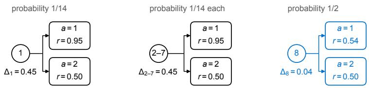

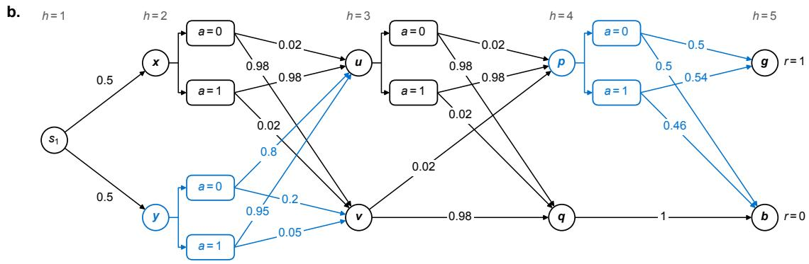

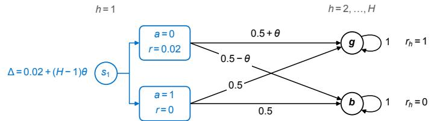  
Figure 5: Simulation environments in full, in the style of Figure 2. Circles are states, boxes are actions, and arrows are labelled with transition probabilities. a. Simulation 1: each context’s probability, the Bernoulli reward means of its two actions, and the gap $\Delta _ { s } .$ Contexts 2-7 are identical and drawn once; Context 1 is drawn separately because the behavior policy selects its optimal action with probability 0.01, compared with 0.20 elsewhere. b. Simulation 2: v and q have a single action; reward is 1 only at $^ { g , }$ and q never reaches g. c. Simulation 3: the absorbing states g and b pay 1 and 0 at every step until the horizon H. Blue marks the hard decisions.

Eficient version. The eficient version makes three changes, applied to every method alike. First, it pools the data: every step uses all data collected so far, namely the full untrimmed ofline sample and every collaborator query from every epoch, in place of the epoch’s fresh sample and the historical sample. This applies to the value estimates and the localization, the reported policy, the empirical model, the scores and variance envelope, and the counts already held when the next design is solved. Second, it eliminates candidates by confidence: after the localization, a candidate π is also removed when another candidate $\pi ^ { \prime }$ satisfies

$$
\widehat { D } _ { k } ( \pi ^ { \prime } , \pi ) > C _ { 0 } \Big ( \beta _ { k } \sum _ { h , s , a } \Gamma _ { k , h s a } ( \pi , \pi ^ { \prime } ) \big / N _ { k , h s a } \Big ) ^ { 1 / 2 } ,
$$

where $\widehat { D } _ { k } ( \pi ^ { \prime } , \pi )$ is the estimated value diference, $\Gamma _ { k , h s a } ( \pi , \pi ^ { \prime } )$ the variance envelope of the pair’s influence score at $( h , s , a )$ and $N _ { k , h s a }$ the number of observations of $( h , s , a )$ . The right-hand side is the realized counterpart of the confidence radius that the design controls, computed from the same data. Third, it tops up the stabilization batches: at epoch k each state-time pair receives only the shortfall between $m _ { k } ^ { \mathrm { s t } }$ and the stabilization queries it has received in earlier epochs, instead of $m _ { k } ^ { \mathrm { s t } }$ new ones, since with pooled data the earlier batches remain in use.

Constants. All methods and both versions use the same constants. The trimming constant of Li et al. [2024] is 1, and $C _ { 0 } = 0 . 5 ( C _ { 0 } = 1$ in Appendix E.6). We set $C _ { \mathrm { u c } } = C _ { \mathrm { s e n } } = 0$ . For stabilization, we directly choose the target $m _ { k } ^ { \mathrm { s t } } : = \lceil 5 \beta _ { k } \rceil$ per state-time pair. This is an empirical simplification of (6). In particular, the trimming correction $5 0 w _ { k } \ell _ { \mathrm { t r i m } } + 2$ is omitted when setting this target. The variance envelope uses the exact range of the influence score in place of 2H, and the sensitivity envelope $\Delta ^ { \mathcal { G } }$ is set to zero, which is exact at $\dot { H } = 1$

Choice of $\begin{array} { r l } { C _ { 0 } . } & { { } C _ { 0 } } \end{array}$ scales the confidence radius $\begin{array} { r l } { C _ { 0 } \big ( \beta _ { k } \sum _ { h , s , a } \Gamma _ { k , h s a } / N _ { k , h s a } \big ) ^ { 1 / 2 } } & { { } } \end{array}$ , which sizes each design batch and, in the eficient version, sets the elimination threshold. The analysis takes $C _ { 0 } = 8 .$ , so that the radius holds simultaneously over all candidate pairs and epochs with worst-case concentration constants. Because $\Gamma _ { k , h s a }$ envelopes the variance of the influence score, the radius is at least $C _ { 0 } \sqrt { \beta _ { k } }$ estimated standard errors of the value diference, and $\sqrt { \beta _ { k } }$ lies between 3.5 and 5.0 in our runs. With $C _ { 0 } = 0 . 5$ the radius is therefore about two standard errors, the half-width of a pointwise 95% normal interval; a normal-approximation union bound over all candidate pairs and epochs would correspond to $C _ { 0 } \approx 1$ A pointwise radius sufices in these instances because a stopping failure requires a comparison against the optimal policy to be wrong by more than the radius plus the competitor’s regret, which exceeds $\varepsilon ,$ and only a few competitors are that close. All methods share the stopping rule, so $C _ { 0 }$ rescales their costs together: with $C _ { 0 } = 1$ (Appendix E.6), adaptive allocation needs 2.2 to 3.7 times as many queries in the eficient version and 3.2 to 4.6 times as many in the theory-aligned version, and it remains the cheapest in every setting.

Baselines. Uniform and coverage run the same version of the algorithm on the same ofline sample and folds as the paired adaptive run, with the same stabilization, localization, elimination (eficient version), stopping and reporting rules. Only the allocation of design queries difers: uniform spreads each design batch evenly over the state–time pairs, and coverage splits it in proportion to $\textstyle \sum _ { a } \dot { \pi } _ { h } ^ { c } ( a \mid s ) / ( 1 + N _ { h s a } \bar { ) } ^ { 2 }$ where $N _ { h s a }$ counts all observations of $( h , s , a )$ collected so far, ofline and queried; neither uses gaps, values or variances. In the fixed-budget protocol both baselines also use the paired adaptive run’s epoch batch sizes and stabilization draws. In the stopping protocol each baseline solves the same design problem with its allocation restricted to its own shape, and so selects its own batch sizes. The ofline-only reference returns the policy with the highest value in the empirical model of the full, untrimmed ofline sample, with unobserved rows contributing zero.

Protocols and metrics. In the fixed-budget protocol the stop at $\varepsilon _ { k } \leqslant \varepsilon$ is disabled, and each setting runs until every adaptive trial would have stopped; a run whose candidate set has shrunk to a single policy keeps returning it. We record the policy returned at each epoch end, which all three methods reach with the same number of queries, and report its recovery (whether it is optimal) and regret $V _ { 1 } ^ { \star } - V _ { 1 } ^ { \widehat { \pi } }$ at the mean cumulative number of queries. In the theory-aligned version this policy is selected on the epoch’s fresh data, which in early epochs contain only a fold of the ofline sample (61% of $\mathcal { D } _ { 0 } ^ { \mathcal { D } }$ in epoch 1 and 15% in epoch 2). Its recovery can therefore fall from one epoch to the next, and at large $n _ { 0 }$ the first epochs can fall below the ofline-only reference, which uses the full sample. The eficient version selects it on all data collected so far. Every returned policy that is not optimal errs only at the hard decisions: its regret is 0.02 in Simulation 1, 0.038 (p), 0.039 (y) or 0.074 (both) in Simulation 2, and the value gap in Simulation 3. Mean regret therefore mirrors recovery, and we discuss recovery below. In the stopping protocol, the certification cost is the total number of collaborator queries, stabilization included, until a method’s stopping rule returns; a stopping run fails if the returned policy is not ε-optimal. The certification panels give the fraction of trials whose stopping rule has returned by each budget, each method under its own allocation.

Statistics, seeds and computation. Each setting uses 300 trials. Within a trial, all methods and both versions share the ofline sample with its trimming and fold split, and each trial’s random streams are derived from the simulation’s seed base (20261101, 20261161 and 20261171), the setting and the trial index; both values of $C _ { 0 }$ use the same seed bases. Proportions have pointwise 95% Wilson intervals, mean regret and mean query costs have intervals of the mean ±1.96 standard errors, and paired diferences in recovery have intervals of the mean ±1.96 standard errors of the per-trial diferences. No multiplicity adjustment is applied. The runs used six to nine worker processes on a single Apple-silicon laptop (Python 3.13.5, NumPy 2.5.3, SciPy 1.18.1). For each value of $C _ { 0 } ,$ , Simulation 1 took under 7 minutes for the eficient version and under 1.5 hours for the theory-aligned version, and Simulations 2 and 3 under 3 minutes each.

## E.2 Summary of Results

Certification cost. Adaptive allocation needs the fewest queries to certify in every setting under both versions (Figure 6). In the eficient version it certifies after $\bar { 6 } . 1 \times 1 0 ^ { 3 }$ to $2 . 2 \times 1 0 ^ { 4 }$ queries on average, and uniform and coverage allocation need 5.9-24.6 and 3.6-17.0 times as many. In the theory-aligned version it certifies after $2 . 6 \times 1 0 ^ { 5 }$ to $5 . 5 \times 1 0 ^ { 5 }$ queries, and the baselines need 5.1-21.2 and 3.4-15.8 times as many; there, in every setting, the last adaptive trial certified before the first baseline trial. The eficient version’s costs are lowest at $n _ { 0 } = 5 , 0 0 0$ in every simulation, and the theory-aligned costs barely change with $n _ { 0 }$

Fixed budgets. At the epoch end where adaptive allocation’s smaller recovery gain over the two baselines is largest, the eficient version’s adaptive allocation recovers the optimal policy more often than uniform allocation in 23 of the 25 settings and more often than coverage in 22, at the 95% level; all exceptions are at $n _ { 0 } = 5 , 0 0 0$ in Simulations 1 and 3, where the ofline data alone recover the optimal policy in 90-93% of trials. The theory-aligned version does so in all 25 settings against both baselines. These gains are the largest of several epoch-end comparisons, so they overstate the typical gain; the figures show every epoch end. Across all epoch ends, settings and both versions, no paired diference in recovery is significantly below zero.

Eficient and theory-aligned versions. At $n _ { 0 } = 5 0 0$ the eficient version recovers the optimal policy more often than the theory-aligned one at equal budgets under all three allocations, because it decides on all data collected so far. For example, in Simulation 1 adaptive, uniform and coverage allocation recover 98.0%, 85.7% and 81.7% after $3 . 4 \times 1 0 ^ { 3 }$ queries under the eficient version, and 94.3%, 79.3% and 77.3% after $5 . 0 \times 1 0 ^ { 3 }$ under the theory-aligned version; in Simulation 3 with $H = 1 5$ they recover 96.0%, 77.0% and 83.3% after $\mathbf { \boldsymbol { \mathbf { t . } } } 1 \times 1 0 ^ { 3 }$ queries under the eficient version, and 79.0%, 73.3% and 74.3% after $4 . 3 \times 1 0 ^ { 3 }$ under the theory-aligned version. The theory-aligned version’s largest gains are mostly as large or larger, because its baselines, which decide on each epoch’s fresh data, recover less, but at $n _ { 0 } = 5 0 0$ they occur at budgets 1.5 to 5.6 times larger.

The theory-aligned version needs 12 to 74 times as many queries as the eficient one to certify, because only the localization shrinks its candidate set. A policy with regret ∆ leaves the set once $5 \varepsilon _ { k } / 2 < \Delta ,$ up to estimation error, and with $\varepsilon _ { k } = H 2 ^ { 1 - k }$ this first happens at epoch 8 in Simulation 1 $( 5 \varepsilon _ { 8 } / 2 \approx 0 . 0 1 9$ 5 against $\Delta = 0 . 0 2 )$ and at epoch 7 or 8 in Simulation 3. In Simulation 2 the run stops at epoch $^ { 9 , }$ when $\varepsilon _ { 9 } \leqslant \varepsilon ,$ before $5 \varepsilon _ { k } / 2$ falls below 0.038. The theory-aligned stopping epoch is therefore set by the schedule and barely depends on $\textstyle n _ { 0 } ;$ the allocation determines how many queries those epochs need. Elimination removes a candidate as soon as its estimated gap exceeds the confidence radius, so the eficient version usually stops at epoch 5, 6 or $7 ;$ at $n _ { 0 } = 5 , 0 0 0$ up to 17% of its trials stop at epoch 1 or $^ { 2 , }$ when the ofline data and the first stabilization batch already separate the policies.

Adding the three changes one at a time to the theory-aligned version at $n _ { 0 } = 5 0 0$ separates their efects. Pooling alone lowers the cost of certification 1.6- to 2.2-fold and still stops at epochs 7 to ${ 9 ; }$ adding elimination lowers it a further 7.6- to 20-fold, and topping up the stabilization batches a further 1.1- to 1.7-fold. Adaptive allocation certifies first at every step. With pooling alone, adaptive’s largest fixedbudget gains over uniform allocation are never larger than at any other step, and the top-up raises its largest gains over both baselines in all five settings: after epoch 1 it adds at most seven stabilization queries per state–time pair and epoch (medians), whereas without it every epoch adds $\lceil 5 \beta _ { k } \rceil$ new ones, so more of each budget goes to the design.

Simulation 3, H = 5  
Simulation 2  
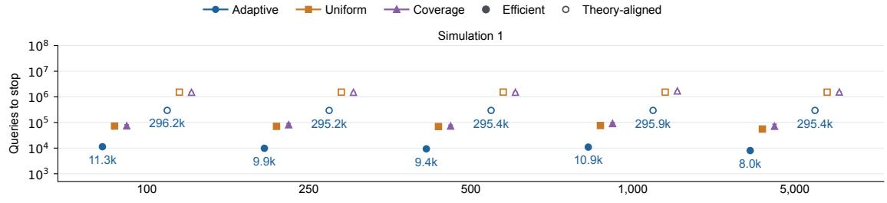

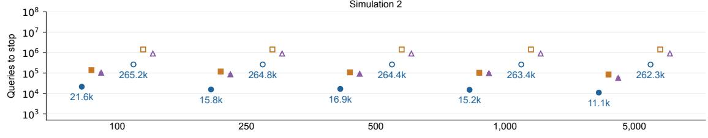

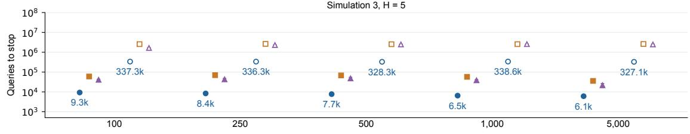

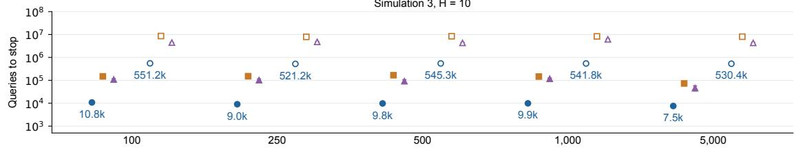

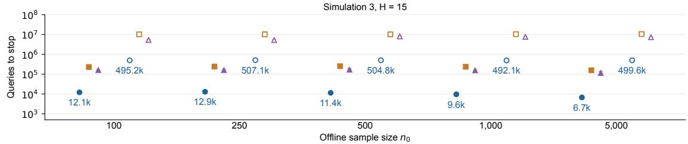  
Figure 6: Mean collaborator queries until each method’s stopping rule returns (log scale; ±1.96 standard errors, mostly smaller than the markers), for every setting and ofline sample size, under the eficient (filled) and theoryaligned (open) versions of the algorithm of Section 5, both with $C _ { 0 } = 0 . 5 ;$ numbers below the markers give adaptive’s mean cost. No stopping run returned a policy that is not ε-optimal

## E.3 Simulation 1: Contextual Bandit

Environment. The bandit has $\left| S \right| = 8$ contexts and $| { \mathcal { A } } | = 2$ actions with Bernoulli rewards (Figure 5a). Contexts 1-7 have probability 1/14 each and reward means (0.95,0.50); Context 8 has probability 1/2 and means (0.54,0.50). The behavior policy selects the optimal action with probability 0.01 in Context 1 and 0.20 in every other context, and the collaborator selects it with probability 0.6 in every context. A wrong action in Context 8 costs $0 . 5 \times 0 . 0 4 = 0 . 0 2$ , the smallest nonzero regret, which exceeds $\varepsilon = 0 . 0 1$

Fixed budgets. The ofline data alone recover the optimal policy in 1.3% of trials at $n _ { 0 } = 1 0 0$ and 93.0% at $n _ { 0 } = 5 , 0 0 0$ (Figure 7). In the eficient version the methods nearly coincide in the first epochs: after the epoch-1 stabilization batch (888 queries), the design batch of epoch 2 is a single query at every $n _ { 0 } ,$ as is that of epoch 3 in almost every trial for $n _ { 0 } \geqslant 5 0 0$ . Adaptive allocation then recovers the optimal policy more often than both baselines for $n _ { 0 } \leqslant 1 , 0 0 0$ , by 9.7 to 16.3 percentage points over uniform and 16.3 to 21.3 over coverage at the epoch of largest gain, after $2 . 5 \times 1 0 ^ { \bar { 3 } }$ to $3 . 8 \times 1 0 ^ { 3 }$ queries. At $n _ { 0 } = 5 , 0 0 0$ all three methods recover 95.3% through epoch 4, as the pooled data contain the ofline sample, and the largest gains (1.3 points over uniform and 2.0 over coverage, at epoch 5) are small; only the latter is significant. Adaptive returns the optimal policy in every trial after $7 . 7 \times 1 0 ^ { 3 }$ to $1 . 1 \times 1 0 ^ { 4 }$ queries. In the theory-aligned version the largest gains occur at epoch 3 for $n _ { 0 } \leqslant 1 , 0 0 0$ , after about $5 . 0 \times 1 0 ^ { 3 }$ queries: 11.3 to 17.0 points over uniform and 16.0 to 24.0 over coverage; at $n _ { 0 } = 5 , 0 0 0$ they are 10.7 and 15.7 points, at epoch 4. At $n _ { 0 } = 5 , 0 0 0$ its first three epoch ends fall below the ofline-only reference, and coverage stays at 71-84% through epoch 4. Adaptive returns the optimal policy in every trial after about $3 . 2 \times 1 0 ^ { 4 }$ queries $( 9 . 6 \times 1 0 ^ { 4 }$ at $n _ { 0 } = 1 , 0 0 0 )$ , and all three methods after about $9 . 6 \times 1 0 ^ { 4 }$ (1.6 × 10<sup>5</sup> at $n _ { 0 } = 5 0 0 )$ .

Certification cost. In the eficient version adaptive allocation certified after $8 . 0 \times 1 0 ^ { 3 }$ to $1 . 1 \times 1 0 ^ { 4 }$ queries on average. Every trial stopped with a single candidate left, most often at epoch 6 (52-76% of trials); at $n _ { 0 } = 5 , 0 0 0$ , 17% stopped at epoch 1 or 2. Uniform allocation needed 6.4 to 7.4 times as many queries and coverage 6.5 to 8.9 times. The cost distributions overlap: when the last adaptive trial certified, 23-37% of uniform and 18-46% of coverage trials had also certified. In the theory-aligned version every trial stopped at epoch 8, with a single candidate left (58-66% of trials) or at $\varepsilon _ { 8 } \leqslant \varepsilon ,$ after $2 . 9 5 \times 1 0 ^ { 5 }$ to $2 . 9 6 \times 1 0 ^ { 5 }$ queries on average; uniform allocation needed 5.1 to 5.2 times as many and coverage 5.1 to 5.7 times. Every adaptive trial certified within 1.23 times the adaptive mean cost, and no baseline trial before 5.08 times it.

Allocation. In the eficient version, adaptive allocation had spent 68-75% of its queries on Context 8 after epoch 5 for $n _ { 0 } \leqslant 1 , 0 0 0 \ ( 3 . 3 \times 1 0 ^ { 3 }$ to $4 . 9 \times 1 0 ^ { 3 }$ queries), compared with 12.5% for uniform and 5.9-11.4% for coverage, and 3.6-4.6% on Context 1 (Figure 7d). At $n _ { 0 } = 5 , 0 0 0$ the epoch-1 stabilization batch makes up most of the $1 . 1 \times 1 0 ^ { 3 }$ queries by then, and the share of Context 8 is 26%. From epoch 2 on, 76-100% of its design queries went to Context $_ { 8 ; }$ the top-up adds no stabilization queries after epoch 1 (medians), because elimination shrinks the candidate set and with it $\beta _ { k }$ . At $n _ { 0 } = 5 0 0$ the median number of candidates after epochs 1 to 4 is 8, 4, 2 and 2. In the theory-aligned version, adaptive allocation had spent 59% of its queries on Context 8 and 5.8% on Context 1 after epoch 7 (about $1 . 6 \times 1 0 ^ { 5 }$ queries). Its design batches are spread more widely while many candidates remain: the share assigned to Context 8 is 45-65% in epochs 3 to 6 and rises to 72% in epoch 7 and 86% in epoch 8, as the median number of candidates falls from 256 in epochs 1 to 4 to 198, 37, 9 and 1.

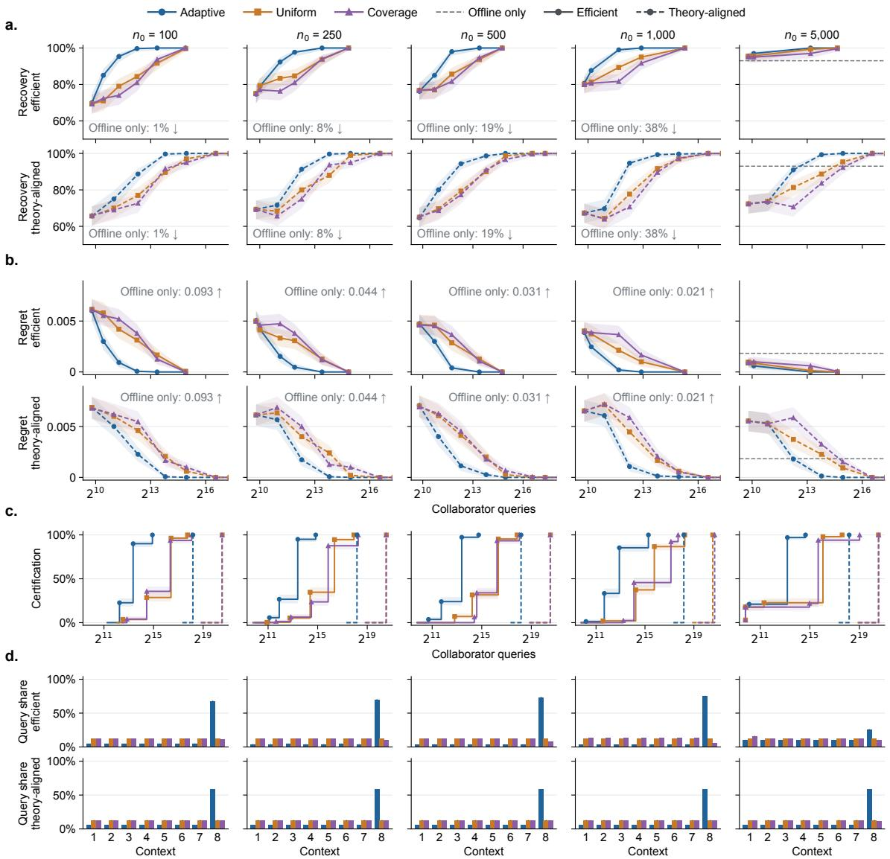  
Figure 7: Simulation 1 at every ofline sample size n<sub>0</sub> (columns; 300 paired trials each), for the eficient (solid) and theory-aligned (dashed) versions of the algorithm of Section 5, both with $C _ { 0 } = 0 . 5 . \ \mathbf { a } .$ Fraction of trials returning the optimal policy and b. mean regret $V _ { 1 } ^ { \star } - V _ { 1 } ^ { \widehat { \pi } }$ of the returned policy at each epoch end, against mean collaborator queries (top: eficient; bottom: theory-aligned; the four rows of a column share the x-axis); ofline-only levels outside the axis are printed in the panel. c. Fraction of trials whose stopping rule has returned, each method under its own allocation; a curve starts at the last epoch with no certified trial and ends once all have certified. d. Each method’s share of the eficient (top) and theory-aligned (bottom) version’s queries after that version’s last epoch before adaptive typically stops (epochs 5 and 7). Bands: pointwise 95% Wilson intervals (recovery, certification) and mean ±1.96 standard errors (regret).

## E.4 Simulation 2: Multiple Sequential Decisions

Environment. The MDP has horizon $H = 5$ and the layered structure of Figure 5b. The initial state $s _ { 1 }$ moves to x or y with probability $1 / 2$ each. Actions at x and y lead to u or v; actions at $u ,$ and the single action at $v ,$ , lead to $p$ or $q ;$ actions at $p ,$ and the single action at q, lead to $g$ or $b .$ Reward is 1 only on reaching $g .$ Action 1 leads to the first of the two next states (u, p or g) with probability 0.98 at x and $u , 0 . 9 5$ at $y$ and 0.54 at $p ;$ action 0 does so with probability 0.02, 0.80 and 0.50, respectively. The state v moves to $p$ with probability 0.02, and $q$ never reaches $g .$ The optimal policy takes action 1 at every decision state and has value 0.511. A single wrong choice costs 0.249 at x, 0.039 at $^ { y , }$ 0.500 at u and 0.038 at $p ,$ and every suboptimal policy has regret at least $0 . 0 3 8 > \varepsilon = 0 . 0 2$ . The behavior policy takes action 1 with probability 0.9 at $x$ and u and 0.005 at y and $p ;$ the collaborator takes it with probability 0.6 at every decision state. All nine state–time pairs can be queried, and $n _ { 0 }$ counts ofline trajectories.

Fixed budgets. Ofline-only recovery rises from 4.3% at $n _ { 0 } = 1 0 0$ to 58.0% at $n _ { 0 } = 5 , 0 0 0$ (Figure 8). In the eficient version the methods coincide in epoch 1 and nearly so through epoch 3: the pooled data already meet the early design targets, so the design batches of epochs 2 and 3 are a single query in almost every trial at $n _ { 0 } \geqslant 2 5 0$ . Adaptive’s largest gains are then 10.7 to 14.7 percentage points over uniform and 6.0 to 10.0 over coverage, after $1 . 0 \times 1 0 ^ { 3 }$ to $3 . 5 \times 1 0 ^ { 3 }$ queries, all significant. In the theory-aligned version the largest gains are 8.7 to 14.0 points over uniform and 7.7 to 12.3 over coverage, after $6 . 2 \bar { \times } 1 0 ^ { 3 }$ to $1 . 5 \times 1 0 ^ { 4 }$ queries. Adaptive returns the optimal policy in every trial after $3 . 4 \times 1 0 ^ { 3 }$ to $3 . 7 \times 1 0 ^ { 4 }$ queries in the eficient version and $3 . 2 \times 1 0 ^ { 4 }$ to $6 . 6 \overset { - } { \times } 1 0 ^ { 4 }$ in the theory-aligned version.

Certification cost. In the eficient version every trial stopped with a single candidate left, at epochs 5 to 9 (mostly 6 to 8), after $1 . 1 \times 1 0 ^ { 4 } \mathrm { t o } 2 . 2 \times 1 0 ^ { 4 }$ queries on average. Uniform allocation needed 6.4 to 7.7 times as many queries and coverage 4.8 to 6.5 times. When the last adaptive trial certified, 5-20% of uniform and 6-15% of coverage trials had also certified, except at $n _ { 0 } = 5 0 0$ , where the last adaptive trial needed epoch 9 and 5.4 times the adaptive mean cost, and 81% of uniform and 75% of coverage trials had certified by then. In the theory-aligned version every trial stopped at epoch 9, when $\varepsilon _ { 9 } = 5 \cdot 2 ^ { - 8 } \leqslant \varepsilon .$ after $2 . 6 \times 1 0 ^ { 5 }$ queries on average at every $n _ { 0 } ;$ uniform allocation needed 5.4 to 5.5 times as many and coverage 3.4 to 3.5 times, and no baseline trial certified before 3.4 times the adaptive mean cost.

Allocation. In the eficient version, adaptive allocation had spent 58-63% of its queries on $p$ and 21-23% on y after epoch $6 \left( 3 . 4 \times 1 0 ^ { 3 } \right.$ to $1 . 0 \times 1 0 ^ { 4 }$ queries), compared with 11.1% each for uniform and 12-30% for coverage (Figure 8d); from epoch 5 on, 98-100% of its design queries went to $p$ and $y .$ . In the theory-aligned version it had spent 52% on $p$ and 18% on y after epoch 8 (about $1 . 3 \times 1 0 ^ { 5 }$ queries), compared with 14% each for coverage. The theory-aligned design batches assign 44-54% of their queries to p and $y$ in epochs 4 to $^ { 7 , }$ while the median number of candidates falls from 16 to $^ { 4 , }$ and 90-94% from epoch 8 on. Earlier batches also cover $x ,$ u and the states without a choice, whose transition estimates enter the estimated value diferences.

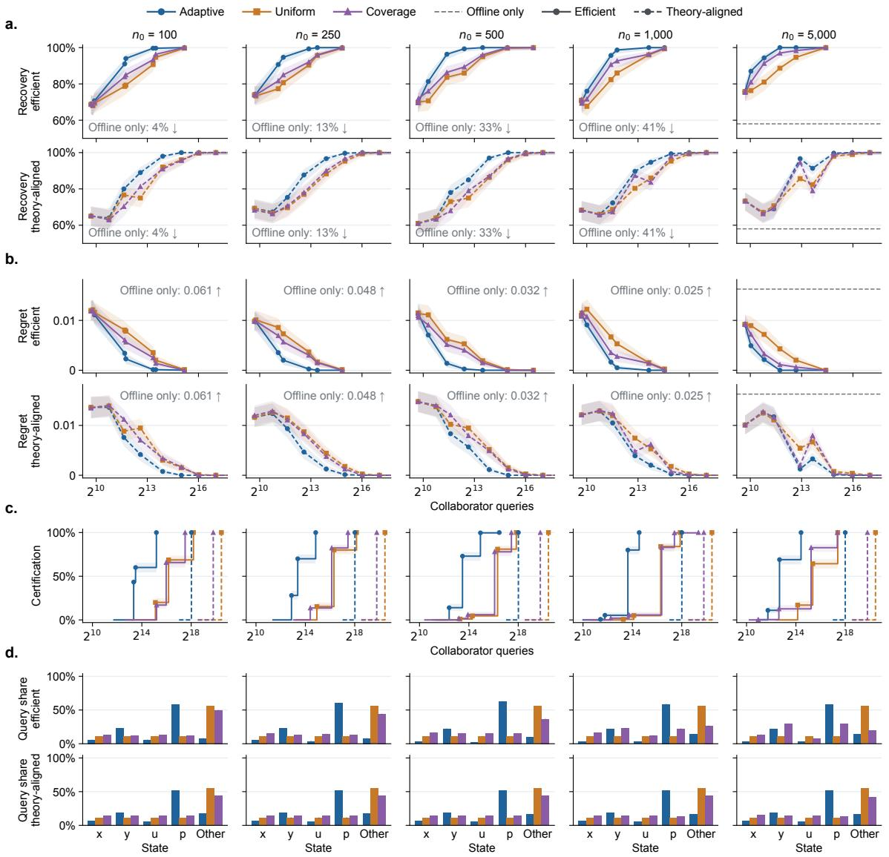  
Figure 8: Simulation 2 at every ofline sample size; layout and conventions as in Figure 7. All methods can query the nine state–time pairs. Query shares (d.) after epochs 6 (eficient) and 8 (theory-aligned).

## E.5 Simulation 3: Decisions with Long-Term Consequences

Environment. At the root, action 0 yields a Bernoulli reward with mean 0.02 and reaches the absorbing good state with probability $0 . 5 \substack { + \theta ; }$ action 1 yields no reward and reaches it with probability 0.5. The good and bad states pay 1 and 0 at every later step (Figure 5c). With $\theta = 0 . 0 4$ , the value gap $0 . 0 2 + ( H - 1 ) \theta$ is 0.18, 0.38 and 0.58 for $H = 5$ , 10 and 15, far above $\varepsilon = 0 . 0 1$ . Only the root carries a choice, so there are two policies. The behavior policy selects the optimal action 0 with probability 0.05, and the collaborator with probability 0.6. All $2 H - 1$ state–time pairs (9, 19 and 29) can be queried; querying an absorbing pair returns its reward and transition.

Fixed budgets. Ofline-only recovery ranges from 57.3-61.3% at $n _ { 0 } = 1 0 0$ to $8 9 . 7 \mathrm { - } 9 2 . 7 \%$ at $n _ { 0 } = 5 , 0 0 0$ across horizons (Figures 9-11). In the eficient version adaptive’s largest gains over uniform are 8.3 to 23.0 percentage points for $n _ { 0 } \leqslant 1 , 0 0 0$ and 0.7 to 6.3 at $n _ { 0 } = 5 , 0 0 0$ (significant for $H = 5$ and 15), after $1 . 2 \times \mathrm { \bar { 1 } } 0 ^ { 3 }$ to $8 . { \overset { - } { 3 } } \times { \overset { - } { 1 } } 0 ^ { 3 }$ queries; over coverage they are 3.0 to 16.7 points for $n _ { 0 } \leqslant 1 , 0 0 0$ and not significant at $n _ { 0 } = 5 , 0 0 0$ . In the theory-aligned version they are 14.7 to 29.0 points over uniform and 6.3 to 25.0 over coverage. Adaptive returns the optimal policy in every trial after $3 . 8 \times 1 0 ^ { 3 }$ to $2 . 4 \times 1 0 ^ { 4 }$ queries in the eficient version and $1 . 4 \times 1 0 ^ { 4 }$ to $2 . 9 \times 1 0 ^ { 4 }$ in the theory-aligned version. With only two policies, mean regret is the value gap times the error rate.

Certification cost. In the eficient version every trial stopped with a single candidate left, most often at epoch 5 (44-76% of trials), after $6 . 1 \times 1 0 ^ { 3 }$ to $1 . { \overset { \cdot } { 3 } } \times 1 0 ^ { 4 }$ queries on average. Uniform allocation needed 5.9-8.8, 9.7-17.1 and 18.7-24.6 times as many queries for $H = 5 , 1 0$ and 15, and coverage 3.6-6.2, 6.1-11.8 and 12.3-17.0 times. As in Simulation 1 the cost distributions overlap, mainly because a few adaptive trials need an extra epoch: when the last adaptive trial certified, up to 34% of uniform and 35% of coverage trials had also certified for $n _ { 0 } \leqslant 1 , 0 0 0$ . At $n _ { 0 } = 5 , 0 0 0$ , where the ofline data already cover the root well and coverage allocation sends 20-41% of its queries there, 81-88% of coverage trials had. In the theory-aligned version every trial stopped with a single candidate left at epoch 7 or 8, after $3 . 3 \times 1 0 ^ { 5 }$ to $3 . 4 \times \mathrm { \dot { 1 } } 0 ^ { 5 }$ (H = 5), $5 . 2 \times 1 0 ^ { 5 }$ to $5 . 5 \times 1 0 ^ { 5 }$ (H = 10) and $4 . 9 \times 1 0 ^ { 5 }$ to $5 . 1 \times 1 0 ^ { 5 } \left( H = 1 5 \right)$ queries on average. The share stopping at epoch 7 grows with the horizon, from 15-19% to 31-37% and 43-46%, because localization removes the suboptimal policy at epoch 7 only when its estimated gap exceeds 5ε /2, which is 0.195, 0.391 and 0.586, closer and closer to the gap. Uniform allocation needed 7.5-7.9, 15.1-15.6 and 20.2-21.2 times as many queries and coverage 4.9-7.6, 7.9-11.3 and 10.3-15.8 times, and no baseline trial certified before the last adaptive trial.

Allocation. In the eficient version, adaptive allocation had spent 47-74%, 38-64% and 31-53% of its queries on the root after epoch 4 for H = 5, 10 and $1 5 \ : ( 1 . 2 \times 1 0 ^ { 3 }$ to $5 . 0 \times 1 0 ^ { 3 }$ queries). Uniform spends about $1 / ( 2 H - 1 )$ of its queries there (11.1%, 5.3% and 3.4%), and coverage 16-41%, 8-29% and 5.5-20%. From epoch 2 on, 94-100% of adaptive’s design queries went to the root. The rest of its queries are mostly the epoch-1 stabilization batch at all 2H − 1 pairs (61 to 67 queries per pair), which the top-up raises by at most seven queries per pair and epoch; their share grows with H and with ${ \boldsymbol { n } } _ { 0 } ,$ as the design batches shrink when the ofline data are informative. In the theory-aligned version adaptive had spent 92%, 86% and 80% of its queries on the root after epoch 7, against 16-17%, 8% and 5-6% for coverage. The baselines’ disadvantage therefore includes the queries they spend on absorbing pairs, where no choice remains. The number of such pairs grows with H together with the value gap, so the horizon sweep does not isolate a single factor.

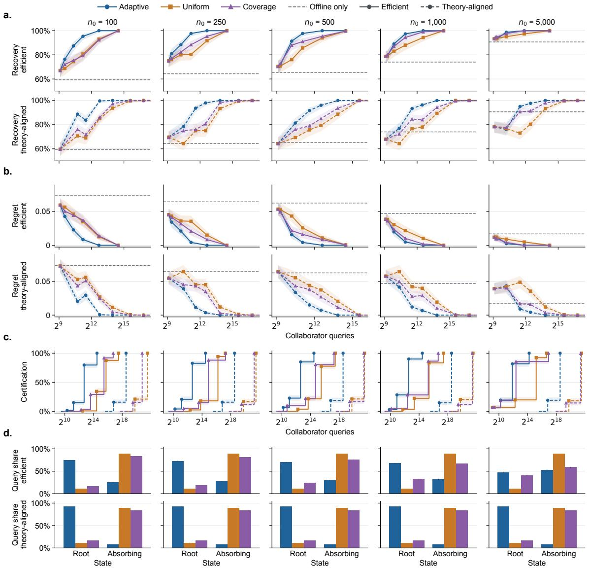  
Figure 9: Simulation 3 with H = 5 at every ofline sample size; layout and conventions as in Figure 7. All methods can query the nine state–time pairs. Query shares (d.) after epochs 4 (eficient) and 7 (theory-aligned).

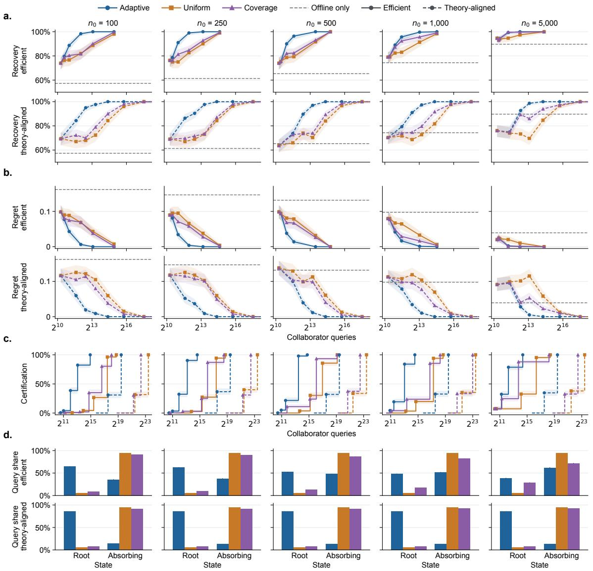  
Figure 10: Simulation 3 with H = 10 at every ofline sample size; layout and conventions as in Figure 7. All methods can query the 19 state–time pairs. Query shares (d.) after epochs 4 (eficient) and 7 (theory-aligned).

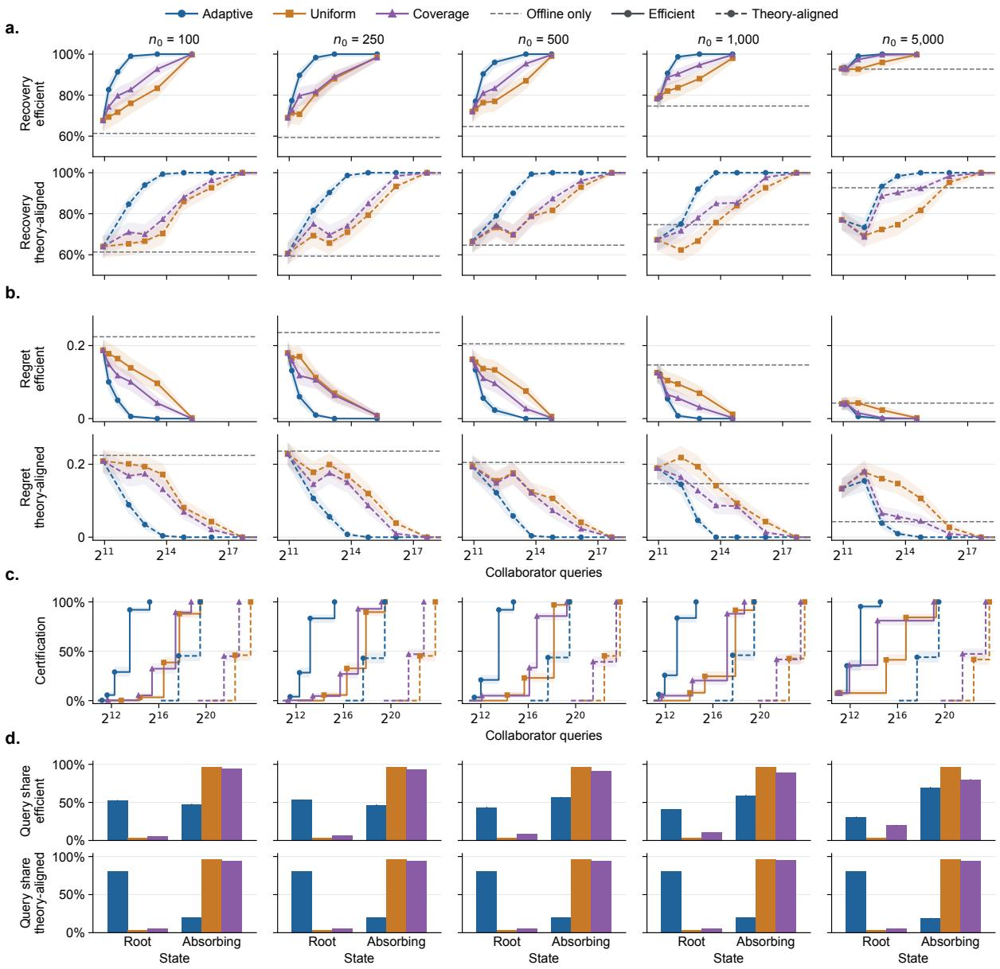  
Figure 11: Simulation 3 with H = 15 at every ofline sample size; layout and conventions as in Figure 7. All methods can query the 29 state–time pairs. Query shares (d.) after epochs 4 (eficient) and 7 (theory-aligned).

## E.6 Results with $C _ { 0 } = 1$

Figures 12-17 repeat every setting with $C _ { 0 } = 1$ , which doubles the confidence radius; everything else, including the seed bases, is as above. All methods share the stopping rule, so the larger radius raises the certification cost of every method. Adaptive allocation needs 2.2 to 3.7 times as many queries as with $C _ { 0 } = 0 . 5$ in the eficient version $( 1 . 9 \times \dot { 1 0 ^ { 4 } }$ to $4 . 9 \times 1 0 ^ { 4 }$ on average) and 3.2 to 4.6 times as many in the theory-aligned version $( 8 . 5 \times 1 0 ^ { 5 } \mathrm { ~ t o ~ } 2 . 4 \times 1 0 ^ { 6 } )$ . It remains the cheapest in every setting: uniform and coverage allocation need 4.6-28.3 and 4.7-22.8 times as many queries in the eficient version and 4.1-18.0 and 4.0-21.0 times in the theory-aligned version, where the last adaptive trial again certified before the first baseline trial in every setting. In the eficient version the cost distributions overlap less than with $C _ { 0 } = 0 . 5$ in Simulation 2, where at most 3% of baseline trials had certified when the last adaptive trial did, and in Simulation 3 with H = 15, where no uniform trial had.

At fixed budgets, the eficient version’s adaptive allocation recovers the optimal policy more often than uniform allocation in 23 of the 25 settings and more often than coverage in 21, at the epoch end of largest gain and the 95% level; all exceptions are at $n _ { 0 } = 5 , 0 0 0$ . For $n _ { 0 } \leqslant 1 , 0 0 0$ its largest gains are 8.0 to 21.7 percentage points over uniform and 3.7 to 20.0 over coverage. The theory-aligned version’s largest gains are significant in all 25 settings against uniform and in 24 against coverage, the exception being Simulation 3 with $H = 5$ at $n _ { 0 } = 5 , 0 0 0$ . As with $C _ { 0 } = 0 . 5$ , no paired diference in recovery at any epoch end is significantly below zero, and no stopping run of any method returned a policy that is not ε-optimal.

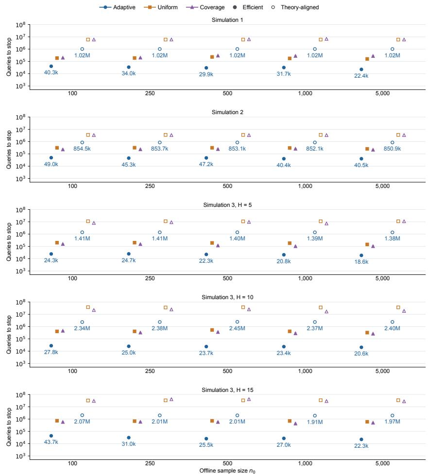  
Figure 12: Mean collaborator queries until each method’s stopping rule returns with $C _ { 0 } = 1 ;$ layout and conventions as in Figure 6. No stopping run returned a policy that is not ε-optimal.

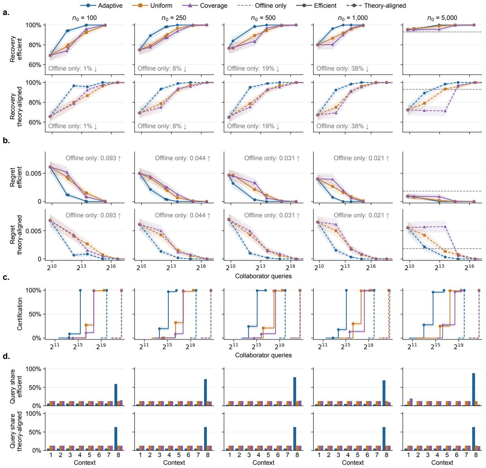  
Figure 13: Simulation 1 with $C _ { 0 } = 1$ at every ofline sample size; layout and conventions as in Figure 7. Query shares (d.) after epochs 5 (eficient) and 7 (theory-aligned).

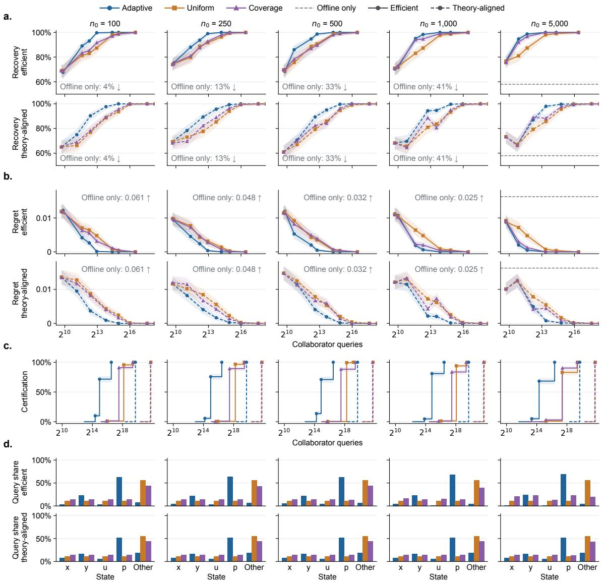  
Figure 14: Simulation 2 with $C _ { 0 } = 1$ at every ofline sample size; layout and conventions as in Figure 7. Query shares (d.) after epochs 6 (eficient) and 8 (theory-aligned).

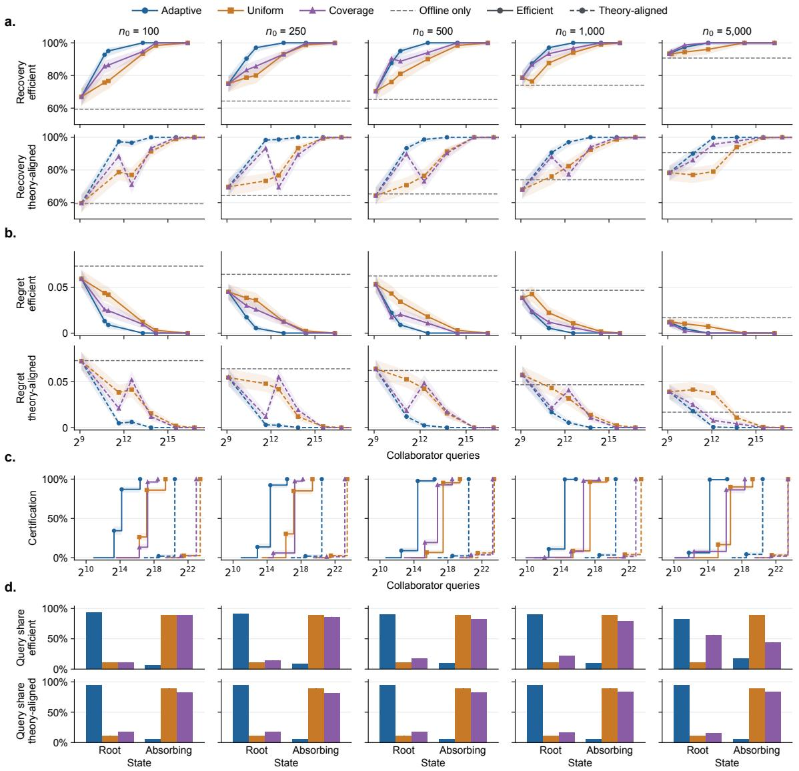  
Figure 15: Simulation 3 with H = 5 and $C _ { 0 } = 1$ at every ofline sample size; layout and conventions as in Figure 7. Query shares (d.) after epochs 4 (eficient) and 7 (theory-aligned).

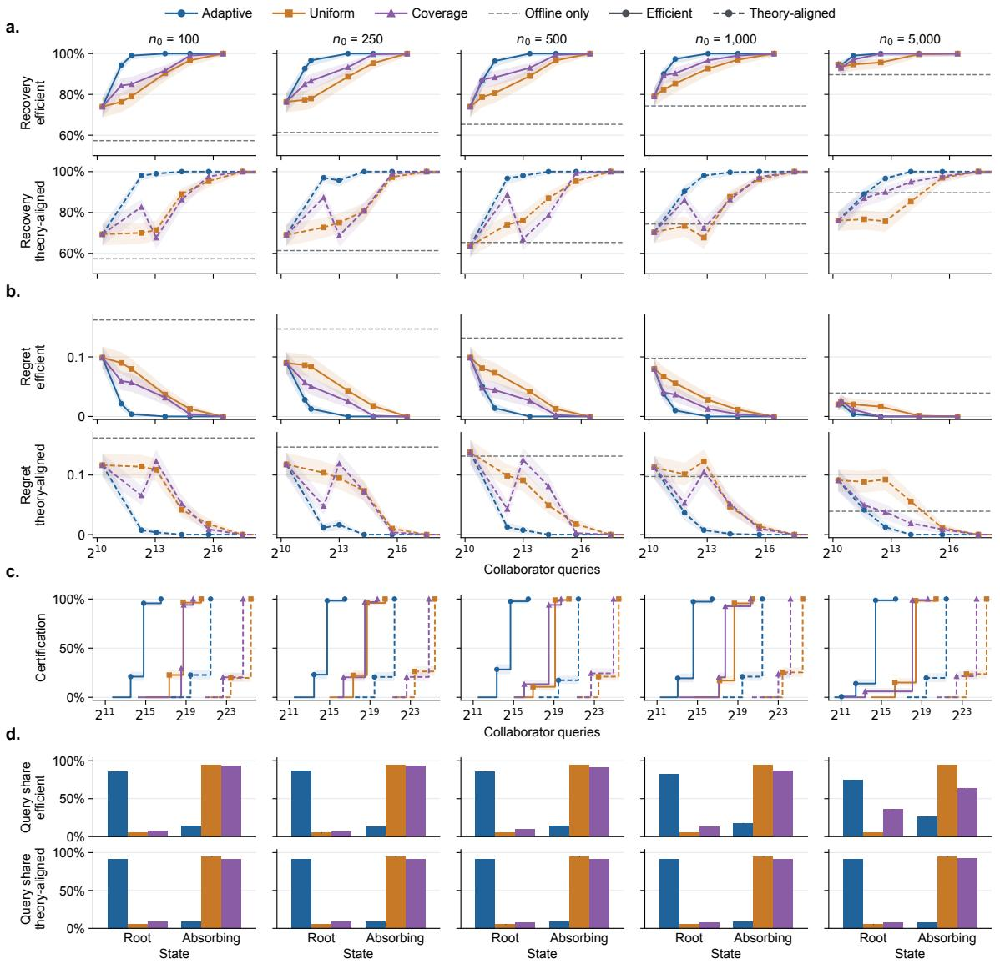  
Figure 16: Simulation 3 with $H = 1 0$ and $C _ { 0 } = 1$ at every ofline sample size; layout and conventions as in Figure 7. Query shares (d.) after epochs 4 (eficient) and 7 (theory-aligned).

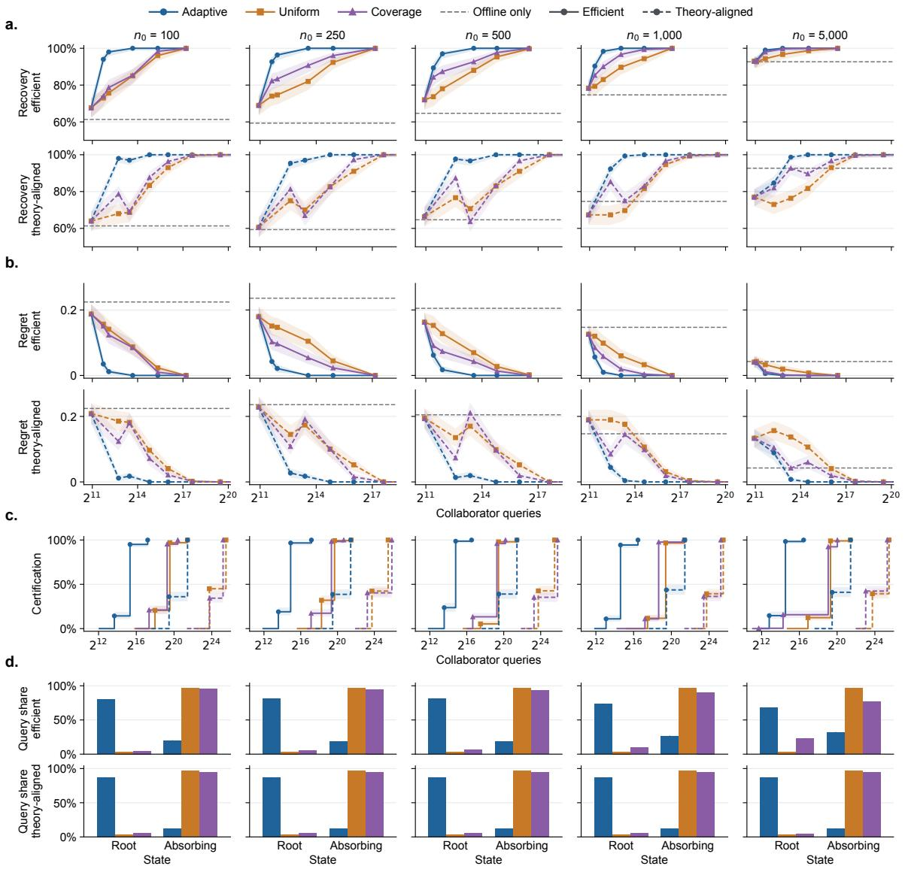  
Figure 17: Simulation 3 with H = 15 and $C _ { 0 } = 1$ at every ofline sample size; layout and conventions as in Figure 7. Query shares (d.) after epochs 4 (eficient) and 7 (theory-aligned).

## F PRISM Application Details

Data. We use the primary screen of the PRISM drug-repurposing resource [Corsello et al., 2020] (19Q4 release), which reports for each cell line and compound the $\log _ { 2 }$ fold change in viability relative to the DMSO control, ComBat-corrected and median-collapsed across replicates. Of the 578 cell lines in the screen, 10 fail STR identity profiling and 27 lack a response to at least one compound of a six-drug panel at 2.5µM; of the remaining 541, we keep every lineage with at least 30 lines, which gives the six lineages of Table 3 (284 lines). Within each lineage, lines are ordered by a hash of their DepMap identifier; the first 60% (rounded down) form a development set of 168 lines, used only to choose the drug pair, and the remaining 116 lines form the benchmark used in every experiment. The reward of a line under a drug is 1 if its log fold change is at most −1 (viability at most half of control) and 0 otherwise, and the response rate $r _ { 1 } ( s , a )$ of drug a in lineage s is the fraction of benchmark lines in s with reward 1.

Decision problem. Contexts are the six lineages $( H = 1 )$ and actions are dasatinib and selumetinib, so there are $2 ^ { 6 } = 6 4$ deterministic policies. A policy’s value is $\begin{array} { r } { V _ { 1 } ^ { \pi } = \sum _ { s } \rho _ { s } r _ { 1 } ( s , \pi _ { 1 } ( s ) ) } \end{array}$ for lineage weights ρ, its regret is $V _ { 1 } ^ { \star } - V _ { 1 } ^ { \pi }$ , and $\varepsilon = 0 . 0 1$ is one percentage point of response rate. We use incidence weights, each lineage’s share of new cases of the six cancers worldwide in 2022 [Bray et al., 2024] (melanoma for skin), and equal weights $\rho _ { s } = 1 / 6$ . A wrong choice in lineage s costs $\rho _ { s } \vert r _ { 1 } ( s , \mathrm { D } ) - r _ { 1 } ( s , \mathrm { S } ) \vert$ . Dasatinib is better in lung, CNS, ovary and pancreas, and selumetinib in skin and colorectal by narrow margins. Which close calls cost more than ε depends on the weights (Table 3): colorectal under incidence weights and both under equal weights, with pancreas above ε under both.

Table 3: The PRISM benchmark. Responders are benchmark lines with log fold change at most −1 at 2.5µM; D: dasatinib, S: selumetinib. Weights are in percent. The cost of a wrong choice is the lineage’s weight times its gap, reported in percentage points of response rate $\left( \varepsilon = 0 . 0 1 \right.$ corresponds to one percentage point).
<table><tr><td></td><td colspan="2">Lines</td><td colspan="2">Responders</td><td colspan="2"></td><td colspan="2">Weight (%)</td><td colspan="2">Cost of a wrong choice</td></tr><tr><td>Lineage</td><td>Eligible</td><td>Benchmark</td><td>D</td><td>S</td><td>Better</td><td>Gap</td><td>Incidence</td><td>Equal</td><td>Incidence</td><td>Equal</td></tr><tr><td>Lung</td><td>98</td><td>40</td><td>29</td><td>7</td><td>D</td><td>0.550</td><td>42.1</td><td>16.7</td><td>23.1</td><td>9.2</td></tr><tr><td>Skin</td><td>43</td><td>18</td><td>10</td><td>12</td><td>S</td><td>0.111</td><td>5.6</td><td>16.7</td><td>0.6</td><td>1.9</td></tr><tr><td>CNS</td><td>40</td><td>16</td><td>8</td><td>0</td><td>D</td><td>0.500</td><td>5.5</td><td>16.7</td><td>2.7</td><td>8.3</td></tr><tr><td>Ovary</td><td>35</td><td>14</td><td>14</td><td>2</td><td>D</td><td>0.857</td><td>5.5</td><td>16.7</td><td>4.7</td><td>14.3</td></tr><tr><td>Colorectal</td><td>34</td><td>14</td><td>7</td><td>8</td><td>S</td><td>0.071</td><td>32.7</td><td>16.7</td><td>2.3</td><td>1.2</td></tr><tr><td>Pancreas</td><td>34</td><td>14</td><td>8</td><td>5</td><td>D</td><td>0.214</td><td>8.7</td><td>16.7</td><td>1.9</td><td>3.6</td></tr><tr><td>Total</td><td>284</td><td>116</td><td></td><td></td><td></td><td></td><td>100</td><td>100</td><td></td><td></td></tr></table>

Collaborator, queries and initial log. A query names a lineage, then the collaborator picks each drug with probability $1 / 2$ and returns the stored reward of a benchmark line drawn uniformly at random, with replacement, from that lineage. Each observation is therefore Bernoul $\mathrm { i } ( r _ { 1 } ( s , a ) )$ , and repeated queries resample measured responses rather than run new assays. The initial log has as many records in each lineage as the lineage has benchmark lines (116 in total, drawn with replacement) and reveals a single drug: dasatinib in half of the trials and selumetinib in the other half. It cannot compare the drugs, so the ofline-only policy, the empirical maximizer on the log, plays the logged drug in every lineage and is never ε-optimal (regret about 17 percentage points).

Methods and constants. Adaptive, uniform and coverage allocation are as in the simulations. All methods share the initial log and the stabilization queries and difer only in their design batches. For the recovery comparisons every method receives adaptive’s batch size at each epoch; for certification each method uses its own batch sizes and stopping rule. Both versions use the constants of the simulations (Appendix E): $C _ { 0 } = 0 . 5$ (and $C _ { 0 } = 1$ in Figure 18) and we directly set the stabilization target to $\lceil 4 \beta _ { k } \rceil$ queries per lineage. Each configuration has 400 trials, 200 per logged drug; within a weighting, both versions and both values of $C _ { 0 }$ use the same seeds. A configuration takes 7-40 seconds for the eficient version and 1-2 minutes for the theory-aligned version with eight workers.

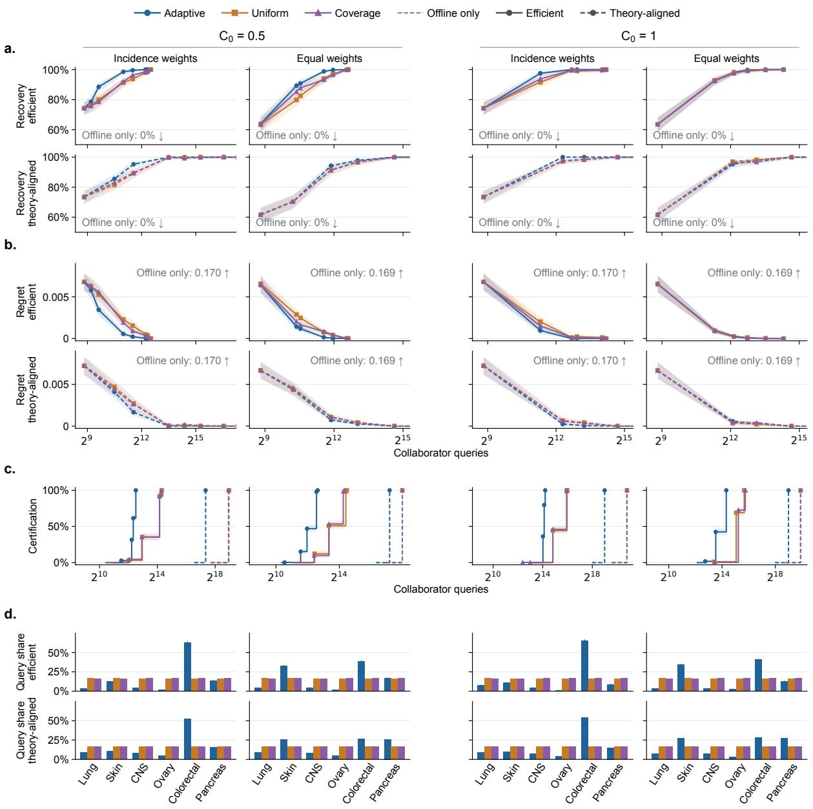  
Figure 18: PRISM application at $C _ { 0 } = 0 . 5$ (left pair of columns) and $C _ { 0 } = 1$ (right pair), each under incidence and equal lineage weights (400 paired trials per column), for the eficient implementation (solid) and the theory-aligned algorithm of Section 5 (dashed). a. Fraction of trials returning an ε-optimal policy and b. mean regret of the returned policy, in response-rate units, at each epoch end, against mean collaborator queries (top: eficient; bottom: theory-aligned; the four rows of a column share the x-axis); ofline-only levels outside the axis are printed in the panel. c. Fraction of trials whose stopping rule has returned, each method under its own allocation. d. Each method’s share of the eficient (top) and theory-aligned (bottom) version’s queries after that version’s last epoch before adaptive typically stops. Bands: pointwise 95% Wilson intervals (recovery, certification) and mean ±1.96 standard errors (regret).

Results. No stopping run of any method, version, weighting or $C _ { 0 }$ returned a policy that is not ε-optimal (9,600 runs). With $C _ { 0 } = 0 . 5$ , the eficient version certifies after 5.8 and $6 . 3 \times 1 \bar { 0 } ^ { 3 }$ queries under incidence and equal weights, 3.2-3.6 times fewer than uniform and coverage allocation. It also leads every baseline in recovery well before stopping: after 789 queries under incidence weights it returns an ε-optimal policy in 88.5% of trials, against 80.0% and 78.5% for uniform and coverage allocation, and after 3,010 queries under equal weights in 98.8%, against 94.0% and 93.2%, every diference being significant (paired 95% intervals). It concentrates its queries on the dificult contexts: 63% go to colorectal under incidence weights and 72% to skin and colorectal under equal weights, while lung, an easy decision despite its large incidence weight, receives about 4% (Figure 18d). The theory-aligned version stops at epoch 8 in every trial, the first epoch with $\varepsilon _ { k } \leqslant \varepsilon .$ , after $1 . { \overset { - } { 5 } } \substack { - } 1 . 7 \times 1 0 ^ { 5 }$ queries, and adaptive allocation needs 1.7-3.1 times fewer queries than uniform and coverage allocation. Its recovery gain is significant only under incidence weights (95.2% against 89.2% and 89.5% after 3,007 queries); under equal weights the methods are within noise. Its first epoch consists only of the shared stabilization queries, and these still make up about half or more of its second, so all methods see largely the same data until the design batches grow. With $C _ { 0 } = 1$ , every cost rises about threefold, to about $2 \times 1 0 ^ { 4 }$ queries for the eficient version and $5 . 2 \times 1 0 ^ { 5 }$ for the theory-aligned version. Adaptive allocation keeps its certification advantage (2.5-3.4 times fewer queries than uniform and coverage for the eficient version and 1.9-3.5 times for the theory-aligned version), while its recovery lead appears only under incidence weights.

## G Code Availability & Computing

All simulations and experiments were run on CPU only (no GPU), on a single MacBook Pro laptop with an Apple M5 chip (10 CPU cores) and 24 GB of memory. The code is written in Python 3.13.5 with NumPy 2.5.3 and SciPy 1.18.1, whose SLSQP solver solves the allocation design problems, and the independent trials of each setting run in parallel on eight or nine worker processes. For each value of $C _ { 0 } ,$ Simulation 1 took under 7 minutes for the eficient version and under 1.5 hours for the theory-aligned version, Simulations 2 and 3 under 3 minutes each, and each PRISM configuration at most about two minutes; in total, all runs behind the reported results took under 3 hours of wall-clock time. The link to the repository containing full reproducible experiments and manuscript figures can be found at:

– https://github.com/hong-niu/ask-to-learn/blob/main/README.md