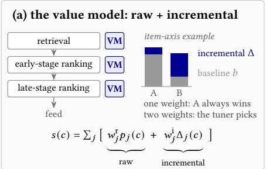
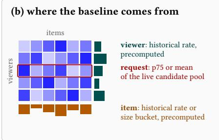
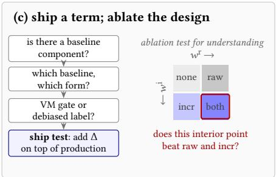
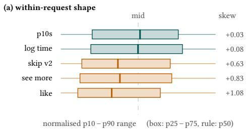
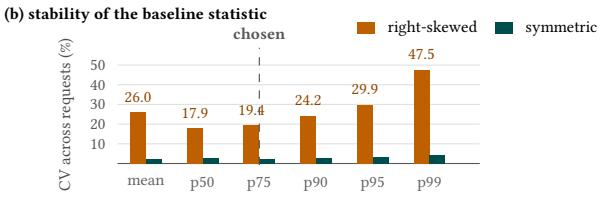
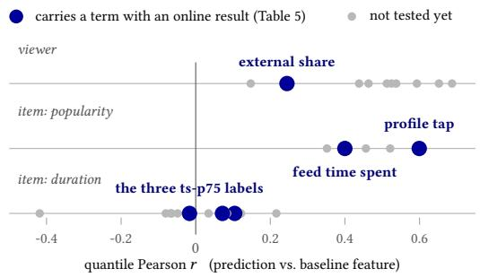

# Baseline and Incremental: User, Item, and Request Debiasing in Instagram Feed Ranking

Hsin-Chiang Chen∗, Hao Wang∗, Gedi Zhou†, Mingze Gao, Abhishek Kumar, Yiben Yang, Haoyu Wang, Hongjing Xia, Bo Chen, Zhengyu Su, Xian Sun, Chang Xu, Kevin Han‡, Weiwei Li, Zhongchang Sun, Yao Zhang, Qifei Wang, Peggy Yang, Yihan Wu, Haoran Liu, Siyang Sun, Xingyu Pan‡, Shannon Phu, Haoming Chen, Kevin Zhao, Chen Liang

Meta

USA

{hsinchiangchen, wangh, gedi, gaomingze, abi, yibenyang, hwang420, hjx, chenbo, zhengyu, xiansun, changxu109, kevinwh, weiweili90, zsun16, yaozhang, qifeiw, peggyy, yihanwu, ryan0814, siyangsun, xingyupan, shannonphu, haomingc, kevinzhao, cliang7}@meta.com

  
Fi ure 1: Overview of our methodolo . (a) Retrieval and earl - and late-sta e rankin each score candidates with a value model (VM), a weighted sum of predictions, each prediction mixing a baseline � with the candidate’s incremental excess Δ. We keep the raw rediction and ive Δ its own wei ht with no new model. (b) Viewer and item baselines are recom uted historical rates (the row and column averages of the grid); the request baseline is read from the live candidate pool. (c) One online test ships one point; a separate four-arm ablation tests the two-term form.

## Abstract

A feed ranker scores candidates with a value model, a weighted sum of engagement predictions. Each prediction conflates a baseline, what this viewer, item or request would produce anyway, with the incremental amount by which this candidate exceeds it. The literature mostly removes the baseline. We argue that a multi-signal value model should keep the raw prediction and add the incremen- tal part as a separately weighted term. On Instagram Feed, three debiasing families deployed independently, for viewer habit, item popularity and request context, are one parameterised operator, and a design procedure picks a point in it. Media-type (format) bias goes instead to a debiased label chosen by the same procedure. In a controlled four-arm ablation of deployed Feed terms (neither term, each alone, both), the two-term arm beats both single-term arms at production weights on point estimates in 11 of 13 judged (term, metric) pairs. Of the 26 direct contrasts, 17 are significantly for it and only 1 against it, on impressions. The ablation also suggests that the ofline diagnostic should screen signals, not rank them. Such terms have served Instagram Feed production for most of a year. Beyond Feed, Meta, whose apps serve billions of people, has adopted the operator across surfaces, apps and both ranking stages. Its launches there drive sessions and daily active users, the core visitation and retention metrics.

## CCS Concepts

• Information systems → Recommender systems; Learning to rank.

## Keywords

recommender systems, debiasing, value models, feed ranking, on- line controlled experiments, popularity bias

## 1 Introduction

Instagram Feed scores each candidate � with a value model (VM), a weighted sum

$$
s ( c ) = \sum _ { j } w _ { j } p _ { j } ( c )\tag{1}
$$

of engagement predictions $\hbar \boldsymbol { j }$ . Its weights are tuned against a few north-star metrics by online Bayesian optimisation [12, 22]. The deployed VM also multiplies some groups of terms, a structure we set aside here. Tuned combinations of such predictions are standard at scale [6, 42], and each $\boldsymbol { \mathscr { P } } \boldsymbol { j }$ comes from a large learned model [10, 27]. Value models of this kind decide what people see on many major social and content platforms. How they weigh their signals is a central problem of Web-scale recommendation.

Each $\boldsymbol { \mathscr { P } } \boldsymbol { j }$ conflates a baseline component, the level this viewer, item or request would produce anyway, with an incremental com-ponent, this candidate’s excess over it. On Instagram Feed, the like prediction has a rank correlation of 0.69 with the viewer’s own historical like rate (Table 2): much of it tracks the viewer’s habit, not the candidate. In a sum of many signals, that habit gives like extra weight on every candidate this viewer sees, whatever the candidate adds. We say viewer for the user side throughout.

The literature mostly removes the baseline, and the methods that keep part of it lack a general account of why (§2). We argue that removal is the wrong default here: in a four-arm ablation of 6 de- ployed terms, neither the raw nor the incremental term is redundant at production weights. We show that the three debiasing families deployed on Feed (viewer, item and request baselines) are one parameterised operator with four design choices. Figure 1 summarises the argument. Instagram Feed is our case study throughout.

Contributions. 1. The baseline is not a defect but a second signal that needs its own weight (§3). A habitual liker’s likes are real engage-ment, and a broadly loved post deserves reach. But one coeficient � cannot trade the two components of, and the right trade-of is unknown a priori and difers by signal. We keep the raw prediction and weight the incremental part separately:

$$
s ( c ) = \sum _ { j } \Big [ \underbrace { w _ { j } ^ { \mathrm { r } } p _ { j } ( c ) } _ { \mathrm { r a w } } + \underbrace { w _ { j } ^ { \mathrm { i } } \Delta _ { j } ( c ) } _ { \mathrm { i n c r e m e n t a l } } \Big ] .\tag{2}
$$

2. One operator, three baselines (§3). The viewer and item baselines are historical averages, one per viewer and one per item; the request baseline is read from the live candidate pool. They measure diferent things, so the three coexist in one VM. Published methods sit along the operator’s axes (Table 1).

3. A design procedure (§4) that turns a computationally cheap ofline diagnostic into a build decision. It settles whether a signal needs the split, which baseline and functional form to use, whether to intervene at scoring or label time, and what the term costs to serve.

4. A controlled ablation (§5–§6). We report the Feed deployment record, then four-arm live experiments that isolate the raw term, the incremental term and both, on 6 deployed terms. They confirm two preconditions of the ofline diagnostic (§7). Beyond Feed, the operator has been adopted across Meta’s ranking surfaces (§8).

Setting. Feed mixes posts from followed accounts (connected content) with recommendations. Retrieval and early- and late-stage ranking all score candidates with value models (Figure 1(a)). We study late-stage ranking, which scores a few hundred candidates per request, and two of its value models. MainRank orders the bulk of the feed and TopRank fills the top of a session. A multi-task model predicts each signal as a probability or as a regression target such as expected time spent. The operator branches only on this distinction. The VM is a formula, not a learned function, so a new term is a configuration change that ships in hours and reverts as fast. A scoring-time intervention therefore costs far less to build and test than a modelling one. Every term is evaluated in a live randomised experiment. Because the weights are tuned jointly, a new term perturbs the operating point of every other.

## 2 Related Work

Removing the baseline. Most debiasing work treats the baseline as a confounder to remove. Inverse propensity weighting corrects selection bias in recommender feedback [33] and examination bias in learning-to-rank [1, 3, 16]. Logit adjustment subtracts a scaled log class prior [26], and causal methods deconfound popularity and related biases [8]. Industrial rankers remove the baseline at serving time. PAL and YouTube’s shallow tower drop their learned position part [14, 42], LAFB divides each rating prediction by its mean given viewer–item familiarity [31], and AlignPxtr replaces each by its biasconditional deviation or quantile [24]. Label-side methods, DVR and RAD, instead train on duration- or cohort-relative watch-time targets [25, 43].

Keeping part ofit. PDA multiplies a forecast popularity factor back in at inference [40], TIDE keeps a benign quality component [41], and DICE sums interest and conformity scores [44]. Oth-ers keep the raw score beside a weighted second term. MACR subtracts a scaled learned bias [35], PPAC adds weighted popularity terms [28], and DecRS and CD2AN blend biased and debiased scores convexly [9, 34]. Collaborative filtering has long carried additive viewer and item baselines [17, 18]. In each, the kept term is a device of the particular model. None gives a general account of why a raw term should stay beside an incremental one, or explores the design space of §3 (Table 1). DecRS and PPAC compare the combined score with its parts ofline [28, 34], CD2AN deployed its two endpoints separately online [9], and the four arms here are tested on live traffic. Closest are MBD [23] and, on YouTube Shorts, FLVM [7]. MBD learns cohort baselines in a ranking-model branch and can add a hinge on the standardised gap to the VM score. FLVM learns a baseline branch over duration, viewer propensity and session context; the two paths are complementary ofline, but only the latent score is served. Both are model-based and adopted by training a ranking model. The scoring-time terms here are instead VM features that go to test as configuration changes, at essentially no capacity cost.

Table 1: Published methods in the design space of Eq. 3. Raw at serving is dropped if the bias factor is removed or its features set to missing, and replaced if a debiased target or score stands in.
<table><tr><td>Method</td><td>baseline b</td><td>scale d</td><td>raw at serving</td></tr><tr><td>Logit adj. [26]</td><td>class prior</td><td>logit – log prior</td><td>yes, − τ log π</td></tr><tr><td>PDA [40]</td><td>item popularity</td><td>mult. (power)</td><td>re-injected</td></tr><tr><td>MACR [35]</td><td>viewer, item branch</td><td>raw gap</td><td>yes, −c b</td></tr><tr><td>PPAC [28]</td><td>pers./global pop.</td><td>additive</td><td>yes, +γ, β</td></tr><tr><td>PAL [14]</td><td>position</td><td>mult. factor</td><td>dropped</td></tr><tr><td>Shallow tower [42]</td><td>position</td><td>additive logit</td><td>dropped</td></tr><tr><td>D2Q [37]</td><td>duration group</td><td>group CDF</td><td>re-mapped</td></tr><tr><td>DML [39]</td><td>dur./viewer/item group</td><td>percentile labels</td><td>replaced</td></tr><tr><td>LAFB [31]</td><td>familiarity</td><td>ratio</td><td>replaced</td></tr><tr><td>FLVM [7]</td><td>dur./viewer/session</td><td>additive logit</td><td>replaced</td></tr><tr><td>MBD [23]</td><td>learned cohort</td><td>std. gap</td><td>yes; + in one form</td></tr><tr><td>This work</td><td>viewer/item/request</td><td>logit or raw</td><td>yes, two weights</td></tr></table>

Labels, lists and evaluation. The deployed bucketised labels follow DML’s duration-group long-view label [39], a thresholded form of D2Q’s within-duration quantile [37]. We add a rule for when such a label is worth its cost over a scoring-time gate. Scoring a candidate against its own result list is familiar from query-level feature normalisation [30], Yahoo’s list-statistic re-ranker [36] and learned listwise re-rankers [2, 29]. Our request baseline is one statistic of the same prediction, computationally cheap enough to sit in the VM as a separately weighted term. Uplift and causal-embedding methods target the causal efect of a recommendation or outcomes under random exposure [5, 32]; our incremental term is a lighter-weight observational relative that makes no causal claim. Whether ofline evaluation predicts online outcomes is a long-standing concern [10, 13, 15, 19], and efects read at launch are biased upward by the selection that launched them [20]. Sections 6–7 add a per-term view: each term and its raw counterpart are ablated online.

## 3 One Operator, Three Baselines

Fix a signal with prediction $\boldsymbol { p }$ and a baseline � estimated from the viewer, the item or the request. The incremental term of Eq. 2 is

$$
\Delta \ = \ m ( p , b ) \Big [ \sigma \big ( k \cdot d ( p , b ) \big ) \ - \ \mathrm { s h i f t } \Big ] , \qquad \sigma ( x ) = \textstyle \frac { 1 } { 1 + \mathrm { e } ^ { - x } } ,\tag{3}
$$

where the magnitude $m ( p , b )$ is the prediction itself, the gap $e =$ $\begin{array} { r } { p - b , } \end{array}$ or a constant. Every deployed scoring-time term we discuss is an instance of $\operatorname { i t } ,$ with the comparison reversed for demotions. Four choices fix an instance: the baseline $b ,$ the comparison scale �, the magnitude $m ,$ and the sharpness and centring (�, shift). Eq. 2 places Δ additively. Where a term was also tried multiplicatively on the same signal, gating a group of VM terms, the trade-of difered. Placement is a fifth degree of freedom, which we do not study.

The baseline �. A viewer baseline is the viewer’s historical rate for this action. An item baseline is the item’s rate across viewers (popularity bias) or a structural attribute that mechanically inflates the signal (media-type bias). That attribute is the format and, within it, its size, such as video duration. The two biases are routed difer- ently in §4.4. A request baseline is a statistic of the predictions over the request’s candidates, its batch.

The comparison scale �. For probabilities $d = \log \mathrm { i t } ( p ) - \log \mathrm { i t } ( b )$ A regression signal is compared in its own unit, $d = { \hat { y } } - b \colon$ : the time-spent gates compare predicted with average seconds. The choice matters only at finite � (§3.2). We use the logit because most per-viewer rates are tiny and log-odds resolve that tail. A second reason is that base rates difer widely across signals, while a unitless log-odds gap is comparable across signals under one �.

The magnitude �. With $e = p - b ,$ , promotion terms use $m = p ,$ which keeps rewarding a strong candidate in a strong reference class, or $m = e ,$ which is purely relative and zero at the baseline. De motion gates cannot use $m = p ,$ which vanishes at the floor, exactly where the penalty should bite. They use a constant magnitude with the comparison reversed, $- C \sigma \big ( \boldsymbol { k } \cdot d ( \boldsymbol { b } , \boldsymbol { p } ) \big )$ , whose factor grows the further the candidate sits below �. A demotion hinge uses $m = e ,$ i.e. min $( 0 , e )$ . Missing this asymmetry is a common error when a promotion term is adapted into a demotion.

� and shift. With a positive magnitude, shift = 0.5 gives a signed term that is zero at the baseline, and shift = 0 a one-sided boost. For �, test $k = 1$ and the hard-threshold limit $k $ ∞ first. Where an intermediate slope was tried against $k = 1$ , it did not win, and every deployed term sits at one of the two. By Theorem 3.2 they are two settings of the one dial $k ;$ the deployed hinge and gate also difer in �.

Hinge and gate. The deployed linear hinges � max(0, �) sit at $( m , k , \mathrm { s h i f t } ) = ( e , \infty , 0 )$ . The deployed sigmoid gates � � $\sigma ( k d )$ sit at $k = 1 \mathrm { ,  s h i f t } = 0 \mathrm { , }$ with � the prediction itself: ${ \boldsymbol { p } } ,$ or a regression prediction �ˆ in its own unit. Hinge and gate difer in two coordinates, � and �. The hinge is the limit of the same-magnitude gate $e \sigma ( k e )$ not of the deployed one (Theorem 3.2). Hinge and gate terms are thus treated as one family in $\ S 6 ,$ but � and � are separate choices: the two deployed time-spent gates share $b , d$ and � and difer in �.

Deployed instances. Typical deployed scoring-time forms are

$$
\Delta = { \hat { p } } \sigma \big ( \mathrm { l o g i t } p - \mathrm { l o g i t } b \big ) , \quad \Delta = m \sigma \big ( { \hat { y } } - b \big ) , \quad \Delta = \mathrm { m a x } ( 0 , p - b ) .
$$

All have shift = 0. The first gates a probability on the log-odds gap $( m = p , k = 1 ) ;$ the second, a regression output � mapped back to its own unit as $\hat { y } ( d = \hat { y } - b , k = 1 , m = p$ or �ˆ); the third is a hinge $( m = e , k \to \infty )$ . The studied terms take these forms (§5), except one that is a debiased label.

## 3.1 Why two terms and three baselines

How a baseline acts. An item baseline varies across a request’s candidates and reorders them on the signal itself. A viewer or request baseline is constant within a request, so Δ keeps the order of $\dot { \boldsymbol { p } }$ among the candidates it applies to. It acts by reweighting the signal against the VM’s other signals, request by request, and by crediting candidates above � more than those below.

Why the raw term stays. The comparison inside Δ ignores the common level of� and �: � is bounded and reads only where a can- didate sits relative to $b .$ The level of $\mathcal { P }$ thus reaches Δ only through �, and not at all at $m = e ,$ which sees only the gap $\dot { p } - b .$ . Ranking on Δ alone can therefore fail on each axis. A heavy liker’s genuine like, modestly above a high baseline, earns only part of its weight against the viewer’s other signals. A fluke watch on a short clip outranks a good long video that merely meets its duration base- line. The best candidates of a weak and a strong request are gated alike. The raw term is where the level enters unconditionally. With two independent weights, the tuner can sit anywhere between the purely raw and purely incremental endpoints rather than commit to one. This is the a-priori argument §6 tests.

Why three baselines. The viewer and item baselines are historical per-viewer and per-item averages. The request baseline is read from the live candidate pool of one (viewer, session), so it tracks what that pool contains. A viewer’s gap between connected and unconnected content, for instance, is invisible to both averages. Yet in a connected-heavy request it raises the level of a batch that pools both kinds, against which an unconnected candidate is read.

The request axis carries two efects. Batch-strength bias arises across requests: the same score is exceptional in a weak request and ordinary in a strong one. Composition bias arises within a request, from its mix of candidates, as in the connected example. A statistic of the request’s own predictions tracks both. Targeting diferent quantities, the three terms are additive and coexist on one signal. They overlap rather than conflict, and joint tuning resolves it.

## 3.2 Three properties of the operator

The results below concern the score we construct and make no observational baseline causal. Parts of them are known in other literatures. Theorem 3.1 is an instance of maximal invariance [21], Theorem 3.2(i) is the binary case of entropy-regularised prediction [4], and $~ e \sigma ( k e ) ~ = ~ \mathrm { S i L U } ( k e ) / k$ is a rescaled SiLU unit [11]. Proofs are in Appendix A. The $O ( 1 / k )$ bound of Theorem 3.2(ii), with constant ≈ 0.278, appears in [38]. What is ours is the reading of each for ranking.

Theorem 3.1 (The logit gap is a maximal invariant). Let $T _ { a } ( x ) = \sigma { \big ( } \log \mathrm { i t } ( x ) + a { \big ) }$ shift the log-odds by $a \in \mathbb { R } . A$ comparison $D : ( 0 , 1 ) ^ { 2 } \to { \mathbb R }$ satisfies

$$
D \big ( T _ { a } ( p ) , T _ { a } ( b ) \big ) = D ( p , b ) \quad f o r e \nu e r y a \in \mathbb { R }
$$

if and only if

$$
D ( p , b ) = h { \big ( } \log \mathrm { i t } ( p ) - \log \mathrm { i t } ( b ) { \big ) }
$$

for some $h : \mathbb { R }  \mathbb { R } .$

Discussion. The logit gap carries everything a shift-invariant comparison can use, for any base rate, so gates on probabilities compare in log-odds; the ratio $\hbar / b$ is not invariant. Invariance to a common rescaling or translation gives log ${ \hat { y } } - \log b \ \mathrm { o r } \ { \hat { y } } - b$ for regression signals. At � → ∞ every scale collapses to $1 \{ d > 0 \}$ , so the scale of� matters only at finite �. A hinge’s raw-unit magnitude $m = e$ keeps the two terms of Eq. 2 commensurate.

Theorem 3.2 (The gate is a regularised threshold, the hinge its limit). (i) For an advantage $d \in \mathbb { R }$ and a temperature $\tau > 0 ,$ , the objective

$$
J _ { \tau } ( g ; d ) = g d - \tau D _ { \mathrm { K L } } \big ( \mathrm { B e r n } ( g ) \| \mathrm { B e r n } ( 1 / 2 ) \big ) , \qquad 0 < g < 1 ,
$$

is strictly concave in �, with unique maximiser $g ^ { \star } = \sigma ( d / \tau )$

(ii) For fixed � and every comparison � $\neq 0 ,$

$$
m \sigma ( k d ) \xrightarrow [ k \to \infty ] { } m \cdot 1 \{ d > 0 \} .
$$

At $m = d = e$ the gate $H _ { k } ( e ) = e \sigma ( k e )$ tends uniformly to the hinge $H _ { \infty } ( e ) = \operatorname* { m a x } ( 0 , e ) .$

$$
\operatorname* { s u p } _ { e \in \mathbb { R } } \left| H _ { k } ( e ) - H _ { \infty } ( e ) \right| = \frac { \mathrm { W } ( 1 / \mathrm { e } ) } { k } < \frac { 0 . 2 7 9 } { k } ,
$$

with W the Lambert � function and e Euler’s number.

(iii) At every � the promotion and demotion forms partition the gap,

$$
\begin{array} { r } { e \sigma ( k e ) + e \left( 1 - \sigma ( k e ) \right) = e , } \end{array}
$$

mirroring max $( 0 , e ) + \operatorname* { m i n } ( 0 , e ) = e .$

Discussion. Part (i) makes $k = 1 / \tau$ an inverse temperature. By part (ii), � sets the limit: the hinge at $m = e , \mathrm { a }$ flat −� demotion at constant �, and a jump of size � at the baseline for the deployed gates. So � and � are separate choices. A same-magnitude gate and hinge difer only within a few multiples of $1 / k$ of the baseline. A logit gap therefore suits $k = 1 _ { : }$ , while a raw probability gap, often below $1 0 ^ { - 3 }$ , needs a very large �.

Let � and � list one signal’s $p ( c )$ and Δ(�) over the candidates C of a set of requests. With the rest of the VM fixed, the raw weight alone and both weights reach

$$
S _ { \mathrm { r a w } } = \{ \alpha P : \alpha \in \mathbb { R } \} , \qquad S _ { \mathrm { b o t h } } = \{ \alpha P + \beta Q : \alpha , \beta \in \mathbb { R } \} .
$$

Algorithm 1 Designing a term for a signal’s prediction �.   
1: Step 1 (viewer, item; §4.1): quantile � and Var% of � vs. each baseline (strong:   
� ≥ 0.5, Var% ≥ 20%; weak: � < 0.2, Var% < 10%)   
2: a weak � on a sparse feature (zero share > 60%) is unresolved: lower its priority,   
do not discard it   
3: Step 2 (viewer, item; §4.2): estimate � as a rate or a format-and-size bucket; choose   
its window and clamp   
4: Step 3 (request; §4.3): measure the within-request shape   
5: right-skewed: promote ∼p75, linear hinge; demote p10/p25, sigmoid gate   
6: symmetric: promote p75/p90, linear hinge; demote p10/p25, linear hinge   
7: Step 4 (item; §4.4): popularity bias → VM term; media-type bias → debiased label   
8: Step 5 (all; §4.5): check the cost; add Δ at one point $( b , d , \hat { m } , k ,$ shift) to production   
and test it

Table 2: [Ofline] Viewer-axis diagnostics. “Zero” is the share of impressions with a zero feature, on which the clamp binds. Var% is computed against the prediction. Feed time spent has no zero share because its feature is in seconds.
<table><tr><td>signal</td><td>quantile r</td><td>zero %</td><td>Var%</td><td>n</td></tr><tr><td>like</td><td>+0.687</td><td>6</td><td>22.0</td><td>2.90M</td></tr><tr><td>comment_tap</td><td>+0.652</td><td>15</td><td>17.3</td><td>2.89M</td></tr><tr><td>reshare_select_recipient</td><td>+0.593</td><td>40</td><td>45.4</td><td>2.67M</td></tr><tr><td>reshare_button_tap</td><td>+0.538</td><td>21</td><td>16.6</td><td>2.89M</td></tr><tr><td>profile_tap</td><td>+0.525</td><td>8</td><td>9.3</td><td>2.90M</td></tr><tr><td>save</td><td>+0.512</td><td>43</td><td>17.4</td><td>2.67M</td></tr><tr><td>comment</td><td>+0.463</td><td>64</td><td>26.5</td><td>2.89M</td></tr><tr><td>feed_time_spent</td><td>+0.438</td><td>一</td><td>48.3</td><td>1.56M</td></tr><tr><td>external_share</td><td>+0.245</td><td>89</td><td>2.7</td><td>2.67M</td></tr><tr><td>follow</td><td>+0.148</td><td>71</td><td>9.8</td><td>2.67M</td></tr></table>

Ranking within a request is unchanged by adding any vector that is constant within each request; let K be the subspace of such vectors.

Theorem 3.3 (The two-term form is strictly more expressive).

$$
S _ { \mathrm { r a w } } + \mathcal { K } \subseteq S _ { \mathrm { b o t h } } + \mathcal { K } , \quad w i t h e q u a l i t y i f f \in \mathrm { s p a n } ( P ) + \mathcal { K } .
$$

Hence, with the rest of the VM fixed and weights of either sign, the two-term form reaches score vectors, and generically rankings, that no reweighting of the raw term reaches.

Discussion. Viewer and request baselines are constant within a request, so a linear $\Delta = p - b$ applied to every candidate ranks exactly like a larger raw weight; only the gate or hinge nonlinearity takes � outside span $( P ) + \mathcal { K }$ . On the item axis a linear Δ gives MACR’s raw-minus-weighted-baseline inference and PPAC’s global-popularity term [28, 35]. Because � and the hinge are nonlinear, � ∉ span $( P ) + \mathcal { K }$ generically, which is checkable on logged candidates. The theorem says raising the raw weight is not an equivalent parameterisation, not that a fixed two-term setting is better or the production point a good one. The direct both − raw and both − incremental contrasts of §6 test that.

## 4 The Design Procedure

Eq. 3 says what is expressible. The steps below, summarised in Algorithm 1, choose a point in it for a new signal, and each names the axes it applies to. On the request axis the shape measurement of Step 3 replaces Step 1 but decides only how to build the term.

## 4.1 Step 1 (viewer, item): is the split needed?

The quantile Pearson � correlates the decile-bucket indices of a signal’s prediction and its baseline feature. This rank statistic is needed because some baseline rate features carry non-physical values above 1.0. Raw Pearson is not interchangeable, as our bands (Algorithm 1) are calibrated on the rank form. A high � means the prediction tracks the baseline rather than anything candidate- specific. A variance ratio, $\mathrm { V a r } \% = \mathrm { V a r } ( b ) / \mathrm { V a r } ( y )$ for � the label or the prediction, measures the dependence’s magnitude, � its shape. Their agreement makes a reading reliable. Both are computed on one week of candidate-level ranking logs, a 1% block-level sample. Quantile correlations move by about ±0.01 between runs.

Var% needs proxy and target to share construct and units. This rules it out for implicit signals labelled on a diferent surface from the feature and for binary labels against a feature in seconds. We report it on the viewer axis only: on the item axis three signals exceed 100%, a precondition violation, not a property of the signals.

The base rate shapes the reading. Frequent actions read highest: like and comment tap, the commonest, lead Table 2, and follow, the rarest, reads lowest. A frequent action becomes a reflex, which is what a viewer baseline measures; a rare one leaves too little history to habituate. Part of the pattern is also mechanical: a rare action leaves the viewer feature mostly at zero, which caps how high a rank-based � can go. External share reads low although it is not the rarest action, consistent with its higher friction and a sparse viewer feature (89% zero). The base rate therefore also decides whether the baseline is resolvable. Every logit-scale term clamps its baseline away from 0, and on a sparse feature the clamp binds for most impressions, where the feature says little about the viewer. The share of impressions where it binds, the zero column of Table 2, exceeds 60% for three of nine viewer signals. A weak � on such a signal is unresolved, not weak.

## 4.2 Step 2 (viewer, item): estimating the baseline

On the viewer axis, implicit signals have no rate of their own and share the viewer’s feed time spent as a proxy. On the item axis, a popularity rate needs a minimum-impression guard and is partly a product of the ranker. It is thus a prior, not a causal quantity: one more reason the raw term stays. A media-type baseline comes from the item’s format-and-size bucket (video duration, carousel card count, photo OCR word count). Estimated across items, it is dense where a popularity rate is sparse, which helps §4.4 route it through the label. A historical rate needs an aggregation window, trading noise against staleness. A logit-scale term needs a clamp, setting its behaviour where the feature is empty. Base rate and zero share narrow both, and the final choice is made online.

## 4.3 Step 3 (request): shape selects the statistic

Low-rate binary signals are right-skewed within a request: bounded below by zero with mean at the base rate, they can spread only upward. Log time spent and $\mathcal { P } 1 0 s$ , the predicted probability that time spent on the item exceeds 10 s, are near-symmetric (Figure 2(a)), as are bucketised labels by construction. The floor must be de-skewed: a linear rule gives a skewed signal’s compressed bottom mass nearly identical scores, while a logit gap separates it. A finite-� term on a probability needs this on every axis. A promotion hinge is exempt: it is zero below �, where the floor is compressed (§3.2). The statistic must be stable across requests, a concern only on the request axis, where the baseline comes from a small, fresh sample (Figure 2(b)). For a symmetric signal any statistic will do. For a skewed one the high percentiles are noisy, the tail drags the mean to around percentile 82, and the median sits on the floor. That leaves p75 as the steadiest of-floor statistic. Adding direction gives the rule in Algorithm 1 (lines 5–6). Only one case needs the sigmoid: demoting a right-skewed signal, whose floor-compressed candidates separate only in log-odds.

  
Figure 2: [Ofline] (a) Within-request distributions, each normalised to its own p10–p90 range. (b) Coeficient of variation of each baseline statistic across simulated requests. The simu- lation reproduces the ordering the rule needs but understates absolute instability: real requests vary up to 68× more.

## 4.4 Step 4 (item): VM term or debiased label?

Instead of a VM term, a baseline can be removed from the label: a candidate is positive only if it out-performs its own bucket on the bias dimension. A VM term is a computationally cheap, tunable, reversible configuration change but sees only the score and one baseline feature. A debiased label adds a new predictor and its serving cost, but the model learns the correction and trains on the debiased target. The choice arises only on the item axis and follows the bias present (Table 3). Popularity bias gets a VM term: its baseline is one item-level statistic of the same signal, so a post-hoc gap captures it. The label is undistorted, and for a binary signal a debiased label is ill-defined per impression. Media-type bias gets a label: the distortion is in the label, and a high-cardinality non- linear correction in the VM would entangle with every other term. On a continuous signal, “out-performs its own size class” is well defined. The bucketised labels (§2) take this branch, the model-side exception to the scoring-time terms. The two are not exclusive: a VM term can precede the label.

Table 3: [Ofline] Item-axis diagnostics for popularity (left) and video duration (right). A further 6 duration signals, all with $| r | < 0 . 0 9 ,$ , are omitted.
<table><tr><td>popularity</td><td></td><td>r duration</td><td>r</td></tr><tr><td>profile_tap</td><td>+0.599</td><td>vc_ratio_80</td><td>-0.418</td></tr><tr><td>reshare_button_tap</td><td>+0.521</td><td>log_time</td><td>+0.216</td></tr><tr><td>like</td><td>+0.456</td><td>comment_ts</td><td>+0.121</td></tr><tr><td>follow</td><td>+0.407</td><td> $\mathrm { t s \_ p 7 5 \_ c a r o u s e l \_ v 2 }$ </td><td>+0.105</td></tr><tr><td>feed_time_spent</td><td>+0.400</td><td>reelsiv_chain_view_time</td><td>+0.084</td></tr><tr><td>save</td><td>+0.352</td><td> $\mathrm { t s \_ p 7 5 \_ v i d e o \_ v 2 }$ </td><td>-0.017</td></tr></table>

## 4.5 Step 5 (all axes): cost, and what to ship

Viewer and item baselines are precomputed features with no scoring cost. A request term pays per request, �(�) in the pool size for a mean and �(� log �) for a percentile, computationally cheap for one term but not for every signal. No scoring-time term adds model inference: each reads predictions and features the ranker already computes. Measured latency costs, app-start latency included, are a few milliseconds at most. The procedure ships one point after one test (Algorithm 1, line 8). One arm sufices because the raw term is not in question at ship time. Other points are swept only for signals worth the trafic. The four-arm design of §6 is a separate, retrospective study of whether the two-term form was right at all. No launch answers that question, because none runs the arm without the signal.

## 5 Deployment

The baseline–incremental decomposition has been shipping to Instagram Feed production for most of a year; the six studied terms launched over many months and are all live. Table 4 gives each term’s place in the design space of Eq. 3 and its approval metric. Each term serves all Feed trafic in its ranking stage. All three axes appear, with gates, hinges and debiased labels. The two feed time- spent gates read the same prediction against the same item baseline but difer in magnitude as well as in their VM; they are two related points. Table 5 shows that they behave diferently.

The launch bar is not uniform: a term is approved on the met- ric it was built to move, and the protocol of §6 relies on this. Three of the six (two within a bundle) cleared a significant, replicated foreground-session gain. The see-more term, which predicts whether the viewer taps “See more” to ask for more posts like a recommended one, shipped on +0.63% unconnected post interested ratio at the cost of −0.118% feed time spent. The MainRank gate left sessions flat. It was approved on the rebalancing it produced: +0.665% impressions and +2.21% impressions outside the video viewer, as photos, carousels and shorter content gained position. The three bucketised labels, ablated together, shipped within a larger MainRank restructuring. On their own they contributed +0.447%∗ feed time spent and +0.002% sessions. The table is therefore not a list of independent session wins.

Coverage, not eficacy, is the binding constraint. Of the Feed VM signals, fewer than 20% have a matching viewer-side rate feature, about six have an item-side one, and about five carry a request- level term. Most of the VM cannot be debiased today for want of a baseline, so the computationally cheap diagnostic of §4.1 and its preconditions matter.

## 6 The Ablation

Each term is ablated in a four-arm online experiment on live trafic. The evaluation is online because a VM term’s efect depends on the other terms and on how users respond, which ofline replay cannot measure. Users are randomised, each experiment in its own universe (two share one, with disjoint arms), and each arm gets 3% of trafic. Each delta is computed by one method on one seven-day period, relative to none, with 95% intervals. It was the only week all six experiments were live and ramped; each ran twelve to sev- enteen days. Each experiment crosses the two weights (�r, �i) of Eq. 2, with prod the production weight: none (0, 0), raw (prod, 0), incremental (0, prod) and both (prod, prod). none, the common origin, is the control for every reported delta. both is production for every reported term except that raw was production for extShare · viewer during the measurement window. Its incremental term launched the day after the window closed. As comparators, raw is the status quo without debiasing, incremental the removal de- sign common in the literature (§2), and both ours. both − raw adds the incremental term at its production weight to a VM that already carries the raw term, and both − incremental the converse. Neither single-term arm was re-tuned. This favours both over incremental, whose weight was set beside the raw term. The design thus tests whether either term is redundant at the deployed point, not whether a re-tuned single-term VM could match it. Six experiments were run, one for each term live in production and designed through the procedure of §4.

Evaluation protocol. Judging terms on a full metric panel invites false positives. The six experiments give 270 cells, and 95% intervals alone would flag about fourteen of them by chance. We therefore fixed, per term, the metrics it would be judged on: the criteria it would have been launched on, assigned as in Table 5. No significant cell outside that assignment is used as evidence. For five of the six terms the primary metric is foreground sessions. It is the best available proxy for daily actives and, because a session is a separate act of returning, the hardest to inflate by re-ordering. At Instagram’s scale, even a small relative gain in sessions is practically meaningful. Each term is also judged on its mechanism metric, the behaviour it is built to change. A term whose mechanism metric does not move has not done its job. The two feed time-spent gates are judged on feed time spent and impressions, since shifting attention across candidates of diferent length can cash out as time spent or as impressions. The sixth term, seeMore · req, is a content-quality signal whose launch criterion was the unconnected post interested ratio. It is judged on that alone, hence 13 pairs rather than fourteen. Both of its session contrasts are negative and not significant.

Joint dominance. A (term, metric) pair is jointly dominant when the point estimates satisfy both > raw and both > incremental. Each is read from the direct arm-to-arm contrast, never from a diference of two deltas against none. We use point estimates because sessions’ half-width is about ±0.020% against direct session contrasts of at most about 0.05%, so requiring significance on both contrasts would set aside most session-judged pairs. We report significance throughout, counting significantly positive and negative contrasts separately, so a stricter reader can re-judge.

Table 4: [Online] The six studied terms, all live. Form: the deployed incremental term $\Delta ,$ unweighted (Eq. 3; for bucketTS-p75, debiased labels), coloured by role: prediction, baseline, the comparison that gates it. Elsewhere a term is named signal · axis; TS = time spent, MR/TR = MainRank/TopRank. †Shipped in a bundle; the number is the labels’ own for bucketTS-p75 and the bundle’s for the other two. ∗ as in Table 5.
<table><tr><td>term</td><td>axis</td><td>form</td><td>approved on</td></tr><tr><td>bucketTS-p75† item photo:</td><td></td><td> $\Delta = \hat { P } \big ( t > b _ { \mathrm { w o r d s } } \big ) ;$  carousel:  $\Delta = \hat { P } \big ( t > b _ { \mathrm { c a r d s } } \big ) ;$  video:  $\Delta = \hat { P } \big ( t > b _ { \mathrm { d u r a t i o n } } \big )$  : predicted probability; t: time spent; b: p75 of t in the post&#x27;s bucket of OCR word count, number of cards or duration.</td><td>+0.447%* feed time spent</td></tr><tr><td>logTS-MR</td><td>item</td><td> $\Delta = p \ \sigma ( \hat { t } - b )$ </td><td>+0.665%* impressions</td></tr><tr><td>seeMore</td><td>request</td><td>p: predicted log time spent; t: predicted time spent; b: the post&#x27;s mean time spent per view.  $\Delta = \operatorname* { m a x } \left( 0 , p - b \right)$ </td><td>+0.63%* unconnected post</td></tr><tr><td>logTS-TR</td><td>item</td><td>p: P(viewer taps &quot;See more&quot;); b: mean of p over the request&#x27;s candidates; p and b for unconnected candidates only.  $\Delta = \hat { t } \ \sigma \big ( \hat { t } - b \big )$ </td><td>interested ratio +0.066%* sessions</td></tr><tr><td>p10s†</td><td>request</td><td>t: predicted time spent; b: the post&#x27;s mean time spent per view.  $\Delta = \operatorname* { m a x } \left( 0 , p - b \right)$ </td><td>+0.034%* sessions</td></tr><tr><td>extShare†</td><td>viewer</td><td>p: P(time spent on the post &gt; 10 s); b: p75 of p over the request&#x27;s candidates.  $\Delta = p \ \sigma ( \mathrm { l o g i t } \ p - \mathrm { l o g i t } \ b )$ </td><td>+0.030%* sessions</td></tr></table>

Table 5: [Online] Four-arm ablation. Columns 2–4: each arm relative to none; columns 5–6: the direct contrasts both − raw and both − incr. ∗ marks |� | exceeding the confidence half-width. incr = incremental; JD = joint dominance. Indented rows are the judged (term, metric) pairs of §6.
<table><tr><td></td><td colspan="3">VS. NONE</td><td colspan="2">BOTH -</td></tr><tr><td>metric</td><td>RAW</td><td>INCR</td><td>BOTH</td><td>RAW</td><td>INCR JD</td></tr><tr><td>p10s·req</td><td></td><td></td><td></td><td></td><td></td></tr><tr><td>sessions</td><td>+0.029%*</td><td>+0.035%*</td><td>+0.047%*</td><td>+0.018%</td><td>+0.012% √</td></tr><tr><td>feed time spent</td><td>+1.286%*</td><td>+0.695%*</td><td>+1.650%*</td><td>+0.359%*</td><td>+0.948%* V</td></tr><tr><td>logTS-MR · item</td><td></td><td></td><td></td><td></td><td></td></tr><tr><td>sessions</td><td>+0.054%*</td><td>+0.042%*</td><td>+0.083%*</td><td>+0.029%*</td><td>+0.040%* √</td></tr><tr><td>feed time spent</td><td>+0.203%*</td><td>+0.196%*</td><td>+0.353%*</td><td>+0.150%*</td><td>+0.157%* √</td></tr><tr><td>impressions</td><td>-0.103%*</td><td>+0.773%*</td><td>+0.639%*</td><td>+0.743%*</td><td>-0.132%*</td></tr><tr><td>bucketTS-p75 ·item</td><td></td><td></td><td></td><td></td><td></td></tr><tr><td>sessions</td><td>+0.045%*</td><td>+0.001%</td><td>+0.053%*</td><td>+0.007%</td><td>+0.052%* √</td></tr><tr><td>feed time spent</td><td>+0.174%*</td><td>+0.182%</td><td>+0.318%*</td><td>+0.143%</td><td>+0.135%* V</td></tr><tr><td>logTS-TR · item</td><td></td><td></td><td></td><td></td><td></td></tr><tr><td>sessions</td><td>-0.008%</td><td>+0.007%</td><td>+0.001%</td><td>+0.009%</td><td>-0.007%</td></tr><tr><td>feed time spent</td><td>-0.002%</td><td>+0.200%*</td><td>+0.216%*</td><td>+0.218%*</td><td>+0.017% √</td></tr><tr><td>impressions</td><td>-0.036%</td><td>-0.041%*</td><td>-0.022%</td><td>+0.015%</td><td>+0.019% √</td></tr><tr><td>extShare ·viewer</td><td></td><td></td><td></td><td></td><td></td></tr><tr><td>sessions</td><td>+0.047%*</td><td>+0.067%*</td><td>+0.088%*</td><td>+0.041%*</td><td>+0.021%* √</td></tr><tr><td>ext. share</td><td>+31.32%*</td><td>+43.63%*</td><td>+58.97%*</td><td>+21.05%*</td><td>+10.68%* √</td></tr><tr><td>seeMore·req</td><td></td><td></td><td></td><td></td><td></td></tr><tr><td>unconnected post +1.241%* interested ratio</td><td></td><td>+1.495%*</td><td>+1.929%*</td><td>+0.681%*</td><td>+0.427%* V</td></tr></table>

Results. Of the 13 (term, metric) pairs, 11 are jointly dominant (Table 5). Each of the 6 terms is jointly dominant on at least one of its metrics, and 4 of 6 on all of them. Of the 26 direct contrasts, 17 are significantly positive and 1 is significantly negative. The positive side includes +21.05% on external shares and +0.359% on feed time spent, against arms that already carry one of the two terms at production weight. Power difers by metric family. On the mechanism metrics, 12 of 16 contrasts are significantly positive. On sessions, 5 of 10 are, and 4 of the 5 session-judged terms are jointly dominant on sessions. Session verdicts therefore rest more often on non-significant contrasts.

raw and incremental are restrictions of both, each with one weight set to zero, so both’s reachable set contains them by con- struction. The ablation tests whether the extra degree of freedom is used, that is, whether the interior point, with both weights non-zero, beats both boundary points, each with one weight zero. On 11 of 13 pairs it does: at the deployed operating point neither term is redundant. The 6 terms are a case series, not a sample, so we draw no cross-term rank correlations. Every load-bearing claim sits within one term.

Why not simply raise the raw weight? The objection is that both puts more total weight on the signal than raw, so a re-tuned �r alone might reach the same place. The ablation has four points, not a weight sweep. Theorem 3.3 addresses the formal half. Whether the production point is good rests on how the VM is maintained. Its weights are the standing output of a continuous tuning loop. Each term in Table 4 passed launch review against the full metric panel and its guardrails, and has since been re-examined by boost and ablation experiments. Raising one weight is that loop’s simplest and most frequent experiment. raw at production weight is therefore close to the best the single-term form has reached under the same bar. A lift of �r alone that bought what both buys would likely already have shipped. The argument is local: it says the production point is hard to improve by moving one weight, not that it is globally best. It holds more weakly for �i, new on most of these signals and far less tuned, so if anything the ablation understates the two-term form. Before the four-arm design, earlier viewer-axis experiments ran the sweep this objection asks for: one signal at a time, each debias experiment paired with a matched weight-only one. The debiased arm consistently converted to sessions where the weight-only arm did not.

The two misses. Two of the 13 pairs are not jointly dominant. logTS-TR · item on sessions misses by both − incremental = −0.007%, well inside its half-width, and is jointly dominant on both its mechanism metrics. logTS-MR · item on impressions gives the study’s only significantly negative contrast, both−incremental = −0.132%∗. On impressions the raw term alone is negative (−0.103%∗), while the incremental term alone gives the largest impression ef- fect in the table (+0.773%∗). On feed time spent both single terms are positive and close, and both beats each. The raw term buys time spent; the incremental term changes what is shown, toward shorter and non-video content. This is a real trade-of between two objectives, which separately weighted terms expose and a single coeficient would hide. It is also the trade-of the term launched on: the MainRank gate was approved on impressions, its TopRank counterpart on sessions (Table 4).

  
Figure 3: [Ofline] Every audited signal on its bias axis. Filled markers carry a term tested online. Their outcomes are in Table 5, except for item-axis profile tap, whose term is still being iterated. The bucketised labels (ablated together) are an intervention’s output, so the video label’s � ≈ 0 reflects that intervention working, not a low reading.

## 7 Lessons from Deployment

L1: the procedure’s first choices held. Where Table 5 can check the procedure’s rules, their first choices held. The shape rule of§4.3 puts a p75 promotion hinge on p10s · req, a near-symmetric signal, and the term is jointly dominant on both its metrics. The label rule of §4.4 sends the media-type-biased time-spent family to a bucketised label. bucketTS-p75 · item is jointly dominant on both its metrics, with every feed time-spent arm and contrast significant. Ofline, the video label retains almost no duration correlation (� ≈ −0.017, against +0.216 for the raw log-time prediction; Table 3). The photo and carousel labels are bucketed on dimensions we did not audit, so this check covers one label of three. seeMore · req uses a batch mean where the shape rule prescribes ∼p75. It is jointly dominant on its mechanism metric and converts to nothing on sessions. On the request axis, the one recipe of the rule is the one mechanism-only result.

L2: the VM saturates around a term. A term’s value depends on the VM around it, which keeps moving. logTS-TR · item launched on a replicated +0.066% session win, but in this window its both − raw on sessions is +0.009% (n.s.), its session efects are flat on every arm and its im ression efects nearl so. On feed time s ent the incremental term is still strong (+0.200%∗; both +0.216%∗; both − raw +0.218%∗) and the raw term is at zero (−0.002%, n.s.). The mechanism persists, but its conversion into sessions did not survive eight weeks of VM retuning since launch. A sessions-only read would have called the term useless. The viewer terms on like, re- share recipient and comment, all reading above 0.45, have never produced a stable win, which we attribute, without direct evidence, to weights already tuned against the raw signal. None is in this ablation. Ofline baseline is not scarce on Feed; unsaturated baseline is. L3: screen with the ofline diagnostic, do not rank with it. As triage, the diagnostic did its job: it would not have screened out any tested viewer- or item-axis term in Table 5 (filled markers in Figure 3). One of them read ninth of ten on its axis. Ofline queries are com-putationally cheap and experiment slots scarce, so the ofline stage should be a high-recallfilter, not a ranking. It must not discard a sig-nal that would have worked, and may pass more than will succeed. L4: a reading needs resolvability and headroom. The diagnostic’s two limits, which we anticipated before the ablation and which it con- firmed, should be checked in advance as preconditions alongside the correlation. They change a signal’s priority without discarding it. A sparse baseline feature gives an unresolved reading rather than a genuinely low one (§4.1). The one viewer-axis term in Table 5, significant on all four of its contrasts, is such a signal. Where its rate feature is zero the clamp binds, and the gate becomes a fixed function of �: extra raw weight. Above the clamp it still compares each candidate with the viewer’s own baseline. The clamp level sets the share ofimpressions in each regime, a lever between raw weight and debiasing; both components remain. And a high reading says a baseline component exists, not that the VM still has room to exploit it, as saturation shows. Nor does the diagnostic see a term’s form or the surrounding weights: the two feed time-spent gates share one reading (� = 0.400) yet difer in magnitude and VM (Table 4) and behave diferently in MainRank and TopRank. Coverage is thin (Fig- ure 3) and not concentrated where readings are strongest. Further terms on the untested high-reading viewer signals and the item axis are being tested. The strongest item-axis reading, profile tap, is producing promising early results in an experiment still being iterated on. Until these read out, the quantitative ofline-to-online relationship is open. A study of 6 terms cannot pin it down.

L5: judge time spent where the ranker acts. p10s · req moves overall time spent several times less than feed time spent. bucketTS-p75 · item’s incremental term is significant on feed time spent but not on overall time spent. Overall time spent aggregates surfaces the Feed ranker does not control, diluting real efects, so every time-spent judgement here uses feed time spent.

## 8 More Deployment at Meta

The ablation is confined to Instagram Feed; the operator is not. To show reach, not to evaluate, Table 6 lists a subset of its Reels launches, made over roughly a year, with each launch’s own on- line result, none re-analysed. Both ranking stages and all three axes appear (no weight-only retunes). Furthermore, Threads has launched debiased signals in late-stage ranking, and Facebook is testing debiased terms in ongoing experiments.

## 9 Conclusion

The Instagram Feed deployments argue for separating, not removing, at least at the deployed operating point: keep the raw prediction, weight the incremental part separately, and let the tuner choose. The three debiasing families are one operator with four degrees of freedom, with published methods along its axes. Its baselines coexist because two are historical averages and one is read from the live candidate pool. In a four-arm ablation of 6 deployed terms, at production weights, on point estimates, neither term is redundant in 11 of 13 judged pairs (7 of 13 with both contrasts significant). The transferable lesson: a computationally cheap ofline diagnos- tic should screen signals, not rank them. It says where a baseline component exists; an online test says whether the ranker still has room to exploit it.

Table 6: [Online] A subset of debiasing launches on the Instagram Reels tab. ESR/LSR = early-/late-stage ranking. Sessions and DAU are each launch’s own online result. ∗ is defined as in Table 5.
<table><tr><td>stage</td><td>term</td><td>axis</td><td>approved on</td><td></td></tr><tr><td>LSR</td><td>debiased  $\pmb { \mathcal { P } } \mathrm { l i k e }$ </td><td>viewer</td><td></td><td>+0.083%* sessions, +0.042%* DAU</td></tr><tr><td>LSR</td><td>watch-time gating</td><td>item</td><td></td><td>+0.049%* sessions, +0.026%*DAU</td></tr><tr><td>ESR</td><td>watch-time gating</td><td>item</td><td>+0.029%* sessions</td><td></td></tr><tr><td>ESR</td><td>batch  $\pmb { \mathscr { P } } \mathrm { s a v e }$  champion boost</td><td>request</td><td></td><td>+0.056%* sessions, +0.032%*DAU</td></tr><tr><td>ESR</td><td>log-time gating</td><td>item</td><td>+0.045%* sessions</td><td></td></tr><tr><td>ESR</td><td>Plike against viewer like rate</td><td>viewer</td><td></td><td>+0.075%*sessions, +0.035%*DAU</td></tr><tr><td>LSR</td><td>content-debiased skip demotion</td><td>item</td><td>+0.033%* sessions</td><td></td></tr></table>

## References

[1] Aman Agarwal, Ivan Zaitsev, Xuanhui Wang, Cheng Li, Marc Najork, and Thorsten Joachims. 2019. Estimating Position Bias without Intrusive Interventions. In Proceedings ofthe Twelfth ACM International Conference on Web Search and Data Mining (Melbourne VIC, Australia) (WSDM ’19). Association for Com utin Machiner , New York, NY, USA, 474–482. doi:10.1145/3289600.3291017

[2] Qingyao Ai, Keping Bi, Jiafeng Guo, and W. Bruce Croft. 2018. Learning a Deep Listwise Context Model for Ranking Refinement. In The 41st International ACM SIGIR Conference on Research & Development in Information Retrieval (Ann Arbor, MI, USA) (SIGIR ’18). Association for Computing Machinery, New York, NY, USA, 135–144. doi:10.1145/3209978.3209985

[3] Qingyao Ai, Keping Bi, Cheng Luo, Jiafeng Guo, and W. Bruce Croft. 2018. Unbiased Learning to Rank with Unbiased Propensity Estimation. In The 41st International ACM SIGIR Conference on Research & Development in Information Retrieval (Ann Arbor, MI, USA) (SIGIR ’18). Association for Computing Machinery, New York, NY, USA, 385–394. doi:10.1145/3209978.3209986

[4] Mathieu Blondel, André F. T. Martins, and Vlad Niculae. 2020. Learning with Fenchel-Young Losses. Journal ofMachine Learning Research 21, 35 (2020), 1–69. https://jmlr.org/papers/v21/19-021.html

[5] Stephen Bonner and Flavian Vasile. 2018. Causal Embeddings for Recommendation. In Proceedings of the 12th ACM Conference on Recommender Systems (Vancouver, British Columbia, Canada) (RecSys ’18). Association for Computing Machinery, New York, NY, USA, 104–112. doi:10.1145/3240323.3240360

[6] Fedor Borisyuk, Mingzhou Zhou, Qingquan Song, Siyu Zhu, Birjodh Tiwana, Ganesh Parameswaran, Siddharth Dangi, Lars Hertel, Qiang Charles Xiao, Xiaochen Hou, Yunbo Ouyang, Aman Gupta, Sheallika Singh, Dan Liu, Hailing Cheng, Lei Le, Jonathan Hung, Sathiya Keerthi, Ruoyan Wang, Fengyu Zhang, Mohit Kothari, Chen Zhu, Da i Sun, Yun Dai, Xun Luan, Sirou Zhu, Zhiwei Wang, Neil Daftary, Qianqi Shen, Chengming Jiang, Haichao Wei, Maneesh Varshney, Amol Ghoting, and Souvik Ghosh. 2024. LiRank: Industrial Large Scale Ranking Models at LinkedIn. In Proceedings of the 30th ACM SIGKDD Conference on Knowledge Discovery and Data Mining (Barcelona, Spain) (KDD ’24). Association for Computing Machinery, New York, NY, USA, 4804–4815. doi:10.1145/3637528.3671561

[7] Shuo Chang, Yueqi Wang, Zihuan Diao, Ali Montazer, Jiangguo Zhang, Joyneel Misra, Da en Hon , Tomer Mar olin, Sourabh Bansod, and Nin ren Han. 2026. Mend the Measurement Ga : Latent User Preference Modelin for Short-Form Video Recommendation. In Proceedings ofthe 20th ACM Conference on Recommender Systems (Minneapolis, MN, USA) (RecSys ’26). Association for Computing Machinery, New York, NY, USA, 1291–1297. doi:10.1145/3773078.3831923

[8] Jiawei Chen, Hande Dong, Xiang Wang, Fuli Feng, Meng Wang, and Xiangnan He. 2023. Bias and Debias in Recommender System: A Survey and Future Directions. ACM Transactions on Information Systems 41, 3, Article 67 (2023), 39 pages. doi:10.1145/3564284

[9] Zhihong Chen, Jiawei Wu, Chenliang Li, Jingxu Chen, Rong Xiao, and Binqiang Zhao. 2022. Co-training Disentangled Domain Adaptation Network for Leverag ing Popularity Bias in Recommenders. In Proceedings of the 45th International ACM SIGIR Conference on Research and Development in Information Retrieval (Madrid, Spain) (SIGIR ’22). Association for Computing Machinery, New York NY USA 60–69. doi:10.1145/3477495.3531952

[10] Paul Covington, Jay Adams, and Emre Sargin. 2016. Deep Neural Networks for YouTube Recommendations. In Proceedings of the 10th ACM Conference on Recommender Systems (Boston, Massachusetts, USA) (RecSys ’16). Association for Computing Machinery, New York, NY, USA, 191–198. doi:10.1145/2959100.

2959190

[11] Stefan Elfwing, Eiji Uchibe, and Kenji Doya. 2018. Sigmoid-weighted linear units for neural network function approximation in reinforcement learning. Neural Networks 107 (2018), 3–11. doi:10.1016/j.neunet.2017.12.012

[12] Qing Feng, Samuel Daulton, Benjamin Letham, Maximilian Balandat, and Eytan Bakshy. 2025. Experimenting, Fast and Slow: Bayesian Optimization of Long- term Outcomes with Online Experiments. In Proceedings ofthe 31st ACM SIGKDD Conference on Knowledge Discovery and Data Mining V.1 (Toronto, ON, Canada) (KDD ’25). Association for Computing Machinery, New York, NY, USA, 2235–2246. doi:10.1145/3690624.3709419

[13] Alois Gruson, Praveen Chandar, Christophe Charbuillet, James McInerney, Samantha Hansen, Damien Tardieu, and Ben Carterette. 2019. Ofline Evaluation to Make Decisions About Playlist Recommendation Algorithms. In Proceedings ofthe Twelfth ACM International Conference on Web Search and Data Mining (Melbourne VIC, Australia) (WSDM ’19). Association for Computing Machinery, New York, NY, USA, 420–428. doi:10.1145/3289600.3291027

[14] Huifeng Guo, Jinkai Yu, Qing Liu, Ruiming Tang, and Yuzhou Zhang. 2019. PAL: A Position-bias Aware Learning Framework for CTR Prediction in Live Recommender Systems. In Proceedings ofthe 13th ACM Conference on Recommender Systems (Copenhagen, Denmark) (RecSys ’19). Association for Computing Machinery, New York, NY, USA, 452–456. doi:10.1145/3298689.3347033

[15] Dietmar Jannach and Christine Bauer. 2020. Escaping the McNamara Fallacy: Toward More Impactful Recommender Systems Research. AI Magazine 41, 4 (Dec. 2020), 79–95. doi:10.1609/aima .v41i4.5312

[16] Thorsten Joachims, Adith Swaminathan, and Tobias Schnabel. 2017. Unbiased Learning-to-Rank with Biased Feedback. In Proceedings ofthe Tenth ACM International Conference on Web Search and Data Mining (Cambridge, United Kingdom) (WSDM ’17). Association for Computing Machinery, New York, NY, USA, 781–789. doi:10.1145/3018661.3018699

[17] Yehuda Koren. 2008. Factorization Meets the Neighborhood: a Multifaceted Collaborative Filtering Model. In Proceedings of the 14th ACM SIGKDD International Conference on Knowledge Discovery and Data Mining (Las Vegas, Nevada, USA) (KDD ’08). Association for Computing Machinery, New York, NY, USA, 426–434. doi:10.1145/1401890.1401944

[18] Yehuda Koren, Robert Bell, and Chris Volinsky. 2009. Matrix Factorization Techniques for Recommender Systems. Computer 42, 8 (2009), 30–37. doi:10. 1109/MC.2009.263

[19] Karl Krauth, Sarah Dean, Alex Zhao, Wenshuo Guo, Mihaela Curmei, Benjamin Recht and Michael I. Jordan. 2020. Do Ofline Metrics Predict Online Performance in Recommender Systems? arXiv:2011.07931 [cs.IR]

[20] Minyong R. Lee and Milan Shen. 2018. Winner’s Curse: Bias Estimation for Total Efects of Features in Online Controlled Experiments. In Proceedings ofthe 24th ACM SIGKDD International Conference on Knowledge Discovery & Data Mining (London, United Kingdom) (KDD ’18). Association for Computing Machinery, New York NY USA 491–499. doi:10.1145/3219819.3219905

[21] E. L. Lehmann and Joseph P. Romano. 2005. Testing Statistical Hypotheses (3rd ed.). Springer, New York, NY, USA. doi:10.1007/0-387-27605-X

[22] Benjamin Letham and Eytan Bakshy. 2019. Bayesian Optimization for Policy Search via Online-Ofline Experimentation. Journal of Machine Learning Research 20, 145 (2019), 1–30. https://jmlr.org/papers/v20/18-225.htm

[23] Yuantong Li, Lei Yuan, Zhihao Zheng, Weimiao Wu, Songbin Liu, Jeong Min Lee, Ali Selman Aydin, Shaofeng Deng, Junbo Chen, Xinyi Zhang, Hongjing Xia, Sam Fieldman, Matthew Kosko, Wei Fu, Du Zhang, Peiyu Yang, Albert Jin Chung, Xianlei Qiu, Miao Yu, Zhongwei Teng, Hao Chen, Sunny Baek, Hui Tang, Yang Lv, Renze Wang, Qifan Wang, Zhan Li, Tiantian Xu, Peng Wu, and Ji Liu. 2026. MBD: A Model-Based Debiasing Framework Across User, Content, and Model Dimensions. arXiv:2603.14422 [cs.LG]

[24] Chengzhi Lin, Chuyuan Wang, Annan Xie, Wuhong Wang, Ziye Zhang, Canguang Ruan, Yuancai Huang, and Yongqi Liu. 2025. AlignPxtr: Aligning Predicted Behavior Distributions for Bias-Free Video Recommendations. arXiv:2503.06920 [cs.IR]

[25] Emily Liu, Kuan Han, Minfeng Zhan, Bocheng Zhao, Guanyu Mu, and Yang Song. 2026. Relative Advantage Debiasing for Watch-Time Prediction in Short-Video Recommendation. In Proceedings of the AAAI Conference on Artificial Intelligence (Singapore) (AAAI-26, Vol. 40). AAAI Press, Washington, DC, USA, 15296–15305. doi:10.1609/aaai.v40i18.38555

[26] Aditya Krishna Menon, Sadeep Jayasumana, Ankit Singh Rawat, Himanshu Jain, Andreas Veit, and Sanjiv Kumar. 2021. Long-tail learning via logit adjustment. In International Conference on Learning Representations (ICLR ’21). https:// openreview.net/forum?id=37nvvqkCo5

[27] Maxim Naumov, Dheevatsa Mudigere, Hao-Jun Michael Shi, Jianyu Huang, Narayanan Sundaraman, Jongsoo Park, Xiaodong Wang, Udit Gupta, Carole-Jean Wu, Alisson G. Azzolini, Dmytro Dzhulgakov, Andrey Mallevich, Ilia Cherni avskii, Yinghai Lu, Raghuraman Krishnamoorthi, Ansha Yu, Volodymyr Kon-dratenko, Stephanie Pereira, Xianjie Chen, Wenlin Chen, Vijay Rao, Bill Jia, Liang Xiong, and Misha Smelyanskiy. 2019. Deep Learning Recommendation Model for Personalization and Recommendation Systems. arXiv:1906.00091 [cs.IR]

[28] Wentao Ning, Reynold Cheng, Xiao Yan, Ben Kao, Nan Huo, Nur Al Hasan Haldar, and Bo Tang. 2024. Debiasing Recommendation with Personal Popularity. In Proceedings of the ACM Web Conference 2024 (Singapore, Singapore) (WWW ’24). Association for Computing Machinery, New York, NY, USA, 3400–3409. doi:10.1145/3589334.3645421

[29] Changhua Pei, Yi Zhang, Yongfeng Zhang, Fei Sun, Xiao Lin, Hanxiao Sun, Jian Wu, Peng Jiang, Junfeng Ge, Wenwu Ou, and Dan Pei. 2019. Personalized Re-ranking for Recommendation. In Proceedings ofthe 13th ACM Conference on Recommender Systems (Copenhagen, Denmark) (RecSys ’19). Association for Computing Machinery, New York, NY, USA, 3–11. doi:10.1145/3298689.3347000

[30] Tao Qin, Tie-Yan Liu, Jun Xu, and Hang Li. 2010. LETOR: A benchmark collection for research on learning to rank for information retrieval. Information Retrieval 13, 4 (2010), 346–374. doi:10.1007/s10791-009-9123-y

[31] Zheng Ren, Yi Wu, Jianan Lu, Acar Ary, Yiqu Liu, Li Wei, and Lukasz Heldt. 2026. Learning to Alleviate Familiarity Bias in Video Recommendation. In Companion Proceedings of the ACM Web Conference 2026 (Dubai, United Arab Emirates) (WWWCompanion ’26). Association for Computing Machinery, New York, NY, USA 711–715. doi:10.1145/3774905.3794669

[32] Masahiro Sato, Sho Takemori, Janmajay Singh, and Tomoko Ohkuma. 2020. Unbiased Learning for the Causal Efect of Recommendation. In Proceedings of the 14th ACM Conference on Recommender Systems (Virtual Event, Brazil) (RecSys ’20). Association for Com utin Machiner , New York, NY, USA, 378– 387. doi:10.1145/3383313.3412261

[33] Tobias Schnabel, Adith Swaminathan, Ashudeep Singh, Navin Chandak, and Thorsten Joachims. 2016. Recommendations as Treatments: Debiasing Learning and Evaluation. In Proceedings of The 33rd International Conference on Machine Learning (New York, New York, USA) (Proceedings ofMachine Learning Research, Vol. 48), Maria Florina Balcan and Kilian Q. Weinber er (Eds.). PMLR, 1670–1679. htt s:// roceedin s.mlr. ress/v48/schnabel16.html

[34] Wenjie Wang, Fuli Feng, Xiangnan He, Xiang Wang, and Tat-Seng Chua. 2021. Deconfounded Recommendation for Alleviating Bias Amplification. In Proceedings of the 27th ACM SIGKDD Conference on Knowledge Discovery & Data Mining (Virtual Event, Singapore) (KDD ’21). Association for Computing Machinery, New York, NY, USA, 1717–1725. doi:10.1145/3447548.3467249

[35] Tianxin Wei, Fuli Feng, Jiawei Chen, Ziwei Wu, Jinfeng Yi, and Xiangnan He. 2021. Model-Agnostic Counterfactual Reasoning for Eliminating Popularity Bias in Recommender System. In Proceedings ofthe 27th ACM SIGKDD Conference on Knowledge Discovery & Data Mining (Virtual Event, Singapore) (KDD ’21). Association for Computing Machinery, New York, NY, USA, 1791–1800. doi:10. 1145/3447548.3467289

[36] Dawei Yin, Yuening Hu, Jiliang Tang, Tim Daly Jr., Mianwei Zhou, Hua Ouyang, Jianhui Chen, Changsung Kang, Hongbo Deng, Chikashi Nobata, Jean-Marc Lan glois, and Yi Chang. 2016. Ranking Relevance in Yahoo Search. In Proceedings of the 22nd ACM SIGKDD International Conference on Knowledge Discovery and Data Mining (San Francisco, California, USA) (KDD ’16). Association for Computing Machinery, New York, NY, USA, 323–332. doi:10.1145/2939672.2939677

[37] Ruohan Zhan, Changhua Pei, Qiang Su, Jianfeng Wen, Xueliang Wang, Guanyu Mu, Dong Zheng, Peng Jiang, and Kun Gai. 2022. Deconfounding Duration Bias in Watch-time Prediction for Video Recommendation. In Proceedings ofthe 28th ACM SIGKDD Conference on Knowledge Discovery and Data Mining (Washington DC, USA) (KDD ’22). Association for Computing Machinery, New York, NY, USA, 4472–4481. doi:10.1145/3534678.3539092

[38] Shijun Zhang, Jianfeng Lu, and Hongkai Zhao. 2024. Deep Network Approximation: Beyond ReLU to Diverse Activation Functions. Journal ofMachine Learning Research 25, 35 (2024), 1–39. https://jmlr.org/papers/v25/23-0912.html

[39] Yang Zhang, Yimeng Bai, Jianxin Chang, Xiaoxue Zang, Song Lu, Jing Lu, Fuli Feng, Yanan Niu, and Yang Song. 2023. Leveraging Watch-time Feedback for Short-Video Recommendations: A Causal Labeling Framework. In Proceedings of the 32nd ACM International Conference on Information and Knowledge Management (Birmingham, United Kingdom) (CIKM ’23). Association for Computing Machiner , New York, NY, USA, 4952–4959. doi:10.1145/3583780.3615483

[40] Yang Zhang, Fuli Feng, Xiangnan He, Tianxin Wei, Chonggang Song, Guohui Ling, and Yongdong Zhang. 2021. Causal Intervention for Leveraging Popularity Bias in Recommendation. In Proceedings ofthe 44th International ACM SIGIR Conference on Research and Development in Information Retrieval (Virtual Event, Canada) (SIGIR ’21). Association for Computing Machinery, New York, NY, USA, 11–20. doi:10.1145/3404835.3462875

[41] Zihao Zhao, Jiawei Chen, Sheng Zhou, Xiangnan He, Xuezhi Cao, Fuzheng Zhang, and Wei Wu. 2023. Popularity Bias is not Always Evil: Disentangling Benign and Harmful Bias for Recommendation. IEEE Transactions on Knowledge and Data Engineering 35, 10 (2023), 9920–9931. doi:10.1109/TKDE.2022.3218994

[42] Zhe Zhao, Lichan Hong, Li Wei, Jilin Chen, Aniruddh Nath, Shawn Andrews, Aditee Kumthekar, Maheswaran Sathiamoorthy, Xinyang Yi, and Ed Chi. 2019. Recommending What Video to Watch Next: A Multitask Ranking System. In Proceedings of the 13th ACM Conference on Recommender Systems (Copenhagen, Denmark) (RecSys ’19). Association for Computing Machinery, New York, NY, USA 43–51. doi:10.1145/3298689.3346997

[43] Yu Zheng, Chen Gao, Jingtao Ding, Lingling Yi, Depeng Jin, Yong Li, and Meng Wang. 2022. DVR: Micro-Video Recommendation Optimizing Watch-Time-Gain under Duration Bias. In Proceedings ofthe 30th ACM International Conference on Multimedia (Lisboa, Portugal) (MM ’22). Association for Computing Machinery, New York, NY, USA, 334–345. doi:10.1145/3503161.3548428

[44] Yu Zheng, Chen Gao, Xiang Li, Xiangnan He, Depeng Jin, and Yong Li. 2021. Disentangling User Interest and Conformity for Recommendation with Causal Embedding. In Proceedings of the Web Conference 2021 (Ljubljana, Slovenia) (WWW’21). Association for Computing Machinery, New York, NY, USA, 2980– 2991. doi:10.1145/3442381.3449788

## A Proofs

Proof of Theorem 3.1. If � is invariant, $a = - \log \mathrm { i t } ( b )$ sends � to $1 / 2$ and � to $\sigma \big ( \mathrm { l o g i t } ( p ) - \mathrm { l o g i t } ( b ) \big )$ , so $h ( z ) = D \big ( \sigma ( z ) , 1 / 2 \big )$ works. Conversely, $T _ { a }$ adds � to both logits and leaves their diference unchanged. □

Proof of Theorem 3.2. (i) $\partial J _ { \tau } / \partial g \ = \ d - \tau \log \mathrm { i t } ( g )$ decreases strictly and vanishes only at $g = \sigma ( d / \tau ) . ( \mathrm { i i } )$ The limit is that of $\sigma ( k d )$ . With $t = k | e | , | H _ { k } - H _ { \infty } | = | e | / \big ( 1 + \mathrm { e } ^ { k | e | } \big ) = t / \big ( k ( 1 + \mathrm { e } ^ { t } ) \big )$ maximal where $\mathrm { e } ^ { t } ( t { - } 1 ) = 1 , \mathrm { i . e . } t { - } 1 = \mathrm { W } ( 1 / \mathrm { e } )$ , with value $( t - 1 ) / k$ (iii) is immediate. □

Proof of Theorem 3.3. The inclusion is $\beta = 0 . \mathrm { I f } Q = \gamma P + \kappa$ with $\kappa \in { \mathcal { K } } .$ then $\begin{array} { r } { \alpha P + \beta Q \in ( \alpha + \beta \gamma ) P + \mathcal { K } ; } \end{array}$ conversely, equality gives $Q \in S _ { \mathrm { b o t h } } + \mathcal { K } = S _ { \mathrm { r a w } } + \mathcal { K } = \operatorname { s p a n } ( P ) + \mathcal { K }$ □