# Beyond Scalar Leaderboards: Adaptive Sampling for Pareto Frontier Identification in Multi-Objective LLM Arenas

Liang Twist Shan 1,† Jiahao Ai 2 Zhimei Ren 2,†

1 Department of Statistics, University of Wisconsin-Madison 2 Department of Statistics and Data Science, University of Pennsylvania

## Abstract

The evaluation of large language models (LLMs) is inherently multi-objective, as diferent models may ofer diferent tradeofs across performance dimensions such as math, code, and writing. Because such evaluations are often based on costly and time-consuming human feedback, it is important to draw reliable conclusions using as few comparisons as possible. In this paper, we present Vector-Borda Empirical-Gap Elimination (VB-EGE), a fixed-confidence adaptive sampling algorithm for eficiently identifying models on the Pareto frontier in arena-style evaluation, where each comparison evaluates a pair of models on a prompt with respect to a selected performance dimension. VB-EGE progressively eliminates models from an active set once suficient statistical evidence has been accumulated to certify their Pareto status. Under a multi-objective Bradley–Terry model, we show that VB-EGE returns the correct Pareto frontier with high probability and derive an instance-dependent upper bound on its sample complexity. We further establish a worst-case lower bound showing that VB-EGE is minimax-optimal up to logarithmic factors. Simulations and experiments on three real-world Arena datasets (Arena, SearchArena, and VisionArena) demonstrate VB-EGE’s empirical efectiveness.

## 1 Introduction

Pairwise human-preference judgments have become a standard tool to evaluate large language models (LLMs). In arena-style evaluation, a user submits a prompt, views two responses with the model identities hidden, and selects the preferred response (Zheng et al., 2023; Chiang et al., 2024). Given these pairwise comparisons, a common approach is to fit a statistical model to estimate a latent score for each model, and use the estimated scores to rank the models. But model quality is not one-dimensional: a model preferred for code generation need not be preferred for creative writing or vision (Liang et al., 2023; Frick et al., 2025). How should models be compared without collapsing these tradeofs into a scalar score?

A natural target is the strict Pareto frontier: a model lies outside the frontier only if another model has a strictly higher latent score on every objective. This criterion excludes uniformly inferior models, while retaining models with diferent cross-objective strengths. Identifying this frontier reliably, however, requires costly human-preference comparisons across model pairs and objectives. How should the comparisons be allocated to identify the frontier eficiently? We develop an adaptive sampling procedure that identifies the strict Pareto frontier at a prescribed confidence level while reducing the number of comparisons required. As a preview, Figure 1 presents an application of our method to comparisons from Arena-Human-Preference-140K (Chiang et al., 2024), collected through July 2025. Treating code, math, and Instruction-Following as three objectives, the method identifies three models on the strict Pareto frontier.

## 1.1 Problem formulation

We formalize this task as a fixed-confidence sequential identification problem. Consider $K \geq 2$ candidate models evaluated on d objectives. Suppose that each mode $i \in [ K ] : = \{ 1 , . . . , K \}$ is characterized by an unknown latent score vector $\theta _ { i } = ( \theta _ { i , 1 } , \ldots , \theta _ { i , d } )$ , with larger values indicating better performance along every coordinate.

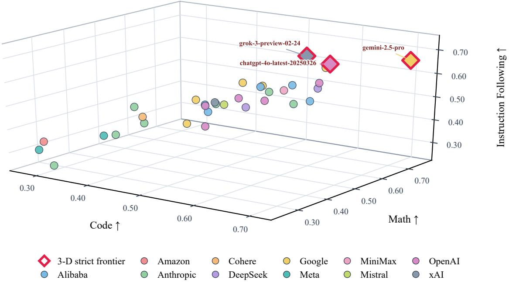  
Figure 1: Three-dimensional comparison along the Code, Math, and Instruction-Following objectives from the Arena-Human-Preference-140K dataset (Chiang et al., 2024). Diamonds denote the strict Pareto frontier.

Let $\mathcal { F } _ { t - 1 }$ denote the observations and algorithmic randomization revealed before round t. At round t, the learner uses a possibly randomized policy based on $\mathcal { F } _ { t - 1 }$ to select a query $Q _ { t } = ( I _ { t } , J _ { t } , R _ { t } )$ , where $I _ { t } , J _ { t } \in [ K ]$ are distinct models to be compared and $R _ { t } \in [ d ]$ indexes the evaluation metric. For each possible query $( i , j , r )$ , let $Y _ { t } ^ { ( r ) } ( i , j ) \in \{ 0 , 1 \}$ denote the potential comparison outcome at round $t ,$ with value 1 indicating that i is preferred over j on objective r. Only the outcome of the selected query is observed: $Y _ { t } : = Y _ { t } ^ { ( R _ { t } ) } ( I _ { t } , J _ { t } )$ Conditional on the past history and the chosen query, the comparison outcome follows the Bradley–Terry (BT) model (Bradley & Terry, 1952):

$$
\mathbb { P } _ { \theta } \left( Y _ { t } = 1 | \mathcal { F } _ { t - 1 } , Q _ { t } = ( i , j , r ) \right) = p _ { i j } ^ { ( r ) } ( \theta ) : = \sigma ( \theta _ { i , r } - \theta _ { j , r } ) , \qquad \mathrm { w h e r e ~ } \sigma ( x ) : = \frac { 1 } { 1 + e ^ { - x } } .\tag{1}
$$

Consequently, $p _ { j i } ^ { ( r ) } = 1 - p _ { i j } ^ { ( r ) }$ ; for convenience, we set $p _ { i i } ^ { ( r ) } = 1 / 2$ . Each query yields a single objective-specific binary label and incurs unit cost. Following Kone et al. (2024, Definition 1), we define the strict Pareto frontier.

Definition 1.1 (Strict Pareto frontier). For a collection of vectors $x = ( x _ { 1 } , \dots , x _ { K } ) \in (  { \mathbb { R } } ^ { d } ) ^ { K }$ , we say that j strictly dominates i and write $i \prec _ { x } j , \mathrm { i f } x _ { i , r } < x _ { j , r }$ for all $r \in [ d ]$ . The strict Pareto frontier of x is

$$
{ \mathcal { P } } ( x ) : = \{ i \in [ K ] : { \mathord { \not \exists } } j \in [ K ] { \mathrm { ~ s u c h ~ t h a t ~ } } i \prec _ { x } j \} .
$$

Remark 1.1. Our strict-dominance convention difers slightly from the standard Pareto convention, under which a model dominates another if it is at least as good in every coordinate and strictly better in at least one coordinate (Auer et al., 2016). This strict convention also has a natural decision-making interpretation: if a user cares only about an objective on which two models are tied, neither model should be discarded on performance grounds; token cost, availability, or other application-specific considerations may instead determine the final choice. From a technical perspective, non-strict dominance requires additional assumptions to handle ties on individual coordinates. Our finite-sample termination guarantee requires all classification gaps defined in Definition 2.2 to be positive, which may fail at coordinate-wise ties.

Accordingly, our goal is to design an algorithm A that adaptively chooses the query $\left( I _ { t } , J _ { t } , R _ { t } \right)$ , stops at a data-dependent time $\tau _ { \mathsf { A } }$ (with $\tau _ { \mathsf { A } } = \infty$ if it never stops), and outputs an estimator $\hat { \mathcal { P } }$ of the strict Pareto frontier ${ \mathcal { P } } ^ { \star } : = { \mathcal { P } } ( { \boldsymbol { \theta } } )$ . For a prescribed error tolerance $\delta \in ( 0 , 1 )$ , we require the algorithm to be δ-correct, i.e., to terminate and return the true frontier with probability at least $1 - \delta .$ , as formalized below.

Definition 1.2 (δ-correctness). Let $\Theta \subseteq ( \mathbb { R } ^ { d } ) ^ { K }$ be an instance class. For $\delta \in ( 0 , 1 )$ , an algorithm A is δ-correct over Θ if, for every $\theta \in \Theta$

$$
\mathbb { P } _ { \theta } \big ( \tau _ { \mathsf { A } } < \infty , \widehat { \mathcal { P } } = \mathcal { P } ( \theta ) \big ) \geq 1 - \delta .
$$

Among δ-correct algorithms, we seek to minimize the number of comparisons needed. Since the stopping time is random, we characterize an algorithm’s sample complexity through its upper quantile. Specifically, for $\alpha \in ( 0 , 1 )$ , define

$$
Q _ { \theta , \alpha } ( \mathsf { A } ) : = \operatorname* { i n f } \left\{ T \in \mathbb { N } _ { 0 } : \mathbb { P } _ { \theta } ( \tau _ { \mathsf { A } } \leq T ) \geq 1 - \alpha \right\} ,
$$

with the convention inf $\mathcal { D } : = \infty$

## 1.2 Our contributions

Our contributions are threefold. First, we formulate fixed-confidence Pareto-set identification under objectivespecific Bradley–Terry feedback and introduce Vector-Borda Empirical-Gap Elimination $\left( V B  – E G E \right)$ , an adaptive sampling procedure for this problem. The key technical insight is an order-preserving reduction from the latent score vectors to vector-Borda scores. Each Borda coordinate is the average win probability of a model against all opponents on a given objective, and the transformation preserves the coordinate-wise ordering of the latent scores—and therefore the strict Pareto set. Moreover, each Borda coordinate can be estimated directly from Bernoulli outcomes by comparing a model with a uniformly sampled opponent. This problem therefore reduces to Pareto-set identification over Kd-dimensional vectors of Bernoulli means. VB-EGE builds on this reduction to adaptively concentrates comparison on models whose Pareto status remains dificult to certify.

Second, we prove that VB-EGE is δ-correct and establish an instance-dependent upper bound on its sample complexity. We further establish a worst-case lower bound over a gap-separated instance class, showing that VB-EGE is minimax-optimal with respect to the number of models, the number of objectives, and the inverse squared classification gap, up to logarithmic factors.

Finally, we evaluate VB-EGE on synthetic Bradley–Terry instances and logged comparisons from three real-world Arena datasets: Arena, SearchArena, and VisionArena. The synthetic experiments confirm the predicted scaling behavior and demonstrate the sample eficiency of VB-EGE. Arena experiments also demonstrate substantial gains in sample eficiency over uniform baselines in realistic settings.

## 1.3 Related work

We review three related literatures, arena-based LLM evaluation, adaptive pairwise comparison, and Pareto set identification, and provide additional discussion on related work in Appendix A.

Arena-based LLM evaluation. Chatbot Arena aggregates human pairwise preferences into scalar model leaderboards (Zheng et al., 2023; Chiang et al., 2024). Subsequent work has improved their statistica stability by modeling ties and score dependence (Ameli et al., 2025), replacing iterative Elo updates with maximum-likelihood estimation and accounting for annotator reliability (Liu et al., 2025), and developing nonparametric ranking and uncertainty quantification (Frauen et al., 2026). Adaptive model-pair selection improves comparison eficiency (Liu et al., 2026), while prompt- or task-specific rankings address heterogeneity (Frick et al., 2025; Li et al., 2026). These methods still produce scalar rankings, either overall or conditional on prompts or tasks. We instead identify the set of models that remain nondominated across multiple objectives.

Pure exploration from pairwise comparisons. Pairwise-comparison methods study winner and ranking identification without directly observing item utilities. Random-opponent comparisons lead to Borda scores and have been used for Borda-winner identification and active ranking (Jamieson et al., 2015; Heckel et al., 2019); simple Borda-type procedures can also be robust beyond parametric Bradley–Terry models (Shah & Wainwright, 2018). More recently, Goldberger & Rudi (2026) developed an asymptotically optimal fixed-confidence method for top-k identification under a latent-utility comparison model.

Beyond these scalar targets, comparison-based methods have also been used for Pareto or skyline recovery. Asudeh et al. (2015) adaptively select criterion-specific crowd comparisons to identify Pareto-optimal objects, Groz et al. (2020) study skyline recovery under noisy coordinate comparisons, and Audifren & Ralaivola (2017) identify maximal arms from dueling feedback over a partial order. Our setting instead considers objective-specific Bradley–Terry comparisons generated by latent utilities and uses an order-preserving vector-Borda reduction for Pareto-set identification.

Pareto set identification. Pareto-set identification has primarily been studied in multi-objective bandits where pulling an arm directly yields a vector-valued observation. Existing work considers approximate and relaxed fixed-confidence recovery (Auer et al., 2016; Kone et al., 2023), fixed-budget identification through Empirical-Gap Elimination and its cost-aware extension (Kone et al., 2024; Xue et al., 2026), and exact fixed-confidence identification with asymptotically optimal allocation (Cr´epon et al., 2024). Structured extensions include preference-cone and multi-output linear models (Karag¨ozl¨u et al., 2024; Kone et al., 2025; Shukla & Basu, 2024; Das et al., 2025). Our elimination rule is closest to (Kone et al., 2024), but our feedback is objective-specific and binary rather than a directly observed vector.

## 2 Vector-Borda Empirical-Gap Elimination (VB-EGE)

In this section, we present our proposed algorithm, VB-EGE, which adaptively allocates the comparisons to identify the Pareto frontier. The algorithm first represents the ordering of the models along each objective coordinate using the Borda scores (to be defined shortly), and then applies the empirical-gap elimination principle (Kone et al., 2024) to the vector of Borda scores to determine the sampling and stopping rule. We first introduce the notation used in the remainder of the paper.

Notation. For any $x \in \mathbb { R }$ , denote $x ^ { + } = \operatorname* { m a x } \{ x , 0 \}$ . For $a , b \in \mathbb { R }$ , write $a \wedge b : = \operatorname* { m i n } \{ a , b \}$ and $a \vee b : =$ max $\{ a , b \}$ . For two nonnegative functions f and g, we write $f = O ( g )$ (or $f \lesssim g )$ if there exists a universal constant $C > 0$ such that $f \leq C g ;$ we write $f = \Omega ( g )$ (or $f \gtrsim g )$ if $g = O ( f ) ,$ and $f = \Theta ( g )$ (or $f \asymp g )$ if both $f = O ( g )$ and $f = \Omega ( g )$ hold. The notation $f = { \tilde { O } } ( g ) , f = { \tilde { \Omega } } ( g )$ , and $f = { \tilde { \Theta } } ( g )$ is defined analogously, up to logarithmic factors. For $p , q \in [ 0 , 1 ]$ , define the binary relative entropy $\begin{array} { r } { \mathrm { k l } ( \tilde { p , q } ) : = p \log { \frac { p } { q } } + ( 1 - p ) \log { \frac { 1 - p } { 1 - q } } } \end{array}$ with the conventions $0 \log ( 0 / x ) : = 0$ for $x \in [ 0 , 1 ]$ and $x \log ( x / 0 ) : = + \infty$ for $x > 0$

## 2.1 The vector-Borda reduction

We first define the coordinate-wise Borda scores that are central to the algorithm.

Definition 2.1 (Coordinate-wise Borda scores). For each model $i \in [ K ]$ and objective $r \in [ d ]$ , define its Borda score as

$$
b _ { i , r } ( \theta ) : = \frac { 1 } { K - 1 } \sum _ { j \neq i } p _ { i j } ^ { ( r ) } ( \theta ) = \frac { 1 } { K - 1 } \sum _ { j \neq i } \sigma ( \theta _ { i , r } - \theta _ { j , r } ) .
$$

When the dependence on θ is clear from the context, we write $b _ { i , r }$ in place of $b _ { i , r } ( \theta )$ . The vector-Borda representation of model i is $b _ { i } : = ( b _ { i , 1 } , \ldots , b _ { i , d } ) \in [ 0 , 1 ] ^ { d }$ , and we write $\boldsymbol { b } = \left( b _ { 1 } , \dots , b _ { K } \right)$

The key property of the vector-Borda transformation is that it preserves the ordering of the models along each coordinate induced by the latent scores θ. This property is formalized by the following lemma, with its proof provided in Appendix B.2.1.

Lemma 2.1 (Coordinate-wise order preservation). For every $i , j \in [ K ]$ and $r \in [ d ]$

$$
\mathrm { s i g n } ( b _ { i , r } - b _ { j , r } ) = \mathrm { s i g n } ( \theta _ { i , r } - \theta _ { j , r } ) .\tag{2}
$$

Consequently,

$$
i \prec _ { b } j \quad \iff \quad i \prec _ { \theta } j \quad a n d \quad \mathcal { P } ( b ) = \mathcal { P } ( \theta ) = \mathcal { P } ^ { \star } .\tag{3}
$$

By Lemma 2.1, the latent strict Pareto frontier coincides with the Pareto frontier of the vector-valued Bernoulli means $b _ { 1 } , \dots , b _ { K }$ . Hence, the learner can operate entirely in Borda space without estimating the latent score vectors $\theta _ { 1 } , \dots , \theta _ { K }$

For a selected focal model i and objective $r ,$ if we draw $J \sim \operatorname { U n i f } ( [ K ] \setminus \{ i \} )$ ) using fresh randomness, issue the query $Q _ { t } = ( i , J , r )$ , and observe $Z : = Y _ { t } ^ { ( r ) } ( i , J )$ , then conditional on the past and the selected $( i , r )$ , averaging over J gives $Z \sim \mathrm { B e r n o u l l i } ( b _ { i , r } )$ . This observation underlies our proposed sampling rule and is the coordinate-wise analogue of the standard random-opponent Borda reduction (Jamieson et al., 2015, Definition 1).

## 2.2 Pareto classification gaps

Next, we define classification gaps that measure how dificult it is to determine each model’s Pareto status, while accounting for its role in identifying other models as non-Pareto. For $x = ( x _ { 1 } , \dots , x _ { K } ) \in (  { \mathbb { R } } ^ { d } ) ^ { K }$ and any models $i , j ,$ , define

$$
m _ { x } ( i , j ) : = \operatorname* { m i n } _ { r \in [ d ] } ( x _ { j , r } - x _ { i , r } ) , \qquad M _ { x } ( i , j ) : = \operatorname* { m a x } _ { r \in [ d ] } ( x _ { i , r } - x _ { j , r } ) .
$$

Thus, $M _ { x } ( i , j ) = - m _ { x } ( i , j )$ , and $i \prec _ { x } j \Longleftrightarrow m _ { x } ( i , j ) > 0 .$

Our algorithm follows a successive-elimination scheme, where models are sequentially removed from an active set. Subsequent comparisons use only remaining models as focal models, while opponents are drawn uniformly from the full original set of models excluding the focal model. We therefore define the classification gaps relative to an arbitrarily given set $S \subseteq [ K ]$ to characterize the dificulty of identifying the Pareto frontier from the remaining models. First, the strict Pareto set restricted to S is given by

$$
{ \mathcal { P } } _ { S } ( x ) : = \left\{ i \in S : { \nexists j } \in S \setminus \{ i \} \ { \mathrm { s u c h ~ t h a t } } \ m _ { x } ( i , j ) > 0 \right\} .
$$

The definition of the classification gap is then given as follows.

Definition 2.2 (Restricted-set classification gaps). Let $S \subseteq [ K ]$ with $| S | \ge 2$ , and let $x _ { i } \in \mathbb { R } ^ { d }$ for every $i \in S$ For every $i \in S$ , define the raw domination gap $\Delta _ { i , S } ^ { \star } ( x ) : = \mathrm { m a x } _ { j \in S \setminus \{ i \} } m _ { x } ( i , j )$ , and the auxiliary gap

$$
\delta _ { i , S } ^ { \star } ( x ) : = \operatorname* { m i n } _ { j \in S \backslash \{ i \} } \left\{ M _ { x } ( i , j ) \wedge \Big [ M _ { x } ( j , i ) ^ { + } + \big ( \Delta _ { j , S } ^ { \star } ( x ) \big ) ^ { + } \Big ] \right\} .
$$

The restricted-set classification gap is

$$
\Delta _ { i , S } ( x ) : = \left\{ \begin{array} { l l } { \Delta _ { i , S } ^ { \star } ( x ) , } & { i \notin \mathcal { P } _ { S } ( x ) , } \\ { \delta _ { i , S } ^ { \star } ( x ) , } & { i \in \mathcal { P } _ { S } ( x ) . } \end{array} \right.
$$

Intuitively, for $i \notin \mathcal { P } _ { S } ( x ) , \Delta _ { i , S } ^ { \star } ( x )$ measures the largest domination margin certifying i is non-Pareto. For $i \in \mathcal { P } _ { S } ( x ) , \delta _ { i , S } ^ { \star } ( x )$ is the smallest separation needed to certify i’s Pareto status or to correctly classify another model relative to i. Thus, a larger $\Delta _ { i , S } ( x )$ indicates estimating model i for identifying ${ \mathcal { P } } _ { S } ( x )$ is easier.

In the following, we omit the set subscript when $S = [ K ]$ and write $\mathcal { P } ( x ) : = \mathcal { P } _ { [ K ] } ( x ) , \Delta _ { i } ^ { \star } ( x ) : = \Delta _ { i , [ K ] } ^ { \star } ( x )$ $\delta _ { i } ^ { \star } ( x ) : = \delta _ { i , [ K ] } ^ { \star } ( x ) , \Delta _ { i } ( x ) : = \Delta _ { i , [ K ] } ( x )$ . For the vector-Borda and latent representations, respectively, let $\Delta _ { i } ^ { \mathrm { B } } : = \Delta _ { i } ( b ) , \Delta _ { i } ^ { \theta } : = \Delta _ { i } ( \theta )$ , and $\Delta _ { \mathrm { m i n } } ^ { \mathrm { B } } : = \mathrm { m i n } _ { i \in [ K ] } \Delta _ { i } ^ { \mathrm { B } }$

## 2.3 Phased vector-Borda elimination

VB-EGE proceeds in phases, maintaining an active set A of models whose Pareto status remains undetermined and an accepted set B of models certified as Pareto. At each phase $m \geq 1$ , for each pair $( i , r ) \in A \times [ d ]$ , the algorithm collects $n _ { m } - n _ { m - 1 }$ new observations by sampling

$$
Z _ { i , r , s } : = Y _ { t ( i , r , s ) } ^ { ( r ) } ( i , J _ { i , r , s } ) , \mathrm { ~ w h e r e ~ } J _ { i , r , s } \stackrel { \mathrm { i . i . d . } } { \sim } \mathrm { ~ U n i f } ( [ K ] \backslash \{ i \} ) , \quad \forall s = n _ { m - 1 } + 1 , \ldots , n _ { m } ,\tag{4}
$$

where $t ( i , r , s )$ denotes the global round at which the sth comparison associated with model i and coordinate r is conducted, $n _ { 0 } = 0 ,$ , and $\{ n _ { m } \} _ { m \ge 1 }$ is an increasing sequence of sample-size parameters specified below. Using all the observations collected through phase $m .$ , the algorithm updates the vector-Borda estimates as

$$
\widehat { b } _ { i , r } ^ { ( m ) } : = \frac { 1 } { n _ { m } } \sum _ { s = 1 } ^ { n _ { m } } Z _ { i , r , s } , \quad ( i , r ) \in A \times [ d ] .
$$

Write $\widehat { b } _ { i } ^ { ( m ) } = ( \widehat { b } _ { i , 1 } ^ { ( m ) } , \ldots , \widehat { b } _ { i , d } ^ { ( m ) } )$ ; all empirical Pareto sets and gaps below are evaluated using these vectors for models in the current active set $A .$ It then updates the restricted-set Pareto frontier and the corresponding classification gap with respect to the current active set A:

$$
\widehat { S } _ { A } : = \mathcal { P } _ { A } \widehat { \left( b ^ { ( m ) } \right) } , \qquad \widehat { \Delta } _ { i , A } : = \Delta _ { i , A } \widehat { \left( b ^ { ( m ) } \right) } , \quad i \in A .\tag{5}
$$

If all the estimated classification gaps in A are small—that is, m $\begin{array} { r } { \mathsf { \Pi } _ { \mathsf { l a x } _ { i \in A } } \widehat { \Delta } _ { i , A } \leq C _ { \mathrm { t h r } } r _ { m } } \end{array}$ , where $C _ { \mathrm { t h r } }$ is a constant and $r _ { m }$ is a confidence-radius parameter specified below—then the available evidence is not suficient to certify the status of any additional model and the algorithm proceeds to the next phase without elimination. Otherwise, it selects $i _ { m } \in$ arg $\operatorname* { m a x } _ { i \in A } \widehat { \Delta } _ { i , A }$ and removes it from $A .$ . The selected model $i _ { m }$ is chosen anew at each iteration of the inner loop within phase m, with ties resolved by prioritizing empirically non-Pareto models, as specified in Algorithm 1. If $i _ { m } \in \widehat { S } _ { A }$ , it is certified as Pareto and added to $B ;$ otherwise, it is rejected as non-Pareto. After each removal, if only one active model remains, the algorithm returns $B \cup A$ Otherwise, it recomputes the empirical Pareto set and classification gaps over the updated active set and repeats the removal step, using the same phase-m estimates without additional sampling. It proceeds to phase $m + 1$ only when no empirical gap exceeds the threshold.

The sampling schedule and removal thresholds are chosen so that, with high probabili ${ \mathrm { , y , } }$ every model added to B is truly Pareto and every rejected model is truly non-Pareto. To be specific, at each phase $m \geq 1$ we define

$$
\varepsilon _ { m } : = 2 ^ { - m } , \qquad L _ { m } : = \log \frac { C _ { \mathrm { l o g } } K d m ^ { 2 } } { \delta } , \qquad n _ { m } : = \left\lceil \frac { C _ { \mathrm { s a m p } } L _ { m } } { \varepsilon _ { m } ^ { 2 } } \right\rceil , \qquad r _ { m } : = \sqrt { \frac { L _ { m } } { 2 n _ { m } } } ,\tag{6}
$$

where $C = ( C _ { \mathrm { s a m p } } , C _ { \mathrm { t h r } } , C _ { \mathrm { l o g } } )$ are hyperparameters controlling the sampling rate, removal threshold, and confidence factor of the algorithm. Unless stated otherwise, we use the default configuration

$$
C = ( C _ { \mathrm { s a m p } } , C _ { \mathrm { t h r } } , C _ { \mathrm { l o g } } ) = ( 2 , 4 , 4 ) .\tag{7}
$$

The complete procedure is summarized in Algorithm 1.

Remark 2.1 (Sampling and tie-breaking conventions). VB-EGE samples only active models as focal models, but draws each opponent uniformly from the full original set of models $[ K ] \backslash \{ i \}$ , including previously removed models. Thus the mean of each focal observation remains the fixed global quantity $b _ { i , r }$ . When multiple models maximize $\widehat { \Delta } _ { i , A }$ , VB-EGE prioritizes a maximizer outside the empirical Pareto set ${ \widehat { S } } _ { A }$ , whenever one exists; otherwise, it selects an arbitrary maximizer. On the uniform confidence event in Lemma B.6, this tie-breaking rule ensures that each active non-Pareto model i retains an active Pareto model attaining its domination gap $\Delta _ { i } ^ { \mathrm { B } }$

Algorithm 1 Phased Vector-Borda Empirical-Gap Elimination VB-EGE(δ; C)   
Require: number of candidate models $K \geq 2 ,$ , number of objectives $d \geq 1$ , error tolerance level $\delta \in ( 0 , 1 )$   
and sampling hyperparameters $C = ( C _ { \mathrm { s a m p } } , C _ { \mathrm { t h r } } , C _ { \mathrm { l o g } } ) \in ( 0 , \infty ) ^ { 2 } \times [ 1 , \infty )$   
1: Initialization: $A  [ K ] , B  \emptyset , n _ { 0 }  0 .$   
2: for $m = 1 , 2 , \ldots$ . do   
3: Set $\varepsilon _ { m } , L _ { m } , n _ { m } , r _ { m }$ according to (6).   
4: for $( i , r ) \in A \times [ d ]$ do   
5: Draw $\{ Z _ { i , r , s } \} _ { s = n _ { m - 1 } + 1 } ^ { n _ { m } }$ according to (4), and compute $\widehat { b } _ { i , r } ^ { ( m ) } \gets \frac { 1 } { n _ { m } } \sum _ { s = 1 } ^ { n _ { m } } Z _ { i , r , s } .$   
6: end for   
7: Compute ${ \widehat { S } } _ { A }$ and $\{ \widehat { \Delta } _ { i , A } \} _ { i \in A }$ with $\{ \widehat { b } _ { i } ^ { ( m ) } : i \in A \}$ according to (5).   
8: while $| { \cal A } | \geq 2$ and max $_ { i \in A } \widehat { \Delta } _ { i , A } > C _ { \mathrm { t h r } } r _ { m }$ do   
9: G ← arg $\operatorname* { m a x } _ { i \in A } \widehat { \Delta } _ { i , A } .$   
10: Choose $i _ { m } \in G \backslash { \widehat { S } } _ { A }$ if $G \setminus { \widehat { S } } _ { A } \neq \emptyset ;$ otherwise choose $i _ { m } \in G .$   
11: if $i _ { m } \in \widehat { S } _ { A }$ then   
12: $B  B \cup \{ i _ { m } \}$   
13: end if   
14: $A  A \setminus \{ i _ { m } \}$   
15: if $| { \cal A } | = 1$ then return $B \cup A .$   
16: Recompute ${ \widehat { S } } _ { A }$ and $\{ \widehat { \Delta } _ { i , A } \} _ { i \in A }$ over the updated A with $\{ \widehat { b } _ { i } ^ { ( m ) } : i \in A \}$   
17: end while   
18: end for

## 3 Theoretical guarantees

This section presents the theoretical guarantees for VB-EGE. Recall that, for any algorithm $\mathsf { A } , \tau _ { \mathsf { A } }$ is the total number of queries made before stopping. Each query compares two models with respect to a single objective and returns a binary outcome. We write $\tau = \tau _ { \mathsf { A } }$ when the algorithm is clear from the context,

For $B , \Delta > 0$ , define the bounded-range class and its gap-separated subclass by

$$
\begin{array} { r l } & { \Theta _ { B , d } : = \left\{ \theta \in ( \mathbb { R } ^ { d } ) ^ { K } : \underset { r \in [ d ] } { \operatorname* { m a x } } \ \underset { i , j \in [ K ] } { \operatorname* { m a x } } \ \big | \theta _ { i , r } - \theta _ { j , r } \big | \leq 2 B \right\} , } \\ & { \Theta _ { B , d } ( \Delta ) : = \left\{ \theta \in \Theta _ { B , d } : \underset { i \in [ K ] } { \operatorname* { m i n } } \Delta _ { i } ^ { \theta } \geq \Delta \right\} . } \end{array}
$$

We also write

$$
\kappa _ { B } : = \operatorname* { i n f } _ { | x | \leq 2 B } \sigma ^ { \prime } ( x ) = \sigma ( 2 B ) \big ( 1 - \sigma ( 2 B ) \big ) .
$$

In what follows, Section 3.1 establishes the δ-correctness of VB-EGE and an instance-dependent upper bound on its sample complexity over the instance class $\Theta _ { B , d } .$ . Section 3.2 provides a worst-case lower bound over $\Theta _ { B , d } ( \Delta )$ . Together, these results show that VB-EGE is minimax-optimal over $\Theta _ { B , d } ( \Delta )$ up to logarithmic factors.

## 3.1 Upper bound

The following theorem establishes the δ-correctness of our proposed algorithm and an upper bound on the quantile of its stopping time.

Theorem 3.1 (Quantile upper bound). Fix $B > 0$ and $\theta \in \Theta _ { B , d }$ satisfying min $i \in [ K ] \Delta _ { i } ^ { \theta } > 0$ . Define for each $i \in [ K ]$

$$
M _ { i } ^ { \theta } : = 1 + \left\lceil \log _ { 2 } \frac { 4 } { \kappa _ { B } \Delta _ { i } ^ { \theta } } \right\rceil , \qquad L _ { i } ^ { \theta } ( \delta ) : = \log \frac { 4 K d ( M _ { i } ^ { \theta } ) ^ { 2 } } { \delta } .
$$

Then VB-EGE (Algorithm 1) implemented with $\delta \in ( 0 , 1 )$ and $C = ( 2 , 4 , 4 )$ satisfies

$$
\mathbb { P } _ { \theta } \left( \widehat { \mathcal { P } } = \mathcal { P } ( \theta ) , \tau \leq d K + \frac { 1 2 8 d } { \kappa _ { B } ^ { 2 } } \sum _ { i = 1 } ^ { K } \frac { L _ { i } ^ { \theta } ( \delta ) } { ( \Delta _ { i } ^ { \theta } ) ^ { 2 } } \right) \geq 1 - \delta .
$$

Consequently, VB-EGE is δ-correct on the positive-gap subclass of $\Theta _ { B , d } ,$ and

$$
{ Q _ { \theta , \delta } ( \mathrm { V B - E G E } ) } \leq d K + \frac { 1 2 8 d } { \kappa _ { B } ^ { 2 } } \sum _ { i = 1 } ^ { K } \frac { L _ { i } ^ { \theta } ( \delta ) } { ( \Delta _ { i } ^ { \theta } ) ^ { 2 } } = \widetilde { O } \left( \frac { d } { \kappa _ { B } ^ { 2 } } \sum _ { i = 1 } ^ { K } ( \Delta _ { i } ^ { \theta } ) ^ { - 2 } \right) .
$$

If B is bounded by an absolute constant, then $\kappa _ { B }$ is bounded below by a positive absolute constant.

The proof of Theorem 3.1 is provided in B.2.2, in which it first establishes exact recovery and finite stopping in Borda space, and then converts the bound to latent-score gaps.

## 3.2 Lower bound

We now turn to the lower bound on the sample complexity of any δ-correct algorithm. For the gap-separated instance class $\Theta _ { B , d } ( \Delta )$ , define the minimax $( 1 - \delta )$ -quantile sample complexity as

$$
\mathbf { Q } _ { B , d } ( \Delta , \delta ) : = \operatorname* { i n f } _ { \substack { \mathsf { A } : \delta \mathrm { - } \mathrm { c o r r e c t } \mathrm { o n } \ominus _ { B , d } ( \Delta ) } } \operatorname* { s u p } _ { \theta \in \Theta _ { B , d } ( \Delta ) } Q _ { \theta , \delta } ( \mathsf { A } ) .
$$

Thus, $\mathbf { Q } _ { B , d } ( \Delta , \delta )$ is the smallest worst-case $\left( 1 - \delta \right)$ -stopping-time quantile achievable by any δ-correct algorithm on $\Theta _ { B , d } ( \Delta )$ . The following theorem gives a lower bound on $\mathbf { Q } _ { B , d } ( \Delta , \delta )$

Theorem 3.2 (Gap-separated minimax lower bound). Fix $B > 0 , 0 < \Delta \leq \mathrm { m i n } \{ 1 , B \}$ , and $0 < \delta < 1 / 3$ There is

$$
\mathbf { Q } _ { B , d } ( \Delta , \delta ) \geq \frac { d ( K - 1 ) } { \Delta ^ { 2 } } \mathrm { k l } ( 1 - 2 \delta , \delta ) .
$$

The proof of Theorem 3.2 is deferred to Appendix B.2.3. Here, we sketch the high-level idea: the proof considers the hard instance, where for some $i \in [ K ]$

$$
\theta _ { i } = ( 0 , \ldots , 0 ) , \quad \theta _ { j } = ( - \Delta , \ldots , - \Delta ) , \quad \forall j \in [ K ] \backslash \{ i \} .\tag{8}
$$

Raising any model other than i to $+ \Delta$ on a single objective makes it Pareto, while preserving the gap and range constraints. A correct algorithm must rule out all $d ( K - 1 )$ such possibilities.

Finally, applying Theorem 3.1 with $\Delta _ { i } ^ { \theta } \geq \Delta$ for every i and combining it with Theorem 3.2 yields the following minimax guarantee for fixed $B ,$ up to logarithmic factors.

Corollary 3.3 (Gap-separated minimax optimality). Under the same assumptions as in Theorem 3.2,

$$
\mathbf { Q } _ { B , d } ( \Delta , \delta ) \leq \operatorname* { s u p } _ { \theta \in \Theta _ { B , d } ( \Delta ) } Q _ { \theta , \delta } ( \mathrm { V B - E G E } ) \leq d K + \frac { 1 2 8 d K } { \kappa _ { B } ^ { 2 } \Delta ^ { 2 } } \log \frac { 4 K d ( [ \log _ { 2 } \frac { 8 } { \kappa _ { B } \Delta } ] ) ^ { 2 } } { \delta } .
$$

Consequently, for any fixed $B > 0$

$$
\mathbf { Q } _ { B , d } ( \Delta , \delta ) = \widetilde \Theta \left( \frac { d K } { \Delta ^ { 2 } } \log \frac { 1 } { \delta } \right) \qquad a s \ \delta \downarrow 0 ,
$$

where $\widetilde { \Theta }$ suppresses logarithmic factors in $K , d ,$ and $\Delta ^ { - 1 }$ . In particular, VB-EGE attains the minimax rate up to these logarithmic factors.

## 4 Experiments

This section evaluates the scaling and sample eficiency of VB-EGE on synthetic data, as well as its sample eficiency on logged Arena comparisons.

## 4.1 Synthetic experiments

In the scaling experiments, we generate data from the BT model corresponding to the hard instance in (8) and vary the values of K, d, ∆, δ. Separately, we evaluate the methods on eight synthetic benchmarks generated from four families, which we call Convex, Arena, Witness, and Two-group, respectively. Details of the data-generating process in both experiments are provided in Appendix C.1.

Table 1: Parameters used in the scaling experiments.  
Study Parameter grid   
Scaling in K $K \in \{ 1 6 , 3 2 , 6 4 , 1 2 8 \} \mathrm { ~ a t ~ } d = 4 , \Delta = 1$   
Scaling in d $d \in \{ \dot { 2 } , 4 , 1 0 \} \ \mathrm { a t } \ K \stackrel { \cdot } { = } 6 4 , \Delta = 1$   
Scaling in ∆ $\Delta \in \mathrm { \bar { \{ 0 . 5 , 0 . 7 5 , 1 , 1 . 2 5 , 1 . 5 \} } }$ at $K = 6 4 , d = 1 0$   
Scaling in δ $\delta \in \{ 0 . 2 , 0 . 1 , 0 . 0 5 , 0 . 0 2 , 0 . 0 1 , 0 . 0 0 5 , 0 . 0 0 2 , 0 . 0 0 1 \}$ at $K = 6 4 , d = 1 0 , \Delta = 1$  
We compare VB-EGE with three baselines using uniform sampling:

(1) Focal Borda. At each phase, the algorithm collects new observations for every model-objective pair $( i , r ) \in [ K ] \times [ d ]$ and performs no elimination; otherwise, it uses the same sampling schedule $\{ n _ { m } \} _ { m \ge 1 }$ Borda estimates, and certification rule as VB-EGE.

(2) BT-MLE. The algorithm uniformly samples from all $d K ( K - 1 ) / 2$ pair–objective tuples $( i , j , r )$ , where $1 \leq i < j \leq K$ and $r \in [ d ]$ . At the end of each phase, it fits a separate ridge-regularized BT model for each objective to estimate the latent scores. As a plug-in heuristic, it substitutes these estimates into the classification-gap function and compares the resulting gaps with the same threshold as VB-EGE to determine the estimated Pareto set and whether to stop.

(3) Borda plug-in. The algorithm uses the same sampling rule as BT-MLE but estimates the Borda scores directly using smoothed empirical win rates, whose exact definition is given in Appendix C.2. The stopping and Pareto certification rule follows from VB-EGE.

All methods use $\delta = 0 . 0 5$ and $C = ( 2 , 4 , 4 )$ , except when we evaluate the scaling with respect to δ. Table 1 summarizes the parameter grids, with further implementation details in Appendix C.2. Each experiment is repeated over 500 independent trials, and we report the mean stopping time, measured in objective-specific comparisons, and proportion of trials in which the Pareto set is incorrectly classified.

Results. Across all synthetic settings, we observe no errors in identifying the Pareto set. In Figure 2a, the empirical log–log slopes of the mean stopping time with respect to K and d are both 1.09 for VB-EGE, consistent with the scaling predicted by our theory. The mean stopping time also decreases as $\Delta$ increases and is nearly linear in $\log ( 1 / \delta )$ , with $R ^ { 2 } \approx 0 . 9 9 9 9 7$ . In these experiments, VB-EGE and Focal Borda have nearly identical performance, which is as expected because all dominated models are equally dificult to classify, leaving little to gain from adaptive elimination.

Figure 2b shows the results from the eight heterogeneous benchmarks. VB-EGE achieves the lowest mean stopping cost in all settings. For each baseline, we compute the ratio between its mean stopping time and that of VB-EGE. Across the eight settings, the resulting ratio ranges from 1.25 to 111 for Focal Borda, from 1.79 to 261 for BT-MLE, and from 29.7 to $4 . 2 3 \times 1 0 ^ { 3 }$ for Borda plug-in. Appendix C presents additional results and diagnostics.

## 4.2 Realistic Arena data experiments

We consider Arena-Human-Preference-140K (Arena-140K) (Chiang et al., 2024), Search-Arena-24K (Miroyan et al., 2026), and VisionArena-Battle (Chou et al., 2025), treating the released task tags, search intents, and vision categories as objectives, respectively. Within each dataset, we retain only decisive comparisons—those in which either model is labeled the winner—and exclude the ties and “both bad” outcomes. We then select the largest subset of models such that every pair has at least one retained comparison for every objective. Additional preprocessing details are in Appendix D.1.

For each model and objective, we compute a Borda score by averaging its logged win rates against all other retained models, and take the strict Pareto frontier of the resulting Borda vectors as the empirical ground truth. For VB-EGE and Focal Borda, each query selects a focal model and an objective, then draws an opponent uniformly from the other retained models. BT-MLE and the Borda plug-in sample unordered pair–objective cells uniformly. A binary outcome is then drawn uniformly with replacement from the selected cell (see Appendix D.2). We evaluate VB-EGE and the three baseline methods described in Section 4.1, using $\delta = 0 . 0 5 , C = ( 2 , 4 , 4 )$ . Each experiment is repeated over 100 independent trials.

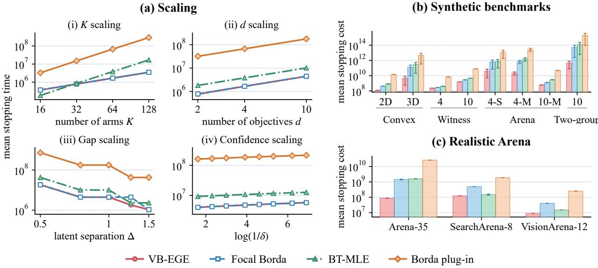  
Figure 2: Mean stopping time (mean ± one standard error) on logarithmic vertical axes. (a) Scaling in K, d, ∆, and log(1/δ). (b) Eight heterogeneous synthetic Pareto benchmark settings; S and M denote small and medium. (c) Three realistic Arena datasets, with stopping times measured in comparisons.

Table 2: Main realistic Arena data settings. Rows are retained pair–objective records; the VisionArena-Battle records arise from 12,937 unique multi-label comparisons.
<table><tr><td>Dataset</td><td>Objectives d</td><td>Candidates</td><td>Retained K</td><td>Rows</td><td>|Pemp|</td></tr><tr><td>Arena-140K</td><td>5</td><td>52</td><td>35</td><td>73,135</td><td>3</td></tr><tr><td>Search-Arena-24K</td><td>9</td><td>13</td><td>8</td><td>4,305</td><td>5</td></tr><tr><td>VisionArena-Battle</td><td>8</td><td>17</td><td>12</td><td>23,458</td><td>3</td></tr></table>

Results. Across all experiments, every method stopped and correctly identified the empirical Pareto frontier in every trial. Figure 2c compares the mean stopping time, where VB-EGE achieves the lowest value on all three datasets. The ratio of mean stopping times (baseline/VB-EGE) ranges from 3.96 to 16.54 for Focal Borda, from 1.20 to 18.27 for BT-MLE, and from 15.20 to 301.36 for Borda plug-in. Additional results and discussion are provided in Appendix D.3 and Appendix D.4.

## 5 Limitations and future work

This paper introduced a fixed-confidence adaptive sampling framework for identifying Pareto-optimal models from pairwise comparison. Several directions remain for future work. First, although our guarantees are stated under the BT model, the order-preservation property of the vector-Borda reduction requires only that the comparison probability be strictly increasing in the latent score diference. The reduction therefore applies more broadly to monotone comparison models. Second, our Bradley–Terry theory considers only decisive comparisons and does not model the tie and both bad labels in Chatbot Arena (Chiang et al., 2024). Appendix D.4 empirically shows that the Borda-level guarantee extends to half-credit observations and uses a fitted Davidson construction to assess target sensitivity. A model-based treatment of non-decisive outcomes with a recovery guarantee for the population Pareto frontier remains open. Third, the Arena experiments use several forms of objective labeling, including mutually exclusive groups, primary-intent labels, and overlapping categories. An important open question is how sensitive the identified frontiers are to these choices. One extension is to allow soft or learned assignments, where each comparison context is associated with a mixture of capabilities.

Beyond VB-EGE, there are also several algorithmic directions worth investigating. For example, under the BT model, one could estimate the latent scores and guide sampling using likelihood-based methods. Appendix E explores Pareto BT-GLR Track-and-Stop as a screened implementation of this approach, leaving a rigorous theoretical analysis for future work. Another promising direction is graph-aware sampling that exploits nonuniform historical support when selecting opponents and objectives. Such methods would be particularly relevant for larger, evolving arenas in which comparison coverage is uneven and new models are introduced over time.

## Reproducibility

Code for reproducing the results in this paper is available at https://github.com/Twist-Shan/Beyond\_Sca lar\_Leaderboards. Dataset links, pinned revisions, and preprocessing details are provided in Appendix D.1.

## AI Use Statement

In this work, we used generative AI tools (including ChatGPT 6 Astra, Claude Opus 5.5, etc.) for organizing the paper outline, polishing the writing, and structuring the appendices; searching for relevant literature; implementing synthetic-data generation and sampling from realistic Arena datasets; and, after the upperbound proof had been established, searching for and assisting with the derivation of a matching lower bound. We have not used generative AI tools for designing the conceptual frameworks, proposing or refining hypotheses or interpreting results. We have reviewed all technical claims, proofs, experimental designs, implementations, and reported results. We take responsibility for the final content of this work, including text, claims or artifacts produced with the aid of generative AI.

## References

Siavash Ameli, Siyuan Zhuang, Ion Stoica, and Michael W. Mahoney. A statistical framework for ranking LLM-based chatbots. In International Conference on Learning Representations, 2025.

Abolfazl Asudeh, Gensheng Zhang, Naeemul Hassan, Chengkai Li, and Gergely V. Zaruba. Crowdsourcing Pareto-optimal object finding by pairwise comparisons. In Proceedings of the 24th ACM International on Conference on Information and Knowledge Management, pp. 753–762, 2015.

Jean-Yves Audibert, S´ebastien Bubeck, and R´emi Munos. Best arm identification in multi-armed bandits. In Proceedings of the 23rd Conference on Learning Theory, pp. 41–53, 2010.

Julien Audifren and Liva Ralaivola. Bandits dueling on partially ordered sets. In Advances in Neural Information Processing Systems, volume 30, pp. 2130–2139. Curran Associates, Inc., 2017.

Peter Auer, Chao-Kai Chiang, Ronald Ortner, and Madalina Drugan. Pareto front identification from stochastic bandit feedback. In Proceedings of the 19th International Conference on Artificial Intelligence and Statistics, volume 51 of Proceedings of Machine Learning Research, pp. 939–947. PMLR, 2016.

Ralph Allan Bradley and Milton E. Terry. Rank analysis of incomplete block designs: I. The method of paired comparisons. Biometrika, 39(3–4):324–345, 1952. doi: 10.1093/biomet/39.3-4.324.

S´ebastien Bubeck, Tengyao Wang, and Nitin Viswanathan. Multiple identifications in multi-armed bandits. In Proceedings of the 30th International Conference on Machine Learning, volume 28 of Proceedings of Machine Learning Research, pp. 258–265. PMLR, 2013.

Emil Carlsson, Debabrota Basu, Fredrik D. Johansson, and Devdatt Dubhashi. Pure exploration in bandits with linear constraints. In Proceedings of the 27th International Conference on Artificial Intelligence and Statistics, volume 238 of Proceedings of Machine Learning Research, pp. 334–342. PMLR, 2024.

Shouyuan Chen, Tian Lin, Irwin King, Michael R. Lyu, and Wei Chen. Combinatorial pure exploration of multi-armed bandits. In Advances in Neural Information Processing Systems, volume 27, pp. 379–387. Curran Associates, Inc., 2014.

Wei-Lin Chiang, Lianmin Zheng, Ying Sheng, Anastasios Nikolas Angelopoulos, Tianle Li, Dacheng Li, Banghua Zhu, Hao Zhang, Michael Jordan, Joseph E. Gonzalez, and Ion Stoica. Chatbot Arena: An open platform for evaluating LLMs by human preference. In Proceedings of the 41st International Conference on Machine Learning, volume 235 of Proceedings of Machine Learning Research, pp. 8359–8388. PMLR, 2024.

Brian M. Cho, Dominik Meier, Kyra Gan, and Nathan Kallus. Reward maximization for pure exploration: Minimax optimal good arm identification for nonparametric multi-armed bandits. In Proceedings of the 28th International Conference on Artificial Intelligence and Statistics, volume 258 of Proceedings of Machine Learning Research, pp. 2251–2259. PMLR, 2025.

Christopher Chou, Lisa Dunlap, Koki Mashita, Krishna Mandal, Trevor Darrell, Ion Stoica, Joseph E. Gonzalez, and Wei-Lin Chiang. VisionArena: 230k real world user-VLM conversations with preference labels. In Proceedings of the IEEE/CVF Conference on Computer Vision and Pattern Recognition (CVPR), pp. 3877–3887, 2025.

Elise Cr´epon, Aur´elien Garivier, and Wouter M. Koolen. Sequential learning of the Pareto front for multi-´ objective bandits. In Proceedings of the 27th International Conference on Artificial Intelligence and Statistics, volume 238 of Proceedings of Machine Learning Research, pp. 3583–3591. PMLR, 2024.

Udvas Das, Apurv Shukla, and Debabrota Basu. FraPPE: Fast and eficient preference-based pure exploration. In Advances in Neural Information Processing Systems, volume 38, pp. 10190–10236. Curran Associates, Inc., 2025. doi: 10.52202/085713-0312

Roger R. Davidson. On extending the Bradley-Terry model to accommodate ties in paired comparison experiments. Journal of the American Statistical Association, 65(329):317–328, 1970. doi: 10.1080/016214 59.1970.10481082.

R´emy Degenne and Wouter M. Koolen. Pure exploration with multiple correct answers. In Advances in Neural Information Processing Systems, volume 32, pp. 14524–14533. Curran Associates, Inc., 2019.

Eyal Even-Dar, Shie Mannor, and Yishay Mansour. Action elimination and stopping conditions for the multi-armed bandit and reinforcement learning problems. Journal of Machine Learning Research, 7(39): 1079–1105, 2006.

Dennis Frauen, Athiya Deviyani, Mihaela van der Schaar, and Stefan Feuerriegel. Nonparametric LLM evaluation from preference data. arXiv preprint arXiv:2601.21816, 2026.

Evan Frick, Connor Chen, Joseph Tennyson, Tianle Li, Wei-Lin Chiang, Anastasios Nikolas Angelopoulos, and Ion Stoica. Prompt-to-Leaderboard: Prompt-adaptive LLM evaluations. In Proceedings of the 42nd International Conference on Machine Learning, volume 267 of Proceedings of Machine Learning Research, pp. 17672–17689. PMLR, 2025.

Aur´elien Garivier and Emilie Kaufmann. Optimal best arm identification with fixed confidence. In Proceedings of the 29th Conference on Learning Theory, volume 49 of Proceedings of Machine Learning Research, pp. 998–1027. PMLR, 2016.

Motti Goldberger and Nils Rudi. Optimal top-k identification from pairwise comparisons. arXiv preprint arXiv:2607.08979, 2026.

Benoˆıt Groz, Frederik Mallmann-Trenn, Claire Mathieu, and Victor Verdugo. Skyline computation with noisy comparisons. In Combinatorial Algorithms, volume 12126 of Lecture Notes in Computer Science, pp. 289–303. Springer, 2020. doi: 10.1007/978-3-030-48966-3 22.

Reinhard Heckel, Nihar B. Shah, Kannan Ramchandran, and Martin J. Wainwright. Active ranking from pairwise comparisons and when parametric assumptions do not help. The Annals of Statistics, 47(6): 3099–3126, 2019. doi: 10.1214/18-AOS1772.

Kevin Jamieson, Matthew Malloy, Robert Nowak, and S´ebastien Bubeck. lil’UCB: An optimal exploration algorithm for multi-armed bandits. In Proceedings of the 27th Conference on Learning Theory, volume 35 of Proceedings of Machine Learning Research, pp. 423–439. PMLR, 2014.

Kevin Jamieson, Sumeet Katariya, Atul Deshpande, and Robert Nowak. Sparse dueling bandits. In Proceedings of the 18th International Conference on Artificial Intelligence and Statistics, volume 38 of Proceedings of Machine Learning Research, pp. 416–424. PMLR, 2015.

Marc Jourdan, R´emy Degenne, Dorian Baudry, Rianne de Heide, and Emilie Kaufmann. Top two algorithms revisited. In Advances in Neural Information Processing Systems, volume 35, pp. 26791–26803. Curran Associates, Inc., 2022. doi: 10.52202/068431-1943.

Efe Mert Karag¨ozl¨u, Ya¸sar Cahit Yıldırım, C¸ a˘gın Ararat, and Cem Tekin. Learning the Pareto set under incomplete preferences: Pure exploration in vector bandits. In Proceedings of the 27th International Conference on Artificial Intelligence and Statistics, volume 238 of Proceedings of Machine Learning Research, pp. 3070–3078. PMLR, 2024.

Zohar Karnin, Tomer Koren, and Oren Somekh. Almost optimal exploration in multi-armed bandits. In Proceedings of the 30th International Conference on Machine Learning, volume 28 of Proceedings of Machine Learning Research, pp. 1238–1246. PMLR, 2013.

Julian Katz-Samuels and Clay Scott. Feasible arm identification. In Proceedings of the 35th International Conference on Machine Learning, volume 80 of Proceedings of Machine Learning Research, pp. 2535–2543. PMLR, 2018.

Emilie Kaufmann and Shivaram Kalyanakrishnan. Information complexity in bandit subset selection. In Proceedings of the 26th Conference on Learning Theory, volume 30 of Proceedings of Machine Learning Research, pp. 228–251. PMLR, 2013.

Emilie Kaufmann, Olivier Capp´e, and Aur´elien Garivier. On the complexity of best-arm identification in multi-armed bandit models. Journal of Machine Learning Research, 17(1):1–42, 2016.

Cyrille Kone, Emilie Kaufmann, and Laura Richert. Adaptive algorithms for relaxed Pareto set identification. In Advances in Neural Information Processing Systems, volume 36, pp. 35190–35201. Curran Associates, Inc., 2023. doi: 10.52202/075280-1528.

Cyrille Kone, Emilie Kaufmann, and Laura Richert. Bandit Pareto set identification: The fixed budget setting. In Proceedings of the 27th International Conference on Artificial Intelligence and Statistics, volume 238 of Proceedings of Machine Learning Research, pp. 2548–2556. PMLR, 2024.

Cyrille Kone, Emilie Kaufmann, and Laura Richert. Bandit Pareto set identification in a multi-output linear model. In Proceedings of the 28th International Conference on Artificial Intelligence and Statistics, volume 258 of Proceedings of Machine Learning Research, pp. 1189–1197. PMLR, 2025.

Jiachun Li, David Simchi-Levi, and Will Wei Sun. Low rank for rank: Uncertainty-aware task-specific LLM ranking under sparse pairwise comparisons. arXiv preprint arXiv:2605.29395, 2026.

Percy Liang, Rishi Bommasani, Tony Lee, Dimitris Tsipras, Dilara Soylu, Michihiro Yasunaga, Yian Zhang, Deepak Narayanan, Yuhuai Wu, Ananya Kumar, Benjamin Newman, Binhang Yuan, Bobby Yan, Ce Zhang, Christian Cosgrove, Christopher D. Manning, Christopher R´e, Diana Acosta-Navas, Drew A. Hudson, Eric Zelikman, Esin Durmus, Faisal Ladhak, Frieda Rong, Hongyu Ren, Huaxiu Yao, Jue Wang, Keshav Santhanam, Laurel Orr, Lucia Zheng, Mert Yuksekgonul, Mirac Suzgun, Nathan Kim, Neel Guha, Niladri Chatterji, Omar Khattab, Peter Henderson, Qian Huang, Ryan Chi, Sang Michael Xie, Shiban Santurkar, Surya Ganguli, Tatsunori Hashimoto, Thomas Icard, Tianyi Zhang, Vishrav Chaudhary, William Wang, Xuechen Li, Yifan Mai, Yuhui Zhang, and Yuta Koreeda. Holistic evaluation of language models. Transactions on Machine Learning Research, 2023.

Zirui Liu, Jiatong Li, Yan Zhuang, Qi Liu, Shuanghong Shen, Jie Ouyang, Mingyue Cheng, and Shijin Wang. am-ELO: A stable framework for arena-based LLM evaluation. In Proceedings of the 42nd International Conference on Machine Learning, volume 267 of Proceedings of Machine Learning Research, pp. 38857–38868. PMLR, 2025.

Zirui Liu, Xianquan Wang, Yan Zhuang, Jiatong Li, Qi Liu, Shuanghong Shen, Mingyue Cheng, and Shijin Wang. Fewer battles, more gain: An information-eficient framework for arena-based LLM evaluation. In International Conference on Learning Representations, 2026.

Andrea Locatelli, Maurilio Gutzeit, and Alexandra Carpentier. An optimal algorithm for the thresholding bandit problem. In Proceedings of the 33rd International Conference on Machine Learning, volume 48 of Proceedings of Machine Learning Research, pp. 1690–1698. PMLR, 2016.

Shie Mannor and John N. Tsitsiklis. The sample complexity of exploration in the multi-armed bandit problem. Journal of Machine Learning Research, 5:623–648, 2004.

Mihran Miroyan, Tsung-Han Wu, Logan King, Tianle Li, Jiayi Pan, Xinyan Hu, Wei-Lin Chiang, Anastasios N. Angelopoulos, Trevor Darrell, Narges Norouzi, and Joseph E. Gonzalez. Search Arena: Analyzing search augmented LLMs. In International Conference on Learning Representations, 2026.

Shintaro Nakamura and Masashi Sugiyama. Fixed-budget real-valued combinatorial pure exploration of multi-armed bandit. In Proceedings of the 27th International Conference on Artificial Intelligence and Statistics, volume 238 of Proceedings of Machine Learning Research, pp. 1225–1233. PMLR, 2024.

Daniel Russo. Simple Bayesian algorithms for best-arm identification. Operations Research, 68(6):1625–1647, 2020. doi: 10.1287/opre.2019.1911.

Nihar B. Shah and Martin J. Wainwright. Simple, robust and optimal ranking from pairwise comparisons. Journal of Machine Learning Research, 18(199):1–38, 2018.

Apurv Shukla and Debabrota Basu. Preference-based pure exploration. In Advances in Neural Information Processing Systems, volume 37, pp. 17313–17347. Curran Associates, Inc., 2024. doi: 10.52202/079017-0550.

Andrea Tirinzoni and R´emy Degenne. On elimination strategies for bandit fixed-confidence identification. In Advances in Neural Information Processing Systems, volume 35, pp. 18586–18598. Curran Associates, Inc., 2022. doi: 10.52202/068431-1350.

Bo Xue, Zhi Hong, Jiayi Li, Yuanyu Wan, Ji Cheng, and Shuang Qiu. Cost-aware multi-objective bandits: Theory and application to budgeted LLM configuration evaluation. arXiv preprint arXiv:2608.04333, 2026. URL https://arxiv.org/abs/2608.04333.

Lianmin Zheng, Wei-Lin Chiang, Ying Sheng, Siyuan Zhuang, Zhanghao Wu, Yonghao Zhuang, Zi Lin, Zhuohan Li, Dacheng Li, Eric P. Xing, Hao Zhang, Joseph E. Gonzalez, and Ion Stoica. Judging LLMas-a-Judge with MT-Bench and Chatbot Arena. In Advances in Neural Information Processing Systems, volume 36, pp. 46595–46623. Curran Associates, Inc., 2023. doi: 10.52202/075280-2020.

A Additional related work 16   
B Technical proofs 16   
B.1 Supporting results 16   
B.2 Proofs of main results 25   
C Additional details and results for synthetic experiments 29   
C.1 Details for the data-generating process . 29   
C.2 Implementation details for the baseline models 30   
C.3 Additional results from synthetic experiments 31   
C.4 Hyperparameter sensitivity analysis 32   
C.5 Pareto-set size sensitivity analysis 32   
C.6 Sampling-mechanism diagnostics 33   
D Additional details and results for real-data experiments 34   
D.1 Datasets, preprocessing, and retained models 34   
D.2 Sampling from logged Arena comparisons 35   
D.3 Full Pareto-set results and method comparisons 37   
D.4 Sensitivity to tie and both bad handling 40   
E Additional comparison with a Track-and-Stop extension 47   
E.1 Implementation used in the reported experiments 48   
E.2 Comparison with VB-EGE 50

## A Additional related work

Best arm identification Best-arm identification is a canonical pure-exploration problem in stochastic bandits, where samples are collected to identify an optimal arm rather than to maximize cumulative reward. Early work established PAC sample-complexity bounds and confidence-based elimination and stopping procedures for identifying a near-optimal arm (Mannor & Tsitsiklis, 2004; Even-Dar et al., 2006). Subsequent work developed sharper procedures for best-arm identification under fixed-budget and fixed-confidence formulations, including Successive Rejects (Audibert et al., 2010), Sequential Halving (Karnin et al., 2013), and lil’UCB (Jamieson et al., 2014). Kaufmann et al. (2016) studied the instance-dependent complexity of the two dominant fixed-budget and fixed-confidence formulations, while Garivier & Kaufmann (2016) derived a tight fixed-confidence lower bound and introduced the asymptotically optimal Track-and-Stop strategy. More recent work has developed alternative adaptive-allocation principles, notably Top-Two methods (Russo, 2020; Jourdan et al., 2022). Elimination strategies can further reduce the computational cost of fully adaptive fixed-confidence identification while preserving sample-complexity guarantees (Tirinzoni & Degenne, 2022).

Set-valued and structured identification. Beyond best-arm identification, bandit identification has been studied for richer terminal targets. Top-m and subset-selection problems seek several of the highestmean arms (Bubeck et al., 2013; Kaufmann & Kalyanakrishnan, 2013), while thresholding and good-arm identification aim to determine which arms satisfy a prescribed performance criterion (Locatelli et al., 2016; Cho et al., 2025). Combinatorial pure exploration generalizes the answer space to structured decision classes, including fixed-size subsets, matchings, spanning trees, and paths (Chen et al., 2014), with recent work developing fixed-budget methods for more general real-valued combinatorial action classes (Nakamura & Sugiyama, 2024). Related extensions consider vector-valued observations and constrained decision spaces: Katz-Samuels & Scott (2018) study feasible-arm identification with multivariate means, while Carlsson et al. (2024) consider fixed-confidence identification when the optimal policy is subject to linear constraints and may mix several arms. More generally, Degenne & Koolen (2019) develop a fixed-confidence framework for pure-exploration problems that may admit multiple correct answers.

## B Technical proofs

## B.1 Supporting results

## B.1.1 Properties of the classification gaps

Lemma B.1 (Basic inequalities for pairwise margins). Let $x = ( x _ { 1 } , \ldots , x _ { K } ) , \quad y = ( y _ { 1 } , \ldots , y _ { K } ) \in ( \mathbb { R } ^ { d } ) ^ { K }$ Then, for all $i , j , k \in [ K ]$ 2

(i) $m _ { x } ( i , k ) \geq m _ { x } ( i , j ) + m _ { x } ( j , k ) ;$

(ii) $\begin{array} { r } { i f \operatorname* { m a x } _ { u \in [ K ] } \operatorname* { m a x } _ { r \in [ d ] } | x _ { u , r } - y _ { u , r } | \leq \rho , } \end{array}$ then

$$
| m _ { x } ( i , j ) - m _ { y } ( i , j ) | \leq 2 \rho , \qquad | M _ { x } ( i , j ) - M _ { y } ( i , j ) | \leq 2 \rho ;
$$

(iii) for all $a , b \in \mathbb { R } , | a ^ { + } - b ^ { + } | \leq | a - b |$

Proof. For part (i), coordinate-wise,

$$
x _ { k , r } - x _ { i , r } = ( x _ { k , r } - x _ { j , r } ) + ( x _ { j , r } - x _ { i , r } ) ,
$$

Taking the minimum over r and using minr $\begin{array} { r } { . ( a _ { r } + b _ { r } ) \geq \operatorname* { m i n } _ { r } a _ { r } + \operatorname* { m i n } _ { r } b _ { r } } \end{array}$ gives

$$
m _ { x } ( i , k ) \geq m _ { x } ( i , j ) + m _ { x } ( j , k ) .
$$

For part (ii), every coordinate diference satisfies

$$
| ( x _ { j , r } - x _ { i , r } ) - ( y _ { j , r } - y _ { i , r } ) | \leq 2 \rho .
$$

Both the minimum and maximum maps are 1-Lipschitz with respect to the $\ell _ { \infty }$ norm, which proves the two inequalities.

Part (iii) follows because the map $a \mapsto a ^ { + }$ is 1-Lipschitz.

Lemma B.2 (Pareto witness for a non-Pareto model). $I f i \notin { \mathcal { P } } ( x )$ , then

$$
\Delta _ { i } ^ { \star } ( x ) = \operatorname* { m a x } _ { p \in \mathcal { P } ( x ) } m _ { x } ( i , p ) > 0 .
$$

In particular, there exists $i _ { x } ^ { \star } \in \mathcal { P } ( x )$ such that $m _ { x } ( i , i _ { x } ^ { \star } ) = \Delta _ { i } ^ { \star } ( x )$

Proof. Since $i \not \in { \mathcal { P } } ( x )$ , there exists a model that strictly dominates i. Hence

$$
\Delta _ { i } ^ { \star } ( x ) = \operatorname* { m a x } _ { j \in [ K ] \backslash \{ i \} } m _ { x } ( i , j ) > 0 .
$$

Because the model set is finite, we may choose $i _ { x } ^ { \star } \in \arg \operatorname* { m a x } _ { j \in [ K ] \backslash \{ i \} } m _ { x } ( i , j )$ . Then $m _ { x } ( i , i _ { x } ^ { \star } ) = \Delta _ { i } ^ { \star } ( x ) > 0$ so ${ i \prec _ { x } i _ { x } ^ { \star } }$

We claim that $i _ { x } ^ { \star } \in \mathcal { P } ( x )$ . Suppose otherwise. Then there exists $p \in [ K ]$ such that $i _ { x } ^ { \star } \prec _ { x } p ,$ and therefore $m _ { x } ( i _ { x } ^ { \star } , p ) > 0$ . By Lemma B.1,

$$
m _ { x } ( i , p ) \geq m _ { x } ( i , i _ { x } ^ { \star } ) + m _ { x } ( i _ { x } ^ { \star } , p ) > m _ { x } ( i , i _ { x } ^ { \star } ) = \Delta _ { i } ^ { \star } ( x ) .
$$

This contradicts the definition of $i _ { x } ^ { \star }$ . Hence $i _ { x } ^ { \star } \in \mathcal { P } ( x )$ , and because it already attains the maximum over all $j \neq i ,$ it also attains the maximum over $p \in \mathcal P ( x )$ □

For a Bradley–Terry instance $\theta \in \Theta _ { B , d }$ , let $b = b ( \theta )$ denote its coordinate-wise Borda vectors, and write

$$
\Delta _ { i } ^ { \mathrm { B } } : = \Delta _ { i } ( b ( \theta ) ) , \qquad \Delta _ { i } ^ { \theta } : = \Delta _ { i } ( \theta ) .
$$

Recall that

$$
\kappa _ { B } = \operatorname* { i n f } _ { | x | \leq 2 B } \sigma ^ { \prime } ( x ) = \sigma ( 2 B ) \big ( 1 - \sigma ( 2 B ) \big ) > 0 .
$$

Lemma B.3 (Borda gaps dominate latent gaps). $I f \theta \in \Theta _ { B , d }$ , then for every model $i ,$

$$
\Delta _ { i } ^ { \mathrm { B } } \geq \kappa _ { B } \Delta _ { i } ^ { \theta } .
$$

Proof. Fix models a, c and an objective r. For every $u \in [ K ]$ , define

$$
\bar { b } _ { u , r } : = \frac { 1 } { K } \sum _ { \ell = 1 } ^ { K } \sigma ( \theta _ { u , r } - \theta _ { \ell , r } ) .
$$

For each $\ell ,$ the mean-value theorem gives a point $\xi _ { \ell }$ between $\theta _ { a , r } - \theta _ { \ell , r }$ and $\theta _ { c , r } - \theta _ { \ell , r }$ such that

$$
\sigma ( \theta _ { c , r } - \theta _ { \ell , r } ) - \sigma ( \theta _ { a , r } - \theta _ { \ell , r } ) = \sigma ^ { \prime } ( \xi _ { \ell } ) ( \theta _ { c , r } - \theta _ { a , r } ) .
$$

Hence

$$
\bar { b } _ { c , r } - \bar { b } _ { a , r } = \gamma _ { a c r } ( \theta _ { c , r } - \theta _ { a , r } ) , \qquad \gamma _ { a c r } : = \frac { 1 } { K } \sum _ { \ell = 1 } ^ { K } \sigma ^ { \prime } ( \xi _ { \ell } ) .
$$

Because $\theta \in \Theta _ { B , d }$ , both endpoints defining each $\xi _ { \ell }$ lie in $[ - 2 B , 2 B ]$ , and therefore $\gamma _ { a c r } \geq \kappa _ { B }$ . Since

$$
b _ { u , r } = \frac { K \bar { b } _ { u , r } - 1 / 2 } { K - 1 } ,
$$

we obtain

$$
b _ { c , r } - b _ { a , r } = \frac { K } { K - 1 } \gamma _ { a c r } ( \theta _ { c , r } - \theta _ { a , r } ) .
$$

In particular, because $K / ( K - 1 ) \geq 1$ , whenever $\theta _ { c , r } \geq \theta _ { a , r }$

$$
b _ { c , r } - b _ { a , r } \geq \kappa _ { B } ( \theta _ { c , r } - \theta _ { a , r } ) .\tag{9}
$$

We then record three consequences.

First, if $m _ { \theta } ( a , c ) > 0$ , then every coordinate diference $\theta _ { c , r } - \theta _ { a , r }$ is positive, so (9) gives

$$
m _ { b } ( a , c ) \geq \kappa _ { B } m _ { \theta } ( a , c ) .\tag{10}
$$

Second, for all $a , c ,$

$$
\begin{array} { r } { M _ { b } ( a , c ) ^ { + } \geq \kappa _ { B } M _ { \theta } ( a , c ) ^ { + } . } \end{array}\tag{11}
$$

If $M _ { \theta } ( a , c ) \leq 0 .$ , this is trivial. Otherwise choose an objective attaining $M _ { \theta } ( a , c ) = \theta _ { a , r } - \theta _ { c , r } > 0$ and apply (9) with the roles of a and c interchanged.

Third, for every model j,

$$
( \Delta _ { j } ^ { \star } ( b ) ) ^ { + } \geq \kappa _ { B } ( \Delta _ { j } ^ { \star } ( \theta ) ) ^ { + } .\tag{12}
$$

If $\Delta _ { i } ^ { \star } ( \theta ) \leq 0$ , this is trivial. Otherwise choose a model c attaining $\Delta _ { i } ^ { \star } ( \theta ) > 0$ and apply (10) to $( j , c )$

If $i \notin \mathcal { P } ( \theta )$ , coordinate-wise order preservation implies $i \notin \mathcal { P } ( b )$ . Choose a model c attaining $\Delta _ { i } ^ { \star } ( \theta ) > 0$ Then

$$
\Delta _ { i } ^ { \mathrm { B } } = \Delta _ { i } ^ { \star } ( b ) \geq m _ { b } ( i , c ) \geq \kappa _ { B } m _ { \theta } ( i , c ) = \kappa _ { B } \Delta _ { i } ^ { \theta } .
$$

Suppose instead that $i \in { \mathcal { P } } ( \theta )$ . Then $i \in \mathcal { P } ( b )$ by Lemma 2.1. Fix $j \neq i$ . Since i is Pareto, $M _ { \theta } ( i , j ) \geq 0$ If $M _ { \theta } ( i , j ) > 0$ , applying (9) at an objective attaining the positive maximum gives

$$
M _ { b } ( i , j ) \geq \kappa _ { B } M _ { \theta } ( i , j ) .
$$

If $M _ { \theta } ( i , j ) = 0$ , then some objective satisfies $\theta _ { i , r } = \theta _ { j , r } ;$ coordinate-wise order preservation gives $b _ { i , r } = b _ { j , r }$ and hence again $M _ { b } ( i , j ) \ge 0 = \kappa _ { B } M _ { \theta } ( i , j )$ . Thus, in all cases,

$$
M _ { b } ( i , j ) \geq \kappa _ { B } M _ { \theta } ( i , j ) .
$$

Moreover, combining (11) and (12) gives

$$
M _ { b } ( j , i ) ^ { + } + ( \Delta _ { j } ^ { \star } ( b ) ) ^ { + } \geq \kappa _ { B } \left[ M _ { \theta } ( j , i ) ^ { + } + ( \Delta _ { j } ^ { \star } ( \theta ) ) ^ { + } \right] .
$$

Therefore, for every $j \neq i$

$$
\begin{array} { r } { M _ { b } ( i , j ) \wedge \Big [ M _ { b } ( j , i ) ^ { + } + \big ( \Delta _ { j } ^ { \star } ( b ) \big ) ^ { + } \Big ] \geq \kappa _ { B } \left\{ M _ { \theta } ( i , j ) \wedge \Big [ M _ { \theta } ( j , i ) ^ { + } + \big ( \Delta _ { j } ^ { \star } ( \theta ) \big ) ^ { + } \Big ] \right\} , } \end{array}
$$

Taking the minimum over $j \neq i$ yields

$$
\Delta _ { i } ^ { \mathrm { B } } = \delta _ { i } ^ { \star } ( b ) \geq \kappa _ { B } \delta _ { i } ^ { \star } ( \theta ) = \kappa _ { B } \Delta _ { i } ^ { \theta } .
$$

This proves the claim for every model i.

## B.1.2 High-probability analysis of VB-EGE

We first state the upper-bound argument for a generic vector-Bernoulli mean instance. Fix $b = ( b _ { 1 } , \dotsc , b _ { K } ) \in$ $( [ 0 , 1 ] ^ { d } ) ^ { K }$ . In this section, a query of model i on objective r reveals the next unused observation from an independent stream

$$
Z _ { i , r , 1 } , Z _ { i , r , 2 } , . . . \stackrel { \mathrm { i i d } } { \sim } \mathrm { B e r n o u l l i } ( b _ { i , r } ) , \qquad i \in [ K ] , \ r \in [ d ] ,
$$

These streams are independent of any additional internal randomization used by the algorithm.

Let $\mathbb { P } _ { b }$ denote the induced law of the algorithm and the oracle. For compactness, write

$$
\Delta _ { i } ^ { \mathrm { B } } : = \Delta _ { i } ( b ) , \qquad \mathcal { P } : = \mathcal { P } ( b ) , \qquad \Delta _ { \mathrm { m i n } } ^ { \mathrm { B } } : = \operatorname* { m i n } _ { i \in [ K ] } \Delta _ { i } ^ { \mathrm { B } } .
$$

Throughout this section, Algorithm 1 is run with the common configuration $C = ( 2 , 4 , 4 )$ specified in Equation $( 7 )$ . Let τ count objective-specific binary comparisons, with $\tau = \infty$ if the procedure does not stop. Whenever $\Delta _ { \mathrm { m i n } } ^ { \mathrm { B } } > 0$ , define

$$
M _ { i } : = 1 + \left\lceil \log _ { 2 } \frac { 4 } { \Delta _ { i } ^ { \mathrm { B } } } \right\rceil , \qquad L _ { i } ( \delta ) : = \log \frac { 4 K d M _ { i } ^ { 2 } } { \delta } .
$$

Also define the $( 1 - \delta )$ stopping-time quantile under the vector-Bernoulli instance b by

$$
\begin{array} { r } { Q _ { b , \delta } ( \mathrm { V B - E G E } ) : = \operatorname* { i n f } \left\{ T \in \mathbb { N } _ { 0 } : \mathbb { P } _ { b } ( \tau \leq T ) \geq 1 - \delta \right\} , \qquad \operatorname* { i n f } \varnothing : = \infty . } \end{array}
$$

Proposition B.4 (VB-EGE guarantee under vector-Bernoulli feedback). If $\Delta _ { \mathrm { m i n } } ^ { \mathrm { B } } > 0$ , then Algorithm 1, run with the configuration C in (7), satisfies

$$
\mathbb { P } _ { b } \bigg ( \widehat { \mathcal { P } } = \mathcal { P } ( b ) , \quad \tau \leq d K + 1 2 8 d \sum _ { i = 1 } ^ { K } \frac { L _ { i } ( \delta ) } { ( \Delta _ { i } ^ { \mathrm { B } } ) ^ { 2 } } \bigg ) \geq 1 - \delta .\tag{13}
$$

Consequently,

$$
Q _ { b , \delta } ( \mathrm { V B - E G E } ) \leq d K + 1 2 8 d \sum _ { i = 1 } ^ { K } \frac { L _ { i } ( \delta ) } { ( \Delta _ { i } ^ { \mathrm { B } } ) ^ { 2 } } = \widetilde { O } \left( d \sum _ { i = 1 } ^ { K } ( \Delta _ { i } ^ { \mathrm { B } } ) ^ { - 2 } \right) .
$$

We first establish several lemmas used in the proof of Proposition B.4. Under (7), the phase schedule is

$$
\varepsilon _ { m } = 2 ^ { - m } , \qquad L _ { m } = \log \frac { 4 K d m ^ { 2 } } { \delta } , \qquad n _ { m } = \left\lceil \frac { 2 L _ { m } } { \varepsilon _ { m } ^ { 2 } } \right\rceil , \qquad r _ { m } = \sqrt { \frac { L _ { m } } { 2 n _ { m } } } ,
$$

and the removal threshold is $4 r _ { m }$

For every phase $m ,$ model i, and objective $r ,$ define the conceptual phase-m average

$$
\widehat { b } _ { i , r } ^ { ( m ) } : = \frac { 1 } { n _ { m } } \sum _ { s = 1 } ^ { n _ { m } } Z _ { i , r , s } .
$$

For an inactive model–objective pair, this quantity is used only in the analysis; the algorithm need not have revealed the corresponding prefix. At an inner-loop iteration with active set $A ,$ , abbreviate

$$
\begin{array} { r } { \widehat { m } _ { A } ( i , j ) : = m _ { \widehat { b } ^ { ( m ) } } ( i , j ) , \widehat { M } _ { A } ( i , j ) : = M _ { \widehat { b } ^ { ( m ) } } ( i , j ) , \widehat { \Delta } _ { i , A } ^ { \star } : = \Delta _ { i , A } ^ { \star } \widehat { \left( b ^ { ( m ) } \right) } , \widehat { \delta } _ { i , A } ^ { \star } : = \delta _ { i , A } ^ { \star } \left( \widehat { b } ^ { ( m ) } \right) . } \end{array}
$$

Lemma B.5 (Empirical gap identities). For every active set $A \subseteq [ K ]$ with $| { \cal A } | \ge 2$ and every $i \in A$

$$
i \in \widehat { S } _ { A } \quad \Longleftrightarrow \quad \widehat { \Delta } _ { i , A } ^ { \star } \leq 0 , \qquad i \notin \widehat { S } _ { A } \quad \Longleftrightarrow \quad \widehat { \Delta } _ { i , A } ^ { \star } > 0 .
$$

and,

$$
\widehat { \Delta } _ { i , A } = \widehat { \Delta } _ { i , A } ^ { \star } \vee \widehat { \delta } _ { i , A } ^ { \star } .
$$

Proof. By definition,

$$
\widehat { \Delta } _ { i , A } ^ { \star } = \operatorname* { m a x } _ { j \in A \setminus \{ i \} } \widehat { m } _ { A } ( i , j ) .
$$

Hence $i \notin \widehat { S } _ { A }$ if and only if some $j \in A \setminus \{ i \}$ satisfies $\widehat { m } _ { A } ( i , j ) > 0$ , which is equivalent to $\widehat { \Delta } _ { i , A } ^ { \star } > 0$ . The first two equivalences follow.

Suppose first that $i \in \widehat { S } _ { A }$ . Then $\widehat { \Delta } _ { i , A } ^ { \star } \leq 0$ . Moreover, for every $j \in A \setminus \{ i \}$ , empirical Pareto membership implies that $j$ does not strictly dominate i. Thus there exists a coordinate $r \in [ d ]$ such that $\widehat { b } _ { i , r } \geq \widehat { b } _ { j , r } .$ , and therefore

$$
\widehat { M } _ { A } ( i , j ) = \operatorname* { m a x } _ { r \in [ d ] } \left( \widehat { b } _ { i , r } - \widehat { b } _ { j , r } \right) \geq 0 .
$$

The other term, $\widehat { M } _ { A } ( j , i ) ^ { + } + \left( \widehat { \Delta } _ { j , A } ^ { \star } \right) ^ { + }$ , is also nonnegative. Hence every term in the minimum defining $\widehat { \delta } _ { i , A } ^ { \star }$ is nonnegative, so $\widehat { \delta } _ { i , A } ^ { \star } \geq 0 \geq \widehat { \Delta } _ { i , A } ^ { \star }$ . Therefore

$$
\widehat { \Delta } _ { i , A } ^ { \star } \vee \widehat { \delta } _ { i , A } ^ { \star } = \widehat { \delta } _ { i , A } ^ { \star } = \widehat { \Delta } _ { i , A } .
$$

Now suppose that $i \notin \widehat { S } _ { A }$ . Then there exists $j \in A \setminus \{ i \}$ such that $\widehat { m } _ { A } ( i , j ) > 0$ , or equivalently,

$$
\widehat { M } _ { A } ( i , j ) = - \widehat { m } _ { A } ( i , j ) < 0 .
$$

Using this j in the minimum defining $\widehat { \delta } _ { i , A } ^ { \star }$ gives

$$
\begin{array} { r l } & { \widehat { \delta } _ { i , A } ^ { \star } \leq \widehat { M } _ { A } ( i , j ) \wedge \left[ \widehat { M } _ { A } ( j , i ) ^ { + } + \left( \widehat { \Delta } _ { j , A } ^ { \star } \right) ^ { + } \right] } \\ & { \qquad = \widehat { M } _ { A } ( i , j ) < 0 , } \end{array}
$$

because the second term in the wedge is nonnegative. Since $\widehat { \Delta } _ { i , A } ^ { \star } > 0$ , it follows that

$$
\widehat { \Delta } _ { i , A } ^ { \star } \vee \widehat { \delta } _ { i , A } ^ { \star } = \widehat { \Delta } _ { i , A } ^ { \star } = \widehat { \Delta } _ { i , A } .
$$

This proves the claim.

Lemma B.6 (Uniform Borda concentration). Define

$$
\begin{array} { r } { \mathcal { E } : = \{ \forall m \ge 1 , \ \forall i \in [ K ] , \ \forall r \in [ d ] : | \widehat { b } _ { i , r } ^ { ( m ) } - b _ { i , r } | \le r _ { m }  \} . } \end{array}
$$

Then $\mathbb { P } _ { b } ( \mathcal { E } ) \geq 1 - \delta$ . Moreover, on $\mathcal { E } ,$ for every phase m, active set $A ,$ and distinct $i , j \in A$

$$
\vert \widehat { m } _ { A } ( i , j ) - m _ { b } ( i , j ) \vert \leq 2 r _ { m } , \qquad \left. \widehat { M } _ { A } ( i , j ) - M _ { b } ( i , j ) \right. \leq 2 r _ { m } .\tag{14}
$$

Proof. For a fixed triple $( i , r , m )$ , Hoefding’s inequality and the definition of $r _ { m }$ give

$$
\mathbb { P } _ { b } \Big ( \Big | \widehat { b } _ { i , r } ^ { ( m ) } - b _ { i , r } \Big | > r _ { m } \Big ) \le 2 \exp ( - 2 n _ { m } r _ { m } ^ { 2 } ) = 2 e ^ { - L _ { m } } = \frac { \delta } { 2 K d m ^ { 2 } } .
$$

Taking a union bound over $i \in [ K ] , r \in [ d ]$ , and $m \geq 1$ yields

$$
\mathbb { P } _ { b } ( \mathcal { E } ^ { c } ) \leq \frac { \delta } { 2 } \sum _ { m = 1 } ^ { \infty } \frac { 1 } { m ^ { 2 } } < \delta .
$$

The two margin bounds follow from Lemma B.1.

For every non-Pareto model $i \notin \mathcal { P }$ , fix once and for all a Borda-Pareto witness supplied by Lemma B.2:

$$
i ^ { \star } \in \arg \operatorname* { m a x } _ { p \in \mathcal { P } } m _ { b } ( i , p ) , \qquad m _ { b } ( i , i ^ { \star } ) = \Delta _ { i } ^ { \mathrm { B } } > 0 .
$$

For an active set A, define the witness invariant

$$
\mathsf { W } ( A ) : = \left\{ \forall i \notin { \mathcal { P } } , \quad i \in A \Longrightarrow i ^ { \star } \in A \right\} .
$$

Initially, $\mathsf { W } ( [ K ] )$ holds.

Lemma B.7 (Every removed model is correctly classified). Assume that E and ${ \mathsf { W } } ( A )$ hold when a model $i \in A$ is removed in phase m. Then:

(i) $i f i \notin { \widehat { S } } _ { A }$ , then $i \notin \mathcal { P } _ { : }$

(ii) $i f i \in \widehat { S } _ { A }$ , then $i \in \mathcal { P }$

Thus every model removed without acceptance is truly non-Pareto, while every accepted model is truly Pareto.

Proof. For simplicity, we write $r = r _ { m }$

First suppose $i \notin \widehat { S } _ { A }$ . Since i is removed, $\widehat { \Delta } _ { i , A } > 4 r$ . By Lemma B.5, $\widehat { \Delta } _ { i , A } = \widehat { \Delta } _ { i , A } ^ { \star }$ , so there exists $j \in A \setminus \{ i \}$ satisfies $\widehat { m } _ { A } ( i , j ) > 4 r$ . Using (14),

$$
m _ { b } ( i , j ) \geq \widehat { m } _ { A } ( i , j ) - 2 r > 2 r > 0 .
$$

Hence $i \prec _ { b } j$ , and therefore $i \notin \mathcal { P } ( b ) = \mathcal { P }$

Now suppose $i \in \widehat { S } _ { A }$ but, toward a contradiction, $i \notin \mathcal { P }$ . The witness invariant gives $i ^ { \star } \in A$ , and

$$
m _ { b } ( i , i ^ { \star } ) = \Delta _ { i } ^ { \mathrm { B } } > 0 , \qquad M _ { b } ( i , i ^ { \star } ) = - \Delta _ { i } ^ { \mathrm { B } } .
$$

If $\Delta _ { i } ^ { \mathrm B } > 2 r$ , then (14) implies

$$
\widehat { m } _ { A } ( i , i ^ { \star } ) \geq \Delta _ { i } ^ { \mathrm { B } } - 2 r > 0 ,
$$

contradicting $i \in \widehat { S } _ { A }$ . Thus necessarily $\Delta _ { i } ^ { \mathrm B } \le 2 r$

Since $i \in \widehat { S } _ { A }$ , its empirical classification gap is $\widehat { \Delta } _ { i , A } = \widehat { \delta } _ { i , A } ^ { \star }$ . Taking $j = i ^ { \star }$ in the defining minimum gives

$$
\begin{array} { r l } & { \widehat { \Delta } _ { i , A } \leq \widehat { M } _ { A } ( i , i ^ { \star } ) \wedge \Big [ \widehat { M } _ { A } ( i ^ { \star } , i ) ^ { + } + \big ( \widehat { \Delta } _ { i ^ { \star } , A } ^ { \star } \big ) ^ { + } \Big ] } \\ & { \qquad \leq \widehat { M } _ { A } ( i , i ^ { \star } ) } \\ & { \qquad \leq M _ { b } ( i , i ^ { \star } ) + 2 r } \\ & { \qquad = - \Delta _ { i } ^ { \mathrm { B } } + 2 r \leq 2 r , } \end{array}
$$

contradicting the removal condition $\widehat { \Delta } _ { i , A } > 4 r$ . Therefore $i \in \mathcal { P } .$

Lemma B.8 (Witness-invariant preservation). Assume that E and ${ \mathsf { W } } ( A )$ hold before a removal in phase m. $A f t e r$ the removal, the new active set $A ^ { \prime }$ also satisfies $\mathsf { W } ( A ^ { \prime } )$

Proof. Write $r = r _ { m }$ . By Lemma B.7, the only possible way to violate the invariant is to remove a true Pareto model $p \in \mathcal P$ while leaving active a non-Pareto model $i \notin \mathcal { P }$ whose fixed witness is $i ^ { \star } = p$ . Suppose, toward a contradiction, that this occurs. Immediately before the removal, $p , i \in A$ . Since the removed model p is truly Pareto, Lemma B.7 implies that it cannot be empirically non-Pareto. Thus $\boldsymbol { p } \in \widehat { \mathcal { S } } _ { A }$ , and

$$
\widehat { \Delta } _ { p , A } = \widehat { \delta } _ { p , A } ^ { \star } > 4 r .\tag{15}
$$

There are two cases to be considered.

Case $1 \colon p$ empirically strictly dominates i. Then $\widehat { m } _ { A } ( i , p ) > 0$ , so $i \notin \widehat { S } _ { A }$ and $\widehat { \Delta } _ { i , A } = \widehat { \Delta } _ { i , A } ^ { \star } > 0$ . Moreover, $\widehat { M } _ { A } ( i , p ) ^ { + } = 0$ . Taking $j = i$ in the minimum defining $\widehat { \delta } _ { p , A } ^ { \star }$ yields

$$
\begin{array} { r } { \widehat { \Delta } _ { p , A } \leq \widehat { M } _ { A } ( i , p ) ^ { + } + ( \widehat { \Delta } _ { i , A } ^ { \star } ) ^ { + } = \widehat { \Delta } _ { i , A } . } \end{array}
$$

Since p is the model selected for removal, it belongs to $G : = \arg \operatorname* { m a x } _ { u \in A } \widehat { \Delta } _ { u , A }$ . If the preceding inequality is strict, then $\widehat { \Delta } _ { i , A } > \widehat { \Delta } _ { p , A }$ , contradicting $p \in G$ . If equality holds, then $i \in G \backslash { \widehat { S } } _ { A }$ , so the non-Pareto-first tie-breaking rule Remark 2.1 selects an empirical non-Pareto maximizer rather than $p .$ In either case, the algorithm cannot remove p, which results in a contradiction.

Case 2: p does not empirically strictly dominate i. Then $\widehat { m } _ { A } ( i , p ) \leq 0$ , and hence

$$
{ \widehat { M } } _ { A } ( i , p ) = - { \widehat { m } } _ { A } ( i , p ) \geq 0 .
$$

Since $M _ { b } ( i , p ) = - m _ { b } ( i , p ) = - \Delta _ { i } ^ { \mathrm { B } }$ , the uniform margin deviation (14) gives

$$
0 \leq \widehat { M } _ { A } ( i , p ) = \widehat { M } _ { A } ( i , p ) ^ { + } \leq 2 r - \Delta _ { i } ^ { \mathrm { B } } .
$$

So $\Delta _ { i } ^ { \mathrm B } \le 2 r$ . Moreover, for every $q \in A \setminus \{ i \}$

$$
\begin{array} { r } { \widehat { m } _ { A } ( i , q ) \leq m _ { b } ( i , q ) + 2 r \leq \Delta _ { i } ^ { \mathrm { B } } + 2 r , } \end{array}
$$

Therefore,

$$
\begin{array} { r } { \bigl ( \widehat { \Delta } _ { i , A } ^ { \star } \bigr ) ^ { + } \leq \Delta _ { i } ^ { \mathrm { B } } + 2 r . } \end{array}
$$

Since $p \in \widehat { S } _ { A } , \widehat { \Delta } _ { p , A } = \widehat { \delta } _ { p , A } ^ { \star }$ . Taking $j = i$ in the defining minimum gives

$$
\begin{array} { r l } & { \widehat { \Delta } _ { p , A } \leq \widehat { M } _ { A } ( p , i ) \wedge \Big [ \widehat { M } _ { A } ( i , p ) ^ { + } + \big ( \widehat { \Delta } _ { i , A } ^ { \star } \big ) ^ { + } \Big ] } \\ & { \qquad \leq \widehat { M } _ { A } ( i , p ) ^ { + } + \big ( \widehat { \Delta } _ { i , A } ^ { \star } \big ) ^ { + } } \\ & { \qquad \leq \big ( 2 r - \Delta _ { i } ^ { \mathrm { B } } \big ) + \big ( \Delta _ { i } ^ { \mathrm { B } } + 2 r \big ) } \\ & { \qquad = 4 r , } \end{array}
$$

contradicting (15). Hence the invariant is preserved.

Proposition B.9 (Correctness on the confidence event). On $\mathcal { E } ,$ Algorithm 1 never misclassifies a removed model. If it stops, its recommendation equals ${ \mathcal { P } } ( b )$

Proof. The invariant holds initially and is preserved after every removal by Lemma B.8. By induction over removals and Lemma B.7, every model added to B belongs to ${ \mathcal { P } } _ { : }$ while every model removed without being added to B lies outside $\mathcal { P } .$

If the algorithm stops with a singleton active set $A = \{ a \}$ and $a \notin { \mathcal { P } } ;$ then the invariant would require the distinct witness $a ^ { \star }$ to remain active, contradicting $| { \cal A } | = 1$ . Thus the final active model is Pareto. Every model outside $B \cup A$ was previously removed without acceptance and hence lies outside $\mathcal { P } .$ Conversely, every model in $B \cup A$ is Pareto. Therefore the returned set $B \cup A$ equals ${ \mathcal { P } } ( b )$ □

Lemma B.10 (Removal once the radius is small). Assume E. Consider a phase m and a model i that is active at the beginning of the inner loop. If

$$
r _ { m } < \frac { \Delta _ { i } ^ { \mathrm { B } } } { 8 } ,
$$

then either the algorithm stops during phase m, or model i is removed during that phase.

Proof. Write $\boldsymbol { r } = \boldsymbol { r _ { m } }$ , and suppose that i remains active at some inner-loop iteration with $| A | \ge 2$ . By Lemma B.8, the witness invariant ${ \mathsf { W } } ( A )$ holds.

If $i \notin \mathcal { P }$ , then its fixed witness $i ^ { \star }$ remains active. By (14),

$$
\widehat { m } _ { A } ( i , i ^ { \star } ) \geq \Delta _ { i } ^ { \mathrm { B } } - 2 r > 0 .
$$

Thus $i \notin \widehat { S } _ { A }$ , and Lemma B.5 gives

$$
\widehat { \Delta } _ { i , A } = \widehat { \Delta } _ { i , A } ^ { \star } \geq \Delta _ { i } ^ { \mathrm { B } } - 2 r > 6 r > 4 r .
$$

Now suppose $i \in \mathcal { P }$ . Then $\Delta _ { i } ^ { \mathrm { B } } = \delta _ { i } ^ { \star } ( b )$ . Hence, for every $j \in A \setminus \{ i \}$ , both components in the defining wedge are at least $\Delta _ { i } ^ { \mathrm { B } }$

$$
\begin{array} { r } { M _ { b } ( i , j ) \geq \Delta _ { i } ^ { \mathrm { B } } , \qquad M _ { b } ( j , i ) ^ { + } + ( \Delta _ { j } ^ { \star } ( b ) ) ^ { + } \geq \Delta _ { i } ^ { \mathrm { B } } . } \end{array}\tag{16}
$$

By (14),

$$
\widehat { M } _ { A } ( i , j ) \geq \Delta _ { i } ^ { \mathrm { B } } - 2 r > 0 .
$$

Thus no active model empirically strictly dominates $i ,$ so $i \in \widehat { S } _ { A }$ . For any active model $j \in A$

$$
\begin{array} { r } { \left( \widehat { \Delta } _ { j , A } ^ { \star } \right) ^ { + } \geq \left( \Delta _ { j } ^ { \star } ( b ) \right) ^ { + } - 2 r . } \end{array}
$$

Indeed, ${ \mathrm { i f ~ } } j \in { \mathcal { P } }$ , then $\Delta _ { j } ^ { \star } ( b ) \leq 0$ , so the claim is immediate since the left-hand side is nonnegative. ${ \mathrm { I f ~ } } j \notin { \mathcal { P } }$ the witness invariant ensures that its fixed Pareto witness $j ^ { \star }$ remains in A. Hence

$$
\widehat { \Delta } _ { j , A } ^ { \star } = \operatorname* { m a x } _ { q \in A \backslash \{ j \} } \widehat { m } _ { A } ( j , q ) \geq \widehat { m } _ { A } ( j , j ^ { \star } ) \geq m _ { b } ( j , j ^ { \star } ) - 2 r = { \Delta } _ { j } ^ { \star } ( b ) - 2 r .
$$

Since $\Delta _ { j } ^ { \star } ( b ) > 0$ in this case,

$$
\begin{array} { r } { \bigl ( \widehat { \Delta } _ { j , A } ^ { \star } \bigr ) ^ { + } \geq \bigl ( \Delta _ { j } ^ { \star } ( b ) \bigr ) ^ { + } - 2 r . } \end{array}
$$

Combining with (16) yields

$$
\widehat { M } _ { A } ( j , i ) ^ { + } + ( \widehat { \Delta } _ { j , A } ^ { \star } ) ^ { + } \geq \Delta _ { i } ^ { \mathrm { B } } - 4 r > 4 r .
$$

Together with $\widehat { M } _ { A } ( i , j ) \geq \Delta _ { i } ^ { \mathrm { B } } - 2 r$ , this shows that every bracket in the definition of $\widehat { \delta } _ { i , A } ^ { \star }$ is at least $\Delta _ { i } ^ { \mathrm { B } } - 4 r$ Therefore

$$
\widehat { \Delta } _ { i , A } = \widehat { \delta } _ { i , A } ^ { \star } \geq \Delta _ { i } ^ { \mathrm { B } } - 4 r > 4 r .
$$

In either case, as long as i remains active and $| { \cal A } | \geq 2$ , its empirical gap exceeds the removal threshold. Hence the inner loop cannot terminate while retaining i: the algorithm must remove $i ,$ unless it stops first because only one active model remains. □

Proof of Proposition $B . 4 .$ . By Lemma B.6, $\mathbb { P } _ { b } ( \mathcal { E } ) \geq 1 - \delta .$ . Work on $\mathcal { E } .$ . Correctness upon stopping follows from Proposition $\mathrm { B } . 9 ;$ it remains to bound the query count.

For each model i, define

$$
m _ { i } : = \operatorname* { m i n } \left\{ m \geq 1 : \varepsilon _ { m } < { \frac { \Delta _ { i } ^ { \mathrm { B } } } { 4 } } \right\} .
$$

This integer is well defined because $\varepsilon _ { m } \downarrow 0$ . Moreover, $0 < \Delta _ { i } ^ { \mathrm { B } } \leq 1$ : for a non-Pareto model the raw domination gap is at most 1, while for a Pareto model the defining wedge is bounded above by $M _ { b } ( i , j ) \le 1$ Hence $m _ { i } > 1$ . By minimality of $m _ { i }$

$$
\varepsilon _ { m _ { i } - 1 } \geq { \frac { \Delta _ { i } ^ { \mathrm { B } } } { 4 } } , \qquad \varepsilon _ { m _ { i } } = { \frac { 1 } { 2 } } \varepsilon _ { m _ { i } - 1 } \geq { \frac { \Delta _ { i } ^ { \mathrm { B } } } { 8 } } .
$$

On the other hand, the defining property of $m _ { i }$ gives

$$
\varepsilon _ { m _ { i } } < \frac { \Delta _ { i } ^ { \mathrm { B } } } { 4 } .
$$

Since $n _ { m } \ge 2 L _ { m } / \varepsilon _ { m } ^ { 2 }$

$$
r _ { m } = \sqrt { \frac { L _ { m } } { 2 n _ { m } } } \leq \frac { \varepsilon _ { m } } { 2 } .
$$

Therefore

$$
r _ { m _ { i } } < \frac { \Delta _ { i } ^ { \mathrm { B } } } { 8 } .
$$

By Lemma B.10, if the algorithm reaches phase $m _ { i }$ and model i is still active, then during that phase either the algorithm stops or i is removed. Thus no coordinate of model i is sampled after phase $m _ { i } .$

In particular, the algorithm stops after finitely many phases. Indeed, let

$$
{ \overline { { m } } } : = \operatorname* { m a x } _ { i \in [ K ] } m _ { i } < \infty .
$$

If the algorithm had not stopped by the end of phase ${ \overline { { m } } } ,$ any model still active at that time would have remained active beyond its phase $m _ { i } .$ contradicting Lemma B.10.

Consequently, the algorithm stops by phase m, and model i is never sampled after phase $m _ { i }$ . Each of its $d$ coordinates therefore receives at most $n _ { m _ { i } }$ observations, so

$$
\tau \leq d \sum _ { i = 1 } ^ { K } n _ { m _ { i } } .
$$

It remains to bound $n _ { m _ { i } }$ . By its definition and the lower bound $\varepsilon _ { m _ { i } } \geq \Delta _ { i } ^ { \mathrm { B } } / 8$

$$
n _ { m _ { i } } \leq 1 + \frac { 2 } { \varepsilon _ { m _ { i } } ^ { 2 } } \log \frac { 4 K d m _ { i } ^ { 2 } } { \delta } \leq 1 + \frac { 1 2 8 } { ( \Delta _ { i } ^ { \mathrm { B } } ) ^ { 2 } } \log \frac { 4 K d m _ { i } ^ { 2 } } { \delta } .
$$

Furthermore, $m _ { i } \leq M _ { i }$ , because

$$
\varepsilon _ { M _ { i } } = 2 ^ { - M _ { i } } \leq \frac { \Delta _ { i } ^ { \mathrm { B } } } { 8 } < \frac { \Delta _ { i } ^ { \mathrm { B } } } { 4 } .
$$

Consequently,

$$
n _ { m _ { i } } \leq 1 + \frac { 1 2 8 L _ { i } ( \delta ) } { ( \Delta _ { i } ^ { \mathrm { B } } ) ^ { 2 } } .
$$

Combining the preceding two displays gives

$$
\tau \leq d K + 1 2 8 d \sum _ { i = 1 } ^ { K } \frac { L _ { i } ( \delta ) } { ( \Delta _ { i } ^ { \mathrm { B } } ) ^ { 2 } } .
$$

Thus, on $\mathcal { E } ,$ the algorithm returns ${ \mathcal { P } } ( b )$ within the stated query budget. Since $\mathbb { P } _ { b } ( \mathcal { E } ) \geq 1 - \delta ,$ , (13) follows. The quantile statement follows directly from the definition of $Q _ { b , \delta } ( \mathrm { V B - E G E } )$ □

## B.1.3 Change-of-measure tools

Lemma B.11 (Monotonicity of binary relative entropy). Let

$$
0 \leq q \leq b < a \leq p \leq 1 .
$$

Then

$$
\operatorname { k l } ( p , q ) \geq \operatorname { k l } ( a , b ) ,
$$

where binary relative entropy is extended to the boundary by the usual conventions.

Proof. For $p , q \in ( 0 , 1 )$

$$
\frac { \partial } { \partial p } \operatorname { k l } ( p , q ) = \log \frac { p ( 1 - q ) } { q ( 1 - p ) } ,
$$

which is positive whenever $p > q$ . Moreover,

$$
\frac { \partial } { \partial q } \operatorname { k l } ( p , q ) = \frac { q - p } { q ( 1 - q ) } ,
$$

which is negative whenever $p > q .$ . Thus $\operatorname { k l } ( p , q )$ is increasing in its first argument and decreasing in its second argument on the region $p > q$ . The boundary cases follow by taking the corresponding one-sided limits; cases in which the left-hand side is infinite are immediate. □

Lemma B.12 (Logistic KL upper bound). For all $x , y \in \mathbb { R }$

$$
\operatorname { k l } ( \sigma ( x ) , \sigma ( y ) ) \leq { \frac { ( x - y ) ^ { 2 } } { 8 } } .
$$

Proof. The Bernoulli distribution with mean $\sigma ( u )$ is the one-parameter exponential family with log-partition function $A ( u ) = \log ( 1 + e ^ { u } )$ . Since $A ^ { \prime \prime } ( u ) = \sigma ( u ) ( 1 - \sigma ( u ) ) \leq 1 / 4$ , the function A is globally 1/4-smooth. The corresponding Bregman-divergence representation gives

$$
\operatorname { k l } ( \sigma ( x ) , \sigma ( y ) ) = A ( y ) - A ( x ) - A ^ { \prime } ( x ) ( y - x ) \leq { \frac { ( y - x ) ^ { 2 } } { 8 } } .
$$

For $1 \leq i < j \leq K$ , objective $r \in [ d ]$ , and $u \in  { \mathbb { N } } _ { 0 }$ with $u \leq \tau$ , define

$$
N _ { i j , r } ^ { \mathrm { p a i r } } ( u ) : = \sum _ { t = 1 } ^ { u } \mathbf { 1 } \{ R _ { t } = r , \left\{ I _ { t } , J _ { t } \right\} = \{ i , j \} \} .
$$

Thus $N _ { i j , r } ^ { \mathrm { p a i r } } ( u )$ counts comparisons of the unordered pair $\{ i , j \}$ on objective r among the first u queries. For every model $i \in [ K ]$ , define its incident-comparison count by

$$
N _ { i , r } ^ { \mathrm { i n c } } ( u ) : = \sum _ { j < i } N _ { j i , r } ^ { \mathrm { p a i r } } ( u ) + \sum _ { j > i } N _ { i j , r } ^ { \mathrm { p a i r } } ( u ) .
$$

Lemma B.13 (Bounded-horizon transportation). Fix $T \in  { \mathbb { N } } _ { 0 }$ . Let θ and λ be two instances, and let G be an event measurable with respect to the transcript stopped at $\tau \wedge T .$ , including the terminal recommendation if the algorithm stops by time T. Then

$$
\sum _ { r = 1 } ^ { d } \sum _ { 1 \leq i < j \leq K } \mathbb { E } _ { \theta } \Big [ N _ { i j , r } ^ { \mathrm { p a i r } } ( \tau \wedge T ) \Big ] \mathrm { k l } \Big ( p _ { i j } ^ { ( r ) } ( \theta ) , p _ { i j } ^ { ( r ) } ( \lambda ) \Big ) \geq \mathrm { k l } ( \mathbb { P } _ { \theta } ( G ) , \mathbb { P } _ { \lambda } ( G ) ) .\tag{17}
$$

Proof. Let $\mathbb { P } _ { \theta } ^ { T }$ and $\mathbb { P } _ { \lambda } ^ { T }$ denote the laws of the transcript stopped at $\tau \wedge T$ . View the stopped transcript as a length-T adaptive experiment with a common cemetery action and observation after stopping, which contributes zero KL divergence. At each time, the query is predictable from the past and the algorithmic randomization, whose law is the same under both instances. The chain rule for KL divergence therefore gives

$$
\mathrm { K L } ( \mathbb { P } _ { \theta } ^ { T } , \mathbb { P } _ { \lambda } ^ { T } ) = \mathbb { E } _ { \theta } \left[ \sum _ { t = 1 } ^ { \tau \wedge T } \mathrm { k l } \left( p _ { I _ { t } J _ { t } } ^ { ( R _ { t } ) } ( \theta ) , p _ { I _ { t } J _ { t } } ^ { ( R _ { t } ) } ( \lambda ) \right) \right] .
$$

For a reverse-orientation query, $p _ { j i } ^ { ( r ) } = 1 - p _ { i j } ^ { ( r ) }$ , and $\operatorname { k l } ( 1 - p , 1 - q ) = \operatorname { k l } ( p , q )$ . Grouping both orientations by unordered pair turns the right-hand side into the left-hand side of (17). Finally, applying data processing to the binary statistic ${ \bf 1 } _ { G }$ gives

$$
\begin{array} { r } { \mathrm { K L } \big ( \mathbb { P } _ { \theta } ^ { T } \left\| \mathbb { P } _ { \lambda } ^ { T } \right) \geq \mathrm { k l } \left( \mathbb { P } _ { \theta } ( G ) , \mathbb { P } _ { \lambda } ( G ) \right) , } \end{array}
$$

which proves the claim.

## B.2 Proofs of main results

## B.2.1 Proof of Lemma 2.1

Proof of Lemma 2.1. For every model $u \in [ K ]$ and objective $r \in [ d ]$ , define the self-included Borda coordinate

$$
\bar { b } _ { u , r } : = \frac { 1 } { K } \sum _ { \ell = 1 } ^ { K } \sigma ( \theta _ { u , r } - \theta _ { \ell , r } ) .
$$

Since $\sigma ( 0 ) = 1 / 2 { . }$

$$
b _ { u , r } = \frac { K \bar { b } _ { u , r } - 1 / 2 } { K - 1 } .
$$

In particular, $b _ { u , r }$ is a strictly increasing afine function of $\bar { b } _ { u , r }$

Fix $i , j \in [ K ]$ and $r \in [ d ]$ . Suppose first that $\theta _ { i , r } > \theta _ { j , r }$ . Then, for every $\ell \in [ K ]$

$$
\theta _ { i , r } - \theta _ { \ell , r } > \theta _ { j , r } - \theta _ { \ell , r } .
$$

Because the logistic function is strictly increasing,

$$
\sigma ( \theta _ { i , r } - \theta _ { \ell , r } ) > \sigma ( \theta _ { j , r } - \theta _ { \ell , r } ) \qquad \mathrm { f o r ~ e v e r y ~ } \ell \in [ K ] .
$$

Averaging over ℓ yields $\bar { b } _ { i , r } > \bar { b } _ { j , r } ,$ and hence $b _ { i , r } > b _ { j , r }$

Exchanging i and j proves that $\theta _ { i , r } < \theta _ { j , r }$ implies $b _ { i , r } < b _ { j , r } . \mathrm { ~ I f ~ } \theta _ { i , r } = \theta _ { j , r }$ , then the summands defining $\bar { b } _ { i , r }$ and $\bar { b } _ { j , r }$ coincide for every ℓ, so $b _ { i , r } = b _ { j , r }$ . Therefore,

$$
\mathrm { s i g n } ( b _ { i , r } - b _ { j , r } ) = \mathrm { s i g n } ( \theta _ { i , r } - \theta _ { j , r } ) ,
$$

which proves (2).

Applying the sign identity coordinate-wise gives

$$
\theta _ { i , r } < \theta _ { j , r } { \mathrm { ~ f o r ~ a l l ~ } } r \in [ d ] \quad \iff \quad b _ { i , r } < b _ { j , r } { \mathrm { ~ f o r ~ a l l ~ } } r \in [ d ] .
$$

Hence $i \prec _ { \theta } j$ if and only if $i \prec _ { b } j$ . Since the strict Pareto frontier is determined entirely by this domination relation,

$$
\mathcal { P } ( b ) = \mathcal { P } ( \theta ) = \mathcal { P } ^ { \star } ,
$$

which proves (3).

## B.2.2 Proof of Theorem 3.1

Proof of Theorem $3 . 1 .$ Conditional on $\mathcal { F } _ { t - 1 }$ and $( I _ { t } , R _ { t } ) = ( i , r )$ , the opponent $J _ { t }$ is uniform on $[ K ] \setminus \{ i \}$ . By (1),

$$
\mathbb { P } _ { \theta } \left( Y _ { t } = 1 \mid \mathcal { F } _ { t - 1 } , I _ { t } = i , R _ { t } = r \right) = \frac { 1 } { K - 1 } \sum _ { j \neq i } p _ { i j } ^ { ( r ) } ( \theta ) = b _ { i , r } ( \theta ) .
$$

Since the opponent and comparison randomness are fresh at every query, the oracle can be realized by mutually independent pre-generated streams

$$
Z _ { i , r , 1 } , Z _ { i , r , 2 } , . . . \stackrel { \mathrm { i i d } } { \sim } \mathrm { B e r n o u l l i } ( b _ { i , r } ( \theta ) ) ,
$$

revealing the next unused observation whenever the algorithm queries $( i , r )$ . Algorithm 1 discards the opponent identities and uses only these binary outcomes, so its stopping time and recommendation have the same law under this stream representation. Hence Proposition B.4 applies with $b = b ( \theta )$ under $\mathbb { P } _ { \theta }$ . By Lemma 2.1,

$$
{ \mathcal { P } } ( b ( \theta ) ) = { \mathcal { P } } ( \theta ) .
$$

Let $M _ { i }$ and $L _ { i } ( \delta )$ be the Borda-space quantities from Appendix B.1.2. By Lemma B.3, $\Delta _ { i } ^ { \mathrm { B } } \geq \kappa _ { B } \Delta _ { i } ^ { \theta }$ , and therefore

$$
M _ { i } = 1 + \left\lceil \log _ { 2 } \frac { 4 } { \Delta _ { i } ^ { \mathrm { B } } } \right\rceil \leq 1 + \left\lceil \log _ { 2 } \frac { 4 } { \kappa _ { B } \Delta _ { i } ^ { \theta } } \right\rceil = M _ { i } ^ { \theta } .
$$

It follows that $L _ { i } ( \delta ) \leq L _ { i } ^ { \theta } ( \delta )$ and

$$
\frac { L _ { i } ( \delta ) } { ( \Delta _ { i } ^ { \mathrm { B } } ) ^ { 2 } } \le \frac { L _ { i } ^ { \theta } ( \delta ) } { \kappa _ { B } ^ { 2 } ( \Delta _ { i } ^ { \theta } ) ^ { 2 } } .
$$

Substituting this inequality into (13), with $b = b ( \theta )$ , gives

$$
\mathbb { P } _ { \theta } \left( \widehat { \mathcal { P } } = \mathcal { P } ( \theta ) , \quad \tau \leq d K + \frac { 1 2 8 d } { \kappa _ { B } ^ { 2 } } \sum _ { i = 1 } ^ { K } \frac { L _ { i } ^ { \theta } ( \delta ) } { ( \Delta _ { i } ^ { \theta } ) ^ { 2 } } \right) \geq 1 - \delta .
$$

The displayed event gives the stated bound on $Q _ { \theta , \delta } ( \mathrm { V B - E G E } )$ . Absorbing the logarithmic factors $L _ { i } ^ { \theta } ( \delta )$ yields the $\widetilde O$ expression. If B is bounded by an absolute constant, i.e., $B = O ( 1 )$ , then $\kappa _ { B }$ is bounded below by a positive absolute constant, i.e., $\kappa _ { B } = \Theta ( 1 )$ . □

## B.2.3 Proof of Theorem 3.2

We first establish a quantile lower bound for a symmetric instance and then apply it to the gap-separated class.

Fix $\Delta > 0$ and consider the symmetric instance $\theta ^ { \Delta }$ defined by

$$
\theta _ { 1 , r } ^ { \Delta } = 0 , \qquad \theta _ { i , r } ^ { \Delta } = - \Delta , \qquad i \in \{ 2 , \ldots , K \} , \ r \in [ d ] .
$$

The first model strictly dominates every other model, and hence ${ \mathcal { P } } ( \theta ^ { \Delta } ) = \{ 1 \}$

To obtain a lower bound, we construct alternatives under which one of the dominated models becomes Pareto. For $i \in \{ 2 , \ldots , K \} , r \in [ d ]$ , and $\eta > 0$ , define the one-coordinate alternative

$$
\lambda _ { a , s } ^ { i , r , \eta } : = \left\{ \eta , \begin{array} { l l } { \eta , } & { ( a , s ) = ( i , r ) , } \\ { \theta _ { a , s } ^ { \Delta } , } & { \mathrm { o t h e r w i s e } . } \end{array} \right.
$$

The alternative changes only the ith model’s score on objective $r ,$ moving it from $- \Delta$ to $\eta > 0$ Consequently, model i is Pareto under $\lambda ^ { i , r , \eta }$ , so that $\mathcal { P } ( \lambda ^ { i , r , \eta } ) \neq \mathcal { P } ( \theta ^ { \Delta } )$

The parameter $\eta$ measures how far the perturbed coordinate lies beyond the Pareto decision boundary at 0. Smaller η yields a harder alternative, since the Pareto frontier still changes while the largest afected Bradley–Terry logit shift, $\Delta + \eta .$ , becomes smaller.

Lemma B.14 (Quantile lower bound). Let $\delta \in ( 0 , 1 / 2 )$ , and let A be δ-correct over an instance class C containing $\theta ^ { \Delta }$ . Suppose that there exists $\bar { \eta } > 0$ such that, for every $i \in \{ 2 , \ldots , K \}$ and $r \in [ d ]$ , the class C contains at least one alternative $\lambda ^ { i , r , \eta _ { i , r } }$ with $0 < \eta _ { i , r } \leq \bar { \eta }$ . Then, for every $\alpha \in ( 0 , 1 - 2 \delta )$

$$
Q _ { \theta ^ { \Delta } , \alpha } ( \mathsf { A } ) \geq \frac { 4 d ( K - 1 ) } { ( \Delta + \bar { \eta } ) ^ { 2 } } \mathrm { k l } ( 1 - \delta - \alpha , \delta ) .
$$

$H ,$ moreover, arbitrarily small frontier-changing perturbations are admissible, namely, $f o r$ every $i \in$ $\{ 2 , \ldots , K \}$ and $r \in [ d ]$ there exists a sequence $\eta _ { n } ^ { i , r } \downarrow 0$ such that $\lambda ^ { i , r , \eta _ { n } ^ { i , r } } \in \mathcal { C }$ for every n, then

$$
Q _ { \theta ^ { \Delta } , \alpha } ( { \mathsf { A } } ) \geq \frac { 4 d ( K - 1 ) } { \Delta ^ { 2 } } \operatorname { k l } ( 1 - \delta - \alpha , \delta ) .
$$

In particular, if $\alpha = \delta < 1 / 3$ , then

$$
Q _ { \theta ^ { \Delta } , \delta } ( \mathsf { A } ) \geq \frac { 4 d ( K - 1 ) } { \Delta ^ { 2 } } \mathrm { k l } ( 1 - 2 \delta , \delta ) = \Omega \bigg ( \frac { d K } { \Delta ^ { 2 } } \log \frac { 1 } { \delta } \bigg ) \qquad a s \ \delta \downarrow 0 .
$$

The lower bound holds under the full adaptive ordered-pair oracle of Section 1.1, and therefore also applies to the uniform-opponent implementation used by VB-EGE. The proof uses a bounded-horizon change-of-measure argument (Kaufmann et al., 2016, Lemma 1).

Proof of Lemma $B . 1 \llangle$ . It sufices to lower-bound every finite T satisfying

$$
\begin{array} { r } { \mathbb { P } _ { \theta ^ { \Delta } } ( \tau \leq T ) \geq 1 - \alpha . } \end{array}\tag{18}
$$

If no such T exists, the quantile is infinite and the claim is immediate.

Fix a suboptimal model $i \in \{ 2 , \ldots , K \}$ , objective $r \in [ d ]$ , and an admissible $\eta > 0$ . Under $\theta ^ { \Delta }$ , model 1 strictly dominates all others, so $\mathcal { P } ( \theta ^ { \Delta } ) = \{ 1 \}$ . Under $\lambda ^ { i , r , \eta }$ , model 1 does not dominate i, because $\lambda _ { i , r } ^ { i , r , \eta } = \dot { \eta } > 0 = \lambda _ { 1 , r } ^ { i , r , \eta }$ . No other model dominates $i ,$ since its coordinate r is smaller than η. Thus i is Pareto under the alternative and

$$
{ \mathcal { P } } ( \lambda ^ { i , r , \eta } ) \neq \{ 1 \} = { \mathcal { P } } ( \theta ^ { \Delta } ) .\tag{19}
$$

Consider the stopped event

$$
G _ { T } : = \{ \tau \leq T , \widehat { \mathcal { P } } = \{ 1 \} \} .
$$

By δ-correctness and (18),

$$
\begin{array} { r } { \mathbb { P } _ { \theta ^ { \Delta } } ( G _ { T } ) \geq 1 - \delta - \alpha . } \end{array}
$$

By (19), outputting {1} under $\lambda ^ { i , r , \eta }$ is an error, so

$$
\mathbb { P } _ { \lambda ^ { i , r , \eta } } ( G _ { T } ) \leq \delta .
$$

Since

$$
\begin{array} { r } { \mathbb { P } _ { \theta ^ { \Delta } } ( G _ { T } ) \geq 1 - \delta - \alpha > \delta \geq \mathbb { P } _ { \lambda ^ { i , r , \eta } } ( G _ { T } ) , } \end{array}
$$

Lemma B.11 yields

$$
\begin{array} { r } { \mathrm { k l } \big ( \mathbb { P } _ { \theta ^ { \Delta } } ( G _ { T } ) , \mathbb { P } _ { \lambda ^ { i , r , \eta } } ( G _ { T } ) \big ) \geq \ell _ { \delta , \alpha } ^ { \mathrm { h p } } : = \mathrm { k l } ( 1 - \delta - \alpha , \delta ) . } \end{array}\tag{20}
$$

The two instances difer only in objective r of model i. Thus all queries outside objective $r ,$ or not involving $i ,$ contribute zero KL in Lemma B.13. For a comparison in objective r involving i, the Bradley–Terry logit changes by at most $\Delta + \eta \colon$ it changes from $- \Delta$ to η against model 1, and from 0 to $\Delta + \eta$ against any other suboptimal model. By Lemma B.12, every afected comparison contributes at most $( \Delta + \eta ) ^ { \bar { 2 } } / 8$ . Combining Lemma B.13 with (20) yields

$$
\ell _ { \delta , \alpha } ^ { \mathrm { h p } } \leq \frac { ( \Delta + \eta ) ^ { 2 } } { 8 } \mathbb { E } _ { \theta ^ { \Delta } } \left[ N _ { i , r } ^ { \mathrm { i n c } } ( \tau \wedge T ) \right] .
$$

Therefore

$$
\mathbb { E } _ { \theta ^ { \Delta } } \left[ N _ { i , r } ^ { \mathrm { i n c } } ( \tau \wedge T ) \right] \geq \frac { 8 \ell _ { \delta , \alpha } ^ { \mathrm { h p } } } { ( \Delta + \eta ) ^ { 2 } } .
$$

By the assumption of Lemma B.14, for every $i \in \{ 2 , \ldots , K \}$ and $r \in [ d ]$ , one can choose $\eta _ { i , r } \in ( 0 , \bar { \eta } ]$ such that $\lambda ^ { i , r , \eta _ { i , r } } \in \mathcal { C }$ . Therefore,

$$
\mathbb { E } _ { \theta ^ { \Delta } } \left[ N _ { i , r } ^ { \mathrm { i n c } } ( \tau \wedge T ) \right] \geq \frac { 8 \ell _ { \delta , \alpha } ^ { \mathrm { h p } } } { ( \Delta + \eta _ { i , r } ) ^ { 2 } } \geq \frac { 8 \ell _ { \delta , \alpha } ^ { \mathrm { h p } } } { ( \Delta + \bar { \eta } ) ^ { 2 } } .
$$

Summing over $i \in \{ 2 , \ldots , K \}$ and $r \in [ d ]$ gives

$$
\sum _ { i = 2 } ^ { K } \sum _ { r = 1 } ^ { d } \mathbb { E } _ { \theta ^ { \Delta } } \left[ N _ { i , r } ^ { \mathrm { i n c } } ( \tau \wedge T ) \right] \geq \frac { 8 d ( K - 1 ) \ell _ { \delta , \alpha } ^ { \mathrm { h p } } } { ( \Delta + \bar { \eta } ) ^ { 2 } } .
$$

On every sample path,

$$
\sum _ { i = 2 } ^ { K } \sum _ { r = 1 } ^ { d } N _ { i , r } ^ { \mathrm { i n c } } ( \tau \wedge T ) \leq 2 ( \tau \wedge T ) \leq 2 T ,
$$

because one objective-specific binary comparison is incident to at most two models in $\{ 2 , \ldots , K \}$ . Combining the two bounds gives

$$
T \geq \frac { 4 d ( K - 1 ) } { ( \Delta + \bar { \eta } ) ^ { 2 } } \mathrm { k l } ( 1 - \delta - \alpha , \delta ) .
$$

Taking the infimum over all finite T satisfying

$$
\mathbb { P } _ { \theta ^ { \Delta } } ( \tau \leq T ) \geq 1 - \alpha
$$

proves the first assertion.

The sequence assumption in the second part of Lemma B.14 implies the preceding admissibility condition for every $\bar { \eta } > 0$ . Applying the first bound with arbitrary $\bar { \eta } > 0$ and letting $\bar { \eta } \downarrow 0$ gives

$$
Q _ { \theta ^ { \Delta } , \alpha } ( { \mathsf { A } } ) \geq \frac { 4 d ( K - 1 ) } { \Delta ^ { 2 } } \mathrm { k l } ( 1 - \delta - \alpha , \delta ) .
$$

The specialization $\alpha = \delta < 1 / 3$ follows from

$$
\operatorname { k l } ( 1 - 2 \delta , \delta ) = \Theta \left( \log { \frac { 1 } { \delta } } \right) \qquad { \mathrm { a s ~ } } \delta \downarrow 0 .
$$

Remark B.1 (Admissible alternatives). For the bounded-range class $\Theta _ { B , d } ,$ the small-perturbation condition in the second part of Lemma B.14 holds whenever $0 < \Delta < 2 B$ . For example, one may take $\begin{array} { r } { \eta _ { n } : = \frac { 2 B - \Delta } { n + 1 } \downarrow 0 } \end{array}$

This condition cannot hold on the gap-separated subclass $\Theta _ { B , d } ( \Delta )$ . Indeed, for every $\eta > 0 , \Delta _ { i } \left( \lambda ^ { i , r , \eta } \right) \leq \eta .$ so the alternatives eventually leave $\Theta _ { B , d } ( \Delta )$ as $\eta \downarrow 0$ . However, if $\Delta \le B$ , then

$$
\theta ^ { \Delta } , \lambda ^ { i , r , \Delta } \in \Theta _ { B , d } ( \Delta ) \qquad { \mathrm { f o r ~ e v e r y ~ } } i \geq 2 , \ r \in [ d ] .
$$

The first part of Lemma B.14 therefore applies with $\bar { \eta } = \Delta$ , which is the construction used in Theorem 3.2.

We now apply the preceding lemma to prove the minimax lower bound.

Proof of Theorem 3.2. Let A be any algorithm that is δ-correct on $\Theta _ { B , d } ( \Delta )$ , and consider the symmetric instance $\theta ^ { \Delta }$ from Lemma B.14. Directly from Definition 2.2,

$$
{ \mathcal { P } } ( \theta ^ { \Delta } ) = \{ 1 \} , \qquad \Delta _ { a } ( \theta ^ { \Delta } ) = \Delta \quad \mathrm { f o r ~ e v e r y ~ } a \in [ K ] .
$$

For every $i \geq 2$ and $r \in [ d ]$ , let $\lambda ^ { i , r , \Delta }$ replace only $\theta _ { i , r } ^ { \Delta } = - \Delta$ by $+ \Delta$ . A direct calculation gives

$$
\begin{array} { r } { \mathcal { P } ( \lambda ^ { i , r , \Delta } ) = \left\{ \begin{array} { l l } { \{ i \} , } & { d = 1 , } \\ { \{ 1 , i \} , } & { d \geq 2 , } \end{array} \right. } \end{array}
$$

and

$$
\Delta _ { 1 } ( \lambda ^ { i , r , \Delta } ) = \Delta _ { i } ( \lambda ^ { i , r , \Delta } ) = \Delta , \qquad \Delta _ { k } ( \lambda ^ { i , r , \Delta } ) \geq \Delta \quad \mathrm { f o r ~ e v e r y ~ } k \not \in \{ 1 , i \} .
$$

Moreover,

$$
\operatorname* { m a x } _ { s \in [ d ] } \operatorname* { m a x } _ { a , b \in [ K ] } | \theta _ { a , s } ^ { \Delta } - \theta _ { b , s } ^ { \Delta } | = \Delta ,
$$

whereas

$$
\operatorname* { m a x } _ { s \in \left[ d \right] } \operatorname* { m a x } _ { a , b \in \left[ K \right] } | \lambda _ { a , s } ^ { i , r , \Delta } - \lambda _ { b , s } ^ { i , r , \Delta } | \leq 2 \Delta .
$$

Since $\Delta \leq B$

$$
\theta ^ { \Delta } , \lambda ^ { i , r , \Delta } \in \Theta _ { B , d } ( \Delta ) .
$$

Since $\lambda ^ { i , r , \Delta } \in \Theta _ { B , d } ( \Delta )$ for every $i \geq 2$ and $r \in [ d ]$ , the first part of Lemma B.14 applies with $\bar { \eta } = \Delta$ and $\alpha = \delta .$ . Hence

$$
\operatorname* { s u p } _ { \theta \in \Theta _ { B , d } ( \Delta ) } Q _ { \theta , \delta } ( \mathsf { A } ) \geq Q _ { \theta ^ { \Delta } , \delta } ( \mathsf { A } ) \geq \frac { d ( K - 1 ) } { \Delta ^ { 2 } } \mathrm { k l } ( 1 - 2 \delta , \delta ) .
$$

Taking the infimum over all such A proves the minimax lower bound.

## B.2.4 Proof of Corollary 3.3

Proof of Corollary 3.3. For every $\theta \in \Theta _ { B , d } ( \Delta )$ ，

$$
\Delta _ { i } ^ { \theta } \ge \Delta , \qquad M _ { i } ^ { \theta } \le \left\lceil \log _ { 2 } \frac { 8 } { \kappa _ { B } \Delta } \right\rceil ,
$$

$$
L _ { i } ^ { \theta } ( \delta ) \le \log \frac { 4 K d \left( \left\lceil \log _ { 2 } \frac { 8 } { \kappa _ { B } \Delta } \right\rceil \right) ^ { 2 } } { \delta } .
$$

Hence Theorem 3.1 gives

$$
\operatorname* { s u p } _ { \theta \in \Theta _ { B , d } ( \Delta ) } Q _ { \theta , \delta } ( \mathrm { V B - E G E } ) \leq d K + \frac { 1 2 8 d K } { \kappa _ { B } ^ { 2 } \Delta ^ { 2 } } \log \frac { 4 K d \left( \left\lceil \log _ { 2 } \frac { 8 } { \kappa _ { B } \Delta } \right\rceil \right) ^ { 2 } } { \delta } .
$$

The joint recovery statement in Theorem 3.1 also shows that VB-EGE is δ-correct on $\Theta _ { B , d } ( \Delta )$ . It is therefore admissible in the infimum defining $\mathbf { Q } _ { B , d } ( \Delta , \delta )$ , and hence

$$
\mathbf { Q } _ { B , d } ( \Delta , \delta ) \leq \operatorname* { s u p } _ { \theta \in \Theta _ { B , d } ( \Delta ) } Q _ { \theta , \delta } ( \mathrm { V B \mathrm { - } E G E } ) .
$$

Combining this upper bound with Theorem 3.2 gives the minimax rate. Since $K \geq 2 .$ , we have $K - 1 \ge K / 2$ Finally, for fixed $B , \kappa _ { B }$ is bounded below by a positive constant, while

$$
\operatorname { k l } ( 1 - 2 \delta , \delta ) = \Theta \left( \log { \frac { 1 } { \delta } } \right) \qquad { \mathrm { a s ~ } } \delta \downarrow 0 .
$$

Moreover, because $\Delta \leq 1$ and $\delta < 1 / 3$ , the additive dK term is absorbed by the displayed upper-bound term. Hence VB-EGE matches the polynomial dependence $d K \Delta ^ { - 2 }$ up to logarithmic factors in $K , d ,$ and $\Delta ^ { - 1 }$ ， and matches the $\log ( 1 / \delta )$ confidence dependence. □

## C Additional details and results for synthetic experiments

## C.1 Details for the data-generating process

In the scaling experiments, the parameter grids are specified in Table 1.

In the Convex-3D, Witness, and Arena settings, we first generate s Pareto models and then construct the dominated models by lowering the scores accordingly. The latent scores corresponding to the Pareto models

are given by $\theta _ { i } = 0 . 1 5 { \bf 1 } _ { d } + 0 . 7 5 z _ { i }$ , where $z _ { i } \stackrel { \mathrm { i i d } } { \sim }$ Dirichle $( \alpha \mathbf { 1 } _ { d } ) , \forall i \in [ s ] ;$ thus α controls their concentration on the trade-of simplex. For Convex-2D, the s Pareto anchors are deterministic and equally spaced on a decreasing line segment:

$$
t _ { p } = \frac { p - 1 } { s - 1 } , \qquad \theta _ { p } = ( 0 . 2 0 + 0 . 6 5 t _ { p } , 0 . 8 5 - 0 . 6 5 t _ { p } ) , \qquad p \in [ s ] .
$$

In the synthetic Arena and Convex settings, each dominated arm $i \notin [ s ]$ is independently assigned an anchor $P _ { i } \sim \mathrm { U n i f } ( [ s ] )$ and its latent score is generated as

$$
\theta _ { i } = \theta _ { P _ { i } } - m _ { i } { \mathrm { ~ w h e r e ~ } } m _ { i , r } \stackrel { \mathrm { i i d } } { \sim } { \mathrm { U n i f } } [ \ell , u ] \quad \forall i \notin [ s ] .\tag{21}
$$

For Convex-2D, $[ \ell , u ] = [ 0 . 0 3 , 0 . 1 8 ]$ . For the Witness setting, exactly q dominated arms are attached to each Pareto anchor $p \in [ s ] .$ , so $K = s ( q + 1 )$ . Candidate scores are generated according to (21) with $P _ { i } = p$ and retained only when p is their unique Pareto dominator. In the Two-group-10 setting, we generate $K _ { \mathrm { l o w } }$ low-group arms and $K _ { \mathrm { h i g h } }$ high-group arms, with $K = K _ { \mathrm { l o w } } + K _ { \mathrm { h i g h } }$ . Each coordinate is drawn independently from Unif[0.20, 0.45] for the low-group arms and from Unif[0.55, 0.75] for the high-group arms. Because every high-group coordinate exceeds every low-group coordinate, each low-group arm is strictly dominated by every high-group arm. The strict Pareto frontier therefore consists entirely of high-group arms, with its membership varying across realizations. The specific parameters used in each setting are reported in Table 3.

For Convex-3D and Arena-10, we generate 50 sets of latent model scores and simulate comparisons independently 10 times for each setting. The other benchmarks use 500 independently generated instances. For benchmarks with repeated observations of the same instance, standard errors are computed from the 50 instance-level averages.

Table 3: Parameters used in the synthetic benchmark experiments.
<table><tr><td>Setting</td><td>Generator</td><td>K</td><td>d</td><td>|P|</td><td>Parameters</td></tr><tr><td>Convex-2D</td><td>Convex frontier</td><td>60</td><td>2</td><td>15</td><td>s = 15, margins [0.03, 0.18]</td></tr><tr><td>Convex-3D</td><td>Convex frontier</td><td>60</td><td>3</td><td>15</td><td>s = 15, simplex  $\alpha \ = \ 1$  margins [0.03, 0.18]</td></tr><tr><td>Witness-4</td><td>Unique witness</td><td>40</td><td>4</td><td>8</td><td> $\dot { s } = 8 , q = \dot { 4 } ,$  margins [0.04, 0.16], α = 0.7</td></tr><tr><td>Witness-10</td><td>Unique witness</td><td>80</td><td>10</td><td>16</td><td> $s = 1 6 , q = 4$  margins [0.035, 0.14], α = 0.7</td></tr><tr><td>Arena-4 small</td><td>Synthetic Arena</td><td>32</td><td>4</td><td>8</td><td>s = 8, margins [0.08, 0.25], α = 0.7</td></tr><tr><td>Arena-4 medium</td><td>Synthetic Arena</td><td>64</td><td>4</td><td>12</td><td>s = 12, margins [0.08, 0.25], α = 0.7</td></tr><tr><td>Arena-10 medium</td><td>Synthetic Arena</td><td>64 10</td><td></td><td>16</td><td>s = 16, margins [0.06, 0.20], α = 0.7</td></tr><tr><td>Two-group-10</td><td>High-dimensional two-group</td><td>64</td><td>10</td><td>15.73</td><td> $K _ { \mathrm { l o w } } = 4 8 , K _ { \mathrm { h i g h } } = 1 6$ </td></tr></table>

## C.2 Implementation details for the baseline models

For $B T { \cdot } M L E ,$ at each phase, we refit a centered ridge-regularized Bradley–Terry model per objective using all accumulated comparisons. For numerical stability, we use a ridge penalty coeficient of $1 0 ^ { - 8 }$ and an optimization tolerance of $1 0 ^ { - 9 }$ . If the optimizer fails to converge, any fitted score is nonfinite or exceeds 20 in absolute value, or the comparison graph is disconnected, we refit with coeficient $1 0 ^ { - 4 }$

For Borda plug-in, let $N _ { i j , r } ^ { \mathrm { p a i r } } ( t )$ denote the number of comparisons between models i and j on objective r up to query t, and let $W _ { i j , r } ^ { \mathrm { o n } } ( t )$ denote the number of these comparisons won by i. For $i < j$ , we estimate the probability that i beats j by

$$
\widetilde { p } _ { i j } ^ { ( r ) } ( t ) : = \frac { W _ { i j , r } ^ { \mathrm { o n } } ( t ) + 1 / 2 } { N _ { i j , r } ^ { \mathrm { p a i r } } ( t ) + 1 } , \qquad \widetilde { p } _ { j i } ^ { ( r ) } ( t ) : = 1 - \widetilde { p } _ { i j } ^ { ( r ) } ( t ) .
$$

The added counts prevent estimates of exactly zero or one. We estimate each model’s Borda score on objective r by averaging its estimated win probabilities over all other models:

$$
\widehat { b } _ { i , r } ( t ) : = \frac { 1 } { K - 1 } \sum _ { j \neq i } \widetilde { p } _ { i j } ^ { ( r ) } ( t ) .
$$

## C.3 Additional results from synthetic experiments

Table 4 and Table 5 report the numerical results underlying (i)-(iii) of Figure 2a and Figure 2b, respectively. Table 6 provides the results for panel (iv) of Figure 2a, while Table 7 reports confidence for the Arena-10 benchmark. Here, $q _ { 0 . 9 5 } ( \tau )$ denotes the 95th quantile of the stopping time. Fitting a linear model of the mean stopping time on $\log ( 1 / \delta )$ gives $R ^ { 2 } \approx 0 . 9 9 9 9 7$ for the hard-instance setting and 0.9978 for the Arena-10 benchmark, with the same ordering at the 95th percentile. These results support logarithmic scaling of stopping cost with $1 / \delta .$ , although we note that with only 300 − 500 replications, the experiments cannot reliably estimate failure probabilities on the order of $1 0 ^ { - 3 }$

Table 4: Fixed-confidence scaling results. Parentheses contain one standard error for VB-EGE; remaining columns report each baseline’s mean comparison count divided by that of VB-EGE.
<table><tr><td>Sweep</td><td>Value</td><td>VB mean τ (SE)</td><td> $\mathrm { F o c a l / V B }$ </td><td>MLE/VB</td><td> $\mathrm { P l u g - i n / V B }$ </td></tr><tr><td> $K$ </td><td>16</td><td> $3 . 6 3 \times 1 0 ^ { 5 } ~ ( 6 7 8 )$ </td><td>1.02</td><td>0.51</td><td>9.03</td></tr><tr><td></td><td>32</td><td> $7 . 8 5 \times 1 0 ^ { 5 }$  (411)</td><td>1.00</td><td>1.08</td><td>19.1</td></tr><tr><td></td><td>64</td><td> $1 . 6 6 \times 1 0 ^ { 6 } ~ ( 4 5 7 )$ </td><td>1.00</td><td>2.29</td><td>40.1</td></tr><tr><td></td><td>128</td><td> $3 . 5 1 \times 1 0 ^ { 6 } ~ ( 3 0 1 )$ </td><td>1.00</td><td>4.80</td><td>83.2</td></tr><tr><td rowspan="3"> $d$ </td><td>2</td><td> $7 . 6 5 \times 1 0 ^ { 5 } \ : \left( 1 . 6 3 \times 1 0 ^ { 3 } \right)$ </td><td>1.03</td><td>2.38</td><td>41.7</td></tr><tr><td>4</td><td> $1 . 6 6 \times 1 0 ^ { 6 } ~ ( 4 0 5 )$ </td><td>1.00</td><td>2.29</td><td>40.1</td></tr><tr><td>10</td><td> $4 . 4 6 \times 1 0 ^ { 6 } ~ ( 0 )$ </td><td>1.00</td><td>2.27</td><td>39.5</td></tr><tr><td rowspan="4"> $\Delta$ </td><td>0.50</td><td> $1 . 8 4 \times 1 0 ^ { 7 } ~ ( 2 . 7 8 \times 1 0 ^ { 3 } )$ </td><td>1.00</td><td>2.31</td><td>39.3</td></tr><tr><td>0.75</td><td> $4 . 4 6 \times 1 0 ^ { 6 } ~ ( 0 )$ </td><td>1.00</td><td>2.27</td><td>39.5</td></tr><tr><td>1.00</td><td> $4 . 4 6 \times 1 0 ^ { 6 } ~ ( 0 )$ </td><td>1.00</td><td>2.27</td><td>39.5</td></tr><tr><td>1.25</td><td> $1 . 8 2 \times 1 0 ^ { 6 } ~ ( 2 . 0 4 \times 1 0 ^ { 4 } )$ </td><td>2.45</td><td>1.28</td><td>23.4</td></tr><tr><td></td><td>1.50</td><td> $1 . 0 7 \times 1 0 ^ { 6 } ~ ( 2 1 2 )$ </td><td>1.01</td><td>2.17</td><td>39.8</td></tr></table>

Table 5: Mean comparison counts for VB-EGE and ratios of mean comparison counts (baseline/VB-EGE). Parentheses contain one standard error. Ratio standard errors use the paired delta method, with instance-level averages as the independent units when multiple trials share the same latent instance.
<table><tr><td>Setting</td><td>VB mean τ (SE)</td><td>Focal/VB (SE)</td><td>MLE/VB (SE)</td><td>Plug-in/VB (SE)</td></tr><tr><td>Convex-2D</td><td> $1 . 2 1 \times 1 0 ^ { 8 } \ ( 9 . 5 7 \times 1 0 ^ { 5 } )$ </td><td>3.55 (0.10)</td><td>6.90 (0.21)</td><td>118 (3.6)</td></tr><tr><td>Convex-3D</td><td> $4 . 4 6 \times 1 0 ^ { 9 } \ \left( 3 . 8 6 \times 1 0 ^ { 9 } \right)$ </td><td>28.1 (1.6)</td><td>62.5 (3.7)</td><td>1015 (60)</td></tr><tr><td>Witness-4</td><td> $2 . 2 8 \times 1 0 ^ { 8 } \ ( 7 . 2 7 \times 1 0 ^ { 5 } )$ </td><td>1.25 (0.0040)</td><td>1.79 (0.0057)</td><td>29.7 (0.094)</td></tr><tr><td>Witness-10</td><td> $1 . 6 0 \times 1 0 ^ { 9 } \ ( 3 . 2 6 \times 1 0 ^ { 6 } )$ </td><td>1.81 (0.060)</td><td>2.97 (0.0061)</td><td>49.0 (0.10)</td></tr><tr><td>Arena-4 small</td><td> $3 . 8 3 \times 1 0 ^ { 1 0 } \ ( 3 . 3 0 \times 1 0 ^ { 1 0 } )$ </td><td>15.7 (0.35)</td><td>18.3 (0.80)</td><td>302 (14)</td></tr><tr><td>Arena-4 medium</td><td> $2 . 2 0 \times 1 0 ^ { 1 0 } \ ( 9 . 6 1 \times 1 0 ^ { 9 } )$ </td><td>31.6 (0.25)</td><td>69.0 (5.7)</td><td>1224 (9.6)</td></tr><tr><td>Arena-10 medium</td><td> $6 . 1 5 \times 1 0 ^ { 8 } \ ( 5 . 8 7 \times 1 0 ^ { 6 } )$ </td><td>2.05 (0.020)</td><td>4.80 (0.046)</td><td>79.0 (0.75)</td></tr><tr><td>Two-group-10</td><td> $4 . 4 8 \times 1 0 ^ { 1 1 } \ ( 3 . 6 9 \times 1 0 ^ { 1 1 } )$ </td><td>111 (16)</td><td>261 (36)</td><td>4227 (590)</td></tr></table>

Table 6: Confidence scaling on the symmetric $K =$ 64, d = 10 task.
<table><tr><td>δ</td><td>VB mean τ (SE)</td><td>VB  $q _ { 0 . 9 5 } ( \tau )$ </td><td>Focal/VB</td><td>MLE/VB</td><td>Plug-in/VB</td></tr><tr><td>0.200</td><td> $4 . 0 1 \times 1 0 ^ { 6 } ~ ( 0 )$ </td><td> $4 . 0 1 \times 1 0 ^ { 6 }$ </td><td>1.00</td><td>2.30</td><td>40.4</td></tr><tr><td>0.100</td><td> $4 . 2 3 \times 1 0 ^ { 6 } ~ ( 0 )$ </td><td> $4 . 2 3 \times 1 0 ^ { 6 }$ </td><td>1.00</td><td>2.29</td><td>39.9</td></tr><tr><td>0.050</td><td> $4 . 4 6 \times 1 0 ^ { 6 } ~ ( 0 )$ </td><td> $4 . 4 6 \times 1 0 ^ { 6 }$ </td><td>1.00</td><td>2.27</td><td>39.5</td></tr><tr><td>0.020</td><td> $4 . 7 6 \times 1 0 ^ { 6 } ~ ( 0 )$ </td><td> $4 . 7 6 \times 1 0 ^ { 6 }$ </td><td>1.00</td><td>2.25</td><td>39.0</td></tr><tr><td>0.010</td><td> $4 . 9 9 \times 1 0 ^ { 6 } ~ ( 0 )$ </td><td> $4 . 9 9 \times 1 0 ^ { 6 }$ </td><td>1.00</td><td>2.24</td><td>38.6</td></tr><tr><td>0.005</td><td> $5 . 2 2 \times 1 0 ^ { 6 } \ \mathrm { \dot { ( 0 ) } }$ </td><td> $5 . 2 2 \times 1 0 ^ { 6 }$ </td><td>1.00</td><td>2.23</td><td>38.3</td></tr><tr><td>0.002</td><td> $5 . 5 2 \times 1 0 ^ { 6 } \ \mathrm { \dot { ( } 0 \dot { ) } }$ </td><td> $5 . 5 2 \times 1 0 ^ { 6 }$ </td><td>1.00</td><td>2.21</td><td>38.0</td></tr><tr><td>0.001</td><td> $5 . 7 4 \times 1 0 ^ { 6 } \ \mathrm { \dot { ( } 0 \dot { ) } }$ </td><td> $5 . 7 4 \times 1 0 ^ { 6 }$ </td><td>1.00</td><td>2.20</td><td>37.7</td></tr></table>

Table 7: Confidence scaling on the Arena-10 medium task.
<table><tr><td>δ VB mean τ (SE)</td></tr><tr><td>0.200 5.62 × 108</td><td>VB q0.95(τ) Focal/VB  $6 . 5 7 \times 1 0 ^ { 8 }$ </td></tr><tr><td> $( 3 . 6 9 \times 1 0 ^ { 6 } )$  2.09 4.99 82.7</td></tr><tr><td>0.100  $5 . 8 9 \times 1 0 ^ { 8 }$   $( 3 . 6 3 \times 1 0 ^ { 6 } )$   $6 . 9 1 \times 1 0 ^ { 8 }$  2.10 5.01 81.8 80.9</td></tr><tr><td>0.050  $6 . 2 1 \times 1 0 ^ { 8 }$   $( 3 . 6 3 \times 1 0 ^ { 6 } )$   $7 . 1 0 \times 1 0 ^ { 8 }$  2.09 4.95 0.020  $6 . 4 9 \times 1 0 ^ { 8 }$   $( 4 . 4 6 \times 1 0 ^ { 6 } )$   $7 . 6 9 \times 1 0 ^ { 8 }$  2.12 4.93</td></tr><tr><td>81.1 0.010</td></tr><tr><td> $6 . 8 1 \times 1 0 ^ { 8 }$   $( 4 . 2 0 \times 1 0 ^ { 6 } )$   $7 . 8 6 \times 1 0 ^ { 8 }$  2.13 4.92 80.2</td></tr><tr><td> $7 . 0 6 \times 1 0 ^ { 8 } \ ( 4 . 6 7 \times 1 0 ^ { 6 } )$   $8 . 2 0 \times 1 0 ^ { 8 }$  2.12 4.87 79.9</td></tr></table>

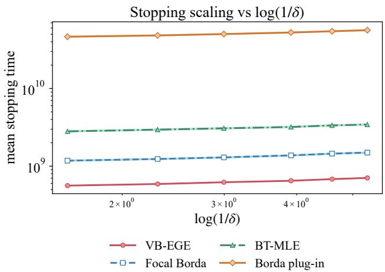  
Figure 3: Arena-10 medium mean stopping time (mean ± one standard error) versus $\log ( 1 / \delta )$

## C.4 Hyperparameter sensitivity analysis

We now examine sensitivity to the sampling and removal-threshold parameters by varying $C _ { \mathrm { s a m p } } \in \{ 0 . 5 , 1 , 2 , 4 \}$ and $C _ { \mathrm { t h r } } \in \{ 2 , 3 , 4 , 6 \}$ , while fixing $C _ { \mathrm { l o g } } = 4$ and $\delta = 0 . 0 5$ . We consider three settings: (1) the hard instance considered in the scaling studies with $K = 6 4 , d = 1 0$ , (2) the Arena-10 medium setting, and (3) the Witness-10 setting. We note that configurations other than the default are not covered by Theorem 3.1 as stated. Figure 4 present heatmaps corresponding to the sensitivity analysis results. We see that smaller $C _ { \mathrm { t h r } }$ generally yields smaller stopping time.

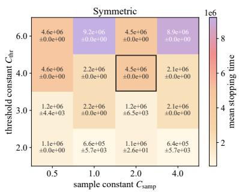  
(a) Symmetric $K = 6 4 , d = 1 0$

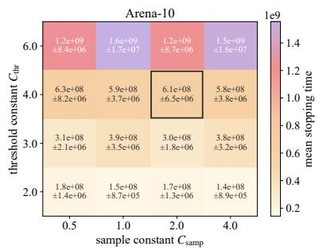  
(b) Arena-10 medium.

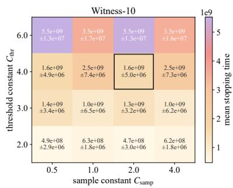  
(c) Witness-10.  
Figure 4: Mean stopping-time with respect to diference choices of $( C _ { \mathrm { s a m p } } , C _ { \mathrm { t h r } } )$ . Each cell reports stopping time (mean ± one standard error). The black rectangle corresponds to the default choice.

## C.5 Pareto-set size sensitivity analysis

We hold K = 64 and the synthetic Arena generator family fixed while varying $| \mathcal { P } | \in \{ 4 , 8 , 1 6 , 3 2 \}$ . Arena-4 uses margins [0.08, 0.25], Arena-10 uses [0.06, 0.20], and each parameter setting has 300 trials. The results are reported in Table 8 and visualized in Figure 5, where we see that stopping cost increases with |P|, while every tested ratio of mean comparison counts (baseline/VB-EGE) remains above one. The adaptive advantage therefore persists across frontier sizes 4–32.

Adaptive allocation by Borda gap

Table 8: Sensitivity to Pareto-set size. Parentheses contain one standard error for VB-EGE; other entries report each baseline’s mean comparison count divided by that of VB-EGE.
<table><tr><td>d</td><td>|P|</td><td></td><td>VB mean τ (SE)</td><td>Focal/VB</td><td> $\mathrm { M L E } / \mathrm { V B }$ </td><td> $\mathrm { P l u g - i n / V B }$ </td></tr><tr><td>4</td><td>4</td><td></td><td> $9 . 4 4 \times 1 0 ^ { 7 } ~ ( 7 . 0 2 \times 1 0 ^ { 5 } )$ </td><td>2.60</td><td>6.11</td><td>99.1</td></tr><tr><td>4</td><td>8</td><td></td><td> $1 . 1 6 \times 1 0 ^ { 8 } \ \left( 4 . 9 1 \times 1 0 ^ { 6 } \right)$ </td><td>10.0</td><td>22.9</td><td>387</td></tr><tr><td>4</td><td>16</td><td></td><td> $2 . 5 2 \times 1 0 ^ { 8 } ~ ( 5 . 7 0 \times 1 0 ^ { 7 } )$ </td><td>21.8</td><td>39.7</td><td>640</td></tr><tr><td>4</td><td>32</td><td></td><td> $4 . 4 2 \times 1 0 ^ { 8 } \ ( 2 . 2 2 \times 1 0 ^ { 7 } )$ </td><td>11.8</td><td>28.2</td><td>462</td></tr><tr><td>10</td><td>4</td><td></td><td> $5 . 2 1 \times 1 0 ^ { 8 } \ ( 2 . 7 9 \times 1 0 ^ { 6 } )$ </td><td>2.41</td><td>5.66</td><td>93.5</td></tr><tr><td>10</td><td>8</td><td></td><td> $5 . 5 5 \times 1 0 ^ { 8 } \ ( 3 . 1 1 \times 1 0 ^ { 6 } )$ </td><td>2.27</td><td>5.32</td><td>87.9</td></tr><tr><td>10</td><td>16</td><td></td><td> $6 . 1 0 \times 1 0 ^ { 8 } \ ( 4 . 2 1 \times 1 0 ^ { 6 } )$ </td><td>2.13</td><td>4.99</td><td>82.4</td></tr><tr><td>10</td><td>32</td><td></td><td> $6 . 8 8 \times 1 0 ^ { 8 } \ \left( 6 . 8 7 \times 1 0 ^ { 6 } \right)$ </td><td>2.19</td><td>5.09</td><td>83.7</td></tr></table>

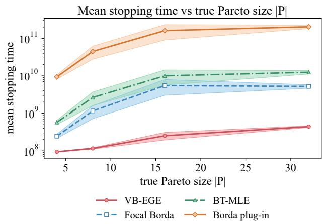  
(a) Arena-4.

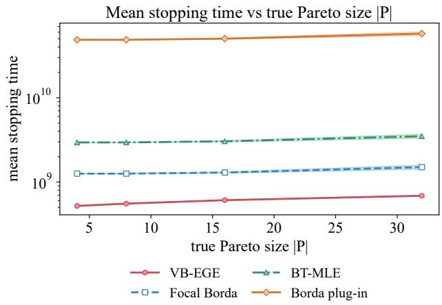  
(b) Arena-10.  
Figure 5: Mean stopping time (mean ± one standard error) as the true Pareto set grows.

## C.6 Sampling-mechanism diagnostics

Figure 6 plots the per-arm sample allocation against the Borda classification gap, showing that VB-EGE collects more observations for models with smaller gaps.

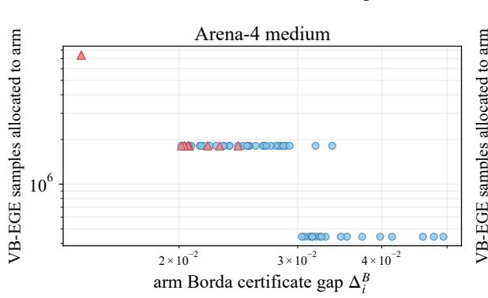

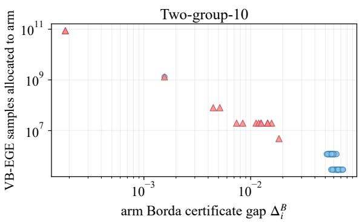  
O dominated arm Pareto arm  
Figure 6: Total VB-EGE allocation to each model versus its Borda classification gap on representative Arena-4 medium and Two-group-10 instances. Smaller-gap models receive more samples.

## D Additional details and results for real-data experiments

This section describes preprocessing and sampling from the three real-world Arena datasets, followed by detailed results and sensitivity to the treatment of non-decisive outcomes.

## D.1 Datasets, preprocessing, and retained models

Dataset versions and definition of the objectives. We fix the dataset versions before preprocessing. Comparisons are assigned to objectives solely from the released metadata, without using the prompt or response text.

• Arena-Human-Preference-140K (Arena-140K): lmarena-ai/arena-human-preference-140k.

Revision: 6322995ab34d7c2693e3f47dd13fa5caa0789a74. We construct five mutually exclusive prompt categories: general, code, math, creative writing, and instruction following. The four specialized categories are determined by the following metadata fields:

– is code for code,

– category tag.math v0.1.math for math,

– category tag.creative writing v0.1.creative writing for creative writing,

– category tag.if v0.1.if for instruction following.

Because the released indicators may overlap, we assign each comparison to the first applicable category according to the prespecified priority ordering:

$$
\mathrm { c o d e ~ > ~ \ m a t h ~ > ~ \ c r e a t i v e \mathrm { - } w r i t i n g ~ > ~ \ i n s t r u c t i o n \mathrm { - } f o l l o w i n g . }
$$

Comparisons with no active specialized indicators are assigned to the general category. For example, a comparison marked as both code and math is assigned to code.

• Search-Arena-24K: lmarena-ai/search-arena-24k.

Revision: fac8dcf86146c8773ef020095c5694c9b2bc98d7. We use the nine released values of the categorical primary intent field as objectives: Factual Lookup, Info Synthesis, Recommendation, Analysis, Explanation, Guidance, Creative Generation, Other, and Text Processing. Since primary intent is single-valued, each retained comparison contributes to at most one objective. Comparisons with a missing or unsupported intent are excluded.

• VisionArena-Battle: lmarena-ai/VisionArena-Battle.

Revision: a41d58f15caa3e2d9685774153d2bc815b943d96. We use the eight released Boolean category indicators directly: captioning, creative writing, diagram, entity recognition, homework, humor, is code, and ocr. These annotations are multi-label by construction. A comparison contributes once to every pair–objective cell whose corresponding indicator is true. Consequently, the number of pair–objective assignments may exceed the number of unique source comparisons; these repeated assignments represent overlapping category membership.

We retain only comparisons in which either model wins. In Arena-140K, we remove 21,528 tie and 15,749 both bad records. In Search-Arena-24K, we remove 2,282 tie, 1,442 both bad records, 10,751 missing outcomes, and 1,285 comparisons whose two model names refer to the same model after name normalization. In VisionArena-Battle, we remove 5,216 tie and 5,905 both bad records; another 2,762 decisive records match none of the eight released category indicators and are therefore removed.

Selection of the retained models. After removing the non-decisive comparisons, we take as candidates all models that appear in at least one decisive comparison on every objective. We connect two candidate models when their pair has at least one decisive comparison on every objective, and retain a maximumcardinality clique. If several maximum cliques exist, we choose the one with the largest total number of within-clique comparisons across objectives, then the lexicographically smallest sorted list of model names.

The resulting retained sets have 35, 8, and 12 models for Arena-140K, Search-Arena-24K, and VisionArena Battle, respectively. We call these tasks Arena-35, SearchArena-8, and VisionArena-12; the sufix gives the number of retained models.

Having determined the retained models, we then remove comparisons involving discarded models. This step removes 25,197, 4,004, and 5,467 objective records from Arena-140K, Search-Arena-24K, and VisionArena-Battle, respectively. The details are summarized in Table 9. The resulting empirical strict frontiers are presented in Table 10.

Table 9: Preprocessing counts for the three Arena datasets. “Assigned comparisons” counts source comparisons assigned to at least one evaluation objective; “Objective records” counts the resulting pair–objective records. As in the main text, “Rows” counts pair–objective records involving only retained models. The 23,458 retained VisionArena-Battle records correspond to 12,937 unique source comparisons.
<table><tr><td>Dataset</td><td>Source</td><td>Decisive</td><td>Assigned comparisons</td><td>Objective records</td><td>Candidates</td><td>K</td><td>Rows</td></tr><tr><td>Arena-140K</td><td>135,609</td><td>98,332</td><td>98,332</td><td>98,332</td><td>52</td><td>35</td><td>73,135</td></tr><tr><td>Search-Arena-24K</td><td>24,069</td><td>8,309</td><td>8,309</td><td>8,309</td><td>13</td><td>8</td><td>4,305</td></tr><tr><td>VisionArena-Battle</td><td>29,849</td><td>18,728</td><td>15,966</td><td>28,925</td><td>17</td><td>12</td><td>23,458</td></tr></table>

Table 10: Full-dimensional strict empirical Pareto sets on the three retained model sets.  
Dataset Pareto members   
Arena-35 chatgpt-4o-latest-20250326; gemini-2.5-pro; grok-3-preview-02-24   
SearchArena-8 gemini-2.5-pro-exp-03-25-grounding; sonar; sonar-pro-high; sonar-reasoning;   
sonar-reasoning-pro-high   
VisionArena-12 claude-3-5-sonnet-20240620; gemini-1.5-pro-exp-0801; gpt-4o-2024-05-13

## D.2 Sampling from logged Arena comparisons

We evaluate the four methods by sampling with replacement from the retained logs, where each draw counts as one comparison. We evaluate the methods by treating the logged comparisons as the ground truth and comparing the methods’ outputs against the empirical Pareto frontier derived from these logs.

Ground truth and inferential target. Let $\mathcal { D } _ { \mathrm { l o g } }$ denote the fixed log of decisive comparisons. For any $1 \leq i < j \leq K$ and $r \in [ d ]$ , let $N _ { i j , r } ^ { \mathrm { l o g } }$ be the number of records for that pair and objective, where $N _ { i j , r } ^ { \mathrm { l o g } } \geq 1$ by the choice of retained models. These records form a pair–objective cell, defined as

$$
\begin{array} { r } { \mathcal { D } _ { i j , r } : = ( Y _ { i j , r , s } ) _ { s = 1 } ^ { N _ { i j , r } ^ { \mathrm { l o g } } } , } \end{array}
$$

where $Y _ { i j , r , s } = 1$ if i wins and 0 if j wins. For the reverse orientation, set $Y _ { j i , r , s } = 1 - Y _ { i j , r , s }$ and $N _ { j i , r } ^ { \mathrm { l o g } } = N _ { i j , r } ^ { \mathrm { l o g } }$ Define

$$
\widehat { p } _ { i j , r } : = \frac { 1 } { N _ { i j , r } ^ { \mathrm { l o g } } } \sum _ { s = 1 } ^ { N _ { i j , r } ^ { \mathrm { l o g } } } Y _ { i j , r , s } , \qquad \widehat { p } _ { j i , r } = 1 - \widehat { p } _ { i j , r } ,
$$

and the empirical uniform-opponent Borda coordinates

$$
b _ { i , r } ^ { \mathrm { e m p } } : = \frac { 1 } { K - 1 } \sum _ { j \neq i } \widehat { p } _ { i j , r } .
$$

Writing $\boldsymbol { b } _ { i } ^ { \mathrm { e m p } } = ( b _ { i , 1 } ^ { \mathrm { e m p } } , \dots , b _ { i , d } ^ { \mathrm { e m p } } )$ and $b ^ { \mathrm { e m p } } = ( b _ { i } ^ { \mathrm { e m p } } ) _ { i = 1 } ^ { K }$ , the ground-truth Pareto set is

$$
\mathcal { P } _ { \mathrm { e m p } } : = \mathcal { P } ( \boldsymbol { b } ^ { \mathrm { e m p } } ) .
$$

Uniform-opponent queries. For a focal query $( i , r )$ , VB-EGE draws an opponent from all other retained models, including models already removed from its active set, then draws a record from that cell:

$$
J \sim \operatorname { U n i f } ( [ K ] \setminus \{ i \} ) , \qquad S \mid J = j \sim \operatorname { U n i f } ( \{ 1 , \dots , N _ { i j , r } ^ { \log } \} ) .
$$

It returns

$$
Z : = Y _ { i J , r , S } .
$$

Both samling steps are performed with replacement, using fresh randomness independent of any other draw and of the algorithm’s internal randomization. The following lemma establishes the the sampled Z is conditionally unbiased for the empirical Borda coordinate, where the subscript samp denotes this randomness conditional on $\mathcal { D } _ { \mathrm { l o g } }$

Lemma D.1 (Conditional Bernoulli representation). For every fixed logged data $\mathcal { D } _ { \mathrm { l o g } }$ and focal query $( i , r )$

$$
Z \mid \mathcal { D } _ { \log } , i , r \sim \mathrm { B e r n o u l l i } ( b _ { i , r } ^ { \mathrm { e m p } } ) .
$$

The sampling randomization can be represented by mutually independent streams, one $f o r$ each model–objective pair, with

$$
Z _ { i , r , 1 } , Z _ { i , r , 2 } , . . . \mid \mathcal { D } _ { \log } \overset { \mathrm { i i d } } { \sim } \mathrm { B e r n o u l l i } ( b _ { i , r } ^ { \mathrm { e m p } } ) .
$$

Proof. Conditional on the log and $J = j$ , the mean of $Z$ is $\widehat { p } _ { i j , r } .$ Averaging over the uniform opponent gives

$$
\mathbb { E } _ { \mathrm { s a m p } } [ Z \mid \mathcal { D } _ { \mathrm { l o g } } , i , r ] = \frac { 1 } { K - 1 } \sum _ { j \neq i } \widehat { p } _ { i j , r } = b _ { i , r } ^ { \mathrm { e m p } } .
$$

Since $Z$ is binary, this determines its Bernoulli law. Fresh, independent opponent and record draws give the independent streams. Adaptive selection of $( i , r )$ reveals the next unused observation of the corresponding stream, so this representation also applies to adaptive queries. □

For fixed $n \geq 1$ , let $\begin{array} { r } { \overline { { Z } } _ { i , r } ( n ) : = n ^ { - 1 } \sum _ { s = 1 } ^ { n } Z _ { i , r , s } ; } \end{array}$ the phase-m estimate is $\widehat { b } _ { i , r } ^ { ( m ) } = \overline { { Z } } _ { i , r } ( n _ { m } )$

Remark D.1 (Recovery conditional on the logged data). If $\mathrm { m i n } _ { i } \Delta _ { i } ( b ^ { \mathrm { e m p } } ) > 0$ , Lemma D.1 lets us apply Proposition B.4 with $b = b ^ { \mathrm { e m p } }$ : with probability at least $1 - \delta$ conditional on $\mathcal { D } _ { \mathrm { l o g } }$ , VB-EGE with $C = ( 2 , 4 , 4 )$ recovers $\mathcal { P } _ { \mathrm { e m p } }$ and satisfies the same sample-complexity bound with gaps $\Delta _ { i } ( b ^ { \mathrm { e m p } } )$ .

Opponent weighting and baseline sampling. For VB-EGE and Focal Borda, each focal query $( i , r )$ selects an opponent uniformly from the other retained models, then samples a logged outcome uniformly with replacement from the corresponding pair–objective cell. Focal Borda allocates these queries uniformly over model–objective pairs. BT-MLE and the Borda plug-in allocate comparisons uniformly over unordered pair–objective cells, sampling a logged outcome uniformly with replacement from each selected cell. BT-MLE fits scores to the resulting pair counts, while the plug-in averages the estimated pairwise win rates over opponents.

For eficiency, the implementations sample batch counts directly. A batch of n focal queries to $( i , r )$ has a Binomial $( n , b _ { i , r } ^ { \mathrm { e m p } } )$ win count, while a batch in cell $( i , j , r )$ has a Binomia $( n , \widehat { p } _ { i j , r } )$ win count. These draws preserve the joint law of the counts used by the methods, which make their decisions at batch boundaries.

Population-level unbiasedness under an additional logging assumption. The recovery guarantee above conditions on the observed log. To relate its Borda means to population means, write $\mathbf { N } = \bar { ( N _ { \it i j , r } ^ { \mathrm { l o g } } ) } _ { \it i < j , r }$ and let $\mathbb { E } _ { \mathrm { l o g } }$ denote expectation over the logged outcomes conditional on these counts.

Lemma D.2 (Population Borda unbiasedness under cell-wise iid logging). Suppose that, for every cell,

$$
\begin{array} { r } { Y _ { i j , r , 1 } , \ldots , Y _ { i j , r , N _ { i j , r } ^ { \mathrm { l o g } } } \mid \mathbf { N } \overset { \mathrm { i i d } } { \sim } \mathrm { B e r n o u l l i } ( p _ { i j , r } ) , } \end{array}\tag{22}
$$

where $p _  i j , $ is the population win probability conditional on a decisive outcome. Set $p _ { j i , r } = 1 - p _ { i j , r }$ and

$$
b _ { i , r } ^ { \mathrm { p o p } } : = \frac { 1 } { K - 1 } \sum _ { j \neq i } p _ { i j , r } .
$$

Then

$$
\mathbb { E } _ { \log } [ \widehat { p } _ { i j , r } \mid \mathbf { N } ] = p _ { i j , r } , \qquad \mathbb { E } _ { \log } [ b _ { i , r } ^ { \mathrm { e m p } } \mid \mathbf { N } ] = b _ { i , r } ^ { \mathrm { p o p } } .
$$

For every fixed $n \geq 1$ , also $\mathbb { E } _ { \mathrm { l o g , s a m p } } [ \overline { { Z } } _ { i , r } ( n ) \mid \mathbf { N } ] = b _ { i , r } ^ { \mathrm { p o p } } $

Proof. The cell average has expectation $p _ { i j , r }$ under (22). Averaging these expectations over opponents proves the Borda identity.

The last assertion follows by iterated expectation and $\mathbb { E } _ { \mathrm { s a m p } } [ \overline { { Z } } _ { i , r } ( n ) \mid \mathcal { D } _ { \mathrm { l o g } } ] = b _ { i , r } ^ { \mathrm { e m p } } .$

Together with Remark D.1, this lemma connects the two levels of the logged-data experiment. Conditional on the log, VB-EGE recovers $\mathcal { P } _ { \mathrm { e m p } }$ with probability at least $1 - \delta$ . Under cell-wise iid logging, $b ^ { \mathrm { e m p } }$ is an unbiased estimate of $b ^ { \mathrm { p o p } }$ and concentrates around it as the cell counts grow.

Although unbiasedness does not necessarily transfer to $\mathcal { P } _ { \mathrm { e m p } }$ because $\mathcal { P } ( \cdot )$ is discontinuous, we nevertheless have $\mathcal { P } _ { \mathrm { e m p } } = \mathcal { P } (  { b ^ { \mathrm { p o p } } } )$ if min $\Delta _ { i } ( b ^ { \mathrm { p o p } } ) > 0$ and ma $\begin{array} { r } { \mathrm { x } _ { i , r } \ : | b _ { i , r } ^ { \mathrm { e m p } } - \dot { b } _ { i , r } ^ { \mathrm { p o p } } | < \mathrm { m i n } _ { i } \Delta _ { i } ( b ^ { \mathrm { p o p } } ) / 2 ; } \end{array}$ the probability of the latter event tends to one as min $_ { i < j , r } N _ { i j , r } ^ { \mathrm { l o g } }  \infty$

## D.3 Full Pareto-set results and method comparisons

## D.3.1 Comparison of the four methods on the three Arena datasets

Table 11 gives the complete stopping-time comparison in the three real-world Arena datasets.

Table 11: Comparison of the four methods on the three Arena datasets. Entries are mean stopping times in millions of sampled comparisons (including repeated records), with each method’s mean divided by the VB-EGE mean in parentheses. Every method stops and recovers the exact frontier in all 100 trials on each dataset.
<table><tr><td>Method</td><td>Arena-35</td><td>SearchArena-8</td><td>VisionArena-12</td></tr><tr><td>VB-EGE</td><td>86.82 (1.00×)</td><td>124.34 (1.00×)</td><td>8.80 (1.00×)</td></tr><tr><td>Focal Borda</td><td>1,435.70 (16.54×)</td><td>492.74 (3.96×)</td><td>40.39 (4.59×)</td></tr><tr><td>BT-MLE</td><td>1,586.26 (18.27×)</td><td>149.06 (1.20×)</td><td>14.77 (1.68×)</td></tr><tr><td>Borda plug-in</td><td>26,164.10 (301.36×)</td><td>1,890.10 (15.20×)</td><td>251.62 (28.60×)</td></tr></table>

## D.3.2 Full-dimensional empirical Borda profiles

Figures 7 to 9 present the Borda scores for all the models under evaluation. Pareto membership is computed using all five, nine, or eight objectives for Arena-35, SearchArena-8, and VisionArena-12, respectively. Colored lines correspond to strict-frontier members and faint gray lines are dominated models from the same retained set. Across all three datasets, the frontier profiles cross one another repeatedly, reflecting the complementary strengths of the Pareto models.

Arena-35: full 5-D strict Pareto set  
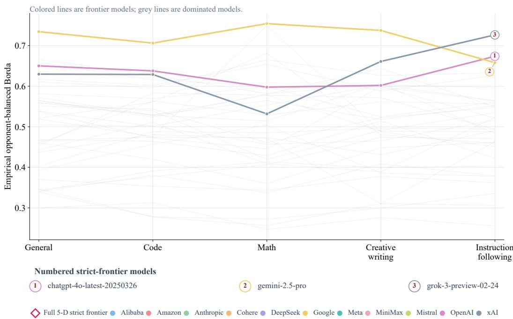  
Figure 7: Arena-35: empirical Borda profiles on all five objectives.

## SearchArena-8: full 9-D strict Pareto set

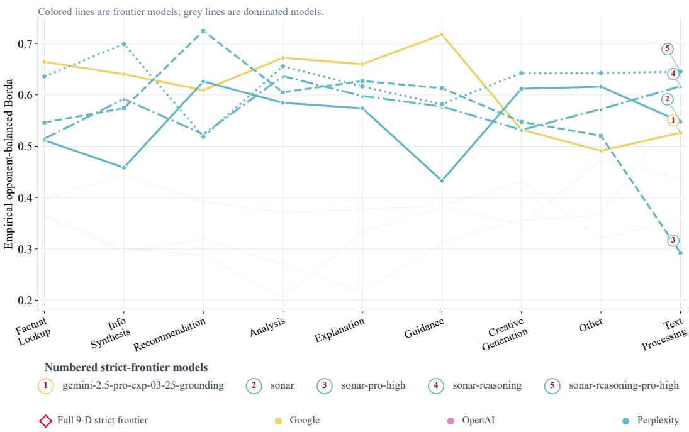  
Figure 8: SearchArena-8: empirical Borda profiles on all nine objectives.

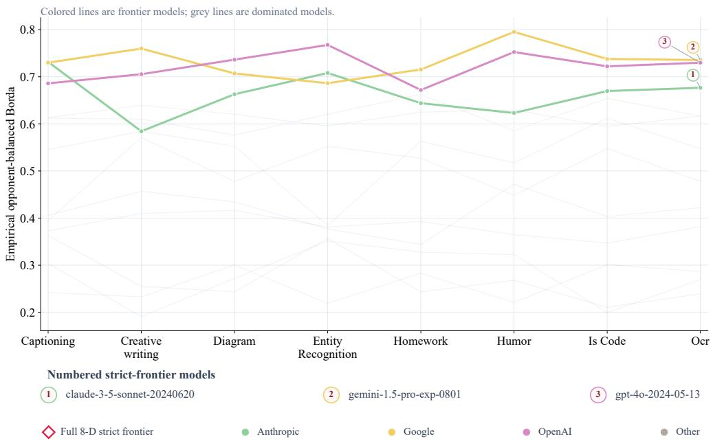  
Figure 9: VisionArena-12: empirical Borda profiles on all eight objectives.

## D.3.3 Low-dimensional illustrative projections

Figures 10 to 12 present representative two-dimensional and three-dimensional projections for each dataset, where we recompute Pareto membership in each projected space. Because strict dominance in the sense of Definition 1.1 is preserved when coordinates are removed, each projected frontier is a subset of the full-dimensional frontier.

The Arena-35 views here and in Figure 1 use the same 35 retained models and the same empirical Borda coordinates. The General, Code, and Math projection retains only gemini-2.5-pro. The Code, Math, and Instruction-Following projection in Figure 1 retains all three members of the full frontier: chatgpt-4o-latest-20250326, gemini-2.5-pro, and grok-3-preview-02-24. All recovery results use the full-dimensional target.

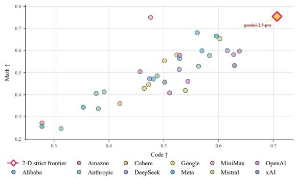  
(a) 2D: Code versus Math.

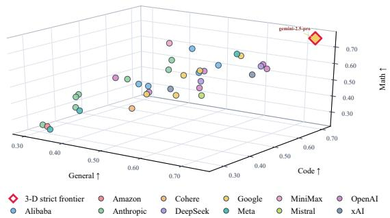  
(b) 3D: General, Code, and Math.  
Figure 10: Arena-35 illustrative projections.

2-D strict frontier Anthropic Google OpenAI Other  
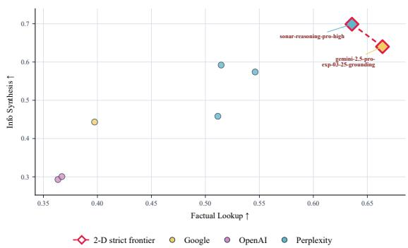  
(a) 2D: Factual Lookup versus Info Synthesis.

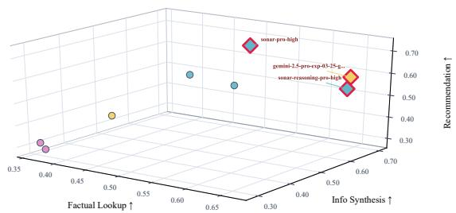  
3-D strict frontier Google OpenAI Perplexity  
(b) 3D: Factual Lookup, Info Synthesis, and Recommendation.

Figure 11: SearchArena-8 illustrative projections.  
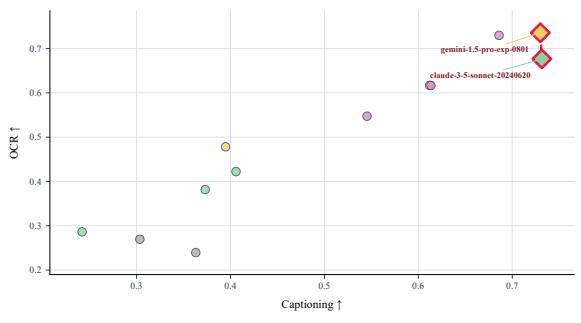  
(a) 2D: Captioning versus OCR.

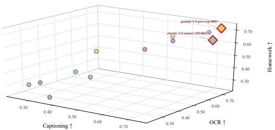  
3-D strict frontier Anthropic Google OpenAI Other  
(b) 3D: Captioning, OCR, and Homework.  
Figure 12: VisionArena-12 illustrative projections.

## D.4 Sensitivity to tie and both bad handling

The main experiments retain only decisive comparisons. This section examines the sensitivity of our results to diferent treatments of non-decisive outcomes. We consider two alternative treatmens in addition to removing the non-decisive items:

$$
D = \mathrm { d e c i s i v e - o n l y } , \qquad H = \mathrm { d i r e c t ~ m e r g e d ~ h a l f - c r e d i t } , \qquad F = \mathrm { f i t t e d ~ D a v i d s o n ~ h a l f - c r e d i t } .
$$

All three use the same retained models, objective assignments, and uniform-opponent aggregation.

Common setup and comparison metrics. For an unordered pair $\{ i , j \}$ and objective r, let $W _ { i j , r }$ and $W _ { j i , r }$ be the directed win counts, and $T _ { i j , r }$ and $N _ { i j , r } ^ { \mathrm { b a d } }$ the tie and both bad counts. We merge non-decisive outcomes into $U _ { i j , r } : = T _ { i j , r } + N _ { i j , r } ^ { \mathrm { b a d } }$ . Table 12 reports their totals; non-decisive records account for 27.5% to 38.0% of each retained log.

For $X \in \{ D , H , F \}$ , write $b ^ { X } = ( b _ { i } ^ { X } ) _ { i = } ^ { K }$ for its Borda vectors and define

$$
b ^ { D } = b ^ { \mathrm { e m p } } , \qquad \mathcal { P } _ { X } = \mathcal { P } ( b ^ { X } ) , \qquad \Delta _ { \mathrm { m i n } } ^ { X } = \operatorname* { m i n } _ { i } \Delta _ { i } ( b ^ { X } ) , \qquad \mathcal { H } _ { X } = \sum _ { i } \Delta _ { i } ( b ^ { X } ) ^ { - 2 } ,
$$

where the definition of $\boldsymbol { b } ^ { \mathrm { e m p } }$ is to be given below for each treatment.

For two methods X and Y, we define

$$
\operatorname { J a c } ( X , Y ) = { \frac { | { \mathcal { P } } _ { X } \cap { \mathcal { P } } _ { Y } | } { | { \mathcal { P } } _ { X } \cup { \mathcal { P } } _ { Y } | } } ,
$$

and let $\rho _ { \mathrm { m i n } } ( X , Y )$ denote the minimum Spearman correlation across objectives. Stopping-time comparisons use the main experiment settings: 100 independent trials per construction and dataset, $\delta = 0 . 0 5$ , and $C = ( 2 , 4 , 4 )$

Table 12: Outcome counts on the retained models, before non-decisive labels are merged. Each record is one comparison assigned to one objective, and the last column is the fraction of records labeled tie or both bad.

<table><tr><td>Dataset</td><td>Decisive</td><td>tie</td><td>both_bad</td><td>Non-decisive fraction</td></tr><tr><td>Arena-35</td><td>73,135</td><td>16,093</td><td>11,594</td><td>27.5%</td></tr><tr><td>SearchArena-8</td><td>4,305</td><td>1,148</td><td>676</td><td>29.8%</td></tr><tr><td>VisionArena-12</td><td>23,458</td><td>6,346</td><td>8,031</td><td>38.0%</td></tr></table>

## D.4.1 Direct merged half-credit recoding

Under D, the empirical win rate is

$$
\widehat { p } _ { i j , r } ^ { D } = \frac { W _ { i j , r } } { W _ { i j , r } + W _ { j i , r } } = \widehat { p } _ { i j , r } .
$$

The direct construction H keeps each decisive outcome coded as (1, 0) and assigns $( 1 / 2 , 1 / 2 )$ to every tie and both bad outcome, so its directed cell mean is

$$
\widehat { p } _ { i j , r } ^ { H } = \frac { W _ { i j , r } + \frac { 1 } { 2 } U _ { i j , r } } { W _ { i j , r } + W _ { j i , r } + U _ { i j , r } } , \qquad \widehat { p } _ { j i , r } ^ { H } = 1 - \widehat { p } _ { i j , r } ^ { H } .
$$

Every pair–objective cell is estimated directly from its own logged counts, and the corresponding Borda mean is $\begin{array} { r } { b _ { i , r } ^ { H } = ( K - 1 ) ^ { - 1 } \sum _ { j \neq i } \widehat { p } _ { i j , r } ^ { H } } \end{array}$ . Figures 13 to 15 compare D with H on Arena-35, SearchArena-8, and VisionArena-12, respectively.

As in Appendix D.2, each query draws an opponent uniformly from the other retained models, then a record uniformly with replacement from the selected cell. A win, a non-decisive outcome, and a loss return 1, $1 / 2 { \mathrm { . } }$ , and 0. The proof of Proposition B.4 uses Hoefding’s inequality, which also applies to these [0, 1]-valued observations, so Remark D.1 extends to $\mathcal { P } _ { H }$ when its gaps are positive.

Arena-35: union of both Pareto sets Thicker opaque lines are frontier members; line pattern and marker distinguish models from the same provider

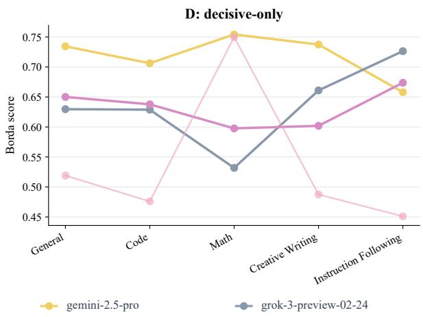

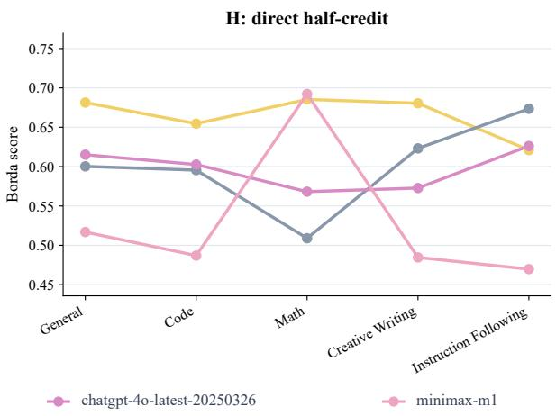  
Figure 13: Arena-35: Borda profiles of the models in $\mathcal { P } _ { D } \cup \mathcal { P } _ { H }$ under each target; minimax-m1 enters the strict Pareto frontier under H. Left: decisive-only target D; right: direct half-credit target H.

SearchArena-8: union of both Pareto sets Thicker opaque lines are frontier members; line pattern and marker distinguish models from the same provider

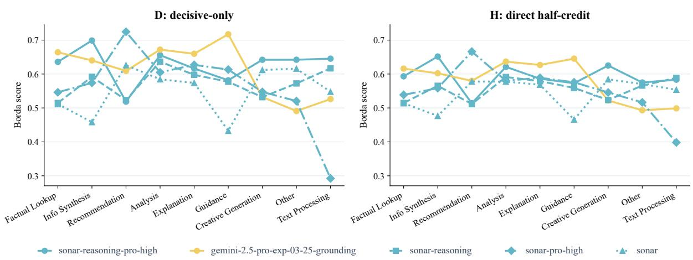  
Figure 14: SearchArena-8: Borda profiles of the models in $\mathcal { P } _ { D } \cup \mathcal { P } _ { H }$ under each target; frontier membership is unchanged. Left: decisive-only target D; right: direct half-credit target H.  
VisionArena-12: union of both Pareto sets Thicker opaque lines are frontier members; line pattern and marker distinguish models from the same provider

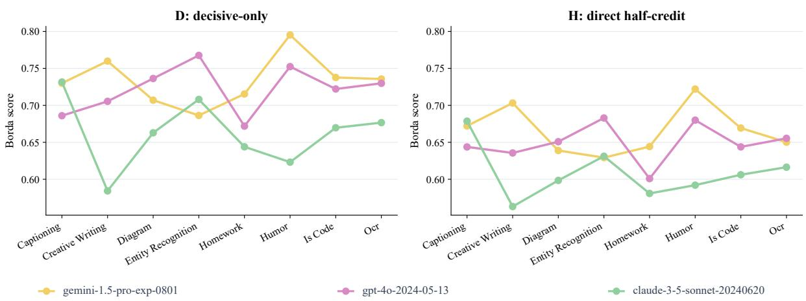  
Figure 15: VisionArena-12: Borda profiles of the models in $\mathcal { P } _ { D } \cup \mathcal { P } _ { H }$ under each target; frontier membership is unchanged. Left: decisive-only target $D ;$ right: direct half-credit target H.

For batching, we average the three outcome probabilities over opponents and draw multinomial category counts, extending the batch-count implementation in Appendix D.2. The resulting sums and counts have the same distribution as sequential queries; these are the only observation summaries used by VB-EGE.

## D.4.2 Fitted Davidson construction

Three-outcome likelihood. The fitted construction F uses the full count triple $( W _ { i j , r } , W _ { j i , r } , U _ { i j , r } )$ to fit, separately for each objective r, a Davidson model (Davidson, 1970) with pair-specific tie weights, following the factored tie construction of Ameli et al. (2025). Let $\theta _ { i , r } ^ { F }$ be the score of model i and, for $i < j ,$ , let $\eta _ { i j , i }$ r be the symmetric log tie weight of the pair. The probabilities that i wins, that j wins, and that the comparison

is non-decisive are parametrized as

$$
( \pi _ { i j , r } ^ { W } , \pi _ { i j , r } ^ { L } , \pi _ { i j , r } ^ { U } ) = \mathrm { s o f t m a x } \left( \frac { \theta _ { i , r } ^ { F } - \theta _ { j , r } ^ { F } } { 2 } , \frac { \theta _ { j , r } ^ { F } - \theta _ { i , r } ^ { F } } { 2 } , \eta _ { i j , r } \right) , \qquad \sum _ { i = 1 } ^ { K } \theta _ { i , r } ^ { F } = 0 .\tag{23}
$$

Conditional on a decisive outcome, the win probability follows the Bradley–Terry model with score diference $\theta _ { i , r } ^ { F } - \theta _ { j , r } ^ { F }$ . The parameters are fitted jointly by minimizing the multinomial negative log-likelihood obtained by weighting the three log probabilities in (23) by $( W _ { i j , r } , W _ { j i , r } , U _ { i j , r } )$ and summing over $i < j$

Factored tie weight. We use a parameter $k _ { \mathrm { t i e } }$ to control the factor size in the parameterization of $\eta _ { i j , r }$ When $k _ { \mathrm { t i e } } = 0$ , all pairs in objective r share one scalar tie logit, $\eta _ { i j , r } = \gamma _ { r } ^ { \mathrm { t i e } }$ . When $k _ { \mathrm { t i e } } > 0$ , we set

$$
\eta _ { i j , r } = ( \Gamma _ { r } ) _ { i j } , \qquad \Gamma _ { r } = V _ { r } \Phi ^ { \top } + \Phi V _ { r } ^ { \top } , \qquad ( \Phi ) _ { a \ell } = \sqrt { \frac { 2 } { K } } \cos \left[ \frac { \pi ( 2 a - 1 ) ( 2 \ell - 1 ) } { 4 K } \right] ,
$$

where $V _ { r } , \Phi \in \mathbb { R } ^ { K \times k _ { \mathrm { t i e } } }$ and Φ consists of the first $k _ { \mathrm { t i e } }$ columns of the fixed DCT-IV basis. This parameterization makes $\Gamma _ { r }$ symmetric while allowing the tie propensity to vary across pairs. We call $k _ { \mathrm { t i e } }$ , the number of factor columns, the tie-factor size. Ameli et al. (2025) call it the rank of the factor matrices; we use a diferent name because $\Gamma _ { r }$ itself can have rank up to $2 k _ { \mathrm { t i e } }$ . For $k _ { \mathrm { t i e } } \geq 1$ , no separate scalar logit $\gamma _ { r } ^ { \mathrm { t i e } }$ is included. The models with $k _ { \mathrm { t i e } } \geq 1$ are nested, because appending a zero column to $V _ { r }$ embeds size $k _ { \mathrm { t i e } }$ in size $k _ { \mathrm { t i e } } + 1$ whereas the constant-logit model with $k _ { \mathrm { t i e } } = 0$ is generally not nested in them. We therefore compare all candidates by held-out likelihood.

Selection of $k _ { \mathrm { t i e } }$ and refitting. Within each objective, we assign each observation independently to training with probability 0.9. Whenever a model pair has no training observations in that objective, we move one of its validation observations, taken from its most frequent outcome category, to training.

The candidate grids are prespecified and listed in Table 13; Arena-35 uses a broader grid than the two smaller model sets. Selection is restricted to these grids. We select the size with the smallest held-out mean negative log-likelihood and refit it to all observations. Fits use BFGS with analytic gradients; all 76 candidate fits and 22 full-data fits converged, with one candidate requiring an L-BFGS-B fallback.

Table 13: Selection of the tie-factor size $k _ { \mathrm { t i e } }$ on the fixed split described above. Selected sizes are listed in the objective order of Appendix D.1.
<table><tr><td>Dataset</td><td>Candidate  $k _ { \mathrm { t i e } }$ </td><td>Selected  $k _ { \mathrm { t i e } }$  by objective</td></tr><tr><td>Arena-35</td><td> $\{ 0 , 1 , 2 , 3 , 5 \}$ </td><td> $( 2 , 1 , 0 , 0 , 0 )$ </td></tr><tr><td>SearchArena-8</td><td>{0, 1, 2}</td><td> $( 2 , 0 , 2 , 0 , 0 , 1 , 2 , 1 , 0 )$ </td></tr><tr><td>VisionArena-12</td><td>{0, 1, 2}</td><td>(2, 2, 1, 2, 1, 0, 1, 2)</td></tr></table>

The held-out losses for all candidate tie-factor sizes are shown in Figures 16 to 18.

Binary interface and fitted target. After refitting the selected model to all observations, we convert its fitted outcome probabilities to half-credit win probabilities

$$
\widehat { p } _ { i j , r } ^ { F } = \pi _ { i j , r } ^ { W } + \frac { 1 } { 2 } \pi _ { i j , r } ^ { U } , \qquad \widehat { p } _ { j i , r } ^ { F } = \pi _ { i j , r } ^ { L } + \frac { 1 } { 2 } \pi _ { i j , r } ^ { U } = 1 - \widehat { p } _ { i j , r } ^ { F } .
$$

As in Appendix D.2, each oracle query first draws an opponent uniformly from the other retained models. Conditional on the selected pair $( i , j )$ and objective $r ,$ the oracle draws an outcome from the fitted threecategory distribution and resolves a non-decisive outcome with an independent fair coin, which is equivalent to a single Bernoulli draw with mean $\widehat { p } _ { i j , r } ^ { F }$ . We then compute

$$
b _ { i , r } ^ { F } = \frac { 1 } { K - 1 } \sum _ { j \neq i } \widehat { p } _ { i j , r } ^ { F }
$$

and obtain the Pareto set $\mathcal { P } _ { F }$ of the fitted Borda scores.

For each model–objective pair, the marginal observation law is Bernoulli $( b _ { i , r } ^ { F } )$ , so the implementation draws batch win counts from the corresponding binomial distribution, as under D.

Arena-35: 90/10 tie-factor size selection Open circles mark the selected factor size for each objective  
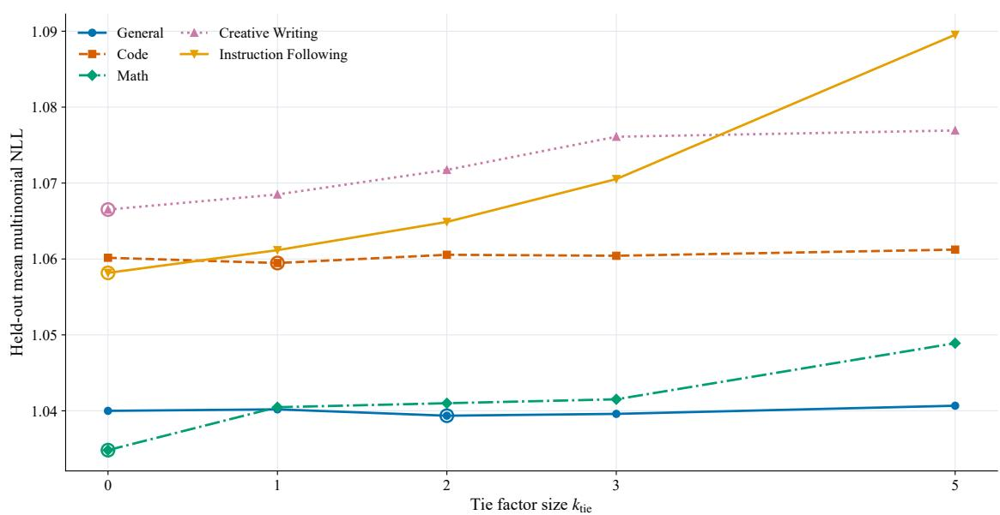  
Figure 16: Arena-35: held-out NLL for each candidate tie-factor size $k _ { \mathrm { t i e } } ;$ open circles mark the selected size for each objective. The candidates 0, 1, 2, 3, 5 are plotted at their numerical positions.

SearchArena-8: 90/10 tie-factor size selection Open circles mark the selected factor size for each objective  
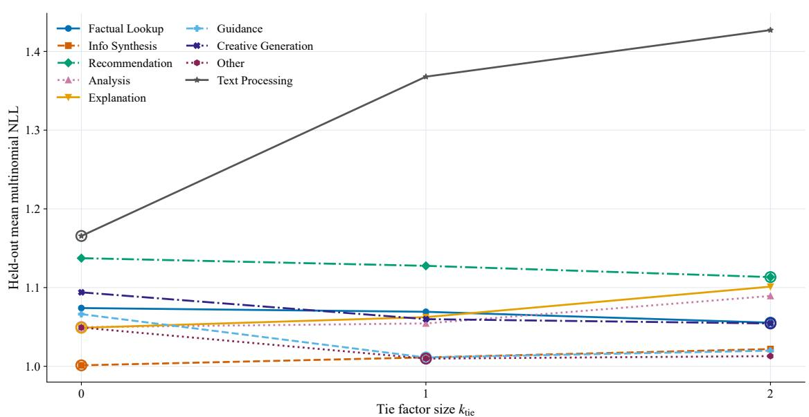  
Figure 17: SearchArena-8: held-out NLL for each candidate tie-factor size $k _ { \mathrm { t i e } } ;$ open circles mark the selected size for each objective.

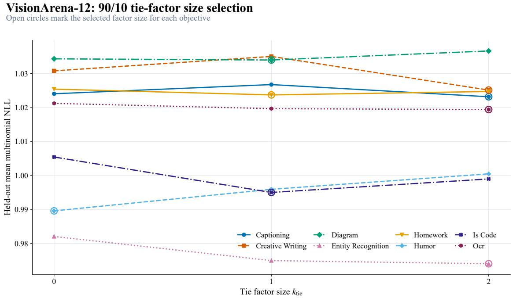  
Figure 18: VisionArena-12: held-out NLL for each candidate tie-factor size $k _ { \mathrm { t i e } } ;$ open circles mark the selected size for each objective.

## D.4.3 Target and stopping-time comparisons

Target sensitivity. Table 14 compares the two alternatives with D. On Arena-35, H adds minimax-m1 to the frontier, increasing its size from three to four. Under F, minimax-m1 enters and chatgpt-4o-latest-20250326 leaves, keeping the frontier size at three. The respective Jaccard overlaps with D are 0.75 and 0.5. SearchArena-8 and VisionArena-12 retain their decisive-only frontiers under both constructions. Figures 13 and 19 show the Arena-35 profiles where membership changes.

Arena-35: union of both Pareto sets Thicker opaque lines are frontier members; line pattern and marker distinguish models from the same provider

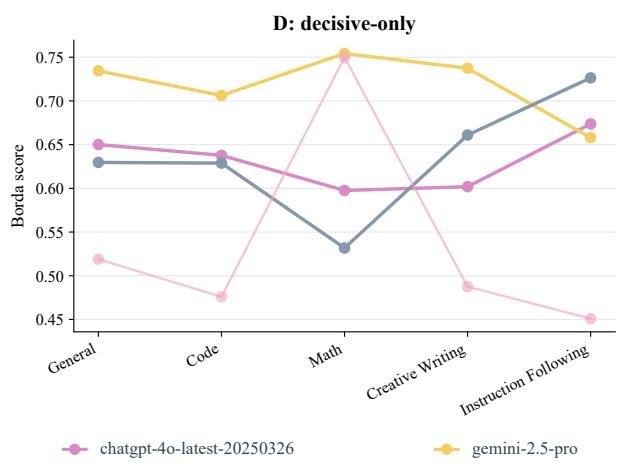

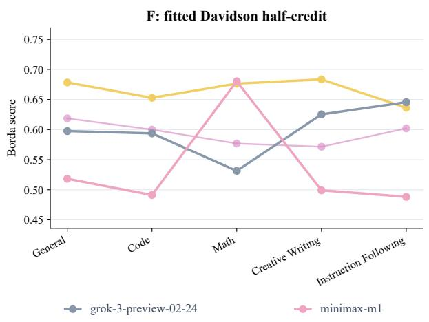  
Figure 19: Arena-35: Borda profiles of the models in $\mathcal { P } _ { D } \cup \mathcal { P } _ { F }$ under each target; minimax-m1 enters and chatgpt-4o-latest-20250326 leaves the strict Pareto frontier under F. Left: decisive-only target $D ;$ right: fitted Davidson target F.

SearchArena-8: union of both Pareto sets Thicker opaque lines are frontier members; line pattern and marker distinguish models from the same provider  
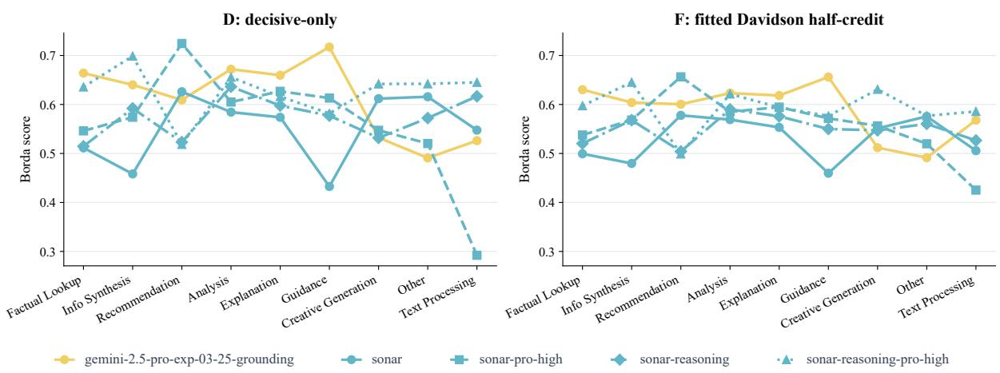  
Figure 20: SearchArena-8: Borda profiles of the models in $\mathcal { P } _ { D } \cup \mathcal { P } _ { F }$ under each target; frontier membership is unchanged. Left: decisive-only target D; right: fitted Davidson target F.  
VisionArena-12: union of both Pareto sets Thicker opaque lines are frontier members; line pattern and marker distinguish models from the same provider

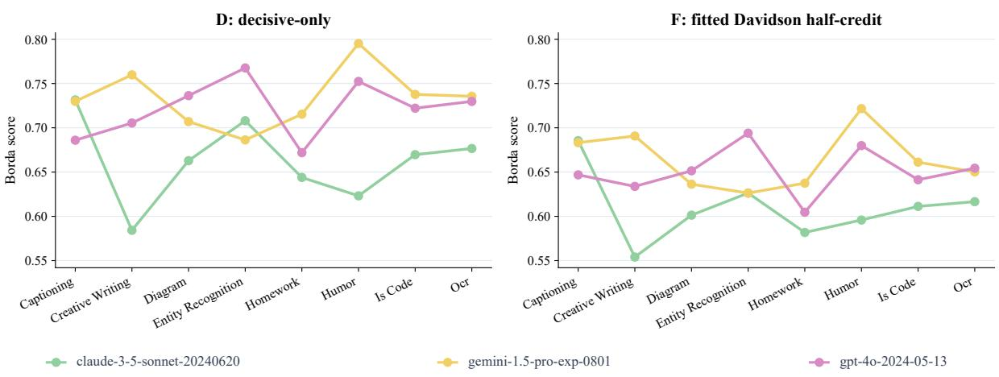  
Figure 21: VisionArena-12: Borda profiles of the models in $\mathcal { P } _ { D } \cup \mathcal { P } _ { F }$ under each target; frontier membership is unchanged. Left: decisive-only target $D ;$ right: fitted Davidson target F.

Table 14: Target sensitivity on the fixed sets of retained models used in the main experiments. $D / H / F$ gives the strict-frontier sizes under the decisive-only, direct half-credit, and fitted Davidson targets. Jac(D, H) and Jac $( D , F )$ are Pareto-set Jaccard overlaps. Mean coordinate shifts are averaged over all model–objective coordinates, and $\rho _ { \mathrm { m i n } }$ is the minimum objective-wise Spearman correlation with the decisive-only target.
<table><tr><td>Dataset</td><td> $D / H / F$ </td><td> ${ \mathrm { J a c } } ( D , H )$ </td><td> $\mathrm { J a c } ( D , F )$ </td><td>Mean  $| b ^ { H } - b ^ { D } |$ </td><td>Mean  $| b ^ { F } - b ^ { D } |$ </td><td> $\rho _ { \mathrm { m i n } } ( D , H )$ </td><td> $\rho _ { \mathrm { m i n } } ( D , F )$ </td></tr><tr><td>Arena-35</td><td>3/4/3</td><td>0.750</td><td>0.500</td><td>0.0244</td><td>0.0267</td><td>0.993</td><td>0.973</td></tr><tr><td>SearchArena-8</td><td>5/5/5</td><td>1.000</td><td>1.000</td><td>0.0333</td><td>0.0352</td><td>0.929</td><td>0.810</td></tr><tr><td>VisionArena-12</td><td>3/3/3</td><td>1.000</td><td>1.000</td><td>0.0529</td><td>0.0524</td><td>0.958</td><td>0.951</td></tr></table>

Borda profiles under the fitted Davidson target. Figures 19 to 21 compare D with $F$ on Arena-35, SearchArena-8, and VisionArena-12, respectively.

Stopping times and gap summaries. Under D and F, focal observations are Bernoulli, so their laws are determined by the corresponding Borda means. This comparison isolates the change in the mean array within the same observation family. The comparison of D with H also changes the observation family to $\{ 0 , 1 / 2 , 1 \}$ If $u _ { i , r } ^ { H }$ is the uniform-opponent probability of a non-decisive outcome, its variance is $b _ { i , r } ^ { H } \big ( 1 - b _ { i , r } ^ { H } \big ) - \dot { u } _ { i , r } ^ { H } \big / 4$ smaller than the Bernoulli variance at the same mean; its mean also difers from that under D.

Table 15 reports the minimum gaps, inverse-squared-gap sums, and stopping times. The gap summaries do not track stopping times closely: from D to $F , \mathcal { H } _ { X }$ falls by 16% on SearchArena-8 while the mean stopping time rises by 2%, and it rises by 32% on Arena-35 while the mean stopping time more than doubles.

Table 15: Gap summaries and stopping times under D, H, and F. Panel (a) gives the minimum gaps and $\begin{array} { r } { \mathcal { H } _ { X } = \sum _ { i } \Delta _ { i } ( b ^ { X } ) ^ { - 2 } } \end{array}$ , with the latter in thousands. Panel (b) gives mean stopping times in millions of comparisons, with one standard error in parentheses, and ratios of means. In panel (c), each entry gives a final phase followed by its trial count in parentheses. Every trial recovers its construction’s strict frontier.

(a) Gap summaries
<table><tr><td>Dataset</td><td> $\Delta _ { \mathrm { m i n } } ^ { D }$ </td><td> $\Delta _ { \operatorname* { m i n } } ^ { H }$ </td><td> $\Delta _ { \mathrm { m i n } } ^ { F }$ </td><td> $\mathcal { H } _ { D } / 1 0 ^ { 3 }$ </td><td> $\mathcal { H } _ { H } / 1 0 ^ { 3 }$ </td><td> $\mathcal { H } _ { F } / 1 0 ^ { 3 }$ </td></tr><tr><td>Arena-35</td><td>0.00441</td><td>0.00520</td><td>0.00391</td><td>111.72</td><td>101.03</td><td>147.38</td></tr><tr><td>SearchArena-8</td><td>0.00460</td><td>0.00539</td><td>0.00506</td><td>94.97</td><td>69.93</td><td>79.71</td></tr><tr><td>VisionArena-12</td><td>0.02171</td><td>0.00649</td><td>0.00225</td><td>5.38</td><td>49.25</td><td>397.08</td></tr></table>

(b) Stopping times
<table><tr><td>Dataset</td><td> $\bar { \tau } _ { D }$ </td><td> $\bar { \tau } _ { H }$ </td><td> $\bar { \tau } _ { F }$ </td><td> $\bar { \tau } _ { H } / \bar { \tau } _ { D }$ </td><td> ${ \bar { \tau } _ { F } } / { \bar { \tau } _ { D } }$ </td></tr><tr><td>Arena-35</td><td>86.82 (2.29)</td><td>116.01 (0.39)</td><td>196.97 (11.25)</td><td>1.34×</td><td>2.27×</td></tr><tr><td>SearchArena-8</td><td>124.34 (0.03)</td><td>124.79 (0.03)</td><td>126.50 (0.02)</td><td>1.00×</td><td>1.02×</td></tr><tr><td>VisionArena-12</td><td>8.80 (0.01)</td><td>114.52 (0.04)</td><td>471.55 (13.90)</td><td>13.01×</td><td>53.59×</td></tr></table>

(c) Final phases (numbers of trials)
<table><tr><td>Dataset</td><td>D</td><td>H</td><td>F</td></tr><tr><td>Arena-35</td><td>9 (99), 10 (1)</td><td>9 (100)</td><td>9 (51), 10 (49)</td></tr><tr><td>SearchArena-8</td><td>9 (100)</td><td>9 (100)</td><td>9 (100)</td></tr><tr><td>VisionArena-12</td><td>7 (100)</td><td>9 (100)</td><td>10 (99), 11 (1)</td></tr></table>

In phase $m ,$ VB-EGE tops up every active model–objective pair to $n _ { m }$ samples, and $n _ { m }$ grows roughly fourfold between phases. The extra phases on VisionArena-12 and under $F$ on Arena-35 therefore help explain their large stopping-time increases. SearchArena-8 stops after nine phases under all three constructions.

Each phase’s cost also depends on the number of active models. On Arena-35, all 100 trials under D enter phase nine with two active models. Under H, 98 trials enter that phase with three active models and the remaining two with two. The mean comparison count in phase nine is therefore 55.13M under D and 82.14M under H. This increase of 27.01M accounts for approximately 93% of the overall increase of 29.19M in mean stopping time.

## E Additional comparison with a Track-and-Stop extension

The BT-MLE baseline in the main experiments samples pair–objective cells uniformly, so its gap to VB-EGE leaves open whether an adaptive likelihood-based method would perform better. This section empirically examines that question using a Pareto extension of the scalar top-k Track-and-Stop method of Goldberger & Rudi (2026). Appendix E.1 describes the extension, and Appendix E.2 compares it with VB-EGE on the synthetic tasks of Appendix C.

## E.1 Implementation used in the reported experiments

The scalar top-k method of Goldberger & Rudi (2026) combines Bradley–Terry MLE, adaptive allocation, and a generalized likelihood-ratio (GLR) stopping rule. We retain this template and replace its scalar alternatives with Pareto alternatives, calling the resulting procedure Pareto BT-GLR Track-and-Stop (Pareto BT-GLR T&S). Here, an alternative is a set of score arrays defined by linear inequalities describing a change in the current Pareto frontier, up to boundary points. The implementation ranks these alternatives by approximate Fisher-information scores and refits the likelihood only under the selected alternative. We call this approximation screening.

Let $\begin{array} { r } { N _ { \mathrm { c e l l } } = d ( \binom { K } { 2 } } \end{array}$ be the number of unordered pair–objective cells. The method takes $n _ { 0 }$ initial samples per cell and initializes sampling weights $w _ { i j , r } = 1 / N _ { \mathrm { c e l l } }$ , which are carried across checks. At check $m ,$ let t be the total number of comparisons and $N _ { i j , r } ( t )$ the count in cell $( i , j , r )$ . Write $\widehat { \theta } _ { \cdot , r , t } \in \mathbb { R } ^ { K }$ for the fitted score vector on objective r and $\widehat { \theta _ { t } } = ( \widehat { \theta _ { i , t } } ) _ { i = 1 } ^ { K }$ , with $\widehat { \theta } _ { i , t } = ( \widehat { \theta } _ { i , r , t } ) _ { r = 1 } ^ { d }$ , for the array of model score vectors. Constants are collected in Table 16.

Table 16: Constants used by Pareto BT-GLR T&S.
<table><tr><td>Quantity</td><td>Notation</td><td>Value</td></tr><tr><td>Threshold regularization</td><td> $\begin{array} { l } { \lambda _ { \mathrm { r e g } } } \\ { \bar { \sigma } ^ { 2 } } \end{array}$ </td><td>0.1</td></tr><tr><td>Bernoulli variance bound</td><td></td><td>1/4</td></tr><tr><td>Score box bound</td><td> $S _ { \mathrm { m a x } }$ </td><td>2</td></tr><tr><td>Fitting tolerance; maximum iterations</td><td></td><td> $1 0 ^ { - 7 } ;$  1,000</td></tr><tr><td>Initial samples per cell</td><td>n0</td><td>2</td></tr><tr><td>Check-growth factor</td><td> $a _ { \mathrm { b a t c h } }$ </td><td>1.8</td></tr><tr><td>Comparison cap</td><td> $T _ { \mathrm { m a x } }$ </td><td> $1 0 ^ { 1 8 }$ </td></tr><tr><td>Multiplicative-weights coefficient</td><td> $\alpha _ { \mathrm { M W } }$ </td><td>0.8</td></tr><tr><td>Gain normalization floor</td><td> $\varepsilon _ { \kappa }$ </td><td>10⁻15</td></tr><tr><td>Uniform-mixing exponent</td><td> $\gamma _ { \mathrm { m i x } }$ </td><td>1/3</td></tr></table>

1. Fit. Separately for each objective $r ,$ fit the Bradley–Terry model to all comparisons collected so far:

$$
\widehat { \theta } _ { \cdot , r , t } \in \arg \operatorname* { m a x } _ { \vartheta \in \Theta _ { \mathrm { b o x } } } \ell _ { r , t } ( \vartheta ) , \qquad \Theta _ { \mathrm { b o x } } : = \big \{ \vartheta \in \mathbb { R } ^ { K } : \mathbf { 1 } ^ { \top } \vartheta = 0 , \ \| \vartheta \| _ { \infty } \leq S _ { \operatorname* { m a x } } \big \} ,
$$

where $\ell _ { r , t }$ is the log-likelihood for objective r. The numerical fits use the tolerance and iteration limit in Table 16.

2. Construct alternatives. Let $\widehat { \mathcal { P } } _ { t } = \mathcal { P } ( \widehat { \boldsymbol { \theta } } _ { t } )$ , which is also the Pareto frontier of the induced Borda scores by Lemma 2.1. There are two kinds of alternatives. A drop alternative $( p , p ^ { \prime } )$ , for distinct $p , p ^ { \prime } \in \widehat { \mathcal { P } } _ { t }$ imposes $\theta _ { p ^ { \prime } , r } \geq \theta _ { p , r }$ for every r. These inequalities describe the closure of the strict-dominance region; boundary points need not remove $p _ { \sim }$ from the strict Pareto frontier. An add alternative for $c \notin \widehat { \mathcal { P } } _ { t }$ assigns an objective $g ( p ) \in [ d ]$ to each $p \in \widehat { \mathcal { P } } _ { t }$ and imposes $\theta _ { c , g ( p ) } \geq \theta _ { p , g ( p ) }$ . Thus no current Pareto model strictly dominates c. Each add candidate has $d ^ { | \widehat { \mathcal { P } } _ { t } | }$ possible assignments.

3. Screen alternatives and refit. Set $\widehat { p } _ { i j , r , t } = \sigma ( \widehat { \theta } _ { i , r , t } - \widehat { \theta } _ { j , r , t } )$ . The observed Fisher information is

$$
\mathcal { T } _ { r , t } = \sum _ { i < j } N _ { i j , r } ( t ) \widehat { p } _ { i j , r , t } ( 1 - \widehat { p } _ { i j , r , t } ) ( e _ { i } - e _ { j } ) ( e _ { i } - e _ { j } ) ^ { \top } ,
$$

where $e _ { i }$ is the ith standard basis vector. The local quadratic approximation to the likelihood loss from imposing $\theta _ { a , r } \geq \theta _ { b , r }$ is

$$
h _ { a b , r , t } = \frac { \big ( ( \widehat { \theta } _ { b , r , t } - \widehat { \theta } _ { a , r , t } ) ^ { + } \big ) ^ { 2 } } { 2 ( e _ { a } - e _ { b } ) ^ { \top } \mathcal { T } _ { r , t } ^ { \dagger } ( e _ { a } - e _ { b } ) } ,
$$

where $\mathcal { T } _ { r , t } ^ { \dagger }$ is the Moore–Penrose pseudoinverse. We score a drop alternative by $\sum _ { r } h _ { p ^ { \prime } p , r , t }$ and an add candidate c by $\operatorname* { m a x } _ { p \in \widehat { \mathcal { P } } _ { t } }$ minr $h _ { c p , r , t }$ . The drop score sums losses on separate objectives. The add score keeps only the most expensive of the per-model cheapest constraints and can understate the joint loss, potentially favoring add candidates. These scores serve as a computational heuristic for selecting an alternative.

For an add candidate $c ,$ we use the assignment $g _ { c } ( p ) \in$ arg minr $h _ { c p , r , t }$ for every $\boldsymbol { p } \in \widehat { \mathcal { P } } _ { t }$ . This assignment minimizes max $, h _ { c p , g ( p ) , }$ over all assignments $^ { g , }$ and the minimum is the candidate’s score above.

Let $\widehat { \xi } _ { t }$ be the drop or add alternative with the smallest screening score, and let $h _ { t } ^ { \mathrm { s c r } }$ denote this score.

For each objective $r ,$ we refit the Bradley–Terry model subject to the ordering constraints specified by $\widehat { \xi } _ { t }$ For a drop alternative $( p , p ^ { \prime } )$ , the constraint is $\vartheta _ { p ^ { \prime } } \geq \vartheta _ { p }$ . For an add alternative $( c , g )$ , the constraints are $\vartheta _ { c } \geq \vartheta _ { p }$ for all $\boldsymbol { p } \in \widehat { \mathcal { P } } _ { t }$ with $g ( p ) = r$ . Let $\Theta _ { \xi , r }$ denote the subset of $\Theta _ { \mathrm { b o x } }$ satisfying these constraints for alternative $\xi .$ We numerically solve

$$
\operatorname* { m a x } _ { \vartheta \in \Theta _ { \widehat { \xi } _ { t } , r } } \ell _ { r , t } ( \vartheta )
$$

and denote the resulting estimate by $\widetilde { \theta } _ { \cdot , r , t }$ . The optimization separates across objectives because the total log-likelihood is a sum over objectives and each constraint involves only one objective.

These fits separate across objectives. To account for numerical optimization error, write $f _ { r , t } = - \ell _ { r , t }$ and compute

$$
g _ { r , t } = \left[ \nabla f _ { r , t } ( \widetilde { \theta } _ { \cdot , r , t } ) ^ { \top } \widetilde { \theta } _ { \cdot , r , t } - \operatorname* { m i n } _ { \vartheta \in \Theta _ { \hat { \varepsilon } _ { t } , r } } \nabla f _ { r , t } ( \widetilde { \theta } _ { \cdot , r , t } ) ^ { \top } \vartheta \right] ^ { + } .
$$

Convexity gives a lower bound $f _ { r , t } ( \widetilde { \theta } _ { \cdot , r , t } ) - g _ { r , t }$ on the optimum over $\boldsymbol { \Theta } _ { \widehat { \xi } _ { t } , r } .$ Since $f _ { r , t } ( \widehat { \theta } _ { \cdot , r , t } )$ is an upper bound on the optimum over $\Theta _ { \mathrm { b o x } }$ without the alternative’s constraints, a lower bound on the selected alternative’s likelihood loss is

$$
G _ { t } ^ { \mathrm { a l t } } = \sum _ { r } \left[ f _ { r , t } ( \widetilde { \theta } _ { \cdot , r , t } ) - g _ { r , t } - f _ { r , t } ( \widehat { \theta } _ { \cdot , r , t } ) \right] ^ { + } .
$$

The implemented statistic is $\Psi _ { t } =$ min $\{ h _ { t } ^ { \mathrm { s c r } } , G _ { t } ^ { \mathrm { a l t } } \}$ , so stopping requires both the screening score and this numerical lower bound to exceed the threshold.

4. Stop. Define the comparison-count matrix

$$
\Omega _ { r , t } = \sum _ { i < j } N _ { i j , r } ( t ) ( e _ { i } - e _ { j } ) ( e _ { i } - e _ { j } ) ^ { \top }
$$

and threshold

$$
\beta _ { t } ( \delta ) = \log \frac { 1 } { \delta } + \frac { \lambda _ { \mathrm { r e g } } } { 2 } \sum _ { r } \Vert \widehat { \theta } _ { \cdot , r , t } \Vert _ { 2 } ^ { 2 } + \frac { 1 } { 2 } \sum _ { r } \log \operatorname* { d e t } \biggl ( I _ { K } + \frac { \bar { \sigma } ^ { 2 } } { \lambda _ { \mathrm { r e g } } } \Omega _ { r , t } \biggr ) .
$$

The method returns $\widehat { \mathcal { P } } _ { t }$ when the fits $\widehat { \theta } _ { \cdot , r , t }$ and $\widetilde { \theta } _ { \cdot , r , t }$ have converged for every r and $\Psi _ { t } \geq \beta _ { t } ( \delta )$ . If it has not stopped at $t = T _ { \mathrm { m a x } }$ , the trial is capped and terminates. Otherwise, it proceeds to the next batch.

5. Allocate the next batch. For each pair–objective cell, compute

$$
\kappa _ { i j , r , t } = \mathrm { k l } \Bigl ( \sigma ( \widehat { \theta } _ { i , r , t } - \widehat { \theta } _ { j , r , t } ) , \sigma ( \widetilde { \theta } _ { i , r , t } - \widetilde { \theta } _ { j , r , t } ) \Bigr ) , \qquad \kappa _ { \mathrm { m a x } , t } : = \operatorname* { m a x } \{ \varepsilon _ { \kappa } , \operatorname* { m a x } _ { a < b , s } \kappa _ { a b , s , t } \} .
$$

Update the current weights by

$$
w _ { i j , r } ^ { \mathrm { n e w } } = \frac { w _ { i j , r } ^ { \mathrm { o l d } } \exp ( \alpha _ { \mathrm { M W } } \kappa _ { i j , r , t } / \big ( \sqrt { m } \kappa _ { \mathrm { m a x } , t } \big ) \big ) } { \sum _ { a < b } \sum _ { s = 1 } ^ { d } w _ { a b , s } ^ { \mathrm { o l d } } \exp \left( \alpha _ { \mathrm { M W } } \kappa _ { a b , s , t } / \big ( \sqrt { m } \kappa _ { \mathrm { m a x } , t } \big ) \right) } .
$$

This favors comparisons that distinguish the current fit from the selected alternative. Schedule the next check at

$$
t _ { \mathrm { n e x t } } : = \operatorname* { m i n } \{ T _ { \mathrm { m a x } } , \operatorname* { m a x } ( t + N _ { \mathrm { c e l l } } , \lceil a _ { \mathrm { b a t c h } } t \rceil ) \} .
$$

Form the mixed weights $\widetilde { w } _ { i j , r } = ( 1 - \rho _ { t } ^ { \mathrm { m i x } } ) w _ { i j , r } + \rho _ { t } ^ { \mathrm { m i x } } / N _ { \mathrm { c e l l } }$ with $\rho _ { t } ^ { \mathrm { m i x } } = t _ { \mathrm { n e x t } } ^ { - \gamma _ { \mathrm { m i x } } }$ ; the unmixed weights $w _ { i j , r }$ are the ones carried to the next check. The $t _ { \mathrm { n e x t } } - t$ queries are allocated by a batched variant of

C-tracking (Garivier & Kaufmann, 2016): update the cumulative target counts, initialized at $P _ { i j , r } = n _ { 0 }$ by $P _ { i j , r }  P _ { i j , r } + ( t _ { \mathrm { n e x t } } - t ) \widetilde { w } _ { i j , r }$ , then split the batch across cells in proportion to the positive deficits $( P _ { i j , r } - N _ { i j , r } ( t ) ) ^ { + }$ , rounding to integers so that the allocations sum to $t _ { \mathrm { n e x t } } - t$ . Sample the batch and proceed to the next check.

Relation to the scalar implementation. The threshold follows the form in Goldberger & Rudi (2026, Equation (4)). Stacking the objective-specific score vectors gives a block-diagonal comparison-count matrix with blocks $\Omega _ { r , t }$ , which yields the sums above. We use the mixed and cumulative targets of their C-tracking construction (Section 5.4) and the mixing exponent of their Section $7 ;$ unlike C-tracking, which assigns one query at a time to the cell with the largest deficit, we allocate each batch in proportion to the positive deficits. Our allocation uses one multiplicative-weights update per check against the selected alternative, with gains normalized to [0, 1]; this provides a simple allocation rule compatible with the screened fits. It replaces the scalar method’s entropic follow-the-regularized-leader updates, whose experiments use learning rate $t ^ { - 0 . 2 }$ The screening and allocation choices are implementation choices for this exploratory extension.

## E.2 Comparison with VB-EGE

We run this exploratory comparison at $\delta = 0 . 0 5$ , using the instances and replication scheme of Appendix C. This gives 12,400 trials per method over 28 settings: 12 scaling settings, 8 benchmarks, and 8 Pareto-set size settings. The capped mean stopping time is the mean comparison count until stopping or capping, with capped trials recorded at $T _ { \mathrm { m a x } } ;$ standard errors use the same counts. For each setting, let R be the ratio of the capped mean stopping time of Pareto BT-GLR T&S to that of VB-EGE. For a group of n settings, we report the geometric mean $\begin{array} { r } { \exp ( n ^ { - 1 } \sum _ { k = 1 } ^ { n } \log R _ { k } ) } \end{array}$

Pareto BT-GLR T&S has the smaller capped mean stopping time in 1 of the 28 settings: 1 of the 12 scaling settings, and none of the 8 benchmarks or the 8 Pareto-set size settings (Figures 22 to 24). The geometric-mean ratios are 4.10 over the scaling settings and 20.6 over the Pareto-set size settings.

On Convex-3D and Two-group-10, respectively, 10 and 9 of the 500 Pareto BT-GLR T&S trials are capped (2.0% and 1.8%). These capped trials contribute $2 . 0 \times 1 0 ^ { 1 6 }$ and $1 . 8 \times 1 0 ^ { 1 6 }$ to the corresponding means, accounting for more than 99.8% of each mean. Consequently, the two bars primarily reflect the chosen cap, and an aggregate benchmark ratio would be sensitive to that choice. We report a geometric-mean ratio of 14.5 over the six benchmarks with no capped trials; across all 26 settings with no capped trials, it is 9.01. Every VB-EGE trial stops. All 12,381 stopped Pareto BT-GLR T&S trials and all 12,400 VB-EGE trials exactly recover the true Pareto frontier.

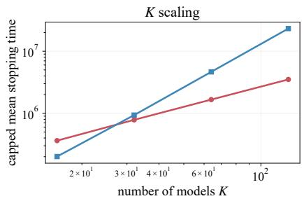

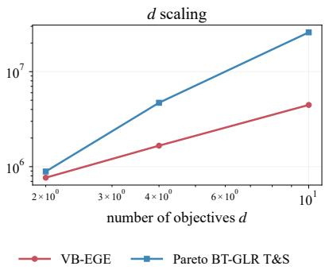

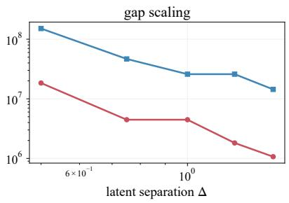  
Figure 22: Scaling comparison at $\delta = 0 . 0 5$ . Pareto BT-GLR T&S has a smaller capped mean stopping time than VB-EGE only at $K = 1 6$ and a larger one in the other 11 settings. Curves show capped mean stopping times ± one standard error.

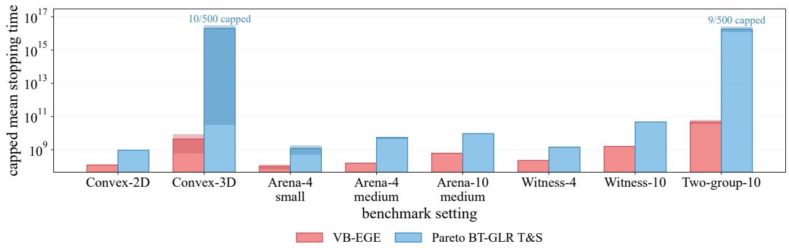  
Figure 23: Benchmark comparison at $\delta = 0 . 0 5$ . Bars show capped mean stopping times ± one standard error. Labels above the bars give the numbers of capped Pareto BT-GLR T&S trials (10 of 500 on Convex-3D and 9 of 500 on Two-group-10). The two capped means are dominated by these trials under the capping convention above.

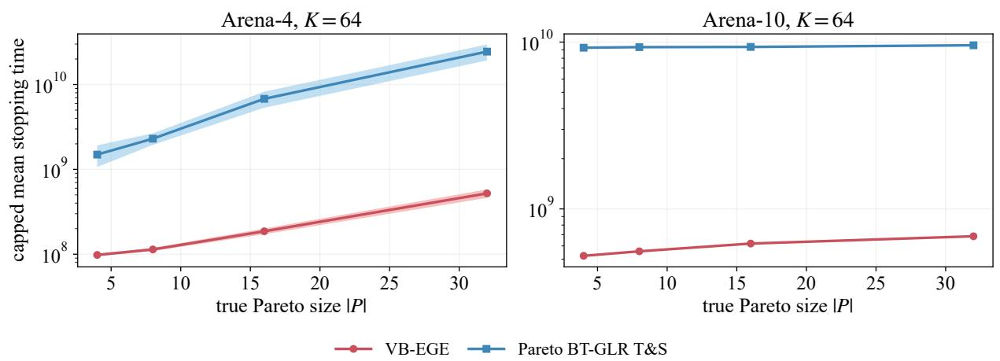  
Figure 24: Pareto-set size sensitivity at $\delta = 0 . 0 5$ . Pareto BT-GLR T&S has a larger capped mean stopping time than VB-EGE in all eight settings, with a geometric-mean ratio of 20.6. Curves show capped mean stopping times ± one standard error.