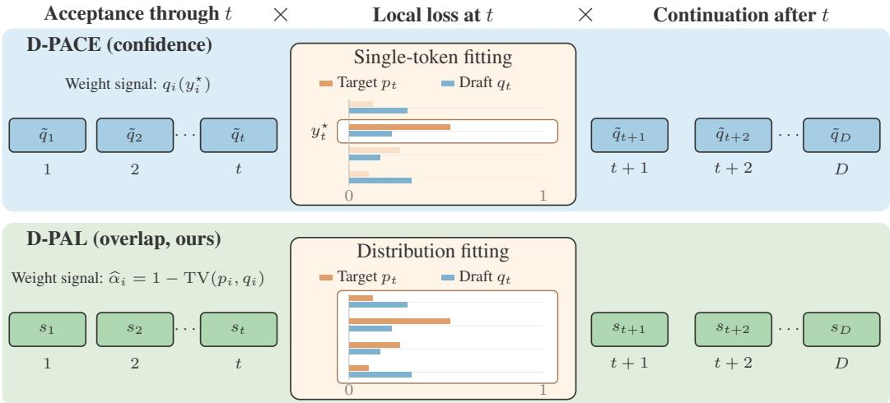
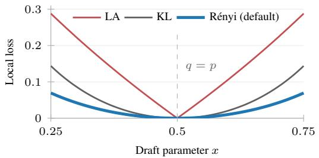
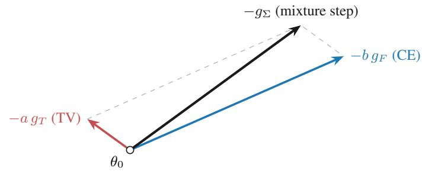

# Beyond the Point Mass: Acceptance-Derived Weights and Distributional Losses for Speculative Decoding

Tianyu Wu<sup>1,\*</sup> Zhuohan Wang<sup>1,\*</sup> Jonathan Geuter<sup>1,\*</sup> Yu Yao<sup>2,\*</sup>

Weifan Jiang<sup>1</sup> Chengxi Zhang<sup>1</sup> Ju Li<sup>2</sup> Minlan Yu<sup>1</sup>

<sup>1</sup>Harvard University <sup>2</sup>Massachusetts Institute of Technology

<sup>\*</sup>Equal contribution.

Code: https://github.com/Lucas-TY/D-PAL-SpecForge

## Abstract

In speculative decoding, a lightweight draft model proposes tokens that the target model verifies in parallel, speeding up generation without changing the target distribution. D-PACE (Wu et al., 2026) trains such drafters with a loss that weights each position by its contribution to the expected accepted length. Both its weights and its cross-entropy (CE) loss use only the draft’s probability of the recorded target token, treating the target as a point mass. Under rejection sampling, however, a sampled draft token is accepted with probability equal to the overlap of the draft and target distributions, one minus their total variation (TV). We derive D-PAL (Dynamic Position-wise Acceptance Loss) from the exact expected accepted length, using this overlap as the acceptance signal. This yields overlap-based position weights with log acceptance (LA) as the per-position loss, and the objective reduces to D-PACE for a point-mass target. Since the weights are detached, any per-position loss can replace LA in practice. We show that forward KL divergence and Rényi divergence of order $1 / 2$ match or exceed LA, and that Rényi-1/2 provably bounds the true acceptance rate from above and below. Replacing CE with Rényi-1/2 improves acceptance length under both D-PACE’s weights and ours. On six benchmarks with a Qwen3-4B target, D-PAL raises mean acceptance length over D-PACE from 4.50 to 4.57 at T = 0 and from 4.20 to 4.28 at T = 1, and consistently achieves higher throughput at both temperatures.

## 1 Introduction

Speculative decoding accelerates autoregressive generation without changing the target model’s output distribution (Leviathan et al., 2023; Chen et al., 2023): a lightweight draft model proposes tokens, and the target model verifies them in one parallel pass. DFlash drafts a whole block in one forward pass (Chen et al., 2026). Since verification stops at the first rejection, early block positions matter most. DFlash trains with cross-entropy (CE) and a fixed position decay, and DSpark and H-Spec add a total variation (TV) term to CE under the same decay (Cheng et al., 2026; Jiang et al., 2026). LK Losses optimizes acceptance directly, with the negative log acceptance or an adaptive mix of Kullback–Leibler (KL) divergence and TV, but still uses fixed decay (Samarin et al., 2026). D-PACE (Dynamic Position-Aware Cross-Entropy) instead derives position weights from a surrogate of the expected accepted length (Wu et al., 2026). SpecForge (SpecForge Contributors, 2026), Speculators (Speculators Contributors, 2026), and TorchSpec (TorchSpec Contributors, 2026) use it to train DFlash drafters.

D-PACE treats the target as a point mass on the recorded token $y _ { t } ^ { \star }$ : it estimates acceptance by the draft’s confidence $q _ { t } ( y _ { t } ^ { \star } )$ and fits that token with CE. Under standard rejection sampling, however, acceptance depends on the full target distribution $p _ { t }$ through the overlap $\widehat { \alpha } _ { t } = \textstyle \sum _ { v }$ min $( p _ { t , v } , q _ { t , v } ) =$

$1 - \mathrm { T V } ( p _ { t } , q _ { t } )$ (Leviathan et al., 2023). When the target is uncertain, confidence can underestimate this overlap by a wide margin. For example, if $p _ { t } = q _ { t }$ is uniform over k tokens, the verifier always accepts a sampled draft token $( \widehat { \alpha } _ { t } = 1 ) , \mathrm { y e t } q _ { t } ( y _ { t } ^ { \star } ) = 1 / k$ . CE likewise fits only the recorded token.

We propose D-PAL (Dynamic Position-wise Acceptance Loss), which we derive by differentiating the expected accepted length with the true acceptance signal $1 - \mathrm { T V } ( p _ { t } , q _ { t } )$ . The derivation yields overlap-based position weights paired with a log acceptance (LA) loss, − log $\widehat { \alpha } _ { t } .$ , as the local loss, which reduces to D-PACE when $p _ { t }$ is a point mass. Because D-PAL detaches the weights, we can swap LA for any local loss in practice. We write D-PAL[X] for D-PAL with local loss X. We show overlap bounds the acceptance of the argmax proposals that deployed DFlash uses (Proposition 1). Replacing CE with a distributional loss, Rényi divergence of order $1 / 2 .$ , raises mean acceptance length under both confidence and overlap weights. In our experiments, we show that LA is not the best local loss. It is not differentiable where a draft probability equals the target probability, and its gradient with respect to the draft logits does not shrink near $q _ { t } = p _ { t }$ , whereas the KL and Rényi gradients vanish there. Forward KL and Rényi-1/2 match or exceed LA, and Rényi-1/2, unlike KL, bounds overlap from both sides (Lemma 1). We also test TV-based losses, where pure TV collapses and CE+TV falls short, and analyze their gradients.

Our contributions are:

i) Derivation from expected accepted length. Differentiating the exact expected accepted length with the overlap as the acceptance signal gives overlap-based weights paired with LA. Proposition 1 connects the overlap to the argmax verification used in deployment. We show $\mathrm { { D - P A L } [ L A ] }$ improves on D-PACE, raising mean acceptance length on Qwen3-4B from 4.50 to 4.54 at $T = 0$ and from 4.20 to 4.24 at T = 1 (Table 1).

ii) Local loss beyond log acceptance. The derivation points to LA, but LA is not differentiable where the draft matches the target. Keeping the same weights, we replace it with forward KL and with $\mathrm { R e n y i - 1 / 2 }$ , and both reach the same or higher acceptance length (Table 1). We also show $\mathrm { R e n y i - 1 / 2 }$ bounds overlap from above and below (Lemma 1).

iii) Consistent gains over D-PACE and DFlash. In experiments across temperatures, block sizes, draft depths, target models at the 4B and 8B scale, and thinking modes, we show that D-PAL consistently achieves longer acceptance lengths and higher throughputs than both D-PACE (up to 5%) and DFlash (up to 11%).

## 2 Background

## 2.1 Speculative decoding with DFlash

In speculative decoding (Leviathan et al., 2023; Chen et al., 2023), the target model scores a block of B draft proposals in one forward pass and accepts a contiguous prefix of length τ.

DFlash (Chen et al., 2026) drafts with a small block-diffusion model that projects hidden states from a few target layers into the keys and values of every draft layer. A block of $B$ positions starts with an anchor, the last verified token, followed by $D = B - 1$ mask tokens. In one forward pass, the drafter predicts distributions $q _ { 1 } , \ldots , q _ { D }$ for all masked positions. Each $q _ { t }$ thus depends on the prefix but not on earlier proposals in the block, while the target’s $p _ { t }$ conditions on all tokens before t.

In training, DFlash samples anchor positions in responses generated by the frozen target and predicts the next D recorded tokens $y _ { 1 } ^ { \star } , \ldots , y _ { D } ^ { \star }$ from each anchor context. Since a proposal counts only if every earlier one is accepted, DFlash fits $y _ { t } ^ { \star }$ with CE and weights positions by a fixed exponential decay,

$$
\mathcal { L } _ { \mathrm { { D F l a s h } } } = \sum _ { t = 1 } ^ { D } e ^ { - ( t - 1 ) / \gamma } \left[ - \log { q _ { t } ( y _ { t } ^ { \star } ) } \right] ,\tag{1}
$$

with $\gamma = 7$ for $B = 1 6$ . The frozen target output head also gives the full target distribution $p _ { t }$ at each position, but DFlash does not use it.

## 2.2 Expected accepted length

Let $L = \tau - 1$ count the accepted draft tokens, and let $\alpha _ { t } = \mathrm { P r } ( L \geq t \mid L \geq t - 1 )$ be the conditional acceptance probability at position t. The tail-sum identity gives the exact expected accepted length (Li et al., 2026b; Wu et al., 2026)

$$
\mathbb { E } [ L ] = \sum _ { k = 1 } ^ { D } \prod _ { i = 1 } ^ { k } \alpha _ { i } .\tag{2}
$$

Each $\alpha _ { t }$ appears in every accepted prefix ending at $k \geq t .$ . For positive $\alpha _ { t } ,$ its relative contribution and the gradient of $\mathbb { E } [ L ]$ are

$$
w _ { t } ^ { \mathrm { r a w } } = \alpha _ { t } \frac { \partial \mathbb { E } [ L ] } { \partial \alpha _ { t } } = \sum _ { k = t } ^ { D } \prod _ { i = 1 } ^ { k } \alpha _ { i } , \qquad \nabla \mathbb { E } [ L ] = \sum _ { t = 1 } ^ { D } w _ { t } ^ { \mathrm { r a w } } \nabla \log \alpha _ { t } .\tag{3}
$$

Every term is positive, so $w _ { t } ^ { \operatorname { r a w } }$ decreases with t.

## 2.3 Position weights and local losses

Equation (3) suggests drafter objectives for a block of the form $\Sigma _ { t = 1 } ^ { D } w _ { t } \ell _ { t }$ , with weights computed on target-generated training contexts. DFlash (Chen et al., 2026) uses a fixed exponential decay $e ^ { - ( t - \bar { 1 } ) / \gamma }$ to emphasize early positions (Equation (1)). D-PACE (Wu et al., 2026) instead uses the draft’s confidence $q _ { t } ( y _ { t } ^ { \star } )$ as a proxy for $\alpha _ { t } ,$ , smooths it to $\tilde { q } _ { t } = \rho + ( 1 - \rho ) q _ { t } ( y _ { t } ^ { \star } )$ with $\rho \in ( 0 , 1 )$ and builds detached weights paired with CE:

$$
w _ { t } ^ { \mathrm { P A C E } } = \sum _ { k = t } ^ { D } \prod _ { i = 1 } ^ { k } \tilde { q } _ { i } , \qquad \mathcal { L } _ { \mathrm { D - P A C E } } = \sum _ { t = 1 } ^ { D } w _ { t } ^ { \mathrm { P A C E } } [ - \log q _ { t } ( y _ { t } ^ { \star } ) ] .\tag{4}
$$

With $\rho > 0$ , an early low-confidence position cannot zero out all later weights.

## 3 D-PAL: Acceptance in the Weights, Fit in the Loss

## 3.1 Acceptance-derived weights from overlap

D-PACE’s unsmoothed confidence is overlap with a point mass on the recorded target token: ${ \textstyle \sum _ { v } \operatorname* { m i n } \{ \delta _ { y ^ { \star } , v } , q _ { v } \} \ = \ q ( y ^ { \star } ) \ }$ . Standard rejection sampling instead compares the draft with the full target distribution. At a fixed context with target and draft distributions $p _ { t } , q _ { t }$ , the verifier accepts $y \sim q _ { t }$ with probability min $\{ 1 , p _ { t } ( y ) / q _ { t } ( y ) \}$ . Averaging over $y$ gives the one-token acceptance (Leviathan et al., 2023; Chen et al., 2023)

$$
\widehat { \alpha } _ { t } = \sum _ { v } \operatorname* { m i n } \{ p _ { t , v } , q _ { t , v } \} = 1 - \mathrm { T V } ( p _ { t } , q _ { t } ) , \qquad \mathrm { T V } ( p , q ) : = \frac { 1 } { 2 } \| p - q \| _ { 1 } .\tag{5}
$$

D-PAL applies the weighting rule of Equation (3) to this overlap. On target-generated sequences, the product of overlaps through position k approximates the chance that sampled proposals survive to k. As in D-PACE, we smooth only inside the products, $s _ { t } = \rho + ( 1 - \rho ) \widehat { \alpha } _ { t } .$ , recompute the weights from the current draft, and detach them:

$$
w _ { t } = \sum _ { k = t } ^ { D } \prod _ { i = 1 } ^ { k } s _ { i } , \qquad \mathcal { L } _ { \mathrm { { D } \cdot \mathrm { { P A L } } } } = \sum _ { t = 1 } ^ { D } w _ { t } \ell _ { t } ,\tag{6}
$$

where $\ell _ { t }$ is the local loss chosen in Section 3.2. Equivalently,

$$
w _ { t } = \left( \prod _ { i \leq t } s _ { i } \right) { \Big ( } 1 + \sum _ { k > t } \prod _ { t < i \leq k } s _ { i } { \Big ) } ,\tag{7}
$$

  
Figure 1: D-PAL uses the full target distribution for position weighting and, with KL or Rényi, for local fitting. Top: D-PACE weights by confidence and fits one token with $\mathrm { C E } ;$ faded bars are target mass CE ignores. Bottom: D-PAL weights by overlap and, with a distributional loss such as KL or Rényi, fits $q _ { t }$ to all of $p _ { t }$ . Each weighted term $w _ { t } \ell _ { t }$ is the product of the acceptance through t (left), the local loss at t (center), and the continuation value after t (right).

the smoothed acceptance through t times the continuation value after $t \left( \mathrm { F i g u r e 1 } \right)$ .

The SGLang DFlash backend proposes the draft argmax $\hat { y } _ { t } = \arg \operatorname* { m a x } _ { v } q _ { t , v }$ at both temperatures, so proposals are never sampled from $q _ { t }$ . Overlap still bounds the acceptance of this proposal.

Proposition 1. (i) Let $\Delta _ { t }$ be the gap between the largest and second-largest target probabilities. If $\begin{array} { r } { \mathrm { T V } ( p _ { t } , q _ { t } ) < \Delta _ { t } / 2 , t h e n \hat { y } _ { t } = \arg \operatorname* { m a x } _ { v } p _ { t , v } . ( i i ) p _ { t } ( \hat { y } _ { t } ) \geq \operatorname* { m a x } _ { v } q _ { t , v } - \mathrm { T V } ( p _ { t } , q _ { t } ) } \end{array}$

At $T = 0$ , the verifier accepts $\hat { y } _ { t }$ if it matches the target argmax, which (i) guarantees whenever the target margin exceeds 2 TV. $\mathbf { A } \mathbf { t } T = 1$ , SGLang’s target-only verification accepts it with probability $p _ { t } ( \hat { y } _ { t } )$ (SGLang Contributors, 2026), which (ii) bounds from below (proof in Appendix B.2).

## 3.2 Log acceptance loss and beyond

D-PAL[LA]. Equation (3) pairs each weight with ∇ log $\alpha _ { t } ,$ so gradient ascent on $\mathbb { E } [ L ]$ matches gradient descent on the log-acceptance $( \mathrm { L A } )$ loss $\ell _ { t } = - \log { \widehat { \alpha } } _ { t }$ , which gives D-PAL[LA]. For a point-mass target, $\widehat { \alpha } _ { t } = q _ { t } ( y _ { t } ^ { \star } )$ , so LA becomes CE, as LK Losses notes (Samarin et al., 2026), and D-PAL[LA] reduces to D-PACE. At $\rho = 0$ , gradient descent on D-PAL[LA] follows gradient ascent on the overlap-based prefix-sum surrogate (Appendix B.3); as in D-PACE, we keep the floor $\rho > 0$ as a regularizer.

However, LA is not differentiable where a draft probability equals the corresponding target prob ability. Its gradient is the TV gradient scaled by $1 / \widehat { \alpha } _ { t }$ . With respect to the draft logits, the TV gradient is $\begin{array} { r } { \frac { 1 } { 2 } q _ { t } \odot ( \sigma _ { t } - \mathbb { E } _ { q _ { t } } [ \sigma _ { t } ] ) } \end{array}$ with $\sigma _ { t , v } = \mathrm { s i g n } ( q _ { t , v } - p _ { t , v } )$ (Samarin et al., 2026). It does not vanish as $q _ { t }$ approaches $p _ { t } .$ , and changes sign where $q _ { t , v }$ crosses $p _ { t , v }$ . On the other hand, KL and Rényi logit gradients vanish at $q _ { t } = p _ { t }$ (Appendix B.1). Figure 2 shows a binary example. Because $w _ { t }$ is detached, any local loss can replace LA without changing the weight formula; in the following, we consider D-PAL[KL] and D-PAL[Rényi] as smooth alternatives to D-PAL[LA].

D-PAL[KL]. Cross-entropy, the local loss of D-PACE, is smooth but fits one sampled token only. If $y \sim p _ { t }$ , then $\begin{array} { r } { \mathbb { E } _ { y } [ - \log q _ { t } ( y ) ] = H ( p _ { t } ) + \mathrm { K L } ( p _ { t } \| q _ { t } ) } \end{array}$ , and the logit gradient $q _ { t } \mathrm { ~ - ~ } e _ { y }$ has mean $q _ { t } - p _ { t } . \mathrm { U p }$ to the constant $H ( p _ { t } )$ , CE is thus a one-sample estimate of forward KL, with label noise at every position. Our labels are sampled at positive temperature, so CE also fits a sharper target than the $T = 1$ distribution $p _ { t }$ that sets acceptance. $\scriptstyle \mathrm { D - P A L [ K L ] }$ fits this forward KL directly instead.

  
Figure 2: Near $q = p ,$ LA’s slope stays near ±1 and flips sign, while KL and Rényi-1/2 flatten out. Binary example with target $p =$ (0.5, 0.5) and draft $q = ( x , 1 - x )$ ; slopes are with respect to $x ,$ and all three losses are zero at $x = 0 . 5$

D-PAL[Rényi]. KL fits the full distribution, but it bounds overlap only from below and can be arbitrarily large while overlap is close to one. D-PAL[Rényi] instead replaces the minimum in overlap with a geometric mean, the Bhattacharyya coefficient $\begin{array} { r } { \mathrm { B C } ( p , q ) = \sum _ { v } \sqrt { p _ { v } q _ { v } } } \end{array}$ , whose scaled negative logarithm is the Rényi divergence of order $1 / 2$ (Rényi, 1961):

$$
D _ { 1 / 2 } ( p \| q ) = - 2 \log \mathrm { B C } ( p , q ) ,\tag{8}
$$

$$
\mathcal { L } _ { \mathrm { D \cdot P A L [ R e n y i ] } } = \sum _ { t = 1 } ^ { D } w _ { t } D _ { 1 / 2 } ( p _ { t } \| q _ { t } ) .\tag{9}
$$

Its logit gradient is $q _ { t } - r _ { t }$ with $r _ { t , v } \propto \sqrt { p _ { t , v } q _ { t , v } }$ (Appendix B.1), which varies continuously with the target–draft mismatch. The Bhattacharyya coefficient bounds overlap from above and below.

Lemma 1 (Overlap bounds). For categorical distributions p, $\phantom { } _ { l } , \alpha ( p , q ) = 1 - \mathrm { T V } ( p , q )$ satisfies

$$
\begin{array} { r } { 1 - \sqrt { 1 - e ^ { - D _ { 1 / 2 } ( p \| q ) } } \ \le \ \alpha ( p , q ) \ \le \ e ^ { - D _ { 1 / 2 } ( p \| q ) / 2 } . } \end{array}\tag{10}
$$

This bound is the classical inequality between TV and the Bhattacharyya coefficient (Fuchs and van de Graaf, 1999) (proof in Appendix B.2). Taking negative logarithms gives $D _ { 1 / 2 } / 2 \leq$ $- \log \widehat { \alpha } _ { t } \le - \log \bigl ( 1 - \sqrt { 1 - e ^ { - D _ { 1 / 2 } } } \bigr )$ . D-PAL[Rényi] minimizes the smooth quantity $D _ { 1 / 2 }$ that controls both bounds, so driving it to zero drives LA to zero. This lower bound on overlap is never below the Bretagnolle–Huber bound from KL (van Erven and Harremoës, 2014; Canonne, 2023) (Appendix B.1).

## 3.3 D-PAL Algorithm

Algorithm 1 shows how to compute the D-PAL loss. Any of the previously discussed losses (LA, KL, Rényi, etc.) can be plugged in for $l _ { t } .$

```latex
Algorithm 1: D-PAL loss computation
Input: target p, draft $q ,$ valid mask m, smoothing $\rho ,$ and chosen local loss $\ell _ { t }$
for each nonempty valid block b:
Select proposals with $m _ { b , t } = 1$ in order; index them by $t = 1 , \ldots , D _ { b }$
$\begin{array} { r } { \widehat { \alpha } _ { t } \gets \sum _ { v } \operatorname* { m i n } ( p _ { t , v } , q _ { t , v } ) ; \quad s _ { t } \gets \rho + ( 1 - \rho ) \widehat { \alpha } _ { t } } \end{array}$ for all t
$\tilde { R } _ { 0 }  1 ; \quad w _ { D _ { b } + 1 }  0$
for $t = 1 , \ldots , D _ { b } \colon \quad \widetilde { R } _ { t } \gets s _ { t } \widetilde { R } _ { t - 1 }$ ▷ Smoothed prefix product
for $t = D _ { b } , \ldots , 1 \colon \quad w _ { t } \gets w _ { t + 1 } + \widetilde { R } _ { t }$ ▷ Position weights
Detach $w _ { 1 : D _ { b } } .$
$\begin{array} { r } { \mathcal { L } _ { b }  \sum _ { t = 1 } ^ { D _ { b } } w _ { t } \ell _ { t } } \end{array}$
return Mean of $\mathcal { L } _ { b }$ within each sequence, then across sequences.
```

## 4 Experiments

## 4.1 Experimental setup

Models and training. We train DFlash drafters in SpecForge with frozen Qwen3-4B, Qwen3-8B, and Llama-3.1-8B-Instruct targets (Chen et al., 2026; Li et al., 2026a; Yang et al., 2025; Grattafiori et al., 2024). Within each comparison, methods share target-generated data, optimizer, schedule, and decoding (Appendix A). Table 1 uses the Qwen3-4B-Instruct-100K dataset released by the DFlash authors. Following D-PACE, we use three-layer drafts and block size $B = 1 6$ (Chen et al., 2026; Wu et al., 2026). Request grouping uses these same checkpoints. For the ablations and other targets, we use SpecForge to sample a 36K-example ShareGPT subset; ablations use Qwen3-4B and $B = 1 6$ unless varied.

Evaluation. We evaluate on GSM8K (Cobbe et al., 2021) and MATH-500 (Hendrycks et al., 2021; Lightman et al., 2024) for math, HumanEval and MBPP (Chen et al., 2021; Austin et al., 2021) for code, and first-turn MT-Bench (Zheng et al., 2023) and Alpaca (Taori et al., 2023) for chat. We run the six-benchmark evaluations with SGLang DFlash on one NVIDIA L40S, one request at a time, at $T = 0$ and $T = 1$ . Our two primary evaluation metrics are speedup ratio (SR) (throughput divided by autoregressive throughput) and acceptance length τ. Six-benchmark means weight benchmarks equally, and every result averages three evaluation seeds. Across seeds, the standard deviation of each mean τ is 0 at $T = 0$ (greedy decoding) and at most 0.02 at $T = 1$

Objectives. DFlash and D-PACE are the baselines. All D-PAL objectives share the weight rule of Equation (6) and differ only in the local loss. We compare D-PAL[LA], D-PAL[KL], and D-PAL[Rényi] with three losses that contain an explicit TV term: D-PAL[TV], D-PAL[CE+TV], and D-PAL[KL+TV] (see Appendix A.2 for details). Table 1 uses $\rho = 0 . 3$ for D-PAL, the best Qwen3-4B value in Table 7, and $\rho = 0 . 5$ for D-PACE, the default that D-PACE reports as stable over $\rho \in [ 0 . 3 , 0 . 7 ]$ (Wu et al., 2026). Ablations use $\rho = 0 . 5$ unless varied.

## 4.2 D-PAL beats D-PACE

Table 1 compares all objectives on Qwen3-4B. D-PAL[Rényi] improves on D-PACE at both temperatures: mean τ rises from 4.50 to 4.56 at $T = 0$ and from 4.20 to 4.28 at $T = 1$ , and mean SR from 3.11 to 3.14 and from 2.79 to 2.85. The gain holds across benchmarks, since D-PAL[Rényi] has the higher τ on all 12 benchmark–temperature pairs and the higher SR on 10. The other two D-PAL objectives, D-PAL[LA] and D-PAL[KL], also beat D-PACE on both metrics at both temperatures. When we batch requests with the same checkpoints, D-PAL[Rényi] leads in τ in all ten settings and in throughput in nine (Table 2). In the separate 36K ablations at D-PACE’s own $\rho = 0 . 5 ,$ D-PAL[Rényi] still leads D-PACE by 0.08 in mean τ at $T = 0$ and 0.05 at $T = 1$ (Tables 3 and 7).

LA is not the best local loss. Under the same D-PAL weights, KL and Rényi reach the same or higher mean τ than LA at both temperatures (Table 1). KL leads by 0.01 at $T = 0$ and Rényi by 0.03 at $T = 1$ ; Rényi is our default because it also bounds overlap from above (Lemma 1).

Pure TV and CE+TV fall short. D-PAL[TV] collapses to $\tau = 1 . 0 4 .$ , consistent with the small TV gradient at initialization that LK Losses reports (Samarin et al., 2026). Adding CE restores training, but D-PAL[CE+TV], a DSpark- and H-Spec-style mixture, trails D-PAL[KL] by 0.18 at $T = 0$ and 0.14 at $T = 1$ and falls below D-PACE. Its fixed TV term keeps the nondifferentiable points at $q _ { t , v } = p _ { t , v }$ (Section 3.2), and the toy example in Figure 3 (Appendix A.2) shows that its CE gradient can raise TV to first order. D-PAL[KL+TV], using the adaptive mixture of losses proposed in LK Losses, shifts weight to KL at low-acceptance positions and stays within 0.04 of D-PAL[LA], D-PAL[KL], and D-PAL[Rényi].

Table 1: D-PAL[Rényi], D-PAL[LA], and D-PAL[KL] beat D-PACE; D-PAL[TV] and D-PAL[CE+TV] fall short. Qwen3-4B target, three-layer DFlash drafts, B = 16, 100K training examples, ρ = 0.3 for D-PAL and 0.5 for D-PACE. SR is speedup over autoregressive decoding, τ is acceptance length, and bold marks the best value.
<table><tr><td rowspan="3"></td><td colspan="4">MATH</td><td colspan="4">CODE</td><td colspan="4">CHAT</td><td colspan="2" rowspan="2"></td></tr><tr><td colspan="2">GSM8K</td><td colspan="2">MATH-500</td><td colspan="2">HumanEval</td><td colspan="2">MBPP</td><td colspan="2">MT-Bench</td><td colspan="2">Alpaca Mean</td></tr><tr><td></td><td>SR T</td><td colspan="2">SR</td><td colspan="2">SR</td><td colspan="2"></td><td colspan="2">SR</td><td colspan="2">SR</td><td colspan="2">SR</td></tr><tr><td>Method Baselines</td><td></td><td></td><td></td><td>T</td><td></td><td>T</td><td>SR Temperature T = 0</td><td>T</td><td></td><td>T</td><td></td><td>T</td><td></td><td>T</td></tr><tr><td>DFlash</td><td>3.204.50</td><td></td><td>3.94 5.46</td><td></td><td>3.334.67</td><td></td><td>3.064.28</td><td></td><td>1.973.15</td><td></td><td>1.772.71</td><td></td><td></td><td>2.884.13</td></tr><tr><td>D-PACE</td><td>3.504.96</td><td></td><td></td><td>4.356.06</td><td></td><td>3.605.09</td><td>3.344.65</td><td></td><td>2.053.36</td><td></td><td>1.832.87</td><td></td><td></td><td>3.11 4.50</td></tr><tr><td>D-PAL weights</td><td></td><td></td><td></td><td></td><td></td><td></td><td></td><td></td><td></td><td></td><td></td><td></td><td></td><td></td></tr><tr><td>D-PAL[LA]</td><td>3.505.03</td><td></td><td>4.326.06</td><td></td><td>3.655.15</td><td></td><td>3.38 4.70</td><td></td><td>2.04 3.41</td><td></td><td></td><td>1.84 2.90</td><td></td><td>3.12 4.54</td></tr><tr><td>D-PAL[KL]</td><td>3.505.06</td><td></td><td>4.43 6.11</td><td></td><td>3.68 5.19</td><td></td><td>3.38 4.71</td><td></td><td>2.08 3.42</td><td></td><td></td><td>1.87 2.92</td><td></td><td>3.164.57</td></tr><tr><td>D-PAL[Rényi]</td><td>3.53 5.07</td><td></td><td>4.396.10</td><td></td><td>3.66 5.17</td><td></td><td>3.314.68</td><td></td><td>2.08 3.44</td><td></td><td>1.86 2.92</td><td></td><td></td><td>3.144.56</td></tr><tr><td>D-PAL[TV]</td><td>0.751.01</td><td></td><td>0.761.02</td><td></td><td></td><td>0.77 1.04</td><td>0.77 1.03</td><td></td><td>0.77 1.05</td><td></td><td>0.77 1.07</td><td></td><td></td><td>0.771.04</td></tr><tr><td>D-PAL[CE+TV]</td><td>3.394.89</td><td></td><td></td><td>4.24 5.86</td><td></td><td>3.504.92</td><td>3.274.54</td><td></td><td>1.943.23</td><td></td><td></td><td>1.772.86</td><td></td><td>3.024.39</td></tr><tr><td>D-PAL[KL+TV]</td><td>3.495.03</td><td></td><td>4.336.05</td><td></td><td>3.645.14</td><td></td><td>3.334.68</td><td></td><td>2.04 3.40</td><td></td><td>1.85 2.88</td><td></td><td></td><td>3.114.53</td></tr><tr><td>Baselines</td><td></td><td></td><td></td><td></td><td></td><td></td><td>Temperature T = 1</td><td></td><td></td><td></td><td></td><td></td><td></td><td></td></tr><tr><td>DFlash</td><td></td><td>2.994.29</td><td></td><td>3.254.80</td><td></td><td>3.074.40</td><td></td><td>2.854.09</td><td></td><td>1.843.04</td><td></td><td>1.71 2.71</td><td></td><td></td></tr><tr><td>D-PACE</td><td>3.244.76</td><td></td><td></td><td>3.545.31</td><td></td><td>3.304.75</td><td></td><td>3.034.41</td><td></td><td>1.903.18</td><td></td><td>1.75 2.82</td><td></td><td>2.62 3.89 2.794.20</td></tr><tr><td>D-PAL weights</td><td></td><td></td><td></td><td></td><td></td><td></td><td></td><td></td><td></td><td></td><td></td><td></td><td></td><td></td></tr><tr><td>D-PAL[LA]</td><td>3.284.78</td><td></td><td></td><td>3.52 5.26</td><td></td><td>3.374.81</td><td></td><td>3.054.48</td><td></td><td>1.913.26</td><td></td><td>1.762.85</td><td></td><td>2.824.24</td></tr><tr><td>D-PAL[KL]</td><td>3.284.81</td><td></td><td></td><td>3.495.27</td><td></td><td>3.364.82</td><td></td><td>3.054.47</td><td></td><td>1.91 3.25</td><td></td><td>1.78 2.85</td><td></td><td>2.814.25</td></tr><tr><td>D-PAL[Rényi]</td><td>3.34 4.84</td><td></td><td></td><td>3.52 5.35</td><td></td><td>3.374.82</td><td></td><td>3.10 4.48</td><td>1.94 3.28</td><td></td><td></td><td>1.81 2.89</td><td></td><td>2.85 4.28</td></tr><tr><td>D-PAL[TV]</td><td></td><td></td><td></td><td>0.761.02</td><td></td><td>0.771.04</td><td></td><td>0.771.03</td><td></td><td>0.771.05</td><td></td><td>0.771.06</td><td></td><td>0.761.04</td></tr><tr><td>D-PAL[CE+TV]</td><td>0.751.01 3.184.64</td><td></td><td></td><td>3.485.19</td><td></td><td>3.234.61</td><td></td><td>2.964.32</td><td></td><td>1.853.11</td><td></td><td>1.692.78</td><td></td><td>2.734.11</td></tr><tr><td></td><td></td><td></td><td></td><td>3.58 5.34</td><td></td><td>3.374.88</td><td></td><td>3.074.49</td><td></td><td>1.91 3.30</td><td></td><td>1.772.84</td><td></td><td>2.834.27</td></tr><tr><td>D-PAL[KL+TV]</td><td>3.254.77</td><td></td><td></td><td></td><td></td><td></td><td></td><td></td><td></td><td></td><td></td><td></td><td></td><td></td></tr></table>

## 4.3 Ablations separate the loss from the weights

Distribution fitting beats cross-entropy. Table 3 changes only the local loss, from CE to Rényi, under each weight signal. The switch raises mean τ by 0.08 at T = 0 and 0.06 at T = 1 under D-PACE’s confidence weights $( \rho = 0 . 5 )$ , and by 0.09 and 0.07 under overlap weights $( \rho = 0 . 3 )$ With Rényi at the same floor $\rho = 0 . 5 ,$ , the two weight signals give similar mean τ (3.58 for both at T = 0; 3.42 and 3.41 at T = 1; Tables 3 and 7). We keep overlap as the weight signal because it matches rejection-sampling acceptance, reduces to D-PACE’s weights for a point-mass target, and bounds argmax acceptance (Proposition 1).

D-PAL weights beat fixed decay on baseline losses. In Table 4, we compare DFlash’s static weight decay against D-PAL’s weight schedule across four losses from the literature: CE, used in Chen et al. (2026); LA and KL+TV, used in Samarin et al. (2026); and CE+TV, used in Cheng et al. (2026). At T = 0, D-PAL weights raise mean τ over DFlash’s schedule by 0.26 for CE, 0.29 for LA, 0.33 for KL+TV, and 0.08 for CE+TV. Gains are smaller at T = 1 but hold for every loss.

D-PAL[Rényi] leads at every block size and depth. Larger blocks help up to B = 12: the mean τ of D-PAL[Rényi] rises from B = 8 to B = 12 and levels off at B = 16 (Table 5). Deeper drafts help both methods, and with five layers D-PAL[Rényi] still leads D-PACE by 0.06 at $T = 0$ and 0.07 at T = 1 (Table 6).

Table 2: D-PAL[Rényi] has the highest τ at every batch size and the highest throughput in 9 of 10 settings. 128 MATH-500 prompts on Qwen3-4B with the 100K checkpoints; K is the inference batch size (number of requests) and TPS is output tokens per second.
<table><tr><td></td><td colspan="2"> $K = 1$ </td><td colspan="2"> $K = 2$ </td><td colspan="2"> $K = 4$ </td><td colspan="2"> $K = 8$ </td><td colspan="2"> $K = 1 6$ </td></tr><tr><td>Method</td><td>TPS</td><td>T</td><td>TPS</td><td>T</td><td>TPS</td><td>T</td><td>TPS</td><td>T</td><td>TPS</td><td>T</td></tr><tr><td colspan="9">Temperature  $T = 0$ </td></tr><tr><td>DFlash</td><td>310.245.46</td><td></td><td>423.175.48</td><td></td><td>607.935.46</td><td></td><td>990.605.49</td><td></td><td>1628.155.49</td></tr><tr><td>D-PACE</td><td>320.136.06</td><td></td><td>466.276.06</td><td></td><td>669.646.04</td><td></td><td>1120.19 6.06</td><td></td><td>1714.12 6.06</td></tr><tr><td>D-PAL[Rényi]</td><td>339.73 6.10</td><td></td><td>477.46 6.13</td><td></td><td>686.75 6.10</td><td></td><td>1094.146.13</td><td></td><td>1797.82 6.11</td></tr><tr><td colspan="10">Temperature  $T = 1$ </td></tr><tr><td>DFlash</td><td>252.704.82</td><td></td><td>342.244.86</td><td></td><td>487.594.83</td><td></td><td>788.094.82</td><td>1155.274.83</td><td></td></tr><tr><td>D-PACE</td><td>274.515.21</td><td></td><td>362.02 5.25</td><td></td><td>515.485.23</td><td></td><td>786.065.29</td><td></td><td>1215.91 5.27</td></tr><tr><td>D-PAL[Rényi]</td><td>276.68 5.30</td><td></td><td>370.04 5.32</td><td></td><td>530.42 5.33</td><td></td><td>826.42 5.35</td><td></td><td>1263.315.30</td></tr></table>

Table 3: Rényi beats CE under both confidence and overlap weights. Each pair fixes the weight signal and floor and changes only the loss. Confidence with CE is D-PACE; overlap gives D-PAL[CE] and D-PAL[Rényi]. Mean τ over six benchmarks.  
Table 4: D-PAL weights beat fixed decay for all losses from baselines. KL+TV follows the adaptive mixture of LK Losses with per-position $\lambda _ { t } .$ Static uses DFlash’s decay $\stackrel { \cdot } { e } ^ { - ( t - 1 ) / 7 }$ ; D-PAL uses $\rho = 0 . 3 ( 0 . 5 $ for CE). Mean τ over six benchmarks.
<table><tr><td>Loss</td><td>Signal</td><td>ρ</td><td>T=0</td><td> $T { = } 1$ </td></tr><tr><td>CE</td><td>Confidence</td><td>0.5</td><td>3.50</td><td>3.36</td></tr><tr><td>Rényi</td><td>Confidence</td><td>0.5</td><td>3.58</td><td>3.42</td></tr><tr><td>CE</td><td>Overlap</td><td>0.3</td><td>3.50</td><td>3.36</td></tr><tr><td>Rényi</td><td>Overlap</td><td>0.3</td><td>3.59</td><td>3.43</td></tr></table>

<table><tr><td colspan="3"> $T = 0$ </td><td colspan="2"> $T = 1$ </td></tr><tr><td>Local loss</td><td>Static</td><td>D-PAL</td><td>Static</td><td>D-PAL</td></tr><tr><td>CE</td><td>3.24</td><td>3.50</td><td>3.11</td><td>3.36</td></tr><tr><td>LA</td><td>3.27</td><td>3.56</td><td>3.15</td><td>3.40</td></tr><tr><td>CE+TV</td><td>3.40</td><td>3.48</td><td>3.27</td><td>3.34</td></tr><tr><td>KL+TV</td><td>3.20</td><td>3.53</td><td>3.08</td><td>3.37</td></tr></table>

The floor prevents collapse. Without the floor $( \rho = 0 )$ , mean τ falls to 1.03–1.60, likely because an early low-overlap position drives every later prefix product toward zero (Table 7). Any floor in {0.3, 0.5} works: the two stay within 0.04 of each other on every configuration.

## 4.4 Gains hold on other targets and inference settings

Gains transfer to 8B targets. D-PAL[Rényi] has the highest mean SR and τ on both 8B targets at both temperatures (Table 8). The gain is largest on Llama, where D-PAL[Rényi] leads D-PACE by 0.13 at $T = 0$ and 0.12 at $T = 1$ , while D-PACE falls below Static[CE+TV].

Gains hold in thinking mode. With thinking enabled, all three D-PAL losses match or improve D-PACE in mean τ ; D-PAL[Rényi] leads at $T = 0$ and D-PAL[KL] at T = 1 (Table 9).

## 5 Related Work

Parallel drafters. Medusa and DFlash propose every block position in parallel (Cai et al., 2024; Chen et al., 2026). Their per-position marginals ignore tokens drafted earlier in the block, which LiLiCorr calls the marginals problem (Rusanovsky et al., 2026). EAGLE, Hydra, Domino, and DSpark condition later proposals on earlier tokens (Li et al., 2024a, 2025; Ankner et al., 2024; Huang et al., 2026; Cheng et al., 2026). LiLiCorr reranks adjacent top-k candidates with a head cotrained with DFlash, DFlash2 adds a predecessor-conditioned selector, and DFlow carries verifier representations between rounds (Rusanovsky et al., 2026; Inco AI, 2026; Zhang et al., 2026). H-Spec replaces the drafter-side KV cache with a hybrid Mamba–attention drafter trained with CE+TV and fixed decay (Jiang et al., 2026). These methods change what the drafter conditions on; orthogonally, D-PAL changes the objective that trains the marginals and can be combined with them.

Table 5: D-PAL[Rényi] has the highest τ at every block size. Mean τ over six benchmarks; three-layer drafts.
<table><tr><td colspan="3">D-PACE</td><td colspan="2">D-PAL[Rényi]</td></tr><tr><td>B</td><td>T=0</td><td>T=1</td><td>T=0</td><td>T=1</td></tr><tr><td>8</td><td>3.41</td><td>3.28</td><td>3.48</td><td>3.34</td></tr><tr><td>12</td><td>3.51</td><td>3.36</td><td>3.57</td><td>3.42</td></tr><tr><td>16</td><td>3.50</td><td>3.36</td><td>3.58</td><td>3.41</td></tr></table>

Table 6: Deeper drafts help both methods; D-PAL[Rényi] leads at both depths. Mean τ over six benchmarks.
<table><tr><td colspan="3">D-PACE</td><td colspan="2">D-PAL[Rényi]</td></tr><tr><td>Layers</td><td>T=0</td><td>T=1</td><td>T=0</td><td>T=1</td></tr><tr><td>3</td><td>3.50</td><td>3.36</td><td>3.58</td><td>3.41</td></tr><tr><td>5</td><td>3.75</td><td>3.56</td><td>3.81</td><td>3.63</td></tr></table>

Table 7: Without the floor, D-PAL[Rényi] collapses; $\rho \in \{ 0 . 3 , 0 . 5 \}$ works best. Mean τ over six benchmarks as the floor $\rho$ varies.
<table><tr><td rowspan="4">ρ</td><td>Qwen3-4B</td><td>Llama-3.1-8B</td></tr><tr><td> $B = 8$   $B = 1 6$ </td><td>B = 10</td></tr><tr><td>T=0 T=1 T=0 T=1</td><td>T=0 T=1</td></tr><tr><td colspan="2">1.51 1.50 1.03 1.03</td></tr><tr><td>0 0.3 3.51</td><td>1.60 1.51 3.37 3.59 3.43 3.29</td></tr><tr><td>0.5 3.48 3.34 3.58</td><td>2.69 3.41 3.31 2.73</td></tr><tr><td>0.7 3.43 3.30</td><td>3.35 3.23 2.65</td></tr><tr><td>3.25</td><td>3.50 3.24 3.09 2.58</td></tr><tr><td>0.9 3.37</td><td>3.36</td></tr></table>

Table 8: D-PAL[Rényi] leads on both 8B targets in SR and τ. Means over six benchmarks; three-layer drafts.
<table><tr><td rowspan="2">Method</td><td rowspan="2">Metric T=0</td><td colspan="2">Llama-3.1-8B Qwen3-8B B = 10 B = 16</td></tr><tr><td>T=1</td><td>T=0 T=1</td></tr><tr><td>D-PACE</td><td>SR</td><td>2.47 1.77</td><td>2.59 2.37</td></tr><tr><td rowspan="3">D-PAL[Rényi] SR</td><td>T</td><td>3.18 2.61</td><td>3.54 3.34</td></tr><tr><td></td><td>2.57</td><td>1.84 2.65 2.40</td></tr><tr><td>T</td><td>3.31 2.73</td><td>3.63 3.39</td></tr></table>

Acceptance-aware position weighting. Several methods adapt position weights to acceptance. D-PACE weights CE by a surrogate of expected length built from draft confidence (Wu et al., 2026), following EAGLE-2’s observation that draft confidence tracks acceptance (Li et al., 2024b). PARD-2 instead uses the product of the target’s probabilities of the preceding recorded tokens (An et al., 2026). Other methods tie supervision to where the draft first fails: GRIFFIN propagates top-k alignment masks (Hu et al., 2025), Spec-AUF keeps CE through the first predicted failure (Yang and Li, 2026), and Whalen et al. (2026) study first-error supervision with an expected-length chain reward. VAT keeps full weight up to the first simulated rejection, restarts the decay there, and trains a verification head (Gu et al., 2026). It also finds that weighting by the exact derivative of expected length, computed from confidence, trails D-PACE’s weights. D-PAL weights keep D-PACE’s weighting rule and floor and use overlap, $1 - \mathrm { T V } ( p , q )$ , in place of confidence.

Local losses for acceptance. Other works change the local loss. DistillSpec finds that the best divergence depends on the task and decoding strategy (Zhou et al., 2024), and DART fits targetto-draft KL with fixed decay (Liu et al., 2026). Draft-OPD and AdaFlash train on draft-generated contexts with forward and reverse KL or clipped reverse KL (Lei et al., 2026; Qian et al., 2026). Closer to our setting, Bebop optimizes a normalized expected length built from TV acceptance (Li et al., 2026b). LK Losses minimizes the negative log acceptance, the same term as our LA, or an adaptive KL–TV mixture, and notes that the negative log acceptance reduces to CE for a point-mass target (Samarin et al., 2026). It keeps fixed position decay and leaves learnable or data-dependent weighting across draft heads to future work. DSpark and Uno mix CE or distillation with TV terms (Cheng et al., 2026; Sahoo et al., 2026). D-PAL puts acceptance into the weights, so the loss can be a smooth distributional fit (Section 4).

Table 9: With thinking enabled, D-PAL[Rényi] leads mean τ at $T = 0$ and D-PAL[KL] at $T = 1$ . DFlash is the reference checkpoint (protocol in Appendix A.1).
<table><tr><td rowspan="2">Method</td><td colspan="7">Acceptance length τ</td></tr><tr><td>GSM8K</td><td>MATH-500</td><td>HumanEval</td><td>MBPP</td><td>MT-Bench</td><td>Alpaca</td><td>Mean</td></tr><tr><td colspan="8">Temperature T = 0</td></tr><tr><td>DFlash</td><td>3.64</td><td>3.53</td><td>3.92</td><td>3.55</td><td>3.12</td><td>3.04</td><td>3.47</td></tr><tr><td>D-PACE</td><td>3.94</td><td>3.82</td><td>4.14</td><td>3.96</td><td>3.28</td><td>3.17</td><td>3.72</td></tr><tr><td>D-PAL[LA]</td><td>3.96</td><td>3.91</td><td>4.21</td><td>3.85</td><td>3.47</td><td>3.22</td><td>3.77</td></tr><tr><td>D-PAL[KL]</td><td>3.98</td><td>3.90</td><td>4.20</td><td>3.96</td><td>3.46</td><td>3.23</td><td>3.79</td></tr><tr><td>D-PAL[Rényi]</td><td>4.09</td><td>3.87</td><td>4.05</td><td>4.02</td><td>3.52</td><td>3.31</td><td>3.81</td></tr><tr><td colspan="8">Temperature T = 1</td></tr><tr><td>DFlash</td><td>3.21</td><td>3.10</td><td>3.08</td><td>3.01</td><td>2.69</td><td>2.62</td><td>2.95</td></tr><tr><td>D-PACE</td><td>3.42</td><td>3.34</td><td>3.29</td><td>3.20</td><td>2.84</td><td>2.73</td><td>3.14</td></tr><tr><td>D-PAL[LA]</td><td>3.44</td><td>3.35</td><td>3.29</td><td>3.18</td><td>2.86</td><td>2.73</td><td>3.14</td></tr><tr><td>D-PAL[KL]</td><td>3.47</td><td>3.38</td><td>3.33</td><td>3.23</td><td>2.87</td><td>2.79</td><td>3.18</td></tr><tr><td>D-PAL[Rényi]</td><td>3.47</td><td>3.37</td><td>3.31</td><td>3.21</td><td>2.87</td><td>2.77</td><td>3.17</td></tr></table>

## 6 Conclusion

We derived D-PAL from the expected accepted length in self-speculative decoding by replacing the point-mass confidence from D-PACE (Wu et al., 2026) with the full-distribution overlap. The derivation gives acceptance-derived position weights with log acceptance as the local loss. Furthermore, we show that other losses, such as KL and Rényi-1/2, match or exceed the derived log acceptance in average acceptance, while enjoying theoretical guarantees and smoothness, and show they can be combined with the detached D-PAL weight schedule. Experiments across six benchmarks show up to 5% longer acceptance lengths and higher throughput than D-PACE, and up to 11% higher than DFlash (Chen et al., 2026).

Limitations and future work. D-PAL weights assume that proposals within a block do not condition on each other, as in DFlash; drafters such as DSpark or EAGLE would need weights that model this dependence (Cheng et al., 2026; Li et al., 2024a, 2025). D-PAL weights could also train the parallel logits of DFlash2 or LiLiCorr (Inco AI, 2026; Rusanovsky et al., 2026).

## Reproducibility Statement

Appendix A gives training and evaluation settings. Sections 2.2–3 and Algorithm 1 specify the objectives, with supporting derivations in Appendices B.1 and B.3. We provide the training code at https://github.com/Lucas-TY/D-PAL-SpecForge.

## AI Use Statement

Generative AI tools assisted with drafting and revising text. Target language models generated the training responses as described in Section 4. The authors are responsible for the final manuscript.

## References

Zihao An, Taichi Liu, Ziqiong Liu, Dong Li, Ruofeng Liu, and Emad Barsoum. PARD-2: Target-aligned parallel draft model for dual-mode speculative decoding. arXiv preprint arXiv:2605.08632, 2026. URL https://arxiv.org/abs/2605.08632.

Zachary Ankner, Rishab Parthasarathy, Aniruddha Nrusimha, Christopher Rinard, Jonathan Ragan-Kelley, and William Brandon. Hydra: Sequentially-dependent draft heads for Medusa decoding. arXiv preprint arXiv:2402.05109, 2024. URL https://arxiv.org/abs/2402.05109.

Jacob Austin, Augustus Odena, Maxwell Nye, Maarten Bosma, Henryk Michalewski, David Dohan, Ellen Jiang, Carrie Cai, Michael Terry, Quoc Le, and Charles Sutton. Program synthesis with large language models. arXiv preprint arXiv:2108.07732, 2021. URL https://arxiv.org/ab s/2108.07732.

Tianle Cai, Yuhong Li, Zhengyang Geng, Hongwu Peng, Jason D. Lee, Deming Chen, and Tri Dao. Medusa: Simple LLM inference acceleration framework with multiple decoding heads. arXiv preprint arXiv:2401.10774, 2024. URL https://arxiv.org/abs/2401.10774.

Clément L. Canonne. A short note on an inequality between KL and TV. arXiv preprint arXiv:2202.07198, 2023. URL https://arxiv.org/abs/2202.07198.

Charlie Chen, Sebastian Borgeaud, Geoffrey Irving, Jean-Baptiste Lespiau, Laurent Sifre, and John Jumper. Accelerating large language model decoding with speculative sampling. arXiv preprint arXiv:2302.01318, 2023. URL https://arxiv.org/abs/2302.01318.

Jian Chen, Yesheng Liang, and Zhijian Liu. DFlash: Block diffusion for flash speculative decoding. arXiv preprint arXiv:2602.06036, 2026. URL https://arxiv.org/abs/2602.06036.

Mark Chen, Jerry Tworek, Heewoo Jun, Qiming Yuan, Henrique Ponde de Oliveira Pinto, Jared Kaplan, Harri Edwards, Yuri Burda, Nicholas Joseph, Greg Brockman, et al. Evaluating large language models trained on code. arXiv preprint arXiv:2107.03374, 2021. URL https://ar xiv.org/abs/2107.03374.

Xin Cheng, Xingkai Yu, Chenze Shao, Jiashi Li, Yunfan Xiong, Yi Qian, Jiaqi Zhu, Shirong Ma, Xiaokang Zhang, Jiasheng Ye, Qinyu Chen, Chengqi Deng, Jiping Yu, Damai Dai, Zhengyan Zhang, Yixuan Wei, Yixuan Tan, Wenkai Yang, Runxin Xu, Yu Wu, Zhean Xu, Xuanyu Wang, Muyang Chen, Rui Tian, Xiao Bi, Zhewen Hao, Shaoyuan Chen, Huanqi Cao, Wentao Zhang, Anyi Xu, Huishuai Zhang, Dongyan Zhao, and Wenfeng Liang. DSpark: Confidence-scheduled speculative decoding with semi-autoregressive generation. arXiv preprint arXiv:2607.05147, 2026. URL https://arxiv.org/abs/2607.05147.

Karl Cobbe, Vineet Kosaraju, Mohammad Bavarian, Mark Chen, Heewoo Jun, Lukasz Kaiser, Matthias Plappert, Jerry Tworek, Jacob Hilton, Reiichiro Nakano, Christopher Hesse, and John Schulman. Training verifiers to solve math word problems. arXiv preprint arXiv:2110.14168, 2021. URL https://arxiv.org/abs/2110.14168.

Yunshu Du, Wojciech M. Czarnecki, Siddhant M. Jayakumar, Mehrdad Farajtabar, Razvan Pascanu, and Balaji Lakshminarayanan. Adapting auxiliary losses using gradient similarity. arXiv preprint arXiv:1812.02224, 2018. URL https://arxiv.org/abs/1812.02224.

Christopher A. Fuchs and Jeroen van de Graaf. Cryptographic distinguishability measures for quantum-mechanical states. IEEE Transactions on Information Theory, 45(4):1216–1227, 1999. doi: 10.1109/18.761271. URL https://arxiv.org/abs/quant-ph/9712042.

Aaron Grattafiori, Abhimanyu Dubey, Abhinav Jauhri, et al. The Llama 3 herd of models. arXiv preprint arXiv:2407.21783, 2024. URL https://arxiv.org/abs/2407.21783.

Geonmo Gu, Byeongho Heo, HeeJae Jun, Yoohoon Kang, Sangmin Lee, Sangdoo Yun, and Dongyoon Han. Verification-aware training for speculative decoding. arXiv preprint arXiv:2608.30135, 2026. URL https://arxiv.org/abs/2608.30135.

Dan Hendrycks, Collin Burns, Saurav Kadavath, Akul Arora, Steven Basart, Eric Tang, Dawn Song, and Jacob Steinhardt. Measuring mathematical problem solving with the MATH dataset. In Advances in Neural Information Processing Systems Datasets and Benchmarks Track, 2021. URL https://arxiv.org/abs/2103.03874.

Shijing Hu, Jingyang Li, Xingyu Xie, Zhihui Lu, Kim-Chuan Toh, and Pan Zhou. GRIFFIN: Effective token alignment for faster speculative decoding. arXiv preprint arXiv:2502.11018, 2025.

URL https://arxiv.org/abs/2502.11018.

Jianuo Huang, Yaojie Zhang, Qituan Zhang, Hao Lin, Hanlin Xu, and Linfeng Zhang. Domino: Decoupling causal modeling from autoregressive drafting in speculative decoding. arXiv preprint arXiv:2605.29707, 2026. URL https://arxiv.org/abs/2605.29707.

Inco AI. DFlash 2: Keep drafting parallel, August 2026. URL https://inco.ai/blog/dfl ash2/.

Weifan Jiang, Krishna Teja Chitty-Venkata, Megan Flynn, Reed Meyerson, Zhenting Qi, Tianyu Wu, Eldar Kurtic, Minlan Yu, and Alexandre Marques. H-Spec: Parallel speculative decoding without a drafter-side KV cache. arXiv preprint arXiv:2609.24197, 2026. URL https://ar xiv.org/abs/2609.24197.

Haodi Lei, Yafu Li, Haoran Zhang, Shunkai Zhang, Qianjia Cheng, Xiaoye Qu, Ganqu Cui, Bowen Zhou, Ning Ding, Yun Luo, and Yu Cheng. Draft-OPD: On-policy distillation for speculative draft models. arXiv preprint arXiv:2605.29343, 2026. URL https://arxiv.org/abs/26 05.29343.

Yaniv Leviathan, Matan Kalman, and Yossi Matias. Fast inference from transformers via speculative decoding. In Proceedings ofthe 40th International Conference on Machine Learning, 2023. URL https://arxiv.org/abs/2211.17192.

Shenggui Li, Chao Wang, Yikai Zhu, Yubo Wang, Fan Yin, Shuai Shi, Yefei Chen, Xiaomin Dong, Qiaoling Chen, Jin Pan, Ji Li, Laixin Xie, Yineng Zhang, Lei Yu, Yonggang Wen, Ivor Tsang, and Tianwei Zhang. SpecForge: A flexible and efficient open-source training framework for speculative decoding. arXiv preprint arXiv:2603.18567, 2026a. URL https://arxiv.org/ abs/2603.18567.

Yucheng Li, Huiqiang Jiang, Yang Xu, Jianxin Yang, Yi Zhang, et al. Breaking entropy bounds: Accelerating RL training via MTP with rejection sampling. arXiv preprint arXiv:2606.12370, 2026b. URL https://arxiv.org/abs/2606.12370.

Yuhui Li, Fangyun Wei, Chao Zhang, and Hongyang Zhang. EAGLE: Speculative sampling requires rethinking feature uncertainty. arXiv preprint arXiv:2401.15077, 2024a. URL https://arxi v.org/abs/2401.15077.

Yuhui Li, Fangyun Wei, Chao Zhang, and Hongyang Zhang. EAGLE-2: Faster inference of language models with dynamic draft trees. arXiv preprint arXiv:2406.16858, 2024b. URL https://arxiv.org/abs/2406.16858.

Yuhui Li, Fangyun Wei, Chao Zhang, and Hongyang Zhang. EAGLE-3: Scaling up inference acceleration of large language models via training-time test. arXiv preprint arXiv:2503.01840, 2025. URL https://arxiv.org/abs/2503.01840.

Hunter Lightman, Vineet Kosaraju, Yuri Burda, Harrison Edwards, Bowen Baker, Teddy Lee, Jan Leike, John Schulman, Ilya Sutskever, and Karl Cobbe. Let’s verify step by step. In International Conference on Learning Representations, 2024. URL https://arxiv.org/abs/2305.2 0050.

Fuliang Liu, Xue Li, Ketai Zhao, Yinxi Gao, Ziyan Zhou, Zhonghui Zhang, Zhibin Wang, Wanchun Dou, Sheng Zhong, and Chen Tian. DART: Diffusion-inspired speculative decoding for fast LLM inference. arXiv preprint arXiv:2601.19278, 2026. URL https://arxiv.org/abs/2601 .19278.

Yu-Yang Qian, Hao-Cong Wu, Chen Chen, Jiacheng Sun, Zhenhua Dong, Peng Zhao, and Zhi-Hua Zhou. AdaFlash: Adaptive speculative decoding via on-policy distilled diffusion drafters. arXiv preprint arXiv:2607.19223, 2026. URL https://arxiv.org/abs/2607.19223.

Alfréd Rényi. On measures of entropy and information. In Proceedings of the Fourth Berkeley Symposium on Mathematical Statistics and Probability, 1961.

Matan Rusanovsky, Yoav Miron, Roy Uziel, Omer Belhasin, Ran Zilberstein, Maor Ashkenazi, and Michael Elad. LiLiCorr: Lightweight likelihood correlation of parallel drafts for speculative

decoding. arXiv preprint arXiv:2608.20530, 2026. URL https://arxiv.org/abs/2608 .20530.

Subham Sekhar Sahoo, Lingjie Chen, Khiem Pham, Jonathan Geuter, Chaitanya Dwivedi, Varad Pimpalkhute, Yash Akhauri, Alexander Moreno, Mikhail Yurochkin, Zhenting Wang, Mostafa Elhoushi, Nolan Dey, Shane Bergsma, Joel Hestness, John Thickstun, Eric Xing, and Zhengzhong Liu. Unlocking lossless speedups in LLMs via discrete diffusion. arXiv preprint arXiv:2609.04010, 2026. URL https://arxiv.org/abs/2609.04010.

Alexander Samarin, Sergei Krutikov, Anton Shevtsov, Sergei Skvortsov, Filipp Fisin, and Alexander Golubev. LK Losses: Direct acceptance rate optimization for speculative decoding. arXiv preprint arXiv:2602.23881, 2026. URL https://arxiv.org/abs/2602.23881.

SGLang Contributors. SGLang v0.5.19 DFlash speculative verification. https://github.com /sgl-project/sglang/blob/v0.5.19/python/sglang/srt/speculative/d flash\_utils.py, 2026. Source code, lines 775–995.

SpecForge Contributors. SpecForge unified training recipe catalog. Software documentation, 2026. URL https://github.com/sgl-project/SpecForge/blob/main/examples/ configs/README.md. Accessed September 23, 2026.

Speculators Contributors. Speculators training command reference. Software documentation, 2026. URL https://docs.vllm.ai/projects/speculators/en/stable/cli/trai n/. Accessed September 23, 2026.

Rohan Taori, Ishaan Gulrajani, Tianyi Zhang, Yann Dubois, Xuechen Li, Carlos Guestrin, Percy Liang, and Tatsunori B. Hashimoto. Alpaca: A strong, replicable instruction-following model. Stanford Center for Research on Foundation Models, 2023. URL https://crfm.stanfor d.edu/2023/03/13/alpaca.html.

TorchSpec Contributors. TorchSpec DFlash training guide. Software documentation, 2026. URL https://github.com/lightseekorg/TorchSpec/blob/main/docs/dflash/ README.md. Accessed September 23, 2026.

Tim van Erven and Peter Harremoës. Rényi divergence and Kullback-Leibler divergence. IEEE Transactions on Information Theory, 60(7):3797–3820, 2014. doi: 10.1109/TIT.2014.2320500. URL https://arxiv.org/abs/1206.2459.

Lexington Whalen, Yuki Ito, and Ryo Sakamoto. Teaching diffusion to speculate left-to-right. arXiv preprint arXiv:2606.11552, 2026. URL https://arxiv.org/abs/2606.11552.

Tianyu Wu, Yu Yao, Zhenting Qi, Han Zheng, Zhuohan Wang, Haoran Ma, Lawrence Liao, Himabindu Lakkaraju, Ju Li, and Yilun Du. D-PACE: Dynamic position-aware cross-entropy for parallel speculative drafting. arXiv preprint arXiv:2605.18810, 2026. URL https: //arxiv.org/abs/2605.18810.

An Yang, Anfeng Li, Baosong Yang, Beichen Zhang, Binyuan Hui, Bo Zheng, Bowen Yu, Chang Gao, Chengen Huang, Chenxu Lv, et al. Qwen3 technical report. arXiv preprint arXiv:2505.09388, 2025. URL https://arxiv.org/abs/2505.09388.

Tianjian Yang and Meng Li. Spec-AUF: Accept-until-fail training under train-inference misalignment for masked block drafters. arXiv preprint arXiv:2607.01893, 2026. URL https: //arxiv.org/abs/2607.01893.

Tianhe Yu, Saurabh Kumar, Abhishek Gupta, Sergey Levine, Karol Hausman, and Chelsea Finn. Gradient surgery for multi-task learning. In Advances in Neural Information Processing Systems, volume 33, pages 5824–5836, 2020. URL https://proceedings.neurips.cc/paper \_files/paper/2020/file/3fe78a8acf5fda99de95303940a2420c-Paper.p df.

Yaojie Zhang, Linfeng Zhang, Bin Cui, and Xupeng Miao. DFlow: Enabling verifier information flow in block diffusion speculative decoding. arXiv preprint arXiv:2609.06498, 2026. URL https://arxiv.org/abs/2609.06498.

Lianmin Zheng, Wei-Lin Chiang, Ying Sheng, Siyuan Zhuang, Zhanghao Wu, Yonghao Zhuang, Zi Lin, Zhuohan Li, Dacheng Li, Eric P. Xing, Hao Zhang, Joseph E. Gonzalez, and Ion Stoica. Judging LLM-as-a-judge with MT-Bench and chatbot arena. In Advances in Neural Information Processing Systems Datasets and Benchmarks Track, 2023. URL https://arxiv.org/ab s/2306.05685.

Yongchao Zhou, Kaifeng Lyu, Ankit Singh Rawat, Aditya Krishna Menon, Afshin Rostamizadeh, Sanjiv Kumar, Jean-François Kagy, and Rishabh Agarwal. DistillSpec: Improving speculative decoding via knowledge distillation. In International Conference on Learning Representations, 2024. URL https://arxiv.org/abs/2310.08461.

## A Experimental Settings and Loss Definitions

## A.1 Training and evaluation

Table 1 uses the Qwen3-4B-Instruct-100K dataset released by the DFlash authors, which D-PACE also uses for its main Qwen3-4B experiments (Chen et al., 2026; Wu et al., 2026). Of its 99,987 rows, $^ { 9 9 , 1 7 1 }$ are valid training sequences. We randomly sample ShareGPT prompts with SpecForge for the roughly 36K-example runs. All training responses in this paper are generated by the frozen target at temperature 0.7; Qwen3 uses non-thinking mode. Methods share data within each comparison (settings in Table 10). Results in Tables 1–2 average evaluation seeds 980406, 980407, and 980408. Across evaluation seeds, the standard deviation of each six-benchmark mean τ is 0 at $T = 0$ and at most 0.02 at $T = 1$ . Every configuration uses training seed 42.

Table 10: Training and evaluation settings. Each block includes one anchor token excluded from the loss. Both draft depths use the same three target feature layers.
<table><tr><td colspan="2">Training</td></tr><tr><td>Optimizer / epochs</td><td>AdamW / 6</td></tr><tr><td>Learning rate / schedule</td><td> $6 \times 1 0 ^ { - 4 } ;$  cosine decay, 4% warm-up</td></tr><tr><td>Global batch / seed</td><td>8 (Tables 1 and 2), 4 (other runs); seed 42</td></tr><tr><td>Sequence / anchor limits</td><td>3072 tokens / 512 anchors</td></tr><tr><td>Default block size</td><td>Qwen:  $B = 1 6 ;$  Llama:  $B = 1 0$ </td></tr><tr><td>Loss temperature</td><td>1 (target and draft)</td></tr><tr><td>Evaluation</td><td></td></tr><tr><td>Backend</td><td>SGLang 0.5.19 DFLASH</td></tr><tr><td>Evaluation temperatures</td><td> $T = 0 , T = 1$ </td></tr><tr><td>Generation limit</td><td>2048 new tokens</td></tr></table>

Compute. We estimate that running all training experiments on NVIDIA H200 GPUs would require approximately 840 GPU-hours, including 138 GPU-hours for the eight 100K runs. We run all evaluations on NVIDIA L40S GPUs.

Target and draft distributions. The frozen target output head maps cached final hidden states to full-vocabulary logits; softmax gives $p _ { t } .$ . At each recorded position, the draft predicts $q _ { t }$ from the anchor context and a masked block. It does not see the full prefix available to the target at later positions. Both loss softmaxes use temperature one; we generate labels at temperature 0.7.

Inference protocol. SGLang 0.5.19 DFLASH uses argmax draft proposals at both temperatures. At T = 0, verification retains the target-argmax prefix; at $T = 1$ , it applies target-only stochastic acceptance and rejection correction, which accepts the deterministic proposal $\hat { y } _ { t }$ with probability $p _ { t } ( \hat { y } _ { t } )$ (SGLang Contributors, 2026). We disable top-k and top-p truncation and set SGLang’s single-token and accumulated acceptance thresholds to one. We measure τ through verification; overlap serves as a training proxy.

The grouped-request experiment in Table 2 uses 128 fixed MATH-500 prompts and one L40S. All inference batch sizes, including K = 1, use grouped-request inference, so its throughput is not directly comparable with the single-request results in Table 1. It evaluates the 100K checkpoints of DFlash, D-PACE, and D-PAL[Rényi] from Table 1.

Evaluation subsets. We use 128 examples each from GSM8K, MATH-500, and MBPP, 164 from HumanEval, and 80 first-turn MT-Bench prompts, with subset seed 42. Alpaca uses a fixed list of 128 single-turn prompts, supplied as alpaca\_128.jsonl. We use the same prompts across methods and temperatures within each target.

Thinking-mode comparison. Table 9 uses a separate set of three-layer, $B = 1 6$ checkpoints on the same six benchmark subsets, with thinking enabled. The D-PACE and D-PAL checkpoints use $\rho = 0 . 3$ . The context limit is 16384 tokens and the generation limit is 8192; both reasoning and final-answer tokens count toward the metrics. Each run uses one L40S and one active request. We retain responses that reach the generation limit.

## A.2 Local losses and position weights

Table 11 lists the local fitting terms, with recorded target token $y _ { t } ^ { \star }$ and training overlap $\widehat { \alpha } _ { t } = 1 -$ $\mathrm { T V } ( p _ { t } , q _ { t } )$ . All D-PAL objectives use the detached weights in Equation (6) and differ only in their local loss. Divergences and overlap use the full vocabulary.

Table 11: Local losses compared in this paper. D-PAL[KL+TV] computes $\lambda _ { t } = \exp ( - 3 \widehat { \alpha } _ { t } )$ for each block and position and detaches it during optimization.
<table><tr><td>Objective</td><td>Local loss  $\ell _ { t }$ </td></tr><tr><td>Cross-entropy</td><td> $\ell _ { \mathrm { { C E } } , t } = - \log { q _ { t } ( y _ { t } ^ { \star } ) }$ </td></tr><tr><td>D-PAL[LA]</td><td> $- \log [ 1 - \mathrm { T V } ( p _ { t } , q _ { t } ) ]$ </td></tr><tr><td>D-PAL[KL]</td><td> $\mathrm { K L } ( p _ { t } \| q _ { t } )$ </td></tr><tr><td>D-PAL[Rényi]</td><td> $D _ { 1 / 2 } ( p _ { t } \| q _ { t } )$ </td></tr><tr><td>D-PAL[TV]</td><td> $\mathrm { T V } ( p _ { t } , q _ { t } )$ </td></tr><tr><td>D-PAL[CE+TV]</td><td> $0 . 1 \ell _ { \mathrm { C E } , t } + 0 . 9 \mathrm { T V } ( p _ { t } , q _ { t } )$ </td></tr><tr><td> $\mathrm { { D } { \cdot } { P A L } [ \mathrm { { K L } { + } \mathrm { { T V } ] } } }$ </td><td> $\lambda _ { t } \operatorname { K L } ( p _ { t } \| q _ { t } ) + ( 1 - \lambda _ { t } ) \operatorname { T V } ( p _ { t } , q _ { t } )$ </td></tr></table>

DSpark’s $0 . 1 \mathcal { L } _ { \mathrm { C E } } ~ + ~ 0 . 9 \| p ~ - ~ q \| .$ has twice the TV coefficient of our CE+TV loss. D-PAL[KL+TV] computes $\lambda _ { t }$ at each position, whereas LK Losses aggregates acceptance across sequence and batch before setting its hybrid coefficient (Samarin et al., 2026).

Static weights use ex $\scriptstyle \operatorname { \mathrm { ~ } } ( - ( t - 1 ) / \gamma )$ , with $\gamma = 4 , 5 , 6 , 7$ for $B = 8 , 1 0 , 1 2 , 1 6 . \mathrm { D \mathrm { - } P A C E }$ smooths confidence with $\rho \ : = \ : 0 . 5$ . D-PAL smooths $\widehat { \alpha } _ { t }$ with $\rho ~ = ~ 0 . 3$ in Table 1 and with $\rho ~ = ~ 0 . 5$ in the ablations unless varied; D-PAL[CE] uses $\rho = 0 . 3$ . We average blocks within sequences, then sequences, without normalizing by the weight sum.

Implementation. The two weight scans cost $O ( D _ { b } )$ ; vocabulary sums cost $O ( D _ { b } V )$ . We compute the Rényi loss in 32-bit floating point (FP32) using log-softmax and logsumexp.

Gradient conflict in TV mixtures. A fixed positive TV coefficient leaves a mixture nondifferentiable, and the auxiliary gradient can oppose the TV gradient when the terms share parameters (Du et al., 2018; Yu et al., 2020). Let $g _ { T } = \nabla _ { \theta } \mathrm { T V }$ and $g _ { F } = \nabla _ { \theta } \mathcal { L } _ { F }$ . At differentiable points, a stochastic gradient descent step of size η on a $\mathrm { \Delta } \mathrm { T V } + b { \mathcal { L } } _ { F }$ changes TV by

$$
\delta \mathrm { T V } = - \eta \big ( a \lVert g _ { T } \rVert _ { 2 } ^ { 2 } + b g _ { T } ^ { \top } g _ { F } \big ) + o ( \eta ) ,\tag{11}
$$

so the mixed step raises TV to first order when $a \| g _ { T } \| _ { 2 } ^ { 2 } + b g _ { T } ^ { \top } g _ { F } < 0 .$

For target $p = ( 0 . 4 5 , 0 . 3 5 , 0 . 2 0 )$ and draft $q = ( 0 . 5 5 , 0 . 0 1 , 0 . 4 4 )$ , vary two draft logits and fix the third at zero. With hard-target CE for token 1 and $( a , b ) = ( 0 . 9 , 0 . 1 ) , g _ { T } ^ { \top } ( 0 . 1 g _ { \mathrm { C E } } + 0 . 9 g _ { T } ) < 0 \mathrm { : }$ descent on the mixed loss raises TV to first order (Figure 3).

KL and TV gradients can also oppose, which can affect D-PAL[KL+TV]. For $p = ( 0 . 4 , 0 . 5 , 0 . 1 )$ and $q ( \theta ) = \mathrm { s o f t m a x } ( \log ( 0 . 1 , 0 . 6 , 0 . 3 ) + \theta ( 0 , 1 , - 1 ) ) , d \mathrm { T V } / d \theta = 0 . 0 3 \mathrm { a n d } d \mathrm { K L } / d \theta = - 0 . 1 0 1 , d \mathrm { T V } / d \theta = 0 . 1 0 1 , d \mathrm { T V } / d \theta = 0 . 1 0 1 , d \mathrm { T V } / d \theta = - 0 . 1 0 1 , d \mathrm { T V } / d \theta = - 0 . 1 0 1 , d \mathrm { T V } / d \theta = 0 . 1 0 1 , d \mathrm { T V } / d \theta = 1 .$ at

  
Figure 3: A CE+TV descent step can raise TV. Negative weighted gradients of TV $( a = 0 . 9 )$ and CE $( b = 0 . 1 )$ at one parameter point of the three-token example, on one shared scale and rotated $2 5 ^ { \circ }$ for display. The two gradients have a negative inner product, and the mixture step $- g _ { \Sigma }$ raises $\mathrm { T V }$ to first order $( g _ { T } ^ { \top } g _ { \Sigma } < 0 )$  
$\theta = 0 \colon$ the KL and TV gradients oppose. With detached position weights, Equation (11) applies to the weighted sum of these gradients over positions.

## B Additional Derivations

## B.1 Rényi fitting gradient

Fix p and let $q = \operatorname { s o f t m a x } ( z )$ . Using $\partial q _ { j } / \partial z _ { v } = q _ { j } ( { \bf 1 } _ { j = v } - q _ { v } )$

$$
\frac { \partial \mathrm { B C } ( p , q ) } { \partial z _ { v } } = \frac { 1 } { 2 } \big ( \sqrt { p _ { v } q _ { v } } - q _ { v } \mathrm { B C } ( p , q ) \big ) , \qquad \frac { \partial D _ { 1 / 2 } } { \partial z _ { v } } = - \frac { 2 } { \mathrm { B C } ( p , q ) } \frac { \partial \mathrm { B C } ( p , q ) } { \partial z _ { v } } = q _ { v } - r _ { v } .
$$

Here $r _ { v } = \sqrt { p _ { v } q _ { v } } / \mathrm { B C } ( p , q )$ is the normalized geometric mean.

Comparison with KL. Rényi divergence is nondecreasing in order, so $\begin{array} { r l } { D _ { 1 / 2 } ( p \| q ) } & { { } \leq } \end{array}$ $\mathrm { K L } ( p | | q )$ (van Erven and Harremoës, 2014). Bretagnolle–Huber gives $\begin{array} { r l r } { \alpha ( p , q ) } & { { } \ge } & { 1 - } \end{array}$ $\sqrt { 1 - e ^ { - \mathrm { K L } ( p \| q ) } }$ (Canonne, 2023). For the same $p , q$ , Equation (10) gives an overlap lower bound at least as high as the KL bound.

## B.2 Proofs of Proposition 1 and Lemma 1

Proof of Lemma 1. The upper bound follows from min $\left\{ p _ { j } , q _ { j } \right\} \leq { \sqrt { p _ { j } q _ { j } } }$ . For the lower bound, set $u _ { j } = \sqrt { p _ { j } }$ and $v _ { j } = \sqrt { q _ { j } }$ . Both have unit norm, and $u ^ { \top } v = \mathrm { B C } ( p , q ) \colon$

$$
\begin{array} { r l r } {  { 2 \mathrm { T V } ( p , q ) = \sum _ { j } | ( u _ { j } - v _ { j } ) ( u _ { j } + v _ { j } ) | } } \\ & { } & \\ & { } & { \leq \| u - v \| _ { 2 } \| u + v \| _ { 2 } = 2 \sqrt { 1 - \mathrm { B C } ( p , q ) ^ { 2 } } = 2 \sqrt { 1 - e ^ { - D _ { 1 / 2 } ( p \| q ) } } . } \end{array}
$$

Hence $\alpha ( p , q ) = 1 - \mathrm { T V } ( p , q ) \geq 1 - \sqrt { 1 - e ^ { - D _ { 1 / 2 } ( p \| q ) } }$

Proof of Proposition 1. Write $p = p _ { t } , q = q _ { t } , \Delta = \Delta _ { t } , \hat { y } = \arg \operatorname* { m a x } _ { v } q _ { v }$ , and $v ^ { \star } = \arg \operatorname* { m a x } _ { v } p _ { v }$ (i) Suppose $\hat { y } = j \neq v ^ { \star }$ , so $q _ { j } \geq q _ { v ^ { \star } }$ . Then

$$
2 \mathrm { T V } ( p , q ) \geq ( p _ { v ^ { \star } } - q _ { v ^ { \star } } ) + ( q _ { j } - p _ { j } ) = ( p _ { v ^ { \star } } - p _ { j } ) + ( q _ { j } - q _ { v ^ { \star } } ) \geq \Delta ,
$$

which contradicts $\mathrm { T V } ( p , q ) < \Delta / 2$ . (ii) Since $\begin{array} { r } { \mathrm { T V } ( p , q ) = \sum _ { v } ( q _ { v } - p _ { v } ) _ { + } \geq q _ { \hat { y } } - p _ { \hat { y } } } \end{array}$ , we have $p _ { \hat { y } } \ge \operatorname* { m a x } _ { v } q _ { v } - \mathrm { T V } ( p , q )$

## B.3 TV gradients and position weights

TV coefficients. Fix the target model and target-generated training contexts. Differentiating the prefix sum of training overlaps $\widehat { \alpha } _ { t } = 1 - \mathrm { T V } \left( p _ { t } , q _ { t } \right)$ gives

$$
\nabla _ { \boldsymbol { \theta } } \sum _ { k = 1 } ^ { D } \prod _ { i = 1 } ^ { k } \widehat { \alpha } _ { i } = \sum _ { t = 1 } ^ { D } \left[ \sum _ { k = t } ^ { D } \prod _ { \underset { i \neq t } { \prod _ { i \neq t } } } \widehat { \alpha } _ { i } \right] \nabla _ { \boldsymbol { \theta } } \widehat { \alpha } _ { t } .\tag{12}
$$

Multiplying this coefficient by $\widehat { \alpha } _ { t }$ gives the relative-contribution form in Equation (3), evaluated at training overlaps.

Gradient of the smoothed prefix sum. For positive $s _ { t } = \rho + ( 1 - \rho ) \widehat { \alpha } _ { t }$ , direct differentiation of the smoothed prefix sum gives

$$
\nabla _ { \theta } \sum _ { k = 1 } ^ { D } \prod _ { i = 1 } ^ { k } s _ { i } = \sum _ { t = 1 } ^ { D } \frac { 1 - \rho } { s _ { t } } w _ { t } \nabla _ { \theta } \widehat { \alpha } _ { t } .
$$

At $\rho = 0 , s _ { t } = \widehat { \alpha } _ { t }$ and gradient descent on $\mathrm { { D - P A L } [ L A ] }$ follows this direction; for $\rho > 0$ , the factor $( 1 - \rho ) / s _ { t }$ replaces $1 / { \widehat { \alpha } } _ { t } .$ , and we treat the floor as a regularizer, as D-PACE does.