# CERTIFIED ADAPTIVE LIST DECODING FOR ERROR-CORRECTING CODES

Jaeho Hwang1 Byung-Sun Won2,\* Uiwon Hwang3, \*

1Human-Centered Artificial Intelligence Research Institute

2Institute of Mathematical Sciences

3Department of Computer Science and Engineering

Ewha Womans University

## ABSTRACT

Maximum-likelihood (ML) decoding of linear block codes is NP-hard, so neural decoders are evaluated by how closely they approach it. We observe that proving a candidate optimal can be far easier than finding it, and build a decoder that does both. We cast decoding as a search over an absorbing-state discrete diffusion model, whose sequential commitment of coordinates turns generation into a tree, and run a probability beam search over it. A dual bound from a linear-programming relaxation and a distance-based test, both derived from the code, then certify per frame that the current candidate is the global ML solution; because both are theorems, certified frames incur no accuracy-computation trade-off. Across 15 codes and five operating points we certify up to 99.9% of frames, the two tests dividing the space as their derivations predict, one strong for sparse parity-check matrices and the other for codes with a large minimum distance. Certification also behaves as a per-frame reliability signal, with 96.7-100% of all frame errors falling on uncertified frames. Against an exact ML reference at 5 dB the decoder is within one standard deviation on three of the four codes where the reference is uncensored, and against four neural baselines it attains the best bit-error rate in 71 of 75 cells.

## 1 INTRODUCTION

Reliable digital communication rests on error-correcting codes, which let a receiver recover a transmitted message from a noisy observation. The optimal rule is maximum-likelihood (ML) decoding, but it is NP-hard for general linear block codes (Berlekamp et al., 1978), so practical decoding is a search for good approximations. Classical iterative decoders, most notably belief propagation (Gallager, 1962; Richardson & Urbanke, 2001), perform approximate marginalization on the code's Tanner graph. Deep learning has since produced model-based decoders that unroll message passing into a trainable network (Nachmani et al., 2016; Lugosch & Gross, 2017; Nachmani et al., 2018; Buchberger et al., 2021) and model-free decoders that learn the decoding map from reliability and syndrome features (Bennatan et al., 2018). Model-free decoders currently report the strongest benchmark results, with masked-attention transformers (Choukroun & Wolf, 2022; Park et al., 2025) and with generative variants that recast decoding as iterative denoising (Choukroun & Wolf, 2023; Helvits & Nachmani, 2026; Lei et al., 2025).

Each of these decoders tries to find the ML solution, but none of them can tell whether its output is that solution. Finding arg mine $\sum _ { j } e _ { j } | \ell _ { j } |$ subject to the syndrome constraint is hard. Verifying that a particular e attains that minimum, for a particular received word, can be much easier. Classical coding theory has long exploited this asymmetry, in LP decoding (Feldman et al., 2005) and in ordered-statistics decoding (Fossorier & Lin, 1995; Kaneko et al., 1994). But such certificates have always been tied to a decoder whose structure makes the bound computable: a convex relaxation solved to optimality, or a search in a fixed, prescribed order. A learned decoder is neither.

We propose CAL-ECC (Certified Adaptive List decoding for Error-Correcting Codes), which uses an absorbing-state discrete diffusion model over error vectors (Austin et al., 2021; Shi et al., 2024) as its candidate generator. Because absorbing-state diffusion commits coordinates one at a time, generation becomes a search tree whose width adapt to the difficulty of the received word, and every node holds a partial solution that can be tested for optimality. The diffusion model supplies the branching rule, and two bounds derived from the code, a dual bound from an LP relaxation and a distance-based test, decide when the search may stop. Both are theorems, so a frame passing either has provably attained the global ML solution.

Certification is decided frame by frame, so the decoder returns each estimate with a statement about it. That statement also predicts correctness, because nearly all frame errors occur on uncertified frames. On the codes with an exact ML reference we do not approach the ceiling but reach it, on BCH(63, 51) at 6 dB with an average of 0.6 function evaluations per frame.

## Contributions.

1. We introduce CAL-ECC, a neural decoder that combines adaptive list search with per-frame ML certification. Absorbing-state discrete diffusion constructs a search tree over error vectors, and probability beam search adapts its width to the difficulty of each received frame.

2. We derive two complementary optimality certificates, an LP dual bound and a distance-based test. We prove that satisfying either condition establishes global ML optimality, enabling certified early termination rather than stopping at the first syndrome-consistent candidate.

3. We show that certification reflects code structure, with the dual bound effective for sparse paritycheck matrices and the distance-based test for codes with a large known minimum distance. Certification rates reach 99.9%, and 96.7–100% of frame errors fall on uncertified frames in the reliability analysis.

4. Across 15 codes and five operating points, CAL-ECC achieves the lowest bit-error rate in 71 of 75 settings against four neural baselines. At 5 dB, its frame-error rate is within one standard deviation of the exact ML reference on three of four evaluated codes with uncensored references and within two on the fourth,

## 2 RELATED WORK

Neural decoders. Model-based decoders unroll belief propagation or min-sum into a trainable network, preserving the Tanner-graph computation (Nachmani et al., 2016; Cammerer et al., 2017; Lugosch & Gross, 2017; Nachmani et al., 2018), and remain tied to the connectivity of the underlying procedure. Model-free decoders learn the map from channel observation to bits with general architectures, made practical at moderate block length by the reliability-syndrome preprocessing of Bennatan et al. (2018); ECCT (Choukroun & Wolf, 2022) built a transformer on that representation with self-attention masked by the parity-check matrix. CrossMPT (Park et al., 2025) treats magnitude and syndrome as distinct modalities coupled by masked cross-attention, and we adopt it as our backbone.

Generative decoders. DDECC (Choukroun & Wolf, 2023) decodes by reverse denoising under code constraints, SB-ECC (Helvits & Nachmani, 2026) integrates a probability-flow ODE with the solver budget as a latency-accuracy knob, and ECCFM (Lei et al., 2025) distils that trajectory into a single step. All three share a continuous state in which every coordinate is updated at once, so no partial solution ever exists until the trajectory ends. Absorbing-state discrete diffusion (Austin et al., 2021; Shi et al., 2024) commits coordinates sequentially, so at every step there is a partially determined error vector, and it is this object that both the beam search and the certificates act on.

List decoding, certificates and stopping rules. Successive cancellation list decoding for polar codes (Tal & Vardy, 2015) and ordered-statistics decoding (OSD) for general linear codes (Fossorier & Lin, 1995) both search a structured candidate set and pick the most likely valid member (Chase, 1972), the former with a fixed list size and the latter in a fixed reprocessing order, which is what makes OSD's early-termination conditions computable. LP decoding (Feldman et al., 2005) certifies differently, from the integrality of a convex relaxation over the codeword polytope rather than from any search order, and GRAND (Duffy et al., 2019) is ML by construction only because its guessing order is the likelihood order, a guarantee its tractable variants give up (Duffy, 2021; Duffy et al., 2022). Each certificate is thus tied to the structure of its decoder, an exactly solved relaxation or a prescribed order; our beam width adapts to the received word, and to our knowledge no neural decoder reports per-frame optimality certificates. Soft-output GRAND (Yuan et al., 2023) is the closest prior work to the reliability signal of Section 5.4: a soft output is a calibrated forecast, available everywhere and exact nowhere, whereas a certificate is a proof on the frames where it is available and no statement elsewhere. Appendix E expands on all of these.

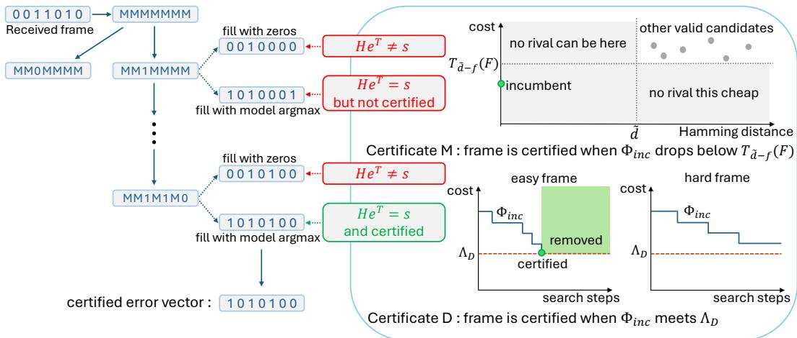  
Figure 1: Overview of the proposed CAL-ECC.

## 3 PRELIMINARIES

Syndrome decoding. A binary linear $[ n , k ]$ code $\mathcal { C } \subseteq \mathbb { F } _ { 2 } ^ { n }$ with parity-check matrix (PCM) $H \in$ $\mathbb { F } _ { 2 } ^ { ( n - k ) \times n }$ satisfies $\mathcal { C } = \{ \mathbf { c } : H \mathbf { c } ^ { \mathsf { T } } = \mathbf { 0 } \}$ . We write $H _ { r }$ for the r-th row, supp(Hr) for its support, and $d _ { \mathrm { m i n } }$ for the minimum distance. Under BPSK over AWGN, with $\mathrm { b p s k } ( b ) = \bar { 1 } - 2 b$ , the receiver observes $\mathbf { y } = \mathrm { b p s k } ( \mathbf { c } ) + \mathbf { z } , \mathbf { z } \sim \mathcal { N } ( \mathbf { 0 } , \sigma ^ { 2 } I _ { n } )$ , and forms

$$
r _ { j } = \mathbb { 1 } [ y _ { j } < 0 ] , \qquad s = H \mathbf { r } ^ { \mathsf { T } } \in \mathbb { F } _ { 2 } ^ { n - k } , \qquad \ell _ { j } = 2 y _ { j } / \sigma ^ { 2 } ,\tag{1}
$$

SO $| \ell _ { j } |$ measures bit reliability, and conditioning on $( | \ell | , s )$ is codeword-invariant under BPSK symmetry (Bennatan et al., 2018). Writing $\mathbf { e } = \mathbf { r } \oplus \mathbf { c } .$ the identity $H \mathbf { e } ^ { \mathsf { T } } = s$ turns decoding into estimation of e, with $\hat { \mathbf { c } } = \mathbf { r } \oplus \hat { \mathbf { e } }$ (Richardson & Urbanke, 2008).

Lemma 3.1. Over BPSK+AWGN, ML decoding is equivalent to

$$
\hat { \mathbf { e } } _ { \mathrm { M L } } = \arg \operatorname* { m i n } _ { \mathbf { e } : H \mathbf { e } ^ { \mathsf { T } } = s } \Phi ( \mathbf { e } ) , \qquad \Phi ( \mathbf { e } ) : = \sum _ { j } e _ { j } | \ell _ { j } | ,\tag{2}
$$

and $\hat { \mathbf { c } } _ { \mathrm { M L } } = \mathbf { r } \oplus \hat { \mathbf { e } } _ { \mathrm { M L } }$

The proof is in Appendix A. We call Φ the likelihood cost and write $\begin{array} { r } { \Phi ^ { \star } : = \Phi ( \hat { \mathbf { e } } _ { \mathrm { M L } } ) ; } \end{array}$ it is additive over flipped coordinates, so a partially committed assignment has a valid running cost.

## 4 METHOD

Where prior work draws a single estimate from a generative decoder, we treat it as a stochastic candidate generator and add exact syndrome filtering, which uses H to verify candidates algebraically, and certified early termination (Section 4.3), which halts a frame as soon as its best valid candidate is provably the global ML solution.

Selection. Given a candidate set ${ \mathcal { L } } _ { \theta }$ we form $\mathcal { L } ^ { \mathrm { v a l i d } } = \left\{ \mathbf { e } \in \mathcal { L } _ { \theta } : H \mathbf { e } ^ { \mathsf { T } } = s \right\}$ and return

$$
\hat { \mathbf { e } } = \arg \operatorname* { m i n } _ { \mathbf { e } \in \mathcal { L } ^ { \mathrm { v a l i d } } } \Phi ( \mathbf { e } ) , \qquad \hat { \mathbf { c } } = \mathbf { r } \oplus \hat { \mathbf { e } } ,\tag{3}
$$

falling back to the minimizer of Φ over all of ${ \mathcal { L } } _ { \theta }$ when ${ \mathcal { L } } ^ { \mathrm { v a l i d } } = \emptyset$

Proposition 4.1 (List-restricted ML optimality). $I f { \mathcal { L } } ^ { \mathrm { v a l i d } } \neq \emptyset ,$ then ê in equation 3 is the exact ML estimate restricted to $\mathcal { L } _ { \theta }$

This is immediate from Lemma 3.1 (Appendix A): selection is always optimal within the list, so performance is governed entirely by whether generation produces a set containing $ { \hat { \mathbf { e } } } _ { \mathrm { M L } }$ , and closing the remaining gap to $\Phi ^ { \star }$ is what the certificates do.

## 4.1 CANDIDATE GENERATION

We instantiate the generator as absorbing-state diffusion (Austin et al., 2021; Shi et al., 2024) over error vectors, with alphabet $\mathcal { A } = \mathbb { F } _ { 2 } \cup \{ \bar { \mathsf { m } } \}$ where m marks an uncommitted coordinate. The forward process replaces each coordinate of the true error $\mathbf e ^ { \star } = \mathbf r \oplus \mathbf c$ independently by m with probability $t \in [ 0 , 1 ] ,$ , giving $\mathbf { e } _ { t }$ with mask set $\mathcal { M } _ { t } ,$ and the reverse model is trained by cross-entropy over masked coordinates, a variational bound on the likelihood (Shi et al., 2024):

$$
\mathcal { L } ( \boldsymbol { \theta } ) = - \mathbb { E } _ { \mathbf { e } ^ { \star } , t , \mathbf { e } _ { t } } \bigg [ \frac { 1 } { | \mathcal { M } _ { t } | } \sum _ { j \in \mathcal { M } _ { t } } \log p _ { \boldsymbol { \theta } } \big ( e _ { j } ^ { \star } | \mathbf { e } _ { t } , | \boldsymbol { \ell } | , s , t \big ) \bigg ] .\tag{4}
$$

The syndrome enters only as conditioning and as the exact verifier in equation 3, never as a differentiable penalty. At inference we start from ${ \bf { \bar { e } } } _ { ( 0 ) } = [ { \bf m } ] ^ { n }$ and commit coordinates over $T$ steps, choosing the commitment order by model confidence. The model is conditioned on t, which must track the actual fraction of uncommitted coordinates, $t = | { \mathcal { M } } | / n$ , counted from the mask directly because the unit propagation of Section 4.2 commits several coordinates at once.

## 4.2 PROBABILITY BEAM SEARCH

Sequential commitment makes the generative process a tree. We score a partial assignment b by its accumulated log-probability score $\begin{array} { r } { \dot { \mathbf { \rho } } ( \bar { b } ) = \sum _ { ( j , a ) \in b _ { \mathrm { b r } } } \log p _ { \theta } ( e _ { j } = a \mid \mathbf { \rho } } \end{array}$ context), where $b _ { \mathrm { b r } } \subseteq b$ are the coordinates committed by branching. At each step every surviving assignment is branched on the two values of one uncommitted coordinate, and we prune with a relative threshold $\tau \in ( 0 , 1 ]$ against the best score in the frame,

$$
\begin{array} { r } { \operatorname { s c o r e } ( b ) \ \geq \ \operatorname* { m a x } _ { b ^ { \prime } } \operatorname { s c o r e } ( b ^ { \prime } ) + \log \tau , } \end{array}\tag{5}
$$

retaining at most the top $L _ { \mathrm { m a x } }$ . The coordinate branched on is the uncommitted one with the largest maxa $p _ { \theta } ( e _ { j } = a \mid b )$ averaged over the surviving beams of the frame, and coordinates committed by unit propagation are forced by the code and add nothing to the score. Pruning adapts to difficulty: on easy frames the beam collapses, on hard frames it expands.

Unit propagation. If a parity check has exactly one uncommitted coordinate in its support, that coordinate is determined by the parity the check requires, so committing it costs no forward pass and removes no valid completion; we apply this to exhaustion after every commitment, as a per-frame operation since all beams of a frame share the mask pattern. The effect is largest for sparse $H \colon$ on MacKay(96, 48) a trajectory that would need $T = 9 6$ forward passes completes in at most $6 0 ,$ and on the dense BCH(63, 45) the saving is from 63 to 59. All NFE figures we report include this reduction.

Beam exhaustion. A lower bound $\Lambda _ { \mathrm { B } }$ on the cost of any valid completion of the surviving beam is available from the committed flips and the checks still unsatisfied (Appendix $\mathbf { A . 4 } ) ;$ if the incumbent $\Phi _ { \mathrm { i n c } }$ of Section $4 . 3$ costs no more, the search may stop (Proposition $\mathbf { A . } 1 )$ . Because pruned branches lie outside its scope, $\Lambda _ { \mathrm { B } }$ is not a lower bound on $\Phi ^ { \star }$ and carries no claim of global optimality; we report the two stopping rates separately throughout.

## 4.3 CERTIFIED EARLY TERMINATION

Viewing the beam search as branch-and-bound for equation 2, the diffusion model supplies the branching rule and τ-pruning corresponds to node elimination. The missing ingredient is a bound on $\Phi ^ { \star }$ itself. If the incumbent cost is no larger, the incumbent is already globally optimal and the frame may stop. At every step, immediately after the forward pass and without any extra forward pass, we form two completions of each surviving assignment. $\bf { e } ^ { \mathrm { { p a r t } } }$ fills uncommitted coordinates with 0 and $\mathbf { e } ^ { \mathrm { g r e e d y } }$ fills them with the arg max of the current probabilities.

Certificate D: a dual bound. Let $\mathcal { R } = \{ r : s _ { r } = 1 \}$ be the checks unsatisfied by the hard decision. Every valid e flips an odd number of coordinates in each such support, hence $\begin{array} { r } { \sum _ { j \in \mathrm { s u p p } ( H _ { r } ) } e _ { j } \geq 1 } \end{array}$ and the covering LP mii $\begin{array} { r } { \mathrm { 1 } _ { \mathbf { x } \in [ 0 , 1 ] ^ { n } } \sum _ { j } | \ell _ { j } | x _ { j } } \end{array}$ subject to those constraints lower-bounds $\Phi ^ { \star }$ . Its dual is the packing LP

$$
\operatorname* { m a x } _ { \mathbf { y } \geq \mathbf { 0 } } \sum _ { r \in \mathcal { R } } y _ { r } \quad \mathrm { s u c h \ t h a t } \quad \sum _ { r : j \in \mathrm { s u p p } ( H _ { r } ) } y _ { r } \leq | \ell _ { j } | , \mathrm { f o r \ a l l } ~ j ,\tag{6}
$$

so by weak duality (Schrijver, 1998), $\smash { \sum _ { r } y _ { r } \le \Phi ^ { \star } }$ for any feasible y. We construct one by greedy dual ascent over R (Appendix B), capped at $K = 1 2$ rounds; every intermediate y is feasible, so $\begin{array} { r } { \Lambda _ { \mathrm { D } } : = \sum _ { r } y _ { r } } \end{array}$ is valid at whatever round the ascent is truncated, and Appendix I measures what the exact optimum of equation 6 would add. Since $\Lambda _ { \mathrm { D } }$ bounds $\Phi ^ { \star }$ , a constant of the frame, it is computed once at the fully masked state and reused at every step.

Certificate M: a distance-based test. The second certificate uses $d _ { \mathrm { m i n } }$ and depends on the incumbent alone. Let $F = \mathrm { s u p p } ( \mathbf { e } ) , f = | F |$ , and let $T _ { m } ( F )$ be the sum of the m smallest $| \ell _ { j } |$ over $j \not \in F$

Theorem 4.2 (Distance-based ML certificate). Let C be a binary $[ n , k , d _ { \mathrm { m i n } } ]$ linear code, and let $\tilde { d } \leq d _ { \operatorname* { m i n } } .$ If a valid e satisfies $f < \tilde { d }$ and $\Phi ( \mathbf { e } ) \leq T _ { \tilde { d } - f } ( F )$ , then $\Phi ( \mathbf { e } ) = \Phi ^ { \star }$

The proof is in Appendix A.3. When $f \geq \tilde { d }$ the test is vacuous, as $F$ may then contain a whole codeword, and no certification is attempted.  is a fixed invariant of the code, not a hyperparameter: we use the BCH bound for BCH codes and the minimum generator row weight for polar codes (Table 4, Appendix D), and where no lower bound is available the certificate is disabled, degrading gracefully to Certificate D alone.

Termination rule. A frame is certified, and removed from the search with output $\hat { \mathbf { e } } _ { \mathrm { i n c } } .$ when

$$
\Phi _ { \mathrm { i n c } } \ \leq \ \Lambda _ { \mathrm { D } } \qquad \mathrm { o r } \qquad \Phi _ { \mathrm { i n c } } \ \leq \ T _ { \tilde { d } - f } ( F _ { \mathrm { i n c } } ) .\tag{7}
$$

Frames may additionally stop by beam exhaustion (Proposition A.1). Those stops are counted separately and carry no global claim.

Theorem 4.3 (Correctness of certification). A frame terminated by equation 7 outputs $\Phi ( \hat { \mathbf { e } } _ { \mathrm { i n c } } ) = \Phi ^ { \star }$ so its output is a global ML solution. Consequently its BER and FER are no larger than those obtained by running the search to completion.

Proof. For the first branch. $\Lambda _ { \mathrm { D } } \leq \Phi ^ { \star }$ by weak duality of equation $^ { 6 , }$ SO $\Phi _ { \mathrm { i n c } } \leq \Phi ^ { \star }$ .Since $\hat { \mathbf { e } } _ { \mathrm { i n c } }$ is valid we also have $\Phi _ { \mathrm { i n c } } \geq \Phi ^ { \star }$ , and equality follows. The second branch is Theorem 4.2. The BER/FER claim holds because list-restricted optimality (Proposition 4.1) is weaker than global optimality.

The floating-point implementation certifies to a tolerance ε (Appendix A.5). The two certificates exploit different structure and are complementary: Certificate D is strong for sparse H, where check supports rarely overlap and the feasible region of equation 6 is large, and Certificate M for dense H with a large $d _ { \mathrm { m i n } }$ , while at low SNR f frequently exceeds d and voids Certificate M by construction (Section 5.4).

## 5 EXPERIMENTS

Setup. We evaluate on BCH (Bose & Ray-Chaudhuri, 1960), polar (Arikan, 2009), LDPC (Gallager, 1962), MacKay (MacKay, 1999) and CCSDS (Consultative Committee for Space Data Systems, 2011) codes, spanning block lengths 31–128 and rates 0.49–0.81, with parity-check matrices verified against the public references (Appendix D). All model-free entries use the same backbone scale $( \bar { N } _ { \mathrm { d e c } } { = } 6 , \bar { d _ { \mathrm { m o d e l } } } { = } 1 2 8 )$ , and our generator uses the CrossMPT backbone so that the comparison isolates the decoding method rather than the architecture; each decoder follows its own published training schedule, ours included (Appendix C). At inference we branch on one coordinate per step with beam width $L _ { \mathrm { m a x } } { = } 2 5 6$ and report three thresholds $\tau \in \{ 1 0 ^ { - 1 } , 1 0 ^ { - 2 } , 1 0 ^ { - 3 } \}$ ; each cell is decoded until 500 frame errors or a frame cap. Baselines are ECCT (Choukroun & Wolf, 2022) and CrossMPT (Park et al., 2025), both single-shot, and the iterative DDECC (Choukroun & Wolf, 2023) and SB-ECC (Helvits & Nachmani, 2026), the latter two with the standard syndrome stopping rule enabled so that their reported NFE is realised cost rather than budget. Details are in Appendix C.

Table 1: Decoding accuracy, − ln(BER) at $E _ { b } / N _ { 0 } \in \{ 4 , 5 , 6 \}$ dB (higher is better). Per cell the best entry is bold and underlined and the runner-up underlined. The 2–3 dB columns are in Appendix F.
<table><tr><td rowspan="2">Code</td><td rowspan="2">(n, k)</td><td colspan="2">ECCT</td><td rowspan="2"></td><td colspan="3">CrossMPT</td><td rowspan="2">DDECC</td><td colspan="3"></td><td rowspan="2">SB-ECC</td><td colspan="3">CAL-ECC 10-</td><td colspan="3">CAL-ECC</td><td colspan="3">CAL-ECC 10−3</td></tr><tr><td>4 5</td><td>6</td><td>4 5</td><td>6</td><td>4</td><td>5</td><td>6 4</td><td>5</td><td>6</td><td>4</td><td>5</td><td>6</td><td>4 5</td><td>10−2 6</td><td>4</td><td>5</td><td>6</td></tr><tr><td>BCH</td><td>(31,16) (63,36) (63,45) (63,51)</td><td>5.90 4.66 5.33 5.43</td><td>7.81 6.51 7.46 7.45</td><td>10.34 9.18 10.41 10.50</td><td>7.00 4.79 5.31 5.64</td><td>9.35 6.75 7.53 7.89</td><td>12.36 4.80 9.45 5.30 10.50 5.77 11.17 5.25</td><td>6.13 7.29 7.95 7.14</td><td>7.67 9.98 9.25</td><td>7.29 5.52 10.54 6.29 5.50</td><td>9.81 7.55 9.01 7.64</td><td>12.90 10.49 12.54 6.04 10.79</td><td>6.61 5.36 6.22</td><td>8.93 7.62 8.46 8.78</td><td>11.83 10.71 11.86 12.27</td><td>7.19 6.44 7.12 6.65</td><td>9.56 8.78 9.74 9.38</td><td>12.47 12.00 13.01 12.89</td><td>7.48 9.89 7.43 7.82 6.80 9.63</td><td>10.16 10.86</td><td>13.04 13.53 14.49 13.28</td></tr><tr><td>Polar</td><td>(64,32) (64,48) (128,64) (128,86) (128,96)</td><td>6.63 6.19 4.84 6.31 6.29</td><td>9.04 8.28 7.33 9.10 9.09</td><td>11.89 10.97 10.72 12.48 12.31</td><td>7.63 6.41 5.64 7.62 7.08</td><td>10.26 8.56 8.71 10.94 10.17</td><td>13.29 7.05 11.22 6.00 13.24 8.31 15.25 7.84 13.14 7.34</td><td>9.50 8.00 12.06 11.18 10.22</td><td>12.23 10.40 15.73 15.25 13.14</td><td>7.52 6.59 7.77 7.87 7.28</td><td>10.15 8.62 11.29 11.07 10.22</td><td>13.26 7.61 11.23 15.43 14.98 13.18</td><td>6.59 6.29 8.04 7.53</td><td>10.30 8.63 9.94 11.77 10.54</td><td>13.67 11.24 14.92 16.09 13.30</td><td>7.89 6.63 6.73 8.51 7.83</td><td>10.58 8.65 10.22 12.14 10.59</td><td>13.89 11.25 15.13 16.54 13.32</td><td>7.97 6.66 7.61 9.00 8.11</td><td>10.67 8.67 11.22 12.65 10.67</td><td>13.96 11.25 15.94 17.06 13.33</td></tr><tr><td>LDPC</td><td>(49,24) (121,60) (121,70) (121,80)</td><td>6.10 5.11 6.31 7.19</td><td>8.58 8.23 10.11 11.40</td><td>12.16 12.98 15.55 17.12</td><td>6.70 5.79 7.04 8.00</td><td>9.52 9.29 11.36 17.28 12.66 18.24</td><td>13.30 6.00 14.94 5.52 6.95 8.16</td><td>8.48 9.04 11.31 12.69</td><td>11.78 14.35 17.16 17.74</td><td>7.15 6.23 7.75 8.77</td><td>10.34 10.13 12.41 13.89</td><td>14.18 16.08 18.98 21.39</td><td>7.38 6.24 7.72 8.77</td><td>10.35 10.18 12.55 13.81</td><td>14.32 16.31 19.19 21.09</td><td>8.21 7.01 8.40 9.45</td><td>10.95 10.64 13.10</td><td>14.65 16.53 19.47</td><td>8.72 8.25 9.85</td><td>11.49 12.24 14.43 15.42</td><td>14.94 17.91 20.30</td></tr><tr><td>MacKay CCSDS</td><td>(96,48) (128,64)</td><td>7.13 6.75</td><td>10.46 10.62</td><td>14.51 15.81</td><td>7.82 7.65</td><td>11.53 12.19 17.58</td><td>15.60 8.28 7.98</td><td>12.12 12.66</td><td>15.95 17.18 8.36</td><td>8.60</td><td>12.40 13.18</td><td>16.21 19.42</td><td>8.85 8.59</td><td>12.72 13.64</td><td>16.26 21.33</td><td>9.40 8.96</td><td>14.30 13.01 13.83</td><td>21.61 16.34 21.57</td><td>10.58 10.31 9.95</td><td>13.40 14.70 21.79</td><td>22.38 16.40</td></tr></table>

Table 2: Ablation at $E _ { b } / N _ { 0 } = 4 { \mathrm d } \mathbf B , \tau = 1 0 ^ { - 3 } \colon$ (a) the generator decoded greedily along a single trajectory (τ=1, L=1); (b) the full beam search with certificates disabled; (c) the complete decoder. "search ∆BER" is (b)−(a) in − ln(BER) and "cert. NFE cut" is (b)/(c) in NFE.
<table><tr><td rowspan="2">Code</td><td colspan="2">(a) generator</td><td colspan="2">(b) + search</td><td colspan="2">(c) + certificates</td><td colspan="2">effect</td><td rowspan="2">(c)/(a) NFE ratio</td></tr><tr><td>− ln BER</td><td>NFE</td><td>− ln BER</td><td>NFE</td><td>− ln BER</td><td>NFE</td><td>search ∆BER</td><td>cert. NFE cut</td></tr><tr><td>MacKay(96, 48)</td><td>8.76</td><td>53.8</td><td>10.26</td><td>54.7</td><td>10.31</td><td>23.1</td><td>+1.50</td><td>2.4×</td><td>0.43×</td></tr><tr><td>LDPC(121, 80)</td><td>8.72</td><td>88.4</td><td>10.65</td><td>92.4</td><td>10.58</td><td>29.0</td><td>+1.93</td><td>3.2×</td><td>0.33×</td></tr><tr><td>BCH(63, 45)</td><td>5.82</td><td>45.2</td><td>7.81</td><td>149.7</td><td>7.82</td><td>113.8</td><td>+1.99</td><td>1.3×</td><td>2.52×</td></tr><tr><td>Polar(128, 64)</td><td>6.37</td><td>82.9</td><td>7.67</td><td>171.8</td><td>7.61</td><td>156.4</td><td>+1.30</td><td>1.1×</td><td>1.89×</td></tr></table>

## 5.1 ACCURACY

CAL-ECC at $\tau = 1 0 ^ { - 3 }$ attains the best result in 43 of the 45 cells shown in Table 1 and in 28 of the 30 at 2–3 dB (Appendix F), or 71 of 75 overall. All four exceptions are Polar(128, 64) at $E _ { b } / N _ { 0 } \leq 5 \mathrm { d B }$ , the cell with the lowest certification rate in our suite, and Section 5.4 shows the two facts have a common cause. The margin over the strongest prior decoder tracks how much headroom that decoder leaves rather than block length as such. It is smallest on the length-64 polar codes, below 0.7 in – ln(BER) and as little as 0.02 on Polar(64, 48), where prior decoders already operate near the ML ceiling (Section 5.3), and we take that cell as parity rather than improvement, reached at higher average cost than SB-ECC (Section 5.5). It exceeds 1.3 on LDPC(121, 60/70) and reaches 3.04 on BCH(63, 36), the largest in the suite. In $E _ { b } / N _ { 0 }$ it widens on the dense-H BCH codes, where a large $d _ { \mathrm { m i n } }$ keeps Certificate M firing, and narrows on most sparse-H codes, where the strongest baseline closes in.

## 5.2 WHERE THE GAIN COMES FROM

The decoder has three parts that could each account for the margins of Table 1: the diffusion generator, the beam search over the tree it induces, and the certificates. Table 2 separates them on four codes chosen to cover dense and sparse H and to include both cells we win and the one we lose; all three configurations use the same trained model.

The search produces the accuracy; the certificates change the cost, not the answer. Column (a), the same trained model decoded along a single greedy trajectory, is not competitive with the baselines: against the strongest prior decoder on the same cell it is behind by 0.47 on BCH(63, 45), 0.05 on LDPC(121, 80) and 1.94 on Polar(128, 64), and ahead by only 0.16 on MacKay(96, 48). Adding the beam search moves it by 1.30 to 1.99, which is the whole of our margin over prior work; the generator is a good branching heuristic and nothing more. The search is almost free on the sparse-H cells and triples or doubles the cost on the dense-H cells, where the beam must spread before any completion satisfies every check. Column (c) then differs from (b) by -0.07 to +0.05 in – ln(BER), inside the sampling error, as Theorem 4.3 predicts; what changes is the computation, by a factor that tracks the certification rate, 3.2× on LDPC(121, 80) where 72.4% of frames are certified and 1.1× on Polar(128, 64) where 18.7% are. BCH(63, 45) is the apparent exception at 1.3× despite 83.7% certification: a certificate cannot fire before a valid incumbent exists, and on a dense H that takes most of the trajectory, so there is simply less of the search left to remove.

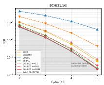  
(a) BCH(31, 16)

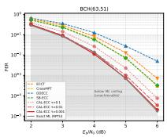  
(b) BCH(63, 51)

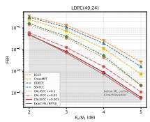  
(c) LDPC(49, 24)

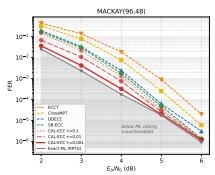  
(d) MacKay(96, 48)

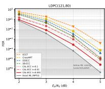  
(e) LDPC(121, 80)  
Figure 2: FER against the exact ML reference (grey) over the $E _ { b } / N _ { 0 }$ range where it exists; the shaded region below it is unachievable by any decoder. CAL-ECC curves darken as τ decreases.

The accuracy is not bought with computation. Only (a) and (c) are configurations one would actually deploy, and against (a) the complete decoder is simultaneously more accurate and cheaper on the two sparse-H cells, at 0.43× the evaluations on MacKay(96, 48) for 1.55 and 0.33× on LDPC(121, 80) for 1.86, because the certificates halt many frames earlier than a greedy trajectory ever finishes. Moreover 4 dB is where our computation is at its most expensive relative to a fixedbudget decoder; the same four cells cost 2.7, 1.2, 0.7 and 12.1 evaluations at 6 dB (Section 5.5). Polar(128, 64), the one cell we lose, is weakest in every column, for the reason Section 5.4 gives.

## 5.3 REACHING THE EXACT ML CEILING

Exact ML references from integer-programming decoders are published for eleven of our fifteen codes, over the $E _ { b } / N _ { 0 }$ range where the integer program remains feasible (Helmling et al., 2019), labelled RPTU in the figures after the hosting institution. Figure 2 shows five representative panels and Appendix J the rest and, since ML is block-optimal, the corresponding FER at 5 dB (Table 14), the highest point at which a reference exists for all five.

On four of the five codes the accuracy axis is closed. Taking the ratio to the reference, CAL-ECC shows 0.93, 1.17, 1.05 and 1.11 on the four codes whose reference is uncensored. The reference is measured to 100 frame errors and ours to about 500; treating both counts as Poisson gives a combined relative standard deviation of $\sqrt { 1 / 1 0 0 + 1 / 5 0 0 } = 1 1 \%$ , so these deviations are 0.6σ, 1.6σ, 0.5σ and 1.Oσ, within one standard deviation of exact ML on three of the four codes and within two on the fourth. Figure 2 shows the same thing qualitatively: the three curves obtained by varying τ separate at low $E _ { b } / N _ { 0 }$ and then collapse onto the reference, which is what one expects once the candidate set contains $\hat { \mathbf { e } } _ { \mathrm { M L } }$ on essentially every frame. Two ratios below one are finite-sample fluctuations rather than a true advantage over a frame-optimal decoder: they move between operating points (BCH(63, 51) gives 0.79 at 4 dB but 1.05 at 5 dB), whereas a systematic bias would recur.

## 5.4 ANATOMY OF CERTIFICATION

Three structural predictions follow from Section 4.3: Certificate D should be strong for sparse H, Certificate M for codes with a large known $d _ { \mathrm { m i n } } ,$ and both should weaken at low $E _ { b } / \bar { N _ { 0 } }$ where f exceeds . Table 3 tests all three. Throughout, cert% is the fraction of frames whose output is provably the global ML solution, and frames stopped by beam exhaustion are counted as uncertified.

The two certificates are complementary, as predicted. For the dense-H BCH codes Certificate D contributes essentially nothing (0.0–0.7%) while Certificate M carries 53.6–83.4%, and for the sparse-H LDPC(121, 80), MacKay and CCSDS the roles are exactly reversed, the zeros in [M] being the designed fallback where no lower bound on $d _ { \mathrm { m i n } }$ is available. LDPC(49, 24), the only code that is both sparse and has an exactly known $d _ { \mathrm { m i n } } .$ , has both certificates firing (15.1% and 60.9%), so the complementarity follows from structure rather than from code family. Polar(128, 64) is the predicted failure mode: its H is neither sparse enough for D nor equipped with a large enough $\tilde { d }$ for M, and up to 4 dB it is the only cell where both are simultaneously weak (15.3% and 3.3%), recovering to cert = 85.2% at 6 dB. It is precisely at $E _ { b } / N _ { 0 } \leq 5 \mathrm { d B }$ , where certification is weakest, that this is the only code on which a prior decoder wins; weak certification is necessary for that outcome but not sufficient, since Polar(128, 96) at 4 dB certifies a comparable 21.6% yet we win there by +0.77, and what separates Polar(128, 64) is that its generator is also the furthest behind (Table 2).

Table 3: Certificate breakdown at $E _ { b } / N _ { 0 } = 4 ~ \mathrm { d B } , \tau = 1 0 ^ { - 3 }$ , sorted by the row weight of H. [D] and [M] are the fractions certified by each test; cert% additionally includes frames with $\mathbf { \boldsymbol { s } } = \mathbf { 0 }$ “detected" is the share of frame errors whose output fails the syndrome check, “errors there"the share falling in the uncertified fraction, and selectivity the bound $\dot { 1 } / ( 1 - \mathrm { c e r t } )$
<table><tr><td>Code</td><td>row wt. H</td><td>cert%</td><td>[D]%</td><td>[M]%</td><td>uncert.%</td><td>detected</td><td>errors there</td><td>selectivity</td></tr><tr><td>MacKay(96, 48)</td><td>6</td><td>59.5</td><td>59.2</td><td>0.0</td><td>40.5</td><td>38.1%</td><td>98.8%</td><td>2.5×</td></tr><tr><td>LDPC(49, 24)</td><td>7</td><td>81.3</td><td>15.1</td><td>60.9</td><td>18.7</td><td>7.0%</td><td>98.9%</td><td>5.3×</td></tr><tr><td>BCH(31, 16)</td><td>8</td><td>89.2</td><td>0.5</td><td>70.6</td><td>10.8</td><td>1.7%</td><td>96.7%</td><td>9.3×</td></tr><tr><td>CCSDS(128, 64)</td><td>8</td><td>41.0</td><td>40.9</td><td>0.0</td><td>59.0</td><td>100.0%</td><td>100.0%</td><td>1.7×</td></tr><tr><td>LDPC(121, 70)</td><td>11</td><td>63.0</td><td>62.5</td><td>0.0</td><td>37.0</td><td>92.8%</td><td>100.0%</td><td>2.7×</td></tr><tr><td>LDPC(121, 80)</td><td>11</td><td>72.4</td><td>70.9</td><td>0.0</td><td>27.6</td><td>66.7%</td><td>100.0%</td><td>3.6×</td></tr><tr><td>Polar(128, 64)</td><td>13.5</td><td>18.7</td><td>15.3</td><td>3.3</td><td>81.3</td><td>94.5%</td><td>100.0%</td><td>1.2×</td></tr><tr><td>BCH(63, 36)</td><td>18</td><td>88.8</td><td>0.0</td><td>83.4</td><td>11.2</td><td>97.2%</td><td>100.0%</td><td>8.9×</td></tr><tr><td>BCH(63, 51)</td><td>28</td><td>79.6</td><td>0.7</td><td>53.6</td><td>20.4</td><td>0.0%</td><td>97.3%</td><td>4.9×</td></tr></table>

Low SNR voids Certificate M by construction. On BCH(63, 45) the certification rate falls monotonically from 99.8% at 6 dB to 24.7% at 2 dB, because f exceeds d on an increasing fraction of frames and the test of Theorem 4.2 cannot be applied at all. Certification is thus a property of the operating point as much as of the code, and we report it per cell (Appendix F).

Certification is a per-frame reliability signal. The last columns report a consequence we did not design for. Errors fall almost entirely in the uncertified fraction: across all nine cells 96.7–100% of frame errors occur on uncertified frames, and on five of them every observed error did, including all 508 errors on LDPC(121,80) against 1,302,404 certified frames with none. Part of this any decoder could claim: an output that fails the syndrome check has visibly failed, and on CCSDS, BCH(63, 36), Polar(128, 64) and LDPC(121, 70) such detected failures are 93–100% of the errors (column “detected’). The certificate's own contribution lies in the remainder, the outputs that are valid codewords and wrong, which no syndrome check can flag: on the five cells with at least 100 such errors the certificate captures 96.7–100%, against 88.5–100% for flagging the same fraction of frames by output cost Φ (Appendix H). The mechanism is immediate in hindsight, since a certified frame outputs the ML solution and ML rarely errs at these operating points.

What the certificate adds over such a heuristic is not selectivity but a statement about what remains. If uncertified frames were flagged for retransmission, the last column gives $1 / ( 1 - \mathrm { c e r t } )$ , an upper bound on the selectivity when every error is uncertified: on BCH(31, 16), flagging 10.8% of frames captures 96.7% of the errors, a lift of 9.0×, while Polar(128, 64) marks the limit, where the signal is perfect but 81.3% of frames would have to be flagged. Used instead as a filter, over the nine cells we certify 4,108,339 frames and observe 46 errors among them, an error rate of $1 . 1 \times 1 0 ^ { - 5 }$ , one to two orders of magnitude below the decoder's own. A certificate proves that our output equals the ML output, not that it equals the transmitted codeword, so the residual $1 . 1 \times 1 0 ^ { - 5 }$ is the rate at which ML itself fails on those frames, not a miscalibration of ours.

## 5.5 COMPUTATIONAL COST

Two stopping rules. SB-ECC halts as soon as the hard decision satisfies every parity check, and we measure its realised cost under that rule rather than its nominal budget (Appendix C). Our decoder can be measured under the same rule, reported as $\mathrm { N F E } _ { \mathrm { s d } }$ , but it does not stop there: syndrome consistency says nothing about optimality, so the search continues until the incumbent is proved globally optimal and the distance between $\mathrm { N F E _ { s d } }$ and NFE (Table 5, Appendix F) is the price of certification. NFE counts single-input forward passes, a forward pass over |B| beams counting as |B|, so the unit is the same in arithmetic for both decoders; what differs is latency, where our beams run in one batch and SB-ECC's evaluations are sequential, at the price of a peak activation memory that scales with $| B | \leq L _ { \operatorname* { m a x } }$ rather than with a single trajectory.

Certification is bought, and its price is set by the certification rate. Under the syndrome rule our cost crosses SB-ECC's at roughly 4 dB: taking $\tau = 1 0 ^ { - 1 }$ and the median over the fifteen codes, we are 7.6× dearer at 2 dB, comparable at 4 dB (1.01×), and 1.61× cheaper at 6 dB, where we are cheaper on all fifteen codes, and over all 75 cells the median ratio is 1.01 ×. That comparison uses $\tau = 1 0 ^ { - 1 } ;$ at the $\tau = 1 0 ^ { - 3 }$ setting of Table 1 the two ends of the range separate sharply, to a median of 0.62× at 6 dB, below SB-ECC's cost on all fifteen codes, against 163× at 2 dB. The accuracy of Table 1 is therefore free at high $E _ { b } / N _ { 0 }$ and expensive at low. The ordering is not incidental: SB-ECC's per-frame cost is capped by its budget, whereas ours is the width of a beam that grows when the received word is ambiguous, and it is exactly at low $E _ { b } / N _ { 0 }$ that certification fails. Where certification is high the guarantee is nearly free, as on BCH(63, 45) at 6 dB, where proving optimality raises the cost from 0.5 to 0.7 evaluations, and where it is low it is expensive. Because our computation adapts to the input, a single average is not comparable to a fixed budget either: on LDPC(121, 80) at 4 dB the mean is 29.0 but $p _ { 5 0 } = 1$ , so the mean is set by a tail with $p _ { 9 9 } = 1 4 1$ and we report percentiles for every cell (Appendix F)

Accuracy becomes free as certification saturates. Certified frames stop at the same point regardless of τ, and because the residual errors live almost entirely in the uncertified fraction, lowering τ deepens the search exactly where it can still help. On LDPC(121, 80), moving from ${ \tau = 1 0 ^ { - 1 } \mathrm { t o } }$ $1 0 ^ { - 3 }$ costs 20.4× at 2 dB (cert = 8.9%) for a gain of +0.84, but is free at 5 dB $( \mathrm { c e r t } = 9 4 . 3 \% )$ where the average NFE is unchanged to three significant figures while — ln(BER) improves by 1.61, a 5× reduction in BER at identical cost. Grouping all 75 cells by certification rate, the median cost of that move is 1.06× above 95% certification and 8.74× below 50% (Appendix G). CAL-ECC is thus a family indexed by τ, an operating characteristic no fixed-budget decoder offers.

## 6 DISCUSSION

Conclusion. We built a decoder that knows when it is optimal. Absorbing-state discrete diffusion commits coordinates one at a time, which turns generation into a search tree; a beam search over that tree supplies candidates, and an LP dual bound and a distance-based test, both derived from the code, certify per frame that the incumbent is the global ML solution. Empirically the two certificates are complementary in the way their derivations predict, certification behaves as a per-frame reliability signal, and on the codes with an exact ML reference the family of curves indexed by τ collapses onto it, on BCH(63, 51) at an average of 0.6 function evaluations per frame.

Limitations. Three limitations remain, and they share a cause. (i) Certification degrades at low $E _ { b } / N _ { 0 }$ , where the incumbent weight exceeds d and voids Certificate M, and below about 4 dB our computation exceeds that of a budget-limited decoder (Section 5.5), reaching 591 × on LDPC(121, 60) at 2 dB. At 6 dB the same comparison is 0.62× at $\tau = 1 0 ^ { - 3 } . ( i i )$ Polar(128, 64) is the one cell where a prior decoder wins, and it is also the cell where both certificates are weakest. (iii) The gap to the ML ceiling grows with block length, reaching 4.23× on LDPC(121, 80). Where certification is high the method is accurate, cheap and able to certify its own output, and where it is low, none of the three holds.

Outlook. The most direct extension is a tighter relaxation: the Feldman polytope also constrains satisfied checks, which is exactly the structure missing on Polar(128, 64) and on the BCH codes (Appendix I), while on sparse H the exact LP optimum would certify a further 2.7–7.3% of frames at 4 dB. Second, even loose lower bounds on $d _ { \mathrm { m i n } }$ would extend Certificate M to LDPC(121, ·), MacKay and CCSDS. Third, a receiver that knows which 10-40% of its frames are uncertified can route exactly those to retransmission or to a more expensive decoder; how a certificate, a proof on a subset of frames, should be combined with the calibrated estimate of soft-output GRAND (Yuan et al., 2023) is an open question.

## REPRODUCIBILITY STATEMENT

The decoder is stated in full as Algorithm 1, and every claim of Section 4 is proved in Appendix A, with the numerical tolerances under which the certificates are applied in Appendix A.5. Architecture, training and inference hyperparameters, the measurement protocol and the baselines’ stopping rules are given in Appendix C, and the hardware in the same appendix. Appendix D verifies that our parity-check matrices define the same codes as the published references by F2 row-space equality and lists the distance bounds used by Certificate M with their sources (Table 4), since an incorrect bound would make the certificate unsound. Frames are generated from a seeded generator, so every cell is reproducible from its seed. Code will be released upon publication.

## ACKNOWLEDGMENTS

This work was supported by Global - Learning & Academic research institution for Master's·PhD students, and Postdocs (G-LAMP) Program of the National Research Foundation of Korea (NRF) grant funded by the Ministry of Education (No. RS-2025-25442252), the National Research Foundation of Korea (NRF) grant funded by the Korean government (MSIT) (Grant No. RS-2022-NR069041, RS-2025-00561169), Institute of Information & communications Technology Planning & Evaluation(IITP) under the Leading Generative AI Human Resources Development(IITP-2027-RS-2026- 25546026) grant funded by the Korea government(MSIT), and the Ewha Womans University Research Grant of 2026.

## REFERENCES

Erdal Arikan. Channel polarization: A method for constructing capacity-achieving codes for symmetric binary-input memoryless channels. IEEE Transactions on Information Theory, 55(7): 3051–3073, 2009.

Jacob Austin, Daniel D Johnson, Jonathan Ho, Daniel Tarlow, and Rianne van den Berg. Structured denoising diffusion models in discrete state-spaces. Advances in Neural Information Processing Systems, 34:17981–17993, 2021.

Amir Bennatan, Yoni Choukroun, and Pavel Kisilev. Deep learning for decoding of linear codes—a syndrome-based approach. In IEEE International Symposium on Information Theory (ISIT), pp. 1595–1599, 2018.

Elwyn Berlekamp, Robert McEliece, and Henk van Tilborg. On the inherent intractability of certain coding problems. IEEE Transactions on Information Theory, 24(3):384–386, 1978.

Raj Chandra Bose and Dwijendra K Ray-Chaudhuri. On a class of error correcting binary group codes. Information and Control, 3(1):68–79, 1960.

Andreas Buchberger, Christian Häger, Henry D Pfister, Laurent Schmalen, and Alexandre Graell i Amat. Learned decimation for neural belief propagation decoders. In IEEE International Conference on Acoustics, Speech and Signal Processing (ICASSP), pp. 8273–8277, 2021.

Sebastian Cammerer, Tobias Gruber, Jakob Hoydis, and Stephan ten Brink. Scaling deep learningbased decoding of polar codes via partitioning. In IEEE Global Communications Conference (GLOBECOM), pp. 1–6, 2017.

David Chase. A class of algorithms for decoding block codes with channel measurement information IEEE Transactions on Information Theory, 18(1):170–182, 1972.

Yoni Choukroun and Lior Wolf. Error correction code transformer. Advances in Neural Information Processing Systems, 35:38695–38705, 2022.

Yoni Choukroun and Lior Wolf. Denoising diffusion error correction codes. In The Eleventh International Conference on Learning Representations, 2023. URL https : / /openreview. net/forum?id=rLwC0\_MG-4w.

Yoni Choukroun and Lior Wolf. A foundation model for error correction codes. In International Conference on Learning Representations, 2024a.

Yoni Choukroun and Lior Wolf. Learning linear block error correction codes. In Ruslan Salakhutdinov, Zico Kolter, Katherine Heller, Adrian Weller, Nuria Oliver, Jonathan Scarlett, and Felix Berkenkamp (eds.), Proceedings of the 41st International Conference on Machine Learning, volume 235 of Proceedings of Machine Learning Research, pp. 8801–8814. PMLR, 21–27 Jul 2024b.

Shy-el Cohen, Yoni Choukroun, and Eliya Nachmani. Hybrid Mamba-transformer decoder for error-correcting codes. arXiv preprint arXiv:2505.17834, 2025.

Consultative Committee for Space Data Systems. TM synchronization and channel coding. Technical Report 131.0-B-2, CCSDS, 2011.

Ken R Duffy. Ordered reliability bits guessing random additive noise decoding. In IEEE International Conference on Acoustics, Speech and Signal Processing (ICASSP), pp. 8268–8272, 2021.

Ken R Duffy, Jiange Li, and Muriel Médard. Capacity-achieving guessing random additive noise decoding. IEEE Transactions on Information Theory, 65(7):4023–4040, 2019.

Ken R Duffy, Muriel Médard, and Wei An. Guessing random additive noise decoding with symbol reliability information (SRGRAND). IEEE Transactions on Communications, 70(1):3–18, 2022.

Jon Feldman, Martin J Wainwright, and David R Karger. Using linear programming to decode binary linear codes. IEEE Transactions on Information Theory, 51(3):954–972, 2005.

Marc P C Fossorier and Shu Lin. Soft-decision decoding of linear block codes based on ordered statistics. IEEE Transactions on Information Theory, 41(5):1379–1396, 1995.

Robert Gallager. Low-density parity-check codes. IRE Transactions on Information Theory, 8(1): 21–28, 1962.

Alex Graves. Adaptive computation time for recurrent neural networks. arXiv preprint arXiv:1603.08983, 2016.

Michael Helmling, Stefan Scholl, Florian Gensheimer, Tobias Dietz, Kira Kraft, Stefan Ruzika, and Norbert Wehn. Database of channel codes and ML simulation results. https : // rptu. de/ channel–codes, 2019. University of Kaiserslautern-Landau.

Alon Helvits and Eliya Nachmani. Score based error correcting code decoder. In International Conference on Machine Learning, 2026.

Nadine Hussami, Satish Babu Korada, and Rüdiger Urbanke. Performance of polar codes for channel and source coding. In IEEE International Symposium on Information Theory (ISIT), pp. 1488–1492, 2009.

Toshimitsu Kaneko, Toshihisa Nishijima, Hiroshi Inazumi, and Shigeichi Hirasawa. An efficient maximum-likelihood-decoding algorithm for linear block codes with algebraic decoder. IEEE Transactions on Information Theory, 40(2):320–327, 1994.

Diederik P Kingma and Jimmy Ba. Adam: A method for stochastic optimization. In International Conference on Learning Representations, 2015.

Haoyu Lei, Chin Wa Lau, Kaiwen Zhou, Nian Guo, and Farzan Farnia. Syndrome-flow consistency model achieves one-step denoising error correction codes. arXiv preprint arXiv:2512.01389, 2025.

Matan Levy, Yoni Choukroun, and Lior Wolf. Accelerating error correction code transformers. arXiv preprint arXiv:2410.05911, 2024.

Loren Lugosch and Warren J Gross. Neural offset min-sum decoding. In IEEE International Symposium on Information Theory (ISIT), pp. 1361–1365, 2017.

David J C MacKay. Good error-correcting codes based on very sparse matrices. IEEE Transactions on Information Theory, 45(2):399–431, 1999.

Florence Jessie MacWilliams and Neil James Alexander Sloane. The Theory of Error-Correcting Codes. North-Holland, Amsterdam, 1977.

Eliya Nachmani, Yair Be'ery, and David Burshtein. Learning to decode linear codes using deep learning. In 54th Annual Allerton Conference on Communication, Control, and Computing, pp. 341–346, 2016.

Eliya Nachmani, Elad Marciano, Loren Lugosch, Warren J Gross, David Burshtein, and Yair Be'ery. Deep learning methods for improved decoding of linear codes. IEEE Journal of Selected Topics in Signal Processing, 12(1):119–131, 2018.

Seong-Joon Park, Hee-Youl Kwak, Sang-Hyo Kim, Sunghwan Kim, Yongjune Kim, and Jong-Seon No. How to mask in error correction code transformer: Systematic and double masking. arXiv preprint arXiv:2308.08128, 2023.

Seong-Joon Park, Hee-Youl Kwak, Sang-Hyo Kim, Yongjune Kim, and Jong-Seon No. CrossMPT: Cross-attention message-passing transformer for error correcting codes. In International Conference on Learning Representations, 2025.

Thomas J Richardson and Rüdiger L Urbanke. The capacity of low-density parity-check codes under message-passing decoding. IEEE Transactions on Information Theory, 47(2):599–618, 2001.

Tom Richardson and Rüdiger Urbanke. Modern Coding Theory. Cambridge University Press, 2008.

Alexander Schrijver. Theory of Linear and Integer Programming. John Wiley & Sons, 1998.

Jiaxin Shi, Kehang Han, Zhe Wang, Arnaud Doucet, and Michalis K Titsias. Simplified and generalized masked diffusion for discrete data. In Advances in Neural Information Processing Systems, volume 37, 2024.

Mohammad H Taghavi and Paul H Siegel. Adaptive methods for linear programming decoding. IEEE Transactions on Information Theory, 54(12):5396–5410, 2008.

Ido Tal and Alexander Vardy. List decoding of polar codes. IEEE Transactions on Information Theory, 61(5):2213–2226, 2015.

Surat Teerapittayanon, Bradley McDanel, and Hsiang-Tsung Kung. BranchyNet: Fast inference via early exiting from deep neural networks. In 23rd International Conference on Pattern Recognition (ICPR), pp. 2464–2469, 2016.

Pascal O Vontobel and Ralf Koetter. Graph-cover decoding and finite-length analysis of messagepassing iterative decoding of LDPC codes. arXiv:cs/0512078, 2005.

Peihong Yuan, Muriel Médard, Kevin Galligan, and Ken R Duffy. Soft-output (SO) GRAND and iterative decoding to outperform LDPCs. arXiv:2310.10737, 2023.

## A DEFERRED PROOFS

## A.1 PROOF OF LEMMA 3.1

Proof. ML decoding minimizes $\| \mathbf { y } - \mathrm { b p s k } ( \mathbf { c } ) \| _ { 2 } ^ { 2 }$ over $\mathbf { c } \in { \mathcal { C } } .$ Coordinatewise, bpsk $( c _ { j } ) \in \{ \pm 1 \}$ and $( y _ { j } + 1 ) ^ { 2 } - ( y _ { j } - 1 ) ^ { 2 } = 4 y _ { j }$ . The hard decision $r _ { j } = \mathbb { 1 } [ y _ { j } < 0 ]$ selects whichever modulation value is closer to $y _ { j }$ , so flipping it (i.e. setting $e _ { j } = 1$ , where $\mathbf { e } = \mathbf { r } \oplus \mathbf { c } )$ increases the squared distance by exactly $4 | y _ { j } |$ . Summing over coordinates,

$$
\| \mathbf { y } - \mathrm { b p s k } ( \mathbf { c } ) \| _ { 2 } ^ { 2 } = \| \mathbf { y } - \mathrm { b p s k } ( \mathbf { r } ) \| _ { 2 } ^ { 2 } + \sum _ { j } 4 | y _ { j } | e _ { j } .
$$

Substituting $| \ell _ { j } | = 2 | y _ { j } | / \sigma ^ { 2 }$ , i.e. $4 | y _ { j } | = 2 \sigma ^ { 2 } | \ell _ { j } |$ , gives $\| \mathbf { y } - \mathrm { b p s k } ( \mathbf { c } ) \| _ { 2 } ^ { 2 } =$ const $+ 2 \sigma ^ { 2 } \Phi ( \mathbf { e } )$ Neither the constant nor the positive factor $2 \sigma ^ { 2 }$ affects the minimizer. Finally $\mathbf { c } \in { \mathcal { C } } \iff H \mathbf { e } ^ { \mathsf { T } } = s$ by the syndrome identity $H \mathbf { \dot { e } } ^ { \mathsf { T } } = H \mathbf { r } ^ { \mathsf { T } } \oplus H \mathbf { c } ^ { \mathsf { T } }$ , so minimizing the squared distance over $\mathcal { C }$ coincides with minimizing Φ over $\{ \mathbf { e } : H \mathbf { e } ^ { \mathsf { T } } = { \pmb { s } } \}$ □

## A.2 PROOF OF PROPOSITION 4.1

Proof. By Lemma 3.1, for any e with $H \mathbf { e } ^ { \mathsf { T } } = s$ the negative log-likelihood of e is an affine, strictly increasing function of $\Phi ( \mathbf { e } )$ with coefficients independent of e. The set $\mathcal { L } ^ { \mathrm { v a l i d } }$ collects exactly the elements of $\mathcal { L } _ { \theta }$ satisfying that constraint, and equation 3 returns the minimizer of Φ over it. Hence ê maximizes the likelihood over $\mathcal { L } _ { \boldsymbol { \theta } } \cap \{ \mathbf { e } : H \mathbf { e } ^ { \mathsf { T } } \overset { } { = } s \}$ , which is the ML estimate restricted to $\mathcal { L } _ { \theta }$ . □

## A.3 PROOF OF THEOREM 4.2

Proof. Let $\mathbf { e } ^ { \prime } \neq \mathbf { e }$ be valid. Then $\mathbf { c } = \mathbf { e } \oplus \mathbf { e } ^ { \prime }$ satisfies $H \mathbf { c } ^ { \mathsf { T } } = \mathbf { 0 }$ , so c is a nonzero codeword and $| \mathrm { s u p p } ( \mathbf { c } ) | \geq d _ { \operatorname* { m i n } } \geq \tilde { d } .$ Since supp $( \mathbf { e } ^ { \prime } ) = ( F \backslash$ supp(c)) ∪ (supp(c) \ F),

$$
\Phi ( { \bf e } ^ { \prime } ) - \Phi ( { \bf e } ) = \sum _ { j \in \mathrm { s u p p } ( { \bf c } ) \backslash F } | \ell _ { j } | - \sum _ { j \in \mathrm { s u p p } ( { \bf c } ) \cap F } | \ell _ { j } | .
$$

$\operatorname { A s } | \operatorname { s u p p } ( \mathbf { c } ) \cap F | \leq f$ we $\mathrm { g e t } | \mathrm { s u p p } ( \mathbf { c } ) \setminus F | \geq \tilde { d } - f ,$ so the first sum is at least $T _ { \tilde { d } - f } ( F )$ and the second at most $\Phi ( \mathbf { e } )$ . Hence $\Phi ( { \bf e } ^ { \prime } ) - \Phi ( { \bf e } ) \geq T _ { { \tilde { d } } - f } ( F ) - \Phi ( { \bf e } ) \geq 0 .$ □

## A.4 BEAM EXHAUSTION: CONSTRUCTION AND PROOF OF PROPOSITION A.1

Section 4.2 introduced $\Lambda _ { \mathrm { B } } ;$ formally, let b be a surviving partial assignment, $C ( b ) \subseteq [ n ]$ its committed coordinates, and $F ( b ) = \{ j \in C \hat ( b ) : b _ { j } = 1 \}$ the coordinates it has already flipped. Let $\mathcal { R } ( b ) =$ $\{ r : \bigoplus _ { j \in C ( b ) \cap \mathbf { s u p p } ( H _ { r } ) } b _ { j } \not = s _ { r } \}$ be the checks whose committed parity already disagrees with the syndrome; à check that agrees is completed at no cost by zeros and is excluded. Define

$$
\Lambda _ { \mathrm { B } } ( b ) = \underbrace { \sum _ { j \in F ( b ) } | \ell _ { j } | } _ { \mathrm { c o m m i t t e d c o s t } } + \underbrace { \operatorname* { m a x } _ { r \in \mathcal { R } ( b ) } \operatorname* { m i n } _ { j \in \mathrm { s u p p } ( H _ { r } ) \backslash C ( b ) } | \ell _ { j } | } _ { \mathrm { m i n i m u m a d d i t i o n a l c o s t } } ,\tag{8}
$$

with the second term 0 when $\mathcal { R } ( b ) = \emptyset$ and $+ \infty$ when some $r \in \mathcal { R } ( b )$ has no free coordinate left the minimum over an empty set, and $\Lambda _ { \mathrm { B } } =$ minb $\Lambda _ { \mathrm { B } } ( b )$ over the surviving beam.

Proposition A.1 (Beam exhaustion). Let $\Phi _ { \mathrm { i n c } }$ be the cost of the best valid candidate found so far. If $\Phi _ { \mathrm { i n c } } \leq \Lambda _ { \mathrm { B } }$ , no continuation of any surviving assignment yields a valid candidate of cost below $\Phi _ { \mathrm { i n c } } ,$ and returning that candidate is therefore no worse than running the beam to completion.

Proof. Fix a surviving b and let e be any completion of b with $H \mathbf { e } ^ { \mathsf { T } } = s ,$ Since Φ is additive and nonnegative, $\begin{array} { r } { \Phi ( { \bf e } ) \geq \sum _ { j \in F ( b ) } | \ell _ { j } | } \end{array}$ . Suppose $\mathcal { R } ( b ) \neq \emptyset$ and pick any $r \in \mathcal { R } ( b )$ . Because the committed parity of b on check r disagrees with $s _ { r }$ while e satisfies it, e must flip an odd number, hence at least one, of the coordinates of supp(Hr) outside $C ( b )$ , and the cheapest such flip costs $\begin{array} { r } { \operatorname* { m i n } _ { j \in \mathrm { s u p p } ( H _ { r } ) \backslash C ( b ) } | \ell _ { j } | } \end{array}$ . This holds for every $r \in \mathcal { R } ( b )$ , hence for the maximizing one, and that cost is disjoint from the committed sum. Therefore $\Phi ( \mathbf { e } ) \geq \Lambda _ { \mathrm { B } } ( b )$ , and if $\mathcal { R } ( b ) = \emptyset$ the inequality is immediate. Taking the minimum over surviving $b ,$ every valid completion of every surviving assignment has cost at least $\Lambda _ { \mathrm { B } }$ , sO $\Phi _ { \mathrm { i n c } } \leq \Lambda _ { \mathrm { B } }$ implies that no such completion improves on the incumbent. □

Scope of the bound. The quantifier ranges over completions of surviving assignments only. A branch removed earlier by equation 5 is not a completion of any surviving $b ,$ and its descendants are therefore unconstrained by $\Lambda _ { \mathrm { B } }$ . Since $\hat { \mathbf { e } } _ { \mathrm { M L } }$ may lie in such a discarded subtree, $\Lambda _ { \mathrm { B } }$ is not a lower bound on $\Phi ^ { \star }$ and beam exhaustion carries no claim of global optimality. This is why we report beam-exhaustion stops separately from certified stops. Conflating them would overstate the certification rate, by up to 70 percentage points at $2 \mathrm { d } \mathbf { B } .$ , where Certificate M is voided by $f \geq \tilde { d }$ and beam exhaustion accounts for the majority of stops. $\Lambda _ { \mathrm { B } }$ is moreover defined only while the surviving beam is nonempty, and the test requires an incumbent: a check whose support is fully committed but unsatisfied leaves $\Lambda _ { \mathrm { B } } = \infty$ , so Algorithm 1 guards the comparison with $\Phi _ { \mathrm { i n c } } < \infty .$ A frame whose beam has emptied, or which ends without a valid candidate, is handled by equation 3 directly.

## A.5 NUMERICAL SAFETY

The dual ascent accumulates in double precision, whereas the reliabilities themselves are single precision, so the dominant error is the representation of $| \ell _ { j } |$ rather than the accumulation. The two tests are applied with a margin $\varepsilon = 1 0 ^ { - 4 }$ , but in opposite directions, because their structure differs. Certificate M is a genuine inequality, so we tighten it to $\Phi ( \mathbf { e } ) \leq T _ { \widetilde { d } - f } ( F ) - \varepsilon ;$ this can only forgo a valid certification, never issue a false one. Certificate D is an equality test in disguise: since $\Lambda _ { \mathrm { D } } \leq \Phi ^ { \star } \leq \Phi _ { \mathrm { i n c } }$ analytically, $\Phi _ { \mathrm { i n c } } \leq \Lambda _ { \mathrm { D } }$ can hold only when all three coincide, and a strict tolerance would never fire under floating point. We therefore implement it as $\Phi _ { \mathrm { i n c } } \leq \Lambda _ { \mathrm { D } } + \varepsilon ,$ which is permissive by ε: a frame certified by D satisfies $\Phi _ { \mathrm { i n c } } \leq \bar { \Phi ^ { \star } } + \varepsilon .$ , so its output is ε-optimal in likelihood cost rather than exactly optimal. Two distinct valid candidates differ in Φ by the signed reliability weight of a nonzero codeword, which can in principle fall below $\varepsilon ;$ on such a frame the two candidates are indistinguishable in likelihood to one part in $1 0 ^ { 4 }$ , and the exhaustive check on BCH(31, 16) in Appendix D finds no frame on which the tolerance changes the certified output at any tested $E _ { b } / N _ { 0 }$

## B DECODING ALGORITHM

Algorithm 1 states the decoder in full. Two points are worth highlighting. First, the dual bound $\Lambda _ { \mathrm { D } }$ is computed once, before any forward pass, and reused at every step. It lower-bounds $\Phi ^ { \star }$ , a constant of the frame rather than of the search, so the per-step overhead of Certificate D is a single scalar comparison. Second, the two stopping tests are kept separate because their guarantees differ. Lines 11–12 implement the certificates, and a frame leaving there is provably globally ML. Lines $1 5 -$ 16 implement beam exhaustion, where branches removed by τ-pruning lie outside the scope of $\Lambda _ { \mathrm { B } }$ and no global claim is made. We track the two exits separately throughout the paper and report only the first as certified.

Dual ascent. Starting from slacks $u _ { j } \qquad \qquad | \ell _ { j } | .$ each round picks $r ^ { * } = $ arg ma $\begin{array} { r } { \mathrm { x } _ { r \in \mathcal { R } } \operatorname* { m i n } _ { j \in \mathrm { s u p p } ( H _ { r } ) } u _ { j } } \end{array}$ over the unsatisfied checks only, removes it from ${ \mathcal { R } } ,$ raises $\begin{array} { r } { y _ { r ^ { * } } \mathrm { \normalfont ~ b y ~ } v = \operatorname* { m i n } _ { j \in \mathrm { s u p p } ( H _ { r ^ { * } } ) } u _ { j } } \end{array}$ , and decrements $u _ { j }$ by v on that support. Since $\mathbf { u } \geq \mathbf { 0 }$ is maintained, feasibility holds throughout. The ascent returns a feasible dual rather than the optimum of equation 6, a choice made for batched tensor execution (Appendix I).

Cost and batching. The dual ascent is $O ( K | \mathcal { R } | w )$ for maximum row weight w and runs once. Certificate M is one sort, $O ( n \log n )$ , re-evaluated only when the incumbent changes, and $\Lambda _ { \mathrm { B } }$ is a masked minimum over check supports. All three are negligible against a transformer forward pass over |B| beams, accounting in profiling for under 3% of wall-clock time, with the forward pass at 94–96%. Frames are decoded in parallel. Because a frame's mask pattern is shared by all of its beams, the coordinate chosen for branching is a per-frame quantity and a frame's beams always terminate at the same step. Certified frames are removed from the batch as they finish, which shrinks the working tensor as decoding proceeds.

## C IMPLEMENTATION DETAILS

Architecture. The generator uses the CrossMPT backbone (Park et al., 2025) with $N _ { \mathrm { d e c } } = 6$ decoder layers and $d _ { \mathrm { m o d e l } } = 1 2 8$ , matching the baselines so that comparisons isolate the decoding method. The output head produces logits over $\mathcal { A } = \{ 0 , 1 , \mathsf { m } \}$ , and the m logit is masked to —∞ at inference, since no coordinate is ever predicted to remain absorbed. The noise level enters through $\sigma ( t )$ with $t = | { \mathcal { M } } | / n$ , the actual fraction of uncommitted coordinates. Because unit propagation commits several coordinates per step (Section 4.2), t is computed from the mask count rather than from the step index.

Algorithm 1 Adaptive list decoding with certified early termination. Numerical tolerances are   
discussed in Appendix A.5.   
Require: reliabilities |l|, syndrome s, PCM H, model $p _ { \theta } .$ threshold τ, width $L _ { \mathrm { m a x } } .$ dual rounds K,   
distance bound d (optional). Throughout, $F _ { \mathrm { i n c } } = \mathrm { s u p p } \hat { \mathbf { e } } _ { \mathrm { i n c } }$ and $f = \left| F _ { \mathrm { i n c } } \right|$   
1: if $\mathbf { \boldsymbol { \cdot } } _ { s } = \mathbf { 0 }$ then return $\hat { \mathbf { c } } = \mathbf { r } ,$ CERTIFIED $\triangleright \Phi = 0$ trivially optimal, zero NFE   
2: end if   
3: $\Lambda _ { \mathrm { D } }  \mathrm { D U A L A }$ SCENT $( | \ell | , s , H , K )$ equation 6; once, no forward pass   
4: $\begin{array} { r } { B  \{ [ \mathsf { m } ] ^ { n } \} ; \quad \Phi _ { \mathrm { i n c } }  \infty ; \quad \hat { \mathbf { e } } _ { \mathrm { i n c } }  \perp } \end{array}$   
5: while $B \neq \varnothing$ and uncommitted coordinates remain do   
6: $\textstyle P \gets p _ { \theta } ( \cdot \mid \mathcal { B } , \mid \ell \mid , s , t ) , t = | \mathcal { M } | / n$ $\mathrm { N F E } + = \left| \boldsymbol { B } \right|$   
7: for all $b \in B$ do incumbent; no extra forward pass   
8: $\mathbf { e } ^ { \mathrm { p a r t } }  b$ with masks set to 0; $\mathbf { e } ^ { \mathrm { g r e e d y } }  b$ with masks set to arg max $P$   
9: update $( \hat { \mathbf { e } } _ { \mathrm { i n c } } , \Phi _ { \mathrm { i n c } } )$ with whichever of the two is valid and has smaller Φ   
10: end for   
11: if $\Phi _ { \mathrm { i n c } } \leq \Lambda _ { \mathrm { D } }$ or ( given, $f < { \tilde { d } } ,$ and $\Phi _ { \mathrm { i n c } } \leq T _ { \tilde { d } - f } ( F _ { \mathrm { i n c } } ) )$ then   
12: return $\begin{array} { r } { \hat { \mathbf { c } } = \mathbf { r } \oplus \hat { \mathbf { e } } _ { \mathrm { i n c } } , } \end{array}$ CERTIFIED global ML (Thm. 4.3)   
13: end if   
14: $\Lambda _ { \mathrm { B } } \gets$ minb∈B $\Lambda _ { \mathrm { B } } ( b )$ equation 8; surviving beam only   
15: if $\Phi _ { \mathrm { i n c } } < \infty$ and $\dot { \Phi _ { \mathrm { i n c } } } \leq \Lambda _ { \mathrm { B } }$ then   
16: return $\begin{array} { r } { \hat { \mathbf { c } } = \mathbf { r } \oplus \hat { \mathbf { e } } _ { \mathrm { i n c } } , } \end{array}$ UNCERTIFIED beam exhausted (Prop. A.1)   
17: end if   
18: pick the uncommitted coordinate of highest mean confidence and branch every $b \in B$ on its   
two values   
19: prune by equation 5 and keep at most $L _ { \mathrm { m a x } }$   
20: apply unit propagation to exhaustion forced commitments; lossless, no score change   
21: end while   
22: ${ \mathcal { L } } ^ { \mathrm { v a l i d } } \quad \{ { \mathbf e } \in { \mathcal { B } } : H { \mathbf e } ^ { \mathsf { T } } = { \pmb s } \} \cup \big ( \{ \hat { { \mathbf e } } _ { \mathrm { i n c } } \} \setminus \{ \perp \} \big )$ ▶ beam candidates and the incumbent   
23: if Lvalid $\neq \emptyset$ then   
24: ${ \hat { \mathbf { e } } }  \arg \operatorname* { m i n } _ { \mathbf { e } \in { \mathcal { L } } ^ { \mathrm { v a l i d } } } { \Phi } ( \mathbf { e } )$   
25: else if $B \neq { \bar { \boldsymbol { \varnothing } } }$ then   
26: ê ← arg mir $\mathbf { l e } { \in } B \ \Phi ( \mathbf { e } )$ ▶ fallback: no valid candidate found   
27: else   
28: $\hat { \mathbf { e } }  \mathbf { 0 }$ ▶ empty beam, no incumbent: output the hard decision   
29: end if   
30: return $\hat { \mathbf { c } } = \mathbf { r }$ ⊕ $\hat { \mathbf { e } } ,$ UNCERTIFIED

Training. Adam (Kingma & Ba, 2015) with initial learning rate $1 0 ^ { - 4 }$ and cosine annealing to $5 \times 1 0 ^ { - 6 }$ , for 4000 epochs of 500 iterations at batch size 128, or $2 \times 1 0 ^ { 6 }$ steps and $2 . 5 6 \times \mathrm { \bar { 1 0 } } ^ { 8 }$ samples. Training samples are drawn on the fly: we transmit the all-zero codeword, without loss of generality by the linearity of the code and the symmetry of the channel, over AWGN at an $E _ { b } / N _ { 0 }$ drawn uniformly from $\{ \tilde { 2 } , \dots , 7 \}$ dB, and draw the mask fraction t uniformly on [0, 1]. The loss is the cross-entropy over masked coordinates equation 4; the syndrome enters only as conditioning and as the exact verifier, never as a differentiable penalty. All models are trained with a single seed (42). Training masks are drawn uniformly at random, whereas at inference the mask follows the confidence order and unit propagation, a mismatch shared with masked diffusion generally; we do not correct for it.

Training budget. The baselines follow their published schedules, which differ from ours and from each other: $\mathrm { 1 0 ^ { \circ } }$ steps for ECCT and CrossMPT, $1 . 5 \times 1 0 ^ { 6 }$ for SB-ECC and $2 \times 1 0 ^ { 6 }$ for DDECC, against our $2 \times 1 0 ^ { 6 }$ , all at batch size 128. Our generator therefore sees twice the optimisation of the two single-shot baselines. The ablation of Section 5.2 shows that this is not where our margin comes from: decoded along a single greedy trajectory, the same trained model is behind the strongest prior decoder on three of the four cells examined, by up to 1.94 in – ln(BER), and the entire margin over prior work appears only once the beam search is added. A generator trained for longer is not a better decoder; it is a better branching heuristic.

Certificate parameters. The dual ascent is capped at $K \ : = \ : 1 2$ rounds. A sweep over $K \in$ $\{ 4 , 6 , 8 , 1 2 , \infty \}$ showed that $K = 1 2$ recovers the untruncated greedy bound on every code at 4 and 6 dB with no loss in certification rate. The greedy bound is feasible but not optimal for equation $6 ;$ its gap to the exact optimum, and the certification that gap costs, are reported in Appendix I. Truncation is safe at any round, as every intermediate y is dual feasible. Both tests use margin $\varepsilon = 1 0 ^ { - 4 }$ , applied as Appendix A.5 describes. The distance bounds d are the fixed code invariants of Table 4, and where no bound is available Certificate M is disabled.

Measurement protocol. Each cell is decoded until 500 frame errors or the frame cap, which is $1 0 ^ { 8 }$ for BCH and polar codes and $1 0 ^ { 9 }$ for the sparse-H families. Frames are generated in fixed-size batches with a seeded generator, so the three τ values within a cell see an identical frame sequence and their comparison is paired.

Baseline stopping rules. DDECC and SB-ECC both admit the standard syndrome stopping rule, which halts once the current hard decision satisfies every parity check, and we enable it for both, so that the NFE we report for them is realised cost rather than budget. For SB-ECC this matters considerably. Its nominal budget is 10 function evaluations, while the realised mean ranges from 0.36 to 7.56 across our cells (Table 6). Using the budget would overstate our advantage by up to an order of magnitude.

Hardware. Measurements were made on a single NVIDIA RTX PRO 6000 Blackwell GPU with 96 GB of memory. Batch size affects memory and throughput but not results. When a batch exceeds available memory the run is retried at a smaller size, which changes the frame sequence and therefore perturbs each cell within its sampling error, but leaves the paired comparison across τ intact. Wallclock timings are reported for reference only, as several cells were measured on shared devices, and no conclusion in this paper depends on them.

## D CODE IDENTITY VERIFICATION

Our parity-check matrices come from the code database distributed with ECCT (Choukroun & Wolf, 2022) and CrossMPT (Park et al., 2025), which all model-free baselines in our comparison also use, so every decoder here is evaluated on byte-identical matrices. Comparing against published ML references additionally requires that these matrices define the same codes as the references. Two claims depend on it. The ML references of Section 5.3 are meaningless if the codes differ, and more seriously, Certificate M is unsound if $\tilde { d }$ exceeds the true $d _ { \mathrm { m i n } }$ of the code actually being decoded (Theorem 4.2).

Row-space equality. For each code we compute the $\mathbb { F } _ { 2 }$ row space of our H and of the reference by Gaussian elimination and check rank( $H _ { \mathrm { o u r s } } \grave { \rvert } = \mathrm { r a n k } ( H _ { \mathrm { r e f } } ) \stackrel { \cdot } { = } \mathrm { r a n k } ( [ H _ { \mathrm { o u r s } } ; H _ { \mathrm { r e f } } ] )$ , which holds if and only if the two matrices define the same code. Where a reference is distributed as a generator matrix we recover H from its null space first. All LDPC, MacKay and CCSDS matrices match their references.

Polar codes. No reference parity-check matrix is distributed for the polar codes, so we verify them internally. Recovering the information set $\mathcal { A } = \{ i : F _ { i } ^ { \otimes m } \in$ ker $H \}$ from $H _ { \cdot }$ , we check two properties. (i) Nesting: polar codes of the same length from a common construction are nested, $\mathcal { A } _ { k _ { 1 } } \subset \mathcal { A } _ { k _ { 2 } }$ for $k _ { 1 } < k _ { 2 }$ , and this holds for $( 1 2 8 , 6 4 ) \bar { \subset } ( 1 2 8 , 8 6 ) \subset ( 1 2 8 , 9 6 )$ and for $( 6 4 , 3 2 ) \subset ( 6 4 , 4 8 )$ , so the codes at each length come from one construction rather than from mixed sources. (ii) Construction: all five information sets coincide exactly with the Bhattacharyya construction in bit-reversed index order. That ordering is nearly invariant to the design SNR, so this identifies the construction family but not the design point.

Table 4: Distance bounds $\tilde { d } \leq d _ { \operatorname* { m i n } }$ used by Certificate M. Codes not listed have no proven bound available and the certificate is disabled for them.
<table><tr><td>Code</td><td> $\tilde { d }$ </td><td>Source</td></tr><tr><td>BCH(31, 16)</td><td>7</td><td>exhaustive over  $2 ^ { 1 6 }$  (exact  $d _ { \mathrm { m i n } } )$ </td></tr><tr><td>BCH(63, 36)</td><td>11</td><td>BCH bound</td></tr><tr><td>BCH(63, 45)</td><td>7</td><td>BCH bound</td></tr><tr><td>BCH(63, 51)</td><td>5</td><td>BCH bound</td></tr><tr><td>Polar(64, 32)</td><td>8</td><td> $\mathrm { m i n } _ { i \in \mathcal { A } } 2 ^ { \mathrm { w t } ( i ) }$ </td></tr><tr><td>Polar(64, 48)</td><td>4</td><td> $\mathrm { m i n } _ { i \in \mathcal { A } } 2 ^ { \mathrm { w t } ( i ) }$ </td></tr><tr><td>Polar(128, 64)</td><td>8</td><td> $\mathrm { m i n } _ { i \in \mathcal { A } } 2 ^ { \mathrm { w t } ( i ) }$ </td></tr><tr><td>Polar(128,86)</td><td>8</td><td> $\mathrm { m i n } _ { i \in \mathcal { A } } 2 ^ { \mathrm { w t } ( i ) }$ </td></tr><tr><td>Polar(128, 96)</td><td>4</td><td> $\mathrm { m i n } _ { i \in \mathcal { A } } 2 ^ { \mathrm { w t } ( i ) }$ </td></tr><tr><td>LDPC(49, 24)</td><td>8</td><td>exhaustive over  $2 ^ { 2 4 }$  (exact  $d _ { \mathrm { m i n } } )$ </td></tr></table>

Distance bounds and end-to-end validation. The values of $\tilde { d }$ are code invariants, not tuned parameters. For BCH codes we use the BCH bound (Bose & Ray-Chaudhuri, 1960; MacWilliams & Sloane, 1977), and for polar codes $\mathrm { m i n } _ { i \in \mathcal { A } } 2 ^ { \mathrm { w t } ( i ) }$ evaluated on the recovered information set (Arikan, 2009; Hussami et al., 2009), which equals $d _ { \mathrm { m i n } }$ when the information set is closed under the partial order induced by polarisation, as it is for the Bhattacharyya construction verified above (Hussami et al., 2009). Table 4 lists them with their sources, and the polar values were recomputed independently from our matrices and agree with the values used by the decoder in all five cases. We additionally cross-check every $\tilde { d }$ against an upper bound obtained by random codeword sampling, and find the two coincide on most of the ten codes for which a bound is defined, confirming that it is not merely valid but often tight. As a direct check of the whole certification path we compare against exhaustive ML on BCH(31, 16), where the $2 ^ { 1 6 }$ codebook is enumerable, verifying that $\Lambda _ { \mathrm { D } } \leq \Phi ^ { \star }$ for every frame and that every frame certified by equation 7 attains $\Phi ^ { \star }$ . Both hold with zero violations at all tested $E _ { b } / N _ { 0 } . \mathrm { A }$ weaker but far larger check is available on the remaining codes. Certified frames output the ML solution, so their error rate should track that of ML rather than that of our decoder, and over the millions of frames of Section 5.4 we find 96.7–100% of all frame errors falling on uncertified frames, consistent with this prediction.

## E EXTENDED RELATED WORK

Model-free decoders. Later work on ECCT refined the masking (Park et al., 2023), learned the code jointly with the decoder (Choukroun &Wolf, 2024b), pursued zero-shot generalization across codes (Choukroun & Wolf, 2024a), and cut cost through quantization (Levy et al., 2024) or state-space backbones (Cohen et al., 2025).

One-step generative decoders. ECCFM (Lei et al., 2025) distils the denoising trajectory into a single forward pass, the opposite end of the latency axis from ours: it fixes the cost at one evaluation and makes no statement about the output, whereas our cost adapts per frame and falls below one evaluation exactly on the frames it can certify. The two are complementary rather than competing and a one-step generator could serve as our branching heuristic; its implementation is not public at the time of writing, so we do not compare empirically.

Guessing-based universal decoding. GRAND (Duffy et al., 2019) inverts the usual formulation. Instead of exploiting code structure it guesses the noise the channel added, in decreasing order of likelihood, and tests each hypothesis for codebook membership. If the guessing order is exactly the likelihood order, the first hypothesis that passes the membership test is the ML codeword, so GRAND is an ML decoder by construction. That guarantee is stronger than ours, since it holds on every frame. Its cost, however, is the number of guesses, which is exponential in the worst case. The practical variants relax the order to make it tractable, and in doing so give the guarantee up. ORB-GRAND (Duffy, 2021) orders by reliability rank rather than by likelihood, and SRGRAND (Duffy et al., 2022) quantizes the reliabilities. Our setting is the mirror image. The learned branching rule of Section 4.2 is emphatically not a likelihood ordering, so membership alone certifies nothing. The certificates of Section 4.3 recover a per-frame ML guarantee on a search whose order is not controlled, at the price that they apply to a fraction of frames rather than to all of them.

Soft-output GRAND (Yuan et al., 2023) is the closest prior work to the reliability signal of Section 5.4. It accompanies each decoding with an estimate of the probability that the decoding is correct, at almost no additional cost, and proposes the same two uses we do, suppressing undetected errors and deciding whether to request a retransmission. The two signals are different objects. A soft output is a calibrated forecast, evaluated by how well its probabilities match observed frequencies. A certificate is a proof, and a certified frame is ML-optimal as a matter of theorem. Ours is therefore the stronger statement on the frames where it is available and no statement at all elsewhere, whereas a soft output is available everywhere and exact nowhere.

Optimality certificates. LP decoding (Feldman et al., 2005) relaxes ML decoding over the codeword polytope and possesses the ML certificate property, so an integral optimum of the relaxation is provably the ML codeword. This is the canonical statement that solving and certifying differ in difficulty. Later work sharpened the relaxation with adaptive cuts and characterized its pseudocodewords (Taghavi & Siegel, 2008; Vontobel & Koetter, 2005). In the ordered-statistics literature, sufficient conditions comparing a candidate's likelihood cost against the minimum distance terminate reprocessing early (Fossorier & Lin, 1995; Kaneko et al., 1994). In both lines the certificate is tied to the decoder's own structure, the exactly solved relaxation in one and the prescribed reprocessing order in the other, which is what makes the bound computable. To our knowledge no neural decoder reports per-frame optimality certificates. We transplant these ideas onto a learned search and show that the resulting certification rate is itself informative. It is predicted by code structure and predictive of correctness.

Adaptive computation. Early exit and input-adaptive computation are established in deep learning (Teerapittayanon et al., 2016; Graves, 2016) and appear in decoding as syndrome-based stopping. DDECC, SB-ECC and classical BP all halt once the current hard decision satisfies every parity check. That test is a necessary condition for a valid codeword but says nothing about optimality, and a syndrome-consistent estimate may be far from the ML solution. Our stopping rule is a sufficient condition for global optimality, and we report both accountings side by side so that the cost of the stronger guarantee is visible (Section 5.5).

## F FULL RESULTS

Table 5 is the subset of cells discussed in Section 5.5.

Tables 9 and 10 give every measured cell in BER and FER respectively, covering 15 codes at 5 operating points and 3 thresholds for CAL-ECC against four baselines. Table 7 decomposes the certification rate of every cell into its two certificates and Table 8 reports the corresponding computational cost, both at $\dot { \tau } = 1 0 ^ { - 3 }$ . The certification rate is nearly independent of τ, since the dual bound $\Lambda _ { \mathrm { D } }$ is a constant of the frame, varying by under one percentage point across the three thresholds on every cell. Table 6 gives the realised NFE of SB-ECC under its own stopping rule, which is what Section 5.5 compares against.

Three patterns in Table 7 hold across all cells rather than the nine of Table 3. (i) The [D] and [M] figures are almost disjoint. Two codes are the exception, and both are informative. LDPC(49, 24), the one code that is simultaneously sparse and has an exactly known $d _ { \mathrm { m i n } }$ , has both certificates contributing double-digit shares at 2–4 dB (15.1% and 60.9% at 4 dB), and Polar(128, 64) enters the same situation at 5–6 dB, once its error weight falls below $\tilde { d }$ often enough for Certificate M to apply. Everywhere else one of the two carries essentially all of the certification. (ii) Certification rises monotonically with $E _ { b } / N _ { 0 }$ on every code without exception, from below 1% at 2 dB on the length-128 polar codes to above 99% at 6 dB on BCH. (iii) The complement, meaning frames stopped by beam exhaustion, mirrors this. It dominates at low $E _ { b } / N _ { 0 }$ , where $f \geq \tilde { d }$ voids Certificate M and the dual bound is loose, and falls below 1% at high $E _ { b } / N _ { 0 }$ . Reporting beam exhaustion as certification, as a single “stopped early" figure would, would overstate the certified fraction by up to 70 percentage points at 2 dB.

Table 5: Computation, measured under two stopping rules. $\mathrm { N F E _ { s d } }$ counts evaluations until the first syndrome-consistent candidate, which is the rule SB-ECC uses, whose realised cost we measure rather than assume. NFE is our actual cost, which continues until optimality is proved. Sorted by cert%. Under SB-ECC's own rule we are cheaper where certification is high, except on dense H, where reaching a syndrome-consistent candidate is itself slow. Table 8 gives every cell.
<table><tr><td rowspan="2">Code</td><td rowspan="2">dB</td><td colspan="4"> $\mathrm { N F E _ { s d } }$ </td><td colspan="2"> $\mathrm { o u r s } , \tau { = } 1 0 ^ { - 3 }$ </td><td rowspan="2">cert%</td></tr><tr><td>SB-ECC</td><td> $1 0 ^ { - 1 }$ </td><td> $1 0 ^ { - 2 }$ </td><td> $1 0 ^ { - 3 }$ </td><td>NFE</td><td> $p _ { 9 9 }$ </td></tr><tr><td>BCH(63, 45)</td><td>6</td><td>0.55</td><td>0.4</td><td>0.5</td><td>0.5</td><td>0.7</td><td>1</td><td>99.8</td></tr><tr><td>LDPČ(121,80)</td><td>6</td><td>1.12</td><td>0.7</td><td>0.7</td><td>0.7</td><td>1.2</td><td>1</td><td>99.5</td></tr><tr><td>LDPC(121, 70)</td><td>6</td><td>1.38</td><td>0.9</td><td>0.9</td><td>0.9</td><td>1.6</td><td>1</td><td>99.2</td></tr><tr><td>Polar(64, 48)</td><td>6</td><td>0.47</td><td>0.4</td><td>0.4</td><td>0.4</td><td>1.9</td><td>58</td><td>97.3</td></tr><tr><td>MacKay(96, 48)</td><td>6</td><td>1.66</td><td>0.9</td><td>0.9</td><td>0.9</td><td>2.7</td><td>55</td><td>96.6</td></tr><tr><td>LDPC(121,80)</td><td>5</td><td>1.83</td><td>0.9</td><td>0.9</td><td>0.9</td><td>5.9</td><td>89</td><td>94.3</td></tr><tr><td>LDPC(121, 70)</td><td>5</td><td>2.09</td><td>1.0</td><td>1.0</td><td>1.0</td><td>8.5</td><td>88</td><td>91.3</td></tr><tr><td>BCH(63, 36)</td><td>4</td><td>2.72</td><td>7.7</td><td>28.6</td><td>95.7</td><td>191.1</td><td>3062</td><td>88.8</td></tr><tr><td>CCSDS(128, 64)</td><td>5</td><td>2.65</td><td>1.0</td><td>1.0</td><td>1.0</td><td>19.9</td><td>80</td><td>75.4</td></tr><tr><td>Polar(128, 86)</td><td>5</td><td>1.67</td><td>1.1</td><td>1.1</td><td>1.1</td><td>31.4</td><td>122</td><td>73.9</td></tr><tr><td>LDPC(121,80)</td><td>4</td><td>2.69</td><td>1.6</td><td>1.8</td><td>3.4</td><td>29.0</td><td>141</td><td>72.4</td></tr><tr><td>Polar(128, 64)</td><td>3</td><td>4.82</td><td>37.5</td><td>149.8</td><td>853.5</td><td>1174.2</td><td>7094</td><td>3.5</td></tr><tr><td>LDPĊ(121, 60)</td><td>2</td><td>7.56</td><td>70.8</td><td>824.2</td><td>3395.5</td><td>4470.1</td><td>8998</td><td>2.0</td></tr></table>

Table 6: Realised NFE of SB-ECC with its own syndrome stopping rule enabled. The nominal budget of 10 is an upper bound that is rarely reached, and we use these values wherever SB-ECC's cost appears.
<table><tr><td>Code</td><td>2 dB</td><td>3 dB</td><td>4 dB</td><td>5 dB</td><td>6 dB</td></tr><tr><td>BCH(31, 16)</td><td>4.41</td><td>3.27</td><td>2.29</td><td>1.48</td><td>0.86</td></tr><tr><td>BCH(63, 36)</td><td>6.14</td><td>4.28</td><td>2.72</td><td>1.68</td><td>0.99</td></tr><tr><td>BCH(63, 45)</td><td>5.17</td><td>3.19</td><td>1.83</td><td>1.05</td><td>0.55</td></tr><tr><td>BCH(63, 51)</td><td>5.63</td><td>3.42</td><td>1.70</td><td>0.81</td><td>0.36</td></tr><tr><td>Polar(64, 32)</td><td>5.88</td><td>4.50</td><td>3.31</td><td>2.32</td><td>1.50</td></tr><tr><td>Polar(64, 48)</td><td>3.68</td><td>2.46</td><td>1.57</td><td>0.91</td><td>0.47</td></tr><tr><td>Polar(128, 64)</td><td>6.61</td><td>4.82</td><td>3.57</td><td>2.65</td><td>1.88</td></tr><tr><td>Polar(128, 86)</td><td>5.70</td><td>3.68</td><td>2.47</td><td>1.67</td><td>1.03</td></tr><tr><td>Polar(128, 96)</td><td>5.91</td><td>3.56</td><td>2.13</td><td>1.34</td><td>0.77</td></tr><tr><td>LDPC(49, 24)</td><td>5.25</td><td>3.87</td><td>2.78</td><td>1.92</td><td>1.21</td></tr><tr><td>LDPC(121, 60)</td><td>7.56</td><td>5.35</td><td>3.62</td><td>2.65</td><td>1.86</td></tr><tr><td>LDPC(121, 70)</td><td>6.46</td><td>4.24</td><td>2.93</td><td>2.09</td><td>1.38</td></tr><tr><td>LDPC(121,80)</td><td>5.99</td><td>3.88</td><td>2.69</td><td>1.83</td><td>1.12</td></tr><tr><td>MacKay(96, 48)</td><td>5.92</td><td>4.41</td><td>3.31</td><td>2.43</td><td>1.66</td></tr><tr><td>CCSDS(128, 64)</td><td>6.54</td><td>4.71</td><td>3.53</td><td>2.65</td><td>1.87</td></tr></table>

Table 8 supports the computational claims of Section 5.5. Measured under the syndrome rule, $\mathrm { N F E _ { s d } }$ is at or near 1 on every code at 6 dB and on all but the dense-H BCH codes and Polar(128, 64) at 5 dB. The distance from $\mathrm { N F E _ { s d } }$ to NFE is the cost of proving optimality and is highly non-uniform, being negligible on BCH at 6 dB and a factor of 20 or more on the length-128 polar codes at 4 dB. The $p _ { 9 9 }$ figures show why an average alone is not comparable to a fixed budget. Here $p _ { 5 0 } = 1 \mathrm { o n }$ every cell at $E _ { b } / N _ { 0 } \ge 5 \ \mathrm { \bar { d B } }$ , so the mean is set by a tail rather than by the typical frame.

## G THE τ AXIS

Section 5.5 illustrated the interaction between τ and cost on a single code. Table 11 summarises it over all cells, grouped by certification rate.

The relationship is strong, with the median cost of moving from $\tau = 1 0 ^ { - 1 } \mathrm { { t o } } 1 0 ^ { - 3 } \mathrm { { a t } } 1 . 0 6 \times$ above 95% certification and 8.74× below 50%. The mechanism is the one described in Section 5.4.

Table 7: Certification across all cells at $\tau = 1 0 ^ { - 3 }$ . cert is the fraction of frames proved globally ML, while [D] and [M] are the parts attributed to each certificate, and the remainder of cert is the skipo fraction with s = 0. Frames stopped by beam exhaustion are not counted. All figures are percentages.
<table><tr><td rowspan="2">Code</td><td colspan="3">2 dB</td><td colspan="3">3 dB</td><td colspan="3">4 dB</td><td colspan="3">5 dB</td><td colspan="3">6 dB</td></tr><tr><td>cert</td><td>[D]</td><td>[M]</td><td>cert</td><td>[D]</td><td>[M]</td><td>cert</td><td>[D]</td><td>[M]</td><td>cert</td><td>[D]</td><td>[M]</td><td>cert [D]</td><td></td><td>[M]</td></tr><tr><td>BCH(31, 16)</td><td>50.4</td><td>1.0</td><td>45.6</td><td>72.5</td><td>0.9</td><td>62.8</td><td>89.2</td><td>0.5</td><td>70.6</td><td>97.5</td><td>0.1</td><td>64.6</td><td>99.7</td><td>0.0</td><td>48.4</td></tr><tr><td>BCH(63, 36)</td><td>31.4</td><td>0.0</td><td>31.1</td><td>62.4</td><td>0.0</td><td>60.9</td><td>88.8</td><td>0.0</td><td>83.4</td><td>98.6</td><td>0.0</td><td>82.5</td><td>99.9</td><td>0.0</td><td>64.8</td></tr><tr><td>BCH(63, 45)</td><td>24.7</td><td>0.1</td><td>23.2</td><td>54.5</td><td>0.1</td><td>49.4</td><td>83.7</td><td>0.1</td><td>68.0</td><td>97.3</td><td>0.0</td><td>62.8</td><td>99.8</td><td>0.0</td><td>41.6</td></tr><tr><td>BCH(63, 51)</td><td>22.3</td><td>0.7</td><td>18.7</td><td>49.9</td><td>1.0</td><td>39.0</td><td>79.6</td><td>0.7</td><td>53.6</td><td>95.7</td><td>0.3</td><td>48.2</td><td>99.6</td><td>0.0</td><td>29.2</td></tr><tr><td>Polar(64, 32)</td><td>5.1</td><td>0.1</td><td>4.9</td><td>18.4</td><td>0.1</td><td>17.8</td><td>45.7</td><td>0.1</td><td>43.1</td><td>77.4</td><td>0.1</td><td>68.8</td><td>395.4</td><td>0.0</td><td>72.9</td></tr><tr><td>Polar(64, 48)</td><td>11.6</td><td>2.2</td><td>7.7</td><td>31.3</td><td>4.0</td><td>20.8</td><td>60.5</td><td>4.4</td><td>37.5</td><td>85.9</td><td>2.6</td><td></td><td>44.6 97.3</td><td>0.7</td><td>33.9</td></tr><tr><td>Polar(128, 64)</td><td>0.3</td><td>0.3</td><td>0.0</td><td>3.5</td><td>3.2</td><td>0.2</td><td>18.7</td><td>15.3</td><td>3.3</td><td>52.5</td><td>31.2</td><td></td><td>20.6 85.2</td><td>23.1</td><td>57.0</td></tr><tr><td>Polar(128, 86)</td><td>0.6</td><td>0.0</td><td>0.6</td><td>6.4</td><td>0.1</td><td>6.2</td><td>31.6</td><td>0.3</td><td>30.0</td><td>73.9</td><td>0.2</td><td></td><td>65.7 96.6</td><td>0.0</td><td>70.2</td></tr><tr><td>Polar(128, 96)</td><td>0.4</td><td>0.2</td><td>0.2</td><td>4.2</td><td>1.9</td><td>1.9</td><td>21.6</td><td>6.3</td><td>11.9</td><td>57.0</td><td>8.9</td><td></td><td>33.1 87.7</td><td>4.6</td><td>43.9</td></tr><tr><td>LDPC(49,24)</td><td>31.4</td><td>15.8</td><td>15.3</td><td>56.9</td><td>19.6</td><td>35.7</td><td></td><td>81.3 15.1</td><td>60.9</td><td>95.1</td><td>6.3</td><td>74.8</td><td>99.4</td><td>1.2</td><td>68.0</td></tr><tr><td>LDPC(121,60)</td><td>2.0</td><td>2.0</td><td>0.0</td><td>14.3</td><td>14.3</td><td>0.0</td><td>46.2</td><td>46.1</td><td>0.0</td><td>82.8</td><td>81.9</td><td>0.0</td><td>97.8</td><td>92.2</td><td>0.0</td></tr><tr><td>LDPC(121, 70)</td><td>4.9</td><td>4.9</td><td>0.0</td><td>25.3</td><td>25.2</td><td>0.0</td><td></td><td>63.0 62.5</td><td>0.0</td><td>91.3</td><td>88.0</td><td>0.0</td><td>99.2</td><td>84.8</td><td>0.0</td></tr><tr><td>LDPC(121,80)</td><td>8.9</td><td>8.9</td><td>0.0</td><td></td><td>35.0 34.9</td><td>0.0</td><td></td><td>72.4 70.9</td><td>0.0</td><td>94.3</td><td>86.1</td><td>0.0</td><td>99.5 72.9</td><td></td><td>0.0</td></tr><tr><td>MacKay(96, 48)</td><td>9.5</td><td>9.5</td><td>0.0</td><td></td><td>29.3 29.2</td><td>0.0</td><td></td><td>59.5 59.2</td><td>0.0</td><td></td><td>85.0 82.5</td><td>0.0</td><td>96.6 85.9</td><td></td><td>0.0</td></tr><tr><td>CCSDS(128,64)</td><td>1.9</td><td>1.9</td><td>0.0</td><td></td><td>12.5 12.5</td><td>0.0</td><td></td><td>41.0 40.9</td><td>0.0</td><td></td><td>75.4 74.7</td><td>0.0</td><td>94.2 89.1</td><td></td><td>0.0</td></tr></table>

Note. Zeros in [M] for LDPC(121, ·), MacKay and CCSDS are the designed fallback, since no proven dmin bound exists and the test is disabled (Appendix D). Certification rises monotonically with $E _ { b } / N _ { 0 }$ on every code. All figures are percentages rounded to one decimal place. [D] and [M] are near-disjoint except on LDPC(49, 24), the only code that is both sparse and has an exactly known dmin, and on Polar(128, 64) at 5–6 dB, where the error weight finally falls below  often enough for Certificate M to apply.

Certified frames stop at the same point regardless of $\tau ,$ so lowering it can only deepen the search on the uncertified fraction, and because the residual errors live almost entirely in that fraction the search is deepened exactly where it can still help.

The ranges in the last column show the limit of this reasoning. Certification bounds the fraction of frames on which τ acts, but not the depth to which those frames search. Three cells, BCH(63, 36), (63, 45) and (63, 51) at 5 dB, have certification above 95% yet cost 8.6×, 4.4× and 2.1×. On BCH(63, 36) the 1.4% uncertified frames have p99 growing from 52 to 545 as τ falls. A high certification rate therefore guarantees that additional accuracy is confined to a small set of frames, not that it is free. It is nearly free when those frames are also shallow, which is the situation at 6 dB. At the other end the same accounting explains why τ is an expensive axis at low $E _ { b } / N _ { 0 }$ . On Polar(128, 64) at 2 dB certification is 0.3%, so essentially every frame is searched to full depth and the cost multiplier reaches 46.5× for a gain of +0.60 in — ln(BER). We do not recommend operating there.

Finally, a smaller τ is wasted where the candidate set already contains the optimum. On Polar(64, 48), MacKay(96, 48) and Polar(128, 96) at 6 dB the gain from $\mathrm { \check { 1 } 0 ^ { - 1 } }$ to $1 0 ^ { - 3 }$ is +0.01, +0.14 and +0.03 at no additional cost. The search has nothing left to find. These cells are identifiable in advance from the certification rate together with the spacing of the FER curves in Figure 2, which is the diagnostic value of reporting the τ family rather than a single operating point.

## H RELIABILITY SIGNAL AGAINST HEURISTIC BASELINES

Section 5.4 separates frame errors into detected failures, whose output is not a codeword, and undetected errors, whose output is a valid codeword. Detected failures arise when the search finds no valid candidate and falls back to the hard decision, so their output has cost Φ = 0 and fails the syndrome check; any decoder that checks its syndrome flags them, and they are not evidence for the certificate. On CCSDS, BCH(63, 36), Polar(128, 64) and LDPC(121, 70) at 4 dB they are 93–100% of all errors (Table 3). LDPC(49, 24) is the opposite case, with 7% detected and a median Φ of 12.39 on erroneous outputs against 3.28 on correct ones.

Table 8: Computation across all cells at $\tau = 1 0 ^ { - 3 }$ $\mathrm { N F E _ { s d } }$ counts evaluations until the first syndromeconsistent candidate, which is the stopping rule SB-ECC uses. NFE continues until optimality is proved, and $p _ { 9 9 }$ is the 99th percentile of the per-frame NFE.
<table><tr><td rowspan="2">Code</td><td colspan="3">2 dB</td><td colspan="3">3 dB</td><td colspan="3">4 dB</td><td colspan="3">5 dB</td><td colspan="3">6 dB</td></tr><tr><td>sd</td><td>NFE</td><td> $p _ { 9 9 }$ </td><td>sd</td><td>NFE</td><td> $p _ { 9 9 }$ </td><td>sd</td><td>NFE</td><td> $p _ { 9 9 }$ </td><td>sd</td><td>NFE</td><td> $p _ { 9 9 }$ </td><td>sd</td><td>NFE</td><td> $p _ { 9 9 }$ </td></tr><tr><td>BCH(31, 16)</td><td>14.8</td><td>213.8</td><td>1733</td><td>6.6</td><td>61.4</td><td>1109</td><td>2.2</td><td>11.8</td><td>346</td><td>0.8</td><td>2.0</td><td>22</td><td>0.5</td><td>0.6</td><td>1</td></tr><tr><td>BCH(63, 36)</td><td>1599.8</td><td>2521.7</td><td>5728</td><td>519.1</td><td>963.8</td><td>4432</td><td>95.7</td><td>191.1</td><td>3062</td><td>9.4</td><td>17.4</td><td>545</td><td>1.0</td><td>1.1</td><td>1</td></tr><tr><td>BCH(63, 45)</td><td>572.3</td><td>1960.6</td><td>4651</td><td>203.6</td><td>657.0</td><td>3298</td><td>37.3</td><td>113.8</td><td>2086</td><td>3.6</td><td>9.7</td><td>168</td><td>0.5</td><td>0.7</td><td>1</td></tr><tr><td>BCH(63, 51)</td><td>70.8</td><td>1439.1</td><td>3798</td><td>28.4</td><td>421.2</td><td>2503</td><td>7.1</td><td>65.3</td><td>1300</td><td>1.2</td><td>6.2</td><td>72</td><td>0.3</td><td>0.6</td><td>1</td></tr><tr><td>Polar(64, 32)</td><td>56.6</td><td>375.8</td><td>5578</td><td>11.1</td><td>89.1</td><td>1032</td><td>2.1</td><td>32.6</td><td>109</td><td>1.0</td><td>13.1</td><td>59</td><td>0.8</td><td>3.3</td><td>58</td></tr><tr><td>Polar(64, 48)</td><td>26.6</td><td>722.7</td><td>4613</td><td>7.0</td><td>140.3</td><td>2136</td><td>1.7</td><td>28.9</td><td>176</td><td>0.7</td><td>8.6</td><td>61</td><td>0.4</td><td>1.9</td><td>58</td></tr><tr><td>Polar(128, 64)</td><td>3985.7</td><td>4650.8</td><td>10581</td><td>853.5</td><td>1174.2</td><td>7094</td><td>68.1</td><td>156.4</td><td>2547</td><td>2.7</td><td>39.8</td><td>89</td><td>1.0</td><td>12.1</td><td>87</td></tr><tr><td>Polar(128, 86)</td><td>1347.8</td><td>2835.4</td><td>13151</td><td>155.8</td><td>447.5</td><td>7212</td><td>8.7</td><td>93.1</td><td>407</td><td>1.1</td><td>31.4</td><td>122</td><td>0.7</td><td>4.7</td><td>120</td></tr><tr><td>Polar(128, 96)</td><td>975.4</td><td>3560.6</td><td>11461</td><td>138.7</td><td>604.4</td><td>6019</td><td>9.2</td><td>112.0</td><td>761</td><td>1.1</td><td>51.0</td><td>124</td><td>0.6</td><td>15.0</td><td>124</td></tr><tr><td>LDPC(49, 24)</td><td>77.2</td><td>329.1</td><td>2121</td><td>17.4</td><td>67.9</td><td>1066</td><td>2.6</td><td>10.9</td><td>196</td><td>0.9</td><td>2.4</td><td>30</td><td>0.7</td><td>0.9</td><td>1</td></tr><tr><td>LDPC(121,60)</td><td>3395.5</td><td>4470.1</td><td>8998</td><td>699.5</td><td>1194.8</td><td>6039</td><td>45.8</td><td>130.3</td><td>2528</td><td>1.7</td><td>16.2</td><td>85</td><td>0.9</td><td>2.7</td><td>83</td></tr><tr><td>LDPC(121, 70)</td><td>1877.0</td><td>2712.3</td><td>7561</td><td>240.5</td><td>470.8</td><td>4301</td><td>9.7</td><td>47.6</td><td>675</td><td>1.0</td><td>8.5</td><td>88</td><td>0.9</td><td>1.6</td><td>1</td></tr><tr><td>LDPC(121, 80)</td><td>977.3</td><td>1709.0</td><td>6277</td><td>93.6</td><td>225.8</td><td>2737</td><td>3.4</td><td>29.0</td><td>141</td><td>0.9</td><td>5.9</td><td>89</td><td>0.7</td><td>1.2</td><td>1</td></tr><tr><td>MacKay(96, 48)</td><td>245.3</td><td>428.0</td><td>2946</td><td>24.7</td><td>72.9</td><td>754</td><td>1.9</td><td>23.1</td><td>64</td><td>1.0</td><td>8.9</td><td>56</td><td>0.9</td><td>2.7</td><td>55</td></tr><tr><td>CCSDS(128, 64)</td><td></td><td>1245.4 1595.9</td><td>6938</td><td>123.3</td><td>224.3</td><td>2939</td><td>4.4</td><td>49.3</td><td>81</td><td></td><td>1.019.9</td><td>80</td><td>0.9</td><td>5.4</td><td>80</td></tr></table>

Note. $\mathrm { N F E _ { s d } \ \leq \ } .$ 1 at 6 dB on every code and at 5 dB on all but four, and the gap to NFE is the price of certification. $p _ { 5 0 } \leq 1 \mathrm { o n }$ every cell at $E _ { b } / N _ { 0 } \ge 5 ~ \mathrm { d B }$ , so the mean is set by the tail rather than by the typical frame. At 4 dB the length-128 polar codes, Polar(64, 32), CCSDS and LDPC(121, 60) still have $p _ { 5 0 }$ between 49 and 115, and those are the cells where the beam has not yet collapsed.

Table 12 restricts to undetected errors and compares three ways of flagging the same fraction of valid outputs: the uncertified frames, the top fraction by output cost Φ, and the top fraction by NFE. On the five cells with at least 100 undetected errors the certificate captures 96.7–100% and the Φ threshold 88.5–100%, the certificate ahead by 3–8 points on four of the five and tied on LDPC(121, 80). The NFE threshold tracks the certificate almost exactly, because a certified frame stops immediately and its NFE is a shadow of the certificate; but its budget is the certification rate itself, which without the certificate would have to be tuned per cell. The remaining four cells have 0–36 undetected errors and support no comparison.

## I GREEDY DUAL ASCENT AGAINST THE EXACT LP OPTIMUM

The greedy ascent of Section 4.3 returns a feasible point of equation 6, so $\Lambda _ { \mathrm { D } } \leq \mathrm { L P } ^ { \star } \leq \Phi ^ { \star }$ where $\mathrm { L P ^ { \star } }$ is the optimum of the relaxation. To measure the gap we regenerate 20,000 frames per cell from the seeded frame sequence, compute $\Lambda _ { \mathrm { D } }$ and $\mathrm { L P ^ { \star } }$ (solved exactly with HiGHS) for each, and join them to the per-frame output of the decoder at $\tau = 1 \dot { 0 } ^ { - 3 }$ . Table 13 reports the fraction of frames with $\mathrm { L P } ^ { \star } > \Lambda _ { \mathrm { D } }$ , the mean and 90th percentile of $\mathrm { L P } ^ { \star } / \Lambda _ { \mathrm { D } }$ over those frames, and the frames the exact bound would additionally have certified, namely uncertified frames with a valid output satisfying $\Lambda _ { \mathrm { D } } < \Phi _ { \mathrm { i n c } } \le \mathrm { L P } ^ { \star }$ . This last figure is a lower bound on the gain, since it counts only frames whose final output was already ML-optimal and omits earlier certification of an intermediate incumbent.

The greedy bound is close to optimal in value, with a mean gap of 1–9%. On sparse H that gap falls where incumbents concentrate, and the exact optimum would certify a further 2.7–7.3% of all frames, or 7–20% of the uncertified ones, raising LDPC(121, 70) from 63.0% to about 70%. On the dense BCH codes the gap is the largest $( p _ { 9 0 }$ up to 1.27) and the additional certification is zero, so the limit there is the relaxation, which uses only the covering constraints of unsatisfied checks, and not the ascent. Polar(128, 64) lies between at 4.4%. We keep the greedy ascent because it runs as a batched tensor operation and the exact LP costs milliseconds per frame on a CPU; the next lever on dense H is the Feldman polytope rather than the exact optimum.

(  (   s   d         =   oe  
- C  
ainn nnes
<table><tr><td rowspan="2">Code</td><td colspan="5">ECCT</td><td colspan="5">CrossMPT</td><td colspan="5">DDECC</td><td colspan="5">SB-ECC</td></tr><tr><td>2</td><td>3</td><td>4</td><td>5</td><td>6</td><td>2</td><td>3</td><td>4</td><td>5</td><td>6</td><td>2</td><td>3</td><td>4</td><td>5</td><td>6</td><td>2</td><td>3</td><td>4</td><td>5</td><td>6</td></tr><tr><td>BCH(31, 16)</td><td>3.42</td><td>4.49</td><td>5.90</td><td>7.81</td><td>10.34</td><td>3.93</td><td>5.21</td><td>7.00</td><td>9.35</td><td>12.36</td><td>2.96</td><td>3.75</td><td>4.80</td><td>6.13</td><td>7.67</td><td>4.03</td><td>5.41</td><td>7.29</td><td>9.81</td><td>12.90</td></tr><tr><td>BCH(63, 36)</td><td>2.70</td><td>3.46</td><td>4.66</td><td>6.51</td><td>9.18</td><td>2.74</td><td>3.52</td><td>4.79</td><td>6.75</td><td>9.45</td><td>2.98</td><td>3.92</td><td>5.30</td><td>7.29</td><td>9.98</td><td>3.03</td><td>4.04</td><td>5.52</td><td>7.55</td><td>10.49</td></tr><tr><td>BCH(63, 45)</td><td>3.02</td><td>3.89</td><td>5.33</td><td>7.46</td><td>10.41</td><td>3.02</td><td>3.89</td><td>5.31</td><td>7.53</td><td>10.50</td><td>3.16</td><td>4.18</td><td>5.77</td><td>7.95</td><td>10.54</td><td>3.29</td><td>4.48</td><td>6.29</td><td>9.01</td><td>12.54</td></tr><tr><td>BCH(63, 51)</td><td>3.15</td><td>4.02</td><td>5.43</td><td>7.45</td><td>10.50</td><td>3.19</td><td>4.14</td><td>5.64</td><td>7.89</td><td>11.17</td><td>3.10</td><td>3.94</td><td>5.25</td><td>7.14</td><td>9.25</td><td>3.14</td><td>4.07</td><td>5.50</td><td>7.64</td><td>10.79</td></tr><tr><td>Polar(64, 32)</td><td>3.68</td><td>4.94</td><td>6.63</td><td>9.04</td><td>11.89</td><td>4.06</td><td>5.59</td><td>7.63</td><td>10.26</td><td>13.29</td><td>3.80</td><td>5.18</td><td>7.05</td><td>9.50</td><td>12.23</td><td>4.07</td><td>5.54</td><td>7.52</td><td>10.15</td><td>13.26</td></tr><tr><td>Polar(64, 48)</td><td>3.44</td><td>4.57</td><td>6.19</td><td>8.28</td><td>10.97</td><td>3.53</td><td>4.74</td><td>6.41</td><td>8.56</td><td>11.22</td><td>3.34</td><td>4.44</td><td>6.00</td><td>8.00</td><td>10.40</td><td>3.57</td><td>4.85</td><td>6.59</td><td>8.62</td><td>11.23</td></tr><tr><td>Polar(128, 64)</td><td>2.55</td><td>3.34</td><td>4.84</td><td>7.33</td><td>10.72</td><td>2.65</td><td>3.69</td><td>5.64</td><td>8.71</td><td>13.24</td><td>3.60</td><td>5.51</td><td>8.31</td><td>12.06</td><td>15.73</td><td>3.52</td><td>5.24</td><td>7.77</td><td>11.29</td><td>15.43</td></tr><tr><td>Polar(128, 86)</td><td>3.28</td><td>4.43</td><td>6.31</td><td>9.10</td><td>12.48</td><td>3.53</td><td>5.09</td><td>7.62</td><td>10.94</td><td>15.25</td><td>3.70</td><td>5.41</td><td>7.84</td><td>11.18</td><td>15.25</td><td>3.67</td><td>5.39</td><td>7.87</td><td>11.07</td><td>14.98</td></tr><tr><td>Polar(128, 96)</td><td>3.22</td><td>4.35</td><td>6.29</td><td>9.09</td><td>12.31</td><td>3.38</td><td>4.79</td><td>7.08</td><td>10.17</td><td>13.14</td><td>3.42</td><td>4.96</td><td>7.34</td><td>10.22</td><td>13.14</td><td>3.40</td><td>4.91</td><td>7.28</td><td>10.22</td><td>13.18</td></tr><tr><td>LDPC(49, 24)</td><td>3.14</td><td>4.31</td><td>6.10</td><td>8.58</td><td>12.16</td><td>3.35</td><td>4.71</td><td>6.70</td><td>9.52</td><td>13.30</td><td>3.10</td><td>4.23</td><td>6.00</td><td>8.48</td><td>11.78</td><td>3.66</td><td>5.11</td><td>7.15</td><td>10.34</td><td>14.18</td></tr><tr><td>LDPC(121,60)</td><td>2.49</td><td>3.35</td><td>5.11</td><td>8.23</td><td>12.98</td><td>2.58</td><td>3.64</td><td>5.79</td><td>9.29</td><td>14.94</td><td>2.47</td><td>3.52</td><td>5.52</td><td>9.04</td><td>14.35</td><td>2.62</td><td>3.85</td><td>6.23</td><td>10.13</td><td>16.08</td></tr><tr><td>LDPC(121, 70)</td><td>2.87</td><td>4.10</td><td>6.31</td><td>10.11</td><td>15.55</td><td>3.00</td><td>4.44</td><td>7.04</td><td>11.36</td><td>17.28</td><td>2.90</td><td>4.35</td><td>6.95</td><td>11.31</td><td>17.16</td><td>3.10</td><td>4.75</td><td>7.75</td><td>12.41</td><td>18.98</td></tr><tr><td>LDPC(121,80)</td><td>3.21</td><td>4.67</td><td>7.19</td><td>11.40</td><td>17.12</td><td>3.35</td><td>5.02</td><td>8.00</td><td>12.66</td><td>18.24</td><td>3.31</td><td>5.05</td><td>8.16</td><td>12.69</td><td>17.74</td><td>3.52</td><td>5.53</td><td>8.77</td><td>13.89</td><td>21.39</td></tr><tr><td>MacKay(96, 48)</td><td>3.43</td><td>4.89</td><td>7.13</td><td>10.46</td><td>14.51</td><td>3.59</td><td>5.27</td><td>7.82</td><td>11.53</td><td>15.60</td><td>3.67</td><td>5.55</td><td>8.28</td><td>12.12</td><td>15.95</td><td>3.83</td><td>5.68</td><td>8.60</td><td>12.40</td><td>16.21</td></tr><tr><td>CCSDS(128,64)</td><td>2.96</td><td>4.34</td><td>6.75</td><td>10.62</td><td>15.81</td><td>3.13</td><td>4.78</td><td>7.65</td><td>12.19</td><td>17.58</td><td>3.14</td><td>4.97</td><td>7.98</td><td>12.66</td><td>17.18</td><td>3.29</td><td>5.23</td><td>8.36</td><td>13.18</td><td>19.42</td></tr></table>

t  {     }     t -   t : te.

<table><tr><td rowspan="2">Code</td><td colspan="5">τ=10−1</td><td colspan="5">τ=10−2</td><td colspan="5">τ=10−3</td></tr><tr><td>2</td><td>3</td><td>4</td><td>5</td><td>6</td><td>2</td><td>3</td><td>4</td><td>5</td><td>6</td><td>2</td><td>3</td><td>4</td><td>5</td><td>6</td></tr><tr><td>BCH(31, 16)</td><td>3.78</td><td>5.00</td><td>6.61</td><td>8.93</td><td>11.83</td><td>4.11</td><td>5.45</td><td>7.19</td><td>9.56</td><td>12.47</td><td>4.17</td><td>5.63</td><td>7.48</td><td>9.89</td><td>13.04</td></tr><tr><td>BCH(63, 36)</td><td>3.00</td><td>3.92</td><td>5.36</td><td>7.62</td><td>10.71</td><td>3.53</td><td>4.70</td><td>6.44</td><td>8.78</td><td>12.00</td><td>3.80</td><td>5.32</td><td>7.43</td><td>10.16</td><td>13.53</td></tr><tr><td>BCH(63, 45)</td><td>3.32</td><td>4.37</td><td>6.04</td><td>8.46</td><td>11.86</td><td>3.68</td><td>5.09</td><td>7.12</td><td>9.74</td><td>13.01</td><td>3.77</td><td>5.40</td><td>7.82</td><td>10.86</td><td>14.49</td></tr><tr><td>BCH(63, 51)</td><td>3.29</td><td>4.42</td><td>6.22</td><td>8.78</td><td>12.27</td><td>3.37</td><td>4.65</td><td>6.65</td><td>9.38</td><td>12.89</td><td>3.37</td><td>4.69</td><td>6.80</td><td>9.63</td><td>13.28</td></tr><tr><td>Polar(64, 32)</td><td>4.00</td><td>5.57</td><td>7.61</td><td>10.30</td><td>13.67</td><td>4.25</td><td>5.85</td><td>7.89</td><td>10.58</td><td>13.89</td><td>4.34</td><td>5.95</td><td>7.97</td><td>10.67</td><td>13.96</td></tr><tr><td>Polar(64, 48)</td><td>3.57</td><td>4.81</td><td>6.59</td><td>8.63</td><td>11.24</td><td>3.66</td><td>4.91</td><td>6.63</td><td>8.65</td><td>11.25</td><td>3.66</td><td>4.94</td><td>6.66</td><td>8.67</td><td>11.25</td></tr><tr><td>Polar(128, 64)</td><td>2.76</td><td>4.03</td><td>6.29</td><td>9.94</td><td>14.92</td><td>3.06</td><td>4.45</td><td>6.73</td><td>10.22</td><td>15.13</td><td>3.36</td><td>5.10</td><td>7.61</td><td>11.22</td><td>15.94</td></tr><tr><td>Polar(128, 86)</td><td>3.54</td><td>5.34</td><td>8.04</td><td>11.77</td><td>16.09</td><td>3.86</td><td>5.80</td><td>8.51</td><td>12.14</td><td>16.54</td><td>4.06</td><td>6.17</td><td>9.00</td><td>12.65</td><td>17.06</td></tr><tr><td>Polar(128, 96)</td><td>3.43</td><td>5.06</td><td>7.53</td><td>10.54</td><td>13.30</td><td>3.63</td><td>5.42</td><td>7.83</td><td>10.59</td><td>13.32</td><td>3.70</td><td>5.63</td><td>8.11</td><td>10.67</td><td>13.33</td></tr><tr><td>LDPC(49, 24)</td><td>3.75</td><td>5.24</td><td>7.38</td><td>10.35</td><td>14.32</td><td>4.35</td><td>6.02</td><td>8.21</td><td>10.95</td><td>14.65</td><td>4.53</td><td>6.40</td><td>8.72</td><td>11.49</td><td>14.94</td></tr><tr><td>LDPC(121, 60)</td><td>2.65</td><td>3.86</td><td>6.24</td><td>10.18</td><td>16.31</td><td>3.07</td><td>4.53</td><td>7.01</td><td>10.64</td><td>16.53</td><td>3.36</td><td>5.26</td><td>8.25</td><td>12.24</td><td>17.91</td></tr><tr><td>LDPC(121, 70)</td><td>3.14</td><td>4.76</td><td>7.72</td><td>12.55</td><td>19.19</td><td>3.70</td><td>5.54</td><td>8.40</td><td>13.10</td><td>19.47</td><td>4.14</td><td>6.47</td><td>9.85</td><td>14.43</td><td>20.30</td></tr><tr><td>LDPC(121, 80)</td><td>3.53</td><td>5.46</td><td>8.77</td><td>13.81</td><td>21.09</td><td>4.05</td><td>6.23</td><td>9.45</td><td>14.30</td><td>21.61</td><td>4.37</td><td>6.96</td><td>10.58</td><td>15.42</td><td>22.38</td></tr><tr><td>MacKay(96, 48)</td><td>3.88</td><td>5.92</td><td>8.85</td><td>12.72</td><td>16.26</td><td>4.56</td><td>6.57</td><td>9.40</td><td>13.01</td><td>16.34</td><td>5.09</td><td>7.43</td><td>10.31</td><td>13.40</td><td>16.40</td></tr><tr><td>CCSDS(128, 64)</td><td>3.32</td><td>5.23</td><td>8.59</td><td>13.64</td><td>21.33</td><td>3.78</td><td>5.72</td><td>8.96</td><td>13.83</td><td>21.57</td><td>4.35</td><td>6.72</td><td>9.95</td><td>14.70</td><td>21.79</td></tr></table>

ainn (nes

\- (C)

a        .  }         : te.
<table><tr><td rowspan="2">Code</td><td colspan="5">ECCT</td><td colspan="5">CrossMPT</td><td colspan="5">DDECC</td><td colspan="5">SB-ECC</td></tr><tr><td>2</td><td>3</td><td>4</td><td>5</td><td></td><td>2</td><td>3</td><td>4</td><td>5</td><td>6</td><td>2</td><td>3</td><td>4</td><td>5</td><td>6</td><td>2</td><td>3</td><td>4</td><td>5</td><td>6</td></tr><tr><td>BCH(31, 16)</td><td>2.3e-1</td><td>9.4e-2</td><td>2.6e- -2</td><td>4.6e- -3 -2</td><td>4.2e-</td><td>1.1e-1</td><td>3.3e- -2 -1</td><td>5.9e- -3</td><td>6.1e -4</td><td>3.3e- -5</td><td>4.8e-1</td><td>2.7e 7 -1</td><td>1.2e-1 -2</td><td>4.2e-</td><td>1.2e-</td><td>7.6e- -2</td><td>1.9e -2</td><td>2.9e- -3 2.3e-</td><td>-4</td><td>1.1e-5</td></tr><tr><td>BCH(63, 36)</td><td>6.7e-1</td><td>3.9e-1</td><td>1.4e- 1</td><td>2.8e-</td><td>2.2e-3</td><td>6.3e- -1</td><td>3.4e-</td><td>1.1e-</td><td>1.8e -2</td><td>1.3e-3</td><td>4.9e-1</td><td>2.3e-</td><td>7.0e</td><td>1.3e- -2</td><td>1.3e-3</td><td>4.1e-</td><td>1.7e-</td><td>4.6e-2</td><td>6.6e-3</td><td>3.8e-4</td></tr><tr><td>BCH(63, 45)</td><td>6.0e-1</td><td>3.0e-1</td><td>8.5e- -2</td><td>1.2e-</td><td>7.0e-4</td><td>5.9e- -1</td><td>2.9e- -1</td><td>7.7e-</td><td>9.4e -3</td><td>5.8e- -4</td><td>5.1e- -1</td><td>2.3e -1</td><td>5.8e- 2</td><td>9.7e- -3</td><td>1.2e-3</td><td>3.7e-</td><td>1.2e -1</td><td>2.1e-2</td><td>1.5e-3</td><td>4.9e-5</td></tr><tr><td>BCH(63, 51)</td><td>6.0e-1</td><td>3.0e-1</td><td>8.3e- -2</td><td>1.3e -2</td><td>7.1e-</td><td>5.6e- -1</td><td>2.5e- -1</td><td>6.1e-</td><td>7.0e -3</td><td>3.0e-</td><td>6.5e- -1</td><td>3.6e- -1</td><td>1.3e- -1</td><td>2.8e-</td><td>5.0e-3</td><td>5.2e- -1</td><td>2.3e-1</td><td>5.7e- -2</td><td>7.2e-3</td><td>3.2e-4</td></tr><tr><td>Polar(64, 32)</td><td>3.4e-1</td><td>1.2e-1</td><td>2.6e -2</td><td>2.7e- 3</td><td>1.8e-</td><td>1.8e-</td><td>4.5e-2</td><td>6.9e</td><td>5.5e- 4</td><td>2.7e- -5</td><td>2.2e-1</td><td>6.4e-2</td><td>1.2e- 2</td><td>1.5e- -3</td><td>1.9e-4</td><td>1.4e- </td><td>3.2e- -2</td><td>4.5e- -3</td><td>3.3e- -4</td><td>1.5e-5</td></tr><tr><td>Polar(64, 48)</td><td>4.7e-1</td><td>2.0e-1</td><td>4.7e- -2</td><td>6.6e- -3</td><td>4.6e-</td><td>4.0e- -1</td><td>1.5e-</td><td>3.2e</td><td>4.0e -3</td><td>2. .7e- -4</td><td>4.8e-1</td><td>2.0e -1</td><td>5.3e- -2</td><td>9.4e- -3</td><td>1.1e-3</td><td>3.0e-</td><td>9.8e- -2</td><td>2.0e- -2</td><td>2.8e- -3</td><td>2.1e-4</td></tr><tr><td>Polar(128, 64)</td><td>9.3e-1</td><td>6.6e-</td><td>2.5e</td><td>3.3e- -2</td><td>1.6e-</td><td>7.9e- -1</td><td>4.0e</td><td>8.2e-</td><td>4.6e -3</td><td>7. .2e-</td><td>2.1e- -1</td><td>3.6e -2</td><td>2.3e 3</td><td>6.8e-</td><td>4.0e- -6</td><td>2.6e</td><td>5.4e- -2</td><td>4.6e-</td><td>1.5e-4</td><td>6.0e-6</td></tr><tr><td>Polar(128, 86)</td><td>7.7e-1</td><td>3.9e-1</td><td>8.7e- -2</td><td>7.2e -3</td><td>3.0e-</td><td>5.5e-1</td><td>1.7e-1</td><td>1.8e-</td><td>7.7e -4</td><td>1.5e-5</td><td>3.3e-1</td><td>7.3e-2</td><td>7.1e- 3</td><td>2.6e</td><td>6.6e-6</td><td>3.3e- -1</td><td>7.1e-2</td><td>6.9e- 3</td><td>3.1e-4</td><td>6.7e-6</td></tr><tr><td>Polar(128, 96)</td><td>7.8e-1</td><td>3.8e-1</td><td>8.0e- -2</td><td>6.4e-3</td><td>2.8e-4</td><td>6.3e-1</td><td>2.2e-1</td><td>3.0e-2</td><td>1.7e- -3</td><td>9.3e-5</td><td>4.6e-1</td><td>1.2e-1</td><td>1.4e-2</td><td>1.1e-3</td><td>6.8e-5</td><td>4.6e-1</td><td>1.3e-1</td><td>1.5e-2</td><td>9.9e-4</td><td>6.0e-5</td></tr><tr><td>LDPC(49, 24)</td><td>3.5e-1</td><td>1.3e-1</td><td>2.6e 2</td><td>2.6e-3</td><td>8.9e-5</td><td>2.5e-1</td><td>7.3e-2</td><td>1.1e-2</td><td>7.4e-4</td><td>1.9e-5</td><td>3.1e-1</td><td>1.1e-1</td><td>1.9e-2</td><td>1.7e-3</td><td>6.2e-5</td><td>1.6e- -1</td><td>4.0e-2</td><td>5.3e-3</td><td>2.2e—4 4.6e−6</td><td></td></tr><tr><td>LDPC(121, 60)</td><td>8.5e-1</td><td>4.9e-1</td><td>1.2e</td><td>7.0e-3</td><td>8.7e-5 -6</td><td>7.2e- -1</td><td>3.1e- -1</td><td>4.2e-</td><td>1.5e- -3</td><td>7.4e- -6</td><td>6.7e-1</td><td>2.6e-1</td><td>3.8e- -2</td><td>1.2e-3</td><td>7.1e-6</td><td>6.1e-</td><td>2.0e -1</td><td>1.9e-2</td><td>4.0e-4</td><td>1.1e-6</td></tr><tr><td>LDPC(121, 70)</td><td>7.2e-1</td><td>2.9e- 1.9e-1</td><td>4.1e- -2</td><td>1.2e- -3</td><td>7.2e-</td><td>5.6e- -1</td><td>1.6e- -1</td><td>1.4e-</td><td>2.3e -4</td><td>1.6e- -6</td><td>4.9e- -1</td><td>1.3e -1</td><td>1.0e -2</td><td>1.4e -4</td><td>1.5e- -6</td><td>4.1e</td><td>8.6e -2</td><td>4.5e- -3</td><td>4.4e-5</td><td>6.5e-8</td></tr><tr><td>LDPC(121, 80)</td><td>6.0e-1 4.4e-1</td><td>1.4e-1</td><td>1.9e- 2</td><td>4.0e-4</td><td>2.3e-6</td><td>4.6e-1</td><td>1.1e-1</td><td>6.5e-</td><td>7.6e-5</td><td>9.8e-7</td><td>3.9e-1</td><td>7.4e-2</td><td>3.5e- -3</td><td>4.1e-5</td><td>9.8e-7</td><td>3.1e-1</td><td>4.5e- -2</td><td>1.9e-3</td><td>1.1e-5</td><td>7.0e-9</td></tr><tr><td>MacKay(96, 48)</td><td></td><td></td><td>1.9e-2</td><td>9.0e-4</td><td>2.0e-5</td><td>3.2e-1</td><td>7.9e-2</td><td>7.6e-3</td><td>2.6e-4</td><td>6.0e-6</td><td>2.0e-1</td><td>3.3e-2</td><td>2.4e-3</td><td>6.3e-5</td><td>3.1e-6</td><td>1.7e-1</td><td>2.9e-2</td><td>1.8e-3</td><td>4.9e-5</td><td>1.4e-6</td></tr><tr><td>CCSDS(128, 64)</td><td>6.7e-1</td><td>2.5e-1</td><td>3.5e-2</td><td>1.1e-3</td><td>9.3e-6</td><td>5.0e-1</td><td>1.3e-1</td><td>9.7e-3</td><td>1.4e-4</td><td>2.2e-6</td><td>3.2e-1</td><td>5.5e-2</td><td>2.8e-3</td><td>3.1e-5</td><td>2.5e-6</td><td>2.9e-1</td><td>4.5e-2</td><td>2.1e-3</td><td>1.8e-5 6.3e-8</td><td></td></tr></table>

<table><tr><td rowspan="2">Code</td><td colspan="5">τ=10−1</td><td colspan="5">τ=10−2</td><td colspan="5">τ=10−3</td></tr><tr><td>2</td><td>3</td><td>4</td><td>5</td><td>6</td><td>2</td><td>3</td><td>4</td><td>5</td><td>6</td><td>2</td><td>3</td><td>4</td><td>5</td><td>6</td></tr><tr><td>BCH(31, 16)</td><td></td><td>1.1e-1 3.5e-2</td><td>7.4e-3</td><td>7.8e-4</td><td>4.6e-5</td><td>6.5e-2</td><td>1.8e-2</td><td>3.3e-3</td><td>3.5e-4</td><td>2.1e-5</td><td>6.1e-2</td><td>1.4e-2</td><td>2.3e-3</td><td>2.2e-4 9.6e-6</td><td></td></tr><tr><td>BCH(63, 36)</td><td></td><td>4.4e-1 2.0e-1</td><td>5.4e-2</td><td>6.3e-3</td><td>3.1e-4</td><td>2.3e-1</td><td>8.4e-2</td><td>1.7e-2</td><td>1.9e-3</td><td>8.6e-5</td><td>1.6e-1</td><td>4.0e-2</td><td>5.6e-3</td><td></td><td>4.3e-4 1.7e-5</td></tr><tr><td>BCH(63, 45)</td><td></td><td>3.9e-1 1.6e-1 3.5e-2</td><td></td><td>3.3e-3</td><td>1.2e-4</td><td>2.0e-1</td><td>5.9e-2</td><td>9.8e-3</td><td>8.6e-4</td><td>3.7e—5 1.6e-1</td><td></td><td>3.5e-2</td><td>3.6e-3</td><td></td><td>2.2e-4 7.3e-6</td></tr><tr><td>BCH(63, 51)</td><td></td><td>3.8e-1 1.4e-1 2.7e-2</td><td></td><td>2.3e-3</td><td></td><td>7.5e—5 3.1e−1 9.3e-2</td><td></td><td>1.4e-2</td><td></td><td></td><td></td><td></td><td></td><td></td><td>1.0e-3 3.4e-5 3.1e-1 8.9e-2 1.1e-2 7.2e-4 2.0e-5</td></tr><tr><td>Polar(64, 32)</td><td></td><td>1.2e−1 2.7e−2 3.8e−3 2.7e−4 9.7e−6 9.3e−2 2.0e−2 2.9e−3 2.0e-4 7.5e−6 8.7e−2 1.9e−2 2.6e−3 1.8e-4 6.9e−6</td><td></td><td></td><td></td><td></td><td></td><td></td><td></td><td></td><td></td><td></td><td></td><td></td><td></td></tr><tr><td>Polar(64, 48)</td><td></td><td>2.9e-1 9.9e-2 1.9e-2</td><td></td><td>2.8e-3</td><td></td><td>2.1e-4 2.7e−1 9.3e-2</td><td></td><td>1.9e-2</td><td></td><td></td><td></td><td></td><td></td><td></td><td>2.7e-3 2.1e-4 2.7e-1 9.1e-2 1.9e-2 2.7e-3 2.1e-4</td></tr><tr><td>Polar(128, 64)</td><td></td><td>5.4e−1 1.7e−1 2.0e−2 5.9e-4 4.7e−6 3.8e−1 1.1e−1 1.3e−2 4.4e−4 3.8e−6 2.8e−1 5.4e−2 5.1e−3 1.6e-4 1.8e−6</td><td></td><td></td><td></td><td></td><td></td><td></td><td></td><td></td><td></td><td></td><td></td><td></td><td></td></tr><tr><td>Polar(128, 86)</td><td></td><td>3.2e−1 6.3e−2 4.8e−3 1.3e-4 1.9e−6 2.2e−1 3.8e−2 2.9e−3 8.7e−5 1.1e−6 1.8e−1 2.7e−2 1.8e−3 5.1e−5 6.3e−7</td><td></td><td></td><td></td><td></td><td></td><td></td><td></td><td></td><td></td><td></td><td></td><td></td><td></td></tr><tr><td>Polar(128, 96)</td><td></td><td>4.1e−1 9.9e−2 1.1e−2 7.5e—4 5.3e−5 3.1e−1 7.0e−2 8.3e−3 7.2e−4 5.2e−5 2.9e−1 5.8e−2 6.7e−3 6.9e-4 5.1e−5</td><td></td><td></td><td></td><td></td><td></td><td></td><td></td><td></td><td></td><td></td><td></td><td></td><td></td></tr><tr><td>LDPC(49, 24)</td><td></td><td>1.4e−1 3.4e−2 4.2e−3 2.2e−4 4.2e−6 5.9e−2 1.3e−2 1.6e−3 1.1e−4 2.9e−6 4.9e−2 7.9e−3 8.8e−4 6.1e−5 2.0e−6</td><td></td><td></td><td></td><td></td><td></td><td></td><td></td><td></td><td></td><td></td><td></td><td></td><td></td></tr><tr><td>LDPC(121, 60)</td><td></td><td>5.9e−1 2.0e−1 2.0e−2 4.1e−4 9.5e−7 3.7e−1 9.6e−2 9.0e−3 2.6e−4 7.7e−7 2.6e−1 4.3e−2 2.5e−3 5.1e−5 1.9e−7</td><td></td><td></td><td></td><td></td><td></td><td></td><td></td><td></td><td></td><td></td><td></td><td></td><td></td></tr><tr><td>LDPC(121, 70)</td><td></td><td>4.1e−1 8.9e−2 4.9e−3 4.3e−5 6.1e−8 2.2e−1 4.0e−2 2.5e−3 2.5e−5 4.6e−8 1.3e−1 1.4e−2 5.7e−4 6.5e−6 2.0e−8</td><td></td><td></td><td></td><td></td><td></td><td></td><td></td><td></td><td></td><td></td><td></td><td></td><td></td></tr><tr><td>LDPC(121,80)</td><td></td><td></td><td></td><td>3.1e−1 5.0e−2 2.0e−3 1.4e−5 1.2e−8 1.6e−1 2.2e−2 9.9e−4 8.7e−6 7.0e−9 9.5e−2 8.5e−3 2.8e—4 2.6e−6 3.0e−9</td><td></td><td></td><td></td><td></td><td></td><td></td><td></td><td></td><td></td><td></td><td></td></tr><tr><td>MacKay(96, 48)</td><td></td><td></td><td></td><td>1.5e−1 2.2e−2 1.3e−3 3.5e−5 1.3e−6 6.7e−2 1.1e−2 7.5e−4 2.7e−5 1.2e−6 3.6e−2 4.2e−3 3.2e−4 2.0e−5 1.2e−6</td><td></td><td></td><td></td><td></td><td></td><td></td><td></td><td></td><td></td><td></td><td></td></tr><tr><td>CCSDS(128, 64)</td><td></td><td>2.8e−1 4.5e−2 1.7e−3 1.2e−5 6.0e−9 1.7e−1 2.8e−2 1.2e−3 1.0e−5 4.0e−9 9.2e−2 9.8e−3 4.4e−4 4.2e−6 3.0e−9</td><td></td><td></td><td></td><td></td><td></td><td></td><td></td><td></td><td></td><td></td><td></td><td></td><td></td></tr></table>

(     s   dd         =    o

Table 11: Cost of lowering τ from $1 0 ^ { - 1 }$ to $1 0 ^ { - 3 }$ , grouped by certification rate over all 75 cells.
<table><tr><td> $\mathrm { c e r t } \% \mathrm { a t } \tau = 1 0 ^ { - 3 }$ </td><td>cells</td><td>median cost</td><td>range</td></tr><tr><td>&gt; 95%</td><td>17</td><td>1.06×</td><td>1.00–8.61×</td></tr><tr><td>80-95%</td><td>12</td><td>1.02×</td><td>1.00-19.87×</td></tr><tr><td>50-80%</td><td>15</td><td>1.28×</td><td>1.00-27.93×</td></tr><tr><td>&lt; 50%</td><td>31</td><td>8.74×</td><td>1.08-48.85×</td></tr></table>

Table 12: Capture of undetected errors at $E _ { b } / N _ { 0 } = 4$ dB, $\tau = 1 0 ^ { - 3 }$ , when the same fraction of valid outputs is flagged by three rules: uncertified frames (the certificate), highest output cost Φ, and highest NFE. Cells are ordered by the number of undetected errors; those below 100 are listed for completeness only.
<table><tr><td>Code</td><td>undetected errors</td><td>flag%</td><td>certificate</td><td>Φ threshold</td><td>NFE threshold</td></tr><tr><td>BCH(31, 16)</td><td>573</td><td>10.8</td><td>96.7%</td><td>88.5%</td><td>96.9%</td></tr><tr><td>BCH(63, 51)</td><td>565</td><td>20.4</td><td>97.3%</td><td>91.7%</td><td>97.3%</td></tr><tr><td>LDPC(49, 24)</td><td>490</td><td>18.7</td><td>98.8%</td><td>95.7%</td><td>98.8%</td></tr><tr><td>MacKay(96, 48)</td><td>310</td><td>40.5</td><td>98.1%</td><td>91.6%</td><td>98.4%</td></tr><tr><td>LDPC(121, 80)</td><td>169</td><td>27.6</td><td>100.0%</td><td>100.0%</td><td>100.0%</td></tr><tr><td>LDPC(121, 70)</td><td>36</td><td>37.0</td><td>100.0%</td><td>91.7%</td><td>100.0%</td></tr><tr><td>Polar(128, 64)</td><td>28</td><td>81.2</td><td>100.0%</td><td>100.0%</td><td>100.0%</td></tr><tr><td>BCH(63, 36)</td><td>14</td><td>10.7</td><td>100.0%</td><td>100.0%</td><td>50.0%</td></tr><tr><td>CCSDS(128, 64)</td><td>0</td><td></td><td></td><td></td><td></td></tr></table>

## J ADDITIONAL FIGURES

What that leaves to optimize. No decoder, whether neural, algebraic or exhaustive, can enter the shaded region of Figure 4, so on these codes the only axis on which a decoder can still improve is computation. On BCH(63, 51) we attain the ceiling at an average of 0.6 function evaluations per frame at 6 dB, below the NFE = 1 of a single forward pass. Part of that figure is structural rather than earned: at 6 dB the syndrome of BCH(63, 51) is already zero on 70.4% of frames, which cost no forward pass under any decoder's accounting, and the remaining frames average 2.0 evaluations, still an order of magnitude below the $T \times L _ { \mathrm { m a x } }$ upper bound of the generator. The margin over prior work on these codes is not uniform. On BCH(31, 16) at 5 dB SB-ECC also attains the ceiling, at 1.00× against our 0.93×, and the shortest code in our suite leaves no room for either decoder to distinguish itself. The gap opens on the longer codes: on BCH(63, 51) the strongest baseline sits at 10.2× the ceiling while we sit at 1.05×, and on LDPC(121, 80) at 4 dB, where the reference is uncensored, the figures are 28.5× and 4.23×, a residual gap roughly one seventh of the previous state of the art.

The remaining gap grows with block length. LDPC(121, 80) is the one code in Table 14 that has not converged, and the ordering follows block length rather than code family, which is consistent with the mechanism: the candidate set is generated by a fixed number of sequential commitments, and the probability of missing $ { \hat { \mathbf { e } } } _ { \mathrm { M L } }$ compounds with n. Every grey curve stops at 5 or 6 dB, where the integer program becomes infeasible at the frame counts needed, and four of our fifteen codes have no published reference at all. Above those cut-offs no external check on optimality is available, which is exactly where the certificates apply.

Figures 3 and 4 extend the comparison of Section 5.1 to the full code suite in BER and FER respectively. CAL-ECC appears as a family of three curves rather than as a single point, which no fixed-budget decoder offers. The family is widest at low $E _ { b } / N _ { 0 }$ and narrows as certification saturates, closing entirely on the cells identified in Appendix G.

Figure 4 carries the exact ML reference wherever one is published, which is the case for eleven of the fifteen codes, and the shaded region below it is unachievable by any decoder. Five of those panels are reproduced in Figure 2 of the main text. Seeing all eleven together makes the pattern visible in one view. On BCH(31, 16) and BCH(63, 51) the CAL-ECC family has collapsed onto the ceiling and no accuracy remains to be won, whereas on the longer codes the family is still separated. Every reference

Table 13: Greedy dual bound $\Lambda _ { \mathrm { D } }$ against the exact LP optimum $\mathrm { L P ^ { \star } }$ at $E _ { b } / N _ { 0 } = 4 { \mathrm { ~ d B } }$ $\tau = 1 0 ^ { - 3 }$ 20,000 frames per cell. “gap" is the fraction of frames with $\mathrm { L P } ^ { \star } > \Lambda _ { \mathrm { D } } ;$ mean and $p _ { 9 0 }$ are of $\mathrm { L P } ^ { \star } / \Lambda _ { \mathrm { D } }$ over those frames. “added cert."is the fraction of all frames (and of uncertified frames) that the exact optimum would additionally have certified, a lower bound on its gain.
<table><tr><td>Code</td><td>gap</td><td>mean</td><td> $p _ { 9 0 }$ </td><td>added cert. (all)</td><td>(of uncert.)</td></tr><tr><td>MacKay(96, 48)</td><td>51.4%</td><td>1.012</td><td>1.039</td><td>2.94%</td><td>7.3%</td></tr><tr><td>LDPC(49, 24)</td><td>41.3%</td><td>1.021</td><td>1.078</td><td>2.70%</td><td>14.5%</td></tr><tr><td>BCH(31, 16)</td><td>27.7%</td><td>1.046</td><td>1.173</td><td>0.19%</td><td>1.8%</td></tr><tr><td>CCSDS(128, 64)</td><td>62.1%</td><td>1.030</td><td>1.101</td><td>6.10%</td><td>10.4%</td></tr><tr><td>LDPC(121, 70)</td><td>57.4%</td><td>1.032</td><td>1.110</td><td>7.25%</td><td>19.7%</td></tr><tr><td>LDPC(121, 80)</td><td>47.8%</td><td>1.020</td><td>1.074</td><td>3.94%</td><td>14.3%</td></tr><tr><td>Polar(128, 64)</td><td>70.5%</td><td>1.055</td><td>1.154</td><td>4.39%</td><td>5.4%</td></tr><tr><td>BCH(63, 36)</td><td>49.9%</td><td>1.088</td><td>1.272</td><td>0.00%</td><td>0.0%</td></tr><tr><td>BCH(63, 51)</td><td>25.8%</td><td>1.065</td><td>1.229</td><td>0.29%</td><td>1.4%</td></tr></table>

Table 14: FER at $E _ { b } / N _ { 0 } = 5$ dB against the exact ML reference. CAL-ECC at $\tau = 1 0 ^ { - 3 }$ , with codes sorted by block length. No decoder can go below the reference beyond finite-sample fluctuation (Section 5.3). ‡The reference for LDPC(121, 80) is censored at this operating point and is quoted for scale only. The uncensored comparison for that code is at 4 dB, where it is $\overline { { 2 . 8 2 } } \times 1 0 ^ { - 4 }$ against $6 . 6 7 \times 1 0 ^ { - 5 }$
<table><tr><td>Code</td><td>ECCT</td><td>CrossMPT</td><td>DDECC</td><td>SB-ECC</td><td>CAL-ECC 1</td><td>exact ML</td></tr><tr><td>BCH(31, 16)</td><td> $4 . 5 9 \times 1 0 ^ { - 3 }$ </td><td> $6 . 1 3 \times 1 0 ^ { - 4 }$ </td><td> $4 . 2 0 \times 1 0 ^ { - 2 }$ </td><td> $2 . 3 2 \times 1 0 ^ { - 4 }$ </td><td> $\mathbf { 2 . 1 6 \times 1 0 ^ { - 4 } }$ </td><td> $2 . 3 1 \times 1 0 ^ { - 4 }$ </td></tr><tr><td>LDPC(49, 24)</td><td> $2 . 6 2 \times 1 0 ^ { - 3 }$ </td><td> $7 . 3 8 \times 1 0 ^ { - 4 }$ </td><td> $1 . 6 5 \times 1 0 ^ { - 3 }$ </td><td> $2 . 1 9 \times 1 0 ^ { - 4 }$ </td><td> $\mathbf { 6 . 1 1 \times 1 0 ^ { - 5 } }$ </td><td> $5 . 2 1 \times 1 0 ^ { - 5 }$ </td></tr><tr><td>BCH(63, 51)</td><td> $1 . 2 8 \times 1 0 ^ { - 2 }$ </td><td> $7 . 0 2 \times 1 0 ^ { - 3 }$ </td><td> $2 . 7 8 \times 1 0 ^ { - 2 }$ </td><td> $7 . 1 6 \times 1 0 ^ { - 3 }$ </td><td> $\mathbf { 7 . 2 4 \times 1 0 ^ { - 4 } }$ </td><td> $6 . 8 9 \times 1 0 ^ { - 4 }$ </td></tr><tr><td>MacKay(96, 48)</td><td> $9 . 0 2 \times 1 0 ^ { - 4 }$ </td><td> $2 . 5 7 \times 1 0 ^ { - 4 }$ </td><td> $6 . 2 8 \times 1 0 ^ { - 5 }$ </td><td> $4 . 8 7 \times 1 0 ^ { - 5 }$ </td><td> $\mathbf { 2 . 0 0 \times 1 0 ^ { - 5 } }$ </td><td> $1 . 8 0 \times 1 0 ^ { - 5 }$ </td></tr><tr><td>LDPC(121,80)</td><td> $3 . 9 7 \times 1 0 ^ { - 4 }$ </td><td> $7 . 6 4 \times 1 0 ^ { - 5 }$ </td><td> $4 . 1 2 \times 1 0 ^ { - 5 }$ </td><td> $1 . 1 5 { \times } 1 0 ^ { - 5 }$ </td><td> $\mathbf { 2 . 6 5 \times 1 0 ^ { - 6 } }$ </td><td> $4 . 5 0 \times 1 0 ^ { - 7 \ddagger }$ </td></tr></table>

terminates at 5 or 6 dB, above which no external check on optimality exists and the certificates supply the per-frame optimality statement in its place.

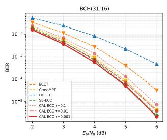  
(a) BCH(31, 16)

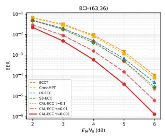  
(b) BCH(63, 36)

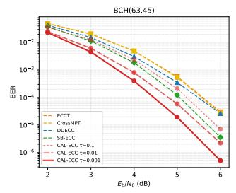  
(c) BCH(63, 45)

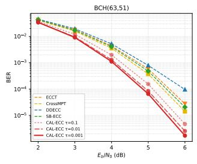  
(d) BCH(63, 51)

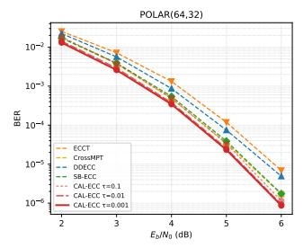  
(e) Polar(64, 32)

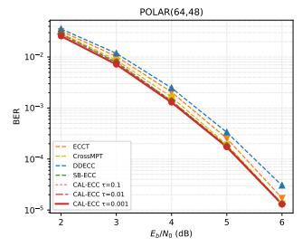  
(f) Polar(64, 48)

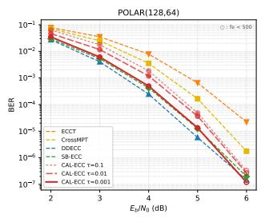  
(g) Polar(128, 64)

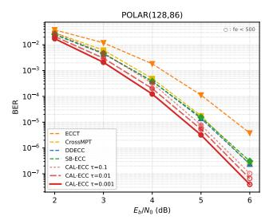  
(h) Polar(128, 86)

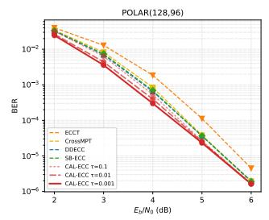  
(i) Polar(128, 96)

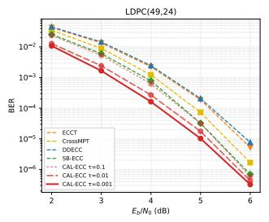  
(j) LDPC(49, 24)

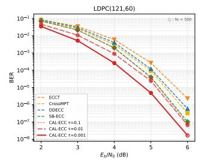  
(k) LDPC(121, 60)

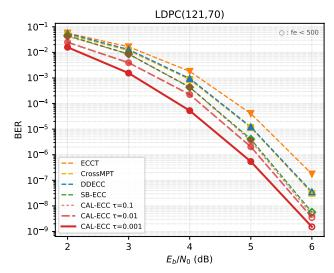  
(1) LDPC(121, 70)

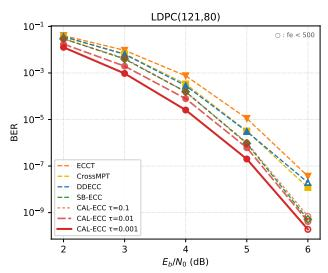  
(m) LDPC(121, 80)

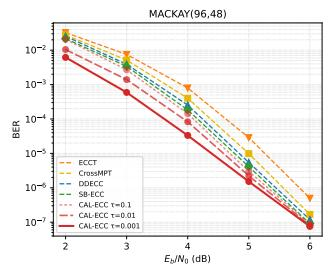  
(n) MacKay(96, 48)

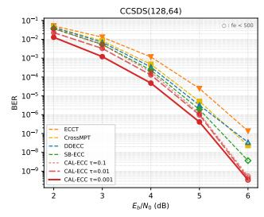  
(0) CCSDS(128, 64)  
Figure 3: BER on all fifteen codes. CAL-ECC curves darken as τ decreases, and baselines are dashed. The CAL-ECC family is nested, with lower τ shifting the curve down without changing its slope, which is the signature of a decoder approaching a fixed ceiling rather than one whose error exponent has changed.

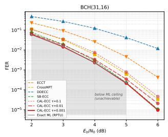  
(a) BCH(31, 16)\*

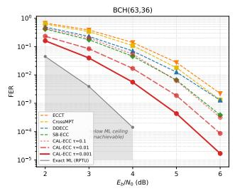  
(b) BCH(63, 36)\*

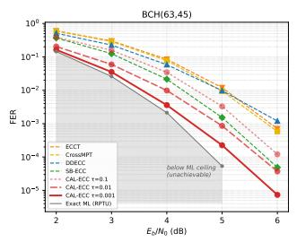  
(c) BCH(63, 45)\*

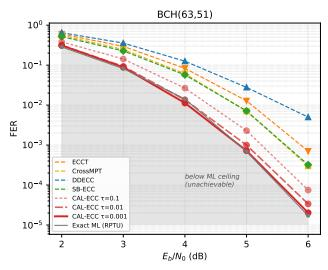  
(d) BCH(63, 51)\*

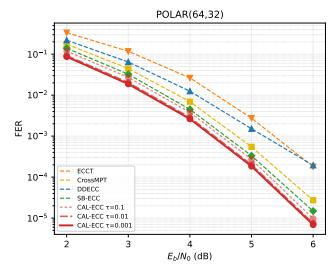  
(e) Polar(64, 32)

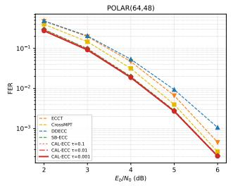  
(f) Polar(64, 48)

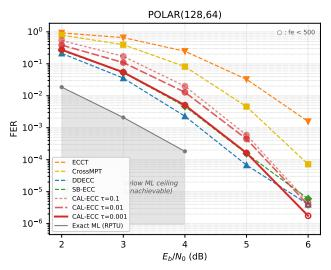  
(g) Polar(128, 64)\*

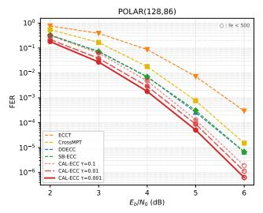  
(h) Polar(128, 86)

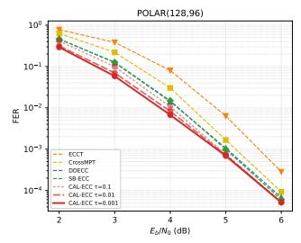  
(i) Polar(128, 96)

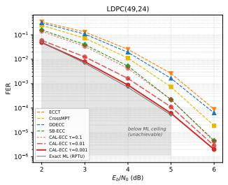  
(j) LDPC(49, 24)\*

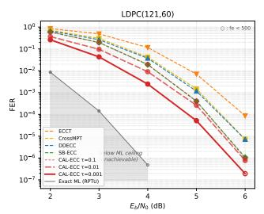  
(k) LDPC(121, 60)\*

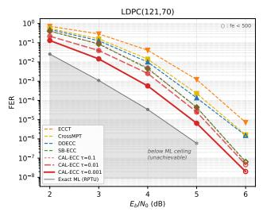  
(1) LDPC(121, 70)\*

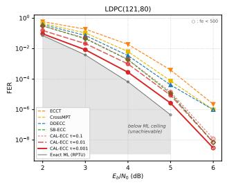  
(m) LDPC(121, 80)\*

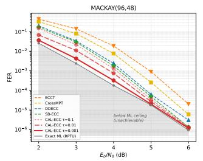  
(n) MacKay(96, 48)\*

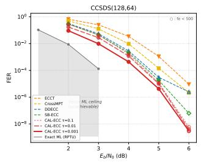  
(0) CCSDS(128, 64)\*  
Figure 4: FER on all fifteen codes, same conventions as Figure 3. Panels marked \* carry the exact ML reference (grey) with the unachievable region shaded. A reference is published for eleven of the fifteen codes (Helmling et al., 2019), and five of those are reproduced in Figure 2. The reference terminates at 5 or 6 dB because the integer program becomes infeasible at the frame counts needed below that FER.