# CONVERGENCE OF STOCHASTIC GRADIENT DESCENT FOR LEARNING LINEAR NEURAL NETWORKS

GABIN MAXIME NGUEGNANG, BUBACARR BAH, HOLGER RAUHUT, AND ULRICH TERSTIEGE

Abstract. Stochastic gradient descent (SGD) is the cornerstone of modern deep learning, yet its theoretical convergence properties remain poorly understood in non-convex settings. To address this gap, we study SGD dynamics in deep linear neural networks—simplified models that retain key non-convex characteristics while remaining analytically tractable. Building on recent results for gradient descent, we extend convergence guarantees to SGD under regularized squared loss. We establish almost sure boundedness of SGD iterates. Using the framework of asymptotic pseudotrajectories from stochastic approximation theory, our analysis establishes then, for both deterministic and adaptive step-size choices, convergence of SGD to the set of critical points under mild conditions (without relying on Lipschitz properties or whitened data). To our knowledge, this is the first work providing almost sure convergence guarantees for SGD in deep linear networks, bridging the gap between theoretical optimization and practical stochastic training.

## 1. Introduction

Deep learning has delivered transformative breakthroughs in recent years, fueling innovations across domains such as computer vision, natural language processing, healthcare, and scientific computing. Central to this progress are iterative optimization methods, particularly stochastic gradient descent (SGD) and its variants, which enable the efective training of highly parameterized models.

Despite SGD’s empirical success in optimizing deep neural networks, its theoretical convergence properties remain only partially understood. This gap is most pronounced in non-convex settings, where the loss landscape is riddled with saddle points and local minima. Yet, SGD consistently navigates these challenges and produces models that generalize well [27, 6].

To bridge theory and practice, researchers often study simplified models such as deep linear neural networks multi-layer architectures composed solely of linear transformations. Although these networks ultimately represent linear mappings, their parameterization introduces non-convexity through matrix factorization. Consequently, they retain many characteristics of deep learning while providing a simplified entry-point for the analysis of optimization algorithms. [24, 2].

A prominent line of work examines optimization dynamics via gradient flow (GF) the continuous-time limit of gradient descent with infinitesimal step sizes. Early studies revealed that depth-induced overparameterization can act as an implicit regularizer in certain situations, accelerating convergence [2]. In particular, [11] and [4] basically showed that, under suitable dimensional assumptions, GF converges to global minima from almost all initializations. These results underscore how architectural properties such as width and depth influence training dynamics.

However, GF is an abstraction and does not capture the behavior of practical algorithms. This motivates the study of discrete-time gradient descent (GD) with finite step sizes. For instance, [5] proved GD convergence for linear residual networks initialized with identity mappings. Later, [3] generalized this to approximately balanced initializations, establishing global convergence under a deficiency margin condition. Extending these earlier results, [13] and [23] provided general convergence guarantees for GD under mild upper bounds on the step sizes, without relying on Lipschitz properties of whitened data.

In practice, stochastic gradient descent is favored over full-batch GD for its computational eficiency on large datasets. Yet, its stochastic nature introduces additional complexities, and most existing convergence results assume bounded gradients or Lipschitz continuity conditions [21, 19, 15, 16, 17, 10, 20, 26]. The Lipschitz gradient property and its variants are fundamental for establishing the descent lemma, which guarantees decrease of the loss function. Moreover, Lipschitz gradient properties are also key to showing boundedness of the the second moment of the gradient, see [16, 20] and references therein. In particular, Lipschitz gradient properties are key for most convergence theory of SGD, see also [15, 19] and references therein.

Unfortunately, the gradient of the empirical loss function is not globally Lipschitz for many neural network architectures. This includes deep linear networks when combined with squared loss. Therefore, existing general bounds, such as the ones in [16, 21, 19], are not applicable – unless one shows boundedness of the iterates directly. In fact, existing approaches use Lipschitz gradient properties to actually show boundedness. For this reason, there is a significant gap in the convergence theory of SGD when applied to deep learning scenarios. In order to make progress, it becomes essential to develop techniques for showing boundedness of the iterates without assuming global Lipschitz bounds on the gradient.

This paper addresses this gap by extending the convergence results of [23] from GD to SGD. We analyze deep linear networks trained with a regularized squared loss. Our key theoretical tool is the framework of asymptotic pseudotrajectories (APT) from stochastic approximation theory [7], which connects discrete SGD iterates to continuous-time GF trajectories. Note that the convergence analysis of SGD (in particular, showing boundedness of the iterates) for the unregularized square-loss (as considered in [2, 3, 4, 23] for GF/GD) turned out to be very challenging and is still open. This is the reason why we passed to a regularized loss, see (2) below, for which we are then able to show convergence (as already stated). Moreover, we believe that our analysis provides a blue-print for many steps of the convergence analysis of SGD for the unregularized loss.

Our contributions are threefold:

• We prove the almost sure boundedness of SGD iterates under minimal assumptions (without relying on gradient Lipschitz continuity or uniform data whitening).

• We establish almost sure convergence of SGD to the set of critical points of the squared loss in deep linear networks, showing that SGD inherits GD’s convergence behavior under similar conditions.

• We develop a rigorous analytical framework linking SGD dynamics to gradient flow using stochastic approximation tools, ofering new insights into stochastic training in deep networks.

To our knowledge, this is the first almost sure convergence result for SGD in deep linear networks in the present setting. Our work narrows the gap between theoretical optimization results and practical stochastic training procedures in deep learning.

## 2. Problem statement and results summary

2.1. Problem statement. We consider deep linear neural networks trained via over-parameterization, $\mathrm { i . e . }$ mappings of the form $X \mapsto W _ { N } \cdot \cdot \cdot W _ { 1 } X$ with depth $N \in \mathbb { N } .$ . Here, $W _ { j } \in \mathbb { R } ^ { d _ { j } \times d _ { j - 1 } }$ for $j = 1 , \ldots , N$ denotes the weight matrix of the $j ^ { \mathrm { t h } }$ layer, and $X \in \mathbb { R } ^ { d _ { x } }$ x×m (where $d _ { x } = d _ { 0 } )$ with data columns $x _ { 1 } , \ldots , x _ { m } \in \mathbb { R } ^ { d _ { x } }$ is the input data matrix. Throughout the paper, we will assume $N \geq 2$ . The training loss for an output data matrix $Y \in \mathbb { R } ^ { d _ { y } \times m }$ (where $d _ { y } = d _ { N } )$ with columns $y _ { 1 } , \ldots , y _ { m } \in \mathbb { R } ^ { d _ { y } }$ is defined as

$$
{ \cal L } ^ { N } ( \overrightarrow { W } ) = \frac { 1 } { 2 m } \sum _ { i = 1 } ^ { m } \| y _ { i } - W _ { N } \cdot \cdot \cdot W _ { 1 } x _ { i } \| _ { 2 } ^ { 2 } = \frac { 1 } { 2 m } \| Y - W _ { N } \cdot \cdot \cdot W _ { 1 } X \| _ { F } ^ { 2 } ,\tag{1}
$$

where $\vec { W } = \left( W _ { 1 } , \ldots , W _ { N } \right)$ and $\| \cdot \| _ { F }$ denotes the Frobenius norm. Defining the product matrix $W =$ $W _ { N } \cdots W _ { 1 }$ associated to $\overrightarrow { W }$ and

$$
L ^ { 1 } ( W ) = \frac { 1 } { 2 m } \| Y - W X \| _ { F } ^ { 2 } ,
$$

it holds $L ^ { { \cal N } } ( \overrightarrow { W } ) = L ^ { 1 } ( W )$

We introduce the regularized loss

$$
\tilde { L } ^ { N } \bigl ( \overrightarrow { W } ( k ) \bigr ) = L ^ { N } \bigl ( \overrightarrow { W } ( k ) \bigr ) + R \bigl ( \overrightarrow { W } ( k ) \bigr ) ,\tag{2}
$$

where for parameters $\beta > 0$ and $\lambda \geq 0$ , the regularization term is defined as

$$
R ( \overrightarrow { W } ) = R _ { \beta , \lambda } ( \overrightarrow { W } ) = \lambda \left( \frac { 1 } { 2 } \| \overrightarrow { W } \| _ { F } ^ { 2 } \right) ^ { \beta } ,\tag{3}
$$

where we use the notation $\begin{array} { r } { \| \overrightarrow { W } \| _ { F } = \left( \sum _ { j = 1 } ^ { N } \| W _ { j } \| _ { F } ^ { 2 } \right) ^ { 1 / 2 } } \end{array}$

The gradient flow associated with the regularized loss $\tilde { L } ^ { N }$ is given by

$$
\frac { d W _ { j } } { d t } = - \nabla _ { W _ { j } } \tilde { L } ^ { N } \big ( \overrightarrow { W } \big ) .\tag{4}
$$

For a subset $S \subset \{ 1 , \ldots , m \}$ chosen uniformly at random among all subsets of cardinality $T \leq m \ ( T = 1$ being allowed), we define the corresponding (mini batch) stochastic loss (over the randomly selected data points) as

$$
L _ { S } ^ { N } \left( \overrightarrow { W } \right) = \frac { 1 } { 2 T } \sum _ { i \in S } \| y _ { i } - W _ { N } \cdot \cdot \cdot W _ { 1 } y _ { i } \| _ { 2 } ^ { 2 } = \frac { 1 } { 2 T } \| Y _ { S } - W _ { N } \cdot \cdot \cdot W _ { 1 } X _ { S } \| _ { F } ^ { 2 } ,\tag{5}
$$

where $Y _ { S }$ and $X _ { S }$ denote the submatrices of $Y$ and X consisting only of the columns indexed by S. Then the regularized stochastic loss $\tilde { L } _ { S } ^ { N }$ , and its corresponding stochastic gradient $\nabla \tilde { L } _ { S } ^ { N }$ are defined as

$$
\tilde { L } _ { S } ^ { N } \big ( \overrightarrow { W } \big ) = L _ { S } ^ { N } \big ( \overrightarrow { W } \big ) + R \big ( \overrightarrow { W } \big ) ,\tag{6}
$$

$$
\nabla \tilde { L } _ { S } ^ { N } \big ( \overrightarrow { W } \big ) = \nabla L _ { S } ^ { N } \big ( \overrightarrow { W } \big ) + \nabla R \big ( \overrightarrow { W } \big ) .\tag{7}
$$

At each iteration $k \in \mathbb N$ of stochastic gradient descent (SGD), we select a subset $S _ { k } \subset [ m ] = \{ 1 , . . . , m \}$ uniformly at random among all subsets of size $T \leq m$ (with $T = 1$ allowed), independently of $\overrightarrow { W } ( k )$ . It then holds that

$$
\mathbb { E } \left[ \nabla \tilde { L } _ { S _ { k } } ^ { N } \big ( \overrightarrow { W } ( k ) \big ) \mid \overrightarrow { W } ( k ) \right] = \nabla \tilde { L } ^ { N } \big ( \overrightarrow { W } ( k ) \big ) .
$$

The corresponding SGD update for each weight matrix $W _ { j }$ is

$$
\begin{array} { r l } & { W _ { j } ( k + 1 ) = W _ { j } ( k ) - \eta _ { k } \nabla _ { W _ { j } } \tilde { L } _ { S _ { k } } ^ { N } \big ( \overrightarrow { W } ( k ) \big ) } \\ & { \qquad = W _ { j } ( k ) - \eta _ { k } \Big ( \nabla _ { W _ { j } } L _ { S _ { k } } ^ { N } \big ( \overrightarrow { W } ( k ) \big ) + \nabla _ { W _ { j } } R \big ( \overrightarrow { W } ( k ) \big ) \Big ) . } \end{array}\tag{8}
$$

Our goal is to analyze the convergence properties of the mini-batch SGD algorithm (8) for training deep linear networks using the regularized stochastic loss (6).

2.2. Results Summary. Our main result (Theorem 13) shows that under mild conditions on the step size $\eta _ { k }$ in (8) and the regularization parameter β—specifically, $\beta \geq N -$ we establish:

• convergence of the SGD iterates to the critical set of $\tilde { L } ^ { N }$ ;

• convergence of the regularized loss $\tilde { L } ^ { N }$ evaluated along the SGD iterates; and

• validity of these results for both deterministic and adaptive step-size schedules.

The key intermediate results include bounds on the sequence of SGD iterates under both deterministic and adaptive step sizes (Propositions 11 and 12). A crucial component of our analysis is the concept of an asymptotic pseudotrajectory for the gradient flow, which corresponds to the continuous-time counterpart of gradient descent using the full gradient rather than stochastic estimates. The SGD sequence defined by (8) can be viewed as an approximate solution to the gradient flow equation (4). To ensure convergence, we show that the interpolated process (16) constructed from these iterates forms an asymptotic pseudotrajectory for the gradient flow (Proposition 2). This property guarantees that the interpolated process accurately tracks the gradient flow, enabling analysis of the long-term behavior of SGD. Furthermore, Proposition 12 ensures that SGD with non-constant step sizes remains bounded as time tends to infinity.

## 3. Preliminaries

3.1. Key ingredients. In this section we summarize the main theoretical tools used in the derivation of the results in this manuscript. We mostly use stochastic approximation theory as presented in [9, 8], which focuses on the analysis of stochastic processes of the form

$$
x _ { k + 1 } = x _ { k } + \eta _ { k + 1 } H \left( x _ { k } , \xi _ { k + 1 } \right) .\tag{9}
$$

Note that to make the comparison to [9, 8] easy, the involved stepsize has index $k + 1$ here as in $[ 9 , 8 ]$ whereas in our setting 8 the corresponding stepsize has index k. In (9), $H : \mathbb { R } ^ { m } \times \mathbb { R } ^ { d }  \mathbb { R } ^ { m }$ is a measurable function that defines the algorithm, the ηk are step sizes, and $\xi _ { k }$ are random variables. A common approach in this field is to consider a vector field obtained by averaging the function H as

$$
F ( x ) = \mathbb { E } \left[ H ( x , \xi ) \right] ,
$$

where $\xi$ is the random variable (assuming the $\xi _ { k }$ are identically distributed as $\xi )$ . Then, one re-interprets the discrete process in (9) as an approximation to the solutions of the ODE

$$
\frac { d \boldsymbol { x } } { d t } = \boldsymbol { F } ( \boldsymbol { x } ) .\tag{10}
$$

This way the stochastic term $H ( x _ { k } , \xi _ { k + 1 } )$ can be split into a deterministic term $F ( x _ { k } )$ and a noise term $U _ { k + 1 }$

$$
H \left( x _ { k } , \xi _ { k + 1 } \right) = F \left( x _ { k } \right) + U _ { k + 1 } .
$$

Taking this into account (9) becomes

$$
x _ { k + 1 } = x _ { k } + \eta _ { k + 1 } \left( F ( x _ { k } ) + U _ { k + 1 } \right) .\tag{11}
$$

The concept of an asymptotic pseudotrajectory (APT) has proven very useful to analyze the long-term behavior of a continuous function through the flow trajectory of a dynamical system, defined for instance via the ODE (10). In order to introduce this concept we recall that a (semi-)flow on some metric space

M (later $\begin{array} { r } { \mathfrak { M } = \mathbb { R } ^ { d _ { x } \times d _ { 1 } } \times \mathbb { R } ^ { d _ { 1 } \times d _ { 2 } } \times \cdot \cdot \cdot \times \mathbb { R } ^ { d _ { N } \times d _ { y } } ) } \end{array}$ is a continuous function $\Phi : \mathbb { R } _ { + } \times \mathbb { M }  \mathbb { M } , \Phi ( t , x ) = \Phi _ { t } ( x )$ that satisfies $\Phi _ { 0 } ( x ) = x$ and $\Phi _ { t } \circ \Phi _ { s } ( x ) = \Phi _ { t + s } ( x )$ for all $x \in \mathcal { M }$ and $( t , s ) \in \mathbb { R } _ { + } ^ { 2 }$ . We will always use the flow Φ mapping an initialization $x _ { 0 } = x ( 0 )$ to the solution $\Phi _ { t } ( x _ { 0 } ) = x ( t )$ , of the ODE (10) at time $t \in [ 0 , \infty )$

Definition 1 (Asymptotic Pseudotrajectory (APT), [9]). Let (M, d) be a metric space. An asymptotic pseudo trajectory for a flow Φ is a continuous function $X : \mathbb { R } _ { + } \to M$ that satisfies

$$
\operatorname* { l i m } _ { t \to \infty } \operatorname* { s u p } _ { h \in [ 0 , T ] } d \left( X ( t + h ) , \Phi _ { h } ( X ( t ) ) \right) = 0 ,
$$

for all $T > 0$

We will work with the so-called interpolated process of the discrete process in (11) as a candidate for an asymptotic pseudotrajectory, defined for $t \in [ 0 , \infty )$ as

$$
X ( t ) = x _ { k } + \frac { t - \tau _ { k } } { \tau _ { k + 1 } - \tau _ { k } } \left( x _ { k + 1 } - x _ { k } \right) \mathrm { ~ i f ~ } t \in [ \tau _ { k } , \tau _ { k + 1 } ] , \mathrm { ~ } k \in \mathbb { N } ,\tag{12}
$$

where $\tau _ { 0 } = 0 , \tau _ { k } = \sum _ { l = 1 } ^ { k } \eta _ { l }$ , for $k \geq 1$ . We define the piecewise constant interpolation U and $\overline { { \eta } }$ on $[ 0 , \infty )$ as

$$
\begin{array} { r } { \overline { { U } } ( s ) = U _ { k + 1 } , \quad \mathrm { a n d } \quad \overline { { \eta } } ( s ) = \eta _ { k + 1 } \quad \mathrm { f o r } s \in [ \tau _ { k } , \tau _ { k + 1 } ) . } \end{array}\tag{13}
$$

The number of iterations required for time $\tau _ { k }$ to attain the timestamp t (in the next step) is given by

$$
m ( t ) = \operatorname* { s u p } \{ k \geq 0 : \ t \geq \tau _ { k } \} .
$$

Under the APT property, for a fixed $T > 0$ and a suficiently large t, the interpolated process $X ( t )$ closely follows the trajectory of the flow induced by the vector field $F$ over the interval [0, T].

Proposition 2 stated next provides conditions for the interpolated process (12) of the stochastic process (11) to be an asymptotic pseudotrajectory for the flow induced by the vector field $F .$

Proposition 2 (Proposition 4.1 in [8]). Let F be a continuous globally integrable vector field (i.e., the integral curves are defined on R and are uniqueley determined). Consider a discrete process $\{ x _ { k } \} _ { k \in \mathbb { N } }$ in $\mathbb { R } ^ { m }$ generated by F perturbed with a deterministic or random sequence $\{ U _ { k } \} _ { k \in \mathbb { N } }$ in $\mathbb { R } ^ { m }$ defined as

$$
x _ { k + 1 } - x _ { k } = \eta _ { k + 1 } \left( F ( x _ { k } ) + U _ { k + 1 } \right) .
$$

We assume that the stepsizes $\eta _ { k } > 0$ satisfy $\eta _ { k }  0$ and $\sum _ { k = 0 } ^ { \infty } \eta _ { k } = \infty$ . Suppose that

(1) For all $T > 0$

$$
\operatorname* { l i m } _ { k \to \infty } \left\{ \left\| \sum _ { i = k } ^ { n - 1 } \eta _ { i + 1 } U _ { i + 1 } \right\| : n = k + 1 , \ldots , m ( \tau _ { k } + T ) \right\} = 0 ,
$$

or equivalently

$$
\operatorname* { l i m } _ { t \to \infty } \Delta ( t , T ) = 0 \ w i t h \ \Delta ( t , T ) = \operatorname* { s u p } _ { 0 \leq h \leq T } \left\| \int _ { t } ^ { t + h } \overline { { U } } ( s ) d s \right\| ,
$$

where $\overline { U }$ is as defined in (13).

(2) sup $\| x _ { k } \| < \infty ,$ or

(3) $\ddot { F }$ is Lipschitz and bounded on a neighborhood of $\{ x _ { k } : k \ge 0 \}$

Then, the interpolated process X is an asymptotic pseudotrajectory of the flow ϕ induced by F.

Remark 3. Inspecting the proof of this proposition in [8] shows that its conclusion remains valid if instead of the assumption that F is globally integrable, we only assume that the trajectories of F exist on $\mathbb { R } _ { + }$ and are uniquely determined.

The boundedness property required by the second condition is central to studying the long-term behavior of the process. However, establishing this property for discrete processes is challenging. It is this dificulty that leads most prior work on stochastic processes to simply assume boundedness. Other authors impose the Lipschitz condition from the third condition instead, and use it to derive an almost sure bound on the iterates [21].

In contrast, we will give a careful analysis of the SGD iterates and prove that they remain bounded almost surely, see Section 4.1.

As seen in Proposition 2, the first critical condition for APT is technical. However, Proposition 2 gives no route to establish it. Proposition 5 fills this gap and constitutes a reference tool that helps to show this technical condition. It relies on Robbins-Monro algorithms, also known as Martingale Diference Noise. We first define Robbins-Monro algorithms and then state Proposition 5.

Definition 4 (Robbins-Monro Algorithm [9]). Consider a sequence of positive integers $\{ \eta _ { k } \} _ { k \in \mathbb { N } }$ which satisfies $\sum _ { k = 1 } ^ { \infty } \eta _ { k } = \infty$ and $\operatorname* { l i m } _ { k \to \infty } \eta _ { k } = 0$ . Let $F : \mathbb { R } ^ { m }  \mathbb { R } ^ { m }$ be a continuous map and $\{ x _ { k } \} _ { k \in \mathbb { N } } \textbf { a }$ process in $\mathbb { R } ^ { m }$ defined as follows:

$$
x _ { k + 1 } = x _ { k } + \eta _ { k + 1 } \left( F ( x _ { k } ) + U _ { k + 1 } \right) ,\tag{14}
$$

where $U _ { k } \in \mathbb { R } ^ { m }$ are (deterministic or random) perturbations. Let $( \Omega , { \mathcal { F } } , P )$ be a probability space and $\{ \mathcal { F } _ { k } \}$ an increasing sequence of sub-σ-algebras of F.

The stochastic process $\{ x _ { k } \}$ defined in (14) satisfies the Robbins-Monro or Martingale Diference Noise Condition if the following hold

(a) $\{ \eta _ { k } \} _ { k \in \mathbb { N } }$ is a deterministic sequence.

(b) $\{ U _ { k } \} _ { k \in \mathbb { N } }$ is adapted: $U _ { k }$ is measurable with respect to $\mathcal { F } _ { k }$ for each $k \geq 0$

(c) $\mathbb { E } [ U _ { k + 1 } | \mathcal { F } _ { k } ] = 0 .$

Proposition 5 (Proposition 4.2, [9]). Let the process $\{ x _ { k } \} _ { k \in \mathbb { N } }$ defined in (14) be a Robbins-Monro algorithm. Assume that for some $q \geq 2$

$$
\operatorname* { s u p } _ { k } \mathbb { E } \left[ \| U _ { k } \| ^ { q } \right] < \infty
$$

and

$$
\sum _ { k = 0 } ^ { \infty } \eta _ { k } ^ { 1 + \frac { q } { 2 } } < \infty .
$$

Then with probability one condition $( 1 )$ in Proposition 2 holds, i.e., for all $T > 0$

$$
\operatorname* { l i m } _ { n \to \infty } \{ | \sum _ { i = n } ^ { k - 1 } \eta _ { i + 1 } U _ { i + 1 } | | : k = n + 1 , \ldots , m ( \tau _ { n } + T ) \} = 0 ,
$$

or equivalently

$$
\operatorname* { l i m } _ { t \to \infty } \Delta ( t , T ) = 0 \ w i t h \ \Delta ( t , T ) = \ \operatorname* { s u p } _ { 0 \leq h \leq T } \left\| \int _ { t } ^ { t + h } \overline { { U } } ( s ) d s \right\|
$$

where $\overline { U }$ is as defined in (13)

Proposition 5 only covers deterministic stepsizes $\eta _ { k }$ as it uses the Robbins-Monro sequence. Later, in Proposition 7, we discuss additional conditions on the noise $U _ { k }$ and the stepsizes $\eta _ { k }$ that lead to the conclusion of Proposition 5 with stochastic (adaptive) stepsizes.

In our setting, the vector field F is the negative gradient of the loss function $\tilde { L } ^ { N }$ and the noise term is the diference between the stochastic gradient and the full gradient. Within this stochastic approximation framework, Section 4 proves that the stochastic gradient iterations (8) satisfy the Martingale Diference Noise condition.The interpolated discrete SGD process will then define a continuous SGD process. With this at hand, we will establish that the interpolated process of SGD in (8) is an APT for the gradient flow (4).

Lyapunov functions provide another key tool for understanding the stability of the dynamical system (4). The basic characteristics of a Lyapunov function and the notion of an equilibrium point (an important concept for defining a Lyapunov function) are provided in Definitions 16 and 15, respectively, in the Appendix. Lyapunov functions help to determine whether a system converges to its equilibrium point as it evolves over time. As we will see in Section 4, the functional $\check { \tilde { L } } { } ^ { N }$ itself is a Lyapunov function, which will be a key ingredient for our convergence analysis.

We proceed by recalling further concepts from [8] that are critical to the understanding of asymptotic pseudotrajectories. For completeness, we provide the definition of a pseudo-orbit in the appendix (Definition 17), describing a particular finite sequence of flow trajectories that is useful in characterizing the flow and the set upon which it is defined. The limit set of an asymptotic pseudotrajectory is given in the next defintion.

Definition 6 (Limit Set of an $\mathrm { A P T } )$ . Let M be a metric space and let $X \ : [ 0 , \infty )  \mathbb { M }$ be an asymptotic pseudotrajectory of a semiflow Φ. We define

$$
L ( X ) { : = } \left\{ m \in { \mathcal { M } } : { \mathrm { ~ t h e r e ~ e x i s t s ~ } } ( t _ { k } ) _ { k } { \mathrm { ~ w i t h ~ } } \operatorname* { l i m } _ { k \to \infty } t _ { k } = \infty { \mathrm { ~ s u c h ~ t h a t ~ } } \operatorname* { l i m } _ { t _ { k } \to \infty } X ( t _ { k } ) = m \right\} \cup { \mathrm { ~ t h e r e ~ } } p _ { k } .
$$

the set of all limits of convergent sequences $X ( t _ { k } )$ , as $t _ { k } \to \infty$

Theorem 18 in the appendix characterizes the limit set of a precompact pseudotrajectory X for a flow Φ, in particular, it indicates that the flow Φ is internally chain transitive (see Definition 17 (2)) on the limit set. Moreover, Proposition 19 in the appendix shows that a Lyapunov function can be constant on a chain internally transitive set. We will see in Section 4 how Theorem 18 and Proposition 19 contribute to deriving the convergence property of SGD.

Proposition 7 below is concerned with random (possibly adaptive) stepsizes. It provides conditions that the noise $U _ { k }$ and the stepsizes $\eta _ { k }$ must meet for condition (1) in Proposition 2 to hold. Proposition 7 appeared in [8, Remark 4.3], but is explicitly proved in that paper only in the deterministic case. Thus for completeness we provide a proof in Section 6.1.

Proposition 7. Let $\{ \mathcal { F } _ { k } \}$ and $\{ U _ { k } \}$ be as in Definition 4. Assume that the stepsizes $\eta _ { k + 1 }$ are $\mathcal { F } _ { k }$ measurable for all $k \in \mathbb N$ . Suppose that for some $q \geq 2$ the noise $U _ { k }$ satisfies

sup $\mathbb { E } \left[ \lVert U _ { k + 1 } \rVert ^ { q } \ \middle | \ \mathcal { F } _ { k } \right] \leq C ,$ for some deterministic constant $C < \infty$ k

and the stepsizes $\eta _ { k } \geq 0$ satisfy $\sum _ { k = 1 } ^ { \infty } \eta _ { k } = \infty$ almost surely and

$$
\mathbb { E } \left[ \sum _ { k = 1 } ^ { \infty } \eta _ { k } ^ { 1 + \frac { q } { 2 } } \right] < \infty .
$$

Then the conclusion of Proposition 5 holds, $i . e . ,$ with probability one, for all $T > 0$

$$
\operatorname* { l i m } _ { n \to \infty } \{ | \sum _ { i = n } ^ { k - 1 } \eta _ { i + 1 } U _ { i + 1 } | | : k = n + 1 , \ldots , m ( \tau _ { n } + T ) \} = 0 ,
$$

or equivalently

$$
\operatorname* { l i m } _ { t \to \infty } \Delta ( t , T ) = 0 \quad w i t h \quad \Delta ( t , T ) = \operatorname* { s u p } _ { 0 \leq h \leq T } \left\| \int _ { t } ^ { t + h } \overline { { U } } ( s ) d s \right\| .
$$

Corollary 8 is a key tool for the convergence analysis of stochastic approximation. It provides conditions on a Lyapunov function that ensure convergence of an APT. We will use it to prove convergence of $\tilde { L } ^ { N } \bigl ( \overrightarrow { W } ( k ) \bigr )$ 1 to the critical set.

Corollary 8 (Corollary 6.7, [8]). Assume M is a smooth $C ^ { r }$ Riemannian manifold of dimension $m \geq 1$ Consider a $C ^ { r }$ map $V : \mathcal { M }  \dot { \mathbb { R } }$ and let F be the gradient vector field

$$
F ( x ) = - \nabla V ( x ) .
$$

Further assume

(1) F induces a global flow Φ

(2) X is a precompact asymptotic pseudotrajectory of Φ

(3) $r \geq m$

Then $L ( X )$ consists of equilibria and $V ( X ( t ) )$ converges as t tends to $\infty$

Condition (1) here means that for any x, the diferential equation $\dot { \Phi } _ { x } ( t ) = F ( \Phi _ { x } ( t ) ) , \ \Phi _ { x } ( 0 ) = x$ has a unique solution defined for all $t \in \mathbb { R }$

To highlight some of the crucial ingredients to our result and because we need a slightly stronger variant of this corollary (see the remark below), we repeat the proof that can be found in [8], involving a few adaptions and additional details, see Section 6.2.

Remark 9. Corollary 8 remains valid if assumption (1) is replaced by the assumption: For any $x \in \mathcal { M }$ there is an $\varepsilon ( x ) > 0$ such that the diferential equation ${ \dot { \Phi } } _ { x } ( t ) = F ( \Phi _ { x } ( t ) ) , \ \Phi _ { x } ( 0 ) = x$ has a solution defined for all $t \in ( - \varepsilon ( x ) , \infty )$ and the solution is unique where it exists (that is, if u and v are solutions defined on intervals $I _ { u }$ resp. $I _ { v }$ that both contain 0 and if $u ( 0 ) = v ( 0 ) = x$ , then $u = v$ on $I _ { u } \cap I _ { v } )$

Under this assumption (and using that F is continuous) the semiflow map $\Phi \colon \mathbb { R } _ { + } \times \mathcal { M }  \mathcal { M } , \ ( t , x ) \mapsto$ $\Phi _ { x } ( t )$ is continuous, this follows e.g. from [12, Theorem 4.3]. Also the flow properties $\Phi _ { 0 } ( x ) = x$ and $\Phi _ { t } \circ \Phi _ { s } ( x ) = \Phi _ { t + s } ( x )$ are clearly fulfilled. So we obtain indeed a semiflow.

3.2. Our setting. Now we adapt some of these analysis tools into our problem setting. The basic training problem of linear neural networks, we are considering here, corresponds to the nonconvex optimization problem of the square loss function with a regularization term. We aim at minimizing the regularized square loss function $\tilde { L } ^ { N } \left( 2 \right)$ from Section 2 via stochastic gradient descent. We study the long-term behavior of SGD (8) through the asymptotic properties of the gradient flow equation 4. The key link is that the SGD process (8) approximates the solutions of the gradient flow equation (4).

We denote the flow originating from (4) as $\phi .$ Definition 10 adapts the notion of asymptotic pseudotrajectory (APT) introduced in [8] to the context of learning linear neural networks.

Definition 10. A continuous function $\overrightarrow { X } : \mathbb { R } _ { + }  \mathbb { R } ^ { d _ { N } \times d _ { N - 1 } } \times \cdot \cdot \cdot \times \mathbb { R } ^ { d _ { 1 } \times d _ { 0 } }$ is an asymptotic pseudotrajectory for ϕ if

$$
\operatorname* { l i m } _ { t \to \infty } \operatorname* { s u p } _ { 0 \leq h \leq T } \left\| { \overrightarrow { X } } ( t + h ) - \phi _ { h } ( { \overrightarrow { X } } ( t ) ) \right\| _ { F } = 0 ,
$$

for any $T > 0$ and $j = 1 , \ldots , N$

We introduce the noise term

$$
\overrightarrow { U } ( k + 1 ) = \nabla \tilde { L } _ { S _ { k } } ^ { N } \big ( \overrightarrow { W } ( k ) \big ) - \nabla \tilde { L } ^ { N } \big ( \overrightarrow { W } ( k ) \big ) ,\tag{15}
$$

so that the stochastic gradient can be written over iterations as the deterministic gradient plus the noise

$$
\nabla \tilde { L } _ { S _ { k } } ^ { N } \bigl ( \overrightarrow { W } ( k ) \bigr ) = \nabla \tilde { L } ^ { N } \bigl ( \overrightarrow { W } ( k ) \bigr ) + \overrightarrow { U } ( k + 1 ) .
$$

We denote by $\mathcal F _ { k } : = \sigma \left( \left\{ \overrightarrow { W } ( 0 ) , \overrightarrow { W } ( 1 ) , \ldots , \overrightarrow { W } ( k ) \right\} \right)$ the $\sigma \cdot$ -algebra generated by $\left\{ \overrightarrow { W } ( 0 ) , \overrightarrow { W } ( 1 ) , \ldots , \overrightarrow { W } ( k ) \right\}$ for $k \in \mathbb N$ . Note that this gives rise to a natural filtration of the $\mathcal { F } _ { k }$

We set $\tau _ { k } = \sum _ { l = 1 } ^ { \kappa } \eta _ { l }$ , and introduce the interpolated process $\vec { W } ( t ) , t \in [ 0 , \infty )$ , as

$$
\overrightarrow { W } ( t ) = \overrightarrow { W } ( k ) + \frac { t - \tau _ { k } } { \tau _ { k + 1 } - \tau _ { k } } \left( \overrightarrow { W } ( k + 1 ) - \overrightarrow { W } ( k ) \right) \mathrm { ~ f o r ~ } t \in [ \tau _ { k } , \tau _ { k + 1 } ] , \mathrm { ~ } k \in \mathbb { N } .\tag{16}
$$

## 4. Theoretical Results

In this section, we will always consider the SGD iterates $\vec { W } ( k )$ defined in (8) for the regularized loss (2) with the regularizer (3). The convergence analysis of the discrete process $\vec { W } ( k )$ hinges on proving that its interpolation $\vec { W } ( t )$ is an asymptotic pseudotrajectory. We achieve this by showing that $\vec { W } ( t )$ meets the conditions of Proposition 2. We start by defining the constants

$$
P = P _ { T } : = \frac { 1 } { T } \operatorname* { m a x } _ { S \subset [ m ] , | S | = T } | | X _ { S } | | ^ { 2 } ,\tag{17}
$$

$$
Q = Q _ { T } : = \frac { 1 } { T } \operatorname* { m a x } _ { S \subset [ m ] , | S | = T } \| Y _ { S } X _ { S } ^ { T } \| .\tag{18}
$$

4.1. Boundedness of SGD iterates. We start by showing boundedness of the SGD iterates both for deterministic and stochastic (adaptive) cases.

4.1.1. Deterministic step sizes. The next proposition guarantees boundedness of the SGD iterates for learning deep linear neural networks with deterministic stepsizes.

Proposition 11. Let $\lambda > 0$ and $\beta \geq N$ be regularization parameters. Set $c _ { \beta } = \beta 2 ^ { 1 - \beta } . \mathrm { ~ } I f \mathrm { ~ } \beta > N$ , we set

$$
M = \operatorname* { m a x } \left\{ \left( \frac { 2 P _ { T } \sqrt { N } } { \lambda c _ { \beta } } \right) ^ { \frac { 1 } { 2 ( \beta - N ) } } , \left( \frac { 2 Q _ { T } \sqrt { N } } { \lambda c _ { \beta } } \right) ^ { \frac { 1 } { 2 \beta - N } } \right\} .
$$

$I f \beta = N$ , we assume that $\begin{array} { r } { \lambda > \frac { P _ { T } \sqrt { N } } { c _ { \beta } } } \end{array}$ and set

$$
M = \left( \frac { Q _ { T } \sqrt { N } } { \lambda c _ { \beta } - P _ { T } \sqrt { N } } \right) ^ { \frac { 1 } { N } } .
$$

Let

$$
B : = \frac { \sqrt { N } \left( P _ { T } M ^ { 2 N - 1 } + Q _ { T } M ^ { N - 1 } \right) } { \lambda \beta \operatorname* { m a x } \left\{ \frac { 1 } { 2 } \| \overrightarrow { W } ( 0 ) \| _ { F } ^ { 2 } , \frac { 1 } { 2 } M ^ { 2 } \right\} ^ { \beta - 1 } } ,\tag{19}
$$

and schedule the stepsizes as

$$
\eta _ { k } = \frac { b _ { k } } { \beta \lambda \operatorname* { m a x } \left\{ \left( \frac { 1 } { 2 } \| \overrightarrow { W } ( 0 ) \| _ { F } ^ { 2 } \right) , \frac { 1 } { 2 } ( M + B ) ^ { 2 } \right\} ^ { \beta - 1 } } ,\tag{20}
$$

where $\left( b _ { k } \right)$ is a (deterministic) sequence satisfying $0 < b _ { k } \le 1$ . Then the stochastic gradient descent sequence $\left( \vec { W } ( k ) \right) _ { k \in \mathbb { N } }$ is bounded. More precisely,

$$
\| \overrightarrow { W } ( k ) \| _ { F } \leq \operatorname* { m a x } \{ \| \overrightarrow { W } ( 0 ) \| _ { F } , M + B \} \quad f o r \ a l l \ k \in \mathbb { N } _ { 0 } .\tag{21}
$$

The proof of this proposition is given in Section 6.3.

4.1.2. Adaptive step sizes. Proposition 11 employs deterministic stepsizes to provide the boundedness of SGD. Proposition 12 below indicates that SGD run with adaptive stepsizes also remains bounded.

Proposition 12. For $\lambda , \beta , M$ as in Proposition 11 and an arbitrary constant $D > 0$ , assume that

$$
\eta _ { k } = b _ { k } \cdot \operatorname* { m i n } \left\{ \frac { 1 } { \beta \lambda ( \frac { 1 } { 2 } \| \overrightarrow { W } ( k ) \| _ { F } ^ { 2 } ) ^ { \beta - 1 } } , D \right\} ,\tag{22}
$$

where $( b _ { k } ) _ { k \in  { \mathbb { N } } _ { \mathrm { C } } }$ is a (deterministic) sequence satisfying $0 < b _ { k } \le 1$ . (In the case $\begin{array} { r } { \vec { W } ( k ) = 0 } \end{array}$ , the condition means $\eta _ { k } = D b _ { k } . \mathrm { ~ } \mathrm { ~ }$ Then the stochastic gradient descent sequence $\left\{ \vec { W } ( k ) \right\} _ { k \geq 0 }$ is bounded. More precisely,

$$
| | \vec { W } ( k ) | | _ { F } \leq \operatorname* { m a x } \left\{ | | \vec { W } ( 0 ) | | _ { F } , M + D \sqrt { N } ( P _ { T } M ^ { 2 N - 1 } + Q _ { T } M ^ { N - 1 } ) \right\} \quad \ f o r \ a l l \ k \in \mathbb { N } _ { 0 } .\tag{23}
$$

Note that in practice, one would choose the constant D rather large, so that the (adaptive) first term in the minimum in (22) applies most of the time. The proof of this proposition is given in Section 6.4.

The boundedness of the SGD iterates is crucial, see condition (2) in Proposition 2. It will be shown in Propositions 11 and 12 and is instrumental to show that the interpolated process (16) is an asymptotic pseudotrajectory.

4.2. Convergence of SGD to the set of critical points. This section states our main result on convergence of SGD. It identifies practical step sizes that guarantee convergence of the SGD to the critical set when training linear neural networks.

We denote by

$$
\mathrm { C r i t } ( \tilde { L } ^ { N } ) : = \left\{ \overrightarrow { W } \mid \nabla \tilde { L } ^ { N } ( \overrightarrow { W } ) = 0 \right\}
$$

the critical set of $\tilde { L } ^ { N }$ and

$$
\mathrm { d } \left( \overrightarrow { W } , \mathrm { C r i t } ( \tilde { L } ^ { N } ) \right) = \operatorname* { i n f } _ { \overrightarrow { V } \in \mathrm { C r i t } ( \tilde { L } ^ { N } ) } \| \overrightarrow { W } - \overrightarrow { V } \| _ { F }
$$

the Euclidean distance of $\vec { W }$ to $\mathrm { C r i t } ( \tilde { L } ^ { N } )$ . The next theorem summarizes the main findings of this chapter.

Theorem 13. Let $\left( b _ { k } \right)$ be a deterministic sequence that satisfies $0 < b _ { k } \leq 1 , \sum _ { k = 0 } ^ { \infty } b _ { k } = \infty \ a n d \sum _ { k = 0 } ^ { \infty } b _ { k } ^ { 2 } < \infty$ and schedule the stepsizes $\eta _ { k }$ as in Proposition 11 or as in Proposition 12. Then with probability one, the sequence $\left\{ \vec { W } ( k ) \right\} _ { k }$ generated by stochastic gradient descent has the following convergence properties:

(1) The sequence $\left( \tilde { L } ^ { N } \big ( \overrightarrow { W } ( k ) \big ) _ { k \in \mathbb { N } } \right)$ of the loss converges.

(2) The gradients $\nabla \tilde { L } ^ { N } \bigl ( \overrightarrow { W } ( k ) \bigr )$ converge to zero as $k \to \infty$

(3) The Euclidean distance d $( \overrightarrow { W } ( k ) , \mathrm { C r i t } ( \tilde { L } ^ { N } ) )$ converges to zero as $k \to \infty$

The proof of this theorem is given in Section 6.5. The crucial ingredient is to establish that the interpolated process $\vec { W } ( t )$ is an APT for the continuous flow. To this end, we show condition (1) in Proposition 2 by leveraging Proposition 5 for deterministic stepsizes and Proposition 7 for adaptive stepsizes. Moreover, we then exploit Corollary 8 to establish the stated convergence result, also leveraging that $\tilde { L } ^ { N }$ is a Lyapunov function.

In contrast to previous works, Theorem 13 directly addresses convergence of SGD in linear neural networks. It avoids the global Lipschitz or bounded-gradient assumptions commonly imposed in SGD convergence theory.

4.3. Discussion about the constants in our results. The following discussion is heuristic and intended only to provide intuition regarding the dependence of the theoretical step-size bounds on the mini-batch size. Precisely, we conclude this section with a heuristic analysis in which we approximate constant B and examine the influence of constants $P _ { T }$ and $Q _ { T }$ in the SGD algorithm. The goal is to intuitively compare SGD and GD on specific cases. Assume $\| X _ { S } \| ^ { 2 } \geq \| Y _ { S } X _ { S } ^ { T } \|$ and $\lVert \overrightarrow { W } ( 0 ) \rVert ^ { 2 } \leq M ^ { 2 }$ . It follows from (17), (18) and (19) that

$$
M = \left( \frac { 2 P _ { T } \sqrt { N } } { \lambda c _ { \beta } } \right) ^ { \frac { 1 } { 2 ( \beta - N ) } } = \left( \frac { 2 \sqrt { N } } { \lambda c _ { \beta } } \right) ^ { \frac { 1 } { 2 ( \beta - N ) } } P _ { T } ^ { \frac { 1 } { 2 ( \beta - N ) } } = \Lambda ( \lambda , \beta , N ) P _ { T } ^ { \frac { 1 } { 2 ( \beta - N ) } } ,
$$

where constant $\begin{array} { r } { \Lambda ( \lambda , \beta , N ) = \left( \frac { 2 \sqrt { N } } { \lambda c _ { \beta } } \right) ^ { \frac { 1 } { 2 ( \beta - N ) } } } \end{array}$ and

$$
B = \frac { \sqrt { N } \left( P _ { T } M ^ { 2 N - 1 } + Q _ { T } M ^ { N - 1 } \right) } { \lambda \beta \left( \frac { 1 } { 2 } M ^ { 2 } \right) ^ { \beta - 1 } } .
$$

We approximate B by only keeping the leading term in M from the numerator as follows

$$
B \approx { \frac { \sqrt { N } P _ { T } M ^ { 2 N - 1 } } { \lambda \beta \left( { \frac { 1 } { 2 } } M ^ { 2 } \right) ^ { \beta - 1 } } } = { \frac { 2 ^ { \beta - 1 } \sqrt { N } P _ { T } } { \lambda \beta M ^ { 2 \left( \beta - N \right) - 1 } } } ,
$$

that is $\begin{array} { r } { B \approx \frac { 2 ^ { \beta - 1 } \sqrt { N } P _ { T } } { \lambda \beta \left( \frac { 2 P _ { T } \sqrt { N } } { \lambda c _ { \beta } } \right) ^ { \frac { 2 ( \beta - N ) - 1 } { 2 ( \beta - N ) } } } = C ( \lambda , \beta , N ) P _ { T } ^ { \frac { 1 } { 2 ( \beta - N ) } } } \end{array}$ with constant β

$\begin{array} { r } { C ( \lambda , \beta , N ) = { \frac { 2 ^ { \beta - 1 } \sqrt { N } } { \lambda \beta \left( { \frac { 2 \sqrt { N } } { \lambda c _ { \beta } } } \right) ^ { \frac { 2 ( \beta - N ) - 1 } { 2 ( \beta - N ) } } } } } \end{array}$ . Since $\lVert \vec { W } ( 0 ) \rVert ^ { 2 } \leq M ^ { 2 }$ then the deterministic $\eta _ { k }$ reads

$$
\eta _ { k } = \frac { b _ { k } } { \beta \lambda \left[ \frac { 1 } { 2 } ( M + B ) ^ { 2 } \right] ^ { \beta - 1 } } = \frac { b _ { k } } { \beta \lambda \left[ \frac { 1 } { 2 } \left( \Lambda ( \lambda , \beta , N ) + C ( \lambda , \beta , N ) \right) ^ { 2 } \right] ^ { \beta - 1 } P _ { T } ^ { \frac { \beta - 1 } { \beta - N } } } .\tag{24}
$$

We now compare SGD and GD in two special cases. In the first, the input data X contains only zeros except for one data point $x _ { i }$ at position i. In the second, X consists of m copies of one data point x.

(1) Let $x _ { i } \in \mathbb { R } ^ { d _ { x } }$ such that $x _ { i } \neq 0 ,$ , and consider a matrix X that contains $x _ { i }$ at column i and zeros everywhere else $( X = [ 0 \ \cdot \cdot \cdot \ 0 \ x _ { i } \ 0 \ \cdot \cdot \cdot \ 0 ] )$ . Then using a single mini batch $i . e . , T = 1$ , we have $P _ { T } = \| x _ { i } \| _ { 2 } ^ { 2 }$ . Hence, by substituting $P _ { T }$ into (24) and by assuming that the stepsizes η of SGD are approximately the same, we get after m steps

$$
\begin{array} { r } { m \cdot \eta _ { S G D } = \frac { m b _ { 1 } } { \beta \lambda \left[ \frac { 1 } { 2 } \left( \Lambda ( \lambda , \beta , N ) + C ( \lambda , \beta , N ) \right) ^ { 2 } \right] ^ { \beta - 1 } ( \| x _ { i } \| _ { 2 } ^ { 2 } ) ^ { \frac { \beta - 1 } { \beta - N } } } . } \end{array}
$$

For the full batch gradient, i.e. $T = m$ , we have $\begin{array} { r } { { P _ { m } } = \frac { 1 } { m } \| x _ { i } \| _ { 2 } ^ { 2 } } \end{array}$ , and

$$
\begin{array} { c } { { \eta _ { G D } = \frac { b _ { 1 } } { \beta \lambda \left[ \frac { 1 } { 2 } \left( \Lambda ( \lambda , \beta , N ) + C ( \lambda , \beta , N ) \right) ^ { 2 } \right] ^ { \beta - 1 } \left( \frac { 1 } { m } \| x _ { i } \| _ { 2 } ^ { 2 } \right) ^ { \frac { \beta - 1 } { \beta - N } } } } } \\ { { = \frac { m ^ { \frac { \beta - 1 } { \beta - N } } b _ { 1 } } { \beta \lambda \left[ \frac { 1 } { 2 } \left( \Lambda ( \lambda , \beta , N ) + C ( \lambda , \beta , N ) \right) ^ { 2 } \right] ^ { \beta - 1 } \left( \| x _ { i } \| _ { 2 } ^ { 2 } \right) ^ { \frac { \beta - 1 } { \beta - N } } } . } } \end{array}
$$

Therefore, over the corresponding epoch, the GD stepsize $\eta _ { G D }$ exceeds the efective SGD stepsize m · η . Hence, GD may outperform SGD on such data. Intuitively, progress requires a pass over all data points, and GD completes this pass in one step, while SGD needs many steps for it.

(2) Let $\boldsymbol { x } \in \mathbb { R } ^ { d _ { x } }$ , such that $\| \boldsymbol { x } \| _ { 2 } \neq 0$ , and form matrix X with m copies of x as $X = [ x ~ \cdots ~ x ]$ . For a single mini batch $T = 1$ , we have $P _ { T } = \| x \| _ { 2 } ^ { 2 }$ . By assuming the stepsizes of SGD are approximately the same within this epoch, after m steps, substituting $P _ { T }$ into (24) yields

$$
m \cdot \eta _ { S G D } = \frac { m b _ { 1 } } { \beta \lambda \left[ \frac { 1 } { 2 } \left( \Lambda ( \lambda , \beta , N ) + C ( \lambda , \beta , N ) \right) ^ { 2 } \right] ^ { \beta - 1 } \left( \| x \| _ { 2 } ^ { 2 } \right) ^ { \frac { \beta - 1 } { \beta - N } } } .
$$

In the case of the full batch $T = m , ( \mathrm { G D } )$ , we have $\begin{array} { r } { P _ { T } = \frac { 1 } { m } \left( \sqrt { m } \| x \| _ { 2 } \right) ^ { 2 } = \| x \| _ { 2 } ^ { 2 } } \end{array}$ and

$$
\eta _ { G D } = \frac { b _ { 1 } } { \beta \lambda \left[ \frac { 1 } { 2 } \left( \Lambda ( \lambda , \beta , N ) + C ( \lambda , \beta , N ) \right) ^ { 2 } \right] ^ { \beta - 1 } ( \| x \| _ { 2 } ^ { 2 } ) ^ { \frac { \beta - 1 } { \beta - N } } } .
$$

Here, a single SGD step already covers the whole dataset, and the efective SGD stepsize m · ηSGD exceeds the GD stepsize $\eta _ { G D }$ . So on datasets of this kind, SGD may outperform GD.

Overall, these observations suggest that SGD is likely to be more eficient than GD in scenarios where SGD can access the entire data in fewer steps.

## 5. Numerical experiments

In this section we present numerical experiments illustrating our theoretical findings. We test both deterministic and adaptive step size choices and investigate how sharp the conditions on the maximal step sizes in Theorem 13 are.

Our experiments use a randomly generated dataset, for which we select $m = 3 0 0$ data points $x _ { j }$ of dimension $d = 7 0$ from a Gaussian distribution of mean zero and variance $\textstyle \sigma ^ { 2 } = { \frac { 1 } { d } }$ to form the input data $X \in \mathbb { R } ^ { d \times m }$ , where $d _ { x } = d .$ . The dimensions of the weight matrices $W _ { j } \in \mathbb { R } ^ { d _ { j } \times d _ { j - 1 } }$ are chosen, for a parameter $r \in \mathbb { N }$ (determining the (generic) rank of the corresponding product matrix), as

$$
d _ { 0 } = d , \qquad d _ { 1 } = r , \qquad d _ { j } = \mathrm { r o u n d } \left( r + ( j - 1 ) \frac { d - r } { N - 1 } \right) , \quad j = 2 , \dots , N ,\tag{25}
$$

where round(z) rounds the value of $z$ to the nearest integer. The weight matrices are initialized such that $\vec { W } ( 0 ) = ( W _ { 1 } , \ldots , W _ { N } )$ has a balancedness constant 0. This is achieved by randomly choosing $d _ { j } \times d _ { j }$ and $d \times d$ orthogonal matrices $V _ { j } , j = 1 , \dotsc , N$ , and $U _ { 1 }$ from the uniform distribution on the respective orthogonal group (by taking SVDs of a Gaussian matrix). The first $d _ { 1 }$ columns of $V _ { j - 1 }$ are then used to form the $d _ { j } \times d _ { 1 }$ matrices $U _ { j }$ , for $j = 2 , \ldots , N$ . For any $n _ { 1 } , n _ { 2 } \in \mathbb { N } , I _ { n _ { 1 } , n _ { 2 } }$ denotes the $n _ { 1 } \times n _ { 2 }$ rectangular diagonal matrix with ones on the diagonal. Then matrices $V _ { j } , \ U _ { j }$ and ${ \cal I } _ { n _ { 1 } , n _ { 2 } }$ are used to define $W _ { j }$ as

$$
\begin{array} { r } { W _ { j } = V _ { j } I _ { d _ { j } , d _ { 1 } } U _ { j } ^ { T } . } \end{array}
$$

This guarantees that $\overrightarrow { W } ( 0 ) = \left( W _ { 1 } , \ldots , W _ { N } \right)$ is balanced,

$$
\begin{array} { r l } & { W _ { j + 1 } ^ { T } W _ { j + 1 } = U _ { j + 1 } I _ { d _ { 1 } , d _ { j + 1 } } V _ { j + 1 } ^ { T } V _ { j + 1 } I _ { d _ { j + 1 } , d _ { 1 } } U _ { j + 1 } ^ { T } = U _ { j + 1 } U _ { j + 1 } ^ { T } = V _ { j } I _ { d _ { j } , d _ { 1 } } U _ { j } ^ { T } U _ { j } I _ { d _ { 1 } , d _ { j } } V _ { j } ^ { T } } \\ & { \qquad = W _ { j } W _ { j } ^ { T } . } \end{array}
$$

The target matrix $Y \in \mathbb { R } ^ { d \times m }$ is also generated randomly by chosing matrices $\widetilde { W _ { j } }$ in the same way as $W _ { j }$ above and then setting $Y = \widetilde { W _ { N } } \cdot \cdot \cdot \cdot \widetilde { W _ { 1 } } X$

Various values for the regularization parameter λ and the rank parameter r are explored. The constant $c _ { \beta }$ is set as $c _ { \beta } = \beta 2 ^ { 1 - \beta }$ , and $\beta$ is chosen such that $\beta > N$ . Recall that the constant M in Proposition 11 is given as

$$
M = \operatorname* { m a x } \left\{ \left( \frac { 2 P _ { T } \sqrt { N } } { \lambda c _ { \beta } } \right) ^ { \frac { 1 } { 2 ( \beta - N ) } } , \left( \frac { 2 Q _ { T } \sqrt { N } } { \lambda c _ { \beta } } \right) ^ { \frac { 1 } { 2 \beta - N } } \right\} .\tag{26}
$$

The constants $P _ { T }$ and $Q _ { T }$ are computed by taking the maximum of $\| X _ { S } \| ^ { 2 }$ and $\| Y _ { S } X _ { S } ^ { T } \|$ over the actually employed mini-batches of size $T = 3 0$ used during the run of SGD. (Inspecting the proof of Proposition 11 reveals that only these mini-batches are needed.)

We conduct our tests on linear neural networks with depths 3 and 4 of the architecture described above. Our first experiments employ deterministic stepsizes that satisfy the requirements of Theorem 13, i.e., they are scheduled as

$$
\eta _ { k } = \frac { b _ { k } } { \beta \lambda \operatorname* { m a x } \left\{ \left( \frac { 1 } { 2 } \| \overrightarrow { W } ( 0 ) \| _ { F } ^ { 2 } \right) , \frac { 1 } { 2 } ( M + B ) ^ { 2 } \right\} ^ { \beta - 1 } } ,\tag{27}
$$

where $B$ is defined as in Theorem 13 and $b _ { k } = \frac { 1 } { ( k + 1 ) ^ { \gamma } }$ represents a sequence converging to zero at decay rate $\gamma .$

Figure 1 presents the regularized loss and Frobenius norms of the weight matrices during the training of the linear networks of widths $N = 3 , 4$ , each optimized via SGD with deterministic step sizes as scheduled in (27). Subfigures 1a and 1c illustrate the evolution of the regularized loss for networks of depth $N = 3 , 4$ and with corresponding parameter values $r = 5 ,$ , 4 in (25). These tests validate the convergence of the regularized loss function $\tilde { L } ^ { N }$ applied to the SGD iterates under deterministic step sizes. The Frobenius norms of the weight matrices for these networks are reported in Subfigures 1b and 1d. These figures demonstrate that the norms of the SGD iterates remain bounded throughout training. The regularization parameters used in the experiments for Figure 1 are $\lambda = 1 0 ^ { - 5 }$ for $N = 3$ and $\lambda = 5 \cdot 1 0 ^ { - 5 }$ for $N = 4$ . The parameter $\beta$ is set as $\beta = 2 N - 1$ , for both $N = 3$ and $N = 4$ . The resulting step size constants are $B = 5 . 9 8 , M = 1 1 . 9 7$ for $N = 3$ and $B = 4 . 1 8 , M = 8 . 3 7$ for $N = 4$

In the next experiments, we explore SGD using deterministic step size selections that are not directly derived from the conditions outlined in our theoretical findings. Figure 2 presents the evolution of the regularized loss across networks in the left panel. The right panel displays the Frobenius norm of the weight matrices for each network during training. The step sizes are given by $\begin{array} { r } { \eta _ { k } = \frac { c } { ( 1 + k ) ^ { \gamma } } } \end{array}$ with $c = 0 . 9 , \gamma = 0 . 4$ and $\beta = 2$ for all three networks, violating the condition $\textstyle \sum _ { k = 0 } ^ { \infty } \eta _ { k } ^ { 2 } < \infty$ . Subfigures 2b and 2d indicate that the SGD iterates still remain bounded, suggesting that the established bound for SGD is not tight.

The second part of the experiments tests SGD with adaptive stepsizes. The regularization parameters remain consistent with those previously described, and the stepsize $\eta _ { k }$ is scheduled as

$$
\eta _ { k } = b _ { k } \cdot \operatorname* { m i n } \left\{ \frac { 1 } { \beta \lambda ( \frac { 1 } { 2 } \| \overrightarrow { W } ( k ) \| _ { F } ^ { 2 } ) ^ { \beta - 1 } } , D \right\} ,\tag{28}
$$

for D as in Theorem 13 and $\begin{array} { r } { b _ { k } = \frac { 1 } { ( 1 + k ) ^ { \gamma } } , \gamma > \frac { 1 } { 2 } . } \end{array}$

Plots 3a and 3c in the left panel of Figure 3 display the regularized loss versus iterations for networks of depth 3 and 4 respectively. These validate the convergence of $\left( \tilde { L } ^ { N } ( \overrightarrow { W } ( k ) ) \right) _ { k }$ as established in Theorem 13. The right panel of Figure 3 shows the evolution of the Frobenius norm of individual weight matrices during training for networks of depth 3 and 4 on plots 3b and 3d, respectively. In this experiment, the constant D is set to 1 for $N = 3$ and $N = 4$ . The regularization parameters are $\dot { \lambda } = 1 0 ^ { - 5 }$ for $N = 3 .$ , and $\lambda = 5 \cdot 1 0 ^ { - 5 }$ for $N = 4$ . The parameter r in (25) is set to 5 for $N = 3 .$ and 4 for $N = 4$

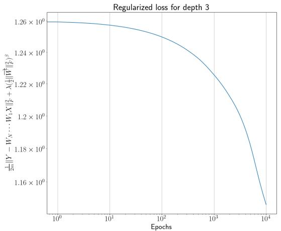  
(a) Evolution of the regularized loss for a network of depth 3

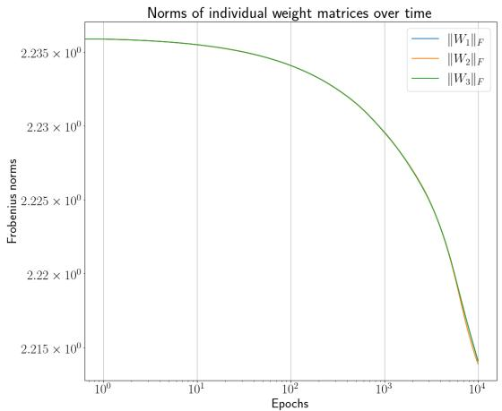  
(b) Frobenius norm of the individual weight matrices of a network of depth 3

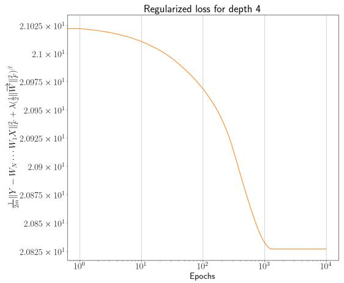  
(c) Evolution of the regularized loss for a network of depth 4

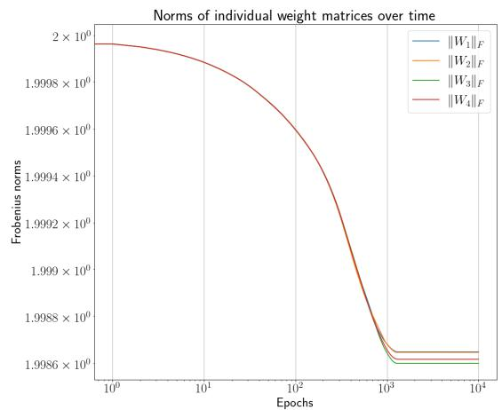  
(d) Frobenius norm of the individual weight matrices of a network of depth 4  
Figure 1. The left panel illustrates the evolution of the regularized loss functions across networks with deterministic step sizes as specified in (27). The right panel presents the Frobenius norms of individual weight matrices for networks with depths 3 and 4 during training.

Figure 4 displays the training dynamics using a modified adaptive stepsize, difering from (28) and defined as

$$
\eta _ { k } = \frac { \alpha } { \frac { 1 } { 2 } \| \overrightarrow { W } ( k ) \| _ { F } ^ { 2 } ( 1 + k ) ^ { \gamma } } ,\tag{29}
$$

where $\alpha > 0$ . Subfigures 4a and 4c presents the regularized training loss, while Subfigures 4b and 4d display the training norms of the weight matrices. The corresponding parameter values are $\lambda = 1 0 ^ { - 5 }$ and $r = 5$ for $N = 3 , \lambda = 5 \cdot 1 0 ^ { - 5 }$ and $r = 4$ for $N = 4 ,$ with $\beta = 2$ for all networks, $\alpha = 0 . 9$ and $\gamma = 0 . 4 .$

Figure 5 illustrates the convergence speed for both deterministic and adaptive step sizes. Subfigure 5a   
presents the relative loss, which is computed by normalizing the regularized loss iterates $\left( \tilde { L } ^ { N } \big ( \overrightarrow { W } ( k ) \big ) \right)$ with k   
their initial value, whereas Subfigure 5b displays the regularized loss for both deterministic (left panel) and

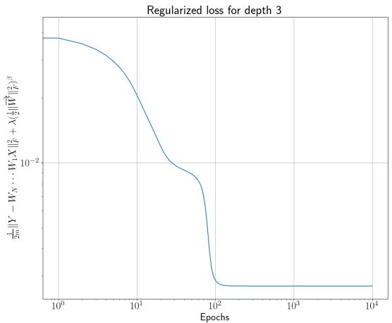  
(a) Evolution of the regularized loss for a neural network of depth 3

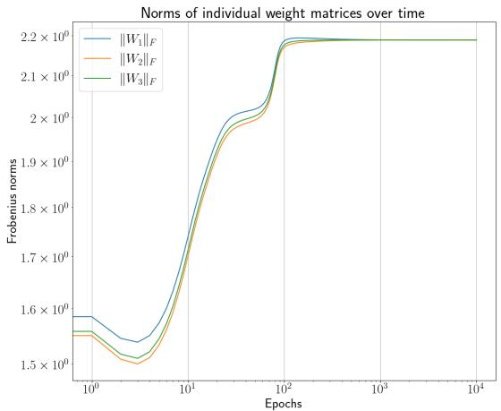  
(b) Frobenius norm of the individual weight matrices of a network of depth 3

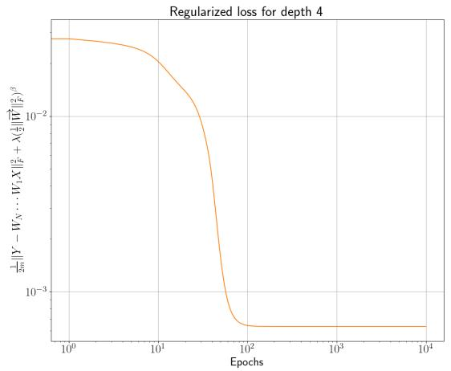  
(c) Evolution of the regularized loss for a network of depth 4

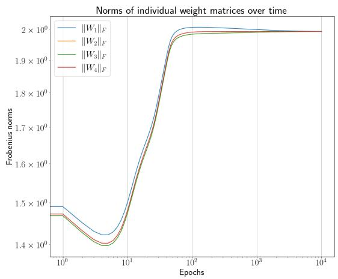  
(d) Frobenius norm of the individual weight matrices of a network of depth 4  
Figure 2. The left panel displays the evolution of the regularized losses across networks with deterministic stepsizes that do not meet requirements in Theorem 13. The right panel shows the Frobenius norms of individual matrices for networks of depths 2, 3, and 4 during training.

adaptive step sizes (right panel). These plots indicate that the adaptive step sizes described in (27) achieve faster convergence compared to the deterministic step sizes outlined in (27).

Finally, we assess convergence of SGD also for nonlinear neural networks, although these are not covered by our present theory. More precisely, we check whether the conditions established in Theorem 13 for training linear neural networks with SGD could transfer to nonlinear networks. For this purpose, we use a hyperbolic tangent activation function on the last layer, and a linear activation function on the remaining layers. This approach results in the regularized loss function

$$
\mathcal { L } _ { \sigma } ^ { N } \big ( \overrightarrow { W } \big ) = \frac { 1 } { 2 m } \| Y - \sigma \big ( W _ { N } \cdot \cdot \cdot W _ { 1 } X \big ) \| _ { F } ^ { 2 } + \lambda \left( \frac { 1 } { 2 } \| \overrightarrow { W } \| _ { F } ^ { 2 } \right) ^ { \beta } ,\tag{30}
$$

where $\sigma ( x ) = \operatorname { t a n h } ( x )$ is applied componentwise.

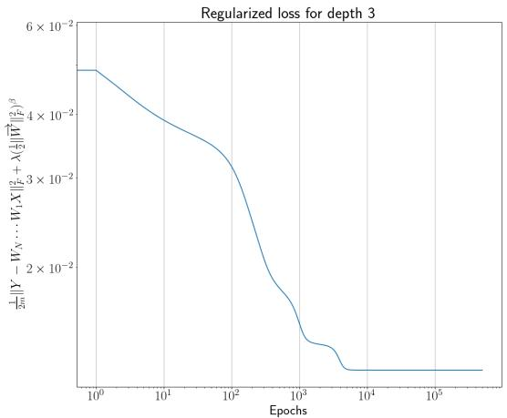  
(a) Evolution of the regularized loss for a network of depth 3

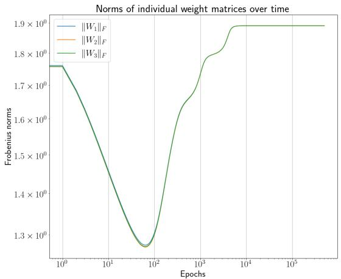  
(b) Frobenius norm of the individual weight matrices of a network of depth 3

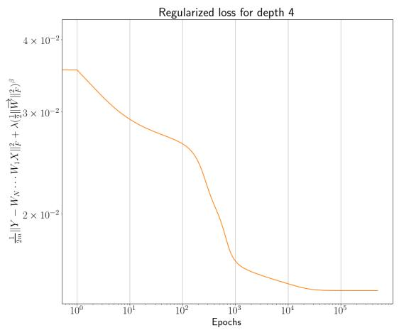  
(c) Evolution of the regularized loss for a network of depth 4

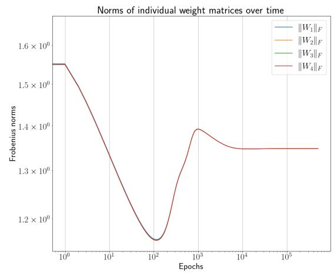  
(d) Frobenius norm of the individual weight matrices of a network of depth 4  
Figure 3. The left panel illustrates the evolution of the regularized loss across networks with adaptive stepsizes (28). The right panel presents the Frobenius norms of individual weight matrices for networks of depth 3 and 4.

Figure 6 presents the learning behavior of SGD in two settings of nonlinear neural networks. The values of $\mathcal { L } _ { \sigma } ^ { N } \big ( \overrightarrow { W } ( k ) \big )$ versus iterations are shown in Subfigures 6a and 6c for networks of depth 3 and 4 respectively. Plots 6b and 6d display the norms of the training weights under the deterministic stepsize rule in (27). Figure 6 empirically demonstrate the boundedness of SGD in nonlinear networks and the convergence of $\left( \mathcal { L } _ { \sigma } ^ { N } \big ( \overrightarrow { W } ( k ) \big ) \right)$ under the deterministic stepsizes (27). These suggests that certain theoretical properties k established for SGD with deterministic stepsizes in linear networks may extend to nonlinear networks. Furthermore, a comparison of Figure 1 with Figure 6 indicates that similar patterns are observed in the SGD experiments for both linear and nonlinear networks. The values of the regularization parameters $\lambda , \beta$ and the rank r are consistent with those used in Figure 1.

Figure 7 depicts the behavior of SGD with adaptive stepsizes scheduled as in (28), during the training of nonlinear neural networks. Plots 7a and 7c show that the regularized loss functions for nonlinear networks of depth 3 and 4 converge when applied to SGD iterates. Plots 7b and 7d show that the SGD iterates

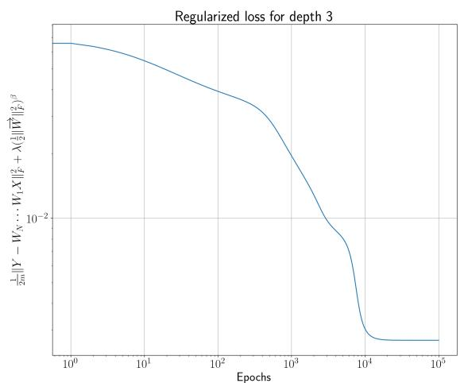  
(a) Evolution of the regularized losses in the network with depth 3

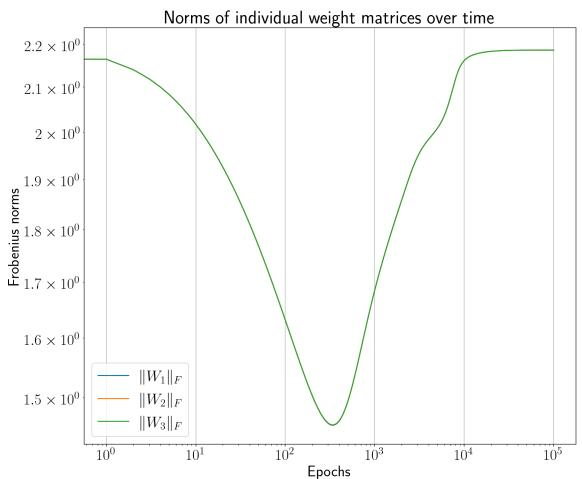  
(b) Frobenius norm of the individual weight matrices of a network of depth 3

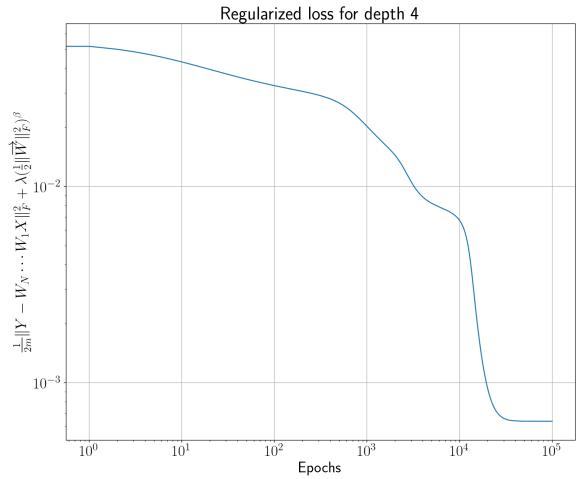  
(c) Evolution of the regularized loss for a network of depth 4

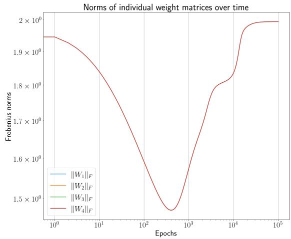  
(d) Frobenius norm of the individual weight matrices of a network of depth 4

Figure 4. The left panel shows the evolution of the regularized loss across networks with the modified adaptive step sizes (29). The right panel displays the Frobenius norms of individual weight matrices for networks of depth 2, 3, and 4 during training with the same adaptive step sizes.

remain bounded during the training. The parameters $\lambda , \beta ,$ , and r used in Figure 7 are consistent with those in Figure 3. A comparison of these two figures, indicates that the training trajectories of nonlinear neural networks are similar to those observed in their linear counterparts.

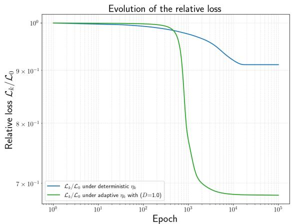

(a) Evolution of the relative loss obtained by normalizing $\tilde { L } ^ { N } \big ( \overrightarrow { W } ( k ) \big )$ by its initial value $( \mathcal { L } _ { k } / \mathcal { L } _ { 0 } )$ under deterministic and adaptive $( D = 1 )$ stepsizes  
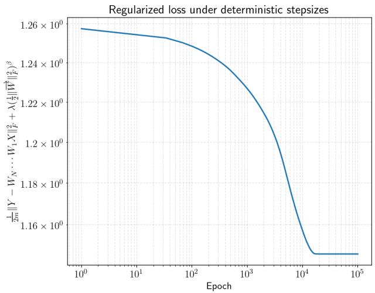

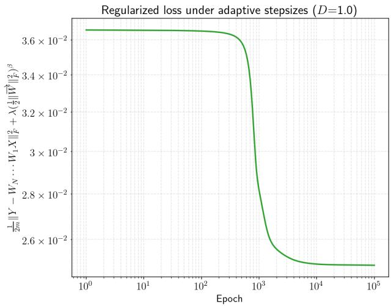  
(b) Evolution of the regularized loss under deterministic stepsizes (left panel) and adaptive stepsizes with $D = 1$ (right panel)  
Figure 5. Convergence comparison for deterministic versus adaptive stepsizes on a linear network of depth 3 with parameters $\beta = 5 , \lambda = 5 \cdot 1 0 ^ { - 5 } , r = 5$ , and mini-batch size $T = 3 0$

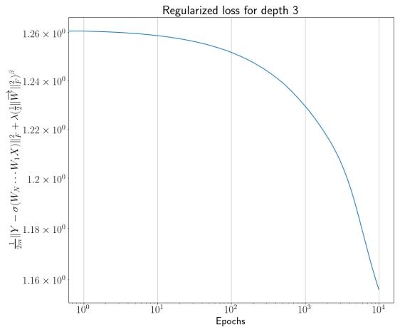  
(a) Evolution of the regularized losses for the network of depth 3

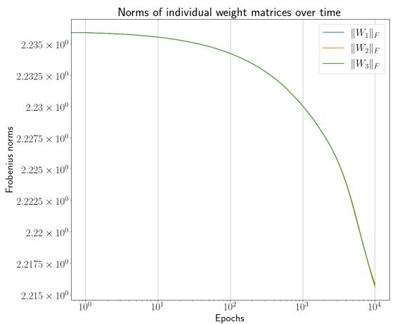  
(b) Frobenius norm of the individual weight matrices of the network of depth 3

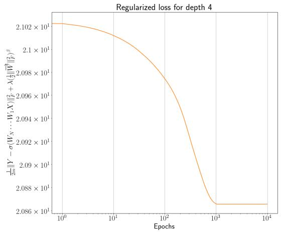  
(c) Evolution of the regularized losses for the network of depth 4

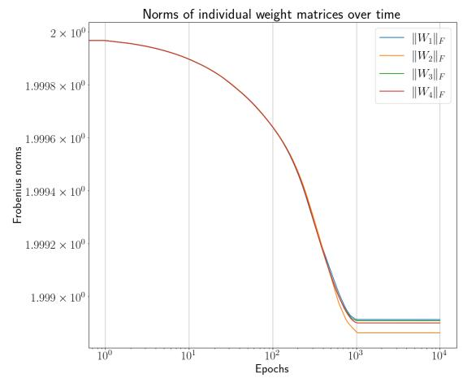  
(d) Frobenius norm of the individual weight matrices of the network of depth 4

Figure 6. Training nonlinear neural networks: evolution of the regularized loss functions across networks under deterministic step sizes in (27) on the left panel. Frobenius norms of individual weight matrices of the corresponding networks for depth 3, and 4 on the right panel.

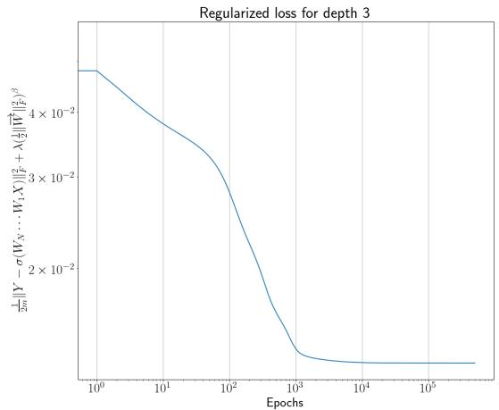  
(a) Evolution of the regularized losses for the network of depth 3

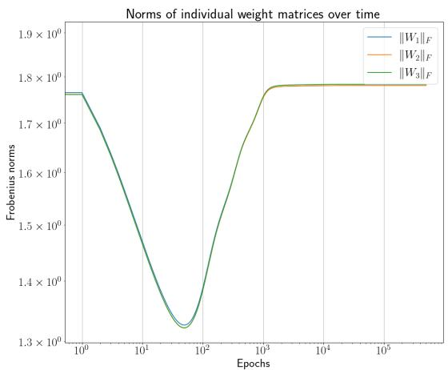  
(b) Frobenius norm of the individual weight matrices of the network of depth 3

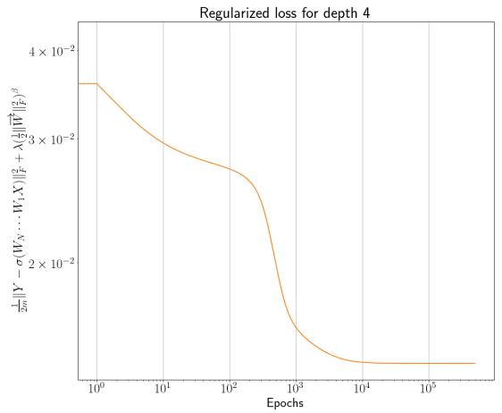  
(c) Evolution of the regularized losses for the network of depth 4

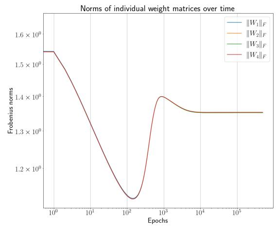  
(d) Frobenius norm of the individual weight matrices of the network of depth 4

Figure 7. Training nonlinear neural networks: evolution of the regularized loss functions across networks under adaptive stepsizes in (28) on the left panel. Frobenius norms of individual weight matrices of the corresponding networks for depth 3 and 4 on the right panel.

## 6. Proofs

## 6.1. Proof of Proposition 7.

Proof. The proof is adapted from the proof of $[ 8 ,$ Proposition 4.2] additionally taking into account the randomness of the stepsizes.

Let $t \geq 0 .$ , let $T > 0$ , and define for $i \in  { \mathbb { N } } _ { 0 }$ the truncated step size $a _ { i }$ as the length (i.e., the Lebesgue measure) of the interval $[ \tau _ { i } , \tau _ { i + 1 } ) \cap [ t , t + T ]$ . Since $\eta _ { i + 1 }$ is ${ \mathcal { F } } _ { i }$ measurable, it follows that $a _ { i }$ is also ${ \mathcal { F } } _ { i }$ measurable (use that $a _ { i } =$ max $\{ \operatorname* { m i n } \{ \tau _ { i + 1 } , t + T \} - \operatorname* { m a x } \{ \tau _ { i } , t \} , 0 \} )$ . Also, since almost surely the sum of the $\eta _ { i }$ diverges, it holds almost surely that only finitely many $a _ { i }$ are nonzero. Indeed, we have $a _ { i } = 0$ for $i < m ( t )$ and for $i > m ( t + T )$ . (Recall that $m ( s ) : = \operatorname* { s u p } \{ k \geq 0 : \ s \geq \tau _ { k } \} . )$ We consider the process $\{ S _ { k } \}$ defined by

$$
S _ { k } = \sum _ { i = 0 } ^ { k - 1 } a _ { i } U _ { i + 1 } , \quad \mathrm { w i t h ~ } S _ { 0 } = 0 .
$$

Then the process $\{ S _ { k } \}$ is a martingale with respect to the filtration $( \mathcal F _ { k } )$ . Indeed, obviously $S _ { k }$ is $\mathcal { F } _ { k }$ measurable and $\mathbb { E } [ \dot { S } _ { k + 1 } | \mathcal { F } _ { k } ] = \mathbb { E } [ S _ { k } + a _ { k } U _ { k + 1 } | \mathcal { F } _ { k } ] = S _ { k } + a _ { k } \mathbb { E } [ U _ { k + 1 } | \mathcal { F } _ { k } ] = S _ { k }$ , where we used that $S _ { k }$ and $a _ { k }$ are $\mathcal { F } _ { k }$ measurable.

Recall that by definition $\Delta ( t , T ) = \operatorname* { s u p } _ { 0 \leq h \leq T } \left\| \int _ { t } ^ { t + h } \overline { { U } } ( s ) d s \right\|$ with U defined in (13). Since the integral is a continuous and piecewise afine function in h and the norm is convex, the supremum is attained at a break point, i.e., one of the points $\{ t , \tau _ { m ( t ) + 1 } , \tau _ { m ( t ) + 2 } , \ldots , \tau _ { m ( t + T ) } , t + T \}$ . Thus

$$
\Delta ( t , T ) = \operatorname* { s u p } _ { k \geq 0 } \left\| \sum _ { i = 0 } ^ { k - 1 } a _ { i } U _ { i + 1 } \right\| .
$$

Now we apply Burkholder’s inequality [25, Theorem 6.25] to obtain the estimate

$$
\mathbb { E } \left[ ( \Delta ( t , T ) ) ^ { q } \right] \leq C _ { q } \mathbb { E } \left[ \left( \sum _ { i = 0 } ^ { \infty } a _ { i } ^ { 2 } \| U _ { i + 1 } \| ^ { 2 } \right) ^ { \frac { q } { 2 } } \right]\tag{31}
$$

for some constant $C _ { q } > 0$ . To further estimate the upper bound in (31), we use the following consequence of H¨older’s inequality valid for any $\alpha _ { i } , \beta _ { i } \in \mathbb { R } , u > 1$ and $0 < \delta < 1 :$

$$
\sum _ { i } | \alpha _ { i } \beta _ { i } | \leq \left( \sum _ { i } | \alpha _ { i } | ^ { \frac { \delta u } { u - 1 } } \right) ^ { \frac { u - 1 } { u } } \left( \sum _ { i } | \alpha _ { i } | ^ { ( 1 - \delta ) u } | \beta _ { i } | ^ { u } \right) ^ { \frac { 1 } { u } } .\tag{32}
$$

Assuming $q > 2$ and setting $\begin{array} { r } { u = \frac { q } { 2 } , \delta = \frac { q - 2 } { 2 q } , \alpha _ { i } = a _ { i } ^ { 2 } } \end{array}$ and $\beta _ { i } = \| U _ { i + 1 } \| ^ { 2 }$ , inequality (32) applied to the estimate in (31) gives

$$
\mathbb { E } \left[ ( \Delta ( t , T ) ) ^ { q } \right] \leq C _ { q } \mathbb { E } \left[ \left( \sum _ { i = 0 } ^ { \infty } a _ { i } \right) ^ { \frac { q } { 2 } - 1 } \left( \sum _ { i = 0 } ^ { \infty } a _ { i } ^ { 1 + \frac { q } { 2 } } \lVert U _ { i + 1 } \rVert ^ { q } \right) \right] .
$$

Note that the involved sums are a.s. finite sums. Since $\textstyle \sum _ { i = 0 } ^ { \infty } a _ { i } = T$ a.s., we obtain

$$
{  { \mathbb E } } \left[ ( \Delta ( t , T ) ) ^ { q } \right] \le C _ { q } T ^ { \frac { q } { 2 } - 1 } {  { \mathbb E } } \left[ \sum _ { i = 0 } ^ { \infty } a _ { i } ^ { 1 + \frac { q } { 2 } } \| U _ { i + 1 } \| ^ { q } \right] .\tag{33}
$$

Note that this inequality also holds for $q = 2$ because in this case it coincides with (31). Next, observe that

$$
\begin{array} { r l } & { \mathbb { E } \left[ \displaystyle \sum _ { i = 0 } ^ { \infty } a _ { i } ^ { 1 + \frac { q } { 2 } } \| U _ { i + 1 } \| ^ { q } \right] = \displaystyle \sum _ { i = 0 } ^ { \infty } \mathbb { E } \left[ a _ { i } ^ { 1 + \frac { q } { 2 } } \| U _ { i + 1 } \| ^ { q } \right] = \displaystyle \sum _ { i = 0 } ^ { \infty } \mathbb { E } \left[ \mathbb { E } \left[ a _ { i } ^ { 1 + \frac { q } { 2 } } \| U _ { i + 1 } \| ^ { q } \ | \ \mathcal { F } _ { i } \right] \right] } \\ & { \qquad = \displaystyle \sum _ { i = 0 } ^ { \infty } \mathbb { E } \left[ a _ { i } ^ { 1 + \frac { q } { 2 } } \mathbb { E } \left[ \| U _ { i + 1 } \| ^ { q } \ | \ \mathcal { F } _ { i } \right] \right] \leq C \displaystyle \sum _ { i = 0 } ^ { \infty } \mathbb { E } \left[ a _ { i } ^ { 1 + \frac { q } { 2 } } \right] = C \mathbb { E } \left[ \displaystyle \sum _ { i = 0 } ^ { \infty } a _ { i } ^ { 1 + \frac { q } { 2 } } \right] . } \end{array}\tag{34}
$$

Here, the first and the last equality hold by Tonelli’s theorem (or monotone convergence), the third equality holds because $a _ { i }$ is $\mathcal { F } _ { i }$ -measurable, and the inequality is due to the assumption $\mathbb { E } \left[ \Vert U _ { i + 1 } \Vert ^ { q } \ \middle | \ \mathscr { F } _ { i } \right] \leq C$

Now, since $a _ { i } \leq \eta _ { i + 1 }$ by definition of $a _ { i } .$ , we obtain (on the a.s. event that the sum of the $\eta _ { i }$ diverges)

$$
\sum _ { i = 0 } ^ { \infty } a _ { i } ^ { 1 + \frac { q } { 2 } } = \sum _ { i = 0 } ^ { \infty } a _ { i } a _ { i } ^ { \frac { q } { 2 } } \leq \sum _ { i = 0 } ^ { \infty } a _ { i } \eta _ { i + 1 } ^ { \frac { q } { 2 } } = \sum _ { i = 0 } ^ { \infty } \int _ { [ \tau _ { i } , \tau _ { i + 1 } ) \cap [ t , t + T ] } \overline { { \eta } } ( s ) ^ { q / 2 } d s = \int _ { t } ^ { t + T } \overline { { \eta } } ( s ) ^ { q / 2 } d s ,
$$

which implies

$$
\mathbb { E } \left[ \sum _ { i = 0 } ^ { \infty } a _ { i } ^ { 1 + \frac { q } { 2 } } \right] \leq \mathbb { E } \left[ \int _ { t } ^ { t + T } \overline { { \eta } } ( s ) ^ { q / 2 } d s \right] .\tag{35}
$$

Combining (33), (34), and (35), we obtain

$$
\mathbb { E } \left[ \Delta ( t , T ) ^ { q } \right] \leq C C _ { q } T ^ { \frac { q } { 2 } - 1 } \mathbb { E } \left[ \int _ { t } ^ { t + T } \overline { { \eta } } ( s ) ^ { q / 2 } d s \right] .
$$

We conclude that

$$
\sum _ { k = 0 } ^ { \infty } \mathbb { E } [ \Delta ( k T , T ) ^ { q } ] \leq C C _ { q } T ^ { \frac { q } { 2 } - 1 } \mathbb { E } \left[ \int _ { 0 } ^ { \infty } { \bar { \eta } } ^ { \frac { q } { 2 } } ( s ) d s \right] = C C _ { q } T ^ { \frac { q } { 2 } - 1 } \mathbb { E } \left[ \sum _ { i = 0 } ^ { \infty } \eta _ { i + 1 } ^ { 1 + \frac { q } { 2 } } \right] < \infty\tag{36}
$$

since by assumption $\mathbb { E } \left[ \sum _ { i = 0 } ^ { \infty } \eta _ { i + 1 } ^ { 1 + \frac { q } { 2 } } \right] < \infty$

Given $\varepsilon \ > \ 0 .$ , define the event $A _ { k } ~ = ~ \{ \Delta ( k T , T ) ~ > ~ \varepsilon \}$ . Markov’s inequality implies that $\mathbb { P } ( A _ { k } ) ~ \leq$ $\mathbb { E } [ \Delta ( k T , T ) ^ { q } ] \varepsilon ^ { - q }$ , and taking into account (36) gives

$$
\sum _ { k = 0 } ^ { \infty } P ( A _ { k } ) < \infty .
$$

The Borel-Cantelli Lemma implies then that with probability one, for all suficiently large k we have

$$
\Delta ( k T , T ) \leq \varepsilon .
$$

Since $\varepsilon > 0$ is arbitrary this shows that

$$
\operatorname* { l i m } _ { k \to \infty } \Delta ( k T , T ) = 0
$$

with probability one. Observing that for any $t \in [ k T , ( k + 1 ) T ]$ we have

$$
\Delta ( t , T ) \le 2 \Delta ( k T , T ) + \Delta ( ( k + 1 ) T , T ) ,
$$

we conclude

$$
\operatorname* { l i m } _ { t \to \infty } \Delta ( t , T ) = 0
$$

with probability one. This completes the proof.

□

6.2. Proof of Corollary 8. We prove Corollary 8 with assumption (1) replaced by the slightly weaker assumptions given in Remark 9.

Proof. The proof strategy leverages Sard’s theorem together with Theorem 18 and Proposition 19 in the appendix.

For any initial value x the semiflow Φ is defined on $[ 0 , \infty )$ via the gradient flow equation

$$
\frac { d \Phi _ { x } ( t ) } { d t } = - \nabla V ( \Phi _ { x } ( t ) ) , \ \Phi _ { x } ( 0 ) = x .
$$

Since we assume uniqueness of the solutions, the equilibrium points coincide with the critical points of $V .$

Let $\operatorname { C r i t } ( V )$ be the set of critical points of V and let $\Lambda : = \operatorname { C r i t } ( V ) \cap L ( X )$ . (Recall that $L ( X )$ is the set of limit points of $X . )$ We note that $L ( X )$ is compact (by Theorem 18 whose application uses the assumption that X is precompact) and since $V$ is of class $C ^ { 1 }$ , the set Crit(V) is closed and therefore Λ is compact. The set Λ is also invariant under the semiflow because $\Lambda \subseteq { \mathrm { C r i t } } ( V )$ .

Now we consider the restriction of Φ to R $\Sigma _ { + } \times L ( X )$ . Because $L ( X )$ is invariant under Φ (again by Theorem 18), this restriction defines indeed again a semiflow and obviously Λ is the set of equilibrium points of this restricted semiflow.

Now we claim that $V _ { \mid L ( X ) } \ { \mathrm { ~ ( i . e . } } \quad$ ., the restriction of V to $L ( X ) )$ is a Lyapunov function for Λ (wrt. the restricted flow on $\mathbb { R } _ { + } \times \dot { L } ( \dot { X } ) \dot { \rangle }$ ). Indeed, by the assumption that the flow trajectories are unique (see Remark 9), it follows that for $x \in \Lambda$ the map $\mathbb { R } _ { + } \ni t \mapsto V ( \Phi _ { x } ( t ) )$ is constant because x is a equilibrium. Furthermore, since

$$
\frac { d V ( \Phi _ { x } ( t ) ) } { d t } = \nabla V ( \Phi _ { x } ( t ) ) \cdot \frac { d \Phi _ { x } ( t ) } { d t } = - \left\| \nabla V ( \Phi _ { x } ( t ) ) \right\| ^ { 2 } \leq 0 ,\tag{37}
$$

for $x \in L ( X ) \setminus \Lambda$ the expression $\frac { d V ( \Phi _ { x } ( t ) ) } { d t }$ is negative at $t = 0$ . Additionally, it is also negative for all $t > 0$ because otherwise there would exist a minimal $t > 0$ with $\begin{array} { r } { \frac { d V ( \Phi _ { x } ( t ) ) } { d t } = 0 } \end{array}$ and then by (37) $y : = \Phi _ { x } ( t )$ would be a critical point of $V .$ But by assumption (see Remark 9), the trajectory $\Phi _ { y } ( t )$ is uniquely determined and hence would constantly be equal to y on an interval $( - \varepsilon ( y ) , \infty )$ for some $\varepsilon ( y ) > 0$ , implying that $\Phi _ { x } ( t )$ would constantly be equal to y on the interval $( t - \varepsilon ( y ) , \infty )$ contradicting the minimality of t.

Since the smoothness of V satisfies $r \geq m > \operatorname* { m a x } \{ 0 , m - 1 \}$ , Sard’s theorem [18, Chapter 3, Proposition 1.3]

implies that the Lebesgue measure in R of $V ( \operatorname { C r i t } ( V ) )$ is zero implying that also $V ( \Lambda )$ has Lebesgue measure zero and in particular has empty interior.

To summarize, we have shown that Λ is a compact invariant set in $L ( X )$ (wrt. the restricted flow), that $V _ { | L ( X ) }$ is a Lyapunov function for Λ and that $V ( \Lambda )$ has empty interior. Thus we can apply Propostion 19 which implies that $L ( X )$ (which is internally chain transitive by Theorem 18)) is contained in Λ and that $V _ { | L ( X ) }$ is constant. In particular, $L ( X )$ consists of equilibria.

It now remains to prove that $V ( X ( t ) )$ converges. For every sequence $\left( t _ { k } \right)$ of nonnegative real numbers with lim $_ { \cdot k \to \infty } t _ { k } = \infty$ , the compactness of $\overline { { \mathrm { i m } ( X ) } }$ yields a subsequence of the sequence $( X ( t _ { k } ) ) _ { k }$ that converges in $\overline { { \mathrm { i m } ( X ) } }$ . Let x be the limit of such a converging subsequence, hence, $x \in L ( X )$ by definition of $L ( X )$ . Set $v = V ( x )$ and by way of contradiction, let us assume that for some sequence of nonnegative real numbers $( \tilde { t } _ { k } ) _ { k }$ , with lim $\boldsymbol { k } \to \infty \tilde { t } _ { k } = \infty$ the sequence $\left( V ( X ( \tilde { t } _ { k } ) ) \right) _ { k }$ does not converge. Then there exists a subsequence $( \tilde { t } _ { k _ { \ell } } ) _ { \ell }$ , and $\epsilon > 0$ such that

$$
\begin{array} { r } { \left| V ( X ( \tilde { t } _ { k _ { \ell } } ) ) - v \right| \geq \epsilon \quad \mathrm { f o r ~ a l l ~ } \ell . } \end{array}\tag{38}
$$

Moreover, by compactness of $\overline { { \mathrm { i m } ( X ) } }$ , the sequence $\left( X ( \tilde { t } _ { k _ { \ell } } ) \right) _ { \ell }$ has a subsequence that converges to a point ${ \bar { x } } \in L ( X )$ . Given that the restriction of V to $L ( X )$ is constant (as argued above), we have $V ( { \bar { x } } ) = v$ which contradicts (38). □

## 6.3. Proof of Proposition 11.

Proof. A key ingredient of this proof is the following technical lemma, which estimates the Frobenius norm of the stochastic gradient with respect to Frobenius of the tuple $\vec { W }$ , and the spectral norm of the mini batch data $X _ { S } , ~ Y _ { S }$

Lemma 14. Let $S \subset [ m ]$ and $\overrightarrow { W } = \left( W _ { 1 } , \dots , W _ { N } \right)$ . Setting $W = W _ { N } \cdot \cdot \cdot W _ { 1 }$ , it holds

$$
\begin{array} { l } { \displaystyle \| \nabla L _ { S } ^ { N } ( \overrightarrow { W } ) \| _ { F } \leq \frac { \sqrt { N } } { T } \| \overrightarrow { W } \| _ { F } ^ { N - 1 } \left( \| W \| \| X _ { S } \| ^ { 2 } + \| Y _ { S } X _ { S } ^ { T } \| \right) } \\ { \leq \frac { \sqrt { N } } { T } \left( \| X _ { S } \| ^ { 2 } \| \overrightarrow { W } \| _ { F } ^ { 2 N - 1 } + \| Y _ { S } X _ { S } ^ { T } \| \| \overrightarrow { W } \| _ { F } ^ { N - 1 } \right) . } \end{array}
$$

Here $\| \cdot \| = \| \cdot \| _ { 2 \to 2 }$ denotes the operator norm wrt. the 2-norm.

□

Proof. Recalling $\nabla L _ { S } ^ { N } ( \overrightarrow { W } ) = \left( \begin{array} { c } { { \nabla _ { W _ { 1 } } L _ { S } ^ { N } ( \overrightarrow { W } ) } } \\ { { \vdots } } \\ { { \nabla _ { W _ { N } } L _ { S } ^ { N } ( \overrightarrow { W } ) } } \end{array} \right)$ , we have

$$
\left\| \nabla L _ { S } ^ { N } \big ( \overrightarrow { W } \big ) \right\| _ { F } ^ { 2 } = \left\| \nabla _ { W _ { 1 } } L _ { S } ^ { N } \big ( \overrightarrow { W } \big ) \right\| _ { F } ^ { 2 } + \dots + \left\| \nabla _ { W _ { N } } L _ { S } ^ { N } \big ( \overrightarrow { W } \big ) \right\| _ { F } ^ { 2 } .\tag{39}
$$

The gradients of $L _ { S } ^ { 1 }$ and $L _ { S } ^ { N }$ are given by [1, 2, 4]

$$
\nabla L _ { S } ^ { 1 } ( W ) = \frac { 1 } { T } \big ( W X _ { S } X _ { S } ^ { T } - Y _ { S } X _ { S } ^ { T } \big ) ,\tag{40}
$$

$$
\nabla _ { W _ { j } } L _ { S } ^ { N } \bigl ( \overrightarrow { W } \bigr ) = W _ { j + 1 } ^ { T } \ldots W _ { N } ^ { T } \nabla L _ { S } ^ { 1 } ( W ) W _ { 1 } ^ { T } \ldots W _ { j - 1 } ^ { T } .\tag{41}
$$

It follows that

$$
\left\| \nabla _ { W _ { j } } L _ { S } ^ { N } \big ( \overrightarrow { W } \big ) \right\| _ { F } = \| W _ { j + 1 } ^ { T } . . . W _ { N } ^ { T } \nabla L _ { S } ^ { 1 } ( W ) W _ { 1 } ^ { T } . . . W _ { j - 1 } ^ { T } \| _ { F } \leq \prod _ { i = 1 , i \neq j } ^ { N } \| W _ { j } \| _ { F } \| \nabla L _ { S } ^ { 1 } ( W ) \| _ { F } \mathrm { d } W _ { 1 } ^ { T } \mathrm { d } W _ { 2 } ^ { 1 } \mathrm { d } W _ { 2 } ^ { 1 } \mathrm { d } W _ { 1 } ^ { 1 / 2 } \mathrm { d } W _ { 2 }
$$

whereby we used the Frobenius norm property $\| A B \| _ { F } \leq \| A \| \| F \| _ { F }$ for matrices A, B (of matching dimensions) to get the second inequality. Further, using the fact that $\| A \| \leq \| A \| _ { F }$ and $\| W _ { j } \| _ { F } \le \| \overrightarrow { W } \| _ { F }$ we obtain

$$
\begin{array} { l } { \displaystyle \Big \| \nabla _ { W _ { 3 } } L _ { S } ^ { N } \big ( \overrightarrow { W } \big ) \Big \| _ { F } \leq \frac { 1 } { T } \| \overrightarrow { W } \| _ { F } ^ { N - 1 } \| \big ( W X _ { S } - Y _ { S } \big ) X _ { S } ^ { T } \| \leq \frac { 1 } { T } \| \overrightarrow { W } \| _ { F } ^ { N - 1 } \big ( \| W _ { N } \cdot \cdot \cdot { \boldsymbol { W } } _ { 1 } \| \| X _ { S } X _ { S } ^ { T } \| + \| Y _ { S } X _ { S } ^ { T } \| \big ) } \\ { \displaystyle \leq \frac { 1 } { T } \| \overrightarrow { W } \| _ { F } ^ { N - 1 } \big ( \| \overrightarrow { W } \| _ { F } ^ { N } \| X _ { S } X _ { S } ^ { T } \| + \| Y _ { S } X _ { S } ^ { T } \| \big ) . } \end{array}
$$

Substituting the above estimates into (39) gives

$$
\| \nabla L _ { S } ^ { N } ( \vec { W } ) \| _ { F } \leq \frac { \sqrt { N } } { T } \| \vec { W } \| _ { F } ^ { N - 1 } \left( \| W \| \| X _ { S } \| ^ { 2 } + \| Y _ { S } X _ { S } ^ { T } \| \right) \leq \frac { \sqrt { N } } { T } \big ( \| X _ { S } \| ^ { 2 } \| \vec { W } \| _ { F } ^ { 2 N - 1 } + \| Y _ { S } X _ { S } ^ { T } \| \| \vec { W } \| _ { F } ^ { N - 1 } \big ) .
$$

This completes the proof.

We now prove Proposition 11 using an induction argument. For $k = 0$ , inequality (21) holds trivially since $\Vert \overrightarrow { W } ( 0 ) \Vert _ { F } \leq$ max $\{ \| \overrightarrow { W } ( 0 ) \| , M + B \}$ . Let us assume that (21) holds for $0 , 1 , \ldots , k$ and prove the statement for $k + 1$ . The stochastic gradient descent scheme (8) gives

$$
\begin{array} { r l } & { \overrightarrow { W } ( k + 1 ) = \overrightarrow { W } ( k ) - \eta _ { k } \nabla \tilde { L } _ { S _ { k } } ^ { N } ( \overrightarrow { W } ( k ) ) = \overrightarrow { W } ( k ) - \eta _ { k } \left( \nabla R _ { \beta , \lambda } \big ( \overrightarrow { W } ( k ) \big ) + \nabla L _ { S _ { k } } ^ { N } \big ( \overrightarrow { W } ( k ) \big ) \right) } \\ & { \quad \quad \quad = \overrightarrow { W } ( k ) - \lambda \beta \eta _ { k } \overrightarrow { W } ( k ) \left( \frac { 1 } { 2 } \| \overrightarrow { W } ( k ) \| _ { F } ^ { 2 } \right) ^ { \beta - 1 } - \eta _ { k } \nabla L _ { S _ { k } } ^ { N } \big ( \overrightarrow { W } ( k ) \big ) } \\ & { \quad \quad \quad = \left( 1 - \beta \lambda \eta _ { k } \left( \frac { 1 } { 2 } \| \overrightarrow { W } ( k ) \| _ { F } ^ { 2 } \right) ^ { \beta - 1 } \right) \overrightarrow { W } ( k ) - \eta _ { k } \nabla L _ { S _ { k } } ^ { N } \left( \overrightarrow { W } ( k ) \right) , } \end{array}\tag{42}
$$

where we substituted the gradient of $R _ { \beta , \lambda }$ to get the third equation. $\mathrm { B y }$ using the definition of the stepsize as $\begin{array} { r } { \eta _ { k } = \frac { b _ { k } } { \beta \lambda \operatorname* { m a x } \left\{ \frac { 1 } { 2 } \| \overrightarrow { W } ( 0 ) \| _ { F } ^ { 2 } , \frac { 1 } { 2 } ( M + B ) ^ { 2 } \right\} ^ { \beta - 1 } } } \end{array}$ and the induction hypothesis together with $b _ { k } \leq 1$ , we obtain

$$
\beta \lambda \eta _ { k } \left( \frac { 1 } { 2 } \| \overrightarrow { W } ( k ) \| _ { F } ^ { 2 } \right) ^ { \beta - 1 } = \frac { b _ { k } \left( \frac { 1 } { 2 } \| \overrightarrow { W } ( k ) \| _ { F } ^ { 2 } \right) ^ { \beta - 1 } } { \operatorname* { m a x } \left\{ \frac { 1 } { 2 } \| \overrightarrow { W } ( 0 ) \| _ { F } ^ { 2 } , \frac { 1 } { 2 } ( M + B ) ^ { 2 } \right\} ^ { \beta - 1 } } \le 1 .\tag{43}
$$

At this point, we distinguish two cases, namely $\| \vec { W } ( k ) \| _ { F } \leq M$ and $\| \vec { W } ( k ) \| _ { F } > M$

We proceed with the first case assuming $\| \vec { W } ( k ) \| _ { F } \leq M$ . Then (43) together with the triangle inequality applied to (42) gives

$$
\begin{array} { r l } & { \| \overrightarrow { W } ( k + 1 ) \| _ { F } \leq \left| 1 - \beta \lambda \eta _ { k } \left( \frac { 1 } { 2 } \| \overrightarrow { W } ( k ) \| _ { F } ^ { 2 } \right) ^ { \beta - 1 } \right| \| \overrightarrow { W } ( k ) \| _ { F } + \eta _ { k } \left\| \nabla L _ { S _ { k } } ^ { N } ( \overrightarrow { W } ( k ) ) \right\| _ { F } } \\ & { \qquad \leq \| \overrightarrow { W } ( k ) \| _ { F } + \eta _ { k } \frac { \sqrt { N } } { T } \left( \| X _ { S } \| ^ { 2 } \| \overrightarrow { W } ( k ) \| _ { F } ^ { 2 N - 1 } + \| Y _ { S } X _ { S } ^ { T } \| \| \overrightarrow { W } ( k ) \| _ { F } ^ { N - 1 } \right) } \\ & { \qquad \leq \| \overrightarrow { W } ( k ) \| _ { F } + \eta _ { k } \sqrt { N } \left( P _ { T } \| \overrightarrow { W } ( k ) \| _ { F } ^ { 2 N - 1 } + Q _ { T } \| \overrightarrow { W } ( k ) \| _ { F } ^ { N - 1 } \right) } \\ & { \qquad \leq M + \frac { \sqrt { N } b _ { k } \left( P _ { T } M ^ { 2 N - 1 } + Q _ { T } M ^ { N - 1 } \right) } { \beta \lambda \operatorname* { m a x } \left\{ \frac { 1 } { 2 } \| \overrightarrow { W } ( 0 ) \| _ { F } ^ { 2 } , \frac { 1 } { 2 } ( M + B ) ^ { 2 } \right\} ^ { \beta - 1 } } } \end{array}\tag{44}
$$

where we used the bound of Lemma 14 to get the second inequality, and use the definitions (17) and (18) of $P _ { T }$ and $Q _ { T }$ to get the third inequality. We then used $\| \overrightarrow { W } ( k ) \| _ { F } \leq M$ to obtain the last inequality. The definition (19) of $B$ yields

$$
\sqrt { N } \left( P _ { T } M ^ { 2 N - 1 } + Q _ { T } M ^ { N - 1 } \right) = { \cal B } \lambda \beta \operatorname * { m a x } \left\{ \frac { 1 } { 2 } \| \overrightarrow { W } ( 0 ) \| _ { F } ^ { 2 } , \frac { 1 } { 2 } M ^ { 2 } \right\} ^ { \beta - 1 } .\tag{45}
$$

Substituting this into (44) and using $b _ { k } \leq 1$ leads to

$$
\| \overrightarrow { W } ( k + 1 ) \| \leq M + \frac { B \lambda \beta \operatorname* { m a x } \left\{ \frac { 1 } { 2 } \| \overrightarrow { W } ( 0 ) \| _ { F } ^ { 2 } , \frac { 1 } { 2 } M ^ { 2 } \right\} ^ { \beta - 1 } } { \beta \lambda \operatorname* { m a x } \left\{ \frac { 1 } { 2 } \| \overrightarrow { W } ( 0 ) \| _ { F } ^ { 2 } , \frac { 1 } { 2 } ( M + B ) ^ { 2 } \right\} ^ { \beta - 1 } } \leq M + B ,
$$

which proves (21) for $k + 1$ in the case where $\| \vec { W } ( k ) \| _ { F } \leq M$

For the second case we assume that $\| \overrightarrow { W } ( k ) \| _ { F } > M$ . Applying the triangle inequality on (42) and then using (43) and the bound in Lemma 14 gives

$$
\begin{array} { r l } & { \| \overrightarrow { W } ( k + 1 ) \| _ { F } } \\ & { \leq \left( 1 - \beta \lambda \eta _ { k } \left( \frac { 1 } { 2 } \| \overrightarrow { W } ( k ) \| _ { F } ^ { 2 } \right) ^ { \beta - 1 } \right) \| \overrightarrow { W } ( k ) \| _ { F } + \eta _ { k } \| \nabla L _ { S _ { k } } ^ { N } ( \overrightarrow { W } ( k ) ) \| _ { F } } \\ & { \leq \left( 1 - \beta \lambda \eta _ { k } \left( \frac { 1 } { 2 } \| \overrightarrow { W } ( k ) \| _ { F } ^ { 2 } \right) ^ { \beta - 1 } \right) \| \overrightarrow { W } ( k ) \| _ { F } + \eta _ { k } \frac { \sqrt { N } } { T } \left( \| X _ { S } \| ^ { 2 } \| \overrightarrow { W } ( k ) \| _ { F } ^ { 2 N - 1 } + \| Y _ { S } X _ { S } ^ { T } \| \| \overrightarrow { W } ( k ) \| _ { F } ^ { N - 1 } \right) } \\ & { \leq \left( 1 - \eta _ { k } \left( \beta \lambda \left( \frac { 1 } { 2 } \| \overrightarrow { W } ( k ) \| _ { F } ^ { 2 } \right) ^ { \beta - 1 } - P _ { T } \sqrt { N } \| \overrightarrow { W } ( k ) \| _ { F } ^ { 2 N - 2 } - Q _ { T } \sqrt { N } \| \overrightarrow { W } ( k ) \| _ { F } ^ { N - 2 } \right) \right) \| \overrightarrow { W } ( k ) \| _ { F } , } \end{array}\tag{46}
$$

where we used (17) and (18) estimating $\| X _ { S } \| ^ { 2 }$ , and $\| Y _ { S } X _ { S } ^ { T } \|$ , respectively with $P _ { T }$ and $Q _ { T }$ to get the last inequality.

We claim that $\| \vec { W } ( k ) \| _ { F } \geq M$ implies

$$
\beta \lambda \left( \frac { 1 } { 2 } \| \overrightarrow { W } ( k ) \| _ { F } ^ { 2 } \right) ^ { \beta - 1 } - P _ { T } \sqrt { N } \| \overrightarrow { W } ( k ) \| _ { F } ^ { 2 N - 2 } - Q _ { T } \sqrt { N } \| \overrightarrow { W } ( k ) \| _ { F } ^ { N - 2 } \geq 0 .\tag{47}
$$

Set $z = \| \overrightarrow { W } ( k ) \| _ { F }$ . Then $z \ge M > 0$ and inequality (47) is equivalent to

$$
\lambda c _ { \beta } z ^ { 2 \beta - N } - P _ { T } \sqrt { N } z ^ { N } - Q _ { T } \sqrt { N } \ge 0 ,\tag{48}
$$

with $c _ { \beta } = \beta 2 ^ { 1 - \beta }$

If $\beta = N$ then, by assumption, $\lambda c _ { \beta } > P _ { T } \sqrt { N }$ and $\begin{array} { r } { z \ge \left( \frac { Q _ { T } \sqrt { N } } { \lambda c _ { \beta } - P _ { T } \sqrt { N } } \right) ^ { \frac { 1 } { N } } = M } \end{array}$ implies (48). We now consider the case $\begin{array} { r } { \beta > N . \mathrm { ~ I f ~ } z \geq \left( \frac { 2 P _ { T } \sqrt { N } } { \lambda c _ { \beta } } \right) ^ { \frac { 1 } { 2 ( \beta - N ) } } } \end{array}$ then $\begin{array} { r } { \lambda c _ { \beta } z ^ { 2 \beta - N } \ge 2 P _ { T } \sqrt { N } z ^ { N } . \mathrm { ~ I f ~ } z \ge \left( \frac { 2 Q _ { T } \sqrt { N } } { \lambda c _ { \beta } } \right) ^ { \frac { 1 } { 2 \beta - N } } } \end{array}$ then

$\lambda c _ { \beta } z ^ { 2 \beta - N } \ge 2 Q _ { T } \sqrt { N }$ . Consequently, if

$$
z \geq \operatorname* { m a x } \left\{ \left( { \frac { 2 P _ { T } \sqrt { N } } { \lambda c _ { \beta } } } \right) ^ { \frac { 1 } { 2 ( \beta - N ) } } , \left( { \frac { 2 Q _ { T } \sqrt { N } } { \lambda c _ { \beta } } } \right) ^ { \frac { 1 } { 2 \beta - N } } \right\} = M ,
$$

then it holds

$$
\begin{array} { r } { \lambda c _ { \beta } z ^ { 2 \beta - N } \ge 2 \operatorname* { m a x } \left\{ P _ { T } \sqrt { N } z ^ { N } , Q _ { T } \sqrt { N } \right\} \ge P _ { T } \sqrt { N } z ^ { N } + Q _ { T } \sqrt { N } , } \end{array}
$$

which also implies (48). Altogether, we proved our claim that $\| \vec { W } ( k ) \| _ { F } \geq M$ implies (47). Therefore, inequality (46) implies $\| \overrightarrow { W } ( k + 1 ) \| _ { F } \leq \| \overrightarrow { W } ( k ) \| _ { F }$ and the induction hypothesis yields

$$
\| \overrightarrow { W } ( k + 1 ) \| _ { F } \leq \| \overrightarrow { W } ( k ) \| _ { F } \leq \operatorname* { m a x } \{ \| \overrightarrow { W } ( 0 ) \| _ { F } , M + B \} .
$$

This finishes the proof of Proposition 11.

## 6.4. Proof of Proposition 12.

Proof. The proof is similar to the proof of Proposition 11. We prove the claimed bound

$$
\| \vec { W } ( k ) \| _ { F } \leq \operatorname* { m a x } \left\{ \| \vec { W } ( 0 ) \| _ { F } , M + D \sqrt { N } ( P _ { T } M ^ { 2 N - 1 } + Q _ { T } M ^ { N - 1 } ) \right\} \quad \mathrm { ~ f o r ~ a l l ~ } k \in \mathbb { N } _ { 0 } .
$$

by induction on $k .$ The case $k = 0$ is clear. Now we assume that the bound holds for k and show that this implies the bound for $k + 1$ . From equation (42) we have

$$
\overrightarrow { W } ( k + 1 ) = \left( 1 - \beta \lambda \eta _ { k } \left( \frac { 1 } { 2 } \| \overrightarrow { W } ( k ) \| _ { F } ^ { 2 } \right) ^ { \beta - 1 } \right) \overrightarrow { W } ( k ) - \eta _ { k } \nabla L _ { S _ { k } } ^ { N } \left( \overrightarrow { W } ( k ) \right)\tag{49}
$$

We note that the definition of the stepsize $\begin{array} { r } { \eta _ { k } = b _ { k } \cdot \operatorname* { m i n } \left\{ \frac { 1 } { \beta \lambda ( \frac { 1 } { 2 } \| \overrightarrow { W } ( k ) \| _ { F } ^ { 2 } ) ^ { \beta - 1 } } , D \right\} } \end{array}$ immediately implies

$$
\beta \lambda \eta _ { k } \left( \frac { 1 } { 2 } \| \overrightarrow { W } ( k ) \| _ { F } ^ { 2 } \right) ^ { \beta - 1 } \leq 1 .\tag{50}
$$

We now again distinguish the cases $\| W ( k ) \| _ { F } \leq M$ and $\| W ( k ) \| _ { F } > M$ . First we assume $\| W ( k ) \| _ { F } \leq M$ Then by (49),(50) and the triangle inequality, it follows that

$$
\begin{array} { r l } & { \| \overrightarrow { W } ( k + 1 ) \| _ { F } \leq \left| 1 - \beta \lambda \eta _ { k } \left( \frac { 1 } { 2 } \| \overrightarrow { W } ( k ) \| _ { F } ^ { 2 } \right) ^ { \beta - 1 } \right| \| \overrightarrow { W } ( k ) \| _ { F } + \eta _ { k } \left\| \nabla L _ { S _ { k } } ^ { N } ( \overrightarrow { W } ( k ) ) \right\| _ { F } } \\ & { \qquad \leq \| \overrightarrow { W } ( k ) \| _ { F } + \eta _ { k } \sqrt { N } \left( P _ { T } \| \overrightarrow { W } ( k ) \| _ { F } ^ { 2 N - 1 } + Q _ { T } \| \overrightarrow { W } ( k ) \| _ { F } ^ { N - 1 } \right) } \\ & { \qquad \leq M + D \sqrt { N } \left( P _ { T } M ^ { 2 N - 1 } + Q _ { T } M ^ { N - 1 } \right) , } \end{array}
$$

which gives the desired bound on $\| \overrightarrow { W } ( k + 1 ) \| _ { F }$ . Here we used Lemma 14 together with (17) and (18) to get the second inequality and we used that $\eta _ { k } \leq D$ (by definition of $\eta _ { k } )$ and the assumption $\| W ( k ) \| _ { F } \leq M$ in the last inequality. Now assume $\| W ( k ) \| _ { F } > M$ . In this case, by the same reasoning as in the proof of Proposition 11, we have

$$
\| \overrightarrow { W } ( k + 1 ) \| _ { F } \leq \| \overrightarrow { W } ( k ) \| _ { F } ,
$$

which by the induction hypothesis gives the desired bound. This completes the proof.

## 6.5. Proof of Theorem 13.

Proof. The central argument of the proof is to show that the interpolated process $\vec { X } ( t )$ , see (12), is a precompact asymptotic pseudotrajectory of the gradient flow defined via

$$
\frac { d \overrightarrow { W } } { d t } = - \nabla \tilde { L } ^ { N } \big ( \overrightarrow { W } \big ) .\tag{51}
$$

Corollary 8 then leads to desired convergence properties.

Let us start by showing that the stochastic gradient descent algorithm is a Robbins-Monro algorithm. We recall from equation (12) that in our setup

$$
\overrightarrow { X } ( t ) = \overrightarrow { W } ( k ) + \frac { t - \tau _ { k } } { \tau _ { k + 1 } - \tau _ { k } } \left( \overrightarrow { W } ( k + 1 ) - \overrightarrow { W } ( k ) \right) \quad \mathrm { ~ f o r ~ } t \in [ \tau _ { k } , \tau _ { k + 1 } ] , \mathrm { ~ } k \in \mathbb { N } .
$$

In the case of deterministic stepsizes, we have $\eta _ { k } ~ = ~ \frac { o _ { k } } { \beta \lambda \operatorname* { m a x } \left\{ \left( \frac { 1 } { 2 } \| \overrightarrow { W } ( 0 ) \| _ { F } ^ { 2 } \right) , \frac { 1 } { 2 } ( M + B ) ^ { 2 } \right\} ^ { \beta - 1 } }$ so that

$\textstyle \sum _ { k = 0 } ^ { \infty } b _ { k } = \infty$ implies $\scriptstyle \sum _ { k = 0 } ^ { \infty } \eta _ { k } \ = \infty$ . By the definition of the natural filtration $\mathcal { F } _ { k }$ , we have that $\vec { W } ( k )$ is adapted, which implies that $\vec { U } ( k )$ is adapted as well. Recalling (15), it holds

$$
\mathbb { E } \left[ \vec { U } ( k + 1 ) | \mathcal { F } _ { k } \right] = \mathbb { E } \left[ \nabla \tilde { L } _ { S _ { k } } ^ { N } \big ( \overrightarrow { W } ( k ) \big ) | \mathcal { F } _ { k } \right] - \nabla \tilde { L } ^ { N } \big ( \overrightarrow { W } ( k ) \big ) = 0 .
$$

Altogether, the stochastic gradient descent sequence $\left( \vec { W } ( k ) \right) _ { k }$ fulfills the Robbins-Monro requirements given in Definition 4.

We will now prove that the continuous process $\vec { X } ( t )$ is a.s. an APT. We start with the case of deterministic step sizes. Proposition 11 indicates that all iterates $\overrightarrow { W } ( k )$ of SGD remain bounded for all $k \in \mathbb N$ . Therefore, using the definition of $\tilde { L } ^ { N }$ , Proposition 11 implies that $\nabla \tilde { L } _ { S _ { k } } ^ { N } \big ( \overrightarrow { W } ( k ) \big )$ and $\nabla \tilde { L } ^ { N } \bigl ( \overrightarrow { W } ( k ) \bigr )$ are bounded. Hence, $\overrightarrow { U } ( k + 1 ) = \nabla \tilde { L } _ { S _ { k } } ^ { N } \big ( \overrightarrow { W } ( k ) \big ) - \nabla \tilde { L } ^ { N } \big ( \overrightarrow { W } ( k ) \big )$ forms a bounded sequence as well. This implies that

$$
\operatorname* { s u p } _ { k } \mathbb { E } \left[ \left\| { \overrightarrow { U } } ( k + 1 ) \right\| _ { F } ^ { 2 } \right] < \infty
$$

and

$$
\sum _ { k = 0 } ^ { \infty } \eta _ { k } ^ { 2 } = \frac { 1 } { \beta ^ { 2 } \lambda ^ { 2 } \operatorname* { m a x } \left\{ \left( \frac { 1 } { 2 } \| \overrightarrow { W } ( 0 ) \| _ { F } ^ { 2 } \right) , \frac { 1 } { 2 } ( M + B ) ^ { 2 } \right\} ^ { 2 ( \beta - 1 ) } } \sum _ { k = 0 } ^ { \infty } b _ { k } ^ { 2 } < \infty
$$

since $\sum _ { k = 0 } ^ { \infty } b _ { k } ^ { 2 } < \infty$ by assumption. Altogether, the conditions of Proposition 5 are fulfilled for $q = 2$ and hence condition (1) in Proposition 2 holds with probability one.

In the case of adaptive stepsizes, we have on the one hand,

$$
\eta _ { k } = b _ { k } \cdot \mathrm { m i n } \left\{ \frac { 1 } { \beta \lambda ( \frac { 1 } { 2 } \| \overrightarrow { W } ( k ) \| _ { F } ^ { 2 } ) ^ { \beta - 1 } } , D \right\} \le D b _ { k } .\tag{52}
$$

On the other hand, the upper bound on $\| W ( k ) \| _ { F }$ of Proposition 12 implies that

$$
\eta _ { k } \geq \frac { v _ { k } } { \beta \lambda \left( \frac { 1 } { 2 } \operatorname* { m a x } \left\{ \| \overrightarrow { W } ( 0 ) \| _ { F } , M + D \sqrt { N } ( P _ { T } M ^ { 2 N - 1 } + Q _ { T } M ^ { N - 1 } ) \right\} \right) ^ { \beta - 1 } + 1 / D }\tag{53}
$$

Since $\sum _ { k = 0 } ^ { \infty } b _ { k } = \infty$ , inequality (53) implies $\sum _ { k = 0 } ^ { \infty } \eta _ { k } = \infty$

Moreover, inequality (52) yields

$$
\sum _ { k = 0 } ^ { \infty } \eta _ { k } ^ { 2 } \le D ^ { 2 } \sum _ { k = 0 } ^ { \infty } b _ { k } ^ { 2 } .
$$

Taking expectation gives

$$
\mathbb { E } \left[ \sum _ { k = 0 } ^ { \infty } \eta _ { k } ^ { 2 } \right] \leq D ^ { 2 } \mathbb { E } \left[ \sum _ { k = 0 } ^ { \infty } b _ { k } ^ { 2 } \right] < \infty .
$$

The boundedness of the SGD iterates $\vec { W } ( k )$ as stated in Proposition 12 implies that

$$
\left\| \overrightarrow { U } ( k + 1 ) \right\| _ { F } ^ { 2 } = \left\| \nabla \tilde { L } _ { S _ { k } } ^ { N } \big ( \overrightarrow { W } ( k ) \big ) - \nabla \tilde { L } ^ { N } \big ( \overrightarrow { W } ( k ) \big ) \right\| _ { F } ^ { 2 } \leq K
$$

for all k and some (deterministic) constant K so that $\operatorname* { s u p } _ { k } \mathbb { E } \left\lceil \left\| { \overrightarrow { U } } ( k + 1 ) \right\| _ { F } ^ { 2 } | { \mathcal F } _ { k } \right\rceil \leq C$ for some deterministic constant $C < \infty$ . Altogether, SGD with adaptive stepsizes satisfies the requirements of Proposition 7 for $q = 2$ , implying that also in the case of adaptive stepsizes condition (1) in Proposition 2 holds with probability one.

Using boundedness of the $\vec { W } ( k )$ once more, the $\vec { W } ( k )$ fulfill condition (2) of Proposition 2. Therefore, almost surely the continuous process $\vec { X } ( t )$ is an asymptotic pseudotrajectory of the gradient flow.

We now use Corollary 8 to establish property (1) of Theorem 13. Let us check the assumptions of Corollary 8 with assumption (1) in the sense of Remark 9. The existence and uniqueness requirement follow from Proposition 20. Boundedness of the SGD iterates implies that the closure $\overline { { \mathrm { i m } ( X ) } }$ is compact. Thus we obtain that almost surely $\vec { X } ( t )$ is a precompact asymptotic pseudotrajectory, verifying that condition (2) in Corollary 8 holds with probability one. Clearly, $\tilde { L } ^ { N }$ is $C ^ { \infty }$ so that condition (3) of Corollary 8 is also satisfied. Hence, $L ^ { N } ( \overrightarrow { X } ( t ) )$ converges a.s. as $t  \infty$ and since $\vec { X } ( t )$ interpolates $\overrightarrow { W } ( k )$ , also $L ^ { N } ( \overrightarrow { W } ( k ) )$ converges a.s. as $k  \infty$ . It also follows from Corollary 8 that the limit set of the asymptotic pseudotrajectory $\vec { X } ( t )$ consists of equilibria.

Let us proceed with the proof of property (2) in Theorem 13, i.e., that the sequence of gradients $\nabla \tilde { L } ^ { N } \bigl ( \overrightarrow { W } ( k ) \bigr )$ converges a.s. to zero. By contradiction, let us assume that this does not hold. Then there exists $\varepsilon > 0$ and a subsequence $\left( \overrightarrow { W } ( k _ { \ell } ) \right) _ { \ell \in \mathbb { N } }$ such that

$$
\left\| \nabla \tilde { L } ^ { N } ( \overrightarrow { W } ( k _ { \ell } ) ) \right\| _ { F } > \varepsilon \quad \mathrm { f o r ~ a l l ~ } \ell .\tag{54}
$$

By Propositions 11 resp. 12 $\left( \overrightarrow { W } ( k _ { \ell } ) \right) _ { \ell \in \mathbb { N } }$ is bounded and therefore, has a converging subsequence. By Corollary 8, a.s. the limit of this subsequence is an equilibrium, i.e., a critical point, which contradicts (54). This proves that∇ $\tilde { L } ^ { N } \big ( \overrightarrow { W } ( k ) \big )$ converges to zero with probability 1.

It remains to prove property (3).

For $\varepsilon > 0$ , we denote by $S _ { \varepsilon }$ the set $\{ \overrightarrow { W } \mid \mathrm { d } ( \overrightarrow { W } , \mathrm { C r i t } ( \tilde { L } ^ { N } ) ) \geq \varepsilon \}$ . This is a closed set. Indeed, by the triangle inequality, if $\mathrm { d } ( \overrightarrow { W } , \mathrm { C r i t } ( \tilde { L } ^ { N } ) ) < \varepsilon$ , then this inequality also holds in an open neighborhood of $\overrightarrow { W }$ Let K be a compact set with the property that all iterates are in K. Such a set K exists by Proposition 11 resp. 12. Now suppose that $\mathrm { d } ( \overrightarrow { W } ( k ) , \mathrm { C r i t } ( \tilde { L } ^ { N } ) )$ does not converge to zero. Then there exists a positive number ε and a subsequence $( \overrightarrow { W } ( i _ { k } ) ) _ { k \in \mathbb { N } }$ such that $\vec { W } ( i _ { k } ) \in S _ { \varepsilon }$ for all $k \in \mathbb N$ . Since $S _ { \varepsilon } \cap K$ is compact, the continuous map $S _ { \varepsilon } \cap K \ni \overrightarrow { W } \mapsto \left. \nabla \tilde { L } ^ { N } ( \overrightarrow { W } ) \right. _ { 2 }$ assumes a minimum $m _ { \varepsilon }$ and by the definition of $S _ { \varepsilon }$ , we have $m _ { \varepsilon } > 0$ . But we already know that $\left\| \nabla \tilde { L } ^ { N } ( \overrightarrow { W } ( i _ { k } ) ) \right\| _ { 2 }$ converges to zero (almost surely) which contradicts $m _ { \varepsilon } > 0$ . Thus indeed $\mathrm { d } ( \overrightarrow { W } ( k ) , \mathrm { C r i t } ( \tilde { L } ^ { \tilde { N } } ) ) )$ converges to zero almost surely.

## 7. Appendix

In this appendix we collect definitions such as equilibrium points, Lyapunov functions and pseudo-orbit as well as some general results about dynamical systems and asymptotic pseudotrajectories (mainly from [8]) that are used in our proofs.

Definition 15 (Equilibrium Point). Let Φ be a flow or semiflow on the metric space $( M , d )$ . An equilibrium point p is a point that satisfies $\Phi _ { t } ( p ) = p $ , for all t.

Critical points of the loss function $\tilde { L } ^ { N }$ are equilibria for the system (4).

Definition 16 (Lyapunov Function). Let $( M , d )$ be a metric space and let $\Lambda \subseteq M$ be a compact invariant set of the semiflow Φ. A Lyapunov function for Λ is a continuous function $V : M  \mathbb { R }$ that satisfies:

(1) The function $\mathbb { R } _ { + } \ni t \mapsto V ( \Phi _ { t } ( x ) )$ is constant for $x \in \Lambda$

(2) For $x \in M \setminus \Lambda$ , the function R ${ \bf \Phi } _ { + } \ni t \mapsto V ( \Phi _ { t } ( x ) )$ is strictly decreasing.

If Λ is the set of equilibrium points then V is said to be a strict Lyapunov function and Φ a gradientlike system.

Definition 17 (Pseudo-orbit). Let $\delta > 0 , T > 0$ and let Φ be a flow or semiflow on the metric space $( M , d )$ with $a , b \in M$

(1) A finite sequence of partial trajectories

$$
\{ \Phi _ { t } ( y _ { \ell } ) : \quad 0 \leq t \leq t _ { \ell } \} ; \ \ell = 0 , \ldots , k - 1 ; \ t _ { \ell } \geq T
$$

that satisfies

$$
\begin{array} { r l } & { d ( y _ { 0 } , a ) < \delta , } \\ & { d \big ( \Phi _ { t _ { j } } ( y _ { j } ) , y _ { j + 1 } \big ) < \delta , \quad j = 0 , \ldots , k - 1 , } \\ & { y _ { k } = b } \end{array}
$$

is $\mathrm { ~ a ~ } ( \delta , T )$ -pseudo-orbit from a to b.

(2) If there exists a $( \delta , T )$ -pseudo-orbit from a to $b ,$ we write $a \hookrightarrow _ { \delta , T } b . \mathrm { I f } a \hookrightarrow _ { \delta , T } \dot  $ b for all $\delta > 0 , T > 0$ then we write $a \hookrightarrow b$ . The flow Φ is said to be chain transitive if $a \hookrightarrow b$ for every $a , b \in M$

(3) A subset $N \subset M$ that satisfies $\Phi _ { t } ( N ) = N _ { : }$ for all t, is an invariant set.

(4) An internally chain transitive set is an invariant compact set upon which Φ is chain transitive.

Theorem 18 (Theorem 5.7 in [8]). Let M be a metric space.

(1) Let X be an asymptotic pseudotrajectory of Φ such that the image of X has a compact closure in M. Then, the limit set $L ( X )$ is internally chain transitive.

(2) Let $L \subset M$ be an internally chain transitive set, and suppose that M is locally path connected. Then, there exists an asymptotic pseudotrajectory X that satisfies $L ( X ) = L$

Proposition 19 (Proposition 6.4 in [8]). Let M be a metric space and $\Lambda \subset M$ be a compact invariant set. Let $V : \ { M }  \mathbb { R }$ be a Lyapunov function for Λ and suppose the interior of $V \left( \Lambda \right) \subset \mathbb { R }$ is empty. Then every internally chain transitive set L is contained in Λ and the restriction of V to L is constant.

The following result about global existence of gradient flow is well-known, cf. e.g. [22, Theoorem 4.1]. For completeness we include a proof. Another similar statement and proof can be found in [14, Proposition 2.54].

Proposition 20. Let $L : \mathbb { R } ^ { n }  \mathbb { R }$ be a $C ^ { 2 }$ -function and assume that $L ( x ) \geq 0$ for all $x \in \mathbb { R } ^ { n }$ . Let $x _ { 0 } \in \mathbb { R } ^ { n }$ Then the gradient flow

$$
\dot { { \boldsymbol x } } ( t ) = - \nabla L ( { \boldsymbol x } ( t ) ) , { \boldsymbol x } ( 0 ) = { \boldsymbol x } _ { 0 }
$$

is globally defined in the sense that it has a solution that is defined for all $t \geq - \varepsilon ( x _ { 0 } )$ , for some positive $\varepsilon ( x _ { 0 } )$ . Furthermore $x ( t )$ is unique everywhere (i.e., it is uniquely determined $f o r$ all t in any interval I containing 0 such that a solution exists on I).

Proof. The existence of a solution in an interval $( - \varepsilon ( x _ { 0 } ) , + \varepsilon ( x _ { 0 } ) )$ and the uniqueness statement follow in the standard way from the Picard-Lindel¨of theorem because ∇L is of class C1 $C ^ { 1 }$ and hence locally Lipschitz continuous.

Next we show existence for all $t \geq 0$ . Suppose the solution exists in [0, t] for some $t > 0$ . Since

$$
\dot { x } ( t ) = - \nabla L ( x ( t ) ) ,
$$

we have as usual

$$
\frac { d } { d t } L ( x ( t ) ) = \langle \nabla L ( x ( t ) ) , \dot { x } ( t ) \rangle = - \| \dot { x } ( t ) \| _ { 2 } ^ { 2 } .
$$

Hence

$$
L ( { \boldsymbol { x } } ( t ) ) + \int _ { 0 } ^ { t } \| { \dot { \boldsymbol { x } } } ( s ) \| _ { 2 } ^ { 2 } d s = L ( { \boldsymbol { x } } _ { 0 } ) .
$$

Since $L \geq 0$ , we obtain

$$
\int _ { 0 } ^ { t } \| \dot { { \boldsymbol { x } } } ( s ) \| _ { 2 } ^ { 2 } d s \leq L ( { \boldsymbol { x } } _ { 0 } ) .
$$

Hence for any component $x _ { j }$

$$
| x _ { j } ( t ) - x _ { j } ( 0 ) | = \left| \int _ { 0 } ^ { t } \dot { x } _ { j } ( s ) d s \right| \le \int _ { 0 } ^ { t } \| \dot { x } ( s ) \| _ { 2 } d s \le \sqrt { t } \left( \int _ { 0 } ^ { t } \| \dot { x } ( s ) \| _ { 2 } ^ { 2 } d s \right) ^ { 1 / 2 } \le \sqrt { t L ( x _ { 0 } ) } .
$$

Thus, for any finite T such that the solution exists in $[ 0 , T )$ , the solution $x ( t )$ is bounded for $t \in [ 0 , T )$ . This implies global existence. □

## 8. Acknowledgements

HR and UT acknowledge funding by DFG through the CRC ”Sparsity and Singular Structures” (SFB 1481) – project number 44204750.

All authors acknowledge funding by DAAD (German Foreign Exchange Service) through the project Understanding stochastic gradient descent in deep learning (grant no: 57417829).

Use of AI: We used ChatGPT to discuss about the proofs of Proposition 7 and Corollary 8. These statements were essentially proved in Bena¨ım’s paper [8], but we explain his proofs here again providing a few more details. Similarly, ChatGPT was involved in suggesting a reference and proof for the statement of Proposition 20 (which is essentially Theorem 4.1 in [22] and in finding the references [12] and [14].

## References

[1] S. Arora, N. Cohen, N. Golowich, and W. Hu. A convergence analysis of gradient descent for deep linear neural networks. In International Conference on Learning Representations (ICLR) 2019, 2018.

[2] S. Arora, N. Cohen, and E. Hazan. On the optimization of deep networks: Implicit acceleration by overparameterization. In International Conference on Machine Learning (ICML), 2018.

[3] S. Arora, S. S. Du, W. Hu, Z. Li, and R. Wang. Fine-grained analysis of optimization and generalization for overparameterized two-layer neural networks. In International Conference on Machine Learning (ICML), 2019.

[4] B. Bah, H. Rauhut, U. Terstiege, and M. Westdickenberg. Learning deep linear neural networks: Riemannian gradient flows and convergence to global minimizers. Information and Inference: A Journal of the IMA, 11(1):307–353, 2022.

[5] P. L. Bartlett, P. M. Long, G. Lugosi, and A. Tsigler. Gradient descent with identity initialization eficiently learns positive definite linear transformations. In International Conference on Machine Learning (ICML), 2018.

[6] M. Belkin, D. Hsu, S. Ma, and S. Mandal. Reconciling modern machine learning and the bias-variance trade-of. Proceedings of the National Academy of Sciences, 116(32):15849–15854, 2019.

[7] M. Bena¨ım. A dynamical system approach to stochastic approximations. SIAM Journal on Control and Optimization, 34(2):437–472, 1996.

[8] M. Bena¨ım. Dynamics of stochastic approximation algorithms. In Seminaire de probabilites XXXIII, pages 1–68. Springer, 1999.

[9] M. Bena¨ım and M. W. Hirsch. Asymptotic pseudotrajectories and chain recurrent flows, with applications. Journal of Dynamics and Diferential Equations, 8(1):141–176, 1996.

[10] L. Bottou, F. E. Curtis, and J. Nocedal. Optimization methods for large-scale machine learning. SIAM review, 60(2):223– 311, 2018.

[11] Y. Chitour, Z. Liao, and R. Couillet. A geometric approach of gradient descent algorithms in linear neural networks. Mathematical Control & Related Fields, 12(4):1003–1029, 2022.

[12] E. A. Coddington and N. Levinson. Theory of Ordinary Diferential Equations. McGraw-Hill, New York, 1955.

[13] O. Elkabetz and N. Cohen. Continuous vs. discrete optimization of deep neural networks. In M. Ranzato, A. Beygelzimer, Y. Dauphin, P. Liang, and J. W. Vaughan, editors, Advances in Neural Information Processing Systems, volume 34, pages 4932–4944. Curran Associates, Inc., 2021.

[14] D. Gallon, A. Jentzen, and F. Lindner. Blow up phenomena for gradient descent optimization methods in the training of artificial neural networks, 2022.

[15] R. Ge, F. Huang, C. Jin, and Y. Yuan. Escaping from saddle points—online stochastic gradient for tensor decomposition. In Conference on learning theory, pages 797–842. PMLR, 2015.

[16] S. Ghadimi and G. Lan. Stochastic first- and zeroth-order methods for nonconvex stochastic programming. SIAM Journal on Optimization, 23(4):2341–2368, 2013.

[17] S. Ghadimi and G. Lan. Accelerated gradient methods for nonconvex nonlinear and stochastic programming. Mathematical Programming, 156(1-2):59–99, 2016.

[18] M. Hirsch. Diferential Topology. Graduate Texts in Mathematics. Springer New York, 2012.

[19] A. Khaled and P. Richt´arik. Better theory for SGD in the nonconvex world. Journal of Machine Learning Research, 23:1–54, 2022.

[20] Y. Lei, T. Hu, G. Li, and K. Tang. Stochastic gradient descent for nonconvex learning without bounded gradient assump tions. IEEE transactions on neural networks and learning systems, 31(10):4394–4400, 2019.

[21] P. Mertikopoulos, N. Hallak, A. Kavis, and V. Cevher. On the almost sure convergence of stochastic gradient descent in non-convex problems. Advances in Neural Information Processing Systems, 33:1117–1128, 2020.

[22] J. W. Neuberger. Sobolev Gradients and Diferential Equations, volume 1670 of Lecture Notes in Mathematics. Springer-Verlag, Berlin Heidelberg, second edition, 2010.

[23] G. M. Nguegnang, H. Rauhut, and U. Terstiege. Convergence of gradient descent for learning linear neural networks. Advances in Continuous and Discrete Models, 2024:1–27, 2024.

[24] A. M. Saxe, J. L. McClelland, and S. Ganguli. Exact solutions to the nonlinear dynamics of learning in deep linear neura networks. arXiv preprint arXiv:1312.6120, 2014.

[25] D. W. Stroock. Probability Theory, An Analytic View. Cambridge University Press, 3 edition, 2024.

[26] S. Vaswani, F. Bach, and M. Schmidt. Fast and faster convergence of sgd for over-parameterized models and an accelerated perceptron. In The 22nd international conference on artificial intelligence and statistics, pages 1195–1204. PMLR, 2019.

[27] C. Zhang, S. Bengio, M. Hardt, B. Recht, and O. Vinyals. Understanding deep learning requires rethinking generalization. In International Conference on Learning Representations (ICLR), 2017.