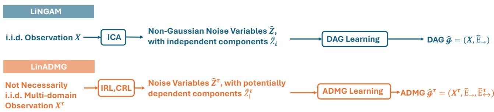
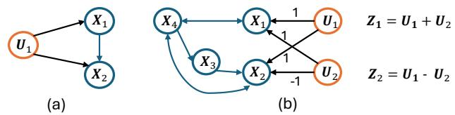
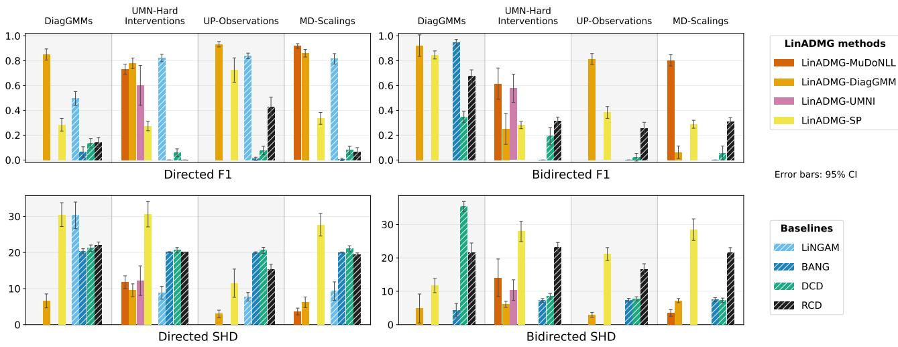
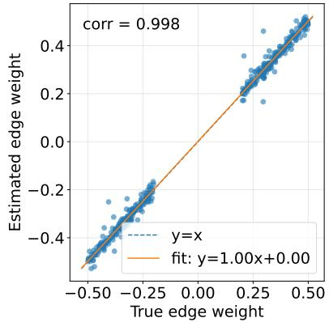
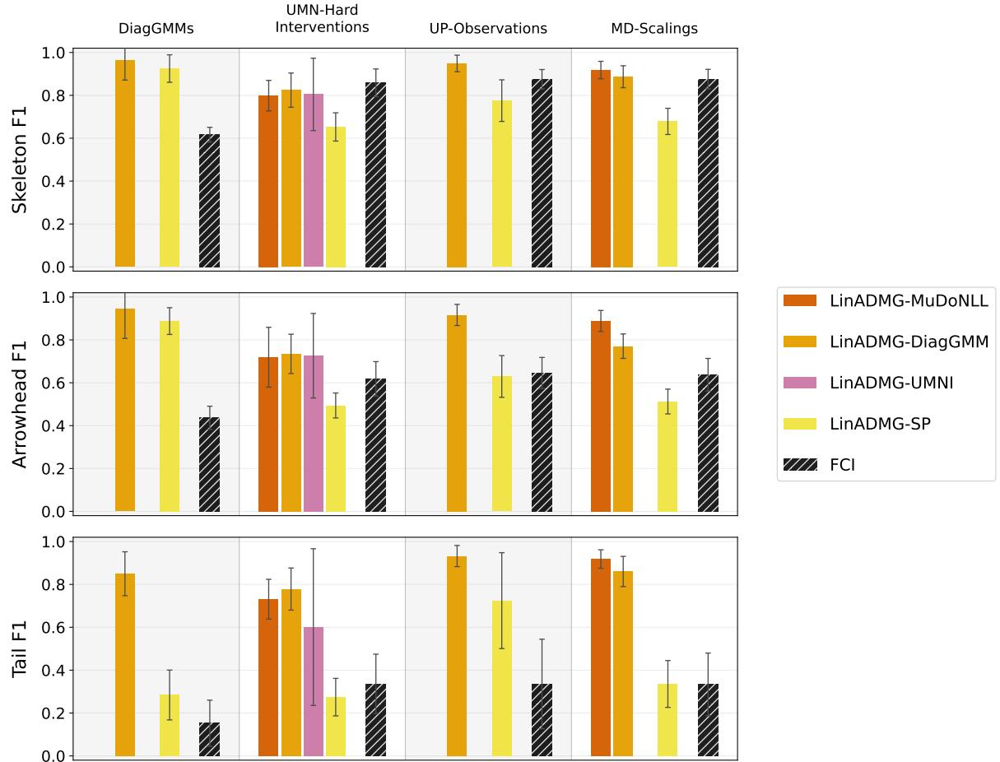
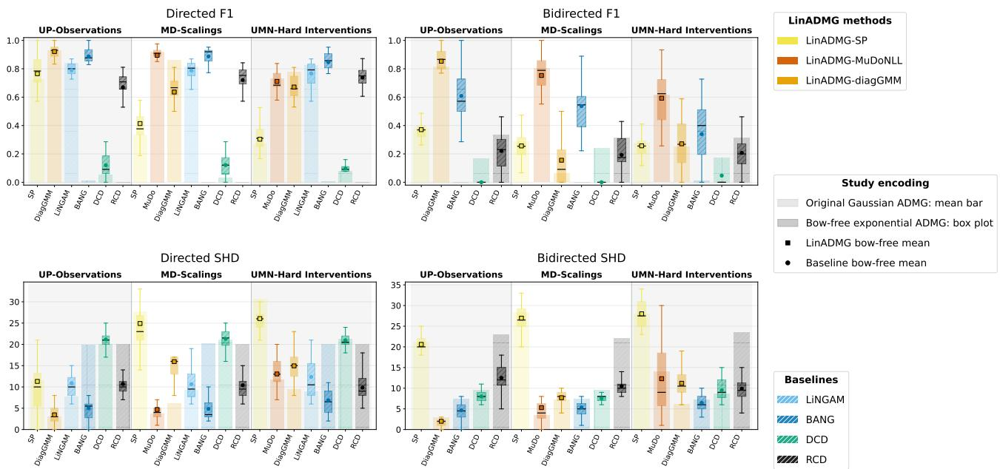

# Causal Discovery for Linear Models with Latent Confounding via Multi-domain Identifiable Representation Learning

Danru Xu University of Amsterdam

Aapo Hyv¨arinen University of Helsinki

Sara Magliacane Saarland University University of Amsterdam

## Abstract

Causal discovery with latent confounding is particularly challenging, but a common setting in real-world data. In this work, we focus on linear causal models with latent confounding, represented by acyclic directed mixed graphs (ADMGs). Existing methods that fully identify ADMGs typically assume non-Gaussianity or graphical constraints, such as bow-freeness. In contrast, we propose Linear ADMG Learning (LinADMG), a framework for learning ADMGs for linear causal models through identifiable representation learning. Rather than relying on non-Gaussianity or bow-freeness, LinADMG leverages multi-domain settings to identify the noise variables. We show that the identifiability of the noise variables is suficient for recovering all direct causal relations, and that, under an additional latent-confounding no-cancellation condition, LinADMG can identify the whole ADMG. We implement LinADMG with four identifiable representation learning approaches from the literature and validate the methods on simulated and semisynthetic datasets.

## 1 INTRODUCTION

Causal discovery aims to recover causal relationships from observational data [Spirtes et al., 1995b, Pearl et al., 2003, Peters et al., 2017]. However, a common challenge in real-world data is the existence of latent confounding: an unobserved common cause of observed variables. Classical constraint-based methods allowing latent confounding, most notably FCI [Spirtes et al., 1995b], return only a Markov equivalence class rather than a unique causal structure.

To pursue a stronger identification goal for the causal structure with latent confounding, we first revisit the source-separation perspective underlying LiNGAM [Shimizu et al., 2006]. In a linear structural causal model without latent confounding, the observed variables can be regarded as linear mixtures of the noise variables. By assuming mutually independent and non-Gaussian noise variables, independent component analysis (ICA) [Hyv¨arinen and Oja, 2000] can be used to recover the unobserved noise variables and the corresponding mixing transformation up to permutation and component-wise scaling. The remaining ambiguities can be resolved using the acyclicity property of the causal graph, thereby fully recovering the underlying directed acyclic graph (DAG).

Latent confounding, however, fundamentally changes this picture. Suppose the underlying causal model is a DAG over both observed and latent variables. Marginalizing the latent variables generally destroys the DAG representation over the observed variables alone: latent common causes induce confounding relationships in addition to direct causal efects. Acyclic directed mixed graphs (ADMGs) provide a way to represent this structure, with directed edges encod ing direct causal relations and bidirected edges encoding latent confounding [Richardson, 2003]. At the same time, marginalization can induce statistical dependence among the noise terms associated with different observed variables, violating the independentsource assumption underlying standard ICA. As a result, learning an ADMG is substantially more challenging than learning a DAG.

Existing extensions of LiNGAM to latent-variable settings exploit non-Gaussian noise variables [Hoyer et al., 2008, Salehkaleybar et al., 2020, Cai et al., 2023, Schkoda et al., 2024], while Wang and Drton [2023] establish identification of the full ADMG under additional structural assumptions, including bow-freeness.

In this work, we also aim to fully identify the ADMG, but from a diferent perspective. As shown in Fig. 1, inspired by LiNGAM, we propose a framework, LinADMG, that follows the same principle: first identify the latent noises and then use the acyclicity property of ADMGs to recover the causal graph. However, unlike LiNGAM, latent confounding makes the noises dependent, so ICA is no longer suitable.

  
Figure 1: Overview of LiNGAM and LinADMG (our method) pipelines. LiNGAM applies ICA to the observed data X to estimate independent non-Gaussian noise variable $\hat { \mathbf { z } } ,$ from which it infers the directed edge set $\widehat { E } _ { - }$ → of a DAG. LinADMG replaces ICA with any appropriate IRL/CRL on a multi-domain dataset $\mathbf { X } ^ { \tau }$ with domain index τ to estimate dependent noise variable $\widehat { \mathbf { Z } } ^ { \tau }$ without specific parametric assumptions on the noise variables, and thereby enabling the additional recovery of bidirected edges $\widehat { E } _ {  } ^ { \tau }$ representing latent confounding.

Recent developments in identifiable representation learning (IRL), including causal representation learning (CRL) [Sch¨olkopf et al., 2021], provide promising alternatives to ICA for LinADMG. IRL studies condi tions under which latent representations can be iden tified from observed data generated through an unknown mixing process. CRL can be viewed as a special form of IRL, where the recovered latent variables are additionally equipped with causal semantics. A key insight from IRL is that latent representations that are not identifiable from a single observational distribution may become identifiable when we can access multiple domains in which the representation distributions vary. Such variation may arise from mixture modeling [Kivva et al., 2022], sparse masking [Xu et al., 2024], hard interventions [Varıcı et al., 2024], or other changes in the latent distribution [Xu et al., 2026].

We adopt the same principle in LinADMG. Specifically, we consider settings in which the direct causal relations among the observed variables remain invariant, while the noise distribution varies across domains. We summarize our contributions as follows:

• We propose LinADMG, a general framework that views linear causal discovery with latent confounding, which first identifies a potentially dependent noise representation and then recovers the causal graph. This extends the sourceseparation perspective underlying LiNGAM beyond independent non-Gaussian noises to potentially dependent noises identifiable through distributional variability.

• We show that noise variable identifiability is sufi cient to recover all direct causal relations. Under an additional latent-confounding no-cancellation condition, which captures a diferent aspect of the model than bow-freeness and faithfulness, LinADMG further identifies the complete bidi rected structure and therefore the full ADMG.

• We implement LinADMG with four representative identifiable representation-learning settings: Diagonal Gaussian Mixture Models [Kivva et al., 2022], Unpaired Partial Observations [Xu et al., 2024], Multi-domain Scalings [Xu et al., 2026], and Unknown Hard Interventions [Varıcı et al., 2024]. These are illustrative examples, and LinADMG applies to any method that identifies the latent variables. We conduct experiments on synthetic and semisynthetic datasets and show accurate recovery under the linear model.

## 2 PRELIMINARIES

We consider linear structural causal models (SCMs) with latent confounding and do not consider selection bias [Spirtes et al., 1995a]. Let $\mathbf { X } = ( X _ { 1 } , \ldots , X _ { n } ) ^ { T } \in$ $\mathbb { R } ^ { n }$ denote the observed variables and U $\in \mathbb { R } ^ { m }$ the latent variables. Following Hoyer et al. [2008], we assume the underlying causal model is

$$
{ \binom { \mathbf { X } } { \mathbf { U } } } = { \binom { B } { \mathbf { 0 } } } B _ { 1 } \mathbf { \Sigma }  { \binom { \mathbf { X } } { \mathbf { U } } } + { \binom { \mathbf { E } _ { 1 } } { \mathbf { E } _ { 2 } } } ,\tag{1}
$$

where $B \in \mathbb { R } ^ { n \times n }$ encodes direct causal efects among the observed variables, $B _ { 1 } \ \in \ \mathbb { R } ^ { n \times m }$ encodes efects from the latent to the observed variables, and $B _ { 2 } \in$ Rm×m encodes causal relations among the latent variables. We assume that all components in $\mathbf { E } _ { 1 }$ and $\mathbf { E } _ { 2 }$ are mutually independent. The zero lower-left block excludes causal efects from observed variables to latent variables, so the latent variables are not descen dants of the observed variables.

Solving the structural equations for U and substituting them into the equations for X gives

$$
{ \bf X } = B { \bf X } + { \bf Z } , \qquad { \bf Z } : = B _ { 1 } ( I - B _ { 2 } ) ^ { - 1 } { \bf E } _ { 2 } + { \bf E } _ { 1 } .\tag{2}
$$

Although $\mathbf { E } _ { 1 }$ and $\mathbf { E } _ { 2 }$ are mutually independent, marginalizing the latent variables can potentially induce dependence among the components of the composite noise $\mathbf { Z } : = \{ Z _ { 1 } , . . . , Z _ { n } \}$

We use an acyclic directed mixed graph (ADMG) [Richardson, 2003] to represent the causal structure among the observed variables induced by the SCM in Eq. 1. With a slight abuse of notation, we use X to denote the corresponding node set:

$$
\mathcal { G } = ( \mathbf { X } , E _ { \right. } , E _ { \left. } ) .\tag{3}
$$

A directed edge $X _ { i } \to X _ { j } \in E _ { \to }$ is present when $B _ { j i } \neq $ 0, representing a direct causal relation from $X _ { i }$ to $X _ { j }$ We assume the directed subgraph $( \mathbf { X } , E _ {  } )$ is acyclic. A bidirected edge $X _ { i }  X _ { j } \in E _ {  }$ is present when there exists a latent variable $U _ { i } \in \mathbf { U }$ that is a common ancestor of $X _ { i }$ and $X _ { j }$ through directed paths whose intermediate nodes are all latent. Thus, $E _ {  }$ encodes the direct causal relation within X, while $E _ {  }$ captures the latent-confounding induced by U. An ADMG is bow-free if no pair of observed variables is connected by both a directed edge and a bidirected edge.

Our goal is to recover the ADMG $\mathcal { G } = ( \mathbf { X } , E _ { \right. } , E _ { \left. } )$ including both the directed causal structure $E _ {  }$ and the latent-confounding structure $E _ {  } .$ Importantly, unlike latent variable LiNGAM (lvLiNGAM) [Hoyer et al., 2008] and its variants [Salehkaleybar et al., 2020, Cai et al., 2023, Schkoda et al., 2024], our work does not necessarily require the exogenous variables $\mathbf { E } _ { 1 }$ and $\mathbf { E } _ { 2 }$ to be non-Gaussian. Moreover, while the Markov property follows from our SCM assumptions, we do not require faithfulness, which assumes that every conditional independence in the observed distribution corresponds to an m-separation in the ADMG [Richardson, 2003, Spirtes et al., 2001]. Instead, we require that the noise variables Z in Eq. 2 can be identified by linear representation WX up to permutation and component-wise scaling [Comon, 1994], i.e., there exists a permutation matrix P and an invertible diagonal matrix D such that $W \mathbf { X } = D P \mathbf { Z }$ , where $W \in \mathbb { R } ^ { n \times n }$

In general, however, even independent Z are not identifiable from the observed variables X without addi tional assumptions [Comon, 1994, Hyv¨arinen and Pajunen, 1999, Locatello et al., 2019]. Moreover, if Z are potentially dependent, this is even more challenging. To solve this, a common strategy from IRL/CRL is to use distributional variability/heterogeneity in the latent variables across domains. We adopt the same principle here. Specifically, we define $\mathbf { Z } ^ { \tau }$ as the noise variables in domain $\tau \in [ T ]$ and allow the noise variables to follow various distributions $P _ { \mathbf { Z } } ^ { \tau }$ . We assume the structural coeficient matrix B is invariant. Then we have the domain-specific observation variable $\mathbf { X } ^ { \tau }  { \mathrm { : } }$

$$
{ \bf X } ^ { \tau } = ( I - B ) ^ { - 1 } { \bf Z } ^ { \tau } , \qquad { \bf Z } ^ { \tau } \sim P _ { \bf Z } ^ { \tau } , \qquad \tau \in [ T ] .\tag{4}
$$

In practice, such domains can correspond to diferent environments, experimental conditions, populations, or interventions that change the distribution of noises.

Next, we present four representative identifiable settings adopted from prior IRL/CRL works as examples:

Multi-domain Scalings (MD-Scalings) [Xu et al., 2026]. Let Z follow any arbitrary distribution with finite second moment and define ${ \bf Z } ^ { \tau } = D ^ { \tau } { \bf Z } ,$ where $D ^ { \tau } \ = \ \mathrm { d i a g } ( d _ { 1 } ^ { \tau } , . . . , d _ { n } ^ { \tau } )$ is domain-specific. Identifiability of $\mathbf { Z } ^ { \tau }$ up to permutation and scaling can be achieved with suficient variability of the scaling matrix $D ^ { \tau }$ , formalized by the full-rank condition on the matrix whose rows contain all fourth-order monomials $\{ d _ { i _ { 1 } } ^ { \tau } d _ { i _ { 2 } } ^ { \tau } d _ { i _ { 3 } } ^ { \tau } d _ { i _ { 4 } } ^ { \tau } \} _ { i _ { 1 } \leq i _ { 2 } \leq i _ { 3 } \leq i _ { 4 } } ,$

Diagonal Gaussian Mixture Models (Diag-GMMs)[Kivva et al., 2022]. Let $u ^ { \tau }$ denote the domain label. We generate $\mathbf { Z } ^ { \tau } \mid u ^ { \tau } \sim \mathcal { N } ( \pmb { \mu } ( u ^ { \tau } ) , \pmb { \Sigma } ( u ^ { \tau } ) )$ , where Σ is a diagonal. The domain label is unob served, so the samples from all domains are mixed, resulting in a Gaussian mixture distribution. Identifiability up to permutation and scaling holds when there exists a pair of domains $\tau \neq \tau ^ { \prime }$ such that the variance ratios $\mathrm { V a r } ( \mathbf { Z } _ { i } ^ { \tau } ) / \mathrm { V a r } ( \mathbf { Z } _ { i } ^ { \tau ^ { \prime } } )$ are distinct across i.

Unpaired Partial Observations (UP-Observations) [Xu et al., 2024]. Let Z follow an arbitrary distribution and define ${ \bf Z } ^ { \tau } = M ^ { \tau } { \bf Z } ,$ $M ^ { \tau } \ = \ \mathrm { d i a g } ( m _ { 1 } ^ { \tau } , . . . , m _ { n } ^ { \tau } )$ , where $m _ { i } ^ { \tau } ~ \in ~ \{ 0 , 1 \}$ refers whether the ith component is observed. Thus, each sample uses only a subset of the latent variables, and the resulting representation $\mathbf { Z } ^ { \tau }$ is sparse. The masking pattern τ is unobserved and the samples are unpaired/mixed across patterns. Let $S ^ { \tau } : = \{ i : m _ { i } ^ { \tau } = 1 \}$ denote the active support under pattern τ . Identifying $\mathbf { Z } ^ { \tau }$ up to permutation and scaling holds under the suficient support-variability condition: $\forall i \in [ n ] , \bigcup _ { \tau \in [ T ] : i \notin S ^ { \tau } } S ^ { \tau } = [ n ] \backslash \{ i \}$

Unknown Multi-node Hard Interventions (UMN-Hard Interventions) [Varıcı et al., 2024]. Assume that the noise variables Z follow an additivenoise model. In each interventional domain $\tau ,$ an unknown subset $I ^ { \tau } \subseteq [ n ]$ is targeted. A hard intervention on $\begin{array} { r l r } { i } & { { } \in } & { I ^ { \tau } } \end{array}$ removes the dependence of $Z _ { i }$ on its parents and replaces its observational conditional distribution $p _ { i } \big ( z _ { i } \ \big | \ z _ { \mathrm { p a } ( i ) } \big )$ with an interventional distribution $q _ { i } ^ { \tau } ( z _ { i } )$ that is independent of its parents. Define the intervention-signature matrix $D _ { \mathrm { i n t } } ~ \in ~ \{ 0 , 1 \} ^ { n \times T }$ by $[ D _ { \mathrm { i n t } } ] _ { i , \tau } ~ = ~ { \bf 1 } \{ i ~ \in ~ I ^ { \tau } \}$ The intervention targets are unknown, but the collection of interventions must be suficiently diverse: $D _ { \mathrm { i n t } }$ must have full row rank. Under this condition, $\mathbf { Z } ^ { \tau }$ are identifiable up to permutation and scaling.

Importantly, our general framework requires no particular form of heterogeneity of $P _ { \mathbf { Z } } ^ { \tau }$ . Any data-generating setting in which the noise variables are identifiable up to permutation and scaling, while keeping B in variant across domains, is compatible with our framework. The latent-confounding structure may itself vary across domains when the mechanism generating $P _ { \mathbf { Z } } ^ { \tau }$ changes. For example, under UMN-Hard Interventions setting, interventions may change the causal structure among latent variables and then change the latent-confounding relations induced among the observed variables. Thus, we allow the bidirected edge set to be domain-specific and denote it by $E _ {  } ^ { \tau }$ . Finally, whether the domain index τ is observed depends on the identification setting, and our framework does not generally require access to domain labels.

## 3 LINEAR ADMG LEARNING

We now describe a general framework called Linear ADMG Learning (LinADMG). It consists of three main steps. First, using observations $\{ \mathbf { X } ^ { \tau } \} _ { \tau = 1 } ^ { T }$ generated according to $\mathbf { X } ^ { \tau } = A \mathbf { Z } ^ { \tau }$ with the shared mixing matrix $A : = ( I - B ) ^ { - 1 }$ , we apply an IRL/CRL method to estimate A and the corresponding domain-specific noise variables $\mathbf { Z } ^ { \tau }$ . Second, following the postprocessing procedure of LiNGAM [Shimizu et al., 2006], we use acyclicity to resolve the permutation and scaling ambiguities of the estimated mixing matrix and then recover the directed structural coeficients B. Third, we estimate the bidirected edges by testing dependence among the estimated noise variables.

Step 1: Estimate the mixing matrix A. We apply a linear representation-learning method to the observed data across domains. When the domain labels are observed, the input is the collection $\{ \mathbf { X } ^ { \tau } : \tau \in [ T ] \}$ ; when they are unobserved, samples from all domains are pooled and treated as a mixture distribution. We assume that the representation learning method used is able to identify $\mathbf { Z } ^ { \tau }$ , which equivalently means identifying A up to permutation and component-wise scaling, i.e., $ { \widehat { A } } = A P D$ , for some permutation matrix $P$ and invertible diagonal matrix D.

Steps 2: Recover the directed edge coeficients B via LiNGAM postprocessing [Shimizu et al., 2006]. Since B is a coeficient matrix of a DAG, we can recover it from $\widehat { A }$ using the LiNGAM postprocessing procedure [Shimizu et al., 2006]. Inverting $\widehat { A }$ gives $\widehat { A } ^ { - 1 } = D ^ { - 1 } \dot { P ^ { T } } A ^ { - 1 } = D ^ { - 1 } P ^ { T } ( \bar { I } - \bar { B } )$ . Using the fact that B is acyclic, $P$ can be identified since there is a unique row permutation of $\widehat { A } ^ { - 1 }$ such that every diagonal entry is nonzero [Shimizu et al., 2006]. Once the permutation is chosen, the remaining scaling ambiguity D can be removed because $I - B$ has a unit diagonal. B is then estimated as

$$
\widehat { B } = I - P D \widehat { A } ^ { - 1 } .\tag{5}
$$

Accordingly, the estimated directed edge set is

$$
{ \widehat E } _ {  } : = \{ X _ { j } ^ { \tau }  X _ { i } ^ { \tau } : { \widehat B } _ { i j } \neq 0 \} ,\tag{6}
$$

which is invariant across domain by assumption. Details of the post-processing procedure are in App. B.

Step 3: Recover the bidirected edge set $E _ {  } ^ { \tau }$ Given ${ \widehat { B } } .$ , we can estimate the noise variables. When the domain label $\tau$ is observed, this can be done separately for each domain:

$$
\widehat { \mathbf { Z } } ^ { \tau } : = ( I - \widehat { B } ) \mathbf { X } ^ { \tau } .\tag{7}
$$

For each pair of recovered noise variables, we add a bidirected edge if they are dependent in domain τ :

$$
\widehat { \bf Z } _ { i } ^ { \tau } \underline { { { \psi } } } \ \underline { { { \widehat { \bf Z } } } } _ { j } ^ { \tau } \quad \Longrightarrow \quad X _ { i } ^ { \tau }  X _ { j } ^ { \tau } \in \widehat { E } _ {  } ^ { \tau } .\tag{8}
$$

Empirically, we can test for dependence between each pair of recovered exogenous variables with an appropriate independence test given a significance α.

We can also apply our method to settings where the domain index is unobserved, and we have a mixture of observations X. In this case, we apply the test over Zb.

## 4 ADMG IDENTIFICATION VIA LINADMG

We next provide conditions under which the proposed framework, LinADMG, identifies the underlying ADMG. By identification of an ADMG, we mean exact recovery of both directed and bidirected edge sets.

We proceed in two stages. First, in Lemma 4.1, we show that, without imposing any additional assumption, LinADMG can identify all directed edges but a subset of the bidirected edges, because in cases of finetuned parameters, the efect from latent confounding may be canceled and therefore cannot be detected by our method. The proof is in App. C.1.

Lemma 4.1 (Directed-edge identification and bidirected-edge subset recovery). Consider the domainspecific ADMG $\begin{array} { r c l } { \mathcal { G } ^ { \tau } } & { = } & { ( \mathbf { X } ^ { \tau } , E _ { \right. } , E _ { \left. } ^ { \tau } ) } \end{array}$ generated by the linear SCM in Sec. 2. Following the Steps in LinADMG, we have ${ \widehat { B } } = B ,$ and the directed edge set is identified and no false-positive estimated bidirected edges, i.e., $\widehat { E } _ { \right. } = E _ { \right. } , \widehat { E } _ { \left. } ^ { \tau } \subseteq E _ { \left. } ^ { \tau }$

To identify all the bidirected edges, we introduce a generic no-cancellation condition ensuring that latent confounding is detectable in the noise dependencies.

Assumption 4.2 (Latent-confounding no-cancellation). For every domain τ and every pair of distinct noise variables $Z _ { i } ^ { \tau } , Z _ { j } ^ { \tau } , i \neq j$ ，

$$
X _ { i } ^ { \tau }  X _ { j } ^ { \tau } \in E _ {  } ^ { \tau } \quad \Longrightarrow \quad Z _ { i } ^ { \tau } \nVdash Z _ { j } ^ { \tau } .\tag{9}
$$

Asm. 4.2 connects our latent confounding definition of bidirected edges to the error-dependence parameterization commonly used in linear structural equation models (SEM) with unobserved confounding. In correlated-error SEMs, Bhattacharya et al. [2021] define a bidirected edge $X _ { i }  X _ { j }$ whenever the corresponding error covariance is nonzero, while Wang and Drton [2023] use bidirected edges to encode dependence between the corresponding error terms. In these formulations, the relation between a bidirected edge and dependence among the noise variables is therefore built directly into the model.

Diferent from their definition, we define $E _ {  } ^ { \tau }$ through the latent projection of the underlying causal DAG: $X _ { i } ^ { \tau }  X _ { j } ^ { \tau }$ represents latent confounding between the two observed variables. After the latent variables are marginalized, however, the latent efects can cancel at the level of the noise dependence, as shown in Fig 2. (b), where the dependence between $Z _ { 1 } ^ { \tau }$ and $Z _ { 2 } ^ { \tau }$ vanishes. Asm. 4.2 rules out such cancellations, and thus aligns the definition of bidirected edges used in our formulation with the noise-dependence parameterization used in prior work.

Previous work commonly assumes bow-freeness with faithfulness because disentangling the causal efect from directed causal relations and a common latent confounder is challenging. We provide two examples in Fig. 2 showing that these assumptions, compared with Asm. 4.2, capture diferent aspects of the model and do not imply one another.

In Thm. 4.3, we show that under Asm. 4.2, LinADMG identifies the complete ADMG, with proof in App. C.2.

Theorem 4.3 (Identifiability of LinADMG). Suppose that the conditions of Lemma 4.1 hold and that Asm. 4.2 is satisfied. Then, LinADMG identifies the complete domain-specific ADMG $\mathcal { G } ^ { \tau } = ( \mathbf { X } ^ { \tau } , E _ { \right. } , E _ { \left. } ^ { \tau } )$ for every domain τ , i.e., $\widehat { E } _ {  } = E _ {  }$ and $\widehat { E } _ {  } ^ { \tau } = E _ {  } ^ { \tau }$

## 5 IMPLEMENTATION

We implement LinADMG under four identifiable datagenerating settings described in Sec. 2. Each setting has a corresponding IRL/CRL method for Step 1, taking $\{ \mathbf { X } ^ { \tau } \} _ { \tau = 1 } ^ { T }$ as input and outputting $\widehat { A }$ or its inverse.

  
Figure 2: Examples showing that Asm. 4.2 and bowfreeness/faithfulness capture diferent properties. (a) $X _ { 1 }$ and $X _ { 2 }$ share the latent parent $U _ { 1 }$ while $X _ { 1 }  X _ { 2 } .$ resulting a violation of bow-freeness. Nevertheless, the latent confounding is detectable by the dependency of noise variables, so Asm. 4.2 holds. (b) Conversely, bow-freeness and faithfulness do not guarantee Asm. 4.2. Let $U _ { 1 }$ and $U _ { 2 }$ be independent Gaussian variables with equal variance. The resulting composite noise terms are $Z _ { 1 } = U _ { 1 } + U _ { 2 }$ and $Z _ { 2 } = U _ { 1 } - U _ { 2 }$ , so Cov $( Z _ { 1 } , Z _ { 2 } ) = 0$ and hence $Z _ { 1 } \perp \perp Z _ { 2 } ,$ despite the existence of $X _ { 1 }$ and $X _ { 2 }$ as they share latent confounders.

We provide a broader discussion of $\mathrm { I R L } / \mathrm { C R L }$ methods compatible with our framework in App. D.

LinADMG-MuDoNLL with MD-Scalings. Our implementation, following Xu et al. [2026], first computes the empirical covariance of $\mathbf { X } ^ { \tau }$ , denoted as $S ^ { \tau }$ , and define the model-implied covariance as

$$
{ \widehat { \Sigma } } ^ { \tau } = A D ^ { \tau } ( I - L ) ^ { - 1 } \mathrm { d i a g } ( \sigma ^ { 2 } ) ( I - L ) ^ { - T } D ^ { \tau } A ^ { T } ,\tag{10}
$$

where $\sigma$ and a zero-diagonal latent structural matrix $L$ is used to model the covariance structure of latent Z. While Xu et al. [2026] choose a covariance-matching objective, we instead optimize a Gaussian negative loglikelihood (NLL) since it is a scale-adaptive measure of covariance mismatch:

$$
\sum _ { \tau = 1 } ^ { T } [ \log \operatorname * { d e t } \Big ( \widehat { \Sigma } ^ { \tau } + \epsilon I \Big ) + \mathrm { t r } \bigg ( \Big ( \widehat { \Sigma } ^ { \tau } + \epsilon I \Big ) ^ { - 1 } S ^ { \tau } \bigg ) ] ,\tag{11}
$$

where ϵ is a small positive value for numerical stability.

LinADMG-diagGMMs with DiagGMM. Kivva et al. [2022] proved that when we apply a Gaussian mixture estimator, identifiability can hold with a (piecewise-) linear decoder-encoder structure. Inspired by this, we implement the special case, linear model, by maximizing the likelihood of a T-component diagonal Gaussian mixture with weights $\pi ^ { \tau }$ , latent means $\mu ^ { \tau }$ , latent variances $v ^ { \tau }$ , and a shared linear decoder $W { : }$

$$
- \frac { 1 } { N } \sum _ { i = 1 } ^ { N } \log \left[ \sum _ { \tau = 1 } ^ { T } \pi ^ { \tau } \mathcal { N } \big ( x _ { i } ; W \mu ^ { \tau } , W \mathrm { d i a g } ( v ^ { \tau } ) W ^ { T } + \epsilon I \big ) \right] .\tag{12}
$$

We initialize the parameters using k-means on observed data and optimize them with Adam. The final estimator of W is the inverse of ${ \widehat { A } } .$

LinADMG-SP with UP-Observations. We follow the implementation of Xu et al. [2024], using a linear autoencoder with a sparsity constraint. The encoder $g$ and decoder $f$ are MLPs without nonlinear activations. After training, we extract the linear part $F$ of the afine decoder as $F _ { : j } = f ( \mathbf { e } _ { j } ) - f ( \mathbf { 0 } )$ where $\mathbf { e } _ { j }$ is the jth standard basis vector. Since $F$ maps the recovered noises to observations, we return ${ \widehat { A } } = F$

## LinADMG-UMNI with UMN-Hard Interventions.

We follow the implementation for the case of hardintervention from Varıcı et al. [2024], computing Gaussian score diferences from sample covariances of each domain. The method recovers a linear encoder $\widehat { H }$ which maps observations to latent variables. We return $\widehat { A } = \widehat { H } ^ { - 1 }$ with Moore-Penrose pseudoinverse.

## 6 RELATED WORK

Classical constraint-based causal discovery methods, most notably FCI [Spirtes et al., 1995b], handle latent confounding by using conditional-independence tests. While these methods do not have parametric assumptions, and can be used with non-parametric tests, they return a Markov equivalence class containing multiple causal graphs, rather than a unique underlying graph.

A diferent line of work relies on additional functional, distributional, or graphical assumptions to obtain stronger identification than is possible from conditional independences alone. Focusing on linear models, prior work can be roughly divided into two groups.

The first group develops diferentiable or score-based methods for learning ADMGs through continuous constrained optimization. Bhattacharya et al. [2021] consider linear Gaussian structural equation models with correlated errors and derive diferentiable algebraic constraints for several restricted ADMG classes: ancestral graphs, which exclude a bidirected edge between any pair connected by a directed path; arid graphs, which exclude c-trees; and bow-free graphs, which exclude pairs connected simultaneously by a directed and a bidirected edge. Their consistency guarantee recovers the true graph up to equivalence with respect to the equality constraints implied by the observed distribution. More recently, Morinishi and Shimizu [2025] extend this approach by assuming multivariate generalized normal errors, allowing non-Gaussian information to further resolve edge orientations, and provide almost-everywhere parameter identifiability for bow-free ADMGs. However, these approaches either recover the graph only up to an observational equivalence class or rely on bow-freeness and specific error-distribution assumptions.

A second group of work leverages non-Gaussianity or independent noise variables. This line of work is inspired by LiNGAM [Shimizu et al., 2006], which assumes no latent confounding, but connects causal discovery with source separation: under linearity and independent non-Gaussian noises, recovering the ICA mixing matrix identifies the underlying DAG. This idea has been extended to time-series models [Hyv¨arinen et al., 2010] and nonlinear causal models [Monti et al., 2020, Reizinger et al., 2023, Montagna, 2026]. Recently, Heurtebise et al. [2026] replace non-Gaussianity with variance diversity in a multi-view setting, while still assuming independent noises.

A few recent works extend LiNGAM to handle latent confounding by leveraging overcomplete independent component analysis (OICA), beginning with Hoyer et al. [2008], which considers linear latent-variable models in which the latent variables and exogenous variables are mutually independent and non-Gaussian. Salehkaleybar et al. [2020] extend this to latent confounding by identifying causal orders among observed variables, while Maeda and Shimizu [2020] additionally infer direct causal relations between unconfounded pairs and detect pairs sharing latent confounders. These results, however, do not in general result in exact recovery of the ADMG. Cumulant-based methods [Cai et al., 2023, Schkoda et al., 2024] provide asymptotically correct recovery of causal structure under different specialized assumptions on the latent-variable model, such as at least three observed children per latent confounder and a local bound on the number of latent confounders, respectively. In addition, Wang and Drton [2023] provided full recovery of the graph under the bow-free assumption. In contrast, our method chooses a diferent perspective, identifiable representation learning, and does not require non-Gaussianity or the specific graphical and latent-structural restrictions required by these approaches.

## 7 EXPERIMENTAL RESULTS

We assess the performance of the proposed LinADMGmethods using synthetic data and then present an application to a semisynthetic dataset causalAssembly.

Synthetic Data generation. We consider four linear data-generating processes (DGPs) described in Sec. 2: MD-Scalings, UP-Observations, UMN-Hard Interventions, and Diag-GMMs. For the first three $\mathrm { D G P s } .$ , we generate $m = \{ 5 , 1 0 , 2 0 \}$ latent variables from a linear SCM, ${ \bf U } = B _ { 2 } { \bf U } + { \bf E } _ { 2 }$ , where the latent causal graph is sampled from an Erd˝os-R´enyi (ER) model with $k _ { U } \in \{ 0 , 1 , 2 , 3 \}$ , where each $\mathrm { E R } { - } k _ { U }$ graph contains n · kU directed edges. The nonzero coeficients of $B _ { 2 }$ are uniformly sampled from $[ - 0 . 5 , - 0 . 2 ] \cup$ [0.2, 0.5]. We sample the scales of each component of $\mathbf { E } _ { 2 }$ independently from Unif(0.2, 0.5) and consider three noise distributions: Gaussian, Exponential, and Gumbel distributions. The three DGPs difer in how U generates $\mathbf { Z } ^ { \tau }$ with domain number $T = \{ 1 , 2 , 3 \} \times m$

  
Figure 3: Estimation of the directed (left) and bidirected (right) edges of the ground-truth ADMG under four DGPs listed above. Bars report means over 20 random seeds, with 95% confidence intervals. Warm colors are the proposed LinADMG- methods, while hatched cold colors are baselines. The top row reports F1 score (↑), and the bottom row reports SHD (↓). LiNGAM does not infer bidirected edges and is therefore omitted.

For UMN-Hard Interventions, we generate $T$ intervention domains and one additional observational reference domain. In each intervention domain τ, we select a target set $\mathcal { T } ^ { \tau }$ and replace the structural equation of each targeted latent variable by an independent noise term. We sample target sets such that every latent variable is targeted in at least one domain and the binary domain-by-variable target matrix has full column rank. Specifically, we construct $B _ { 2 } ^ { \tau }$ by setting the rows of $B _ { 2 }$ corresponding to $\mathcal { T } ^ { \tau }$ to zero and generate $\mathbf { Z } ^ { \tau } = ( I - B _ { 2 } ^ { \tau } ) ^ { - 1 } \mathbf { E } _ { 2 }$

For UP-Observations, we generate a domain-specific binary mask: $M ^ { \tau } \in \{ 0 , 1 \} ^ { m }$ with half active components. If a component is inactive in every masked domain, we activate it in a randomly selected domain. We additionally generate a reference domain with $M ^ { \tau } = I$ , giving $T + 1$ domains in total. Then apply it to U to get ${ \bf Z } ^ { \tau } = M ^ { \tau } { \bf U }$

For MD-Scalings, we generate the domain-specific scaling matrix as $\begin{array} { r c l } { D ^ { \tau } } & { = } & { \operatorname { d i a g } ( d _ { 1 } ^ { \tau } , \ldots , d _ { n } ^ { \tau } ) } \end{array}$ , where the diagonal entries are sampled independently from Unif(0.2, 1). We additionally generate an unscaled reference domain with $D ^ { \tau } = I , \mathrm { g i v i n g } T + 1$ domains in total. Then apply it to U to get $\mathbf { Z } ^ { \tau } = D ^ { \tau } \mathbf { U }$

For Diag-GMMs, we generate five domains indexed by an observed auxiliary variable $a ^ { \tau } \in \{ - 2 , - 1 , 0 , 1 , 2 \}$ Conditional on $a ^ { \tau }$ , we directly sample the composite noise from $\mathbf { Z } ^ { \tau } \mid a ^ { \tau } \sim \mathcal { N } ( \mu ( a ^ { \tau } ) , \Sigma ( a ^ { \tau } ) )$ , where $\mu ( a ) =$ $\alpha + a \beta$ and $\Sigma ( a ) = ( L _ { 0 } + a L _ { 1 } ) ( L _ { 0 } + a \bar { L } _ { 1 } ) ^ { T } + 1 0 ^ { - 6 } I$ . α and $\beta$ are sampled independently from $\mathcal { N } ( 0 , 0 . 5 ^ { 2 } )$ . The matrices $L _ { 0 }$ and $L _ { 1 }$ are diagonal, and sampled independently from Unif(0.2, 0.5) and $\mathcal { N } ( 0 , 0 . 0 8 ^ { 2 } )$ , respectively. Thus, though $\mathbf { Z } ^ { \tau }$ are independent conditional on $a ^ { \tau }$ , pooling the domains can induce dependence through the shared auxiliary variable.

For all four DGPs, we consider $n = m$ observed variables X. We sample the observed causal graph D from an ER model with $k _ { X } \in \{ 0 , 1 , 2 , 3 \}$ , where each ER−k graph contains $n \cdot k _ { X }$ directed edges. Given D, we sample the linear edge weight $B$ uniformly from $[ - 0 . 5 , - 0 . 2 ] \cup [ 0 . 2 , 0 . 5 ]$ . For each domain $\tau _ { : }$ we generate the observed variable $\mathbf { X } ^ { \tau } = ( I - B ) ^ { - 1 } \mathbf { Z } ^ { \tau }$ with sample size $N \in \{ 1 0 0 0 , 5 0 0 0 , 5 0 0 0 0 \}$ . We run each setup over 20 random seeds.

Baselines and Evaluation Metrics. We compare our methods with DirectLiNGAM [Shimizu et al., 2006], BANG [Wang and Drton, 2023], DCD [Bhattacharya et al., 2021], and RCD [Maeda and Shimizu, 2020]. We pool observations generated via scaling and hard intervention DGPs since the baselines do not require the domain index. Due to computational constraints, we fit DCD using at most 10000 pooled observations, while RCD uses at most 300 observations. We evaluate directed and bidirected edges separately using F1 score and structural Hamming distance (SHD). Higher F1 and lower SHD mean better estimation.

Synthetic Experiments Results. Fig. 3 reports the accuracy with 95% confidence intervals of directedand bidirected-edge estimation across four DGPs with $n = m = 1 0$ $T = n ,$ $k _ { X } = 2 ,$ $k _ { U } = 0 . 5 ,$ N = 50000 for UMN-Hard Interventions dataset; otherwise, $N =$ 5000, and Gaussian noise. Overall, the proposed methods achieve the strongest identification, particularly LinADMG-diagGMM and LinADMG-MuDoNLL when their assumptions match the underlying domain-variation mechanism. Under UMN-Hard Interventions DGP, DirectLiNGAM remains competitive for directed-edge recovery. However, it does not support latent confounding estimation. We evaluate LinADMG-UMNI only under the UMN-Hard Interventions DGP because the UMNI representation-learning algorithm strictly requires hard interventions and a full-column-rank intervention design, which the other DGPs do not satisfy. Additional results in App. F.2 show that its reliable performance also requires a suficiently large sample size within each domain. Finally, LinADMG-SP relies on structural sparsity and is therefore competitive under its matched dataset, but its recovery performance becomes worse when the domain variation does not produce the sparsity pattern assumed by the method.

In App. F.1, we show near-perfect directed-edge weight estimation for LinADMG-MuDoNLL under MD-Scalings. In App. F.2, we report the accuracy of directed- and bidirected-edge estimation across diferent configura tions of $n ,$ sample numbers $N _ { ; }$ , domain numbers $T ,$ graph density $k _ { X }$ , confounding density $k _ { U }$ , and noise distribution for all four DGPs. We also provide a comparison between the loss function proposed in Sec. 5 and those from the original papers, including comparing diagGMM (ours) with VaDE (used in Kivva et al. [2022]) in App. F.3, and comparing MuDoNLL (ours) with MuDoCov (proposed by Xu et al. [2026]) in App. F.4, where our methods consistently outperform.

We also compare our method with FCI [Spirtes et al., 1995a] in App. F.5. We first convert the estimated ADMG into PAG and then compute F1 for the skeleton, arrowhead, and tail. Our method significantly improves recovery of the correct tail and arrowhead, and shows comparable performance for skeleton accuracy. We also test our methods and baselines with bow-free underlying ADMG and non-Gaussian noise. The results in $\mathrm { A p p . }$ . F.6 show that our methods maintain stable and robust performance, while the baselines show significant improvement due to the match of their methodological assumptions.

causalAssembly with latent confounding. We use the causalAssembly benchmark [G¨obler et al., 2024], a semi-synthetic benchmark derived from a real manufacturing assembly line, focusing on Stations 1 and 2. We first treat all ${ { n } _ { 1 } } = 6$ Station 1 variables as latent and all $n _ { 2 } = 3 4$ Station 2 variables as observed. We generate 18 domains with 5000 samples each: one observational domain and 17 soft-intervention domains, each targeting 1-3 latent variables. We evaluate LinADMG-diagGMM and LinADMG-MuDoNLL over five optimization seeds. Both perform poorly in this setting, which we attribute partly to limited latent variability, since only one directed edge connects Station 1 to Station 2. We therefore also treat the first half of Station 2 variables in topological order as latent, leaving the remaining half observed. The resulting ADMG contains 25 directed and 54 bidirected edges. This results in a modest improvement. A major reason for the dificulty is the strong nonlinearity of the causalAssembly mechanisms, as G¨obler et al. [2024] reports similarly poor performance of linear causal discovery methods on this benchmark. To separate nonlinear model misspecification from the latent-confounding challenge, we construct a linear version that preserves the graph topology but replaces the mechanisms with a linear SCM, with edge coeficients sampled uniformly from [0.4, 0.8]. This results in substantially higher accuracy for both methods. We summarize the results in Tab. 1.

Table 1: Average F1 scores ± standard deviation over 5 random seeds across diferent versions of causalAssembly with latent confounding with linear/nonlinear SCM and latent confounding settings.
<table><tr><td>SCM</td><td>Latent Method</td><td></td><td>Directed F1 Bidirected F1</td></tr><tr><td rowspan="2">Nonlinear</td><td></td><td>-diagGMM  $. 0 2 0 \pm . 0 0 0$ </td><td> $. 0 0 4 \pm . 0 0 0$ </td></tr><tr><td> $n _ { 1 }$ </td><td>-MuDoNLL  $. 0 7 4 \pm . 0 0 0$ </td><td> $. 0 0 4 \pm . 0 0 0$ </td></tr><tr><td rowspan="2">Nonlinear</td><td> $n _ { 1 } ~ +$ </td><td>-diagGMM</td><td> $. 0 0 0 \pm . 0 0 0$   $. 5 5 4 \pm . 0 0 0$ </td></tr><tr><td>50% n2</td><td>-MuDoNLL  $. 0 8 5 \pm . 0 0 0$ </td><td> $. 5 7 6 \pm . 0 0 0$ </td></tr><tr><td rowspan="2">Linear</td><td> $n _ { 1 } ~ +$ </td><td>-diagGMM  $. 5 0 8 \pm . 0 2 0$ </td><td> $. 8 0 0 \pm . 0 0 9$ </td></tr><tr><td>50% n2 -MuDoNLL</td><td> $. 1 4 7 \pm . 0 3 1$ </td><td> $. 5 5 4 \pm . 0 2 4$ </td></tr></table>

## 8 CONCLUSION AND LIMITATION

We introduced LinADMG, a general framework for learning linear ADMGs through identifiable representation learning. We show that LinADMG can recover the directed causal structure whenever the noise variables is identifiable up to permutation and scaling; it can further identify the full ADMG under a latentconfounding no-cancellation condition. Our results show how noise heterogeneity can provide an alternative source of identifiability for causal discovery with latent confounding.

The current framework is limited to linear structural causal models. Extending the framework to nonlinear causal structural models is an important direction for future work. In addition, we currently consider only a selected set of identifiable representation-learning settings. Extending the framework to incorporate other sources of identifiability, such as temporal structure, could further broaden its applicability.

## ACKNOWLEDGEMENTS

The research of DX and SM was supported by the Air Force Ofice of Scientific Research under award number FA8655-22-1-7155. Any opinions, findings, and conclusions or recommendations expressed in this material are those of the author(s) and do not necessarily reflect the views of the United States Air Force. We also thank SURF for the support in using the Dutch National Supercomputer Snellius.

## AI use statement

In this work, we used generative AI tools for generating synthetic data sets, polishing the theorem claim, assisting in the writing of proofs, implementing meth ods, cleaning and reformatting datasets, and interpret ing results. We have not used generative AI tools for helping develop theoretical models or conceptual frameworks, formulating mathematical claims, providing critical ingredients for proving mathematical claims, designing or providing feedback on research methodology or experiments, and proposing or refining hypotheses, assisting with translation, and supporting qualitative and thematic data analysis are not applicable to this work. Additionally, we used generative AI tools for creating or modifying scientific figures or images, summarizing or analyzing existing literature, editing a research paper to improve readability, and identifying relevant literature. We have reviewed all AI-assisted work.

We take responsibility for the final content of this work, including text, claims, or artifacts produced with the aid of generative AI.

## REFERENCES

K. Ahuja, D. Mahajan, Y. Wang, and Y. Bengio. Interventional causal representation learning. In International conference on machine learning, pages 372–407. PMLR, 2023.

K. Ahuja, A. Mansouri, and Y. Wang. Multi-domain causal representation learning via weak distributional invariances. In International Conference on Artificial Intelligence and Statistics, pages 865–873. PMLR, 2024.

R. Bhattacharya, T. Nagarajan, D. Malinsky, and I. Shpitser. Diferentiable causal discovery under unmeasured confounding. In International Conference on Artificial Intelligence and Statistics, pages 2314– 2322. PMLR, 2021.

J. Brehmer, P. De Haan, P. Lippe, and T. S. Cohen. Weakly supervised causal representation learning. Advances in Neural Information Processing Systems, 35:38319–38331, 2022.

S. Buchholz, G. Rajendran, E. Rosenfeld, B. Aragam, B. Sch¨olkopf, and P. Ravikumar. Learning linear causal representations from interventions under general nonlinear mixing. Advances in Neural Information Processing Systems, 36:45419–45462, 2023.

R. Cai, Z. Huang, W. Chen, Z. Hao, and K. Zhang. Causal discovery with latent confounders based on higher-order cumulants. In International conference on machine learning, pages 3380–3407. PMLR, 2023.

P. Comon. Independent component analysis, a new concept? Signal processing, 36(3):287–314, 1994.

X. Dong, I. Ng, B. Huang, Y. Sun, S. Jin, R. Legaspi, P. Spirtes, and K. Zhang. On the parameter identifiability of partially observed linear causal models. Advances in Neural Information Processing Systems, 37:30740–30771, 2024.

J. Gallego-Posada, J. Ramirez, M. Hashemizadeh, and S. Lacoste-Julien. Cooper: A library for constrained optimization in deep learning. arXiv preprint arXiv:2504.01212, 2025.

K. G¨obler, T. Windisch, M. Drton, T. Pychynski, M. Roth, and S. Sonntag. causalassembly: Generating realistic production data for benchmarking causal discovery. In Causal Learning and Reasoning, pages 609–642. PMLR, 2024.

G. G´omez-Herrero, M. Atienza, K. Egiazarian, and J. L. Cantero. Measuring directional coupling between eeg sources. Neuroimage, 43(3):497–508, 2008.

A. Heurtebise, O. Chehab, P. Ablin, A. Gramfort, and A. Hyvarinen. Multi-view causal discovery without non-gaussianity: Identifiability and algorithms. In Forty-third International Conference on Machine Learning, 2026.

P. O. Hoyer, S. Shimizu, A. J. Kerminen, and M. Palviainen. Estimation of causal efects using linear nongaussian causal models with hidden variables. International Journal of Approximate Reasoning, 49(2): 362–378, 2008.

A. Hyv¨arinen and J. Hurri. Blind separation of sources that have spatiotemporal variance dependencies. Signal processing, 84(2):247–254, 2004.

A. Hyvarinen and H. Morioka. Nonlinear ica of temporally dependent stationary sources. In Artificial intelligence and statistics, pages 460–469. PMLR, 2017.

A. Hyv¨arinen and E. Oja. Independent component analysis: Algorithms and applications. Neural Networks, 13(4-5):411–430, 2000.

A. Hyv¨arinen and P. Pajunen. Nonlinear independent component analysis: Existence and uniqueness results. Neural Networks, 12(3):429–439, 1999.

A. Hyv¨arinen, K. Zhang, S. Shimizu, and P. O. Hoyer. Estimation of a structural vector autoregression model using non-gaussianity. Journal of Machine Learning Research, 11(5), 2010.

A. Hyvarinen, H. Sasaki, and R. Turner. Nonlinear ica using auxiliary variables and generalized contrastive learning. In The 22nd international conference on artificial intelligence and statistics, pages 859–868. Pmlr, 2019.

I. Khemakhem, D. Kingma, R. Monti, and A. Hyvarinen. Variational autoencoders and nonlinear ica: A unifying framework. In International conference on artificial intelligence and statistics, pages 2207– 2217. PMLR, 2020.

D. P. Kingma and J. Ba. Adam: A method for stochastic optimization. In International Conference on Learning Representations, 2015.

B. Kivva, G. Rajendran, P. Ravikumar, and B. Aragam. Identifiability of deep generative models without auxiliary information. Advances in Neural Information Processing Systems, 35:15687–15701, 2022.

L. Kong, B. Huang, F. Xie, E. Xing, Y. Chi, and K. Zhang. Identification of nonlinear latent hierarchical models. Advances in Neural Information Processing Systems, 36:2010–2032, 2023.

L. Kong, G. Chen, B. Huang, E. Xing, Y. Chi, and K. Zhang. Learning discrete concepts in latent hierarchical models. Advances in Neural Information Processing Systems, 37:36938–36975, 2024.

S. Lachapelle, P. Rodriguez, Y. Sharma, K. E. Everett, R. Le Priol, A. Lacoste, and S. Lacoste-Julien. Disentanglement via mechanism sparsity regularization: A new principle for nonlinear ICA. In Conference on Causal Learning and Reasoning, pages 428–484. PMLR, 2022.

S. Lachapelle, P. R. L´opez, Y. Sharma, K. Everett, R. Le Priol, A. Lacoste, and S. Lacoste-Julien. Nonparametric partial disentanglement via mechanism sparsity: Sparse actions, interventions and sparse temporal dependencies. Journal of Machine Learning Research, 27(71):1–90, 2026.

Z. Li, M. Fu, J. Huang, Y. Shen, R. Cai, Y. Sun, G. Chen, and K. Zhang. Towards identifiability of hierarchical temporal causal representation learning. In The Thirty-ninth Annual Conference on Neural Information Processing Systems, 2025.

P. Lippe, S. Magliacane, S. L¨owe, Y. M. Asano, T. Cohen, and S. Gavves. Citris: Causal identifiabil-

ity from temporal intervened sequences. In International Conference on Machine Learning, pages 13557–13603. PMLR, 2022.

P. Lippe, S. Magliacane, S. L¨owe, Y. M. Asano, T. Cohen, and E. Gavves. Biscuit: Causal representation learning from binary interactions. In Uncertainty in Artificial Intelligence, pages 1263–1273. PMLR, 2023.

F. Locatello, S. Bauer, M. Lucic, G. Raetsch, S. Gelly, B. Sch¨olkopf, and O. Bachem. Challenging common assumptions in the unsupervised learning of disentangled representations. In international conference on machine learning, pages 4114–4124. PMLR, 2019.

T. N. Maeda and S. Shimizu. Rcd: Repetitive causal discovery of linear non-gaussian acyclic models with latent confounders. In International Conference on artificial intelligence and statistics, pages 735–745. PMLR, 2020.

F. Montagna. On the identifiability of causal graphs with multiple environments. In International Conference on Learning Representations, volume 2026, pages 13837–13868, 2026.

R. P. Monti, K. Zhang, and A. Hyv¨arinen. Causal discovery with general non-linear relationships using non-linear ica. In Uncertainty in artificial intelligence, pages 186–195. PMLR, 2020.

Y. Morinishi and S. Shimizu. Diferentiable causal discovery of linear non-gaussian acyclic models under unmeasured confounding. Transactions on Machine Learning Research, 2025. ISSN 2835-8856.

H. Morioka and A. Hyvarinen. Causal representation learning made identifiable by grouping of observational variables. In Proceedings of the 41st International Conference on Machine Learning, volume 235, pages 36249–36293. PMLR, 2024.

J. Pearl et al. Causality: models, reasoning, and inference. Econometric Theory, 19(675-685):46, 2003.

J. Peters, D. Janzing, and B. Sch¨olkopf. Elements of causal inference: foundations and learning algorithms. The MIT press, 2017.

P. Reizinger, Y. Sharma, M. Bethge, B. Sch¨olkopf, F. Husz´ar, and W. Brendel. Jacobian-based causal discovery with nonlinear ica. Transactions on Machine Learning Research, 2023.

T. Richardson. Markov properties for acyclic directed mixed graphs. Scandinavian Journal of Statistics, 30(1):145–157, 2003.

S. Salehkaleybar, A. Ghassami, N. Kiyavash, and K. Zhang. Learning linear non-gaussian causal models in the presence of latent variables. Journal of Machine Learning Research, 21(39):1–24, 2020.

D. Schkoda, E. Robeva, and M. Drton. Causal discovery of linear non-gaussian causal models with unobserved confounding. arXiv preprint arXiv:2408.04907, 2024.

B. Sch¨olkopf, F. Locatello, S. Bauer, N. R. Ke, N. Kalchbrenner, A. Goyal, and Y. Bengio. Toward causal representation learning. Proceedings of the IEEE, 109(5):612–634, 2021.

S. Shimizu, P. O. Hoyer, A. Hyv¨arinen, A. Kerminen, and M. Jordan. A linear non-gaussian acyclic model for causal discovery. Journal of Machine Learning Research, 7(10), 2006.

X. Song, Z. Li, G. Chen, Y. Zheng, Y. Fan, X. Dong, and K. Zhang. Causal temporal representation learning with nonstationary sparse transition. Advances in Neural Information Processing Systems, 37:77098–77131, 2024.

P. Spirtes, C. Meek, and T. Richardson. Causal inference in the presence of latent variables and selection bias. In Proceedings of the Eleventh Conference on Uncertainty in Artificial Intelligence, UAI’95, page 499–506, 1995a.

P. Spirtes, C. Meek, and T. Richardson. Causal inference in the presence of latent variables and selection bias. In Proceedings of the Eleventh Conference on Uncertainty in Artificial Intelligence, page 499–506, 1995b.

P. Spirtes, C. N. Glymour, and R. Scheines. Causation, Prediction, and Search. MIT Press, 2001.

B. Varıcı, E. Acart¨urk, K. Shanmugam, and A. Tajer. Linear causal representation learning from unknown multi-node interventions. Advances in Neural Information Processing Systems, 37:111614–111648, 2024.

J. von K¨ugelgen, M. Besserve, L. Wendong, L. Gresele, A. Keki´c, E. Bareinboim, D. Blei, and B. Sch¨olkopf. Nonparametric identifiability of causal representations from unknown interventions. Advances in Neural Information Processing Systems, 36:48603– 48638, 2023.

Y. S. Wang and M. Drton. Causal discovery with unobserved confounding and non-gaussian data. Journal of Machine Learning Research, 24(271):1–61, 2023.

D. Xu, D. Yao, S. Lachapelle, P. Taslakian, J. Von K¨ugelgen, F. Locatello, and S. Magliacane. A sparsity principle for partially observable causal representation learning. In Proceedings of the 41st International Conference on Machine Learning, volume 235, pages 55389–55433, 2024.

D. Xu, L. Parkkonen, S. Magliacane, and A. Hyvarinen. Identifying dependent components from multidomain linear mixtures. In Forty-third International Conference on Machine Learning, 2026.

D. Yao, D. Xu, S. Lachapelle, S. Magliacane, P. Taslakian, G. Martius, J. von K¨ugelgen, and F. Locatello. Multi-view causal representation learning with partial observability. International Conference on Learning Representations, 2024.

J. Zhang, K. Greenewald, C. Squires, A. Srivastava, K. Shanmugam, and C. Uhler. Identifiability guarantees for causal disentanglement from soft interventions. Advances in Neural Information Processing Systems, 36:50254–50292, 2023.

K. Zhang and A. Hyv¨arinen. A general linear nongaussian state-space model: Identifiability, identification, and applications. In Asian Conference on Machine Learning, pages 113–128. PMLR, 2011.

K. Zhang, S. Xie, I. Ng, and Y. Zheng. Causal representation learning from multiple distributions: A general setting. In Proceedings of the 41st International Conference on Machine Learning, volume 235, pages 60057–60075. PMLR, 2024.

X. Zheng, B. Aragam, P. K. Ravikumar, and E. P. Xing. Dags with no tears: Continuous optimization for structure learning. Advances in neural information processing systems, 31, 2018.

# Causal Discovery for Linear Models with Latent Confounding via Multi-domain Identifiable Representation Learning: Supplementary Materials

## A SUMMARY OF NOTATION

Throughout this paper, we adopt the following conventions for mathematical notation: We use bold uppercase letters such as X to denote random vectors, and uppercase italic letters such as X to denote matrices. We list all specific notations in the following table:

<table><tr><td>Symbol</td><td>Description</td></tr><tr><td>T</td><td>Domain index</td></tr><tr><td>U</td><td>Unobserved variables</td></tr><tr><td>x</td><td>Observed variables</td></tr><tr><td> $\mathbf { E } _ { 1 }$ </td><td>Exogenous variables of X</td></tr><tr><td> $\mathbf { E } _ { 2 }$ </td><td>Exogenous variables of U</td></tr><tr><td> $\mathbf { Z } ^ { \tau }$ </td><td>Latent noise variables from domain  $\tau$ </td></tr><tr><td> $\mathbf { X } ^ { \tau }$ </td><td>Observed variables from domain  $\tau$ </td></tr><tr><td> $A$ </td><td>Linear mixing matrix</td></tr><tr><td> $B$ </td><td>Weighted adjacency matrix of directed causal graph among observed variables</td></tr><tr><td> $\mathcal { G }$ </td><td>ADMG</td></tr><tr><td> $E _ {  }$ </td><td>directed edge set</td></tr><tr><td> $E _ {  }$ </td><td>bidirected edge set</td></tr><tr><td> $n$ </td><td>Dimension of the observed variables</td></tr><tr><td> $m$ </td><td>Dimension of the unobserved variables</td></tr><tr><td> $T$ </td><td>Number of domains</td></tr><tr><td> $N$ </td><td>Number of samples per domain</td></tr></table>

## B DETAILS OF LINGAM-BASED DIRECTED STRUCTURE RECOVERY

In this section, we provide the details of the LiNGAM-style post-processing procedure used to recover the directed structure from the estimated mixing matrix Aˆ. We break it into 3 steps to resolve the permutation, scaling, and numerical error.

We start by introducing new notation. Let $W : = A ^ { - 1 } = I - B$ . Inverting $\widehat { A }$ gives

$$
\widetilde { W } : = \widehat { A } ^ { - 1 } = D ^ { - 1 } P ^ { T } W .\tag{13}
$$

Hence, $\widetilde { W }$ recovers the structural demixing matrix W up to a row permutation and row-wise scaling.

Step i: Resolve the permutation ambiguity. By assuming B is a DAG weighted adjacency matrix, we have $B _ { i i } = 0$ , which implies $W = I - B$ must have exactly one diagonal entries, i.e. $W _ { i i } = 0$ . We therefore search a row permutation of Wf that aligns the recovered components with the observed variables.

Specifically, we choose the permutation $\widehat { P }$ solving

$$
\widehat { P } \in \underset { P \in \mathcal { P } _ { n } } { \mathrm { a r g m a x } } \sum _ { i = 1 } ^ { n } \left| ( P \widetilde { W } ) _ { i i } \right| ,\tag{14}
$$

where $\mathcal { P } _ { n }$ denotes the set of $n \times n$ permutation matrices. This optimization is a linear assignment problem and can be solved eficiently using, for example, the Hungarian algorithm with complexity $O ( n ^ { \overleftarrow { 3 } } )$ . We then define

$$
\begin{array} { r } { \overline { { W } } : = \widehat { P } \widetilde { W } . } \end{array}\tag{15}
$$

Step ii: Remove the scaling ambiguity. After permutation alignment, the remaining ambiguity is row-wise scaling. Since $W = I - B$ satisfies $W _ { i i } = 1$ , we normalize each row by its diagonal entry:

$$
\widehat { W } _ { i j } : = \frac { \overline { { W } } _ { i j } } { \overline { { W } } _ { i i } } , \qquad i , j \in [ n ] .\tag{16}
$$

Step iii: Recover the directed structural coeficients. We obtain the estimated weighted adjacency matrix as

$$
{ \widehat { B } } : = I - { \widehat { W } } .\tag{17}
$$

Sparsification. However, finite-sample estimation generally produces small spurious nonzero coeficients. We therefore sparsify $\widetilde { B }$ using either an absolute threshold,

$$
\begin{array} { r } { \widetilde { B } _ { i j }  0 \quad \mathrm { i f } \quad | \widetilde { B } _ { i j } | < \lambda , } \end{array}\tag{18}
$$

or a relative threshold defined with respect to the magnitude of the recovered coeficients.

Acyclicity. Thresholding alone need not yield an acyclic directed graph. Following Shimizu et al. [2006], if directed cycles remain, we iteratively remove the weakest edge participating in a directed cycle until it becomes acyclic. Denote the resulting matrix by ${ \widehat { B } } .$ The estimated directed edge set is then

$$
{ \widehat { E } } _ {  } : = \{ X _ { j }  X _ { i } : { \widehat { B } } _ { i j } \neq 0 \} .\tag{19}
$$

## C PROOF

## C.1 Proof of Lemma 4.1

Before proving Lemma 4.1, we recall the following result underlying the LiNGAM postprocessing procedure.

Lemma C.1 (LiNGAM permutation lemma Shimizu et al., 2006, Lemma 1). Let M be a lower-triangular matrix whose diagonal entries are all nonzero. Among matrices obtained from M by independently permuting its rows and columns, the diagonal contains no zero entries if and only if the row and column permutations coincide.

Consequently, if a matrix W can be made lower triangular with nonzero diagonal by applying the same permutation to its rows and columns, then, for any row-permuted version of W, there exists a unique row permutation that restores a matrix with an everywhere nonzero diagonal.

The second statement is the form of Lemma C.1 used in the LiNGAM postprocessing procedure. After the correct row permutation is identified, row-wise scaling is removed by normalizing each row by its diagonal entry.

Lemma 4.1 (Directed-edge identification and bidirected-edge subset recovery). Consider the domain-specific ADMG $\mathcal { G } ^ { \tau } = ( \mathbf { X } ^ { \tau } , E _ { \right. } , E _ { \left. } ^ { \tau } )$ generated by the linear SCM in Sec. 2. Following the Steps in LinADMG, we have ${ \widehat { B } } = B _ { ; }$ , and the directed edge set is identified and no false-positive estimated bidirected edges, i.e., $\widehat { E } _ {  } = E _ {  }$ $\widehat { E } _ {  } ^ { \tau } \subseteq E _ {  } ^ { \tau }$

Proof. From $\widehat { A } = A P D$ , and $A ^ { - 1 } = I - B$ , we obtain $\widehat { A } ^ { - 1 } = D ^ { - 1 } P ^ { T } ( I - B )$

Thus, $\widehat { A } ^ { - 1 }$ difers from I − B only by a row permutation and nonzero row-wise scaling.

Since B represents a DAG, there exists a permutation of the variables under which B is strictly lower triangular. Hence, under the same permutation, I − B is lower triangular with all diagonal entries equal to one. By Lemma C.1, there is a unique row permutation of $\widehat { A } ^ { - 1 }$ whose diagonal entries are all nonzero. Therefore, the

LiNGAM permutation step recovers the correct correspondence between the rows of $\widehat { A } ^ { - 1 }$ and the observed variables.

After correcting the row permutation, the resulting matrix difers from $I - B$ only by row-wise scaling. Since the diagonal of $I - B$ is equal to one, normalizing each row by its diagonal entry removes this scaling ambiguity exactly. Therefore, the normalized demixing matrix satisfies ${ \widehat { \boldsymbol { W } } } = { \boldsymbol { I } } - { \boldsymbol { B } }$ , and consequently

$$
{ \widehat { B } } = I - { \widehat { W } } = B .\tag{20}
$$

It follows immediately that

$$
\widehat { E } _ {  } = E _ {  } .\tag{21}
$$

Next, we show that $\widehat { E } _ {  } ^ { \tau } \subseteq E _ {  } ^ { \tau }$ . We prove this by contradiction. Suppose

$$
\begin{array} { r l } { \exists } & { { } X _ { i } ^ { \tau }  X _ { j } ^ { \tau } \in \widehat { E } _ {  } ^ { \tau } , \ \mathrm { s u c h ~ t h a t ~ } X _ { i } ^ { \tau }  X _ { j } ^ { \tau } \notin E _ {  } ^ { \tau } . } \end{array}\tag{22}
$$

Since the bidirected-edge recovery procedure adds an edge only when the corresponding estimated disturbance components are dependent, we must have

$$
\widehat { Z } _ { i } ^ { \tau } \not \bot \widehat { Z } _ { j } ^ { \tau } .\tag{23}
$$

From the previous result, we know ${ \widehat { B } } = B ,$ and therefore

$$
\widehat { \mathbf { Z } } ^ { \tau } = ( I - \widehat { B } ) \mathbf { X } ^ { \tau } = ( I - B ) \mathbf { X } ^ { \tau } = \mathbf { Z } ^ { \tau } .\tag{24}
$$

Thus we have,

$$
Z _ { i } ^ { \tau } \ : \mathcal { \ X } \ : Z _ { j } ^ { \tau } .\tag{25}
$$

To obtain a contradiction, recall from Eq. 2 that

$$
\mathbf { Z } ^ { \tau } = B _ { 1 } ^ { \tau } ( I - B _ { 2 } ^ { \tau } ) ^ { - 1 } \mathbf { E } _ { 2 } ^ { \tau } + \mathbf { E } _ { 1 } ^ { \tau } .\tag{26}
$$

Define $M ^ { \tau } : = B _ { 1 } ^ { \tau } ( I - B _ { 2 } ^ { \tau } ) ^ { - 1 }$ . We write it out component by component:

$$
Z _ { i } ^ { \tau } = \sum _ { k } M _ { i k } ^ { \tau } \mathbf { E } _ { 2 k } ^ { \tau } + \mathbf { E } _ { 1 i } ^ { \tau } , \qquad Z _ { j } ^ { \tau } = \sum _ { k } M _ { j k } ^ { \tau } \mathbf { E } _ { 2 k } ^ { \tau } + \mathbf { E } _ { 1 j } ^ { \tau } .\tag{27}
$$

$M _ { i k } ^ { \tau }$ represents the total linear efect of the latent exogenous component $\mathbf { E } _ { 2 k } ^ { \tau }$ on the observed disturbance $Z _ { i } ^ { \tau }$ Thus, a common latent source can induce dependence between $Z _ { i } ^ { \tau }$ and $Z _ { j } ^ { \tau }$ only if there exists some k such that

$$
M _ { i k } ^ { \tau } \neq 0 \quad \quad \mathrm { a n d } \quad \quad M _ { j k } ^ { \tau } \neq 0 .\tag{28}
$$

By construction of the domain-specific ADMG, such a shared latent source induces the bidirected edge $X _ { i } $ $X _ { j } \in E _ {  } ^ { \tau }$ , which is contradictory with $X _ { i }  X _ { j } \notin E _ {  } ^ { \tau }$ in Equ. 22. Therefore, we conclude

$$
\widehat { E } _ {  } ^ { \tau } \subseteq E _ {  } ^ { \tau } .\tag{29}
$$

## C.2 Proof of Theorem 4.3

Theorem 4.3 (Identifiability of LinADMG). Suppose that the conditions of Lemma $\ 4 . 1$ hold and that Asm. $4 . 2$ is satisfied. Then, LinADMG identifies the complete domain-specific ADMG $\mathcal { G } ^ { \tau } = ( \mathbf { X } ^ { \tau } , E _ { \right. } , E _ { \left. } ^ { \tau } )$ for every domain τ, i.e., $\widehat { E } _ {  } = E _ {  }$ and $\widehat { E } _ {  } ^ { \tau } = E _ {  } ^ { \tau }$

Proof. By Lemma 4.1, the directed structural coeficient matrix is identified:

$$
{ \widehat { B } } = B .\tag{30}
$$

Therefore, $\widehat { E } _ {  } = E _ { - }$ →

Moreover, Lemma 4.1 shows that the estimated bidirected edge set contains no false-positive edges:

$$
\widehat { E } _ {  } ^ { \tau } \subseteq E _ {  } ^ { \tau } .\tag{31}
$$

Therefore, we only need to show the other way around: $E _ {  } ^ { \tau } \subseteq \widehat { E } _ {  } ^ { \tau }$

Since ${ \widehat { B } } = B ,$ , the composite disturbances are also recovered exactly:

$$
\widehat { \mathbf { Z } } ^ { \tau } = ( I - \widehat { B } ) \mathbf { X } ^ { \tau } = ( I - B ) \mathbf { X } ^ { \tau } = \mathbf { Z } ^ { \tau } .\tag{32}
$$

Now consider an arbitrary true bidirected edge $X _ { i } ^ { \tau }  X _ { j } ^ { \tau } \in E _ {  } ^ { \tau }$ . By Assump. 4.2, this implies

$$
Z _ { i } ^ { \tau } \ : \mathcal { H } \ : Z _ { j } ^ { \tau } .\tag{33}
$$

By Equ. (32), we then have $\widehat { Z } _ { i } ^ { \tau } = Z _ { i } ^ { \tau }$ and $\widehat { Z } _ { j } ^ { \tau } = Z _ { j } ^ { \tau }$ , and therefore $\widehat { Z } _ { i } ^ { \tau } \not \equiv \widehat { Z } _ { j } ^ { \tau }$

Thus, under the dependence criterion used by LinADMG, $X _ { i } ^ { \tau }  X _ { j } ^ { \tau } \in \widehat { E } _ {  } ^ { \tau }$

Since this is true for all $X _ { i } ^ { \tau }  X _ { j } ^ { \tau } \in E _ {  } ^ { \tau }$ , we obtain

$$
E _ {  } ^ { \tau } \subseteq \widehat { E } _ {  } ^ { \tau } .\tag{34}
$$

Combining Equs. (31) and (34), we can conclude

$$
\widehat { E } _ {  } ^ { \tau } = E _ {  } ^ { \tau } .\tag{35}
$$

## D IDENTIFIABLE AND CAUSAL REPRESENTATION LEARNING.

A broad literature studies conditions under which latent representations become identifiable from observed data. In blind source separation, source independence can sometimes be relaxed by assuming additional temporal structure [Hyv¨arinen and Hurri, 2004, G´omez-Herrero et al., 2008, Zhang and Hyv¨arinen, 2011]. Nonlinear ICA further uses auxiliary variables, temporal structure, or nonstationarity to identify otherwise non-identifiable latent components [Hyvarinen and Morioka, 2017, Hyvarinen et al., 2019, Khemakhem et al., 2020, Kivva et al., 2022]. More recent causal representation learning (CRL) methods leverage additional information such as interventions [Brehmer et al., 2022, Lippe et al., 2022, von K¨ugelgen et al., 2023, Buchholz et al., 2023, Zhang et al., 2023, Ahuja et al., 2023], temporal structure [Lippe et al., 2023, Lachapelle et al., 2022, 2026, Li et al., 2025], multi-view observations [Yao et al., 2024, Ahuja et al., 2024, Morioka and Hyvarinen, 2024], hierarchical structure [Kong et al., 2023, 2024], or restrictions on the latent causal graph [Zhang et al., 2024, Dong et al., 2024, Song et al., 2024]. Particularly relevant to our setting are linear representation-learning methods based on hard interventions [Varıcı et al., 2024], multi-domain scaling [Xu et al., 2026], and sparse latent support [Xu et al., 2024].

These works primarily aim to identify latent representations and, in some settings, causal relations among the latent variables. LinADMG only uses representation identifiability as an intermediate step toward recovering causal structure among the observed variables. Among them, Multi-view cannot be converted to ADMG learning under the LinADMG framework. Diferent views generally have distinct mixing functions, and the recovered representations may be identifiable only up to view-specific permutation and component-wise scaling ambiguities. As a result, there need not exist a single shared mixing matrix corresponding to an invariant directed structure, as required by our framework

## E IMPLEMENTATION DETAILS AND LICENSES

This section provides further details about the experiment implementation in Section 7. Our synthetic-data generation utilities build on the open-source NOTEARS implementation by Zheng et al. [2018], distributed under the Apache License 2.0. We use these utilities to sample random causal graphs, structural coeficients, and the latent variables used by our synthetic data generators. Our implementation of UMNI adapts from the repository released by Varıcı et al. [2024], which is distributed under the Apache License 2.0. Our BANG implementation is a Python port of the R implementation from Wang and Drton [2023], which is distributed under the MIT License. The DirectLiNGAM and RCD baselines are evaluated using the implementations provided by the lingam Python package [Shimizu et al., 2006, Maeda and Shimizu, 2020], which is distributed under the MIT License. The FCI baseline and the conversion of fitted ADMGs to PAGs use the causal-learn package, distributed under the MIT License. The implementation released by Xu et al. [2024] uses the constrained-optimization library Cooper [Gallego-Posada et al., 2025], also distributed under the MIT License. For CausalAssembly, we use version 1.2.1 of the causalAssembly package, distributed under the GNU Afero General Public License v3.0.

Table 2: Hyperparameters used in the experiments for all methods and baselines.
<table><tr><td>Method</td><td>Hyperparameters</td></tr><tr><td>LinADMG-SP</td><td> $\scriptstyle 1 \mathbf { r } = 1 0 ^ { - 4 } ;$  num_steps=15000; num_initializations=1; batch_size=5000; sparse_level=0.01;</td></tr><tr><td>LinADMG-MuDoNLL</td><td>aug  $\tt { 1 a g \_ c o e f = 0 }$   $_ { 1 \mathbf { r } = 0 . 0 1 ; }$  num_steps=5000; num_initializations=1; scheduler=cosine; grad_clip=1;</td></tr><tr><td>LinADMG-UMNI</td><td>atol  $\mathsf { \_ e i g v = 0 . 0 5 ; }$  atol_ci_test=0.05; kappa=1; umni_batch_size=2048;</td></tr><tr><td></td><td>LinADMG-diagGMM1r=0.001; num_steps=5000; num_initializations=1; batch_size=6144;</td></tr><tr><td>LiNGAM</td><td>lingam_measure=pwling;</td></tr><tr><td>BANG</td><td>bang-moment_degree=3; bang-level=0.01; bang-restriction=1; bang-max_iterations=10000; bang_condition_limi  $\scriptstyle \mathbf { t } = 1 0 ^ { 1 2 } ;$ </td></tr><tr><td>DCD</td><td>dcd  $\mathtt { . 1 a m b d a { = } 0 . 0 5 ; }$  dcd_threshold=0.05; dcd_num_restarts=5;</td></tr><tr><td>RCD</td><td>rcd_max_samples=300; rcd_cor_alpha=0.01; rcd_ind_alpha=0.01; rcd_shapiro_alpha=0.01; rcd_independence=hsic;</td></tr></table>

We list all the hyperparameters we used for training in Tab. 2, and provide all the code for our method. - MuDonll, -diagGMM, and VaDE-linear use Adam [Kingma and Ba, 2015]; -SP uses Cooper’s ExtraAdam for primal and dual updates; DCD uses L-BFGS-B within an augmented-Lagrangian procedure. Experiments were run on CPU nodes with dual AMD EPYC 7H12 processors (128 cores per node) and GPU nodes with NVIDIA A100 GPUs (40GB each).

## F ADDITIONAL EXPERIMENTS RESULTS

## F.1 Esitmation of Directed-edge weights B

We conduct the experiment with LinADMG-MuDoNLL on Multi-domain Scalings DGP. In every experiment, we set $n = 1 0 , N = 5 0 0 0 , T = 1 , k _ { X } = 2 . 0 , k _ { U } = 0 . 5$ and Gaussian noise. Results are averaged over 20 random seeds. In Fig. 4, the estimated directed-edge weights closely follow their ground-truth values, concentrating around the

  
Figure 4: True vs. estimated directed-edge weights by LinADMG-MuDoNLL under multi-domain scalings DGP.

identity line. The near-perfect correlation (0.998) and fitted relation $y = x$ show highly accurate estimation.

## F.2 All configurations of synthetic data experiments

We evaluate the estimation of both the directed and bidirected edges of the underlying ADMG under four multidomain DGPs. The UP-Observation DGP applies domain-specific binary masks to the latent variables, the MD-Scalings DGP applies domain-specific continuous scaling factors, the hard-intervention DGP replaces the structural equations of intervened latent variables, and the Diag-GMMs DGP generates five groups whose latent distributions vary with an unobserved auxiliary variable. For each DGP, its designated method: LinADMG-SP , -MuDoNll, -UMNI, and -diagGMM, respectively, is compared with all four baselines LiNGAM, BANG, DCD, and RCD.

The anchor configuration uses $n = 1 0 , T = n$ domains, ER graphs with directed-edge density $k _ { X } ~ = ~ 2$ and confounding density $k _ { U } = 0 . 5 .$ , and Gaussian noise. Each domain contains $N = 5 0 0 0$ observations, except for the hard-intervention anchor, which uses $N = 5 0 0 0 0$ . We conduct one-factor-at-a-time studies over dimension $n \in \{ 5 , 1 0 , 2 0 \}$ , number of domains $T / n \in \{ 1 , 2 , 3 \}$ , sample size $N \in \{ 1 0 0 0 , 5 0 0 0 , 5 0 0 0 0 \}$ , directed-edge density $k _ { X } \in \{ 1 , 2 , 3 \}$ , confounding density $k _ { U } \in \{ 0 , 0 . 5 , 1 \}$ , and Gaussian, exponential, and Gumbel noise. The Diag-GMMs DGP always contains five Gaussian groups, so the domain, confounding-density, and noise sweeps do not apply to it. We report the mean and sample standard deviation of edge-wise F1, for which larger values are better, and structural Hamming distance (SHD), for which smaller values are better, over 20 independently generated random seeds.

MD-Scalings Tables 3 and 4 show that LinADMG-MuDoNLL benefits substantially from domain-specific scaling and is the strongest method in most configurations. Its performance improves systematically with the amount of multi-domain information: increasing the number of domains from T = n to $T = 3 n$ raises directed F1 and bidirected F1, while increasing N from 1000 to 50000 raises the respective scores as well. LiNGAM is strongest when there is no confounding. In contrast, BANG, DCD, and RCD recover little of the graph under Gaussian MD-Scalings, although BANG and RCD improve under non-Gaussian noise.

Diag-GMMs. Tables 5 and 6 show LinADMG-diagGMM consistently provides the best directed estimation across all configurations. For bidirected edges, LinADMG-diagGMM and BANG are the two strongest methods. BANG is slightly better at $n = 5$ and n = 10 and approaches perfect recovery at N = 50000. Overall, LinADMG-diagGMM ofers the best overall recovery of the complete ADMG, while BANG is especially efective for the complete bidirected structure when suficient data are available. Results of BANG and DCD at $n = 2 0$ are missing due to computational cost.

UP-Observations. Tables 7 and 8 show that LiNGAM provides the strongest overall performance under the UP-Observations DGP for directed edge estimation. LinADMG-SP is less accurate for bidirected-edge estimation and shows relatively large SHD, indicating that it tends to introduce additional bidirected edges. Nevertheless, LinADMG-SP becomes competitive for directed recovery under non-Gaussian noise and achieves the best directed results under Gumbel noise, whereas BANG is best under exponential noise. Performance generally decreases as the dimension n and confounding density $K _ { U }$ increase, although the increase in bidirected F1 at higher confounding density partly reflects the larger number of true bidirected edges. Overall, LiNGAM in genera performs the best across the configurations, since the masking layer introduces independence to the noises, while the main advantage of LinADMG-SP is limited to directed recovery under Gumbel noise.

UMN-Hard Interventions. Tables 9 and 10 shows when n is relatively small, UMNI bidirected edges. At the $n = 1 0$ Gaussian anchor, however, its accuracy decreases and becomes highly variable. LiNGAM gives the best directed recovery, whereas UMNI better detects true confounders and avoids false positives. Under exponential and Gumbel noise, BANG becomes the strongest method for both directed and bidirected estimation, consistent with its assumption of non-Gaussianity. UMNI results are missing for the setting $n = 2 0 , T = 3 n , N = 1 0 0 0$ , and $N = 5 0 0 0$ due to the requirement of suficient sample numbers for precise score estimation from the algorithm perspective.

Table 3: MD-Scalings results: average F1 ± standard deviation over 20 random seeds. The varying parameter and the best method in each row are shown in bold.
<table><tr><td>Setting</td><td>Value</td><td>LinADMG-MuDoNLL</td><td>LiNGAM</td><td>BANG</td><td>DCD</td><td>RCD</td></tr><tr><td colspan="7">Directed edges</td></tr><tr><td colspan="7">Dimension 5</td></tr><tr><td>n</td><td></td><td> $0 . 9 2 7 \pm 0 . 1 2 5$ </td><td> $\mathbf { 0 . 9 4 3 \ : \pm { \ : 0 . 1 0 7 } }$ </td><td> $0 . 0 0 0 \pm 0 . 0 0 0$ </td><td> $0 . 1 5 6 \pm 0 . 1 3 9$ </td><td> $0 . 1 9 7 \pm 0 . 1 7 3$ </td></tr><tr><td>n</td><td></td><td> $\mathbf { 0 . 8 8 3 \ : \pm { \ : 0 . 1 9 6 } }$ </td><td> $0 . 8 1 5 \pm 0 . 0 9 6$ </td><td> $0 . 0 0 5 \pm 0 . 0 2 1$ </td><td> $0 . 0 7 8 \pm 0 . 0 7 3$ </td><td> $0 . 0 6 4 \pm 0 . 0 8 3$ </td></tr><tr><td>n</td><td> $\mathbf { 0 . 8 5 4 \ : \pm { \ : 0 . 2 8 0 } }$ </td><td> $0 . 7 5 4 \pm 0 . 0 6 9$ </td><td></td><td> $0 . 0 0 5 \pm 0 . 0 1 5$ </td><td> $0 . 0 2 6 \pm 0 . 0 3 4$ </td><td> $0 . 0 3 3 \pm 0 . 0 3 8$ </td></tr><tr><td colspan="7">20 Number of domains</td></tr><tr><td>T/n 1</td><td></td><td> $\mathbf { 0 . 8 8 3 \ : \pm { \ : 0 . 1 9 6 } }$ </td><td> $0 . 8 1 5 \pm 0 . 0 9 6$ </td><td> $0 . 0 0 5 \pm 0 . 0 2 1$ </td><td> $0 . 0 7 8 \pm 0 . 0 7 3$ </td><td> $0 . 0 6 4 \pm 0 . 0 8 3$ </td></tr><tr><td>T/n</td><td></td><td> $\mathbf { 0 . 9 1 1 \pm 0 . 1 7 1 }$ </td><td> $0 . 8 2 5 \pm 0 . 0 6 3$ </td><td> $0 . 0 0 0 \pm 0 . 0 0 0$ </td><td> $0 . 0 5 3 \pm 0 . 0 6 6$ </td><td> $0 . 0 4 1 \pm 0 . 0 7 3$ </td></tr><tr><td>T/n 3</td><td></td><td> $\mathbf { 0 . 9 7 6 \ : \pm { \ : 0 . 0 8 7 } }$ </td><td> $0 . 8 3 1 \pm 0 . 0 4 1$ </td><td> $0 . 0 0 5 \pm 0 . 0 2 1$ </td><td> $0 . 0 8 2 \pm 0 . 0 7 8$ </td><td> $0 . 0 5 2 \pm 0 . 1 0 2$ </td></tr><tr><td colspan="7">Sample size</td></tr><tr><td>N</td><td>1000</td><td> $\mathbf { 0 . 8 4 3 \ : \pm { \ : 0 . 1 0 1 } }$ </td><td> $0 . 8 2 1 \pm 0 . 0 7 2$ </td><td> $0 . 0 1 0 \pm 0 . 0 2 9$ </td><td> $0 . 0 6 8 \pm 0 . 0 6 2$ </td><td> $0 . 0 7 9 \pm 0 . 1 0 5$ </td></tr><tr><td></td><td>5000</td><td> $\mathbf { 0 . 8 8 3 \ : \pm { \ : 0 . 1 9 6 } }$ </td><td> $0 . 8 1 5 \pm 0 . 0 9 6$ </td><td> $0 . 0 0 5 \pm 0 . 0 2 1$ </td><td> $0 . 0 7 8 \pm 0 . 0 7 3$ </td><td> $0 . 0 6 4 \pm 0 . 0 8 3$ </td></tr><tr><td>N</td><td>50000</td><td> $\mathbf { 0 . 9 6 7 \pm 0 . 1 0 8 }$ </td><td> $0 . 8 1 8 \pm 0 . 0 8 1$ </td><td> $0 . 0 0 0 \pm 0 . 0 0 0$ </td><td> $0 . 0 6 3 \pm 0 . 0 5 1$ </td><td> $0 . 0 6 3 \pm 0 . 1 0 9$ </td></tr><tr><td colspan="7">Graph density</td></tr><tr><td>kx</td><td>1.0</td><td> $\mathbf { 0 . 7 7 3 \pm 0 . 1 1 1 }$ </td><td> $0 . 6 7 1 \pm 0 . 0 9 7$ </td><td> $0 . 0 0 0 \pm 0 . 0 0 0$ </td><td> $0 . 0 8 3 \pm 0 . 0 8 6$ </td><td> $0 . 1 2 2 \pm 0 . 1 2 5$ </td></tr><tr><td>kx</td><td>2.0</td><td> $\mathbf { 0 . 8 8 3 \ : \pm { \ : 0 . 1 9 6 } }$ </td><td> $0 . 8 1 5 \pm 0 . 0 9 6$ </td><td> $0 . 0 0 5 \pm 0 . 0 2 1$ </td><td> $0 . 0 7 8 \pm 0 . 0 7 3$ </td><td> $0 . 0 6 4 \pm 0 . 0 8 3$ </td></tr><tr><td>kx</td><td>3.0</td><td> $0 . 8 1 8 \pm 0 . 2 6 8$ </td><td> $\mathbf { 0 . 8 7 6 \ : \pm { \ : 0 . 0 9 9 } }$ </td><td> $0 . 0 0 3 \pm 0 . 0 1 4$ </td><td> $0 . 0 6 6 \pm 0 . 0 7 4$ </td><td> $0 . 0 5 2 \pm 0 . 0 8 2$ </td></tr><tr><td colspan="7">Confounding density</td></tr><tr><td>ku</td><td>0.0</td><td> $0 . 9 0 9 \pm 0 . 0 6 3$ </td><td> $\mathbf { 0 . 9 9 9 } \pm \mathbf { 0 . 0 0 5 }$ </td><td> $0 . 0 0 0 \pm 0 . 0 0 0$ </td><td> $0 . 0 8 9 \pm 0 . 0 6 3$ </td><td> $0 . 0 7 9 \pm 0 . 1 0 4$ </td></tr><tr><td>ku</td><td>0.5</td><td> $\mathbf { 0 . 8 8 3 \ : \pm { \ : 0 . 1 9 6 } }$ </td><td> $0 . 8 1 5 \pm 0 . 0 9 6$ </td><td> $0 . 0 0 5 \pm 0 . 0 2 1$ </td><td> $0 . 0 7 8 \pm 0 . 0 7 3$ </td><td> $0 . 0 6 4 \pm 0 . 0 8 3$ </td></tr><tr><td>ku</td><td>1.0</td><td> $\mathbf { 0 . 8 0 3 \ : \pm { \ : 0 . 2 7 7 } }$ </td><td> $0 . 6 7 4 \pm 0 . 0 9 7$ </td><td> $0 . 0 0 5 \pm 0 . 0 2 0$ </td><td> $0 . 0 5 3 \pm 0 . 0 7 6$ </td><td> $0 . 0 9 9 \pm 0 . 0 8 0$ </td></tr><tr><td colspan="7">Noise distribution</td></tr><tr><td>Noise</td><td>gauss</td><td>0.883 ± 0.196</td><td> $0 . 8 1 5 \pm 0 . 0 9 6$ </td><td> $0 . 0 0 5 \pm 0 . 0 2 1$ </td><td> $0 . 0 7 8 \pm 0 . 0 7 3$ </td><td> $0 . 0 6 4 \pm 0 . 0 8 3$   $0 . 6 9 6 \pm 0 . 0 9 6$ </td></tr><tr><td>Noise</td><td>exp gumbel</td><td>0.850 ± 0.176  $\mathbf { 0 . 8 3 2 \ : \pm { \ : 0 . 2 1 8 } }$ </td><td> $0 . 7 8 8 \pm 0 . 1 0 7$ </td><td> $0 . 8 2 3 \pm 0 . 0 7 0$   $0 . 4 2 4 \pm 0 . 1 4 4$ </td><td> $0 . 0 9 8 \pm 0 . 0 8 4$   $0 . 0 6 6 \pm 0 . 0 8 3$ </td><td> $0 . 6 1 8 \pm 0 . 1 4 2$ </td></tr><tr><td>Noise</td><td></td><td></td><td> $0 . 7 6 3 \pm 0 . 0 9 1$ </td><td></td><td></td><td></td></tr><tr><td colspan="7">Bidirected edges</td></tr><tr><td colspan="7">Dimension 5</td></tr><tr><td>n</td><td>10</td><td> $\mathbf { 0 . 5 7 6 \pm 0 . 1 4 2 }$ </td><td></td><td> $0 . 0 0 0 \pm 0 . 0 0 0$ </td><td> $0 . 1 9 0 \pm 0 . 3 0 4$ </td><td> $0 . 3 6 4 \pm 0 . 1 2 8$ </td></tr><tr><td></td><td></td><td> $\mathbf { 0 . 7 8 3 \ : \pm 0 . 1 4 2 }$ </td><td></td><td> $0 . 0 0 0 \pm 0 . 0 0 0$ </td><td> $0 . 0 5 6 \pm 0 . 1 2 9$ </td><td> $0 . 3 0 6 \pm 0 . 0 8 0$ </td></tr><tr><td>n 20</td><td></td><td> $\mathbf { 0 . 8 5 7 \pm 0 . 1 5 6 }$ </td><td></td><td> $0 . 0 0 6 \pm 0 . 0 2 8$ </td><td> $0 . 0 1 8 \pm 0 . 0 4 4$ </td><td> $0 . 2 3 0 \pm 0 . 0 4 8$ </td></tr><tr><td colspan="7">Number of domains</td></tr><tr><td>T/n 1</td><td></td><td> $\mathbf { 0 . 7 8 3 \ : \pm 0 . 1 4 2 }$ </td><td></td><td> $0 . 0 0 0 \pm 0 . 0 0 0$ </td><td> $0 . 0 5 6 \pm 0 . 1 2 9$ </td><td> $0 . 3 0 6 \pm 0 . 0 8 0$ </td></tr><tr><td>T/n 2</td><td></td><td> $\mathbf { 0 . 8 6 4 \ : \pm { \ : 0 . 2 2 5 } }$ </td><td></td><td> $0 . 0 0 0 \pm 0 . 0 0 0$ </td><td> $0 . 0 1 1 \pm 0 . 0 5 0$ </td><td> $0 . 2 9 0 \pm 0 . 1 0 2$ </td></tr><tr><td>T/n 3</td><td></td><td> $\mathbf { 0 . 9 3 3 \ : \pm { \ : 0 . 1 5 6 } }$ </td><td></td><td> $0 . 0 0 0 \pm 0 . 0 0 0$ </td><td> $0 . 0 1 2 \pm 0 . 0 5 6$ </td><td> $0 . 3 1 5 \pm 0 . 0 6 9$ </td></tr><tr><td colspan="7">Sample size</td></tr><tr><td>N 1000</td><td></td><td>0.465 ± 0.092</td><td></td><td> $0 . 0 0 9 \pm 0 . 0 4 1$ </td><td> $0 . 0 3 6 \pm 0 . 1 2 0$ </td><td> $0 . 2 8 9 \pm 0 . 0 8 8$ </td></tr><tr><td>5000 50000</td><td></td><td>0.783 ± 0.142</td><td></td><td> $0 . 0 0 0 \pm 0 . 0 0 0$ </td><td> $0 . 0 5 6 \pm 0 . 1 2 9$ </td><td> $0 . 3 0 6 \pm 0 . 0 8 0$ </td></tr><tr><td>N</td><td></td><td> $\mathbf { 0 . 9 1 0 \ : \pm { \ : 0 . 1 8 5 } }$ </td><td></td><td> $0 . 0 0 0 \pm 0 . 0 0 0$ </td><td> $0 . 0 3 5 \pm 0 . 1 1 8$ </td><td> $0 . 3 0 1 \pm 0 . 0 8 2$ </td></tr><tr><td colspan="7">Graph density</td></tr><tr><td>kx 1.0</td><td> $\mathbf { 0 . 7 7 7 \pm 0 . 1 6 5 }$ </td><td></td><td></td><td> $0 . 0 0 0 \pm 0 . 0 0 0$ </td><td> $0 . 0 1 1 \pm 0 . 0 5 0$ </td><td> $0 . 4 0 2 \pm 0 . 1 1 0$ </td></tr><tr><td>kx</td><td> $\mathbf { 0 . 7 8 3 \ : \pm 0 . 1 4 2 }$ </td><td></td><td></td><td> $0 . 0 0 0 \pm 0 . 0 0 0$ </td><td> $0 . 0 5 6 \pm 0 . 1 2 9$ </td><td> $0 . 3 0 6 \pm 0 . 0 8 0$ </td></tr><tr><td>kx</td><td></td><td> $\mathbf { 0 . 6 5 8 \ : \pm { \ : 0 . 2 7 2 } }$ </td><td></td><td> $0 . 0 0 0 \pm 0 . 0 0 0$ </td><td> $0 . 0 5 3 \pm 0 . 1 1 2$ </td><td> $0 . 2 6 5 \pm 0 . 0 6 4$ </td></tr><tr><td colspan="7">Confounding density</td></tr><tr><td>ku</td><td> $\mathbf { 0 . 0 0 0 \ : \pm { \ : 0 . 0 0 0 } }$ </td><td></td><td></td><td>0.000 ± 0.000</td><td> $\mathbf { 0 . 0 0 0 \ : \pm { \ : 0 . 0 0 0 } }$ </td><td> $\mathbf { 0 . 0 0 0 \ : \pm { \ : 0 . 0 0 0 } }$ </td></tr><tr><td>ku</td><td> $\mathbf { 0 . 7 8 3 \ : \pm 0 . 1 4 2 }$ </td><td></td><td> $0 . 0 0 0 \pm 0 . 0 0 0$ </td><td></td><td> $0 . 0 5 6 \pm 0 . 1 2 9$ </td><td> $0 . 3 0 6 \pm 0 . 0 8 0$ </td></tr><tr><td>ku 1.0</td><td> $\mathbf { 0 . 8 2 3 \ : \pm { \ : 0 . 1 2 5 } }$ </td><td></td><td> $0 . 0 0 0 \pm 0 . 0 0 0$ </td><td></td><td> $0 . 0 6 7 \pm 0 . 0 8 3$ </td><td> $0 . 5 5 5 \pm 0 . 0 8 6$ </td></tr><tr><td colspan="7">Noise distribution</td></tr><tr><td>Noise gauss</td><td> $\mathbf { 0 . 7 8 3 \ : \pm { \ : 0 . 1 4 2 } }$ </td><td></td><td></td><td> $0 . 0 0 0 \pm 0 . 0 0 0$ </td><td> $0 . 0 5 6 \pm 0 . 1 2 9$ </td><td> $0 . 3 0 6 \pm 0 . 0 8 0$ </td></tr><tr><td>Noise exp</td><td> $\mathbf { 0 . 7 6 4 \ : \pm { \ : 0 . 1 6 6 } }$ </td><td></td><td> $0 . 5 8 1 \pm 0 . 2 0 1$ </td><td></td><td> $0 . 0 2 5 \pm 0 . 1 1 2$ </td><td> $0 . 2 4 1 \pm 0 . 1 1 8$ </td></tr><tr><td>Noise gumbel</td><td> $\mathbf { 0 . 7 1 4 \ : \pm { \ : 0 . 2 0 6 } }$ </td><td></td><td> $0 . 3 7 6 \pm 0 . 1 0 0$ </td><td></td><td> $0 . 1 3 7 \pm 0 . 1 6 2$ </td><td> $0 . 2 4 3 \pm 0 . 1 3 0$ </td></tr></table>

Table 4: MD-Scalings results: average SHD ± standard deviation over 20 random seeds. The varying parameter and the best method in each row are shown in bold.
<table><tr><td>Setting</td><td>Value</td><td>LinADMG-MuDoNLL</td><td>LiNGAM</td><td>BANG</td><td>DCD</td><td>RCD</td></tr><tr><td colspan="7">Directed edges</td></tr><tr><td colspan="7">Dimension 5</td></tr><tr><td>n</td><td></td><td>1.300 ± 2.227</td><td>1.100 ± 2.075</td><td>10.050 ± 0.224</td><td>9.900 ± 1.518</td><td>8.850 ± 1.089</td></tr><tr><td>n</td><td></td><td> $\mathbf { 4 . 5 0 0 \ : \pm { \ : 5 . 7 0 8 } }$ </td><td> $9 . 3 0 0 \pm 5 . 8 5 9$ </td><td>20.000 ± 0.324</td><td>21.050 ± 1.849</td><td>19.450 ± 0.999</td></tr><tr><td>n</td><td> $\mathbf { 8 . 7 5 0 \ : \pm { \ : 1 2 . 5 8 6 } }$ </td><td> $2 6 . 5 5 0 \pm 1 0 . 5 6 0$ </td><td> $4 0 . 1 0 0 \pm 0 . 4 4 7$ </td><td></td><td>42.850 ± 2.207</td><td>39.450 ± 0.759</td></tr><tr><td colspan="7">20 Number of domains</td></tr><tr><td>T/n</td><td></td><td> $\mathbf { 4 . 5 0 0 \ : \pm { \ : 5 . 7 0 8 } }$ </td><td> $9 . 3 0 0 \pm 5 . 8 5 9$ </td><td>20.000 ± 0.324</td><td>21.050 ± 1.849</td><td>19.450 ± 0.999</td></tr><tr><td>T/n</td><td></td><td> $\mathbf { 3 . 5 5 0 \ : \pm 6 . 4 1 9 }$ </td><td> $8 . 4 0 0 \pm 3 . 3 4 7$ </td><td> $2 0 . 0 0 0 \pm 0 . 0 0 0$ </td><td>20.550 ± 1.276</td><td>19.600 ± 0.754</td></tr><tr><td>T/n 3</td><td> $\mathbf { 1 . 1 0 0 \ : \pm { \ : 4 . 0 1 2 } }$ </td><td></td><td> $8 . 0 5 0 \pm 2 . 2 1 2$ </td><td>19.950 ± 0.224</td><td>20.200 ± 1.152</td><td>19.400 ± 1.231</td></tr><tr><td colspan="7">Sample size</td></tr><tr><td>N</td><td>1000</td><td>7.200 ± 4.360</td><td>8.700 ± 4.143</td><td>19.950 ± 0.394</td><td>20.250 ± 1.372</td><td>19.300 ± 1.174</td></tr><tr><td>5000</td><td></td><td> $\mathbf { 4 . 5 0 0 \ : \pm { \ : 5 . 7 0 8 } }$ </td><td> $9 . 3 0 0 \pm 5 . 8 5 9$ </td><td>20.000 ± 0.324</td><td>21.050 ± 1.849</td><td>19.450 ± 0.999</td></tr><tr><td>50000</td><td></td><td>1.300 ± 4.207</td><td> $9 . 1 0 0 \pm 4 . 9 7 3$ </td><td>20.200 ± 0.410</td><td>20.750 ± 1.372</td><td>19.400 ± 1.142</td></tr><tr><td colspan="7">Graph density</td></tr><tr><td>kx 1.0</td><td></td><td>6.050 ± 3.561</td><td> $9 . 8 5 0 \pm 3 . 9 3 7$ </td><td>10.000 ± 0.000</td><td>11.150 ± 1.631</td><td>9.400 ± 0.821</td></tr><tr><td>2.0</td><td></td><td> $\mathbf { 4 . 5 0 0 \ : \pm { \ : 5 . 7 0 8 } }$ </td><td> $9 . 3 0 0 \pm 5 . 8 5 9$ </td><td> $2 0 . 0 0 0 \pm 0 . 3 2 4$ </td><td>21.050 ± 1.849</td><td>19.450 ± 0.999</td></tr><tr><td>kx kx 3.0</td><td></td><td> $9 . 0 0 0 \pm 1 2 . 4 9 0$ </td><td> $\mathbf { 8 . 4 5 0 \ : \pm { \ : 7 . 5 2 9 } }$ </td><td> $2 9 . 9 5 0 \pm 0 . 2 2 4$ </td><td>30.100 ± 1.683</td><td>29.150 ± 1.387</td></tr><tr><td colspan="7">Confounding density</td></tr><tr><td>ku 0.0</td><td>0.5</td><td>4.050 ± 2.892</td><td>0.050 ± 0.224</td><td>20.000 ± 0.000</td><td>20.100 ± 1.165</td><td>19.250 ± 1.164</td></tr><tr><td>ku</td><td></td><td>4.500 ± 5.708</td><td> $9 . 3 0 0 \pm 5 . 8 5 9$ </td><td>20.000 ± 0.324</td><td>21.050 ± 1.849 20.800 ± 1.609</td><td>19.450 ± 0.999 19.200 ± 0.894</td></tr><tr><td>ku</td><td>1.0</td><td> $\mathbf { 7 . 3 5 0 \ : \pm { \ : 9 . 0 5 1 } }$ </td><td> $1 8 . 4 5 0 \pm 6 . 3 9 5$ </td><td>20.100 ± 0.308</td><td></td><td></td></tr><tr><td colspan="7">Noise distribution</td></tr><tr><td>Noise</td><td>gauss exp</td><td> $\mathbf { 4 . 5 0 0 \ : \pm { \ : 5 . 7 0 8 } }$   $\mathbf { 6 . 0 5 0 \ : \pm { \ : 5 . 0 3 1 } }$ </td><td> $9 . 3 0 0 \pm 5 . 8 5 9$   $1 0 . 3 5 0 \pm 5 . 7 0 6$ </td><td>20.000 ± 0.324</td><td>21.050 ± 1.849 19.850 ± 1.461</td><td>19.450 ± 0.999 10.350 ± 2.661</td></tr><tr><td>Noise Noise</td><td>gumbel</td><td>6.650 ± 6.556</td><td> $1 2 . 1 0 0 \pm 5 . 3 8 9$ </td><td>7.300 ± 2.774 17.500 ± 3.154</td><td> $2 0 . 4 0 0 \pm 1 . 4 6 5$ </td><td>12.050 ± 3.677</td></tr><tr><td></td><td></td><td></td><td></td><td></td><td></td><td></td></tr><tr><td colspan="7">Bidirected edges</td></tr><tr><td colspan="7">Dimension 5</td></tr><tr><td>n</td><td></td><td>3.650 ± 1.496</td><td></td><td>2.400 ± 0.503</td><td>2.300 ± 0.865</td><td>5.700 ± 1.720</td></tr><tr><td>10</td><td></td><td> $\mathbf { 4 . 5 0 0 \ : \pm { \ : 5 . 6 1 5 } }$ </td><td></td><td>7.500 ± 1.357</td><td>7.300 ± 1.490</td><td>21.500 ± 3.606</td></tr><tr><td>n 20</td><td></td><td>5.550 ± 7.884</td><td></td><td> $1 6 . 0 0 0 \pm 4 . 0 7 8$ </td><td>15.750 ± 3.932</td><td>64.750 ± 9.095</td></tr><tr><td colspan="7">Number of domains</td></tr><tr><td>T/n 1</td><td></td><td>4.500 ± 5.615</td><td></td><td>7.500 ± 1.357</td><td>7.300 ± 1.490</td><td>21.500 ± 3.606</td></tr><tr><td>T/n 2</td><td></td><td>3.000 ± 6.224</td><td> $7 . 0 5 0 \pm 1 . 7 3 1$ </td><td>7.100 ± 1.832</td><td></td><td> $2 1 . 0 5 0 \pm 4 . 3 3 4$ </td></tr><tr><td>T/n 3</td><td></td><td> $\mathbf { 1 . 6 0 0 \ : \pm { \ : 4 . 8 9 3 } }$ </td><td></td><td> $7 . 1 5 0 \pm 1 . 5 6 5$ </td><td> $7 . 2 0 0 \pm 1 . 6 7 3$ </td><td> $2 2 . 2 0 0 \pm 3 . 6 3 6$ </td></tr><tr><td colspan="7">Sample size</td></tr><tr><td>N 1000</td><td></td><td>15.250 ± 4.241</td><td></td><td>7.500 ± 1.192</td><td>7.450 ± 1.432</td><td>22.150 ± 3.543</td></tr><tr><td>5000</td><td></td><td>4.500 ± 5.615</td><td></td><td> $7 . 5 0 0 \pm 1 . 3 5 7$ </td><td>7.300 ± 1.490</td><td>21.500 ± 3.606</td></tr><tr><td>N</td><td>50000</td><td> $\mathbf { 2 . 3 0 0 \ : \pm { 7 . 0 3 5 } }$ </td><td></td><td> $7 . 5 0 0 \pm 1 . 3 5 7$ </td><td> $7 . 5 0 0 \pm 1 . 4 3 3$ </td><td> $2 2 . 6 5 0 \pm 3 . 3 6 0$ </td></tr><tr><td colspan="7">Graph density</td></tr><tr><td>kx 1.0 2.0</td><td>4.450 ± 5.558</td><td></td><td></td><td>7.500 ± 1.277</td><td>7.450 ± 1.395 7.300 ± 1.490</td><td>12.950 ± 2.328  $2 1 . 5 0 0 \pm 3 . 6 0 6$ </td></tr><tr><td>kx kx</td><td> $\mathbf { 4 . 5 0 0 \ : \pm { \ : 5 . 6 1 5 } }$   $9 . 7 5 0 \pm 1 0 . 5 4 3$ </td><td></td><td> $7 . 5 0 0 \pm 1 . 3 5 7$   $\mathbf { 7 . 4 5 0 \ : \pm { \ : 1 . 3 1 7 } }$ </td><td> $7 . 7 5 0 \pm 1 . 6 5 0$ </td><td></td><td> $2 7 . 2 0 0 \pm 3 . 6 7 9$ </td></tr><tr><td></td><td></td><td></td><td></td><td></td><td></td><td></td></tr><tr><td colspan="7">Confounding density 0.0</td></tr><tr><td>ku kU</td><td></td><td>6.750 ± 3.985  $\mathbf { 4 . 5 0 0 \ : \pm { \ : 5 . 6 1 5 } }$ </td><td></td><td>0.100 ± 0.308</td><td>0.250 ± 0.444  $7 . 3 0 0 \pm 1 . 4 9 0$ </td><td>22.600 ± 5.185  $2 1 . 5 0 0 \pm 3 . 6 0 6$ </td></tr><tr><td>ku</td><td></td><td></td><td> $7 . 5 0 0 \pm 1 . 3 5 7$   $2 2 . 1 0 0 \pm 4 . 1 2 8$ </td><td>21.450 ± 4.478</td><td></td><td>20.600 ± 3.119</td></tr><tr><td>1.0</td><td> $\mathbf { 8 . 2 5 0 \ : \pm { \ : 6 . 7 6 6 } }$ </td><td></td><td></td><td></td><td></td><td></td></tr><tr><td colspan="7">Noise distribution</td></tr><tr><td>Noise</td><td>gauss</td><td>4.500 ± 5.615</td><td></td><td>7.500 ± 1.357</td><td>7.300 ± 1.490</td><td>21.500 ± 3.606</td></tr><tr><td>Noise exp</td><td> $4 . 7 0 0 \pm 4 . 4 3 8$ </td><td></td><td>4.600 ± 1.875</td><td>7.500 ± 1.433</td><td></td><td>10.300 ± 2.342</td></tr><tr><td>Noise gumbel</td><td>6.100 ± 6.095</td><td></td><td> $2 1 . 8 5 0 \pm 5 . 8 9 6$ </td><td>8.750 ± 2.049</td><td></td><td> $1 2 . 2 5 0 \pm 3 . 4 0 1$ </td></tr></table>

Table 5: Diag-GMMs results: average F1 ± standard deviation over 20 random seeds. The varying parameter and the best method in each row are shown in bold.
<table><tr><td>Setting</td><td>Value</td><td>LinADMG-diagGMM</td><td>LiNGAM</td><td>BANG</td><td>DCD</td><td></td><td>RCD</td></tr><tr><td colspan="2">Directed edges</td><td></td><td></td><td></td><td></td><td></td><td></td></tr><tr><td>Dimension</td><td></td><td></td><td></td><td></td><td></td><td> $0 . 1 4 6 \pm 0 . 1 3 2$ </td><td> $0 . 1 4 8 \pm 0 . 1 7 1$ </td></tr><tr><td>n</td><td>5</td><td> $\mathbf { 0 . 8 7 3 \ : \pm { \ : 0 . 1 5 7 } }$ </td><td> $0 . 6 1 7 \pm 0 . 1 9 3$ </td><td> $0 . 0 0 0 \pm 0 . 0 0 0$ </td><td></td><td></td><td></td></tr><tr><td>n</td><td>10</td><td> $\mathbf { 0 . 8 1 7 \ : \pm { \ : 0 . 1 0 0 } }$ </td><td> $0 . 4 9 5 \pm 0 . 1 2 8$ </td><td> $0 . 0 6 2 \pm 0 . 1 0 0$ </td><td> $0 . 1 3 5 \pm 0 . 0 8 3$ </td><td></td><td> $0 . 1 4 1 \pm 0 . 0 9 1$ </td></tr><tr><td>n</td><td>20</td><td> $\mathbf { 0 . 7 4 3 \ : \pm { \ : 0 . 0 8 1 } }$ </td><td> $0 . 3 7 5 \pm 0 . 0 5 8$ </td><td></td><td></td><td></td><td> $0 . 1 3 4 \pm 0 . 0 9 3$ </td></tr><tr><td colspan="2">Sample size</td><td></td><td></td><td></td><td></td><td></td><td></td></tr><tr><td> $N$ </td><td>1000</td><td> $\mathbf { 0 . 8 0 6 \ : \pm { \ : 0 . 0 9 2 } }$ </td><td> $0 . 5 3 6 \pm 0 . 1 2 6$ </td><td> $0 . 1 0 9 \pm 0 . 0 8 9$ </td><td></td><td> $0 . 0 8 2 \pm 0 . 0 7 9$ </td><td> $0 . 1 5 4 \pm 0 . 0 9 6$ </td></tr><tr><td> $N$ </td><td>5000</td><td> $\mathbf { 0 . 8 1 7 \ : \pm { \ : 0 . 1 0 0 } }$ </td><td> $0 . 4 9 5 \pm 0 . 1 2 8$ </td><td> $0 . 0 6 2 \pm 0 . 1 0 0$ </td><td></td><td> $0 . 1 3 5 \pm 0 . 0 8 3$ </td><td> $0 . 1 4 1 \pm 0 . 0 9 1$ </td></tr><tr><td> $N$ </td><td>50000</td><td> $\mathbf { 0 . 8 2 1 \ : \pm { \ : 0 . 0 7 6 } }$ </td><td> $0 . 4 9 5 \pm 0 . 1 0 8$ </td><td> $0 . 0 0 5 \pm 0 . 0 2 1$ </td><td></td><td> $0 . 1 2 0 \pm 0 . 0 8 3$ </td><td> $0 . 1 6 0 \pm 0 . 1 1 0$ </td></tr><tr><td colspan="2">Graph density</td><td></td><td></td><td></td><td></td><td></td><td></td></tr><tr><td> $k x$ </td><td>1.0</td><td> $\mathbf { 0 . 6 9 1 \pm 0 . 1 0 7 }$ </td><td> $0 . 3 1 3 \pm 0 . 0 9 2$ </td><td> $0 . 0 7 1 \pm 0 . 1 0 8$ </td><td></td><td> $0 . 0 8 7 \pm 0 . 1 1 6$ </td><td> $0 . 1 2 4 \pm 0 . 1 1 2$ </td></tr><tr><td> $k _ { X }$ </td><td>2.0</td><td> $\mathbf { 0 . 8 1 7 \ : \pm { \ : 0 . 1 0 0 } }$ </td><td> $0 . 4 9 5 \pm 0 . 1 2 8$ </td><td> $0 . 0 6 2 \pm 0 . 1 0 0$ </td><td></td><td> $0 . 1 3 5 \pm 0 . 0 8 3$ </td><td> $0 . 1 4 1 \pm 0 . 0 9 1$ </td></tr><tr><td> $k _ { X }$ </td><td>3.0</td><td> $\mathbf { 0 . 8 3 3 \ : \pm { \ : 0 . 1 0 9 } }$ </td><td> $0 . 6 5 3 \pm 0 . 1 1 3$ </td><td> $0 . 0 5 2 \pm 0 . 0 6 1$ </td><td></td><td> $0 . 1 2 5 \pm 0 . 0 6 4$ </td><td> $0 . 1 0 4 \pm 0 . 0 8 4$ </td></tr><tr><td colspan="2">Bidirected edges</td><td></td><td></td><td></td><td></td><td></td><td></td></tr><tr><td>Dimension</td><td></td><td></td><td></td><td></td><td></td><td></td><td></td></tr><tr><td>n</td><td>5</td><td> $0 . 9 5 6 \pm 0 . 0 7 7$ </td><td></td><td> $\mathbf { 0 . 9 9 5 \ : \pm { \ : 0 . 0 1 6 } }$ </td><td></td><td> $0 . 5 3 8 \pm 0 . 2 1 8$ </td><td> $0 . 7 0 9 \pm 0 . 2 1 1$ </td></tr><tr><td>n</td><td>10</td><td> $0 . 9 3 0 \pm 0 . 1 9 8$ </td><td></td><td> $\mathbf { 0 . 9 4 6 \ : \pm { \ : 0 . 0 5 9 } }$ </td><td></td><td> $0 . 3 4 7 \pm 0 . 1 0 1$ </td><td> $0 . 6 7 3 \pm 0 . 1 2 1$ </td></tr><tr><td>n</td><td>20</td><td> $\mathbf { 0 . 9 5 1 } \pm \mathbf { 0 . 0 8 2 }$ </td><td></td><td></td><td></td><td></td><td> $0 . 6 4 8 \pm 0 . 1 0 4$ </td></tr><tr><td colspan="2">Sample size N</td><td></td><td></td><td></td><td></td><td></td><td></td></tr><tr><td> $N$ </td><td>1000</td><td> $\mathbf { 0 . 9 7 1 \pm 0 . 0 4 9 }$ </td><td></td><td> $0 . 8 1 1 \pm 0 . 1 3 4$ </td><td></td><td> $0 . 3 9 3 \pm 0 . 1 0 3$ </td><td> $0 . 6 9 1 \pm 0 . 1 2 1$ </td></tr><tr><td></td><td>5000</td><td> $0 . 9 3 0 \pm 0 . 1 9 8$ </td><td></td><td> $\mathbf { 0 . 9 4 6 \ : \pm { \ : 0 . 0 5 9 } }$ </td><td></td><td> $0 . 3 4 7 \pm 0 . 1 0 1$ </td><td> $0 . 6 7 3 \pm 0 . 1 2 1$ </td></tr><tr><td> $N$ </td><td>50000</td><td> $0 . 9 7 3 \pm 0 . 0 6 4$ </td><td></td><td> $\mathbf { 0 . 9 9 6 \ : \pm { \ : 0 . 0 0 8 } }$ </td><td></td><td> $0 . 3 3 7 \pm 0 . 0 6 5$ </td><td> $0 . 6 3 7 \pm 0 . 1 2 7$ </td></tr><tr><td colspan="2">Graph density</td><td></td><td></td><td></td><td></td><td></td><td></td></tr><tr><td> $k _ { X }$ </td><td>1.0</td><td> $0 . 9 2 0 \pm 0 . 1 5 1$ </td><td></td><td> $\mathbf { 0 . 9 4 0 \ : \pm { \ : 0 . 0 7 9 } }$ </td><td></td><td> $0 . 3 2 4 \pm 0 . 0 9 4$ </td><td> $0 . 6 5 8 \pm 0 . 1 3 8$ </td></tr><tr><td> $k x$ </td><td>2.0</td><td> $0 . 9 3 0 \pm 0 . 1 9 8$ </td><td></td><td> $\mathbf { 0 . 9 4 6 \ : \pm { \ : 0 . 0 5 9 } }$ </td><td></td><td> $0 . 3 4 7 \pm 0 . 1 0 1$ </td><td> $0 . 6 7 3 \pm 0 . 1 2 1$ </td></tr><tr><td> $k _ { X }$ </td><td>3.0</td><td> $\mathbf { 0 . 9 2 1 \pm 0 . 1 3 7 }$ </td><td></td><td> $0 . 9 1 8 \pm 0 . 0 7 2$ </td><td></td><td> $0 . 3 5 8 \pm 0 . 0 8 7$ </td><td> $0 . 7 5 1 \pm 0 . 1 0 5$ </td></tr></table>

<table><tr><td>Setting</td><td>Value</td><td>LinADMG-diagGMM</td><td>LiNGAM</td><td>BANG</td><td>DCD</td><td></td><td>RCD</td></tr><tr><td>Directed edges</td><td></td><td></td><td></td><td></td><td></td><td></td><td></td></tr><tr><td colspan="2">Dimension</td><td></td><td></td><td></td><td></td><td></td><td></td></tr><tr><td>n</td><td>5</td><td> $\mathbf { 2 . 2 0 0 \pm 2 . 5 4 6 }$ </td><td> $7 . 5 5 0 \pm 3 . 7 2 0$ </td><td></td><td> $1 0 . 0 0 0 \pm 0 . 0 0 0$ </td><td> $9 . 9 5 0 \pm 1 . 4 3 2$ </td><td> $9 . 8 0 0 \pm 1 . 5 0 8$ </td></tr><tr><td>n</td><td>10</td><td> $\mathbf { 7 . 6 5 0 \ : \pm : 3 . 8 9 7 }$ </td><td> $3 0 . 3 0 0 \pm 8 . 4 1 7$ </td><td> $2 0 . 3 5 0 \pm 1 . 5 9 9$ </td><td> $2 1 . 2 0 0 \pm 1 . 9 8 9$ </td><td></td><td> $2 2 . 0 0 0 \pm 2 . 0 2 6$ </td></tr><tr><td>n</td><td>20</td><td> $\mathbf { 2 4 . 8 0 0 \ : \pm { \ : 9 . 3 3 9 } }$ </td><td> $1 1 4 . 4 5 0 \pm 1 8 . 7 1 5$ </td><td></td><td></td><td></td><td> $4 8 . 4 5 0 \pm 4 . 5 4 8$ </td></tr><tr><td>Sample size</td><td></td><td></td><td></td><td></td><td></td><td></td><td></td></tr><tr><td>N</td><td>1000</td><td> ${ \bf 7 . 9 5 0 \pm 3 . 6 3 4 }$ </td><td> $2 6 . 4 5 0 \pm 7 . 8 4 4$ </td><td> $2 1 . 9 0 0 \pm 2 . 0 4 9$ </td><td> $2 1 . 9 0 0 \pm 1 . 8 6 1$ </td><td></td><td> $2 1 . 7 5 0 \pm 2 . 8 0 7$ </td></tr><tr><td>N</td><td>5000</td><td> $\mathbf { 7 . 6 5 0 \ : \pm : 3 . 8 9 7 }$ </td><td> $3 0 . 3 0 0 \pm 8 . 4 1 7$ </td><td> $2 0 . 3 5 0 \pm 1 . 5 9 9$ </td><td></td><td> $2 1 . 2 0 0 \pm 1 . 9 8 9$ </td><td> $2 2 . 0 0 0 \pm 2 . 0 2 6$ </td></tr><tr><td>N</td><td>50000</td><td> $\mathbf { 7 . 6 0 0 \pm 3 . 3 3 1 }$ </td><td> $3 1 . 6 0 0 \pm 7 . 4 3 0$ </td><td> $2 0 . 0 5 0 \pm 0 . 3 9 4$ </td><td> $2 1 . 6 5 0 \pm 2 . 3 4 6$ </td><td></td><td> $2 2 . 9 0 0 \pm 2 . 8 2 7$ </td></tr><tr><td>Graph density</td><td></td><td></td><td></td><td></td><td></td><td></td><td></td></tr><tr><td colspan="2"> $k x$  1.0</td><td> $\mathbf { 8 . 5 5 0 \ : \pm : 3 . 8 3 2 }$ </td><td> $3 3 . 5 0 0 \pm 6 . 7 4 7$ </td><td> $1 0 . 8 0 0 \pm 1 . 3 6 1$ </td><td> $1 2 . 8 5 0 \pm 2 . 3 4 6$ </td><td></td><td> $1 3 . 8 0 0 \pm 2 . 7 2 6$ </td></tr><tr><td> $k _ { X }$ </td><td>2.0</td><td> $\mathbf { 7 . 6 5 0 \ : \pm : 3 . 8 9 7 }$ </td><td> $3 0 . 3 0 0 \pm 8 . 4 1 7$ </td><td> $2 0 . 3 5 0 \pm 1 . 5 9 9$ </td><td></td><td> $2 1 . 2 0 0 \pm 1 . 9 8 9$ </td><td> $2 2 . 0 0 0 \pm 2 . 0 2 6$ </td></tr><tr><td> $k _ { X }$ </td><td>3.0</td><td> $\mathbf { 9 . 5 5 0 \ : \pm { \ : 5 . 6 9 8 } }$ </td><td> $2 4 . 9 5 0 \pm 8 . 5 3 2$ </td><td> $3 1 . 0 5 0 \pm 1 . 6 3 8$ </td><td> $3 0 . 4 5 0 \pm 2 . 3 0 5$ </td><td></td><td> $3 1 . 2 0 0 \pm 2 . 3 3 1$ </td></tr><tr><td>Bidirected edges</td><td></td><td></td><td></td><td></td><td></td><td></td><td></td></tr><tr><td colspan="2"></td><td></td><td></td><td></td><td></td><td></td><td></td></tr><tr><td>Dimension</td><td>5</td><td> $0 . 7 5 0 \pm 1 . 2 5 1$ </td><td></td><td> $\mathbf { 0 . 1 0 0 \ : \pm { \ : 0 . 3 0 8 } }$ </td><td></td><td> $6 . 0 5 0 \pm 1 . 9 3 2$ </td><td></td></tr><tr><td>n n</td><td>10</td><td> $\mathbf { 4 . 2 0 0 \ : \pm { \ : 9 . 8 7 6 } }$ </td><td></td><td> $4 . 3 5 0 \pm 4 . 5 9 1$ </td><td></td><td> $3 5 . 3 5 0 \pm 3 . 3 6 0$ </td><td> $4 . 1 5 0 \pm 2 . 3 2 3$   $2 1 . 6 0 0 \pm 6 . 5 1 6$ </td></tr><tr><td>n</td><td>20</td><td> $\mathbf { 1 6 . 0 5 0 \ : \pm : 2 3 . 7 1 2 }$ </td><td></td><td></td><td></td><td></td><td> $9 7 . 4 0 0 \pm 2 1 . 9 6 0$ </td></tr><tr><td>Sample size</td><td></td><td></td><td></td><td></td><td></td><td></td><td></td></tr><tr><td>N</td><td></td><td> $\mathbf { 2 . 3 5 0 \ : \pm : 3 . 9 5 1 }$ </td><td></td><td> $1 3 . 4 5 0 \pm 8 . 2 8 1$ </td><td> $3 3 . 8 0 0 \pm 3 . 4 2 7$ </td><td></td><td> $2 0 . 7 0 0 \pm 6 . 1 6 5$ </td></tr><tr><td>N</td><td>1000 5000</td><td> $\mathbf { 4 . 2 0 0 \ : \pm { \ : 9 . 8 7 6 } }$ </td><td></td><td> $4 . 3 5 0 \pm 4 . 5 9 1$ </td><td></td><td> $3 5 . 3 5 0 \pm 3 . 3 6 0$ </td><td> $2 1 . 6 0 0 \pm 6 . 5 1 6$ </td></tr><tr><td>N</td><td>50000</td><td> $2 . 1 0 0 \pm 4 . 7 6 7$ </td><td></td><td> $\mathbf { 0 . 3 5 0 \ : \pm { \ : 0 . 7 4 5 } }$ </td><td></td><td> $3 5 . 8 0 0 \pm 2 . 0 9 3$ </td><td> $2 3 . 4 5 0 \pm 5 . 9 4 2$ </td></tr><tr><td>Graph density</td><td></td><td></td><td></td><td></td><td></td><td></td><td></td></tr><tr><td colspan="2"> $k _ { X }$  1.0</td><td> $5 . 5 0 0 \pm 8 . 5 9 3$ </td><td></td><td> ${ \bf 4 . 6 5 0 \pm 5 . 8 8 7 }$ </td><td> $3 6 . 1 5 0 \pm 3 . 0 6 6$ </td><td></td><td> $2 2 . 3 0 0 \pm 6 . 6 5 8$ </td></tr><tr><td>kx</td><td>2.0</td><td> $\mathbf { 4 . 2 0 0 \ : \pm { \ : 9 . 8 7 6 } }$ </td><td></td><td> $4 . 3 5 0 \pm 4 . 5 9 1$ </td><td></td><td> $3 5 . 3 5 0 \pm 3 . 3 6 0$ </td><td> $2 1 . 6 0 0 \pm 6 . 5 1 6$ </td></tr><tr><td> $k _ { X }$ </td><td>3.0</td><td> $\mathbf { 5 . 6 5 0 \ : \pm { \ : 8 . 0 6 1 } }$ </td><td></td><td> $6 . 5 0 0 \pm 5 . 3 9 5$ </td><td></td><td> $3 5 . 0 5 0 \pm 2 . 9 2 9$ </td><td> $1 7 . 5 0 0 \pm 5 . 8 6 2$ </td></tr><tr><td></td><td></td><td></td><td></td><td></td><td></td><td></td><td></td></tr></table>

Table 6: Diag-GMMs results: average SHD ± standard deviation over 20 random seeds. The varying parameter and the best method in each row are shown in bold.

Table 7: UP-Observations results: average F1 ± standard deviation over 20 random seeds. The varying parameter and the best method in each row are shown in bold.
<table><tr><td>Setting</td><td>Value</td><td>LinADMG-SP</td><td>LiNGAM</td><td>BANG</td><td>DCD</td><td></td><td>RCD</td></tr><tr><td colspan="8">Directed edges</td></tr><tr><td colspan="8">Dimension</td></tr><tr><td>n</td><td>5</td><td>0.746 ± 0.242</td><td>0.980 ± 0.052</td><td>0.000 ± 0.000</td><td></td><td>0.156 ± 0.139</td><td>0.350 ± 0.177</td></tr><tr><td>n</td><td>10</td><td>0.724 ± 0.224</td><td>0.838 ± 0.051</td><td>0.010 ± 0.029</td><td>0.076 ± 0.078</td><td></td><td>0.427 ± 0.179</td></tr><tr><td>n</td><td>20</td><td>0.557 ± 0.149</td><td>0.750 ± 0.072</td><td>0.000 ± 0.000</td><td>0.019 ± 0.023</td><td></td><td>0.532 ± 0.112</td></tr><tr><td colspan="8">Number of domains</td></tr><tr><td colspan="8">T/n</td></tr><tr><td>T/n</td><td>1 2</td><td>0.724 ± 0.224 0.690 ± 0.294</td><td>0.838 ± 0.051 0.841 ± 0.041</td><td>0.010 ± 0.029 0.005 ± 0.021</td><td></td><td>0.076 ± 0.078 0.058 ± 0.059</td><td>0.427 ± 0.179 0.470 ± 0.162</td></tr><tr><td></td><td></td><td>0.784 ± 0.179</td><td>0.837 ± 0.044</td><td>0.005 ± 0.020</td><td>0.070 ± 0.064</td><td></td><td>0.565 ± 0.175</td></tr><tr><td colspan="8">T/n 3</td></tr><tr><td colspan="8">Sample size N</td></tr><tr><td>N</td><td>1000 5000</td><td>0.679 ± 0.224 0.724 ± 0.224</td><td>0.847 ± 0.062 0.838 ± 0.051</td><td>0.000 ± 0.000 0.010 ± 0.029</td><td></td><td>0.071 ± 0.081 0.076 ± 0.078</td><td>0.386 ± 0.174 0.427 ± 0.179</td></tr><tr><td></td><td>50000</td><td>0.729 ± 0.213</td><td>0.821 ± 0.058</td><td>0.005 ± 0.021</td><td>0.065 ± 0.088</td><td></td><td>0.373 ± 0.161</td></tr><tr><td colspan="8">N</td></tr><tr><td colspan="8">Graph density kx</td></tr><tr><td>kx</td><td>1.0</td><td>0.573 ± 0.194</td><td>0.702 ± 0.087</td><td>0.009 ± 0.041</td><td></td><td>0.093 ± 0.102</td><td>0.479 ± 0.206</td></tr><tr><td>2.0</td><td></td><td>0.724 ± 0.224 0.602 ± 0.241</td><td>0.838 ± 0.051 0.923 ± 0.031</td><td>0.010 ± 0.029 0.003 ± 0.014</td><td>0.076 ± 0.078 0.072 ± 0.062</td><td></td><td>0.427 ± 0.179 0.347 ± 0.178</td></tr><tr><td colspan="8">kx 3.0</td></tr><tr><td>Confounding density ku 0.0</td><td></td><td>0.671 ± 0.223</td><td>1.000 ± 0.000</td><td>0.000 ± 0.000</td><td>0.100 ± 0.073</td><td></td><td>0.422 ± 0.151</td></tr><tr><td>ku</td><td></td><td>0.724 ± 0.224</td><td>0.838 ± 0.051</td><td>0.010 ± 0.029</td><td>0.076 ± 0.078</td><td></td><td>0.427 ± 0.179</td></tr><tr><td>ku</td><td>0.5 1.0</td><td>0.549 ± 0.262</td><td>0.738 ± 0.045</td><td>0.000 ± 0.000</td><td>0.057 ± 0.065</td><td></td><td>0.402 ± 0.189</td></tr><tr><td colspan="8">Noise distribution</td></tr><tr><td>Noise</td><td></td><td>0.724 ± 0.224</td><td>0.838 ± 0.051</td><td>0.010 ± 0.029</td><td>0.076 ± 0.078</td><td></td><td>0.427 ± 0.179</td></tr><tr><td>Noise</td><td>gauss exp</td><td>0.761 ± 0.182</td><td>0.837 ± 0.045</td><td>0.849 ± 0.071</td><td>0.063 ± 0.059</td><td></td><td>0.610 ± 0.142</td></tr><tr><td>Noise</td><td>gumbel</td><td>0.792 ± 0.138</td><td>0.702 ± 0.039</td><td>0.343 ± 0.143</td><td>0.071 ± 0.061</td><td></td><td>0.624 ± 0.138</td></tr><tr><td colspan="8"></td></tr><tr><td colspan="8">Bidirected edges Dimension</td></tr><tr><td>n</td><td></td><td>0.397 ± 0.132</td><td></td><td>0.000 ± 0.000</td><td>0.125 ± 0.259</td><td></td><td>0.330 ± 0.156</td></tr><tr><td></td><td>10</td><td>0.383 ± 0.109</td><td></td><td>0.000 ± 0.000 0.000 ± 0.000</td><td></td><td>0.022 ± 0.070 0.010 ± 0.030</td><td>0.255 ± 0.110 0.184 ± 0.082</td></tr><tr><td>n</td><td>20</td><td>0.236 ± 0.066</td><td></td><td></td><td></td><td></td><td></td></tr><tr><td colspan="8">Number of domains</td></tr><tr><td>T/n 1</td><td></td><td>0.383 ± 0.109</td><td></td><td>0.000 ± 0.000</td><td>0.022 ± 0.070</td><td></td><td>0.255 ± 0.110</td></tr><tr><td>T/n 2</td><td></td><td>0.395 ± 0.111</td><td></td><td>0.011 ± 0.050</td><td>0.010 ± 0.045</td><td></td><td>0.273 ± 0.138</td></tr><tr><td>T/n 3</td><td></td><td>0.391 ± 0.093</td><td></td><td>0.000 ± 0.000</td><td>0.010 ± 0.045</td><td></td><td>0.254 ± 0.099</td></tr><tr><td colspan="8">Sample size</td></tr><tr><td>N</td><td>1000</td><td>0.337 ± 0.093</td><td></td><td>0.000 ± 0.000</td><td>0.012 ± 0.056</td><td></td><td>0.271 ± 0.103</td></tr><tr><td></td><td>5000</td><td>0.383 ± 0.109</td><td></td><td>0.000 ± 0.000</td><td>0.022 ± 0.070</td><td></td><td>0.255 ± 0.110</td></tr><tr><td>N</td><td>50000</td><td>0.366 ± 0.116</td><td></td><td>0.000 ± 0.000</td><td>0.012 ± 0.056</td><td></td><td>0.270 ± 0.127</td></tr><tr><td colspan="8">Graph density</td></tr><tr><td colspan="8">1.0</td></tr><tr><td>kx kx</td><td>2.0</td><td>0.421 ± 0.113 0.383 ± 0.109</td><td></td><td>0.000 ± 0.000 0.000 ± 0.000</td><td>0.000 ± 0.000</td><td>0.022 ± 0.070</td><td>0.332 ± 0.148 0.255 ± 0.110</td></tr><tr><td>kx</td><td>3.0</td><td>0.298 ± 0.066</td><td></td><td>0.000 ± 0.000</td><td>0.054 ± 0.096</td><td></td><td>0.285 ± 0.111</td></tr><tr><td></td><td></td><td></td><td></td><td></td><td></td><td></td><td></td></tr><tr><td colspan="8">Confounding density</td></tr><tr><td>ku</td><td>0.0</td><td>0.000 ± 0.000</td><td></td><td>0.000 ± 0.000</td><td></td><td>0.000 ± 0.000 0.022 ± 0.070</td><td>0.000 ± 0.000 0.255 ± 0.110</td></tr><tr><td>ku ku</td><td>0.5 1.0</td><td>0.383 ± 0.109</td><td></td><td>0.000 ± 0.000 0.010 ± 0.030</td><td></td><td>0.039 ± 0.057</td><td>0.441 ± 0.136</td></tr><tr><td></td><td></td><td>0.618 ± 0.100</td><td></td><td></td><td></td><td></td><td></td></tr><tr><td colspan="8">Noise distribution</td></tr><tr><td>Noise</td><td>gauss</td><td>0.383 ± 0.109</td><td></td><td>0.000 ± 0.000</td><td>0.022 ± 0.070</td><td></td><td>0.255 ± 0.110</td></tr><tr><td>Noise</td><td>exp</td><td>0.395 ± 0.101</td><td></td><td>0.726 ± 0.183</td><td>0.010 ± 0.045</td><td></td><td>0.274 ± 0.169</td></tr><tr><td>Noise</td><td>gumbel</td><td>0.387 ± 0.073</td><td></td><td>0.328 ± 0.084</td><td>0.139 ± 0.140</td><td></td><td>0.278 ± 0.149</td></tr></table>

Table 8: UP-Observations results: average SHD ± standard deviation over 20 random seeds. The varying parameter and the best method in each row are shown in bold.
<table><tr><td>Setting</td><td>Value</td><td>LinADMG-SP</td><td>LiNGAM</td><td>BANG</td><td>DCD</td><td>RCD</td></tr><tr><td colspan="7">Directed edges</td></tr><tr><td colspan="7">Dimension 5</td></tr><tr><td>n</td><td>4.400 ± 4.309</td><td>0.400 ± 1.046</td><td></td><td>10.000 ± 0.000</td><td>9.800 ± 1.361</td><td>7.750 ± 1.251</td></tr><tr><td>n</td><td>11.500 ± 8.930</td><td>7.750 ± 2.751</td><td>20.000 ± 0.459</td><td></td><td>20.600 ± 1.930</td><td>15.300 ± 3.373</td></tr><tr><td>n</td><td>39.650 ± 12.032</td><td>27.650 ± 12.398</td><td>40.200 ± 0.410</td><td>41.450 ± 1.395</td><td></td><td>27.400 ± 4.358</td></tr><tr><td>Number of domains</td><td></td><td></td><td></td><td></td><td></td><td></td></tr><tr><td colspan="7">1</td></tr><tr><td>T/n T/n</td><td>11.500 ± 8.930</td><td>7.750 ± 2.751</td><td></td><td>20.000 ± 0.459 20.000 ± 0.324</td><td>20.600 ± 1.930 20.600 ± 1.188</td><td>15.300 ± 3.373 14.500 ± 3.086</td></tr><tr><td>T/n</td><td>13.800 ± 13.836</td><td>7.650 ± 2.390</td><td></td><td></td><td></td><td></td></tr><tr><td>3</td><td>9.500 ± 8.513</td><td>7.900 ± 2.532</td><td>20.250 ± 0.716</td><td></td><td>20.500 ± 1.100</td><td>12.650 ± 3.924</td></tr><tr><td colspan="7">Sample size</td></tr><tr><td>N N</td><td>1000</td><td>13.850 ± 9.869</td><td>7.300 ± 3.358</td><td>20.000 ± 0.000</td><td>20.400 ± 1.536</td><td>16.250 ± 3.492</td></tr><tr><td></td><td>5000</td><td>11.500 ± 8.930 11.600 ± 9.355</td><td>7.750 ± 2.751 8.800 ± 3.286</td><td>20.000 ± 0.459 19.950 ± 0.224</td><td>20.600 ± 1.930 20.650 ± 1.631</td><td>15.300 ± 3.373</td></tr><tr><td></td><td>50000</td><td></td><td></td><td></td><td></td><td>16.100 ± 2.404</td></tr><tr><td colspan="7">Graph density</td></tr><tr><td>kx kx</td><td>1.0</td><td>12.300 ± 5.110</td><td>8.850 ± 3.558</td><td>10.050 ± 0.394</td><td>10.450 ± 1.234</td><td>7.400 ± 1.875</td></tr><tr><td>2.0 3.0</td><td>11.500 ± 8.930</td><td>7.750 ± 2.751</td><td></td><td>20.000 ± 0.459</td><td>20.600 ± 1.930</td><td>15.300 ± 3.373</td></tr><tr><td>kx</td><td>24.450 ± 16.504</td><td></td><td>5.050 ± 2.139</td><td>30.100 ± 0.308</td><td>30.250 ± 1.832</td><td>23.650 ± 4.380</td></tr><tr><td colspan="7">Confounding density</td></tr><tr><td>ku</td><td>0.0</td><td>14.600 ± 10.252 11.500 ± 8.930</td><td>0.000 ± 0.000</td><td>20.000 ± 0.000</td><td>20.200 ± 1.576</td><td>14.800 ± 2.687</td></tr><tr><td>ku ku</td><td>0.5 1.0</td><td>21.250 ± 13.325</td><td>7.750 ± 2.751 14.200 ± 3.071</td><td>20.000 ± 0.459 20.000 ± 0.000</td><td>20.600 ± 1.930 20.450 ± 0.887</td><td>15.300 ± 3.373 15.500 ± 3.317</td></tr><tr><td></td><td></td><td></td><td></td><td></td><td></td><td></td></tr><tr><td colspan="7">Noise distribution</td></tr><tr><td>Noise Noise</td><td>gauss exp</td><td>11.500 ± 8.930 10.050 ± 7.222</td><td>7.750 ± 2.751 7.850 ± 2.540</td><td>20.000 ± 0.459 6.050 ± 2.856</td><td>20.600 ± 1.930 20.650 ± 1.387</td><td>15.300 ± 3.373 12.100 ± 3.712</td></tr><tr><td>Noise</td><td>gumbel</td><td></td><td></td><td>19.100 ± 2.292</td><td>20.500 ± 1.235</td><td>11.700 ± 3.294</td></tr><tr><td></td><td>8.950 ± 5.698</td><td>17.050 ± 3.017</td><td></td><td></td><td></td><td></td></tr><tr><td colspan="7">Bidirected edges</td></tr><tr><td colspan="7">Dimension 5</td></tr><tr><td>n n</td><td></td><td>5.800 ± 1.542 21.150 ± 4.416</td><td></td><td>2.250 ± 0.444</td><td>2.150 ± 0.671</td><td>5.550 ± 1.761</td></tr><tr><td>10</td><td></td><td></td><td></td><td>7.300 ± 1.261</td><td>7.750 ± 1.372</td><td>16.600 ± 3.733</td></tr><tr><td>n 20</td><td>103.250 ± 39.034</td><td></td><td></td><td>16.800 ± 4.200</td><td>16.700 ± 3.600</td><td>38.000 ± 9.414</td></tr><tr><td colspan="7">Number of domains</td></tr><tr><td>T/n</td><td></td><td>21.150 ± 4.416</td><td></td><td>7.300 ± 1.261</td><td>7.750 ± 1.372</td><td>16.600 ± 3.733</td></tr><tr><td>1</td><td></td><td></td><td></td><td>7.250 ± 1.251</td><td>7.650 ± 1.089</td><td>15.500 ± 4.310</td></tr><tr><td>T/n 2 3</td><td>20.150 ± 5.566 20.100 ± 4.667</td><td></td><td></td><td>7.250 ± 1.293</td><td>7.600 ± 1.231</td><td>14.150 ± 3.815</td></tr><tr><td colspan="7">T/n</td></tr><tr><td>Sample size N</td><td></td><td></td><td></td><td></td><td></td><td></td></tr><tr><td>1000 5000</td><td>23.550 ± 4.639</td><td></td><td></td><td>7.250 ± 1.293 7.300 ± 1.261</td><td>7.650 ± 1.309 7.750 ± 1.372</td><td>16.950 ± 3.486 16.600 ± 3.733</td></tr><tr><td>N</td><td>21.150 ± 4.416 21.600 ± 5.205</td><td></td><td></td><td>7.300 ± 1.302</td><td>7.850 ± 1.424</td><td>18.200 ± 5.227</td></tr><tr><td colspan="7">N 50000</td></tr><tr><td>Graph density</td><td></td><td></td><td></td><td>7.250 ± 1.293</td><td>7.500 ± 1.318</td><td>10.100 ± 2.972</td></tr><tr><td>kx kx</td><td>18.000 ± 5.161 21.150 ± 4.416</td><td></td><td>7.300 ± 1.261</td><td></td><td>7.750 ± 1.372</td><td>16.600 ± 3.733</td></tr><tr><td>kx</td><td></td><td>26.550 ± 3.913</td><td></td><td>7.250 ± 1.293</td><td>7.750 ± 1.333</td><td>20.100 ± 4.941</td></tr><tr><td colspan="7">3.0 Confounding density</td></tr><tr><td>ku</td><td></td><td>24.000 ± 2.753</td><td></td><td>0.050 ± 0.224</td><td>0.200 ± 0.410</td><td>16.100 ± 4.844</td></tr><tr><td>ku</td><td>21.150 ± 4.416</td><td></td><td>7.300 ± 1.261</td><td></td><td>7.750 ± 1.372</td><td>16.600 ± 3.733</td></tr><tr><td>ku</td><td>19.900 ± 4.128</td><td></td><td>21.150 ± 4.545</td><td></td><td>21.050 ± 4.186</td><td>21.000 ± 4.104</td></tr><tr><td colspan="7">1.0 Noise distribution</td></tr><tr><td>Noise gauss</td><td>21.150 ± 4.416</td><td></td><td></td><td>7.300 ± 1.261</td><td>7.750 ± 1.372</td><td>16.600 ± 3.733</td></tr><tr><td>Noise exp</td><td>19.150 ± 3.787</td><td></td><td>3.300 ± 2.179</td><td></td><td>7.750 ± 1.164</td><td>13.050 ± 4.513</td></tr><tr><td>Noise</td><td>gumbel 20.950 ± 3.605</td><td></td><td></td><td>25.350 ± 5.143</td><td>9.250 ± 1.860</td><td>12.450 ± 2.911</td></tr></table>

Table 9: UMN-Hard Interventions results: average F1 ± standard deviation over 20 random seeds. The varying parameter and the best method in each row are shown in bold.
<table><tr><td>Setting</td><td>Value</td><td>LinADMG-UMNI</td><td>LiNGAM</td><td>BANG</td><td>DCD</td><td>RCD</td></tr><tr><td colspan="7">Directed edges</td></tr><tr><td colspan="7">Dimension 5</td></tr><tr><td>n</td><td></td><td>0.994 ± 0.025</td><td>0.960 ± 0.082</td><td>0.000 ± 0.000</td><td>0.209 ± 0.126</td><td>0.000 ± 0.000</td></tr><tr><td>n</td><td></td><td>0.601 ± 0.366</td><td>0.821 ± 0.069</td><td>0.000 ± 0.000</td><td>0.058 ± 0.071</td><td>0.000 ± 0.000</td></tr><tr><td>n</td><td></td><td>0.705 ± 0.083</td><td></td><td>0.002 ± 0.011</td><td>0.019 ± 0.028</td><td>0.000 ± 0.000</td></tr><tr><td colspan="7">Number of domains</td></tr><tr><td>T/n 1 2</td><td></td><td>0.601 ± 0.366</td><td>0.821 ± 0.069</td><td>0.000 ± 0.000</td><td>0.058 ± 0.071</td><td>0.000 ± 0.000</td></tr><tr><td>T/n</td><td></td><td>0.377 ± 0.161</td><td>0.801 ± 0.073 0.814 ± 0.072</td><td>0.000 ± 0.000</td><td>0.069 ± 0.068</td><td>0.000 ± 0.000</td></tr><tr><td>T/n 3</td><td></td><td></td><td></td><td>0.000 ± 0.000</td><td>0.071 ± 0.070</td><td>0.000 ± 0.000</td></tr><tr><td colspan="7">Sample size</td></tr><tr><td>N N</td><td>1000</td><td></td><td>0.724 ± 0.138</td><td>0.005 ± 0.021</td><td>0.084 ± 0.072</td><td>0.000 ± 0.000</td></tr><tr><td></td><td>5000</td><td></td><td>0.823 ± 0.069</td><td>0.000 ± 0.000</td><td>0.066 ± 0.073</td><td>0.000 ± 0.000</td></tr><tr><td></td><td>50000</td><td>0.601 ± 0.366</td><td>0.821 ± 0.069</td><td>0.000 ± 0.000</td><td>0.058 ± 0.071</td><td>0.000 ± 0.000</td></tr><tr><td colspan="7">Graph density</td></tr><tr><td>kx kx</td><td>1.0</td><td>0.576 ± 0.403</td><td>0.656 ± 0.116</td><td>0.009 ± 0.041</td><td>0.049 ± 0.094</td><td>0.000 ± 0.000</td></tr><tr><td>2.0 3.0</td><td></td><td>0.601 ± 0.366</td><td>0.821 ± 0.069</td><td>0.000 ± 0.000</td><td>0.058 ± 0.071</td><td>0.000 ± 0.000</td></tr><tr><td>kx</td><td></td><td>0.720 ± 0.286</td><td>0.920 ± 0.033</td><td>0.000 ± 0.000</td><td>0.076 ± 0.057</td><td>0.000 ± 0.000</td></tr><tr><td colspan="7">Confounding density</td></tr><tr><td>ku</td><td>0.0</td><td>0.574 ± 0.338</td><td>1.000 ± 0.000</td><td>0.000 ± 0.000</td><td>0.068 ± 0.050</td><td>0.000 ± 0.000</td></tr><tr><td>ku</td><td>0.5</td><td>0.601 ± 0.366</td><td>0.821 ± 0.069</td><td>0.000 ± 0.000</td><td>0.058 ± 0.071</td><td>0.000 ± 0.000</td></tr><tr><td>ku</td><td>1.0</td><td>0.519 ± 0.367</td><td>0.677 ± 0.086</td><td>0.000 ± 0.000</td><td>0.085 ± 0.066</td><td>0.000 ± 0.000</td></tr><tr><td>Noise distribution</td><td></td><td>0.601 ± 0.366</td><td>0.821 ± 0.069</td><td></td><td></td><td></td></tr><tr><td colspan="7">Noise gauss</td></tr><tr><td>Noise</td><td>exp</td><td>0.618 ± 0.280</td><td>0.808 ± 0.068</td><td>0.000 ± 0.000 0.842 ± 0.077</td><td>0.058 ± 0.071 0.085 ± 0.078</td><td>0.000 ± 0.000 0.753 ± 0.118</td></tr><tr><td>Noise</td><td>gumbel</td><td>0.723 ± 0.328</td><td>0.805 ± 0.068</td><td>0.826 ± 0.073</td><td>0.066 ± 0.074</td><td>0.442 ± 0.177</td></tr><tr><td></td><td></td><td></td><td></td><td></td><td></td><td></td></tr><tr><td colspan="7">Bidirected edges</td></tr><tr><td colspan="7">Dimension 5</td></tr><tr><td>n</td><td>10</td><td>0.969 ± 0.104</td><td></td><td>0.000 ± 0.000</td><td>0.238 ± 0.286</td><td>0.332 ± 0.116</td></tr><tr><td></td><td></td><td>0.578 ± 0.259</td><td></td><td>0.000 ± 0.000</td><td>0.192 ± 0.160</td><td>0.311 ± 0.079</td></tr><tr><td>n</td><td>20</td><td></td><td></td><td>0.000 ± 0.000</td><td>0.158 ± 0.121</td><td>0.263 ± 0.055</td></tr><tr><td colspan="7">Number of domains</td></tr><tr><td>T/n</td><td></td><td>0.578 ± 0.259</td><td></td><td>0.000 ± 0.000</td><td>0.192 ± 0.160</td><td>0.311 ± 0.079</td></tr><tr><td>1 T/n 2</td><td></td><td>0.315 ± 0.110</td><td></td><td>0.000 ± 0.000</td><td>0.182 ± 0.120</td><td>0.308 ± 0.091</td></tr><tr><td>T/n 3</td><td></td><td></td><td></td><td>0.000 ± 0.000</td><td>0.166 ± 0.127</td><td>0.312 ± 0.076</td></tr><tr><td colspan="7">Sample size</td></tr><tr><td>N 1000</td><td></td><td></td><td></td><td>0.000 ± 0.000</td><td>0.194 ± 0.134</td><td>0.297 ± 0.092</td></tr><tr><td>5000</td><td></td><td></td><td></td><td>0.000 ± 0.000</td><td>0.182 ± 0.140</td><td>0.318 ± 0.088</td></tr><tr><td>N</td><td>50000</td><td>0.578 ± 0.259</td><td></td><td>0.000 ± 0.000</td><td>0.192 ± 0.160</td><td>0.311 ± 0.079</td></tr><tr><td colspan="7">Graph density</td></tr><tr><td>kx 1.0</td><td>0.672 ± 0.252</td><td></td><td></td><td>0.000 ± 0.000</td><td>0.086 ± 0.113</td><td>0.400 ± 0.089</td></tr><tr><td>kx</td><td>0.578 ± 0.259</td><td></td><td></td><td>0.000 ± 0.000</td><td>0.192 ± 0.160</td><td>0.311 ± 0.079</td></tr><tr><td>kx</td><td></td><td>0.556 ± 0.253</td><td></td><td>0.012 ± 0.056</td><td>0.173 ± 0.152</td><td>0.257 ± 0.073</td></tr><tr><td colspan="7">Confounding density</td></tr><tr><td>ku</td><td></td><td>0.000 ± 0.000</td><td></td><td>0.000 ± 0.000</td><td>0.000 ± 0.000</td><td>0.000 ± 0.000</td></tr><tr><td>ku</td><td>0.578 ± 0.259</td><td></td><td></td><td>0.000 ± 0.000</td><td>0.192 ± 0.160</td><td>0.311 ± 0.079</td></tr><tr><td>ku 1.0</td><td></td><td>0.678 ± 0.165</td><td></td><td>0.000 ± 0.000</td><td>0.171 ± 0.104</td><td>0.587 ± 0.078</td></tr><tr><td colspan="7">Noise distribution</td></tr><tr><td>Noise</td><td>gauss</td><td>0.578 ± 0.259</td><td></td><td>0.000 ± 0.000</td><td>0.192 ± 0.160</td><td>0.311 ± 0.079</td></tr><tr><td>Noise exp</td><td></td><td>0.470 ± 0.179</td><td></td><td>0.779 ± 0.189</td><td>0.147 ± 0.112</td><td>0.205 ± 0.171</td></tr><tr><td>Noise</td><td>gumbel</td><td>0.670 ± 0.235</td><td></td><td>0.763 ± 0.211</td><td>0.276 ± 0.125</td><td>0.305 ± 0.108</td></tr></table>

Table 10: UMN-Hard Interventions results: average SHD ± standard deviation over 20 random seeds. The varying parameter and the best method in each row are shown in bold.
<table><tr><td>Setting</td><td>Value</td><td>LinADMG-UMNI</td><td>LiNGAM</td><td>BANG</td><td>DCD</td><td>RCD</td></tr><tr><td colspan="7">Directed edges</td></tr><tr><td colspan="7">Dimension 5</td></tr><tr><td>n</td><td>10</td><td>0.100 ± 0.447</td><td>0.800 ± 1.642</td><td>10.000 ± 0.000</td><td>9.450 ± 1.146</td><td>10.000 ± 0.000</td></tr><tr><td>n</td><td></td><td> $1 2 . 2 0 0 \pm 9 . 3 5 0$ </td><td> $\mathbf { 8 . 8 5 0 \ : \pm { \ : 4 . 0 6 9 } }$ </td><td>20.100 ± 0.308</td><td>20.650 ± 1.663</td><td> $2 0 . 0 5 0 \pm 0 . 2 2 4$ </td></tr><tr><td>n</td><td></td><td> $\mathbf { 3 4 . 2 5 0 \pm 1 4 . 4 0 7 }$ </td><td></td><td> $4 0 . 0 0 0 \pm 0 . 3 2 4$ </td><td>41.050 ± 1.731</td><td> $4 0 . 0 0 0 \pm 0 . 0 0 0$ </td></tr><tr><td colspan="7">20 Number of domains</td></tr><tr><td colspan="7">1</td></tr><tr><td>T/n</td><td></td><td> $1 2 . 2 0 0 \pm 9 . 3 5 0$ </td><td> $\mathbf { 8 . 8 5 0 \ : \pm { \ : 4 . 0 6 9 } }$ </td><td>20.100 ± 0.308</td><td>20.650 ± 1.663 20.550 ± 1.356</td><td>20.050 ± 0.224</td></tr><tr><td>T/n</td><td> $2 3 . 5 5 6 \pm 6 . 0 7 0$ </td><td> $\mathbf { 9 . 9 0 0 \ : \pm { \ : 4 . 4 3 6 } }$ </td><td></td><td> $2 0 . 1 0 0 \pm 0 . 3 0 8$ </td><td></td><td> $2 0 . 0 0 0 \pm 0 . 0 0 0$ </td></tr><tr><td>T/n 3</td><td></td><td> $\mathbf { 9 . 3 0 0 \ : \pm { \ : 4 . 5 6 6 } }$ </td><td></td><td>20.050 ± 0.224</td><td>20.400 ± 1.273</td><td>20.000 ± 0.000</td></tr><tr><td colspan="7">Sample size</td></tr><tr><td colspan="7">N N</td></tr><tr><td></td><td>1000</td><td></td><td> ${ \bf 1 4 . 1 5 0 \pm 8 . 4 8 7 }$ </td><td>20.000 ± 0.324</td><td>20.350 ± 1.755</td><td>20.000 ± 0.000</td></tr><tr><td></td><td>5000</td><td></td><td> $\mathbf { 8 . 6 5 0 \ : \pm { \ : 4 . 0 3 0 } }$ </td><td>20.000 ± 0.000</td><td>20.450 ± 1.276</td><td>20.000 ± 0.000</td></tr><tr><td>N</td><td>50000</td><td> $1 2 . 2 0 0 \pm 9 . 3 5 0$ </td><td> $\mathbf { 8 . 8 5 0 \ : \pm { \ : 4 . 0 6 9 } }$ </td><td>20.100 ± 0.308</td><td>20.650 ± 1.663</td><td>20.050 ± 0.224</td></tr><tr><td colspan="7">Graph density</td></tr><tr><td>kx</td><td>1.0</td><td> $\mathbf { 6 . 8 0 0 \ : \pm { \ : 5 . 3 0 7 } }$ </td><td> $1 1 . 0 0 0 \pm 5 . 4 0 0$ </td><td>9.950 ± 0.224</td><td>10.950 ± 1.050</td><td>10.000 ± 0.000</td></tr><tr><td></td><td>2.0</td><td> $1 2 . 2 0 0 \pm 9 . 3 5 0$ </td><td> $\mathbf { 8 . 8 5 0 \ : \pm { \ : 4 . 0 6 9 } }$ </td><td> $2 0 . 1 0 0 \pm 0 . 3 0 8$ </td><td>20.650 ± 1.663</td><td> $2 0 . 0 5 0 \pm 0 . 2 2 4$ </td></tr><tr><td>kx kx</td><td>3.0</td><td> $1 2 . 8 5 0 \pm 1 0 . 7 5 2$ </td><td> ${ \bf 5 . 2 5 0 \pm 2 . 3 3 7 }$ </td><td>30.050 ± 0.224</td><td>29.850 ± 1.424</td><td>30.000 ± 0.000</td></tr><tr><td colspan="7">Confounding density</td></tr><tr><td>ku</td><td>0.0</td><td> $1 2 . 1 5 0 \pm 7 . 7 4 8$ </td><td> $\mathbf { 0 . 0 0 0 \ : \pm { \ : 0 . 0 0 0 } }$ </td><td>20.050 ± 0.224</td><td>20.500 ± 1.357</td><td>20.000 ± 0.000</td></tr><tr><td>ku ku</td><td>0.5</td><td> $1 2 . 2 0 0 \pm 9 . 3 5 0$ </td><td> $\mathbf { 8 . 8 5 0 \ : \pm { \ : 4 . 0 6 9 } }$ </td><td> $2 0 . 1 0 0 \pm 0 . 3 0 8$   $2 0 . 0 5 0 \pm 0 . 2 2 4$ </td><td>20.650 ± 1.663 20.250 ± 1.410</td><td> $2 0 . 0 5 0 \pm 0 . 2 2 4$   $2 0 . 0 0 0 \pm 0 . 0 0 0$ </td></tr><tr><td></td><td>1.0</td><td> ${ \bf 1 4 . 2 0 0 \pm 9 . 3 2 8 }$ </td><td> $1 8 . 3 0 0 \pm 5 . 9 0 4$ </td><td></td><td></td><td></td></tr><tr><td colspan="7">Noise distribution</td></tr><tr><td>Noise Noise</td><td>gauss</td><td> $1 2 . 2 0 0 \pm 9 . 3 5 0$   $1 2 . 9 5 0 \pm 7 . 0 1 5$ </td><td> $\mathbf { 8 . 8 5 0 \ : \pm { \ : 4 . 0 6 9 } }$   $9 . 2 5 0 \pm 3 . 5 5 2$ </td><td> $2 0 . 1 0 0 \pm 0 . 3 0 8$   ${ \bf 6 . 4 0 0 \pm 3 . 1 5 2 }$ </td><td> $2 0 . 6 5 0 \pm 1 . 6 6 3$  20.100 ± 1.553</td><td> $2 0 . 0 5 0 \pm 0 . 2 2 4$   $8 . 7 5 0 \pm 3 . 6 4 0$ </td></tr><tr><td>Noise</td><td>exp gumbel</td><td> $8 . 5 5 0 \pm 8 . 3 1 9$ </td><td> $9 . 4 5 0 \pm 3 . 5 3 1$ </td><td>7.100 ± 3.042</td><td>20.500 ± 1.357</td><td> $1 5 . 0 5 0 \pm 3 . 5 6 1$ </td></tr><tr><td></td><td></td><td></td><td></td><td></td><td></td><td></td></tr><tr><td colspan="7">Bidirected edges</td></tr><tr><td colspan="7">Dimension</td></tr><tr><td>n n</td><td>5</td><td>0.200 ± 0.696</td><td></td><td>2.250 ± 0.444</td><td>2.750 ± 1.446</td><td>6.750 ± 1.293</td></tr><tr><td></td><td>10</td><td> $1 0 . 3 5 0 \pm 7 . 0 4 3$ </td><td></td><td>7.250 ± 1.293</td><td>8.500 ± 1.960</td><td>23.200 ± 3.238</td></tr><tr><td>n</td><td>20</td><td></td><td></td><td>16.500 ± 3.940</td><td>19.000 ± 4.531</td><td>60.850 ± 8.273</td></tr><tr><td colspan="7">Number of domains</td></tr><tr><td>T/n</td><td>1</td><td> $1 0 . 3 5 0 \pm 7 . 0 4 3$ </td><td></td><td>7.250 ± 1.293</td><td>8.500 ± 1.960</td><td>23.200 ± 3.238</td></tr><tr><td>T/n</td><td>2</td><td> $2 1 . 1 6 7 \pm 5 . 0 2 1$ </td><td></td><td>7.250 ± 1.293</td><td>8.700 ± 1.720</td><td> $2 3 . 1 5 0 \pm 4 . 0 3 0$ </td></tr><tr><td>T/n</td><td>3</td><td></td><td></td><td> $\mathbf { 7 . 2 5 0 \ : \pm 1 . 2 9 3 }$ </td><td> $8 . 7 5 0 \pm 1 . 8 0 3$ </td><td> $2 2 . 7 5 0 \pm 2 . 9 3 6$ </td></tr><tr><td colspan="7">Sample size</td></tr><tr><td colspan="7">N</td></tr><tr><td>N</td><td>1000</td><td></td><td></td><td>7.250 ± 1.293 7.250 ± 1.293</td><td>8.400 ± 1.729 8.550 ± 2.064</td><td>23.650 ± 4.056 23.100 ± 3.597</td></tr><tr><td>N</td><td>5000</td><td></td><td></td><td>7.250 ± 1.293</td><td> $8 . 5 0 0 \pm 1 . 9 6 0$ </td><td> $2 3 . 2 0 0 \pm 3 . 2 3 8$ </td></tr><tr><td></td><td>50000</td><td> $1 0 . 3 5 0 \pm 7 . 0 4 3$ </td><td></td><td></td><td></td><td></td></tr><tr><td colspan="7">Graph density</td></tr><tr><td colspan="7"></td></tr><tr><td>kx kx</td><td>1.0</td><td> $\mathbf { 6 . 9 5 0 \ : \pm { \ : 5 . 9 1 6 } }$ </td><td></td><td>7.250 ± 1.293</td><td>8.500 ± 1.762</td><td>14.300 ± 4.105</td></tr><tr><td>kx</td><td>2.0</td><td> $1 0 . 3 5 0 \pm 7 . 0 4 3$ </td><td></td><td>7.250 ± 1.293 7.200 ± 1.322</td><td>8.500 ± 1.960 9.900 ± 1.683</td><td> $2 3 . 2 0 0 \pm 3 . 2 3 8$  28.900 ± 3.076</td></tr><tr><td></td><td>3.0</td><td> $1 0 . 4 0 0 \pm 6 . 4 0 2$ </td><td></td><td></td><td></td><td></td></tr><tr><td colspan="7">Confounding density</td></tr><tr><td>ku</td><td>0.0</td><td>10.800 ± 6.910</td><td></td><td>0.000 ± 0.000</td><td>2.800 ± 1.704</td><td>24.650 ± 3.631</td></tr><tr><td>ku</td><td>0.5</td><td> $1 0 . 3 5 0 \pm 7 . 0 4 3$ </td><td></td><td> $\mathbf { 7 . 2 5 0 \ : \pm 1 . 2 9 3 }$ </td><td>8.500 ± 1.960</td><td> $2 3 . 2 0 0 \pm 3 . 2 3 8$ </td></tr><tr><td>ku</td><td>1.0</td><td>13.750 ± 7.440</td><td></td><td> $2 1 . 2 0 0 \pm 4 . 5 1 4$ </td><td>21.050 ± 3.953</td><td>20.000 ± 2.974</td></tr><tr><td colspan="7">Noise distribution</td></tr><tr><td colspan="7">Noise</td></tr><tr><td>Noise</td><td>gauss exp</td><td> $1 0 . 3 5 0 \pm 7 . 0 4 3$   $1 3 . 0 0 0 \pm 4 . 6 0 0$ </td><td></td><td>7.250 ± 1.293 2.800 ± 2.353</td><td>8.500 ± 1.960 9.050 ± 1.905</td><td> $2 3 . 2 0 0 \pm 3 . 2 3 8$   $9 . 5 5 0 \pm 2 . 8 1 9$ </td></tr><tr><td></td><td></td><td></td><td></td><td></td><td></td><td></td></tr><tr><td>Noise</td><td>gumbel</td><td> $7 . 6 5 0 \pm 6 . 8 3 1$ </td><td></td><td>3.150 ± 2.720</td><td>11.400 ± 3.560</td><td>15.500 ± 3.269</td></tr></table>

## F.3 VaDE vs. diagGMM likelihood loss

In this section, we compare LinADMG-diagGMM and VaDE, as in Kivva et al. [2022], under the DiagGMMs datagenerating process. Starting from the anchor configuration $n = 1 0 , N = 5 0 0 0 , k _ { X } = 2 ,$ it varies the number of variables $n \in \{ 5 , 1 0 , 2 0 \}$ , sample size $N \in \{ 1 0 0 0 , 5 0 0 0 , 5 0 0 0 0 \}$ , and graph density $k _ { X } \in \{ 1 , 2 , 3 \}$ . We evaluate each configuration over 20 random seeds and report performance separately for directed and bidirected edges using mean F1 and SHD, with standard deviations. LinADMG-diagGMM clearly outperforms VaDE in estimating directed edges across every configuration, achieving significantly higher F1 and lower SHD. The performance of both methods decreases as dimension increases, whereas increasing sample size has relatively little efect. Higher graph density improves directed F1 but generally increases SHD. For bidirected edges, both methods perform well, and their F1 scores are much closer: VaDE is slightly better in several low- or moderate-complexity settings, while LinADMG-diagGMM performs better for n = 20, N = 1000, N = 50000, and $k _ { X } = 3 .$

Table 11: Diag-GMMs results: average F1 and SHD ± standard deviation over 20 random seeds. The varying parameter and the best method for each metric in each row are shown in bold.
<table><tr><td>Setting</td><td>Value</td><td colspan="3">F1</td><td colspan="3">SHD</td></tr><tr><td></td><td></td><td>LinADMG-diagGMM</td><td></td><td>VaDE-linear</td><td>LinADMG-diagGMM</td><td></td><td>VaDE-linear</td></tr><tr><td colspan="2">Directed edges</td><td></td><td></td><td></td><td></td><td></td><td></td></tr><tr><td>Dimension</td><td></td><td></td><td></td><td></td><td></td><td></td><td></td></tr><tr><td>n</td><td>5</td><td></td><td> $\mathbf { 0 . 8 7 3 \ : \pm { \ : 0 . 1 5 7 } }$ </td><td> $0 . 4 2 1 \pm 0 . 1 7 5$ </td><td></td><td> $\mathbf { 2 . 2 0 0 \pm 2 . 5 4 6 }$ </td><td> $8 . 7 0 0 \pm 2 . 3 4 2$ </td></tr><tr><td>n</td><td>10</td><td></td><td> $\mathbf { 0 . 8 1 7 \ : \pm { \ : 0 . 1 0 0 } }$ </td><td> $0 . 2 5 4 \pm 0 . 1 1 2$ </td><td></td><td> $\mathbf { 7 . 6 5 0 \ : \pm : 3 . 8 9 7 }$ </td><td> $2 6 . 0 5 0 \pm 3 . 9 0 0$ </td></tr><tr><td>n</td><td>20</td><td></td><td> $\mathbf { 0 . 7 4 3 \ : \pm { \ : 0 . 0 8 1 } }$ </td><td> $0 . 1 4 4 \pm 0 . 0 4 3$ </td><td></td><td> $\mathbf { 2 4 . 8 0 0 \ : \pm { \ : 9 . 3 3 9 } }$ </td><td> $6 8 . 0 0 0 \pm 4 . 7 0 2$ </td></tr><tr><td colspan="2">Sample size</td><td></td><td></td><td></td><td></td><td></td><td></td></tr><tr><td>N</td><td>1000</td><td></td><td> $\mathbf { 0 . 8 0 6 \ : \pm { \ : 0 . 0 9 2 } }$ </td><td> $0 . 2 1 8 \pm 0 . 0 8 4$ </td><td> $\mathbf { 7 . 9 5 0 \pm 3 . 6 3 4 }$ </td><td></td><td> $2 6 . 9 5 0 \pm 2 . 9 1 1$ </td></tr><tr><td>N</td><td>5000</td><td></td><td> $\mathbf { 0 . 8 1 7 \ : \pm { \ : 0 . 1 0 0 } }$ </td><td> $0 . 2 5 4 \pm 0 . 1 1 2$ </td><td></td><td> $\mathbf { 7 . 6 5 0 \ : \pm : 3 . 8 9 7 }$ </td><td> $2 6 . 0 5 0 \pm 3 . 9 0 0$ </td></tr><tr><td> $N$ </td><td>50000</td><td></td><td> $\mathbf { 0 . 8 2 1 \ : \pm { \ : 0 . 0 7 6 } }$ </td><td> $0 . 2 4 3 \pm 0 . 1 0 8$ </td><td></td><td> $\mathbf { 7 . 6 0 0 \pm 3 . 3 3 1 }$ </td><td> $2 6 . 6 0 0 \pm 3 . 6 9 1$ </td></tr><tr><td colspan="2">Graph density</td><td></td><td></td><td></td><td></td><td></td><td></td></tr><tr><td> $k x$ </td><td>1.0</td><td></td><td> $\mathbf { 0 . 6 9 1 \pm 0 . 1 0 7 }$ </td><td> $0 . 1 7 8 \pm 0 . 0 9 2$ </td><td> $\mathbf { 8 . 5 5 0 \ : \pm : 3 . 8 3 2 }$ </td><td></td><td> $2 0 . 1 5 0 \pm 2 . 9 2 5$ </td></tr><tr><td> $k _ { X }$ </td><td>2.0</td><td></td><td> $\mathbf { 0 . 8 1 7 \ : \pm { \ : 0 . 1 0 0 } }$ </td><td> $0 . 2 5 4 \pm 0 . 1 1 2$ </td><td></td><td> $\mathbf { 7 . 6 5 0 \ : \pm : 3 . 8 9 7 }$ </td><td> $2 6 . 0 5 0 \pm 3 . 9 0 0$ </td></tr><tr><td> $k _ { X }$ </td><td>3.0</td><td></td><td> $\mathbf { 0 . 8 3 3 \ : \pm { \ : 0 . 1 0 9 } }$ </td><td> $0 . 2 6 9 \pm 0 . 1 0 7$ </td><td> $\mathbf { 9 . 5 5 0 \ : \pm { \ : 5 . 6 9 8 } }$ </td><td></td><td> $3 2 . 6 5 0 \pm 4 . 5 3 4$ </td></tr><tr><td colspan="2">Bidirected edges</td><td></td><td></td><td></td><td></td><td></td><td></td></tr><tr><td>Dimension</td><td></td><td></td><td></td><td></td><td></td><td></td><td></td></tr><tr><td>n</td><td>5</td><td></td><td> $0 . 9 5 6 \pm 0 . 0 7 7$ </td><td> $\mathbf { 0 . 9 5 9 \ : \pm { \ : 0 . 0 5 2 } }$ </td><td></td><td> $\mathbf { 0 . 7 5 0 \ : \pm { \ : 1 . 2 5 1 } }$ </td><td> $\mathbf { 0 . 7 5 0 \ : \pm { \ : 0 . 9 1 0 } }$ </td></tr><tr><td>n</td><td>10</td><td></td><td> $0 . 9 3 0 \pm 0 . 1 9 8$ </td><td> $\mathbf { 0 . 9 3 9 \ : \pm { \ : 0 . 0 5 0 } }$ </td><td></td><td> $\mathbf { 4 . 2 0 0 \ : \pm { \ : 9 . 8 7 6 } }$ </td><td> $5 . 0 0 0 \pm 3 . 8 5 3$ </td></tr><tr><td>n</td><td>20</td><td></td><td> $\mathbf { 0 . 9 5 1 \pm 0 . 0 8 2 }$ </td><td> $0 . 8 8 2 \pm 0 . 0 6 1$ </td><td></td><td> $\mathbf { 1 6 . 0 5 0 \ : \pm : 2 3 . 7 1 2 }$ </td><td> $3 9 . 2 0 0 \pm 1 7 . 9 8 1$ </td></tr><tr><td colspan="2">Sample size</td><td></td><td></td><td></td><td></td><td></td><td></td></tr><tr><td>N</td><td>1000</td><td></td><td> $\mathbf { 0 . 9 7 1 \pm 0 . 0 4 9 }$ </td><td> $0 . 9 4 0 \pm 0 . 0 4 9$ </td><td> $\mathbf { 2 . 3 5 0 \ : \pm : 3 . 9 5 1 }$ </td><td></td><td> $4 . 9 0 0 \pm 3 . 6 9 8$ </td></tr><tr><td>N</td><td>5000</td><td></td><td> $0 . 9 3 0 \pm 0 . 1 9 8$ </td><td> $\mathbf { 0 . 9 3 9 \ : \pm { \ : 0 . 0 5 0 } }$ </td><td> $\mathbf { 4 . 2 0 0 \ : \pm { \ : 9 . 8 7 6 } }$ </td><td></td><td> $5 . 0 0 0 \pm 3 . 8 5 3$ </td></tr><tr><td> $N$ </td><td>50000</td><td></td><td> $\mathbf { 0 . 9 7 3 \ : \pm { \ : 0 . 0 6 4 } }$ </td><td> $0 . 9 3 7 \pm 0 . 0 5 3$ </td><td> $\mathbf { 2 . 1 0 0 \ : \pm { \ : 4 . 7 6 7 } }$ </td><td></td><td> $5 . 1 5 0 \pm 4 . 0 1 7$ </td></tr><tr><td colspan="2">Graph density</td><td></td><td></td><td></td><td></td><td></td><td></td></tr><tr><td> $k _ { X }$ </td><td>1.0</td><td></td><td> $0 . 9 2 0 \pm 0 . 1 5 1$ </td><td> $\mathbf { 0 . 9 3 4 \ : \pm { \ : 0 . 0 3 8 } }$ </td><td> $\mathbf { 5 . 5 0 0 \ : \pm \ : 8 . 5 9 3 }$ </td><td></td><td> ${ \bf 5 . 5 0 0 \pm 3 . 0 1 7 }$ </td></tr><tr><td> $k x$ </td><td>2.0</td><td></td><td> $0 . 9 3 0 \pm 0 . 1 9 8$ </td><td> $\mathbf { 0 . 9 3 9 \ : \pm { \ : 0 . 0 5 0 } }$ </td><td></td><td> $\mathbf { 4 . 2 0 0 \ : \pm { \ : 9 . 8 7 6 } }$ </td><td> $5 . 0 0 0 \pm 3 . 8 5 3$ </td></tr><tr><td> $k _ { X }$ </td><td>3.0</td><td></td><td> $\mathbf { 0 . 9 2 1 \pm 0 . 1 3 7 }$ </td><td> $0 . 9 1 8 \pm 0 . 0 4 5$ </td><td> $\mathbf { 5 . 6 5 0 \ : \pm { \ : 8 . 0 6 1 } }$ </td><td></td><td> $6 . 6 5 0 \pm 3 . 5 2 8$ </td></tr></table>

## F.4 MuDo-NLL vs. MuDo-Cov

In this section, we compare the training objective in MuDo-Cov used in Xu et al. [2026] with MuDo-NLL, which we use in this work. MuDoNLL minimizes the Gaussian negative log-likelihood, while MuDo-Cov minimizes the covariance matching error. We hold all other optimization and evaluation settings fixed, and evaluate every condition using the same 20 random seeds. Starting from the anchor configuration $n = 1 0 , N = 5 0 0 0 , T =$ $n , k _ { X } = 2 , k _ { U } = 0 . 5$ , and Gaussian noise, we vary one factor at a time. We evaluate performance separately for directed and bidirected edges using F1 (higher is better) and SHD (lower is better). The results show that MuDo-NLL outperforms MuDo-Cov in nearly every matched condition, with the largest advantage occurring in bidirected-edge recovery. Both objectives benefit from additional domains and larger sample sizes, but MuDo-NLL shows a clear advantage.

Table 12: Multi-domain Scalings results: average F1 and SHD ± standard deviation over 20 random seeds. The varying parameter and the best method for each metric in each row are shown in bold.
<table><tr><td rowspan="2">Setting</td><td rowspan="2">Value</td><td colspan="2">F1</td><td colspan="2">SHD</td></tr><tr><td>MuDo-NLL</td><td>MuDo-Cov</td><td>MuDo-NLL</td><td>MuDo-Cov</td></tr><tr><td colspan="6">Directed edges</td></tr><tr><td>Dimension n</td><td></td><td> $\mathbf { 0 . 9 2 7 \pm 0 . 1 2 5 }$ </td><td> $0 . 7 3 6 \pm 0 . 1 8 2$ </td><td> ${ \bf 1 . 3 0 0 \pm 2 . 2 2 7 }$ </td><td> $4 . 6 5 0 \pm 2 . 9 2 5$ </td></tr><tr><td></td><td></td><td> $\mathbf { 0 . 8 8 3 \ : \pm { \ : 0 . 1 9 6 } }$ </td><td> $0 . 8 2 1 \pm 0 . 0 7 6$ </td><td> $\mathbf { 4 . 5 0 0 \ : \pm { \ : 5 . 7 0 8 } }$ </td><td> $7 . 9 0 0 \pm 3 . 2 2 7$ </td></tr><tr><td>10</td><td></td><td> $\mathbf { 0 . 8 5 4 \ : \pm { \ : 0 . 2 8 0 } }$ </td><td> $0 . 6 7 6 \pm 0 . 2 6 1$ </td><td> $\mathbf { 8 . 7 5 0 \ : \pm { \ : 1 2 . 5 8 6 } }$ </td><td>27.400 ± 15.091</td></tr><tr><td>n 20 Number of domains</td><td></td><td></td><td></td><td></td><td></td></tr><tr><td>T/n 1</td><td></td><td> $\mathbf { 0 . 8 8 3 \ : \pm { \ : 0 . 1 9 6 } }$ </td><td>0.821 ± 0.076</td><td>4.500 ± 5.708</td><td>7.900 ± 3.227</td></tr><tr><td>T/n 2</td><td></td><td> $\mathbf { 0 . 9 1 1 \pm 0 . 1 7 1 }$ </td><td> $0 . 8 0 5 \pm 0 . 2 1 9$ </td><td> $\mathbf { 3 . 5 5 0 \ : \pm 6 . 4 1 9 }$ </td><td> $7 . 3 5 0 \pm 5 . 3 7 3$ </td></tr><tr><td>T/n 3</td><td></td><td>0.976 ± 0.087</td><td>0.880 ± 0.130</td><td>1.100 ± 4.012</td><td>5.350 ± 5.842</td></tr><tr><td>Sample size</td><td></td><td></td><td></td><td></td><td></td></tr><tr><td>N 1000</td><td></td><td> $\mathbf { 0 . 8 4 3 \ : \pm { \ : 0 . 1 0 1 } }$ </td><td> $0 . 7 3 8 \pm 0 . 1 2 6$ </td><td> $\mathbf { 7 . 2 0 0 \pm 4 . 3 6 0 }$ </td><td> $1 1 . 7 0 0 \pm 5 . 1 5 1$ </td></tr><tr><td>5000</td><td></td><td> $\mathbf { 0 . 8 8 3 \ : \pm { \ : 0 . 1 9 6 } }$ </td><td> $0 . 8 2 1 \pm 0 . 0 7 6$ </td><td> $\mathbf { 4 . 5 0 0 \ : \pm { \ : 5 . 7 0 8 } }$ </td><td> $7 . 9 0 0 \pm 3 . 2 2 7$ </td></tr><tr><td>N N</td><td>50000</td><td> $\mathbf { 0 . 9 6 7 \pm 0 . 1 0 8 }$ </td><td> $0 . 8 3 7 \pm 0 . 0 6 4$ </td><td> $\mathbf { 1 . 3 0 0 \ : \pm { \ : 4 . 2 0 7 } }$ </td><td> $7 . 4 5 0 \pm 3 . 0 8 6$ </td></tr><tr><td></td><td></td><td></td><td></td><td></td><td></td></tr><tr><td>Graph density 1.0</td><td></td><td> $\mathbf { 0 . 7 7 3 \pm 0 . 1 1 1 }$ </td><td> $0 . 6 1 8 \pm 0 . 0 8 9$ </td><td> ${ \bf 6 . 0 5 0 \pm 3 . 5 6 1 }$ </td><td> $1 1 . 4 0 0 \pm 3 . 7 1 9$ </td></tr><tr><td>kx</td><td>2.0</td><td> $\mathbf { 0 . 8 8 3 \ : \pm { \ : 0 . 1 9 6 } }$ </td><td> $0 . 8 2 1 \pm 0 . 0 7 6$ </td><td> $\mathbf { 4 . 5 0 0 \ : \pm { \ : 5 . 7 0 8 } }$ </td><td> $7 . 9 0 0 \pm 3 . 2 2 7$ </td></tr><tr><td>kx kx</td><td>3.0</td><td> $\mathbf { 0 . 8 1 8 \ : \pm { \ : 0 . 2 6 8 } }$ </td><td> $0 . 7 6 1 \pm 0 . 2 0 4$ </td><td> $\mathbf { 9 . 0 0 0 \ : \pm \ : 1 2 . 4 9 0 }$ </td><td> $1 3 . 5 0 0 \pm 1 1 . 0 6 2$ </td></tr><tr><td></td><td></td><td></td><td></td><td></td><td></td></tr><tr><td>Confounding density</td><td></td><td></td><td></td><td></td><td></td></tr><tr><td>ku</td><td>0.5</td><td> $\mathbf { 0 . 8 8 3 \ : \pm { \ : 0 . 1 9 6 } }$ </td><td> $0 . 8 2 1 \pm 0 . 0 7 6$ </td><td> $\mathbf { 4 . 5 0 0 \ : \pm { \ : 5 . 7 0 8 } }$ </td><td> $7 . 9 0 0 \pm 3 . 2 2 7$ </td></tr><tr><td>ku</td><td>1.0</td><td> $\mathbf { 0 . 8 0 3 \ : \pm { \ : 0 . 2 7 7 } }$ </td><td> $0 . 7 9 3 \pm 0 . 1 6 6$ </td><td> $\mathbf { 7 . 3 5 0 \ : \pm { \ : 9 . 0 5 1 } }$ </td><td> $7 . 9 5 0 \pm 4 . 1 6 1$ </td></tr><tr><td>Noise distribution</td><td></td><td></td><td></td><td></td><td></td></tr><tr><td>Noise</td><td>gauss</td><td> $\mathbf { 0 . 8 8 3 \ : \pm { \ : 0 . 1 9 6 } }$ </td><td>0.821 ± 0.076</td><td>4.500 ± 5.708</td><td>7.900 ± 3.227</td></tr><tr><td>Noise</td><td>exp</td><td> $\mathbf { 0 . 8 5 0 \ : \pm { \ : 0 . 1 7 6 } }$ </td><td> $0 . 8 1 6 \pm 0 . 0 7 0$ </td><td> $\mathbf { 6 . 0 5 0 \ : \pm { \ : 5 . 0 3 1 } }$ </td><td> $8 . 1 5 0 \pm 3 . 1 3 3$ </td></tr><tr><td>Noise</td><td>gumbel</td><td> $0 . 8 3 2 \pm 0 . 2 1 8$ </td><td> $\mathbf { 0 . 8 3 7 \ : \pm { \ : 0 . 0 6 5 } }$ </td><td> $\mathbf { 6 . 6 5 0 \ : \pm { \ : 6 . 5 5 6 } }$ </td><td> $7 . 6 0 0 \pm 3 . 2 8 3$ </td></tr><tr><td>Bidirected edges</td><td></td><td></td><td></td><td></td><td></td></tr><tr><td>Dimension</td><td></td><td></td><td></td><td></td><td></td></tr><tr><td>n</td><td>5</td><td> $\mathbf { 0 . 5 7 6 \pm 0 . 1 4 2 }$ </td><td> $0 . 4 1 9 \pm 0 . 0 8 8$ </td><td> $\mathbf { 3 . 6 5 0 \ : \pm { \ : 1 . 4 9 6 } }$ </td><td> $6 . 7 0 0 \pm 1 . 1 7 4$ </td></tr><tr><td>n</td><td>10</td><td> $\mathbf { 0 . 7 8 3 \ : \pm { \ : 0 . 1 4 2 } }$ </td><td> $0 . 4 4 4 \pm 0 . 1 0 7$ </td><td> $\mathbf { 4 . 5 0 0 \ : \pm { \ : 5 . 6 1 5 } }$ </td><td> $1 7 . 9 0 0 \pm 5 . 4 1 8$ </td></tr><tr><td>n 20</td><td></td><td> $\mathbf { 0 . 8 5 7 \pm 0 . 1 5 6 }$ </td><td> $0 . 3 2 2 \pm 0 . 0 9 9$ </td><td> $\mathbf { 5 . 5 5 0 \ : \pm { \ : 7 . 8 8 4 } }$ </td><td> $7 0 . 0 5 0 \pm 4 6 . 4 7 9$ </td></tr><tr><td>Number of domains</td><td></td><td></td><td></td><td></td><td></td></tr><tr><td>T/n 1</td><td></td><td> $\mathbf { 0 . 7 8 3 \ : \pm { \ : 0 . 1 4 2 } }$ </td><td> $0 . 4 4 4 \pm 0 . 1 0 7$ </td><td> $\mathbf { 4 . 5 0 0 \ : \pm { \ : 5 . 6 1 5 } }$ </td><td> $1 7 . 9 0 0 \pm 5 . 4 1 8$ </td></tr><tr><td>T/n 2</td><td></td><td> $\mathbf { 0 . 8 6 4 \ : \pm { \ : 0 . 2 2 5 } }$ </td><td> $0 . 5 5 6 \pm 0 . 2 0 8$ </td><td> $\mathbf { 3 . 0 0 0 \ : \pm \ : 6 . 2 2 4 }$ </td><td> $1 2 . 6 5 0 \pm 8 . 9 4 0$ </td></tr><tr><td>T/n 3</td><td></td><td> $\mathbf { 0 . 9 3 3 \ : \pm { \ : 0 . 1 5 6 } }$ </td><td> $0 . 7 0 7 \pm 0 . 1 8 4$ </td><td> $\mathbf { 1 . 6 0 0 \ : \pm \ : 4 . 8 9 3 }$ </td><td> $6 . 5 5 0 \pm 5 . 4 6 3$ </td></tr><tr><td>Sample size</td><td></td><td></td><td></td><td></td><td></td></tr><tr><td>N</td><td>1000</td><td>0.465 ± 0.092</td><td>0.305 ± 0.057</td><td>15.250 ± 4.241</td><td>29.150 ± 3.360</td></tr><tr><td>N</td><td>5000</td><td>0.783 ± 0.142</td><td>0.444 ± 0.107</td><td> $\mathbf { 4 . 5 0 0 \ : \pm { \ : 5 . 6 1 5 } }$ </td><td> $1 7 . 9 0 0 \pm 5 . 4 1 8$ </td></tr><tr><td>N</td><td>50000</td><td>0.910 ± 0.185</td><td> $0 . 4 9 6 \pm 0 . 1 4 3$ </td><td> $\mathbf { 2 . 3 0 0 \ : \pm { 7 . 0 3 5 } }$ </td><td> $1 4 . 2 5 0 \pm 5 . 6 0 9$ </td></tr><tr><td></td><td></td><td></td><td></td><td></td><td></td></tr><tr><td>Graph density</td><td></td><td></td><td> $0 . 4 5 1 \pm 0 . 1 0 7$ </td><td></td><td></td></tr><tr><td>kx 1.0</td><td></td><td> $\mathbf { 0 . 7 7 7 \pm 0 . 1 6 5 }$ </td><td> $0 . 4 4 4 \pm 0 . 1 0 7$ </td><td> ${ \bf 4 . 4 5 0 \pm 5 . 5 5 8 }$ </td><td> $1 7 . 2 0 0 \pm 5 . 6 7 2$ </td></tr><tr><td>kx 2.0 3.0</td><td></td><td> $\mathbf { 0 . 7 8 3 \ : \pm { \ : 0 . 1 4 2 } }$ </td><td>0.369 ± 0.098</td><td> $\mathbf { 4 . 5 0 0 \ : \pm { \ : 5 . 6 1 5 } }$   $\mathbf { 9 . 7 5 0 \ : \pm { \ : 1 0 . 5 4 3 } }$ </td><td> $1 7 . 9 0 0 \pm 5 . 4 1 8$ </td></tr><tr><td>kx</td><td></td><td> $\mathbf { 0 . 6 5 8 \ : \pm { \ : 0 . 2 7 2 } }$ </td><td></td><td></td><td> $2 3 . 6 5 0 \pm 7 . 1 8 4$ </td></tr><tr><td>Confounding density</td><td></td><td></td><td></td><td></td><td></td></tr><tr><td>ku 0.5</td><td></td><td> $\mathbf { 0 . 7 8 3 \ : \pm { \ : 0 . 1 4 2 } }$ </td><td> $0 . 4 4 4 \pm 0 . 1 0 7$ </td><td> $\mathbf { 4 . 5 0 0 \ : \pm { \ : 5 . 6 1 5 } }$ </td><td> $1 7 . 9 0 0 \pm 5 . 4 1 8$ </td></tr><tr><td>1.0</td><td></td><td> $\mathbf { 0 . 8 2 3 \ : \pm { \ : 0 . 1 2 5 } }$ </td><td> $0 . 7 0 4 \pm 0 . 1 1 6$ </td><td> $\mathbf { 8 . 2 5 0 \ : \pm { \ : 6 . 7 6 6 } }$ </td><td> $1 5 . 1 0 0 \pm 5 . 8 0 3$ </td></tr><tr><td>ku</td><td></td><td></td><td></td><td></td><td></td></tr><tr><td>Noise distribution</td><td></td><td></td><td></td><td></td><td></td></tr><tr><td></td><td></td><td></td><td></td><td></td><td></td></tr><tr><td>Noise</td><td>gauss</td><td> $\mathbf { 0 . 7 8 3 \ : \pm { \ : 0 . 1 4 2 } }$ </td><td> $0 . 4 4 4 \pm 0 . 1 0 7$ </td><td> $\mathbf { 4 . 5 0 0 \ : \pm { \ : 5 . 6 1 5 } }$ </td><td> $1 7 . 9 0 0 \pm 5 . 4 1 8$ </td></tr><tr><td></td><td></td><td></td><td></td><td></td><td></td></tr><tr><td></td><td></td><td></td><td></td><td></td><td></td></tr><tr><td>Noise exp</td><td></td><td> $\mathbf { 0 . 7 6 4 \ : \pm { \ : 0 . 1 6 6 } }$ </td><td> $0 . 3 9 9 \pm 0 . 0 8 2$ </td><td> $\mathbf { 4 . 7 0 0 \ : \pm { \ : 4 . 4 3 8 } }$ </td><td> $1 9 . 9 5 0 \pm 4 . 3 9 5$ </td></tr></table>

## F.5 Comparing with FCI

We compare LinADMG-MuDoNLL , LinADMG-diagGMM , LinADMG-UMNI , LinADMG-SP , and FCI on four datagenerating processes: DiagGMMs, UMN-Hard Interventions, UP-Observations, and MD-Scalings. In every experiment, we set $n = 1 0 , N = 5 0 0 0 , T = 1 , k _ { X } = 2 . 0 , k _ { U } = 0 . 5$ and Gaussian noise. Results are averaged over 20 random seeds. Because FCI returns a partial ancestral graph (PAG), the ADMG estimated by each LinADMG method, as well as the ground-truth ADMG, is converted to its corresponding PAG, using a maximal ancestra projection where necessary. All methods are then evaluated in the common PAG representation using skeleton F1, arrowhead F1, and tail F1. Each bar reports the mean over the 20 seeds, while the error bar represents one standard deviation.

LinADMG-diagGMM provides the strongest overall performance, particularly for the DiagGMMs and UP-Observations DGPs, where it accurately recovers both the skeleton and the endpoint marks. LinADMG-MuDoNLL performs best in the MD-Scalings DGP. Under UMNI-Hard Interventions DGP, FCI is competitive in skeleton recovery, but the LinADMG methods generally recover arrowheads and tails more accurately. LinADMG-SP often recovers a reasonable skeleton but is less successful in finding endpoint orientation, while LinADMG-UMNI shows greater variability, especially for tail recovery.

  
Figure 5: PAG recovery performance of LinADMG-MuDoNLL , LinADMG-diagGMM , LinADMG-UMNI , LinADMG-SP and FCI across four data-generating processes. The estimated and ground-truth ADMGs are converted to PAGs before evaluation, while FCI is evaluated using its native PAG output. The three panels report skeleton, arrowhead, and tail F1 scores. Bars show the mean and error bars indicate one standard deviation over 20 seeds. All experiments use n = 10, N = 5000, T = n, kX = 2, kU = 0.5.

  
Figure 6: Comparison of ADMG estimation performance across the 20 method-DGP configurations shared by the original Gaussian-ADMG study and the bow-free exponential-noise study (20 seeds per configuration). Translucent bars show the mean for the original study as in Fig.3, while box plots show the bow-free study. Filled markers denote bow-free means: squares for LinADMG- methods and circles for baselines. LiNGAM is omitted from bidirected panels because it does not estimate bidirected edges.

## F.6 Bow-free ADMG with exponential exogenous variables

LinADMG- methods are comparatively stable on all three data-generating processes, with LinADMG-diagGMM remaining strongest in general. As expected, the most pronounced changes occur for BANG and RCD as they required for non-Gaussian and bow-free ADMG: BANG’s directed F1 rises from approximately zero to 0.886- 0.846 across the three DGPs, while RCD rises from zero to 0.670-0.738. BANG also gains substantial bidirected accuracy. DCD remains weak for directed recovery and selects almost no bidirected edges in the bow-free UP-Observations and MD-Scalings settings.