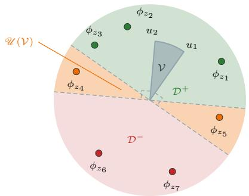
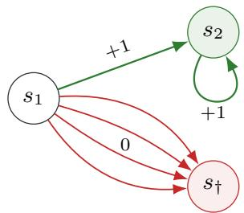
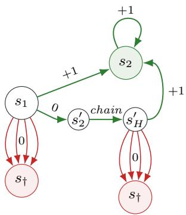
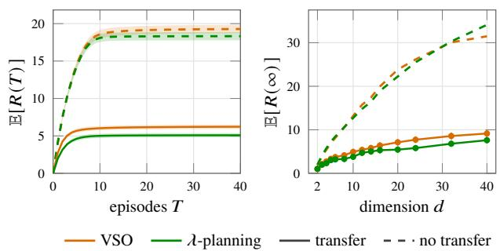
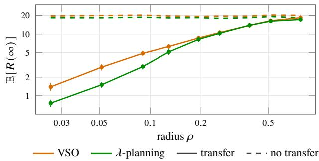
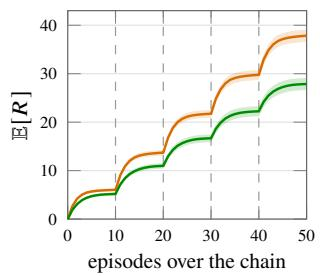
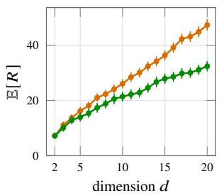
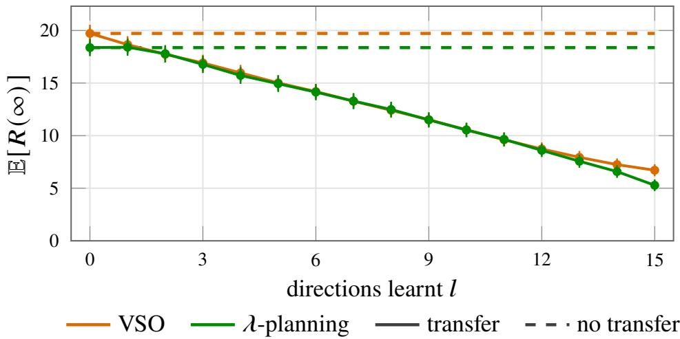

# Confessions of a Masked MDP

Sebastian Reboul   
SAMOVAR, T´el´ecom SudParis,   
Institut Polytechnique de Paris Wiremind Cargo Lorenzo Croissant AI & ML Group   
Department of Engineering   
Universitat Pompeu Fabra

H´el\`ene Halconruy SAMOVAR, T´el´ecom SudParis, Institut Polytechnique de Paris Modal’X, Universit´e Paris-Nanterre

## Abstract

In reinforcement learning, one presumes the action set to be known ahead of time, and, thus, one must know if any state-action pairs are not permissible ahead of computations. In some applications, determining this action mask is the main computational bottleneck. Isolating this problem to highlight its core properties, we study how to combine the search for an optimal policy with the learning of the mask itself, under a linear MDP model in which each attempted action reveals the exact value of a linear score determining its validity. In this framework, we first construct an algorithm based on deterministic optimistic optimization and show that it is minimax optimal, which we show is also computationally eficient. However, it is sub-optimal on non-degenerate instances, as we show. We propose an alternative, which is also computationally eficient, which plans its exploration strategy. This algorithm admits a formal interpretation as an analogue of information-directed-sampling for deterministic feedback, which may be of independent interest. Finally, we study an application of this framework to transfer learning, where the invalid action set changes over time.

## 1 INTRODUCTION

Reinforcement learning, the interactive learning of control systems and games (Tesauro, 1995; Sutton and Barto, 2018), and in particular its formalisation using Markov Decision Processes (MDPs) (Puterman, 1994), has been an undeniably successful field of research in the last thirty years. Applications span far and wide, from datacenter cooling (Gao et al., 2014), to autonomous driving (Shalev-Shwartz et al., 2016), through advertising (Cai et al., 2017) and conversational AI training (Li et al., 2016).

In the MDP formalisation, the set of available actions is typically assumed to be independent of the state of the system. In the classical theory (Bellman, 1957), this assumption is a convenience and varying actions can be accommodated at the cost of some burdensome notation (see, e.g., Puterman, 1994, Ch. 6).

In computation, however, ever since RL methods have shifted to GPU-accelerated computation (Mnih et al., 2015), varying actions have become nefarious spoilers. Indeed, GPU-acceleration of, e.g., Value Iteration, relies on the ability to broadcast operations over the entire state-action space. The solution, early adopted by practitioners, is to use a boolean invalid action mask to zero-out the rewards (and/or transitions) corresponding to invalid actions. Hadamard multiplication by the mask preserves the tensor structure, and is accelerated. Remarkably, there has been some theoretical work showing that masking preserves the convergence of Policy Gradient (Huang and Ontanon, 2020).

This state of afairs is acceptable in many applications. However, in some cases, computing the mask is itself the computational bottleneck. For instance, in civil engineering applications, each action corresponds to a refinement of the current design (state), and determining whether it satisfies the project’s design constraints may require extensive simulations. Precomputing all possible designs in order to check their feasibility for a building is, quite evidently, a prohibitively expensive approach to architecture.

When pre-computation of the mask is impossible, the current approach is to penalise invalid actions through reward shaping Ng et al. (1999), which is a form of Lagrangian relaxation. However, when it comes to learning, this approach is fundamentally flawed: it treats the deterministic signal of permissibility and the stochastic reward signal homogeneously, a dilution which explains the terrible performance of these as learning methods.

One would expect the literature on constrained MDPs to have addressed this problem somehow. Yet, both classical (Altman, 1999) and more recent (Achiam et al., 2017; Amani et al., 2021) work focuses on expected costs, with the aim of controlling violations. In our setting, due to determinism of signals, there is no reason to repeat a known violation. The closest work to ours is, thus, that of Wei et al. (2023), whose instantaneous hard constraints are in the same spirit, but whose regret bounds are dominated by the minimax analysis and stochasticity of the rewards in the interior of the constraints, which prevents the identification of optimal exploration strategies.

At the end of the day, we are left to face an MDP with masked actions, a masked MDP, if you will, with the problem of how to eficiently explore it to identify the mask. Motivated by the computational cost of the mask itself, we focus on 0-noise feedback, analogous to membership-query and realizable-classification settings (Angluin, 1988; Littlestone, 1988). We will show, with Theorem 2.3, that this is suficient to achieve op timal regret if one must also learn the MDP dynamics and/or rewards. While the mask confesses its values freely, the problem of reaching the information eficiently through the MDP dynamics remains.

In the remainder of this section, we detail the setting explicitly, and formally introduce the problem of mask learning. Thereafter, in Section 2, we establish a minimax-optimal algorithm based on Optimism in the Face of Uncertainty (OFU), and argue that this is not a good benchmark for this problem. In Section 3, we thus study finer, instance-dependent bounds, and introduce an algorithm which improves the exploration of OFU on non-degenerate instances, and connect it to the information-directed sampling (IDS) algorithm of Russo and Van Roy (2014), also identifying an auxiliary MDP formulation, \`a la Hao and Lattimore (2022). Finally, in Section 4, we discuss an example application to transfer learning of masks in MDPs, motivated by an industrial application.

## 1.1 Setting

As a basis, let $\mathcal { M } : = ( S , \mathcal { A } , P , r , H )$ be a finite-horizon MDP, with state space S, action space ${ \mathcal { A } } ,$ , transition kernel $P : \mathcal { S } \times \mathcal { A } \times \mathcal { S }  [ 0 , 1 ]$ , with $\begin{array} { r l } { } & { { } \sum _ { s ^ { \prime } \in \mathcal { S } } P ( s , a , s ^ { \prime } ) = } \end{array}$ 1, reward $r : \mathcal { S } \times \mathcal { A }  [ 0 , 1 ] .$ , and horizon $H \in \mathbb { N } .$

We will adopt the formalism of linear MDPs (without loss of generality as it subsumes tabular MDPs). Thus, we assume that there exists a known feature map $\phi :$ $S \times \mathcal { A }  \mathbb { R } ^ { d } , d \in \mathbb { N }$ , such that, for all $( s , a ) \in S \times { \mathcal { A } } ,$

$$
r ( s , a ) = \phi ( s , a ) ^ { \top } \theta _ { r }
$$

for some parameter $\theta _ { r } \in \mathbb { R } ^ { d } .$ . Moreover, we assume that the transition kernel is linear in the features, i.e. there is parameter-valued function $\theta _ { P } : S  \mathbb { R } ^ { d }$ over

S such that

$$
P ( s , a , s ^ { \prime } ) = \phi ( s , a ) ^ { \top } \theta _ { P } ( s ^ { \prime } )
$$

for all $( s , a , s ^ { \prime } ) \in \mathcal { S } \times \mathcal { A } \times \mathcal { S } .$

From M, we can define a family of masked MDPs, indexed by the masks $m \in 2 ^ { S \times A }$ , viewed either as function from $S \times \mathcal { A }  \{ 0 , 1 \}$ or a {0, 1}-valued matrix in $\mathbb { R } ^ { S \times A }$ . The masked MDP $\mathcal { M } _ { m } : = ( S , \mathcal { A } , P , r , H , m )$ is defined on the augmented state space ${ \cal S } \cup \{ s _ { \dagger } \}$ , where $s _ { \dagger }$ denotes an absorbing cemetery state. Its reward function is given for $( s , a ) \in S \times \mathcal { A }$ by

$$
r _ { m } ( s , a ) = m ( s , a ) r ( s , a ) ,
$$

with $r _ { m } ( s _ { \dagger } ) : = 0 .$ . For $( s , a , s ^ { \prime } ) \in \mathcal { S } \times \mathcal { A } \times \mathcal { S }$ , the transition kernel of $\mathcal { M } _ { m }$ is defined by

$$
P _ { m } ( s , a , s ^ { \prime } ) = m ( s , a ) P ( s , a , s ^ { \prime } ) ,
$$

with the remaining probability mass assigned to the cemetery state:

$$
P _ { m } ( s , a , s _ { \dagger } ) : = 1 - \sum _ { s ^ { \prime } \in \mathcal { S } } m ( s , a ) P ( s , a , s ^ { \prime } ) .
$$

Finally, since $^ { s _ { \dagger } }$ is absorbing, $P _ { m } ( s _ { \dagger } , \cdot , s _ { \dagger } ) = 1$

Note that a masked linear MDP remains a linear MDP, up to increasing the dimensions by 1. Indeed the new feature map $\tilde { \phi } : S \cup \{ s _ { \dagger } \} \times \mathcal { A } \stackrel { \sim } { \to } \mathbb { R } ^ { d + 1 }$ is defined as $\widetilde { \phi } ( s , a ) = \big ( m ( s , a ) \phi ( s , a ) , 1 - m ( s , a ) \big ) \in \mathbb { R } ^ { d + 1 }$ . Thus, in order to ease exposition and maintain consistent algebraic tools, we will also represent the mask linearly using the embedding ϕ, i.e. we assume that there is $u _ { \star } \in \mathbb { R } ^ { d }$ such that

$$
m ( s , a ) = \operatorname { s g n } ( \phi ( s , a ) ^ { \top } u _ { \star } ) \quad { \mathrm { f o r ~ a l l ~ } } ( s , a ) \in { \mathcal { S } } \times { \mathcal { A } } .
$$

When clear from context, we drop subscripts of m.

In a (masked) MDP, given any $\textit { h } \in \ [ H ]$ and $\pi :$ $[ H ] \times { \mathcal { S } }  { \mathcal { A } }$ let $( \mathop { S _ { h } ^ { t , s , \pi } } ) _ { h = t } ^ { H }$ be the Markov chain induced by $\pi \in \Pi _ { M }$ (Markov policies) and P starting from $\begin{array} { r } { \dot { S } _ { t } ^ { t , s , \pi } = s . } \end{array}$ It is well known that there is a cumulated-reward-maximising policy of this form, and we can solve the control problem by limiting ourselves to maximising, over $\pi \in \Pi _ { M }$ , the value functions $J _ { \pi }$ defined for $( t , s ) \in [ H ] \times S$ by

$$
J _ { \pi } ( t , s ) : = \mathbb { E } \left[ \sum _ { h = t } ^ { H } r \big ( S _ { h } ^ { t , s , \pi } , \pi _ { h } ( S _ { h } ^ { t , s , \pi } ) \big ) \right] .
$$

Moreover, we will denote the value function

$$
V : ( t , s ) \in [ H ] \times \mathcal { S } \mapsto V ( t , s ) : = \operatorname* { s u p } _ { \pi } J _ { \pi } ( t , s ) ,
$$

where the supremum is taken over all Markov timedependent policies π. When necessary to clarify a mask on the MDP, we will add superscripts to $J , V$ or S to indicate the mask, $e . g . , J ^ { m } , V ^ { m }$ , and $S ^ { m , \pi }$ When considering an initial distribution ϱ over states, we will use the shorthand $\begin{array} { r } { V ( h , \underline { { \varrho } } ) : = \int V ( h , s ) \varrho ( \mathrm { d } s ) } \end{array}$ and likewise for J.

## 2 MINIMAX MASK LEARNING

On the masked MDP, we can consider three main learning problems: the mask, the dynamics, and the combination of both. In this section, we draw a general picture of the mask learning problem with broad strokes, focusing on minimax-optimality.

## 2.1 Learning problems on masked MDPs

Clearly, if the mask is known but the dynamics must be learnt, the problem is statistically indistinguishable from a classical RL problem (Jin et al., 2020). By comparison, we will focus on the other two problems where the mask is unknown, due to the absence of its precomputation, and an agent observes only sequences of state-action-reward-mask quadruples. Meanwhile, the learning problem of the dynamics is naturally formulated as an episodic online RL problem (Jin et al., 2020), wherein visiting a state-action pair $( s , a )$ reveals a noisy signal of the reward and a sampled transition from $P ( s , a , \cdot )$ . Notice that, due to the presence of a cemetery state, one must consider an episodic setting, rather than a non-episodic one.

Let $u ^ { \star }$ denote the unknown true parameter of the mask’s linear form. Letting A be a learning algorithm which produces a sequence of action trajectories $\{ ( A _ { k , h } ) _ { h = 1 } ^ { H } \} _ { k \in \mathbb { N } }$ by playing policies $( \pi _ { k } ) _ { k \in \mathbb { N } }$ , we measure its performance by its cumulative pseudo-regret, which, after $K \in \mathbb N$ episodes, is defined as

$$
\mathcal { R } _ { K } ( \mathcal { A } ) : = \sum _ { k = 1 } ^ { K } \operatorname* { s u p } _ { \pi } J _ { \pi } ( 1 , \varrho ) - J _ { \pi _ { k } } ( 1 , \varrho ) .
$$

We continue, in Section 2.2, by the construction of a minimax-optimal optimistic algorithm. Then, in Section 2.3, we show that any such algorithm is a suficient building block for learning transitions and rewards if necessary. This will complete the picture of these three learning problems.

## 2.2 Minimax Regret bounds

Naturally, one would begin a study of learning masks in a masked MDP by studying minimax-optimal regret. However, as Theorem 2.1 will show, this paradigm is a poor benchmark for understanding the moving pieces of the problem. Indeed, due to the linear embedding, the number of mistakes that can be made by any reasonable<sup>1</sup> algorithm is determined by the feature map in a tight manner.

In order to keep track of available information about the mask, we will use a version space (as in, $e . g .$ Angluin, 1988) which contains all system hypotheses consistent with observed values of the mask. Let $\mathcal { D } \subset \mathcal { S } \times \mathcal { A }$ be a collection of state-action pairs $( s _ { i } , a _ { i } )$ 2 $i \in [ n ]$ , and define $y \in \mathbb { R } ^ { n }$ by $y _ { i } : = \langle \phi ( s _ { i } , a _ { i } ) | u ^ { \star } \rangle$ . The version space compatible with $\mathcal { D }$ is

$$
\mathcal { V } ( \mathcal { D } ) = \mathcal { C } _ { 0 } \cap \left\{ u \in \mathbb { R } ^ { d } : \Phi _ { \mathcal { D } } u = y \right\}
$$

wherein $\Phi _ { \mathcal { D } } = ( \phi ( s _ { i } , a _ { i } ) ^ { \top } ) _ { i = 1 } ^ { n }$ , and $\mathcal { C } _ { 0 } ~ \subset ~ \mathbb { R } ^ { d }$ is an a priori feasible set, say the unit ball. More broadly, we call $\nu \subset \mathbb { R } ^ { d }$ a version space if there is a set $\mathcal { D } \subset \mathcal { S } \times \mathcal { A }$ such that $\nu = \nu ( \mathcal { D } )$

Whenever the learner plays $( s , a ) \in \mathcal S \times \mathcal A$ , it observes the exact score $y _ { i } = \phi ( s , a ) ^ { \top } u ^ { \star }$ , (whether the action is valid or not), and thus $m ( s , a )$ , as well as the reward and next state of $\mathcal { M } _ { m }$ (the next state being $^ { s _ { \dagger } }$ if the action is invalid). This noiseless feedback model is an extension of the deterministic bandit problems (Munos, 2011).

Given a version space V, the linear structure of the mask partitions the state-action space into three sets: the certified valid pairs,

$$
{ \mathcal { D } } ^ { + } ( \mathcal { V } ) : = \big \{ ( s , a ) \in \mathcal { S } \times \mathcal { A } : \operatorname* { i n f } _ { u \in \mathcal { V } } { \phi ( s , a ) ^ { \top } u > 0 } \big \} ,
$$

the certified invalid pairs,

$$
{ \mathcal { D } } ^ { - } ( \mathcal { V } ) : = \big \{ ( s , a ) \in \mathcal { S } \times \mathcal { A } : \operatorname* { s u p } _ { u \in \mathcal { V } } { \phi ( s , a ) } ^ { \top } u < 0 \big \} ,
$$

and the remaining uncertified pairs,

$$
\mathcal { U } ( \mathcal { V } ) : = ( \mathcal { S } \times \mathcal { A } ) \setminus \big ( \mathcal { D } ^ { + } ( \mathcal { V } ) \cup \mathcal { D } ^ { - } ( \mathcal { V } ) \big ) .
$$

In other words, a pair $( s , a )$ is uncertified whenever the range of $\theta \in \mathcal { V } \mapsto \langle \phi ( s , a ) , \theta \rangle$ includes zero.

As the learner plays, it generates a non-decreasing sequence of sets $( \mathcal { D } _ { t } ) _ { t \geq 1 }$ by interacting with the environment, whose parameter $u ^ { \star }$ lies in the intersection of the non-increasing sequence $( \gamma _ { t } ) _ { t \geq 1 }$ , where $\mathcal { V } _ { t } : = \mathcal { V } ( \mathcal { D } _ { t } )$

Given $\mathcal { D } , \mathcal { V } ( \mathcal { D } )$ is defined by linear equalities (up to intersection with $\mathcal { C } _ { 0 } )$ , so that sampling a new pair $( s , a )$ cannot afect the version space unless $\phi ( s , a )$ is linearly independent of D. This implies that the number of mistakes made by a reasonable algorithm (that never plays in $\mathcal { D } ^ { - } ( \nu _ { t } ) )$ is at most

$$
\dim \phi ( { \mathcal { U } } ( \mathcal { V } _ { 0 } ) ) \leq d \leq | S | | A | .
$$

  
Figure 1: Visualisation of $\nu$ and $( \mathcal { D } ^ { + } , \mathcal { D } ^ { - } , \mathcal { U } )$

This quantity will be the central focus of our exploration analysis, however, it should be noted features linearly dependent on $\phi ( \gamma _ { t } )$ can still identify the validity of other pairs (for instance $\phi _ { z _ { 4 } }$ and $\phi _ { z _ { 5 } }$ in Section 2.2), which we will use to improve exploration.

Theorem 2.1. Let $\mathcal { C } _ { 0 } = B _ { 2 } ( 0 , 1 )$ be the Euclidean ball. For every $d \geq 2$ and every $H \geq 1$ , there is a masked MDP with dim $\phi ( \mathcal { U } ( \mathcal { C } _ { 0 } ) ) = d$ on which any algorithm satisfies

$$
\operatorname* { s u p } _ { u ^ { \star } \in \mathcal { C } _ { 0 } } \mathbb { E } _ { u ^ { \star } } \left[ R ( T ) \right] \geq \frac { H } { 4 } \operatorname* { m i n } \{ T , d - 1 \} .
$$

Proof. Consider the masked MDP in Figure 2. We take the trivial feature map, so that $d = 2 \left| { \mathcal { A } } \right|$ . Under the best possible mask, all actions in $s _ { 1 } \mathrm { \ g o }$ to $s _ { 2 }$ with reward 1. Under the real mask, only one of the actions is valid in $s _ { 1 }$ . Any algorithm has no choice but to take actions at random in $s _ { 1 }$ until $s _ { 2 }$ is reached, which incurs regret H each time. The bound follows from expected number of trials, see Appendix B.4. □

  
Figure 2: The MDP in the proof of Theorem 2.1.

In an unmasked MDP, optimistic algorithms ofer a simple-to-analyse class of minimax-optimal algorithms (Auer and Ortner, 2006; Jaksch et al., 2010; Azar et al., 2017). We now introduce their analogue in the masked setting, which we call version-space optimism (VSO). Since the mask is observed noiselessly, VSO is more closely related to the work of Munos (2011) than to these standard RL algorithms. It maintains all mask models still compatible with the observations and acts according to the most optimistic one, thereby exploit ing only constraints that have already been ruled out by the data. Note that this algorithm is computationally feasible, since the space of masks to search is at most d-dimensional and the MDPs are linear. It is also possible to implement it using Extended Value Iteration (Jaksch et al., 2010), see Appendix D.

```latex
Algorithm 1 Version-space optimism (VSO)
1: Input: initial version space $\begin{array} { r } { \overline { { \mathcal { V } _ { 1 } : = \mathcal { C } _ { 0 } } } , } \end{array}$ initial law
$\varrho .$
2: for $t = 1 , 2 , \dots { }$ . do
3: Set $\pi _ { t } \in$ argmax<sub>π ΠM</sub> max<sub>m t</sub> J<sup>m</sup><sub>π</sub> (1, ϱ).
4: Play $\pi _ { t }$ for the episode, collect $( Z _ { h } ) _ { h \in [ H ] } : =$
$( S _ { h } ^ { \pi _ { t } } , \pi _ { t , h } ( S _ { h } ^ { \pi _ { t } } ) ) _ { h = 1 } ^ { H } .$
5: $\mathcal { D } _ { t }  \mathcal { D } _ { t - 1 } \overset { \cdot \cdot } { \cup } \{ ( Z _ { h } ) _ { h = 1 } ^ { H } \}$ , and $\mathcal { V } _ { t + 1 }  \mathcal { V } ( \mathcal { D } _ { t } )$
6: end for
```

Proposition 2.2. Let $\mathcal { C } _ { 0 } = B _ { 2 } ( 0 , 1 )$ be the Euclidean ball. For any $( H , T , \phi )$ , the version-space optimism algorithm (Algorithm 1) satisfies

$$
\operatorname* { s u p } _ { u ^ { \star } \in \mathcal { C } _ { 0 } } \mathbb { E } _ { u ^ { \star } } \left[ R ( T ) \right] \ \leq \ \operatorname* { m i n } \left\{ T , \dim \phi ( { \mathcal { U } } ( { \mathcal { C } } _ { 0 } ) ) \right\} H .
$$

Proof. $\mathrm { B y }$ optimism over the version space, either episodes are free $( \pi _ { t }$ coincides with the optimal policy of the true mask) or they land on an element of $\mathcal { U } ( \nu _ { t } )$ which resolves a direction of $\mathcal { U } ( \mathcal { C } _ { 0 } )$ . Since there are at most dim $\phi \big ( \mathcal { U } ( \mathcal { C } _ { 0 } ) \big )$ directions to resolve, the claim follows. □

Theorem 2.1 and Proposition 2.2 together show that the minimax regret rate for the problem is no diferent from the rate one would get if one could query each state-action pair directly. In this sense, it is of very limited interest, and the heart of the problem lies in understanding how to leverage the dynamics of the MDP to query the version space at minimal regret.

## 2.3 Separation theorem

Theorem 2.3 will now argue that mask learning can be separated from the problem of learning the dynamics and rewards of the underlying linear MDP, which motivates our choice to study the mask learning problem in isolation. Suppose we have an optimistic learning algorithm $\mathcal { A }$ for linear MDPs that is capable of achieving, over T episodes, a high-probability regret bound of $B _ { \mathrm { l i n } } ( T , H , \delta )$ on an MDP with horizon H. We denote the trajectory of $\mathcal { A }$ in episode t by $( S _ { h } ^ { \mathcal { A } , t } , A _ { h } ^ { \mathcal { A } , t } ) _ { h = 1 } ^ { H }$ and denote by $( B _ { h } ^ { \mathcal { A } , t } ) _ { h = 1 } ^ { H }$ corresponding step regret upper bounds (see, e.g., Azar et al., 2017).

Theorem 2.3. Consider a reasonable algorithm that is jointly optimistic in the mask and the linear MDP.

Let $p _ { t }$ be the probability, conditional on the information available before episode $t ,$ that an action is attempted that is invalid under the true mask. If the analysis of A holds under the joint interaction<sup>2</sup>, with

$$
\mathbb { P } \bigg ( \sum _ { t = 1 } ^ { T } \beta _ { t } \le B _ { \mathrm { l i n } } ( T , H , \delta / 2 ) \bigg ) \ge 1 - \delta / 2 .
$$

Then

$$
\begin{array} { l } { \displaystyle \mathcal { R } ( T ) \leq B _ { \mathrm { l i n } } ( T , H , \delta / 2 ) } \\ { \displaystyle + H \left( \operatorname* { m i n } \{ T , r _ { 0 } \} + \sqrt { \frac { T } { 2 } \log \frac { 2 } { \delta } } \right) } \end{array}
$$

with probability at least $1 \ - \ \delta ,$ wherein $r _ { 0 } : = { }$ dim $\phi \big ( \mathcal { U } ( \mathcal { C } _ { 0 } ) \big )$ . A high-probability bonus bound for the learner on an unmasked MDP alone does not imply the joint-interaction assumption above.

We defer the proof to Appendix B.5. Let us sketch it briefly. On episodes with no exploration we use the existing bounds of $\mathcal { A } .$ , trajectorially. On exploratory episodes, we use the usual regret decomposition

$$
\Delta _ { t } \leq \beta _ { t } + H p _ { t } , \qquad \beta _ { t } : = \mathbb { E } \left[ \sum _ { h < \tau _ { t } \lor H } B _ { h } ^ { \mathcal { A } , t } \Bigg | \mathcal { F } _ { t } \right] ,
$$

where $\Delta _ { t }$ is episode t’s conditional pseudo-regret and $\tau _ { t }$ is its first invalid-action time.

We bound the resulting accumulation of exploration using a martingale argument between samples and $p _ { t } ,$ then show decrease of the dimensionality potential

$$
\Psi _ { { \mathcal C } _ { 0 } } ( \mathcal V ) : = \dim \phi \bigl ( \mathcal U ( { \mathcal C } _ { 0 } ) \bigr ) - \dim \bigl ( \phi \bigl ( \mathcal U ( { \mathcal C } _ { 0 } ) \bigr ) \cap U ^ { + } ( \mathcal V ) \bigr ) ,
$$

where $U ^ { + } ( \mathcal { V } ) : = \{ x \in \mathbb { R } ^ { d } : \forall ( u _ { 1 } , u _ { 2 } ) \in \mathcal { V } ^ { 2 } , u _ { 1 } ^ { \top } x =$ $u _ { 2 } ^ { \top } x \}$ is the subspace whose value is known on $\nu .$

As a consequence of Theorems 2.1 and 2.3, it would appear that the problem is trivially solved. Instead, it is more accurate to observe that minimax analysis is not the correct lens to analyse the problem, which, indeed, is not statistical. Rather, the core of the problem, and the next section, lies in how to adapt exploration to the interaction of the dynamics with the feature-space of each instance.

## 3 PLANNED EXPLORATION

To understand the shortcomings of VSO on nonpathological instances, let us introduce one which is intuitively cheap to explore, but where optimistic algorithms fail. This instance (see Figure 3) is an extension of Figure 2. Of the |A| actions, only one, say $a _ { \star }$ leads to $s _ { 2 } ,$ as before. But now, instead of all other actions being invalid (masked), some proportion $\delta \in ( 0 , 1 )$ of them leads (with 0 reward) to a chain<sup>3</sup> $( s _ { i } ^ { \prime } ) _ { i = 2 } ^ { H }$ of states which transition to each other with reward 1. In the final state of the chain, $s _ { H } ^ { \prime } , a _ { \star }$ yields reward 1, and all other actions 0, and we take any feature map satisfying

$$
\phi ( s _ { 1 } , a _ { i } ) = \phi ( s _ { H } ^ { \prime } , v _ { i } ) ,
$$

for all $i \in [ d ] , d = \mathcal { O } ( | \mathcal { A } | )$ . Thus, the rewards obtainable are: $0 ,$ if the first action is invalid, $H - 2$ if one takes $a \neq a _ { \star }$ at the end of the chain, $H - 1$ if one takes $a _ { \star }$ instead, and finally H if one takes a<sub>⋆</sub> from the start.

On this instance, any algorithm must still begin by sampling doors at random. However, VSO believes that all untried actions lead to $s _ { 2 }$ directly, so they have value H while the chain always has value $H { - } 1$ at most. Thus, VSO never takes the chain, incurring a regret of order $\mathcal { O } ( H ( d - 1 ) ( 1 - \delta ) / 2 )$ as before. Since a chain can be found (on average) in ${ \mathcal O } ( ( 1 - \delta ) H )$ tries, and then any further exploration costs at most $\mathcal O ( \delta K )$ , hence it is possible to move from a multiplicative dependence in $( H , d )$ to an additive one.

  
Figure 3: The second example MDP.

This type of exploration problem is fundamental in control problems, and has been documented in the literature of MDPs (see, for instance, the forthcoming work of Boone et al., 2026). In order to address it, we introduce a planning-based algorithm which can be readily interpreted as an analogue of the information-directed sampling (IDS) algorithm of Russo and Van Roy (2014, see also Hao and Lattimore, 2022). Let us first introduce the algorithm, and then we will compare it to both VSO and IDS.

In order to determine which are the best exploratory paths through the masked MDP, let us start by specifying a generic version space $\nu ,$ and consider a set of target state-action pairs $\mathcal { U } ( \mathcal { V } ) \subseteq \mathcal { T }$ . Given any (non-stationary, randomised) policy π, let $\tau _ { \pi }$ be the first time that the trajectory $( S _ { h } ^ { \pi } , \pi _ { h } ( S _ { h } ^ { \pi } ) ) _ { h = 1 } ^ { H }$ generated by π reaches a state-action pair in $\mathcal { T }$

Consider the family of auxiliary MDPs $( \mathcal { M } _ { \lambda } ) _ { \lambda \geq 0 }$ with the same dynamics and rewards as the original MDP, except that actions are limited to ${ \mathcal { T } } \cup { \mathcal { D } } ^ { + } ( \nu )$ except that episodes terminate early if $\mathcal { T }$ is reached, yielding a fixed reward of λ. The value functional of this MDP is readily seen to be

$$
\begin{array} { r } { J _ { \mathcal { V } , \cdot } ^ { \lambda , \mathcal { T } } : ( \pi , t , s ) \mapsto \mathbb { E } \bigg [ \displaystyle \sum _ { h = t } ^ { ( \tau _ { \pi } - 1 ) \wedge H } r ( S _ { h } ^ { \pi } , \pi _ { h } ( S _ { h } ^ { \pi } ) ) } \\ { + \lambda \mathbf { 1 } \{ \tau _ { \pi } \leq H \} \mid S _ { t } ^ { \pi } = s \bigg ] . } \end{array}\tag{1}
$$

Via this auxiliary MDP, it is straightforward to obtain a dynamic programming representation of $J _ { \nu _ { \mathrm { , } } \cdot } ^ { \lambda , \mathcal { T } } , \ \mathrm { o r } ,$ in fact, of the associated value function $V _ { \mathcal { V } } ^ { \lambda , \mathcal { T } } ( h , s ) : =$ sup<sub>π</sub> $J _ { \nu , \pi } ^ { \lambda , \mathcal { T } } ( h , s )$ , which is given by Proposition 3.1.

Proposition 3.1. The optimal value functions $V _ { \mathcal { V } } ^ { \lambda , \mathcal { T } }$ satisfy the following family, indexed by $\lambda ~ \geq ~ 0$ and $\mathcal { U } ( \mathcal { V } ) \subseteq \mathcal { T }$ , of dynamic programming equations

$$
\begin{array} { r l r } & { } & { V _ { \mathcal { V } } ^ { \lambda , \mathcal { T } } ( h , s ) = \lambda \mathbf { 1 } _ { \left\{ \exists a : ( s , a ) \in \mathcal { T } \right\} } \vee \underset { a \in \mathcal { D } ^ { + } ( \mathcal { V } _ { t } ) } { \operatorname* { m a x } } \left\{ r ( s , a ) \right. } \\ & { } & { \left. + \int V _ { \mathcal { V } } ^ { \lambda , \mathcal { T } } ( h + 1 , s ^ { \prime } ) P ( \mathrm { d } s ^ { \prime } | s , a ) \right\} } \end{array}\tag{2}
$$

with terminal conditions $V _ { \mathcal { V } } ^ { \lambda , \mathcal { T } } ( H + 1 , \cdot ) \equiv 0$ . Moreover, a pointwise maximiser of the right-hand side of (2) (understood as taking $a \in \mathcal { T }$ if the λ-term is dominant) is an optimal policy for the auxiliary $M D P \mathcal { M } _ { \lambda }$

The dynamic programming (Bellman) equation (2) might appear highly irregular, and it is indeed uncommon in reinforcement learning. It is the standard form for a mixed control and stopping (a.k.a. freeboundary) problem, a well-studied class of stochastic control problems in the mathematical finance literature see, e.g., Pham (2009). Compare also pure stopping problems with a dynamic programming equation, such as prophet problems (Hill and Kertz, 1992).

In any case, for finite-dimensional MDPs, resolution of this equation is numerically straightforward, and we can thus use this solution to compute an optimal policy which explores through the shaped reward of (1), which targets at each step $\mathcal { T } _ { t } : = \mathcal { U } ( \mathcal { V } _ { t } ) . ^ { 4 }$

Regret analysis of Algorithm 2, see Proposition 3.2, bounds the regret of λ-planning in terms of the clearing price for a version space V and a target $\mathcal { T } .$ , that is

$$
\mathring { \lambda } _ { \mathcal { V } } ( \mathcal { T } ) : = \operatorname* { m i n } \left\{ \lambda \ge 0 : V _ { \mathcal { V } } ^ { \lambda , \mathcal { T } } ( 1 , \varrho ) \ge \operatorname* { m a x } _ { m \in \mathcal { V } } V ^ { m } ( 1 , \varrho ) \right\}
$$

Algorithm 2 λ-planning   
1: Input: initial version space $\begin{array} { r } { \mathcal { V } _ { 1 } : = \mathcal { C } _ { 0 } . } \end{array}$ , initial law   
$\varrho .$   
2: for $t = 1 , 2 , \dots$ . do   
3: $\overset { \circ } { \lambda } _ { t } = \overset { \circ } { \lambda } _ { \mathcal { V } _ { t } } ( \mathcal { U } ( \mathcal { V } _ { t } ) )$   
4: Compute $\pi _ { t } \in$ argmax<sub>π</sub> $J _ { \nu _ { t } , \pi } ^ { \mathring { \lambda } _ { t } , \mathcal { U } ( \mathcal { V } _ { t } ) } ( \varrho )$   
5: Play $\pi _ { t }$ for the episode, collect $( Z _ { h } ) _ { h \in [ H ] } : =$   
$( S _ { h } ^ { \pi _ { t } } , \pi _ { t , h } ( S _ { h } ^ { \pi _ { t } } ) ) _ { h = 1 } ^ { H } .$   
6: Update $\mathcal { D } _ { t }  \stackrel {  } { \mathcal { D } } _ { t - 1 } \cup \{ ( Z _ { h } ) _ { h = 1 } ^ { H } \}$ , and $\nu _ { t + 1 } \gets$   
$\mathcal { V } ( \mathcal { D } _ { t } )$   
7: end for

(recall that $\varrho$ is the initial state distribution).

Proposition 3.2. For any $u \in \mathcal { C } _ { 0 } $ , and any $T \geq 1$ the λ-planning algorithm (Algorithm 2) satisfies

$$
\mathbb { E } _ { u } \big [ R ( T ) \big ] \ \leq \mathbb { E } _ { u } \left[ \sum _ { t = 1 } ^ { T } \mathring { \lambda } _ { t } ( \Psi _ { t } - \Psi _ { t + 1 } ) \right]
$$

wherein $\Psi _ { t } : = \Psi \mathcal { C } _ { 0 } \left( \mathcal { V } _ { t } \right)$

We defer the proof to Section B.3 for brevity. The high-level argument mirrors the proof of Proposition 2.2, and no regret except that we can keep track of the regret of exploration episodes through <sup>˚</sup>λ rather than upper-bounding by H e.g. when $\overset { \circ } \lambda = 0$ we have $\begin{array} { r } { V _ { \mathcal { V } } ^ { 0 , \mathcal { T } } ( \bar { 1 } , \bar { \varrho } ) = \operatorname* { s u p } _ { m \in \mathcal { V } } V ^ { m } ( 1 , \varrho ) } \end{array}$ despite exploration.

Now, let us turn to the interpretation of Algorithm 2 as a form of Information-Directed Sampling (IDS). Let us recall the initial set-up of IDS in stochastic bandits and reinforcement learning. Given a filtration $\mathcal { F } _ { t }$ of information available before episode $t ,$ and an unknown parameter u with a given prior, IDS rests on the computation of the mutual information between the history of observations in episodes up to t, $\mathcal { H } _ { t } ,$ and a target unknown variable $\chi$ (for us, u<sup>⋆</sup>). Accounting explicitly for the policy π that generates the observations, we define

$$
\mathcal { T } _ { t } ^ { \pi } ( \chi , \mathcal { H } ) { : = } \mathrm { D } _ { \mathrm { K L } } \left( \mathbb { P } _ { t } ^ { \pi } ( ( \chi , \mathcal { H } ) \in \cdot ) \| \mathbb { P } _ { t } ^ { \pi } ( \chi \in \cdot ) \otimes \mathbb { P } _ { t } ^ { \pi } ( \mathcal { H } \in \cdot ) \right) .
$$

Here, $\mathbb { P } _ { t } ^ { \pi }$ denotes the probability measure induced by policy π and initial distribution ϱ, conditional on the observed history $\mathcal { H } _ { t - 1 }$ . The random variable H is any history-valued variable whose restriction up to episode t − 1 coincides with the observed history. IDS plays the policy

$$
\pi _ { t } \in \mathop { \mathrm { a r g m i n } } _ { \pi } \frac { \mathbb { E } [ ( V ^ { u ^ { * } } ( 1 , \varrho ) - J _ { \pi } ^ { u ^ { * } } ( 1 , \varrho ) ) ^ { 2 } | \mathcal { H } _ { t - 1 } ] } { \mathcal { T } _ { t } ^ { \pi } ( u ^ { \star } , \mathcal { H } ) }
$$

which minimises a (quasi-)regret-to-information ratio.

In MDPs, Hao and Lattimore (2022) introduced an alternate formulation, where the policy is chosen ac-

cording to the penalised objective

$$
\pi _ { t } \in \underset { \pi } { \mathrm { a r g m a x } } \mathbb { E } [ J _ { \pi } ^ { u ^ { * } } ( 1 , \varrho ) | \mathcal { H } _ { t - 1 } ] + \lambda \mathcal { T } _ { t } ^ { \pi } ( u ^ { \star } , \mathcal { H } ) ,\tag{3}
$$

which can be recast as an auxiliary MDP with a suit ably shaped reward; see Proposition 4.8 therein.

In this formulation, the structural correspondence between (3) and (1) is immediately apparent. In our case, due to the absence of noise in the dynamics (uncertainty is only in the mask), information theory tools and Bayesian methods wither away and leave behind the likelihood of hitting a masked parameter, for which the best proxy is the entry probability into $\mathcal { T }$ . With this interpretation in mind, we can rewrite $\overset { \vartriangle } { \lambda } _ { \mathcal { V } } ( \mathcal { T } )$ in terms of a ratio, using Lemma 3.3.

Lemma 3.3. For any $\nu \subseteq { \mathcal { C } } _ { 0 }$ and $\mathcal { U } ( \mathcal { V } ) \subseteq \mathcal { T }$ such as $V _ { \mathcal { V } } ^ { 0 , \mathcal { T } } ( 1 , \varrho ) < \mathrm { s u p } _ { m \in \mathcal { V } } V ^ { m } ( 1 , \varrho )$ the clearing price satisfies

$$
\begin{array} { r } { \displaystyle \operatorname* { s u p } _ { { \hat { \lambda } } \nu ( \mathcal { T } ) = \operatorname* { i n f } _ { \pi } } \frac { \displaystyle \operatorname* { s u p } _ { m \in \mathcal { V } } V ^ { m } ( 1 , \varrho ) - \mathbb { E } \left[ \sum _ { h = 1 } ^ { \tau _ { \pi } - 1 } r ( S _ { h } ^ { \pi } , \pi _ { h } ( S _ { h } ^ { \pi } ) ) \right] } { \mathbb { P } _ { \mathcal { V } } ( \tau _ { \pi } < H ) } . } \end{array}\tag{4}
$$

Let us briefly show that the ratio introduced in Lemma 3.3 serves as a computable proxy for the “regret-to-information” ratio underlying IDS. The numerator in (4) is an upper bound on the regret of $\pi ,$ since

$$
V ^ { u ^ { \star } } ( 1 , \varrho ) \leq \operatorname* { s u p } _ { m \in \mathcal { V } } V ^ { m } ( 1 , \varrho )
$$

and

$$
\mathbb { E } \left[ \sum _ { h = 1 } ^ { \tau _ { \pi } } r ( S _ { h } ^ { \pi } , \pi _ { h } ( S _ { h } ^ { \pi } ) ) \right] \leq \mathbb { E } \left[ \sum _ { h = 1 } ^ { H } r ( S _ { h } ^ { \pi } , \pi _ { h } ( S _ { h } ^ { \pi } ) ) \right] ,
$$

which can be computed under $\nu _ { t } .$ . Similarly, the denominator is a computable lower bound on the expected number of resolved dimensions, since $\tau _ { \pi } \leq H$ and, a.s., $\mathbf { 1 } \{ \tau _ { \pi } \leq H \} \leq \Psi _ { \mathcal { C } _ { 0 } } ( \mathcal { V } _ { t } ) - \Psi _ { \mathcal { C } _ { 0 } } ( \mathcal { V } _ { t + 1 } )$ . This quantity is used at analysis time in Proposition 3.2.

## 4 APPLICATION TO TRANSFER LEARNING

In RL, beyond single tasks, the literature has increasingly aimed to improve computational eficiency by learning multiple instances at once or sequentially. The former has generally been studied in zero-shot RL Touati et al. (2022), while the latter falls under transfer learning. Given a learnt source and unlearnt target task, transfer aims to leverage shared structures to improve learning, see Pan and Yang (2009) for a broad survey. In RL, the common method is to pre-train representations of environments on large datasets, and then fine-tune them on small-data target tasks (Yosinski et al., 2014). There have been a number of proposed representations: learnt policies (Fern´andez and Veloso, 2006), value functions (Taylor and Stone, 2007), latent state features (Parisotto et al., 2015), successor features (Barreto et al., 2017, 2018), samples (Lazaric et al., 2008), or models of the environment (Sun et al., 2021). In all cases, the dificulty lies not only in transferring the correct information, but also in how to spread learning cost between source and target.

Applied to masked MDPs, we seek to transfer infor mation about two masks for the same linear MDP. The medium of transfer we propose is to choose the set $\mathcal { C } _ { 0 }$ of VSO and λ-planning from information obtained about a prior mask in three experimental frameworks. Throughout, the base MDP always has 10 states, 5 actions (one of which aborts the MDP independently of the mask), $\varrho = \delta _ { s _ { 1 } }$ , and horizon 10. The transfer procedure is repeated for 1000 random MDPs and masks, all figures report averaging on these samples. At each random trial, independently for each pair (s, a), we draw three coordinates of $\phi ( s , a )$ uniformly, and draw values for them according to a Dirichlet(1, 1, 1) distribution, setting the rest to 0. The function $\theta : \mathcal { S }  \mathbb { R } ^ { d }$ is 0 everywhere except at two uniformly drawn states, with respective weights w and $1 - w$ , for w ∼ Unif[0, 1]. Meanwhile, the reward parameter $\theta _ { r }$ is drawn uniformly in $[ 0 , 1 ] ^ { d }$ and the source mask is drawn uniformly at random on the unit disk in the hyperplane orthogonal to the vector of ones.<sup>5</sup> We take this disk as $\mathcal { C } _ { 0 }$ in what follows. Our three experiments difer in the sampling process of the target mask with respect to the source $\mathbf { \bar { \rho } } _ { u } ( 1 )$ which is sampled uniformly in $\mathcal { C } _ { 0 }$ . All transfer version spaces will be intersected with $\mathcal { C } _ { 0 }$ to bring the parameter back into the hyperplane. Let ⊕ denote the Minkowski sum: A ⊕ $B = \{ a + b : a \in A , \ b \in B \}$

## 4.1 Single-step transfer

In our first setting, the source mask $u ^ { ( 1 ) }$ is assumed to be known, and the target mask $u ^ { ( 2 ) }$ to lie within distance $\rho$ of it. We therefore initialize the target algorithm from the restricted version space

$$
\mathcal { C } _ { 0 } ^ { \mathrm { t } } : = \mathcal { C } _ { 0 } \cap \big \{ u : \| u - u ^ { ( 1 ) } \| _ { 2 } \leq \rho \big \} .
$$

To assess the benefit of this prior information, we compare each algorithm initialized from $\mathcal { C } _ { 0 } ^ { \mathrm { t } }$ with the same algorithm run on the same target task from the full version space $\mathcal { C } _ { 0 }$

  
Figure 4: Single-step transfer. Left: expected regret against the number of episodes, $d = 1 6 , \rho =$ 0.13. Right: total regret against $d \leq 4 0$ , with $\rho =$ $0 . 5 / \sqrt { d - 1 }$ . Solid: started from $\mathcal { C } _ { 0 } ^ { \mathrm { t . } }$ dashed: no transfer, started from $\mathcal { C } _ { 0 }$

Without transfer (dashed lines), the two algorithms are close, λ-planning performing slightly better as d grows. With transfer, both perform much better, and λ-planning is ahead of VSO at every dimension but the smallest, showing the (on average) lower regret of λ-planning. Moreover, Figure 5 shows that transfer reduces regret and strengthens the advantage of λ-planning when the transferred version space is tight (small ρ). This is consistent with λ-planning exploiting certified actions to acquire information at lower regret. As $\rho$ increases, fewer actions are certified initially and this advantage fades.

  
Figure 5: Single-step transfer: total regret against the transfer radius $\rho , d = 1 6$ , log-log axes. Solid: started from $\mathcal { C } _ { 0 } ^ { \mathrm { t . } }$ dashed: no transfer, started from $\mathcal { C } _ { 0 }$

## 4.2 Multiple-step transfer

Building on the previous setting, we consider a sequence of $K + 1$ tasks with mask parameters $\{ u ^ { ( k ) } \} _ { k = 0 } ^ { K } ,$ sampled from a uniform source $u ^ { ( 0 ) } \in \mathcal { C } _ { 0 }$ then sequentially uniformly in the ball $\boldsymbol { B } ( \boldsymbol { u } ^ { ( k - 1 ) } , \rho )$ . We repeat the transfer along the chain by taking the version spaces are as follows: Task 1 starts from $\mathsf { \bar { \mathcal { C } } } _ { 0 } \cap B ( u ^ { ( 0 ) } , \rho )$ , and task $k + 1$ from $( \mathcal { V } _ { k } \oplus B ( 0 , \rho ) ) \cap \mathcal { C } _ { 0 }$ , where $\nu _ { k }$ is the version space transferred from task k. This yields a sequential transfer scheme with a set-valued warm start, in the spirit of procedures that leverage information from a previous optimization problem to facilitate the next one (Ash and Adams, 2020). Each task is thus solved within a region informed by the preceding task, rather than from the full parameter space.



  
VSO �-planning  
Figure 6: Multiple-step transfer, $K = 5$ tasks of 10 episodes. Left: regret accumulated over the chain, $d = 1 6 ;$ dashed vertical lines mark the task switches. Right: total regret over the K tasks against d.

Figure 6 shows that λ-planning retains its edge over time. Its lead per task stacks across tasks, so that the gap accumulates along the chain (left), and it widens with the dimension (right). The compounding aspect of this procedure shows that λ-planning can turn a slight advantage in learning in each transfer task into substantial gains in sequential transfer settings.

We present further experiments on partial-learning of transferable information in Appendix C.

## 5 CONCLUSION

In this work, we study masked MDPs with unknown action validity and exact linear score feedback. Our separation result gives conditions under which masklearning costs enter additively when rewards and transitions are also unknown. Version-space optimism achieves minimax-optimal regret, however, minimax optimality can conceal substantial diferences in the cost of acquiring information.

To exploit these diferences, we introduced λ-planning, which plans exploration through an auxiliary planning problem. Its clearing price yields an instance dependent regret bound and connects the method to information-directed sampling for deterministic feedback. Transfer experiments illustrate how version spaces preserve useful information across changing masks and how planned exploration can produce gains that accumulate across tasks.

## AI use statement

In this work, we used generative AI tools for several tasks: review or verification of content, and generation of code or proof drafts from formal arguments. We have not used generative AI tools for theoretical or conceptual development, mathematical claims or proofs (beyond formalisation and edition), while method implementation, translation, dataset cleaning or reformatting, qualitative analysis, and interpretation of results are not applicable to this work. Ad ditionally, we used generative AI tools for literature discovery, editing text, creating figures and code. All AI-assisted work was checked line by line by the authors. We take responsibility for the final content of this work, including text, claims, or artifacts produced with the aid of generative AI.

## Acknowledgements

The work of H´el\`ene Halconruy was supported by the French National Research Agency (ANR) under grant ANR-24-CE40-3341 (project DECATTLON) and benefited from Hi! PARIS and State funding managed by the ANR under the France 2030 program (reference ANR-23-IACL-0005).

## REFERENCES

Joshua Achiam, David Held, Aviv Tamar, and Pieter Abbeel. Constrained policy optimization. In Proceedings of the 34th International Conference on Machine Learning, pages 22–32. PMLR, 2017.

Eitan Altman. Constrained Markov Decision Processes. Chapman and Hall/CRC, 1999.

Sanae Amani, Christos Thrampoulidis, and Lin Yang. Safe Reinforcement Learning with Linear Function Approximation. In Proceedings of the 38th International Conference on Machine Learning, pages 243– 253. PMLR, July 2021.

Dana Angluin. Queries and concept learning. Machine Learning, 2(4):319–342, 1988.

Jordan Ash and Ryan P Adams. On warm-starting neural network training. Advances in neural information processing systems, 33:3884–3894, 2020.

Peter Auer and Ronald Ortner. Logarithmic online regret bounds for undiscounted reinforcement learning. Advances in neural information processing systems, 19, 2006.

Mohammad Gheshlaghi Azar, Ian Osband, and R´emi Munos. Minimax regret bounds for reinforcement learning. In Doina Precup and Yee Whye Teh, editors, Proceedings of the 34th International Conference on Machine Learning, pages 263–272. PMLR, 06–11 Aug 2017.

Andr´e Barreto, Will Dabney, R´emi Munos, Jonathan J Hunt, Tom Schaul, Hado Van Hasselt, and David Silver. Successor features for transfer in reinforcement learning. Advances in neural information processing systems, 30, 2017.

Andre Barreto, Diana Borsa, John Quan, Tom Schaul, David Silver, Matteo Hessel, Daniel Mankowitz, Augustin Zidek, and Remi Munos. Transfer in deep reinforcement learning using successor features and generalised policy improvement. In International conference on machine learning, pages 501– 510. PMLR, 2018.

Richard Bellman. Dynamic Programming. Princeton University Press, 1957.

Victor Boone, Cyrille Kone, Waris Radji, Odalric-Ambrym Maillard, and Dorian Baudry. Towards instance-dependent regret optimality in episodic MDPs with posterior sampling. In Advances in Neural Information Processing Systems, volume 39, 2026. to appear.

Qing Cai et al. Deep reinforcement learning for sponsored search real-time bidding. In Proceedings of the 23rd ACM SIGKDD International Conference on Knowledge Discovery and Data Mining, 2017.

Fernando Fern´andez and Manuela Veloso. Probabilistic policy reuse in a reinforcement learning agent. In Proceedings of the fifth international joint conference on Autonomous agents and multiagent systems, pages 720–727, 2006.

Jian-Jia Gao et al. Machine learning applications for data center optimization. Google Technical Report, 2014.

Botao Hao and Tor Lattimore. Regret bounds for information-directed reinforcement learning. In Advances in Neural Information Processing Systems, volume 35, 2022.

Theodore P Hill and Robert P Kertz. A survey of prophet inequalities in optimal stopping theory. Contemporary Mathematics, 125(1):191, 1992.

Shengyi Huang and Santiago Ontanon. A closer look at invalid action masking in policy gradient algorithms. arXiv preprint arXiv:2006.14171, 2020.

Thomas Jaksch, Ronald Ortner, and Peter Auer. Near-optimal regret bounds for reinforcement learning. Journal of Machine Learning Research, 11(51): 1563–1600, 2010.

Chi Jin, Zhuoran Yang, Zhaoran Wang, and Michael I. Jordan. Provably eficient reinforcement learning with linear function approximation. In Conference on Learning Theory, pages 2137–2143, 2020.

Alessandro Lazaric, Marcello Restelli, and Andrea Bonarini. Transfer of samples in batch reinforce-

ment learning. In Proceedings of the 25th international conference on Machine learning, pages 544– 551, 2008.

Jiweil Li et al. Deep reinforcement learning for dialogue generation. arXiv preprint arXiv:1606.01541, 2016.

Nick Littlestone. Learning quickly when irrelevant attributes abound: A new linear-threshold algorithm. Machine Learning, 2(4):285–318, 1988.

Volodymyr Mnih et al. Human-level control through deep reinforcement learning. Nature, 518:529–533, 2015.

R´emi Munos. Optimistic optimization of a deterministic function without the knowledge of its smoothness. Advances in Neural Information Processing Systems, 24, 2011.

Andrew Y Ng, Daishi Harada, and Stuart Russell. Policy invariance under reward transformations: Theory and application to reward shaping. In Proceedings of the Sixteenth International Conference on Machine Learning, pages 278–287, 1999.

Sinno Jialin Pan and Qiang Yang. A survey on transfer learning. IEEE Transactions on knowledge and data engineering, 22(10):1345–1359, 2009.

Emilio Parisotto, Jimmy Lei Ba, and Ruslan Salakhutdinov. Actor-mimic: Deep multitask and transfer reinforcement learning. arXiv preprint arXiv:1511.06342, 2015.

Huyˆen Pham. Continuous-time Stochastic Control and Optimization with Financial Applications, volume 61 of Stochastic Modelling and Applied Probability. Springer, Berlin, 2009.

Martin L. Puterman. Markov Decision Processes: Discrete Stochastic Dynamic Programming. Wiley, 1994.

Daniel Russo and Benjamin Van Roy. Learning to optimize via information-directed sampling. In Advances in Neural Information Processing Systems, volume 27, 2014.

Shai Shalev-Shwartz, Shaked Shammah, and Amnon Shashua. Safe, multi-agent, reinforcement learning for autonomous driving. In arXiv preprint arXiv:1610.03295, 2016.

Yuewen Sun, Kun Zhang, and Changyin Sun. Modelbased transfer reinforcement learning based on graphical model representations. IEEE Transactions on Neural Networks and Learning Systems, 34(2): 1035–1048, 2021.

Richard S. Sutton and Andrew G. Barto. Reinforcement Learning: An Introduction. MIT Press, 2 edition, 2018.

Matthew E Taylor and Peter Stone. Cross-domain transfer for reinforcement learning. In Proceedings of the 24th international conference on Machine learning, pages 879–886, 2007.

Gerald Tesauro. Temporal diference learning and TD-Gammon. Communications of the ACM, 38(3):58– 68, 1995.

Ahmed Touati, J´er´emy Rapin, and Yann Ollivier. Does zero-shot reinforcement learning exist? arXiv preprint arXiv:2209.14935, 2022.

Honghao Wei, Xin Liu, and Lei Ying. Safe Reinforcement Learning with Instantaneous Constraints: The Role of Aggressive Exploration, December 2023. arXiv:2312.14470.

Jason Yosinski, Jef Clune, Yoshua Bengio, and Hod Lipson. How transferable are features in deep neural networks? Advances in neural information processing systems, 27, 2014.

## APPENDIX

The appendix is organised as follows. Section A collects the notation used throughout the paper. Section B first introduces the quantities used to track the information gathered on the mask parameter, then provides the proofs of our results: Section B.1 establishes the dynamic programming representation for the auxiliary MDP problem (Proposition 3.1), Section B.2 derives the clearing-price characterisation (Lemma 3.3), Section B.3 proves the regret bound of λ-planning (Proposition 3.2), Section B.4 proves the lower bound for mask learning (Theorem 2.1), and Section B.5 proves the separation result (Theorem 2.3). Section C experiments with transfer from a partially learnt source task. Finally, Section D presents action optimism, an alternative to version-space optimism, and links it to extended value iteration.

## A NOTATIONS

Table 1 lists the notation of the paper, grouped by topic. A subscript t denotes the value of a quantity at episode t.

Table 1: Notations used in the paper.
<table><tr><td>Symbol</td><td>Meaning</td></tr><tr><td colspan="2">MDP and masks</td></tr><tr><td> $\mathcal { M } = ( \mathcal { S } , \mathcal { A } , P , r , H )$ </td><td>finite-horizon MDP</td></tr><tr><td> $h \in [ \dot { H } ] , [ n ]$ </td><td>step;  $\{ 1 , \ldots , n \}$ </td></tr><tr><td> $\varrho , s _ { 1 }$ </td><td>initial law; initial state</td></tr><tr><td> $\bar { \phi } ( s , a ) \in \mathbb { R } ^ { d } , d$ </td><td>feature map; dimension</td></tr><tr><td> $\dot { \theta _ { r } } \in \dot { \mathbb R } ^ { d } , \theta _ { P } : \mathcal S  \mathbb R ^ { d }$ </td><td>reward and transition parameters</td></tr><tr><td> $m \in 2 ^ { S \times A }$ </td><td>mask</td></tr><tr><td> $\mathcal { M } _ { m } , r _ { m } , P _ { m }$ </td><td>masked MDP, reward, transitions</td></tr><tr><td> $^ { s } _ { - } \dag$ </td><td>cemetery state</td></tr><tr><td> $\bar { \phi }$ </td><td>masked feature map</td></tr><tr><td> $\dot { u } ^ { \star } \left( \mathrm { a l s o } \theta _ { m } \right)$ </td><td>true mask parameter</td></tr><tr><td> $u$ </td><td>mask parameter</td></tr><tr><td colspan="2">Policies, values and regret</td></tr><tr><td> $\pi = ( \pi _ { h } ) _ { h \in [ H ] } , \Pi ^ { \mathrm { M } }$ </td><td>policy; Markov policies</td></tr><tr><td> $S _ { h } ^ { \pi } , \dot { Z } _ { h }$ </td><td>state at step  $h ;$  pair played at step h</td></tr><tr><td> $J _ { \pi } , V$ </td><td>value of  $\pi ;$  optimal value</td></tr><tr><td> $t , k ; T , K$ </td><td>episode; number of episodes</td></tr><tr><td> $\mathcal { R } _ { K } ( \mathcal { A } ) , \ : R ( T )$ </td><td>cumulative pseudo-regret</td></tr><tr><td> $\mathbb { E } _ { u } , \mathbb { P } _ { u }$ </td><td>expectation, probability under u</td></tr><tr><td> $\mathcal { F } _ { t }$ </td><td>information before episode t</td></tr><tr><td colspan="2">Version spaces</td></tr><tr><td> $\mathcal { C } _ { \mathrm { 0 } }$ </td><td>prior set of mask parameters</td></tr><tr><td> $\tilde { B _ { 2 } } ( 0 , 1 ) , B ( c , r )$ </td><td>unit ball; ball of centre  $^ { c , }$  radius r</td></tr><tr><td> $\mathcal { D } , \mathcal { D } _ { t }$ </td><td>observed pairs</td></tr><tr><td> $\Phi _ { \mathcal { D } } , { \boldsymbol { y } }$ </td><td>features of  $\mathcal { D } ;$  revealed values</td></tr><tr><td> $\mathcal { V } ( \tilde { \mathcal { D } } ) , \mathcal { V } _ { t }$ </td><td>version space</td></tr><tr><td> $z , \phi _ { z }$ </td><td>pair; its feature</td></tr><tr><td> $\mathring { \mathcal { D } } ^ { + } ( \mathcal { V } ) , \mathcal { D } ^ { - } ( \mathcal { V } )$ </td><td>certified valid, certified invalid pairs</td></tr><tr><td> $\mathcal { U } ( \dot { \nu } )$ </td><td>uncertified pairs</td></tr><tr><td> $\phi ( { \dot { A } } ) { \dot { } } ,$  dim φ(u (V))</td><td>features of  $A ;$  dimension of their span</td></tr><tr><td> $\dot { U } ^ { + } ( \dot { \nu } )$ </td><td>directions known on  $\nu$ </td></tr><tr><td> $\Psi c _ { 0 } ( \dot { \mathcal { V } } ) , \Psi _ { t }$ </td><td>potential</td></tr><tr><td> $\mathcal { T } ( \dot { \mathcal { V } } )$ </td><td>informative pairs</td></tr><tr><td> $\Gamma _ { t }$ </td><td>dim  $\phi ( \mathcal { U } ( \mathbf { \hat { \nu } } ) )$ </td></tr><tr><td colspan="2">Algorithms</td></tr><tr><td> $\mathcal { T }$ </td><td>target set</td></tr><tr><td> $\tau _ { \pi }$ </td><td>first time  $\mathcal { T }$  is reached </td></tr><tr><td> $\mathcal { M } _ { \lambda }$ </td><td>auxiliary MDP</td></tr><tr><td> $J _ { \nu , \pi } ^ { \lambda , \mathcal { T } } , V _ { \nu } ^ { \lambda , \mathcal { T } }$ </td><td>value of π; optimal value in  $\mathcal { M } _ { \lambda }$ </td></tr><tr><td> $\mathring { \lambda } _ { \mathcal { V } } ( \mathcal { T } ) , \mathring { \lambda } _ { t }$ </td><td>clearing price</td></tr><tr><td></td><td></td></tr><tr><td colspan="2">Table 1 (continued)</td></tr><tr><td>Symbol</td><td>Meaning</td></tr><tr><td> $\mathcal { A } , B _ { \mathrm { l i n } } ( T , H , \delta ) , B _ { h } ^ { \mathcal { A } , t }$ </td><td>linear-MDP learner; its regret bound; step bounds</td></tr><tr><td> $\mathcal { H } _ { t } , \mathcal { T } _ { t } ^ { \pi } ( \dot { \chi } , \mathcal { H } )$ </td><td>history; mutual information</td></tr><tr><td>Transfer experiments</td><td></td></tr><tr><td>ρ</td><td>transfer radius</td></tr><tr><td> $\mathcal { C } _ { 0 } ^ { \mathrm { t } }$ </td><td>transfer prior</td></tr><tr><td> $u ^ { \mathrm { ( k ) } } , K , T _ { s }$ </td><td>chain of masks; number of tasks; episodes per task</td></tr><tr><td> $A \oplus B$ </td><td>Minkowski sum</td></tr></table>

## B PROOFS

Let us first introduce the quantities used to track information about the mask parameter. The subspace

$$
U ^ { + } ( \mathcal { V } ) : = \{ \theta \in \mathbb { R } ^ { d } : u \mapsto \theta ^ { \top } u \mathrm { { \ : i s \ c o n s t a n t \ : o n \ : } } \mathcal { V } \} ,
$$

contains the directions whose scalar values are completely determined by the current version space. The potential

$$
\Psi _ { { \mathcal C } _ { 0 } } ( \mathcal V ) : = \dim \phi \bigl ( \mathcal U ( { \mathcal C } _ { 0 } ) \bigr ) - \dim \bigl ( \phi \bigl ( \mathcal U ( { \mathcal C } _ { 0 } ) \bigr ) \cap U ^ { + } ( \mathcal V ) \bigr ) .
$$

counts the remaining unknown directions (when in V) in the span of the initially uncertified $( \mathrm { i n } ~ \mathcal { C } _ { 0 } )$ features, while

$$
\mathcal { Z } ( \mathcal { V } ) : = \left\{ z : \phi _ { z } \in U ^ { + } ( \mathcal { V } ) + \phi ( \mathcal { U } ( \mathcal { V } ) ) , \ \phi _ { z } \not \in U ^ { + } ( \mathcal { V } ) \right\} \supseteq \mathcal { U } ( \mathcal { V } ) .
$$

identifies exactly the pairs that resolve at least one such direction. This construction allows us to relate visits to $\mathcal { T } ( \nu )$ to decreases in $\Psi _ { C _ { 0 } } ( \nu )$

These quantities distinguish knowledge of an action’s validity from knowledge of its underlying scalar value: an already certified action may still provide useful scalar information, such as certifying further actions for example if $\phi _ { z _ { 3 } } ^ { \top } u ^ { \star } > \| \phi _ { z _ { 3 } } - \phi _ { z _ { 4 } } \|$ in Figure 2.2.

Throughout, $\nu _ { t }$ is the knowledge state entering episode t, $\Psi _ { t } : = \Psi \mathcal { C } _ { 0 } \left( \mathcal { V } _ { t } \right)$ , and $u ^ { \star } \in \mathcal { C } _ { 0 }$ the truth.

## B.1 Proof of Proposition 3.1

The auxiliary MDP is the planning tool underlying λ-planning. Proposition 3.1 provides the dynamic programming representation needed to compute its optimal policy for a fixed exploration reward.

Proposition 3.1. The optimal value functions $V _ { \nu } ^ { \lambda , \mathcal { T } }$ satisfy the following family, indexed by $\lambda \geq 0$ and $\mathcal { U } ( \nu ) \subseteq$ $\mathcal { T }$ , of dynamic programming equations

$$
\begin{array} { r l r } & { } & { V _ { \mathcal { V } } ^ { \lambda , \mathcal { T } } ( h , s ) = \lambda \mathbf { 1 } _ { \left\{ \exists a : ( s , a ) \in \mathcal { T } \right\} } \vee \underset { a \in \mathcal { D } ^ { + } ( \mathcal { V } _ { t } ) } { \operatorname* { m a x } } \left\{ r ( s , a ) \right. } \\ & { } & { \left. + \int V _ { \mathcal { V } } ^ { \lambda , \mathcal { T } } ( h + 1 , s ^ { \prime } ) P ( \mathrm { d } s ^ { \prime } | s , a ) \right\} } \end{array}\tag{2}
$$

with terminal conditions $V _ { \nu } ^ { \lambda , \mathcal { T } } ( H + 1 , \cdot ) \equiv 0$ . Moreover, a pointwise maximiser of the right-hand side of (2) (understood as taking $a \in \dot { \mathcal { T } } i f$ the λ-term is dominant) is an optimal policy for the auxiliary $M D P \mathcal { M } _ { \lambda }$

Proof of Proposition 3.1. The following recursion in

$$
V _ { \mathcal { V } } ^ { \lambda , \mathcal { T } } ( h , s ) = \lambda \mathbf { 1 } _ { \left\{ \exists a : ( s , a ) \in \mathcal { T } \right\} } \vee \operatorname* { m a x } _ { a \in \mathcal { D } ^ { + } ( \mathcal { V } _ { t } ) } \left\{ r ( s , a ) + \int V _ { \mathcal { V } } ^ { \lambda , \mathcal { T } } ( h + 1 , s ^ { \prime } ) P ( \mathrm { d } s ^ { \prime } | s , a ) \right\} ,
$$

is exactly the value-iteration scheme for a finite-horizon MDP with known dynamics, in which each state retains its certified actions, together with their rewards and transitions, with the possibility of absorption into the terminal state with reward $\lambda$ whenever an action of $\mathcal { T }$ is present.

A policy of this auxiliary MDP has a stopping time $\tau _ { \pi }$ at which it takes its first action absorbing action, with $\tau _ { \pi } = \infty$ if no contact is made. Its expected cumulative reward is the reward collected before $\tau _ { \pi } .$ , plus λ on the event $\tau \leq H$ , namely

$$
J _ { \mathcal { V } , \cdot } ^ { \lambda , \mathcal { T } } ( \pi , t , s ) = \mathbb { E } \bigg [ \sum _ { h = t } ^ { ( \tau _ { \pi } - 1 ) \wedge H } r ( S _ { h } ^ { \pi } , \pi _ { h } ( S _ { h } ^ { \pi } ) ) + \lambda \mathbf { 1 } \{ \tau _ { \pi } \leq H \} \mid S _ { t } ^ { \pi } = s \bigg ] .
$$

□

## B.2 Proof of Lemma 3.3

Here we prove the view of the clearing price that is the basis for the comparison with information-directed sampling.

Lemma 3.3. For any $\nu \subseteq \mathcal { C } _ { 0 }$ and $\mathcal { U } ( \mathcal { V } ) \subseteq \mathcal { T }$ such as $\begin{array} { r } { V _ { \mathcal { V } } ^ { 0 , \mathcal { T } } ( 1 , \varrho ) < \operatorname* { s u p } _ { m \in \mathcal { V } } V ^ { m } ( 1 , \varrho ) } \end{array}$ the clearing price satisfies

$$
\begin{array} { r } { \displaystyle \operatorname* { s u p } _ { { \hat { \lambda } } \nu ( \mathcal { T } ) = \operatorname* { i n f } _ { \pi } } \frac { \displaystyle \operatorname* { s u p } _ { m \in \mathcal { V } } V ^ { m } ( 1 , \varrho ) - \mathbb { E } \left[ \sum _ { h = 1 } ^ { \tau _ { \pi } - 1 } r ( S _ { h } ^ { \pi } , \pi _ { h } ( S _ { h } ^ { \pi } ) ) \right] } { \mathbb { P } _ { \mathcal { V } } ( \tau _ { \pi } < H ) } . } \end{array}\tag{4}
$$

Proof of Lemma 3.3. Let $\mathcal { T }$ be a set state-action pairs containing $\mathcal { U } ( \nu )$ , denote the function $f : \lambda \mapsto V _ { \nu } ^ { \lambda , \mathcal { T } } ( 1 , \varrho )$ For a policy π, note its stopping time be $\tau _ { \pi }$ at which it takes its first action in $\mathcal { T } .$ . Noting

$$
L = \operatorname* { i n f } _ { \pi } \frac { \operatorname* { s u p } _ { m \in \mathcal { V } } V ^ { m } ( 1 , \varrho ) - \mathbb { E } \left[ \sum _ { h = 1 } ^ { ( \tau _ { \pi } - 1 ) } r ( S _ { h } ^ { \pi } , \pi _ { h } ( S _ { h } ^ { \pi } ) ) \right] } { \mathbb { P } _ { \mathcal { V } } ( \tau _ { \pi } \leq H ) }
$$

Let us show that

$$
\{ \lambda \ge 0 : f ( \lambda ) \ge \operatorname* { s u p } _ { m \in \mathcal { V } } V ^ { m } ( 1 , \varrho ) \} = [ L , \infty ) ,
$$

Taking the minimum over λ will close the argument. By Proposition 3.1, f is a supremum over policys $\pi$ of the afine functions

$$
g _ { \pi } : \lambda \mapsto \lambda \mathbb { P } \left( \tau _ { \pi } \leq H \right) + \mathbb { E } \left[ \sum _ { h = 1 } ^ { \tau _ { \pi } - 1 } r ( S _ { h } ^ { \pi } , \pi _ { h } ( S _ { h } ^ { \pi } ) ) \right] ,
$$

whose slopes $\mathbb { P } \left( \tau _ { \pi } \leq H \right)$ are probabilities, hence lie in [0, 1]. Thus, for all $\lambda , \lambda ^ { \prime } \geq 0$ and every route $\pi ,$

$$
g _ { \pi } ( \lambda ) \leq g _ { \pi } ( \lambda ^ { \prime } ) + | \lambda - \lambda ^ { \prime } | \leq f ( \lambda ^ { \prime } ) + | \lambda - \lambda ^ { \prime } | .
$$

Taking the supremum over routes gives $f ( \lambda ) \leq f ( \lambda ^ { \prime } ) + | \lambda - \lambda ^ { \prime } |$ , where $f ( \lambda ^ { \prime } ) \leq H + \lambda ^ { \prime } < \infty$ . Exchanging λ and λ′ yields $| f ( \lambda ) - f ( \lambda ^ { \prime } ) | \leq | \lambda - \lambda ^ { \prime } |$ , so f is 1-Lipschitz, and in particular continuous.This will be used later. Suppose $f ( \lambda ) \geq \operatorname* { s u p } _ { m \in \mathcal { V } } V ^ { m } ( 1 , \varrho )$ . By the finite-horizon dynamic-programming recursion, the supremum is attained by some policy $\pi ^ { \lambda }$ such that

$$
f ( \lambda ) = g _ { \pi ^ { \lambda } } ( \lambda ) .
$$

Thus

$$
\lambda \mathbb { P } \left( \tau _ { \pi ^ { \lambda } } \leq H \right) \geq \operatorname* { s u p } _ { m \in \mathcal { V } } V ^ { m } ( 1 , \varrho ) - \mathbb { E } \left[ \sum _ { h = 1 } ^ { \tau _ { \pi ^ { \lambda } } - 1 } r ( S _ { h } ^ { \pi _ { h } ^ { \lambda } } , \pi _ { h } ^ { \lambda } ( S _ { h } ^ { \pi _ { h } ^ { \lambda } } ) ) \right] \geq \operatorname* { s u p } _ { m \in \mathcal { V } } V ^ { m } ( 1 , \varrho ) - f ( 0 ) > 0
$$

where the last inequality is in the lemmas assumptions. This shows $^ { \flat } ( \tau _ { \pi } \leq H ) > 0$ , thus

$$
\frac { \operatorname* { s u p } _ { m \in \mathcal { V } } V ^ { m } ( 1 , \varrho ) - \mathbb { E } \left[ \sum _ { h = 1 } ^ { \tau _ { \pi } \lambda ^ { - 1 } } r ( S _ { h } ^ { \pi _ { h } ^ { \lambda } } , \pi _ { h } ^ { \lambda } ( S _ { h } ^ { \pi _ { h } ^ { \lambda } } ) ) \right] } { \mathbb { P } \left( \tau _ { \pi ^ { \lambda } } \leq H \right) } \leq \lambda .
$$

Taking the infimum over both sides gives us $\lambda \geq L$

Conversely, let $\lambda > L$ . The infimum definition of L implies that there exists some route π such as

$$
\frac { \operatorname* { s u p } _ { m \in \mathcal { V } } V ^ { m } ( 1 , \varrho ) - \mathbb { E } \left[ \sum _ { h = 1 } ^ { \tau _ { \pi } - 1 } r ( S _ { h } ^ { \pi } , \pi _ { h } ( S _ { h } ^ { \pi } ) ) \right] } { \mathbb { P } _ { \mathcal { V } } ( \tau _ { \pi } < H ) } < \lambda .
$$

Rearranging and taking the supremum gives us $f ( \lambda ) > \operatorname* { s u p } _ { m \in \mathcal { V } } V ^ { m } ( 1 , \varrho )$ . By continuity of $f ,$ we also have $f ( L ) \geq \operatorname* { s u p } _ { m \in \mathcal { V } } V ^ { m } ( 1 , \varrho )$ which gives us the same large inequality the edge case of $\lambda = L$ □

## B.3 Proof of Proposition 3.2

We prove the main performance guarantee for λ-planning.

Proposition 3.2. For any $u \in \mathcal { C } _ { 0 }$ , and any $T \geq 1$ , the λ-planning algorithm (Algorithm 2) satisfies

$$
\mathbb { E } _ { u } \big [ R ( T ) \big ] \ \leq \mathbb { E } _ { u } \left[ \sum _ { t = 1 } ^ { T } \mathring { \lambda } _ { t } ( \Psi _ { t } - \Psi _ { t + 1 } ) \right]
$$

wherein $\Psi _ { t } : = \Psi \mathcal { C } _ { 0 } \left( \mathcal { V } _ { t } \right)$

Proof of Proposition 3.2. Fix $u \in \mathcal { C } _ { 0 }$ , and let $\mathcal { F } _ { t }$ denote the information available before episode t, including the choice of $\pi _ { t } .$ . Set

$$
\mathring { \lambda } _ { t } = \mathring { \lambda } _ { \mathcal { V } _ { t } } \big ( \mathcal { T } ( \mathcal { V } _ { t } ) \big ) \quad \mathrm { a n d } \quad \Psi _ { t } = \Psi _ { \mathcal { C } _ { 0 } } ( \mathcal { V } _ { t } ) ,
$$

where

$$
\Psi _ { { \mathcal C } _ { 0 } } ( \mathcal V ) : = \dim \phi \bigl ( \mathcal U ( { \mathcal C } _ { 0 } ) \bigr ) - \dim \bigl ( \phi \bigl ( \mathcal U ( { \mathcal C } _ { 0 } ) \bigr ) \cap U ^ { + } ( \mathcal V ) \bigr ) .
$$

and

Let $\tau _ { \pi _ { t } }$ be the first time that $\pi _ { t }$ reaches $\mathcal { T } ( \mathcal { V } _ { t } )$ , with $\tau _ { \pi _ { t } } = \infty$ if no such pair is reached during the episode. The reach probability is

$\mathbb { P } _ { u } ( \tau _ { \pi _ { t } } \leq H \mid \mathcal { F } _ { t } )$ . The fact that we condition on $\mathcal { F } _ { t }$ is because we are no longer considering any $\mathcal { U } ( \mathcal { V } ) \subseteq \mathcal { T }$ but the random variable $\mathcal { T } ( \mathcal { V } _ { t } )$ .

By definition of $\pi _ { t }$ we have

$$
J _ { \nu , \pi _ { t } } ^ { \mathring { \lambda } _ { t } , \mathcal { T } } ( h , s ) \ge \operatorname* { s u p } _ { m \in \mathcal { V } } V ^ { m } ( 1 , \varrho ) \ge V ^ { u } ( 1 , \varrho )
$$

In the proof of Lemma 3.3 we show that $\pi _ { t }$ is such that $\mathring { \lambda } _ { \mathcal { V } _ { t } } \left( \mathcal { T } ( \mathcal { V } _ { t } ) \right)$

$$
\begin{array} { r l } & { J _ { \mathcal { V } , \pi _ { t } } ^ { \bar { \lambda } _ { t } , \mathcal { T } } ( h , s ) = \mathring \lambda _ { t } \mathbb { P } _ { u } \left( \tau _ { \pi _ { t } } \leq H \mid \mathcal { F } _ { t } \right) + \mathbb { E } _ { u } \left[ \displaystyle \sum _ { h = 1 } ^ { \tau _ { \pi } - 1 } r ( S _ { h } ^ { \pi } , \pi _ { h } ( S _ { h } ^ { \pi } ) ) \mid \mathcal { F } _ { t } \right] } \\ & { \qquad \leq \mathring \lambda _ { t } \mathbb { P } _ { u } \left( \tau _ { \pi _ { t } } \leq H \mid \mathcal { F } _ { t } \right) + J _ { \pi _ { t } } ^ { u } ( 1 , \varrho ) } \end{array}
$$

thus

$$
\begin{array} { r l } & { V ^ { u } ( 1 , \varrho ) - J _ { \pi _ { t } } ^ { u } ( 1 , \varrho ) } \\ & { \qquad \leq \mathring { \lambda } _ { t } \mathbb { P } _ { u } ( \tau _ { \pi _ { t } } \leq H \mid \mathcal { F } _ { t } ) . } \end{array}\tag{5}
$$

As in the previous proof, consider the case where we are on a non zero-regret episodes, so its right-hand side is nonnegative.

It remains to relate the probability in (5) to the increment in $\Psi _ { t }$ and taking the expectation will yield the result. Since $\mathcal { V } _ { t + 1 } \subseteq \mathcal { V } _ { t }$

$$
U ^ { + } ( \mathcal { V } _ { t } ) \subseteq U ^ { + } ( \mathcal { V } _ { t + 1 } ) ,
$$

so $\Psi _ { t + 1 } \leq \Psi _ { t }$ on every sample path.

Recall

$$
\mathcal { Z } ( \mathcal { V } ) : = \left\{ z : \phi _ { z } \in U ^ { + } ( \mathcal { V } ) + \operatorname { s p a n } \phi ( \mathcal { U } ( \mathcal { V } ) ) , \ \phi _ { z } \not \in U ^ { + } ( \mathcal { V } ) \right\} \supseteq \mathcal { U } ( \mathcal { V } ) .
$$

On the event $\{ \tau _ { \pi _ { t } } \leq H \}$ , let z denote the first pair reached in $\mathcal { T } ( \mathcal { V } _ { t } )$ . Thus we can write

$$
\phi _ { z } = w + v , \qquad w \in U ^ { + } ( \mathcal { V } _ { t } ) ,
$$

$$
v \in \operatorname { s p a n } \phi ( \mathcal { U } ( \mathcal { V } _ { t } ) ) , \qquad v \notin U ^ { + } ( \mathcal { V } _ { t } ) .
$$

Because $\mathcal { V } _ { t } \subseteq \mathcal { C } _ { 0 }$ we have $\mathcal { U } ( \mathcal { V } _ { t } ) \subseteq \mathcal { U } ( \mathcal { C } _ { 0 } )$ , so $v \in \operatorname { s p a n } \phi ( \mathcal { U } ( \mathcal { C } _ { 0 } ) )$ . Playing z reveals $\phi _ { z } ^ { \top } u ,$ , hence $\phi _ { z } \in U ^ { + } ( \mathcal { V } _ { t + 1 } )$ Since w also belongs to this subspace,

$$
v = \phi _ { z } - w \in \mathrm { s p a n } \phi ( \mathcal { U } ( \mathcal { C } _ { 0 } ) ) \cap U ^ { + } ( \mathcal { V } _ { t + 1 } ) ,
$$

whereas v $\notin$ span $\phi ( { \mathcal { U } } ( { \mathcal { C } } _ { 0 } ) ) \cap U ^ { + } ( \mathcal { V } _ { t } )$ . Recall

$$
\Psi _ { { \mathcal C } _ { 0 } } ( \mathcal V ) : = \dim \phi \bigl ( \mathcal U ( { \mathcal C } _ { 0 } ) \bigr ) - \dim \bigl ( \phi \bigl ( \mathcal U ( { \mathcal C } _ { 0 } ) \bigr ) \cap U ^ { + } ( \mathcal V ) \bigr ) .
$$

The intersection in $\Psi _ { { \mathcal { C } } _ { 0 } }$ therefore gains at least one dimension. This proves

$$
\begin{array} { r } { \mathbf { 1 } \{ \tau _ { \pi _ { t } } \leq H \} \leq \Psi _ { t } - \Psi _ { t + 1 } . } \end{array}\tag{6}
$$

Taking conditional expectations in (6) and substituting into (5), we obtain

$$
\begin{array} { r l } & { V ^ { u } ( 1 , \varrho ) - J _ { \pi _ { t } } ^ { u } ( 1 , \varrho ) } \\ & { \qquad \leq \mathbb { E } _ { u } \left[ \mathring { \lambda } _ { t } ( \Psi _ { t } - \Psi _ { t + 1 } ) \Big | \mathcal { F } _ { t } \right] , } \end{array}
$$

where we used that $\mathring { \lambda } _ { t }$ is nonnegative and $\mathcal { F } _ { t } .$ -measurable. Finally, summing over episodes and applying the tower property gives

$$
\begin{array} { l } { \displaystyle \mathbb { E } _ { u } [ R ( T ) ] } \\ { = \sum _ { t = 1 } ^ { T } \mathbb { E } _ { u } \big [ V ^ { u } ( 1 , \varrho ) - J _ { \pi _ { t } } ^ { u } ( 1 , \varrho ) \big ] } \end{array}
$$

$$
\leq \mathbb { E } _ { u } \left[ \sum _ { t = 1 } ^ { T } \mathring { \lambda } _ { t } ( \Psi _ { t } - \Psi _ { t + 1 } ) \right] .
$$

Hence the result.

Remark B.1. Proposition 3.1 and Lemma 3.3 are proved for arbitrary target sets, the agent being allowed to stop at any pair of $\mathcal { U } ( \mathcal { V } _ { t } ) \subseteq \mathcal { T }$ , the same proof gives the same bound for any $\mathcal { F } _ { t }$ -measurable targets $\mathcal { U } ( \mathcal { V } _ { t } ) \subseteq$ $\mathcal { T } _ { t } \subseteq I ( \mathcal { V } _ { t } )$ , with prices $\overset { \circ } { \lambda } _ { \mathcal { V } _ { t } } ( \mathcal { T } _ { t } )$ . These prices are non-increasing in $\mathcal { T } _ { t } ,$ so $\mathcal { T } _ { t } = I ( \mathcal { V } _ { t } )$ yields the smallest ones.

## B.4 Proof of Theorem 2.1

Here we provide explicit construction of the MDP ofering the lower bound on the regret of any learning algorithm.

Theorem 2.1. Let $\mathcal { C } _ { 0 } = B _ { 2 } ( 0 , 1 )$ be the Euclidean ball. For every $d \geq 2$ and every $H \geq 1$ , there is a masked MDP with dim $\phi ( \mathcal { U } ( \mathcal { C } _ { 0 } ) ) = d$ on which any algorithm satisfies

$$
\operatorname* { s u p } _ { u ^ { \star } \in \mathcal { C } _ { 0 } } \mathbb { E } _ { u ^ { \star } } \big [ R ( T ) \big ] \geq \frac { H } { 4 } \operatorname* { m i n } \{ T , d - 1 \} .
$$

Proof of Theorem 2.1. Let $N : = d - 1 \geq 2$ , take the initial distribution $\rho = \delta _ { s _ { 1 } } .$ , and consider the masked MDP of Figure 2: $\mathcal { A } = \{ a _ { 1 } , \ldots , a _ { N } \}$ ; from $s _ { 1 }$ , every action leads deterministically to $s _ { 2 }$ with reward 1, and in $s _ { 2 }$ every action loops deterministically on $s _ { 2 }$ with reward 1.

Take

$$
\phi ( s _ { 1 } , a _ { j } ) = e _ { j } , \qquad \phi ( s _ { 2 } , a _ { j } ) = e _ { d } , \qquad j \in [ N ] .
$$

This is a linear MDP: for instance, one may take

$$
\theta _ { r } = \sum _ { i = 1 } ^ { d } e _ { i } , \qquad \theta _ { P } ( s _ { 2 } ) = \sum _ { i = 1 } ^ { d } e _ { i } , \qquad \theta _ { P } ( s ) = 0 \quad \mathrm { f o r } \ s \neq s _ { 2 } .
$$

Then

$$
r ( s , a ) = \phi ( s , a ) ^ { \top } \theta _ { r } = 1
$$

on both $s _ { 1 }$ and $s _ { 2 }$ , while

$$
P ( s , a , s _ { 2 } ) = \phi ( s , a ) ^ { \top } \theta _ { P } ( s _ { 2 } ) = 1 .
$$

Moreover, every pair is uncertified under $\mathcal { C } _ { 0 }$ , and

$$
\operatorname { s p a n } \bigl ( \phi ( \mathcal { U } ( \mathcal { C } _ { 0 } ) ) \bigr ) = \operatorname { s p a n } ( e _ { 1 } , \dots , e _ { d } ) ,
$$

so dim $\phi ( \mathcal { U } ( \mathcal { C } _ { 0 } ) ) = d .$

For $J \in [ N ]$ , let

$$
u ^ { ( J ) } : = \frac { 1 } { \sqrt d } \Big ( e _ { J } - \sum _ { j \in [ N ] \backslash \{ J \} } e _ { j } + e _ { d } \Big ) \in \mathcal { C } _ { 0 } ,
$$

under which $a _ { J }$ is the only valid action in $s _ { 1 }$ , while every action is valid in $s _ { 2 } .$ . Draw J uniformly in [N]. Every episode in which an invalid action is played in $s _ { 1 }$ incurs regret $H _ { ; }$ since the optimal value is H whereas the episode then moves to the cemetery state and collects no reward.

Playing $a _ { j }$ with $j \neq J$ reveals the score $- 1 / { \sqrt { d } } ,$ , independently of the value of $J ,$ and rewards and transitions are deterministic and known. Conditional on the internal randomisation of the algorithm, let $( k _ { 1 } , k _ { 2 } , \ldots )$ denote the sequence of actions selected in $s _ { 1 }$ along the counterfactual history in which every action tried so far is invalid. Since the feedback following any such failure is always the same, this sequence is independent of $J .$

If $J \not \in \{ k _ { 1 } , \ldots , k _ { t } \}$ , then the realised history coincides with this all-failures history through episode t, and episode t incurs regret H. Since J is uniform on [N] and $| \{ k _ { 1 } , \ldots , k _ { t } \} | \le t$

$$
\mathbb { P } \big ( J \notin \{ k _ { 1 } , \ldots , k _ { t } \} \big ) \ge \frac { N - t } { N } .
$$

Therefore,

$$
\begin{array} { l } { \displaystyle \mathbb { E } \big [ R ( T ) \big ] \geq H \sum _ { t = 1 } ^ { \operatorname* { m i n } \{ T , N \} } \frac { N - t } { N } } \\ { \displaystyle = H \frac { m ( 2 N - m - 1 ) } { 2 N } } \\ { \geq H \frac { m ( N - 1 ) } { 2 N } } \\ { \geq \frac { H m } { 4 } , } \end{array}
$$

where $m : = \operatorname* { m i n } \{ T , N \} \leq N$ and $N \geq 2$

Since the supremum over $u ^ { \star } \in \mathcal { C } _ { 0 }$ dominates the average over $^ { J , }$ this gives

$$
\operatorname* { s u p } _ { u ^ { \star } \in \mathcal { C } _ { 0 } } \mathbb { E } _ { u ^ { \star } } \left[ R ( T ) \right] \geq \frac { H } { 4 } \operatorname* { m i n } \{ T , d - 1 \} .
$$

The second inequality follows from

$$
\operatorname* { m i n } \{ T , d - 1 \} \geq { \frac { 1 } { 2 } } \operatorname* { m i n } \{ T , d \} , \qquad d \geq 2 .
$$

## B.5 Proof of Theorem 2.3

Here we prove that that mask learning can be separated from the problem of learning the the underlying MDP, motivating our choice to study the mask learning problem in isolation.

Theorem 2.3. Consider a reasonable algorithm that is jointly optimistic in the mask and the linear MDP. Let $p _ { t }$ be the probability, conditional on the information available before episode $t ,$ that an action is attempted that is invalid under the true mask. If the analysis of A holds under the joint interactio $\boldsymbol { \imath } ^ { 6 } ,$ , with

$$
\mathbb { P } \bigg ( \sum _ { t = 1 } ^ { T } \beta _ { t } \le B _ { \mathrm { l i n } } ( T , H , \delta / 2 ) \bigg ) \ge 1 - \delta / 2 .
$$

Then

$$
\begin{array} { l } { \displaystyle \mathcal { R } ( T ) \leq B _ { \mathrm { l i n } } ( T , H , \delta / 2 ) } \\ { \displaystyle + H \left( \operatorname* { m i n } \{ T , r _ { 0 } \} + \sqrt { \frac { T } { 2 } \log \frac { 2 } { \delta } } \right) } \end{array}
$$

with probability at least $1 - \delta ,$ wherein $r _ { 0 } : = \dim \phi ( { \mathcal { U } } ( { \mathcal { C } } _ { 0 } ) )$ . A high-probability bonus bound for the learner on an unmasked MDP alone does not imply the joint-interaction assumption above.

Proof of Theorem 2.3. Let

$$
\Psi _ { t } : = \Psi _ { \mathcal { C } _ { 0 } } ( \mathcal { V } _ { t } ) .
$$

Let $X _ { t }$ be the indicator of the event that an invalid action is attempted in episode t. If $X _ { t } = 1$ , the attempted action is truly invalid, so its exact observed mask score is strictly negative. Its feature was initially uncertified: it could not have been initially certified valid, and the algorithm does not select certified-invalid pairs. Moreover, its feature is not in ${ U } ^ { + } ( \nu _ { t } )$ , since otherwise its score would already be known to be negative and the pair would be certified invalid. The feature therefore lies in the span of the initially undecided features but adds a new known direction when its scalar score is observed. Thus $\Psi _ { t } - \Psi _ { t + 1 } \geq 1$ whenever $X _ { t } ~ = ~ 1$ . The potential is nonincreasing and starts at $r _ { 0 }$ , which gives, pathwise,

$$
\sum _ { t = 1 } ^ { T } X _ { t } \leq \operatorname* { m i n } \{ T , r _ { 0 } \} .
$$

The sequence $X _ { t } - p _ { t }$ is a martingale-diference sequence with increments of range length one. By the one-sided Azuma–Hoefding inequality, with probability at least $1 - \delta / 2$

$$
\sum _ { t = 1 } ^ { T } p _ { t } \leq \sum _ { t = 1 } ^ { T } X _ { t } + \sqrt { \frac { T } { 2 } \log \frac { 2 } { \delta } } \leq \operatorname* { m i n } \{ T , r _ { 0 } \} + \sqrt { \frac { T } { 2 } \log \frac { 2 } { \delta } } .
$$

Intersect this event with the assumed bonus event, also of probability at least $1 - \delta / 2$ . On the intersection, sum the episode-wise decomposition $\Delta _ { t } \le \beta _ { t } + H p _ { t }$ over t to obtain the claimed bound. A union bound gives probability at leas $1 - \delta$ □

## C PARTIALLY LEARNT SOURCE

In this Section we consider a single-transfer setting in which the source task $u ^ { ( 1 ) }$ is only partially learnt before transfer. Starting from $\mathcal { C } _ { 0 }$ , the source algorithm is stopped once l of the $d - 1$ mask directions have been identified. The resulting version space $ \mathcal { V } _ { 0 }$ is then transferred to the target, drawn uniformly in $\mathcal { C } _ { 0 } \cap B ( u ^ { ( 1 ) } , \rho )$ whose version space becomes $( \mathcal { V } _ { 0 } \oplus B ( 0 , \rho ) ) \cap \mathcal { C } _ { 0 }$ . This partial transfer preserves the information already learnt on the source even though the entire source mask is not learnt, making it less restrictive than transferring the source solution entirely. As in the single-step setting, we compare this initialization with the same algorithm run on the same target from the full version space $\mathcal { C } _ { 0 }$

  
Figure 7: Partially learnt source: total regret against the number l of source directions learnt before transfer, $d = 1 6$ . Solid: started from $( \mathcal { V } _ { 0 } \oplus B ( 0 , \rho ) ) \cap \mathcal { C } _ { 0 } ;$ dashed: no transfer, started from $\mathcal { C } _ { 0 }$

Figure 7 shows that useful transfer does not require a fully learnt source: additional identified directions progressively reduce target regret for both algorithms. Their similar performance for most values of l indicates that much of the improvement comes from the transferred information itself. A slight advantage for λ-planning appears when all source directions have been identified, presumably arising from the large a proportion of certified actions that it can use to plan.

## D ACTION OPTIMISM - EXTENDED VALUE ITERATION

Version-space optimism requires finding a single consistent mask under which the optimal value is maximal. Although planning for a fixed mask is straightforward, searching over compatible masks can be costly. This motivates a relaxation that applies optimism locally, in the spirit of extended value iteration: retain an action whenever some parameter in the current version space makes it valid. Once these action sets are constructed, the policy is obtained by a single backward value-iteration pass. This relaxation avoids a separate planning problem for each compatible mask.

The policy played is the optimal policy $\pi \nu = V I ( \mathcal { M } ( \widehat { A } _ { \mathcal { V } } ) )$ of the MDP with the following optimistic action set:

$$
\widehat { \mathcal { A } } _ { \mathcal { V } } ( s ) : = \bigcup _ { u \in \mathcal { V } } { \mathcal { A } } _ { u } ( s ) = \{ a : \ \exists u \in \mathcal { V } , \ \langle \phi ( s , a ) , u \rangle \geq 0 \}
$$

Note that there is no reason why one mask structurally admits them all, as diferent actions may be justified by diferent parameters, so the algorithm may plan with a model that does not exist in the version space. The relaxation is also strictly looser, noting $\widehat { V } _ { 1 , \nu } ( \varrho ) = V ^ { \pi _ { \nu } , \mathcal { M } ( \widehat { A } _ { \nu } ) } ( \varrho )$ we have

$$
\operatorname* { s u p } _ { m \in \mathcal { V } } V ^ { m } ( 1 , \varrho ) \leq \widehat { V } _ { 1 , \mathcal { V } } ( \varrho )
$$