# Continuous-Time Policy Gradient from Discrete Data: Convergence Analysis and Model-Free Algorithms

Martin Hernandez1, Xinyan Qing2, Mo Zhou3, and Yuhua Zhu1

1Department of Statistics and Data Science, University of California, Los Angeles 2Department of Statistics, University of Michigan 3School of Mathematical Sciences, Peking University

## Abstract

Continuous-time reinforcement learning seeks an optimal policy under unknown dynamics driven by stochastic diferential equations using observations collected at discrete times. We develop a policy gradient framework that combines rigorous convergence analysis with learning from discrete data. We first establish a performance diference lemma and derive policy gradient formulas for randomized and parametrized policies. We then prove exponential convergence of an entropy-regularized policy flow to the regularized optimum. For discrete parametrized updates, we derive a convergence bound that explicitly separates the contributions of critic error, policy-regression error, and the learning step size. To enable learning under unknown dynamics, we integrate this framework with PhiBE, which constructs a continuous-time surrogate generator from discrete transition data. The resulting on-policy and ofpolicy model-free actor–critic algorithms preserve the continuous-time structure of the control problem. Numerical experiments on an entropy-regularized linear–quadratic regulator and a nonlinear wheeled robot demonstrate the performance and stability of the proposed methods with both known and datadriven dynamics.

## 1 Introduction

Reinforcement learning (RL) in continuous time provides a natural framework for sequential decision making in systems governed by diferential equations, with applications in robotics [21], autonomous systems [33], manufacturing [31], and finance [25]. In many of these settings, the system evolves continuously while data are recorded only at discrete times through sensors or simulations. We consider controlled stochastic systems modeled by stochastic diferential equations (SDEs), with decisions represented by randomized feedback policies. Thus, the dynamics and objective remain continuous in time, while learning relies on discrete observations.

Value-based methods face several dificulties in continuous-time RL. Under a fixed policy, the value function is characterized by a PDE involving the infinitesimal generator of the controlled difusion rather than by a Bellman recursion [39, 7]. Moreover, the usual discrete-time state-action value function loses its action-dependent information in the continuous-time limit, as the Q-function converges to the state value function when the action duration tends to zero [12]. Even after policy evaluation, extracting a policy requires additional computation: a greedy construction requires optimization over the action space at every state [20], while a softmax construction requires approximating its normalization constant [37]. Thus, continuous-time value-based methods require suitable formulations of policy evaluation and advantage estimation, followed by a separate policy-extraction step.

Policy gradient methods avoid this separate policy-extraction step by optimizing a parametrized policy directly [34]. Direct policy parametrization also makes it possible to control the size of each update: trustregion and proximal methods restrict the change between consecutive policies through a KL constraint or a clipped surrogate objective [28, 29]. Policy gradient methods still require policy evaluation, since the gradient depends on an advantage function, but the resulting estimate is used to update the policy directly rather than to recover it through an additional maximization problem.

For continuous-time stochastic control with known dynamics, policy gradient formulas and convergence results have been established under suitable assumptions [46, 8, 16, 30]. In this setting, the advantage can be constructed from the drift, the difusion, and the policy value function [12]. These results provide a rigorous foundation for continuous-time policy optimization, but their convergence analyses generally assume access to the system coeficients or to exact policy-evaluation quantities.

When the dynamics are unknown, the value and advantage must instead be learned from observed transitions. Existing approaches use actor–critic or adaptive dynamic programming methods [40, 13, 43], while other work focuses specifically on continuous-time policy evaluation [11]. Another approach is to formulate a discrete-time MDP on the observation grid, but this discards the continuous-time structure and introduces a discretization error even when the discrete-time transition kernel is known exactly [50]. A remaining challenge is to develop data-driven continuous-time policy gradient methods with convergence guarantees that explicitly account for errors in both policy evaluation and policy parametrization.

## Our contribution

We establish rigorous convergence guarantees for policy gradient algorithms and develop model-free actor– critic methods based on this analysis. Our contributions are threefold.

First, we establish a policy gradient theorem for randomized and parametrized policies from a performance diference lemma, expressed in terms of the continuous-time advantage and discounted occupancy measure.

Second, we establish convergence guarantees for continuous-time policy optimization and finite-step parametrized updates. The entropy regularization yields exponential convergence of the policy gradient flow, while the finite-step analysis explicitly separates critic error, policy-regression error, and the learning step size.

Third, we develop model-free on- and of-policy actor-critic algorithms based on the PhiBE framework directly from discrete transition data, without identifying the dynamics or reducing the problem to a discretetime MDP. The methods are demonstrated on an entropy-regularized LQ problem and a nonlinear diferentia wheeled robot.

## Related work

Exploratory continuous-time RL. The entropy-regularized exploratory formulation was introduced in [39], connecting randomized policies with relaxed stochastic control. Subsequent work studied the exploratory HJB equation and the vanishing-regularization limit [36, 27]. We adopt this formulation but focus on policy gradient optimization and learning from discrete data.

Policy gradient and actor–critic in continuous time. Advantage updating was introduced in [2] to learn state values and action-dependent advantage rates separately. The collapse of the conventional discretetime Q-function towards the value function in the continuous-time limit was subsequently formalized in [35]. For controlled difusions, [10] characterized policy evaluation through martingale identities and developed methods based on martingale losses or orthogonality conditions. This approach was extended to parametrized policy gradients and actor–critic algorithms in [11], and to the little-q function in [12], which represents an instantaneous action-dependent return rate and is jointly characterized with the value function through onand of-policy martingale conditions. Closest to our theoretical analysis, [42] uses discounted occupation measures to derive performance-diference and local-approximation formulas, together with a parametric policy-gradient representation. We first characterize the directional derivative of the performance functiona along general admissible policy perturbations, controlling the perturbed occupation measure through SDE stability estimates, and then establish the corresponding parametric score formula. At the algorithmic level, we develop model-free on- and of-policy actor–critic methods based on PhiBE [48, 50]. In contrast to the neural actor–critic solver for elliptic HJB equations in [44], our methods require neither known drift nor known difusion coeficients. While the online actor updates in [11], the sampled advantage estimator in [42], and the control-randomization actor updates in [6] use diferences of value-function estimates, our construction preserves the diferential structure of both policy evaluation and advantage estimation: it retains the first- and second-order spatial derivatives of the critic and replaces the unknown generator by a PhiBE operator that uses discrete-time data.

Relation to discrete-time policy gradient. Our analysis shares two central ingredients with policy gradient theory for discounted MDPs. First, the parametric policy gradient is expressed as an occupationweighted expectation of the advantage multiplied by the policy score [34]. Second, the convergence argument relies on a performance diference lemma, as in discrete-time policy-improvement analyses [15]. The approximation of the advantage-driven direction by a linear combination of policy scores is also related to compatible function approximation and natural policy gradient [14, 1]. The main diference is that the continuous-time advantage is an instantaneous rate determined by the generator of the controlled difusion, and the occupation measure accumulates rewards over continuous time. Accordingly, our finite-step update discretizes the policy-optimization dynamics rather than the controlled system.

Convergence of policy gradient in continuous control. Existing convergence results can be distinguished by whether they concern policy flows, discrete updates in function space, or in finite-dimensiona parametrized policies. At the flow level, convergence guarantees have been established for regularized measure-valued controls [32], policy mirror descent for exit-time control [30], feedback policy gradients [46], and coupled actor–critic dynamics [45]. These results describe the zero-step-size limit of policy optimization. We likewise establish exponential convergence of an entropy-regularized policy flow, but consider infinite-horizon stationary randomized policies and use this result as the foundation for analyzing discrete parametrized updates.

For nonzero step sizes, [26] proves linear convergence of a proximal policy gradient method for finitehorizon feedback control, including stability under approximate gradients, while [16] establishes convergence rates for discrete mirror descent with measure-valued controls. These analyses optimize directly over suitable function spaces of feedback controls or adapted control processes, rather than over a prescribed finitedimensional policy class. Consequently, they do not explicitly quantify the additional approximation error introduced by restricting policy updates to such a parametrized class.

The existing convergence guarantees for parametrized updates among these works rely on LQ or closely related problem-specific structure [8, 41, 38]. To the best of our knowledge, our work provides the first convergence bound for discrete, finite-dimensional parametrized policy-gradient updates in a general nonlinear difusion control setting that explicitly accounts for critic error, compatible score-regression error, and the actor step size. Under suitable regularity and approximation-error assumptions, the bound establishes geometric decay to an error neighborhood whose size is controlled by these quantities.

Data-driven and PDE-based continuous-time RL. PhiBE [48] embeds discrete transition information into a continuous-time PDE for policy evaluation, while Optimal-PhiBE [50] extends this construction to control and establishes exact recovery of the continuous-time optimal policy in the undiscounted LQ setting. The state-action PhiBE formulation in [49] enables of-policy learning while retaining instantaneous actiondependent information that vanishes from the conventional discrete-time Q-function in the continuous-time limit. Earlier actor–critic and adaptive-dynamic-programming methods [40, 43, 13, 17] focus mainly on structured systems, with theoretical guarantees also available for learning unknown LQ dynamics from discrete observations [3]. We use PhiBE as the critic within policy gradient and treat the discrepancy between the estimated and true advantages as the critic error appearing in the discrete convergence bound.

## 2 Continuous-time reinforcement learning

Let $\mathbb { S } = \mathbb { R } ^ { d }$ and ${ \mathcal { A } } \subseteq \mathbb { R } ^ { m }$ be the action space, endowed with its Borel σ-algebra. We fix a reference measure ν on A and denote by $\mathcal { P } ( A )$ the set of Borel probability measures on A. A stationary randomized Markov

control is a Markov kernel $\pi ( \mathrm { d } a | s )$ from S to A. We denote by Π the class of admissible stationary randomized Markov controls, specified in Assumption 1. Each $\pi \in \Pi$ admits a strictly positive density, still denoted by $\pi ( a | s )$ , with respect to $\nu ,$ so that $\pi ( \mathrm { d } a | s ) = \pi ( a | s ) \nu ( \mathrm { d } a )$

The goal of this work is to solve the optimization problem

$$
\operatorname* { s u p } _ { \pi \in \Pi } \left\{ J [ \pi ] : = \int _ { \mathbb { S } } V ^ { \pi } ( s ) \rho _ { 0 } ( \mathrm { d } s ) \right\} ,\tag{1}
$$

where $\rho _ { 0 } \in \mathscr { P } ( \mathbb { S } )$ is the prescribed distribution of the initial state, and the value function, under a fixed policy $\pi ,$ is defined as the infinite-horizon expected discounted reward

$$
V ^ { \pi } ( s ) : = \mathbb { E } \left[ \int _ { 0 } ^ { \infty } e ^ { - \beta t } r _ { \lambda } ^ { \pi } ( s _ { t } ) \mathrm { d } t \Big | s _ { 0 } = s \right] ,\tag{2}
$$

where $\beta > 0$ is the discount factor, and the entropy-regularized state reward is

$$
r _ { \lambda } ^ { \pi } ( s ) : = \int _ { \mathcal { A } } \bigl ( r ( s , a ) - \lambda \log \pi ( a | s ) \bigr ) \pi ( a | s ) \nu ( \mathrm { d } a ) .\tag{3}
$$

Here $r : \mathbb { S } \times \mathcal { A } $ R is the instantaneous reward and $\lambda \geq 0$ is the entropy-regularization parameter. Thus, $r _ { \lambda } ^ { \pi } ( s )$ is the policy average of the regularized state-action reward $r ( s , a ) - \lambda \log \pi ( a | s )$ . The state process $( s _ { t } ) _ { t \geq 0 }$ in (2) is the exploratory difusion associated with $\pi ,$ that is

$$
\begin{array} { r } { \mathrm { d } s _ { t } = b ^ { \pi } ( s _ { t } ) \mathrm { d } t + \sigma ^ { \pi } ( s _ { t } ) \mathrm { d } W _ { t } , \qquad s _ { 0 } = s , } \end{array}\tag{4}
$$

where $W$ is a d-dimensional Brownian motion, and for $b : \mathbb { S } \times \mathcal { A }  \mathbb { R } ^ { d }$ and $\sigma : \mathbb { S } \times \mathcal { A }  \mathbb { R } ^ { d \times q }$ , the averaged drift and covariance in (4) are

$$
b ^ { \pi } ( s ) : = \int _ { \mathcal { A } } b ( s , a ) \pi ( a | s ) \nu ( \mathrm { d } a ) , \qquad \Sigma ^ { \pi } ( s ) : = \int _ { \mathcal { A } } \Sigma ( s , a ) \pi ( a | s ) \nu ( \mathrm { d } a ) ,\tag{5}
$$

with $\Sigma ( s , a ) : = \sigma ( s , a ) \sigma ( s , a ) ^ { \top }$ , and $\sigma ^ { \pi } ( s ) : = ( \Sigma ^ { \pi } ( s ) ) ^ { 1 / 2 }$ denotes the symmetric nonnegative square root of $\Sigma ^ { \pi } ( s )$ . The averaged SDE (4) is the so-called exploratory formulation; see Remark 5.1 for its connection with related formulations. Under Assumption 1, stated below, (4) admits a unique global strong solution for every initial condition; see Remark A.4.

Overview. The rest of the paper is organized as follows. In Section 3, we introduce the continuoustime advantage function and the performance diference lemma, which is used to characterize the first-order variation of J and to derive the policy gradient theorem for parametrized policies $\pi _ { \theta }$ . Section 4 establishes convergence guarantees for both the continuous-time policy gradient flow and its discrete parametrized counterpart. Section 5 develops the resulting on- and of-policy data-driven algorithms, building on the PhiBE framework [50] to exploit the continuous-time structure using only discrete-time transition data. Finally, Section 6 presents numerical experiments for a linear–quadratic regulator and a diferential wheeled robot.

## 3 Policy gradient

We now turn to the first-order variation of the objective J with respect to the policy. The analysis relies on the value function and the infinitesimal generator associated with a fixed policy. In particular, under the regularity conditions introduced below, the value function $V ^ { \pi }$ defined in (2) is characterized as the classical solution of the linear policy-evaluation equation

$$
\begin{array} { r } { \mathcal { L } _ { b ^ { \pi } , \Sigma ^ { \pi } } V ^ { \pi } ( s ) - \beta V ^ { \pi } ( s ) + r _ { \lambda } ^ { \pi } ( s ) = 0 , } \end{array}\tag{6}
$$

where the infinitesimal generator is

$$
\ L _ { b ^ { \pi } , \Sigma ^ { \pi } } V ( s ) : = b ^ { \pi } ( s ) \cdot \nabla _ { s } V ( s ) + \frac { 1 } { 2 } \Sigma ^ { \pi } ( s ) : \nabla _ { s } ^ { 2 } V ( s ) .
$$

For $k \geq 1$ , let $\mathcal { P } _ { k } ( \mathcal { A } )$ denote the set of probability measures on $\mathcal { A }$ with finite kth moment, and define ${ \mathcal { P } } _ { k } ( \mathbb { S } )$ analogously. We impose the following conditions on the model coeficients, the admissible policies, and the corresponding policy-averaged quantities.

Assumption 1 (Coeficients, policies, and averaged coeficients). The following conditions hold.

(i) Model coeficients. The maps b, σ and r are continuous, and there are constants $C , L , \underline { { \theta } } > 0$ such that, for every $s , s ^ { \prime } \in \mathbb { S }$ and $a \in { \mathcal { A } }$ ，

$$
| b ( s , a ) | + \| \sigma ( s , a ) \| \leq C ( 1 + | s | + | a | ) , \qquad | r ( s , a ) | \leq C ( 1 + | s | + | a | ) ^ { 2 } , \qquad \Sigma ( s , a ) \succeq \underline { { \theta } } I _ { d } ,\tag{7}
$$

and $b , \sigma$ and r are Lipschitz in the state with Lipschitz constant $L ( 1 + | s | + | s ^ { \prime } | + | a | )$

(ii) Admissible policies. Every $\pi \in$ Π has a strictly positive continuous density $\pi ( a | s )$ with respect to $\nu ,$ with $\pi ( \cdot | s ) \in { \mathcal { P } } _ { 8 } ( { \mathcal { A } } )$ for every $s \in \mathbb { S }$ and | log $\pi ( a | s ) | \leq C _ { \pi } ( 1 + | s | + | a | ) ^ { 2 }$ . There exist constants $M _ { \pi } , L _ { \pi } > 0$ such that, for all $s , s ^ { \prime } \in \mathbb { S }$ , the policy moments and entropy contribution satisfy

$$
\int _ { A } ( 1 + | a | ^ { 8 } ) \pi ( a | s ) \nu ( \mathrm { d } a ) \leq M _ { \pi } ( 1 + | s | ) ^ { 8 } , \qquad \int _ { A } ( 1 + | a | ^ { 2 } ) | \log \pi ( a | s ) | \pi ( a | s ) \nu ( \mathrm { d } a ) \leq M _ { \pi } ( 1 + | s | ) ^ { 4 } ,\tag{8}
$$

and the following weighted Lipschitz conditions hold:

$$
\int _ { A } ( 1 + | a | ^ { 8 } ) | \pi ( a | s ) - \pi ( a | s ^ { \prime } ) | \nu ( \mathrm { d } a ) \leq L _ { \pi } ( 1 + | s | + | s ^ { \prime } | ) ^ { 8 } | s - s ^ { \prime } | ,\tag{9}
$$

$$
\int _ { A } ( 1 + | a | ^ { 2 } ) { \big | } \pi ( a | s ) \log \pi ( a | s ) - \pi ( a | s ^ { \prime } ) \log \pi ( a | s ^ { \prime } ) { \big | } \nu ( \mathrm { d } a ) \leq L _ { \pi } ( 1 + | s | + | s ^ { \prime } | ) ^ { 8 } { \big | } s - s ^ { \prime } { \big | } .\tag{10}
$$

(iii) Averaged coeficients. For every $\pi \in \Pi$ , the averaged coeficients $b ^ { \pi }$ and $\sigma ^ { \pi }$ are twice continuously diferentiable with bounded first and second derivatives, and the averaged reward $r _ { \lambda } ^ { \pi }$ is twice continuously diferentiable with

$$
| \nabla _ { s } r _ { \lambda } ^ { \pi } ( s ) | \le C _ { \pi } ( 1 + | s | ) , \qquad \| \nabla _ { s } ^ { 2 } r _ { \lambda } ^ { \pi } ( s ) \| \le C _ { \pi } .\tag{11}
$$

Moreover $\rho _ { 0 } \in \mathscr { P } _ { 8 } ( \mathbb { S } )$ and the discount factor satisfies

$$
2 \nu _ { \pi } + \kappa _ { \pi } < \beta ,\tag{12}
$$

where $\kappa _ { \pi }$ and $\nu _ { \pi }$ are the exponential rates of Lemma A.5.

Under Assumption 1, for every $\pi \in \Pi$ , equation (6) admits a unique classical solution $V ^ { \pi }$ that grows at most quadratically and whose first two derivatives grow at most linearly; see Proposition A.1.

## 3.1 Advantage function and policy gradient theorem

We first introduce the continuous-time advantage function, which quantifies the instantaneous gain of deviating from a policy π at a given state-action pair. The definition is motivated by the advantage function in discrete-time reinforcement learning and by the continuous-time advantage-rate formulation in [12, 42].

Fix $s \in \mathbb { S }$ and $a \in A .$ . Let $s _ { t } ^ { a }$ be the state process satisfying

$$
\begin{array} { r } { \mathrm { d } s _ { t } ^ { a } = b ( s _ { t } ^ { a } , a ) \mathrm { d } t + \sigma ( s _ { t } ^ { a } , a ) \mathrm { d } B _ { t } , \qquad s _ { 0 } ^ { a } = s , } \end{array}
$$

where B is a q-dimensional Brownian motion. By Assumption 1(i), this SDE admits a unique strong solution. We define

$$
A ^ { \pi } ( s , a ) : = \operatorname* { l i m } _ { \Delta t  0 ^ { + } } \frac { 1 } { \Delta t } \mathbb { E } \Bigg [ \int _ { 0 } ^ { \Delta t } e ^ { - \beta t } ( r ( s _ { t } ^ { a } , a ) - \lambda \log \pi ( a | s _ { t } ^ { a } ) ) \mathrm { d } t + e ^ { - \beta \Delta t } V ^ { \pi } ( s _ { \Delta t } ^ { a } ) - V ^ { \pi } ( s ) \Big | s _ { 0 } ^ { a } = s \Bigg ] .\tag{13}
$$

Thus, $A ^ { \pi } ( s , a )$ measures the first-order change in value obtained by holding the action a fixed over a short time interval before reverting to the policy π. It is therefore an instantaneous advantage rate. Denote by $\mathcal { L } _ { b , \Sigma }$ the operator

$$
[ \mathcal { L } _ { b , \Sigma } V ] ( s , a ) : = b ( s , a ) \cdot \nabla _ { s } V ( s ) + \frac { 1 } { 2 } \Sigma ( s , a ) : \nabla _ { s } ^ { 2 } V ( s ) ,
$$

for every $( s , a ) \in \mathbb { S } \times A$ . The following proposition gives a pointwise representation of the advantage.

Proposition 3.1 (Pointwise representation of the advantage). Assume Assumption 1. Then the limit in (13) exists and

$$
A ^ { \pi } ( s , a ) = r ( s , a ) - \lambda \log \pi ( a | s ) + [ \mathcal { L } _ { b , \Sigma } V ^ { \pi } ] ( s , a ) - \beta V ^ { \pi } ( s ) .\tag{14}
$$

Moreover,

$$
\int _ { A } A ^ { \pi } ( s , a ) \pi ( a | s ) \nu ( \mathrm { d } a ) = 0 , \qquad s \in \mathbb { S } .\tag{15}
$$

Combining (14) with the growth conditions on the model coeficients and the regularity of $V ^ { \pi }$ , the advantage has at most cubic growth in $( s , a )$ , and its policy average in absolute value has at most cubic growth in s; see (53)–(54). Together with the centering property (15), these bounds provide the integrability needed for the variational analysis below.

We now characterize how the global objective J changes under a perturbation of the policy. Since $J$ aggregates rewards along the entire discounted state trajectory, the local quantity $A ^ { \pi } ( s , a )$ is naturally weighted by the discounted frequency with which the state s is visited under π. This weighting is described by the discounted occupancy measure.

Definition 3.2 (Discounted occupancy measure). For each $\pi \in \Pi$ , define the discounted occupancy measure $\rho ^ { \pi }$ on $\mathbb { S }$ by

$$
\rho ^ { \pi } ( B ) : = \beta \int _ { \mathbb { S } } \mathbb { E } \left[ \int _ { 0 } ^ { \infty } e ^ { - \beta t } \mathbf { 1 } _ { B } ( s _ { t } ) \mathrm { d } t \Big | s _ { 0 } = s \right] \rho _ { 0 } ( \mathrm { d } s ) , \qquad B \in \mathcal { B } ( \mathbb { S } ) ,\tag{16}
$$

where $s _ { t }$ solves (4). Note that $i f$ the law of $s _ { t }$ has a density $\rho ^ { \pi } ( t , s )$ , then the measure in (16) has density $\begin{array} { r } { \rho ^ { \pi } ( s ) = \beta \int _ { 0 } ^ { \infty } e ^ { - \dot { \beta } t } \rho ^ { \pi } ( t , s ) } \end{array}$ dt.

Lemma 3.3 (Performance diference). Assume Assumption $^ { 1 , }$ and let $\pi , { \widehat { \pi } } \in \Pi$ . Then

$$
J [ \widehat { \pi } ] - J [ \pi ] = \frac { 1 } { \beta } \int _ { \mathbb { S } } \left[ \int _ { \cal A } A ^ { \pi } ( s , a ) \widehat { \pi } ( a | s ) \nu ( \mathrm { d } a ) - \lambda K L \left( \widehat { \pi } _ { s } | | \pi _ { s } \right) \right] \rho ^ { \widehat { \pi } } ( \mathrm { d } s ) .\tag{17}
$$

Remark 3.4. The performance-diference lemma measures the performance gap between two policies. A related identity was previously derived in $\it { 1 4 2 }$ . Our result provides a rigorous extension of this identity to a class of unbounded state–action models under explicit growth and regularity conditions. In particular, we allow the drift and difusion coeficients to have linear growth and the reward to have quadratic growth.

Proof sketch. By the definition of the discounted occupancy measure,

$$
J [ \widehat { \pi } ] = \frac { 1 } { \beta } \int _ { \mathbb { S } } r _ { \lambda } ^ { \widehat { \pi } } ( s ) \rho ^ { \widehat { \pi } } ( \mathrm { d } s ) .
$$

On the other hand, applying the discounted resolvent identity to $V ^ { \pi }$ along the dynamics induced by $\widehat { \pi }$ gives

$$
J [ \pi ] = \frac { 1 } { \beta } \int _ { \mathbb { S } } \left( \beta V ^ { \pi } ( s ) - { \mathcal L } _ { b ^ { \widehat { \pi } } , \Sigma ^ { \widehat { \pi } } } V ^ { \pi } ( s ) \right) \rho ^ { \widehat { \pi } } ( \mathrm { d } s ) .
$$

Subtracting these two identities and expanding the πb-averaged reward and generator gives

$$
J [ \widehat { \pi } ] - J [ \pi ] = \frac { 1 } { \beta } \int _ { \mathbb { S } } \int _ { A } \left( r ( s , a ) - \lambda \log \widehat { \pi } ( a | s ) + [ \mathcal { L } _ { b , \Sigma } V ^ { \pi } ] ( s , a ) - \beta V ^ { \pi } ( s ) \right) \widehat { \pi } ( a | s ) \nu ( \mathrm { d } a ) \rho ^ { \widehat { \pi } } ( \mathrm { d } s ) .
$$

Adding and subtracting λ log $\pi ( a | s )$ inside the integrand and using the representation of $A ^ { \pi }$ in (14) yields (17). □

To formulate variations directly in the space of randomized policies, rather than through a particular finite-dimensional parametrization, we consider additive perturbations of the policy density.

Definition 3.5 (Admissible policy direction). $F i x \pi \in \Pi$ . A continuous function $\phi : \mathbb { S } \times \mathcal { A }  \mathbb { R }$ is called an admissible policy direction at π $\begin{array} { r } { i f \int _ { A } \phi ( a | s ) \nu ( \mathrm { d } a ) = 0 } \end{array}$ , for every $s \in \mathbb { S }$ , and there exists $\varepsilon _ { 0 } > 0$ such that

$$
\pi ^ { \varepsilon } ( a | s ) : = \pi ( a | s ) + \varepsilon \phi ( a | s )\tag{18}
$$

belongs to Π for every $\vert \varepsilon \vert \le \varepsilon _ { 0 }$ , with all the estimates in Assumption 1 holding uniformly in ε. In particular, the rates in (12) can be chosen so that $\begin{array} { r } { \operatorname* { s u p } _ { | \varepsilon | \leq \varepsilon _ { 0 } } \left( 2 \nu _ { \pi ^ { \varepsilon } } + \kappa _ { \pi ^ { \varepsilon } } \right) < \beta } \end{array}$ . We denote the set of admissible policy directions at π by $T _ { \pi } \Pi$

Some useful consequences of this definition, together with a suficient condition for admissibility in terms of the Radon–Nikodym derivative of the signed kernel $\phi ( a | s ) \nu ( \mathrm { d } a )$ with respect to $\pi ( a | s ) \nu ( \mathrm { d } a )$ , are given in Remark A.7.

The following theorem characterizes the directional derivative of the objective functional along any admissible policy direction.

Theorem 3.6 (Policy gradient theorem). Assume Assumption 1. Let $\pi \in \Pi$ and $\phi \in T _ { \pi } \Pi$ . Then the directional derivative of J at π in the direction ϕ exists and satisfies

$$
\frac { \mathrm { d } } { \mathrm { d } \varepsilon } J [ \pi + \varepsilon \phi ] \bigg \vert _ { \varepsilon = 0 } = \frac { 1 } { \beta } \int _ { \mathbb { S } } \int _ { A } A ^ { \pi } ( s , a ) \phi ( a | s ) \nu ( \mathrm { d } a ) \rho ^ { \pi } ( \mathrm { d } s ) .\tag{19}
$$

Remark 3.7 (Relation to existing policy-gradient formulas). Continuous-time policy-gradient representations for parametrized policies have previously been established in $[ 1 1 , \ 4 2 ] .$ . The distinguishing feature of Theorem 3.6 is its formulation for arbitrary admissible additive policy directions, which provides a general representation of the Gˆateaux derivative of J.

Proof sketch. Let $\pi ^ { \varepsilon } = \pi + \varepsilon \phi$ . By Lemma 3.3

$$
J [ \pi ^ { \varepsilon } ] - J [ \pi ] = { \frac { 1 } { \beta } } \int _ { \mathbb { S } } \left[ \int _ { \mathcal { A } } A ^ { \pi } ( s , a ) \pi ^ { \varepsilon } ( a | s ) \nu ( \mathrm { d } a ) - \lambda ~ \mathrm { K L } ( \pi ^ { \varepsilon } ( \cdot | s ) \| ~ \pi ( \cdot | s ) ) \right] \rho ^ { \pi ^ { \varepsilon } } ( \mathrm { d } s ) .
$$

Since $\begin{array} { r } { \int _ { \mathcal { A } } A ^ { \pi } ( s , a ) \pi ( a | s ) \nu ( \mathrm { d } a ) = 0 } \end{array}$ , the first term is exactly

$$
\int _ { \mathcal { A } } A ^ { \pi } ( s , a ) \pi ^ { \varepsilon } ( a | s ) \nu ( \mathrm { d } a ) = \varepsilon \int _ { \mathcal { A } } A ^ { \pi } ( s , a ) \phi ( a | s ) \nu ( \mathrm { d } a ) .
$$

Moreover, admissibility implies that $\phi = \pi g$ for a bounded function g satisfying $\begin{array} { r } { \int _ { \mathcal { A } } g ( s , a ) \pi ( a | s ) \nu ( \mathrm { d } a ) = 0 } \end{array}$ Hence $\pi ^ { \varepsilon } = \pi ( 1 + \varepsilon g )$ and

$$
\mathrm { K L } \left( \pi _ { s } ^ { \varepsilon } | | \pi _ { s } \right) = \int _ { \mathcal { A } } \pi ( a | s ) ( 1 + \varepsilon g ( s , a ) ) \log ( 1 + \varepsilon g ( s , a ) ) \nu ( \mathrm { d } a ) = { \mathcal { O } } ( \varepsilon ^ { 2 } ) ,
$$

uniformly in $s ,$ where the first order term vanishes by the zero-mean property. Therefore,

$$
\frac { J [ \pi ^ { \varepsilon } ] - J [ \pi ] } { \varepsilon } = \frac { 1 } { \beta } \int _ { \mathbb { S } } \left[ \int _ { \mathcal { A } } A ^ { \pi } ( s , a ) \phi ( a | s ) \nu ( \mathrm { d } a ) + \mathcal { O } ( \varepsilon ) \right] \rho ^ { \pi ^ { \varepsilon } } ( \mathrm { d } s ) .
$$

Passing to the limit yields (19).

## 3.2 Parametric policy gradient

We now extend the policy gradient analysis to a parametrized family. Let $\Theta \subseteq \mathbb { R } ^ { p }$ be a parameter domain and let $( \pi ^ { \theta } ) _ { \theta \in \Theta } \subseteq \Pi$ be a family of admissible policies. We impose the following regularity conditions on the parametrization.

Assumption 2 (Parametric policies). The map $\theta \mapsto \pi ^ { \theta } ( a | s )$ is continuously diferentiable for every $( s , a ) \in$ $\mathbb { S } \times \mathcal { A } .$ Moreover, for every compact set $K \subset \Theta$ , there exist $C _ { K } ~ > ~ 0$ and a nondecreasing modulus of continuity $\omega _ { K }$ , with $\omega _ { K } ( \varrho ) \to 0$ as $\varrho \to 0$ , such that, for all $\theta , \theta ^ { \prime } \in K , s , s ^ { \prime } \in \mathbb { S }$ , and $a \in { \mathcal { A } }$

$$
| \nabla _ { \theta } \log \pi ^ { \theta } ( a | s ) | \leq C _ { K } ( 1 + | s | ^ { 2 } + | a | ^ { 2 } ) ,\tag{20}
$$

$$
\begin{array} { r } { | \nabla _ { \theta } \log \pi ^ { \theta } ( a | s ) - \nabla _ { \theta } \log \pi ^ { \theta } ( a | s ^ { \prime } ) | \leq C _ { K } ( 1 + | s | ^ { 2 } + | s ^ { \prime } | ^ { 2 } + | a | ^ { 2 } ) | s - s ^ { \prime } | , } \end{array}\tag{21}
$$

$$
\begin{array} { r } { | \nabla _ { \theta } \log \pi ^ { \theta } ( a | s ) - \nabla _ { \theta } \log \pi ^ { \theta ^ { \prime } } ( a | s ) | \leq \omega _ { K } ( | \theta - \theta ^ { \prime } | ) ( 1 + | s | ^ { 2 } + | a | ^ { 2 } ) . } \end{array}\tag{22}
$$

In addition, all constants in Assumption 1 can be chosen uniformly over $\theta \in K$

Remark 3.8 (Gaussian policies). The conditions above are designed to include the Gaussian class $\pi ^ { \theta } ( \cdot | s ) =$ $\mathcal { N } ( m _ { \theta } ( s ) , \Gamma _ { \theta } )$ , provided that on compact sets of parameters the covariances are uniformly positive definite and bounded, with bounded parameter derivatives, and the mean and its parameter derivatives grow at most linearly and are Lipschitz in the state. In particular, afine means $m _ { \theta } ( s ) = K _ { \theta } s + k _ { \theta }$ are covered. The same remark applies to the score, which for a Gaussian policy is unbounded in both variables.

Under these conditions, the finite-dimensional gradient of $\theta \mapsto J [ \pi ^ { \theta } ]$ admits the following representation.

Theorem 3.9 (Parametric policy gradient). Assume Assumption 1 and Assumption 2. Then, for every $\theta \in \Theta$

$$
\nabla _ { \theta } J [ \pi ^ { \theta } ] = \frac { 1 } { \beta } \int _ { \mathbb { S } } \int _ { A } { A ^ { \pi ^ { \theta } } ( s , a ) \nabla _ { \theta } \log \pi ^ { \theta } ( a | s ) \pi ^ { \theta } ( a | s ) \nu ( \mathrm { d } a ) \rho ^ { \pi ^ { \theta } } ( \mathrm { d } s ) } .\tag{23}
$$

Equivalently,

$$
\nabla _ { \theta } J [ \pi ^ { \theta } ] = \frac { 1 } { \beta } \mathbb { E } _ { \stackrel { s \sim \rho ^ { \pi ^ { \theta } } } { a \sim \pi ^ { \theta } ( \cdot | s ) } } \left[ A ^ { \pi ^ { \theta } } ( s , a ) \nabla _ { \theta } \log \pi ^ { \theta } ( a | s ) \right] .\tag{24}
$$

Remark 3.10. Characterization (23) does not follow directly from Theorem 3.6 by the chain rule, since the parametric directions $\nabla _ { \theta } \pi ^ { \theta } \cdot z$ need not be admissible in the sense of Definition 3.5. The proof follows a similar strategy but additionally requires a first-order expansion of the parametric family, with a remainder that is $o ( | z | )$ after integration over the action variable, up to a polynomially growing factor in the state.

Similar characterizations of the parametric policy gradient have been established in $[ 1 1 , 4 2 ]$ under diferent assumptions. In Section ${ } ^ { 5 , }$ we develop data-driven algorithms that preserve the diferential structure of $A ^ { \pi }$ in (23). While the online actor–critic updates in $\left[ 1 1 \right]$ and the sampled advantage estimator in $\left[ 4 2 \right]$ use increments of the value function along the time-discretized MDP, our construction retains its first- and second-order spatial derivatives, replacing the unknown generator by a PhiBE operator constructed from observed state increments.

## 4 A convergence analysis

In this section, we present the convergence analysis for policy improvement in both the continuous-time policy gradient flow and the discrete parametrized policy update. We denote by τ the learning time, which should be distinguished from the physical time variable t.

## 4.1 Convergence analysis for the continuous-time policy gradient flow

We define the continuous-time policy gradient flow by

$$
\partial _ { \tau } \pi ^ { \tau } ( a | s ) = A ^ { \tau } ( s , a ) \pi ^ { \tau } ( a | s ) ,\tag{25}
$$

where $A ^ { \tau } : = A ^ { \pi ^ { \tau } }$ . A similar construction was proposed in [30, 47]. We denote by $\rho ^ { \tau } : = \rho ^ { \pi ^ { \tau } }$ the discounted occupancy measure associated with $\pi ^ { \tau }$ . The flow is compatible with the probability constraint defining the policy space. Indeed, by (15), the direction $A ^ { \tau } \pi ^ { \tau }$ has zero total mass, while the multiplicative form of (25) preserves strict positivity.

Here and below, KL $\big ( \widehat { \pi } _ { s } | | \pi _ { s } \big )$ denotes the KL divergence of ${ \widehat { \pi } } ( \cdot | s )$ relative to π $\cdot ( \cdot | s )$ , defined as:

$$
\mathrm { K L } \left( \widehat { \pi } _ { s } | | \pi _ { s } \right) : = \int _ { \varLambda } \log \left( \frac { \widehat { \pi } ( a | s ) } { \pi ( a | s ) } \right) \widehat { \pi } ( a | s ) \nu ( \mathrm { d } a ) .
$$

Remark 4.1 (Finiteness of the averaged relative entropy). Let $\pi , { \widehat { \pi } } \in \Pi$ . Since $\pi ( \cdot | s ) > 0$ , we have $\widehat { \pi } _ { s } \ll \pi _ { s }$ so $K L \left( \widehat { \pi } _ { s } | | \pi _ { s } \right) \in [ 0 , \infty ]$ is well defined. Bounding $| \log ( \widehat { \pi } / \pi ) | \leq | \log \widehat { \pi } | + | \log \pi |$ and using Assumption 1(ii) and (55), we get $\dot { K } L ( \hat { \pi } _ { s } | | \pi _ { s } ) \leq C _ { \pi , \widehat { \pi } } ( 1 + | s | ) ^ { 4 }$ . Hence, by (56), $\begin{array} { r } { \int _ { \mathbb { S } } K L \left( \widehat { \pi } _ { s } | | \pi _ { s } \right) \rho ^ { \pi ^ { \prime } } ( \mathrm { d } s ) < \infty } \end{array}$ for every $\pi ^ { \prime } \in \Pi$

Assumption 3 (Regularity of the flow). For every $T > 0$ , the family $( \pi ^ { \tau } ) _ { \tau \in [ 0 , T ] }$ satisfies (20)–(22) with θ replaced by τ , ∇θ by $\partial _ { \tau }$ , and K $b y \ [ 0 , T ]$ . Moreover, the constants in Assumption 1 for $\pi ^ { \tau }$ can be chosen uniformly for $\tau \in [ 0 , T ]$

Theorem 4.2 (Exponential convergence of the policy gradient flow). Assume Assumption 1 and let $\lambda > 0$ Let $( \pi ^ { \tau } ) _ { \tau \geq 0 } \subseteq \Pi$ be a global classical solution of (25) satisfying Assumption 3. Suppose that there exists an optimal policy $\pi ^ { * } \in \Pi$ , and let $\rho ^ { * } : = \rho ^ { \pi ^ { * } }$ . Then, for every $\tau \geq 0$

$$
J [ \pi ^ { * } ] - J [ \pi ^ { \tau } ] + \frac { \lambda } { \beta } \int _ { \mathbb { S } } K L \left( \pi _ { s } ^ { * } | | \pi _ { s } ^ { \tau } \right) \rho ^ { * } ( \mathrm { d } s ) \leq e ^ { - \lambda \tau } \left( J [ \pi ^ { * } ] - J [ \pi ^ { 0 } ] + \frac { \lambda } { \beta } \int _ { \mathbb { S } } K L \left( \pi _ { s } ^ { * } | | \pi _ { s } ^ { 0 } \right) \rho ^ { * } ( \mathrm { d } s ) \right) .\tag{26}
$$

Proof sketch. Define the Lyapunov functional

$$
\mathcal { E } ( \tau ) : = J [ \pi ^ { * } ] - J [ \pi ^ { \tau } ] + \frac { \lambda } { \beta } \int _ { \mathbb { S } } \mathrm { K L } \left( \pi _ { s } ^ { * } | | \pi _ { s } ^ { \tau } \right) \rho ^ { * } ( \mathrm { d } s ) .
$$

By the performance diference lemma,

$$
\mathcal { E } ( \tau ) = \frac { 1 } { \beta } \int _ { \mathbb { S } } \int _ { A } A ^ { \tau } ( s , a ) \pi ^ { * } ( a | s ) \nu ( \mathrm { d } a ) \rho ^ { * } ( \mathrm { d } s ) .
$$

The policy-gradient theorem also shows that the objective is nondecreasing along the flow:

$$
\partial _ { \tau } J [ \pi ^ { \tau } ] = \frac { 1 } { \beta } \int _ { \mathbb { S } } \int _ { \lrcorner } | A ^ { \tau } ( s , a ) | ^ { 2 } \pi ^ { \tau } ( a | s ) \nu ( \mathrm { d } a ) \rho ^ { \tau } ( \mathrm { d } s ) \geq 0 .
$$

On the other hand, the policy gradient flow $\partial _ { \tau } \pi ^ { \tau } = A ^ { \tau } \pi ^ { \tau }$ gives $\partial _ { \tau }$ log $\pi ^ { \tau } = A ^ { \tau }$ . Consequently,

$$
\partial _ { \tau } \int _ { \mathbb { S } } \mathrm { K L } \left( \pi _ { s } ^ { * } | | \pi _ { s } ^ { \tau } \right) \rho ^ { * } ( \mathrm { d } s ) = - \int _ { \mathbb { S } } \int _ { A } A ^ { \tau } ( s , a ) \pi ^ { * } ( a | s ) \nu ( \mathrm { d } a ) \rho ^ { * } ( \mathrm { d } s ) = - \beta \mathcal { E } ( \tau ) .
$$

Therefore,

$$
\partial _ { \tau } \mathcal { E } ( \tau ) = - \partial _ { \tau } J [ \pi ^ { \tau } ] - \lambda \mathcal { E } ( \tau ) \leq - \lambda \mathcal { E } ( \tau ) .
$$

Gronwall’s inequality yields $\mathcal { E } ( \tau ) \leq e ^ { - \lambda \tau } \mathcal { E } ( 0 )$ , which is (26).

This theorem shows both the optimality gap $J [ \pi ^ { * } ] - J [ \pi ^ { \tau } ]$ and the $\rho ^ { * }$ -weighted KL divergence decay exponentially at rate λ, which implies stronger regularization yields faster decay but toward the regularized optimum. The result parallels the exponential convergence obtained for continuous-time mirror descent in [30] and the gradient-flow analysis of [46], but follows directly from the performance diference lemma and the advantage, without a Bregman or mirror-map construction. The same Lyapunov functional underlies Theorem 4.3, with additional discretization and approximation errors.

## 4.2 Convergence of discrete parametrized policy optimization

We now discretize the policy-improvement dynamics and allow both policy-evaluation and policy-regression errors. The goal is to obtain an inexact discrete counterpart of the Lyapunov estimate in Theorem 4.2. We consider a discrete policy update with a parametrized policy $( \pi ^ { \theta } ) _ { \theta \in \Theta } ~ \subseteq \Pi$ and a parametric value approximation $V ^ { \xi }$ . At iteration n, let $\pi ^ { ( n ) } : = \pi ^ { \theta ^ { ( n ) } } , A ^ { ( n ) } : = A ^ { \pi ^ { ( n ) } }$ , and $\rho ^ { ( n ) } : = \rho ^ { \pi ^ { ( n ) } }$ . Given a critic parameter $\xi ^ { ( n ) }$ , define

$$
\widehat { A } ^ { ( n ) } ( s , a ) : = r ( s , a ) - \lambda \log \pi ^ { ( n ) } ( a | s ) + [ \mathcal { L } _ { b , \Sigma } V ^ { \xi ^ { ( n ) } } ] ( s , a ) - \beta V ^ { \xi ^ { ( n ) } } ( s ) ,
$$

which approximates $A ^ { ( n ) }$ by replacing $V ^ { \pi ^ { ( n ) } }$ with Vξ . The policy parameter is updated through $V ^ { \xi ^ { ( n ) } }$

$$
\begin{array} { r } { \theta ^ { ( n + 1 ) } = \theta ^ { ( n ) } + \Delta \tau w ^ { ( n ) } . } \end{array}\tag{27}
$$

To approximate the policy-space direction $A ^ { ( n ) } \pi ^ { ( n ) }$ within the parametric class, we fit the score representation $w ^ { \top } \bar { \nabla _ { \boldsymbol { \theta } } } \log \pi ^ { ( n ) }$ to the estimated advantage $\widehat { A } ^ { ( n ) }$ . For example, we may take

$$
w ^ { ( n ) } \in \underset { w \in \mathbb { R } ^ { p } } { \arg \operatorname* { m i n } } \int _ { \mathbb { S } } \int _ { \mathcal { A } } \left. w ^ { \top } \nabla _ { \theta } \log \pi ^ { ( n ) } ( a | s ) - \widehat { A } ^ { ( n ) } ( s , a ) \right. ^ { 2 } \pi ^ { ( n ) } ( a | s ) \nu ( \mathrm { d } a ) \rho ^ { ( n ) } ( \mathrm { d } s ) .
$$

This introduces two errors,

$$
\varepsilon _ { A } ^ { ( n ) } ( \boldsymbol { s } , \boldsymbol { a } ) : = \widehat { A } ^ { ( n ) } ( \boldsymbol { s } , \boldsymbol { a } ) - A ^ { ( n ) } ( \boldsymbol { s } , \boldsymbol { a } ) , \quad \mathrm { a n d } \quad \varepsilon _ { \mathrm { b i a s } } ^ { ( n ) } ( \boldsymbol { s } , \boldsymbol { a } ) : = w ^ { ( n ) \top } \nabla _ { \boldsymbol { \theta } } \log \pi ^ { ( n ) } ( \boldsymbol { a } | \boldsymbol { s } ) - \widehat { A } ^ { ( n ) } ( \boldsymbol { s } , \boldsymbol { a } ) .
$$

corresponding respectively to critic and score-regression errors. Hence $w ^ { ( n ) \top } \nabla _ { \theta } \log \pi ^ { ( n ) } = A ^ { ( n ) } + \varepsilon _ { A } ^ { ( n ) } + \varepsilon _ { \mathrm { b i a s } } ^ { ( n ) } .$ We impose the following uniform regularity and error bounds. The assumptions below control both the firstorder efect of these errors under the optimal policy and their mean-square magnitude along the iterates.

Assumption 4 (Regularity and approximation errors). There exist a compact set $\Theta _ { 0 } \subset \Theta$ and $K , \varepsilon _ { 1 } , \varepsilon _ { 2 } > 0$ such that:

1. For every $n \geq 0$ , the line segment joining $\theta ^ { ( n ) }$ and $\theta ^ { ( n + 1 ) }$ is contained in $\Theta _ { 0 }$ , and the second derivative in θ of log $\pi ^ { \theta } ( a | s )$ grows at most quadratically in $( s , a )$ , uniformly for $\theta \in \Theta _ { 0 }$

2. For every $n \geq 0 , | w ^ { ( n ) } | \leq K$ , and the critic and regression errors $\varepsilon _ { A } ^ { ( n ) }$ and $\varepsilon _ { \mathrm { b i a s } } ^ { ( n ) }$ grow at most cubically in $( s , a )$ , uniformly in n.

3. For every $n \geq 0$

$$
\left| \int _ { { \mathbb S } } \int _ { \mathcal { A } } \varepsilon _ { A } ^ { ( n ) } ( s , a ) \pi ^ { * } ( a | s ) \nu ( \mathrm { d } a ) \rho ^ { * } ( \mathrm { d } s ) \right| \leq \varepsilon _ { 1 } , \quad a n d \quad \left| \int _ { { \mathbb S } } \int _ { \mathcal { A } } \varepsilon _ { \mathrm { b i a s } } ^ { ( n ) } ( s , a ) \pi ^ { * } ( a | s ) \nu ( \mathrm { d } a ) \rho ^ { * } ( \mathrm { d } s ) \right| \leq \varepsilon _ { 1 } .
$$

4. For every $n \geq 0$

$$
\int _ { \mathbb { S } } \int _ { \mathcal { A } } \left( \vert \varepsilon _ { A } ^ { ( n ) } ( s , a ) \vert ^ { 2 } + \vert \varepsilon _ { \mathrm { b i a s } } ^ { ( n ) } ( s , a ) \vert ^ { 2 } \right) \pi ^ { ( n ) } ( a \vert s ) \nu ( \mathrm { d } a ) \rho ^ { ( n + 1 ) } ( \mathrm { d } s ) \le \varepsilon _ { 2 } .
$$

Theorem 4.3 (Convergence of discrete parametrized policy optimization). Assume Assumption 1, Assumption 2 and Assumption $^ { 4 , }$ and let $\lambda > 0$ . Suppose that there exists an optimal policy $\pi ^ { * } \in \Pi$ , and let $\rho ^ { * } : = \rho ^ { \pi ^ { * } }$ Then there exist constants $\Delta \tau _ { 0 } , C > 0$ , independent of n and $\Delta \tau$ , such that, whenever $0 < \Delta \tau \le \Delta \tau _ { 0 }$ and $\lambda \Delta \tau \leq 1$

$$
\begin{array} { l } { \displaystyle { J [ \pi ^ { * } ] - J [ \pi ^ { ( n ) } ] + \frac { \lambda } { \beta } \int _ { \mathbb { S } } K L \left( \pi _ { s } ^ { * } | | \pi _ { s } ^ { ( n ) } \right) \rho ^ { * } ( \mathrm { d } s ) } } \\ { \displaystyle { \phantom { J ^ { * } \left( \pi ^ { * } \right) - J [ \pi ^ { ( n ) } ] + \frac { \lambda } { \beta } \int _ { \mathbb { S } } K L \left( \pi _ { s } ^ { * } | | \pi _ { s } ^ { ( 0 ) } \right) \rho ^ { * } ( \mathrm { d } s ) } + \frac { 2 \varepsilon _ { 1 } } { \beta } + \frac { \varepsilon _ { 2 } } { \lambda \beta } + \frac { C \Delta \tau } { \lambda } . } } \end{array}\tag{28}
$$

Remark 4.4. Compared with the policy-flow analyses in [46, 30], (28) quantifies the efect of finite actor steps. It also includes the score-regression error induced by policy parametrization, extending beyond the function-space updates studied in $\mathit { 2 6 , } \ 1 6 \mathit { ] . }$ . The result covers the nonlinear dynamics considered here under the stated assumptions, whereas $\left[ 8 , \ 4 1 , \ 3 8 \right]$ exploit $L Q$ structure and $[ 1 ]$ studies compatible approximation in discrete-time MDPs. The geometric factor $( 1 - \lambda \Delta \tau ) ^ { n }$ is accompanied by the residual level $2 \varepsilon _ { 1 } / \beta + \varepsilon _ { 2 } / ( \lambda \beta ) +$ $C \Delta \tau / \lambda \colon \varepsilon _ { 1 }$ controls the optimal-policy averages of the critic and score-regression errors, ε controls their combined mean-square magnitude, and $C \Delta \tau / \lambda$ quantifies the policy-flow discretization error.

Proof sketch. Set $\varepsilon ^ { ( n ) } : = \varepsilon _ { A } ^ { ( n ) } + \varepsilon _ { \mathrm { b i a s } } ^ { ( n ) }$ . By construction of the update direction,

$$
w ^ { ( n ) \top } \nabla _ { \theta } \log \pi ^ { ( n ) } ( a | s ) = A ^ { ( n ) } ( s , a ) + \varepsilon ^ { ( n ) } ( s , a ) .
$$

Thus, the parametrized update $\theta ^ { ( n + 1 ) } = \theta ^ { ( n ) } + \Delta \tau w ^ { ( n ) }$ is a first-order approximation of the policy-gradient flow, up to the critic and policy-regression errors. Taylor expansion gives

$$
\log \frac { \pi ^ { ( n + 1 ) } ( a | s ) } { \pi ^ { ( n ) } ( a | s ) } = \Delta \tau \left( A ^ { ( n ) } ( s , a ) + \varepsilon ^ { ( n ) } ( s , a ) \right) + \mathcal { O } ( \Delta \tau ^ { 2 } ) .\tag{29}
$$

We first control the change of the objective. Expanding $\pi ^ { ( n + 1 ) }$ around $\pi ^ { ( n ) }$ and using the centering of $A ^ { ( n ) }$ and $\varepsilon ^ { ( n ) }$ , the performance diference lemma yields

$$
J [ \pi ^ { ( n + 1 ) } ] - J [ \pi ^ { ( n ) } ] \ge - \frac { \Delta \tau \varepsilon _ { 2 } } { \beta } - C \Delta \tau ^ { 2 } .\tag{30}
$$

Here $\varepsilon _ { 2 }$ controls the mean-square critic and policy-regression errors, while the $\mathcal { O } ( \Delta \tau ^ { 2 } )$ term is the discretization error. As in the continuous-time analysis, define

$$
\mathcal { E } _ { n } : = J [ \pi ^ { * } ] - J [ \pi ^ { ( n ) } ] + \frac { \lambda } { \beta } \int _ { \mathbb { S } } \mathrm { K L } \left( \pi _ { s } ^ { * } | | \pi _ { s } ^ { ( n ) } \right) \rho ^ { * } ( \mathrm { d } s ) .
$$

The performance diference lemma gives

$$
\mathcal { E } _ { n } = \frac { 1 } { \beta } \int _ { \mathbb { S } } \int _ { A } A ^ { ( n ) } ( s , a ) \pi ^ { \ast } ( a | s ) \nu ( \mathrm { d } a ) \rho ^ { \ast } ( \mathrm { d } s ) .\tag{31}
$$

Moreover, (29) implies

$$
\begin{array} { l } { \displaystyle \int _ { \mathbb S } \left( \mathrm { K L } \left( \pi _ { s } ^ { * } | | \pi _ { s } ^ { ( n + 1 ) } \right) - \mathrm { K L } \left( \pi _ { s } ^ { * } | | \pi _ { s } ^ { ( n ) } \right) \right) \rho ^ { * } ( \mathrm { d } s ) } \\ { \displaystyle \quad = - \Delta \tau \int _ { \mathbb S } \int _ { \mathcal { A } } \left( A ^ { ( n ) } + \varepsilon ^ { ( n ) } \right) \pi ^ { * } ( a | s ) \nu ( \mathrm { d } a ) \rho ^ { * } ( \mathrm { d } s ) + \mathcal { O } ( \Delta \tau ^ { 2 } ) . } \end{array}
$$

Combining this identity with (30), (31), and the error bounds in Assumption 4 gives

$$
\mathcal { E } _ { n + 1 } \leq ( 1 - \lambda \Delta \tau ) \mathcal { E } _ { n } + \Delta \tau \left( \frac { 2 \lambda \varepsilon _ { 1 } + \varepsilon _ { 2 } } { \beta } + C \Delta \tau \right) .
$$

Iterating this recursion and using $\lambda \Delta \tau \leq 1$ yields

$$
\mathcal { E } _ { n } \leq ( 1 - \lambda \Delta \tau ) ^ { n } \mathcal { E } _ { 0 } + \frac { 2 \varepsilon _ { 1 } } { \beta } + \frac { \varepsilon _ { 2 } } { \lambda \beta } + \frac { C \Delta \tau } { \lambda } ,
$$

which is (28).

## 5 Data driven algorithm

## 5.1 Discrete observation setting

We consider a continuous-time controlled system with unknown coeficients b and $\sigma ,$ observed only at discrete times. The learner has access to transition data

$$
\{ s _ { i } , a _ { i } , r _ { i } , s _ { i } ^ { \prime } \} _ { i = 1 } ^ { n } ,\tag{32}
$$

where $r _ { i } = r ( s _ { i } , a _ { i } )$ and $s _ { i } ^ { \prime }$ denotes the state observed after an interval of length $\Delta t .$ . Each transition is generated by

$$
\mathrm { d } s _ { t } = b ( s _ { t } , a _ { t } ) \mathrm { d } t + \sigma ( s _ { t } , a _ { t } ) \mathrm { d } B _ { t } ,\tag{33}
$$

with the action $a _ { t } = a _ { i }$ held fixed throughout the observation interval. Neither $b , \sigma$ , nor r is assumed known. For $( s , a ) \in \mathbb { S } \times A$ , denote the corresponding transition kernel by

$$
\begin{array} { r } { \rho _ { \Delta t } ( B \mid s , a ) : = \mathbb P ( s _ { t + \Delta t } \in B \mid s _ { t } = s , \ a _ { \tau } = a , \ \tau \in [ t , t + \Delta t ) ) , \quad B \in \mathcal B ( \mathbb S ) . } \end{array}\tag{34}
$$

The data in (32) may consist of one or several trajectories, or independent transition pairs.

Our objective remains the continuous-time control problem (1), and ∆t is only the observation interval. This distinguishes our setting from a discrete-time MDP, where the transition kernel is primitive and the objective is defined on the observation grid. Here, our goal is to exploit the continuous-time structure using only discrete observations.

We consider two data regimes:

$$
\begin{array} { r l } & { \mathrm { O n \mathrm { - } p o l i c y ~ d a t a : } \quad \{ s _ { i } , a _ { i } \sim \pi _ { t a r } ( \cdot | s _ { i } ) , r _ { i } , s _ { i } ^ { \prime } \} , \quad \pi _ { t a r } \mathrm { ~ t h e ~ t a r g e t ~ p o l i c y } , } \\ & { \mathrm { O f f \mathrm { - } p o l i c y ~ d a t a : } \quad \{ s _ { i } , a _ { i } \sim \pi _ { b } ( \cdot | s _ { i } ) , r _ { i } , s _ { i } ^ { \prime } \} , \quad \pi _ { b } \mathrm { ~ a ~ b e h a v i o r ~ p o l i c y } . } \end{array}
$$

On-policy data arise when the learner can interact with the environment under updated policies, as in simulators, games, and some robotic systems. Of-policy data are common when safety, ethical, or cost constraints limit such interaction, as in health care, autonomous driving, and physical experiments. The on-policy setting permits direct estimation of policy-dependent quantities, whereas the of-policy setting requires a state-action formulation.

## 5.2 PhiBE

We follow the PhiBE framework of [48, 50], which exploits the continuous-time structure using discrete transition data. Given the transition kernel $\rho _ { \Delta t }$ defined in (34), the state-action coeficients are defined by

$$
\begin{array} { r } { \hat { b } ( s , a ) = \mathbb { E } _ { s ^ { \prime } \sim \rho _ { \Delta t } ( \cdot | s , a ) } \left[ \frac { s ^ { \prime } - s } { \Delta t } \Bigm | s , a \right] , \quad \hat { \Sigma } ( s , a ) = \mathbb { E } _ { s ^ { \prime } \sim \rho _ { \Delta t } ( \cdot | s , a ) } \left[ \frac { ( s ^ { \prime } - s ) ( s ^ { \prime } - s ) ^ { \top } } { \Delta t } \Bigm | s , a \right] . } \end{array}\tag{35}
$$

These coeficients define the state-action PhiBE generator

$$
[ \mathcal { L } _ { \hat { b } , \hat { \Sigma } } V ] ( s , a ) : = \hat { b } ( s , a ) \cdot \nabla _ { s } V ( s ) + \frac { 1 } { 2 } \hat { \Sigma } ( s , a ) : \nabla _ { s } ^ { 2 } V ( s ) .
$$

For a fixed policy $\pi \in \Pi$ , define the averaged coeficients

$$
\hat { b } ^ { \pi } ( s ) : = \int _ { \ r { A } } \hat { b } ( s , a ) \pi ( a | s ) \nu ( \mathrm { d } a ) , \qquad \hat { \Sigma } ^ { \pi } ( s ) : = \int _ { \ r { A } } \hat { \Sigma } ( s , a ) \pi ( a | s ) \nu ( \mathrm { d } a ) .
$$

The corresponding policy-averaged PhiBE generator is defined by

$$
\mathcal { L } _ { \hat { b } ^ { \pi } , \hat { \Sigma } ^ { \pi } } V ( s ) : = \int _ { \mathcal { A } } [ \mathcal { L } _ { \hat { b } , \hat { \Sigma } } V ] ( s , a ) \pi ( a | s ) \nu ( \mathrm { d } a ) .
$$

The PhiBE policy-evaluation equation is then given by

$$
\beta \hat { V } ^ { \pi } ( s ) = r _ { \lambda } ^ { \pi } ( s ) + { \mathcal L } _ { \hat { b } ^ { \pi } , \hat { \Sigma } ^ { \pi } } \hat { V } ^ { \pi } ( s ) .\tag{36}
$$

The coeficients in (35) can be estimated directly from discrete transitions. For each observation $( s _ { i } , a _ { i } , r _ { i } , s _ { i } ^ { \prime } )$ define

$$
\hat { b } _ { i } : = \frac { s _ { i } ^ { \prime } - s _ { i } } { \Delta t } , \qquad \hat { \Sigma } _ { i } : = \frac { ( s _ { i } ^ { \prime } - s _ { i } ) ( s _ { i } ^ { \prime } - s _ { i } ) ^ { \top } } { \Delta t } .\tag{37}
$$

These quantities provide sample contributions to the conditional expectations in (35). In particular, they can be averaged implicitly through empirical Galerkin or residual formulations of (36), yielding the data-driven policy-evaluation methods developed below.

Remark 5.1. The formulation (4) is a Markovian realization of the policy-averaged generator. Consider the controlled dynamics (33), where actions are sampled from the randomized feedback policy at discrete decision times and held fixed between consecutive decision times. Under suitable regularity conditions, as the sampling interval tends to zero, the resulting controlled process converges weakly to the exploratory dynamics (4); see $[ 9 , \ 4 ]$ and the related discussion in $[ 5 ]$

Why PhiBE. PhiBE has two main advantages. First, it does not require the unknown coeficients b and σ in (1)–(4). This is important because the underlying continuous-time dynamics are generally not identifiable from discrete observations: even for linear systems, infinitely many continuous-time models may induce the same transition kernel $\rho _ { \Delta t }$ [50]. Second, unlike the discrete-time MDP surrogate

$$
\operatorname* { s u p } _ { \pi } \mathbb { E } \left[ \sum _ { k = 0 } ^ { \infty } e ^ { - \beta k \Delta t } r ( s _ { k } , a _ { k } ) \Delta t \Big | s _ { 0 } = s \right] , \quad s _ { k + 1 } \sim \rho _ { \Delta t } ( \cdot | s _ { k } , a _ { k } ) , \quad a _ { k } \sim \pi ( \cdot | s _ { k } ) ,
$$

PhiBE embeds the local generator structure of $\rho _ { \Delta t }$ through $\mathcal { L } _ { \hat { b } , \hat { \Sigma } }$ instead of treating the kernel as primitive. This yields more accurate policies when the reward is oscillatory and the dynamics vary smoothly—natural in physical applications—and, in the undiscounted LQR case, PhiBE recovers the optimal policy exactly, whereas the MDP surrogate is only first-order accurate in $\Delta t$ [50].

Equation (36) can be solved in two ways. A model-based approach first estimates $\rho _ { \Delta t } \ ( \mathrm { o r } \ \hat { b } , \hat { \Sigma } )$ and then solves the resulting PDE using these estimated quantities. We instead pursue a model-free approach that works directly with the samples $( s _ { i } , a _ { i } , r _ { i } , s _ { i } ^ { \prime } )$ through (37).

## 5.3 Model-free policy gradient algorithm

We optimize a parametrized policy $\{ \pi _ { \boldsymbol { \theta } } \} _ { \boldsymbol { \theta } \in \Theta }$ through

$$
\theta _ { k + 1 } = \theta _ { k } + \eta w _ { k } ,
$$

where $w _ { k }$ may correspond to vanilla policy gradient, natural policy gradient, $\mathrm { T R P O } ,$ or $\mathrm { P P O } ;$ see Section A.3.3. These updates require an estimate of the advantage of the current policy.

Given the PhiBE critic ${ \hat { V } } ^ { \pi }$ from (36), we define the PhiBE advantage

$$
\hat { A } ^ { \pi } ( s , a ) : = r ( s , a ) - \lambda \log \pi ( a | s ) + [ \mathcal { L } _ { \hat { b } , \hat { \Sigma } } \hat { V } ^ { \pi } ] ( s , a ) - \beta \hat { V } ^ { \pi } ( s ) .\tag{38}
$$

Thus, PhiBE provides the critic and advantage directly from discrete transition data while retaining the continuous-time generator structure.

For linear value-function classes, (36) can be solved by the continuous-time counterpart of least-squares temporal diference; for nonlinear classes, one may use empirical residual minimization or the PhiBEdiference and BFF-PhiBE methods [48].

## 5.3.1 On-policy data

We now describe the model-free policy gradient algorithm with on-policy data. At iteration k the data are collected under the current policy $\pi _ { \boldsymbol { \theta } _ { k } }$ , that is, $\mathcal { D } _ { k } = \{ ( s _ { i } , a _ { i } \sim \pi _ { \theta _ { k } } ( \cdot | s _ { i } ) , r _ { i } , s _ { i } ^ { \prime } ) \} _ { i = 1 } ^ { n }$ . The evaluation step solves (36) with the coeficients (37) (see Remark 5.3), giving $\hat { V } ^ { \pi _ { \theta _ { k } } }$ . Denoting by $\Delta s _ { i } : = s _ { i } ^ { \prime } - s _ { i }$ , we estimate the advantage at each sample by

$$
\hat { A } ^ { \pi \theta _ { k } } \left( s _ { i } , a _ { i } \right) : = r _ { i } - \lambda \log \pi \theta _ { k } \left( a _ { i } | s _ { i } \right) + \frac { \Delta s _ { i } } { \Delta t } \cdot \nabla _ { s } \hat { V } ^ { \pi \theta _ { k } } \left( s _ { i } \right) + \frac { 1 } { 2 \Delta t } \Delta s _ { i } ^ { \top } \nabla _ { s } ^ { 2 } \hat { V } ^ { \pi \theta _ { k } } \left( s _ { i } \right) \Delta s _ { i } - \beta \hat { V } ^ { \pi \theta _ { k } } \left( s _ { i } \right) ,
$$

whose first- and second-order increment terms estimate the drift and difusion contributions, respectively. The vanilla direction and update are

$$
\widehat { w } _ { k } : = \frac { 1 } { \beta n } \sum _ { i = 1 } ^ { n } \widehat { A } ^ { \pi _ { \theta _ { k } } } \big ( s _ { i } , a _ { i } \big ) \nabla _ { \theta } \log \pi _ { \theta _ { k } } ( a _ { i } | s _ { i } ) , \qquad \theta _ { k + 1 } = \theta _ { k } + \eta \widehat { w } _ { k } .\tag{39}
$$

If the samples come from finite trajectories rather than the discounted occupancy measure, the factor $\textstyle { \frac { 1 } { n } }$ can be replaced by the weights $\beta e ^ { - \beta t _ { i } } \Delta t$ . Alternative update rules, such as natural policy gradient, TRPO, and PPO (see Section A.3.3), and other evaluation schemes replace these two steps without further change. The LQR specialization is Algorithm 3.

## 5.3.2 Of-policy data

We now describe the corresponding policy gradient method when the available data are of-policy. Consider the data $\mathcal { D } _ { \mathrm { o f f } } = \{ ( s _ { i } , a _ { i } , r _ { i } , s _ { i } ^ { \prime } ) \} _ { i = 1 } ^ { n }$ generated by a behavior policy, so $a _ { i } \nsim { \pi } _ { { \theta } _ { k } } ( { \cdot } | s _ { i } )$ in general. The statevalue evaluation equation (36) cannot be estimated directly from these data because it involves coeficients averaged under the current policy, whereas the observations are generated under a diferent state-action distribution. We therefore formulate policy evaluation in terms of the state-action value function. In discrete time, $Q _ { \Delta t } ^ { \pi } ( s , a )$ fixes the first action a over [0, ∆t) and follows π afterwards; but as $\Delta t \to 0$ this action acts over a vanishing interval and $Q _ { \Delta t } ^ { \pi } \to V ^ { \pi }$ , so the discrete definition degenerates [12]. We therefore use the continuous-time Q-function of [49].

Critic. Writing $V _ { Q } ^ { \pi _ { \theta _ { k } } } \left( s \right) : = \mathbb { E } _ { \bar { a } \sim \pi _ { \theta _ { k } } \left( \cdot | s \right) } [ Q ^ { \pi _ { \theta _ { k } } } \left( s , \bar { a } \right) ]$ , it is characterized by

$$
\begin{array} { r } { \beta Q ^ { \pi _ { \theta _ { k } } } ( s , a ) = r ( s , a ) - \lambda \log \pi _ { \theta _ { k } } ( a | s ) + [ \mathcal { L } _ { b , \Sigma } V _ { Q } ^ { \pi _ { \theta _ { k } } } ] ( s , a ) . } \end{array}
$$

The key point is that the generator now acts at the fixed pair $( s , a )$ rather than under the policy-averaged dynamics, so each of-policy transition $( s _ { i } , a _ { i } , r _ { i } , s _ { i } ^ { \prime } )$ contributes an estimate of the generator term at $( s _ { i } , a _ { i } )$ Replacing $\mathcal { L } _ { b , \Sigma }$ by the data-induced $\mathcal { L } _ { \hat { b } , \hat { \Sigma } }$ gives the of-policy PhiBE-Q equation

$$
\begin{array} { r } { \beta \hat { Q } ^ { \pi _ { \theta _ { k } } } ( s , a ) = r ( s , a ) - \lambda \log \pi _ { \theta _ { k } } ( a | s ) + [ \mathcal { L } _ { \hat { b } , \hat { \Sigma } } \hat { V } ^ { \pi _ { \theta _ { k } } } ] ( s , a ) , } \end{array}\tag{40}
$$

which, together with

$$
\hat { V } ^ { \pi _ { \theta _ { k } } } ( s ) : = \mathbb { E } _ { \bar { a } \sim \pi _ { \theta _ { k } } ( \cdot | s ) } [ \hat { Q } ^ { \pi _ { \theta _ { k } } } ( s , \bar { a } ) ]\tag{41}
$$

and the estimators (37), yields a data-driven equation for $\hat { Q } ^ { \pi _ { \theta _ { k } } }$ that never requires $V ^ { \pi _ { \theta _ { k } } }$

Actor. The advantage is then recovered by centering:

$$
\hat { A } ^ { \pi _ { \theta _ { k } } } ( s , a ) = r ( s , a ) - \lambda \log \pi _ { \theta _ { k } } ( a | s ) + [ \mathcal { L } _ { \hat { b } , \hat { \Sigma } } \hat { V } ^ { \pi _ { \theta _ { k } } } ] ( s , a ) - \beta \hat { V } ^ { \pi _ { \theta _ { k } } } ( s ) = \beta ( \hat { Q } ^ { \pi _ { \theta _ { k } } } ( s , a ) - \mathbb { E } _ { \bar { a } \sim \pi _ { \theta _ { k } } ( \cdot | s ) } [ \hat { Q } ^ { \pi _ { \theta _ { k } } } ( s , \bar { a } ) ] ) .
$$

Although $\widehat { A } ^ { \pi _ { \theta _ { k } } }$ can be evaluated at any action, the policy-gradient formula (24) cannot be approximated directly from $\mathcal { D } _ { \mathrm { o f f } }$ . Indeed, it requires states distributed according to $\rho ^ { \pi _ { \theta _ { k } } }$ and actions distributed according to $\pi _ { \theta _ { k } }$ , whereas the pairs $( s _ { i } , a _ { i } )$ in $\mathcal { D } _ { \mathrm { o f f } }$ follow the state-action sampling law $\rho _ { b } ( \mathrm { d } s ) \pi _ { b } ( a | s ) \nu ( \mathrm { d } a )$ . We assume

that $\pi _ { b } ( a _ { i } | s _ { i } )$ is known and that $\rho ^ { \pi _ { \theta _ { k } } } \ll \rho _ { b }$ and $\pi _ { \theta _ { k } } ( \cdot | s ) \ll \pi _ { b } ( \cdot | s )$ for $\rho _ { b }$ -almost every s. Define the stateoccupancy ratio

$$
\zeta _ { \theta _ { k } } ( s ) : = { \frac { \mathrm { d } \rho ^ { \pi _ { \theta _ { k } } } } { \mathrm { d } \rho _ { b } } } ( s ) .\tag{42}
$$

The policy gradient can then be written as

$$
\begin{array} { r l } & { \nabla _ { \theta } J [ \pi _ { \theta _ { k } } ] = \displaystyle \frac { 1 } { \beta } \mathbb { E } _ { \mathrm {  ~ \pi ~ } _ { s \sim \pi _ { \theta _ { k } } } ( \cdot \vert s ) } \left[ A ^ { \pi _ { \theta _ { k } } } ( s , a ) \nabla _ { \theta } \log \pi _ { \theta _ { k } } ( a \vert s ) \right] = \displaystyle \frac { 1 } { \beta } \mathbb { E } _ { s \sim \rho _ { b } } \left[ \zeta _ { \theta _ { k } } ( s ) \mathbb { E } _ { a \sim \pi _ { \theta _ { k } } ( \cdot \vert s ) } \left[ A ^ { \pi _ { \theta _ { k } } } ( s , a ) \nabla _ { \theta } \log \pi _ { \theta _ { k } } ( a \vert s ) \right] \right] } \\ & { \quad \quad \quad = \displaystyle \frac { 1 } { \beta } \mathbb { E } _ { \mathrm {  ~ \pi ~ } _ { a \sim \pi _ { b } } ( \cdot \vert s ) } \left[ \zeta _ { \theta _ { k } } ( s ) \frac { \pi _ { \theta _ { k } } ( a \vert s ) } { \pi _ { b } ( a \vert s ) } A ^ { \pi _ { \theta _ { k } } } ( s , a ) \nabla _ { \theta } \log \pi _ { \theta _ { k } } ( a \vert s ) \right] . } \end{array}
$$

The ratio in (42) can be characterized from of-policy transitions. By Lemma A.9, for every suficiently smooth test function $f ,$ the discounted occupancy equation gives

$$
\int _ { \mathbb { S } } \int _ { \mathcal { A } } \zeta _ { \theta _ { k } } ( s ) \frac { \pi _ { \theta _ { k } } ( a | s ) } { \pi _ { b } ( a | s ) } \left[ \beta f ( s ) - \left[ \mathcal { L } _ { b , \Sigma } f \right] ( s , a ) \right] \pi _ { b } ( a | s ) \nu ( \mathrm { { d } } a ) \rho _ { b } ( \mathrm { { d } } s ) = \beta \int _ { \mathbb { S } } f ( s ) \rho _ { 0 } ( \mathrm { { d } } s ) .\tag{43}
$$

Under uniqueness of the discounted occupancy measure associated with $\pi _ { \boldsymbol { \theta } _ { k } }$ , (43) characterizes $\zeta _ { \theta _ { k } }$ . In practice, we impose this identity on a finite family of test functions, replace $\mathcal { L } _ { b , \Sigma }$ by $\mathcal { L } _ { \hat { b } , \hat { \Sigma } }$ , and approximate $\zeta _ { \theta _ { k } }$ using nonnegative basis functions with coeficients on the simplex. The resulting construction is detailed in Section A.3.2.

Let $\widehat { \zeta } _ { \theta _ { k } }$ denote the resulting estimator. The of-policy gradient estimator is

$$
\widehat { w } _ { k } : = \frac { 1 } { \beta n } \sum _ { i = 1 } ^ { n } \widehat { \zeta } _ { \theta _ { k } } ( s _ { i } ) \frac { \pi _ { \theta _ { k } } ( a _ { i } | s _ { i } ) } { \pi _ { b } ( a _ { i } | s _ { i } ) } \widehat { A } ^ { \pi _ { \theta _ { k } } } ( s _ { i } , a _ { i } ) \nabla _ { \theta } \log \pi _ { \theta _ { k } } ( a _ { i } | s _ { i } ) , \qquad \theta _ { k + 1 } = \theta _ { k } + \eta \widehat { w } _ { k } .\tag{44}
$$

All quantities in (44) are evaluated at the observed pairs $( s _ { i } , a _ { i } )$ in $\mathcal { D } _ { \mathrm { o f f } }$ , so the actor update requires no data generated under the current policy. See Section A.3.3 for alternative update rules beyond vanilla gradient ascent. The LQR specialization is Algorithm 2.

Remark 5.2 (Unknown behavior policy). $I f \pi _ { b }$ is unknown, it can first be estimated from $\mathcal { D } _ { \mathrm { o f f } }$ by maximum likelihood and then replaced by $\widehat { \pi } _ { b }$ in (43), (103), (44), and (105). Alternatively, a behavior-agnostic method such as DualDICE [23] can estimate the state-action occupancy ratio directly. In that case, the product $\zeta _ { \theta _ { k } } ( s ) \pi _ { \theta _ { k } } ( a | s ) / \pi _ { b } ( a | s )$ is replaced by the estimated state-action occupancy ratio.

Remark 5.3 (Solving the PhiBE evaluation equations). In both regimes the evaluation PDE ( (36) onpolicy; (40)–(41) of-policy) has data-accessible coeficients and can be solved by any PDE method. We use a linear Galerkin approximation, detailed in Section A.3 and implemented for the LQR example in Section 6.1; neural-network solvers are equally admissible, and a PINN is used in the robot example of Section 6.2.

## 6 Numerical results

We evaluate the proposed methods on two problems: the entropy-regularized linear–quadratic regulator (LQR), and a nonlinear diferential wheeled robot. In the LQR experiments we compare vanilla policy gradient (PG), natural policy gradient (NPG), TRPO, and PPO; the robot experiments use PPO.

## 6.1 Entropy-regularized LQR

We consider the entropy-regularized linear–quadratic regulator, for which the drift, difusion, and running reward are given by

$$
b ( s , a ) = A s + B a , \qquad \sigma ( s , a ) = \sigma \in \mathbb { R } , \qquad r ( s , a ) = - \frac { 1 } { 2 } \left( M s ^ { 2 } + N a ^ { 2 } \right) .
$$

Algorithm 1 Model-free continuous-time policy gradient from discrete data   
1: Input: policy class $\{ \pi _ { \boldsymbol { \theta } } \} _ { \boldsymbol { \theta } \in \Theta }$ , initial parameter $\theta _ { 0 }$ , learning rate η, observation step $\Delta t .$ number of   
iterations $K$   
2: for $k = 0 , 1 , \ldots , K - 1$ do   
3: Data. Take transitions $\mathcal { D } _ { k } = \{ ( s _ { i } , a _ { i } , r _ { i } , s _ { i } ^ { \prime } ) \} _ { i = 1 } ^ { n }$ recorded at resolution $\Delta t \colon$   
4: on-policy: fresh samples with $a _ { i } \sim \pi _ { \theta _ { k } } ( \cdot | s _ { i } ) ;$ of-policy: a fixed dataset generated by a known or   
estimated behavior policy $\pi _ { b }$   
5: Local coeficients. From the one-transition observations, consider the estimators (37).   
6: Critic. Solve the PhiBE evaluation equation with these coeficients, obtaining $\hat { V } ^ { \pi _ { \theta _ { k } } }$ :   
7: on-policy: equation (36);   
8: of-policy: equations $( 4 0 ) { - } ( 4 1 )$ for $\hat { Q } ^ { \pi _ { \theta _ { k } } }$ , then $\hat { V } ^ { \pi _ { \theta _ { k } } } = \mathbb { E } _ { \bar { a } \sim \pi _ { \theta _ { k } } } [ \hat { Q } ^ { \pi _ { \theta _ { k } } } ] .$   
9: Advantage. Apply the same coeficients to the critic:   
$\begin{array} { r } { \widehat { A } ^ { \pi _ { \theta _ { k } } } ( s _ { i } , a _ { i } ) = r _ { i } - \lambda \log \pi _ { \theta _ { k } } ( a _ { i } | s _ { i } ) + \widehat { b } _ { i } \cdot \nabla _ { s } \widehat { V } ^ { \pi _ { \theta _ { k } } } ( s _ { i } ) + \frac { 1 } { 2 } \widehat { \Sigma } _ { i } : \nabla _ { s } ^ { 2 } \widehat { V } ^ { \pi _ { \theta _ { k } } } ( s _ { i } ) - \beta \widehat { V } ^ { \pi _ { \theta _ { k } } } ( s _ { i } ) , } \end{array}$   
10: or, in the of-policy case, $\begin{array} { r } { \widehat { A } ^ { \pi _ { \theta _ { k } } } = \beta \big ( \hat { Q } ^ { \pi _ { \theta _ { k } } } - \mathbb { E } _ { \bar { a } \sim \pi _ { \theta _ { k } } } [ \hat { Q } ^ { \pi _ { \theta _ { k } } } ] \big ) } \end{array}$ , which can be evaluated at any action.   
11: Actor. For on-policy data, compute $\widehat { w } _ { k }$ from (39). For of-policy data, first estimate $\widehat { \zeta } _ { \theta _ { k } }$ and then   
compute $\widehat { w } _ { k }$ from (44). Update $\theta _ { k }$ using PG, NPG, TRPO, or $\mathrm { P P O } ;$ see Section A.3.3.   
12: end for   
13: Return: $\theta _ { K }$

We assume $\beta > 2 A , M , N , \lambda > 0$ , and $B \neq 0 .$ . The optimal value is $\begin{array} { r } { V ^ { * } ( s ) = \frac { 1 } { 2 } k _ { 2 } ^ { * } s ^ { 2 } + k _ { 1 } ^ { * } s + k _ { 0 } ^ { * } } \end{array}$ , and the optimal policy is $\begin{array} { r } { \pi ^ { * } ( a | s ) = \mathcal { N } \left( \frac { B } { N } ( k _ { 2 } ^ { * } s + k _ { 1 } ^ { * } ) , \frac { \lambda } { N } \right) } \end{array}$ , where

$$
k _ { 2 } ^ { * } = \frac { N } { B ^ { 2 } } \left[ \frac { \beta } { 2 } - A - \sqrt { \left( A - \frac { \beta } { 2 } \right) ^ { 2 } + \frac { M B ^ { 2 } } { N } } \right] , \quad k _ { 1 } ^ { * } \quad = 0 , \quad k _ { 0 } ^ { * } = \frac { \lambda } { 2 \beta } \log \left( \frac { 2 \pi \lambda } { N } \right) + \frac { \sigma ^ { 2 } } { 2 \beta } k _ { 2 } ^ { * } .
$$

Policy class and error metric. We consider the policy parametrization $\pi _ { \omega } ( a | s ) = \mathcal { N } ( a \mid \omega _ { 1 } s + \omega _ { 2 } , \omega _ { 3 } ^ { 2 } )$ with $\omega = ( \omega _ { 1 } , \omega _ { 2 } , \omega _ { 3 } ) \in \mathbb { R } \times \mathbb { R } \times \mathbb { R } _ { + }$ . For a fixed policy $\pi _ { \omega }$ satisfying $\begin{array} { r } { \frac { \beta } { 2 } > A + B \dot { \omega } _ { 1 } } \end{array}$ , the corresponding value function is $\begin{array} { r } { V ^ { \omega } ( s ) = \frac { 1 } { 2 } k _ { 2 } ^ { \omega } s ^ { 2 } + k _ { 1 } ^ { \omega } s + k _ { 0 } ^ { \omega } } \end{array}$ , where the coeficients $k _ { 2 } ^ { \omega } , k _ { 1 } ^ { \bar { \omega } }$ , and $k _ { 0 } ^ { \omega }$ depend on ω and are given explicitly in Section $\bar { \mathrm { A . 4 . 1 } }$

Critic and advantage construction. The policy class is common to all experiments, whereas the critic and advantage depend on the available information. In the known dynamics examples we evaluate analytically the advantage from (14). With a known transition law we use the LQR specialization of PhiBE, which computes $\hat { b }$ and sets $\hat { \Sigma } = 0$ . The actor update in every case uses the discounted state weighting in (24); only the construction of the critic and advantage changes.

Discounted policy gradient samples. To approximate (24), we draw $\tau _ { i } \sim \mathrm { E x p } ( \beta )$ independently for $i = 1 , \ldots , n$ , simulate $S _ { \tau _ { i } }$ under the current relaxed policy from $S _ { 0 } \sim \rho _ { 0 }$ , and draw $A _ { i } \sim \pi _ { \omega } ( \cdot \mid S _ { \tau _ { i } } )$ . Since $S _ { \tau _ { i } } \sim \rho ^ { \pi _ { \omega } }$ , the empirical estimator is

$$
\widehat { \nabla _ { \omega } J } ( \omega ) : = \frac { 1 } { \beta n } \sum _ { i = 1 } ^ { n } A ^ { \pi _ { \omega } } ( S _ { \tau _ { i } } , A _ { i } ) \nabla _ { \omega } \log \pi _ { \omega } ( A _ { i } \mid S _ { \tau _ { i } } ) .\tag{45}
$$

It is unbiased when the exact advantage is used. In the linear model, $S _ { \tau _ { i } }$ is sampled from its exact distribution, so no Euler–Maruyama approximation is needed. In the data-driven experiments the exact advantage in (45) is replaced by its PhiBE estimate.

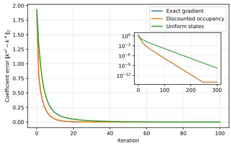  
(a) Exact, discounted-occupancy, and uniform-state gradients.

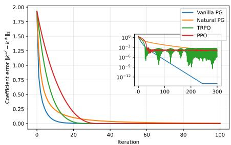  
(b) Default configuration.  
Figure 1: Known-dynamics experiments: gradient sampling and default configuration.

Default parameters. Unless stated otherwise, $A = - 1 , B = 1 , \sigma = M = N = \beta = 1$ , and $\lambda = 0 . 1$ . In the known-dynamics and known-transition experiments, $\rho _ { 0 } = \mathcal { N } ( 0 , 1 )$ and $\omega ^ { 0 } = ( 0 . 5 , 1 , 1 )$ . We use $n = 1 0 { , } 0 0 0$ discounted-occupancy samples per iteration, $\eta _ { \mathrm { P G } } = \eta _ { \mathrm { N P G } } = 0 . 1$ , TRPO radius $\delta = 0 . 0 0 5$ , and $\eta _ { \mathrm { P P O } } = 0 . 0 0 5$ PPO uses five inner epochs and default clipping ratio $\epsilon = 0 . 2$ . The main axes show the first 100 iterations and the insets show the complete histories on a logarithmic scale.

## 6.1.1 Known dynamics

Figure 1a compares the exact policy gradient with the Monte Carlo estimators obtained from discountedoccupancy and uniform state sampling. The discounted-occupancy estimator, which is unbiased by construction, is almost indistinguishable from the exact gradient. In contrast, uniform state sampling produces a systematically slower curve. Although it still converges in this scalar example, it uses a diferent state weighting and therefore gives a biased estimate of the policy gradient. Figure 1b compares the four policy optimization methods under the default configuration. All methods rapidly reduce the error, with diferences in their long-run behavior becoming visible mainly in the logarithmic inset.

Across the additional experiments, we observe that the stability of the policy update depends strongly on the efective step size relative to the scaling of the dynamics. Changes in A mainly afect the transient behavior, whereas larger values of B or σ can make a fixed vanilla-PG step substantially less stable. NPG, TRPO, and PPO are more robust under these changes. Smaller efective steps improve stability at the cost of slower convergence, while larger steps accelerate the initial decrease but can produce oscillations or leave the admissible region. In the tested PPO configurations, changing the clipping ratio has a comparatively small efect. We refer to Section A.4 for the corresponding parameter studies and their detailed analysis.

## 6.1.2 Optimal-PhiBE with known discrete-time dynamics

We next assume that the continuous-time coeficients are unavailable but the transition law over $\Delta t = 0 . 1$ is known:

$$
S _ { t + \Delta t } \mid ( S _ { t } = s , a _ { t } = a ) \sim \mathcal { N } \left( e ^ { A \Delta t } s + \frac { e ^ { A \Delta t } - 1 } { A } B a , \frac { e ^ { 2 A \Delta t } - 1 } { 2 A } \sigma ^ { 2 } \right) .\tag{46}
$$

Its first increment moment gives

$$
\hat { b } ( s , a ) = \hat { A } s + \hat { B } a , \qquad \hat { A } = \frac { e ^ { A \Delta t } - 1 } { \Delta t } , \qquad \hat { B } = \frac { B ( e ^ { A \Delta t } - 1 ) } { A \Delta t } .
$$

Following the LQR construction of Optimal-PhiBE [50], we set $\hat { \Sigma } = 0$ and use the drift-only surrogate. This is a deliberate specialization: the additive difusion changes the value level but not the optimal LQR feedback. The critic, advantage, admissibility condition, and discounted occupancy used in this experiment are therefore all computed from the same Optimal-PhiBE surrogate, whereas the error is measured with respect to $k ^ { * }$

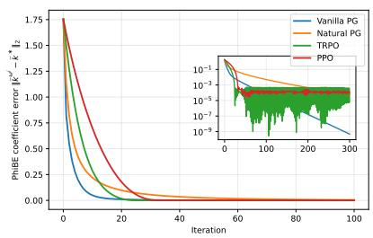  
(a)

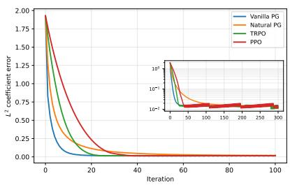  
(b)

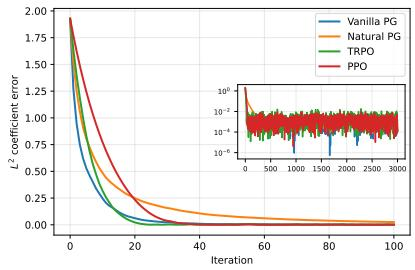  
(c)  
Figure 2: Comparison of the three PhiBE regimes for the LQR example. Left: PhiBE with known discretetime transition dynamics. Center: data-driven of-policy PhiBE-Q. Right: data-driven on-policy PhiBE.

Figure 2a shows the behavior of the four policy optimization methods under the default configuration. All methods rapidly reduce the error with respect to $k ^ { * }$ , reproducing the behavior observed with known continuous-time dynamics. Across the additional experiments, the same qualitative conclusions remain valid when the dynamics and update parameters are varied. Changes in A and B afect the transient behavior and the sensitivity to the policy update, while the efective step size continues to determine the main speed–stability trade-of. Smaller steps produce smoother but slower convergence, whereas larger steps reach the low-error region faster but lead to a more visible oscillatory floor. The tested PPO clipping ratios have a comparatively small efect. Overall, at $\Delta t = 0 . 1$ , the $\mathrm { O p } ^ { \textstyle \dag }$ timal-PhiBE surrogate preserves the main optimization behavior observed in the known-dynamics experiments. We refer to Section A.4 for the corresponding parameter studies and their detailed analysis.

## 6.1.3 Data-driven of-policy PhiBE

We next implement the fully of-policy PhiBE-Q experiment using a fixed dataset $\mathcal { D } _ { \mathrm { o f f } } = \{ ( s _ { i } , a _ { i } , r _ { i } , s _ { i } ^ { \prime } ) \} _ { i = 1 } ^ { n }$ The states $s _ { i }$ are sampled independently from a fixed, full-support Gaussian-mixture distribution $\rho _ { b } .$ , and the actions are drawn from a known, state-dependent Gaussian behavior policy $\pi _ { b } ( \cdot \mid s _ { i } )$ . Each action is held constant over one observation interval ∆t to generate $s _ { i } ^ { \prime } ,$ and $r _ { i } = r ( s _ { i } , a _ { i } )$ . The dataset is collected once and reused throughout policy optimization. We use the of-policy actor–critic method developed in Section 5.3.2; its LQR implementation and the remaining numerical details are given in Section A.4.

Figure 2b compares the four policy optimization methods using the same fixed behavior dataset with $n = 5 0 { , } 0 0 0$ and $\Delta t = 1$ . All four methods rapidly reduce the coeficient error and reach a nonzero error floor of order $1 0 ^ { - 2 }$ . Vanilla PG decreases fastest during the initial transient, while the diferences among the methods become smaller later in training. Changing the actor optimizer therefore afects the transient more strongly than the final accuracy in this configuration.

The additional experiments vary the number of transitions, the observation interval, and the LQR dynamics. Increasing the dataset size improves accuracy for the finer observation intervals, whereas its efect is limited at $\Delta t = 1$ . Decreasing $\Delta t$ reduces the error floor, and coarse observations produce substantially larger residual errors. The change to $A = - 1 0$ remains comparatively benign; $B = 1 0$ and $\sigma = 1 0$ are more challenging and use smaller actor steps, with a larger behavior dataset used for $\sigma = 1 0$ . The complete configurations and results are reported in Section A.4.

## 6.1.4 Data-driven: on-policy PhiBE

In the on-policy experiment, every actor iteration uses a fresh batch from the current discounted occupancy measure. We sample actions from $a _ { i } \sim \pi _ { \omega ^ { k } } ( \cdot | S _ { i } )$ and observe one local transition over $\Delta t$ . Hence the critic and advantage use fresh current-policy data, and the actor has the state weighting required by (45). We use the state basis $\phi ( s ) = ( 1 , s , s ^ { 2 } ) ^ { \top } , n = 1 , 0 0 0$ transitions per iteration, and $\Delta t = 0 . 1$ . The default update parameters are $\eta _ { \mathrm { P G } } = \eta _ { \mathrm { N P G } } = 0 . 0 5 , \delta _ { \mathrm { T R P O } } = 0 . 0 0 5$ , and $\eta _ { \mathrm { P P O } } = 0 . 0 0 5$ , with five PPO epochs and $\epsilon = 0 . 2$ The implementation used in these experiments is detailed in Algorithm 3 in Section A.4.

Figure 2c shows the behavior under the default configuration. All four methods rapidly reduce the coeficient error and enter a low-error region. In contrast to the known-dynamics experiments, however, the error does not continue toward numerical precision. Since a new finite-sample critic and advantage are estimated at every actor iteration, the curves fluctuate around a nonzero statistical error level.

The additional experiments show that this behavior is robust to changes in A and $B ,$ while high difusion is substantially more challenging because it increases the variability of the data-driven moment estimates. The efective update size controls the usual speed–stability trade-of: smaller steps give smoother but slower transients, whereas larger steps amplify the iteration-to-iteration fluctuations. Changing the PPO clipping ratio has a comparatively small efect in the tested range. Overall, these experiments indicate that the long-run variability is mainly associated with the finite-sample critic and advantage estimation rather than with a failure of policy improvement. We refer to Section A.4 for the corresponding parameter studies and their detailed discussion.

Comparison across regimes. The experiments display a consistent progression. With exact dynamics, the remaining error is mainly controlled by the actor step and the choice of policy update. Replacing the dynamics by the drift-only Optimal-PhiBE surrogate preserves essentially the same optimization trends. With data-driven PhiBE estimates, the methods still reach a low-error region, but a nonzero statistical floor appears whose size depends on the amount and temporal resolution of the data and on the variability of the dynamics, as illustrated by the dependence on $n , \ \Delta t ,$ and $\sigma .$ Trust-region and clipped updates become particularly useful when this estimation noise or the scaling of the dynamics makes a fixed Euclidean step unstable. These observations are consistent with the separation between policy-update and criticapproximation errors developed in the preceding sections.

## 6.2 Diferential wheeled robot control

We next consider a nonlinear control problem in which a diferential wheeled robot moves on the plane. In contrast with the LQR benchmark, the drift is nonlinear in the heading and the value function is approximated by a neural network.

## 6.2.1 Problem setting and implementation

The state is $s = ( x , y , \theta ) ^ { \top }$ , where $( x , y )$ is the position and θ is the heading, identified modulo $2 \pi$ . The control $a \ \in \ \mathbb { R }$ is the angular velocity, and $B$ is a three-dimensional standard Brownian motion. With constant forward speed $v = 1$ and difusion coeficient $\sigma _ { d } > 0$ , the dynamics are

$$
\mathrm { d } s _ { t } = \left( \cos \theta _ { t } , \sin \theta _ { t } , a _ { t } \right) ^ { \top } \mathrm { d } t + \sigma _ { d } \mathrm { d } B _ { t } .\tag{47}
$$

The robot starts at $( x _ { 0 } , y _ { 0 } ) = ( 0 , 0 )$ , with $\theta _ { 0 } \sim \mathcal { U } [ - \pi , \pi )$ , and the target is $( x _ { f } , y _ { f } ) = ( 1 , 1 )$ . For $\varepsilon _ { r } > 0$ define the smoothed distance to the target by

$$
d _ { \varepsilon _ { r } } ( x , y ) : = \sqrt { ( x - x _ { f } ) ^ { 2 } + ( y - y _ { f } ) ^ { 2 } + \varepsilon _ { r } ^ { 2 } - \varepsilon _ { r } } .
$$

The running reward is $r ( s , a ) = \alpha \exp ( - \mu d _ { \varepsilon _ { r } } ( x , y ) ) - \gamma a ^ { 2 }$ . Thus, proximity to the target is rewarded while large angular velocities are penalized. The target is a soft reward maximizer rather than an absorbing state, so a trajectory is not terminated when it enters the displayed target neighborhood. We use the Gaussian policy

$$
\pi _ { \Theta } ( \mathrm { d } a \mid s ) = \mathcal { N } \big ( m _ { \Theta } ( s ) , \sigma _ { a } ^ { 2 } \big ) ( \mathrm { d } a ) , \qquad m _ { \Theta } ( s ) = 3 \pi \operatorname { t a n h } ( f _ { \Theta } ( s ) ) ,\tag{48}
$$

where $\sigma _ { a }$ is fixed. The critic $V _ { \phi }$ and the policy mean are represented by neural networks. Both receive $( \widetilde { x } , \widetilde { y } , \sin \theta , \cos \theta )$ as input, where the spatial coordinates are scaled to $[ - 1 , 1 ]$ on the collocation domain. This enforces periodicity in the heading and avoids a discontinuity at $\theta = \pm \pi$

Known dynamics. For the Gaussian policy in (48), the policy-averaged drift and regularized reward in the evaluation equation are available in closed form: $b ^ { \pi _ { \Theta } } ( s ) = ( \cos \theta , \sin \bar { \theta } , m _ { \Theta } ( s ) ) ^ { \top }$ , and

$$
r _ { \lambda } ^ { \pi _ { \Theta } } ( s ) = \alpha e ^ { - \mu d _ { \varepsilon _ { r } } ( x , y ) } - \gamma \big ( m _ { \Theta } ( s ) ^ { 2 } + \sigma _ { a } ^ { 2 } \big ) + \frac { \lambda } { 2 } \log \big ( 2 \pi e \sigma _ { a } ^ { 2 } \big ) .
$$

Accordingly, the critic minimizes the mean squared residual of

$$
\mathscr { R } _ { \mathrm { K D } } ( s ) = \beta V _ { \phi } ( s ) - r _ { \lambda } ^ { \pi \Theta } ( s ) - b ^ { \pi _ { \Theta } } ( s ) ^ { \top } \nabla _ { s } V _ { \phi } ( s ) - \frac { \sigma _ { d } ^ { 2 } } { 2 } \Delta V _ { \phi } ( s ) .\tag{49}
$$

The action average is therefore taken before the residual is squared. Once $V _ { \phi }$ has been fitted, the actor uses the continuous-time advantage (14), evaluated with the known coeficients.

Data-driven dynamics. The learner now observes only one-step tuples $( s _ { i } , a _ { i } , r _ { i } , s _ { i } ^ { \prime } )$ with interval $\Delta t ,$ where $a _ { i } \sim \pi _ { \Theta } ( \cdot \mid s _ { i } )$ . With $\Delta s _ { i } = s _ { i } ^ { \prime } - s _ { i }$ and the angular increment taken modulo 2π, the critic minimizes the mean squared residual of

$$
\mathcal { R } _ { \mathrm { D D } } ( \boldsymbol { s } _ { i } ) = \beta V _ { \phi } ( \boldsymbol { s } _ { i } ) - \left( r _ { i } - \lambda \log \pi _ { \Theta } ( \boldsymbol { a } _ { i } \mid \boldsymbol { s } _ { i } ) \right) - \frac { \Delta \boldsymbol { s } _ { i } } { \Delta t } \cdot \nabla _ { \boldsymbol { s } } V _ { \phi } ( \boldsymbol { s } _ { i } ) - \frac { 1 } { 2 \Delta t } \Delta \boldsymbol { s } _ { i } ^ { \top } \nabla _ { \boldsymbol { s } } ^ { 2 } V _ { \phi } ( \boldsymbol { s } _ { i } ) \Delta \boldsymbol { s } _ { i } ,\tag{50}
$$

which is the data-driven counterpart of (49): the policy-averaged reward and diferential operators are replaced by local one-transition estimates constructed from (37). Since this residual is squared, its minimization is afected by double sampling; see Remark 6.1. The actor uses (38), evaluated with the same one-transition estimates at each sampled pair $( s _ { i } , a _ { i } )$

Actor sampling and training parameters. In both regimes, actor states are sampled from the discounted occupancy measure using the exponential-time construction described in (45). Actions and likelihood ratios are generated under a frozen copy of the current policy, and the policy is then updated with the PPO objective (106). Advantages are standardized within each batch. The critic collocation distribution is used only to solve the evaluation equation; it is not substituted for the discounted occupancy measure in the actor update. We set

$$
\alpha = 5 , \quad \mu = 1 , \quad \gamma = 0 . 0 5 , \quad \varepsilon _ { r } = 1 0 ^ { - 2 } , \quad \lambda = 0 . 1 , \quad \beta = 1 , \quad \sigma _ { a } = 0 . 1 , \quad \sigma _ { d } = 0 . 0 2 , \quad \lambda = 0 . 1 , \quad \lambda = 0 . 1 , \quad \lambda = 0 . 1 ,
$$

in both regimes. For the data-driven experiment, the observation interval is $\Delta t = 0 . 0 1$ . The value and policy functions are represented by neural networks and trained with Adam. Complete network architectures, collocation distributions, optimization parameters, batch sizes, training schedules, and validation procedures are reported in Section A.4.

## 6.2.2 Known-dynamics results

Policy evaluation. We first fit the critic for a fixed randomly initialized policy. Figure 3a shows that the squared PDE residual decreases steadily during training and reaches a low level after 10,000 critic iterations. To verify that this reduction corresponds to an accurate value approximation, we also compare the fitted critic with an independent Monte Carlo estimate of the same entropy-regularized discounted return. Across the tested headings, the fitted and reference values have nearly identical high-value regions and contour geometry, showing that the neural critic captures the main spatial and heading-dependent structure of the value function. The corresponding value-function comparisons are reported in Section A.4.

Policy optimization. Figure 3b shows the critic residual during joint policy optimization. The curve concatenates successive critic-fitting blocks, and each policy update changes the evaluation equation. Consequently, the residual can increase at the beginning of a new block and then decrease again as the critic adapts to the updated policy. The repeated recovery to a low residual shows that the critic continues to track the evolving policy throughout training.

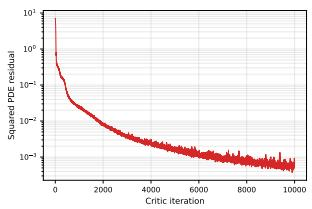  
(a)

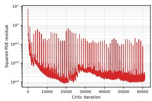  
(b)

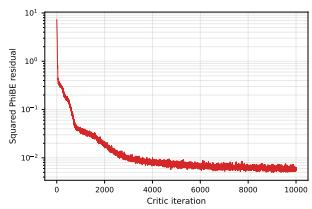  
(c)

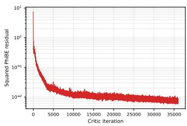  
(d)  
Figure 3: Critic residuals for the diferential wheeled robot experiments. Top left: fixed-policy evaluation with known dynamics. Top right: policy optimization with known dynamics. Bottom left: fixed-policy evaluation using data-driven PhiBE. Bottom right: data-driven policy optimization.

The final fitted value also closely reproduces the Monte Carlo reference for the learned policy. At the same time, the mean-policy trajectories evolve from paths largely determined by their initial headings to headingdependent curves directed toward the target neighborhood. Since the target is a soft reward maximizer, the forward speed is fixed, and no terminal condition is imposed, trajectories may continue curving after reaching this region. Together, these experiments show that the critic remains accurate during policy improvement and that the learned feedback policy successfully redirects diferent initial headings toward the high-reward region. The value-function and trajectory comparisons are reported in Section A.4.

## 6.2.3 Data-driven results

The data-driven critic and actor use only rewards and observed increments in their PhiBE quantities. The analytical drift and difusion in (47) are used only by the simulator that supplies the transitions and by the post-training Monte Carlo validation.

Policy evaluation. We first evaluate a fixed policy using only one-step transition data. Figure 3c shows that the squared PhiBE residual decreases by several orders of magnitude before fluctuating around a small nonzero level. In contrast with the known-dynamics PDE residual, this statistical floor is expected because the reward and local PhiBE quantities are estimated from finitely many transitions and the squared onesample residual is afected by the double-sampling efect described in Remark 6.1.

Independent Monte Carlo validation shows that the fitted critic nevertheless recovers the main structure of the value function. Across the tested headings, the fitted values reproduce the location of the highvalue region and its systematic change with the robot orientation, although some diferences in contour geometry and value level remain. Thus, the nonzero residual floor does not prevent the data-driven critic from recovering a meaningful approximation of the policy value. The corresponding fitted–reference comparisons are reported in Section A.4.

Remark 6.1 (Double sampling). Let $R _ { i } ( V )$ denote the one-sample residual (50), and let $\mathcal { R } ( V ) : = \beta V -$ $\boldsymbol { r } _ { \lambda } ^ { \pi _ { \Theta } } - \mathcal { L } _ { \hat { b } ^ { \pi _ { \Theta } } , \hat { \Sigma } ^ { \pi _ { \Theta } } } \boldsymbol { V }$ be the residual of (36). Since $\mathbb { E } [ R _ { i } ( V ) | s _ { i } ] = { \mathcal { R } } ( V ) ( s _ { i } )$ ,

$$
\begin{array} { r } { \mathbb { E } \big [ R _ { i } ( V ) ^ { 2 } \mid s _ { i } \big ] = \mathcal { R } ( V ) ( s _ { i } ) ^ { 2 } + \mathrm { V a r } \big ( R _ { i } ( V ) \mid s _ { i } \big ) . } \end{array}
$$

The conditional variance depends on V through $\nabla _ { s } V$ and $\nabla _ { s } ^ { 2 } V ,$ , so the minimizer of the mean squared onesample residual difers in general from that of the mean squared PhiBE residual; an unbiased estimate of the latter would require two independent transitions from the same state. This is the double-sampling problem. The Galerkin critics of Section 6.1 are not afected: the residual enters linearly and is multiplied by test functions of $s _ { i } ,$ or of $( s _ { i } , a _ { i } )$ , so the empirical Galerkin system is a consistent estimate of the exact one. In the present example, the part of the conditional variance that depends on V is generated by the Brownian increment, of order $\sigma _ { d } ^ { 2 } \Delta t ^ { - 1 } | \nabla _ { s } V | ^ { 2 }$ , and by the action noise, of order $\sigma _ { a } ^ { 2 } .$ . Both are small for $\sigma _ { d } = 0 . 0 2$ $\Delta t = 0 . 0 1$ and $\sigma _ { a } = 0 . 1$ , although the former increases as $\Delta t$ decreases. Since this variance term does not depend on the number of samples, it also keeps the empirical loss away from zero.

Policy optimization. Figure 3d shows the critic residual during data-driven policy optimization. Despite the critic being reconstructed from sampled transitions as the policy changes, the residual decreases substantially and eventually fluctuates around a small positive level. This behavior is consistent with the statistical floor already observed in fixed-policy evaluation.

The additional experiments show that the learned value retains the main geometry of the independent Monte Carlo reference and, more importantly, that policy improvement translates into efective feedback control. Starting from trajectories largely determined by their initial headings, the learned policy progressively redirects all tested headings toward the target neighborhood. This behavior is already visible well before the final training epoch and remains stable at the end of training. Thus, the data-driven PhiBE critic provides suficiently accurate policy-improvement directions to learn the nonlinear steering task using only observed transitions. The corresponding value-function and trajectory comparisons are reported in Section A.4.

## 7 Conclusion

We developed a policy gradient framework for continuous-time reinforcement learning with theoretical convergence guarantees and data-driven implementations. Starting from a performance diference lemma, we derived policy gradient formulas for randomized and parametrized policies, established exponential convergence of the entropy-regularized policy flow, and obtained convergence bounds for discrete updates that account for critic and policy-regression errors. By incorporating PhiBE, we constructed on- and of-policy actor–critic methods that learn from discrete observations while preserving the continuous-time dynamics. Numerical experiments on an LQR problem and a nonlinear wheeled robot demonstrated the efectiveness of the proposed approach.

## References

[1] Alekh Agarwal, Sham M Kakade, Jason D Lee, and Gaurav Mahajan. On the theory of policy gradient methods: Optimality, approximation, and distribution shift. Journal of Machine Learning Research, 22(98):1–76, 2021.

[2] Leemon C. Baird. Reinforcement learning in continuous time: advantage updating. Proceedings of 1994 IEEE International Conference on Neural Networks (ICNN’94), 4:2448–2453 vol.4, 1994.

[3] Matteo Basei, Xin Guo, Anran Hu, and Yufei Zhang. Logarithmic regret for episodic continuoustime linear-quadratic reinforcement learning over a finite-time horizon. Journal of Machine Learning Research, 23(178):1–34, 2022.

[4] Christian Bender and Nguyen Tran Thuan. Continuous time reinforcement learning: A random measure approach. Stochastic Processes and their Applications, page 104848, 2025.

[5] Rene Carmona and Mathieu Lauriere. Reconciling discrete-time mixed policies and continuous-time relaxed controls in reinforcement learning and stochastic control, 2025.

[6] Robert Denkert, Huyˆen Pham, and Xavier Warin. Control randomisation approach for policy gradient and application to reinforcement learning in optimal switching. Applied Mathematics & Optimization, 91(1):9, 2025.

[7] Wendell H. Fleming and Halil Mete Soner. Controlled Markov Processes and Viscosity Solutions, volume 25 of Stochastic Modelling and Applied Probability. Springer, New York, 2 edition, 2006.

[8] Michael Giegrich, Christoph Reisinger, and Yufei Zhang. Convergence of policy gradient methods for finite-horizon exploratory linear-quadratic control problems. SIAM Journal on Control and Optimization, 62(2):1060–1092, 2024.

[9] Yanwei Jia, Du Ouyang, and Yufei Zhang. Accuracy of discretely sampled stochastic policies in continuous-time reinforcement learning. SIAM Journal on Control and Optimization, 64(3):1889–1929, 2026.

[10] Yanwei Jia and Xun Yu Zhou. Policy evaluation and temporal-diference learning in continuous time and space: A martingale approach. Journal of Machine Learning Research, 23(154):1–55, 2022.

[11] Yanwei Jia and Xun Yu Zhou. Policy gradient and actor-critic learning in continuous time and space: Theory and algorithms. Journal of Machine Learning Research, 23(275):1–50, 2022.

[12] Yanwei Jia and Xun Yu Zhou. q-learning in continuous time. Journal of Machine Learning Research, 24(161):1–61, 2023.

[13] Yu Jiang and Zhong-Ping Jiang. Computational adaptive optimal control for continuous-time linear systems with completely unknown dynamics. Automatica, 48(10):2699–2704, 2012.

[14] Sham M. Kakade. A natural policy gradient. In Advances in Neural Information Processing Systems (NeurIPS), volume 14, 2001.

[15] Sham M. Kakade and John Langford. Approximately optimal approximate reinforcement learning. In Proceedings of the Nineteenth International Conference on Machine Learning, pages 267–274. Morgan Kaufmann, 2002.

[16] Bekzhan Kerimkulov, David Siˇska, Lukasz Szpruch, and Yufei Zhang. Mirror descent for stochastic ˇ control problems with measure-valued controls. Stochastic Processes and their Applications, 190:104765, 2025.

[17] Jeongho Kim and Insoon Yang. Hamilton-jacobi-bellman equations for q-learning in continuous time. In Learning for Dynamics and Control, pages 739–748. PMLR, 2020.

[18] N. V. Krylov. Controlled difusion processes, volume 14 of Applications of Mathematics. Springer-Verlag, New York-Berlin, 1980. Translated from the Russian by A. B. Aries.

[19] Hiroshi Kunita. Stochastic flows and stochastic diferential equations, volume 24 of Cambridge Studies in Advanced Mathematics. Cambridge University Press, Cambridge, 1990.

[20] Timothy P. Lillicrap, Jonathan J. Hunt, Alexander Pritzel, Nicolas Heess, Tom Erez, Yuval Tassa, David Silver, and Daan Wierstra. Continuous control with deep reinforcement learning. In International Conference on Learning Representations, 2016.

[21] Feng Lin and Robert D Brandt. An optimal control approach to robust control of robot manipulators. IEEE Transactions on robotics and automation, 14(1):69–77, 1998.

[22] Xuerong Mao. Stochastic diferential equations and applications. Horwood Publishing Limited, Chichester, second edition, 2008.

[23] Ofir Nachum, Yinlam Chow, Bo Dai, and Lihong Li. DualDICE: Behavior-agnostic estimation of discounted stationary distribution corrections. In Advances in Neural Information Processing Systems, volume 32, 2019.

[24] Bernt Øksendal. Stochastic Diferential Equations: An Introduction with Applications. Universitext. Springer, Berlin, 6 edition, 2003.

[25] Huyˆen Pham. Continuous-time stochastic control and optimization with financial applications, volume 61. Springer Science & Business Media, 2009.

[26] Christoph Reisinger, Wolfgang Stockinger, and Yufei Zhang. Linear convergence of a policy gradient method for some finite horizon continuous time control problems. SIAM Journal on Control and Optimization, 61(6):3526–3558, 2023.

[27] Christoph Reisinger and Yufei Zhang. Regularity and stability of feedback relaxed controls. SIAM Journal on Control and Optimization, 59(5):3118–3151, 2021.

[28] John Schulman, Sergey Levine, Philipp Moritz, Michael I. Jordan, and Pieter Abbeel. Trust region policy optimization. In Proceedings of the 32nd International Conference on Machine Learning (ICML), 2015.

[29] John Schulman, Filip Wolski, Prafulla Dhariwal, Alec Radford, and Oleg Klimov. Proximal policy optimization algorithms. arXiv preprint arXiv:1707.06347, 2017.

[30] Deven Sethi, David Siˇska, and Yufei Zhang. Entropy annealing for policy mirror descent in continuousˇ time and space. SIAM Journal on Control and Optimization, 63(4):3006–3041, 2025.

[31] Suresh P Sethi, Houmin Yan, Hanqin Zhang, and Qing Zhang. Optimal and hierarchical controls in dynamic stochastic manufacturing systems: A survey. Manufacturing & Service Operations Management, 4(2):133–170, 2002.

[32] David Siˇska and Lukasz Szpruch. Gradient flows for regularized stochastic control problems.ˇ SIAM Journal on Control and Optimization, 62(4):2036–2070, 2024.

[33] Yunlong Song, Angel Romero, Matthias M¨uller, Vladlen Koltun, and Davide Scaramuzza. Reaching the limit in autonomous racing: Optimal control versus reinforcement learning. Science Robotics, 8(82):eadg1462, 2023.

[34] Richard S. Sutton, David McAllester, Satinder Singh, and Yishay Mansour. Policy gradient methods for reinforcement learning with function approximation. In Advances in Neural Information Processing Systems (NeurIPS), volume 12, 1999.

[35] Corentin Tallec, L´eonard Blier, and Yann Ollivier. Making deep Q-learning methods robust to time discretization. In Proceedings of the 36th International Conference on Machine Learning (ICML), vol ume 97 of PMLR, pages 6096–6104, 2019.

[36] Wenpin Tang, Yuming Paul Zhang, and Xun Yu Zhou. Exploratory hjb equations and their convergence. SIAM Journal on Control and Optimization, 60(6):3191–3216, 2022.

[37] Nino Vieillard, Marcin Andrychowicz, Anton Raichuk, Olivier Pietquin, and Matthieu Geist. Implicitly regularized reinforcement learning with implicit Q-values. In Proceedings of the 25th International Conference on Artificial Intelligence and Statistics, volume 151 of Proceedings of Machine Learning Research, pages 1380–1402. PMLR, 2022.

[38] Boyu Wang, Xuefeng Gao, and Lingfei Li. Reinforcement learning for continuous-time optimal execution: actor–critic algorithm and error analysis. Finance and Stochastics, 30(2):597–655, 2026.

[39] Haoran Wang, Thaleia Zariphopoulou, and Xun Yu Zhou. Reinforcement learning in continuous time and space: A stochastic control approach. Journal of Machine Learning Research, 21(198):1–34, 2020.

[40] Xiong Yang, Derong Liu, and Ding Wang. Reinforcement learning for adaptive optimal control of unknown continuous-time nonlinear systems with input constraints. International Journal of Control, 87(3):553–566, 2014.

[41] Xinpei Zhang and Guangyan Jia. Convergence of policy gradient for stochastic linear quadratic optimal control problems in infinite horizon. Journal of Mathematical Analysis and Applications, 547(1):129264, 2025.

[42] Hanyang Zhao, Wenpin Tang, and David Yao. Policy optimization for continuous reinforcement learning. Advances in Neural Information Processing Systems, 36:13637–13663, 2023.

[43] Jingang Zhao. Data-driven adaptive dynamic programming for optimal control of continuous-time multicontroller systems with unknown dynamics. IEEE Access, 10:41503–41511, 2022.

[44] Mo Zhou, Jiequn Han, and Jianfeng Lu. Actor-critic method for high dimensional static hamilton– jacobi–bellman partial diferential equations based on neural networks. SIAM Journal on Scientific Computing, 43(6):A4043–A4066, 2021.

[45] Mo Zhou and Jianfeng Lu. Solving time-continuous stochastic optimal control problems: Algorithm design and convergence analysis of actor-critic flow. arXiv preprint arXiv:2402.17208, 2024.

[46] Mo Zhou and Jianfeng Lu. A policy gradient framework for stochastic optimal control problems with global convergence guarantee. SIAM Journal on Control and Optimization, 63(4):2605–2631, 2025.

[47] Mo Zhou, Haosheng Zhou, and Ruimeng Hu. Learning mean-field games through mean-field actor-critic flow. arXiv preprint arXiv:2510.12180, 2025.

[48] Yuhua Zhu. Phibe: A pde-based bellman equation for continuous time policy evaluation, 2026.

[49] Yuhua Zhu. Phibe-q-learning: Bridging of-policy reinforcement learning and continuous-time control, 2026.

[50] Yuhua Zhu, Yuming Zhang, and Haoyu Zhang. Optimal-phibe: A pde-based model-free framework for continuous-time reinforcement learning. arXiv preprint arXiv:2506.05208, 2025.

## A Appendix

## A.1 Remarks and assumptions equivalence

We begin this section by writing Assumption 1 and Assumption 2 as explicit inequalities, in the form in which they are used in the proofs, and by recording two consequences that are invoked repeatedly. We then discuss the well-posedness of the exploratory SDE (4) and of the linear equation used for policy evaluation.

Proposition A.1 (Regularity and growth of the value function). Assume Assumption 1 and let $\pi \in \Pi$ Then the value function (2) belongs to $C ^ { 2 } ( \mathbb { S } )$ , solves (6), and satisfies

$$
| V ^ { \pi } ( s ) | \leq C _ { \pi } ( 1 + | s | ^ { 2 } ) , \qquad | \nabla _ { s } V ^ { \pi } ( s ) | \leq C _ { \pi } ( 1 + | s | ) , \qquad \| \nabla _ { s } ^ { 2 } V ^ { \pi } ( s ) \| \leq C _ { \pi } ( 1 + | s | ) .\tag{51}
$$

Moreover, $V ^ { \pi }$ is the only function of class $C ^ { 2 }$ satisfying (51) that solves (6).

Proof. Throughout, $X _ { t } = X _ { t } ^ { s }$ denotes the solution of (4) with $X _ { 0 } = s .$ , and C is a constant that may change from line to line.

Step 1: growth of Vπ. By (11) and Taylor’s theorem, $\vert r _ { \lambda } ^ { \pi } ( s ) \vert \le \vert r _ { \lambda } ^ { \pi } ( 0 ) \vert + C ( 1 + \vert s \vert ^ { 2 } ) \le C ( 1 + \vert s \vert ^ { 2 } )$ Together with (59) and Jensen’s inequality this gives

$$
| V ^ { \pi } ( s ) | \leq \int _ { 0 } ^ { \infty } e ^ { - \beta t } \mathbb { E } \left[ | r _ { \lambda } ^ { \pi } ( X _ { t } ) | \right] \mathrm { d } t \leq C ( 1 + | s | ^ { 2 } ) \int _ { 0 } ^ { \infty } e ^ { - ( \beta - \kappa _ { \pi } / 4 ) t } \mathrm { d } t \leq C ( 1 + | s | ^ { 2 } ) ,
$$

the integral being finite by (12), which gives $\kappa _ { \pi } \leq 2 \nu _ { \pi } + \kappa _ { \pi } < \beta$

Step 2: derivatives of the flow. By Lemma $\mathrm { A . 5 }$ , writing $J _ { t } : = \nabla _ { s } X _ { t } ^ { s }$ and $H _ { t } : = \nabla _ { s } ^ { 2 } X _ { t } ^ { s }$ , we have

$$
\begin{array} { r } { \big ( \mathbb E \| J _ { t } \| ^ { 2 } \big ) ^ { 1 / 2 } \leq \big ( \mathbb E \| J _ { t } \| ^ { 4 } \big ) ^ { 1 / 4 } \leq C _ { \pi } e ^ { \nu _ { \pi } t } , \qquad \big ( \mathbb E \| H _ { t } \| ^ { 2 } \big ) ^ { 1 / 2 } \leq C _ { \pi , \varepsilon } e ^ { ( 2 \nu _ { \pi } + \varepsilon ) t } , } \end{array}\tag{52}
$$

for every $\varepsilon > 0$ , both uniformly in s.

Step 3: derivatives of $V ^ { \pi }$ . By (11), $r _ { \lambda } ^ { \pi }$ is of class $C ^ { 2 }$ with $| \nabla _ { s } r _ { \lambda } ^ { \pi } ( x ) | \le C ( 1 + | x | )$ and $\| \nabla _ { s } ^ { 2 } r _ { \lambda } ^ { \pi } ( x ) \| \leq C$ Combining this with (59) and (52), the diference quotients of $r _ { \lambda } ^ { \pi } ( X _ { t } ^ { s } )$ in s are uniformly integrable on compact sets of $s ,$ uniformly for t in compact sets, and the resulting integrands are dominated by an $e ^ { - \beta t }$ integrable function by (12). Diferentiating (2) twice under the expectation and the time integral is therefore legitimate and gives

$$
\nabla _ { s } V ^ { \pi } ( s ) = \mathbb { E } \int _ { 0 } ^ { \infty } e ^ { - \beta t } J _ { t } ^ { \top } \nabla _ { s } r _ { \lambda } ^ { \pi } ( X _ { t } ) \mathrm { d } t , \quad \nabla _ { s } ^ { 2 } V ^ { \pi } ( s ) = \mathbb { E } \int _ { 0 } ^ { \infty } e ^ { - \beta t } \left[ J _ { t } ^ { \top } \nabla _ { s } ^ { 2 } r _ { \lambda } ^ { \pi } ( X _ { t } ) J _ { t } + \nabla _ { s } r _ { \lambda } ^ { \pi } ( X _ { t } ) ^ { \top } H _ { t } \right] \mathrm { d } t .
$$

In particular $V ^ { \pi } \in C ^ { 2 } ( \mathbb { S } )$ . By (59) and Jensen’s inequality, $\begin{array} { r } { \left( \mathbb { E } ( 1 + | X _ { t } | ) ^ { 2 } \right) ^ { 1 / 2 } \leq C ( 1 + | s | ) e ^ { \kappa _ { \pi } t / 8 } } \end{array}$ . Hence, by the Cauchy–Schwarz inequality and (52),

$$
| \nabla _ { s } V ^ { \pi } ( s ) | \le C \int _ { 0 } ^ { \infty } e ^ { - \beta t } \left( \mathbb { E } | J _ { t } | ^ { 2 } \right) ^ { 1 / 2 } \left( \mathbb { E } ( 1 + | X _ { t } | ) ^ { 2 } \right) ^ { 1 / 2 } \mathrm { d } t \le C ( 1 + | s | ) \int _ { 0 } ^ { \infty } e ^ { - ( \beta - \nu _ { \tau } - \kappa _ { \tau } / 8 ) t } \mathrm { d } t \le C ( 1 + | s | ) ,
$$

and, using (52) for the second term,

$$
\| \nabla _ { s } ^ { 2 } V ^ { \pi } ( s ) \| \leq C \int _ { 0 } ^ { \infty } e ^ { - \beta t } \left[ \mathbb { E } | J _ { t } | ^ { 2 } + \left( \mathbb { E } ( 1 + | X _ { t } | ) ^ { 2 } \right) ^ { 1 / 2 } \left( \mathbb { E } | H _ { t } | ^ { 2 } \right) ^ { 1 / 2 } \right] \mathrm { d } t \leq C ( 1 + | s | ) \int _ { 0 } ^ { \infty } e ^ { - ( \beta - 2 \nu _ { s } - \kappa _ { s } / 8 - \sigma ) t } \mathrm { d } t ,
$$

which is finite for ε small enough by (12). This proves (51).

Step $\mathit { 4 } \colon V ^ { \pi }$ solves (6). Fix $T > 0$ . By the Markov property,

$$
V ^ { \pi } ( s ) = \mathbb { E } \left[ \int _ { 0 } ^ { T } e ^ { - \beta t } r _ { \lambda } ^ { \pi } ( X _ { t } ) \mathrm { d } t \right] + e ^ { - \beta T } \mathbb { E } \left[ V ^ { \pi } ( X _ { T } ) \right] .
$$

Since $V ^ { \pi } \in C ^ { 2 }$ satisfies (51) and $\| \sigma ^ { \pi } ( x ) \| \leq C ( 1 + | x | )$ , the stochastic integral appearing in Itˆo’s formula applied to $e ^ { - \beta t } V ^ { \pi } ( X _ { t } )$ is a true martingale on [0, T] by (59), so

$$
e ^ { - \beta T } \mathbb { E } \left[ V ^ { \pi } ( X _ { T } ) \right] - V ^ { \pi } ( s ) = \mathbb { E } \int _ { 0 } ^ { T } e ^ { - \beta t } \left( \mathcal { L } _ { b ^ { \pi } , \Sigma ^ { \pi } } V ^ { \pi } - \beta V ^ { \pi } \right) ( X _ { t } ) \mathrm { d } t .
$$

Adding the two identities gives

$$
\mathbb { E } \int _ { 0 } ^ { T } e ^ { - \beta t } \left( \mathcal { L } _ { b ^ { \pi } , \Sigma ^ { \pi } } V ^ { \pi } - \beta V ^ { \pi } + r _ { \lambda } ^ { \pi } \right) \left( X _ { t } \right) \mathrm { d } t = 0 , \qquad T > 0 .
$$

The integrand is continuous in x and dominated by $C ( 1 + | x | ^ { 3 } )$ , which is uniformly integrable along $X _ { t }$ for small t by (59). Dividing by $T$ and letting $T \to 0 ^ { + }$ yields $\begin{array} { r } { \mathcal { L } _ { b ^ { \pi } , \Sigma ^ { \pi } } V ^ { \pi } ( s ) - \beta V ^ { \pi } ( s ) + r _ { \lambda } ^ { \pi } ( s ) = 0 . } \end{array}$

Step 5: uniqueness. Let $u \in C ^ { 2 } ( \mathbb { S } )$ satisfy (51) and solve (6). Applying Itˆo’s formula to $e ^ { - \beta t } u ( X _ { t } )$ as in Step 4 and letting $T \to \infty$ , the terminal term vanishes because $e ^ { - \beta T } \mathbb { E } | u ( X _ { T } ) | \leq C e ^ { - ( \beta - \kappa _ { \pi } / 4 ) T } ( 1 + | s | ^ { 2 } ) \to 0 .$ and we obtain $\begin{array} { r } { \bar { u ( s ) } = \mathbb { E } \int _ { 0 } ^ { \infty } e ^ { - \beta t } r _ { \lambda } ^ { \pi } ( X _ { t } ) \mathrm { d } t = V ^ { \pi } ( s ) } \end{array}$ □

Two consequences of Proposition A.1 are used repeatedly. First, by (14), (7), Assumption 1(ii) and (51),

$$
| A ^ { \pi } ( s , a ) | \leq C _ { \pi } ( 1 + | s | + | a | ) ^ { 3 } , \qquad ( s , a ) \in \mathbb { S } \times \mathcal { A } ,\tag{53}
$$

the cubic term coming from $\Sigma ( s , a ) : \nabla _ { s } ^ { 2 } V ^ { \pi } ( s )$ . Second, by (55),

$$
\int _ { \cal A } | A ^ { \pi } ( s , a ) | \pi ( a | s ) \nu ( \mathrm { d } a ) \leq C _ { \pi } ( 1 + | s | ) ^ { 3 } , \qquad s \in \mathbb { S } .\tag{54}
$$

Remark A.2 (On the bound for the Hessian). The linear growth of $\nabla _ { s } ^ { 2 } V ^ { \pi }$ in (51) cannot be improved to a uniform bound without further structure. The term responsible is $\nabla _ { s } r _ { \lambda } ^ { \pi } ( X _ { t } ) ^ { \top } H _ { t }$ in Step 3, which is of order $1 + | s |$ whenever the second derivatives of the closed-loop coeficients do not vanish. For instance, the Hessian is bounded, and the advantage is quadratic, in the two situations that occur in practice: when $b ^ { \pi }$ is afine and $\sigma ^ { \pi }$ is constant, so that $H _ { t } \equiv 0$ , and when $\nabla _ { s } r _ { \lambda } ^ { \pi }$ is bounded.

Remark A.3 (Polynomial integration). Two consequences of Assumption 1 are used throughout. First, integrating a function of joint degree at most eight against an admissible policy gives a function of the state of the same degree: $i f \left| \Psi ( s , a ) \right| \leq C _ { \Psi } ( 1 + | s | + | a | ) ^ { k }$ with $k \leq 8$ , then

$$
\int _ { A } | \Psi ( s , a ) | \pi ( a | s ) \nu ( \mathrm { d } a ) \leq C ( 1 + | s | ) ^ { k } , \qquad s \in \mathbb { S } .\tag{55}
$$

Indeed, $( 1 + | s | + | a | ) ^ { k } \leq 2 ^ { k } { \bigl ( } ( 1 + | s | ) ^ { k } + | a | ^ { k } { \bigr ) }$ , and by Jensen’s inequality and (8),

$$
\int _ { A } | a | ^ { k } \pi ( a | s ) \nu ( \mathrm { d } a ) \leq \left( \int _ { A } | a | ^ { 8 } \pi ( a | s ) \nu ( \mathrm { d } a ) \right) ^ { k / 8 } \leq C ( 1 + | s | ) ^ { k } .
$$

Second, by (59), (12) and Fubini’s theorem, the discounted occupancy measure integrates every polynomial of degree at most eight:

$$
\int _ { \mathbb { S } } ( 1 + | s | ^ { 8 } ) \rho ^ { \pi } ( \mathrm { d } s ) \leq \frac { \beta C _ { \pi } } { \beta - \kappa _ { \pi } } \int _ { \mathbb { S } } ( 1 + | s | ^ { 8 } ) \rho _ { 0 } ( \mathrm { d } s ) < \infty .\tag{56}
$$

In particular, the relative entropy between two admissible policies satisfies $K L \left( \widehat { \pi } _ { s } | | \pi _ { s } \right) \leq C ( 1 + | s | ) ^ { 4 }$ , by (8), Assumption $1 ( i i )$ and (55), and is therefore integrable against $\rho ^ { \widehat { \pi } }$

Remark A.4 (Well-posedness of the exploratory difusion). By (7) and (55), the averaged coeficients satisfy

$$
| b ^ { \pi } ( s ) | + \| \sigma ^ { \pi } ( s ) \| \le C _ { \pi } ( 1 + | s | ) , \qquad s \in \mathbb { S } .\tag{57}
$$

Moreover, splitting

$$
b ^ { \pi } ( s ) - b ^ { \pi } ( s ^ { \prime } ) = \int _ { A } \bigl ( b ( s , a ) - b ( s ^ { \prime } , a ) \bigr ) \pi ( a | s ) \nu ( \mathrm { d } a ) + \int _ { A } b ( s ^ { \prime } , a ) \bigl ( \pi ( a | s ) - \pi ( a | s ^ { \prime } ) \bigr ) \nu ( \mathrm { d } a ) ,
$$

the first integral is bounded by $C ( 1 + | s | + | s ^ { \prime } | ) | s - s ^ { \prime } |$ by Assumption $1 ( i )$ and (8), and the second by $C ( 1 + | s ^ { \prime } | ) ( 1 + | s | + | s ^ { \prime } | ) ^ { 8 } | s - s ^ { \prime } |$ by (9); hence $b ^ { \pi }$ is Lipschitz on bounded sets, and the same argument applies to $\Sigma ^ { \pi }$ . By (7) we have $\Sigma ^ { \pi } \succeq \theta I _ { d }$ , and since the principal square-root map is Lipschitz on $\{ A \succeq \theta I _ { d } \}$ , the matrix $\sigma ^ { \pi }$ is Lipschitz on bounded sets as well. Consequently (4) has a unique strong solution for every initial condition, nonexplosive by (57); see, for instance, [24, Chapter 5].

Lemma A.5 (Growth rates of the averaged dynamics). Assume Assumption $1 ( i ) \ – ( i i i )$ and let $\pi \in \Pi$ . Set

$$
\begin{array} { r } { \nu _ { \pi } : = \operatorname* { m a x } \left\{ 0 , \underset { s \in \mathbb { S } } { \operatorname* { s u p } } \ \underset { | v | = 1 } { \operatorname* { s u p } } \left( \langle \nabla _ { s } b ^ { \pi } ( s ) v , v \rangle + \frac { 3 } { 2 } \| \nabla _ { s } \sigma ^ { \pi } ( s ) \| ^ { 2 } \right) \right\} , } \end{array}\tag{58}
$$

which is finite because $\nabla _ { s } b ^ { \pi }$ and $\nabla _ { s } \sigma ^ { \pi }$ are bounded. Then there are $\kappa _ { \pi } \geq 0$ , depending only on the constant in (57), and $C _ { \pi } > 0$ such that, for every $t \geq 0$ and $s \in \mathbb { S }$ ，

$$
\begin{array} { r } { \mathbb { E } \left[ 1 + | s _ { t } | ^ { 8 } \bigm | s _ { 0 } = s \right] \leq C _ { \pi } ( 1 + | s | ) ^ { 8 } e ^ { \kappa _ { \pi } t } , } \end{array}\tag{59}
$$

and, denoting by $J _ { t } : = \nabla _ { s } s _ { t }$ and $H _ { t } : = \nabla _ { s } ^ { 2 } s _ { t }$ the first two derivatives of the flow map $s \mapsto s _ { t }$ 2

$$
\begin{array} { r } { \mathbb { E } \| J _ { t } \| ^ { 4 } \leq C _ { \pi } e ^ { 4 \nu _ { \pi } t } , \qquad \mathbb { E } \| H _ { t } \| ^ { 2 } \leq C _ { \pi , \varepsilon } e ^ { ( 4 \nu _ { \pi } + \varepsilon ) t } \quad f o r e v e r y \varepsilon > 0 , } \end{array}\tag{60}
$$

both uniformly in s.

Proof. Estimate (59) is the classical moment bound for a stochastic diferential equation whose coeficients have linear growth: applying Itˆo’s formula to $( 1 + | s _ { t } | ^ { 2 } ) ^ { 4 }$ , using (57) and Gronwall’s inequality gives the claim, with $\kappa _ { \pi }$ an explicit multiple of the constant in (57); see, for instance, [22, Chapter 2] or [18, Chapter 2].

For (60), note first that under Assumption $1 ( \mathrm { i i i } )$ the coeficients of (4) are twice continuously diferentiable with bounded derivatives, so the stochastic flow $s \mapsto s _ { t }$ is twice continuously diferentiable and J and H solve the linear equations

$$
\begin{array} { r l r } & { \mathrm { d } J _ { t } = \nabla _ { s } b ^ { \pi } ( s _ { t } ) J _ { t } \mathrm { d } t + \nabla _ { s } \sigma ^ { \pi } ( s _ { t } ) J _ { t } \mathrm { d } W _ { t } , } & { J _ { 0 } = I _ { d } , } \\ & { \mathrm { d } H _ { t } = \big ( \nabla _ { s } b ^ { \pi } ( s _ { t } ) H _ { t } + \nabla _ { s } ^ { 2 } b ^ { \pi } ( s _ { t } ) ( J _ { t } , J _ { t } ) \big ) \mathrm { d } t + \big ( \nabla _ { s } \sigma ^ { \pi } ( s _ { t } ) H _ { t } + \nabla _ { s } ^ { 2 } \sigma ^ { \pi } ( s _ { t } ) ( J _ { t } , J _ { t } ) \big ) \mathrm { d } W _ { t } , } & { H _ { 0 } = 0 ; } \end{array}
$$

see [19, Chapter 4]. Fix $v \in \mathbb { R } ^ { d }$ with $| v | = 1$ and set $Y _ { t } : = J _ { t } v$ . Applying Itˆo’s formula to $| Y _ { t } | ^ { 4 }$ and using (58) gives $\mathbb { d } \mathbb { E } | Y _ { t } | ^ { 4 } \leq 4 \nu _ { \pi } \mathbb { E } | Y _ { t } | ^ { 4 }$ . Hence E $| J _ { t } v | ^ { 4 } \leq e ^ { 4 \nu _ { \pi } t }$ . Applying this estimate to a fixed basis of $\mathbb { R } ^ { d }$ and using equivalence of matrix norms yields $\mathbb { E } \Vert J _ { t } \Vert ^ { 4 } \leq C _ { \pi } e ^ { 4 \nu _ { \pi } t }$ . Since $\nabla _ { s } ^ { 2 } b ^ { \pi }$ and $\nabla _ { s } ^ { 2 } \sigma ^ { \pi }$ are bounded, the forcing terms in the equation for $H _ { t }$ are bounded by $C \| J _ { t } \| ^ { 2 }$ . Standard moment estimates for this linear stochastic equation, together with the preceding bound, give $\ddot { \mathbb { E } } \| H _ { t } \| ^ { 2 } \leq C _ { \pi , \varepsilon } e ^ { ( 4 \nu _ { \pi } + \varepsilon ) t }$ , which proves (60). □

## A.2 Proof of the main results

Proof of Proposition 3.1. By Proposition A.1, $V ^ { \pi } \in C ^ { 2 } ( \mathbb { S } )$ and satisfies (51). Itˆo’s formula applied to $t \mapsto e ^ { - \beta t } V ^ { \pi } ( s _ { t } ^ { a } )$ gives

$$
\mathrm { d } \left( e ^ { - \beta t } V ^ { \pi } ( s _ { t } ^ { a } ) \right) = e ^ { - \beta t } \left( [ \mathscr { L } _ { b , \Sigma } V ^ { \pi } ] ( s _ { t } ^ { a } , a ) - \beta V ^ { \pi } ( s _ { t } ^ { a } ) \right) \mathrm { d } t + e ^ { - \beta t } \nabla _ { s } V ^ { \pi } ( s _ { t } ^ { a } ) ^ { \top } \sigma ( s _ { t } ^ { a } , a ) \mathrm { d } B _ { t } .\tag{61}
$$

By (7) and Assumption 1, for fixed a the coeficients of $s ^ { a }$ are Lipschitz in the state and of linear growth. Applying Itˆo’s formula to $| s _ { t } ^ { a } | ^ { p }$ and Gronwall’s inequality therefore gives, for every $p \geq 2$ and $T > 0$

$$
\displaystyle \operatorname* { s u p } _ { 0 \leq t \leq T } \mathbb { E } | s _ { t } ^ { a } | ^ { p } \leq C _ { p , T } ( 1 + | s | ^ { p } + | a | ^ { p } ) .\tag{62}
$$

Since $\| \sigma ( x , a ) \| \leq C ( 1 + | x | + | a | )$ and $| \nabla _ { s } V ^ { \pi } ( x ) | \leq C ( 1 + | x | )$ , the case $p = 4$ of (62) yields

$$
\mathbb { E } \left[ \int _ { 0 } ^ { \Delta t } e ^ { - 2 \beta t } \left| \sigma ( s _ { t } ^ { a } , a ) ^ { \top } \nabla _ { s } V ^ { \pi } ( s _ { t } ^ { a } ) \right| ^ { 2 } \mathrm { d } t \right] < \infty .
$$

Hence the stochastic integral is a square-integrable martingale and has zero conditional expectation. Taking expectation in (61) and substituting the resulting identity into (13), we obtain

$$
A ^ { \pi } ( s , a ) = \operatorname* { l i m } _ { \Delta t  0 ^ { + } } \frac { 1 } { \Delta t } \mathbb { E } [ \int _ { 0 } ^ { \Delta t } e ^ { - \beta t } \Psi _ { a } ( s _ { t } ^ { a } ) \mathrm { d } t | s _ { 0 } ^ { a } = s  ] ,
$$

where $\Psi _ { a } ( x ) : = r ( x , a ) - \lambda \log \pi ( a | x ) + [ \mathcal { L } _ { b , \Sigma } V ^ { \pi } ] ( x , a ) - \beta V ^ { \pi } ( x )$ . Moreover, using the integral form of the SDE, the Cauchy–Schwarz inequality, Itˆo’s isometry and (62), we obtain, for $t \leq 1$ ，

$$
\mathbb { E } | s _ { t } ^ { a } - s | ^ { 2 } \leq 2 t \int _ { 0 } ^ { t } \mathbb { E } | b ( s _ { u } ^ { a } , a ) | ^ { 2 } \mathrm { d } u + 2 \int _ { 0 } ^ { t } \mathbb { E } \| \sigma ( s _ { u } ^ { a } , a ) \| ^ { 2 } \mathrm { d } u \leq C ( 1 + | s | ^ { 2 } + | a | ^ { 2 } ) ( t ^ { 2 } + t ) .
$$

Consequently, $s _ { t } ^ { a } \to s$ in $L ^ { 2 }$ as $t \to 0$ , and in particular in probability. For fixed a, the map $\Psi _ { a }$ is continuous, by (7), the continuity of log π and (51), and has at most cubic growth, $| \Psi _ { a } ( x ) | \leq C _ { a } ( 1 + | x | ^ { 3 } )$ , where we used Assumption 1(ii) for the entropy term. By (62) with $p = 6 ,$ the family $\{ \Psi _ { a } \big ( s _ { t } ^ { a } \big ) \} _ { t \in [ 0 , 1 ] }$ is bounded in $L ^ { 2 }$ and therefore uniformly integrable, so $\mathbb { E } [ \Psi _ { a } ( s _ { t } ^ { a } ) ]  \Psi _ { a } ( s )$ as $t \to 0 ^ { + }$ . The map $t \mapsto \bar { e } ^ { - \beta t } \mathbb { E } [ \Psi _ { a } ( s _ { t } ^ { a } ) ]$ is then bounded on [0, 1] and continuous at $t = 0 ,$ , so its averages over [0, ∆t] converge to $\Psi _ { a } ( s )$ , which is (14). Finally, integrating (14) against $\pi ( a | s ) \nu ( \mathrm { d } a )$ , which is legitimate by (54), and using (3), (5) and (6), we deduce (15). □

Lemma A.6 (Discounted resolvent identity). Assume Assumption 1. For every $\pi \in \Pi$ and every $f \in C ^ { 2 } ( \mathbb { S } )$ satisfying

$$
| f ( s ) | \leq C _ { f } ( 1 + | s | ^ { 2 } ) , \qquad | \nabla _ { s } f ( s ) | \leq C _ { f } ( 1 + | s | ) , \qquad \| \nabla _ { s } ^ { 2 } f ( s ) \| \leq C _ { f } ( 1 + | s | ) ,\tag{63}
$$

we have

$$
\int _ { \mathbb { S } } \left( \beta f ( s ) - \mathscr { L } _ { b ^ { \pi } , \Sigma ^ { \pi } } f ( s ) \right) \rho ^ { \pi } ( \mathrm { d } s ) = \beta \int _ { \mathbb { S } } f ( s ) \rho _ { 0 } ( \mathrm { d } s ) .
$$

Proof. Fix $T > 0$ . By Remark A.4, $\| \sigma ^ { \pi } ( s ) \| \le C ( 1 + | s | )$ , so $| \sigma ^ { \pi } ( s ) ^ { \top } \nabla _ { s } f ( s ) | \le C ( 1 + | s | ^ { 2 } )$ and, by (59), the stochastic integral appearing in Itˆo’s formula is a square-integrable martingale on $[ 0 , T ]$ . Applying Itˆo’s formula to $e ^ { - \beta t } f ( s _ { t } )$ and taking expectations conditionally on $s _ { 0 } = s$ gives

$$
\mathbb { E } \left[ e ^ { - \beta T } f ( s _ { T } ) \bigm | s _ { 0 } = s \right] - f ( s ) = \mathbb { E } \left[ \int _ { 0 } ^ { T } e ^ { - \beta t } \left( \mathcal { L } _ { b ^ { \tau } , \Sigma ^ { \tau } } f ( s _ { t } ) - \beta f ( s _ { t } ) \right) \mathrm { d } t \Big | s _ { 0 } = s \right] .
$$

We integrate with respect to $\rho _ { 0 } ( \mathrm { d } s )$ and let $T \to \infty$ . For the terminal term, (63), Jensen’s inequality and (59) give

$$
e ^ { - \beta T } \int _ { \mathbb { S } } \mathbb { E } [ | f ( s _ { T } ) | | s _ { 0 } = s ] \rho _ { 0 } ( \mathrm { d } s ) \leq C e ^ { - ( \beta - \kappa _ { \pi } / 4 ) T } \int _ { \mathbb { S } } ( 1 + | s | ^ { 2 } ) \rho _ { 0 } ( \mathrm { d } s ) \longrightarrow 0 ,
$$

by (12) and because $\rho _ { 0 }$ has a finite eighth moment. For the right-hand side, Remark A.4 and (63) give

$$
| \beta f ( s ) - { \mathcal { L } } _ { b ^ { \pi } , \Sigma ^ { \pi } } f ( s ) | \leq C _ { f } ( 1 + | s | ) ^ { 3 } ,
$$

which is $\rho ^ { \pi }$ -integrable by (56), so dominated convergence applies. The result follows after multiplying by $\beta ,$ , since by the definition of the discounted occupancy measure $\begin{array} { r } { \int _ { \mathbb { S } } \mathbb { E } \big [ \int _ { 0 } ^ { \infty } e ^ { - \beta t } g ( s _ { t } ) \mathrm { d } t \big | s _ { 0 } = s \big ] \rho _ { 0 } ( \mathrm { d } s ) = } \end{array}$ $\begin{array} { r } { \frac { 1 } { \beta } \int _ { \mathbb { S } } g ( s ) \rho ^ { \pi } ( \mathrm { d } s ) } \end{array}$ for every $\rho ^ { \pi }$ -integrable $g .$ □

Proof of Lemma 3.3. We give the details omitted from the proof sketch in the main text. By (11) and Taylor’s theorem, the regularized reward satisfies $| r _ { \lambda } ^ { \widehat { \pi } } ( s ) | \le C ( 1 + | s | ^ { 2 } )$ , which is $\rho ^ { \widehat { \pi } . }$ -integrable by (56). Hence, Fubini’s theorem and the definition of the discounted occupancy measure give

$$
J [ \widehat { \pi } ] = \frac { 1 } { \beta } \int _ { \mathbb { S } } r _ { \lambda } ^ { \widehat { \pi } } ( s ) \rho ^ { \widehat { \pi } } ( \mathrm { d } s ) .\tag{64}
$$

Applying Lemma $\mathrm { A . 6 }$ to the policy $\widehat { \pi }$ and the function $f = V ^ { \pi }$ , which satisfies (63) by (51), gives

$$
J [ \pi ] = \int _ { \mathbb { S } } V ^ { \pi } ( s ) \rho _ { 0 } ( \mathrm { d } s ) = \frac { 1 } { \beta } \int _ { \mathbb { S } } \left( \beta V ^ { \pi } ( s ) - \mathcal { L } _ { b ^ { \widehat { \pi } } , \Sigma ^ { \widehat { \pi } } } V ^ { \pi } ( s ) \right) \rho ^ { \widehat { \pi } } ( \mathrm { d } s ) .\tag{65}
$$

Subtracting (65) from (64) yields

$$
J [ \widehat { \pi } ] - J [ \pi ] = \frac { 1 } { \beta } \int _ { \mathbb { S } } \left( r _ { \lambda } ^ { \widehat { \pi } } ( s ) + \mathcal { L } _ { b ^ { \widehat { \pi } } , \Sigma ^ { \widehat { \pi } } } V ^ { \pi } ( s ) - \beta V ^ { \pi } ( s ) \right) \rho ^ { \widehat { \pi } } ( \mathrm { d } s ) .
$$

Expanding the averaged reward and generator, the expression inside the outer integral becomes

$$
\int _ { A } \Bigl ( r ( s , a ) - \lambda \log \widehat { \pi } ( a | s ) + [ \mathcal { L } _ { b , \Sigma } V ^ { \pi } ] ( s , a ) - \beta V ^ { \pi } ( s ) \Bigr ) \widehat { \pi } ( a | s ) \nu ( \mathrm { d } a ) .
$$

This expansion is legitimate because the terms have at most the polynomial growth controlled by (55) and (56).

By (14),

$$
r ( s , a ) + [ \mathscr { L } _ { b , \Sigma } V ^ { \pi } ] ( s , a ) - \beta V ^ { \pi } ( s ) = A ^ { \pi } ( s , a ) + \lambda \log \pi ( a | s ) .
$$

Therefore,

$$
r ( s , a ) - \lambda \log \widehat { \pi } ( a | s ) + [ \mathcal { L } _ { b , \Sigma } V ^ { \pi } ] ( s , a ) - \beta V ^ { \pi } ( s ) = A ^ { \pi } ( s , a ) - \lambda \log \frac { \widehat { \pi } ( a | s ) } { \pi ( a | s ) } .
$$

Substituting this identity above and using the definition of the relative entropy gives

$$
J [ \widehat { \pi } ] - J [ \pi ] = \frac { 1 } { \beta } \int _ { \mathbb { S } } \left[ \int _ { \mathcal { A } } A ^ { \pi } ( s , a ) \widehat { \pi } ( a | s ) \nu ( \mathrm { d } a ) - \lambda \mathrm { K L } \left( \widehat { \pi } _ { s } | | \pi _ { s } \right) \right] \rho ^ { \widehat { \pi } } ( \mathrm { d } s ) ,
$$

which is (17). All terms are integrable by (55), (56), and Remark 4.1.

Remark A.7 (Consequences of admissibility). Let $\phi \in T _ { \pi } \Pi$ , and let $\varepsilon _ { 0 } > 0$ be as in Definition 3.5. Since both $\pi + \varepsilon _ { 0 } \phi$ and $\pi - \varepsilon _ { 0 } \phi$ are strictly positive, we have

$$
| \phi ( a | s ) | \leq { \frac { 1 } { \varepsilon _ { 0 } } } \pi ( a | s ) , \qquad ( s , a ) \in \mathbb { S } \times { \mathcal { A } } .
$$

In particular $\pi ^ { \varepsilon } \leq 2 \pi f o r$ every $\vert \varepsilon \vert \le \varepsilon _ { 0 }$ , so the constant in (8) can be chosen uniformly in ε and (55) applies to the whole family $\{ \pi ^ { \varepsilon } \} _ { | \varepsilon | \leq \varepsilon _ { 0 } }$ with a single constant.

Moreover, since both $\pi + \varepsilon _ { 0 } \phi$ and $\pi - \varepsilon _ { 0 } \phi$ belong to Π, they satisfy (8) and (9). Let $M _ { + }$ and M− denote the constants in (8) associated with $\pi + \varepsilon _ { 0 } \phi$ and $\pi - \varepsilon _ { 0 } \phi$ , and let $L _ { + }$ and $L _ { - }$ denote the corresponding constants in (9). Since $\phi = ( ( \pi + \varepsilon _ { 0 } \phi ) - ( \pi - \varepsilon _ { 0 } \phi ) ) / ( 2 \varepsilon _ { 0 } )$ , the triangle inequality yields

$$
\begin{array} { c } { { \displaystyle { \int _ { A } ( 1 + | a | ^ { 8 } ) | \phi ( a | s ) | \nu ( \mathrm { d } a ) \le \frac { M _ { + } + M _ { - } } { 2 \varepsilon _ { 0 } } ( 1 + | s | ^ { 8 } ) , } } } \\ { { \displaystyle { \int _ { A } ( 1 + | a | ^ { 8 } ) | \phi ( a | s ) - \phi ( a | s ^ { \prime } ) | \nu ( \mathrm { d } a ) \le \frac { L _ { + } + L _ { - } } { 2 \varepsilon _ { 0 } } ( 1 + | s | ^ { 8 } + | s ^ { \prime } | ^ { 8 } ) | s - s ^ { \prime } | . } } } \end{array}\tag{66}
$$

A simple suficient condition for $\phi \in T _ { \pi } \Pi$ is the existence of a bounded continuous function $g : \mathbb { S } \times \mathcal { A }  \mathbb { R }$ globally Lipschitz in the state variable uniformly in the action, such that

$$
\phi ( a | s ) = \pi ( a | s ) g ( s , a ) , \qquad \int _ { \cal A } g ( s , a ) \pi ( a | s ) \nu ( \mathrm { d } a ) = 0 .
$$

Indeed, $\pi ^ { \varepsilon } ( a | s ) = \pi ( a | s ) { \bigl ( } 1 + \varepsilon g ( s , a ) { \bigr ) }$ , which is normalized and remains strictly positive whenever $\left| \varepsilon \right| \left\| g \right\| _ { \infty } <$ 1. The boundedness and Lipschitz continuity of g also preserve the conditions in Assumption $1 ( i i )$ for suficiently small $| \varepsilon |$ , with constants uniform in $\varepsilon ;$ the remaining requirement is that Assumption $1 ( i i i )$ hold uniformly along the perturbed family, which is a condition on the perturbed closed-loop dynamics rather than on the density $\pi ^ { \varepsilon }$ itself.

Lemma A.8 (Continuity of the discounted occupancy measure). Assume Assumption 1. Let $\pi \in \Pi$ $\phi \in T _ { \pi } \Pi$ , and let $\pi ^ { \varepsilon }$ be defined by (18). Then, for every continuous function $f : \mathbb { S }  \mathbb { R }$ satisfying $| f ( s ) | \leq$ $C _ { f } ( 1 + | s | ^ { 6 } )$ ,

$$
\operatorname* { l i m } _ { \varepsilon \to 0 } \int _ { \mathbb { S } } f ( s ) \rho ^ { \pi ^ { \varepsilon } } ( \mathrm { d } s ) = \int _ { \mathbb { S } } f ( s ) \rho ^ { \pi } ( \mathrm { d } s ) .\tag{67}
$$

Proof. Define $\begin{array} { r } { b ^ { \phi } ( s ) : = \int _ { A } b ( s , a ) \phi ( a | s ) \nu ( \mathrm { d } a ) } \end{array}$ , and $\begin{array} { r } { \Sigma ^ { \phi } ( s ) : = \int _ { A } \Sigma ( s , a ) \phi ( a | s ) \nu ( \mathrm { d } a ) } \end{array}$ . By (7), Remark A.7 and (55), these functions satisfy $| b ^ { \phi } ( s ) | \le C ( 1 + | s | )$ and $\| \Sigma ^ { \phi } ( \dot { s } ) \| \le C ( 1 + | s | ^ { 2 } )$ ). Since $b ^ { \pi ^ { \varepsilon } } = b ^ { \pi } + \varepsilon b ^ { \phi }$ and $\begin{array} { r } { \Sigma ^ { \pi ^ { \varepsilon } } = \Sigma ^ { \pi } + \varepsilon \Sigma ^ { \phi } } \end{array}$ , it follows that, for every $R > 0$

$$
\operatorname* { s u p } _ { | s | \leq R } \left( | b ^ { \pi ^ { \varepsilon } } ( s ) - b ^ { \pi } ( s ) | + \| \Sigma ^ { \pi ^ { \varepsilon } } ( s ) - \Sigma ^ { \pi } ( s ) \| \right) \leq C ( 1 + R ^ { 2 } ) | \varepsilon | \longrightarrow 0 \qquad \mathrm { a s ~ } \varepsilon \to 0 .\tag{68}
$$

Furthermore, since $\pi ^ { \varepsilon } \leq 2 \pi$ , the argument of Remark A.4 applies to the whole family $\{ \pi ^ { \varepsilon } \} _ { | \varepsilon | \leq \varepsilon _ { 0 } }$ with constants independent of ε: the coeficients $b ^ { \pi ^ { \varepsilon } }$ and $\Sigma ^ { \pi ^ { \varepsilon } }$ have linear and quadratic growth respectively and are Lipschitz on bounded sets, uniformly in ε. By (7) all the matrices $\scriptstyle \sum ^ { \bar { \pi } ^ { \varepsilon } }$ are uniformly elliptic with the same constant, and the principal square-root map satisfies $\lVert A ^ { 1 / 2 } - B ^ { 1 / 2 } \rVert \leq ( 2 \sqrt { \underline { { \theta } } } ) ^ { - 1 } \lVert A - \bar { B } \rVert$ for $A , B \succeq \underline { { \theta } } I _ { d } ;$ hence the same local convergence and the same growth and Lipschitz control hold for $\sigma ^ { \pi ^ { \varepsilon } }$

Let $s _ { t } ^ { \varepsilon }$ and $s _ { t }$ denote the solutions of the SDEs associated with $\pi ^ { \varepsilon }$ and $\pi _ { \mathrm { : } }$ , constructed with the same initial condition s and the same Brownian motion, and set $e _ { t } : = s _ { t } ^ { \varepsilon } - s _ { t }$ . Fix $T , R > 0$ and let $\tau _ { R } : = \operatorname* { i n f } \{ t \geq$ $0 : | s _ { t } | \vee | s _ { t } ^ { \varepsilon } | \geq R \}$ . On $[ 0 , \tau _ { R } ]$ the coeficients are Lipschitz with a constant $L _ { R }$ independent of $\varepsilon ,$ so Itˆo’s formula applied to $| e _ { t } | ^ { 2 }$ and Gronwall’s inequality give

$$
\operatorname* { s u p } _ { t \leq T } \mathbb { E } \left[ \vert e _ { t } \vert ^ { 2 } \mathbf { 1 } _ { \{ \tau _ { R } > t \} } \right] \leq C _ { T } e ^ { C L _ { R } ^ { 2 } T } \operatorname* { s u p } _ { \vert s \vert \leq R } \left( \vert b ^ { \pi ^ { \varepsilon } } ( s ) - b ^ { \pi } ( s ) \vert ^ { 2 } + \Vert \sigma ^ { \pi ^ { \varepsilon } } ( s ) - \sigma ^ { \pi } ( s ) \Vert ^ { 2 } \right) .
$$

On the complementary event, the Cauchy–Schwarz inequality gives

$$
\mathbb { E } \left[ \vert e _ { t } \vert ^ { 2 } \mathbf { 1 } _ { \left\{ \tau _ { R } \leq T \right\} } \right] \leq \left( \mathbb { E } \vert e _ { t } \vert ^ { 4 } \right) ^ { 1 / 2 } \mathbb { P } ( \tau _ { R } \leq T ) ^ { 1 / 2 } , \qquad t \leq T .
$$

By (59), which holds uniformly in ε, we have $( \mathbb { E } | e _ { t } | ^ { 4 } ) ^ { 1 / 2 } \ \leq \ C _ { T } ( 1 + | s | ^ { 2 } )$ . Moreover, since the coeficients have linear growth uniformly in $\varepsilon ,$ the maximal moment estimate [22, Chapter 2, Theorem 4.4] gives $\begin{array} { r } { \mathbb { E } \operatorname* { s u p } _ { t \leq T } \left( | s _ { t } | ^ { 8 } + | s _ { t } ^ { \varepsilon } | ^ { 8 } \right) \leq C _ { T } ( 1 + | s | ^ { 8 } ) } \end{array}$ , and Markov’s inequality yields $\mathbb { P } ( \bar { \tau } _ { R } \leq T ) \leq C _ { T } ( 1 + | s | ^ { 8 } ) R ^ { - 8 }$ . Hence

$$
\mathbb { E } \left[ | e _ { t } | ^ { 2 } \mathbf { 1 } _ { \{ \tau _ { R } \leq T \} } \right] \leq \frac { C _ { T } ( 1 + | s | ^ { 6 } ) } { R ^ { 4 } } , \qquad t \leq T .
$$

Combining the two bounds, letting $\varepsilon \to 0$ using (68), and then letting $R \to \infty ,$ we obtain $\begin{array} { r } { \operatorname* { s u p } _ { 0 \leq t \leq T } \mathbb { E } | s _ { t } ^ { \varepsilon } - } \end{array}$ $s _ { t } | ^ { 2 } \to 0 { \mathrm { ~ a s ~ } } \varepsilon \to 0$ . In particular, $s _ { t } ^ { \varepsilon } \to s _ { t }$ in probability for every fixed $t \geq 0$

Let now $f$ be continuous with $| f ( s ) | \le C _ { f } ( 1 + | s | ^ { 6 } )$ . By (59), which holds uniformly in ε by Definition 3.5,

$$
\operatorname* { s u p } _ { | \varepsilon | \leq \varepsilon _ { 0 } } \mathbb { E } \left[ | f ( s _ { t } ^ { \varepsilon } ) | ^ { 4 / 3 } \right] \leq C \operatorname* { s u p } _ { | \varepsilon | \leq \varepsilon _ { 0 } } \mathbb { E } \left[ 1 + | s _ { t } ^ { \varepsilon } | ^ { 8 } \right] < \infty ,
$$

so the family $\{ f ( s _ { t } ^ { \varepsilon } ) \} _ { | \varepsilon | \leq \varepsilon _ { 0 } }$ is uniformly integrable and therefore $\mathbb { E } [ f ( s _ { t } ^ { \varepsilon } ) ] \to \mathbb { E } [ f ( s _ { t } ) ]$ for every fixed $t \geq 0$ Finally, set $\bar { \kappa } : = \operatorname* { s u p } _ { | \varepsilon | \leq \varepsilon _ { 0 } } \kappa _ { \pi ^ { \varepsilon } }$ . By the uniformity required in Definition 3.5, we have $\bar { \kappa } < \beta$ . Hence, by (59) and Jensen’s inequality,

$$
\left| \mathbb { E } \left[ f ( s _ { t } ^ { \varepsilon } ) \big | s _ { 0 } = s \right] \right| \leq C ( 1 + | s | ^ { 6 } ) e ^ { 3 \bar { \kappa } t / 4 } ,
$$

uniformly in $\left. \varepsilon \right. \leq \varepsilon _ { 0 }$ . Since $3 \bar { \kappa } / 4 < \beta$ , the product of the right-hand side with $e ^ { - \beta t }$ is integrable on $[ 0 , \infty )$ and is also ρ -integrable in s. Dominated convergence in time, followed by integration with respect to $\rho _ { 0 } .$ proves (67). □

Proof of Theorem 3.6. Let $\pi ^ { \varepsilon } : = \pi + \varepsilon \phi$ . By Remark A.7, the function $g ( a | s ) : = \phi ( a | s ) / \pi ( a | s )$ is bounded and continuous, and $\pi ^ { \varepsilon } ( a | s ) = \pi ( a | s ) ( 1 + \varepsilon g ( a | s ) )$ . Since $\pi , \pi ^ { \varepsilon } \in \Pi$ , Lemma 3.3 applies and gives

$$
J [ \pi ^ { \varepsilon } ] - J [ \pi ] = \frac { 1 } { \beta } \int _ { \mathbb { S } } \int _ { A } \left( A ^ { \pi } ( s , a ) - \lambda \log \frac { \pi ^ { \varepsilon } ( a | s ) } { \pi ( a | s ) } \right) \pi ^ { \varepsilon } ( a | s ) \nu ( \mathrm { d } a ) \rho ^ { \pi ^ { \varepsilon } } ( \mathrm { d } s ) .\tag{69}
$$

For $\varepsilon \neq 0$ , define

$$
F _ { \varepsilon } ( s ) : = \frac { 1 } { \varepsilon } \int _ { \mathcal { A } } ( A ^ { \pi } ( s , a ) - \lambda \log \frac { \pi ^ { \varepsilon } ( a | s ) } { \pi ( a | s ) }  ) \pi ^ { \varepsilon } ( a | s ) \nu ( \mathrm { d } a ) , \qquad F ( s ) : = \int _ { \mathcal { A } } A ^ { \pi } ( s , a ) \phi ( a | s ) \nu ( \mathrm { d } a ) .
$$

Both integrals converge absolutely by (54), $| \phi | \leq \varepsilon _ { 0 } ^ { - 1 } \pi$ and $\pi ^ { \varepsilon } \leq 2 \pi$ . Dividing (69) by ε and multiplying by β, (19) is equivalent to showing that $\begin{array} { r } { \int _ { \mathbb { S } } F _ { \varepsilon } ( s ) \rho ^ { \pi ^ { \varepsilon } } ( \mathrm { d } s ) \longrightarrow \int _ { \mathbb { S } } F ( s ) \rho ^ { \pi } ( \mathrm { d } s ) } \end{array}$ . We decompose the diference as

$$
\begin{array} { r l } & { \displaystyle \int _ { \mathbb S } F _ { \varepsilon } ( s ) \rho ^ { \pi ^ { \varepsilon } } ( \mathrm { d } s ) - \int _ { \mathbb S } F ( s ) \rho ^ { \pi } ( \mathrm { d } s ) = \int _ { \mathbb S } \bigl ( F _ { \varepsilon } ( s ) - F ( s ) \bigr ) \rho ^ { \pi ^ { \varepsilon } } ( \mathrm { d } s ) + \biggl ( \int _ { \mathbb S } F ( s ) \rho ^ { \pi ^ { \varepsilon } } ( \mathrm { d } s ) - \int _ { \mathbb S } F ( s ) \rho ^ { \pi } ( \mathrm { d } s ) \biggr ) } \\ & { \qquad \quad = : \mathbb A _ { \varepsilon } + \mathbb B _ { \varepsilon } } \end{array}\tag{70}
$$

We first prove that $\mathsf { A } _ { \varepsilon } \to 0$ . Using $\pi ^ { \varepsilon } = \pi ( 1 + \varepsilon g )$ and (15), we obtain

$$
F _ { \varepsilon } ( s ) = F ( s ) - { \frac { \lambda } { \varepsilon } } \int _ { A } \pi ( a | s ) { \bigl ( } 1 + \varepsilon g ( a | s ) { \bigr ) } \log { \bigl ( } 1 + \varepsilon g ( a | s ) { \bigr ) } \nu ( \mathrm { d } a ) .
$$

Let $H ( x ) : = ( 1 + x ) \log ( 1 + x ) - x$ . The function H satisfies $| H ( x ) | \leq C x ^ { 2 }$ on every compact subset of $( - 1 , \infty )$ Since g is uniformly bounded, for all suficiently small |ε| the values $\varepsilon g ( a | s )$ belong to a fixed compact subset of $( - 1 , \infty )$ . Moreover, we have that $\begin{array} { r } { \int _ { \mathcal { A } } g ( a | s ) \bar { \pi } ( a | s ) \nu ( \mathrm { \ddot { d } } \bar { a } ) = \int _ { \mathcal { A } } \phi ( a | s ) \nu ( \mathrm { \dot { d } } \bar { a } ) = 0 } \end{array}$ . Consequently,

$$
\left| \frac { 1 } { \varepsilon } \int _ { \mathcal { A } } { \pi ( a | s ) \big ( 1 + \varepsilon g ( a | s ) \big ) \log \big ( 1 + \varepsilon g ( a | s ) \big ) } \nu ( \mathrm { d } a ) \right| = \left| \frac { 1 } { \varepsilon } \int _ { \mathcal { A } } { \pi ( a | s ) H \big ( \varepsilon g ( a | s ) \big ) \nu ( \mathrm { d } a ) } \right| \leq C | \varepsilon | \| g \| _ { \infty } ^ { 2 } ,
$$

uniformly in $s ,$ because $\pi ( \cdot | s )$ is a probability density. Therefore, since $\rho ^ { \pi ^ { \varepsilon } } ( \mathbb { S } ) \ = \ 1$ , we have $\begin{array} { r l } { | \mathsf { A } _ { \varepsilon } | } & { { } \leq } \end{array}$ $\mathrm { s u p } _ { s \in \mathbb { S } } | F _ { \varepsilon } ( s ) - F ( s ) | \longrightarrow 0$ . We next prove that $\mathsf { B } _ { \varepsilon } \to 0$ . By (54) and $| \phi | \leq \varepsilon _ { 0 } ^ { - 1 } \pi .$

$$
| F ( s ) | \leq { \frac { 1 } { \varepsilon _ { 0 } } } \int _ { \cal A } | A ^ { \pi } ( s , a ) | \pi ( a | s ) \nu ( \mathrm { d } a ) \leq C ( 1 + | s | ) ^ { 3 } ,
$$

so $F$ has at most cubic growth. We now check that F is continuous. Write $A ^ { \pi } = \Psi - \lambda$ log π, where

$$
\begin{array} { r } { \Psi ( s , a ) : = r ( s , a ) + b ( s , a ) \cdot \nabla _ { s } V ^ { \pi } ( s ) + \frac { 1 } { 2 } \Sigma ( s , a ) : \nabla _ { s } ^ { 2 } V ^ { \pi } ( s ) - \beta V ^ { \pi } ( s ) , } \end{array}
$$

so that $| \Psi ( s , a ) | \leq C ( 1 + | s | + | a | ) ^ { 3 }$ by (7) and (51). For the term involving Ψ we decompose

$$
\begin{array} { r l } {  { \int _ { A } \Psi ( s ^ { \prime } , a ) \phi ( a | s ^ { \prime } ) \nu ( \mathrm { d } a ) - \int _ { A } \Psi ( s , a ) \phi ( a | s ) \nu ( \mathrm { d } a ) } } \\ & { \quad = \int _ { A } \bigl ( \Psi ( s ^ { \prime } , a ) - \Psi ( s , a ) \bigr ) \phi ( a | s ^ { \prime } ) \nu ( \mathrm { d } a ) + \int _ { A } \Psi ( s , a ) \bigl ( \phi ( a | s ^ { \prime } ) - \phi ( a | s ) \bigr ) \nu ( \mathrm { d } a ) . } \end{array}
$$

For $| s | , | s ^ { \prime } | \leq R$ , the Lipschitz bounds Assumption $1 ( \mathrm { i } )$ and the continuity of $\nabla _ { s } V ^ { \pi }$ and $\nabla _ { s } ^ { 2 } V ^ { \pi }$ give $| \Psi ( s ^ { \prime } , a ) -$ $\Psi ( s , a ) | \leq C _ { R } ( 1 + | a | ^ { 2 } ) \eta _ { R } ( | s - s ^ { \prime } | )$ with $\eta _ { R } ( \varrho ) \to 0$ as $\varrho \to 0$ , so the first integral tends to zero by (66). The second tends to zero by the second bound in (66), since $| \Psi ( s , \cdot ) | \leq C _ { s } ( 1 + | a | ^ { 3 } ) \leq C _ { s } ( 1 + | a | ^ { 8 } )$ for fixed $s .$ For the entropy term, using $\phi = \pi g$ , we write $\phi ( a | s )$ log $\pi ( a | s ) = g ( a | s ) \pi ( a | s ) \log \pi ( a | s ) . { \mathrm { ~ I f ~ } } s ^ { \prime } \to s ,$ then

$$
\begin{array} { l } { \displaystyle \int _ { A } g ( a | s ^ { \prime } ) \pi ( a | s ^ { \prime } ) \log \pi ( a | s ^ { \prime } ) \nu ( \mathrm { d } a ) - \displaystyle \int _ { A } g ( a | s ) \pi ( a | s ) \log \pi ( a | s ) \nu ( \mathrm { d } a ) } \\ { = \displaystyle \int _ { A } g ( a | s ^ { \prime } ) \left( \pi ( a | s ^ { \prime } ) \log \pi ( a | s ^ { \prime } ) - \pi ( a | s ) \log \pi ( a | s ) \right) \nu ( \mathrm { d } a ) + \displaystyle \int _ { A } \left( g ( a | s ^ { \prime } ) - g ( a | s ) \right) \pi ( a | s ) \log \pi ( a | s ) \nu ( \mathrm { d } a ) . } \end{array}
$$

The first term converges to zero by (10) and the boundedness of $^ { g , }$ while the second converges to zero by dominated convergence, the dominating function $2 \| g \| _ { \infty } | \pi \log \pi | ( \cdot | s )$ being ν-integrable by (8). Thus $F$ is continuous with at most cubic growth, so Lemma A.8 applies and yields

$$
\mathsf { B } _ { \varepsilon } = \int _ { \mathbb { S } } F ( s ) \rho ^ { \pi ^ { \varepsilon } } ( \mathrm { d } s ) - \int _ { \mathbb { S } } F ( s ) \rho ^ { \pi } ( \mathrm { d } s ) \longrightarrow 0 .
$$

Combining the convergence of $\mathsf { A } _ { \varepsilon }$ and $\mathsf { B } _ { \varepsilon }$ in (70), we conclude that

$$
\operatorname* { l i m } _ { \varepsilon \to 0 } \frac { J [ \pi ^ { \varepsilon } ] - J [ \pi ] } { \varepsilon } = \frac { 1 } { \beta } \int _ { \mathbb { S } } F ( s ) \rho ^ { \pi } ( \mathrm { d } s ) = \frac { 1 } { \beta } \int _ { \mathbb { S } } \int _ { A } A ^ { \pi } ( s , a ) \phi ( a | s ) \nu ( \mathrm { d } a ) \rho ^ { \pi } ( \mathrm { d } s ) ,
$$

which proves (19).

Proof of Theorem 3.9. Fix $\theta \in \Theta$ and a compact set $K \subset \Theta$ containing a neighbourhood of $\theta ,$ so that $\theta + z \in K$ for all suficiently small |z|. All the constants below depend on K but not on $z \ \mathrm { o r } \ s .$ . By the definition of the gradient, to prove (23) it sufices to show that, for every increment $z \in \mathbb { R } ^ { p }$

$$
J [ \pi ^ { \theta + z } ] - J [ \pi ^ { \theta } ] = { \frac { 1 } { \beta } } \left( \int _ { \mathbb { S } } \int _ { A } A ^ { \pi ^ { \theta } } ( s , a ) \nabla _ { \theta } \pi ^ { \theta } ( a | s ) \nu ( \mathrm { d } a ) \rho ^ { \pi ^ { \theta } } ( \mathrm { d } s ) \right) \cdot z + o ( | z | )\tag{71}
$$

as $z  0$

Step 1: expansion of the log-policy. By the fundamental theorem of calculus,

$$
\log \frac { \pi ^ { \theta + z } ( a | s ) } { \pi ^ { \theta } ( a | s ) } = \int _ { 0 } ^ { 1 } \nabla _ { \theta } \log \pi ^ { \theta + t z } ( a | s ) \cdot z \mathrm { d } t = \nabla _ { \theta } \log \pi ^ { \theta } ( a | s ) \cdot z + R _ { z } ( s , a ) ,\tag{72}
$$

where (22) gives

$$
| R _ { z } ( s , a ) | \leq | z | \omega _ { K } ( | z | ) ( 1 + | s | ^ { 2 } + | a | ^ { 2 } ) .\tag{73}
$$

Since $\pi ^ { \theta } , \pi ^ { \theta + z } \in \Pi$ , Lemma 3.3 applies and gives

$$
J [ \pi ^ { \theta + z } ] - J [ \pi ^ { \theta } ] = \frac { 1 } { \beta } \int _ { \mathbb { S } } F _ { z } ( s ) \rho ^ { \pi ^ { \theta + z } } ( \mathrm { d } s ) , \quad \mathrm { w h e r e } \quad F _ { z } ( s ) : = \int _ { \mathcal { A } } \left( A ^ { \pi ^ { \theta } } ( s , a ) - \lambda \log \frac { \pi ^ { \theta + z } ( a | s ) } { \pi ^ { \theta } ( a | s ) } \right) \pi ^ { \theta + z } ( a | s ) \nu ( \mathrm { d } a ) .
$$

Step 2: expansion of the density. Applying the fundamental theorem of calculus to $\vartheta \mapsto \pi ^ { \vartheta } ( a | s )$ and using $\bar { \nabla } _ { \theta } \pi ^ { \vartheta } = \pi ^ { \vartheta } \nabla _ { \theta } \log \pi ^ { \vartheta }$ , we obtain

$$
\pi ^ { \theta + z } ( a | s ) = \pi ^ { \theta } ( a | s ) + \nabla _ { \theta } \pi ^ { \theta } ( a | s ) \cdot z + R _ { z } ^ { \pi } ( a | s ) , \qquad R _ { z } ^ { \pi } ( a | s ) = \int _ { 0 } ^ { 1 } \bigl ( \nabla _ { \theta } \pi ^ { \theta + t z } - \nabla _ { \theta } \pi ^ { \theta } \bigr ) ( a | s ) \cdot z \mathrm { d } t .\tag{74}
$$

We claim that

$$
\int _ { A } ( 1 + | s | + | a | ) ^ { 3 } | R _ { z } ^ { \pi } ( a | s ) | \nu ( \mathrm { d } a ) = o ( | z | ) ( 1 + | s | ^ { 8 } ) ,\tag{75}
$$

with $o ( | z | )$ uniform in s. Set $\vartheta _ { t } : = \theta + t z \in K$ for $t \in [ 0 , 1 ]$ , and write

$$
\nabla _ { \theta } \pi ^ { \vartheta _ { t } } - \nabla _ { \theta } \pi ^ { \theta } = \pi ^ { \vartheta _ { t } } \big ( \nabla _ { \theta } \log \pi ^ { \vartheta _ { t } } - \nabla _ { \theta } \log \pi ^ { \theta } \big ) + \big ( \pi ^ { \vartheta _ { t } } - \pi ^ { \theta } \big ) \nabla _ { \theta } \log \pi ^ { \theta } .
$$

By (22), the first term is bounded by $\omega _ { K } ( | z | ) ( 1 + | s | ^ { 2 } + | a | ^ { 2 } ) \pi ^ { \vartheta _ { t } } ( a | s )$ . For the second term, the fundamental theorem of calculus, $\nabla _ { \boldsymbol { \theta } } \pi ^ { \boldsymbol { \vartheta } } = \pi ^ { \boldsymbol { \vartheta } } \nabla _ { \boldsymbol { \theta } } \log \pi ^ { \boldsymbol { \vartheta } }$ and (20) give

$$
\left. \pi ^ { \vartheta _ { t } } ( a \vert s ) - \pi ^ { \theta } ( a \vert s ) \right. \leq C \vert z \vert \int _ { 0 } ^ { 1 } ( 1 + \vert s \vert ^ { 2 } + \vert a \vert ^ { 2 } ) \pi ^ { \vartheta _ { u } } ( a \vert s ) \mathrm { d } u ,\tag{76}
$$

while |∇θ log $\pi ^ { \theta } ( a | s ) | \leq C ( 1 + | s | ^ { 2 } + | a | ^ { 2 } )$ . Inserting these bounds into the definition of $R _ { z } ^ { \pi }$ , and using Tonelli’s theorem together with (55), which holds uniformly for the policies $\pi ^ { \vartheta _ { u } } , u \in [ 0 , 1 ]$ , by Assumption 2, we obtain

$$
\int _ { A } ( 1 + | s | + | a | ) ^ { 3 } | R _ { z } ^ { \pi } ( a | s ) | \nu ( \mathrm { d } a ) \leq C | z | \omega _ { K } ( | z | ) ( 1 + | s | ) ^ { 5 } + C | z | ^ { 2 } ( 1 + | s | ) ^ { 7 } ,
$$

which proves (75). Similarly, (76) with $t = 1$ gives

$$
\int _ { A } ( 1 + | a | ^ { 2 } ) \left| \pi ^ { \theta + z } ( a | s ) - \pi ^ { \theta } ( a | s ) \right| \nu ( \mathrm { d } a ) \leq C | z | ( 1 + | s | ^ { 4 } ) .\tag{77}
$$

Step 3: continuity of the occupancy measure. By (7) and (77),

$$
\begin{array} { r } { | { b ^ { \pi ^ { \theta + z } } ( s ) - b ^ { \pi ^ { \theta } } ( s ) } | + \| { \Sigma ^ { \pi ^ { \theta + z } } ( s ) - \Sigma ^ { \pi ^ { \theta } } ( s ) } \| \le C | z | ( 1 + | s | ^ { 6 } ) , } \end{array}
$$

so the coeficients converge uniformly on compact sets as $z  0$ . The compact-uniform constants of Assumption 2 give growth, local Lipschitz and state-moment bounds that are uniform for $\theta + z \in K$ . Repeating the proof of Lemma A.8 verbatim therefore yields

$$
\int _ { \mathbb { S } } f ( s ) \rho ^ { \pi ^ { \theta + z } } ( \mathrm { d } s ) \longrightarrow \int _ { \mathbb { S } } f ( s ) \rho ^ { \pi ^ { \theta } } ( \mathrm { d } s )\tag{78}
$$

for every continuous $f$ with $| f ( s ) | \le C _ { f } ( 1 + | s | ^ { 6 } )$

Step $\mathit { 4 } \mathit { : }$ first-order expansion of $F _ { z }$ . By (74), (15) and (53),

$$
\int _ { A } A ^ { \pi ^ { \theta } } ( s , a ) \pi ^ { \theta + z } ( a | s ) \nu ( \mathrm { d } a ) = \left( \int _ { A } A ^ { \pi ^ { \theta } } ( s , a ) \nabla _ { \theta } \pi ^ { \theta } ( a | s ) \nu ( \mathrm { d } a ) \right) \cdot z + r _ { A , z } ( s ) , \qquad | r _ { A , z } ( s ) | \leq o ( | z | ) ( 1 + | s | ^ { 8 } ) ,
$$

where the remainder was estimated with (75), whose weight matches the growth (53) of the advantage. For the entropy term, we integrate (74) in $^ { a , }$ which is legitimate by (20) and (55), and use that $\pi ^ { \theta + z } ( \cdot | s )$ and

$\pi ^ { \theta } ( \cdot | s )$ are probability densities. By (75), this gives $\begin{array} { r } { \left( \int _ { A } \nabla _ { \theta } \pi ^ { \theta } ( a | s ) \nu ( \mathrm { d } a ) \right) \cdot z = o ( | z | ) } \end{array}$ as $z  0$ , and since the direction of z is arbitrary,

$$
\int _ { A } \nabla _ { \theta } \log \pi ^ { \theta } ( a | s ) \pi ^ { \theta } ( a | s ) \nu ( \mathrm { d } a ) = \int _ { A } \nabla _ { \theta } \pi ^ { \theta } ( a | s ) \nu ( \mathrm { d } a ) = 0 .\tag{79}
$$

Combining (72), (79), (73) and (77),

$$
\begin{array} { r l } & { \displaystyle \int _ { A } \log \frac { \pi ^ { \theta + z } ( a | s ) } { \pi ^ { \theta } ( a | s ) } \pi ^ { \theta + z } ( a | s ) \nu (  { \mathrm { d } } a ) = \left( \int _ { A } \nabla _ { \theta } \log \pi ^ { \theta } ( a | s ) \big ( \pi ^ { \theta + z } - \pi ^ { \theta } \big ) ( a | s ) \nu (  { \mathrm { d } } a ) \right) \cdot z + \int _ { A } R _ { z } ( s , a ) \pi ^ { \theta + z } ( a | s ) \nu (  { \mathrm { d } } a ) } \\ & { \qquad = r _ { \mathrm { K L } , z } ( s ) , \qquad \lvert r _ { \mathrm { K L } , z } ( s ) \rvert \le o ( | z | ) ( 1 + | s | ^ { \theta } ) , } \end{array}
$$

where the first integral is $\mathcal { O } ( \vert z \vert ) ( 1 + \vert s \vert ^ { 6 } )$ by (20) and (77), since $1 + | s | ^ { 2 } + | a | ^ { 2 } \leq ( 1 + | s | ^ { 2 } ) ( 1 + | a | ^ { 2 } )$ , and the second is $| z | \omega _ { K } ( | z | ) C ( 1 + | s | ^ { 2 } )$ by (73) and (55). Consequently,

$$
F _ { z } ( s ) = \left( \int _ { A } A ^ { { \pi } ^ { \theta } } ( s , a ) \nabla _ { \theta } { \pi } ^ { \theta } ( a | s ) \nu ( \mathrm { d } a ) \right) \cdot z + r _ { z } ( s ) , \qquad | r _ { z } ( s ) | \le o ( | z | ) ( 1 + | s | ^ { 8 } ) .\tag{80}
$$

Since the eighth moment of $\rho ^ { \pi ^ { \theta + z } }$ is bounded uniformly for $\theta + z \in K$ , by (56) and the compact-uniform constants of Assumption 2, integrating (80) gives

$$
J [ \pi ^ { \theta + z } ] - J [ \pi ^ { \theta } ] = \frac { 1 } { \beta } \left( \int _ { \mathbb { S } } \int _ { \mathcal { A } } A ^ { \pi ^ { \theta } } ( s , a ) \nabla _ { \theta } \pi ^ { \theta } ( a | s ) \nu ( \mathrm { d } a ) \rho ^ { \pi ^ { \theta + z } } ( \mathrm { d } s ) \right) \cdot z + o ( | z | ) .\tag{81}
$$

Step $5 { : }$ passage to the limit in the occupancy measure. Consider the vector-valued map

$$
G ( s ) : = \int _ {  } { A \pi ^ { \theta } ( s , a ) \nabla _ { \theta } \pi ^ { \theta } ( a | s ) \nu ( \mathrm { d } a ) } .
$$

By (53), (20) and (55), $| G ( s ) | \leq C ( 1 + | s | ) ^ { 5 }$ , since the integrand has joint degree five. For the continuity of $G$ we argue as in the proof of Theorem 3.6, with $\phi$ replaced by $\bar { \nabla } _ { \theta } \pi ^ { \theta } = \pi ^ { \theta } \nabla _ { \theta } \log \pi ^ { \theta }$ . Writing again $A ^ { \pi ^ { \theta } } = \Psi - \lambda \log \pi ^ { \theta }$ , the term involving Ψ is treated with the decomposition

$$
\begin{array} { r l } { \displaystyle \int _ { A } \Psi ( s , a ) \big ( \nabla _ { \theta } \pi ^ { \theta } ( a | s ^ { \prime } ) - \nabla _ { \theta } \pi ^ { \theta } ( a | s ) \big ) \nu ( \mathrm { d } a ) = \int _ { A } \Psi ( s , a ) \big ( \pi ^ { \theta } ( a | s ^ { \prime } ) - \pi ^ { \theta } ( a | s ) \big ) \nabla _ { \theta } \log \pi ^ { \theta } ( a | s ^ { \prime } ) \nu ( \mathrm { d } a ) } & { \quad } \\ { \displaystyle \qquad + \int _ { A } \Psi ( s , a ) \pi ^ { \theta } ( a | s ) \big ( \nabla _ { \theta } \log \pi ^ { \theta } ( a | s ^ { \prime } ) - \nabla _ { \theta } \log \pi ^ { \theta } ( a | s ) \big ) \nu ( \mathrm { d } a ) , } & { } \end{array}
$$

whose first term tends to zero by (9), the integrand having degree at most eight in a for fixed $s , s ^ { \prime }$ , and whose second term tends to zero by (21) and (55); the remaining piece, obtained by replacing $\Psi ( s , \cdot )$ by $\Psi ( s ^ { \prime } , \cdot )$ , is handled exactly as in the proof of Theorem 3.6. For the entropy term, put

$$
W ( s ) : = \int _ { \cal A } \bigl ( \pi ^ { \theta } \log \pi ^ { \theta } \bigr ) ( a | s ) \nabla _ { \theta } \log \pi ^ { \theta } ( a | s ) \nu ( \mathrm { d } a ) ,
$$

and decompose

$$
\begin{array} { r l r } & { } & { W ( s ^ { \prime } ) - W ( s ) = \displaystyle \int _ { \mathcal { A } } \left[ ( \pi ^ { \theta } \log \pi ^ { \theta } ) ( a | s ^ { \prime } ) - \big ( \pi ^ { \theta } \log \pi ^ { \theta } \big ) ( a | s ) \right] \nabla _ { \theta } \log \pi ^ { \theta } ( a | s ^ { \prime } ) \nu ( \mathrm { d } a ) } \\ & { } & { \qquad + \displaystyle \int _ { \mathcal { A } } \big ( \pi ^ { \theta } \log \pi ^ { \theta } \big ) ( a | s ) \big [ \nabla _ { \theta } \log \pi ^ { \theta } ( a | s ^ { \prime } ) - \nabla _ { \theta } \log \pi ^ { \theta } ( a | s ) \big ] \nu ( \mathrm { d } a ) . } \end{array}
$$

The first term is bounded by $C ( 1 + | s ^ { \prime } | ^ { 2 } ) L _ { \pi ^ { \theta } } ( 1 + | s | ^ { 8 } + | s ^ { \prime } | ^ { 8 } ) | s - s ^ { \prime } |$ by (20) and (10), and the second by $C ( 1 + | s | ^ { 2 } + | s ^ { \prime } | ^ { 2 } ) | s - s ^ { \prime } | M _ { \pi ^ { \theta } } ( 1 + | s | ^ { 4 } )$ by (21) and the second bound in (8). Both tend to zero as $s ^ { \prime } \to s ,$ so G is continuous. Therefore (78), applied componentwise to $G ,$ gives

$$
\int _ { \mathbb { S } } G ( s ) \rho ^ { \pi ^ { \theta + z } } ( \mathrm { d } s ) = \int _ { \mathbb { S } } G ( s ) \rho ^ { \pi ^ { \theta } } ( \mathrm { d } s ) + o ( 1 ) .
$$

Multiplying this identity by $z / \beta$ and substituting it into (81) yields (71). Finally, substituting $\nabla _ { \theta } \pi ^ { \theta } ( a | s ) =$ $\pi ^ { \theta } ( a | s ) \nabla _ { \theta } \log \pi ^ { \theta } ( a | s )$ into (23) gives (24). □

Proof of Theorem 4.2. Define

$$
\mathcal { E } ( \tau ) : = J [ \pi ^ { * } ] - J [ \pi ^ { \tau } ] + \frac { \lambda } { \beta } \int _ { \mathbb { S } } \mathrm { K L } \left( \pi _ { s } ^ { * } | | \pi _ { s } ^ { \tau } \right) \rho ^ { * } ( \mathrm { d } s ) .
$$

By Remark 4.1, $\mathcal { E } ( \tau )$ is finite for every $\tau \geq 0$ . Applying Lemma 3.3 to $\pi ^ { \tau }$ and $\pi ^ { * }$ gives

$$
\mathcal { E } ( \tau ) = \frac { 1 } { \beta } \int _ { \mathbb { S } } \int _ { A } A ^ { \tau } ( s , a ) \pi ^ { * } ( a | s ) \nu ( \mathrm { d } a ) \rho ^ { * } ( \mathrm { d } s ) .\tag{82}
$$

Since $\pi ^ { \tau }$ is strictly positive, (25) implies

$$
\partial _ { \tau } \log \pi ^ { \tau } ( a | s ) = A ^ { \tau } ( s , a ) .\tag{83}
$$

By Assumption 3, for every $T > 0$ there exists $C _ { T } > 0$ such that

$$
| \partial _ { \tau } \log \pi ^ { \tau } ( a | s ) | \leq C _ { T } ( 1 + | s | + | a | ) ^ { 3 } , \qquad \tau \in [ 0 , T ] , \ ( s , a ) \in \mathbb { S } \times \mathcal { A } .\tag{84}
$$

We next compute the derivative of E. By Assumption 3, Theorem 3.9 applies to the family $\tau \mapsto \pi ^ { \tau }$ with $p = 1$ (with a right derivative at $\tau = 0 )$ and, together with (25), gives

$$
\partial _ { \tau } J [ \pi ^ { \tau } ] = \frac { 1 } { \beta } \int _ { \mathbb { S } } \int _ { A } A ^ { \tau } ( s , a ) \partial _ { \tau } \pi ^ { \tau } ( a | s ) \nu ( \mathrm { d } a ) \rho ^ { \tau } ( \mathrm { d } s ) = \frac { 1 } { \beta } \int _ { \mathbb { S } } \int _ { A } | A ^ { \tau } ( s , a ) | ^ { 2 } \pi ^ { \tau } ( a | s ) \nu ( \mathrm { d } a ) \rho ^ { \tau } ( \mathrm { d } s ) ,\tag{85}
$$

the last integral being finite because $| A ^ { \tau } | ^ { 2 }$ has joint degree six, so that (55) and (56) apply. Moreover, since $\pi ^ { * }$ and $\rho ^ { * }$ do not depend on $\tau ,$ diferentiation under the integral sign and (83) give

$$
\partial _ { \tau } \int _ { \mathbb { S } } \mathrm { K L } \left( \pi _ { s } ^ { * } | | \pi _ { s } ^ { \tau } \right) \rho ^ { * } ( \mathrm { d } s ) = - \int _ { \mathbb { S } } \int _ { \mathcal { A } } A ^ { \tau } ( s , a ) \pi ^ { * } ( a | s ) \nu ( \mathrm { d } a ) \rho ^ { * } ( \mathrm { d } s ) = - \beta \mathcal { E } ( \tau ) ,\tag{86}
$$

where the last equality follows from (82). Diferentiation under the integral sign is justified on every interval [0, T] by (83) and (84), since

$$
\left| \partial _ { \tau } \log \pi ^ { \tau } ( a | s ) \right| \pi ^ { * } ( a | s ) = | A ^ { \tau } ( s , a ) | \pi ^ { * } ( a | s ) \leq C _ { T } ( 1 + | s | + | a | ) ^ { 3 } \pi ^ { * } ( a | s ) ,
$$

and the right-hand side is integrable with respect to $\nu ( \mathrm { d } a ) \rho ^ { * } ( \mathrm { d } s )$ . Combining (85) and (86), we obtain

$$
\partial _ { \tau } \mathcal { E } ( \tau ) = - \partial _ { \tau } J [ \pi ^ { \tau } ] + \frac { \lambda } { \beta } \partial _ { \tau } \int _ { \mathbb { S } } \mathrm { K L } ( \pi _ { s } ^ { * } | | \pi _ { s } ^ { \tau } ) \rho ^ { s } ( \mathrm { d } s ) = - \frac { 1 } { \beta } \int _ { \mathbb { S } } \int _ { A } | A ^ { \tau } ( s , a ) | ^ { 2 } \pi ^ { \tau } ( a | s ) \nu ( \mathrm { d } a ) \rho ^ { \tau } ( \mathrm { d } s ) - \lambda \mathcal { E } ( \tau ) \leq - \lambda \mathcal { E } ( \tau ) .
$$

Gronwall’s inequality gives $\mathcal { E } ( \tau ) \leq e ^ { - \lambda \tau } \mathcal { E } ( 0 )$ , which is precisely (26).

Proof of Theorem 4.3. For every $n \geq 0$ , set $\varepsilon ^ { ( n ) } ( s , a ) : = \varepsilon _ { A } ^ { ( n ) } ( s , a ) + \varepsilon _ { \mathrm { b i a s } } ^ { ( n ) } ( s , a )$ . By the definitions of the two errors,

$$
w ^ { ( n ) \top } \nabla _ { \theta } \log \pi ^ { ( n ) } ( a | s ) = A ^ { ( n ) } ( s , a ) + \varepsilon ^ { ( n ) } ( s , a ) .\tag{87}
$$

By (53), with a constant uniform on $\Theta _ { 0 }$ , and by Assumption 4(2), there is $C > 0$ independent of n with

$$
| A ^ { ( n ) } ( s , a ) | + | \varepsilon ^ { ( n ) } ( s , a ) | \leq C ( 1 + | s | + | a | ) ^ { 3 } , \qquad ( s , a ) \in \mathbb { S } \times \mathcal { A } .\tag{88}
$$

Since $\pi ^ { ( n ) } ( \cdot | s )$ is normalized, (79) gives $\textstyle \int _ { A } \nabla _ { \theta }$ log $\pi ^ { ( n ) } ( a | s ) \pi ^ { ( n ) } ( a | s ) \nu ( \mathrm { d } a ) = 0$ . Combining this identity with (15) and (87), we obtain

$$
\int _ { A } \varepsilon ^ { ( n ) } ( s , a ) \pi ^ { ( n ) } ( a | s ) \nu ( \mathrm { d } a ) = 0 .\tag{89}
$$

We next compare two consecutive policies. Taylor’s theorem applied to $\theta \mapsto \log \pi ^ { \theta } ( a | s )$ along the segment joining $\theta ^ { ( n ) }$ and $\theta ^ { ( n + 1 ) }$ (n+1) gives

$$
\log \frac { \pi ^ { ( n + 1 ) } ( a | s ) } { \pi ^ { ( n ) } ( a | s ) } = \Delta \tau \left( A ^ { ( n ) } ( s , a ) + \varepsilon ^ { ( n ) } ( s , a ) \right) + R ^ { ( n ) } ( s , a ) ,\tag{90}
$$

where the first-order term was computed with (27) and (87), and where Assumption 4(1)–(2) imply

$$
| R ^ { ( n ) } ( s , a ) | \leq C \Delta \tau ^ { 2 } ( 1 + | s | ^ { 2 } + | a | ^ { 2 } ) ,\tag{91}
$$

with $C$ independent of n. Applying Taylor’s theorem directly to $\theta \mapsto \pi ^ { \theta } ( a | s )$ instead, and using $\nabla _ { \theta } \pi ^ { \theta } =$ $\pi ^ { \theta } \nabla _ { \theta } \log \pi ^ { \theta }$ , and $\nabla _ { \theta } ^ { 2 } \pi ^ { \theta } = \pi ^ { \theta } \big ( \mathrm { \bar { V } } _ { \theta } ^ { 2 } \log \pi ^ { \theta } + \nabla _ { \theta } \log \pi ^ { \theta } \nabla _ { \theta } \log \pi ^ { \theta \top } \big )$ , we obtain

$$
\pi ^ { ( n + 1 ) } ( a | s ) = \pi ^ { ( n ) } ( a | s ) + \Delta \tau \Big ( A ^ { ( n ) } ( s , a ) + \varepsilon ^ { ( n ) } ( s , a ) \Big ) \pi ^ { ( n ) } ( a | s ) + \widetilde { R } ^ { ( n ) } ( a | s ) ,\tag{92}
$$

where, by Assumption 4(1)–(2), (20) and (55),

$$
\int _ { A } ( 1 + | s | + | a | ) ^ { 3 } \left| \widetilde { R } ^ { ( n ) } ( a | s ) \right| \nu ( \mathrm { d } a ) \leq C \Delta \tau ^ { 2 } ( 1 + | s | ^ { 8 } ) ,\tag{93}
$$

with C independent of $n .$ . Indeed, $\begin{array} { r } { \widetilde { R } ^ { ( n ) } ( a | s ) = \Delta \tau ^ { 2 } \int _ { 0 } ^ { 1 } ( 1 - t ) w ^ { ( n ) \top } \nabla _ { \theta } ^ { 2 } \pi ^ { \vartheta _ { t } } ( a | s ) w ^ { ( n ) } } \end{array}$ dt with $\vartheta _ { t } : = \theta ^ { ( n ) } +$ $t \Delta \tau w ^ { ( n ) } \in \Theta _ { 0 }$ , and for every $\vartheta \in \Theta _ { 0 }$ one has $| w ^ { ( n ) \top } \nabla _ { \theta } ^ { \top } \pi ^ { \vartheta } ( a | s ) w ^ { ( n ) } | \leq C ( 1 + | s | + | a | ) ^ { 4 } \pi ^ { \vartheta } ( a | s )$ . Multiplying by $( 1 + | s | + | a | ) ^ { 3 }$ , integrating in a, and using Tonelli’s theorem and (55) uniformly on $\Theta _ { 0 }$ yields a polynomial of degree seven in |s|. Using (92), (15) and (53), we obtain

$$
\begin{array} { r l } & { \displaystyle \int _ { A } A ^ { ( n ) } ( s , a ) \pi ^ { ( n + 1 ) } ( a | s ) \nu ( \mathrm { d } a ) = \Delta \tau \int _ { A } A ^ { ( n ) } ( s , a ) \left( A ^ { ( n ) } ( s , a ) + \varepsilon ^ { ( n ) } ( s , a ) \right) \pi ^ { ( n ) } ( a | s ) \nu ( \mathrm { d } a ) + R _ { A } ^ { ( n ) } ( s ) } \\ & { \qquad = \Delta \tau \int _ { A } \left[ \left( A ^ { ( n ) } ( s , a ) + \frac { 1 } { 2 } \varepsilon ^ { ( n ) } ( s , a ) \right) ^ { 2 } - \frac { 1 } { 4 } | \varepsilon ^ { ( n ) } ( s , a ) | ^ { 2 } \right] \pi ^ { ( n ) } ( a | s ) \nu ( \mathrm { d } a ) + R _ { A } ^ { ( n ) } ( s ) , } \end{array}\tag{94}
$$

where $\begin{array} { r } { R _ { A } ^ { ( n ) } ( s ) = \int _ { A } A ^ { ( n ) } ( s , a ) \widetilde { R } ^ { ( n ) } ( a | s ) \nu ( \mathrm { d } a ) } \end{array}$ satisfies, by (53) and (93),

$$
| R _ { A } ^ { ( n ) } ( s ) | \leq C \Delta \tau ^ { 2 } ( 1 + | s | ^ { 8 } ) ,\tag{95}
$$

uniformly in n. Moreover, setting $q ^ { ( n ) } : = A ^ { ( n ) } + \varepsilon ^ { ( n ) }$ , (90) and (92) give

$$
\mathrm { K L } \left( \pi _ { s } ^ { ( n + 1 ) } | | \pi _ { s } ^ { ( n ) } \right) = \int _ { A } \left( \Delta \tau q ^ { ( n ) } + R ^ { ( n ) } \right) \left( \pi ^ { ( n ) } + \Delta \tau q ^ { ( n ) } \pi ^ { ( n ) } + \widetilde { R } ^ { ( n ) } \right) \nu ( \mathrm { d } a ) .
$$

The first-order term ∆τ $\textstyle \int _ { A } q ^ { ( n ) } \pi ^ { ( n ) } \nu ( \mathrm { d } a )$ vanishes by (15) and (89). The remaining terms are estimated with (88), (91), (93) and (55), which give

$$
\begin{array} { r } { \mathrm { K L } \left( \pi _ { s } ^ { \left( n + 1 \right) } | | \pi _ { s } ^ { \left( n \right) } \right) \leq C \Delta \tau ^ { 2 } ( 1 + | s | ^ { 8 } ) , } \end{array}\tag{96}
$$

uniformly in n and s. Since $\pi ^ { * } , \pi ^ { ( n ) } , \pi ^ { ( n + 1 ) } \in \Pi$ , all the averaged relative-entropy terms appearing below are finite by Remark 4.1. Consequently, Lemma 3.3 applies for every $n \geq 0$ , giving

$$
J [ \pi ^ { ( n + 1 ) } ] - J [ \pi ^ { ( n ) } ] = \frac { 1 } { \beta } \int _ { \mathbb { S } } \bigg ( \int _ { \mathcal { A } } A ^ { ( n ) } ( s , a ) \pi ^ { ( n + 1 ) } ( a | s ) \nu ( \mathrm { d } a ) - \lambda \mathrm { K L } \left( \pi _ { s } ^ { ( n + 1 ) } | | \pi _ { s } ^ { ( n ) } \right) \bigg ) \rho ^ { ( n + 1 ) } ( \mathrm { d } s ) .
$$

Since the eighth moment of $\rho ^ { ( n + 1 ) }$ is bounded uniformly in $n ,$ by (56) and the compact-uniform constants of Assumption 2, integrating (94), (95) and (96) against $\rho ^ { ( n + 1 ) }$ gives the lower bound

$$
J [ \pi ^ { ( n + 1 ) } ] - J [ \pi ^ { ( n ) } ] \ge - \frac { \Delta \tau } { 4 \beta } \int _ { \mathbb { S } } \int _ { A } | \varepsilon ^ { ( n ) } ( s , a ) | ^ { 2 } \pi ^ { ( n ) } ( a | s ) \nu ( \mathrm { d } a ) \rho ^ { ( n + 1 ) } ( \mathrm { d } s ) - C \Delta \tau ^ { 2 } \ge - \frac { \Delta \tau \varepsilon _ { 2 } } { \beta } - C \Delta \tau ^ { 2 } ,\tag{97}
$$

where the last inequality follows from $| \varepsilon ^ { ( n ) } | ^ { 2 } \leq 2 ( | \varepsilon _ { A } ^ { ( n ) } | ^ { 2 } + | \varepsilon _ { \mathrm { b i a s } } ^ { ( n ) } | ^ { 2 } )$ and Assumption 4(4). Define

$$
\mathcal { E } _ { n } : = J [ \pi ^ { * } ] - J [ \pi ^ { ( n ) } ] + \frac { \lambda } { \beta } \int _ { \mathbb { S } } \mathrm { K L } \left( \pi _ { s } ^ { * } | | \pi _ { s } ^ { ( n ) } \right) \rho ^ { * } ( \mathrm { d } s ) .
$$

By Lemma 3.3,

$$
\mathcal { E } _ { n } = \frac { 1 } { \beta } \int _ { \mathbb { S } } \int _ { A } A ^ { ( n ) } ( s , a ) \pi ^ { \ast } ( a | s ) \nu ( \mathrm { d } a ) \rho ^ { \ast } ( \mathrm { d } s ) .\tag{98}
$$

Furthermore,

$$
\mathcal { E } _ { n + 1 } - \mathcal { E } _ { n } = - \left( J [ \pi ^ { ( n + 1 ) } ] - J [ \pi ^ { ( n ) } ] \right) + \frac { \lambda } { \beta } \int _ { \mathbb { S } } \left( \mathrm { K L } \left( \pi _ { s } ^ { * } | | \pi _ { s } ^ { ( n + 1 ) } \right) - \mathrm { K L } \left( \pi _ { s } ^ { * } | | \pi _ { s } ^ { ( n ) } \right) \right) \rho ^ { * } ( \mathrm { d } s ) ,
$$

all the terms being finite by Remark 4.1. By the definition of the KL divergence and (90),

$$
\begin{array} { r l } { \displaystyle \int _ { \mathbb { S } } \left( \mathrm { K L } \left( \pi _ { s } ^ { * } | | \pi _ { s } ^ { ( n + 1 ) } \right) - \mathrm { K L } \left( \pi _ { s } ^ { * } | | \pi _ { s } ^ { ( n ) } \right) \right) \rho ^ { * } ( \mathrm { d } s ) = - \Delta \tau \displaystyle \int _ { \mathbb { S } } \int _ { A } \left( A ^ { ( n ) } ( s , a ) + \varepsilon ^ { ( n ) } ( s , a ) \right) \pi ^ { * } ( a | s ) \nu ( \mathrm { d } a ) \rho ^ { * } ( \mathrm { d } s ) } & { } \\ { \displaystyle - \int _ { \mathbb { S } } \int _ { A } R ^ { ( n ) } ( s , a ) \pi ^ { * } ( a | s ) \nu ( \mathrm { d } a ) \rho ^ { * } ( \mathrm { d } s ) . } & { } \end{array}
$$

All the integrals above are finite by (88), (55), and (56). Moreover, (91) gives

$$
\left| \int _ { \mathbb { S } } \int _ { A } R ^ { ( n ) } ( s , a ) \pi ^ { * } ( a | s ) \nu ( \mathrm { d } a ) \rho ^ { * } ( \mathrm { d } s ) \right| \leq C \Delta \tau ^ { 2 } \int _ { \mathbb { S } } \int _ { A } ( 1 + | s | ^ { 2 } + | a | ^ { 2 } ) \pi ^ { * } ( a | s ) \nu ( \mathrm { d } a ) \rho ^ { * } ( \mathrm { d } s ) \leq C \Delta \tau ^ { 2 } ,
$$

where C is independent of n and $\Delta \tau$ . Using in addition (97) and (98), we obtain

$$
\begin{array} { r l r } {  { \mathcal { E } _ { n + 1 } - \mathcal { E } _ { n } \leq \frac { \Delta \tau \varepsilon _ { 2 } } { \beta } + C \Delta \tau ^ { 2 } - \frac { \lambda \Delta \tau } { \beta } \int _ { \mathbb { S } } \int _ { A } ( A ^ { ( n ) } ( s , a ) + \varepsilon ^ { ( n ) } ( s , a ) ) \pi ^ { * } ( a | s ) \nu ( \mathrm { d } a ) \rho ^ { * } ( \mathrm { d } s ) } } \\ & { } & { \leq - \lambda \Delta \tau \mathcal { E } _ { n } + \frac { 2 \lambda \Delta \tau \varepsilon _ { 1 } } { \beta } + \frac { \Delta \tau \varepsilon _ { 2 } } { \beta } + C \Delta \tau ^ { 2 } , } \end{array}
$$

where the second inequality follows from Assumption 4(3). Hence,

$$
\mathcal { E } _ { n + 1 } \leq ( 1 - \lambda \Delta \tau ) \mathcal { E } _ { n } + \Delta \tau \left( \frac { 2 \lambda \varepsilon _ { 1 } + \varepsilon _ { 2 } } { \beta } + C \Delta \tau \right) .\tag{99}
$$

Since $0 < \lambda \Delta \tau \leq 1$ , iteration of (99) yields

$$
\mathcal { E } _ { n } \leq ( 1 - \lambda \Delta \tau ) ^ { n } \mathcal { E } _ { 0 } + \Delta \tau \left( \frac { 2 \lambda \varepsilon _ { 1 } + \varepsilon _ { 2 } } { \beta } + C \Delta \tau \right) \sum _ { k = 0 } ^ { n - 1 } ( 1 - \lambda \Delta \tau ) ^ { k } \leq ( 1 - \lambda \Delta \tau ) ^ { n } \mathcal { E } _ { 0 } + \frac { 2 \varepsilon _ { 1 } } { \beta } + \frac { \varepsilon _ { 2 } } { \lambda \beta } + \frac { C \Delta \tau } { \lambda } .
$$

Substituting the definition of ${ \mathcal { E } } _ { n }$ proves (28).

## A.3 Additional comments on linear approximation and optimization

## A.3.1 Linear approximation in policy evaluation

On-policy data. The policy evaluation step is based on the PhiBE equation

$$
\begin{array} { r } { \beta \hat { V } ^ { \pi _ { \theta _ { k } } } ( s ) = r _ { \lambda } ^ { \pi _ { \theta _ { k } } } ( s ) + \mathcal L _ { \hat { b } ^ { \pi _ { \theta _ { k } } } , \hat { \Sigma } ^ { \pi _ { \theta _ { k } } } } [ \hat { V } ^ { \pi _ { \theta _ { k } } } ] ( s ) . } \end{array}
$$

To solve this policy evaluation equation from data, we use a Galerkin approximation of the PhiBE PDE. Namely, we choose a finite-dimensional approximation space generated by smooth basis functions $\Phi _ { 1 } , \ldots , \Phi _ { m }$ and seek the value function in the form

$$
\hat { V } _ { \boldsymbol { \xi } } ^ { \pi _ { \theta _ { k } } } ( s ) = \boldsymbol { \xi } ^ { \top } \Phi ( s ) , \qquad \Phi = ( \Phi _ { 1 } , \ldots , \Phi _ { m } ) ^ { \top } , \qquad \boldsymbol { \xi } \in \mathbb { R } ^ { m } .
$$

Thus, the infinite-dimensional policy evaluation problem is reduced to the computation of the coeficient vector ξ. The coeficients are determined by imposing the PhiBE equation in an empirical Galerkin sense, using the on-policy samples. For each data point, set $\Delta s _ { i } : = s _ { i } ^ { \prime } - s _ { i }$ and define the empirical PhiBE generator acting on each basis function by

$$
\widehat { \mathcal { G } } _ { i } \Phi _ { j } : = \frac { \Delta s _ { i } } { \Delta t } \cdot \nabla _ { s } \Phi _ { j } ( \boldsymbol { s } _ { i } ) + \frac { 1 } { 2 \Delta t } \Delta s _ { i } ^ { \top } \nabla _ { s } ^ { 2 } \Phi _ { j } ( \boldsymbol { s } _ { i } ) \Delta \boldsymbol { s } _ { i } , \qquad j = 1 , \ldots , m .
$$

We also write $\widehat { \mathcal { G } } _ { i } \Phi : = ( \widehat { \mathcal { G } } _ { i } \Phi _ { 1 } , \ldots , \widehat { \mathcal { G } } _ { i } \Phi _ { m } ) ^ { \top }$ . The empirical Galerkin approximation of the PhiBE policy evaluation equation is defined by

$$
\frac { 1 } { n } \sum _ { i = 1 } ^ { n } \Phi ( s _ { i } ) \left( \beta \hat { V } _ { \xi } ^ { \pi _ { \theta _ { k } } } ( s _ { i } ) - \widehat { \mathcal { G } } _ { i } \hat { V } _ { \xi } ^ { \pi _ { \theta _ { k } } } - \left( r _ { i } - \lambda \log \pi _ { \theta _ { k } } ( a _ { i } | s _ { i } ) \right) \right) = 0 .
$$

Since $\widehat { \mathcal G } _ { i } \hat { V } _ { \xi } ^ { \pi _ { \theta _ { k } } } = \xi ^ { \top } \widehat { \mathcal G } _ { i } \Phi$ , this condition is equivalent to the linear system $F _ { k } \xi _ { k } = b _ { k }$ , where

$$
F _ { k } : = \frac { 1 } { n } \sum _ { i = 1 } ^ { n } \Phi ( s _ { i } ) \left( \beta \Phi ( s _ { i } ) - \widehat { \mathcal { G } } _ { i } \Phi \right) ^ { \top } \quad \mathrm { a n d } \quad b _ { k } : = \frac { 1 } { n } \sum _ { i = 1 } ^ { n } \left( r _ { i } - \lambda \log \pi _ { \theta _ { k } } ( a _ { i } | s _ { i } ) \right) \Phi ( s _ { i } ) .
$$

When $F _ { k }$ is invertible, we set $\xi _ { k } = F _ { k } ^ { - 1 } b _ { k }$ . If $F _ { k }$ is singular or ill-conditioned, one may use a regularized Galerkin system or the Moore–Penrose inverse. This gives the approximate value function $\hat { V } ^ { \pi _ { \theta _ { k } } } ( s ) : = \xi _ { k } ^ { \top } \Phi ( s )$ Of-policy data. We solve (40) by a Galerkin discretization. Let $\Phi = ( \Phi _ { 1 } , \ldots , \Phi _ { m } ) ^ { \intercal }$ be smooth basis functions on the state-action space and seek

$$
\hat { Q } _ { \xi } ^ { \pi _ { \theta _ { k } } } \left( s , a \right) = \xi ^ { \top } \Phi ( s , a ) , \qquad \xi \in \mathbb { R } ^ { m } .\tag{100}
$$

For the current policy $\pi _ { \boldsymbol { \theta } _ { k } }$ , define the policy-averaged basis

$$
\begin{array} { r } { \Phi ^ { \pi _ { \theta _ { k } } } ( s ) : = \mathbb { E } _ { \bar { a } \sim \pi _ { \theta _ { k } } ( \cdot | s ) } [ \Phi ( s , \bar { a } ) ] . } \end{array}\tag{101}
$$

Then, $V _ { \hat { Q } _ { \xi } } ^ { \pi _ { \theta _ { k } } } ( s ) = \xi ^ { \top } \Phi ^ { \pi _ { \theta _ { k } } } ( s )$ . For each data point, set $\Delta s _ { i } : = s _ { i } ^ { \prime } - s _ { i }$ . The empirical PhiBE generator applied to the policy-averaged basis is defined componentwise by

$$
\widehat { \mathcal { G } } _ { i } \Phi _ { j } ^ { \pi _ { \theta _ { k } } } : = \frac { \Delta s _ { i } } { \Delta t } \cdot \nabla _ { s } \Phi _ { j } ^ { \pi _ { \theta _ { k } } } ( s _ { i } ) + \frac { 1 } { 2 \Delta t } \Delta s _ { i } ^ { \top } \nabla _ { s } ^ { 2 } \Phi _ { j } ^ { \pi _ { \theta _ { k } } } ( s _ { i } ) \Delta s _ { i } , \qquad j = 1 , \hdots , m .
$$

We also write $\widehat { \mathcal { G } } _ { i } \Phi ^ { \pi _ { \theta _ { k } } } : = ( \widehat { \mathcal { G } } _ { i } \Phi _ { 1 } ^ { \pi _ { \theta _ { k } } } , \ldots , \widehat { \mathcal { G } } _ { i } \Phi _ { m } ^ { \pi _ { \theta _ { k } } } ) ^ { \top }$ . The empirical Galerkin approximation of the of-policy PhiBE-Q equation is defined by

$$
\frac { 1 } { n } \sum _ { i = 1 } ^ { n } \Phi ( s _ { i } , a _ { i } ) \left( \beta \hat { Q } _ { \xi } ^ { \pi _ { \theta _ { k } } } ( s _ { i } , a _ { i } ) - \widehat { \mathcal { G } } _ { i } V _ { \hat { Q } _ { \xi } } ^ { \pi _ { \theta _ { k } } } - \left( r _ { i } - \lambda \log \pi _ { \theta _ { k } } ( a _ { i } | s _ { i } ) \right) \right) = 0 .
$$

Since $\hat { Q } _ { \xi } ^ { \pi _ { \theta _ { k } } } \left( s _ { i } , a _ { i } \right) = \xi ^ { \top } \Phi ( s _ { i } , a _ { i } ) , V _ { \hat { O } _ { \epsilon } } ^ { \pi _ { \theta _ { k } } } \left( s _ { i } \right) = \xi ^ { \top } \Phi ^ { \pi _ { \theta _ { k } } } ( s _ { i } )$ , and $\widehat { \mathcal { G } _ { i } } V _ { \hat { Q } _ { \xi } } ^ { \pi _ { \theta _ { k } } } = \xi ^ { \top } \widehat { \mathcal { G } _ { i } } \Phi ^ { \pi _ { \theta _ { k } } }$ , this condition is equivalent ξ   
to the linear system $F _ { k } \xi _ { k } = b _ { k }$ , where

$$
F _ { k } : = \frac { 1 } { n } \sum _ { i = 1 } ^ { n } \Phi ( s _ { i } , a _ { i } ) \left( \beta \Phi ( s _ { i } , a _ { i } ) - \widehat { \mathcal { G } } _ { i } \Phi ^ { \pi _ { \theta _ { k } } } \right) ^ { \top } ,
$$

and

$$
b _ { k } : = \frac { 1 } { n } \sum _ { i = 1 } ^ { n } \left( r _ { i } - \lambda \log \pi _ { \theta _ { k } } ( a _ { i } | s _ { i } ) \right) \Phi ( s _ { i } , a _ { i } ) .
$$

When $F _ { k }$ is invertible, we set $\xi _ { k } = F _ { k } ^ { - 1 } b _ { k }$ . If $F _ { k }$ is singular or ill-conditioned, one may use a regularized Galerkin system or the Moore–Penrose inverse. This yields the approximation $\hat { Q } ^ { \pi _ { \theta _ { k } } } ( s , a ) : = \xi _ { k } ^ { \top } \Phi ( s , a )$

Once $\hat { Q } ^ { \pi _ { \theta _ { k } } }$ has been computed, we recover the PhiBE advantage by subtracting its policy average. Indeed, setting

$$
\begin{array} { r } { \hat { V } ^ { \pi _ { \theta _ { k } } } ( s ) : = \mathbb { E } _ { \bar { a } \sim \pi _ { \theta _ { k } } ( . | s ) } [ \hat { Q } ^ { \pi _ { \theta _ { k } } } ( s , \bar { a } ) ] = \xi _ { k } ^ { \top } \Phi ^ { \pi _ { \theta _ { k } } } ( s ) , } \end{array}
$$

with $\Phi ^ { \pi _ { \theta _ { k } } }$ defined in (101), the advantage is $\hat { A } ^ { \pi _ { \theta _ { k } } } ( s , a ) = \beta \big ( \hat { Q } ^ { \pi _ { \theta _ { k } } } ( s , a ) - \hat { V } ^ { \pi _ { \theta _ { k } } } ( s ) \big )$

## A.3.2 Estimation of the state-occupancy ratio.

Lemma A.9 (Of-policy occupancy characterization). Assume Assumption 1. $L e t \pi _ { b } , \pi _ { \theta _ { k } } \in \Pi$ , let $\rho _ { b } ( \mathrm { d } s ) \pi _ { b } ( a | s ) \nu ( \mathrm { d } a )$ be the state-action sampling law of the of-policy data, and suppose that $\rho ^ { \pi _ { \theta _ { k } } } \ll \rho _ { b }$ and $\pi _ { \theta _ { k } } ( \cdot | s ) \ll \pi _ { b } ( \cdot | s )$ for $\rho _ { b }$ -almost every s. Let $\zeta _ { \theta _ { k } }$ be defined by (42). Then, for every $f \in C ^ { 2 } ( \mathbb { S } )$ satisfying $| f ( s ) | \le C ( 1 + | s | ^ { 2 } )$ ， $| \nabla _ { s } f ( s ) | \le C ( 1 + | s | )$ , and $| \tilde { \nabla } _ { s } ^ { 2 } f ( s ) | \le C$ , identity (43) holds.

Proof. Let $( s _ { t } ) _ { t \geq 0 }$ solve (4) under $\pi _ { \theta _ { k } }$ with $s _ { 0 } \sim \rho _ { 0 }$ . Then a direct application of Lemma A.6, the definition of $\zeta _ { \theta _ { k } }$ and the policy-averaged coeficients give

$$
\begin{array} { r l } { \displaystyle \int _ { \mathbb { S } } \int _ { \mathcal { A } } \zeta _ { \theta _ { k } } ( s ) \frac { \pi _ { \theta _ { k } } ( a | s ) } { \pi _ { b } ( a | s ) } [ \beta f ( s ) - [ \mathcal { L } _ { b , \Sigma } f ] ( s , a ) ] \pi _ { b } ( a | s ) \nu ( \mathrm { d } a ) \rho _ { b } ( \mathrm { d } s ) = \int _ { \mathbb { S } } \zeta _ { \theta _ { k } } ( s ) \left[ \beta f ( s ) - \mathcal { L } _ { b ^ { \circ _ { \theta _ { k } } } , \Sigma ^ { \circ _ { \theta _ { k } } } } f ( s ) \right] \rho _ { b } ( \mathrm { d } s ) } & { } \\ { = \int _ { \mathbb { S } } \left[ \beta f ( s ) - \mathcal { L } _ { b ^ { \tau _ { \theta _ { k } } } , \Sigma ^ { \tau _ { \theta _ { k } } } } f ( s ) \right] \rho ^ { \tau _ { \theta _ { k } } } ( \mathrm { d } s ) = \beta \int _ { \mathbb { S } } f ( s ) \rho _ { 0 } ( \mathrm { d } s ) . } & { } \end{array}
$$

Now, we analyze the empirical estimation of $\zeta _ { \theta }$ . Let $\psi _ { 1 } , \ldots , \psi _ { J } : \mathbb { S } \to [ 0 , \infty )$ be nonnegative basis functions. Define

$$
\widehat c _ { \ell } : = \frac { 1 } { n } \sum _ { i = 1 } ^ { n } \psi _ { \ell } ( s _ { i } ) , \qquad \overline { { \psi } } _ { \ell } ( s ) : = \frac { \psi _ { \ell } ( s ) } { \widehat c _ { \ell } } , \qquad \ell = 1 , \ldots , J ,\tag{102}
$$

and assume that $\widehat { c } _ { \ell } > 0$ . We approximate the ratio in (42) by

$$
\zeta _ { \alpha } ( s ) : = \sum _ { \ell = 1 } ^ { J } \alpha _ { \ell } \overline { { \psi } } _ { \ell } ( s ) , \qquad \alpha _ { \ell } \geq 0 , \qquad \sum _ { \ell = 1 } ^ { J } \alpha _ { \ell } = 1 .
$$

This parametrization satisfies $\zeta _ { \alpha } ( s ) \geq 0$ and $\begin{array} { r } { \frac { 1 } { n } \sum _ { i = 1 } ^ { n } \zeta _ { \alpha } ( s _ { i } ) = 1 } \end{array}$ . Let $f _ { 1 } , \ldots , f _ { M } \in C ^ { 2 } ( \mathbb { S } )$ be test functions. The trial and test functions may coincide when the basis functions are twice continuously diferentiable. In particular, $M = J$ and $f _ { j } = \overline { { \psi } } _ { j }$ give a Galerkin approximation, whereas diferent trial and test families give a Petrov–Galerkin approximation. Replacing (43) by its empirical counterpart gives

$$
\widehat { \mathbf { A } } _ { j \ell } ^ { k } : = \frac { 1 } { n } \sum _ { i = 1 } ^ { n } \overline { { \psi } } _ { \ell } ( s _ { i } ) \frac { \pi _ { \theta _ { k } } ( a _ { i } | s _ { i } ) } { \pi _ { b } ( a _ { i } | s _ { i } ) } \left[ \beta f _ { j } ( s _ { i } ) - [ \mathcal { L } _ { \widehat { b } , \widehat { \Sigma } } f _ { j } ] ( s _ { i } , a _ { i } ) \right] , \qquad \widehat { \mathbf { B } } _ { j } : = \frac { \beta } { n _ { 0 } } \sum _ { q = 1 } ^ { n _ { 0 } } f _ { j } ( s _ { 0 , q } ) ,\tag{103}
$$

where $\left\{ s _ { 0 , q } \right\} _ { q = } ^ { n _ { 0 } }$ are sampled from $\rho _ { 0 }$ . If $\rho _ { 0 }$ is known explicitly, the second quantity can instead be evaluated as

$$
\widehat { \mathbf B } _ { j } : = \beta \int _ { \mathbb { S } } f _ { j } ( s ) \rho _ { 0 } ( \mathrm { d } s ) .
$$

The coeficient vector is obtained from the convex quadratic problem

$$
\widehat { \alpha } _ { k } \in \underset { \alpha \in \mathbb { R } ^ { J } } { \mathrm { a r g m i n } } \left. \left\| \widehat { \mathbf { A } } ^ { k } \alpha - \widehat { \mathbf { B } } \right\| _ { 2 } ^ { 2 } + \eta _ { \zeta } | \alpha | ^ { 2 } \right.\tag{104}
$$

subject to $\alpha _ { \ell } \geq 0$ , for $\ell = 1 , \ldots , J$ with $\textstyle \sum _ { \ell = 1 } ^ { J } \alpha _ { \ell } = 1$ . The estimated state-occupancy ratio is $\widehat { \zeta } _ { \theta _ { k } } ( s ) : =$ $\textstyle \sum _ { \ell = 1 } ^ { J } { \widehat { \alpha } } _ { k , \ell } { \overline { { \psi } } } _ { \ell } ( s )$ . Without the simplex constraints, the ridge-regularized solution is $\widehat { \alpha } _ { k } ^ { \mathrm { u n c } } = [ ( \widehat { \mathbf { A } } ^ { k } ) ^ { \top } \widehat { \mathbf { A } } ^ { k } +$ $\eta _ { \zeta } I ] ^ { - 1 } ( \widehat { \mathbf { A } } ^ { k } ) ^ { \top } \widehat { \mathbf { B } }$ . If $\widehat { \alpha } _ { k } ^ { \mathrm { u n c } }$ satisfies the simplex constraints, it also solves (104); otherwise, (104) is solved as a convex quadratic program.

## A.3.3 Policy gradient optimization methods

The on- and of-policy regimes can be treated through a common sample weight. For observations $( s _ { i } , a _ { i } )$ collected at iteration $k ,$ define

$$
\widehat { \chi } _ { i , k } : = \left\{ \begin{array} { l l } { 1 , } & { ( s _ { i } , a _ { i } ) \sim \rho ^ { \pi _ { \theta _ { k } } } ( \mathrm { d } s ) \pi _ { \theta _ { k } } ( a | s ) \nu ( \mathrm { d } a ) , } \\ { \widehat { \zeta } _ { \theta _ { k } } ( s _ { i } ) \frac { \pi _ { \theta _ { k } } ( a _ { i } | s _ { i } ) } { \pi _ { b } ( a _ { i } | s _ { i } ) } , } & { ( s _ { i } , a _ { i } ) \sim \rho _ { b } ( \mathrm { d } s ) \pi _ { b } ( a | s ) \nu ( \mathrm { d } a ) . } \end{array} \right.\tag{105}
$$

The first case corresponds to on-policy data, while the second combines the state-occupancy correction with the action likelihood ratio for of-policy data. When $\pi _ { b }$ is estimated from the data, it is replaced by $\widehat { \pi } _ { b }$ in (105). Using the appropriate critic for each data regime, define the empirical policy-gradient direction

$$
\widehat { g } _ { k } : = \frac { 1 } { \beta n } \sum _ { i = 1 } ^ { n } \widehat { \chi } _ { i , k } \widehat { A } ^ { \pi _ { \theta _ { k } } } \big ( s _ { i } , a _ { i } \big ) \nabla _ { \theta } \log \pi _ { \theta _ { k } } \big ( a _ { i } | s _ { i } \big ) .
$$

The vanilla policy gradient method takes $w _ { k } = { \widehat { g } } _ { k }$ . For the natural policy gradient, define the corrected empirical Fisher information matrix

$$
\widehat { \mathcal { F } } _ { k } : = \frac { 1 } { n } \sum _ { i = 1 } ^ { n } \widehat { \chi } _ { i , k } \nabla _ { \theta } \log \pi _ { \theta _ { k } } ( a _ { i } | s _ { i } ) \nabla _ { \theta } \log \pi _ { \theta _ { k } } ( a _ { i } | s _ { i } ) ^ { \top } .
$$

The natural-gradient direction is $w _ { k } = \widehat { \mathcal { F } } _ { k } ^ { \dagger } \widehat { g } _ { k }$ , where $\widehat { \mathcal { F } } _ { k } ^ { \dagger }$ denotes the Moore–Penrose inverse. The TRPO direction is obtained from

$$
w _ { k } \in \mathop { \mathrm { a r g m a x } } _ { w } \widehat { g } _ { k } \cdot w \qquad \mathrm { s u b j e c t ~ t o } \qquad \frac 1 2 w ^ { \top } \widehat { \mathcal { F } } _ { k } w \leq \delta _ { \mathrm { T R P O } } ;
$$

see [28]. For PPO, let $\begin{array} { r } { \varrho _ { \theta } ( s , a ) : = \frac { \pi _ { \theta } ( a | s ) } { \pi _ { \theta _ { k } } ( a | s ) } } \end{array}$ . The corrected empirical surrogate objective is

$$
\widehat { L } _ { \mathrm { P P O } } ( \theta ) : = \frac { 1 } { n } \sum _ { i = 1 } ^ { n } \widehat { \chi } _ { i , k } \operatorname* { m i n } \Bigl \{ \varrho \theta \left( s _ { i } , a _ { i } \right) \widehat { A } ^ { \pi _ { \theta _ { k } } } \left( s _ { i } , a _ { i } \right) , \mathrm { c l i p } \left( \varrho \theta \left( s _ { i } , a _ { i } \right) , 1 - \epsilon _ { \mathrm { P P O } } , 1 + \epsilon _ { \mathrm { P P O } } \right) \widehat { A } ^ { \pi _ { \theta _ { k } } } \left( s _ { i } , a _ { i } \right) \Bigr \} ,\tag{106}
$$

where $\mathrm { c l i p } ( x , l , u ) = \operatorname* { m a x } ( l , \operatorname* { m i n } ( x , u ) )$ and $\epsilon _ { \mathrm { P P O } } > 0$ . At iteration $k ,$ the weights $\widehat { \chi } _ { i , k }$ and the advantage estimates $\widehat { A } ^ { \pi _ { \theta _ { k } } } \left( s _ { i } , a _ { i } \right)$ are computed before the PPO optimization and held fixed throughout its inner iterations.

## A.4 Additional details on the numerical experiments

This section provides additional details on the numerical examples presented in Section 6.

## A.4.1 LQR setting

The coeficients $k _ { 2 } ^ { \omega } , k _ { 1 } ^ { \omega }$ , and $k _ { 0 } ^ { \omega }$ of $V ^ { \omega }$ are explicitly given by

$$
\begin{array} { r l } & { k _ { 2 } ^ { \omega } = - \cfrac { M + N \omega _ { 1 } ^ { 2 } } { \beta - 2 \left( A + B \omega _ { 1 } \right) } , \qquad k _ { 1 } ^ { \omega } = \cfrac { B \omega _ { 2 } k _ { 2 } ^ { \omega } - N \omega _ { 1 } \omega _ { 2 } } { \beta - A - B \omega _ { 1 } } , } \\ & { k _ { 0 } ^ { \omega } = \cfrac { 1 } { \beta } \left[ - \cfrac { N } { 2 } ( \omega _ { 2 } ^ { 2 } + \omega _ { 3 } ^ { 2 } ) + \lambda \left( \cfrac { 1 } { 2 } \log ( 2 \pi ) + \log \omega _ { 3 } + \cfrac { 1 } { 2 } \right) + B \omega _ { 2 } k _ { 1 } ^ { \omega } + \cfrac { 1 } { 2 } \sigma ^ { 2 } k _ { 2 } ^ { \omega } \right] . } \end{array}
$$

Known dynamics. We first complement the known-dynamics results of Section 6.1.1 by studying the sensitivity of the policy optimization methods to changes in the dynamics. Figure 4 shows the efect of modifying A, B, and $\sigma .$ Changing A alters the transient convergence rate but does not change the overall behavior of the methods. The case $B = 1 0$ is more discriminating: with the same fixed step used in the default configuration, vanilla PG stalls at a relatively large error, whereas NPG, TRPO, and PPO continue toward the optimum. Increasing B changes the sensitivity of the closed loop to the policy parameter, so a step size that is appropriate for $B = 1$ need not remain appropriate for $B = 1 0$

(c) PPO clipping ratios.  
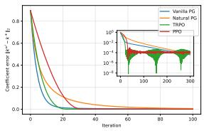  
(a) $A = - 1 0 .$

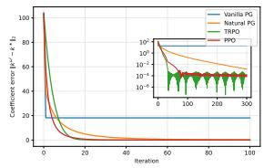  
(b) B = 10, ω0 = (0.1, 1, 1).

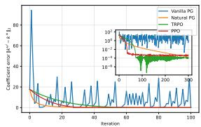  
(c) $\sigma = 1 0 .$

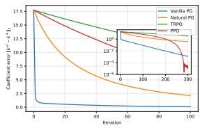  
(d) $\sigma = 1 0$ and efective steps divided by 10.

Figure 4: Known-dynamics experiments under diferent choices of the dynamics parameters.  
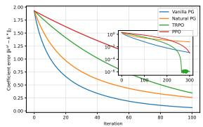  
(a) Efective steps divided by 10.

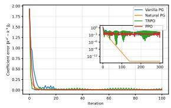  
(b) Efective steps multiplied by 10.

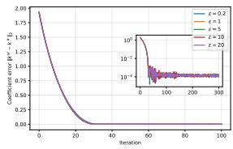

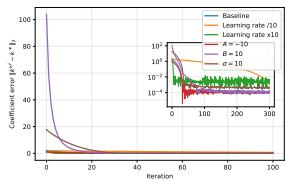  
(d) PPO under diferent settings.  
Figure 5: Known-dynamics experiments: sensitivity to the update parameters.

The experiments with $\sigma = 1 0$ illustrate a diferent efect. In this LQR setting, σ does not change the optimal feedback coeficients, but it broadens the state distribution used in the Monte Carlo policy gradient estimator. As a result, vanilla PG exhibits large spikes, whereas the preconditioned or constrained updates remain substantially more stable. Reducing the efective steps by a factor of ten suppresses these spikes, at the cost of slower convergence during the first iterations.

We next study the sensitivity to the policy-update parameters. Figure 5 confirms that the efective update size controls the main speed–stability trade-of. Dividing all steps by ten produces smooth but slower convergence. Multiplying them by ten accelerates the initial decrease but also produces oscillations and can move an iterate outside the admissible region. For TRPO, multiplying the efective step by a factor c corresponds to multiplying the quadratic radius by $c ^ { 2 } .$

The PPO curves obtained with the tested clipping ratios are nearly identical during the main transient, with small diferences appearing mainly in the long-run error. Thus, in this configuration, the clipping ratio is not the main factor limiting convergence. The learning rate and the scaling of the dynamics have a substantially larger efect on the observed stability.

PhiBE with known discrete-time dynamics. We complement the results of Section 6.1.2 by studying the sensitivity of Optimal-PhiBE to changes in the dynamics and in the policy-update parameters. Figure 6 considers changes in A and B. For $A = - 1 0$ , all methods continue to converge to a low error with respect to k∗, although the transient behavior changes. The case $B = 1 0$ is again more sensitive to the policy initialization and update size. With the admissible initialization $\omega ^ { 0 } = ( - 0 . 5 , 1 , 1 )$ , the four methods reach the low-error region, showing behavior consistent with the corresponding known-dynamics experiment.

Figure 7 studies the efect of the update parameters. Dividing the efective steps by ten gives smoother but slower convergence. Multiplying them by ten accelerates the initial decrease and reaches the low-error region quickly, but produces a more visible oscillatory floor. Thus, as in the known-dynamics case, the efective update size determines the main trade-of between convergence speed and stability.

The PPO curves corresponding to the tested clipping ratios remain close throughout the optimization, with diferences appearing mainly at the long-run error level. The additional PPO experiment shows the same qualitative robustness observed in the known-dynamics setting. For these experiments, the learning rate therefore has a more visible efect on the optimization than the clipping ratio.

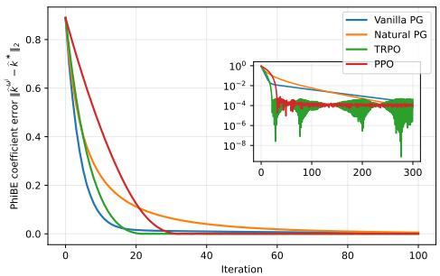

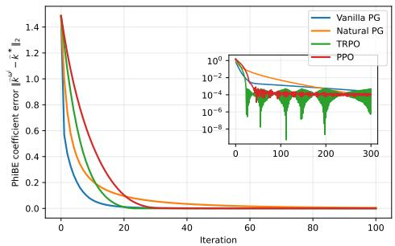  
(b) B = 10, ω0 = (−0.5, 1, 1).

(a) A = −10.  
Figure 6: Optimal-PhiBE with known discrete-time dynamics: changes in A and B.  
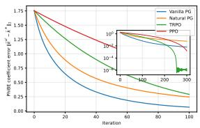  
(a) Efective steps divided by 10.

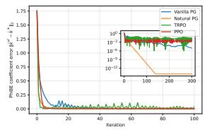  
(b) Efective steps multiplied by 10.

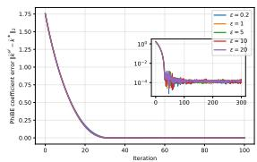

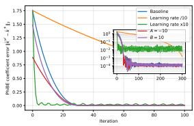  
(d) PPO robustness with ϵ = 10.  
Figure 7: Optimal-PhiBE with known discrete-time dynamics: update-parameter studies.

Data-driven of-policy PhiBE. We provide the implementation details and additional experiments for the of-policy setting of Section 6.1.3. Before optimization, we collect a fixed dataset $\mathcal { D } _ { \mathrm { o f f } } = \{ ( s _ { i } , a _ { i } , r _ { i } , s _ { i } ^ { \prime } ) \} _ { i = 1 } ^ { n }$ of independent transition pairs. We sample $s _ { i }$ from the full-support state distribution $\rho _ { b } = 0 . 3 5 \mathcal { N } ( 0 , 0 . 5 ^ { 2 } )$ + $0 . 4 0 \mathcal { N } ( 0 , 2 ^ { 2 } ) + 0 . 2 5 \mathcal { N } ( 0 , 1 5 ^ { 2 } )$ and then sample $a _ { i }$ from the known behavior policy $\pi _ { b } ( \cdot \mid s _ { i } ) = \mathcal { N } ( - 0 . 1 s _ { i } +$ $0 . 4 , ( 1 . 4 + 0 . 4 | s _ { i } | ) ^ { 2 } )$ . We set $r _ { i } = r ( s _ { i } , a _ { i } )$ and generate $s _ { i } ^ { \prime }$ from the exact LQR transition law (46), holding $a _ { i }$ fixed over the interval $\Delta t .$ . Thus, the observations are independent state-action transition pairs rather than consecutive samples from behavior trajectories. The dataset is generated once and reused to estimate the PhiBE-Q critic, the state-occupancy ratio, and every actor update; the continuous-time coeficients are used only by the simulator and to evaluate the plotted error.

For the critic, we use $\Phi ( s , a ) = ( 1 , s , s ^ { 2 } , s a , a , a ^ { 2 } ) ^ { \top }$ . Its policy average $\Phi ^ { \pi _ { \omega } k } \left( s \right)$ and first two state derivatives are available analytically for the Gaussian policy. We solve the empirical Galerkin system after scaling its test and residual columns by their empirical root mean squares and applying a small ridge of $1 0 ^ { - 1 0 }$ relative to the scaled matrix norm. For the state-occupancy ratio in Section A.3.2, we take $\psi _ { 1 } ( s ) = 1$ and $\psi _ { \ell + 1 } ( s ) = \exp ( - ( s - c _ { \ell } ) ^ { 2 } / ( 2 h ^ { 2 } ) )$ for $\ell = 1 , \ldots , 1 0$ , where the centers $c _ { \ell }$ are the empirical behavior-state quantiles from 0.03 to 0.97 and $h = \mathrm { m a x } \{ 1 . 5 \mathrm { ~ m e d i a n } _ { \ell } ( c _ { \ell + 1 } - c _ { \ell } ) , 0 . 1 5 \widehat { \mathrm { s d } } ( s _ { i } ) , 0 . 0 5 \}$ . We normalize these functions as in (102) and use the 13 test functions $( f _ { 1 } , \dots , f _ { 1 3 } ) = ( \bar { \psi } _ { 1 } , \dots , \bar { \psi } _ { 1 1 } , s , s ^ { 2 } )$ . Since $\rho _ { 0 } = \mathcal { U } ( - 1 , 1 )$ the right-hand side of (103) is evaluated by 64-point Gauss–Legendre quadrature. We solve a row-scaled version of (104) with ridge parameter $\eta _ { \zeta } = 1 0 ^ { - 4 }$ and the stated simplex constraints. The actor then uses the weights in (105); no current-policy transitions are generated during optimization.

We measure the coeficient error by $\| ( k _ { 2 } ^ { \omega ^ { k } } , k _ { 1 } ^ { \omega ^ { k } } , k _ { 0 } ^ { \omega ^ { k } } ) - ( k _ { 2 } ^ { * } , k _ { 1 } ^ { * } , k _ { 0 } ^ { * } ) \| _ { 2 }$ . In the method comparison, all four optimizers use the same $n = 5 0 { , } 0 0 0$ transitions with $\Delta t = 1$ for 300 actor iterations. The update parameters are $\eta _ { \mathrm { P G } } = \eta _ { \mathrm { N P G } } = 0 . 1 , \delta _ { \mathrm { T R P O } } = 0 . 0 0 5$ , and $\eta _ { \mathrm { P P O } } = 0 . 0 0 5$ , with five PPO epochs and clipping ratio $\epsilon = 0 . 2$ The remaining parameter studies use vanilla PG unless stated otherwise.

We first study the amount and temporal resolution of the of-policy data. Figure 8a compares configlarge excursions show that decreasing the actor step alone does not remove the variability introduced by the finite-sample estimates of the local moments.

Algorithm 2 Of-policy data-driven PhiBE-Q algorithm for LQR   
1: Input: initial policy $\omega ^ { 0 } .$ , critic and occupancy-ratio bases, known behavior policy $\pi _ { b } .$ , behavior-data size   
n, observation interval $\Delta t ,$ and actor-update parameters.   
2: Collect fixed data: sample independent states $s _ { i } \sim \rho _ { b }$ and actions $a _ { i } \sim \pi _ { b } ( \cdot \mid s _ { i } )$ ; hold each action   
fixed over $\Delta t$ and store $\mathcal { D } _ { \mathrm { o f f } } = \{ ( s _ { i } , a _ { i } , r _ { i } , s _ { i } ^ { \prime } ) \} _ { i = 1 } ^ { n }$   
3: For every tuple set $\Delta s _ { i } = s _ { i } ^ { \prime } - s _ { i } , \hat { b } _ { i } = \Delta s _ { i } / \Delta t ,$ and $\hat { \Sigma } _ { i } = ( \Delta s _ { i } ) ^ { 2 } / \Delta t .$   
4: for $k = 0 , 1 , \ldots , K - 1$ do   
5: Compute $\Phi ^ { \pi _ { \omega ^ { k } } } \left( s \right)$ and its first two state derivatives.   
6: Form the PhiBE-Q Galerkin matrix   
$F _ { k } = \frac { 1 } { n } \sum _ { i = 1 } ^ { n } \Phi { { \left( { { s } _ { i } } , { { a } _ { i } } \right) } \left[ \beta \Phi { { \left( { { s } _ { i } } , { { a } _ { i } } \right) } - \partial _ { s } \Phi ^ { \pi _ { \omega ^ { k } } } \left( { { s } _ { i } } \right) } { { \hat { b } } _ { i } } - \frac { 1 } { 2 } { { \partial } _ { s s } } \Phi ^ { \pi _ { \omega ^ { k } } } \left( { { s } _ { i } } \right) { { \hat { \Sigma } } _ { i } } \right] } ^ { \top }  .$   
7: Form $\begin{array} { r } { g _ { k } = \frac { 1 } { n } \sum _ { i = 1 } ^ { n } \big ( r _ { i } - \lambda \log \pi _ { \omega ^ { k } } ( a _ { i } \mid s _ { i } ) \big ) \Phi ( s _ { i } , a _ { i } ) } \end{array}$ and obtain $\xi _ { k }$ from the scaled, regularized solve of   
$F _ { k } \xi _ { k } = g _ { k }$   
8: Set $\hat { Q } _ { k } ( s , a ) = \xi _ { k } ^ { \top } \Phi ( s , a )$ and $\hat { A } _ { k } ( s , a ) = \beta \big ( \hat { Q } _ { k } ( s , a ) - \mathbb { E } _ { \bar { a } \sim \pi _ { \omega ^ { k } } ( \cdot | s ) } [ \hat { Q } _ { k } ( s , \bar { a } ) ] \big )$   
9: Estimate $\widehat { \zeta } _ { \omega ^ { k } }$ from $\mathcal { D } _ { \mathrm { o f f } }$ using (103)–(104) with the trial and test functions specified above.   
10: Compute $\widehat { \chi } _ { i , k }$ by (105) at every observed pair $( s _ { i } , a _ { i } )$ and perform the selected PG, NPG, TRPO, or   
PPO update as in Section A.3.3.   
11: end for   
12: Return: $\omega ^ { K } .$   
urations around $\Delta t = 0 . 1$ . Their initial convergence is similar, but their final errors difer. At $\Delta t = 0 . 1$   
increasing the dataset from $n = 3 0 { , } 0 0 0$ to $n = 1 0 0 { , } 0 0 0$ reduces the error from approximately $5 . 7 \times 1 0 ^ { - 4 }$ to   
$3 . 1 \times 1 0 ^ { - 4 }$ . With $n = 3 0 { , } 0 0 0$ , reducing the interval to $\Delta t = 0 . 0 5$ gives a smaller, approximately $5 . 2 \times 1 0 ^ { - 4 }$   
error, whereas increasing it to $\Delta t = 0 . 2$ raises the error to approximately $9 . 2 \times 1 0 ^ { - 4 }$   
The efect of temporal resolution is clearer for coarser observations. In Figure 8b, the final error with   
$n = 3 0 { , } 0 0 0$ is approximately $5 . 3 \times 1 0 ^ { - 3 }$ at $\Delta t = 0 . 5$ $1 . 4 \times 1 0 ^ { - 2 }$ at $\Delta t = 1$ , and $2 . 7 \times 1 0 ^ { - 2 }$ at $\Delta t = 2 .$   
Increasing the dataset to $n = 1 0 0 { , } 0 0 0$ at $\Delta t = 1$ leaves the final error essentially unchanged. Thus, in   
this coarse-observation regime, additional transitions do not remove the dominant error associated with the   
observation interval.   
Finally, Figure 8c varies the environment parameters around the default configuration $n = 3 0 { , } 0 0 0$ and   
$\Delta t = 0 . 1$ The case $A = - 1 0$ reaches a small final error, while $B = 1 0$ converges to a higher error of   
approximately $1 . 9 \times 1 0 ^ { - 2 }$ using $\eta _ { \mathrm { P G } } = 0 . 0 1$ High difusion remains challenging because it increases the   
variability of the observed increments and their second moments. For $\sigma = 1 0$ , we use $n = 1 0 0 { , } 0 0 0$ and   
$\eta _ { \mathrm { P G } } = 0 . 0 0 5$ ; the error decreases smoothly to approximately $1 . 2 \times 1 0 ^ { - 2 }$ . These data and step-size choices   
stabilize the high-difusion experiment, so the large persistent spikes described for the earlier configuration   
are not present in the updated results.   
Data-driven on-policy PhiBE. We provide here the implementation details and additional experiments   
for the on-policy setting of Section 6.1.4. At every actor iteration, a fresh batch is generated from the current   
policy and used both to estimate the PhiBE critic and to construct the policy update.   
We first study the efect of changing the dynamics. Figure 9 shows that the $A = - 1 0$ case and both   
admissible initializations for $B = 1 0$ still enter a low-error region. Unlike the corresponding known-dynamics   
experiments, the curves fluctuate around a nonzero level because the critic and advantage are reconstructed   
from a new finite batch at every iteration. These fluctuations therefore persist even after the main optimiza  
tion transient has ended.   
High difusion provides the main stress test. For $\sigma = 1 0$ , vanilla PG exhibits occasional large excursions,   
while NPG, $\mathrm { T R P O } .$ and PPO remain in a substantially narrower range. Dividing the efective steps by   
ten reduces the size of the usual policy-update fluctuations, but also slows convergence. The remaining

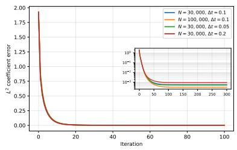

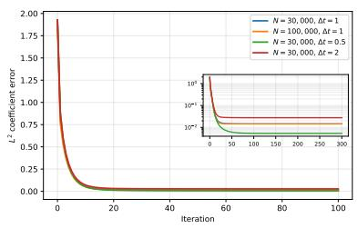

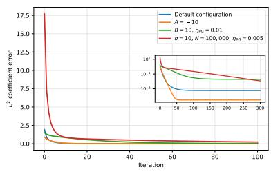  
(a) Data variations around $\Delta t = ( \mathrm { b } )$ Data variations around $\Delta t = 1 .$ (c) Changes in the environment pa-0.1. rameters.  
Figure 8: Additional experiments for the of-policy PhiBE-Q method.

Algorithm 3 On-policy data-driven PhiBE algorithm for LQR   
1: Input: initial policy $\omega ^ { 0 } .$ , basis $\phi ( s ) = ( 1 , s , s ^ { 2 } ) ^ { \top }$ , batch size $n ,$ local interval $\Delta t ,$ and update parameters.   
2: for $k = 0 , 1 , \ldots , K - 1$ do   
3: Sample $\tau _ { i } \sim \mathrm { E x p } ( \beta )$ and $S _ { i } = S _ { \tau _ { i } }$ from the current policy, starting from $S _ { 0 } \sim \mathcal { U } ( - 1 , 1 )$   
4: Draw $a _ { i } \sim \pi _ { \omega ^ { k } } ( \cdot | S _ { i } )$ and observe $( S _ { i } , a _ { i } , r _ { i } , S _ { i } ^ { \prime } ) , i = 1 , \dots , n .$   
5: Set $\Delta S _ { i } = S _ { i } ^ { \prime } - S _ { i } , \hat { b } _ { i } = \Delta S _ { i } / \Delta t ,$ and $\begin{array} { r } { \hat { \Sigma } _ { i } = ( \Delta S _ { i } ) ^ { 2 } / \Delta t . } \end{array}$   
6: Form   
$F _ { k } = \frac { 1 } { n } \sum _ { i = 1 } ^ { n } \phi ( S _ { i } ) \left[ \beta \phi ( S _ { i } ) - \partial _ { s } \phi ( S _ { i } ) \hat { b } _ { i } - \frac { 1 } { 2 } \partial _ { s s } \phi ( S _ { i } ) \hat { \Sigma } _ { i } \right] ^ { \top } ,$   
7: Form   
$g _ { k } = \frac { 1 } { n } \sum _ { i = 1 } ^ { n } \big ( r _ { i } - \lambda \log \pi _ { \omega ^ { k } } \big ( a _ { i } | S _ { i } \big ) \big ) \phi ( S _ { i } ) , \qquad \xi _ { k } = F _ { k } ^ { - 1 } g _ { k } ,$   
and set $\hat { V } _ { k } ( s ) = \xi _ { k } ^ { \top } \phi ( s )$   
8: Evaluate   
$\hat { A } _ { i } = r _ { i } - \lambda \log \pi _ { \omega ^ { k } } ( a _ { i } | S _ { i } ) + \hat { b } _ { i } \partial _ { s } \hat { V } _ { k } ( S _ { i } ) + \frac { 1 } { 2 } \hat { \Sigma } _ { i } \partial _ { s s } \hat { V } _ { k } ( S _ { i } ) - \beta \hat { V } _ { k } ( S _ { i } ) .$   
9: Use $\begin{array} { r } { ( 1 / \beta ) n ^ { - 1 } \sum _ { i = 1 } ^ { n } \hat { A } _ { i } \nabla _ { \omega } \log \pi _ { \omega ^ { k } } ( a _ { i } | S _ { i } ) } \end{array}$ , or the corresponding NPG, TRPO, or PPO direction, to   
obtain $\omega ^ { \dot { k } + 1 }$   
10: end for   
11: Return: $\omega ^ { K }$

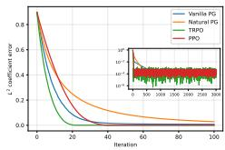  
(a) A = −10.

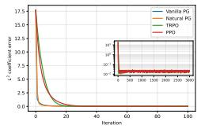

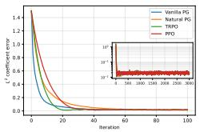  
(b) B = 10, ω0 = (c) B = 10, $\omega ^ { 0 } =$ (0, 1, 1). (−0.5, 1, 1).

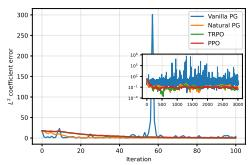  
(d) σ = 10.

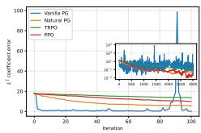  
(e) σ = 10 and efective steps divided by 10.

Figure 9: On-policy data-driven PhiBE: changes in the dynamics.  
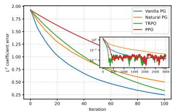  
(a) Efective steps divided by 10.

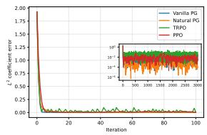  
(b) Efective steps multiplied by 10.

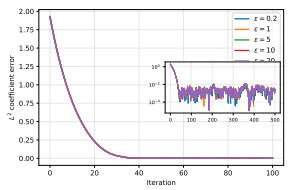

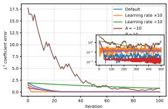  
(d) PPO robustness with ϵ = 10.  
Figure 10: On-policy data-driven PhiBE: sensitivity to the update parameters.

Figure 10 studies the sensitivity to the policy-update parameters. Dividing the efective steps by ten produces smoother but slower convergence, whereas multiplying them by ten reaches the low-error region faster but increases the iteration-to-iteration fluctuations. Thus, the update size controls the speed–stability trade-of, while the persistent long-run fluctuations remain associated with the resampled critic and advantage.

The PPO curves remain close for the tested clipping ratios, indicating that clipping has a comparatively small efect on the long-run error in this configuration. In the robustness experiment, taking ϵ = 10 largely removes the efect of clipping. Combined with a larger learning rate, this leads to substantially less stable updates, illustrating the role of restricting the policy change when the critic itself is estimated from fresh finite-sample data.

## A.4.2 Diferential wheeled robot

We provide here the implementation details omitted from Section 6.2. The value network has three hidden layers of width 128, while the policy network has one hidden layer of width 128. All hidden layers use SiLU activations. Collocation states are sampled on $[ - 0 . 5 , 1 . 5 ] ^ { 2 } \times [ - \pi , \pi )$ , with 70% uniform samples and 30% samples concentrated near the target, using spatial standard deviation 0.3. Adam and gradient clipping at norm 10 are used throughout, with PPO clipping parameter 0.2.

For known dynamics, fixed-policy evaluation uses 10,000 critic steps. Joint training records epochs 0 through 60. Each policy stage is preceded by 1000 critic steps using batches of 3000 states and followed by 40 PPO batches of size 3000, with five PPO updates per batch. The critic and actor learning rates are both $1 0 ^ { - 3 }$

For data-driven dynamics, the observation interval is $\Delta t = 0 . 0 1$ , and fixed-policy evaluation again uses 10,000 critic steps. Joint training records epochs 0 through 360. Each critic step uses 1000 collocation states. Every policy stage is followed by 20 actor batches of 5000 discounted-occupancy states, with five PPO updates per batch. The critic and actor learning rates are $1 0 ^ { - 3 }$ and $5 \times 1 0 ^ { - 4 }$ , respectively.

The reference values used for validation are computed independently from the training procedure using

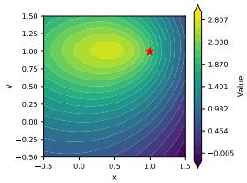  
(a) Fitted, θ = 0.

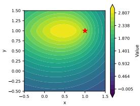  
(b) Reference, $\theta = 0 .$

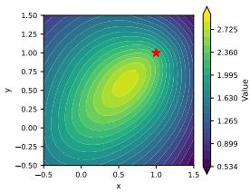  
(c) Fitted, $\theta = \pi / 4 .$

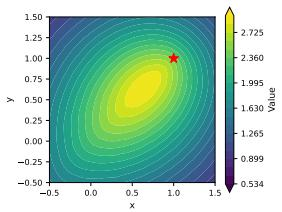  
(d) Reference, $\theta = \pi / 4$

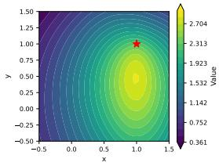  
(e) Fitted, $\theta = \pi / 2 .$

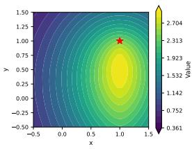  
(f) Reference, $\theta = \pi / 2 .$

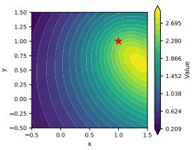  
(g) Fitted, $\theta = 3 \pi / 4 .$

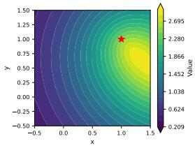  
(h) Reference, $\theta = 3 \pi / 4$

Figure 11: Fixed-policy evaluation with known dynamics: fitted critic and independent Monte Carlo reference for diferent headings.

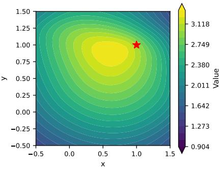  
(a) Fitted value, epoch 60.

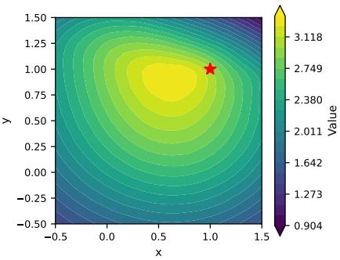  
(b) Reference value, epoch 60.  
Figure 12: Known-dynamics policy optimization: final value-function comparison at $\theta = 0$

the known simulator with 64 Monte Carlo rollouts, horizon 6, and time step $1 0 ^ { - 3 } \mathrm { ~ o n ~ a ~ } 3 1 \times 3 1$ spatial grid. These reference values are not used in either the critic or actor loss. Trajectory plots use the deterministic policy mean, time step 0.01, and horizon 5. All trajectory panels display the same window $[ - 0 . 1 , 1 . 1 ] ^ { 2 }$ ; this restriction is only used for visualization and does not modify the simulated trajectories.

Known-dynamics nonlinear robot wheel. We provide here the value-function and trajectory comparisons corresponding to the known-dynamics experiments of Section 6.2.

For fixed-policy evaluation, Figure 11 compares the fitted critic with an independent Monte Carlo estimate of the same entropy-regularized discounted return. A common color scale is used within every fitted–reference pair. Across the four tested headings, the fitted critic closely reproduces the location of the high-value region and the orientation of the reference contours. The agreement is therefore not restricted to a single heading and confirms that the neural critic captures the dependence of the value function on both position and orientation.

For the final epoch-60 policy, Figure 12 compares the fitted value with the corresponding Monte Carlo reference at $\theta = 0 .$ . The two surfaces have nearly the same high-value region and contour geometry, showing that the critic remains accurate after the policy has been updated repeatedly.

Figure 13 illustrates the evolution of the deterministic mean policy. At epoch 0, the trajectories are largely determined by their initial headings and most do not approach the target. By epoch 10, the learned policy already produces visible heading-dependent turns toward the target region. At epoch 60, the trajectories corresponding to the diferent initial headings are redirected toward the neighborhood of (1, 1). After reaching this region, some trajectories continue to curve because the robot cannot stop, the target is not absorbing, and no terminal condition is imposed.

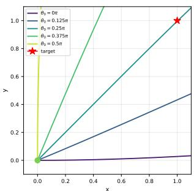  
(a) Epoch 0.

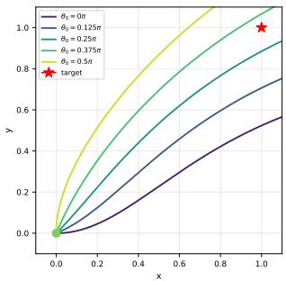  
(b) Epoch 10.

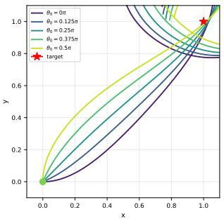  
(c) Epoch 60.

Figure 13: Known-dynamics policy evolution. All panels display the common window $[ - 0 . 1 , 1 . 1 ] ^ { 2 }$  
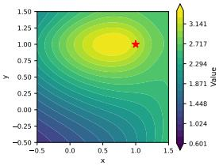  
(a) Fitted, θ = 0.

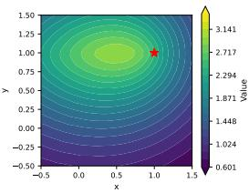  
(b) Reference, θ = 0.

  
(c) Fitted, $\theta = \pi / 4$

  
(d) Reference, $\theta = \pi / 4$

  
(e) Fitted, $\theta = \pi / 2 .$

  
(f) Reference, $\theta = \pi / 2 .$

  
(g) Fitted, $\theta = 3 \pi / 4 .$

  
(h) Reference, $\theta = 3 \pi / 4$  
Figure 14: Fixed-policy evaluation with data-driven PhiBE: fitted critic and independent Monte Carlo reference for diferent headings.

Data-driven results. We provide here the value-function and trajectory comparisons corresponding to the data-driven experiments of Section 6.2.

For fixed-policy evaluation, Figure 14 compares the fitted PhiBE critic with independent Monte Carlo estimates of the same entropy-regularized discounted return. A common color scale is used within every fitted–reference pair. Across the tested headings, the fitted critic reproduces the location of the high-value region and its systematic deformation with the robot orientation. Compared with the known-dynamics critic, visible diferences remain in some contour shapes and value levels, as expected when the reward and loca PhiBE quantities are estimated from finitely many transitions. Nevertheless, the agreement in the global value structure shows that the data-driven critic recovers the main position- and heading-dependent features required for policy improvement.

For the final epoch-360 policy, Figure 15 compares the fitted value with the independent Monte Carlo reference at $\theta = 0$ . The two functions recover the same main high-value region and global spatial structure, while some diferences remain in the detailed contour geometry. This is consistent with the finite-sample approximation used by the data-driven critic.

  
(a) Fitted value, epoch 360.

  
(b) Reference value, epoch 360.

Figure 15: Data-driven policy optimization: final value-function comparison at $\theta = 0$  
  
(a) Epoch 0.

  
(b) Epoch 40.

  
(c) Epoch 360.  
Figure 16: Data-driven policy evolution. All panels display the common window $[ - 0 . 1 , 1 . 1 ] ^ { 2 }$

Figure 16 shows the evolution of the deterministic mean policy. At epoch 0, the trajectories are largely determined by their initial headings and most do not approach the target. By epoch 40, all five tested headings are already redirected toward the target neighborhood. The epoch-360 policy preserves this behavior and produces a consistent approach to the high-reward region. As in the known-dynamics experiment, trajectories may continue to curve after reaching this neighborhood because the robot has fixed forward speed, the target is not absorbing, and no terminal condition is imposed.