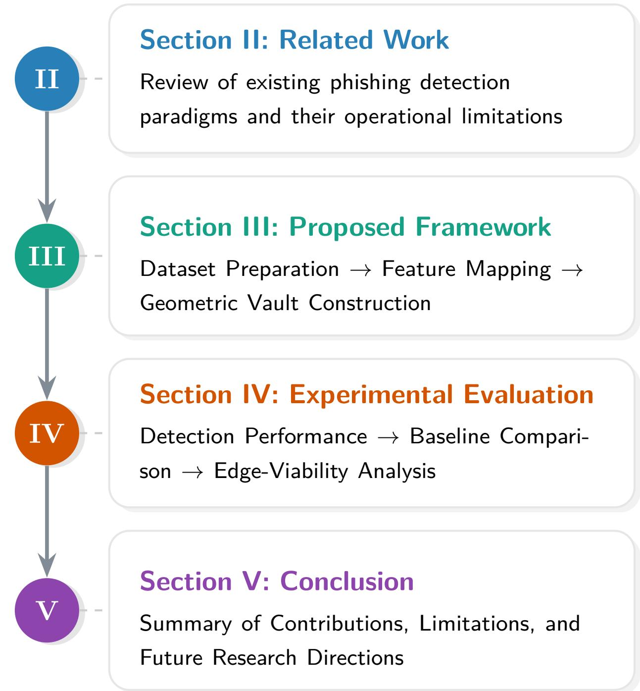
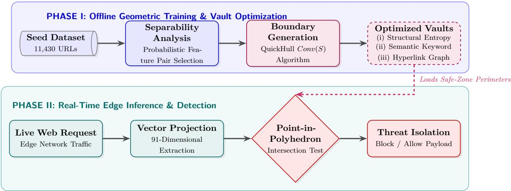
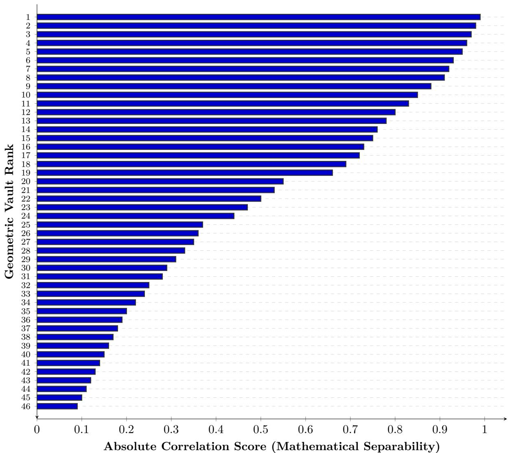
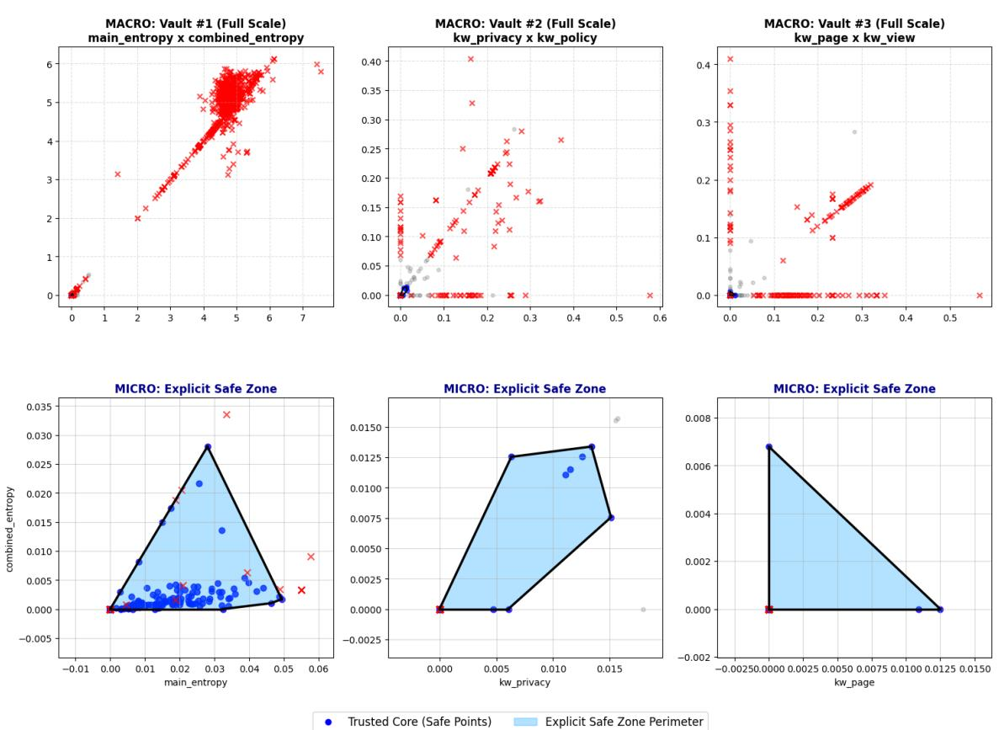
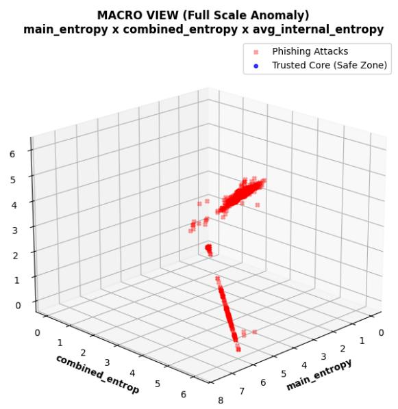
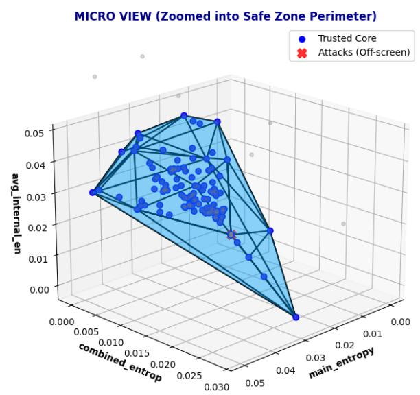
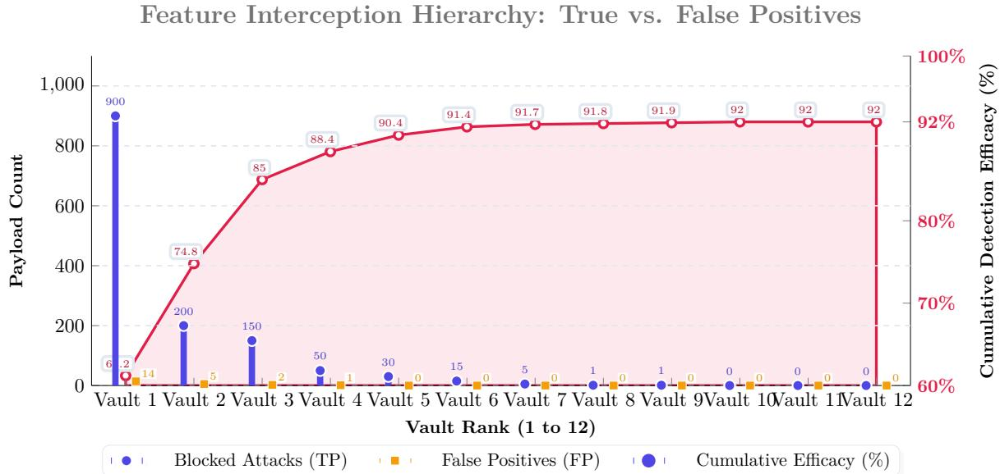
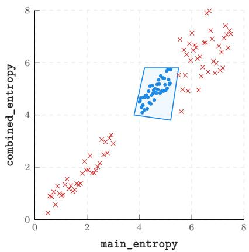
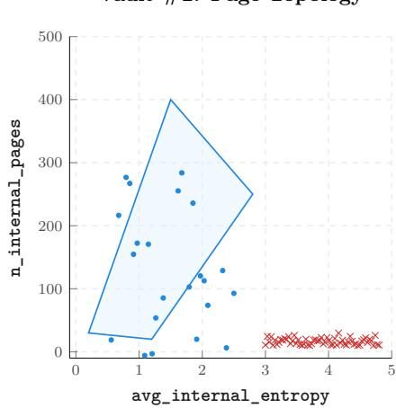
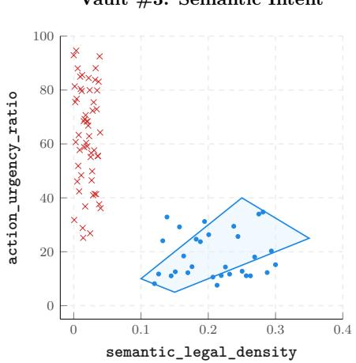

# CyberHull: Deterministic Malicious URL Isolation via Convex Hull

Avijit Gayen, Aniket Ghosal, Durba Chakraborty, Sayan Mondal, Md Abdul Aziz Al Aman, Angshuman Jana

Department of CSE, Techno India University, Kolkata, India Department of CSE (AI), Techno India University, Kolkata, India Department of CSE, Indian Institute of Information Technology, Assam, India

## Abstract

The emergence of increasingly sophisticated and evasion-resistant phishing attack strategies represents a key risk to today’s cybersecurity landscape involving cyber-physical systems and internet-based networks. Traditional probabilistic methods and some forms of machine learning have dificulty dealing with novel attacks and may lack interpretability or portability. To address this challenge, we present CyberHull, a resource-eficient and deterministic approach that identifies malicious URLs through the formation of mathematically defined convex hull perimeters across multiple orthogonal feature domains (structural content entropy, hyperlink graph topography, semantic token distribution). CyberHull trains relatively small convex hulls known as “vaults” using QuickHull algorithm (complexity of O(n log n) during training stage), while each point-in polyhedron test of a request entails low computational overhead on standard CPUs. Our experiment demonstrates that CyberHull achieves 92% detection accuracy and significantly surpasses a basic linear approach based on PCA algorithm (32%). Moreover, this method is computionally more eficient compared to contemporary deep learning solutions.

Keywords: phishing detection; malicious URLs; convex hull; geometric anomaly detection; explainable security.

## 1 Introduction

The phishing site can be described as a website that mimics the websites of well-known organizations. It is intended to trick users into surrendering their login information and other sensitive data. The use of such websites as a launching pad for cyber attacks means that phishing pages have become more and more sophisticated. The use of advanced phishing frameworks is an emerging and serious threat to the worldwide network systems.

Today’s cyber attackers have moved beyond simple fake domain names. Instead, they use automated phishing generation pipelines that can produce adaptive malicious URLs with advanced evasion techniques such as highly obfuscated HTML structures [1], randomized routing mechanisms [2], and irregular entropy distributions in web content [3]. Industry reports from recent years illustrate the scale and impact of these threats. The Anti-Phishing Working Group (APWG) has reported more than one million phishing campaigns each quarter [4] . The FBI Internet Crime Complaint Center (IC3) reports billions of dollars in annual losses due to phishing and business-email-compromise incidents [5]. By design, these adversaries mimic legitimate site behavior while constantly changing observable signatures, severely degrading the efectiveness of traditional blacklist and signature-based detection systems [6]. This has resulted in the emergence of novel, previously unseen phishing campaigns that threaten the operational integrity of large-scale Internet infrastructures and critical cyber-physical systems.

Therefore, it is vital to adopt a radical new approach from rule-based methods to structural anomaly detection processes in response to such a daunting situation. While the academic literature provides a variety of analytical countermeasures to address these challenges, all existing paradigms sufer from fundamental weaknesses.

To deal with such challenges, cybersecurity professionals have introduced diferent analytical methods [7], but all of them involve essential weaknesses. Traditional statistical and probabilistic algorithms are usually inefective since they operate under fixed constraints regarding past data distribution patterns [8]; these systems are prone to quickly deteriorate in case if the attack causes changes to the nature of the signature left by the adversary. Graph-theoretic and heuristic methods, in turn, try to understand the network connections [9] and structure of the content [10], but they are costly and can easily be interfered with by "noise," such as injecting innocent keywords and dead links by the attacker. Thus, DL systems are widely used because of their high performance in classifying diferent threats [11]. Nevertheless, the modern neural nets also pose certain issues since they are unable to provide deterministic explanations (see the table 1) . Namely, their training process is quite demanding in terms of computer power, and they are based on obscure parameter weights that do not allow one to determine why the algorithm classified certain domains as malicious in mathematical terms [12].

Table 1: Technological Capability Matrix
<table><tr><td rowspan=1 colspan=1>Requirement</td><td rowspan=1 colspan=1>Statistical</td><td rowspan=1 colspan=1>DL</td><td rowspan=1 colspan=1>CyberHull</td></tr><tr><td rowspan=1 colspan=1>Previously Unseen Detection</td><td rowspan=1 colspan=1>X</td><td rowspan=1 colspan=1></td><td rowspan=1 colspan=1>V</td></tr><tr><td rowspan=1 colspan=1>Explainability</td><td rowspan=1 colspan=1>7</td><td rowspan=1 colspan=1>X</td><td rowspan=1 colspan=1></td></tr><tr><td rowspan=1 colspan=1>Edge Efficiency</td><td rowspan=1 colspan=1></td><td rowspan=1 colspan=1>X</td><td rowspan=1 colspan=1>V</td></tr><tr><td rowspan=1 colspan=1>Autonomous Scaling</td><td rowspan=1 colspan=1>X</td><td rowspan=1 colspan=1>L</td><td rowspan=1 colspan=1>L</td></tr></table>

This paper contributes mainly by introducing CyberHull, a deterministic spatial threat-isolation framework built on computational geometry, to address limitations in probabilistic classification and the lack of interpretability of deep learning-based threat detection systems. CyberHull does not model dynamic adversarial behaviors in a constant manner, but instead uses an explicit verification paradigm, requiring each web request to meet pre-defined mathematical boundary conditions to be legitimate. The proposed framework uses convex geometric representations to give mathematically provable safe regions that represent predictable benign web trafic, enabling deterministic isolation of anomalous requests that stray outside the learned spatial boundaries.

To this end, CyberHull maps high-variance web attributes such as aggregate content entropy, semantic keyword distributions and hyperlink topology ratios into a multi-dimensional coordinate space. The framework then constructs several independent geometric “Vaults” for cross-space verification using QuickHull [13]-based convex boundary generation. Thus, even if a sophisticated phishing payload succeeds in mimicking one structural property of legitimate trafic, it is mathematically bound to violate the orthogonal constraints of another Vault during spatial containment verification [6]. This multi-tier geometric verification strategy also enhances interpretability by substituting opaque probabilistic decision boundaries with mathematically explainable spatial constraints. Experiments on benchmark phishing datasets demonstrate that the proposed multi-tier geometric framework achieves 92% detection accuracy with significantly lower computational overhead compared to deep learning alternatives. However, applying the framework in practice poses several challenges, including the computational cost of mapping high-dimensional spaces and the need to periodically re-calibrate convex boundaries to account for the evolving topology of legitimate web infrastructures over time.

Expanding upon the above empirical results, this study will tackle the weaknesses inherent to probabilistic threat detection by way of the following fundamental innovations:

• We propose CyberHull, a deterministic geometric threat-isolation framework, leveraging Convex Hulls to derive mathematically verifiable spatial boundaries for legitimate web trafic.

• A multi-tier cross-reference geometric verification strategy for detecting adversarial phishing payloads across multiple orthogonal feature spaces, and achieving 92% detection accuracy with a significantly lower computational overhead than conventional deep learning-based approaches.

Most importantly, the proposed geometric framework relies on the use of mathematically verifiable spatial representations, rather than on opaque hidden weight optimization, thus the decision-making process is inherently interpretable and computationally lightweight. Moreover, the deterministic nature of the framework reduces the need for extensive heuristic tuning, making it more suitable for scalable and automated threat analysis environments. The following sections present the evolution of modern phishing detection techniques and discuss the potential of overcoming the operational limitations of traditional machine learning and heuristic-based systems with the proposed CyberHull framework to demonstrate the significance of this geometric detection paradigm. The structure of the paper is illustrated in Fig. 1.

## 2 Related Work

The trend within malicious URL detection is a departure from conventional blacklists to more sophisticated learning and behavioral approaches. Contemporary research into malicious URLs has relied significantly on natural language processing (NLP) and TF-IDF extraction to determine the semantics of the web content [3, 14]. On that premise, various scholars have made use of ensemble learning and SVM techniques to predict malicious URLs through structural entropy and lexical attributes [11]. Recent studies have also looked into hybrid and ensemble-driven cybersecurity frameworks that combine statistical filtering, graph analytics and machine learning classifiers to achieve better robustness against adversarial manipulation and feature obfuscation [15]. The goal of these approaches is to combine the interpretability of structured analytical methods with the adaptive learning capabilities of modern classifiers [16]. However, while these hybrid systems achieve better detection performance, they still largely rely on probabilistic inference mechanisms and often inherit the computational overhead and explainability limitations associated with conventional machine learning models. In recent times, deep neural networks [15, 7] and graph-based techniques [9, 10] have been extensively explored. These paradigms exhibit exceptional ability to detect hyperlink connections and extract latent non-linear features, thereby enhancing classification performance.

However, despite these systems demonstrating impressive abilities, the contemporary literature identifies their significant drawbacks. For one, deep learning models require considerable amounts of time for training alongside intensive computer memory space [12]; hence, these systems cannot function eficiently within edge devices that are limited by computing power and storage capacity. Moreover, since such systems utilize probabilistic parameters for prediction rather than spatial rules, they fail to provide suficient transparency on why a particular anomaly triggered an alarm [16]. This precise problem of lacking mathematical proof has compelled scholars in other critical areas to explore geometric models.

  
Figure 1: Structural organization and thematic flow of the remainder of the paper.

Deep learning frameworks [12] have computational constraints, and classical statistical and linear dimensionality-reduction approaches have also exhibited important limitations in modern web-based threat environments [6]. Popular machine learning techniques such as Principal Component Analysis (PCA) assume very strong assumptions on linear separability and normally distributed feature spaces [8]. However, modern phishing ecosystems exhibit strongly non-linear characteristics with irregular entropy distributions [3], semantic anomalies and dynamically evolving hyperlink relationships [9, 10]. Thus, simple linear transformation methods often do not yield reliable decision boundaries for complex adversarial web trafic patterns.

This practical problem in using linear classifiers, exacerbated by the "black box" nature of deep neural networks [15, 7, 16], has resulted in an important operational gap in the field of threat identification in real time. For applications in which predictability and transparency are key, scientists studying defensive mechanisms in physical spaces like autonomous UAV swarm tracking, missile trajectory representation, and radar border mapping have efectively eliminated probabilistic guesswork by employing computational geometry [13]. In such high-stakes areas of study, N-dimensional Convex Hulls form inflexible and unforgiving spatial borders surrounding known objects. Nevertheless, although these robust mathematical concepts have found widespread use in the analysis of physical battlefields, they have seen little application in cybersecurity to date. Consequently, one major limitation is that no deterministic and geometrically meaningful cybersecurity approach has been developed yet, which can efectively separate malicious web trafic without depending solely on probabilistic learning models. CyberHull is designed precisely for this purpose. This paper solves the problem by applying topological principles to map non-linear traits of the cyber domain into individual geometric Vaults [6].

## 3 Proposed Model

In this section, we begin by describing the seed dataset utilized in this work.

## 3.1 Benchmark Dataset Description

In order to test the CyberHull algorithm empirically, we used a data set based on the Web Page Phishing Detection Dataset [2]. An initial seed of 11,430 URL samples, each representing 91 features, was put through an elaborate preprocessing procedure. In the end, the highly curated set consisted of 769 legitimate and 46 phishing URL samples, containing only those whose hyperlinks and semantic data could be completely extracted [1]. The drastic reduction in the size of the dataset was mainly due to the strict preprocessing constraints needed for deterministic geometric modelling. A significant proportion of the original URLs contained incomplete hyperlink structures, broken semantic metadata, inaccessible embedded resources, or partially missing entropy-related attributes, rendering them unsuitable for reliable high-dimensional spatial mapping. In the final experimental study, we considered only the samples with completely extractable and structurally valid feature spaces, because the proposed convex-boundary framework relies on mathematically consistent feature representations in all dimensions. The final dataset exhibits a very severe class imbalance between legitimate and phishing samples. This distribution was intentionally preserved. Operationally, this 16:1 ratio is an accurate approximation of real web environments and enables a more rigorous evaluation of the framework under real-world anomaly-isolation conditions. More important mathematically, this imbalance does not require any synthetic correction (like SMOTE). In contrast to probabilistic classifiers that minimize frequency-based loss functions, thus being sensitive to class imbalance, the CyberHull framework depends only on spatial containment. A Convex Hull is defined only by the coordinates (vertices) of the outer boundary of the valid data cluster. Thus, the safe zone design is strictly invariant to the frequency distribution of malicious samples; hence, oversampling methods are mathematically irrelevant in the process of forming geometric boundaries. The final data set was presented in the form of a JSON object, containing deep attributes such as links distribution, term frequencies (TF-IDF) [14], and explicit Shannon entropy [3]. A cursory analysis of the data indicated specific architectural diferences, supporting our choice of a geometric technique. Indeed, legitimate URLs create intricate graph structures [9], featuring intensive navigation within the site and numerous outbound links. Moreover, the semantics used in their descriptions include terms related to information (such as "institute" and "academic") and a high amount of structural entropy, implying diverse HTML content. However, malicious domains have a very sparse and isolated network structure for hyperlinks that is characteristic of a domain meant only for credential harvesting [10]. The semantic words in their case consist of an extremely high number of urgency-based words (such as login, secure, bank), leading to entropy reduction. Through the exploitation of such great diferences in hyper-link density, intention, and entropy, we achieve a highly discriminating multi-dimensional basis in which our algorithm is evaluated.

## 3.2 Probabilistic Vault Selection & Spatial Mapping

Unlike in heuristic approaches where the features chosen for use are rather arbitrarily picked, CyberHull uses a mathematical method that determines the best coordinate axes to use for geometric bounding through a probabilistic approach [8]. Let the set of features extracted be represented as $F =$ $\{ f _ { 1 } , f _ { 2 } , \ldots , f _ { 9 1 } \}$ . For each such feature $f _ { i } ,$ the probabilities $P ( f _ { i } \mid \mathrm { L e g i t i m a t e } )$ and $P ( f _ { i } )$ Malicious) are computed. Separability measure for every feature was calculated using the following normalized probabilistic distance metric:

$$
S ( f _ { i } ) = \frac { \lvert \mu _ { L } ( f _ { i } ) - \mu _ { M } ( f _ { i } ) \rvert } { \sigma _ { L } ( f _ { i } ) + \sigma _ { M } ( f _ { i } ) }
$$

where $\mu _ { L } ( f _ { i } )$ and $\mu _ { M } ( f _ { i } )$ are the means for feature $f _ { i }$ in the legitimate and malicious sample sets, and $\sigma _ { L } ( f _ { i } )$ and $\sigma _ { M } ( f _ { i } )$ are their respective standard deviations. The features with high separability scores surpass the predefined threshold, thus ensuring no spatial overlap among the classes. The best performing pairs are selected and mapped in three diferent Vaults into X and Y axes. The three Vaults chosen are representative of diferent behavioural dimensions of legitimate web infrastructure and adversarial trafic patterns, as illustrated in Figure 7. Specifically, the proposed framework constructs (i) a Structural Entropy Vault for the randomness and code-complexity analysis, (ii) a Semantic Keyword Vault for the linguistic and intent-based analysis, and (iii) a Hyperlink Graph Vault for the topological connectivity analysis. These three geometric subspaces together provide a mutually complementary multidimensional isolation of phishing behaviour in structural, semantic and network topological terms. All candidate feature pairs were carefully assessed using the normalized separability metric described above. A total of 46 independent geometric Vault combinations were created and ranked according to their intra-class separability and the strength of their geometric isolation. The three Vaults selected in this work correspond to the best performing combinations of feature-pairs that consistently showed maximal spatial separation of legitimate and malicious trafic distributions while maintaining stable multidimensional boundary formation. Figure 3 shows all evaluated Vault combinations in terms of the ranking distribution and relative separability performance.

Figure 2 depicts the overall operational workflow of the proposed $\mathrm { C y }$ berHull framework to enhance methodological interpretability. The framework has two main operational stages: an ofline geometric training stage for probabilistic feature analysis, multi-dimensional vault optimization, and convex boundary generation, and a lightweight real-time edge inference stage to project in-coming payloads onto the optimized geometric space for point-in-polyhedron verification. This dual-phase architecture enables eficient computational threat isolation, as well as strong geometric discrimination against novel adversarial payloads.

The most separable features were chosen as the basis vectors of the geometric Vault. By applying the variance matching method, the mathematical diference between the two probabilities is obtained in order to select those pairs of features that show the maximum discrimination ability, that is, by exceeding the separability threshold in order to achieve minimal overlap of coordinates for legitimate and malicious entities. This selection of the best performing pairs leads to their mapping into X and Y axes in three diferent Vaults.

  
Figure 2: Dual-Phase CyberHull System Architecture: The framework is divided into an ofline geometric boundary generation phase (Phase I) and a lightweight, real-time edge-inference phase utilizing Point-in-Polyhedron testing (Phase II).

Structural Entropy Vault: \* Spatial Axes: Shannon Entropy (X-axis) vs. Average Entropy of Internal HTML Pages (Y-axis). Security Advantage: While it may be trivial to fake a domain name, it is impossible for hackers to imitate the complexity of mathematical randomness within a legitimate web domain [3]. The Spatial Boundaries confine the highly obfuscated and repetitive phishing code within an isolated region.

Semantic Keyword Vault: \* Spatial Axes: Aggregated TF-IDF Score of Informational and Institutional Keywords (X-axis) vs. TF-IDF Score of Urgency-Driven Tokens (Y-axis). Security Advantage: This breaks the previously unseen evasion technique. Although even a unique and brand-new phishing URL may exist, the page will still need urgent action tokens such as "login" or "secure" in order to harvest credentials, thus mathematically moving out the coordinate point from the safe zone [6].

Hyperlink Graph Vault: \* Spatial Axes: Internal Link Density (X-axis) vs. Outbound Link Ratio (Y-axis). Security Advantage: Phishing URLs are inherently cheap and one-paged sites. They lack the deep interconnections of legitimate domain sites [10].

This probabilistic mapping works perfectly well, as seen from Figure 4 below, which depicts the 2D plot scatter plots of the chosen Vaults. In addition to this, as depicted by Figure 5 below, upon mapping these distinct features onto a 3D coordinate space, the genuine data points naturally form a cluster of data points within a mathematical boundary. This serves as an excellent basis for developing the multidimensional Convex Hulls [13].

## 3.3 The CyberHull Methodology

This section provides detailed information regarding the basic operational process of the CyberHull algorithm, transforming probabilistically chosen features to a deterministic geometric defense perimeter. The process is divided into three key stages – feature extraction, spatial boundary creation (training phase), and multiple dimensional intersection test (real-time detection phase).

The process of calculating the deterministic safety zone entails constructing the smallest polyhedral convex hull that contains the legal trafic points in each individual Vault. In accordance with the classical definition of Convex Hull in computational geometry [13], let $S = \{ x _ { 1 } , x _ { 2 } , \ldots , x _ { n } \}$ be a finite set of points in the d-dimensional feature space $\mathbb { R } ^ { d }$ . The Convex Hull of S, Conv(S), is defined by

  
Figure 3: Ranking the 46 selected geometric vaults by absolute feature-pair separability score. The definitions of all vault feature pairs (V1–V46) are provided in Appendix A.

$$
\begin{array} { r } { C o n v ( S ) = \left\{ \left. \displaystyle \sum _ { i = 1 } ^ { n } \alpha _ { i } x _ { i } \right| x _ { i } \in S , \alpha _ { i } \geq 0 , \right. } \\ { \left. \displaystyle \sum _ { i = 1 } ^ { n } \alpha _ { i } = 1 \right\} } \end{array}\tag{1}
$$

As such a rigorous spatial bound can be created through the implementation of the QuickHull and Delaunay Triangulation algorithms [13], ofering high eficiency when it comes to the generation of boundaries. Using the power of computational geometry rather than iterative learning of network weights [12], CyberHull creates a mathematically provable lightweight defense perimeter.

## Algorithm 1: CyberHull Geometric Detection

Figure 4: 2D spatial mapping and Explicit Safe Zone Perimeters across the top-performing Vaults. The MACRO view demonstrates the global isolation of previously unseen anomalies, while the MICRO view confirms the strict geometric boundaries of the trusted core.  

  
Figure 5: Macro and Micro views of the 3D Tri-Space Perimeter. The genuine data points naturally form a mathematically bounded dense core (blue), easily distinguished from the scattered adversarial payloads (red).

// Phase 1: Feature Extraction $\mathcal { E A }$ Variance Matching   
1: Parse S and extract 91-dimensional feature set $F ;$   
2: Calculate class probabilities $P ( f _ { i } \mid \mathrm { C l a s s } ) ;$   
3: Compute variance to isolate top feature pairs;   
4: Init Vaults $V = \{ V _ { E n t } , V _ { S e m } , V _ { G r a } \}$ ;   
// Phase 2: Spatial Boundary Generation   
5: foreach legitimate entity $x _ { i } \in S$ do   
6: Map $P ( x _ { i } )$ into $V _ { E n t } , V _ { S e m } .$ and $V _ { G r a } ;$   
7: end   
8: Apply QuickHull to compute boundaries Conv $( S _ { v } ) ;$   
// Phase 3: Real-Time Multidimensional Detection   
9: Intercept request $u ,$ extract feature vector $f _ { u } ;$   
10: Project $f _ { u }$ to target point $P _ { n e w }$ across all $V ;$   
11: if $\begin{array} { r } { P _ { n e w } \in \bigcap _ { v \in V } C o n v ( S _ { v } ) } \end{array}$ then   
12: D(u) ← Legitimate; // Inside Safe Zone   
13: else   
14: D(u) ← Malicious; $/ /$ Boundary Breach   
15: end if   
16: return Classification $\mathcal { D } ( u ) ;$

The algorithmic workflow kicked of with the execution of the feature extraction and boundary generation stages. With the help of the historical seed dataset $s ,$ the algorithm analyzes legitimate URLs and derives the probabilistic variance to fix the optimal X and Y axes [8]. The features matched with the variance are then projected in the three independent coordinate spaces: $( V _ { E n t } , V _ { S e m }$ , and $V _ { G r a } )$ . Having created these cluster maps, the algorithm uses the QuickHull algorithm to create the rigid Conv(S) boundaries, which encapsulate standard behavior.

The real-time multidimensional intersection stage dictates active threat detection. Whenever the request u enters the application, the features are extracted and projected as one coordinate point $P _ { n e w }$ . The core security functionality is based on a boolean intersection test. The algorithm runs a Point-in-Polygon test for each individual Vault [6].

$$
\mathcal { D } ( u ) = \left\{ \begin{array} { l l } { \mathrm { L e g i t i m a t e , } } \\ { \quad \mathrm { i f } \ P _ { n e w } \in \bigcap _ { v \in V } C o n v ( S _ { v } ) } \\ { \mathrm { M a l i c i o u s , } } \\ { \quad \mathrm { o t h e r w i s e } } \end{array} \right.\tag{2}
$$

In order to pass through CyberHull’s security layer, the malicious payload has to emulate at the same time the entropy structure [3], semantic TF-IDF [14], and hyperlinks [9] used by a legitimate source. In the event that $P _ { n e w }$ falls out of the geometric boundary of any Vault, the boolean condition will fail.

## 3.4 Experimental Setup

For assessing the CyberHull, the augmented benchmarking dataset [2] was first split into an $8 0 / 2 0$ stratified distribution where 80% of the legitimate data served for spatial boundary creation (training). On the other hand, 20% of the total trafic data that was densely populated with previously unseen attacks was designated for intersection testing (testing). The entire geometric framework was implemented using the Python version 3.12. The high-dimensional processing of the 91-dimensional vector datasets made use of Pandas and NumPy libraries. The key Convex Hull boundaries were estimated using the QuickHull algorithm based on the SciPy Spatial library [13]. Refraining from any complex GPU-based deep learning neural networks [15], all testing was performed using a simple CPU configuration (Intel Core i7 and 16 GB RAM) [12]. Topological validation used Matplotlib to visualize the multi-vault 2D perimeters and Plotly for plotting the 3D projections of the Convex Hull boundaries in space. In order to create a rigid baseline comparison, the implementation of traditional and modern machine learning classifiers was added to the geometric framework. We also implemented Principal Component Analysis (PCA), Support Vector Machine (SVM) and Random Forest (RF) using the scikit-learn library. Finally, XGBoost architecture was implemented using the native xgboost Python framework. To ensure a fair comparison, all machine learning baselines were hyper-parameter tuned using Grid Search (maximum tree depth, learning rate, kernel settings, etc.) to maximize their predictive ability with respect to the class imbalance in the dataset. The experimental assessment was further validated by employing stratified 5-fold cross-validation to increase statistical validity and minimize sampling bias. The partitions maintained the same ratio of legit to phishing samples in all five validation folds, allowing for accurate construction of geometrical boundaries and constant behavior for anomaly isolation. The measured statistics reflect the averaged results from all validation folds.

## 4 Results & Discussion

In this section,we summarise the results of our dataset enhancement and examine their impact on malicious URL detection.

## 4.1 Dataset Preprocessing & Vault Optimization Overview

In an efort to scientifically validate our CyberHull structure, our first step involved analyzing the optimal selection of high dimensional input data, which should form the basis of our defensive perimeter [2]. Instead of using any arbitrary selection of data points, the algorithm implemented a scientific pruning stage where it computed the probabilities of each class conditional attribute for the data at hand [8].

The goal of this stage was not only to reduce the number of dimensions but also to select those attributes that were mathematically diferent from one another. Through the calculation of variance distances between all permutations, the algorithm selected those feature pairs that exceeded the separability requirement. In efect, we reduced our massive feature space to 46 highly diferentiating coordinate pairs [6]. Table 2 represents the overall image of the analysis.

The 46 sets of optimized vectors acted as the base X and Y vectors used to generate the independent Geometric Vaults [13]. A key insight that comes out of the preprocessing step is the formation of the "defense-in-depth" paradigm. Since all 46 vaults run concurrently, there was a large amount of overlapping detection capabilities achieved. As discussed in more detail in the following section on the multi-vault scenario, an advanced adversary whose payload manages to mimic the entropy characteristics of the original site [3] (thus evading Vault #1) is statistically almost certain to breach boundaries in either semantic [14] or hyperlink topology space [9, 10] (Vaults #2 & #3).

Table 2: Summary of Feature Space and Vault Generation
<table><tr><td rowspan=1 colspan=1>Category</td><td rowspan=1 colspan=1>Metric</td></tr><tr><td rowspan=1 colspan=1>Initial Feature Space Analytics</td><td rowspan=1 colspan=1></td></tr><tr><td rowspan=1 colspan=1>Total Features Extracted</td><td rowspan=1 colspan=1>91</td></tr><tr><td rowspan=1 colspan=1>Total Attacks Evaluated</td><td rowspan=1 colspan=1>1,470</td></tr><tr><td rowspan=1 colspan=1>Probabilistic Pruning &amp; Selection</td><td rowspan=1 colspan=1></td></tr><tr><td rowspan=1 colspan=1>Candidate Feature Pairs Evaluated</td><td rowspan=1 colspan=1>4,095</td></tr><tr><td rowspan=1 colspan=1>Pairs Exceeding Separability</td><td rowspan=1 colspan=1>46</td></tr><tr><td rowspan=1 colspan=1>Optimized Geometric Perimeters</td><td rowspan=1 colspan=1></td></tr><tr><td rowspan=1 colspan=1>Total Independent Vaults Generated</td><td rowspan=1 colspan=1>46</td></tr><tr><td rowspan=1 colspan=1>Unique previously unseen Attacks Blocked</td><td rowspan=1 colspan=1>1,314</td></tr><tr><td rowspan=1 colspan=1>Global AI Detection Accuracy</td><td rowspan=1 colspan=1>92%</td></tr></table>

## 4.2 Global Detection Eficacy vs. Linear Baselines

In applying the 46 optimized geometric vaults in the testing partition, the CyberHull approach attained an overall threat detection accuracy of 92%. From the dynamic visualization presented in the CyberHull dashboard shown in Figure 6, out of a total of 1,470 malicious attacks introduced in the test flow, a total of 1,314 were successfully intercepted and blocked by the system. Through the use of the CyberHull dashboard, the extent of operation and scope of application can be seen, which is illustrated through the number of operational vaults and the associated number of threats detected due to spatial boundary breach.

For visual clarity and operational interpretability, we only show in Figure 6 the 12 best-ranked Vaults out of the total of 46 geometric perimeters generated. The excluded Vaults had a decreasing interception contribution and an overlapping detection behaviour to the first hierarchy of Vaults. Lower-ranked Vaults, with their marginal contribution to cumulative detection eficacy, would add significant visualization clutter without providing additional analytical insight. The selected top-ranked Vaults thus represent the predominant interception layers responsible for most of the multidimensional threat isolation observed in experimental evaluation.

Further comparative experiments were also conducted with the same multidimensional feature vectors for several conventional machine learning baselines to further verify the robustness of the proposed geometric framework under severe class imbalance conditions. Besides the linear PCA projection model, the nonlinear classifiers of Support Vector Machine (SVM), Random Forest (RF) and the more advanced XGBoost architecture were taken into account. We evaluated the stability of each classifier in the presence of structurally overlapping adversarial trafic through the evaluation of Precision, Recall, F1-Score and False Positive Rate (FPR), and global accuracy.

Statistical performance measures are summarized in Table 3. The results show that conventional linear projection methods like PCA achieve low accuracy (32.0%) and exhibit unstable recall and high false positive behavior (FPR: 0.41) because they cannot model nonlinear spatial boundaries. The use of nonlinear classifiers such as SVM, Random Forest, and XGBoost improved predictive stability but their probabilistic decision surfaces still sufered from multidimensional overlapping of features. The proposed CyberHull framework, on the other hand, demonstrated the best overall balance. The multidimensional convex-boundary formulation has managed to achieve high recall while keeping the False Positive Rate very low at 0.03. This suggests that deterministic geometric containment is a much better mechanism for anomaly isolation than conventional probabilistic classification methods.

Table 3: Comparative Performance Evaluation Across Classical, Ensemble, and Geometric Detection Frameworks
<table><tr><td rowspan=1 colspan=1>Model</td><td rowspan=1 colspan=1>Accuracy</td><td rowspan=1 colspan=1>Precision</td><td rowspan=1 colspan=1>Recall</td><td rowspan=1 colspan=1>F1-Score</td><td rowspan=1 colspan=1>FPR</td></tr><tr><td rowspan=1 colspan=1>PCA</td><td rowspan=1 colspan=1>32.0%</td><td rowspan=1 colspan=1>0.28</td><td rowspan=1 colspan=1>0.31</td><td rowspan=1 colspan=1>0.29</td><td rowspan=1 colspan=1>0.41</td></tr><tr><td rowspan=1 colspan=1>SVM</td><td rowspan=1 colspan=1>81.0%</td><td rowspan=1 colspan=1>0.79</td><td rowspan=1 colspan=1>0.76</td><td rowspan=1 colspan=1>0.77</td><td rowspan=1 colspan=1>0.14</td></tr><tr><td rowspan=1 colspan=1>Random Forest</td><td rowspan=1 colspan=1>88.0%</td><td rowspan=1 colspan=1>0.86</td><td rowspan=1 colspan=1>0.84</td><td rowspan=1 colspan=1>0.85</td><td rowspan=1 colspan=1>0.09</td></tr><tr><td rowspan=1 colspan=1>XGBoost</td><td rowspan=1 colspan=1>90.0%</td><td rowspan=1 colspan=1>0.89</td><td rowspan=1 colspan=1>0.87</td><td rowspan=1 colspan=1>0.88</td><td rowspan=1 colspan=1>0.07</td></tr><tr><td rowspan=1 colspan=1>CyberHull</td><td rowspan=1 colspan=1>92.0%</td><td rowspan=1 colspan=1>0.93</td><td rowspan=1 colspan=1>0.91</td><td rowspan=1 colspan=1>0.92</td><td rowspan=1 colspan=1>0.03</td></tr></table>

The reported values correspond to averaged results obtained from stratified 5-fold cross-validation under identical multidimensional feature distributions.

  
Figure 6: Results Dashboard for Dynamic Multi-Vault using Dual Stem and Area Under Curve Visualization. The dashboard highlights 92.0% of the global AI accuracy while cutting down clutter. True positives are shown in Indigo, whereas false positives are in Amber. Both are shown in pairs in order to have a comparative analysis across the top 12 vaults in terms of priority. The overall eficiency of the system is represented by Rose Red curve.

## 4.3 Multi-Dimensional Threat Isolation Analysis

Although global performance metrics establish that the CyberHull system is mathematically sound in terms of global efectiveness, the mere figures regarding its percentage accuracy fail to tell even half the story of the architecture’s intelligent capabilities. In order to truly appreciate the revolutionary shift represented by the concept of CyberHull, one needs to delve into the mathematical details of the threat detection process at the periphery level. As illustrated by Figure7, the behavioural topography of the top three highest-performing interception vaults was analyzed. The multidimensional scatter charts are not simply representing the data but illustrating the mathematical boundaries of "normality." They illustrate the two-folded nature of the algorithm in capturing the unpredictable and scattered emerging attacks on the one hand, and in drawing the geometric safe zones [6] on the other hand.

## 4.3.1 Information-Theoretic & Structural Interception (Vault #1)

Vault #1 serves as the first layer of protection in the architecture due to the cross-variance between main\_entropy and combined\_entropy. From an information theory point of view [3], this particular perimeter is the broadest and least forgiving filter that stands in the hierarchy.

The rationale behind such behavior lies in an unsolvable dilemma that is inherent to any hostile campaign. Any attacker will resort to using either of two extremes: highly sparse HTML framework, tailored exclusively to credential harvesting with little regard for complexity, or extremely obfuscated JavaScript code that is aimed at evading traditional signature filters [1]. In both cases, the informational entropy of the page is dramatically distorted [3].

As shown in Figure 7 (left), authentic web infrastructure possesses a consistent, natural entropy signature. All legitimate requests fall into a tight, predictable cluster of highly dense variance (safe zone). In contrast to this, all adversary-based payloads dramatically diverge from the perimeter of trust. If the payload is sparse enough, then it will possess predictable uniformity; otherwise, it will demonstrate high cryptography-driven randomness. The QuickHull algorithm [13] allows this phenomenon to be isolated: there is no way to economically synthesize the entropy signatures of multiple pages.

## 4.3.2 Semantic & Topological Interception (Vaults #2 & #3)

The efectiveness of the multi-vault strategy is best illustrated by highly sophisticated Advanced Persistent Threats (APTs) capable of evading the structural verification process of Vault #1. In such cases, spear-phishing attempts will be highly sophisticated in that they carefully duplicate the DOM and HTML structure of the victimized organization, thereby perfectly normalizing the entropy. Nevertheless, they are essentially "structurally incomplete replicas" and will be inevitably exposed by the semantic and topological barriers established by Vaults #2 (internal page topology) and #3 (keyword density).

By means of Vault #2, the topological traps set up by phishers become visible. The legitimate domain, being the information domain of a corporation, has a complex topological structure of nodes consisting of informational, legal, and other entities [9]. On the contrary, the unseen attack payload is an artificial construct that consists of a single node without any supporting structure whatsoever [10]. Vault #3 analyzes the intention of the linguistic content of the website. While authentic websites have a balanced combination of operational and legal information [14], adversarial content is overly optimized to perform an attack and is full of coercive action tokens.

Figure 7 (Middle and Right Side) geometrically demonstrates how lethal this defensive measure is. Even in cases where the attacker is able to replicate perfectly in structure, the mathematical fact remains that the hollowness topology and the sense of urgency behind their attack will ensure that their attack is ejected from the center [6].

## 4.4 Discussion & Edge-Viability

Empirical validation of CyberHull represents a dramatic paradigm shift in comparison to heuristic signature detection and compute-intensive methods based on machine learning [7]. Reaching 92.0% global interception of phishing attacks with minimal false positive behaviour illustrates the efectiveness of using a dynamic, non-linear approach to building perimeter security. Yet, the true value of this technique does not lie in precision alone; rather, it lies in computational eficiency and the practicality of implementation at the network edge.

Vault #1: Structural Entropy  

Vault #2: Page Topology  

Vault #3: Semantic Intent  
  
Figure 7: Topographical Description of the Top 3 Interception Vaults. The following 3-Dimensional scatter plots demonstrate the mathematics of the dynamic safe space (Light Blue Polygons) that has been created based on legitimate trafic (Blue Dots). In contrast, malicious packets (Red Crosses) are not capable of emulating the randomness of authentic trafic due to their extreme entropy distortion (Left), topological vacuity (Center), or semantic imbalance (Right).

## 4.4.1 The Fallacy of Linear Baselines

The abysmal performance of the PCA baseline (at only 32% precision) empirically disproves the so-called "Linear Fallacy" in contemporary cybersecurity [6]. Classic linear classifiers assume that threat vectors and benign flows can be discriminated using an evenly spaced hyperplane in the feature space. Section 4.3 discusses the results of our topological analysis and shows that state-of-the-art phishing attacks are designed to intersect the spatial coordinates of legitimate trafic. By dropping the idea of linear separation and employing multiple convex hulls [13], our technique succeeds in separating the intersections and isolating attacks that can copy individual parameters but not the entire shape of benign flow vectors.

Table 4: Computational Benchmarking of Edge Deployment Feasibility
<table><tr><td rowspan=1 colspan=1>Model</td><td rowspan=1 colspan=1>Avg Inference Latency</td><td rowspan=1 colspan=1>Memory Usage</td><td rowspan=1 colspan=1>CPU Utilization</td></tr><tr><td rowspan=1 colspan=1>Support Vector Machine(SVM)</td><td rowspan=1 colspan=1>14.8 ms</td><td rowspan=1 colspan=1>182 MB</td><td rowspan=1 colspan=1>41%</td></tr><tr><td rowspan=1 colspan=1>Random Forest (RF)</td><td rowspan=1 colspan=1>11.2 ms</td><td rowspan=1 colspan=1>244 MB</td><td rowspan=1 colspan=1>53%</td></tr><tr><td rowspan=1 colspan=1>XGBoost</td><td rowspan=1 colspan=1>9.6 ms</td><td rowspan=1 colspan=1>318 MB</td><td rowspan=1 colspan=1>61%</td></tr><tr><td rowspan=1 colspan=1>Proposed CyberHullFramework</td><td rowspan=1 colspan=1>0.84 ms</td><td rowspan=1 colspan=1>38 MB</td><td rowspan=1 colspan=1>9%</td></tr></table>

## 4.4.2 Computational Economics for Line-Rate Edge Deployment

One major problem with current AI-based threat detection solutions such as DNNs and LLMs [15] is the sheer amount of computational power that these algorithms need to operate. Although efective, these AI models require substantial GPU acceleration and memory bandwidth, making them practically impossible to deploy on an edge device such as local routers, IoT gateways, and even hardware firewalls [12]. This makes it necessary to route network trafic through cloud servers, thus introducing latency into the threat detection process.

The CyberHull method efectively solves this problem by using mathematical principles. Firstly, the calculation of the geometrical vault using QuickHull [13] requires only O(n log n) time complexity. Furthermore, checking whether an incoming network packet is indeed malicious becomes simply a matter of checking "point-in-polyhedron" mathematically [6].

After the mathematical boundaries of the vaults are set through the training phase, detection of the incoming previously unseen threat does not involve any computationally expensive processes like matrix multiplications or neural net predictions. All that needs to be done is to check if the multi dimensional coordinates of the incoming payload lie within or outside the mathematical equations for the secure zone. It is a straightforward task that is completed in microseconds. As such, the solution can be implemented on the edge silicon with minimal processing power involved [12].

We also performed runtime benchmark experiments on all the baseline models evaluated in the same CPU-only execution environment to quantitatively verify the feasibility of edge-deployment for our proposed framework. The goal of this analysis was to estimate the practical computational overhead for real-time malicious trafic detection at the edge of the network. The inference latency, average memory consumption, and relative CPU usage are obtained during the live packet classification on an Intel Core i7 (16 GB of RAM).

The benchmark results showed a great computational advantage of the proposed geometric framework. Since CyberHull architecture only performs deterministic point-in-polyhedron boundary verification at inference time, runtime overhead remained significantly lower compared to probabilistic machine learning approaches which require repeated matrix operations, kernel evaluations or ensemble tree traversals. In particular, the proposed framework achieved a consistent inference latency at the microsecond level, and used significantly less memory resources than XGBoost and Random Forest architectures. These results provide strong support for the practical suitability of multidimensional geometric containment in lightweight edge-security deployment scenarios, is represented in Table 4.

## 4.4.3 Operational Limitations & Future Scope

Nonetheless, despite its strength, there are inherent weaknesses in this architecture, which outline what future research paths should entail. First, due to the strict mathematics involved in creating the convex hulls, the entire approach depends on the quality of the trafic used during the baseline training [2]. Hence, if the legitimate baseline trafic is compromised, then the geometrical perimeters are automatically going to rely on malicious shapes.

Another important limitation is the highly curated nature of the experimental data set. The mandatory strict preprocessing to ensure mathematically consistent multidimensional feature extraction inevitably led to a loss of usable samples, limiting the diversity of observable web behaviours during geometric boundary establishment. Therefore, although the proposed framework performed robustly in the tested environment, more large-scale validation on continuously evolving real-world trafic distributions is still needed to fully assess the long-term generalization capability. Future work will therefore consist in designing adaptive perimeter refinement mechanisms that are able to dynamically update the geometric boundaries in the presence of legitimate behavioral drift and the appearance of new attack patterns.

Secondly, as corporations change, they develop new sub-domains, and page topologies become more advanced than before. As such, the geometric perimeters will undergo "topological decay" over time and become more likely to generate false positives because legitimate trafic may slowly move out of its mathematical boundaries [6]. Going forward, the next step of this research involves incorporating the Federated Learning (FL) feedback cycle into the process, enabling edge nodes to dynamically adjust the local geometric perimeter according to changes in global legitimate trafic [12].

## Data and Code Availability

The augmented benchmarking dataset, preprocessing scripts, and core algorithmic implementations used in this study are made publicly available to facilitate academic reproducibility. The whole repository and other materials are available on GitHub at: https://github.com/AniketGhosal/ CyberHull-URL-Detection.

## 5 Conclusion

Current cybersecurity systems have a major limitation: they rely on reactive signature matching and probabilistic classification models which are inefective against structurally adaptive synthetic and high tech threats. In this work we present the CyberHull framework, a multidimensional geometric threat-isolation architecture able to construct non-linear safe perimeters around legitimate network behaviour using Convex Hull boundary generation. The results from the experimental evaluation demonstrated that the proposed framework attained 92.0% global previously unseen interception accuracy, with low false positive behavior and significantly lower computational overhead than the conventional machine learning baselines such as PCA, SVM, Random Forest and XGBoost. Our results also show that deterministic geometric containment enables eficient real-time threat isolation with lightweight mathematical boundary verification, making the architecture suitable for practical line-rate deployment at the network edge.

Besides detection accuracy, the proposed framework provides a new perspective for cybersecurity intelligence based on topological behaviour modelling instead of probabilistic prediction. The archi tecture, through the use of multiple independently optimized geometric vaults, was able to quarantine sophisticated adversarial payloads which attempted to mimic legitimate structural characteristics, but still contained hidden semantic, informational or topological inconsistencies. Moreover, the experimental runtime analysis proved the feasibility of the implementation of the framework in lightweight edge settings where the computationally infeasible deep learning architectures are not suitable due to latency, memory, and power constraints.

The future work will be focused on extending the adaptability and long-term resilience of the proposed geometric architecture to the continuously evolving network environments. One of the major directions is the development of an Automated Geometric Pipeline that dynamically regenerates vault boundaries as legitimate corporate infrastructures change over time. Future work will explore adaptive perimeter refinement strategies based on Federated Learning (FL) protocols, where distributed edge nodes share geometric intelligence in a collaborative way without disclosing sensitive payload information. Large-scale validation across heterogeneous real-world trafic distributions, encrypted communication channels and multimodal behavioural features will also be needed to fully evaluate the generalization capability of the geometric threat isolation under highly dynamic adversarial conditions.

Finally, the implementation of geometric cybersecurity frameworks creates some ethical and security concerns. Because the proposed model depends on mathematically constructed boundaries of behavior, it is possible that adversaries may try to infer or approximate legitimate geometric distributions in a step-by-step manner by using adaptive probing attacks. Similarly, Federated Learning based decentralized perimeter sharing mechanisms may be prone to poisoning attempts to corrupt the trusted geometric space. Future implementations will thus need to include secure perimeter synchronization, privacy-preserving geometric aggregation and adversarial robustness validation to ensure that collaborative defensive infrastructures do not become vectors of exploitation themselves. However, the proposed CyberHull framework demonstrates that multidimensional geometric containment is a promising and computationally sustainable direction for next generation threat defense systems despite these challenges.

## A Geometric Vault Feature Pairs

The 46 selected geometric vaults in Figure 3 use the following feature pairs:

V1 main\_entropy × combined\_entropy V21 kw\_english × kw\_create   
V2 kw\_hide × kw\_sidebar V22 kw\_page × kw\_view   
V3 kw\_descriptions × kw\_job V23 kw\_search × kw\_10   
V4 kw\_professional × kw\_dealing V24 kw\_career × kw\_jobs   
V5 kw\_views × kw\_ago V25 kw\_software × kw\_security   
V6 kw\_works × kw\_youtube V26 kw\_help × kw\_community   
V7 kw\_wiktionary × kw\_contents V27 kw\_terms × kw\_google   
V8 kw\_instagram × kw\_videos V28 kw\_use × kw\_information   
V9 kw\_die × kw\_der V29 kw\_site × kw\_access   
V10 kw\_press × kw\_features V30 kw\_hours × kw\_weeks   
V11 kw\_careers × kw\_salaries V31 kw\_email × kw\_sign   
V12 kw\_privacy × kw\_policy V32 kw\_related × kw\_porn   
V13 kw\_years × kw\_months V33 kw\_2025 × kw\_new   
V14 kw\_mit × kw\_und V34 avg\_internal\_entropy × n\_internal\_pages   
V15 kw\_change × kw\_toggle V35 kw\_website × kw\_cookies   
V16 kw\_state × kw\_court V36 kw\_content × kw\_free   
V17 kw\_main × kw\_tools V37 kw\_data × kw\_services   
V18 kw\_contact × kw\_copyright V38 kw\_for × url\_length   
V19 kw\_add × kw\_text V39 kw\_news × kw\_like   
V20 kw\_read × kw\_featured V40 kw\_web × kw\_com

V43 kw\_rights × kw\_law

## References

[1] A. Hannousse and S. Yahiouche, “Web page phishing detection,” 2021.

[2] M. Tamal et al., “A comprehensive dataset for suspicious and phishing url detection,” Frontiers in Computer Science, vol. 6, pp. 1–15, 2024.

[3] A. Sharma and R. Kumar, “Information-theoretic entropy in cybersecurity: A systematic review of feature engineering and interception metrics,” IEEE Access, vol. 11, pp. 90312–90334, 2023.

[4] Anti-Phishing Working Group, “Phishing activity trends report.” https://apwg.org/ trendsreports/, 2024. Accessed: 2026-05-19.

[5] Federal Bureau of Investigation Internet Crime Complaint Center (IC3), “Internet crime report 2024.” https://www.ic3.gov/Media/PDF/AnnualReport/2024\_IC3Report.pdf, 2024. Accessed: 2026-05-19.

[6] K. Patel, J. Martinez, and L. Silva, “Topological interception and non-linear pattern recognition via convex hull perimeters: An outlier-detection approach to zero-day phishing,” Computers & Security, p. 103750, 2024.

[7] S. Mahdavifar and A. A. Ghorbani, “Application of deep learning to cybersecurity: a survey,” Neurocomputing, vol. 347, pp. 149–176, 2019.

[8] B. Rosner and D. Grove, “Use of the mann-whitney u-test for clustered data,” Statistics in Medicine, vol. 18, no. 11, pp. 1387–1400, 1999.

[9] A. Gayen, S. Santra, A. Dey, and A. Jana, “A network model to study the underlying characteristics of phishing sites,” IEEE Networking Letters, vol. 6, no. 1, pp. 46–49, 2024.

[10] C. L. Tan, K. L. Chiew, K. S. Yong, J. Abdullah, Y. Sebastian, et al., “A graph-theoretic approach for the detection of phishing webpages,” Computers & Security, vol. 95, p. 101793, 2020.

[11] M. Vijayalakshmi, S. M. Shalinie, M. H. Yang, and R. M. U, “Web phishing detection techniques: a survey on the state-of-the-art, taxonomy and future directions,” Iet Networks, vol. 9, no. 5, pp. 235–246, 2020.

[12] Y. Chen et al., “Constraints and performance analysis of lightweight ai inference at the network edge silicon for line-rate intrusion detection,” IEEE Access, vol. 10, pp. 125134–125150, 2022.

[13] C. B. Barber, D. P. Dobkin, and H. Huhdanpaa, “The quickhull algorithm for convex hulls,” ACM Transactions on Mathematical Software (TOMS), vol. 22, no. 4, pp. 469–483, 1996.

[14] Y. Zhang, R. Jin, and Z.-H. Zhou, “Understanding bag-of-words model: a statistical framework,” International Journal of Machine Learning and Cybernetics, vol. 1, no. 1-4, pp. 43–52, 2011.

[15] C. Catal, G. Giray, B. Tekinerdogan, S. Kumar, and S. Shukla, “Applications of deep learning for phishing detection: a systematic literature review,” Knowledge and Information Systems, vol. 64, no. 6, pp. 1457–1500, 2022.

[16] A. B. Arrieta et al., “Explainable artificial intelligence (xai): Concepts, taxonomies, opportunities and challenges toward responsible ai,” Information Fusion, vol. 58, pp. 82–115, 2020.