# DEBIASED PRIOR-DATA FITTED NETWORKS FOR AMORTIZED BAYESIAN SEMI-PARAMETRIC INFERENCE

Valentyn Melnychuk∗, Emil Javurek∗, & Stefan Feuerriegel

LMU Munich & Munich Center for Machine Learning

Munich, Germany

melnychuk@lmu.de,emil.javurek@lmu.de

## ABSTRACT

Prior-data fitted networks (PFNs) have recently gained popularity as an end-to-end approach to amortized Bayesian inference. Yet, their statistical behavior for semiparametric targets, such as means under missingness or causal effects, remains poorly understood. In this work, we develop theoretical foundations for debiased PFNs to perform inference on finite-dimensional targets in general semi-parametric settings. First, we show that, despite being Bayes-optimal with respect to the target, an idealized PFN can exhibit a posterior concentration rate that implicitly depends on the concentration rates of (latent) nuisance functions and can become slower as the prior becomes more diverse. Then, to speed up the target posterior concentration rates, we introduce two generic debiasing strategies based on efficient influence functions: (i) a label correction and (ii) a prior correction. Finally, we show that the debiased PFNs (i) & (ii) possess concentration rates that asymptotically match a convergence rate given by traditional frequentist bias-corrected estimators. In this way, we establish a novel connection between amortized Bayesian inference with PFNs and frequentist semi-parametric efficiency theory. Under additional assumptions, this allows us to guarantee local and global optimality of PFN-based estimators (namely, the Bernstein–von Mises property and minimax optimality, respectively). Therefore, our work provides guidelines for designing debiased PFNs for semi-parametric inference with principled and provable asymptotic guarantees.

## 1 INTRODUCTION

Prior-datafitted networks (PFNs) have emerged as a powerful approach for building tabular foundation models (Muller et al., 2022; Hollmann et al., 2023; 2025). PFNs combine pretraining with¨ synthetic data and in-context learning (Brown et al., 2020; Dong et al., 2024) to perform an approxi mate amortized Bayesian inference (ABI) (Gershman & Goodman, 2014; Le et al., 2017). Hence, a PFN (usually a transformer-based neural network) is trained once on datasets sampled from a prior over data-generating mechanisms, and then, at inference time, it maps a new dataset directly into a target posterior distribution.

PFNs have been applied widely across various machine learning (ML) tasks (Muller et al., 2025).¨ For example, PFNs were adopted to tasks like time-series forecasting (Dooley et al., 2023; Ansari et al., 2024; Taga et al., 2025), survival analysis (Seletkov et al., 2026; Qi et al., 2026; Bohm et al.,¨ 2026), Bayesian optimization (Muller et al., 2023), and explainability (Fonseca & Stoyanovich, 2026;¨ Brockschmidt et al., 2026), among others. Since recently, PFNs were also used for semi-parametric inference tasks1 such as causal inference (Robertson et al., 2025; Balazadeh et al., 2025; Mahajan et al., 2025; Ma et al., 2026; Javurek et al., 2026; Reuter et al., 2026; Melnychuk et al., 2026). These developments point toward a broader future role of PFNs as general-purpose engines for automating any statistical inference task.

Surprisingly, the statistical properties of PFN-based inference remain only partially explored. Some theoretical aspects of the PFNs have been studied (Nagler, 2023; Ma et al., 2025; Nagler & Rugamer,¨

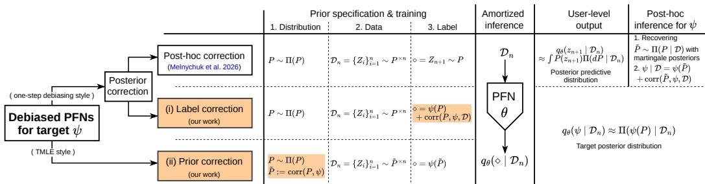  
Figure 1: Overview of our proposed debiasing strategies: (i) label correction and (ii) prior correction (marked with orange). Compared to the existing approach of Melnychuk et al. (2026), our debiasing strategies (i) and (ii) are applied at the prior specification & training stages of PFNs and, therefore, do not require post-hoc inference to be performed by a downstream user.

2025; Hulskamp et al., 2026; Ching et al., 2026). However, several core properties of PFN-based ¨ inference (and, especially, semi-parametric inference) remain unclear:

1 At what rates do na¨ıve PFN-based posteriors concentrate around finite-dimensional targets? 2 Can debiasing strategies improve these rates for a specific inference target? 3 Do the proposed debiasing strategies yield posterior concentration rates that match the convergence rates of well-adopted debiased frequentist estimators, and are they asymptotically optimal?

Our work studies the above research questions, and thereby adds to the theoretical foundations for PFN-based inference through the lens of asymptotic properties. Our contributions2 are three-fold:

1 We start by restating that a PFN aims to exactly recover the Bayes-optimal posterior wrt. its prior (Nagler, 2023). Importantly, however, such Bayes optimality does not by itselfguaranteefavorable concentration properties for a particular finite-dimensional target. We show that the corresponding target posterior concentration rate is governed by two closely related features of the underlying semi-parametric inference task. First, even though a PFN can directly output a posterior for the finite-dimensional target, the concentration rate implicitly depends on the posterior concentration rates of (latent) nuisance functions. Second, informally, these rates can become slower as the prior becomes more diverse.

2 Then, to speed up the target posterior concentration rate, we carefully tailor two generic debiasing strategies (Ray & van der Vaart, 2020; Yiu et al., 2025) specifically for PFNs (see Fig. 1): (i) a one-step posterior label correction that modifies the PFN’s target label using an efficient influence function; and (ii) a prior correction along a least-favorable direction that alters the PFN’s prior in a target-specific direction. Importantly, unlike the post-hoc approach of Melnychuk et al. (2026), our strategies (i)–(ii) are applied at the pretraining stage and thus do not introduce additional correction steps at test time.

3 Finally, we show that the concentration rates of the resulting debiased PFNs asymptotically match the convergence rates achieved by well-established frequentist bias-corrected estimators. Hence, the corresponding target posteriors also concentrate at the same rates. This allows us to establish a direct connection between PFN-based ABI and frequentist semi-parametric efficiency theory. Furthermore, under additional assumptions, our debiasing strategies ensure local and global optimality guarantees in the form of semi-parametric Bernstein–von Mises property (Freedman, 1999) and minimax optimality (Balakrishnan et al., 2026), respectively.

To instantiate our theory, we later use three running examples of inferential targets: (A) mean value (classical statistics setting), (B) mean value under missingness at random (MAR) (prediction-powered inference setting (Angelopoulos et al., 2023; van der Laan & van der Laan, 2026)), and (C) weighted average treatment effect (WATE) (causal inference setting (Hirano et al., 2003)).

In sum, our main contribution is providing guidelines for debiasing PFNs for semi-parametric inference tasks with principled and provable asymptotic properties.

## 2 RELATED WORK

In the following, we discuss existing works on (a) the statistical properties of PFNs and (b) semiparametric inference with PFNs. In Appendix A, we provide further details on related works.

Statistical properties of PFNs. Nagler (2023) has laid general statistical foundations of PFNs and argued whether transformers are suitable for consistent ABI. Multiple subsequent works then studied downstream aspects of the pretrained PFNs: e. g., the application of PFNs for downstream inference (Nagler & Rugamer, 2025; Ng et al., 2025), and the error decomposition of PFN predictions¨ (Hulskamp et al., 2026; Fortini et al., 2026). Other works explored fundamental limits of PFNs¨ pretraining itself: Kim et al. (2024); Ching et al. (2026) showed that transformer-based PFNs can in principle achieve minimax rates for Holder smooth functions; Ma et al. (2025) demonstrated the ¨ adaptivity of PFN wrt. different smoothness levels; and Reuter et al. (2025) empirically showed the learnability of latent variables with PFNs. Our work falls into the latter category: We establish the asymptotic properties of idealized PFNs used as semi-parametric inference engines.

Semi-parametric inference with PFNs. Recent work has adapted PFNs to causal inference (Balazadeh et al., 2025; Robertson et al., 2025; Ma et al., 2026; Javurek et al., 2026); yet, these works primarily fit PFNs in a na¨ıve way and, at best, only establish estimation consistency (without further discussing the asymptotic properties). The closest to our theoretical work is Melnychuk et al. (2026), who show that na¨ıve PFN-based inference for the ATE can suffer from prior-induced confounding bias (Hahn et al., 2018; Linero & Antonelli, 2023) and who apply a post-hoc one-step posterior correction. Our work differs from the former: We characterize posterior concentration rates for general finite-dimensional semi-parametric targets, and we incorporate debiasing directly into PFN pretraining, thereby avoiding post-hoc correction at test time. To the best of our knowledge, our work is the first to offer theoretical foundations for PFNs used in semi-parametric inference.

## 3 PRELIMINARIES

Notation. Let $Z \in \mathcal { Z } \subseteq \mathbb { R } ^ { d }$ denote a random variable with probability distribution $P = P ( Z ) \in$ $\mathcal { P } ( \mathcal { Z } )$ , where $\mathcal { P } ( \mathcal { Z } )$ is a class of probability distributions defined on Z. With a slight abuse of notation, we also denote the density/probability mass function of observing $Z = z \ \bar { \mathrm { a s } } \ P ( z )$ . For $P \in \mathcal { P } ( \mathcal { Z } )$ , we observe an i.i.d. dataset $\mathcal { D } _ { n } = ( \dot { Z } _ { 1 } , \dots , Z _ { n } ) \sim P ^ { \otimes n }$ . Similarly, we denote processes (distributions in the infinite-dimensional/functional spaces) with Π: $\mathrm { e . g . , } \Pi ( P )$ is a prior process and $\Pi ( P \mid \mathcal { D } _ { n } )$ is a posterior process over the distributions of $Z$ . Also, for any $P \mathrm { . }$ -measurable function $f ,$ we write an $L _ { p } ( P ) { \mathrm { - n o r m } }$ of f as $\| f \| _ { L _ { v } ( P ) } : = ( \mathbb { E } _ { P } [ | f ( Z ) | ^ { p } ] ) ^ { 1 / p } ;$ a mean of $f$ as $\begin{array} { r } { P f : = \mathbb { E } _ { P } [ f ( Z ) ] = \int f ( z ) \mathrm { d } P ( z ) ; } \end{array}$ a sample mean of f as $\begin{array} { r } { P _ { n } f : = n ^ { - 1 } \sum _ { i = 1 } ^ { n } f ( Z _ { i } ) } \end{array}$ ; and the mean wrt. Bayesian bootstrap process as $\begin{array} { r } { \mathrm { B B } _ { n } \{ f ( Z ) \} = \sum _ { i = 1 } ^ { n } W _ { i } f ( z _ { i } ) } \end{array}$ where $( W _ { 1 } , \ldots , W _ { n } )$ is a sample from a Dirichlet distribution $\operatorname { D i r } ( n ; 1 , \ldots , 1 )$ . Similarly, we also define $L _ { p } { \mathrm { - n o r m } }$ for a function $f$ as $\Vert f \Vert _ { L _ { v } } : = ( \int | f ( z ) | ^ { p } \mathrm { d } z ) ^ { 1 / p }$ . For a sequence of random vectors $X _ { n }$ and a positive deterministic sequence $a _ { n }$ , we write $X _ { n } = o _ { P } ( a _ { n } ) { \mathrm { i f } } \parallel X _ { n } \parallel _ { 2 } / a _ { n } \to 0$ in $P ^ { \otimes n }$ -probability, and $X _ { n } = O _ { P } ( a _ { n } )$ if $\| X _ { n } \| _ { 2 } / a _ { n }$ is bounded in $P ^ { \otimes n }$ -probability. Finally, $a \lesssim$ b means that $a \leq C \cdot b$ for some $C \geq 0$

Problem setup. In our work, we are interested in a statistical inference for a finite-dimensional statistical functional (estimand) $\psi : { \mathcal { P } } ( { \mathcal { Z } } ) \to \Psi \subseteq \mathbb { R } \left( { \mathrm { w . ~ l . o . g . ~ } } \psi ( P ) \right.$ is one-dimensional, and Ψ is convex). Let $\eta ( P ) \in { \mathcal { H } }$ denote a collection of nuisance functions, that is, components of $P$ used for inference on $\psi ( P )$ , where H is a function space equipped with norm $\lVert \cdot \rVert _ { \mathcal { H } }$ (Kennedy, 2024). For a fixed distribution $P _ { 0 } \in \mathcal { P } ( \mathcal { Z } )$ , we write $\psi _ { 0 } : = \psi ( P _ { 0 } )$ as the target statistical estimand. When $\psi ( P )$ is pathwise differentiable at $P ,$ , we denote its efficient influencefunction (EIF) under the nonparametric model by $\phi _ { \psi } ( Z ; P )$ (see Appendix B for details). Importantly, pathwise-differentiable estimands $\psi ( P )$ admit a von–Mises expansion:

$$
\psi ( P ) - \psi ( P _ { 0 } ) = ( P - P _ { 0 } ) \phi _ { \psi } ( \cdot ; P ) + R _ { 2 , \psi } ( P , P _ { 0 } ) = - P _ { 0 } \phi _ { \psi } ( \cdot ; P ) + R _ { 2 , \psi } ( P , P _ { 0 } ) ,\tag{1}
$$

where $R _ { 2 , \psi } ( P , P _ { 0 } )$ is the second-order remainder term.

Inferential targets. In our work, we consider the following three running examples of estimands: Example A (Mean value). We start with a trivial estimand,3 a mean value of $Z \in [ 0 , 1 ] ; \psi ( P ) =$ $\begin{array} { r } { \mathbb { E } _ { P } [ Z ] = \int z P ( z ) \operatorname { d } } \end{array}$ z. Then, the corresponding nuisancefunctions, the EIF, and the second-order

remainder are

$$
\eta ( P ) = [ P ( z ) ] ; \phi _ { \psi } ( Z ; P ) = Z - \psi ( P ) ; R _ { 2 , \psi } ( P , P _ { 0 } ) = 0 .\tag{2}
$$

Example B (Mean value under missingness at random (MAR)). Mean value under MAR is a classical semi-parametric target (Angelopoulos et al., 2023; van der Laan & van der Laan, 2026). Here, $Z = \mathsf { \bar { ( } } X , R , R Y )$ with covariates $X \in [ 0 , 1 ] ^ { d _ { x } }$ , labeling indicator $R \in \{ 0 , 1 \}$ , and the (partially missing) outcome $R Y \in [ 0 , 1 ]$ . Here, the inference target is $\psi = \mathbb { E } _ { P } [ Y ]$ . Under standard MAR assumptions $( i . e . ,$ , conditional independence, $R \perp \perp Y \mid \breve { X } ;$ and strong overlap, $\kappa < \pi ( x ) < 1 - \kappa ,$ with $\begin{array} { r } { \bar { \kappa } \in ( 0 , 1 / 2 ) ) , \psi ( P ) = \mathbb { E } _ { P } [ \mu ( \bar { X } ) ] = \int \mu ( x ) P ( x ) } \end{array}$ dx, where $\mu ( x ) = \mathbb { E } _ { P } [ R Y \mid X = x , R = 1 ]$ is a conditional outcome mean, and $\bar { \pi } ( x ) \overset { \smile } { = } \mathbb { P } ( R = 1 ~ | ~ X = x )$ is a labeling score. Then, the corresponding nuisancefunctions, the EIF, and the second-order remainder are (Robins et al., 1995):

$$
\eta ( P ) = \left[ \mu ( x ) , P ( x ) \right] ; \ \phi _ { \psi } ( Z ; P ) = \frac { R } { \pi ( X ) } ( Y - \mu ( X ) ) + \mu ( X ) - \psi ( P ) ; \ R _ { 2 , \psi } ( P , P _ { 0 } ) = P _ { 0 } \left[ \frac { \pi - \pi _ { 0 } } { \pi } ( \mu - \mu _ { 0 } ) \right] . \nonumber \Theta ( X )\tag{3}
$$

Example C (Weighted average treatment effect (WATE)). Let $Z = ( X , A , Y )$ , with propensity score $\pi ( x ) { \bar { = } } \mathbb { P } ( A = { \bar { 1 } } \mid X = x )$ and outcome regressions $\mu _ { a } ( x ) = \mathbb { E } _ { P } [ Y \mid A = a , X = x ]$ . For a userspecified weight $w ( \cdot ; \pi ) \geq 0 ,$ the WATE is $\dot { \psi _ { w } } ( P ) = \mathbb { E } _ { P } [ w ( X ; \pi ) ( \dot { \mu _ { 1 } } ( \dot { X } ) - \mu _ { 0 } ( X ) ) ] / \mathbb { E } _ { P } [ w ( X ; \pi ) ]$ which includes the $A T E \left( w \equiv 1 \right)$ and overlap-weighted ATE $( w = \pi ( 1 - \pi ) )$ as special cases. We deferfurther details to Appendix C.

Amortized Bayesian inference with PFNs. A PFN amortizes inference across synthetically generated datasets. Specifically, for a fixed dataset ${ \mathcal { D } } _ { n } ,$ let $q _ { \theta } { \left( z _ { n + 1 } \mid \mathcal { D } _ { n } \right) }$ denote a conditional density on $\mathcal { Z }$ parameterized by a neural network with parameters $\theta \in \Theta ( \mathrm { { t y } \mathrm { { l } } }$ pically, a transformer (Vaswani et al., 2017)). Then, a posterior-predictive PFN (Muller et al., 2022)¨ with fixed n aims to minimize a prior-predictive negative log-likelihood (NLL) risk wrt. a new observation $Z _ { n + 1 } \sim P$

$$
\begin{array} { r } { \mathcal { R } _ { \mathrm { N L L } } ^ { \mathrm { P P } } ( \theta ; \Pi , n ) : = \mathbb { E } _ { P \sim \Pi } \mathbb { E } _ { \mathcal { D } _ { n } \sim P \otimes n } \mathbb { E } _ { Z _ { n + 1 } \sim P } \left[ - \log q _ { \theta } \left( Z _ { n + 1 } ~ \vert ~ \mathcal { D } _ { n } \right) \right] , } \end{array}\tag{4}
$$

where $\Pi = \Pi ( P )$ is a prior process over the distributions $P .$

Bayesian self-consistency. The main reason why the prior-predictive risk in Eq. (4) performs ABI is the property of Bayesian self-consistency (Dawid, 1982): the conditional distribution of a held-out observation $Z _ { n + 1 }$ generated under the prior process Π, given the observed dataset $\mathcal { D } _ { n }$ , coincides with the Bayesian posterior-predictive distribution. More formally, a PFN $q _ { \theta ^ { * } } ( . \ | \ D _ { n } )$ that minimizes the population risk in Eq. (4) also minimizes a Kullback-Leibler (KL) divergence wrt. a ground-truth posterior-predictive density $\begin{array} { r } { \pi ( z _ { n + 1 } \mid \mathcal { D } _ { n } ) : = \int P ( z _ { n + 1 } ) \Pi ( \mathrm { d } P \mid \mathcal { D } _ { n } ) } \end{array}$ (Nagler, 2023):

$$
\theta ^ { * } = \underset { \theta \in \Theta } { \operatorname { a r g m i n } } \mathcal { R } _ { \mathrm { N L L } } ^ { \mathrm { P F } } ( \theta ; \Pi , n ) = \underset { \theta \in \Theta } { \operatorname { a r g m i n } } \mathbb { E } _ { P \sim \Pi } \mathbb { E } _ { \mathcal { D } _ { n } \sim P ^ { \otimes n } } \operatorname { K L } [ \pi ( \cdot \mid \mathcal { D } _ { n } ) \mid | q _ { \theta } ( \cdot \mid \mathcal { D } _ { n } ) ] .\tag{5}
$$

Therefore, the statistical properties of PFN-based ABI are mainly guided by (a) the specification of the prior process Π (which, in turn, specifies the prior $\Pi ( \dot { P } )$ , the implicit log-likelihood $\begin{array} { r } { \ell _ { n } ( P ) : = \log \prod _ { i = 1 } ^ { n ^ { \cdot } } P ( Z _ { i } ) } \end{array}$ , and, thus, the posterior $\Pi ( \mathrm { d } P | { \bf \dot { \sigma } } D _ { n } )$ ∝ $\mathrm { e x p } \{ \ell _ { n } ( P ) \} \Pi ( \mathrm { d } P ) )$ and (b) the amortization errors due to limited expressivity of the PFN $q _ { \theta }$ . In the following, we primarily focus on the aspect (a).

## 4 SEMI-PARAMETRIC INFERENCE WITH PFNS

In the following, we develop theoretical foundations for amortized Bayesian semi-parametric inference with PFNs along our three research questions: 1 In Sec. 4.1, we first show that, despite being Bayes-optimal, an idealized PFN can suffer from slow posterior concentration rates. 2 In Sec. 4.2, we propose two remedies against the slow concentration rates of PFNs: (i) label correction and (ii) prior correction. 3 In Sec. 4.3, we formalize the favorable asymptotic properties of the debiased PFNs. We provide detailed theoretical statements and all the proofs in Appendix D.

## 4.1 BAYES-OPTIMALITY AND SLOW CONCENTRATION RATES

The core idea of ABI with PFNs can be straightforwardly applied to semi-parametric inference. Specifically, a PFN for target ψ with fixed n is given by a conditional density $q _ { \theta } ( \psi \mid \mathcal { D } _ { n } )$ in the parameter space Ψ that minimizes the following NLL risk wrt. a label ψ:

$$
\mathcal { R } _ { \mathrm { N L L } } ^ { \psi } ( \theta ; \Pi , n ) : = \mathbb { E } _ { P \sim \Pi } \mathbb { E } _ { \mathcal { D } _ { n } \sim P \otimes n } \left[ - \log q _ { \theta } \big ( \psi ( P ) \mid \mathcal { D } _ { n } \big ) \right] .\tag{6}
$$

Again, similarly, to the posterior-predictive PFNs (see Sec. 3), the minimization of the risk in Eq. (6) is equivalent to the KL-projection of $q _ { \theta } ( \psi \mid \mathcal { D } _ { n } )$ on the ground-truth posterior distribution4 $\Pi \bar { ( \psi ( P ) \mid \mathcal { D } _ { n } ) }$ ). This yields the following useful definition.

Definition 1 (Idealized PFN). A PFN qθ∗ for target ψ with fixed n is called idealized if $\theta ^ { * } =$ $\begin{array} { r } { \operatorname * { a r g m i n } _ { \theta \in \Theta } \mathcal { R } _ { \mathrm { N L L } } ( \theta ; \Pi , n ) } \end{array}$ yields $Q _ { \theta ^ { * } } ( \bar { \psi _ { \mathbf { \alpha } } } | \bar { \mathcal { D } } _ { n } ) = \bar { \Pi } ( \psi ( P ) | \mathcal { D } _ { n } )$ for every $\mathcal { D } _ { n }$ from a prior process $\Pi ( h e r e \colon \bar { Q } _ { \theta ^ { * } }$ is a distribution corresponding to the density $q _ { \theta ^ { * } } ) .$ Thus, the PFN class is sufficiently expressive to capture the ground-truth posterior.

Bayes-optimality. Equipped with the definition of idealized PFNs, we can use both the ground-truth posterior and its PFN approximation interchangeably. Also, it allows us to formalize a Bayes decision-theoretic property, i. e., Bayes-optimality, of PFNs for target ψ (see Appendix B for details).

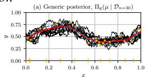

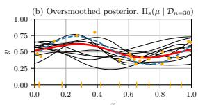

Remark 1 (Bayes-optimality of the idealized PFN). The posterior mean of an idealized PFN, $i . e .$ $\begin{array} { r l } { \hat { \psi } _ { \boldsymbol { \theta } ^ { * } } \left( \mathcal { D } _ { n } \right) } & { { } : = } \end{array}$ $\textstyle \int \psi q _ { \theta ^ { * } } ( \psi \mid \mathcal { D } _ { n } )$ dψ, is Bayes-optimal under the squared $l _ { 2 }$ risk $\mathcal { R } _ { l _ { 2 } ^ { 2 } } ( \hat { \psi } ; \Pi , n ) \mathrel { \mathop : } =$ $\mathbb { E } _ { P \sim \Pi } \mathbb { E } _ { \mathcal { D } _ { n } \sim P ^ { \otimes n } } [ \hat { \psi } ( \mathcal { D } _ { n } ) - \psi ( P ) ] ^ { 2 } .$

$$
\mathcal { R } _ { l _ { 2 } ^ { 2 } } ( \hat { \psi } _ { \boldsymbol { \theta } ^ { * } } ; \Pi , n ) = \operatorname* { i n f } _ { \boldsymbol { \hat { \psi } } : \mathcal { Z } ^ { n }  \Psi } \mathcal { R } _ { l _ { 2 } ^ { 2 } } ( \hat { \psi } ; \Pi , n )\tag{7}
$$

$$
= \mathbb { E } _ { P \sim \Pi } \mathbb { E } _ { \mathcal { D } _ { n } \sim P ^ { \otimes n } } [ \operatorname { V a r } _ { \Pi } [ \psi ( P ) \mid \mathcal { D } _ { n } ] ] ,
$$

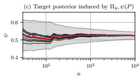

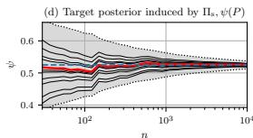  
Labeled data (R = 1) Posterior samples (B = 10) Ground truth (µ / ψ ) Unlabeled data (R = 0) Posterior mean ψ M(P , , Π)

where the last term expresses the expected posterior uncertainty about the target.

Remark 1 justifies the optimality of $q _ { \theta ^ { * } }$ from a Bayesian perspective. However, from a frequentist lens, we might be interested in how quickly $\Pi ( \psi ( P ) \ \bar { | } \ D )$ and, hence, $q _ { \theta ^ { * } } ( \psi  \mid \mathcal { D } ) )$ concentrate locally around some fixed $\psi _ { 0 } = \psi ( P _ { 0 } )$ sampled from a prior. It turns out that the concentration rates

Figure 2: Propagation of $\mu ( x )$ nuisance errors into the target (based on Example B with $d _ { x } = 1$ $P ( x ) = \bar { P _ { 0 } ( x ) } = \mathrm { U n i f } [ 0 , 1 ]$ , and $\pi _ { 0 } ( x ) = 0 . 2 +$ $0 . 7 / ( 1 + \exp \{ - 6 ( x - 0 . \dot { 4 } ) \} ) \dot { }$ . Here, (a) a generic posterior, $\Pi _ { \mathrm { g } } ( \mu \mid \mathcal { D } _ { n = 3 0 } )$ , is a Gaussian process with a Matern kernel´ $( \beta = 0 . 5 )$ . Then, (b) an oversmoothed posterior, $\Pi _ { \mathrm { s } } ( \mu \mid \mathcal { D } _ { n = 3 0 } )$ , is a Gaussian process with a squared-exponential kernel $( \beta = \infty )$ , random intercept, and inflated noise level. $( \mathbf { c } ) , ( \mathbf { d } )$ The corresponding posteriors of $\begin{array} { r } { \psi = \int \mu ( { \boldsymbol { x } } ) \mathrm { d } P _ { 0 } ( { \boldsymbol { x } } ) } \end{array}$ for growing n (each line follows a fixed posterior quantile across n) and the bands $\psi _ { 0 } \pm M ( P _ { 0 } , { \mathcal { D } } _ { n } , \Pi )$ . In (d) (unlike (c)), the errors of $\mu ( x )$ barely cancel in $P _ { 0 } ( \mu - \mu _ { 0 } )$ , and the target posterior concentrates at nearly the same rate as $M ( \mathsf { P } _ { 0 } , \mathsf { \bar { D } } _ { n } , \Pi )$ (i. e., the oversmoothed posterior is rate-close to the worst-case posterior).

of the target ψ implicitly depend on the concentration rate of the associated nuisance functions $\eta ( P )$ even though those nuisance functions are not explicitly modeled by the idealized PFN $q _ { \theta ^ { * } }$

Theorem 1 (Slow local L -concentration rates (short version)). Assume that the target ψ admits a von–Mises expansionfrom $E q . ( 1 )$ wrt. to any pair of $P , P _ { 0 }$ independently drawnfrom $\Pi ( P )$ . Then, for a fixed target $\psi _ { 0 } = \psi ( P _ { 0 } )$ where $P _ { 0 } \in$ supp Π, and $\mathcal { D } _ { n } \sim P _ { 0 } ^ { \otimes n }$ , the target $L _ { 2 }$ -concentration error, $\begin{array} { r } { \Vert \psi - \psi _ { 0 } \Vert _ { L _ { 2 } ( q _ { \theta ^ { * } } , \mathcal { D } _ { n } ) } : = ( \int ( \psi - \psi _ { 0 } ) ^ { 2 } q _ { \theta ^ { * } } ( \psi \mid \mathcal { D } _ { n } ) \mathrm { d } \psi ) _ { , \quad \cdot } ^ { 1 / 2 } } \end{array}$ , can be upper-bounded:

$$
\| \psi - \psi _ { 0 } \| _ { L _ { 2 } ( q _ { \theta } * , \mathcal { D } _ { n } ) } \lesssim \underbrace { \left[ \int \| \eta ( P ) - \eta ( P _ { 0 } ) \| _ { \mathcal { H } } ^ { 2 } \Pi ( \mathrm { d } P \mid \mathcal { D } _ { n } ) \right] ^ { 1 / 2 } } _ { F _ { \psi } ( P _ { 0 } , \mathcal { D } _ { n } , \Pi ) } + \underbrace { \left[ \int R _ { 2 , \psi } ^ { 2 } ( P , P _ { 0 } ) \Pi ( \mathrm { d } P \mid \mathcal { D } _ { n } ) \right] ^ { 1 / 2 } } _ { R _ { 2 , \psi } ( P _ { 0 } , \mathcal { D } _ { n } , \Pi ) } ,\tag{8}
$$

where $F _ { \psi } ( P _ { 0 } , { D _ { n } } , \Pi )$ and $R _ { 2 , \psi } ( P _ { 0 } , { \mathcal { D } } _ { n } , \Pi )$ are posterior-averaged first-order error and secondorder remainder, respectively. Furthermore, assuming the $L _ { 2 }$ -concentration ofthe latent nuisance posteriors $\begin{array} { r } { ( i . e . , \int \| \eta ( P ) - \eta ( P _ { 0 } ) \| _ { \mathcal { H } } ^ { 2 } \Pi ( \mathrm { d } P \mid \mathcal { D } _ { n } ) \to 0 } \end{array}$ with $n  \infty )$ , the upper-bound in $E q . \ ( 8 )$ is rate-sharp: Unless explicitly corrected, there exist a worst-case posterior ${ \hat { \Pi } } ( P \mid { \mathcal { D } } _ { n } )$ under which the target $L _ { 2 }$ -concentration error inherits the rate ofthe latent nuisancefunctions, namely, the rate ofthefirst-order term $F _ { \psi } ( P _ { 0 } , { D _ { n } } , \Pi )$

Theorem 1 shows that, despite the Bayesian optimality of the idealized PFNs, the target $L _ { 2 ^ { - } }$ concentration error can linearly depend on the concentration rate of the latent nuisance functions.5

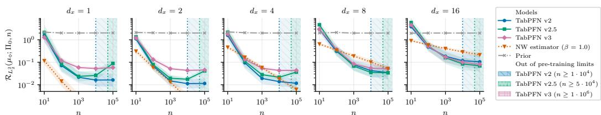  
Figure 3: Slowing concentration rates for different versions of TabPFN $( \diamond \in \{ \mathrm { v } 2 , \mathrm { v } 2 . 5 , \mathrm { v } 3 \} )$ . Here, we show Π -prior-averaged squared L -concentration errors of the conditional outcome mean $\mu ( x )$ posteriors, $\begin{array} { r } { \hat { \mathcal { R } } _ { L _ { 2 } ^ { 2 } } ( \mu _ { \diamond } ; \Pi _ { 0 } , n ) : = \mathbb { E } _ { P _ { 0 } \sim \Pi _ { 0 } } \mathbb { E } _ { \mathcal { D } _ { n } \sim P _ { \alpha } ^ { \otimes n } } [ M ( P _ { 0 } , \mathcal { D } _ { n } , \Pi _ { \diamond } ) ^ { 2 } ] } \end{array}$ , depending on dataset sizes n and covariate dimensionality $d _ { x }$ (prior-averaging is based on a sample of $M = 2 4$ ground-truth $P _ { 0 }$ each with $D = 1$ dataset; lower is better). For reference, we also show the error of a frequentist nonparametric estimator, namely, the $\Pi _ { 0 } .$ -prior-averaged squared $L _ { 2 }$ -error of Nadaraya–Watson regression with a Matern kernel´ $( \beta = \mathrm { \bar { 1 } . 0 ) \Omega = N \bar { W } }$ estimator $( \beta \bar { = } 1 . 0 ) )$ . Note that the ground-truth $\Pi _ { 0 }$ is based on the adapted prior of the TabPFN v1 (Hollmann et al., 2023) $( \mu _ { 0 } ( \cdot ) \sim \Pi _ { \mathrm { v 1 } } ( \mu )$ and $P _ { 0 } ( y \mid x ) =$ $N ( \mu _ { 0 } ( x ) , \dot { \sigma } ^ { 2 } = \dot { 0 } . 3 ^ { 2 } ) )$ and is assumed to be in support of the priors of the higher versions.

Hence, it can also be interpreted as a generalization of the previously discovered issue of priorinduced bias (Hahn et al., 2018) (for a more formal connection, we refer to Remark 2 in Appendix D). In our examples, Eq. (8) can be instantiated as follows.

Example A (Mean value). For a fixed pair of distributions $P$ and $P _ { 0 } ,$ , we have the following:

$$
| \psi - \psi _ { 0 } | = \left| \int _ { 0 } ^ { 1 } z \left( P ( z ) - P _ { 0 } ( z ) \right) \mathrm { d } z \right| \leq \| z - 1 / 2 \| _ { L _ { 2 } } \cdot \| P - P _ { 0 } \| _ { L _ { 2 } ( z ) } = 1 / \sqrt { 1 2 } \cdot \| P - P _ { 0 } \| _ { L _ { 2 } ( z ) } ,\tag{9}
$$

and, thus, $\| \eta ( P ) - \eta ( P _ { 0 } ) \| _ { \mathcal { H } } = \| P - P _ { 0 } \| _ { L _ { 2 } ( z ) }$ is the leadingfirst-order error term. Furthermore, this bound is locally rate-sharp and is attained when the posterior $\Pi ( P \mid { \mathcal { D } } _ { n } )$ assigns asymptotically non-negligible mass to a region around the path $P _ { t } ( z ) \stackrel { - } { = } P _ { 0 } ( z ) + \dot { t } ( z - 1 / 2 )$ for sufficiently small $t > 0$ (along such a path both nuisance errors and $| \psi ( P _ { t } ) - \psi _ { 0 } |$ are oforder t).

Example B (Mean value under MAR). Similarly,for afixed pair ofdistributions P and $P _ { 0 } ,$

$$
| \psi - \psi _ { 0 } | = \left| ( P - P _ { 0 } ) \mu + P _ { 0 } \left[ { \frac { \pi _ { 0 } } { \pi } } ( \mu - \mu _ { 0 } ) \right] + R _ { 2 , \psi } ( P , P _ { 0 } ) \right|\tag{10}
$$

$$
\leq \| \mu \| _ { L _ { 2 } ( x ) } \cdot \| P - P _ { 0 } \| _ { L _ { 2 } ( x ) } + \frac { 1 } { \kappa } \cdot \| \mu - \mu _ { 0 } \| _ { L _ { 2 } ( P _ { 0 } ) } + | R _ { 2 , \psi } ( P , P _ { 0 } ) | ,\tag{11}
$$

and, thus, $\| \eta ( P ) - \eta ( P _ { 0 } ) \| _ { \mathcal { H } } = \| P - P _ { 0 } \| _ { L _ { 2 } ( x ) } + \| \mu - \mu _ { 0 } \| _ { L _ { 2 } ( P _ { 0 } ) }$ is the leading first-order error term. Again, this bound is locally rate-sharp and is attained when the posterior $\Pi ( P ~ \mid ~ { \mathcal { D } } _ { n } )$ assigns asymptotically non-negligible mass to a region around a path $P _ { t } ( \bar { x } ) = P _ { 0 } ( x ) \stackrel { . . } { + } t \dot { h } _ { 0 } ( x )$ $\mu _ { t } ( x ) = \mu _ { 0 } ( x ) + t ,$ , and $\pi _ { t } ( x ) = \pi _ { 0 } ( x )$ , where $h _ { 0 }$ is any valid mean-zero direction satisfying $\begin{array} { r } { \int \mu _ { 0 } ( x ) h _ { 0 } ( x ) } \end{array}$ dx ̸= 0 (along such a path both nuisance errors and $| \psi ( P _ { t } ) - \psi _ { 0 } |$ are oforder t).

The latter two examples are particularly relevant for Bayesian semi-parametric inference: Here, the averaged errors of the conditional expectation $( P _ { 0 } ( \mu _ { t } - \mu _ { 0 } ) = t )$ implicitly propagate into the error of the target in the same order t. Yet, for a posterior given by a generic non-parametric Bayesian model (and idealized PFNs can be viewed as such), the squared error $\{ P _ { 0 } ( \mu - \mu _ { 0 } ) \} ^ { 2 }$ is only upperbounded by $\| \mu - \mu _ { 0 } \| _ { L _ { 2 } ( P _ { 0 } ) } ^ { 2 }$ , with equality achieved for specific, worst-case posteriors $\mu = \mu _ { t }$ . Thus, in general, the L -concentration rate of $\begin{array} { r } { \mu , M ( P _ { 0 } , { D } _ { n } , \Pi ) ^ { 2 } : = \int \left. \mu - \mu _ { 0 } \right. _ { L _ { 2 } ( P _ { 0 } ( x ) ) } ^ { 2 } \Pi ( \mathrm { d } \boldsymbol { P } \ | \ \mathcal { D } _ { n } ) } \end{array}$ informs us of the worst-case $L _ { 2 }$ -concentration rate of target ψ (as we show in Fig. 2).

Slow concentration rates. It turns out that, in fully non-parametric Bayesian models, the $L _ { 2 ^ { - } }$ concentration rate of $\mu , M ( P _ { 0 } , { \cal D } _ { n } , \Pi )$ , can be arbitrarily slow. For example, for many non-parametric Bayesian models with a more diverse prior $\Pi ( P )$ , the posterior concentration rate slows down6 (e. g., for Gaussian processes with a rougher Matern kernel (van der Vaart & van Zanten, 2011)).´

Our findings have also implications for existing PFNs such as TabPFN (Hollmann et al., 2023; 2025; Grinsztajn et al., 2025; 2026). In Fig. 3, we empirically show that more recent versions of TabPFN $( \diamond = \mathrm { v 2 } \to \mathrm { v 2 . 5 } \to \mathrm { v 3 } )$ have slower rates of the L -concentration error, $M ( P _ { 0 } , { \mathcal { D } } _ { n } , \Pi _ { \diamond } )$ . These insights motivate our debiasing strategies for PFNs, with the aim that a more diverse prior does not result in much slower target concentration rate.

## 4.2 DEBIASING STRATEGIES

In the following, we introduce two debiasing strategies for PFNs.

(i) Label correction. We start by tailoring (i) one-step posterior corrections (Yiu et al., 2025) specifi cally for PFNs. Unlike Melnychuk et al. (2026), we aim to perform bias correction not post-hoc but at the training stage of the PFN for target ψ. For this, we use a key property of Bayesian self-consistency (see Sec. 3): A joint sample from a prior process $( { \mathcal { D } } _ { n } , \psi ( P ) ) _ { , }$ ) can be interpreted as a joint sample of random $\mathcal { D } _ { n }$ and a conditional (posterior) target $\dot { \psi } ( P ) \mid \dot { \mathcal { D } } _ { n }$ . Therefore, in the case of the PFNs, the one-step posterior correction takes the form of label ψ correction.

A label correction modifies the risk of a PFN with target ψ by performing a one-step posterior correction wrt. $\psi ( P )$

$$
\begin{array} { r } { \tilde { \mathcal { R } } _ { \mathrm { N L L } } ^ { \psi } ( \theta ; \Pi , n ) : = \mathbb { E } _ { P \sim \Pi } \mathbb { E } _ { \mathcal { D } _ { n } \sim P \otimes n } \mathbb { E } _ { W } \bigg [ - \log q _ { \theta } \big ( \tilde { \psi } ( P ) \mid \mathcal { D } _ { n } \big ) \bigg ] , \ \tilde { \psi } ( P ) : = \psi ( P ) + \underbrace { \mathrm { B B } _ { n } \{ \phi _ { \psi } ( Z ; P ) \} } _ { \mathrm { V o r ~ e t u r e } } , } \end{array}\tag{12}
$$

$$
\mathrm { B B } _ { n } \{ \cdot \}
$$

$$
\mathcal { D } _ { n }
$$

Construction. Hence, once the EIF for a target $\psi$ is derived, we automatically get the label correction (given that we can effectively infer the corresponding nuisance functions from the full prior $P \sim \bar { \Pi ( P ) ) }$ . Let us now revisit our running examples.

Example A (Mean value). For the mean value, the label correction effectively replaces the initial label, ψ(P), with the Bayesian bootstrap, thereby removing thefirst-order error wrt. $P \colon$

$$
\tilde { \psi } ( P ) = \psi ( P ) + \mathrm { B B } _ { n } \{ Z - \psi ( P ) \} = \mathrm { B B } _ { n } \{ Z \} .\tag{13}
$$

Example B (Mean value under MAR). Similarly, the label correction is:

$$
{ \tilde { \psi } } ( P ) = \psi ( P ) + \mathrm { B B } _ { n } \left\{ { \frac { R } { \pi ( X ) } } ( Y - \mu ( X ) ) + \mu ( X ) - \psi ( P ) \right\} = \mathrm { B B } _ { n } \left\{ { \frac { R } { \pi ( X ) } } ( Y - \mu ( X ) ) + \mu ( X ) \right\} .\tag{14}
$$

Interpretation. In both Eq. (13)-(14), the label correction effectively replaces the original target label with a Bayesian-bootstrap one-step estimator. This is done by design such that the first-order error term $( \mathrm { i . e . , } \bar { F _ { \psi } } ( P _ { 0 } , \mathcal { D } _ { n } , \Pi )$ in Eq. (8)) gets replaced with the empirical term that concentrates around zero with the parametric rate $O _ { P _ { 0 } } ( n ^ { - 1 / 2 } )$

(ii) Prior correction. An alternative approach to speed up the posterior concentration rates is an approach of prior corrections in the least-favorable direction (Ray & van der Vaart, 2020; Ray & Szabo, 2019; Yang et al., 2015). Existing constructions are typically expressed through target-specific´ parameterizations of nuisance functions (e. g., Gaussian process priors for $\mu ( x )$ for the mean under MAR). Here, on the other hand, we formulate a general, distribution-level approach, suitable for PFNs. Specifically, we perturb each prior draw $P \sim \Pi ( P )$ as follows.

A prior correction modifies the prior of a PFN with target $\psi$ by augmenting prior draws $P \sim$ $\Pi ( P )$ with an independent perturbation along a least-favorable direction $\operatorname { \mathrm { { ' } L F } } _ { \psi } ( { \hat { P } } ; \lambda )$

$$
\tilde { P } : = \underbrace { \mathrm { L F } _ { \psi } ( P ; \lambda ) } _ { \mathrm { c o r } ( P , \psi _ { \ast } ) } , \quad \left\{ \lambda \sim N ( 0 , \sigma _ { n } ^ { 2 } ) \mathrm { ~ a n d ~ } \lambda \downarrow P , \right. ,\tag{15}
$$

where $\sigma _ { n } ^ { 2 } > 0$ is such that $n \sigma _ { n } ^ { 2 }  \infty ; \operatorname { L F } _ { \psi } ( \cdot ; \lambda ) : \mathcal { P }  \mathcal { P }$ is a distributional transformation; and $\mathrm { S } [ \cdot ] : \ddot { \mathcal { P } }  L _ { 2 } ( \mathcal { P } )$ is a score operator (i. e., for a distribution $P _ { \lambda }$ parametrized by λ with density $\begin{array} { r } { P ( z ; \lambda ) , S [ P _ { \lambda } ] ( z ) = \frac { \partial } { \partial \lambda } \log P ( z ; \lambda ) \rangle } \end{array}$ ). Furthermore, the draws of $P$ and λ jointly induce a corrected prior process $\widetilde \Pi ( \tilde { P } )$ , that is assumed to have the same support, supp Π = supp Π e .

Construction. We immediately see that the perturbation $\operatorname { L F } _ { \psi }$ is given as a possibly non-unique solution to the operator equation $\mathrm { L F } _ { \psi } ( P ; \cdot ) \stackrel { - } { = } ( S [ \cdot ] | _ { \lambda = 0 } ) ^ { - 1 } \dot { \phi _ { \psi } } ( \cdot ; \stackrel { \textstyle - } { P } )$ . This non-uniqueness gives us a certain freedom in how to perform the correction; for example, we can either correct the full distribution or only the relevant nuisance function components. In the following running examples, we carefully adapt the existing approaches from the TMLE literature (van der Laan & Rubin, 2006), specifically for the debiased ABI with PFNs.

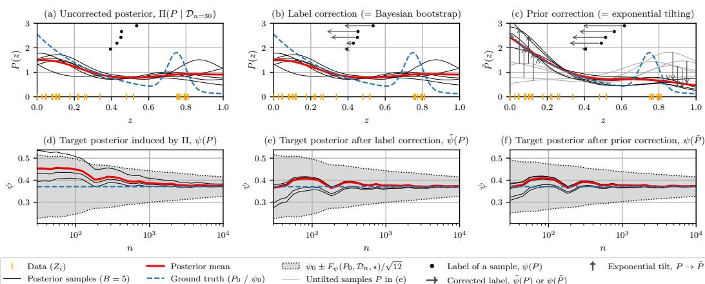  
Figure 4: Debiasing strategies for the mean value (based on Example A with $Z \in [ 0 , 1 ]$ and $\psi ( P ) = \mathbb { E } _ { P } [ Z ] )$ . (a) Posterior draws of P under a non-parametric prior Π (a logistic Gaussian process with a squared-exponential kernel $( \beta = \infty ) , P ( z ) \propto \exp \{ f ( z ) \} )$ ) and the corresponding target labels $\psi ( P )$ . (b) (i) Label correction: The posterior of $P$ is unchanged, but the label of every draw is replaced with $K = 1$ sample Bayesian bootstrap (shown with arrows). (c) (ii) Prior correction: Posterior draws $\tilde { P }$ under the corrected prior Πe (black), each the exponential tilt of an untilted draw $P$ (gray, vertical arrows) that moves its label from $\psi ( P )$ to $\psi ( { \tilde { P } } )$ (horizontal arrows), (d)-(f) The resulting posteriors of the target for growing n (each line follows a fixed posterior quantile across n) and the bands $\psi _ { 0 } \pm F _ { \psi } ( P _ { 0 } , { D _ { n } , \star } ) / \sqrt { 1 2 }$ , where $\star \in \{ \Pi , \widetilde { \Pi } \}$ . Without a correction, the uncorrected posterior draws pull $\psi$ towards $1 / 2 .$ Both corrections remove this first-order error: The posteriors after the corrections are better centered and concentrate at a faster rate around $\psi _ { 0 }$

Example A (Mean value). Here, one ofthe alternativesfor the prior correction is the exponential tilting (D´ıaz & Rosenblum, 2015). Then, the corrected prior density ofP from $P \sim \Pi ( P )$ is

$$
\tilde { P } ( z ) : = \exp \{ \lambda ( z - \psi ( P ) ) \} / C _ { \psi } ( P , \lambda ) \cdot P ( z ) , \quad C _ { \psi } ( P , \lambda ) = P [ \exp \{ \lambda ( z - \psi ( P ) ) \} ] ,\tag{16}
$$

where $C _ { \psi } ( P , \lambda )$ is a normalization constant, and it is easy to verify that $\tilde { P } = P$ when $\lambda = 0$ and $S [ \tilde { P } ] ( Z ) | _ { \lambda = 0 } { = } Z - { \psi } ( P ) = { \phi } _ { \psi } ( Z ; P )$ . Hence, the corrected prior gives each prior draw an additional degree offreedom, $\lambda ,$ exactly in the direction that moves its mean (we will explain soon why this helps to reduce thefirst-order error posterior).

Example B (Mean value under MAR). Assume, the density of a prior draw, $P ( z )$ , factorizes as $P ( z ) \stackrel { - } { = } P ( x ) \pi ( x ) ^ { r } ( 1 - \pi ( x ) ) ^ { 1 - r } P ( y \mid x , R = 1 ) ^ { r }$ , and the outcome distribution is heteroscedastic normal $P ( y \mid x , R = 1 ) \stackrel { . } { = } N ( \mu ( x ) ; \sigma ^ { 2 } ( x ) )$ ). Now, the prior correction jointly (namely, with the same λ) perturbs $P ( x )$ and $\mu ( x )$ along their corresponding least-favorable directions:

$$
\begin{array} { r l } & { \tilde { P } ( x ) : = \exp \{ \lambda ( \mu ( x ) - \psi ( P ) ) \} \big / C _ { \psi } ( P , \lambda ) \cdot P ( x ) , \quad C _ { \psi } ( P , \lambda ) = P [ \exp \{ \lambda ( \mu ( x ) - \psi ( P ) ) \} ] ; } \\ & { \tilde { \mu } ( x ) : = \mu ( x ) + \lambda \cdot \sigma ^ { 2 } ( x ) / \pi ( x ) , } \end{array}\tag{17}
$$

where $C _ { \psi } ( P , \lambda )$ is a normalization constant, and, again, it can be easily verified that the correction satisfies the definition in Eq. (15), in particular, because $S [ \tilde { P } ] ( X ) | _ { \lambda = 0 } { = } \mu ( X ) - \psi ( P ) , S [ \tilde { P } ] ( Y |$ ${ X , \dot { R } = 1 ) | _ { \lambda = 0 } = ( Y - \mu ( \bar { X } ) ) / \pi ( X ) }$ , and thefull observed data score sums to the EIF (with afactor R). Here, the prior correction acts differently wrt. different prior nuisancefunctions (i. e., it does the exponential tilting wrt. $P ( x )$ and the location shift (Gruber & van der Laan, 2010) wrt. $\mu ( x ) ,$ .

Interpretation. Informally speaking, in all the examples, the prior correction alters the original prior such that it puts enough probability mass along directions that are locally most relevantfor changing the target $\psi$ . This allows to nudge the joint posterior $\widetilde { \Pi } ( P , \lambda \mid \mathcal { D } _ { n } )$ (and, thus, $\widetilde { \Pi } ( \psi ( { \tilde { P } } ) \mid { \mathcal { D } } _ { n } ) )$ toward what is supported by the data and, thereby, to correct for the first-order error term. The prior correction also has an important connection to the sharp counterexamples from Theorem 1: There, local perturbations of the nuisance functions induce a change in ψ of the same order, causing the target posterior to inherit the first-order nuisance error. The prior correction enriches the prior along such target-relevant directions, so that posterior updating can correct this first-order error directly.

Combined strategies. Interestingly, both correction strategies aim at the same goal (= reduction of the first-order error), yet they operate in different spaces: While (i) the label correction works in the target parameter space Ψ, (ii) the prior correction modifies the prior in the distributional space P. Notably, both strategies can be combined: E. g., in Example B, the label correction can be used to correct the marginal distribution $P ( x )$ , and the prior correction is then applied only wrt. the conditional outcome mean $\mu ( x )$ . In this way, both our strategies provide a very flexible toolkit to debias PFNs (depending on the ease of implementation, either (i) or (ii) can be chosen for each underlying nuisance function).

## 4.3 ASYMPTOTIC PROPERTIES OF DEBIASED PFNS

Our debiasing strategies allow us to significantly improve the previous results of Theorem 1.

Theorem 2 (L2-concentration rates of debiased PFNs (short version)). Assume the conditions of Theorem 1 and that either debiasing strategy $( i ) – ( i i )$ from Sec. 4.2 is applied. Then, under mild regularity conditions, the L2-concentration error of the debiased PFN, q˜θ∗ , satisfies

$$
\Big \| \tilde { \psi } - \psi _ { 0 } \Big \| _ { L _ { 2 } ( \bar { q } _ { \theta ^ { * } } , \mathcal { D } _ { n } ) } \lesssim \underbrace { \tilde { F } _ { \psi } ( P _ { 0 } , \mathcal { D } _ { n } , \star ) } _ { = O _ { P _ { n } } ( n ^ { - 1 / 2 } ) } + R _ { 2 , \psi } ( P _ { 0 } , \mathcal { D } _ { n } , \star ) , \quad \star = \left\{ \begin{array} { l l } { \Pi , ( i ) l a b e l c o r r e c t i o n , } \\ { \widetilde { \Pi } , ( i i ) p r i o r c o r r e c t i o n , } \end{array} \right.\tag{18}
$$

where $R _ { 2 , \psi } ( P _ { 0 } , \mathcal { D } _ { n } , \star )$ is the corresponding posterior-averaged second-order remainder.

Theorem 2 shows that our debiasing strategies (i) and (ii) effectively replace a potentially slowly concentrating error term, $F _ { \psi } ( P _ { 0 } , \mathcal { D } _ { n } , \overline { { \Pi } } )$ , with the term that concentrates at the fast parametric speed. This finally allows us to establish a strong connection between the debiased ABI with PFNs and the classical frequentist bias-corrected estimators (e.g., A-IPTW / TMLE). As the concentration rate matches up to the second-order remainder with the convergence rate of the classical frequentist bias-corrected estimators, we consider two cases: (1) when the second-order remainder is negligible, and (2) when it is not.

(1) Second-order remainder is $o _ { P _ { 0 } } ( n ^ { - 1 / 2 } )$ . In this case, we establish the Bernstein–von Mises property, namely, the asymptotic normality of the posterior given by the debiased PFN ${ \tilde { q } } _ { \theta ^ { * } }$

Theorem 3 (Bernstein–von Mises property for debiased PFNs). Assume the conditions ofTheorem 2, $R _ { 2 , \psi } ( P _ { 0 } , { \cal D } _ { n } , \star ) = o _ { P _ { 0 } } ( n ^ { - 1 / 2 } )$ , and standard regularity conditions for semi-parametric Bernstein– von Mises convergence. Then, for either debiasing strategy (i) or (ii), the debiased PFN posterior distribution is asymptotically normal and attains the semi-parametric efficiency bound:

$$
\begin{array} { r } { d _ { \mathrm { T V } } \left[ \widetilde { Q } _ { \theta ^ { * } } \left( \sqrt { n } ( \psi - \psi _ { 0 } ) \mid \mathcal { D } _ { n } \right) ; N \left( \Delta _ { n } , V _ { e f f } ( P _ { 0 } ) : = \mathrm { V a r } _ { P _ { 0 } } \left[ \phi _ { \psi } ( \cdot ; P _ { 0 } ) \right] \right) \right] \xrightarrow { P _ { 0 } } 0 , } \end{array}\tag{19}
$$

where dTV is total variation, and $\Delta _ { n } : = \sqrt { n } P _ { n } [ \phi _ { \psi } ( \cdot ; P _ { 0 } ) ]$ is the asymptotically efficient random centering term.

Theorem 3 also establishes a local optimality of the debiased PFNs around $P _ { 0 } \colon$ Their rescaled target posteriors converge to a normal distribution with variance equal to the semi-parametric efficiency bound, $V _ { \mathrm { e f f } } ( P _ { 0 } )$ , yielding asymptotically efficient uncertainty quantification.

(2) Second-order remainder is non-negligible. When the second-order remainder concentrates slower than the parametric rate $n ^ { - 1 / 2 }$ , its contribution to the posterior is non-negligible, and, in general, the asymptotic shape of the posterior cannot be established. Still, in this case, we can infer the posterior concentration rates for each term in Eq. (18) in Theorem 2. This, in turn, allows us to formulate two following global decision-theoretic guarantees for the debiased PFN, i.e., one for Π-prior-averaged and another for worst-case squared $\breve { l _ { 2 } } / L _ { 2 }$ risks.

Theorem 4 (Rate optimality of debiased PFNs). Assume the conditions of Theorem 2, and suppose that, on an effective prior-supported class $\mathcal { P } _ { n } ^ { \Pi } : = \operatorname { s u p p } ( \Pi ) \cap \mathcal { P } _ { n } ^ { S A }$ with $\dot { \Pi } ( \mathcal { P } _ { n } ^ { \Pi } )  1$ (where $\mathbf { \hat { \mathcal { P } } } _ { n } ^ { S A }$ is a structure-agnostic class of distributions that depends on the nuisance function estimators), the second-order contribution satisfies uniformly: sup $P \in \mathcal { P } _ { n } ^ { \Pi } \mathbb { E } _ { \mathcal { D } _ { n } \sim P ^ { \otimes n } } [ R _ { 2 , \psi } ^ { 2 } ( P , \mathcal { D } _ { n } , \star ) ] \lesssim r _ { 2 , n } ^ { 2 }$ . Then, for either debiasing strategy ⋆ (i.e., label or prior correction), the following hold:

$$
\mathcal { R } _ { l _ { 2 } ^ { 2 } } ( \hat { \psi } _ { \boldsymbol { \theta } ^ { * } } ; \Pi , n ) = \frac 1 2 \mathcal { R } _ { L _ { 2 } ^ { 2 } } ( \psi ; \Pi , n ) \leq \mathcal { R } _ { l _ { 2 } ^ { 2 } } ( \hat { \tilde { \psi } } _ { \boldsymbol { \theta } ^ { * } } ; \Pi , n ) \leq \mathcal { R } _ { L _ { 2 } ^ { 2 } } ( \tilde { \psi } ; \Pi , n ) \lesssim n ^ { - 1 } + r _ { 2 , n } ^ { 2 } ,\tag{20}
$$

Bayes optimal risk, see Remark 1

$$
\begin{array} { r } { \underbrace { \mathfrak { M } _ { n } ( \mathcal { P } _ { n } ^ { \Pi } ) } _ { m i n i m a x { r i s k } } \le \mathcal { W } _ { l _ { 2 } ^ { 2 } } ( \hat { \tilde { \psi } } _ { \theta ^ { * } } ; \mathcal { P } _ { n } ^ { \Pi } , n ) \le \mathcal { W } _ { L _ { 2 } ^ { 2 } } ( \tilde { \psi } ; \mathcal { P } _ { n } ^ { \Pi } , n ) \lesssim n ^ { - 1 } + r _ { 2 , n } ^ { 2 } , } \end{array}\tag{21}
$$

where inequalities in red hold if Π is fully supported on $\begin{array} { r l } { \mathcal { P } _ { n } ^ { \Pi } ; \quad \mathcal { R } _ { l _ { 2 } ^ { 2 } } ( \hat { \psi } ; \Pi , n ) } & { { } : = } \end{array}$ $\begin{array} { r } { \mathbb { E } _ { P \sim \Pi } \mathbb { E } _ { \mathcal { D } _ { n } \sim P ^ { \otimes n } } [ \widehat { \psi } ( \mathcal { D } _ { n } ) - \psi ( P ) ] ^ { 2 } , \mathcal { R } _ { L _ { 2 } ^ { 2 } } ( \widehat { \psi } ; \Pi , n ) : = \mathbb { E } _ { P \sim \Pi } \mathbb { E } _ { \mathcal { D } _ { n } \sim P ^ { \otimes n } } | | \widehat { \psi } - \psi | | _ { L _ { 2 } ( \widetilde { q } _ { \theta } \ast , \mathcal { D } _ { n } ) } ^ { 2 } } \end{array}$ are Π- prior-averaged squared $l _ { 2 } / L _ { 2 }$ risks; $\begin{array} { r } { \mathcal { W } _ { l _ { 2 } ^ { 2 } } ( \hat { \psi } ; \mathcal { P } _ { n } ^ { \Pi } , n ) : = \operatorname* { s u p } _ { P \in \mathcal { P } _ { n } ^ { \Pi } } \mathbb { E } _ { \mathcal { D } _ { n } \sim P ^ { \otimes n } } [ \hat { \psi } ( \mathcal { D } _ { n } ) - \psi ( P ) ] ^ { 2 } } \end{array}$ and $\begin{array} { r } { \mathcal { W } _ { L _ { 2 } ^ { 2 } } ( \tilde { \psi } ; \mathcal { P } _ { n } ^ { \Pi } , n ) : = \operatorname* { s u p } _ { P \in \mathcal { P } _ { n } ^ { \Pi } } \mathbb { E } _ { \mathcal { D } _ { n } \sim P ^ { \otimes n } } | | \tilde { \psi } - \psi | | _ { L _ { 2 } ( \tilde { q } _ { \theta ^ { * } } , \mathcal { D } _ { n } ) } ^ { 2 } } \end{array}$ are worst-case squared $l _ { 2 } / L _ { 2 }$ risks; and $\begin{array} { r } { \mathfrak { M } _ { n } ( \mathcal { P } _ { n } ^ { \Pi } ) : = \operatorname* { i n f } _ { \hat { \psi } : \mathcal { Z } ^ { n } \to \Psi } \mathcal { W } _ { l _ { 2 } ^ { 2 } } ( \hat { \psi } ; \mathcal { P } _ { n } ^ { \Pi } , n ) } \end{array}$ denotes the minimax risk over $\mathcal { P } _ { n } ^ { \Pi }$

Theorem 4 establishes a rate, rather than an exact notion of optimality. Notably, both strategies (i) and (ii) are generally not Bayes-optimal under the original prior Π (see Eq. (20)): as (i) modifies the training labels, and (ii) is only Bayes-optimal wrt. the corrected prior Πe. Nevertheless, whenever the matching minimax risk satisfies $\mathfrak { M } _ { n } ( \mathcal { P } _ { n } ^ { \Pi } ) \gtrsim$ $n ^ { - 1 } + r _ { 2 , n } ^ { 2 }$ (which, in particular, holds for Examples $\mathrm { A \mathrm { - } C } ,$ see Appendix E), the worst-case risk of the debiased PFN matches the minimax rate, while its original-prior-averaged risk remains bounded by the same rate (see Eq. (21)). Hence, the debiased PFNs are globally minimax-rate optimal over the class $\mathcal { \breve { P } } _ { n } ^ { \Pi }$ . On the other hand, the same upper bound in Eq. (21) does not generally hold for the original PFNs (as a result of Theorem 1).

## 5 EXPERIMENTS

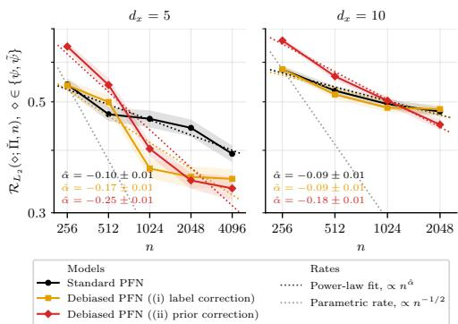  
Figure 5: $L _ { 2 }$ risk on the evaluation prior Πˇ (based on Example C with $w \equiv 1 ;$ axes are logscaled). Shown: mean $\pm \ \mathrm { S E }$ Πˇ -averaged $L _ { 2 }$ concentration errors (solid lines) and the corresponding power-law regression fits (dotted lines) depending on dataset sizes n and covariate dimensionality $d _ { x }$ (over $M = 2 0 0$ ground-truth ${ \check { P } } ,$ each with $D = 2 0 0$ datasets; lower is better). Here, $\diamond \in \{ \psi , \tilde { \psi } \}$ are the target posteriors from the standard and debiased PFNs, respectively.

Setup. To validate our theory, we evaluate the debiased PFN with (i) label correction and (ii) prior

correction (Sec. 4.2) for the ATE (Example C with $w \equiv 1 )$ . In Appendix G.2, we further provide the results for mean value estimation (Example A). For ATE estimation, we use an adapted synthetic prior Π over nonlinear structural causal models from TabPFN v1 (Hollmann et al., 2023). For each $\bar { d } _ { x } \in \{ 5 , 1 0 \}$ and $n \in \{ 2 5 6 , 5 1 2 , 1 0 2 4 , 2 0 4 8 \}$ , we train a standard PFN (Eq. (6)) and two debiased $P F N s \left( i \right) – ( i i ) \left( \mathrm { E q . } \left( 1 2 \right) , ( 1 5 ) \right)$ with the same architecture, training data, and optimization budget (thus, all three PFN variants are comparable). We provide all the implementation details in Appendix F.

Evaluation. Given the Bayes-optimality of the idealized PFNs (Remark 1), we want to evaluate the performance of PFNs based on a modified prior Πˇ that consists of preselected worst-case distributions (i. e., those that yield worst-case posterior in Theorem 1; see further details in Appendix F). While the modified evaluation prior Πˇ has approximately the same support, now the Bayes-optimality does not apply, and, hence, we can empirically validate our theoretical findings. Our evaluation then proceeds in three parts. (1) As a sanity check, we evaluate the amount of observed confounding in sampled datasets (with the training/ evaluation priors Π/Πˇ , and after debiasing applied to the training labels and prior). Following Remark 2 in Appendix D, this allows to check the potential amount of the first-order bias $( F _ { \psi } )$ in different datasets. Then, (2) to verify the results of Theorems 2 and 4, we evaluate the $L _ { 2 }$ risk for different PFNs based on the evaluation prior Πˇ , namely, $\mathcal { R } _ { L _ { 2 } } ( \psi ; \check { \Pi } , n ) =$ $\mathbb { E } _ { \check { P } \sim \check { \Pi } } \mathbb { E } _ { { D _ { n } } \sim \check { P } \otimes n } \lvert | \psi - \check { \psi } \rvert | _ { L _ { 2 } ( q _ { \theta ^ { * } } , \mathcal { D } _ { n } ) }$ . Finally, (3) to showcase Theorem 3, we measure $\Pi / \check { \Pi }$ -prioraveraged empirical total variation between the PFN-based posteriors and a frequentist A-IPTW estimator with the ground-truth nuisance functions.

Results for part (1). We defer the results for part (1) to Appendix G.1. Therein, (a) the evaluation prior Πˇ contains a significantly larger spread of the observed confounding ∆ than the training prior Π (hence making it “worst-case”); and (b) both debiasing strategies target this mismatch, yet in different ways: (ii) prior correction spreads $\Delta$ of the training targets at least as widely as under Πˇ , whereas (i) label correction leaves the spread nearly unchanged. The latter is expected, as (i) corrects the training labels with a data-dependent one-step term rather than modifying the prior.

Results for part (2). Fig. 5 shows the results. Here, our both debiased PFNs often outperform the standard PFN for sufficiently large n $( \mathrm { i } . \mathrm { e } . , n \ge 1 0 2 4 $ for $d _ { x } = 5$ and $n \geq 2 0 4 8$ for $d _ { x } = 1 0 )$ , and achieve much faster concentration rates αˆ (especially for $d _ { x } = 5 )$ . This confirms the asymptotic optimality of both debiasing strategies based on a worst-case evaluation prior Πˇ (as suggested by Theorems 2 and 4).

Results for part (3). The results are in Appendix G.1. There, based on the evaluation prior Πˇ , the total variation of all the PFNs grows with n, which suggests that the second-order remainder and amortization errors are not negligible for the considered n. Still, our debiased PFNs are closer to the efficient normal approximation (A-IPTW estimator) than the standard PFN (especially, (ii) prior correction).

Conclusion. Our work provides two generic strategies for debiasing PFNs for semi-parametric inference with rigorous and provable asymptotic optimality guarantees.

## AI USE STATEMENT

In this work, we used generative AI tools (LLM-based coding assistants and agents) to implement methods, to provide feedback on the design of the experiments, and to assist in interpreting experimental results. We have also used generative AI tools to aid the formulation of mathematical claims, proofs, and hypotheses. All synthetic data were produced by our own simulation code, not generated by AI models; translation, dataset cleaning, and qualitative data analysis do not apply to this work. Additionally, we used generative AI tools to create and edit software code and scientific figures and to draft and edit parts of the paper. We have reviewed all AI-assisted work. All theoretical results and proofs were checked and verified by the authors. We take responsibility for the final content of this work, including text, claims, and artifacts produced with the aid of generative AI.

## ETHICS STATEMENT

This work is methodological and uses only simulated data; it involves no human subjects, personal data, or data releases. We do not foresee specific ethical concerns beyond the general caveat that uncertainty estimates from amortized models should be validated before use in high-stakes decisions.

## REPRODUCIBILITY STATEMENT

The assumptions for all theoretical results are stated in the main text, and complete proofs are given in Appendix D. The data-generating prior, the training procedure of all PFN variants, and the evaluation protocol are described in Sec. 5 and Appendix F, with additional results in Appendix G. Anonymous source code covering data generation, training, inference, and metric computation, including a pipeline script with all random seeds fixed, is available at https://anonymous. 4open.science/r/Ortho-PFN-Anonymized-E4B7.

## ACKNOWLEDGMENTS

This paper is supported by the DAAD programme Konrad Zuse Schools of Excellence in Artificial Intelligence, sponsored by the Federal Ministry of Research, Technology and Space. S.F. acknowledges funding via Swiss National Science Foundation Grant 186932. This work has been supported by the German Federal Ministry of Education and Research (Grant: 01IS24082).

## REFERENCES

Ahmed M. Alaa and Mihaela van der Schaar. Bayesian inference of individualized treatment effects using multi-task Gaussian processes. In Advances in Neural Information Processing Systems, 2017.

Ahmed M. Alaa and Mihaela van der Schaar. Limits of estimating heterogeneous treatment effects: Guidelines for practical algorithm design. In International Conference on Machine Learning, 2018.

Anastasios N. Angelopoulos, Stephen Bates, Clara Fannjiang, Michael I. Jordan, and Tijana Zrnic. Prediction-powered inference. Science, 382(6671):669–674, 2023.

Abdul Fatir Ansari, Lorenzo Stella, Ali Caner Turkmen, Xiyuan Zhang, Pedro Mercado, Huibin Shen, Oleksandr Shchur, Syama Sundar Rangapuram, Sebastian Pineda Arango, Shubham Kapoor, Jasper

Zschiegner, Danielle C. Maddix, Hao Wang, Michael W. Mahoney, Kari Torkkola, Andrew Gordon Wilson, Michael Bohlke-Schneider, and Bernie Wang. Chronos: Learning the language of time series. Transactions on Machine Learning Research, 2024.

Sivaraman Balakrishnan, Edward Kennedy, and Larry Wasserman. The fundamental limits of structure-agnostic functional estimation. Statistical Science, 41(3):659–670, 2026.

Vahid Balazadeh, Hamidreza Kamkari, Valentin Thomas, Benson Li, Junwei Ma, Jesse C. Cresswell, and Rahul G. Krishnan. CausalPFN: Amortized causal effect estimation via in-context learning. In Advances in Neural Information Processing Systems, 2025.

Peter J. Bickel, Chris A.J. Klaassen, Ya’acov Ritov, and Jon A. Wellner. Efficient and adaptive estimationfor semiparametric models. Springer New York, 1993.

PJ Bickel and BJK Kleijn. The semiparametric Bernstein-von Mises theorem. The Annals ofStatistics, pp. 206–237, 2012.

Samuel Bohm, Lennart Purucker, Frank Hutter, and Pascal Schlosser. SurvPFN: Towards foundation¨ models for survival predictions. arXiv preprint arXiv:2606.04564, 2026.

Marie Brockschmidt, Santo M. A. R. Thies, Maresa Schroder, Dennis Frauen, Valentyn Melny-¨ chuk, Maximilian Muschalik, Eyke Hullermeier, and Stefan Feuerriegel. ConfoundingSHAP:¨ Quantifying confounding strength in causal inference. arXiv preprint arXiv:2605.10533, 2026.

Tom Brown, Benjamin Mann, Nick Ryder, Melanie Subbiah, Jared D. Kaplan, Prafulla Dhariwal, Arvind Neelakantan, Pranav Shyam, Girish Sastry, Amanda Askell, et al. Language models are few-shot learners. In Advances in Neural Information Processing Systems, 2020.

Victor Chernozhukov, Whitney Newey, Vıctor M. Quintas-Martınez, and Vasilis Syrgkanis. RieszNet and ForestRiesz: Automatic debiased machine learning with neural nets and random forests. In International Conference on Machine Learning, 2022.

Michelle Ching, Ioana Popescu, Nico Smith, Tianyi Ma, William G. Underwood, and Richard J. Samworth. Efficient and minimax optimal in-context nonparametric regression with transformers. In International Conference on Machine Learning, 2026.

Hugh A. Chipman, Edward I. George, and Robert E. McCulloch. BART: Bayesian additive regression trees. The Annals of Applied Statistics, 4(1), 2010.

A. Philip Dawid. The well-calibrated Bayesian. Journal ofthe American Statistical Association, 77 (379):605–610, 1982.

Ivan D ´ ´ıaz and Michael Rosenblum. Targeted maximum likelihood estimation using exponential families. The International Journal ofBiostatistics, 11(2):233–251, 2015.

Qingxiu Dong, Lei Li, Damai Dai, Ce Zheng, Jingyuan Ma, Rui Li, Heming Xia, Jingjing Xu, Zhiyong Wu, Baobao Chang, et al. A survey on in-context learning. In Conference on Empirical Methods in Natural Language Processing, 2024.

Samuel Dooley, Gurnoor Singh Khurana, Chirag Mohapatra, Siddartha V. Naidu, and Colin White. ForecastPFN: Synthetically-trained zero-shot forecasting. Advances in Neural Information Processing Systems, 2023.

Joao Fonseca and Julia Stoyanovich. ExplainerPFN: Towards tabular foundation models for modelfree zero-shot feature importance estimations. arXiv preprint arXiv:2601.23068, 2026.

Sandra Fortini, Kenyon Ng, Sonia Petrone, Judith Rousseau, and Susan Wei. A principled framework for uncertainty decomposition in TabPFN. arXiv preprint arXiv:2602.04596, 2026.

David Freedman. Wald lecture: On the Bernstein-von Mises theorem with infinite-dimensional parameters. The Annals ofStatistics, 27(4):1119–1141, 1999.

Marta Garnelo, Dan Rosenbaum, Christopher Maddison, Tiago Ramalho, David Saxton, Murray Shanahan, Yee Whye Teh, Danilo Rezende, and S.M. Ali Eslami. Conditional neural processes. In International Conference on Machine Learning, 2018.

Samuel Gershman and Noah Goodman. Amortized inference in probabilistic reasoning. In The Annual Meeting of the Cognitive Science Society, 2014.

Subhashis Ghosal and Aad van der Vaart. Fundamentals of Nonparametric Bayesian Inference. Cambridge Series in Statistical and Probabilistic Mathematics. Cambridge University Press, 2017.

Leo Grinsztajn, Klemens Fl ´ oge, Oscar Key, Felix Birkel, Philipp Jund, Brendan Roof, Benjamin¨ Jager, Dominik Safaric, Simone Alessi, Adrian Hayler, et al. TabPFN-2.5: Advancing the state of¨ the art in tabular foundation models. arXiv preprint arXiv:2511.08667, 2025.

Leo Grinsztajn, Klemens Fl´ oge, Oscar Key, Felix Birkel, Philipp Jund, Brendan Roof, Mihir Manium,¨ Shi Bin Hoo, Magnus Buhler, Anurag Garg, et al. TabPFN-3: Technical report. ¨ arXiv preprint arXiv:2605.13986, 2026.

Susan Gruber and Mark J. van der Laan. A targeted maximum likelihood estimator of a causal effect on a bounded continuous outcome. The International Journal ofBiostatistics, 6(1):26, 2010.

P. Richard Hahn, Carlos M Carvalho, David Puelz, et al. Regularization and confounding in linear regression for treatment effect estimation. Bayesian Analysis, 13(1), 2018.

J.A. Hartigan. Asymptotic normality of posterior distributions. In Bayes theory, pp. 107–118. Springer, 1983.

Tobias Hatt and Stefan Feuerriegel. Estimating average treatment effects via orthogonal regularization. In International Conference on Information and Knowledge Management, 2021.

Christian L. Hines and Oliver J. Hines. Automatic debiasing of neural networks via momentconstrained learning. In Conference on Causal Learning and Reasoning, 2025.

Keisuke Hirano, Guido W. Imbens, and Geert Ridder. Efficient estimation of average treatment effects using the estimated propensity score. Econometrica, 71(4):1161–1189, 2003.

Noah Hollmann, Samuel Muller, Katharina Eggensperger, and Frank Hutter. TabPFN: A transformer¨ that solves small tabular classification problems in a second. In International Conference on Learning Representations, 2023.

Noah Hollmann, Samuel Muller, Lennart Purucker, Arjun Krishnakumar, Max K¨ orfer, Shi Bin Hoo,¨ Robin Tibor Schirrmeister, and Frank Hutter. Accurate predictions on small data with a tabular foundation model. Nature, 637(8045):319–326, 2025.

Manuel Hulskamp, Julius Kobialka, Emanuel Sommer, and David R¨ ugamer. On the uncertainty in¨ prior-data fitted network pretraining. In ICML Workshop on Foundation Modelsfor Structured Data, 2026.

Emil Javurek, Dennis Frauen, Marie Brockschmidt, Jonas Schweisthal, and Stefan Feuerriegel. Amortizing causal sensitivity analysis via prior data-fitted networks. arXiv preprint arXiv:2605.10590, 2026.

Jikai Jin and Vasilis Syrgkanis. Sharp structure-agnostic lower bounds for general linear functional estimation. arXiv preprint arXiv:2512.17341, 2025a.

Jikai Jin and Vasilis Syrgkanis. Structure-agnostic optimality of doubly robust learning for treatment effect estimation. In Annual Conference on Learning Theory, 2025b.

Edward H. Kennedy. Semiparametric doubly robust targeted double machine learning: a review. Handbook ofStatistical Methodsfor Precision Medicine, pp. 207–236, 2024.

Hyunjik Kim, Andriy Mnih, Jonathan Schwarz, Marta Garnelo, Ali Eslami, Dan Rosenbaum, Oriol Vinyals, and Yee Whye Teh. Attentive neural processes. In International Conference on Learning Representations, 2019.

Juno Kim, Tai Nakamaki, and Taiji Suzuki. Transformers are minimax optimal nonparametric in-context learners. Advances in Neural Information Processing Systems, 2024.

Tuan Anh Le, Atilim Gunes Baydin, and Frank Wood. Inference compilation and universal probabilistic programming. In International Conference on Artificial Intelligence and Statistics, 2017.

Lucien Le Cam. Asymptotic methods in statistical decision theory. Springer Science & Business Media, 2012.

Fan Li, Peng Ding, and Fabrizia Mealli. Bayesian causal inference: A critical review. Philosophical Transactions ofthe Royal Society A, 381(2247):20220153, 2023.

Antonio R. Linero and Joseph L. Antonelli. The how and why of Bayesian nonparametric causal inference. Wiley Interdisciplinary Reviews: Computational Statistics, 15(1):e1583, 2023.

Tianyi Ma, Tengyao Wang, and Richard J. Samworth. Optimal in-context adaptivity and distributional robustness of transformers. arXiv preprint arXiv:2510.23254, 2025.

Yuchen Ma, Dennis Frauen, Emil Javurek, and Stefan Feuerriegel. Foundation models for causal inference via prior-data fitted networks. In International Conference on Learning Representations, 2026.

Divyat Mahajan, Jannes Gladrow, Agrin Hilmkil, Cheng Zhang, and Meyer Scetbon. Amortized inference of causal models via conditional fixed-point iterations. Transactions on Machine Learning Research, 2025.

Valentyn Melnychuk, Vahid Balazadeh, Stefan Feuerriegel, and Rahul G. Krishnan. Frequentist consistency of prior-data fitted networks for causal inference. In International Conference on Machine Learning, 2026.

Samuel Muller, Noah Hollmann, Sebastian Pineda Arango, Josif Grabocka, and Frank Hutter.¨ Transformers can do Bayesian inference. In International Conference on Learning Representations, 2022.

Samuel Muller, Matthias Feurer, Noah Hollmann, and Frank Hutter. PFNs4BO: In-context learning¨ for Bayesian optimization. In International Conference on Machine Learning, 2023.

Samuel Muller, Arik Reuter, Noah Hollmann, David R¨ ugamer, and Frank Hutter. Position: The¨ future of Bayesian prediction is prior-fitted. In International Conference on Machine Learning Position Paper Track, 2025.

Razieh Nabi. Semiparametric efficiency theory as differential calculus on a space of probability distributions. arXiv preprint arXiv:2606.22784, 2026.

Thomas Nagler. Statistical foundations of prior-data fitted networks. In International Conference on Machine Learning, 2023.

Thomas Nagler and David Rugamer. Uncertainty quantification for prior-data fitted networks using¨ martingale posteriors. arXiv preprint arXiv:2505.11325, 2025.

Whitney K. Newey. The asymptotic variance of semiparametric estimators. Econometrica, 62(6): 1349–1382, 1994.

Kenyon Ng, Edwin Fong, David T. Frazier, Jeremias Knoblauch, and Susan Wei. TabMGP: Martingale posterior with TabPFN. arXiv preprint arXiv:2510.25154, 2025.

Shi-ang Qi, Vahid Balazadeh, Michael Cooper, Russell Greiner, and Rahul G. Krishnan. SurvivalPFN: Amortizing survival prediction via in-context Bayesian inference. arXiv preprint arXiv:2605.15488, 2026.

Kolyan Ray and Botond Szabo. Debiased Bayesian inference for average treatment effects. In´ Advances in Neural Information Processing Systems, 2019.

Kolyan Ray and Aad van der Vaart. Semiparametric Bayesian causal inference. The Annals of Statistics, 48(5):2999–3020, 2020.

Arik Reuter, Tim G.J. Rudner, Vincent Fortuin, and David Rugamer. Can transformers learn full¨ Bayesian inference in context? In International Conference on Machine Learning Position Paper Track, 2025.

Arik Reuter, Anish Dhir, Cristiana Diaconu, Jake Robertson, Ole Ossen, Frank Hutter, Adrian Weller, Mark van der Wilk, and Bernhard Scholkopf. Use what you know: Causal foundation models with¨ partial graphs. In International Conference on Machine Learning, 2026.

Jake Robertson, Arik Reuter, Siyuan Guo, Noah Hollmann, Frank Hutter, and Bernhard Scholkopf.¨ Do-PFN: In-context learning for causal effect estimation. In Advances in Neural Information Processing Systems, 2025.

James M. Robins. Robust estimation in sequentially ignorable missing data and causal inference models. In Proceedings ofthe American Statistical Association, 2000.

James M. Robins, Andrea Rotnitzky, and Lue Ping Zhao. Analysis of semiparametric regression models for repeated outcomes in the presence of missing data. Journal ofthe American Statistical Association, 90(429):106–121, 1995.

Dmitrii Seletkov, Paul Hager, Georgios Kaissis, Rickmer Braren, Daniel Rueckert, and Raphael Rehms. Survival in-context: Amortized Bayesian survival analysis via prior-fitted networks. arXiv preprint arXiv:2603.29475, 2026.

Claudia Shi, David Blei, and Victor Veitch. Adapting neural networks for the estimation of treatment effects. Advances in Neural Information Processing Systems, 2019.

Ege Onur Taga, Muhammed Emrullah Ildiz, and Samet Oymak. TimePFN: Effective multivariate time series forecasting with synthetic data. In AAAI Conference on Artificial Intelligence, 2025.

Anastasios A. Tsiatis. Semiparametric theory and missing data. Springer New York, 2006.

Alexandre B. Tsybakov and Vladimir Zaiats. Introduction to nonparametric estimation, volume 11. Springer, 2009.

Lars van der Laan and Mark van der Laan. Calibeating prediction-powered inference. arXiv preprint arXiv:2604.21260, 2026.

Mark J. van der Laan and Daniel B. Rubin. Targeted maximum likelihood learning. The International Journal of Biostatistics, 2, 2006.

Aad van der Vaart and Harry van Zanten. Information rates of nonparametric Gaussian process methods. Journal ofMachine Learning Research, 12(6), 2011.

Aad W. van der Vaart. Asymptotic statistics, volume 3. Cambridge University Press, Cambridge, United Kingdom, 2000.

Ashish Vaswani, Noam Shazeer, Niki Parmar, Jakob Uszkoreit, Llion Jones, Aidan N. Gomez, Łukasz Kaiser, and Illia Polosukhin. Attention is all you need. Advances in Neural Information Processing Systems, 2017.

Sang Michael Xie, Aditi Raghunathan, Percy Liang, and Tengyu Ma. An explanation of in-context learning as implicit Bayesian inference. In International Conference on Learning Representations, 2022.

Yun Yang, Guang Cheng, and David B. Dunson. Semiparametric Bernstein-von Mises theorem: Second order studies. arXiv preprint arXiv:1503.04493, 2015.

Andrew Yiu, Edwin Fong, Chris Holmes, and Judith Rousseau. Semiparametric posterior corrections. Journal ofthe Royal Statistical Society Series B: Statistical Methodology, 87(4):1025–1054, 2025.

## A EXTENDED RELATED WORK

## A.1 PRIOR-DATA FITTED NETWORKS

Amortized Bayesian inference & in-context learning. Amortized Bayesian inference (ABI) replaces repeated, dataset-specific posterior computation by a learned inference map that shares computation across related inference problems (Gershman & Goodman, 2014; Le et al., 2017). Closely related ideas appear in neural processes, which learn distributions over functions conditional on observed context sets (Garnelo et al., 2018; Kim et al., 2019). More recently, the emergence of in-context learning (ICL) in transformers has provided a particularly flexible mechanism for such amortization: A pretrained model adapts to a new task through its context alone, without updating its parameters (Brown et al., 2020; Dong et al., 2024). Several theoretical perspectives have been proposed to explain ICL, including implicit Bayesian inference (Xie et al., 2022), meta-learning, and the in-context implementation of statistical learning algorithms. The Bayesian and ICL viewpoints become especially closely connected when pretraining tasks are themselves sampled from a prior: conditioning on the in-context dataset then corresponds to learning a posterior predictive rule (Muller¨ et al., 2022).

PFNs. Prior-data fitted networks (PFNs) instantiate this connection between ABI and ICL explicitly (Muller et al., 2022). Rather than fitting a model separately to each observed dataset, a PFN is¨ pretrained on synthetic datasets sampled from a user-specified prior over data-generating processes. By predicting held-out quantities conditional on the remaining observations, the network learns to approximate the corresponding Bayesian posterior-predictive distribution; after pretraining, inference on a new dataset reduces to a forward pass through the network. A prominent realization is TabPFN (Hollmann et al., 2023), which brought the PFN paradigm to tabular classification. Its substantially extended successor supports both classification and regression, categorical and missing features, and datasets with up to thousands of observations, while achieving strong predictive performance on small- and medium-sized tabular datasets (Hollmann et al., 2025). The PFN paradigm has since been extended beyond generic tabular prediction, including Bayesian optimization (Muller et al., 2023),¨ time-series forecasting (Dooley et al., 2023; Ansari et al., 2024; Taga et al., 2025), and, more recently, survival analysis (Seletkov et al., 2026; Qi et al., 2026; Bohm et al., 2026); see M¨ uller et al. (2025)¨ for a broader perspective.

PFNs for semi-parametric inference. To our knowledge, explicit applications of PFNs to semiparametric target estimation have so far concentrated on causal inference. Balazadeh et al. (2025) introduced CausalPFN, which pretrains on observational datasets generated under unconfoundedness and directly amortizes estimation of average and heterogeneous treatment effects. Furthermore, Robertson et al. (2025) proposed Do-PFN, which instead pretrains across heterogeneous structural causal models and interventions, thereby learning to predict interventional outcomes without requiring the causal graph at test time. Going beyond these specific constructions, Ma et al. (2026) developed CausalFM, a general framework for constructing PFN priors from structural causal models covering back-door, front-door, and instrumental-variable settings. Importantly, they formalized conditions under which such priors yield identifiable and consistent Bayesian causal estimators, highlighting that an inappropriate causal pretraining prior may remain biased even asymptotically. Subsequent work further incorporated partial causal-graph information (Reuter et al., 2026) or extended PFN-based amortization to causal sensitivity analysis (Javurek et al., 2026). Again, all the above-mentioned works (at best) established the consistency of estimation without further studying the asymptotic properties ofthe PFNs.

## A.2 SEMI-PARAMETRIC INFERENCE

Frequentist estimation. Classical semi-parametric inference constructs estimators of a lowdimensional target while treating other components of the data-generating process as infinitedimensional nuisance functions (Kennedy, 2024). In causal inference, in particular, prominent examples include outcome-regression plug-in estimators, inverse-probability weighting, and estimators that combine the two. A central example is an augmented inverse probability treatment weighted (A-IPTW) estimator. Rather than relying solely on estimated nuisance functions, A-IPTW augments a plug-in estimate by an influence-function-based correction. Under standard regularity conditions and sufficiently accurate nuisance estimation, this construction yields ${ \sqrt { n } } .$ -consistent, asymptotically normal, and semi-parametrically efficient estimation of finite-dimensional functionals such as the ATE (Newey, 1994; Robins, 2000; Bickel et al., 1993; Tsiatis, 2006). On the other hand, targeted maximum likelihood estimation (TMLE) provides an alternative implementation of the same first-order debiasing principle and is asymptotically equivalent under suitable conditions (van der Laan & Rubin, 2006). Modern work increasingly combines such debiased (or orthogonal) estimators with flexible machine-learning estimates of the nuisance functions (e.g., Shi et al., 2019; Hatt & Feuerriegel, 2021; Chernozhukov et al., 2022; Hines & Hines, 2025). This separation between flexible nuisance learning and a target-specific correction is particularly important for our setting: We design our debiasing strategies such that the flexibility of PFNs does not come at the cost of slower target estimation rates.

Minimax optimality. Minimax theory characterizes the fundamental statistical difficulty of an estimation problem by asking for the smallest worst-case error achievable over a specified model class (Le Cam, 2012; van der Vaart, 2000; Tsybakov & Zaiats, 2009). A minimax lower bound thus establishes a rate below which no estimator can uniformly improve. At the same time, an upper bound can be obtained by analyzing existing estimators (e. g., debiased estimators from above). When the two bounds match, the corresponding estimator is minimax optimal. In semi-parametric problems, however, there is no “one-size-fits-all” optimal rate: The minimax rate generally depends on both the target functional and the restrictions imposed on the nuisance functions. Recent work has therefore derived lower bounds for specific classes of functionals: e. g., the integrated squared density and expected conditional covariance (Balakrishnan et al., 2026); weighted average treatment effects (Jin & Syrgkanis, 2025b); and general linear functionals with mixed-bias property (Jin & Syrgkanis, 2025a). These results motivate our target-specific analysis: In Appendix E, for each estimand, we compare the rate achieved by our debiased PFN with the corresponding minimax lower bound.

Bayesian estimation. Unlike the frequentist estimators, Bayesian semi-parametric inference places a prior on the unknown components of the data-generating process and propagates the resulting posterior uncertainty to the target estimand. Flexible nuisance models used for this purpose include Gaussian processes (Alaa & van der Schaar, 2017; 2018) and Bayesian additive regression trees (Chipman et al., 2010); see Li et al. (2023); Linero & Antonelli (2023) for broader discussions.

Bernstein–von Mises property of Bayesian estimators. For finite-dimensional functionals of an infinite-dimensional model, however, posterior consistency of the nuisance functions alone does not ensure valid uncertainty quantification for the target. The relevant asymptotic property is provided by semi-parametric Bernstein–von Mises (BvM) theory (Hartigan, 1983; Bickel & Kleijn, 2012). A BvM result establishes that, after appropriate centering and $\sqrt { n }$ scaling, the marginal posterior for the target approaches a normal distribution whose variance coincides with the semi-parametric efficiency bound. Consequently, Bayesian credible sets acquire an asymptotically validfrequentist interpretation. Establishing such a result is delicate because regularization or prior-induced bias (Hahn et al., 2018) in the nuisance components can propagate to the target and dominate its $\sqrt { n }$ fluctuations. This interaction between nuisance contraction, prior bias, and target-level posterior behavior is precisely the aspect of semi-parametric Bayesian theory that is most closely connected to our analysis.

## B BACKGROUND MATERIALS

## B.1 EFFICIENT INFLUENCE FUNCTIONS

We refer to Kennedy (2024) for a detailed introduction to semi-parametric efficiency theory and to Nabi (2026) for a geometric interpretation of efficient influence functions (EIFs). Below, we briefly introduce the concepts needed in our analysis; for more details, we refer to Bickel et al. (1993); Tsiatis (2006); van der Vaart (2000).

Parametric sub-models. Let $P _ { 0 } \in \mathcal { P } ( \mathcal { Z } )$ denote a fixed data-generating distribution. A onedimensional regular parametric sub-model through $P _ { 0 }$ is a collection $\{ P _ { t } : t \in ( - \epsilon , \epsilon ) \} \subseteq { \mathcal { P } } ( { \mathcal { Z } } )$ such that $P _ { t = 0 } = P _ { 0 }$ and the map $t \mapsto P _ { t }$ is sufficiently smooth at $t = 0$ . The corresponding score describes the infinitesimal direction in which the distribution is perturbed:

$$
s ( Z ) : = \left. \frac { \partial } { \partial t } \log P _ { t } ( Z ) \right| _ { t = 0 } .\tag{22}
$$

Any regular score satisfies $P _ { 0 } s = 0$ and $P _ { 0 } s ^ { 2 } < \infty$ , and therefore belongs to the Hilbert space $L _ { 2 } ^ { 0 } \bar { ( } P _ { 0 } ) \bar { : } = \{ f : P _ { 0 } f = 0 , P _ { 0 } f ^ { 2 } < \infty \}$ , equipped with inner product $\langle f , g \rangle _ { P _ { 0 } } : = P _ { 0 } ( f g )$ . The collection of scores generated by all regular parametric sub-models determines the tangent space

$$
{ \mathcal { T } } ( P _ { 0 } ) : = { \overline { { \operatorname { s p a n } } } } \left\{ s : s = \left. { \frac { \partial } { \partial t } } \log P _ { t } \right| _ { t = 0 } { \mathrm { ~ f o r ~ s o m e ~ r e g u l a r ~ } } P _ { t } \right\} \subseteq L _ { 2 } ^ { 0 } ( P _ { 0 } ) .\tag{23}
$$

Thus, although $\mathcal { P } ( \mathcal { Z } )$ may be infinite-dimensional, a parametric sub-model probes it along a single local direction.

For a given target $\psi ,$ directions $s \in \mathcal { T } ( P _ { 0 } )$ along which $\psi ( P _ { t } )$ does not change to first order correspond to nuisance directions. Geometrically, the efficient influence function isolates the component of variation that is relevant for ψ from these target-irrelevant perturbations.

Pathwise derivatives. The functional $\psi : { \mathcal { P } } ( { \mathcal { Z } } ) \to \Psi$ is pathwise differentiable at $P _ { 0 }$ if, along every regular parametric sub-model $P _ { t }$ through $P _ { 0 } .$ , its directional derivative exists and defines a continuous linear functional of the corresponding score s:

$$
\dot { \psi } _ { P _ { 0 } } ( s ) : = \left. { \frac { \partial } { \partial t } } \psi ( P _ { t } ) \right| _ { t = 0 } .\tag{24}
$$

By the Riesz representation theorem, there then exists a unique element of the tangent space, denoted by $\phi _ { \psi } ( \cdot ; P _ { 0 } )$ , such that

$$
\dot { \psi } _ { P _ { 0 } } ( s ) = \left. \phi _ { \psi } ( \cdot ; P _ { 0 } ) , s \right. _ { P _ { 0 } } = P _ { 0 } \left[ \phi _ { \psi } ( Z ; P _ { 0 } ) s ( Z ) \right] , \qquad s \in \mathcal { T } ( P _ { 0 } ) .\tag{25}
$$

This function is the efficient influencefunction (EIF), also called the canonical gradient, and satisfies $P _ { 0 } \phi _ { \psi } ( \cdot ; P _ { 0 } ) = 0$ . Equivalently, along a sufficiently smooth local path,

$$
\psi ( P _ { t } ) - \psi ( P _ { 0 } ) = t \cdot P _ { 0 } \left[ \phi _ { \psi } ( Z ; P _ { 0 } ) s ( Z ) \right] + o ( t ) .\tag{26}
$$

The EIF therefore describes the first-order sensitivity of the target to perturbations of the underlying distribution. This infinitesimal representation is the local counterpart of the von–Mises expansion used throughout the main text.

The geometry also gives a useful interpretation of the EIF norm. By Cauchy–Schwarz,

$$
\begin{array} { r } { \left\| \dot { \psi } _ { P _ { 0 } } ( s ) \right\| \leq \| \phi _ { \psi } ( \cdot ; P _ { 0 } ) \| _ { L _ { 2 } ( P _ { 0 } ) } \cdot \| s \| _ { L _ { 2 } ( P _ { 0 } ) } . } \end{array}\tag{27}
$$

Hence, among unit-norm local perturbations, the EIF direction is the direction along which the target can change most rapidly, whenever such a score is attainable, or can be approximated, by regular parametric sub-models. This observation also motivates our prior correction, which introduces additional prior variation in a target-specific, EIF-aligned direction.

## B.2 NOTIONS OF OPTIMALITY

We distinguish three notions of optimality that arise naturally in our analysis. Local frequentist optimality compares estimators in shrinking neighborhoods of a fixed data-generating distribution $P _ { 0 }$ global frequentist optimality compares their worst-case behavior over an entire class of distributions; and Bayes optimality averages performance over distributions drawn from a prior Π. These notions are conceptually distinct and, in general, none implies the others.

Local frequentist optimality. Consider first a fixed $P _ { 0 }$ and $\psi _ { 0 } = \psi ( P _ { 0 } )$ ). A regular asymptotically linear estimator $\hat { \psi } _ { n }$ admits an expansion

$$
\hat { \psi } _ { n } - \psi _ { 0 } = P _ { n } D ( \cdot ; P _ { 0 } ) + o _ { P _ { 0 } } ( n ^ { - 1 / 2 } ) ,\tag{28}
$$

where $D ( \cdot ; P _ { 0 } ) \in L _ { 2 } ^ { 0 } ( P _ { 0 } )$ is its influence function. Consequently,

$$
\sqrt { n } \big ( \hat { \psi } _ { n } - \psi _ { 0 } \big )  N ( 0 , P _ { 0 } D ^ { 2 } ( \cdot ; P _ { 0 } ) ) .\tag{29}
$$

Regularity requires this first-order behavior to remain stable under local perturbations of $P _ { 0 }$ of order $n ^ { - \overline { { 1 } } / 2 }$ . Semi-parametric efficiency theory implies that the EIF has the smallest possible variance among influence functions of regular estimators:

$$
P _ { 0 } D ^ { 2 } ( \cdot ; P _ { 0 } ) \ge P _ { 0 } \phi _ { \psi } ^ { 2 } ( \cdot ; P _ { 0 } ) = \mathrm { V a r } _ { P _ { 0 } } \left[ \phi _ { \psi } ( Z ; P _ { 0 } ) \right] = : V _ { \mathrm { e f f } } ( P _ { 0 } ) .\tag{30}
$$

The quantity $V _ { \mathrm { e f f } } ( P _ { 0 } )$ is the semi-parametric efficiency bound. An estimator attaining this bound is locally efficient at $P _ { 0 }$ . The qualifier “local” is important: the comparison concerns infinitesimal, typically $n ^ { - 1 / 2 }$ -scale, perturbations around a fixed $P _ { 0 }$ , rather than uniform performance over the entire model class.

For Bayesian procedures, a semi-parametric Bernstein–von Mises property provides the corresponding local frequentist guarantee. If a target posterior is asymptotically normal with variance $V _ { \mathrm { e f f } } ( \bar { P _ { 0 } } ) / n$ its posterior uncertainty attains the same local efficiency bound and its credible sets have an asymptotically valid frequentist interpretation. This is the notion of local optimality later used for our debiased PFNs when the second-order remainder is $o _ { P _ { 0 } } ( n ^ { - 1 / 2 } )$ .

Global frequentist optimality. Local efficiency does not characterize the behavior of an estimator uniformly over a potentially large class of data-generating distributions. For a class ${ \mathcal { P } } ^ { \prime } \subseteq { \mathcal { P } } ( { \mathcal { Z } } )$ , we instead consider its worst-case squared $l _ { 2 }$ risk

$$
\mathcal { W } _ { l _ { 2 } ^ { 2 } } ( \hat { \psi } ; \mathcal { P } ^ { \prime } , n ) : = \operatorname* { s u p } _ { P \in \mathcal { P } ^ { \prime } } \mathbb { E } _ { \mathcal { D } _ { n } \sim P ^ { \otimes n } } \left[ \hat { \psi } ( \mathcal { D } _ { n } ) - \psi ( P ) \right] ^ { 2 } .\tag{31}
$$

The corresponding minimax risk is

$$
\mathfrak { M } _ { n } ( \mathcal { P } ^ { \prime } ) : = \operatorname* { i n f } _ { \boldsymbol { \hat { \psi } } : \mathcal { P } ^ { \otimes n }  \Psi } \mathcal { W } _ { l _ { 2 } ^ { 2 } } ( \boldsymbol { \hat { \psi } } ; \mathcal { P } ^ { \prime } , n ) .\tag{32}
$$

The minimax risk is a property of the statistical problem itself: it gives the smallest worst-case error achievable by any estimator over ${ \mathcal { P } } ^ { \prime }$ . If, for some sequence $r _ { n } \to 0$

$$
\mathfrak { M } _ { n } ( \mathcal { P } ^ { \prime } ) \gtrsim r _ { n } ^ { 2 } \qquad \mathrm { a n d } \qquad \mathcal { W } _ { l _ { 2 } ^ { 2 } } ( \hat { \psi } ; \mathcal { P } ^ { \prime } , n ) \lesssim r _ { n } ^ { 2 } ,\tag{33}
$$

then $\hat { \psi }$ is minimax-rate optimal over $\mathcal { P } ^ { \prime }$ . Unlike local efficiency, global minimax optimality does not require a $\sqrt { n }$ rate or asymptotic normality: depending on the functional ψ and the complexity of the nuisance functions $\eta ( P )$ , the optimal rate $r _ { n }$ may be slower than $n ^ { - 1 / 2 }$

In our analysis later, the relevant class is the effective prior-supported class $\mathcal { P } _ { n } ^ { \Pi }$ . Thus, the global question is whether the worst-case risk of a debiased PFN over $\mathcal { P } _ { n } ^ { \mathrm { i I } }$ matches a corresponding minimax lower bound. This notion is “global” relative to local efficiency because it controls the estimator uniformly across $\mathcal { P } _ { n } ^ { \Pi }$ , rather than only in shrinking neighborhoods of a single $P _ { 0 }$

Bayes optimality. Bayes optimality, on the other hand, evaluates an estimator by averaging its loss with respect to a prior Π over data-generating distributions. Under squared loss, the Bayes risk of an estimator $\hat { \psi }$ is

$$
\begin{array} { r } { \mathcal { R } _ { l _ { 2 } ^ { 2 } } ( \hat { \psi } ; \Pi , n ) : = \mathbb { E } _ { P \sim \Pi } \mathbb { E } _ { \mathcal { D } _ { n } \sim P ^ { \otimes n } } \left[ \hat { \psi } ( \mathcal { D } _ { n } ) - \psi ( P ) \right] ^ { 2 } . } \end{array}\tag{34}
$$

Conditioning on the observed dataset ${ \mathcal { D } } _ { n }$ , the posterior mean

$$
\hat { \psi } _ { n } ^ { \Pi } ( { \mathcal { D } } _ { n } ) : = \mathbb { E } _ { \Pi } \left[ \psi ( P ) \mid { \mathcal { D } } _ { n } \right]\tag{35}
$$

minimizes the posterior expected squared loss and therefore also minimizes $\mathcal { R } _ { l _ { 2 } ^ { 2 } } ( \hat { \psi } ; \Pi , n )$ over all estimators.

The Bayes risk is naturally related to the minimax risk introduced above. In particular, for any prior Π supported on a class $\mathcal { P } ^ { \prime } \subseteq \mathcal { P } ( \mathcal { Z } )$ ,

$$
\mathcal { R } _ { l _ { 2 } ^ { 2 } } \left( \hat { \psi } _ { n } ^ { \Pi } ; \Pi , n \right) = \operatorname* { i n f } _ { \hat { \psi } } \mathcal { R } _ { l _ { 2 } ^ { 2 } } ( \hat { \psi } ; \Pi , n ) \leq \operatorname* { i n f } _ { \hat { \psi } } \operatorname* { s u p } _ { P \in \mathcal { P } ^ { \prime } } \mathbb { E } _ { \mathcal { D } _ { n } \sim P ^ { \otimes n } } \left[ \hat { \psi } ( \mathcal { D } _ { n } ) - \psi ( P ) \right] ^ { 2 } = \mathfrak { M } _ { n } ( \mathcal { P } ^ { \prime } ) .\tag{36}
$$

Thus, the Bayes risk under any fixed prior provides a lower bound on the corresponding minimax risk. Equality may hold for a least-favorable prior, whereas a prior concentrating on statistically easier distributions can have a substantially smaller Bayes risk.

Bayes optimality is fundamentally an average-case criterion: it weights performance according to how likely different data-generating distributions are under Π. It therefore differs from local frequentist optimality, which concerns behavior in shrinking neighborhoods of a fixed $P _ { 0 } ,$ and from global minimax optimality, which controls the worst-case risk over a class of distributions. In particular, an estimator can be Bayes optimal under Π while concentrating slowly for some fixed $P _ { 0 }$ or performing poorly on distributions that receive little prior mass. Conversely, modifying the prior or the PFN training objective to improve frequentist concentration rates may sacrifice Bayes optimality under the original prior, while remaining Bayes optimal with respect to the modified prior.

## C EXAMPLE C

Example C (Weighted average treatment effect (WATE)). The WATE is one ofthe central estimands in causal inference (Hirano et al., 2003). Here, $Z = ( X , A , Y = A Y _ { 1 } + ( 1 - A ) Y _ { 0 } )$ with pretreatment covariates $X \in [ 0 , 1 ] ^ { d _ { x } }$ , a treatment $A \in \{ 0 , 1 \}$ , and the observed outcome $Y \in [ \bar { 0 } , 1 ]$ Then, the WATE is defined as $\psi _ { w } = \mathbb { E } _ { P } [ w ( X ; \pi ) ( Y _ { 1 } - Y _ { 0 } ) ] / \mathbb { E } _ { P } ( w ( X ; \pi ) )$ , where $w ( \cdot ; \pi ) \ge 0$ is a user specified weighting function that depends on covariates x through a propensity score $\pi ( x ) = \mathbb { P } ( A = 1 \mid X = x )$ . For example, $w ( x ; \pi ) = 1$ yields an average treatment effect (ATE), and $w ( x ; \pi ) = \pi ( x ) ( 1 - \pi ( x ) )$ yields the overlap-weighted ATE. Under standard causal assumptions (namely, unconfoundedness, $Y _ { 0 } , Y _ { 1 } \perp \perp A \mid \bar { X } $ , and strong overlap, $\kappa < \pi ( x ) < 1 - \kappa ,$ , with $\kappa \in$ $( 0 , 1 / 2 ) )$ , the WATE is identifiable as $\psi _ { w } ( \dot { P } ) = \mathbb { E } _ { P } [ w ( \dot { X } ; \pi ) ( \mu _ { 1 } \bar { ( } X ) - \mu _ { 0 } ( \dot { X } ) ) ] / \mathbb { E } _ { P } [ w ( X ; \pi ) ] =$ $\begin{array} { r } { \int w ( x ; \pi ) ( \mu _ { 1 } ( x ) - \mu _ { 0 } ( x ) ) \mathrm { d } P ( x ) / \int w ( x ; \pi ) \mathrm { d } P ( x ) } \end{array}$ , where $\mu _ { a } ( x ) = \mathbb { E } _ { P } [ Y \mid A = a , X = x ]$ is a conditional expectation. Here, the corresponding nuisancefunctions, the EIF, and the second-order remainder are asfollows:

$$
\eta ( P ) = [ \mu _ { a } ( x ) , \mathbb { 1 } \{ w ^ { \prime } \not \equiv 1 \} \pi ( x ) , P ( x ) ] ,
$$

$$
\phi _ { \psi , w } ( Z ; P ) = \frac { w ( X ; \pi ) } { \bar { w } ( P ) } \left[ \frac { A - \pi ( X ) } { \pi ( X ) ( 1 - \pi ( X ) ) } ( Y - \mu _ { A } ( X ) ) + \left( ( A - \pi ( X ) ) \cdot \frac { w ^ { \prime } ( X ; \pi ) } { w ( X ; \pi ) } + 1 \right) \left( \tau ( X ) - \psi _ { w } ( P ) \right) \right] ,
$$

$$
R _ { 2 , \psi , w } ( P , P _ { 0 } ) = \frac { 1 } { \bar { w } ( P ) } \Bigg [ ( \psi _ { w } ( P ) - \psi _ { w } ( P _ { 0 } ) ) \cdot \left( ( P - P _ { 0 } ) w ( \cdot ; P ) + P _ { 0 } ( \pi - \pi _ { 0 } ) w ^ { \prime } ( \cdot ; \pi ) \right)\tag{37}
$$

$$
+ P _ { 0 } \Big \{ \big ( w ( \cdot ; \pi ) - w ( \cdot ; \pi _ { 0 } ) - w ^ { \prime } ( \cdot ; \pi ) ( \pi - \pi _ { 0 } ) \big ) \cdot \big ( \tau _ { 0 } - \psi _ { w } ( P _ { 0 } ) \big ) \Big \}
$$

$$
+ P _ { 0 } \bigg \{ \big ( \pi - \pi _ { 0 } \big ) \bigg ( \bigg ( \frac { w \big ( \cdot ; P \big ) } { \pi } - w ^ { \prime } \big ( \cdot ; P \big ) \bigg ) \big ( \mu _ { 1 } - \mu _ { 1 , 0 } \big ) + \bigg ( \frac { w \big ( \cdot ; P \big ) } { 1 - \pi } + w ^ { \prime } \big ( \cdot ; P \big ) \bigg ) \big ( \mu _ { 0 } - \mu _ { 0 , 0 } \big ) \bigg ) \bigg \} ,
$$

where $\bar { w } ( P ) = \mathbb { E } _ { P } [ w ( X ; \pi ) ] , w ^ { \prime } ( \cdot ; \pi )$ is a derivative ofw wrt. to π, and $\tau ( \cdot ) = \mu _ { 1 } ( \cdot ) - \mu _ { 0 } ( \cdot )$ is a conditional average treatment effect (CATE) (Hirano et al., 2003).

## C.1 SLOW CONCENTRATION RATES

By extending Example B, we analogously show slow concentration rates for the WATE.

Example C (WATE). Assume that w is uniformly bounded, Lipschitz in $\pi ,$ and that $\mathbb { E } _ { P } [ w ( X ) ]$ is bounded awayfrom zero. Then,for afixed pair ofdistributions P and $P _ { 0 } ,$ , it can be shown that

$$
\begin{array} { r l } & { \left| { \psi _ { w } - \psi _ { w , 0 } } \right| \lesssim \left\| { P - P _ { 0 } } \right\| _ { L _ { 2 } ( x ) } + \left\| { \mu _ { 1 } - \mu _ { 1 , 0 } } \right\| _ { L _ { 2 } ( P _ { 0 } ) } + \left\| { \mu _ { 0 } - \mu _ { 0 , 0 } } \right\| _ { L _ { 2 } ( P _ { 0 } ) } } \\ & { \qquad + \left. { 1 \left\{ { w ^ { \prime } \not = 0 } \right\} } \right\| \pi - \pi _ { 0 } \| _ { L _ { 2 } ( P _ { 0 } ) } . } \end{array}\tag{38}
$$

Hence, a corresponding nuisance-error norm is

$$
\begin{array} { r l } & { \| \eta ( P ) - \eta ( P _ { 0 } ) \| _ { \mathcal { H } } : = \| P - P _ { 0 } \| _ { L _ { 2 } ( x ) } + \| \mu _ { 1 } - \mu _ { 1 , 0 } \| _ { L _ { 2 } ( P _ { 0 } ) } + \| \mu _ { 0 } - \mu _ { 0 , 0 } \| _ { L _ { 2 } ( P _ { 0 } ) } } \\ & { \qquad +  \mathbb { I } \{ w ^ { \prime } \neq 0 \} \| \pi - \pi _ { 0 } \| _ { L _ { 2 } ( P _ { 0 } ) } . } \end{array}\tag{39}
$$

Again, this bound is locally rate-sharp. In particular, consider the path $\mu _ { 1 , t } ( x ) = \mu _ { 1 , 0 } ( x ) + t ,$ , while keeping $\mu _ { 0 , t } = \mu _ { 0 , 0 } , \pi _ { t } = \pi _ { 0 } ,$ , and $P _ { t } ( x ) = P _ { 0 } ( x )$ . Then $w _ { t } = w _ { 0 }$ and

$$
\psi _ { w } ( P _ { t } ) - \psi _ { w } ( P _ { 0 } ) = t , \qquad \left\| \mu _ { 1 , t } - \mu _ { 1 , 0 } \right\| _ { L _ { 2 } ( P _ { 0 } ) } = \left| t \right| .\tag{40}
$$

Similar paths can be analogously found wrt. other nuisance functions. Thus, whenever the posterior assigns asymptotically non-negligible mass around such paths, the WATE concentration error can inherit the concentration rate of the latent nuisance functions in the same order.

## C.2 DEBIASING STRATEGIES

(i) Label correction. Compared to Example B, the label correction of the WATE additionally corrects for the propensity score errors.

Example C (WATE). Applying Eq. (12) with the EIF from Eq. (37), the corrected label is

$$
\begin{array} { r } { \tilde { \psi _ { w } } ( P ) = \psi _ { w } ( P ) + \mathrm { B B } _ { n } \{ \phi _ { \psi , w } ( Z ; P ) \} = \mathrm { B B } _ { n } \{ m _ { w } ( Z ; P ) \} , } \end{array}\tag{41}
$$

where the corresponding pseudo-outcome is

$$
\begin{array} { c } { { m _ { w } ( Z ; P ) = \psi _ { w } ( P ) + \displaystyle \frac { 1 } { \bar { w } ( P ) } \Bigg [ w ( X ; \pi ) \displaystyle \frac { A - \pi ( X ) } { \pi ( X ) ( 1 - \pi ( X ) ) } \left( Y - \mu _ { A } ( X ) \right) } } \\ { { + w ( X ; \pi ) ( \tau ( X ) - \psi _ { w } ( P ) ) + w ^ { \prime } ( X ; \pi ) ( \tau ( X ) - \psi _ { w } ( P ) ) ( A - \pi ( X ) ) \Bigg ] . } } \end{array}\tag{42}
$$

The first two terms inside the brackets correct the first-order errors arising from the outcome regressions and the covariate distribution, respectively, while the final term additionally corrects the first-order propensity-score error induced by the dependence of w on π. In particular, for the ATE, $w \equiv 1$ and hence $\dot { w } ^ { \prime } \equiv 0 ,$ , so the last term vanishes, and the label reduces to the usual A-IPTW pseudo-outcome. For the overlap-weighted ATE, $w ( \pi ) = \pi ( 1 - \pi )$ and $w ^ { \prime } ( \pi ) = 1 - 2 \pi$ , such that the additional propensity correction is generally non-zero.

(ii) Prior correction. Again, the prior correction of the WATE extends the previous Example B by additionally perturbing the prior for the propensity score.

Example C (WATE). Assume that a prior drawfactorizes as $P ( z ) = P ( x ) \pi ( x ) ^ { a } ( 1 - \pi ( x ) ) ^ { 1 - a } P ( y \mid$ $x , a )$ and that $P ( y \mid x , A = a ) \stackrel { . } { = } N ( \mu _ { a } ( \stackrel { . } { x } ) ; \sigma _ { a } ^ { 2 } ( x ) )$ . Let $\bar { w } ( P ) = P [ w ( X ; \pi ) ]$ and $\tau ( x ) =$ $\mu _ { 1 } ( x ) - \mu _ { 0 } ( x )$ . One possible prior correction jointly perturbs $P ( x ) , \mu _ { 1 } ( x ) { \dot { , } } \mu _ { 0 } ( x )$ , and π(x) using the same λ:

$$
\begin{array} { l l } { \tilde { P } ( x ) : = \frac { \exp \Big \{ \lambda \frac { w ( x ; \pi ) } { \tilde { w } ( P ) } \big ( \tau ( x ) - \psi _ { w } ( P ) \big ) \Big \} } { C _ { \psi , w } ( P ) } P ( x ) , \quad \tilde { \mu } _ { 1 } ( x ) : = \mu _ { 1 } ( x ) + \lambda \frac { \sigma _ { 1 } ^ { 2 } ( x ) w ( x ; \pi ) } { \tilde { w } ( P ) \pi ( x ) } , } \\ { \tilde { \mu } _ { 0 } ( x ) : = \mu _ { 0 } ( x ) - \lambda \frac { \sigma _ { 0 } ^ { 2 } ( x ) w ( x ; \pi ) } { \overline { { w } } ( P ) ( 1 - \pi ( x ) ) } , \quad \mathrm { l o g i t } \tilde { \pi } ( x ) : = \log \mathrm { i t } \pi ( x ) + \lambda \frac { w ^ { \prime } ( x ; \pi ) } { \overline { { w } } ( P ) } \big ( \tau ( x ) - \psi _ { w } ( P ) \big ) , } \end{array}\tag{43}
$$

where

$$
C _ { \psi , w } ( P , \lambda ) : = P \left[ \exp \left\{ \lambda \frac { w ( X ; \pi ) } { \bar { w } ( P ) } \big ( \tau ( X ) - \psi _ { w } ( P ) \big ) \right\} \right] .\tag{44}
$$

Indeed, at $\lambda = 0$ , the three corresponding score contributions are

$$
\begin{array} { c } { { S [ \tilde { P } ] = \displaystyle \frac { w ( X ; \pi ) } { \bar { w } ( P ) } \big ( \tau ( X ) - \psi _ { w } ( P ) \big ) , } } \\ { { S [ \tilde { P } ] ( Y \mid X , A ) = \displaystyle \frac { w ( X ; \pi ) } { \bar { w } ( P ) } \displaystyle \frac { A - \pi ( X ) } { \pi ( X ) ( 1 - \pi ( X ) ) } \big ( Y - \mu _ { A } ( X ) \big ) , } } \\ { { S [ \tilde { P } ] ( A \mid X ) = \big ( A - \pi ( X ) \big ) \displaystyle \frac { w ^ { \prime } ( X ; \pi ) } { \bar { w } ( P ) } \big ( \tau ( X ) - \psi _ { w } ( P ) \big ) , } } \end{array}\tag{45}
$$

whose sum equals $\phi _ { \psi , w } ( Z ; P )$ . Hence, the construction satisfies Eq. (15). Relative to Example B, the WATE correction perturbs both outcome regressions and, whenever w depends on π, additionally fluctuates the propensity score along its target-relevant direction. In particular, for the ATE with $w \equiv 1 , w ^ { \prime } \equiv 0$ and the propensity-score perturbation disappears.

## D THEORETICAL RESULTS

Here, we introduce additional notation. For a sequence of random vectors $X _ { n }$ and a positive deterministic sequence $a _ { n } .$ , we write $X _ { n } ~ = ~ \Omega _ { P } ( \bar { a _ { n } } ) \mathrm { { \ i f \ \lVert } } X _ { n } \rVert _ { 2 } / a _ { n }$ is bounded away from zero in $P ^ { \otimes n }$ -probability, i. e., for every $\epsilon > 0$ , there exist constants $c _ { \epsilon } > 0$ and $n _ { \epsilon } < \infty$ such that $P ^ { \otimes n } ( \| \dot { X _ { n } } \| _ { 2 } / a _ { n } \overset { . } { \geq } c _ { \epsilon } ) \geq 1 - \epsilon$ for all $n \geq n _ { \epsilon }$ . We write $X _ { n } = \Theta _ { P } ( a _ { n } )$ if both $X _ { n } = O _ { P } ( a _ { n } )$ and $X _ { n } = \Omega _ { P } ( a _ { n } )$ . Finally, for two non-negative deterministic sequences $a _ { n }$ and $b _ { n }$ , we write $a _ { n } \asymp b _ { n }$ if both $a _ { n } \lesssim b _ { n }$ and $b _ { n } \lesssim a _ { n } . $ stands for weak convergence.

Remark 1 (Bayes-optimality of the idealized PFN). The posterior mean of an idealized PFN, $\begin{array} { r } { i . e . , \ \hat { \psi } _ { \theta ^ { * } } ( \mathcal { D } _ { n } ) : = \int \psi q _ { \theta ^ { * } } ( \psi \mid \mathcal { D } _ { n } ) } \end{array}$ dψ, is Bayes-optimal under the squared $l _ { 2 }$ risk $\mathcal { R } _ { l _ { 2 } ^ { 2 } } \big ( \hat { \psi } ; \Pi , n \big ) : =$ $\mathbb { E } _ { P \sim \Pi } \mathbb { E } _ { \mathcal { D } _ { n } \sim P ^ { \otimes n } } [ \hat { \psi } ( \mathcal { D } _ { n } ) - \psi ( P ) ] ^ { 2 }$

$$
\mathcal { R } _ { l _ { 2 } ^ { 2 } } ( \hat { \psi } _ { \boldsymbol { \theta } ^ { * } } ; \Pi , n ) = \operatorname* { i n f } _ { \hat { \psi } : \mathcal { Z } ^ { n }  \Psi } \mathcal { R } _ { l _ { 2 } ^ { 2 } } ( \hat { \psi } ; \Pi , n ) = \mathbb { E } _ { P \sim \Pi } \mathbb { E } _ { \mathcal { D } _ { n } \sim P \otimes n } [ \mathrm { V a r } _ { \Pi } [ \psi ( P ) \mid \mathcal { D } _ { n } ] ] .\tag{46}
$$

Proof. By definition of an idealized PFN, $q _ { \theta ^ { * } } ( \psi \mid \mathcal { D } _ { n } )$ is the density of $\Pi { \bigl ( } \psi ( P ) \mid { \mathcal { D } } _ { n } { \bigr ) }$ , and hence its posterior mean satisfies

$$
\hat { \psi } _ { \theta ^ { * } } ( \mathcal { D } _ { n } ) = \int \psi q _ { \theta ^ { * } } ( \psi \mid \mathcal { D } _ { n } ) \mathrm { d } \psi = \mathbb { E } _ { \Pi } \big [ \psi ( P ) \mid \mathcal { D } _ { n } \big ] .\tag{47}
$$

Consider any estimator ${ \hat { \psi } } : { \mathcal { Z } } ^ { n } \to \Psi$ . Conditional on $\mathcal { D } _ { n }$ , the squared error admits the usual bias–variance decomposition:

$$
\mathbb { E } _ { \Pi } \left[ \big ( \hat { \psi } ( \mathcal { D } _ { n } ) - \psi ( P ) \big ) ^ { 2 } \middle | \mathcal { D } _ { n } \right] = \Big ( \hat { \psi } ( \mathcal { D } _ { n } ) - \mathbb { E } _ { \Pi } \big [ \psi ( P ) \mid \mathcal { D } _ { n } \big ] \Big ) ^ { 2 } + \mathrm { V a r } _ { \Pi } \big [ \psi ( P ) \mid \mathcal { D } _ { n } \big ] .\tag{48}
$$

The second term does not depend on $\hat { \psi } .$ , while the first term is non-negative and is uniquely minimized by

$$
\hat { \psi } ( \mathcal { D } _ { n } ) = \mathbb { E } _ { \Pi } \big [ \psi ( P ) \mid \mathcal { D } _ { n } \big ] = \hat { \psi } _ { \boldsymbol { \theta } ^ { * } } ( \mathcal { D } _ { n } ) .\tag{49}
$$

Taking expectations with respect to the joint distribution $P \sim \Pi$ and $\mathcal { D } _ { n } \sim P ^ { \otimes n }$ therefore yields

$$
\begin{array} { r } { \mathcal { R } _ { l _ { 2 } ^ { 2 } } ( \hat { \psi } ; \Pi , n ) = \mathcal { R } _ { l _ { 2 } ^ { 2 } } ( \hat { \psi } _ { \theta ^ { * } } ; \Pi , n ) + \mathbb { E } _ { P \sim \Pi } \mathbb { E } _ { \mathcal { D } _ { n } \sim P \otimes n } \left[ \left( \hat { \psi } ( \mathcal { D } _ { n } ) - \hat { \psi } _ { \theta ^ { * } } ( \mathcal { D } _ { n } ) \right) ^ { 2 } \right] \geq \mathcal { R } _ { l _ { 2 } ^ { 2 } } ( \hat { \psi } _ { \theta ^ { * } } ; \Pi , n ) . } \end{array}\tag{50}
$$

Consequently,

$$
\mathcal { R } _ { l _ { 2 } ^ { 2 } } ( \hat { \psi } _ { \theta ^ { * } } ; \Pi , n ) = \operatorname* { i n f } _ { \hat { \psi } ; \mathcal { Z } ^ { n }  \Psi } \mathcal { R } _ { l _ { 2 } ^ { 2 } } ( \hat { \psi } ; \Pi , n ) = \mathbb { E } _ { P \sim \Pi } \mathbb { E } _ { \mathcal { D } _ { n } \sim P ^ { \otimes n } } [ \mathrm { V a r } _ { \Pi } \big [ \psi ( P ) \mid \mathcal { D } _ { n } \big ] ] .\tag{51}
$$

This proves the claim.

Theorem 1 (Slow local $L _ { 2 }$ -concentration rates (full version)). Let $q _ { \theta ^ { * } }$ be an idealized PFN, such that $q _ { \theta ^ { * } } ( \psi \mid \mathcal { D } _ { n } )$ equals the push-forward $o f \Pi ( P \mid { \mathcal { D } } _ { n } )$ through $\psi ( \cdot ) : { \cal P }  \psi ( { \cal P } )$ . Fix $P _ { 0 } \in \mathrm { s u p p } \Pi$ let ψ0 $: = \psi ( P _ { 0 } )$ , and suppose that $\mathcal { D } _ { n } \sim P _ { 0 } ^ { \otimes n }$ . Assume that

(a) for every relevant $P \in \operatorname { s u p p } \Pi ,$ , the target admits the von–Mises expansionfrom Eq. (1);

(b) the first-order term is locally Lipschitz in the nuisance functions: for some constant $C _ { \psi } ( P _ { 0 } ) < \infty$

$$
| P _ { 0 } \phi _ { \psi } ( \cdot ; P ) | \le C _ { \psi } ( P _ { 0 } ) \cdot \| \eta ( P ) - \eta ( P _ { 0 } ) \| _ { \mathcal { H } } ;\tag{52}
$$

(c) the corresponding posterior second moments arefinite.

Then,

$$
\| \psi - \psi _ { 0 } \| _ { L _ { 2 } ( q _ { \theta } \circ , \mathcal { D } _ { n } ) } \lesssim \underbrace { \Bigg [ \int \| \eta ( P ) - \eta ( P _ { 0 } ) \| _ { \mathcal { H } } ^ { 2 } \Pi ( \mathrm { d } P \mid \mathcal { D } _ { n } ) \Bigg ] ^ { 1 / 2 } } _ { F _ { \psi } ( P _ { 0 } , \mathcal { D } _ { n } , \Pi ) } + \underbrace { \Bigg [ \int R _ { 2 , \psi } ^ { 2 } ( P , P _ { 0 } ) \Pi ( \mathrm { d } P \mid \mathcal { D } _ { n } ) \Bigg ] ^ { 1 / 2 } } _ { R _ { 2 , \psi } ( P _ { 0 } , \mathcal { D } _ { n } , \Pi ) } .\tag{53}
$$

In particular, iffor deterministic sequences $\varepsilon _ { n } \to 0$ and $r _ { 2 , n } \to 0 _ { \mathrm { : } }$

$$
F _ { \psi } ( P _ { 0 } , { \mathcal D } _ { n } , \Pi ) = O _ { P _ { 0 } } ( \varepsilon _ { n } ) , \qquad R _ { 2 , \psi } ( P _ { 0 } , { \mathcal D } _ { n } , \Pi ) = O _ { P _ { 0 } } ( r _ { 2 , n } ) ,\tag{54}
$$

then $\left\| \psi - \psi _ { 0 } \right\| _ { L _ { 2 } ( q _ { \theta } * , \mathcal { D } _ { n } ) } = O _ { P _ { 0 } } ( \varepsilon _ { n } + r _ { 2 , n } )$ . Hence, $i f r _ { 2 , n } = o ( \varepsilon _ { n } )$ , the target posterior has concentration error upper-bounded by the first-order nuisance rate $O _ { P _ { 0 } } ( \varepsilon _ { n } )$

Moreover, this first-order bound is rate-sharp whenever the posterior places asymptotically nonnegligible mass on target-relevant nuisance directions. In particular, suppose that

(d) there exist constants $0 < c _ { 1 } < c _ { 2 } < \infty , c _ { 3 } > 0 $ , and $\delta > 0 ,$ , together with measurable sets $\mathcal { A } _ { n } \subseteq \mathcal { P } ( \mathcal { Z } )$ , such that, with $P _ { 0 } ^ { \otimes n }$ -probability tending to one,

$$
\Pi ( { \mathcal { A } } _ { n } \mid { \mathcal { D } } _ { n } ) \geq \delta ;\tag{55}
$$

(e) every $P \in A _ { n }$ satisfies

$$
c _ { 1 } \varepsilon _ { n } \leq \| \eta ( P ) - \eta ( P _ { 0 } ) \| _ { \mathcal { H } } \leq c _ { 2 } \varepsilon _ { n } , a n d \quad | \psi ( P ) - \psi _ { 0 } | \geq c _ { 3 } \| \eta ( P ) - \eta ( P _ { 0 } ) \| _ { \mathcal { H } } ;\tag{56}
$$

$$
( f ) F _ { \psi } ( P _ { 0 } , { \mathcal D } _ { n } , \Pi ) = O _ { P _ { 0 } } ( \varepsilon _ { n } ) a n d R _ { 2 , \psi } ( P _ { 0 } , { \mathcal D } _ { n } , \Pi ) = o _ { P _ { 0 } } ( \varepsilon _ { n } ) .
$$

Then, thefollowing holds:

$$
F _ { \psi } ( P _ { 0 } , { \mathcal D } _ { n } , \Pi ) = \Theta _ { P _ { 0 } } ( \varepsilon _ { n } ) , \qquad a n d \qquad \left\| \psi - \psi _ { 0 } \right\| _ { L _ { 2 } ( q _ { \theta ^ { * } } , { \mathcal D } _ { n } ) } = \Theta _ { P _ { 0 } } ( \varepsilon _ { n } ) ,\tag{57}
$$

namely, without an explicitfirst-order correction, the target posterior can inherit the concentration rate of the latent nuisance functions.

Proof. Since $q _ { \theta ^ { * } }$ is an idealized PFN, its target posterior is exactly the push-forward of $\Pi ( P \mid D _ { n } )$ under the map $\psi ( \cdot ) : { \cal P }  \psi ( { \cal P } )$ . Hence,

$$
\left\| \psi - \psi _ { 0 } \right\| _ { L _ { 2 } ( q _ { \theta ^ { * } } , \mathcal { D } _ { n } ) } ^ { 2 } = \int \bigl ( \psi - \psi _ { 0 } \bigr ) ^ { 2 } q _ { \theta ^ { * } } ( \psi \mid \mathcal { D } _ { n } ) \mathrm { d } \psi = \int \bigl ( \psi ( P ) - \psi _ { 0 } \bigr ) ^ { 2 } \Pi ( \mathrm { d } P \mid \mathcal { D } _ { n } ) .\tag{58}
$$

Applying the von–Mises expansion from Eq. (1) gives

$$
\psi ( P ) - \psi _ { 0 } = - P _ { 0 } \phi _ { \psi } ( \cdot ; P ) + R _ { 2 , \psi } ( P , P _ { 0 } ) .\tag{59}
$$

Therefore, by the triangle inequality in $L _ { 2 } ( \Pi ( \cdot \mid \mathcal { D } _ { n } ) )$ ),

$$
\| \psi - \psi _ { 0 } \| _ { L _ { 2 } ( q _ { \theta ^ { * } } , \mathcal { D } _ { n } ) } \leq \left[ \int \left\{ P _ { 0 } \phi _ { \psi } ( \cdot ; P ) \right\} ^ { 2 } \Pi ( \mathrm { d } P \mid \mathcal { D } _ { n } ) \right] ^ { 1 / 2 } + \left[ \int R _ { 2 , \psi } ^ { 2 } ( P , P _ { 0 } ) \Pi ( \mathrm { d } P \mid \mathcal { D } _ { n } ) \right] ^ { 1 / 2 } .\tag{60}
$$

By Eq. (52),

$$
\begin{array} { r l } & { \left[ \displaystyle \int \Bigl \{ P _ { 0 } \phi _ { \psi } ( \cdot ; P ) \Bigr \} ^ { 2 } \Pi ( \mathrm { d } P \mid \mathcal { D } _ { n } ) \right] ^ { 1 / 2 } \le C _ { \psi } ( P _ { 0 } ) \displaystyle \Bigg [ \int \| \eta ( P ) - \eta ( P _ { 0 } ) \| _ { \mathcal { H } } ^ { 2 } \Pi ( \mathrm { d } P \mid \mathcal { D } _ { n } ) \Bigg ] ^ { 1 / 2 } } \\ & { \quad \quad \quad = C _ { \psi } ( P _ { 0 } ) F _ { \psi } ( P _ { 0 } , \mathcal { D } _ { n } , \Pi ) . } \end{array}\tag{61}
$$

Combining this inequality with Eq. (60) proves Eq. (53). The rate statement in Eq. (54) follows immediately from $\dot { F _ { \psi } } ( P _ { 0 } , { \bf \dot { D } } _ { n } , \Pi ) \dot { = } { \cal O } _ { P _ { 0 } } ( { \bf \dot { \varepsilon } } _ { n } )$ and $\dot { R _ { 2 , \psi } } ( P _ { 0 } , D _ { n } , \Pi ) = O _ { P _ { 0 } } ( r _ { 2 , n } )$

It remains to establish rate-sharpness. On the event in Eq. (55), the definition of $F _ { \psi }$ , and the first inequality in Eq. (56) imply

$$
\begin{array} { r l } & { \displaystyle { F _ { \psi } ^ { 2 } ( P _ { 0 } , \mathcal { D } _ { n } , \Pi ) = \int \| \eta ( P ) - \eta ( P _ { 0 } ) \| _ { \mathcal { H } } ^ { 2 } \Pi ( \mathrm { d } P \mid \mathcal { D } _ { n } ) } } \\ & { \quad \quad \quad \quad \quad \quad \ge \displaystyle \int _ { A _ { n } } \| \eta ( P ) - \eta ( P _ { 0 } ) \| _ { \mathcal { H } } ^ { 2 } \Pi ( \mathrm { d } P \mid \mathcal { D } _ { n } ) } \\ & { \quad \quad \quad \quad \ge c _ { 1 } ^ { 2 } \varepsilon _ { n } ^ { 2 } \Pi ( A _ { n } \mid \mathcal { D } _ { n } ) \ge c _ { 1 } ^ { 2 } \delta \varepsilon _ { n } ^ { 2 } . } \end{array}\tag{62}
$$

Together with the assumed upper bound $F _ { \psi } ( P _ { 0 } , { \mathcal { D } } _ { n } , \Pi ) = O _ { P _ { 0 } } ( \varepsilon _ { n } )$ , this gives

$$
F _ { \psi } ( P _ { 0 } , { \mathcal { D } } _ { n } , \Pi ) = \Theta _ { P _ { 0 } } ( \varepsilon _ { n } ) .\tag{63}
$$

Similarly, using the push-forward identity and the second inequality in Eq. (56),

$$
\begin{array} { r l } & { \displaystyle \| \psi - \psi _ { 0 } \| _ { L _ { 2 } ( q _ { \theta ^ { * } } , \mathcal D _ { n } ) } ^ { 2 } = \int \big ( \psi ( P ) - \psi _ { 0 } \big ) ^ { 2 } \Pi ( \mathrm { d } P \mid \mathcal D _ { n } ) } \\ & { \qquad \ge \displaystyle \int _ { A _ { n } } \big ( \psi ( P ) - \psi _ { 0 } \big ) ^ { 2 } \Pi ( \mathrm { d } P \mid \mathcal D _ { n } ) } \\ & { \qquad \ge c _ { 3 } ^ { 2 } \displaystyle \int _ { A _ { n } } \| \eta ( P ) - \eta ( P _ { 0 } ) \| _ { \mathcal H } ^ { 2 } \Pi ( \mathrm { d } P \mid \mathcal D _ { n } ) } \\ & { \qquad \ge c _ { 1 } ^ { 2 } c _ { 3 } ^ { 2 } \delta \varepsilon _ { n } ^ { 2 } . } \end{array}\tag{64}
$$

Consequently,

$$
\lVert \psi - \psi _ { 0 } \rVert _ { L _ { 2 } ( q _ { \theta ^ { * } } , \mathcal { D } _ { n } ) } = \Omega _ { P _ { 0 } } ( \varepsilon _ { n } ) .\tag{65}
$$

On the other hand, Eq. (53), together with $F _ { \psi } ( P _ { 0 } , { \mathcal { D } } _ { n } , \Pi ) = O _ { P _ { 0 } } ( \varepsilon _ { n } )$ and $R _ { 2 , \psi } ( P _ { 0 } , { \mathcal { D } } _ { n } , \Pi ) =$ $o _ { P _ { 0 } } ( \varepsilon _ { n } )$ , gives

$$
\| \psi - \psi _ { 0 } \| _ { L _ { 2 } ( q _ { \theta ^ { * } } , \mathcal { D } _ { n } ) } = O _ { P _ { 0 } } ( \varepsilon _ { n } ) .\tag{66}
$$

Combining the lower and upper bounds proves Eq. (57).

Remark 2 (Slow concentration rates due to a prior-induced bias (Examples B-C)). Consider Example B withfixed $\pi ( x ) = \pi _ { 0 } ( x )$ , while $\mu ( x )$ and $P ( x )$ remain unknown. Analogously to Melnychuk et al. (2026), define the degree of observed selection bias as $\Delta ( P ) : = \psi ( P ) \dot { - } m ( P ) $ , where $m ( P ) : = \mathbb { E } _ { P } [ R Y ~ | ~ R = 1 ] \stackrel { \textstyle } { = } P [ \pi \mu ] / P [ \pi ]$ . Then,for anyfixed $P _ { 0 }$ and $\mathcal { D } _ { n } ,$ , we have

$$
F _ { \psi } ( P _ { 0 } , { \mathcal D } _ { n } , \Pi ) \geq \frac { \kappa } { \kappa + 2 } \Bigg [ | \Delta ( P _ { 0 } ) | - \int | \Delta ( P ) | ~ \Pi ( \mathrm { d } \boldsymbol { P } \mid \mathcal D _ { n } ) \Bigg ] _ { + } ,\tag{67}
$$

where $[ a ] _ { + } : = \operatorname* { m a x } \{ a , 0 \}$ . Hence, if the prior induces a posterior concentrated on nearly unconfounded distributions $( i . { \\dot { e } } . , \int | \Delta ( P ) | \ \Pi ( { \dot { \mathrm { d } } } P \mid \mathcal { D } _ { n } ) \approx 0 )$ despite substantial selection bias under $P _ { 0 }$ $( i . e . , | \Delta ( P _ { 0 } ) | \gg 0 )$ , thefirst-order error cannot vanish.

Proof. Since $\pi ( x ) = \pi _ { 0 } ( x )$ is known and fixed, we have the following equalities:

$$
\Delta ( P ) - \Delta ( P _ { 0 } ) = \psi ( P ) - \psi ( P _ { 0 } ) - \biggl ( \frac { P [ \pi _ { 0 } \mu ] } { P [ \pi _ { 0 } ] } - \frac { P _ { 0 } [ \pi _ { 0 } \mu _ { 0 } ] } { P _ { 0 } [ \pi _ { 0 } ] } \biggr ) ,\tag{68}
$$

$$
\psi ( P ) - \psi ( P _ { 0 } ) = ( P - P _ { 0 } ) \mu + P _ { 0 } [ \mu - \mu _ { 0 } ] ,\tag{69}
$$

where the second follows from Eq. (10) and the fact that $R _ { 2 , \psi } ( P , P _ { 0 } ) = 0$ when the labeling score is known. Also, by the Cauchy–Schwarz inequality and boundedness of the outcome, the following inequalities hold:

$$
\left| \frac { P [ \pi _ { 0 } \mu ] } { P [ \pi _ { 0 } ] } - \frac { P _ { 0 } [ \pi _ { 0 } \mu _ { 0 } ] } { P _ { 0 } [ \pi _ { 0 } ] } \right| \leq \frac { | ( P - P _ { 0 } ) [ \pi _ { 0 } \mu ] + P _ { 0 } [ \pi _ { 0 } ( \mu - \mu _ { 0 } ) ] | } { P [ \pi _ { 0 } ] } + \frac { P _ { 0 } [ \pi _ { 0 } \mu _ { 0 } ] } { P _ { 0 } [ \pi _ { 0 } ] } \frac { | ( P - P _ { 0 } ) [ \pi _ { 0 } ] | } { P [ \pi _ { 0 } ] }\tag{70}
$$

$$
\leq \frac { 2 \left. P - P _ { 0 } \right. _ { L _ { 2 } ( x ) } + \left. \mu - \mu _ { 0 } \right. _ { L _ { 2 } ( P _ { 0 } ) } } { \kappa } ,
$$

$$
\begin{array} { r } { | \psi ( P ) - \psi ( P _ { 0 } ) | \leq \| P - P _ { 0 } \| _ { L _ { 2 } ( x ) } + \| \mu - \mu _ { 0 } \| _ { L _ { 2 } ( P _ { 0 } ) } . } \end{array}\tag{71}
$$

Thus, we have the following:

$$
\left| \Delta ( P ) - \Delta ( P _ { 0 } ) \right| \le \left( 1 + \frac { 2 } { \kappa } \right) \left\| P - P _ { 0 } \right\| _ { L _ { 2 } ( x ) } + \left( 1 + \frac { 1 } { \kappa } \right) \left\| \mu - \mu _ { 0 } \right\| _ { L _ { 2 } ( P _ { 0 } ) }\tag{72}
$$

$$
\leq \frac { \kappa + 2 } { \kappa } \cdot \big ( \| P - P _ { 0 } \| _ { L _ { 2 } ( x ) } + \| \mu - \mu _ { 0 } \| _ { L _ { 2 } ( P _ { 0 } ) } \big ) .\tag{73}
$$

Integrating over $\Pi ( \mathrm { d } P \mid \mathcal { D } _ { n } )$ and applying triangle inequality gives

$$
| \Delta ( P _ { 0 } ) | \le \int | \Delta ( P ) | ~ \Pi ( \mathrm { d } P \mid \mathcal { D } _ { n } ) + \frac { \kappa + 2 } { \kappa } F _ { \psi } ( P _ { 0 } , \mathcal { D } _ { n } , \Pi ) .\tag{74}
$$

Finally, by rearranging the terms of the latter, we get the desired Eq. (67).

Theorem 2 (L -concentration rates of debiased PFNs (full version)). Assume the conditions (a)- (c) of Theorem 1. Fix $P _ { 0 } \in$ supp Π, let $\psi _ { 0 } : = \psi ( P _ { 0 } )$ , and suppose that $\mathcal { D } _ { n } \sim  { P _ { 0 } ^ { \otimes n } }$ . Write ${ P _ { n } f } : = n ^ { - 1 } \textstyle \sum _ { i = 1 } ^ { n } f ( Z _ { i } )$ and $\phi _ { P } : = \phi _ { \psi } ( \cdot ; P )$ , with $\phi _ { 0 } : = \phi _ { \psi } ( \cdot ; P _ { 0 } )$ . Assume that ϕ $\in \ L _ { 2 } ( P _ { 0 } )$ and that

(g) the posterior is stochastically equicontinuous in the sense that

$$
\left[ \int \big \{ ( P _ { n } - P _ { 0 } ) ( \phi _ { P } - \phi _ { 0 } ) \big \} ^ { 2 } \Pi _ { \star } ( \mathrm { d } P \mid \mathcal { D } _ { n } ) \right] ^ { 1 / 2 } = o _ { P _ { 0 } } ( n ^ { - 1 / 2 } ) ,\tag{75}
$$

where $\Pi _ { \star } = \Pi f o r$ the label correction and $\Pi _ { \star }$ denotes the $P -$ -marginal of the corrected posterior for the prior correction;

(h-i) for strategy (i), the following holds

$$
\int P _ { n } \left[ \phi _ { P } ^ { 2 } \right] \Pi ( \mathrm { d } P \mid \mathcal { D } _ { n } ) = O _ { P _ { 0 } } ( 1 ) ;\tag{76}
$$

(h-ii) for strategy $( i i ) ,$ let $\tilde { P } = \mathrm { L F } _ { \psi } ( P ; \lambda )$ , define $V _ { \psi } ( P ) : = P \left\lceil \phi _ { P } ^ { 2 } \right\rceil$ , and suppose that the leastfavorable path is locally regular so that a Taylor expansion wrt. λ holds:

$$
\psi \big ( \mathrm { L F } _ { \psi } ( P ; \lambda ) \big ) - \psi ( P ) = \lambda V _ { \psi } ( P ) + r _ { \mathrm { L F } , \psi } ( P , \lambda ) ,\tag{77}
$$

where $r _ { \mathrm { L F } , \psi } ( P , \lambda )$ is a second-order remainder; and the standard local asymptotic normality and prior-flatness conditions hold along this path, including $n \sigma _ { n } ^ { 2 } \to \infty$ , such that the joint corrected posterior satisfies

$$
\left[ \int \left\{ \lambda V _ { \psi } ( P ) - P _ { n } \phi _ { P } \right\} ^ { 2 } \widetilde \Pi ( \mathrm { d } P \times \mathrm { d } \lambda \mid \mathcal { D } _ { n } ) \right] ^ { 1 / 2 } = O _ { P _ { 0 } } ( n ^ { - 1 / 2 } ) ;\tag{78}
$$

Then, for either debiasing strategy (i)–(ii), the $L _ { 2 }$ -concentration error of the corresponding idealized debiased PFN satisfies

$$
\Big \| \tilde { \psi } - \psi _ { 0 } \Big \| _ { L _ { 2 } ( \bar { q } _ { \theta ^ { * } } , \mathcal D _ { n } ) } \leq \underbrace { \widetilde { F } _ { \psi } ( P _ { 0 } , \mathcal D _ { n } , \star ) } _ { O _ { P _ { 0 } } ( n ^ { - 1 / 2 } ) } + R _ { 2 , \psi } ( P _ { 0 } , \mathcal D _ { n } , \star ) , \qquad \star = \left\{ \widetilde { \Pi } , \begin{array} { l l } { ( i ) l a b e l c o r r e c t i o n , } \\ { \widetilde { \Pi } , } & { ( i i ) p r i o r c o r r e c t i o n , } \end{array} \right.\tag{79}
$$

where the correctedfirst-order terms are

$$
\widetilde F _ { \psi } ( P _ { 0 } , { \mathcal D } _ { n } , \Pi ) : = \biggl [ \int \mathbb { E } _ { W } \left[ \left\{ ( \mathrm { B B } _ { n } - P _ { 0 } ) \phi _ { P } \right\} ^ { 2 } \Big | { \mathcal D } _ { n } , P \right] \Pi ( \mathrm { d } P \mid { \mathcal D } _ { n } ) \biggr ] ^ { 1 / 2 } ,\tag{80}
$$

$$
\widetilde F _ { \psi } ( P _ { 0 } , { \mathcal D } _ { n } , \widetilde \Pi ) : = \bigg [ \int \big \{ ( P _ { n } - P _ { 0 } ) \phi _ { P } + \lambda V _ { \psi } ( P ) - P _ { n } \phi _ { P } \big \} ^ { 2 } \widetilde \Pi ( \mathrm { d } P \times \mathrm { d } \lambda \mid { \mathcal D } _ { n } ) \bigg ] ^ { 1 / 2 } .\tag{81}
$$

The corresponding posterior-averaged second-order remainders are

$$
R _ { 2 , \psi } ( P _ { 0 } , { \mathcal D } _ { n } , \Pi ) : = \biggl [ \int R _ { 2 , \psi } ^ { 2 } ( P , P _ { 0 } ) \Pi ( \mathrm { d } P \mid { \mathcal D } _ { n } ) \biggr ] ^ { 1 / 2 } ,\tag{82}
$$

$$
R _ { 2 , \psi } ( P _ { 0 } , \mathcal D _ { n } , \widetilde \Pi ) : = \bigg [ \int \big \{ R _ { 2 , \psi } ( P , P _ { 0 } ) + r _ { \mathrm { L F } , \psi } ( P , \lambda ) \big \} ^ { 2 } \widetilde \Pi ( \mathrm { d } P \times \mathrm { d } \lambda \mid \mathcal D _ { n } ) \bigg ] ^ { 1 / 2 } .\tag{83}
$$

Proof. We consider the two correction strategies separately.

(i) Label correction. Recall from Eq. (12) that

$$
\tilde { \psi } ( P ) = \psi ( P ) + \mathrm { B B } _ { n } \left\{ \phi _ { P } \right\} .\tag{84}
$$

Since the target functional satisfies the von–Mises expansion,

$$
\psi ( P ) - \psi _ { 0 } = - P _ { 0 } \phi _ { P } + R _ { 2 , \psi } ( P , P _ { 0 } ) ,\tag{85}
$$

we obtain the exact decomposition

$$
\begin{array} { r } { \tilde { \psi } ( P ) - \psi _ { 0 } = ( \mathrm { B B } _ { n } - P _ { 0 } ) \phi _ { P } + R _ { 2 , \psi } ( P , P _ { 0 } ) . } \end{array}\tag{86}
$$

For an idealized label-corrected PFN, ${ \tilde { q } } _ { \theta ^ { * } }$ is the conditional distribution induced by drawing $P \sim$ $\Pi ( P \mid { \mathcal { D } } _ { n } )$ and independent Bayesian-bootstrap weights W. Hence, by Eq. (86) and the triangle inequality in the corresponding $\dot { L } _ { 2 }$ space,

$$
\Bigl \| \tilde { \psi } - \psi _ { 0 } \Bigr \| _ { L _ { 2 } ( \tilde { q } _ { \theta ^ { * } } , \mathcal { D } _ { n } ) } \leq \widetilde { F } _ { \psi } ( P _ { 0 } , \mathcal { D } _ { n } , \Pi ) + R _ { 2 , \psi } ( P _ { 0 } , \mathcal { D } _ { n } , \Pi ) .\tag{87}
$$

It remains to show that the first term is of order $n ^ { - 1 / 2 }$ . Decompose

$$
( \mathrm { B B } _ { n } - P _ { 0 } ) \phi _ { P } = ( \mathrm { B B } _ { n } - P _ { n } ) \phi _ { P } + ( P _ { n } - P _ { 0 } ) \phi _ { 0 } + ( P _ { n } - P _ { 0 } ) ( \phi _ { P } - \phi _ { 0 } ) .\tag{88}
$$

Applying the $L _ { 2 }$ triangle inequality to Eq. (88) gives

$$
\begin{array} { l } { { \widetilde F _ { \psi } } ( P _ { 0 } , { \mathcal D } _ { n } , \Pi ) \leq \displaystyle \left[ \int \mathbb { E } _ { W } \left[ \left\{ ( { \mathrm B } { \mathrm B } _ { n } - P _ { n } ) \phi _ { P } \right\} ^ { 2 } \Big | { \mathcal D } _ { n } , P \right] \Pi ( { \mathrm d } P \mid { \mathcal D } _ { n } ) \right] ^ { 1 / 2 } } \\ { + \left| ( P _ { n } - P _ { 0 } ) \phi _ { 0 } \right| } \\ { + \left[ \displaystyle \int \left\{ ( P _ { n } - P _ { 0 } ) ( \phi _ { P } - \phi _ { 0 } ) \right\} ^ { 2 } \Pi ( { \mathrm d } P \mid { \mathcal D } _ { n } ) \right] ^ { 1 / 2 } . } \end{array}\tag{89}
$$

For Bayesian-bootstrap weights $W \sim \mathrm { D i r } ( n ; 1 , \ldots , 1 )$

$$
\mathbb { E } _ { W } \left[ \left\{ ( \mathrm { B B } _ { n } - P _ { n } ) \phi _ { P } \right\} ^ { 2 } \Big | \mathcal { D } _ { n } , P \right] = \frac { P _ { n } \left[ \left( \phi _ { P } - P _ { n } \phi _ { P } \right) ^ { 2 } \right] } { n + 1 } \leq \frac { P _ { n } [ \phi _ { P } ^ { 2 } ] } { n + 1 } .\tag{90}
$$

Therefore, Eq. (76) implies that the first term is $O _ { P _ { 0 } } ( n ^ { - 1 / 2 } )$ . Since $\phi _ { 0 } \in L _ { 2 } ( P _ { 0 } )$

$$
( P _ { n } - P _ { 0 } ) \phi _ { 0 } = O _ { P _ { 0 } } ( n ^ { - 1 / 2 } ) ,\tag{91}
$$

by the central limit theorem, while the final term is $o _ { P _ { 0 } } ( n ^ { - 1 / 2 } )$ by Eq. (75). Consequently,

$$
\widetilde { F } _ { \psi } ( P _ { 0 } , { \mathcal { D } } _ { n } , \Pi ) = O _ { P _ { 0 } } ( n ^ { - 1 / 2 } ) .\tag{92}
$$

(ii) Prior correction. Write $\tilde { P } = \mathrm { L F } _ { \psi } ( P ; \lambda )$ . By construction of the least-favorable path,

$$
\left. \frac { \partial } { \partial \lambda } \log \mathrm { L F } _ { \psi } ( P ; \lambda ) \right| _ { \lambda = 0 } = \phi _ { P } .\tag{93}
$$

Pathwise differentiability of ψ therefore gives

$$
\frac { \partial } { \partial \lambda } \psi \big ( \mathrm { L F } _ { \psi } ( P ; \lambda ) \big ) \bigg | _ { \lambda = 0 } = P \left[ \phi _ { P } \ \frac { \partial } { \partial \lambda } \log \mathrm { L F } _ { \psi } ( P ; \lambda ) \bigg | _ { \lambda = 0 } \right] = P [ \phi _ { P } ^ { 2 } ] = V _ { \psi } ( P ) .\tag{94}
$$

Hence Eq. (77) is the first-order expansion of the target along the correction path. Combining this expansion with the von–Mises expansion around $P _ { 0 }$ yields

$$
\begin{array} { r l } & { \psi ( \tilde { P } ) - \psi _ { 0 } = - P _ { 0 } \phi _ { P } + \lambda V _ { \psi } ( P ) + R _ { 2 , \psi } ( P , P _ { 0 } ) + r _ { \mathrm { L F } , \psi } ( P , \lambda ) } \\ & { \qquad = ( P _ { n } - P _ { 0 } ) \phi _ { P } + \left\{ \lambda V _ { \psi } ( P ) - P _ { n } \phi _ { P } \right\} + R _ { 2 , \psi } ( P , P _ { 0 } ) + r _ { \mathrm { L F } , \psi } ( P , \lambda ) . } \end{array}\tag{95}
$$

Since an idealized prior-corrected PFN recovers the push-forward of the joint posterior $\widetilde { \Pi } ( P , \lambda \mid \mathcal { D } _ { n } )$ through $( P , \lambda ) \mapsto \bar { \psi } ( \mathrm { L F } _ { \psi } ( P ; \lambda ) )$ ), the $L _ { 2 }$ triangle inequality implies

$$
\Bigl \| \tilde { \psi } - \psi _ { 0 } \Bigr \| _ { L _ { 2 } ( \tilde { q } _ { \theta ^ { * } } , \mathcal { D } _ { n } ) } \le \widetilde { F } _ { \psi } ( P _ { 0 } , \mathcal { D } _ { n } , \widetilde { \Pi } ) + R _ { 2 , \psi } ( P _ { 0 } , \mathcal { D } _ { n } , \widetilde { \Pi } ) .\tag{96}
$$

To bound the first-order contribution, write

$$
( P _ { n } - P _ { 0 } ) \phi _ { P } = ( P _ { n } - P _ { 0 } ) \phi _ { 0 } + ( P _ { n } - P _ { 0 } ) ( \phi _ { P } - \phi _ { 0 } ) .\tag{97}
$$

Hence,

$$
\begin{array} { r l } & { \widetilde { F } _ { \psi } ( P _ { 0 } , { \mathcal D } _ { n } , \widetilde { \Pi } ) \leq | ( P _ { n } - P _ { 0 } ) \phi _ { 0 } | + \displaystyle \left[ \int \big \{ ( P _ { n } - P _ { 0 } ) ( \phi _ { P } - \phi _ { 0 } ) \big \} ^ { 2 } \widetilde { \Pi } ( \mathrm { d } { P } \times \mathrm { d } \lambda \mid { \mathcal D } _ { n } ) \right] ^ { 1 / 2 } } \\ & { \qquad + \displaystyle \left[ \int \big \{ \lambda V _ { \psi } ( P ) - P _ { n } \phi _ { P } \big \} ^ { 2 } \widetilde { \Pi } ( \mathrm { d } { P } \times \mathrm { d } \lambda \mid { \mathcal D } _ { n } ) \right] ^ { 1 / 2 } . } \end{array}\tag{98}
$$

The first term is $O _ { P _ { 0 } } ( n ^ { - 1 / 2 } )$ by the central limit theorem, the second is $o _ { P _ { 0 } } ( n ^ { - 1 / 2 } )$ by Eq. (75), and the third is $O _ { P _ { 0 } } ( n ^ { - 1 / 2 } )$ by Eq. (78). Thus,

$$
\widetilde { F } _ { \psi } ( P _ { 0 } , { \mathcal D } _ { n } , \widetilde { \Pi } ) = O _ { P _ { 0 } } ( n ^ { - 1 / 2 } ) .\tag{99}
$$

This establishes Eq. (79) for both correction strategies.

□

Theorem 3 (Bernstein–von Mises property for debiased PFNs). Assume the conditions (a)-(c) of Theorem 1 and conditions (g)-(h) of Theorem 2. Let $\phi _ { P } : = \phi _ { \psi } ( \cdot ; P )$ , ϕ0 $\mathbf { \langle } : = \phi _ { \psi } ( \cdot ; P _ { 0 } )$ , and $V _ { 0 } : = V _ { \mathrm { e f f } } ( P _ { 0 } ) = P _ { 0 } [ \phi _ { 0 } ^ { 2 } ] = \mathrm { V a r } _ { P _ { 0 } } [ \phi _ { 0 } ] \in ( 0 , \infty )$ . Suppose that

(j) the corresponding posterior-averaged second-order remainder is negligible at the parametric scale,

$$
\begin{array} { r } { R _ { 2 , \psi } ( P _ { 0 } , \mathcal { D } _ { n } , \star ) = o _ { P _ { 0 } } ( n ^ { - 1 / 2 } ) , \qquad \star = \left\{ \begin{array} { l l } { \Pi , } & { ( i ) l a b e l c o r r e c t i o n , } \\ { \widetilde { \Pi } , } & { ( i i ) p r i o r c o r r e c t i o n ; } \end{array} \right. } \end{array}\tag{100}
$$

(k-i) for strategy (i), the posterior is consistent in the empirical variance of the efficient influence function:

$$
\int \mathrm { V a r } _ { P _ { n } } [ \phi _ { P } - \phi _ { 0 } ] \Pi ( \mathrm { d } P \mid \mathcal { D } _ { n } ) = o _ { P _ { 0 } } ( 1 ) .\tag{101}
$$

(k-ii) for strategy (ii), with a slight abuse of notation, let ${ \widetilde { \Pi } } ( \mathrm { d } P \mid \neg \mathcal { D } _ { n } )$ simultaneously denote the P-marginal ofΠe, and define $\ell _ { n } ( P , \lambda ) : = \sum _ { i = 1 } ^ { n }$ log $\begin{array} { r } { \operatorname { L F } _ { \psi } ( P ; \lambda ) ( Z _ { i } ) , \widehat \lambda _ { n } ( P ) = \frac { P _ { n } [ \phi _ { P } ] } { V _ { \psi } ( P ) } } \end{array}$ ] . Assume there exist measurable sets $\mathcal { H } _ { n } \subseteq \mathcal { P }$ such that

$$
\widetilde { \Pi } ( { \mathcal { H } } _ { n } ^ { c } \mid { \mathcal { D } } _ { n } ) = o _ { P _ { 0 } } ( 1 ) , a n d \operatorname* { s u p } _ { P \in { \mathcal { H } } _ { n } } | V _ { \psi } ( P ) - V _ { 0 } | = o _ { P _ { 0 } } ( 1 ) .\tag{102}
$$

Furthermore, for every fixed $M < \infty$ , assume uniform local asymptotic normality along the least-favorable paths:

$$
\operatorname * { s u p } _ { { P \in \mathcal { H } _ { n } } } \left| \ell _ { n } \left( P , \widehat { \lambda } _ { n } ( P ) + \frac { t } { \sqrt { n } } \right) - \ell _ { n } ( P , \widehat { \lambda } _ { n } ( P ) ) + \frac { t ^ { 2 } } { 2 } V _ { \psi } ( P ) \right| = o _ { P _ { 0 } } ( 1 ) .\tag{103}
$$

Finally, assume local flatness of the normal perturbation prior:

$$
n \sigma _ { n } ^ { 2 }  \infty , \qquad \operatorname* { s u p } _ { P \in \mathcal { H } _ { n } } \frac { | \widehat { \lambda } _ { n } ( P ) | } { \sqrt { n } \sigma _ { n } ^ { 2 } } = o _ { P _ { 0 } } ( 1 ) .\tag{104}
$$

Then, for either debiasing strategy (i) or (ii),

$$
\begin{array} { r } { d _ { \mathrm { T V } } \left[ \widetilde { Q } _ { \theta ^ { * } } \left( \sqrt { n } ( \psi - \psi _ { 0 } ) \mid \mathcal { D } _ { n } \right) ; N \left( \Delta _ { n } , V _ { \mathrm { e f f } } ( P _ { 0 } ) \right) \right] \xrightarrow { P _ { 0 } } 0 , } \end{array}\tag{105}
$$

where $\Delta _ { n } : = \sqrt { n } P _ { n } [ \phi _ { \psi } ( \cdot ; P _ { 0 } ) ]$ is the asymptotically efficient random centering term. Hence, the debiased PFN posterior asymptotically attains the semi-parametric efficiency bound. Moreover, given the asymptotic normality of $\Delta _ { n } ( \Delta _ { n }  N ( 0 , V _ { \mathrm { e f f } } ( P _ { 0 } ) ) )$ , a posterior draw $\tilde { \psi } \sim \widetilde { Q } _ { \theta ^ { * } } ( \cdot \mid \mathcal { D } _ { n } )$ is also asymptotically normal under repeated sampling of $\mathcal { D } _ { n } \sim P _ { 0 } ^ { \otimes n }$

$$
\sqrt { n } ( \tilde { \psi } - \psi _ { 0 } )  N ( 0 , 2 V _ { \mathrm { e f f } } ( P _ { 0 } ) ) ,\tag{106}
$$

where convergence is with respect to the joint law of $\cdot _ { \mathcal { D } _ { n } }$ and $\tilde { \psi } .$ . The factor two arises from adding sampling variation in the random posterior center $\Delta _ { n }$ and conditional posterior variation $\ddot { \psi } .$

Proof. Since $\phi _ { 0 }$ is an efficient influence function, $P _ { 0 } [ \phi _ { 0 } ] = 0$ . Thus, $\Delta _ { n } = \sqrt { n } ( P _ { n } - P _ { 0 } ) \phi _ { 0 }$

We first establish a common decomposition for both correction strategies. By the von–Mises expansion and Eq. (77), for $\tilde { \psi } \sim \widetilde { Q } _ { \theta ^ { * } } ( \psi \mid \mathcal { D } _ { n } )$ :

$$
\sqrt { n } ( \tilde { \psi } - \psi _ { 0 } ) = \Delta _ { n } + U _ { n } ^ { \star } + A _ { n } ^ { \star } ,\tag{107}
$$

where

$$
\begin{array} { r } { U _ { n } ^ { \star } : = \left\{ \sqrt { n } ( \mathrm { B B } _ { n } - P _ { n } ) \phi _ { P } , \quad \mathrm { ( i ) } , \right. } \\ { \sqrt { n } \{ \lambda V _ { \psi } ( P ) - P _ { n } \phi _ { P } \} , \quad \mathrm { ( i i ) } , } \end{array}\tag{108}
$$

$$
A _ { n } ^ { \star } : = \sqrt { n } ( P _ { n } - P _ { 0 } ) ( \phi _ { P } - \phi _ { 0 } ) + \sqrt { n } \mathfrak { r } _ { \psi } ^ { \star } ,\tag{109}
$$

$$
\mathfrak { r } _ { \psi } ^ { \star } : = \left\{ \begin{array} { l l } { R _ { 2 , \psi } ( P , P _ { 0 } ) , } & { \mathrm { ( i ) } , } \\ { R _ { 2 , \psi } ( P , P _ { 0 } ) + r _ { \mathrm { L F } , \psi } ( P , \lambda ) , } & { \mathrm { ( i i ) } . } \end{array} \right.\tag{110}
$$

Write $\mathbb { E } _ { \star } [ \cdot \mid \mathcal { D } _ { n } ]$ for expectation under the corresponding corrected posterior, including the independent Bayesian-bootstrap weights for strategy (i).

By the $L _ { 2 }$ triangle inequality,

$$
\begin{array} { r l } & { \bigl \{ \mathbb { E } _ { \star } \bigl [ ( A _ { n } ^ { \star } ) ^ { 2 } \mid \mathcal { D } _ { n } \bigr ] \bigr \} ^ { 1 / 2 } \leq \sqrt { n } \biggl [ \displaystyle \int \{ ( P _ { n } - P _ { 0 } ) ( \phi _ { P } - \phi _ { 0 } ) \} ^ { 2 } \Pi _ { \star } ( \mathrm { d } P \mid \mathcal { D } _ { n } ) \biggr ] ^ { 1 / 2 } } \\ & { \quad \quad + \sqrt { n } R _ { 2 , \psi } ( P _ { 0 } , \mathcal { D } _ { n } , \star ) = o _ { P _ { 0 } } ( 1 ) , } \end{array}\tag{111}
$$

by condition (g) and Eq. (100). In particular, $\mathbb { E } _ { \star } [ | A _ { n } ^ { \star } | \ | \ D _ { n } ] = o _ { P _ { 0 } } ( 1 )$

(i) Label correction. Define

$$
B _ { n } : = \sqrt { n } ( \mathrm { B B } _ { n } - P _ { n } ) \phi _ { 0 } , { \mathrm { a n d } } E _ { n } ( P ) : = \sqrt { n } ( \mathrm { B B } _ { n } - P _ { n } ) ( \phi _ { P } - \phi _ { 0 } ) .\tag{112}
$$

Then $\begin{array} { r } { U _ { n } ^ { \Pi } = B _ { n } + E _ { n } ( P ) } \end{array}$

The conditional Bayesian-bootstrap central limit theorem gives

$$
d _ { \mathrm { B L } } \left[ { \mathcal { L } } _ { W } ( B _ { n } \mid { \mathcal { D } } _ { n } ) ; N ( 0 , V _ { 0 } ) \right] = o _ { P _ { 0 } } ( 1 ) ,\tag{113}
$$

where $d _ { \mathrm { B L } }$ is a bounded-Lipschitz distance, and ${ \mathcal { L } } _ { W }$ is a probability distribution of $B _ { n }$ . Indeed, writing the Dirichlet weights as normalized independent standard exponential variables, this follows from the conditional Lindeberg central limit theorem, since $\phi _ { 0 } \in L _ { 2 } ( P _ { 0 } )$ and $\smash { \mathrm { V a r } _ { P _ { n } } [ \phi _ { 0 } ] \to V _ { 0 } }$ Furthermore, by Eq. (101), the Dirichlet variance identity implies

$$
\int \mathbb { E } _ { W } [ E _ { n } ( P ) ^ { 2 } \mid P , \mathcal { D } _ { n } ] \Pi ( \mathrm { d } P \mid \mathcal { D } _ { n } ) = \frac { n } { n + 1 } \int \mathrm { V a r } _ { P _ { n } } [ \phi _ { P } - \phi _ { 0 } ] \Pi ( \mathrm { d } P \mid \mathcal { D } _ { n } ) = o _ { P _ { 0 } } ( 1 ) .\tag{114}
$$

For each fixed $P ,$ let $\nu _ { n , P }$ denote the conditional law, over the bootstrap weights, of $\sqrt { n } ( \tilde { \psi } ( P ) -$ $\psi _ { 0 } ) - \Delta _ { n }$ . Combining the preceding bounds with Eq. (111) gives

$$
\int d _ { \mathrm { B L } } \left[ \nu _ { n , P } ; N ( 0 , V _ { 0 } ) \right] \Pi ( \mathrm { d } P \mid \mathcal { D } _ { n } ) \le d _ { \mathrm { B L } } \left[ \mathcal { L } _ { W } ( B _ { n } \mid \mathcal { D } _ { n } ) ; N ( 0 , V _ { 0 } ) \right] + o _ { P _ { 0 } } ( 1 ) = o _ { P _ { 0 } } ( 1 ) .\tag{115}
$$

Now, we note that, conditionally on $P ,$ the corrected target $\tilde { \psi } ( P ) = \psi ( P ) + \mathrm { B B } _ { n } \{ \phi _ { P } \}$ is an affine transformation of the Dirichlet weights. Since Dirichlet $( 1 , \ldots , 1 )$ is uniform on the probability simplex, $\nu _ { n , P }$ is log-concave. Then, weak convergence of log-concave laws to a nondegenerate normal distribution implies convergence in total variation. This implication is uniform in a neighborhood of the fixed normal distribution $N ( 0 , V _ { 0 } )$ . Consequently, the preceding posterior-averaged bounded-Lipschitz convergence yields

$$
\int d _ { \mathrm { T V } } \left[ \nu _ { n , P } ; N ( 0 , V _ { 0 } ) \right] \Pi ( \mathrm { d } P \mid \mathcal { D } _ { n } ) = o _ { P _ { 0 } } ( 1 ) .\tag{116}
$$

By convexity of total variation under mixtures,

$$
\begin{array} { r } { d _ { \mathrm { T V } } \left[ \widetilde { Q } _ { \boldsymbol { \theta } ^ { * } } ( U _ { n } ^ { \mathrm { I I } } + A _ { n } ^ { \mathrm { I I } } \mid \mathcal { D } _ { n } ) ; N ( 0 , V _ { 0 } ) \right] = o _ { P _ { 0 } } ( 1 ) . } \end{array}\tag{117}
$$

Together with Eq. (107), this proves Eq. (105) for strategy (i).

(ii) Prior correction. Define the local perturbation parameter

$$
T _ { n } : = \sqrt { n } \{ \lambda - \widehat { \lambda } _ { n } ( P ) \} , \quad \mathrm { ~ a n d ~ } \quad \widehat { \lambda } _ { n } ( P ) : = \frac { P _ { n } [ \phi _ { P } ] } { V _ { \psi } ( P ) } .\tag{118}
$$

Then

$$
\begin{array} { r } { U _ { n } ^ { \widetilde { \Pi } } = V _ { \psi } ( P ) \cdot T _ { n } . } \end{array}\tag{119}
$$

Let $g _ { n }$ denote the density of $N ( 0 , \sigma _ { n } ^ { 2 } )$ . By the independent prior specification in Eq. (15), the conditional posterior density of $T _ { n }$ given $P$ and $\mathcal { D } _ { n }$ is proportional to

$$
\exp \left\{ \ell _ { n } \left( P , \widehat { \lambda } _ { n } ( P ) + \frac { t } { \sqrt { n } } \right) - \ell _ { n } ( P , \widehat { \lambda } _ { n } ( P ) ) \right\} \cdot \frac { g _ { n } ( \widehat { \lambda } _ { n } ( P ) + t / \sqrt { n } ) } { g _ { n } ( \widehat { \lambda } _ { n } ( P ) ) } .\tag{120}
$$

For the normal perturbation prior,

$$
\log \frac { g _ { n } ( \widehat { \lambda } _ { n } ( P ) + t / \sqrt { n } ) } { g _ { n } ( \widehat { \lambda } _ { n } ( P ) ) } = - \frac { t \widehat { \lambda } _ { n } ( P ) } { \sqrt { n } \sigma _ { n } ^ { 2 } } - \frac { t ^ { 2 } } { 2 n \sigma _ { n } ^ { 2 } } .\tag{121}
$$

Therefore, Eq. (103) and (104) imply, uniformly over $P \in \mathcal { H } _ { n }$ and bounded t, that the conditional posterior density of $T _ { n }$ is proportional to exp $\left\{ - \frac { t ^ { 2 } } { 2 } V _ { \psi } ( P ) + o _ { P _ { 0 } } ( 1 ) \right\}$

We next establish posterior localization. By Eq. (102), $V _ { \psi } ( P ) \ge V _ { 0 } / 2$ on ${ \mathcal { H } } _ { n }$ with probability tending to one. Hence, for every $M > 0$

$$
\begin{array} { r l } & { \widetilde { \Pi } ( | T _ { n } | > M \mid \mathcal { D } _ { n } ) \le \widetilde { \Pi } ( \mathcal { H } _ { n } ^ { c } \mid \mathcal { D } _ { n } ) + \displaystyle \frac { 4 } { M ^ { 2 } V _ { 0 } ^ { 2 } } \int ( U _ { n } ^ { \widetilde { \Pi } } ) ^ { 2 } \widetilde { \Pi } ( \mathbb { d } P \times \mathrm { d } \lambda \mid \mathcal { D } _ { n } ) } \\ & { \quad = o _ { P _ { 0 } } ( 1 ) + O _ { P _ { 0 } } ( M ^ { - 2 } ) , } \end{array}\tag{122}
$$

where the last step follows from Eq. (78). Thus, the local posterior is tight.

Combining this localization with the uniform quadratic likelihood expansion and prior flatness, the standard truncated-density Laplace argument gives

$$
\int d _ { \mathrm { T V } } \left[ { \mathcal { L } } _ { { \widetilde \Pi } } ( T _ { n } \mid P , { \mathcal { D } } _ { n } ) ; N ( 0 , V _ { \psi } ( P ) ^ { - 1 } ) \right] { \widetilde \Pi } ( \mathrm { d } P \mid { \mathcal { D } } _ { n } ) = o _ { P _ { 0 } } ( 1 ) ,\tag{123}
$$

where $L _ { \widetilde { \Pi } }$ is a probability distribution of $T _ { n }$ . Together with $\begin{array} { r } { \operatorname* { s u p } _ { P \in \mathcal { H } _ { n } } \left| V _ { \psi } ( P ) - V _ { 0 } \right| = o _ { P _ { 0 } } ( 1 ) } \end{array}$ and Eq. (119), this establishes

$$
d _ { \mathrm { T V } } \left[ { \mathcal L } _ { \widetilde \Pi } ( U _ { n } ^ { \widetilde \Pi } \mid { \mathcal D } _ { n } ) ; N ( 0 , V _ { 0 } ) \right] = o _ { P _ { 0 } } ( 1 ) .\tag{124}
$$

It remains to transfer this convergence to the corrected target, accounting for the possibly λ-dependent remainder. For each $P ,$ define

$$
b _ { n , P } ( t ) : = \sqrt { n } \bigg \{ ( P _ { n } - P _ { 0 } ) \big ( \phi _ { P } - \phi _ { 0 } \big ) + R _ { 2 , \psi } ( P , P _ { 0 } ) + r _ { \mathrm { L F } , \psi } \left( P , \widehat { \lambda } _ { n } ( P ) + \frac { t } { \sqrt { n } } \right) \bigg \} .\tag{125}
$$

Then the common decomposition becomes

$$
\sqrt { n } ( \tilde { \psi } - \psi _ { 0 } ) = \Delta _ { n } + V _ { \psi } ( P ) \cdot T _ { n } + b _ { n , P } ( T _ { n } ) .\tag{126}
$$

By Eq. (111),

$$
\int b _ { n , P } ( T _ { n } ) ^ { 2 } \widetilde { \Pi } ( \mathrm { d } P \times \mathrm { d } \lambda \mid \mathcal { D } _ { n } ) = o _ { P _ { 0 } } ( 1 ) .\tag{127}
$$

Moreover, Eq. (103) implies, for every fixed $M < \infty$

$$
\operatorname* { s u p } _ { P \in \mathcal { H } _ { n } } | b _ { n , P } ^ { \prime } ( t ) | = o _ { P _ { 0 } } ( 1 ) .\tag{128}
$$

We claim that, for every fixed $M , \epsilon > 0$

$$
\widetilde { \Pi } \left( \operatorname* { s u p } _ { | t | \leq M } | b _ { n , P } ( t ) | > \epsilon \bigg | \mathcal { D } _ { n } \right) = o _ { P _ { 0 } } ( 1 ) .\tag{129}
$$

To see this, choose a fixed $M _ { 0 } > 0$ . Eq. (123) and the positivity of $V _ { 0 }$ imply that there exist $c > 0$ and sets $\mathcal { G } _ { n } \subseteq \mathcal { H } _ { n }$ with posterior probability tending to one, such that

$$
\widetilde \Pi ( | T _ { n } | \leq M _ { 0 } \mid P , { \cal D } _ { n } ) \geq c\tag{130}
$$

for every $P \in \mathcal G _ { n }$ . By the mean-value theorem, for such $P$

$$
\vert b _ { n , P } ( 0 ) \vert \leq \frac { 1 } { c } \mathbb { E } _ { \widetilde { \Pi } } \left[ \vert b _ { n , P } ( T _ { n } ) \vert \ \vert \ P , \mathcal { D } _ { n } \right] + M _ { 0 } \underset { \vert t \vert \leq M _ { 0 } } { \operatorname* { s u p } } \vert b _ { n , P } ^ { \prime } ( t ) \vert .\tag{131}
$$

Integrating over ${ \mathcal { G } } _ { n }$ and using the posterior $L _ { 2 }$ bound shows that $b _ { n , P } ( 0 ) = o _ { P _ { 0 } } ( 1 )$ in Πe-posterior probability. The derivative bound then proves Eq. (129).

Now, consider the transformation $h _ { n , P } ( t ) : = V _ { \psi } ( P ) \cdot t + b _ { n , P } ( t )$ . On posterior-relevant $P ,$ this transformation converges locally in $C ^ { 1 } { \mathrm { \ t o \ } } t \mapsto V _ { \psi } ( P ) \cdot t .$ . Since $V _ { \psi } ( P )$ is bounded away from zero, $h _ { n , P }$ is locally strictly increasing. The change-of-variables formula for densities, together with normal tail truncation, therefore implies that the push-forward of $N ( 0 , V _ { \psi } ( P ) ^ { - 1 } )$ through $h _ { n , P }$ approaches $N ( 0 , V _ { \psi } ( P ) )$ in total variation, in Πe -posterior probability.

Combining this fact with Eq. (123), using contraction of total variation under measurable transformations, and then using uniform convergence $V _ { \psi } ( P ) \to V _ { 0 }$ , gives

$$
\begin{array} { r } { d _ { \mathrm { T V } } \left[ \widetilde { Q } _ { \boldsymbol { \theta } ^ { * } } ( U _ { n } ^ { \widetilde { \Pi } } + A _ { n } ^ { \widetilde { \Pi } } \mid \mathcal { D } _ { n } ) ; N ( 0 , V _ { 0 } ) \right] = o _ { P _ { 0 } } ( 1 ) . } \end{array}\tag{132}
$$

In view of Eq. (107), this proves Eq. (105) for strategy (ii).

Repeated-sampling asymptotic normality. By the classical central limit theorem, $\Delta _ { n }  N ( 0 , V _ { 0 } )$ Together with Eq. (105), this implies the joint convergence

$$
( \Delta _ { n } , \sqrt { n } ( \tilde { \psi } - \psi _ { 0 } ) - \Delta _ { n } )  ( Z _ { 1 } , Z _ { 2 } ) ,\tag{133}
$$

where $Z _ { 1 } , Z _ { 2 }$ are independent $N ( 0 , V _ { 0 } )$ random variables. Hence, by the continuous mapping theorem,

$$
\sqrt { n } ( \tilde { \psi } - \psi _ { 0 } )  Z _ { 1 } + Z _ { 2 } \sim { \cal N } ( 0 , 2 V _ { 0 } ) ,\tag{134}
$$

which establishes Eq. (106).

□

Theorem 4 (Rate optimality of debiased PFNs). Assume the conditions $( a ) – ( c )$ ofTheorem 1 and conditions $\left( g \right) - \left( h \right) o f$ Theorem 2, and consider an effective prior-supported class $\mathcal { P } _ { n } ^ { \Pi } : = \operatorname { s u p p } ( \Pi ) \cap$ $\mathcal { P } _ { n } ^ { \mathrm { S A } }$ with $\bar { \Pi ( \mathcal { P } _ { n } ^ { \Pi } ) } \bar {  } 1$ . Suppose that

(l) the first- and second-order terms in Eq. (79) of Theorem 2 satisfy uniformly over $\mathcal { P } _ { n } ^ { \Pi } ;$

$$
\operatorname* { s u p } _ { P \in \mathcal { P } _ { n } ^ { \Pi } } \mathbb { E } _ { \mathcal { D } _ { n } \sim P ^ { \otimes n } } \left[ \widetilde { F } _ { \psi } ^ { 2 } ( P , \mathcal { D } _ { n } , \star ) \right] \lesssim n ^ { - 1 } , \quad \operatorname* { s u p } _ { P \in \mathcal { P } _ { n } ^ { \Pi } } \mathbb { E } _ { \mathcal { D } _ { n } \sim P ^ { \otimes n } } \left[ R _ { 2 , \psi } ^ { 2 } ( P , \mathcal { D } _ { n } , \star ) \right] \lesssim r _ { 2 , n } ^ { 2 } ,\tag{135}
$$

where $\star = \Pi f o r \left( i \right)$ label correction, and $\star = \widetilde { \Pi } f o r \left( i i \right)$ prior correction;

(m) if Π is not fully supported on $\mathcal { P } _ { n } ^ { \Pi }$ , the contribution outside the effective class is negligible at the same rate:

$$
\mathbb { E } _ { P \sim \Pi } \left[ \mathbb { 1 } \{ P \not \in \mathcal { P } _ { n } ^ { \Pi } \} \mathbb { E } _ { \mathcal { D } _ { n } \sim P ^ { \otimes n } } \left\| \tilde { \psi } - \psi ( P ) \right\| _ { L _ { 2 } ( \tilde { q } _ { \theta ^ { * } } , \mathcal { D } _ { n } ) } ^ { 2 } \right] \lesssim n ^ { - 1 } + r _ { 2 , n } ^ { 2 } .\tag{136}
$$

Then, for either debiasing strategy,

$$
\mathcal { R } _ { l _ { 2 } ^ { 2 } } ( \hat { \psi } _ { \theta ^ { * } } ; \Pi , n ) = \frac 1 2 \mathcal { R } _ { L _ { 2 } ^ { 2 } } ( \psi ; \Pi , n ) \leq \mathcal { R } _ { l _ { 2 } ^ { 2 } } ( \hat { \bar { \psi } } _ { \theta ^ { * } } ; \Pi , n ) \leq \mathcal { R } _ { L _ { 2 } ^ { 2 } } ( \tilde { \psi } ; \Pi , n ) \lesssim n ^ { - 1 } + r _ { 2 , n } ^ { 2 } ,\tag{137}
$$

$$
\begin{array} { r l r } { B a y e s o p t i m a l \check { r } \check { s } , s e e R e m a r k \check { I } } & { } & \\ & { } & { \underbrace { \mathfrak { M } _ { n } ( \mathcal { P } _ { n } ^ { \Pi } ) } _ { m i n i m a x \ : r i s k } \le \mathcal { W } _ { l _ { 2 } ^ { 2 } } \big ( \hat { \check { \psi } } _ { \theta ^ { * } } ; \mathcal { P } _ { n } ^ { \Pi } , n \big ) \le \mathcal { W } _ { L _ { 2 } ^ { 2 } } \big ( \tilde { \psi } ; \mathcal { P } _ { n } ^ { \Pi } , n \big ) \lesssim n ^ { - 1 } + r _ { 2 , n } ^ { 2 } , } \end{array}\tag{138}
$$

where the inequalities in red hold whenever $\begin{array} { r l r l r } { \Pi ( \mathcal { P } _ { n } ^ { \Pi } ) } & { { } = } & { 1 ; } & { { } \mathcal { R } _ { l _ { 2 } ^ { 2 } } ( \hat { \psi } ; \Pi , n ) } & { : = } \end{array}$ $\begin{array} { r } { \mathbb { E } _ { P \sim \Pi } \mathbb { E } _ { \mathcal { D } _ { n } \sim P ^ { \otimes n } } [ \widehat { \psi } ( \mathcal { D } _ { n } ) - \psi ( P ) ] ^ { 2 } , \mathcal { R } _ { L _ { 2 } ^ { 2 } } ( \widehat { \psi } ; \Pi , n ) : = \mathbb { E } _ { P \sim \Pi } \mathbb { E } _ { \mathcal { D } _ { n } \sim P ^ { \otimes n } } | | \widehat { \psi } - \psi | | _ { L _ { 2 } ( \widetilde { q } _ { \theta } \ast , \mathcal { D } _ { n } ) } ^ { 2 } } \end{array}$ are Π- prior-averaged squared $l _ { 2 }$ risks; $\begin{array} { r } { \mathcal { W } _ { l _ { 2 } ^ { 2 } } ( \boldsymbol { \hat { \psi } } ; \mathcal { P } _ { n } ^ { \Pi } , n ) : = \operatorname* { s u p } _ { P \in \mathcal { P } _ { n } ^ { \Pi } } \mathbb { E } _ { \mathcal { D } _ { n } \sim P ^ { \otimes n } } [ \boldsymbol { \hat { \psi } } ( \mathcal { D } _ { n } ) - \boldsymbol { \psi } ( P ) ] ^ { 2 } } \end{array}$ and $\begin{array} { r } { \mathcal { W } _ { L _ { 2 } ^ { 2 } } ( \tilde { \psi } ; \mathcal { P } _ { n } ^ { \Pi } , n ) : = \operatorname* { s u p } _ { P \in \mathcal { P } _ { n } ^ { \Pi } } \mathbb { E } _ { \mathcal { D } _ { n } \sim P \otimes n } | | \tilde { \psi } - \psi | | _ { L _ { 2 } ( \tilde { q } _ { \theta ^ { * } } , \mathcal { D } _ { n } ) } ^ { 2 } } \end{array}$ are worst-case squared $l _ { 2 }$ risks; and $\begin{array} { r } { \mathfrak { M } _ { n } ( \mathcal { P } _ { n } ^ { \Pi } ) : = \operatorname* { i n f } _ { \hat { \psi } : \mathcal { Z } ^ { n } \to \Psi } \mathcal { W } _ { l _ { 2 } ^ { 2 } } ( \hat { \psi } ; \mathcal { P } _ { n } ^ { \Pi } , n ) } \end{array}$ denotes the minimax risk over $\mathcal { P } _ { n } ^ { \Pi }$

If, additionally:

(n) a matching minimax risk is available as

$$
\mathfrak { M } _ { n } ( \mathcal { P } _ { n } ^ { \Pi } ) \gtrsim n ^ { - 1 } + r _ { 2 , n } ^ { 2 } ;\tag{139}
$$

then the debiased PFN posterior mean is minimax-rate optimal:

$$
\mathcal { W } _ { l _ { 2 } ^ { 2 } } ( \hat { \tilde { \psi } } _ { \boldsymbol { \theta } ^ { \ast } } ; \mathcal { P } _ { n } ^ { \Pi } , n ) \asymp \mathfrak { M } _ { n } ( \mathcal { P } _ { n } ^ { \Pi } ) \asymp n ^ { - 1 } + r _ { 2 , n } ^ { 2 } .\tag{140}
$$

Proof. We first relate the squared error of the debiased PFN posterior mean to its posterior $L _ { 2 } .$ concentration error. For every fixed $P$ and $\mathcal { D } _ { n }$ , Jensen’s inequality gives

$$
\left[ \hat { \tilde { \psi } } _ { \theta ^ { * } } ( \mathcal { D } _ { n } ) - \psi ( P ) \right] ^ { 2 } = \left[ \int \big ( \tilde { \psi } - \psi ( P ) \big ) \tilde { q } _ { \theta ^ { * } } ( \tilde { \psi } \mid \mathcal { D } _ { n } ) \mathrm { d } \tilde { \psi } \right] ^ { 2 }\tag{141}
$$

$$
\leq \int \big ( \tilde { \psi } - \psi ( P ) \big ) ^ { 2 } \tilde { q } _ { \theta ^ { * } } ( \tilde { \psi } \mid \mathcal { D } _ { n } ) \mathrm { d } \tilde { \psi } = \Big \| \tilde { \psi } - \psi ( P ) \Big \| _ { L _ { 2 } ( \tilde { q } _ { \theta ^ { * } } , \mathcal { D } _ { n } ) } ^ { 2 } .\tag{142}
$$

Taking expectations and either averaging over $P \sim$ Π or taking the supremum over $P \in \mathcal { P } _ { n } ^ { \Pi }$ therefore yields

$$
\begin{array} { r } { \mathcal { R } _ { l _ { 2 } ^ { 2 } } ( \hat { \tilde { \psi } } _ { \boldsymbol { \theta } ^ { * } } ; \Pi , n ) \le \mathcal { R } _ { L _ { 2 } ^ { 2 } } ( \tilde { \psi } ; \Pi , n ) , \quad \mathcal { W } _ { l _ { 2 } ^ { 2 } } ( \hat { \tilde { \psi } } _ { \boldsymbol { \theta } ^ { * } } ; \mathcal { P } _ { n } ^ { \Pi } , n ) \le \mathcal { W } _ { L _ { 2 } ^ { 2 } } ( \tilde { \psi } ; \mathcal { P } _ { n } ^ { \Pi } , n ) . } \end{array}\tag{143}
$$

Next, Theorem 2 gives, for every $P \in \mathcal { P } _ { n } ^ { \Pi }$

$$
\begin{array} { r } { \Big \| \tilde { \psi } - \psi ( P ) \Big \| _ { L _ { 2 } ( \tilde { q } _ { \theta ^ { * } } , \mathcal D _ { n } ) } \leq \widetilde { F } _ { \psi } ( P , \mathcal D _ { n } , \star ) + R _ { 2 , \psi } ( P , \mathcal D _ { n } , \star ) . } \end{array}\tag{144}
$$

Using $( a + b ) ^ { 2 } \leq 2 a ^ { 2 } + 2 b ^ { 2 }$

$$
\left\| \tilde { \psi } - \psi ( P ) \right\| _ { L _ { 2 } ( \tilde { q } _ { \theta ^ { * } } , \mathcal D _ { n } ) } ^ { 2 } \le 2 \widetilde { F } _ { \psi } ^ { 2 } ( P , \mathcal D _ { n } , \star ) + 2 R _ { 2 , \psi } ^ { 2 } ( P , \mathcal D _ { n } , \star ) .\tag{145}
$$

Taking expectation over $\mathcal { D } _ { n } \sim P ^ { \otimes n }$ and then the supremum over $P \in \mathcal { P } _ { n } ^ { \Pi }$ , Eq. (135) implies

$$
\begin{array} { r } { \mathcal { W } _ { L _ { 2 } ^ { 2 } } ( \tilde { \psi } ; \mathcal { P } _ { n } ^ { \Pi } , n ) \lesssim n ^ { - 1 } + r _ { 2 , n } ^ { 2 } . } \end{array}\tag{146}
$$

Together with Eq. (141), this proves the two upper bounds in $\operatorname { E q } .$ (138).

For the prior-averaged risk, split the expectation according to whether P lies in the effective class:

$$
\begin{array} { r l } & { \mathcal { R } _ { L _ { 2 } ^ { 2 } } ( \tilde { \psi } ; \Pi , n ) = \mathbb { E } _ { P \sim \Pi } \left[ \mathbb { 1 } \{ P \in \mathcal { P } _ { n } ^ { \Pi } \} \mathbb { E } _ { \mathcal { D } _ { n } \sim P \otimes n } \left\| \tilde { \psi } - \psi ( P ) \right\| _ { L _ { 2 } ( \tilde { q } _ { \theta ^ { * } } , \mathcal { D } _ { n } ) } ^ { 2 } \right] } \\ & { \qquad + \mathbb { E } _ { P \sim \Pi } \left[ \mathbb { 1 } \{ P \notin \mathcal { P } _ { n } ^ { \Pi } \} \mathbb { E } _ { \mathcal { D } _ { n } \sim P \otimes n } \left\| \tilde { \psi } - \psi ( P ) \right\| _ { L _ { 2 } ( \tilde { q } _ { \theta ^ { * } } , \mathcal { D } _ { n } ) } ^ { 2 } \right] . } \end{array}\tag{147}
$$

The first term is bounded by $\mathcal { W } _ { L _ { 2 } } ( \tilde { \psi } ; \mathcal { P } _ { n } ^ { \Pi } , n )$ and hence by Eq. (146); the second is controlled by Eq. (136). Therefore,

$$
\mathcal { R } _ { L _ { 2 } ^ { 2 } } ( \tilde { \psi } ; \Pi , n ) \lesssim n ^ { - 1 } + r _ { 2 , n } ^ { 2 } .\tag{148}
$$

Together with Eq. (141), this establishes the upper bounds in Eq. (20).

By posterior self-consistency, $P _ { 0 } \mid { \mathcal { D } } _ { n } \sim \Pi ( \cdot \mid { \mathcal { D } } _ { n } )$ . Hence, Hence,

$$
\mathcal { R } _ { L _ { 2 } ^ { 2 } } ( \psi ; \Pi , n ) = \mathbb { E } _ { P _ { 0 } \sim \Pi } \mathbb { E } _ { \mathcal { D } _ { n } \sim P _ { 0 } ^ { \otimes n } } \left[ \int ( \psi ( P ) - \psi ( P _ { 0 } ) ) ^ { 2 } \Pi ( \mathrm { d } P \mid \mathcal { D } _ { n } ) \right]\tag{149}
$$

$$
= \mathbb { E } _ { P _ { 0 } \sim \Pi } \mathbb { E } _ { \mathcal { D } _ { n } \sim P _ { 0 } ^ { \otimes n } } \left[ \iint ( \psi ( P ) - \psi ( P ^ { \prime } ) ) ^ { 2 } \Pi ( \mathrm { d } P \mid \mathcal { D } _ { n } ) \Pi ( \mathrm { d } P ^ { \prime } \mid \mathcal { D } _ { n } ) \right]\tag{150}
$$

$$
= 2 \mathbb { E } _ { P _ { 0 } \sim \Pi } \mathbb { E } _ { \mathcal { D } _ { n } \sim P _ { 0 } ^ { \otimes n } } \left[ \mathbb { E } _ { \Pi } [ \psi ( P ) ^ { 2 } \mid \mathcal { D } _ { n } ] - \mathbb { E } _ { \Pi } [ \psi ( P ) \mid \mathcal { D } _ { n } ] ^ { 2 } \right]\tag{151}
$$

$$
= 2 \mathbb { E } _ { P _ { 0 } \sim \Pi } \mathbb { E } _ { \mathcal { D } _ { n } \sim P _ { 0 } ^ { \otimes n } } \left[ \operatorname { V a r } _ { \Pi } [ \psi ( P ) \mid \mathcal { D } _ { n } ] \right]\tag{152}
$$

$$
= 2 \mathcal { R } _ { l _ { 2 } ^ { 2 } } ( \hat { \psi } _ { \boldsymbol { \theta } ^ { \ast } } ; \Pi , n ) .\tag{153}
$$

By Remark $1 , \hat { \psi } _ { \theta ^ { * } }$ is the Bayes estimator under the original prior Π and squared $l _ { 2 }$ loss. Since $\hat { \tilde { \psi } } _ { \theta ^ { * } }$ is another measurable estimator based on $\mathcal { D } _ { n }$

$$
\begin{array} { r } { \mathcal { R } _ { l _ { 2 } ^ { 2 } } ( \hat { \psi } _ { \boldsymbol { \theta } ^ { * } } ; \Pi , n ) \leq \mathcal { R } _ { l _ { 2 } ^ { 2 } } ( \hat { \tilde { \psi } } _ { \boldsymbol { \theta } ^ { * } } ; \Pi , n ) , } \end{array}\tag{154}
$$

which proves the first inequality in Eq. (137).

Likewise, by definition of the minimax risk,

$$
\mathfrak { M } _ { n } ( \mathcal { P } _ { n } ^ { \Pi } ) = \operatorname* { i n f } _ { \hat { \psi } } \mathcal { W } _ { l _ { 2 } ^ { 2 } } ( \hat { \psi } ; \mathcal { P } _ { n } ^ { \Pi } , n ) \le \mathcal { W } _ { l _ { 2 } ^ { 2 } } ( \hat { \tilde { \psi } } _ { \theta ^ { * } } ; \mathcal { P } _ { n } ^ { \Pi } , n ) ,\tag{155}
$$

establishing the first inequality in Eq. (138).

If $\Pi ( \mathcal { P } _ { n } ^ { \Pi } ) = 1$ , then for any non-negative risk function $g ( P )$

$$
\mathbb { E } _ { P \sim \Pi } [ g ( P ) ] \le \operatorname* { s u p } _ { P \in \mathcal { P } _ { n } ^ { \Pi } } g ( P ) .\tag{156}
$$

Applying this identity to the point-estimation and posterior $L _ { 2 }$ risks gives the two red inequalities. Finally, if the matching minimax risk in Eq. (139) holds, then

$$
\begin{array} { r } { n ^ { - 1 } + r _ { 2 , n } ^ { 2 } \lesssim \mathfrak { M } _ { n } ( \mathcal { P } _ { n } ^ { \Pi } ) \leq \mathcal { W } _ { l _ { 2 } ^ { 2 } } ( \hat { \tilde { \psi } } _ { \theta ^ { * } } ; \mathcal { P } _ { n } ^ { \Pi } , n ) \lesssim n ^ { - 1 } + r _ { 2 , n } ^ { 2 } , } \end{array}\tag{157}
$$

which proves Eq. (140).

## E MATCHING MINIMAX RISKS FOR EXAMPLES A–C

We briefly verify when the matching lower-bound condition in Theorem 4 holds for our running examples. Structure-agnostic lower bounds are typically formulated over local classes defined through the accuracy of black-box nuisance estimators (Balakrishnan et al., 2026; Jin & Syrgkanis, 2025b;a). Since our effective class additionally intersects such a class with the support of the PFN prior, these results apply provided that $\mathcal { P } _ { n } ^ { \Pi }$ contains the corresponding hard structure-agnostic sub-model. More precisely, if $\bar { \mathcal { H } } _ { n } ^ { \psi }$ denotes a hard sub-model from one of the lower-bound constructions below and

$$
\mathcal { H } _ { n } ^ { \psi } \subseteq \mathcal { P } _ { n } ^ { \Pi } ,\tag{158}
$$

then, by monotonicity of the minimax risk,

$$
\mathfrak { M } _ { n } ( \mathcal { P } _ { n } ^ { \Pi } ) \geq \mathfrak { M } _ { n } ( \mathcal { H } _ { n } ^ { \psi } ) .\tag{159}
$$

Thus, the results below should be understood subject to this mild prior-support requirement.

Example A (Mean value). For $\psi ( P ) = \mathbb { E } _ { P } [ Z ]$ , there is no non-parametric nuisance estimation and $R _ { 2 , \psi } \equiv 0 ,$ , such that $r _ { 2 , n } = 0$ . The structure-agnostic restriction is therefore vacuous. ${ \cal I f } \mathcal { P } _ { n } ^ { \Pi }$ contains a regular one-dimensional sub-model with non-zero variance (for example, the Bernoulli family with success probabilities in a neighborhood $o f 1 / 2 ) ,$ , the classical two-point or local asymptotic minimax lower bound gives (van der Vaart, 2000):

$$
\mathfrak { M } _ { n } ( \mathcal { P } _ { n } ^ { \Pi } ) \gtrsim n ^ { - 1 } = n ^ { - 1 } + r _ { 2 , n } ^ { 2 } .\tag{160}
$$

Hence, the $n ^ { - 1 }$ squared-risk rate obtained by the debiased PFN is minimax-rate optimal.

Example B (Mean value under MAR). Let $e _ { \mu , n }$ and $e _ { \pi , n }$ denote squared $L _ { 2 } ( P _ { X } )$ radiifor black-box estimators ofthe outcome regression and labeling score, respectively:

$$
\begin{array} { r } { \left\| \boldsymbol { \mu } - \boldsymbol { \hat { \mu } _ { n } } \right\| _ { L _ { 2 } ( P _ { X } ) } ^ { 2 } \leq e _ { \boldsymbol { \mu } , n } , } \end{array}
$$

$$
\begin{array} { r } { \left\| \pi - \hat { \pi } _ { n } \right\| _ { L _ { 2 } ( P _ { X } ) } ^ { 2 } \leq e _ { \pi , n } . } \end{array}\tag{161}
$$

Under strong overlap, the corresponding second-order remainder satisfies

$$
\left| R _ { 2 , \psi } ( P , P _ { 0 } ) \right| = \left| P _ { 0 } \left[ { \frac { \pi - \pi _ { 0 } } { \pi } } ( \mu - \mu _ { 0 } ) \right] \right| \lesssim \left\| \pi - \pi _ { 0 } \right\| _ { L _ { 2 } ( P _ { 0 } ) } \left\| \mu - \mu _ { 0 } \right\| _ { L _ { 2 } ( P _ { 0 } ) } .\tag{162}
$$

Consequently, over a structure-agnostic class with the above nuisance radii, the squared second-order contribution is oforder

$$
r _ { 2 , n } ^ { 2 } \asymp e _ { \mu , n } e _ { \pi , n } .\tag{163}
$$

The MAR mean is a linear functional of µ with an affine regression score and Riesz representer proportional to $1 / \pi .$ Under strong overlap, the $L _ { 2 }$ error ofthis Riesz representer is equivalent up to constants to the L2 error ofπ. Hence, the affine-score structure-agnostic lower bound ofJin & Syrgkanis (2025a) yields

$$
\mathfrak { M } _ { n } ( \mathcal { P } _ { n } ^ { \Pi } ) \gtrsim n ^ { - 1 } + e _ { \mu , n } e _ { \pi , n } \asymp n ^ { - 1 } + r _ { 2 , n } ^ { 2 } .\tag{164}
$$

This is the same characteristic “parametric variance plus product ofnuisance errors” lower bound establishedfor canonical mixed-biasfunctionals by Balakrishnan et al. (2026). Thus, whenever the corresponding hard local class is contained in $\mathcal { P } _ { n } ^ { \Pi }$ , the rate ofour debiased PFN is structure-agnostic minimax optimal.

Example C (WATE). We first consider a fixed weight $w = w ( x )$ and let

$$
\begin{array} { r } { \left\| \mu _ { a } - \hat { \mu } _ { a , n } \right\| _ { L _ { 2 } ( P _ { X } ) } ^ { 2 } \leq e _ { a , n } , a \in \{ 0 , 1 \} , } \end{array}
$$

$$
\begin{array} { r } { \left\| \pi - \hat { \pi } _ { n } \right\| _ { L _ { 2 } ( P _ { X } ) } ^ { 2 } \leq f _ { n } . } \end{array}\tag{165}
$$

For the unnormalized WATE, Jin & Syrgkanis (2025b) establish a structure-agnostic lower bound of the form

$$
{ \mathfrak { M } } _ { n } ^ { \mathrm { W A T E } } \gtrsim \operatorname* { m a x } \{ e _ { 0 , n } , e _ { 1 , n } \} f _ { n } \left\| w \right\| _ { L _ { \infty } ( P ) } ^ { 2 } + { \frac { \left\| w \right\| _ { L _ { 2 } ( P ) } ^ { 2 } } { n } } .\tag{166}
$$

Their result is stated as a quantile lower bound and therefore also implies the corresponding expected squared-risk lower bound. Ifw is uniformly bounded and non-degenerate and $\bar { w } ( \grave { P } ) = \grave { P } [ w ( X ) ]$ ] is bounded awayfrom zero, the same rate applies to our normalized WATE.

In particular, one may restrict the lower-bound construction to a sub-model with fixed $P _ { X }$ ,for which $\bar { w } ( P )$ is constant. Absorbing weight-dependent constants gives

$$
\mathfrak { M } _ { n } ( \mathcal { P } _ { n } ^ { \Pi } ) \gtrsim n ^ { - 1 } + \operatorname* { m a x } \{ e _ { 0 , n } , e _ { 1 , n } \} f _ { n } .\tag{167}
$$

At the same time, the second-order remainder ofthefirst-order corrected WATE contains products between propensity-score and outcome-regression errors, such that, up to constants,

$$
r _ { 2 , n } ^ { 2 } \asymp f _ { n } ( e _ { 0 , n } + e _ { 1 , n } ) \asymp f _ { n } \operatorname* { m a x } \{ e _ { 0 , n } , e _ { 1 , n } \} .\tag{168}
$$

Thus,

$$
\mathfrak { M } _ { n } ( \mathcal { P } _ { n } ^ { \Pi } ) \gtrsim n ^ { - 1 } + r _ { 2 , n } ^ { 2 } .\tag{169}
$$

This result directly covers the ATE, $w \equiv 1$ , as a special case. Jin & Syrgkanis (2025b) additionally establish the analogous structure-agnostic lower boundfor the ATT, which corresponds to a normalized propensity-dependent weighting ofthe treatment effect

For the overlap-weighted ATE, $w ( x ; \pi ) = \pi ( x ) ( 1 - \pi ( x ) )$ , a complementary lower boundfollows from Balakrishnan et al. (2026). Indeed, its numerator can be written exactly as the expected conditional covariance,

$$
P \left[ \pi ( X ) { \big ( } 1 - \pi ( X ) { \big ) } \tau ( X ) \right] = P \left[ \operatorname { C o v } ( A , Y \mid X ) \right] .\tag{170}
$$

For squared $L _ { 2 }$ nuisance radii $r _ { n }$ and $s _ { n }$ ofthe corresponding outcome regression and propensity score, respectively, Balakrishnan et al. (2026) show that the structure-agnostic minimax riskfor this functional satisfies

$$
\mathfrak { M } _ { n } ^ { \mathrm { c o v } } \gtrsim r _ { n } s _ { n } + n ^ { - 1 } .\tag{171}
$$

Restricting to a hard sub-model on which $P [ \pi ( X ) ( 1 - \pi ( X ) ) ]$ is fixed, or varies only at a smaller order, transfers the same lower bound to the normalized overlap-weighted ATE. Since its second-order remainder contains the same product-order nuisance contribution, $r _ { 2 , n } ^ { 2 } \asymp r _ { n } s _ { n }$ on this sub-model, yielding again

$$
\mathfrak { M } _ { n } ( \mathcal { P } _ { n } ^ { \Pi } ) \gtrsim n ^ { - 1 } + r _ { 2 , n } ^ { 2 } .\tag{172}
$$

Taken together, these lower bounds verify the matching-rate condition from Theorem 4 for Example A, Example B, and the canonical fixed-weight, ATE, and overlap-weighted instances of Example C, whenever the effective prior-supported class contains the corresponding structure-agnostic hard sub-models.

## F IMPLEMENTATION DETAILS & EXPERIMENTAL SETUP

In the following, we provide the implementation details on prior datasets generation for training and evaluation, and on the implementation of PFNs. Code is available at https://anonymous.4open.science/r/Ortho-PFN-Anonymized-E4B7.

## F.1 PRIOR PROCESSES

## F.1.1 EXAMPLE C (ATE)

Training prior. We adapt the prior of the TabPFN v1 (Hollmann et al., 2023) for $P ( x )$ and $\pi ( x )$ combined with Gaussian processes with a Matern kernel´ $( \beta = 1 . 5 )$ for $\mu _ { a } ( x )$ . Specifically, for each prior draw $P \sim \Pi$ , the covariates $X \in \mathbb { R } ^ { d _ { x } }$ (with $d _ { x } \in \{ 5 , 1 0 \} )$ follow the cause distribution of a random draw from the released multilayer-perceptron-based structural causal model prior of TabPFN v1, standardized on a reference sample (and we redraw pathological draws with the rejection rule of TabPFN v1). Then, the propensity score is given by an independent draw from the same prior: its standardized output, scaled by 1.5, is used as the logit of $\pi ( x )$ , and $\pi ( x )$ is clipped to $\left[ 0 . 0 2 , 0 . 9 8 \right]$ (i. e., strong overlap with $\kappa = 0 . 0 2 )$ . The outcome regressions are $\mu _ { 0 } ( x ) = f ( x )$ and $\dot { \mu } _ { 1 } ( x ) = \dot { f ( x ) } + b + 1 . 5 t ( x )$ , where f and t are independent unit-variance Gaussian process paths with a Matern kernel´ $( \beta = 1 . 5$ , lengthscale $\sqrt { d _ { x } }$ , approximated with 4096 random Fourier features) and $b \sim N ( 0 , 5 ^ { 2 } )$ . Finally, $A \mid \bar { X } \sim$ Bernoulli(π(X)) and $Y = \mu _ { A } ( X ) + \varepsilon$ with $\varepsilon \sim N ( 0 , 1 )$ Hence, under the training prior Π, the propensity score is drawn independently of the outcome regressions. For every $P _ { \mathrm { { : } } }$ , the ground-truth ATE and the efficient variance $V _ { \mathrm { e f f } } ( P )$ are computed on a reference sample of $\dot { 2 } ^ { 2 0 }$ covariate draws $( \mathrm { o r 2 ^ { 2 2 } }$ , if the Monte Carlo standard error exceeds 5% of the efficient standard deviation at $n = 2 0 4 8 )$ . We draw 69,632 populations (65,536 for training and 4096 for validation), each with one dataset of 4096 rows; for n $\downarrow < 4 0 9 6$ , the datasets are the first n rows of the stored datasets, so the training data are nested across n.

Evaluation prior. The evaluation prior Πˇ is obtained from Π by a targeted selection: For each population, the propensity logit is additionally shifted by $\pm 1 . 5 \mu _ { 0 } ( x )$ , where the sign alternates over populations (i. e., an equal mixture of both directions). Hence, the treatment assignment strongly depends on the outcome regression, which yields a substantially larger amount of observed confounding than under Π (as we will see later in $\operatorname { F i g . } 6 )$ , while the support stays the same. For both the training and the evaluation priors, we draw $M = 2 0 0$ populations (disjoint from training and validation), with the same population and dataset seeds for Π and Πˇ , and $D = 2 0 0$ datasets of 4096 rows per population (nested across n). The ground-truth ATE and $V _ { \mathrm { e f f } } ( P _ { 0 } )$ of each population are computed on a reference sample of $2 ^ { 2 1 }$ covariate draws.

## F.1.2 EXAMPLE A (MEAN VALUE)

Training prior. Similarly to Fig. 4, we use a logistic Gaussian process with a squared-exponential kernel $( \beta = \infty )$ , namely, $\mathbf { \bar { \mathit { P } } } ( z ) \propto \exp \{ s _ { f } f ( z ) \}$ on [0, 1], where f is a unit-variance Gaussian process path with lengthscale 0.2 (approximated with 1024 random Fourier features), and the amplitude $s _ { f } = 0 . 1$ makes the prior over-smoothing. Every density is normalized on a grid of 4097 points, and the datasets are sampled with the inverse cumulative distribution function. Hence, the ground-truth mean $\psi ( P )$ and the variance $\mathrm { V a r } _ { P } ( Z )$ are exact (up to the grid). Unlike Example C, we draw fresh prior samples at every training update (i. e., without a saved training bank).

Evaluation prior. The worst-case evaluation prior Πˇ tilts the same paths along the EIF direction, namely, $\breve { P } ( z ) \propto \exp \{ s _ { f } f ( z ) \pm \gamma ( z - 1 / 2 ) \}$ }, where the sign alternates over populations, and $\gamma = 0 . 5 4 4$ equals three prior standard deviations of the slope of $s _ { f } f$ along $z - 1 / 2$ . Hence, the ground-truth $\check { P }$ is in the support of Π but atypical for it (similarly to the rate-sharp worst-case perturbation $P _ { 0 } + t ( z - 1 / 2 )$ from Example A), yet such datasets still occur under the training prior. For both the training and the evaluation priors, we draw $M = 1 0 0$ populations with $D = 1 0 0$ datasets of 1024 rows (nested across n); the populations of Π and Πˇ share the same paths f and the same random numbers for sampling the datasets.

## F.2 PFN IMPLEMENTATION

## F.2.1 EXAMPLE C (ATE)

Architecture. All the PFNs share the same architecture: A transformer that embeds every scalar cell of $\mathcal { D } _ { n }$ as a token and alternates attention across features and across rows, similar to TabPFN v2 (Hollmann et al., 2025). A learned query row, which the observed rows do not attend to, is pooled across features and mapped to a 5-component normal mixture density $q _ { \theta } ( \psi \mid \mathcal { D } _ { n } )$ . For $d _ { x } = 5$ , we use 3 layers, embedding dimension 64, 4 attention heads, and feed-forward width 128 (hence, the number of trainable parameters totals to approx. 149K). For $d _ { x } = 1 0$ , we increased the capacity of the PFN ans set the number of layers to 3, the embedding dimension to 128, the number of attention heads to 8, and the feed-forward width 256 (the number of trainable parameters is approx. 594K). Inputs and labels are normalized per dataset.

Debiased PFN ((i) label correction). The debiased PFN is trained with $K = 4$ independent Bayesian-bootstrap draws $( W _ { 1 } , \dots , W _ { n } ) \sim \operatorname { D i r } ( n ; 1 , \dots , 1 )$ per dataset. Here, the labels $\tilde { \psi } ( P )$ are the Bayesian-bootstrap averages of the A-IPTW pseudo-outcomes, computed with the ground-truth nuisance functions of each prior draw P. The final loss from Eq. (12) then averages K labels $\tilde { \psi } ( P )$

Debiased PFN ((ii) prior correction). We implement the prior correction of Example C for the ATE $( w \equiv 1$ , so that $\pi ( x )$ is not perturbed) with a bounded version of the covariate tilt. Namely, we replace the exponential tilt of $P ( x )$ with the weight $1 + \operatorname { t a n h } ( 2 \lambda \tau ( x ) ) / 2 \in [ 1 / 2 , 3 / 2 ]$ , which yields the same score at $\lambda = 0$ and allows exact sampling of the covariates via rejection sampling. The outcome regressions are perturbed as in Example $\mathbf { C } ,$ namely, $\tilde { \mu } _ { 1 } ( x ) = \mu _ { 1 } ( x ) + \lambda / \pi ( x )$ and $\tilde { \mu } _ { 0 } ( x ) = \mu _ { 0 } ( x ) - \lambda / ( 1 - \pi ( x ) )$ (as $\sigma _ { a } ^ { 2 } ( x ) = 1 )$ . We use $\lambda \sim N ( 0 , \sigma _ { n } ^ { 2 } = n ^ { - 1 / 2 } )$ , with one standard normal draw per population that is shared across n. Hence, for every n, we generate a separate training bank with one n-row dataset per perturbed population $\tilde { P } _ { \ l }$ , and the training label is the ATE of $\tilde { P }$ (computed on the tilted reference sample).

Training. We train a separate network for every n and method with AdamW (learning rate $3 \cdot 1 0 ^ { - 4 }$ weight decay $1 0 ^ { - 5 } )$ , batch size 31 datasets, gradient-norm clipping at 1, and mixed precision for 126,900 updates (60 epochs). The learning rate is halved when the validation loss has not improved for 5 validation cycles (every 2,115 updates), and we keep the checkpoint with the lowest validation loss. All the methods use the same initialization, data order, and seed.

Compute. All the networks were trained on 2 NVIDIA H200 GPUs. For $d _ { x } = 5 .$ , one fit takes approximately 2–6.5 hours for $n \leq 1 0 2 4$ and approximately 15 hours for $n = 2 0 4 8 ;$ for $d _ { x } = 1 0$ approximately 2–8.5 hours and 34 hours, respectively (with three fits simultaneously sharing one GPU).

## F.2.2 EXAMPLE A (MEAN VALUE)

Architecture. We use the same architecture as for Example $\mathrm { ~ C ~ } ( d _ { x } = 5 )$ , with a single input column Z (here, the number of trainable parameters is approx. 149K). Unlike Example $\mathrm { C } ,$ inputs and labels are not normalized per dataset but transformed with fixed constants (namely, $\dot { Z } - 1 / 2$ and $( \psi - 1 / 2 ) / 0 . 0 2$ where 0.02 is approximately the prior standard deviation of $\psi )$ , which are inverted at evaluation. This is necessary because the posterior standard deviations are small compared to $1 / 2 \left( { \mathrm { i . e . } } \right.$ , down to 0.009 for $n = 1 0 2 4 )$ . At evaluation, we drop the mixture components with weights below $1 0 ^ { - 3 }$

Debiased PFN ((i) label correction). As for Example C, the debiased PFN is trained with $K = 4$ independent Bayesian-bootstrap draws per dataset, where the labels are the Bayesian-bootstrap means $\tilde { \psi } ( P ) = \mathrm { B B } _ { n } \{ Z \} ( \mathrm { E q . } ( 1 3 ) )$ .

Debiased PFN ((ii) prior correction). We use the exponential tilting from Example A with $\lambda \sim$ $N ( 0 , \sigma _ { n } ^ { 2 } = n ^ { - 1 / 2 } )$ , drawn independently for every prior draw. Here, the tilt is applied exactly on the grid (i. e., as an additional linear term of the log-density), and both the dataset and the training label $\psi ( \ddot { P } )$ are taken from the tilted distribution $\tilde { P }$

Training. We train a separate network for every $n \in \{ 1 6 , 3 2 , \ldots , 1 0 2 4 \}$ and method with AdamW (learning rate $3 \cdot 1 0 ^ { - 4 }$ , weight decay $1 0 ^ { - 5 } ) ,$ , batch size 32 datasets, gradient-norm clipping at 1, and mixed precision for 12,000 updates (with 500 warm-up updates and a cosine decay of the learning rate). The validation loss is computed every 1,000 updates on a fixed set of 512 validation datasets, and we keep the checkpoint with the lowest validation loss.

Compute. All the networks were trained on 2 NVIDIA H200 GPUs. One fit takes approximately 12–50 minutes, depending on n (with two fits simultaneously sharing one GPU).

## F.3 EXPERIMENTAL LIMITATIONS

Our experiments are designed to empirically verify our theory in a controlled setting where the ground-truth is known, rather than to benchmark against existing estimators. Hence, we compare the PFNs that differ only in the training priors / training labels and, thus, do not include frequentist estimators with estimated nuisance functions (e. g., A-IPTW or TMLE) or post-hoc corrections of PFN posteriors (Melnychuk et al., 2026). For computational reasons, we train a single PFN of each type (i. e., standard, debiased with (i) label correction, and debiased with (ii) prior correction), so our error intervals are conditional on the trained networks. Finally, in our experiments, we only cover the ATE (Example C) and the mean value (Example A) estimation under a single synthetic prior Π, yet the former is sufficiently complex to empirically validate our theoretical results.

## G ADDITIONAL RESULTS

This Appendix provides additional experimental results for the standard and our debiased PFNs.

## G.1 EXAMPLE C (ATE)

Results for part (1). Fig. 6 demonstrates that the worst-case evaluation prior Πˇ contains a substantially larger spread of the observed confounding than the training prior Π. Hence, a standard PFN trained on Π implicitly assumes nearly unconfounded distributions ${ \bf \dot { \boldsymbol { P } } } ,$ while many ground-truth $\check { P } \sim \check { \Pi }$ have $\left| \Delta ( \check { P } ) \right| \gg \mathrm { \ i }$ . This means (by Remark 2) that the first-order error of the standard PFN cannot vanish when evaluated at the worst-case prior. Then, (ii) prior correction removes this mismatch at the level of the prior: the least-favorable perturbation spreads $\Delta$ at least as widely as under Πˇ . In contrast, (i) label correction only slightly increases the spread. Importantly, this is expected: (i) does not modify the prior Π but only the training label whose correction term has mean zero under $P$ and a standard deviation of order $\bar { n } ^ { - 1 / 2 }$ (thus, its contribution to the spread vanishes for growing n). Instead, (i) debiases the target through the data-dependent one-step correction, which removes the first-order error regardless of how much confounding is contained in Π.

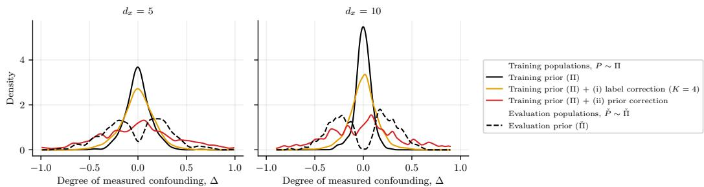  
Figure 6: Prior-induced confounding bias of the training targets for the ATE (based on Example C with $w \equiv 1 { \ : }$ ; see Remark 2). Here, we show the densities of the standardized degree of observed confounding $\Delta \ ( =$ differences between the training targets, $\diamond \in \{ \psi ( P ) , \tilde { \psi } ( P ) , \psi ( \tilde { P } ) \}$ , and the unadjusted treated–control contrast, $m ( P ) : = \mathbb { E } _ { P } [ \bar { Y } \mid \bar { A } = 1 ] - \mathbb { E } _ { P } [ Y \mid \bar { A } = 0 ]$ , namely, $\Delta : =$ $\{ \diamond - m \} / \mathrm { s d } [ Y ] )$ ) depending on the covariate dimensionality $d _ { x }$ . The densities are estimated over $\dot { M } = 5 \dot { 1 } \dot { 2 }$ draws of ground-truth P ∼ Π from the original prior or their debiased counterparts: (i) label correction, $\tilde { \psi } ( P )$ , with $D = 1$ dataset $\mathcal { D } _ { n }$ and $K = 4$ Bayesian bootstrap draw per $P ;$ and (ii) prior correction, $\psi ( { \tilde { P } } )$ with $\tilde { P } = \mathrm { L F } _ { \psi } ( P ; \lambda )$ and $\lambda \sim N ( 0 , \sigma _ { n } ^ { \dot { 2 } } = n ^ { - 1 / 2 } )$ (both for $n = 2 5 6 \mathrm { ; }$ ; m and sd $[ Y ]$ are taken under $\tilde { P }$ for (ii)). For reference, we also show $\Delta$ under the worst-case evaluation prior Πˇ .

Results for part (3). Fig. 7 shows the results. Under the training prior Π, the total variation of all the PFNs stays approximately constant for growing n (i. e., around 0.25–0.3 for the standard PFN and (i) label correction, and around 0.4 for (ii) prior correction). Hence, even under the training prior, the trained PFN posteriors remain at a non-vanishing distance from the efficient normal approximation for the considered n, which is likely due to amortization errors. Here, the larger distance of (ii) prior correction is expected, as it is trained on the corrected prior Πe rather than on Π (and, hence, is not Bayes-optimal under Π; see Eq. (20)). Under the evaluation prior Πˇ , on the other hand, the total variation grows with n for all the PFNs (up to 0.86–0.97 for the largest n): Here, the efficient normal approximation concentrates at the parametric rate, while the remaining errors of the PFN posteriors decay more slowly, so that both distributions increasingly separate. Nevertheless, our debiased PFNs are consistently closer to the efficient normal approximation than the standard PFN, in particular, (ii) prior correction (e. g., 0.86 vs. 0.96 for $d _ { x } = 5$ and 0.87 vs. 0.97 for $d _ { x } = 1 0$ for the largest n), whereas (i) label correction is only slightly closer. This is in line with Theorem 3, which additionally requires a negligible second-order remainder $R _ { 2 , \psi } \colon$ Under the targeted selection of Πˇ , the PFNs have to implicitly infer propensity scores that are atypical for Π, and, hence, the second-order remainder (together with the amortization errors) does not vanish fast enough for the considered n.

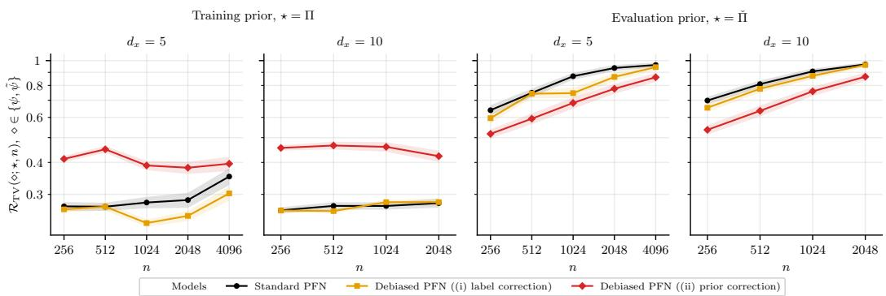  
Figure 7: Total variation, averaged over the training and evaluation priors, Π and ${ \check { \Pi } } ,$ respectively (based on Example A with $w \equiv 1 )$ . Shown: mean ± 3SE Π/Πˇ-averaged total variation between the PFN posterior and the asymptotic normal distribution given by the efficient frequentist estimator (A-IPTW w/ ground-truth nuisance functions), $\mathcal { R } _ { \mathrm { T V } } ( \circ ; \star , n )$ , depending on dataset sizes n and covariate dimensionality $d _ { x }$ (over $M = 2 0 0$ ground-truth ${ \check { P } } ,$ each with $D = 2 0 0$ datasets; lower is better; axes are log-scaled). Here, $\diamond \in \{ \psi , \tilde { \psi } \}$ are the target posteriors from the standard and debiased PFNs, respectively.

## G.2 EXAMPLE A (MEAN VALUE)

In the following, we report the experimental results of estimating the mean value (Example A) with the standard and our debiased PFNs: We show the results for parts (2) and (3). Note, that there is no natural interpretation of the prior-induced confounding bias in the case of the mean value, hence part (1) is omitted. We provide the corresponding implementation details in Appendix F.

Results for part (2). Fig. 8 demonstrates the results. Therein, the standard PFN concentrates markedly slower than the parametric rate $( \hat { \alpha } = - 0 . 4 7 )$ . Similarly to Fig. 4, the oversmoothing training prior Π pulls the posterior of ψ towards $1 / 2 ,$ and this first-order error does not vanish for the worst-case ground-truth $\check { P } \sim \check { \Pi }$ (as suggested by Theorem 1). In contrast, (i) label correction recovers the parametric rate $( \hat { \alpha } = - 1 . 0 1 )$ , and (ii) prior correction substantially speeds up the concentration $( \hat { \alpha } = - 0 . 6 6 )$ . For small n $( \mathbf { i } . { \mathsf { e } } . , n \leq 6 4 )$ , the standard PFN still achieves a lower risk, as the informative training prior Π dominates its posterior. Yet, for sufficiently large n $( \mathbf { i } . { \mathsf { e } } . , n \geq 1 2 8 )$ , both debiased PFNs outperform the standard PFN, and the gap grows with n $( \mathbf { e } . \mathbf { g } . , \mathrm { a t } n = 1 0 2 4$ , the risk of the standard PFN is more than twice that of (i) label correction). The remaining gap between (ii) and (i) is due to the scale of the perturbation: For the mean value, $\sigma _ { n } ^ { 2 } = n ^ { - 1 / 2 }$ is small relative to the variance of $Z ,$ and, hence, the corrected prior Πe still mildly pulls the posterior towards $1 / 2$ . Overall, this confirms that both debiasing strategies speed up the target concentration rates at the worst-case evaluation prior Πˇ (as suggested by Theorems 2 and 4).

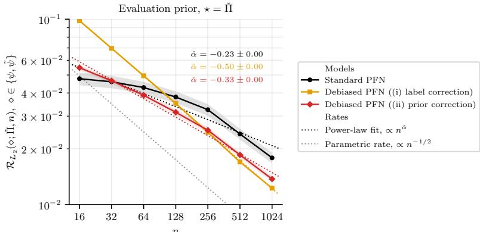  
Figure 8: $L _ { 2 }$ risk on the evaluation prior Πˇ (based on Example A). Shown: mean ± 3SE Πˇ -averaged $L _ { 2 }$ concentration errors (solid lines) and the corresponding power-law regression fits (dotted lines) depending on dataset sizes n (over $M = 2 0 0$ ground-truth ${ \check { P } } ,$ each with $D = 2 0 0$ datasets; lower is better; axes are log-scaled). Here, $\diamond \in \{ \psi , \tilde { \psi } \}$ are the target posteriors from the standard and debiased PFNs, respectively.

Results for part (3). Fig. 9 shows the results. Here, the posterior of (i) label correction is close to the efficient normal approximation of the sample mean for all $n ,$ both under the training and under the evaluation prior (i. e., the total variation is at most 0.07), as suggested by Theorem 3. In contrast, the posterior of the standard PFN deviates substantially. Under the training prior Π, its total variation decreases with $n$ (from 0.74 to 0.20), as its posterior is initially much narrower than the efficient one due to the informative prior. Yet, under the evaluation prior Πˇ , it barely decreases (from 0.76 to 0.59), as the posterior remains shifted towards $1 / 2 \left( \mathrm { i . e . } \right.$ , the first-order error from part (2)). Then, (ii) prior correction lies in between: Its total variation decreases under both priors, but more slowly under Πˇ (from 0.45 to 0.35), in line with the remaining pull towards $1 / 2$ from part (2). Finally, the slight increase of the total variation of (i) label correction under Πˇ for $n \geq 5 1 2$ is likely due to amortization errors, as datasets from Πˇ are atypical for the training prior Π.

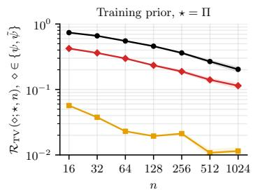

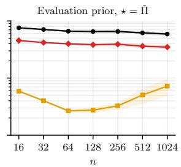  
Models Standard PFN Debiased PFN ((i) label correction) Debiased PFN ((ii) prior correction)  
Figure 9: Total variation, averaged over the training and evaluation priors, Π and ${ \check { \Pi } } ,$ respectively (based on Example A). Shown: mean ± 3SE Π/Πˇ -averaged total variation between the PFN posterior and the asymptotic normal distribution given by the efficient frequentist estimator (sample mean), $\mathcal { R } _ { \mathrm { T V } } ( \circ ; \star , n )$ , depending on dataset sizes n (over $M = 2 0 0$ ground-truth ${ \check { P } } _ { \cdot }$ each with $D = 2 0 0$ datasets; lower is better; axes are log-scaled). Here, $\diamond \in \{ \psi , \tilde { \psi } \}$ are the target posteriors from the standard and debiased PFNs, respectively.