# DON'T SKIP THE BASELINE: A CONTROLLED COMPARISON OF DYNAMIC EXPERT SKIPPING IN MOES

Jakob Steimle1,2 Thomas Elsken2 Daniel Ehrhardt2

Lukas Rinder2 Daniel Cremers1 Xi Wang1,3,4

1Technical University of Munich 2Tensordyne 3ETH Zurich 4Ulm University Correspondence: jakob.steimle@tensordyne.ai

## ABSTRACT

A growing body of work proposes dynamic expert-skipping methods for Mixtureof-Experts (MoE) models that adjust the number of experts activated per token during inference, aiming to preserve model quality while further reducing the number of active parameters. These methods have added calibrated importance scores, inter-expert similarity metrics, or learned per-token allocators in order to identify experts to skip. However, different calibration regimes, different reductions in the effective number of experts, and evaluation suites make comparisons difficult. We classify four representative prior methods into a unified taxonomy and benchmark them against a natural, simple baseline: statically reducing the number of experts k (i.e., same reduced k across all layers and tokens). We provide a fair comparison of these methods at matched expert-compute budget, on two modern MoEs (Gemma4-26B-A4B and Qwen3-30B-A3B) in a text-only setting and a contemporary vision-language model (Qwen3-VL) in a multimodal setting. Surprisingly, we find that the simple baseline is hard to outperform consistently across models, modalities, benchmarks, and calibration settings. The methods we benchmark often underperform the baseline and achieved gains, when present, are minor. We further find that the effective k achieved (or optimized for) in calibration can diverge from the effective k in testing, resulting in over- or underestimating the compute at inference time. Based on these findings, we recommend a calibration-free per-modality static k reduction and validate this on a held-out model and modality. We further argue that a static control at matched measured compute is the baseline any dynamic skipping method must beat.

## 1 INTRODUCTION

Mixture-of-Experts (MoE) models have become one of the leading paradigms for model architectures, activating only a small subset of all parameters (called “experts") during each forward pass. Typical models (Yang et al., 2025a; DeepSeek-AI et al., 2025; Gemma Team et al., 2026) activate k = 8 out of 128 to 512 available experts—fixed across all layers and tokens. Some methods for selecting a reduced number of experts already during (pre)training have been proposed (Raposo et al., 2024; Zhou et al., 2022; Gao et al., 2025; Jin et al., 2025; Guo et al., 2025), however these approaches are not yet adopted in major open-weight model families. We therefore focus on the question: given a trained model, can we reduce the active number of experts while preserving quality by reducing this k during inference, potentially dynamically per token and/or per layer?

Static, fixed-k MoE inference has clear practical advantages: it is simple to implement, requires no additional calibration (i.e., selecting k given an input token and layer), and, most importantly, matches the routing behavior learned during training. It further produces predictable, uniform compute and memory-access patterns across tokens. However, research has shown that not every token requires the same number of experts (Lu et al., 2024). As a result, different approaches have been proposed to optimize inference costs by varying k. These approaches include static pruning, which permanently reduces the set of available experts to conserve memory, and (dynamic) skipping, which instead varies the number of active experts per token at inference time. Yang et al. (2025b) describe three benefits dynamic skipping can offer over fixed-k inference: first, it reduces the total number of computations performed during each forward pass. Second, in small-batch scenarios, it reduces the number of unique experts active, lowering memory bandwidth requirements. Third, in a distributed deployment scenario, it can reduce communication overhead and improve load balancing.

Some recent methods have considered dynamic expert skipping as an add-on to static model pruning, rather than evaluating its benefits on its own, making it difficult to disentangle how much of the reported benefit comes from skipping itself versus the accompanying pruning. Beyond that the proposed methods have become increasingly complex and costly. These range from calibrated scores (Lu et al., 2024) to similarity approaches (Bai et al., 2025b), and learned allocators (Yue et al., 2025). One of the most recent approaches by Huang et al. (2026) is MoDES, which uses calibrated modality-aware thresholds and reports near original performance while reducing the number of active experts by over 80%. The combination of different calibration regimes, operating points (method configurations), and evaluations makes comparison difficult. To close this gap, this study aims to provide a fair comparison across methods, benchmarks and inference-compute budget.

Our contributions:

1. A unified taxonomy of dynamic expert-skipping strategies, organized by the signal they add over the standard MoE router (Table 1).

2. A controlled, matched expert compute comparison of four representative methods against a static top-k baseline across different modalities and models, made fair by measuring compute at test time and comparing the full quality-compute frontier.

3. A zero-calibration, per-modality static top-k configuration $( k _ { \mathrm { v i s i o n } } = 1 \mathrm { - } 2 , k _ { \mathrm { t e x t } } = 6 )$ that recovers ≈ 95% of original quality at ≈ 85% fewer active experts in vision-heavy tasks.

4. The insight that, despite their added complexity and cost, contemporary dynamic skipping methods do not systematically outperform a simple static baseline at matched compute.

We find that, across models, modalities, benchmarks, and calibration settings, the simple baseline is hard to outperform consistently and by large margins. To allow reproducibility we will release our code, including (re-)implementations of all evaluated skipping methods. This further allows the original authors to verify our implementations.

## 2 BACKGROUND

A number of methods have been proposed to leverage the different expert needs of tokens. We distinguish between expert skipping, which reduces the set of experts activated per token, and expert rerouting, which selects different experts than those chosen by the router.

Expert Skipping methods target existing static top-k models. An early such strategy, "Not all Experts are Equal" (NAEE) (Lu et al., 2024), skips a tail expert whenever its routing score falls short of the top expert's by a calibrated margin; Bai et al. (2025b) extend this criterion with an inter-expert redundancy term. Further criteria include per-token sensitivity (Zhong et al., 2024), confidence-triggered re-evaluation with the full expert set (Zhao et al., 2025), and data-free per-layer expert budgets (Chitty-Venkata et al., 2025). Huang et al. (2026) extend threshold-based skipping to the multimodal domain with per-layer importance scores and per-modality thresholds, while Yue et al. (2025) train a per-token classifier via reinforcement learning to predict the required expert count.

Expert Rerouting methods alter which experts are selected rather than how many, steering tokens toward cached or already-active experts to reduce weight-loading overhead (Skliar et al., 2024; Wang et al., 2025; Wu et al., 2026; Oncescu et al., 2025). Their benefit hinges on shrinking the unique set of active experts per forward pass. This reduces overhead due to memory bandwidth, but only works in small batch sizes. At sufficiently large batch sizes nearly all experts are required.

For this paper we focus on dynamic skipping, as rerouting offers limited benefit in common (large batch) inference scenarios. We explicitly study skipping in isolation from the pruning stages that some of these methods originally include. As skipping is orthogonal and composable with any pruning method, this lets us attribute quality differences to the skipping decision itself. Closest to our baseline (next section), Xia et al. (2025) reduce the expert count for vision tokens to a fixed $k _ { \mathrm { v i s i o n } } <$ k from a chosen onset layer onward, while text tokens always retain the full k; they ablate $( k _ { \mathrm { v i s i o n } } .$ onset layer) at moderate reductions $( k _ { \mathrm { v i s i o n } } = 4 \substack { - 5 \mathrm { o f } 8 } )$ and deploy the mechanism jointly with visual token pruning.

Table 1: Taxonomy of expert-skipping strategies, ordered by increasing signal complexity over the standard router. Calibration time is per operating point, measured on a single NVIDIA A100 80GB on Qwen3/Qwen3-VL and ranges from 30 minutes to 20 hours depending on the method. Full taxonomy in Appendix A.1.
<table><tr><td>Method</td><td>Criteria</td><td>Decision</td><td>Tunable</td><td>Calib. (h)</td></tr><tr><td>Softmax top-k (baseline) Per-modality (ours)</td><td>Gate weights Gate weights</td><td>Keep top-k Top-k per modality</td><td> $k$   $k _ { \mathrm { t e x t } } , k _ { \mathrm { v i s i o n } }$ </td><td></td></tr><tr><td>NAEE</td><td>Gate weights (cum.)</td><td>Cumulative-mass threshold</td><td> $\beta$  quantile</td><td>0.5</td></tr><tr><td>DiEP</td><td>Gate weights + CKA</td><td>Redundancy-scaled ratio</td><td> $\gamma _ { 1 }$  quantile</td><td>0.5</td></tr><tr><td>MoDES</td><td></td><td></td><td>target skip ratio</td><td>20</td></tr><tr><td>Ada-K</td><td>Gate prob. × layer imp. Hidden state (learned)</td><td>Per-modality threshold Predicts expert count</td><td> $\lambda$ </td><td>2.5</td></tr></table>

## 3 METHODOLOGY

## 3.1 BASELINES

Our natural baseline for expert skipping methods builds on the model's native routing: statically reducing the number of experts k. We refer to this baseline as softmax top-k, based on the selection criteria. As a reminder, for popular mixture of expert models like Qwen3, the router generates logits, which are normalized with softmax before the top-k experts are selected. We expand on this approach for multimodal models by defining separate k values for each modality: $k _ { \mathrm { t e x t } }$ and kvision This separate treatment of modalities is inspired by prior work (Huang et al., 2026; Xia et al., 2025). For models that support image and video tokens separately, we use $k _ { \mathrm { v i s i o n } }$ for both token types. Both baseline variants share the same benefit: they are calibration-free and static

## 3.2 METHODS FOR COMPARISON

We evaluate four representative dynamic skipping methods: NAEE (Lu et al., 2024), DiEP (Bai et al., 2025b), MoDES (Huang et al., 2026), and Ada-K (Yue et al., 2025), summarized in Table 1. We describe them based on a number of concrete properties of the methods: their criteria, decision rule, calibration phase and tunable parameters. We further discuss the calibration time necessary for a single operating point. Both NAEE and DiEP also provide methods for expert pruning that they combine with the skipping approach. We only consider the dynamic skipping approach here.

Skipping Criteria The first major differentiating factor between the methods is the skipping criteria. While our baselines and NAEE skip experts based entirely on the routing scores (also called gate weights), the other methods expand on this: DiEP uses an inter-expert Centered Kernel Alignment (CKA) (Kornblith et al., 2019) statistic that measures redundancy in individual experts, while MoDES adds a global layer importance factor. Ada-K is different here, as it uses the hidden state of the token rather than the routing scores as a criteria.

Decision Rule Our baselines have the simplest rules, as they retain the top-k experts and vary only the k. NAEE on the other hand uses the cumulative routing scores and compares their ratio against a calibrated threshold. DiEP and MoDES adapt the concept from NAEE with a more complex threshold and score. All methods except for DiEP always keep the expert order intact. Further, all dynamic methods except for MoDES will always retain at least the first selected expert. Ada-K differs from the other methods in its decision rule: rather than deciding whether a given expert should be skipped, it instead predicts the number of experts that should be retained using what they call an Allocator.

Calibration While our baselines are calibration free, NAEE, DiEP and MoDES all require calibration. NAEE calibrates the threshold value used for skipping, while DiEP calibrates this $( \gamma _ { 1 } )$ as well as the CKA similarity metric between experts $( \gamma _ { 2 } ( e _ { 0 } , e _ { i } ) )$ . MoDES first calibrates the importance $\alpha ^ { ( l ) }$ of each layer and then identifies the ideal thresholds $( \tau _ { v , t } )$ needed to achieve a target skipping ratio. Ada-K uses a unique approach, as it optimizes the linear layer of the Allocator using Proximal Policy Optimization (PPO) (Schulman et al., 2017), a type of reinforcement learning.

Tunable Parameters Tunable parameters can be adjusted to vary the targeted operating point. For NAEE this comes in the form of the $\beta$ quantile. When calibrating, the cumulative ratio between the routing scores is collected for each layer. By selecting an appropriate quantile we can sweep across operating points, skipping more or less experts. NAEE natively uses only the median. For DiEP we again sweep the quantile for the skipping parameter $\gamma _ { 1 }$ , in their paper they primarily use the median as an operating point. For MoDES the tunable parameter is the target skip ratio, as part of their calibration procedure they find the ideal thresholds $( \tau _ { v , t } )$ that achieve the target skip ratio. Lastly Ada-K has one main parameter λ. This defines the cost of adding additional experts in the strategy. A higher cost λ results in fewer experts being predicted to be needed.

Calibration Cost We calculate the calibration cost using the original code release for MoDES and use our own implementation for the other methods on a single A100 80GB. While our static baselines are free, since they are calibration free, the advanced dynamic skipping methods have significantly different requirements. DiEP and NAEE are both relatively fast to compute, requiring approximately half an hour to calibrate for Qwen3-30B-A3B, depending on calibration data. Ada-K also varies significantly, but uses a much larger training dataset, resulting in around 2.5 hours of training time. MoDES requires the longest calibration at nearly 20 hours, as both the layer importance score measurement and the frontier search involve many forward passes through the full model.

We selected these methods as representative: they are current and use significantly different approaches to skipping. DiEP with its consideration of expert redundancy, Ada-K with its training approach, MoDES due to the multimodality and NAEE as the simplest calibration-based approach all reflect distinct criteria for selecting experts that can be skipped.

## 3.3 QUANTIFYING PER-TOKEN EXPERT EFFORT

All considered skipping strategies activate fewer experts for some tokens. To compare these savings on a common, hardware-agnostic axis, we define effective K $( K _ { \mathrm { e f f } } )$ as a proxy metric. $K _ { \mathrm { e f f } }$ is the mean number of routed experts per token, averaged across all tokens and layers: $\begin{array} { r c l } { K _ { \mathrm { e f f } } } & { = } & { \frac { 1 } { T \cdot L } \sum _ { t = 1 } ^ { T } \sum _ { l = 1 } ^ { L } k _ { t , l } } \end{array}$ , where $k _ { t , l }$ is the number of experts activated for token t in layer l. For the static softmax top-k baseline, ${ \cal K } _ { \mathrm { e f f } } = k$ by construction, whereas for the dynamic strategies, $K _ { \mathrm { e f f } }$ is a measured average that depends on the inputs and the strategy's configuration. We distinguish between calibrated $K _ { \mathrm { e f f } } ^ { \mathrm { c a l i b r a t e d } }$ and measured $\mathsf { \bar { K } } _ { \mathrm { e f f } } . \ K _ { \mathrm { e f f } } ^ { \mathrm { c a l i b r a t e d } }$ is based on the number of active experts for the calibration set (Huang et al., 2026). Our analysis uses measured $K _ { \mathrm { e f f } } .$ , which counts expert activations at test time during the quality evaluation. The two may diverge because any threshold only enforces the target value on the calibration set, but may transfer imperfectly across datasets and depends heavily on the modality split, as demonstrated in Section 4.3.3.

The bottleneck for MoE inference depends on the deployment regime. At sufficiently large batch sizes, the expert feed-forward evaluation becomes compute-bound. In this case reducing the number of FLOPs provides the largest inference speed-up. The FLOPs of the expert matmuls scale linearly with the number of active experts per token: $K _ { \mathrm { e f f } }$ is thus directly proportional to expert compute. Reducing active experts also lowers secondary costs such as all-to-all communication as described by Yang et al. (2025b). $K _ { \mathrm { e f f } }$ counts only expert activations, ignoring other factors like routing, load imbalance, and communication overhead. This makes it a hardware-agnostic proxy for runtime cost, with true cost larger than what $K _ { \mathrm { e f f } }$ implies. Figure 1 shows the monotonic but sublinear relationship between $K _ { \mathrm { e f f } }$ and core inference metrics; we discuss this relation in Appendix A.5.

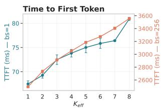

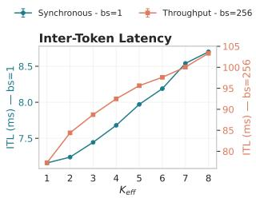

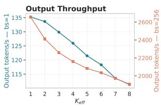  
Figure 1: Static top-k override, $k \in \{ 1 , \ldots , 8 \}$ , vLLM on a single A100 80GB, GuideLLM chat scenario, batch sizes 1 (bandwidth-bound) and 256 (compute-bound); average across a 120 second load. TTFT, ITL and output throughput scale monotonically with the number of experts.

## 4 RESULTS

## 4.1 IMPLEMENTATION

Several of these methods provide incomplete or no code releases, so we reimplement them on a best-effort basis. Ada-K has no release at all, and we reproduce its PPO-trained classifier ourselves (Appendix A.4), referring to it as the Allocator throughout. NAEE and DiEP release code only for Mixtral, a coarse-grained model, so we extend both to the k = 8 regime. Where a method natively exposes only a single operating point, we sweep its free parameter: the quantiles from 0.1 to 0.9 for NAEE and DiEP, thresholds for MoDES in order to trace a full frontier. We reproduce reported operating points from each original paper to confirm our implementations are faithful (Appendix A.7).

## 4.2 TEXT-ONLY EVALUATION

We compare all strategies at matched $K _ { \mathrm { e f f } }$ on Qwen3-30B-A3B (Yang et al., 2025a) and Gemma4- 26B-A4B (Gemma Team et al., 2026), two popular mid-sized MoE models with $k \ = \ 8$ active experts. While most methods report only a single operating point (i.e., a single $K _ { \mathrm { e f f } } )$ at which they report performance, we sweep each method's tunable parameters to trace a full quality-compute frontier, providing clearer evidence of each method's benefit at any given compute level. We evaluate on the zero-shot multiple-choice benchmarks HellaSwag (Zellers et al., 2019) and ARC-C (Clark et al., 2018), as well as 5-shot GSM8K (Cobbe et al., 2021) and zero-shot HumanEval (Chen et al., 2021) as generative benchmarks. A full overview of the benchmarks and corresponding calibration sets is given in Table 4. We use lm-eval (Gao et al., 2024) for consistency with related literature. $K _ { \mathrm { e f f } }$ is measured at test time during each evaluation (Section 3.3); for GSM8K and HumanEval this includes the autoregressive decoding passes. Since most methods require calibration, we define a realistic calibration dataset, consisting of a mixed corpus of English, Chinese, code, and math built from C4\_en and C4\_zh (Raffel et al., 2023), open-web-math (Paster et al., 2023), and python-codes-25k (flytech, 2023). This realistic regime simulates the calibration-evaluation mismatch typical of actual deployments. We also evaluate the impact of calibration by evaluating a “best-case" scenario on the benchmarks’ own train sets.

## 4.2.1 STRATEGY COMPARISON

Figure 2 shows the difference in performance between the strategies introduced in Table 1. The plot compares the mean relative performance drop across ARC-C, HellaSwag, HumanEval and GSM8K for different $K _ { \mathrm { e f f } }$ The Pareto frontier reveals a number of behaviors: first, NAEE most closely matches the fixed top-k baseline for most points along the frontier, with some minor improvements compared to the baseline. The Allocator also shows some improvements in the $K _ { \mathrm { e f f } } \approx 1$ regime for Qwen3. However, overall benefit is very limited, at most \~ 2.6 pp compared to the interpolated baseline. This difference is especially small given the substantial quality loss already occurring in this $K _ { \mathrm { e f f } }$ range: at this point the model has already lost 50% to 65% of its original capability. To provide context, at $K _ { \mathrm { e f f } } \leq 2 . 5$ the best strategy on Gemma4-26B-A4B performs worse on average than Gemma4-E4B, a dense model with 85% fewer effective parameters¹. This limits practical use of the observed gains. Both MoDES and DiEP mostly perform worse than the baseline, with MoDES only slightly ahead above $K _ { \mathrm { e f f } } = 1$ . MoDES does, however, achieve operating points below $K _ { \mathrm { e f f } }$ $= 1$ , meaning that for some tokens the MoE block is completely skipped, a regime that the baseline cannot reach.

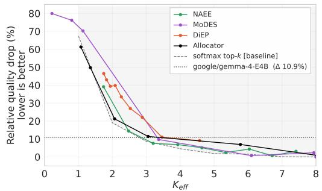  
(a) Qwen3-30B-A3B

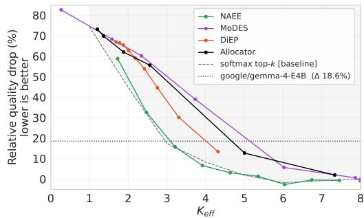  
(b) Gemma4-26B-A4B

Figure 2: Relative performance drop (average across data sets) for different $K _ { \mathrm { e f f } }$ values with strategies calibrated on a mixed dataset. We include the smaller Gemma4-E4B as a reference. The shaded area highlights performance below the baseline. No advanced skipping method systematically outperforms the baseline. Below $K _ { \mathrm { e f f } } \approx 3$ it is preferable to use a smaller model.  
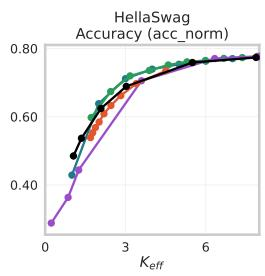

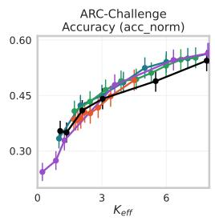

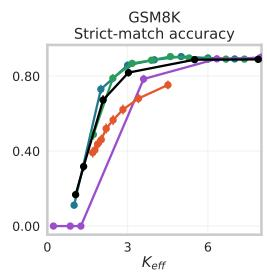  
softmax top-k  NAEE  MoDES DiEP Allocator

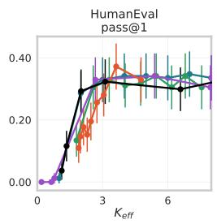  
Figure 3: Absolute quality results of the strategies across four benchmarks on Qwen3. Multiplechoice benchmarks collapse smoothly towards random selection, generative tasks display clear collapse for small k.

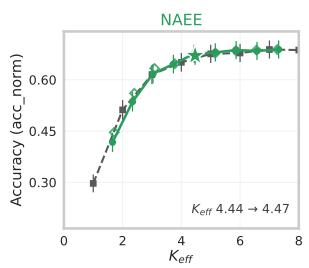

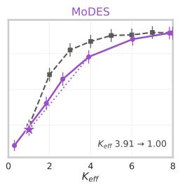

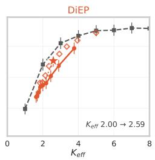

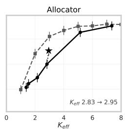  
-- softmax top-k [baseline]realistic calibration $^ \star$ best case [representative]  best case [further samples]

Figure 4: Shift in $K _ { \mathrm { e f f } }$ and quality when using best-case calibration rather than realistic calibration on ARC-C on Gemma4. Best case calibration can help bridge the gap to the baseline but does not change the overall pattern.

The composition of the drops also matters: as Figure 3 shows, the multiple-choice benchmarks degrade smoothly toward their random-guessing floors, while GSM8K collapses sharply once $K _ { \mathrm { e f f } }$ falls below a model-dependent threshold (\~2 for Qwen3). HumanEval follows a similar pattern. Aggregate drops at low $K _ { \mathrm { e f f } }$ are therefore dominated by generative-task failure, and the safe operating point is set by the generative benchmark for each model, not the average. Detailed per-benchmark results for Gemma4 are included in Appendix A.6.

To validate that this is not an artifact of our realistic calibration, we also evaluate a best-case scenario using the benchmarks' own trainset. Figure 4 highlights the shift of the middle operating point when using best-case calibration. For DiEP and MoDES a substantial shift in $K _ { \mathrm { e f f } }$ can be observed and both DiEP and the Allocator gain substantially compared to the realistic calibration. However, this gain does not enable the methods to outperform the static baseline. We provide further details in Appendix A.3.

## 4.3 MULTIMODAL EVALUATION

## 4.3.1 SETUP

In the multimodal setting, we compare NAEE and MoDES against the static softmax top-k baseline and our per-modality variant. The permodality variant is motivated by prior observations that vision tokens tolerate substantially fewer experts than text tokens (Xia et al., 2025; Huang et al., 2026). DiEP, which underperformed the baseline in both text regimes, is excluded. The Ada-K Allocator is excluded as well. This is due to its loss formulation: the Allocator uses next-token prediction as its quality measure. Due to the training procedure of vision-language models, the per-token loss of vision tokens is never used during training, so they do not provide a quality signal that the Allocator could leverage. Applying the Allocator to multimodal evaluations requires the implementation of a new loss formulation.

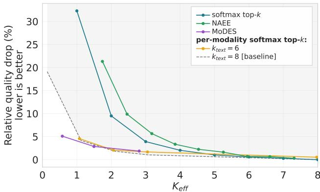  
Figure 5: Aggregated relative quality drop for different $K _ { \mathrm { e f f } }$ values with multimodal strategies. The horizontal dashed line refers to the performance of the original model. The dashed curve/shaded area highlights the baseline that only reduces $k _ { \mathrm { v i s i o n } }$ . Modality awareness provides an immediate benefit to both our baseline and MoDES.

As MoDES is natively designed for multimodal models, we expect it to perform best in this scenario. We use Qwen3-VL-30B-A3B-Instruct (Bai et al., 2025a), closely related to the Qwen3 model used in our text-only evaluation. To provide ideal conditions for MoDES, we calibrate it using its published GQA (Hudson & Manning, 2019) protocol; for consistency, we also calibrate NAEE on GQA. We evaluate on ChartQA (Masry et al., 2022), TextVQA (Singh et al., 2019), and MME (Fu et al., 2025), as well as DocVQA (Mathew et al., 2021b), InfoVQA (Mathew et al., 2021a), and OCRBench (Liu et al., 2024) for text-heavy images. As in the text-only setting, we measure expert activations during evaluation to obtain $K _ { \mathrm { e f f } } ,$ computed over all routed tokens regardless of modality; we report the per-benchmark modality mix in Appendix A.2. Evaluation uses LMMS-Eval (Li et al., 2024a; Zhang et al., 2024).

## 4.3.2 MULTIMODAL RESULTS

Figure 5 shows the relative drop compared to the full model across all six benchmarks, highlighting the performance differences across strategies. MoDES, which is modality-aware, outperforms NAEE as well as softmax top-k by a large margin. However, it fails to outperform the per-modality softmax top-k baseline. Again, MoDES finds $\bar { K _ { \mathrm { e f f } } } < 1$ , which is not reachable by the baseline except when skipping the experts for vision tokens completely.

The only outlier is MME-Cognition, a sub-task of MME, (Figure 9, Appendix), where MoDES consistently leads the other approaches. The per-modality softmax strategy provides two recommended trade-off points: for $k _ { \mathrm { t e x t } } = 8 .$ , reducing $k _ { \mathrm { v i s i o n } }$ to 1 incurs a drop of approximately 4.1%, while reducing $k _ { \mathrm { v i s i o n } }$ to 2 incurs an average drop of less than 1.8%. Reducing $k _ { \mathrm { v i s i o n } }$ to 1 reduces the number of active experts during the benchmark by $\approx 8 5 \%$ , to a measured $K _ { \mathrm { e f f } }$ of 1.08 on average. Reducing $k _ { \mathrm { v i s i o n } }$ to zero increases the drop to 19.1%. Surprisingly, this means that more than 80% of quality is retained even though the vision tokens skip the experts entirely. Reducing $k _ { \mathrm { t e x t } }$ to six allows further optimization of the number of active experts, while incurring a small quality drop compared to $k _ { \mathrm { t e x t } } = 8 .$ The benefit of modality-awareness is direct: reducing experts to one for both modalities (softmax top-k) costs more than 30% of overall performance, while even the more extreme $k _ { \mathrm { v i s i o n } } = 0$ with text untouched (per-modality softmax top-k) costs only 19.1%.

Figure 6 decomposes the measured $K _ { \mathrm { e f f } }$ by modality, showing how each strategy distributes its expert budget. Softmax top-k and NAEE remain close to the symmetric diagonal, with NAEE allocating slightly more experts to vision tokens than to text tokens. This is the opposite of what the quality results favor. In contrast, MoDES retains nearly the full expert count for text tokens and concentrates skipping on vision tokens, closely following the per-modality baseline with $k _ { \mathrm { t e x t } } = 8$ . This is in line with the quality-compute frontiers, highlighting similar performance for similar skip patterns.

MoDES does provide a benefit in the sub-one expert regime. Without a finer (e.g. per-layer) granularity, our per-modality approach can only reduce $K _ { \mathrm { e f f } }$ below 1 by setting $k _ { \mathrm { v i s i o n } } = 0$ , which degrades performance to the point of limited practical use.

## 4.3.3 CALIBRATED AND MEASURED $K _ { \mathrm { E F F } }$

The deviation between calibrated and measured $K _ { \mathrm { e f f } }$ is also substantial in these benchmarks; Table 2 quantifies this gap for the MoDES results. This deviation stems from two main factors: the modality split and routing scores. Depending on the actual workload, sequences may have a different share of image vs. text tokens. Since more experts are skipped for image tokens, a lower proportion of image tokens shifts $K _ { \mathrm { e f f } }$ upward, and vice versa. A second factor is differences in routing scores. Since MoDES uses the routing scores for skipping, different routing score distributions in the evaluation data may also influence how many experts are actually skipped. Both factors introduce a degree of unpredictability: the actual average number of remaining active experts can deviate from the calibrated figure by more than 50%, even on benchmarks from the same task family as the calibration set (shortanswer VQA; cf. Appendix A.2).

When evaluating on a text-only benchmark, in this case GSM8K (Cobbe et al., 2021), the pattern is amplified. Text-only prompts are a typical use case for vision-enabled models, since many modern models bundle multimodal support into an otherwise general-purpose base

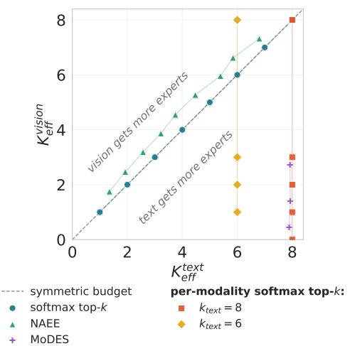  
Figure 6: Measured $K _ { \mathrm { e f f } }$ decomposed by modality, aggregated across the six multimodal benchmarks. The dashed diagonal marks a symmetric budget. The softmax top-k baseline lies on it by construction. NAEE traces the softmax top-k baseline, while MoDES produces a similar pattern to the per-modality softmax top-k with $k _ { \mathrm { t e x t } } = 8$

model. Table 2 shows that for GSM8K, the $K _ { \mathrm { e f f } }$ for MoDES shifts to 7.96, far from the $K _ { \mathrm { e f f } } ^ { \mathrm { c a l } }$ librated 1.2: the calibrated skipping effectively deactivates, and MoDES retains quality only by reverting to nearly the full model: the calibrated compute saving vanishes. Our per-modality baseline also shifts with the workload, but is bounded by construction at $K _ { \mathrm { e f f } } = k _ { \mathrm { t e x t } } = \bar { 6 }$ , where it lands exactly, trading 2.7 pp of accuracy (68.8% vs. 71.5%) for 25% fewer active experts than MoDES actually uses.

Table 2: $K _ { \mathrm { e f f } } ^ { \mathrm { c a l i b r a t e d } }$ calibrated on GQA vs. measured $K _ { \mathrm { e f f } }$ for MoDES on Qwen3-VL, averaged over six multimodal benchmarks. Text-only (GSM8K) is evaluated at the most aggressive skipping ratio. $K _ { \mathrm { e f f } }$ shifts substantially based on the modality mix of the evaluation data.
<table><tr><td rowspan="2">MoDES Target Skip Ratio</td><td rowspan="2"> $K _ { \mathrm { e f f } } ^ { \mathrm { c a l i b r a t e d } }$ </td><td colspan="2">Measured  $K _ { \mathrm { e f f } }$ </td></tr><tr><td>Vision Benchmarks</td><td>Text-Only</td></tr><tr><td>0.85</td><td>1.20</td><td>0.58</td><td>7.96</td></tr><tr><td>0.73</td><td>1.99</td><td>1.50</td><td>一</td></tr><tr><td>0.60</td><td>3.17</td><td>2.81</td><td></td></tr></table>

## 5 DISCUSSION

While the trained or calibrated methods such as NAEE and the Allocator (Ada-K) can provide quality benefits compared to the baseline in some cases, these are in our experiments limited to 2.6 pp, often also in regimes where quality has already degraded substantially. Furthermore, the high dependence on calibration data suggests that any minor performance benefit from one of the calibrated strategies comes at the cost of performance in another area or domain. Beyond the standard calibration, identifying operating points and hyperparameters is a challenge, especially for RL-based Ada-K (Eimer et al., 2023).

The multimodal results support the same overall conclusions: MoDES outperforms both NAEE and the modality-unaware static baseline, showing that modality is valuable $f o r$ deciding whether to skip experts for a given token. However, MoDES's advantage over a calibration-free modalityaware baseline is confined to the sub-one $K _ { \mathrm { e f f } }$ regime; for larger $K _ { \mathrm { e f f } }$ the static baseline matches or outperforms it. We conclude that calibrated thresholds provide a benefit beyond treating vision and text tokens independently only in this sub-one $K _ { \mathrm { e f f } }$ regime, but at the cost of complexity with only a modest runtime improvement as shown in Appendix $\bar { \mathbf { A } } . 5$

Beyond the one-time calibration effort, matching strategies at equal $K _ { \mathrm { e f f } }$ also understates the true runtime cost. Every dynamic method adds a routing decision to each forward pass. Dynamic skipping also forfeits the uniform per-token compute of static top-k, and with it the load balancing and latency guarantees quantified in Appendix A.5. Both effects are excluded from our $K _ { \mathrm { e f f } } .$ -matched analysis, which therefore favors the adaptive strategies. Finally, the calibrated methods offer no guarantee on the realized $K _ { \mathrm { e f f } } .$ as Table 2 shows, measured $K _ { \mathrm { e f f } }$ can deviate substantially from the calibrated target.

Practical Recommendation The added benefit of the dynamic skipping methods rarely outweighs the required calibration overhead and complexity. For a practical multimodal inference scenario, statically reducing $k _ { \mathrm { v i s i o n } }$ to 1–2 and $k _ { \mathrm { t e x t } }$ to 6 for a model with eight active experts provides a strong trade-off between quality (< 5% drop) and inference speed-up. For text-only models, the approach is similar: reducing k to 6 provides a measurable inference speed-up with only a minor quality loss. Going beyond this point becomes heavily model-dependent and should be validated with a generative benchmark, as models tend to perform differently at those points.

To verify that this recommendation is not an artifact of the benchmarks used for its selection, we apply the operating point unchanged to MVBench (Li et al., 2024b), a held-out video benchmark. With $k _ { \mathrm { v i s i o n } } = 1$ and $k _ { \mathrm { t e x t } } = 6 ,$ the model achieves an accuracy of 69.95 versus 71.40 for the full model, a relative drop of 2.0% at a measured $K _ { \mathrm { e f f } }$ of 1.19. As video sequences are dominated by vision tokens, this represents an 85% reduction in active experts. This minimal quality loss, on a workload and modality mix entirely outside the data used for calibration or selection, demonstrates the transferability of our recommendation. We also evaluate a larger model, GLM-4.6V (GLM-V Team et al., 2025), where the same operating point incurs an average drop of 4.2% (Appendix A.8).

Method design Our results further highlight a significant gap in existing research: across compared methods as well as concurrent work such as ACE (Xu et al., 2026) comparisons lack a consistent static-k control at matched measured compute and modality. When controlling for both, methods fail to consistently outperform the baseline. We therefore recommend that every future method compares against a static control at matched (measured) $K _ { \mathrm { e f f } }$ that also uses any structural signal (e.g. modality) the method exploits.

## 6 CONCLUSION

Across three models as well as two held-out checks, none of the calibrated or learned skipping methods consistently outperform a static reduction of k at matched measured $K _ { \mathrm { e f f } } .$ The methods add calibration and tuning overhead and their realized $K _ { \mathrm { e f f } }$ can deviate from the calibrated target $( \geq 6 \times$ in our experiments). This holds for text-only and multimodal models alike. We recommend static per-modality k as the default, and a static control at matched measured $K _ { \mathrm { e f f } }$ as the baseline for future methods.

## AI USE STATEMENT

In this work, we used generative AI tools for implementing methods (including general coding assistance) and providing feedback on research methodology. We have not used generative AI tools for proposing or refining hypotheses, interpreting results, or developing theoretical models or conceptual frameworks. Generating synthetic datasets, formulating mathematical claims, providing critical ingredients for proving mathematical claims, writing proofs, translation, cleaning and reformatting datasets, and qualitative or thematic data analysis are not applicable to this work. Additionally, we used generative AI tools for literature research, brainstorming and editing for readability. We have reviewed all AI-assisted work. All LLM-generated code was reviewed by the authors and validated against existing results from literature. We take responsibility for the final content of this work, including text, claims or artifacts produced with the aid of generative AI.

## REFERENCES

Shuai Bai et al. Qwen3-VL Technical Report. arXiv preprint arXiv:2511.21631, 2025a. URL https://arxiv.org/abs/2511.21631.

Sikai Bai, Haoxi Li, Jie Zhang, Zicong Hong, and Song Guo. DiEP: Adaptive Mixture-of-Experts Compression through Differentiable Expert Pruning. In The Thirty-ninth Annual Conference on Neural Information Processing Systems, 2025b. URL https : //openreview. net /forum? id=oTocSpfYvJ.

Mark Chen, Jerry Tworek, Heewoo Jun, Qiming Yuan, Henrique Ponde de Oliveira Pinto, Jared Kaplan, Harri Edwards, Yuri Burda, Nicholas Joseph, Greg Brockman, Alex Ray, Raul Puri, Gretchen Krueger, Michael Petrov, Heidy Khlaaf, Girish Sastry, Pamela Mishkin, Brooke Chan, Scott Gray, Nick Ryder, Mikhail Pavlov, Alethea Power, Lukasz Kaiser, Mohammad Bavarian, Clemens Winter, Philippe Tillet, Felipe Petroski Such, Dave Cummings, Matthias Plappert, Fotios Chantzis, Elizabeth Barnes, Ariel Herbert-Voss, William Hebgen Guss, Alex Nichol, Alex Paino, Nikolas Tezak, Jie Tang, Igor Babuschkin, Suchir Balaji, Shantanu Jain, William Saunders, Christopher Hesse, Andrew N. Carr, Jan Leike, Josh Achiam, Vedant Misra, Evan Morikawa, Alec Radford, Matthew Knight, Miles Brundage, Mira Murati, Katie Mayer, Peter Welinder, Bob McGrew, Dario Amodei, Sam McCandlish, Ilya Sutskever, and Wojciech Zaremba. Evaluating Large Language Models Trained on Code. arXiv preprint arXiv:2107.03374, 2021.

Krishna Teja Chitty-Venkata, Sandeep Madireddy, Murali Emani, and Venkatram Vishwanath. LExI: Layer-Adaptive Active Experts for Efficient MoE Model Inference, September 2025. URL http://arxiv.org/abs/2509.02753. arXiv:2509.02753[cs.LG]version: 1.

Christopher Clark, Kenton Lee, Ming-Wei Chang, Tom Kwiatkowski, Michael Collins, and Kristina Toutanova. BoolQ: Exploring the Surprising Difficulty of Natural Yes/No Questions, May 2019. URL http://arxiv.org/abs/1905.10044. arXiv:1905.10044[cs.CL].

Peter Clark, Isaac Cowhey, Oren Etzioni, Tushar Khot, Ashish Sabharwal, Carissa Schoenick, and Oyvind Tafjord. Think you have Solved Question Answering? Try ARC, the AI2 Reasoning Challenge,March 2018.URL http://arxiv.org/abs/1803.05457. arXiv:1803.05457 [cs.AI].

Karl Cobbe, Vineet Kosaraju, Mohammad Bavarian, Mark Chen, Heewoo Jun, Lukasz Kaiser, Matthias Plappert, Jerry Tworek, Jacob Hilton, Reiichiro Nakano, Christopher Hesse, and John Schulman. Training Verifiers to Solve Math Word Problems. arXiv preprint arXiv:2110.14168, 2021.

Ido Dagan, Oren Glickman, and Bernardo Magnini. The PASCAL recognising textual entailment challenge. In Proceedings of the First International Conference on Machine Learning Challenges: Evaluating Predictive Uncertainty Visual Object Classification, and Recognizing Textual Entailment, MLCW'05, pp. 177–190, Berlin, Heidelberg, 2005. Springer-Verlag. ISBN 3-540-33427-0. doi:10.1007/11736790\_9.URL https://doi.org/10.1007/11736790\_9.

DeepSeek-AI, Aixin Liu, Bei Feng, Bing Xue, Bingxuan Wang, Bochao Wu, Chengda Lu, Chenggang Zhao, Chengqi Deng, Chenyu Zhang, Chong Ruan, Damai Dai, Daya Guo, Dejian Yang, Deli Chen, Dongjie Ji, Erhang Li, Fangyun Lin, Fucong Dai, Fuli Luo, Guangbo Hao, Guanting Chen, Guowei Li, H. Zhang, Han Bao, Hanwei Xu, Haocheng Wang, Haowei Zhang, Honghui Ding, Huajian Xin, Huazuo Gao, Hui Li, Hui Qu, J. L. Cai, Jian Liang, Jianzhong Guo, Jiaqi Ni, Jiashi Li, Jiawei Wang, Jin Chen, Jingchang Chen, Jingyang Yuan, Junjie Qiu, Junlong Li, Junxiao Song, Kai Dong, Kai Hu, Kaige Gao, Kang Guan, Kexin Huang, Kuai Yu, Lean Wang, Lecong Zhang, Lei Xu, Leyi Xia, Liang Zhao, Litong Wang, Liyue Zhang, Meng Li, Miaojun Wang, Mingchuan Zhang, Minghua Zhang, Minghui Tang, Mingming Li, Ning Tian, Panpan Huang, Peiyi Wang, Peng Zhang, Qiancheng Wang, Qihao Zhu, Qinyu Chen, Qiushi Du, R. J. Chen, R. L. Jin, Ruiqi Ge, Ruisong Zhang, Ruizhe Pan, Runji Wang, Runxin Xu, Ruoyu Zhang, Ruyi Chen, S. S. Li, Shanghao Lu, Shangyan Zhou, Shanhuang Chen, Shaoqing Wu, Shengfeng Ye, Shengfeng Ye, Shirong Ma, Shiyu Wang, Shuang Zhou, Shuiping Yu, Shunfeng Zhou, Shuting Pan, T. Wang, Tao Yun, Tian Pei, Tianyu Sun, W. L. Xiao, Wangding Zeng, Wanjia Zhao, Wei An, Wen Liu, Wenfeng Liang, Wenjun Gao, Wenqin Yu, Wentao Zhang, X. Q. Li, Xiangyue Jin, Xianzu Wang, Xiao Bi, Xiaodong Liu, Xiaohan Wang, Xiaojin Shen, Xiaokang Chen, Xiaokang Zhang, Xiaosha Chen, Xiaotao Nie, Xiaowen Sun, Xiaoxiang Wang, Xin Cheng, Xin Liu, Xin Xie, Xingchao Liu, Xingkai Yu, Xinnan Song, Xinxia Shan, Xinyi Zhou, Xinyu Yang, Xinyuan Li, Xuecheng Su, Xuheng Lin, Y. K. Li, Y. Q. Wang, Y. X. Wei, Y. X. Zhu, Yang Zhang, Yanhong Xu, Yanhong Xu, Yanping Huang, Yao Li, Yao Zhao, Yaofeng Sun, Yaohui Li, Yaohui Wang, Yi Yu, Yi Zheng, Yichao Zhang, Yifan Shi, Yiliang Xiong, Ying He, Ying Tang, Yishi Piao, Yisong Wang, Yixuan Tan, Yiyang Ma, Yiyuan Liu, Yongqiang Guo, Yu Wu, Yuan Ou, Yuchen Zhu, Yuduan Wang, Yue Gong, Yuheng Zou, Yujia He, Yukun Zha, Yunfan Xiong, Yunxian Ma, Yuting Yan, Yuxiang Luo, Yuxiang You, Yuxuan Liu, Yuyang Zhou, Z. F. Wu, Z. Z. Ren, Zehui Ren, Zhangli Sha, Zhe Fu, Zhean Xu, Zhen Huang, Zhen Zhang, Zhenda Xie, Zhengyan Zhang, Zhewen Hao, Zhibin Gou, Zhicheng Ma, Zhigang Yan, Zhihong Shao, Zhipeng Xu, Zhiyu Wu, Zhongyu Zhang, Zhuoshu Li, Zihui Gu, Zijia Zhu, Zijun Liu, Zilin Li, Ziwei Xie, Ziyang Song, Ziyi Gao, and Zizheng Pan. DeepSeek-V3 Technical Report, February 2025. URL http://arxiv.org/abs/2412.19437. arXiv:2412.19437[cs.CL].

Theresa Eimer, Marius Lindauer, and Roberta Raileanu. Hyperparameters in Reinforcement Learning and How To Tune Them, June 2023. URL http://arxiv.org/abs/2306.01324. arXiv:2306.01324 [cs.LG].

flytech. python-codes-25k: A cleaned python dataset covering 25,000 instructional tasks. https://huggingface.co/datasets/flytech/python-codes-25k, 2023. Accessed: 2026-06-15.

Chaoyou Fu, Peixian Chen, Yunhang Shen, Yulei Qin, Mengdan Zhang, Xu Lin, Jinrui Yang, Xiawu Zheng, Ke Li, Xing Sun, Yunsheng Wu, Rongrong Ji, Caifeng Shan, and Ran He. MME: A Comprehensive Evaluation Benchmark for Multimodal Large Language Models, October 2025. URL http://arxiv.org/abs/2306.13394. arXiv:2306.13394[cs.CV].

Leo Gao, Jonathan Tow, Baber Abbasi, Stella Biderman, Sid Black, Anthony DiPofi, Charles Foster, Laurence Golding, Jeffrey Hsu, Alain Le Noac'h, Haonan Li, Kyle McDonell, Niklas Muennighoff, Chris Ociepa, Jason Phang, Laria Reynolds, Hailey Schoelkopf, Aviya Skowron, Lintang Sutawika, Eric Tang, Anish Thite, Ben Wang, Kevin Wang, and Andy Zou. The language model evaluation harness,072024.URL https://zenodo.org/records/12608602.

Yuting Gao, Wang Lan, Hengyuan Zhao, Linjiang Huang, Si Liu, and Qingpei Guo. AnyExperts: On-Demand Expert Allocation for Multimodal Language Models with Mixture of Expert, November 2025. URL http://arxiv.org/abs/2511.18314. arXiv:2511.18314 [cs.LG].

Gemma Team, Sherif El Abd, Vaibhav Aggarwal, Robin Algayres, Alek Andreev, Olivier Bachem, Ian Ballantyne, Cormac Brick, Victor Cărbune, Michelle Casbon, Mayank Chaturvedi, Victor Cotruta, Alice Coucke, Phil Culliton, Robert Dadashi, Lucas Dixon, Mohamed Elhawaty, Utku Evci, Clément Farabet, Johan Ferret, Filippo Galgani, Sertan Girgin, Jean-Bastien Grill, Maarten Grootendorst, Jiaxian Guo, Cassidy Hardin, Yanzhang He, Steven M. Hernandez, Omri Homburger, Léonard Hussenot, Juyeong Ji, Armand Joulin, Aishwarya Kamath, Parnian Kassraie, Olivier Lacombe, Preethi Lahoti, Gaël Liu, Gus Martins, Luciano Martins, Tatiana Matejovicova, Ramona Merhej, Nikola Momchev, Sneha Mondal, Ryan Mullins, Sindhu Raghuram Panyam, Shreya Pathak, Sarah Perrin, André Susano Pinto, Etienne Pot, Angéline Pouget, Alexandre Ramé, Sabela Ramos, Douglas Reid, David Rim, Morgane Rivière, Karsten Roth, Louis Rouillard, Omar Sanseviero, Pier Giuseppe Sessa, Shane Settle, Danila Sinopalnikov, Sara Smoot, Piotr Stanczyk, Andreas Steiner, Lawrence Stewart, Ilya Tolstikhin, Michael Tschannen, Anton Tsitsulin, Nino Vieillard, Renjie Wu, Pingmei Xu, Haichuan Yang, Edouard Yvinec, Li Zhang, Joe Zou, Nicolas Aagnes, Abdelrahman Abdelhamed, Shivani Agrawal, Shubham Agrawal, Ibrahim Alabdulmohsin, Jean Baptiste Alayrac, Uri Alon, Chandramouli Amarnath, Ankesh Anand, Chrysovalantis Anastasiou, Setareh Ariafar, François-Xavier Aubet, Kyriakos Axiotis, Federico Barbero, Joelle Barral, Alexei Bendebury, Urs Bergmann, Stanley Bileschi, Kat Black, Mathieu Blondel, Sebastian Borgeaud, Arthur Bražinskas, Ryan Burnell, Robert Busa-Fekete, Mu Cai. Glenn Cameron, Charlotte Caucheteux, Garima Chadha, Jetha Chan, Aditya Chawla, Blake Jian hang Chen, Jesse Chen, Lin Chen, Xu Chen, Derek Cheng, Tzu-hsiang Chien, Nikolai Chinaev. Yi Chou, Zhaohui Chu, Benjamin Coleman, Pooja Consul, Sam Conway-Rahman, Scott Crowell. Dylan Cutler, Vivek Dani, Samira Daruki, Anil Das, Daniel Deutsch, Nishanth Dikkala, Li Ding, Qiuhan Ding, Shenil Dodhia, Konstantin Donhauser, Tulsee Doshi, Anca Dragan, Alex Druinsky, Sahil Dua, Zoltan Egyed, Danielle Eisenbud, Daniel Eppens, Cindy Fan, Bahare Fatemi, Yassir Fathullah, Vlad Feinberg, Milen Ferev, Takumi Fujimoto, Isaac Galatzer-Levy, João Gante, Simon Geisler, Soham Ghosal, Antonious M. Girgis, Alec Go, Alhaad Gokhale, Alex Grills Yiming Gu, Pramod Gupta, Guru Guruganesh, Raia Hadsell, Hamza Harkous, Jitendra Harlalka, Demis Hassabis, Anja Hauth, Joe Heyward, Arian Hosseini, Chih-Yang Hsia, I.-Hung Hsu, Xiaopeng Huang, Yangsibo Huang, Kevin Hui, Adrian Hutter, Te I, Fotis Iliopoulos, Advait Jain, Ganesh Jawahar, Ziwei Ji, Qilin Jin, Melvin Johnson, Kandarp Joshi, Arun Kandoor, Wang-Cheng Kang, Koray Kavukcuoglu, Mehran Kazemi, Kathleen Kenealy, Amr Khalifa, Phoebe Kirk, Suraj Kothawade, Vitaly Kovalev, Neel Kovelamudi, Adam Kraft, Ravin Kumar, Harish Kuppam, Justin Lannin, Chen-Yu Lee, Seungji Lee, Dmitry Lepikhin, Dongdong Li, Qiujia Li, Valentin Liévin Ethan Lin, Ziqian Lin, Casper Liu, Tianlin Liu, Tianqi Liu, Xin Liu, Mayank Lunayach, Min Ma, Gagan Madan, Andrii Maksai, Eric Malmi, Michal Matuszak, Daniel McDuff, Gaurav Menghani, Daniil Mirylenka, Karolis Misiunas, Vedant Misra, Andreea Mitran, Kareem Mohamed, Maksim Mukha, Eric Noland, James O'Donnell, Kate Olszewska, Bernett Orlando, Wanqiong Pan, Rina Panigrahy, Unnati Parekh, Chunjong Park, Eric Paskie, Liqian Peng, Bryce Petrini, Slav Petrov, Jonas Pfeiffer, Bilal Piot, Martyna Plomecka, Siim Poder, Octavio Ponce, Arijit Pramanik, David Racz, Anish Rajan, Michelle Ramanovich, Anand Rao, Marvin Ritter, Vitor Rodrigues, Evan Rosen, Mikołaj Rybiński, Noveen Sachdeva, Michaël E. Sander, Rohit Sathyanarayana, Sagar Savla, Samuel Schmidgall, Tal Schuster, Benoit Seguin, Andrew Sellergren, Aliaksei Severyn, Izhak Shafran, Dhruv Shah, Yuan Shangguan, Ashish Shenoy, Pradeep Shenoy, Rakesh Shivanna. Pauline Sho, Lucas Spangher, Wojciech Stokowiec, Tim Strother, Yao Su, Yinghao Sun, Mukund Sundararajan, Andrea Tacchetti, Mor Hazan Taege, Pouya Tafti, Chetan Tekur, Rahul Thapa Madeleine Traverse, Lenart Treven, Tao Tu, Chien Te Tung, Petar Veličković, Malini Pooni Venkat, Sagar Gubbi Venkatesh, Vidya Venkiteswaran, Francesco Visin, Alex Vitvitskyi, Kiran Vodrahalli, Weiyi Wang, Xin Wang, Tris Warkentin, Jan Wassenberg, John Wieting, Lechao Xiao, Hao Xu, Yuhui Xu, Fuzhao Xue, Arun Yadav, Jun Yan, Antoine Yang, Lin Yang, Ming-Hsuan Yang, Ziyu Ying, Jae Hyeon Yoo, Sajjad Zafar, Fred Zhang, Jiageng Zhang, Jianyi Zhang, Xiaofan Zhang, Chao Zhao, David Zhou, and Chen Zou. Gemma 4 Technical Report, July 2026. URL http://arxiv.org/abs/2607.02770. arXiv:2607.02770[cs.CL].

GLM-V Team, Wenyi Hong, Wenmeng Yu, Xiaotao Gu, Guo Wang, Guobing Gan, Haomiao Tang, Jiale Cheng, Ji Qi, Junhui Ji, Lihang Pan, Shuaiqi Duan, Weihan Wang, Yan Wang, Yean Cheng,

Zehai He, Zhe Su, Zhen Yang, Ziyang Pan, Aohan Zeng, Baoxu Wang, Bin Chen, Boyan Shi, Changyu Pang, Chenhui Zhang, Da Yin, Fan Yang, Guoqing Chen, Jiazheng Xu, Jiale Zhu, Jiali Chen, Jing Chen, Jinhao Chen, Jinghao Lin, Jinjiang Wang, Junjie Chen, Leqi Lei, Letian Gong, Leyi Pan, Mingdao Liu, Mingde Xu, Mingzhi Zhang, Qinkai Zheng, Sheng Yang, Shi Zhong, Shiyu Huang, Shuyuan Zhao, Siyan Xue, Shangqin Tu, Shengbiao Meng, Tianshu Zhang, Tianwei Luo, Tianxiang Hao, Tianyu Tong, Wenkai Li, Wei Jia, Xiao Liu, Xiaohan Zhang, Xin Lyu, Xinyue Fan, Xuancheng Huang, Yanling Wang, Yadong Xue, Yanfeng Wang, Yanzi Wang, Yifan An, Yifan Du, Yiming Shi, Yiheng Huang, Yilin Niu, Yuan Wang, Yuanchang Yue, Yuchen Li, Yutao Zhang, Yuting Wang, Yu Wang, Yuxuan Zhang, Zhao Xue, Zhenyu Hou, Zhengxiao Du, Zihan Wang, Peng Zhang, Debing Liu, Bin Xu, Juanzi Li, Minlie Huang, Yuxiao Dong, and Jie Tang. Glm-4.5v and glm-4.1v-thinking: Towards versatile multimodal reasoning with scalable reinforcement learning, 2025. URL https://arxiv.org/abs/2507.01006.

Yongxin Guo, Zhenglin Cheng, Xiaoying Tang, Zhaopeng Tu, and Tao Lin. Dynamic Mixture of Experts: An Auto-Tuning Approach for Efficient Transformer Models, March 2025. URL http://arxiv.org/abs/2405.14297.arXiv:2405.14297[cs.LG].

Dan Hendrycks, Collin Burns, Steven Basart, Andy Zou, Mantas Mazeika, Dawn Song, and Jacob Steinhardt. Measuring Massive Multitask Language Understanding, January 2021a. URL ht tp : //arxiv.org/abs/2009.03300.arXiv:2009.03300[cs.CY].

Dan Hendrycks, Collin Burns, Saurav Kadavath, Akul Arora, Steven Basart, Eric Tang, Dawn Song, and Jacob Steinhardt. Measuring Mathematical Problem Solving With the MATH Dataset, November 2021b. URL http://arxiv.org/abs/2103.03874. arXiv:2103.03874[cs].

Yushi Huang, Zining Wang, Zhihang Yuan, Yifu Ding, Ruihao Gong, Jinyang Guo, Xianglong Liu, and Jun Zhang. MoDES: Accelerating Mixture-of-Experts Multimodal Large Language Models via Dynamic Expert Skipping, February 2026. URL http://arxiv.org/abs/2511. 15690. arXiv:2511.15690 [cs.CV].

Drew A. Hudson and Christopher D. Manning. GQA: A New Dataset for Real-World Visual Reasoning and Compositional Question Answering, May 2019. URL http : //arxiv. org/abs/ 1902.09506. arXiv:1902.09506[cs.CL].

Albert Q. Jiang, Alexandre Sablayrolles, Antoine Roux, Arthur Mensch, Blanche Savary, Chris Bamford, Devendra Singh Chaplot, Diego de las Casas, Emma Bou Hanna, Florian Bressand, Gianna Lengyel, Guillaume Bour, Guillaume Lample, Lélio Renard Lavaud, Lucile Saulnier, Marie-Anne Lachaux, Pierre Stock, Sandeep Subramanian, Sophia Yang, Szymon Antoniak, Teven Le Scao, Théophile Gervet, Thibaut Lavril, Thomas Wang, Timothée Lacroix, and William El Sayed. Mixtral of Experts, January 2024. URL http://arxiv.org/abs/2401.04088. arXiv:2401.04088 [cs.LG].

Can Jin, Hongwu Peng, Mingcan Xiang, Qixin Zhang, Xiangchi Yuan, Amit Hasan, Ohiremen Dibua, Yifan Gong, Yan Kang, and Dimitris N. Metaxas. Sparsity-Controllable Dynamic Top-p MoE for Large Foundation Model Pre-training, December 2025. URL http : //arxiv. org/ abs/2512.13996. arXiv:2512.13996[cs.AI].

Simon Kornblith, Mohammad Norouzi, Honglak Lee, and Geoffrey Hinton. Similarity of Neural Network Representations Revisited. In Proceedings of the 36th International Conference on Machine Learning, pp. 3519–3529. PMLR, May 2019. URL https: //proceedings.mlr. press/v97/kornblith19a.html.

Woosuk Kwon, Zhuohan Li, Siyuan Zhuang, Ying Sheng, Lianmin Zheng, Cody Hao Yu, Joseph E. Gonzalez, Hao Zhang, and Ion Stoica. Efficient Memory Management for Large Language Model Serving with PagedAttention. In Proceedings of the ACM SIGOPS 29th Symposium on Operating Systems Principles, 2023.

Bo Li, Peiyuan Zhang, Kaichen Zhang, Fanyi Pu, Xinrun Du, Yuhao Dong, Haotian Liu, Yuanhan Zhang, Ge Zhang, Chunyuan Li, and Ziwei Liu. LMMs-Eval: Accelerating the Development of Large Multimoal Models, March 2024a. URL https://github.com/ EvolvingLMMs-Lab/lmms-eval. Version Number: v0.1.0.

Kunchang Li, Yali Wang, Yinan He, Yizhuo Li, Yi Wang, Yi Liu, Zun Wang, Jilan Xu, Guo Chen, Ping Luo, Limin Wang, and Yu Qiao. MVBench: A Comprehensive Multi-modal Video UnderstandingBenchmark, May 2024b. URL http://arxiv.org/abs/2311.17005. arXiv:2311.17005 [cs.CV].

Yuliang Liu, Zhang Li, Mingxin Huang, Biao Yang, Wenwen Yu, Chunyuan Li, Xu-Cheng Yin, Cheng-Lin Liu, Lianwen Jin, and Xiang Bai. OCRBench: on the hidden mystery of OCR in large multimodal models. Science China Information Sciences, 67(12):220102, December 2024. ISSN 1674-733X, 1869-1919. doi: 10.1007/s11432-024-4235-6. URL https : //1ink.springer.com/10.1007/s11432-024-4235-6.

Xudong Lu, Qi Liu, Yuhui Xu, Aojun Zhou, Siyuan Huang, Bo Zhang, Junchi Yan, and Hongsheng Li. Not All Experts are Equal: Efficient Expert Pruning and Skipping for Mixtureof-Experts Large Language Models, May 2024. URL http://arxiv.org/abs/2402. 14800. arXiv:2402.14800 [cs].

Ahmed Masry, Do Xuan Long, Jia Qing Tan, Shafiq Joty, and Enamul Hoque. ChartQA: A Benchmark for Question Answering about Charts with Visual and Logical Reasoning, March 2022. URL http://arxiv.org/abs/2203.10244. arXiv:2203.10244[cs.CL].

Minesh Mathew, Viraj Bagal, Rubèn Pérez Tito, Dimosthenis Karatzas, Ernest Valveny, and C. V. Jawahar. InfographicVQA, August 2021a. URL http://arxiv.org/abs/2104.12756. arXiv:2104.12756 [cs.CV].

Minesh Mathew, Dimosthenis Karatzas, and C. V. Jawahar. DocVQA: A Dataset for VQA on Document Images, January2021b. URL http://arxiv.org/abs/2007.00398. arXiv:2007.00398 [cs.CV].

Todor Mihaylov, Peter Clark, Tushar Khot, and Ashish Sabharwal. Can a Suit of Armor Conduct Electricity? A New Dataset for Open Book Question Answering, September 2018. URL ht tp : //arxiv.org/abs/1809.02789.arXiv:1809.02789[cs.CL].

Neural Magic, Inc. GuideLLM: Scalable Inference and Optimization for Large Language Models, 2024.URLhttps://github.com/vllm-project/guidellm.

Costin-Andrei Oncescu, Qingyang Wu, Wai Tong Chung, Robert Wu, Bryan Gopal, Junxiong Wang, Tri Dao, and Ben Athiwaratkun. Opportunistic Expert Activation: Batch-Aware Expert Routing for Faster Decode Without Retraining, November 2025. URL http://arxiv.org/abs/ 2511.02237. arXiv:2511.02237[cs.LG].

Keiran Paster, Marco Dos Santos, Zhangir Azerbayev, and Jimmy Ba. OpenWebMath: An Open Dataset of High-Quality Mathematical Web Text, October 2023. URL http: //arxiv. org/ abs/2310.06786. arXiv:2310.06786[cs.AI].

Colin Raffel, Noam Shazeer, Adam Roberts, Katherine Lee, Sharan Narang, Michael Matena, Yanqi Zhou, Wei Li, and Peter J. Liu. Exploring the Limits of Transfer Learning with a Unified Text-to-Text Transformer, September 2023. URL http://arxiv.org/abs/1910.10683. arXiv:1910.10683 [cs.LG].

David Raposo, Sam Ritter, Blake Richards, Timothy Lillicrap, Peter Conway Humphreys, and Adam Santoro. Mixture-of-Depths: Dynamically allocating compute in transformer-based language models, April 2024. URL http://arxiv.org/abs/2404.02258. arXiv:2404.02258 [cs.LG].

John Schulman, Filip Wolski, Prafulla Dhariwal, Alec Radford, and Oleg Klimov. Proximal Policy Optimization Algorithms, August 2017. URL http://arxiv.org/abs/1707.06347. arXiv:1707.06347 [cs.LG].

Amanpreet Singh, Vivek Natarajan, Meet Shah, Yu Jiang, Xinlei Chen, Dhruv Batra, Devi Parikh, and Marcus Rohrbach. Towards VQA Models That Can Read, May 2019. URL http : // arxiv.org/abs/1904.08920. arXiv:1904.08920[cs.CL].

Andrii Skliar, Ties van Rozendaal, Romain Lepert, Todor Boinovski, Mart van Baalen, Markus Nagel, Paul Whatmough, and Babak Ehteshami Bejnordi. Mixture of Cache-Conditional Experts for Efficient Mobile Device Inference, 2024. URL https : //arxiv.org/abs/2412. 00099. Version Number: 2.

Yun Wang, Lingyun Yang, Senhao Yu, Yixiao Wang, Ruixing Li, Zhixiang Wei, James Yen, and Zhengwei Qi. BuddyMoE: Exploiting Expert Redundancy to Accelerate Memory-Constrained Mixture-of-Experts Inference, November 2025. URL http://arxiv.org/abs/2511. 10054. arXiv:2511.10054[cs].

Juntong Wu, Jialiang Cheng, Fuyu Lv, Ou Dan, and Li Yuan. SERE: Similarity-based Expert Rerouting for Efficient Batch Decoding in MoE Models, February 2026. URL http : / / arxiv. org/abs/2602.07616. arXiv:2602.07616[cs.LG].

Guoyang Xia, Yifeng Ding, Fengfa Li, Lei Ren, Wei Chen, Fangxiang Feng, and Xiaojie Wang. FastMMoE: Accelerating Multimodal Large Language Models through Dynamic Expert Activation and Routing-Aware Token Pruning. CoRR, abs/2511.17885, November 2025. URL https://doi.org/10.48550/arXiv.2511.17885.

Zukang Xu, Zhixiong Zhao, Xing Hu, Jiangyong Yu, Houji Wen, Jun Li, Zhe Jiang, and Dawei Yang. ACE: Adaptive Calibration-Free Expert Skipping for MoE-based LLMs, September 2026. URL http://arxiv.org/abs/2609.05228. arXiv:2609.05228[cs.AI].

An Yang, Anfeng Li, Baosong Yang, Beichen Zhang, Binyuan Hui, Bo Zheng, Bowen Yu, Chang Gao, Chengen Huang, Chenxu Lv, Chujie Zheng, Dayiheng Liu, Fan Zhou, Fei Huang, Feng Hu, Hao Ge, Haoran Wei, Huan Lin, Jialong Tang, Jian Yang, Jianhong Tu, Jianwei Zhang, Jianxin Yang, Jiaxi Yang, Jing Zhou, Jingren Zhou, Junyang Lin, Kai Dang, Keqin Bao, Kexin Yang, Le Yu, Lianghao Deng, Mei Li, Mingfeng Xue, Mingze Li, Pei Zhang, Peng Wang, Qin Zhu, Rui Men, Ruize Gao, Shixuan Liu, Shuang Luo, Tianhao Li, Tianyi Tang, Wenbiao Yin, Xingzhang Ren, Xinyu Wang, Xinyu Zhang, Xuancheng Ren, Yang Fan, Yang Su, Yichang Zhang, Yinger Zhang, Yu Wan, Yuqiong Liu, Zekun Wang, Zeyu Cui, Zhenru Zhang, Zhipeng Zhou, and Zihan Qiu. Qwen3 Technical Report, May 2025a. URL http://arxiv.org/abs/2505.09388. arXiv:2505.09388 [cs.CL].

Haoqi Yang, Luohe Shi, Qiwei Li, Zuchao Li, Ping Wang, Bo Du, Mengjia Shen, and Hai Zhao. Faster MoE LLM Inference for Extremely Large Models, May 2025b. URL http : //arxiv. org/abs/2505.03531. arXiv:2505.03531[cs].

Tongtian Yue, Longteng Guo, Jie Cheng, Xuange Gao, Hua Huang, and Jing Liu. Ada-K Routing: Boosting the Efficiency of MoE-based LLMs. In The Thirteenth International Conference on Learning Representations, 2025. URL https://openreview.net/forum?id= 9CqkpQExe2.

Rowan Zellers, Ari Holtzman, Yonatan Bisk, Ali Farhadi, and Yejin Choi. HellaSwag: Can a Machine Really Finish Your Sentence?, May 2019. URL http://arxiv.org/abs/1905. 07830. arXiv:1905.07830 [cs.CL].

Kaichen Zhang, Bo Li, Peiyuan Zhang, Fanyi Pu, Joshua Adrian Cahyono, Kairui Hu, Shuai Liu, Yuanhan Zhang, Jingkang Yang, Chunyuan Li, and Ziwei Liu. LMMs-Eval: Reality Check on the Evaluation of Large Multimodal Models, 2024. URL https : //arxiv.org/abs /2407. 12772. \_eprint: 2407.12772.

Yushu Zhao, Yubin Qin, Yang Wang, Xiaolong Yang, Huiming Han, Shaojun Wei, Yang Hu, and Shouyi Yin. MoBiLE: Efficient Mixture-of-Experts Inference on Consumer GPU with Mixture of Big Little Experts, October 2025. URL http://arxiv.org/abs/2510.12357. arXiv:2510.12357 [cs].

Shuzhang Zhong, Ling Liang, Yuan Wang, Runsheng Wang, Ru Huang, and Meng Li. AdapMoE Adaptive Sensitivity-based Expert Gating and Management for Efficient MoE Inference. In Proceedings of the 43rd IEEE/ACM International Conference on Computer-Aided Design, pp. 1– 9, October 2024. doi: 10.1145/3676536.3676741. URL http://arxiv.org/abs/2408. 10284. arXiv:2408.10284[cs].

Yanqi Zhou, Tao Lei, Hanxiao Liu, Nan Du, Yanping Huang, Vincent Zhao, Andrew Dai, Zhifeng Chen, Quoc Le, and James Laudon. Mixture-of-Experts with Expert Choice Routing, October 2022.URL http://arxiv.org/abs/2202.09368. arXiv:2202.09368[cs.LG].

## A APPENDIX

## A.1 TAXONOMY

We provide the full decision rules in Table 3.

Table 3: Taxonomy of dynamic expert-skipping strategies, ordered by increasing signal complexity over the standard router. For NAEE we use the cumulative top-k rule (App. A.2 of Lu et al. (2024)); for DiEP we generalize the official top-2 rule to top-k by comparing every selected expert against the dominant one, with the pairwise CKA factor γ2 reimplemented from the paper (omitted in the public release). For quantile-calibrated methods we sweep the calibration quantile rather than fixing the paper's median. Approximate calibration time was measured with the official releases (where available) on Qwen3/Qwen3-VL on a single NVIDIA A100 80GB.
<table><tr><td>Method</td><td>Criteria</td><td>Decision Rule</td><td>Calibration</td><td>Tunable</td><td>Calib. Time (h)</td></tr><tr><td>Softmax top-k (baseline)</td><td>Gate weights</td><td>Keep top-k (fixed)</td><td></td><td>k</td><td></td></tr><tr><td>Per-modality softmax top-k</td><td>Gate weights</td><td>top-ktext or top-kvision by modality (fixed)</td><td></td><td> $k _ { \mathrm { v i s i o n } } , k _ { \mathrm { t e x t } }$ </td><td></td></tr><tr><td>(ours) NAEE (Lu et al., 2024)</td><td>Gate weights (cumulative)</td><td>Keep top-i*, sorted desc.: i* = min i s.t.</td><td>β: per-layer, calibrated</td><td> $\beta$ </td><td>0.5</td></tr><tr><td>DiEP (Bai et al., 2025b)</td><td>Gate weights + inter-expert CKA</td><td> $\beta \textstyle \sum _ { m = 1 } ^ { k } w _ { m }$  Skip position i ≥ 1 if  $w _ { i } <$   $\gamma _ { 1 } \gamma _ { 2 } ( e _ { 0 } , e _ { i } ) w _ { 0 }$ </td><td>γ1: per-layer quantile of w1/w0 (swept); γ2: pairwise</td><td>γ1 quantile, γ2</td><td>0.5</td></tr><tr><td>MoDES (Huang et al., 2026)</td><td>Gate prob. × global layer importance</td><td>Skip expert i if  $\alpha ^ { ( l ) } \pi _ { i } < \tau _ { \{ t , v \} }$ </td><td>layer mean  $\boldsymbol { \alpha } ^ { ( l ) }$  : mean KL of full-layer skip</td><td>Tt, Tv</td><td>20</td></tr><tr><td>Ada-K (Yue et al., 2025) (Allocator)</td><td> $\alpha ^ { ( \hat { l } ) }$  Token hidden state (learned)</td><td>Allocator → k*; route top-  $\boldsymbol { \cdot } \boldsymbol { k } ^ { \star }$ </td><td>Trained (PPO), base frozen</td><td>alloc. weights, λ</td><td>2.5</td></tr></table>

## A.2 BENCHMARK DETAILS

We provide full details on the benchmarks conducted in Table 4.

## A.3 CALIBRATION SENSITIVITY

All considered methods except the static baselines require calibration data. To establish the impact of the calibration data choice, we compare two regimes on ARC-C and HellaSwag: best-case, calibrated on the benchmark's own train split, and realistic, calibrated on a mixed corpus of English, Chinese, code, and math built from C4\_en and C4\_zh (Raffel et al., 2023), open-web-math (Paster et al., 2023), and python-codes-25k (flytech, 2023). The realistic regime simulates the calibration– evaluation mismatch typical of actual deployments, while the best-case regime represents the most favorable calibration setting.

Figure 7 highlights the impact of the calibration data. We select the middle point of the corresponding threshold sweep and observe the change in quality between best-case and realistic calibration. In some cases this best-case calibration does provide benefits compared to the realistic calibration. However, these improvements are marginal and do not materially affect the performance relative to the baseline. Further, we observe that the change in calibration set leads to substantial shifts in $K _ { \mathrm { e f f } }$ at identical thresholds. NAEE, the best-performing dynamic skipping method in the practically relevant regime, is also the most robust to the choice of calibration data, showing only minimal shifts under best-case calibration. Preliminary experiments highlighted this as well: even a mismatched calibration set (MATH only) led to very similar performance.

Table 4: Overview of benchmarks with the corresponding calibration sets, evaluation metrics, and test-set sizes. For each calibration set, 1024 samples were used. The Allocator used up to 10000 samples from the same set, limited by split size. “Mixed" refers to our diverse pretraining dataset used for calibration. The multimodal strategies are calibrated on GQA following the MoDES protocol (Huang et al., 2026). Modality splits (text/vision token percentages) are approximated from 200 samples per dataset, tokenized with the Qwen3-VL processor, and reflect prefill only.
<table><tr><td>Benchmark</td><td>Calibration Sets</td><td>Metric</td><td>Test Samples Split</td><td>(text/vision)</td></tr><tr><td>ARC-Challenge (Clark et al., 2018)</td><td>ARC-C Train, Mixed</td><td>acc_norm</td><td>1172</td><td></td></tr><tr><td>HellaSwag (Zellers et al., 2019)</td><td>HellaSwag Mixed</td><td>Train, acc_norm</td><td>10042</td><td></td></tr><tr><td>GSM8K (Cobbe et al., GQA, Mixed 2021)</td><td></td><td>strict-match</td><td>1319</td><td></td></tr><tr><td>HumanEval et al., 2021)</td><td>(Chen Mixed</td><td>pass@1</td><td>164</td><td></td></tr><tr><td>2022)</td><td>ChartQA (Masry et al., GQA (Hudson &amp; relaxed accuracy Manning, 2019)</td><td></td><td>2500 </td><td>9.0/91.0</td></tr><tr><td>TextVQA (Singh et al., 2019)</td><td>GQA</td><td>VQA accuracy</td><td></td><td>5000 2.4/97.6</td></tr><tr><td>MME (Fu et al., 2025)</td><td>GQA</td><td>total score (percep- tion + cognition)</td><td>2374</td><td>3.4/96.6</td></tr><tr><td>DocVQA (Mathew et al., 2021b)</td><td>GQA</td><td>ANLS</td><td>5349</td><td>0.6/99.4</td></tr><tr><td>InfoVQA (Mathew et al., 2021a)</td><td>GQA</td><td>ANLS</td><td>2801</td><td>0.6/99.4</td></tr><tr><td>OCRBench (Liu et al., GQA 2024)</td><td></td><td>accuracy</td><td></td><td>1000 15.7/84.3</td></tr></table>

## A.4 ALLOCATOR TRAINING

We provide the full set of training parameters for our Allocator in Table 5.

## A.5 RUNTIME PERFORMANCE

To validate $K _ { \mathrm { e f f } }$ as a proxy for inference performance, we measure end-to-end inference with statically constrained expert counts using vLLM (Kwon et al., 2023). This constitutes an upper bound on the gains achievable by any strategy at a given $K _ { \mathrm { e f f } } .$ , as it excludes both routing-decision overhead and raggedness in per-token expert allocation; the static top-k baseline attains this bound by construction. Standardized evaluation uses GuideLLM (Neural Magic, Inc., 2024) to benchmark Qwen3- 30B-A3B on a single NVIDIA A100 80GB GPU, in two scenarios: synchronous (batch size 1, memory-bandwidth bound) and throughput (batch size 256, compute bound). We use GuideLLM's ‘chat' scenario to generate prompts. Figure 1 reports time-to-first-token (TTFT), inter-token latency (ITL), and output throughput. Reducing $K _ { \mathrm { e f f } }$ from 8 to 1 lowers TTFT and ITL by 18% in the synchronous scenario and lowers TTFT by ～ 30% and ITL by ～ 25% in the throughput scenario, while output throughput rises from 111 to 135 tokens/s (1.22×) and from \~ 1.9k to \~ 2.65k tokens/s (1.39×), respectively. Notably, these gains are far below the 8× reduction in expert compute: even under ideal static skipping, the end-to-end benefit is bounded well below proportionality, further compressing the value of the marginal quality differences between skipping strategies. The MoE blocks of the model only make up part of the overhead incurred; components such as attention, KV-

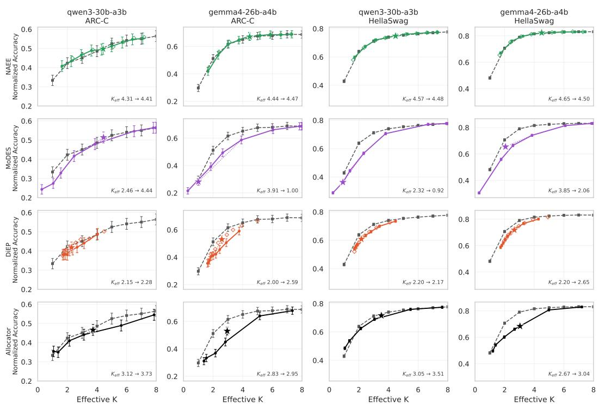  
Figure 7: Comparison of best-case and realistic calibration for Qwen3 and Gemma4 across ARC-C and HellaSwag. We select the middle threshold/quantile/cost parameter of the realistic calibration as our representative point. Error bars show the 95% Confidence Interval (CI) from lm-eval standard errors. Any shift in $\bar { K } _ { \mathrm { e f f } }$ (as for example observed for MoDES) is due to the change in calibration data alone. Panel annotations provide this shift in realized $K _ { \mathrm { e f f } } ,$ realistic → best-case. Even in a best-case calibration scenario the dynamic skipping strategies do not consistently outperform the baseline.

Table 5: Training configuration for the learned allocator trained with the PPO objective (mixed calibration). The same configuration is used for Qwen3-30B-A3B and Gemma4-26B-A4B; λ enters the PPO loss, so each point of the cost-penalty sweep is a separately trained allocator.
<table><tr><td>Hyperparameter</td><td>Value</td></tr><tr><td>Objective</td><td>PPO</td></tr><tr><td>Sample-based evaluation</td><td>enabled</td></tr><tr><td>Calibration dataset</td><td>mixed</td></tr><tr><td>Calibration samples</td><td>10000</td></tr><tr><td>Max sequence length (tokens)</td><td>16384</td></tr><tr><td>Training steps</td><td>312</td></tr><tr><td>Micro-batch size</td><td>1</td></tr><tr><td>Gradient accumulation steps</td><td>32</td></tr><tr><td>Effective batch size</td><td>32</td></tr><tr><td>Sequence length (training)</td><td>2048</td></tr><tr><td>Learning rate</td><td> $1 \times 1 0 ^ { - 3 }$ </td></tr><tr><td>Warmup fraction</td><td>0.05</td></tr><tr><td>Final LR fraction</td><td>0.1</td></tr><tr><td>KL temperature</td><td>1.0</td></tr><tr><td> $K _ { \mathrm { m a x } }$  multiplier</td><td>16</td></tr><tr><td>Validation set size</td><td>128</td></tr><tr><td>Validation interval (steps)</td><td>50</td></tr><tr><td>Random seed</td><td>1234567</td></tr><tr><td>PPO-specific</td><td></td></tr><tr><td>Discount factor γ</td><td>0.99</td></tr><tr><td>Clip range €</td><td>0.2</td></tr><tr><td>PPO epochs</td><td>2</td></tr><tr><td>Entropy coefficient</td><td>0.0</td></tr><tr><td>Advantage whitening</td><td>disabled</td></tr><tr><td>P-Warm warm-start</td><td></td></tr><tr><td>Policy warmup</td><td>enabled</td></tr><tr><td>Warm-start steps</td><td>312 (full length)</td></tr><tr><td> $p ^ { * }$  search grid</td><td>18 points, linear in [0.1, 0.95]</td></tr><tr><td>Optimization (code defaults; not recorded per run)</td><td></td></tr><tr><td>Optimizer</td><td>AdamW  $( \epsilon = 1 0 ^ { - 6 } )$ </td></tr><tr><td>Weight decay</td><td>0.1</td></tr><tr><td>LR schedule</td><td>cosine (warm-start), constant (PPO)</td></tr><tr><td>Warm-start learning rate</td><td> $1 \times 1 0 ^ { - 3 }$ </td></tr><tr><td>Cost penalty sweep (λ)</td><td>{0.0003, 0.001, 0.005, 0.01, 0.03, 0.08}</td></tr></table>

Cache traffic, and non-expert weights are not addressed by any skipping technique and still incur computational costs.

## A.6 DETAILED BENCHMARK RESULTS

To highlight the differences in performance we provide the detailed per-benchmark sweep results in Figures 8 and 9. A number of differences can be observed in both the text and multimodal context.

Text-only In the text-only results, the performance characteristics for our generative benchmark and the multiple-choice benchmarks differ. ARC-C and HellaSwag performance decays smoothly towards the random selection floor, with all methods performing reasonably close to one another. For GSM8K this changes dramatically: for both models, the drop towards zero score is apparent and linked to dropping the number of experts beyond a certain point. Especially for Gemma4, no strategy is able to retain reasonable performance once fewer than 3 experts remain active, and some strategies already fail at 4. This is likely a combination of factors: first, we use strict-match for evaluation. This means that the model will score 0 when it fails to match the correct output format. Second, MoDES in particular can reduce the number of experts to 0 for some tokens, potentially breaking causal generation or reasoning. HumanEval performs similar to GSM8K.

Multimodal For multimodal evaluation the performance varies less across benchmarks with a notable exception. The MME perception score shows limited drop even when vision tokens receive zero experts, provided enough experts are allocated to the text tokens. This differs from the MME cognition score, where the drop is more apparent and MoDES markedly outperforms the baseline rather than simply matching it.

## A.7 VALIDATING IMPLEMENTATIONS

Due to the incomplete nature of some of the code releases, we validate each method in the setting reported by its original authors.

NAEE The NAEE code release only contains implementations for Mixtral 8x7B. To validate our implementation, we aim to reproduce their domain-specific calibration and evaluation regime. We calibrate Mixtral 8x7B (Jiang et al., 2024) on the MATH dataset (Hendrycks et al., 2021b) and evaluate performance on 5-shot GSM8K (Cobbe et al., 2021) using strict-match accuracy. We use NAEE's default $q = 0 . 5$ quantile (median) skip criterion, as described in their methodology. The reported accuracy from the NAEE paper is 54.28 (Lu et al., 2024), which corresponds to a 7.4% relative drop compared to the original 58.61. Our reimplementation achieved a baseline score of 58.52 and an expert skipping score of 55.42 (a 5.3% relative drop). This minor difference could be attributable to a number of factors, including slight differences between the cumulative-rule from the appendix and the two expert rule they describe in the paper. However, as the scores are very close, we are confident our implementation does not disadvantage NAEE in the comparison.

DiEP Validation on DiEP was conducted on Mixtral 8x7B, evaluating the average accuracy across MMLU (Hendrycks et al., 2021a), OpenBookQA (Mihaylov et al., 2018), BoolQ (Clark et al., 2019), and RTE (Dagan et al., 2005). Calibration was done on the “mixed" set, as it has significant overlap with the original C4 (Raffel et al., 2023) calibration data used in the DiEP paper (Bai et al., 2025b). Since the complete skip configuration is not explicitly reported, we again use the $q = 0 . 5$ quantile calibration that serves as their operating point elsewhere in the paper. Bai et al. (2025b) report an average accuracy of 65.1 for the base model and 64.1 after skipping, a 1.6% relative drop; per-task scores are reported for the base model only. As Table 6 shows, our measured baseline matches theirs on every task when OpenBookQA is scored with unnormalized accuracy (65.6 vs. 65.1 on average); the apparent baseline gap under our default reporting (68.6) stems entirely from using length-normalized accuracy on OpenBookQA (49.0 vs. 37.2 unnormalized). Our reimplementation, which includes the from-scratch CKA computation absent from the public release, yields a relative drop of 2.6% in DiEP's metric convention (65.6 → 64.0; 2.1% with length-normalized Open-BookQA). The difference to the reported 1.6% is dominated by RTE $( 7 1 . 5  6 7 . 5 )$ , the smallest of the four tasks (277 test examples, standard error ≈ 2.7 pp), and is therefore within evaluation noise; the remaining tasks degrade by at most 1.4 points. We conclude that our implementation reproduces the reported behavior closely.

MoDES For multimodal MoDES we use the original calibration method included with their code release. As we reimplement the routing function, we validate it by comparing our results against the reported values for TextVQA in Table 7. We use the same routing function for the text-only evaluation, but deviate from the original calibration: we calibrate on the text datasets and conduct a sweep across thresholds rather than using the frontier search described in the paper. Since the text-only evaluation uses the identical routing function, validated above, and differs only in the calibration procedure, we treat it as a faithful application of the method rather than a separate reproduction.

Ada-K No public implementation or model checkpoints were available for Ada-K as of writing. As such, we reproduced its classifier architecture ourselves, which we refer to throughout as the Allocator. We train it using the same PPO approach as the original Ada-K paper. Some variance is nonetheless expected, due to the nature of reinforcement learning: its sensitivity to hyper-parameters (Eimer et al., 2023) is itself part of the practical complexity we discuss in Section 5. To validate the performance of our Allocator, we ran Qwen1.5-MoE-A2.7B, trained the Allocator on our mixed dataset, and evaluated on 25-shot ARC-C. Our Allocator achieved a score of 53.92 at $K _ { \mathrm { e f f } } = 2 . 4 5$ very close to the reported 54.41 at a slightly higher $K _ { \mathrm { e f f } } = 2 . 5 8$ , consistent with the slightly larger expert budget.

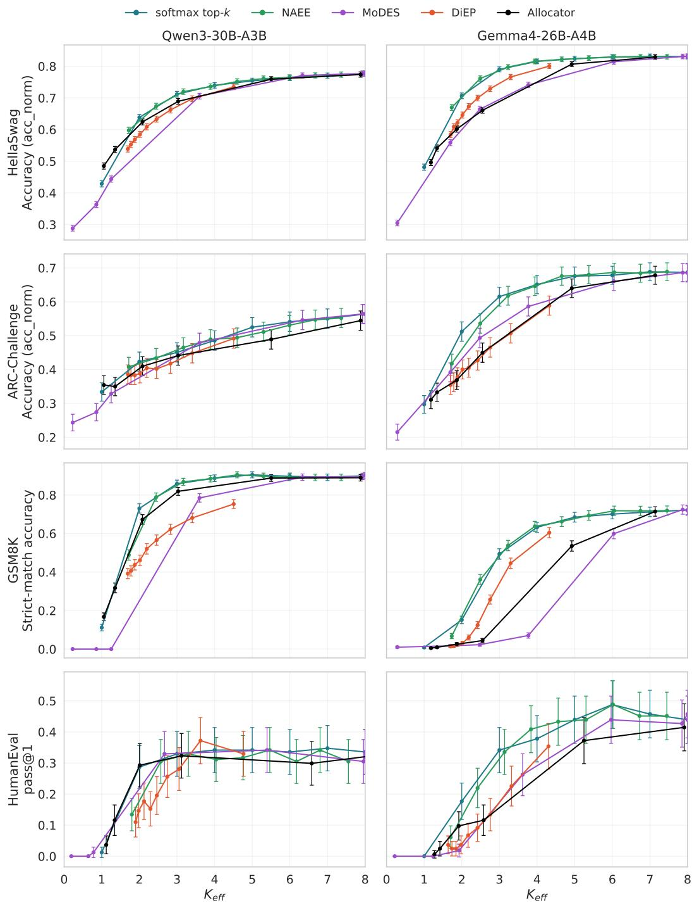  
Figure 8: Comparison of model performance with different expert skipping strategies. Error bars show the 95% confidence interval calculated based on the lm-eval standard error. For ARC-C and HellaSwag the results are all relatively close, while for GSM8K and HumanEval we see a more clear separation.

Table 6: Per-task validation of our DiEP reimplementation on Mixtral 8x7B. Bai et al. (2025b) report per-task scores for the base model and only the aggregate after skipping (64.1). Our baseline matches theirs on all tasks under their metric convention; the aggregate difference in our default reporting is explained by length-normalized accuracy on OpenBookQA.
<table><tr><td>Task</td><td>DiEP (Bai et al., 2025b) (base)</td><td>Reimplementation (Base)</td><td>Reimplementation (skipping)</td></tr><tr><td>MMLU (acc)</td><td>67.9</td><td>68.0</td><td>67.0</td></tr><tr><td>OpenBookQA (acc)</td><td>35.4</td><td>37.2</td><td>35.8</td></tr><tr><td>OpenBookQA (acc_norm)</td><td></td><td>49.0</td><td>48.6</td></tr><tr><td>BoolQ (acc)</td><td>85.3</td><td>85.9</td><td>85.5</td></tr><tr><td>RTE (acc)</td><td>71.5</td><td>71.5</td><td>67.5</td></tr><tr><td>Average (OBQA acc)</td><td>65.1</td><td>65.6</td><td>64.0</td></tr><tr><td>Average (OBQA acc_norm)</td><td></td><td>68.6</td><td>67.1</td></tr></table>

Table 7: MoDES reproduction on TextVQA (exact-match accuracy), evaluated at the paper's exact calibration target ratios $\rho .$ As both use identical thresholds, the comparison is at matched operating points; our reimplementation reproduces the reported results within 0.6 points across the range.
<table><tr><td>Target ratio  $\rho$ </td><td>MoDES (Huang et al., 2026)</td><td>Reimplementation</td></tr><tr><td>0.60</td><td>81.82</td><td>81.68</td></tr><tr><td>0.73</td><td>81.65</td><td>81.38</td></tr><tr><td>0.85</td><td>80.97</td><td>80.38</td></tr></table>

## A.8 SCALING TO LARGER MODELS

We also evaluate our recommendation on another (larger) model: GLM-4.6V (GLM-V Team et al., 2025). It natively has k = 8 and 128 available experts. It also has a shared expert, differentiating it from Qwen3-VL. We evaluate the operating point $k _ { \mathrm { t e x t } } = 6$ and $k _ { \mathrm { v i s i o n } } = 1$ and observe an average drop of 4.2% compared to the original model across ChartQA, TextVQA and MME. Full results are included in Table 8. As can be seen the drop is dominated by MME-Cognition.

Table 8: Comparison of the full model (top-8) and modality-aware routing $( k _ { \mathrm { t e x t } } = 6 , k _ { \mathrm { v i s i o n } } = 1 )$ on GLM-4.6V. Mean active experts per token for the routed model is 1.18 across the benchmarks.
<table><tr><td>Benchmark</td><td>Metric</td><td>Baseline</td><td>Routed</td><td> $\Delta$ </td></tr><tr><td>TextVQA (val)</td><td>Exact match (%)</td><td>83.57</td><td>82.16</td><td>-1.41</td></tr><tr><td>ChartQA</td><td>Relaxed overall (%)</td><td>74.92</td><td>70.96</td><td>-3.96</td></tr><tr><td>ChartQA</td><td>Relaxed human (%)</td><td>72.88</td><td>67.92</td><td>-4.96</td></tr><tr><td>ChartQA</td><td>Relaxed augmented (%)</td><td>76.96</td><td>74.00</td><td>-2.96</td></tr><tr><td>MME</td><td>Perception score</td><td>1714.0</td><td>1671.9</td><td>-42.1</td></tr><tr><td>MME</td><td>Cognition score</td><td>671.8</td><td>579.3</td><td>-92.5</td></tr></table>

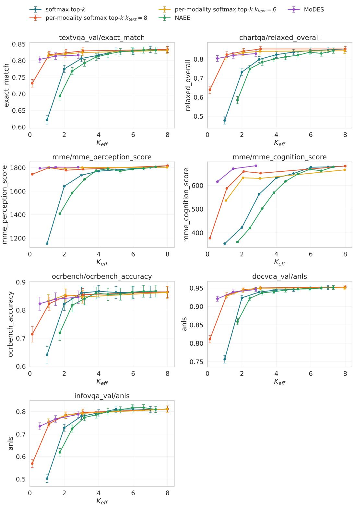  
Figure 9: Comparison of model performance with different expert skipping strategies. MME Cognition Score is an outlier, where MoDES shows clear benefits compared to the other strategies. The 95% CI is provided for TextVQA and ChartQA based on the standard error reported by LMMS-Eval. For MME this is not included due to the non-linear nature of the score.