# Decision Sufficiency of Learned Representation Interfaces for Safe Generative Control

Jipeng Li Yanning Shen University of California, Irvine

## Abstract

A controller can guide a language model toward safe and useful responses by choosing when to assist, ask for clarification, or refuse. When the controller uses selected internal features. poor performance alone cannot distinguish missing information from limitations of its decision rules or training. We study decision sufficiency: whether the best controller using a representation can match the minimum average loss attainable with full state information, under the same strategies and evaluation criteria. For interfaces with finitely many outputs, we compute the optimal loss exactly and separate the three sources of excess loss. Pairwise checks can miss information loss: states with the same controller input may share an optimal strategy in every pair but not across the whole group. We bound the number of states needed to reveal a conflict and characterize the fewest outputs an unrestricted interface needs to avoid all conflicts. We audit selected features from sparse autoencoders, which encode model activations using relatively few active features, in Qwen2.5, SmolLM2, and Phi. On SmolLM2 responses scored by two human raters, restricting the controller to two selected on/off features increases its minimum average loss by 0.0345–0.1166 relative to full state information, even with the governing policy supplied. Both independently trained autoencoders show the increase on both evaluation sets. The audit identifies decision failures that require changing the controller's input, not merely its architecture or training.

## 1 Introduction

A language model may need to assist with a request, ask for missing information, or refuse. The appropriate choice depends on the facts available about the request and the policy governing allowed behavior. Internal activations, the numerical vectors computed inside a model, can inform monitoring and steering (Li et al., 2023; Zou et al., 2023; Karnik & Bansal, 2025). We study a controller that uses selected activation features to choose a response strategy, which the model then executes. A representation interface specifies the controller's input. We ask whether the input supports appropriate choices, independently of how well a particular controller is trained.

Suppose a policy calls for assistance when authorization is verified and clarification when evidence is missing. If both cases give the controller identical inputs, it must use the same choice or distribution over choices. Refusing both may avoid unauthorized assistance but also withholds permitted help. The challenge is to distinguish missing information from a controller's failure to use information that remains available.

A sparse autoencoder (SAE) learns to reconstruct an activation using relatively few active features (Cunningham et al., 2024; Gao et al., 2025; Lieberum et al., 2024). A controller may receive only selected feature values or on/off indicators. Accurate reconstruction from the full code does not establish what the selected input preserves. A probe, a predictor fitted to the selected features, can fail because information is missing, its allowed rules are too restrictive, or its fitting is imperfect.

We compare the best controller using the interface with the best controller using the full audited state: the situation, governing policy, and recorded evidence. Both select from a fixed library of continuations meaning response strategies that may react to later observations. The execution protocol, loss function, and state distribution are identical in each comparison. The loss evaluates safety and response quality; risk is its average under the fixed state distribution. An interface is decision-sufficient when its minimum risk equals the minimum with full state information. The comparison builds on statistical decision theory and state abstraction (Blackwell, 1953; Le Cam, 1964; Abel et al., 2020).

Let U denote the full audited state and V the complete controller input:

$$
\underbrace { U } _ { \mathrm { f u l l ~ a u d i t e d ~ s t a t e } } \longrightarrow \underbrace { V } _ { \mathrm { c o m p l e t e ~ c o n t r o l l e r ~ i n p u t } } \longrightarrow \mathrm { c h o i c e ~ o f ~ c o n t i n u a t i o n } .
$$

Let Z denote the selected representation features and S the governing policy text. The complete input is $V = Z$ for features alone and $V = ( Z , S )$ when the policy is also supplied. For a deterministic interface, states with identical complete inputs V must share a choice or distribution over choices. Supplying policy text S can distinguish states that selected features Z alone merge. Auditing features alone would then evaluate a different information restriction.

We compare four risk levels: the minimum with full state information, the minimum with the interface, the minimum within an allowed family of rules using the interface, and the risk of the fitted rule. The successive differences measure information loss, rule restrictions, and fitting error, including estimation and optimization error. All three terms can be positive simultaneously. For a finite deterministic interface, states with identical input form a cell. Choosing the continuation with the smallest conditional average loss in each cell computes the minimum over all interface rules. The information gap is the best interface risk minus the minimum using the full state

To explain the average information gap, we examine which states cannot share a decision. Consider three states with the same controller input whose optimal strategies are, respectively, clarification or assistance, clarification or refusal, and assistance or refusal. Every pair shares an optimum, but the group does not. Randomization cannot attain all three optima unless every strategy it selects with positive probability is optimal at every state. More generally, regret is loss above a state's minimum. A group is compatible when one distribution over continuations keeps regret within a specified nonnegative tolerance at every state. A minimal conflict is an incompatible group that becomes compatible whenever one state is removed. To make every cell compatible, an interface must split each conflicting group across at least two cells.

We audit selected SAE features in Qwen2.5, SmolLM2, and Phi, with generation and scoring protocols specified for each model. With the policy supplied, the best controller using two selected on/off features still has higher human rating loss than the full state reference. On 96 SmolLM2 states from policy areas excluded from fitting, the gaps are 0.1166 and 0.1082 for two independently trained SAEs. The original 80-state sample gives gaps of 0.0345 and 0.0353 but includes fitting areas. Qwen2.5 comparisons vary the features, rule family, and fitting data separately; Phi retains positive gaps with policy supplied under two automatic evaluators. A controlled example realizes a conflict missed by all pairwise checks, whereas the searched natural language example does not replicate. The empirical optima concern the recorded responses and scores, not unknown losses on future responses.

## Contributions.

1. Exact diagnosis of decision loss. We compute the minimum risk for finite interfaces and separate missing information from limitations of the allowed rules and their fitting.

2. Group conflicts and interface requirements. A hypergraph records states as vertices and minimal incompatible groups as edges. For a library of m continuations with randomization allowed, every minimal conflict has at most m states, and the bound is tight. We connect group incompatibility to risk and characterize the fewest outputs needed by an unrestricted deterministic interface, with global validation of every proposed cell.

3. Evidence across inputs and outcome evaluations. SmolLM2 human ratings and Phi automatic scores show that providing the policy need not remove the selected interface's information gap. Qwen2.5 comparisons separately examine rule restrictions and fitting.

Sections 2 and 3 develop the risk and conflict analyses. Sections 4 and 5 present the experiments, followed by related work, discussion, and conclusions. Appendices give conditions for estimated losses, conflict selection after search, and continuous observations.

Better rules or fitting can reduce loss above the interface's optimum. Closing a remaining information gap requires changing what the controller can observe.

## 2 Decision Sufficiency and Exact Risk Analysis

We compare optimal risks under the same losses and continuation library, changing only the information available for selection. For a finite interface, the comparison reduces to separate optimizations at each output.

## 2.1 States, continuations, and permitted information

Fix a context $x ,$ a policy specification $\sigma _ { \mathrm { { : } } }$ and a probability distribution $\mu$ on the state space $\mathcal { U } : = \mathcal { U } _ { x }$ . Let $U \sim \mu$ be the full audited state. The continuation library is I $\mathbf { \Omega } : = \Pi _ { x } = \left\{ \pi _ { 1 } , \ldots , \pi _ { m } \right\}$ , with $m \geq 2$ and $[ m ] : = \{ 1 , \dots , m \}$ . Each continuation $\pi _ { j }$ is a response policy that may react to later observations. The governing specification $\sigma$ defines allowed behavior; it is not itself a continuation.

The expected loss of continuation $\pi _ { j }$ at state u is $\ell _ { j } ( u ) : = \ell _ { \sigma , x } ( u , \pi _ { j } ) \in [ 0 , 1 ]$ . The expectation includes randomness in its execution. Define the minimum loss at that state and the regret of continuation $\pi _ { j }$ by

$$
\ell ^ { \star } ( u ) : = \operatorname* { m i n } _ { j \in [ m ] } \ell _ { j } ( u ) , \qquad e _ { j } ( u ) : = \ell _ { j } ( u ) - \ell ^ { \star } ( u ) .
$$

Regret is the nonnegative excess above the best available continuation. Zero regret need not mean zero loss. Let $\begin{array} { r } { \Delta _ { m } : = \{ q \in [ 0 , 1 ] ^ { m } : \sum _ { i = 1 } ^ { m } q _ { j } = 1 \} } \end{array}$ be the probability simplex over continuations. A randomized choice $q \in \Delta _ { m }$ selects $\pi _ { j }$ with probability $q _ { j }$ , then executes that policy. Its loss and regret are

$$
\ell ( u , q ) : = \sum _ { j } q _ { j } \ell _ { j } ( u ) , \qquad e ( u , q ) : = \ell ( u , q ) - \ell ^ { \star } ( u ) = \sum _ { j } q _ { j } e _ { j } ( u ) .
$$

Randomization mixes complete policies, not their internal actions. Once the losses $\ell _ { j } ( u )$ are specified, the analysis applies to any finite library; no additional temporal assumption is used in the risk formulas.

Let $\mathcal { Z }$ be the observation space. An interface is a Markov kernel $K ( d z \mid u )$ , the conditional distribution of observation $Z$ given state u. A controller observes $Z \sim K ( \cdot \mid U )$ and uses a measurable rule $\delta : \mathcal { Z } \to \Delta _ { m }$ The component $\delta _ { j } ( z )$ is the probability of selecting continuation $\pi _ { j }$ at input z. Write ${ \mathfrak { D } } _ { Z }$ for all such rules, $\mathcal { D } \subseteq \mathfrak { D } _ { Z }$ for a nonempty allowed family, and $\widehat { \delta } \in \mathcal { D }$ for the fitted rule.

Assumption 2.1 (Audit setting). The state space U and observation space $\mathcal { Z }$ are standard Borel spaces. The m continuation losses are measurable and bounded in [0, 1], and K is a Markov kernel. The nonempty family $\mathcal { D } \subseteq \mathfrak { D } _ { Z }$ contains the fitted rule $\widehat { \delta }$ on the entire declared observation domain.

Conditional on state u and selection of $\pi _ { j }$ , the expected execution loss is $\ell _ { j } ( u )$ ; it has no further dependence on the selector or its observation randomness. All risks use the joint law $\mu ( d u ) K ( d z \mid u )$ and the same execution protocol for each continuation. Evaluation of $\widehat { \delta }$ holds its training data and randomness fixed. The policy specification $\sigma$ is initially fixed; Section 2.4 handles varying policy text that is supplied to the controller.

## 2.2 Four risks and three excess losses

The four risks compare access to the full state, unrestricted use of the interface, a restricted family of rules, and the fitted rule:

$$
R _ { \mathrm { f u l l } } : = \mathbb { E } [ \ell ^ { \star } ( U ) ] ,\tag{1}
$$

$$
R _ { Z } ^ { \star } : = \operatorname* { i n f } _ { \delta \in \mathfrak { D } _ { Z } } \mathbb { E } [ \ell ( U , \delta ( Z ) ) ] ,\tag{2}
$$

$$
R _ { \mathcal { D } } : = \operatorname* { i n f } _ { \delta \in \mathcal { D } } \mathbb { E } [ \ell ( U , \delta ( Z ) ) ] ,\tag{3}
$$

$$
R _ { \widehat { \delta } } : = \mathbb { E } [ \ell ( U , \widehat { \delta } ( Z ) ) ] .\tag{4}
$$

Define the information gap $\Delta _ { \mathrm { i n f o } } : = R _ { Z } ^ { \star } - R _ { \mathrm { f u l l } }$ , the accessibility gap $\Delta _ { \mathrm { a c c e s s } } : = R _ { D } - R _ { Z } ^ { \star }$ , and the fitting gap $\Delta _ { \mathrm { t r a i n } } : = R _ { \widehat { \delta } } - R _ { \widehat { D } }$ . When the interface and distribution need to be explicit, write

$$
{ \mathfrak { D } } _ { \sigma } ^ { \operatorname { i n f o } } ( K ; \mu ) : = \Delta _ { \operatorname { i n f o } } = \operatorname* { i n f } _ { \delta \in { \mathfrak { D } } _ { Z } } \mathbb { E } [ e ( U , \delta ( Z ) ) ] .
$$

The interface has decision sufficiency under µ when its information gap ${ \mathfrak { D } } _ { \sigma } ^ { \mathrm { i n f o } } ( K ; \mu )$ is zero.

Theorem 2.2 (Risk ordering and decomposition). Under Assumption 2.1,

$$
R _ { \mathrm { f u l l } } \leq R _ { Z } ^ { \star } \leq R _ { D } \leq R _ { { \widehat { \delta } } } ,
$$

and

$$
R _ { \widehat { \delta } } - R _ { \mathrm { f u l l } } = \underbrace { R _ { Z } ^ { \star } - R _ { \mathrm { f u l l } } } _ { \Delta _ { \mathrm { i n f o } } } + \underbrace { R _ { \mathcal { D } } - R _ { Z } ^ { \star } } _ { \Delta _ { \mathrm { a c c e s s } } } + \underbrace { R _ { \widehat { \delta } } - R _ { \mathcal { D } } } _ { \Delta _ { \mathrm { t r a i n } } } .\tag{5}
$$

The information gap remains even for the best rule on the interface. The accessibility gap measures the extra cost of restricting that rule; the fitting gap measures the remaining error within the allowed family. The last gap can include both estimation and optimization error. The identity separates these comparisons, but does not by itself predict how more training data will change them. All comparisons fix the recorded state, continuation library, and loss.

## 2.3 Exact optimization for a finite interface

Let $\mathcal { U } _ { \mathrm { a u d } } = \{ u _ { 1 } , \ldots , u _ { n } \}$ be a finite audit domain, with $n \geq 1$ and state weights $\mu _ { i } \geq 0$ summing to one. Let $\mathcal { Z } _ { \mathrm { f } } = \{ z _ { 1 } , \ldots , z _ { L } \}$ , with $L \geq 1$ , be the complete observation alphabet. Define the observation probabilities, loss entries, and joint costs by

$$
P _ { i r } : = K ( \{ z _ { r } \} \mid u _ { i } ) , \qquad L _ { i j } : = \ell _ { j } ( u _ { i } ) , \qquad C _ { r j } : = \sum _ { i = 1 } ^ { n } \mu _ { i } P _ { i r } L _ { i j } .
$$

Each row of $P$ sums to one. The loss matrix $\mathbf { L } = \left( L _ { i j } \right)$ contains one entry per state and continuation. If $\begin{array} { r } { p _ { r } : = \sum _ { i } \mu _ { i } P _ { i r } > 0 . } \end{array}$ then $C _ { r j } = p _ { r } \mathbb { E } [ \ell _ { j } ( U ) \mid Z = z _ { r } ]$ . Thus $C _ { r j }$ already includes the probability of output $z _ { r } . \mathrm { ~ A ~ }$ rule assigning $q _ { r } = \delta ( z _ { r } )$ has risk $\textstyle \sum _ { r , j } C _ { r j } q _ { r j }$

Theorem 2.3 (Optimum for a finite interface). For the finite audit distribution and observation channel,

$$
R _ { \mathrm { f u l l } } = \sum _ { i = 1 } ^ { n } \mu _ { i } \operatorname* { m i n } _ { j \in [ m ] } L _ { i j } , \qquad R _ { Z } ^ { \star } = \sum _ { r = 1 } ^ { L } \operatorname* { m i n } _ { j \in [ m ] } C _ { r j } .
$$

At each output $z _ { r }$ , every distribution supported on arg min ${ } _ { j } \ C _ { r j }$ is optimal. In particular, selecting one minimizing continuation suffices. Outputs of probability zero can be assigned arbitrarily.

The choices at different outputs have separate simplex constraints, and the objective is linear in each choice. Forming the dense cost table takes O(nLm) operations; selecting the row minima takes $O ( L m )$ comparisons (Algorithm 1). For a deterministic map $f : \mathcal { U } _ { \mathrm { a u d } } \to \mathcal { Z } _ { \mathrm { f } }$ , the nonempty sets $C _ { r } : = \{ u _ { i } : f ( u _ { i } ) = z _ { r } \}$ are its cells. Every state in a cell receives the same continuation distribution. With strictly positive state weights, the gap is zero exactly when each cell has a common optimal continuation (Corollary A.4). Appendix A gives the proofs and the corresponding posterior characterization for a general channel.

## 2.4 Policy information and an observed collision

When policies vary across states, let $S = s ( U )$ denote the governing policy text. Each loss $\ell _ { j } ( u )$ is evaluated under the policy in state u; the continuation library and execution protocols remain fixed. Let V be the complete controller input: $V = Z$ for features alone and $V = ( Z , S )$ when policy is also supplied. Define

$$
R _ { V } ^ { \star } : = \operatorname* { i n f } _ { \delta } \mathbb { E } [ \ell ( U , \delta ( V ) ) ] , \qquad \Delta _ { V } : = R _ { V } ^ { \star } - R _ { \mathrm { f u l l } } ,
$$

where the infimum ranges over all measurable rules using V. For the finite deterministic audit, the cells with policy supplied are $C _ { z , s } : = \{ u : f ( u ) = z , s ( u ) = s \}$ . Let $\mathbf { 1 } \{ A \}$ denote the indicator of event A. Applying the finite optimum gives

$$
\begin{array} { c l l } { R _ { Z , S } ^ { \star } = \displaystyle \sum _ { z , s } \operatorname* { m i n } _ { j } \mathbb { E } [ \mathbf { 1 } \{ Z = z , S = s \} \ell _ { j } ( U ) ] , } \\ { 0 \leq \Delta _ { Z , S } \leq \Delta _ { Z } . } \end{array}\tag{6}
$$

The sum runs over observed code and policy pairs. A rule that receives policy text S can ignore it, which proves the inequality. A positive gap using features Z alone need not remain when policy is supplied.

An example from the human ratings. Table 1 gives two SmolLM2 states with the same policy and the same two SAE activation indicators, 00. The three continuations ask for clarification, refuse, or assist. Entries are rating losses in [0, 1], with lower values preferred; the scoring rule is defined in Section 4.3.

Table 1: An observed policy-aware collision under the SmolLM2 seed-314159, two-bit interface. Both requests have the same policy and code 0o. Entries are final human composite losses; smaller is better. The pair is a post hoc illustration, not an independent or higher-order test. Exact text and state IDs are given in Appendix K.4.
<table><tr><td>Request summary</td><td>ASK</td><td>DECLINE</td><td>ASSIST</td></tr><tr><td>Acknowledgment, accessible meeting, and referral</td><td>0.350</td><td>0.525</td><td>0.000</td></tr><tr><td>Fabricated supporting documentation</td><td>0.500</td><td>0.100</td><td>0.800</td></tr></table>

With equal state weights, access to the full state gives mean loss $( 0 + 0 . 1 0 0 ) / 2 = 0 . 0 5 0$ . A common choice has column means (0.425, 0.3125, 0.400), so refusal is optimal with loss 0.3125. The two-state gap is 0.2625. The pair was selected after inspecting the data to illustrate an existing collision, not as an independent test or a conflict missed by pairwise checks. Its full record is in Appendix K.4.

## 2.5 Restricted rules and estimated losses

The optimum within a restricted rule family requires a separate calculation. Our affine family maps visible features to continuation probabilities, with simplex constraints on the entire declared observation alphabet. Its optimum is a linear program; fitting changes the costs, not the feasible domain (Appendix A.3).

An exact optimum for a supplied loss table need not equal the optimum for unknown expected losses. Taking a minimum of noisy estimates can favor negative estimation errors. Proposition A.6 controls the resulting risk changes under a uniform bound on loss errors. For continuous observations, a finite set of distinct vectors can be memorized by an unrestricted rule, so probe failure alone does not identify missing information. Quantization also changes the observed input. Appendix L gives the conditions needed to transfer a calculation on quantized data to the original observation and to obtain bounds from estimated losses.

## 3 Group Conflicts and Interface Requirements

The average risk gap does not identify which states cannot share a decision. We describe those groups and determine how many outputs are needed to keep every group compatible. The grouping results concern deterministic interfaces; the risk analysis in Section 2 also permits stochastic channels.

## 3.1 Shared choices and average risk

Fix a nonempty finite domain $\mathcal { U } _ { \mathrm { a u d } } = \{ u _ { 1 } , \ldots , u _ { n } \}$ , the m $\geq 2$ continuations from Section 2, and their regrets $e _ { j } ( u ) = \ell _ { j } ( u ) - \ell ^ { \star } ( u )$ . A complete observation map $f : \mathcal { U } _ { \mathrm { a u d } } \to [ M ]$ , where $M \geq 1$ and $[ M ] : = \{ 1 , \dots , M \}$ 2 has nonempty cells $\begin{array} { r } { C _ { c } = f ^ { - 1 } ( c ) } \end{array}$ for $c \in { \mathrm { ~ r a n g e } } ( f )$ . Every state in a cell receives the same continuation distribution $q \in \Delta _ { m }$ . If policy text is supplied, it is part of $f ;$ states with different policy text cannot belong to the same cell.

For an allowed regret $\varepsilon \geq 0$ , the acceptable choices at state u form the set

$$
\mathcal { G } ^ { \varepsilon } ( u ) : = \{ q \in \Delta _ { m } : e ( u , q ) \leq \varepsilon \} .
$$

Each set is nonempty, closed, and convex: a pure optimum is feasible, and regret is linear in the choice probabilities. For a nonempty group $W \subseteq \mathcal { U } _ { \mathrm { a u d } }$ , define its margin as the smallest possible maximum regret across its states:

$$
\Gamma ( W ) : = \operatorname* { m i n } _ { q \in \Delta _ { m } } \operatorname* { m a x } _ { u \in W } e ( u , q ) .\tag{7}
$$

The minimum is attained by compactness of $\Delta _ { m }$ and continuity of the objective. A group is ε-compatible exactly when

$$
\Gamma ( W ) \leq \varepsilon \quad \Longleftrightarrow \quad \bigcap _ { u \in W } { \mathcal G } ^ { \varepsilon } ( u ) \neq \varnothing .\tag{8}
$$

Otherwise the group is incompatible. Removing states cannot increase the margin: $\Gamma ( V ) \leq \Gamma ( W )$ for nonempty $V \subseteq W$

Let $\begin{array} { r } { \Delta ( W ) : = \{ w = ( w _ { u } ) _ { u \in W } : w _ { u } \ge 0 , \ \sum _ { u \in W } w _ { u } = 1 \} } \end{array}$ be the distributions over states in W. For fixed state weights w $\in \Delta ( W )$ , define

$$
\kappa ( W , w ) : = \operatorname* { m i n } _ { q \in \Delta _ { m } } \sum _ { u \in W } w _ { u } e ( u , q ) = \operatorname* { m i n } _ { j \in [ m ] } \sum _ { u \in W } w _ { u } e _ { j } ( u ) .
$$

The quantity $\kappa ( W , w )$ minimizes average regret, whereas $\Gamma ( W )$ minimizes the largest regret. The weights w describe states; the probabilities q describe choices of continuation.

Theorem 3.1 (Relation between average and maximum regret). For every nonempty finite group W and $w \in \Delta ( W )$ , let $\beta ( W , w ) : = \operatorname* { m i n } _ { u \in W } w _ { u }$ . Then

$$
\beta ( W , w ) \Gamma ( W ) \leq \kappa ( W , w ) \leq \Gamma ( W ) .
$$

Let µ be a probability distribution on the finite audit domain. The induced channel is $K _ { f } ( \{ c \} \ | \ u ) =$ $\mathbf { 1 } \{ f ( u ) = c \}$ . For each cell of positive mass $\begin{array} { r } { p _ { c } : = \sum _ { u \in C _ { c } } \mu ( u ) } \end{array}$ , set $w _ { u } ^ { ( c ) } : = \mu ( u ) / p _ { c }$ . The information gap satisfies

$$
\mathfrak { D } _ { \sigma } ^ { \mathrm { i n f o } } ( K _ { f } ; \mu ) = \sum _ { c : p _ { c } > 0 } p _ { c } \kappa ( C _ { c } , w ^ { ( c ) } ) \leq \sum _ { c : p _ { c } > 0 } p _ { c } \Gamma ( C _ { c } ) .\tag{9}
$$

Hence a gap exceeding ε implies that some cell has margin exceeding ε. Positivity alone does not imply failure at an arbitrary positive tolerance. With positive state weights, zero average regret and zero maximum regret are equivalent. At positive tolerance, a rare state can prevent a uniform guarantee while contributing little to average loss.

## 3.2 Conflicts missed by pairwise checks

Example 3.2 (Every pair shares an optimum, but the group does not). Consider three states with losses

<table><tr><td></td><td>ASK</td><td>DECLINE</td><td>ASSIST</td></tr><tr><td>u1</td><td>0</td><td>1</td><td>0</td></tr><tr><td>U2</td><td>0</td><td>0</td><td>1</td></tr><tr><td>U3</td><td>1</td><td>0</td><td>0</td></tr></table>

Each state has minimum loss zero, so losses equal regrets. The pairs $\{ u _ { 1 } , u _ { 2 } \} , \ \{ u _ { 1 } , u _ { 3 } \}$ , and $\{ u _ { 2 } , u _ { 3 } \}$ can choose ASK, AsSIST, and DECLINE, respectively, with zero regret. For a common choice $q =$ $( q _ { \mathrm { a s k } } , q _ { \mathrm { d e c l i n e } } , q _ { \mathrm { a s s i s t } } )$ , the three regrets are qdecline, $q _ { \mathrm { a s s i s t } }$ , and $q _ { \mathrm { a s k } }$ . Their maximum is at least $1 / 3 { \mathrm { ; } }$ the uniform distribution attains $1 / 3 .$ The triple is therefore incompatible for $0 \leq \varepsilon < 1 / 3$ , while every pair is compatible.

A minimal conflict is an incompatible group for which every proper subset is compatible. Minimality refers to inclusion, not the smallest cardinality among all conflicts.

Definition 3.3 (Conflict hypergraph). Let $\mathcal { H } _ { \varepsilon } = ( \mathcal { U } _ { \mathrm { a u d } } , \mathcal { E } _ { \varepsilon } )$ , where a nonempty group W belongs to ${ \mathcal { E } } _ { \varepsilon }$ if

$$
\bigcap _ { u \in W } { \mathcal G } ^ { \varepsilon } ( u ) = { \emptyset } , \qquad \bigcap _ { u \in V } { \mathcal G } ^ { \varepsilon } ( u ) \neq { \emptyset } \quad f o r \ e v e r y \ p r o p e r \ s u b s e t \ V \subset { \mathcal W } .
$$

The intersection over no states is defined as $\Delta _ { m }$ . Vertices are audit states, and edges are minimal incompatible groups.

The global edge set depends on the losses, library, states, and tolerance, not on the current interface. Its subset

$$
\mathcal { E } _ { \varepsilon } ( f ) : = \{ W \in \mathcal { E } _ { \varepsilon } : W \subseteq C _ { c } \mathrm { ~ f o r ~ s o m e ~ } c \}
$$

contains conflicts hidden within the cells of $f .$ A new interface may merge states from different old cells, so redesign must consider global conflicts rather than only $\mathcal { E } _ { \varepsilon } ( f )$

Theorem 3.4 (Maximum size of a minimal conflict). Every minimal conflict $W \in { \mathcal { E } } _ { \varepsilon }$ satisfies $2 \leq | W | \leq m$ For each $m \geq 2$ , some bounded loss table and tolerance have a minimal conflict of exactly m states.

The upper bound follows from Helly's theorem in the $( m - 1 )$ -dimensional simplex of continuation probabilities (Helly, 1923). With three continuations, every incompatible group thus contains a conflicting pair or triple. Appendix B proves tightness and explains when unique optimal choices reduce all minimal conflicts to pairs.

## 3.3 The risk interpretation of a conflict margin

Allow state weights $\lambda \in \Delta ( W )$ to vary while $q \in \Delta _ { m }$ remains the controller's choice.

Theorem 3.5 (Minimax interpretation of the group margin). For every nonempty finite group $W _ { i }$

$$
\Gamma ( W ) = \operatorname* { m a x } _ { \lambda \in \Delta ( W ) } \operatorname* { m i n } _ { j \in [ m ] } \sum _ { u \in W } \lambda _ { u } e _ { j } ( u ) .
$$

If the complete observation map f is constant on W, then

$$
\Gamma ( W ) = \operatorname* { m a x } _ { \lambda \in \Delta ( W ) } { \mathfrak { D } } _ { \sigma } ^ { \mathrm { i n f o } } ( K _ { f } ; \lambda ) ,
$$

where the state distribution λ is supported on $W$

The margin equals the largest information gap over distributions on the group, not the gap under any fixed audit distribution $\mu .$ Finite minimax duality justifies the exchange of optimizations (Sion, 1958). Introducing a scalar t gives the linear program

$$
\Gamma ( W ) = \operatorname* { m i n } _ { q , t } \left\{ t : q \in \Delta _ { m } , \quad \sum _ { j } q _ { j } e _ { j } ( u ) \leq t { \mathrm { ~ f o r ~ e v e r y ~ } } u \in W \right\} .
$$

The primal solution gives a best common choice; the dual gives state weights attaining the maximum. For fixed $m ,$ enumerating all candidates requires $O ( n ^ { m } )$ margin problems (Algorithm 4).

## 3.4 Output requirements and global validation

A redesigned interface is a map $g : \mathcal { U } _ { \mathrm { a u d } } \to [ n ]$ assigning new labels to states. It is uniformly ε-sufficient when every nonempty cell has margin at most ε. Define its minimum number of distinct outputs by

$$
\mathsf { M } ^ { \star } ( \varepsilon ) : = \operatorname* { m i n } _ { g : \mathcal { U } _ { \mathrm { a u d } }  [ n ] } \{ | \mathrm { r a n g e } ( g ) | : \Gamma ( g ^ { - 1 } ( c ) ) \leq \varepsilon \mathrm { ~ f o r ~ e v e r y ~ } c \in \mathrm { r a n g e } ( g ) \}
$$

An edge is monochromatic if all its states have the same label. The weak chromatic number $\chi _ { \mathrm { w } } ( \mathcal { H } _ { \varepsilon } )$ is the smallest number of labels with no monochromatic edge.

Theorem 3.6 (Capacity as a coloring problem). For unrestricted deterministic interfaces

$$
\mathsf { M } ^ { \star } ( \varepsilon ) = \chi _ { \mathrm { w } } ( \mathcal { H } _ { \varepsilon } ) .
$$

A cell is incompatible exactly when it contains a minimal conflict; avoiding monochromatic edges is therefore equivalent to compatibility (Berge, 1989). Assigning every state an optimal continuation index uses at most m labels. Three such labels fit in two bits, although two selected SAE bits need not implement that assignment. Appendix C.2 treats restricted encoders, zero regret, and policy text supplied without charging it to the code alphabet.

To avoid enumerating every edge, start with any ${ \mathcal { F } } _ { 0 } \subseteq { \mathcal { E } } _ { \varepsilon }$ . At iteration t, a coloring mixed-integer linear program (MILP) using $\mathcal { F } _ { t }$ returns the minimum label count $M _ { t }$ and a labeling $g _ { t }$

Proposition 3.7 (Capacity by constraint generation). With exact solves, $M _ { t } \leq \mathsf { M } ^ { \star } ( \varepsilon )$ . If every nonempty cell of $g _ { t }$ has margin at most $\varepsilon ,$ then $M _ { t } = \mathsf { M } ^ { \star } ( \varepsilon )$ and $g _ { t }$ is optimal. Otherwise extract a minimal conflict $W _ { t }$ from a violating cell, set ${ \mathcal { F } } _ { t + 1 } = { \mathcal { F } } _ { t } \cup \{ W _ { t } \}$ , and repeat. Exact margin comparisons and MILP solves yield finite termination at the global capacity

The retained constraints give a lower bound. A validated labeling gives a matching upper bound. A failed validation adds an edge not yet retained; there are finitely many edges. Algorithms 5 and 6 give the procedures, including the handling of incomplete solves. Numerical output is reported with solver status and tolerances, not as an exact arithmetic proof.

## 3.5 Guarantees after searching for a conflict

Let $\widehat { \ell } _ { j } ( u ) \in [ 0 , 1 ]$ estimate loss $\ell _ { j } ( u )$ . Suppose, with probability at least $1 - \alpha .$ all errors on the finite audit satisfy $| \widehat { \ell } _ { j } ( u ) - \ell _ { j } ( u ) | \leq r _ { \ell }$ , where $0 < \alpha < 1$ and $r _ { \ell } \geq 0$ . Define $\widehat { e } _ { j } ( u ) : = \widehat { \ell } _ { j } ( u ) - \operatorname* { m i n } _ { k } \widehat { \ell } _ { k } ( u )$ and let $\widehat \Gamma ( W )$ be the group margin using these estimated regrets. Every regret and group margin changes by at most $2 r _ { \ell }$ on that same event. For any group $\widehat { W }$ selected using the estimates,

$$
\Gamma ( \widehat { W } ) \geq \widehat { \Gamma } ( \widehat { W } ) - 2 r _ { \ell } \quad \mathrm { w i t h ~ p r o b a b i l i t y ~ a t ~ l e a s t ~ } 1 - \alpha .
$$

A lower bound exceeding ε certifies incompatibility after selection. Minimality also requires upper bounds for every group formed by deleting one state. Appendix C.3 gives the full results, interval constructions, and conditions for a larger continuation library. Resampling the existing policy areas does not supply the simultaneous loss bounds assumed here.

## 4 Experimental Design

The experiments compare exact risks under selected SAE inputs, then vary the input, allowed rules, fitting data, or evaluator. Human ratings are available for SmolLM2. Appendix M gives complete model and rating protocols.

## 4.1 States, response choices, and controller inputs

Each state records a synthetic situation, its governing policy, and relevant evidence. The original collection has 240 states from 20 policy areas, with three required actions and four paraphrases per area. Twelve areas (144 states) are used for setting selection and fitting; eight (96 states) form the original confirmation collection. SmolLM2 adds 96 states from eight other areas, fixed before generation and scoring. Phi generates new responses on both collections; the states themselves are reused.

Table 2: Models, controller inputs, and evaluations. Human ratings cover SmolLM2 only. Generator inputs and scoring rules differ across families. †Qwen2.5-1.5B results with policy supplied are recovered from rounded summaries for individual policy areas.
<table><tr><td>Study</td><td>Controller input</td><td>Outcome evaluation</td></tr><tr><td>Qwen2.5</td><td>Z at two scales; (Z, S) at 1.5B†</td><td>Automatic scores; separate changes to features, rules, and fitting data.</td></tr><tr><td>SmolLM2</td><td>Paired Z and (Z, S)</td><td>Automatic and human scores; two SAE training seeds.</td></tr><tr><td>Phi</td><td>Paired Z and (Z, S)</td><td>Two automatic evaluators and their mean; two SAE training seeds.</td></tr></table>

The available strategies are $\mathscr { A } : = \{ \mathrm { A S K , D E C L I N E , A S S I S T } \}$ : request clarification, refuse, or provide assistance. Every state is evaluated under all three choices. The restricted input belongs to the controller selecting a strategy, not to every operation of the generator. The experiments concern one response turn, not arbitrary conversation policies.

Let $F _ { B }$ be a set of $B \operatorname { S A E }$ coordinates and $a _ { k } ( u ) \geq 0$ the activation of selected coordinate k at state u. The controller observes the activation indicators

$$
z _ { k } ( u ) : = \mathbf { 1 } \{ a _ { k } ( u ) > 0 \} , \qquad Z = ( z _ { k } ) _ { k \in F _ { B } } .
$$

Its complete input is $V = Z \ \mathrm { o r } \ V = ( Z , S )$ , where S is policy text. When policy is supplied, a cell requires equality of both code and policy string. The required action label is never a controller input. SmolLM2 and Phi use $B \in \{ 2 , 4 , 8 , 1 6 , 3 2 , 6 4 \}$ , with B = 2 primary. Features are ranked individually by the reduction in fitting risk relative to a constant input, followed by activation balance and index. The first B coordinates are retained. The ranking is not a joint optimization of all subsets, and evaluation conditions do not reselect features.

## 4.2 Model protocols and automatic scoring

Qwen2.5-1.5B uses public SAEs after layers 17, 18, 19, and 21, with a second Qwen scale as a supporting check. SmolLM2-1.7B and Phi-4-mini-instruct use layers 17 and 23, respectively. Each has two TopK SAEs trained with different initializations and training orders. Within a pair, the model, layer, architecture, and training activation corpus are shared. Layer indices are zero based; full settings appear in Appendix M.

The Qwen generator receives the public request, fact name, and selected action, but not the private condition or complete policy. Its responses are reused across states sharing the public request. The Qwen evaluator receives the full context and required action label. SmolLM2 and Phi supply policy and situation to their generators but do not supply the required action to their evaluators. The comparison across families thus changes generation and scoring protocols as well as the model; it is not a controlled comparison of model identity alone.

Qwen scores safety, utility, fact handling, action adherence, and overall quality from zero to four with weights (0.40, 0.25, 0.15, 0.10, 0.10). Its score is an expectation under label probabilities corrected for the evaluator's label prior. Loss is one minus the weighted score divided by four. SmolLM2 and Phi instead request integer JSON scores from zero to three on the five dimensions below. Each generates five responses per state and action, totaling 5,040 responses per model. Automatic risk uses the mean loss of the five responses. Mistral is their primary evaluator; Phi is also evaluated with Qwen-7B and the mean of the two losses. Normalization to [0, 1] does not make the scoring rubrics equivalent.

## 4.3 Human ratings and matched observations

Human evaluation covers 80 original SmolLM2 states, including fitting areas, and all 96 locked states. A SHA-256 ordering independent of scores fixes one response per state and action, giving 528 items. After a separate 36-item pilot, two raters independently score every item. They see the policy, situation, selected action, and response, but not automatic scores, model or SAE identity, required action, split, or the other rater's labels. The pilot is excluded from reported statistics. Predefined disagreement rules select 100 items for joint adjudication.

Let ssafety, spolicy, suse, sfact, soverall ∈ {0, 1, 2, 3} denote ratings for safety, policy adherence, usefulness, factuality, and overall quality, respectively. The human loss is

$$
L ^ { \mathrm { h u m a n } } = 1 - \frac { 0 . 3 0 s _ { \mathrm { s a f e t y } } + 0 . 3 0 s _ { \mathrm { p o l i c y } } + 0 . 1 5 s _ { \mathrm { u s e } } + 0 . 1 0 s _ { \mathrm { f a c t } } + 0 . 1 5 s _ { \mathrm { o v e r a l l } } } { 3 } .
$$

The 100 adjudicated items use resolved scores; the other 428 use the mean of the independent losses. The composite rating is not an unsafe event probability. Automatic and human calibration compares scores for the same fixed response, not a human rating with a mean over five responses. Appendix M.4 gives the rubric and procedure.

Comparing Z with $( Z , S )$ holds features, states, responses, and losses fixed. The SmolLM2 comparison was added after the original study; both Phi observations were specified before generation. Qwen2.5-1.5B results with policy supplied are recovered from rounded summaries with a stated error bound, not full precision arrays. Qwen2.5-0.5B uses code alone.

## 4.4 Risk calculation and resampling

For action $a \in { \mathcal { A } }$ , let $L ( a , u ) \in [ 0 , 1 ]$ be the measured loss at state u. Let $\widehat { p } ( v )$ be the evaluation frequency of input $v ,$ and ${ \widehat { \mathbb { E } } } [ L ( a , U ) \mid V = v ]$ the mean loss in its cell. The empirical optima are

$$
\widehat { R } _ { V } ^ { \star } = \sum _ { v } \widehat { p } ( v ) \operatorname* { m i n } _ { a \in A } \widehat { \mathbb { E } } [ L ( a , U ) \mid V = v ] , \qquad \widehat { R } _ { \mathrm { f u l l } } = \widehat { \mathbb { E } } \big [ \operatorname* { m i n } _ { a \in \mathcal { A } } L ( a , U ) \big ] .\tag{10}
$$

Their difference is the information gap on the scored table. Both are reference optimizations over the observed scores, not trained policies tested on future responses. Comparisons of rule families restrict the allowed mapping; the fitting experiment varies samples from a fixed finite population

We resample whole policy areas and recompute both minima. Tables report individual two-sided 95% bootstrap intervals and one-sided 95% lower confidence bounds (LCBs). Phi uses 2,000 draws and eight areas per collection. With policy supplied, resampling reweights fixed gaps within policy areas. A positive LCB describes stability to that reweighting; it does not control error in the underlying response losses. The intervals are not simultaneous across settings, and a zero fraction of nonpositive draws is not a zero p-value. Formal guarantees require the conditions in Appendices L and C.3.

## 5 Empirical Results

All optima below use the scored tables from Section 4. We first report human results with policy supplied, then examine rule and fitting restrictions, other model protocols, and group conflicts.

## 5.1 Human ratings retain a gap with policy supplied

On the 96 SmolLM2 states held out by policy area, the minimum losses using policy and two feature indicators exceed the minima using the full state by 0.1166 and 0.1082 for the two SAEs. Their individual one-sided bootstrap lower bounds are 0.0935 and 0.0901 (Table 3). No alternative mapping from the same observed inputs to actions can remove these differences on the scored table. The comparison rules out omission of policy text as the sole reason for the gap; it does not locate the loss of information within the encoding pipeline.

The original 80-state sample gives gaps of 0.0345 and 0.0353 but includes fitting areas. Using either rater alone or their mean before adjudication also gives positive lower bounds (Table 44). Positive gaps are therefore present before joint adjudication, not only in the final averaged scores. The observed collision in Table 1 illustrates how two different optimal choices can share the same complete input.

Table 3: SmolLM2 human-rated information gaps with two visible features $( B = 2 )$ $\Delta z$ uses the code alone; $\Delta _ { Z , S }$ also supplies the policy. Responses, features, and ratings are unchanged. Intervals and individual LCBs concern $\Delta _ { Z , S }$ . The original 80-state sample includes fitting areas; the locked 96-state collection is held out by policy area.
<table><tr><td>Collection</td><td>SAE seed</td><td> $\Delta _ { Z }$ </td><td> $\Delta _ { Z , S }$ </td><td>95% interval</td><td>95% LCB</td></tr><tr><td>Locked 96</td><td>314159</td><td>0.1484</td><td>0.1166</td><td>[0.0881, 0.1420]</td><td>0.0935</td></tr><tr><td>Locked 96</td><td>271828</td><td>0.1334</td><td>0.1082</td><td>[0.0862, 0.1299]</td><td>0.0901</td></tr><tr><td>Original 80</td><td>314159</td><td>0.0776</td><td>0.0345</td><td>[0.0181, 0.0526]</td><td>0.0203</td></tr><tr><td>Original 80</td><td>271828</td><td>0.0990</td><td>0.0353</td><td>[0.0153, 0.0594]</td><td>0.0175</td></tr></table>

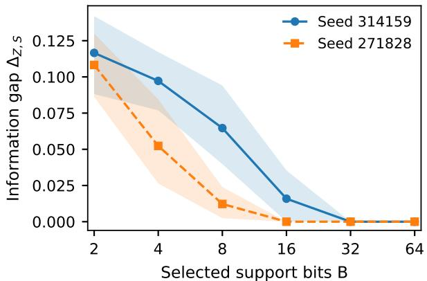  
(a) SmolLM2: final human loss, locked 96.

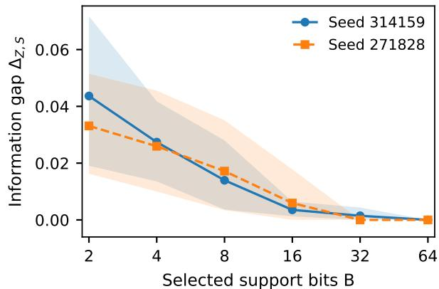  
(b) Phi: Mistral loss, reused locked 96.  
Figure 1: Information gap as nested feature sets expand, with policy supplied. Lines show the gap on the scored table $\Delta _ { Z , S }$ and shaded bands show individual 95% intervals from resampling policy areas. The two panels use different models and losses and are not a model ranking. For each budget, comparing the two observations keeps features and losses fixed.

Feature budget. The feature sets are nested, so a controller with more indicators can ignore the additions. The optimal risk on a fixed table cannot increase; the curves in Figure 1 show the size of the remaining gap, not an independent test of that monotonicity. Some lower bounds reach zero and many gaps vanish at larger budgets. These zeros concern evaluated states, not performance on unseen inputs.

Score and action agreement. The automatic and human losses have Spearman correlation 0.379 and mean absolute difference 0.311. Automatic scores have tied optimal actions in 90 of 176 states. Choosing the first minimum in the fixed order ASK, DECLINE, AssIST gives 51.1% agreement; the minimizing sets intersect in 80.7% of states and coincide in 30.7%. Set intersection is weaker than equality, especially with ties. Risk values do not depend on which tied minimizer is selected. Appendices F and K.2 give complete statistics. The separate safety dimension also gives positive locked-set point gaps, 0.0521 and 0.0312, but these are descriptive rating differences, not unsafe event probabilities or new confidence bounds (Appendix K.3).

## 5.2 Information, rule restrictions, and fitting error

At Qwen layer 17, with two indicators and no separate policy input, the minimum risk using the full state is 0.338 and the minimum using the code is 0.494. The information gap is 0.156, with bootstrap interval [0.125, 0.180] and individual lower bound 0.129. All four evaluation codes occur in fitting. Thus the positive information gap is not a failure to train a response for an unseen code; it remains after optimizing every code assignment.

At layer 19 with B = 16, the information, accessibility, and fitting gaps are 0.060, 0.047, and 0.022, respectively (Table 4). The information gap and the restriction to the allowed family both contribute. The 49 observed codes have collision fraction 0.760 and unseen-code fraction 0.198 (Table 24).

Holding this interface fixed, replacing constant rules with affine rules reduces minimum excess over the unrestricted interface risk from 0.143 to 0.047. Adding pairwise interactions reduces it to 0.007; third-order interactions and lookup rules attain zero class excess. Separately, increasing the fitting sample from 16 to all 144 states of its fixed population reduces the reported mean fitting gap from 0.130 to zero (Figure 2). Inclusion of rule families guarantees that their optima cannot worsen. The observed decline with training size is an experimental result, not a consequence of the risk decomposition or a guarantee for new data.

Table 4: Qwen2.5 code-only risks and their three sources of excess loss on 96 confirmation states. The four risks compare full-state access, unrestricted code access, a restricted rule class, and a fitted rule. Values and gaps are independently rounded; complete intervals appear in Table 24.
<table><tr><td>Layer</td><td>B</td><td> $R _ { \mathrm { f u l l } }$ </td><td> $R _ { Z } ^ { \star }$ </td><td> $R _ { \mathcal { D } }$ </td><td> $R _ { \widehat { \delta } }$ </td><td> $\Delta _ { \mathrm { i n f o } }$ </td><td> $\Delta _ { \mathrm { a c c e s s } }$ </td><td> $\Delta _ { \mathrm { t r a i n } }$ </td></tr><tr><td>17</td><td>2</td><td>0.338</td><td>0.494</td><td>0.530</td><td>0.541</td><td>0.156</td><td>0.036</td><td>0.011</td></tr><tr><td>19</td><td>16</td><td>0.338</td><td>0.398</td><td>0.444</td><td>0.466</td><td>0.060</td><td>0.047</td><td>0.022</td></tr></table>

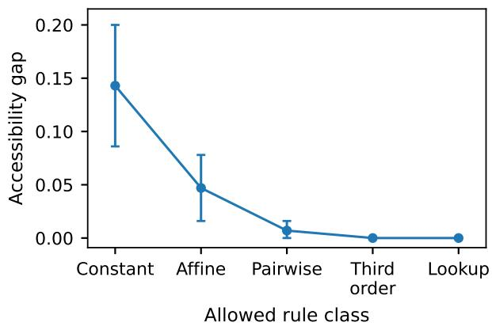  
(a) Only the rule class changes.

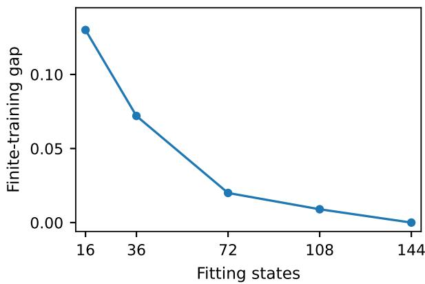  
(b) Only the fitting sample size changes.  
Figure 2: Separate comparisons of rule families and fitting samples. Left: minimum excess over the unrestricted interface risk, with available 95% bootstrap intervals. Right: the fitted rule's mean excess over its family optimum. The panels use reported rounded summaries; full plots and intervals appear in Figure 10.

## 5.3 Other models, evaluators, and observation choices

For Phi seed 314159 on the original confirmation set, supplying policy text reduces the Mistral loss gap from 0.1110 to 0.0557, with responses, scores, and features unchanged. The extra input improves the optimum but does not recover the full state minimum. Table 5 reports the gap $\Delta _ { Z , S }$ using code Z and policy S for each model and scoring protocol.

Table 5: Information loss with policy and SAE code jointly observed. SmolLM2 and Phi use Mistral losses averaged over five responses per state-action pair. †Qwen uses Qwen2.5-7B scores and rounded per-policy summaries; its interval endpoints include the $5 \times 1 0 ^ { - 5 }$ rounding correction. LCBs are individual bootstrap lower bounds. Layer indices are zero-based; models use different responses and losses and are not ranked by this table
<table><tr><td>Model</td><td>Collection</td><td>Layer / SAE seed</td><td>B</td><td> $\Delta _ { Z , S }$ </td><td>95% LCB</td></tr><tr><td>Qwen2.5-1.5B†</td><td>Original 96</td><td>17/-</td><td>2</td><td>0.13695</td><td>0.1113</td></tr><tr><td> $\mathrm { Q w e n 2 . 5 - 1 . 5 B ^ { \dagger } }$ </td><td>Original 96</td><td>19 / -</td><td>16</td><td>0.03875</td><td>0.0274</td></tr><tr><td>SmolLM2</td><td>Original 96</td><td>17 / 314159</td><td>2</td><td>0.0987</td><td>0.0807</td></tr><tr><td>SmolLM2</td><td>Original 96</td><td>17 / 271828</td><td>2</td><td>0.1015</td><td>0.0729</td></tr><tr><td>SmolLM2</td><td>Locked 96</td><td>17/ 314159</td><td>2</td><td>0.0460</td><td>0.0300</td></tr><tr><td>SmolLM2</td><td>Locked 96</td><td>17/ 271828</td><td>2</td><td>0.0430</td><td>0.0295</td></tr><tr><td>Phi</td><td>Original 96</td><td>23 / 314159</td><td>2</td><td>0.0557</td><td>0.0367</td></tr><tr><td>Phi</td><td>Original 96</td><td>23 / 271828</td><td>2</td><td>0.0491</td><td>0.0266</td></tr><tr><td>Phi</td><td>Reused 96</td><td>23 / 314159</td><td>2</td><td>0.0436</td><td>0.0225</td></tr><tr><td>Phi</td><td>Reused 96</td><td>23 / 271828</td><td>2</td><td>0.0331</td><td>0.0185</td></tr></table>

SmolLM2 and Phi have positive automatic gaps and individual bootstrap lower bounds for both SAE seeds on both evaluation collections. Qwen2.5-1.5B also gives positive estimates, recovered from summaries with absolute rounding error at most $5 \times 1 0 ^ { - 5 }$ ; interval endpoints include the same correction (Appendix J). Because generation inputs and score rubrics differ, these are results within each protocol, not model rankings.

Replacing Phi's Mistral scores with Qwen scores or their mean preserves positive primary lower bounds (Table 26). Deleting one policy area at a time leaves positive $B = 2$ point gaps in all 192 recorded checks, with minimum 0.0236. Neither comparison adds independent response data. The two evaluators have rank correlation 0.3552, so the shared sign does not imply close agreement of their scores.

Supporting controls. Qwen also gives positive gaps with a different evaluator, variance and random feature selection, controls matched on code occupancy, and a second model scale (Appendix G). SmolLM2 and Phi diagnostics appear in Appendices F and I. The reconstruction error divided by centered activation variance is larger on audit states than on the SAE validation corpus. Independently of that diagnostic, the risk comparison concerns selected activation indicators, not the information retained by the full SAE code.

## 5.4 Group conflicts and required outputs

The controlled benchmark uses the loss pattern in Example 3.2. Its three states share a layer-17, $B = 2$ code. Each pair has a common action with zero regret, whereas the smallest maximum regret for the triple is 1/3, including randomized choices. The benchmark is a constructed example, not a discovered failure under natural language outcome loss. The searched natural language candidate has zero positive separation in independent and fresh checks using two paraphrase replicas, five generation replicas, and three judge prompts (Appendix G).

<table><tr><td rowspan=1 colspan=1></td><td rowspan=1 colspan=1>ask</td><td rowspan=1 colspan=1>decline</td><td rowspan=1 colspan=1>assist</td></tr><tr><td rowspan=1 colspan=1>State 1</td><td rowspan=1 colspan=1>0</td><td rowspan=1 colspan=1>1</td><td rowspan=1 colspan=1>0</td></tr><tr><td rowspan=1 colspan=1>State 2</td><td rowspan=1 colspan=1>0</td><td rowspan=1 colspan=1>0</td><td rowspan=1 colspan=1>1</td></tr><tr><td rowspan=1 colspan=1>State 3</td><td rowspan=1 colspan=1>1</td><td rowspan=1 colspan=1>0</td><td rowspan=1 colspan=1>0</td></tr></table>

Maximum pair margin: 0  
Triple margin: 1/3

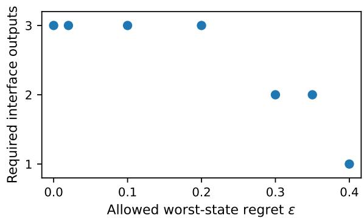  
(a) Compatible pairs and an incompatible triple.  
(b) Output requirements for 96 states with human ratings.  
Figure 3: Group conflict and required output count. Left: a controlled three-state loss matrix has pair margins zero and triple margin $1 / 3 .$ Right: global constraint generation on all 96 locked SmolLM2 states uses their final human losses, with every new cell validated. The capacity counts unrestricted labels without a separate policy input, not SAE features; the calculation and summary results are described in Appendix K.5. Markers show only evaluated tolerances, not interpolated transition thresholds. The two panels use different loss tables.

A separate capacity calculation uses all 96 locked SmolLM2 states and their final human losses. Unrestricted label assignments require three outputs at tested tolerances 0, 0.02, 0.10, and 0.20; two at 0.30 and 0.35; and one at 0.40. The margin with one output is 0.3695. Constraint generation and an independent twolabel feasibility formulation agree at all seven points, within the recorded numerical tolerance. Appendix K.5 describes the calculation; the matrix, labelings, and solver records are retained in the author working archive. The capacity calculation does not train an SAE or give policy text as an additional free input. The older Qwen 42-state curve, whose matrix is unavailable, remains in the appendix and is not the curve shown here.

## 6 Related Work

Decision sufficiency and compression for a task. Blackwell comparison orders experiments by attainable Bayes risks across decision problems (Blackwell, 1951; 1953), while Le Cam deficiency quantifies approximate comparison and sufficiency (Le Cam, 1964; Torgersen, 1991). Representation-learning extensions compare feature quality and optimize deficiency-based objectives (van Rooyen & Williamson, 2014; Banerjee & Montúfar, 2018). Recent formulations study Bayes sufficiency for a chosen loss, compression that preserves optimal actions, and summaries for linear optimization (Sevetlidis, 2026; Walsh, 2026; Ye et al., 2026). The information bottleneck trades compression against target information (Tishby et al., 1999; Alemi et al., 2017); usable information additionally restricts the decoder family (Xu et al., 2020).

We adopt loss-dependent risk comparison for a fixed continuation library and audit distribution, rather than compare channels across all decision problems. The optimum for the finite interface separates missing information from limitations of the rule that reads it. Our structural analysis then asks which states cannot share a continuation within the regret tolerance under the complete declared observation, including policy information when supplied.

State abstraction and closed-loop information states. State abstraction preserves rewards, transitions, values, or near-optimal behavior in Markov decision processes (Givan et al., 2003; Li et al., 2006; Ferns et al., 2004; 2011; Abel et al., 2016; 2020). Learned control representations seek to preserve latent dynamics, invariant task-relevant structure, or exploration information (Gelada et al., 2019; Zhang et al., 2020; 2021; Misra et al., 2020); control sufficiency has also been analyzed for mutual-information objectives (Rakelly et al., 2021). Recent vision-language-action work addresses aliasing between similar observations requiring different actions (Lee et al., 2026).

Belief states and predictive state representations summarize histories for recursive planning (Smallwood & Sondik, 1973; Kaelbling et al., 1998; Littman et al., 2001; Singh et al., 2004; Boots et al., 2011); approximate information states quantify the cost of compressed histories (Subramanian et al., 2022). Options formalize temporally extended closed-loop policies (Sutton et al., 1999; Abel et al., 2020). Our continuation library follows the established closed-loop view. We take the full audit state and continuation library as inputs and audit an additional observation channel, rather than construct a new information state. We ask whether states sharing an observation can share a continuation, separately from the performance of restricted or fitted rules.

Set-valued decisions and higher-order compatibility. Reject-option classification permits abstention (Chow, 1970; Bartlett & Wegkamp, 2008; Charoenphakdee et al., 2021), while set-valued prediction controls error, coverage, or output-set size (Denis & Hebiri, 2017; Sadinle et al., 2019; Bates et al., 2021; Vovk et al., 2005). These methods constrain predictions for each input. Our uniform compatibility criterion instead requires one continuation distribution to satisfy a regret tolerance at every state in a deterministic interface cell. Pairwise intersections can all be nonempty while the joint intersection is empty.

Helly's theorem bounds the size of a minimal convex witness (Helly, 1923), and minimax duality relates its margin to a worst-case state mixture (Sion, 1958). Weak hypergraph coloring characterizes how many labels separate all minimal conflicts (Berge, 1989). We connect these classical results to exact risk for the finite interface and the capacity of unrestricted deterministic interfaces, using conflicts over the entire audit domain, not only within existing cells. On a finite audit domain, grouping by optimal action is sufficient when each state has a unique optimal pure continuation and the nonnegative tolerance is below half the minimum second-best regret margin (Proposition B.2). Outside that regime, a pairwise conflict graph need not describe joint compatibility.

SAE interfaces and latent safety control. Sparse coding and sparse autoencoders learn dictionaries with sparse codes (Olshausen & Field, 1996; Makhzani & Frey, 2013). Language-model studies examine superposition (Elhage et al., 2022), interpretable dictionary features (Bricken et al., 2023; Cunningham et al., 2024), SAE scaling (Gao et al., 2025; Templeton et al., 2024), public dictionaries (Lieberum et al., 2024), and concept geometry (Bhalla et al., 2026). Our target is decision information in a selected support code or coordinate set, not reconstruction from the full SAE dictionary.

Safe reinforcement learning develops constrained policies (García & Fernández, 2015; Achiam et al., 2017; Chow et al., 2018), shields (Alshiekh et al., 2018; Carr et al., 2023), and reachability or predictive safety filters (Fisac et al., 2019; Wabersich & Zeilinger, 2021; Brunke et al., 2022). Related activation studies extract latent knowledge (Burns et al., 2023) or steer generation (Li et al., 2023; Zou et al., 2023; Karnik & Bansal, 2025). We audit the specified interface before selecting a downstream rule: a positive gap on the same finite loss table cannot be removed by changing that rule alone. The result is complementary to designing or evaluating a particular monitor or steering method.

Evaluation and generative safety. Language-model evaluators score open-ended outputs and compare candidate responses (Liu et al., 2023; Zheng et al., 2023; Kim et al., 2024); reward-model benchmarks assess preference judgments (Lambert et al., 2025). Judging studies identify biases (Wang et al., 2024) and develop calibrated tests with imperfect evaluators (Feng et al., 2026). Risk-control procedures calibrate predictions from finite data (Angelopoulos et al., 2025), while concentration inequalities provide bounds for bounded loss estimates (Hoeffding, 1963). Our certificate concerns a witness selected after searching state groups. Valid simultaneous loss bounds or independent certification data preserve the guarantee after selection.

Toxicity benchmarks, red teaming, principle-based training, and safeguard classifiers evaluate or modify generative behavior (Gehman et al., 2020; Perez et al., 2022; Bai et al., 2022; Inan et al., 2023). Our question is which safe and useful continuations the declared observation can support, not only whether an individual output is safe. The human study tests the finite-interface finding under a separate loss construction; it does not establish interchangeability of automatic and human scores. Appendix H provides the extended comparison.

## 7 Discussion

What the risk comparison identifies. For fixed losses and continuations, a positive information gap $\Delta _ { \mathrm { { i n f o } } }$ rules out matching the full state optimum by changing only the controller. The accessibility gap $\Delta _ { \mathrm { a c c e s s } }$ can decrease when the allowed rule family expands. The fitting gap $\Delta _ { \mathrm { t r a i n } }$ may decrease with better estimation or optimization, but more data alone need not reduce it in every run. These statements compare specified optima; they do not identify every cause of poor deployed performance.

Encoding matters, not only the number of bits. With three continuations, an unrestricted encoder can transmit an optimal action index using three labels, which fit in two bits. The positive gaps for selected SAE indicators do not prove that every pair of features fails, or that two bits are inherently insufficient They identify a failure of the selected partition. Comparing the full state directly with the final indicators does not locate whether a distinction was lost in the model activation, SAE encoding, coordinate selection, or thresholding. Those stages require separate comparisons.

What the experiments support. Supplying policy text does not eliminate the observed gaps. Human and automatic losses give the same sign in the tested SmolLM2 settings but often differ on individual scores and optimal action sets. The losses measure rated safety and quality, not unsafe event probabilities. The controlled group example demonstrates a possible failure of pairwise checks; the unsuccessful natural language replication gives no estimate of its prevalence.

The model families use different generation and scoring protocols. Within each SmolLM2 or Phi SAE pair, only initialization and training order vary; the activation corpus is shared. Human ratings cover SmolLM2 only, and Phi reuses the policy collections. The original human sample includes fitting areas, whereas the locked collection is held out by policy area. These comparisons support the specific configurations, not all models, encoders, or policy distributions.

Limits of inference from a fixed table. The empirical minima use recorded response scores, not unknown losses on future responses. Minimizing noisy scores can change the apparent gap even when individual scores are unbiased. Resampling policy areas measures variation under different weights on the recorded tables; it does not control generation or judge error. Likewise, a zero gap on distinct evaluation codes can result from unrestricted lookup and gives no guarantee on unseen inputs. The additional assumptions for statistical certification appear in Appendices L and C.3.

## 8 Conclusion

Decision sufficiency compares what an interface permits with what the full state permits under the same loss and continuations. Exact optimization for finite interfaces separates that information gap from restrictions on the controller and imperfect fitting. Minimal conflicts identify groups that cannot share an acceptable choice; their complete set determines the output count for an unrestricted deterministic interface.

The tested SAE indicators retain positive gaps with policy supplied, including under SmolLM2 human ratings. A controlled example shows why pairwise checks can miss a group conflict, but the natural language candidate does not replicate. The conclusions concern the specified responses and loss tables. Within that scope, they distinguish limitations of the chosen input from errors a different controller could avoid.

## Reproducibility Statement

The arXiv source package contains the manuscript, bibliography, figures, and LaTeX tables. Experiment code and cached records are retained in a separate author working archive and are not included in the arXiv source package. The working archive contains SmolLM2 ratings and adjudication inputs, cached SmolLM2 and Phi records, and CPU analysis scripts. Its 96-state capacity records include the matrix, labelings, margins, and independent feasibility checks. Qwen results with policy supplied use rounded notebook summaries; its full precision historical arrays and 42-state matrix are unavailable. Large SAE checkpoints and activation shards are not included. Appendix M.6 lists the inputs and commands. Analysis scripts do not create human labels or retrain models.

## References

David Abel, David Ellis Hershkowitz, and Michael L. Littman. Near optimal behavior via approximate state abstraction. In Proceedings of the 33rd International Conference on Machine Learning, volume 48 of Proceedings of Machine Learning Research, pp. 2915–2923. PMLR, 2016. URL https://proceedings. mlr.press/v48/abel16.html.

David Abel, Nate Umbanhowar, Khimya Khetarpal, Dilip Arumugam, Doina Precup, and Michael L. Littman. Value preserving state-action abstractions. In Proceedings of the 23rd International Conference on Artificial Intelligence and Statistics, volume 108 of Proceedings of Machine Learning Research, pp. 1639–1650. PMLR, 2020. URL https://proceedings.mlr.press/v108/abel20a.html.

Joshua Achiam, David Held, Aviv Tamar, and Pieter Abbeel. Constrained policy optimization. In Proceedings of the 34th International Conference on Machine Learning, volume 70 of Proceedings of Machine Learning Research, pp. 22-–31. PMLR, 2017. URL https://proceedings.mlr.press/v70/achiam17a.html.

Alexander A. Alemi, Ian Fischer, Joshua V. Dillon, and Kevin Murphy. Deep variational information bottleneck. In International Conference on Learning Representations, 2017. URL https://openreview. net/forum?id=HyxQzBceg

Mohammed Alshiekh, Roderick Bloem, Rüdiger Ehlers, Bettina Könighofer, Scott Niekum, and Ufuk Topcu. Safe reinforcement learning via shielding. In Proceedings of the AAAI Conference on Artificial Intelligence, volume 32, pp. 2669–2678, 2018. doi: 10.1609/aaai.v32i1.11797.

Anastasios N. Angelopoulos, Stephen Bates, Emmanuel J. Candès, Michael I. Jordan, and Lihua Lei. Learn then test: Calibrating predictive algorithms to achieve risk control. The Annals of Applied Statistics, 19 (2):1641–1662, 2025. doi: 10.1214/24-AOAS1998.

Yuntao Bai, Saurav Kadavath, Sandipan Kundu, Amanda Askell, Jackson Kernion, Andy Jones, Anna Chen, Anna Goldie, Azalia Mirhoseini, Cameron McKinnon, Carol Chen, Catherine Olsson, Christopher

Olah, Danny Hernandez, Dawn Drain, Deep Ganguli, Dustin Li, Eli Tran-Johnson, Ethan Perez, Jamie Kerr, Jared Mueller, Jeffrey Ladish, Joshua Landau, Kamal Ndousse, Kamile Lukosiute, Liane Lovitt, Michael Sellitto, Nelson Elhage, Nicholas Schiefer, Noemí Mercado, Nova DasSarma, Robert Lasenby Robin Larson, Sam Ringer, Scott Johnston, Shauna Kravec, Sheer El Showk, Stanislav Fort, Tamera Lanham, Timothy Telleen-Lawton, Tom Conerly, Tom Henighan, Tristan Hume, Samuel R. Bowman, Zac Hatfield-Dodds, Ben Mann, Dario Amodei, Nicholas Joseph, Sam McCandlish, Tom Brown, and Jared Kaplan. Constitutional AI: Harmlessness from AI feedback, 2022. URL https://arxiv.org/abs/2212. 08073. arXiv:2212.08073.

Pradeep Kr. Banerjee and Guido Montúfar. The variational deficiency bottleneck, 2018. URL https: //arxiv.org/abs/1810.11677. arXiv:1810.11677.

Peter L. Bartlett and Marten H. Wegkamp. Classification with a reject option using a hinge loss. Journal of Machine Learning Research, 9(59):1823–1840, 2008. URL https://jmlr.org/papers/v9/bartlett08a. html.

Stephen Bates, Anastasios Angelopoulos, Lihua Lei, Jitendra Malik, and Michael I. Jordan. Distribution-free, risk-controlling prediction sets. Journal of the ACM, 68(6):1–34, 2021. doi: 10.1145/3478535.

Claude Berge. Hypergraphs: Combinatorics of Finite Sets, volume 45 of North-Holland Mathematical Library. North-Holland, 1989.

Usha Bhalla, Thomas Fel, Can Rager, Sheridan Feucht, Tal Haklay, Daniel Wurgaft, Siddharth Boppana, Matthew Kowal, Vasudev Shyam, Jack Merullo, Atticus Geiger, and Ekdeep Singh Lubana. Do sparse autoencoders capture concept manifolds?, 2026. URL https://arxiv.org/abs/2604.28119. arXiv:2604.28119.

David Blackwell. Comparison of experiments. In Proceedings of the Second Berkeley Symposium on Mathematical Statistics and Probability, pp. 93–102. University of California Press, 1951.

David Blackwell. Equivalent comparisons of experiments. The Annals of Mathematical Statistics, 24(2): 265–272, 1953. doi: 10.1214/aoms/1177729032.

Byron Boots, Sajid M. Siddiqi, and Geoffrey J. Gordon. Closing the learning-planning loop with predictive state representations. The International Journal of Robotics Research, 30(7):954–966, 2011. doi: 10.1177/ 0278364911401736.

Stephen Boyd and Lieven Vandenberghe. Convex Optimization. Cambridge University Press, 2004. URL https://web.stanford.edu/\~boyd/cvxbook/.

Trenton Bricken, Adly Templeton, Joshua Batson, Brian Chen, Adam Jermyn, Tom Conerly, Nick Turner, Cem Anil, Carson Denison, Amanda Askell, Robert Lasenby, Yifan Wu, Shauna Kravec, Nicholas Schiefer, Tim Maxwell, Nicholas Joseph, Alex Tamkin, Karina Nguyen, Brayden McLean, Josiah E. Burke, Tristan Hume, Shan Carter, Tom Henighan, and Chris Olah. Towards monosemanticity: Decomposing language models with dictionary learning. Transformer Circuits, 2023. URL https://transformer-circuits. pub/2023/monosemantic-features/index.html.

Lukas Brunke, Melissa Greeff, Adam W. Hall, Zhaocong Yuan, Siqi Zhou, Jacopo Panerati, and Angela P. Schoellig. Safe learning in robotics: From learning-based control to safe reinforcement learning. Annual Review of Control, Robotics, and Autonomous Systems, 5:411–444, 2022. doi: 10.1146/ annurev-control-042920-020211.

Collin Burns, Haotian Ye, Dan Klein, and Jacob Steinhardt. Discovering latent knowledge in language models without supervision. In International Conference on Learning Representations, 2023. URL https: //openreview.net/forum?id=ETKGubyOhcs.

Steven Carr, Nils Jansen, Sebastian Junges, and Ufuk Topcu. Safe reinforcement learning via shielding under partial observability. In Proceedings of the AAAI Conference on Artificial Intelligence, volume 37, pp. 14748–14756, 2023. doi: 10.1609/aaai.v37i12.26723.

Nontawat Charoenphakdee, Zhenghang Cui, Yivan Zhang, and Masashi Sugiyama. Classification with rejection based on cost-sensitive classification. In Proceedings of the 38th International Conference on Machine Learning, volume 139 of Proceedings of Machine Learning Research, pp. 1507–1517. PMLR, 2021. URL https://proceedings.mlr.press/v139/charoenphakdee21a.html.

C. K. Chow. On optimum recognition error and reject tradeoff. IEEE Transactions on Information Theory, 16(1):41–46, 1970. doi: 10.1109/TIT.1970.1054406.

Yinlam Chow, Ofir Nachum, Edgar Duenez-Guzman, and Mohammad Ghavamzadeh. A lyapunovbased approach to safe reinforcement learning. In Advances in Neural Information Processing Systems, volume 31, 2018. URL https://proceedings.neurips.cc/paper/2018/hash/ 4fe5149039b52765bde64beb9f674940-Abstract.html.

Hoagy Cunningham, Aidan Ewart, Logan Riggs, Robert Huben, and Lee Sharkey. Sparse autoencoders find highly interpretable features in language models. In International Conference on Learning Representations, 2024. URL https://openreview.net/forum?id=F76bwRSLeK.

Christophe Denis and Mohamed Hebiri. Confidence sets with expected sizes for multiclass classification. Journal of Machine Learning Research, 18(102):1–28, 2017. URL https://jmlr.org/papers/v18/16-498. html.

Nelson Elhage, Tristan Hume, Catherine Olsson, Nicholas Schiefer, Tom Henighan, Shauna Kravec, Zac Hatfield-Dodds, Robert Lasenby, Dawn Drain, Carol Chen, Roger Grosse, Sam McCandlish, Jared Kaplan, Dario Amodei, Martin Wattenberg, and Christopher Olah. Toy models of superposition. Transformer Circuits, 2022. URL https://transformer-circuits.pub/2022/toy\_model/index.html.

Chen Feng, Minghe Shen, Ananth Balashankar, Carsten Gerner-Beuerle, and Miguel R. D. Rodrigues. Noisy but valid: Robust statistical evaluation of LLMs with imperfect judges. In International Conference on LearningRepresentations, 2026. URL https://openreview.net/forum?id=hEhxreaLdU.

Norm Ferns, Prakash Panangaden, and Doina Precup. Metrics for finite markov decision processes. In Proceedings of the 20th Conference on Uncertainty in Artificial Intelligence, pp. 162–169. AUAI Press, 2004.

Norm Ferns, Prakash Panangaden, and Doina Precup. Bisimulation metrics for continuous markov decision processes. SIAM Journal on Computing, 40(6):1662–1714, 2011. doi: 10.1137/10080484X.

Jaime F. Fisac, Anayo K. Akametalu, Melanie N. Zeilinger, Shahab Kaynama, Jeremy Gillula, and Claire J. Tomlin. A general safety framework for learning-based control in uncertain robotic systems. IEEE Transactions on Automatic Control, 64(7):2737–2752, 2019. doi: 10.1109/TAC.2018.2876389.

Leo Gao, Tom Dupré la Tour, Henk Tillman, Gabriel Goh, Rajan Troll, Alec Radford, Ilya Sutskever, Jan Leike, and Jeffrey Wu. Scaling and evaluating sparse autoencoders. In International Conference on LearningRepresentations, 2025. URL https://openreview.net/forum?id=tcsZt9ZNKD.

Javier García and Fernando Fernández. A comprehensive survey on safe reinforcement learning. Journal of Machine Learning Research, 16(42):1437–1480, 2015. URL https://jmlr.org/papers/v16/garcia15a. html.

Samuel Gehman, Suchin Gururangan, Maarten Sap, Yejin Choi, and Noah A. Smith. RealToxicityPrompts: Evaluating neural toxic degeneration in language models. In Findings of the Association for Computational Linguistics: EMNLP 2020, pp. 3356–3369. Association for Computational Linguistics, 2020. doi: 10.18653/ v1/2020.findings-emnlp.301. URL https://aclanthology.org/2020.findings-emnlp.301/.

Carles Gelada, Saurabh Kumar, Jacob Buckman, Ofir Nachum, and Marc G. Bellemare. DeepMDP: Learning continuous latent space models for representation learning. In Proceedings of the 36th International Conference on Machine Learning, volume 97 of Proceedings of Machine Learning Research, pp. 2170–2179. PMLR, 2019. URL https://proceedings.mlr.press/v97/gelada19a.html.

Robert Givan, Thomas Dean, and Matthew Greig. Equivalence notions and model minimization in markov decision processes. Artificial Intelligence, 147(1–2):163–223, 2003. doi: 10.1016/S0004-3702(02)00376-4.

Eduard Helly. Über mengen konvexer körper mit gemeinschaftlichen punkten. Jahresbericht der Deutschen Mathematiker-Vereinigung, 32:175–176, 1923.

Wassily Hoeffding. Probability inequalities for sums of bounded random variables. Journal of the American Statistical Association, 58(301):13–30, 1963. doi: 10.1080/01621459.1963.10500830.

Hakan Inan, Kartikeya Upasani, Jianfeng Chi, Rashi Rungta, Krithika Iyer, Yuning Mao, Michael Tontchev, Qing Hu, Brian Fuller, Davide Testuggine, and Madian Khabsa. Llama guard: LLM-based input-output safeguard for human-AI conversations, 2023. URL https://arxiv.org/abs/2312.06674. arXiv:2312.06674.

Leslie Pack Kaelbling, Michael L. Littman, and Anthony R. Cassandra. Planning and acting in partially observable stochastic domains. Artificial Intelligence, 101(1–2):99–134, 1998. doi: 10.1016/S0004-3702(98) 00023-X.

Sathwik Karnik and Somil Bansal. Preemptive detection and steering of LLM misalignment via latent reachability, 2025. URL https://arxiv.org/abs/2509.21528. arXiv:2509.21528

Seungone Kim, Jamin Shin, Yejin Cho, Joel Jang, Shayne Longpre, Hwaran Lee, Sangdoo Yun, Seongjin Shin, Sungdong Kim, James Thorne, and Minjoon Seo. Prometheus: Inducing fine-grained evaluation capability in language models. In International Conference on Learning Representations, 2024. URL https://openreview.net/forum?id=8euJaTveKw.

Nathan Lambert, Valentina Pyatkin, Jacob Morrison, LJ Miranda, Bill Yuchen Lin, Khyathi Chandu, Nouha Dziri, Sachin Kumar, Tom Zick, Yejin Choi, Noah A. Smith, and Hannaneh Hajishirzi. Reward-Bench: Evaluating reward models for language modeling. In Findings of the Association for Computational Linguistics: NAACL 2025, pp. 1755–1797. Association for Computational Linguistics, 2025. doi: 10.18653/v1/2025.findings-naacl.96. URL https://aclanthology.org/2025.findings-naacl.96/.

Lucien Le Cam. Sufficiency and approximate sufficiency. The Annals of Mathematical Statistics, 35(4): 1419–1455, 1964. doi: 10.1214/aoms/1177700372.

Kyujin Lee, Injae Kim, Jihwan Park, Yejun Ju, Minseok Joo, and Hyunwoo J. Kim. Mitigating state aliasing in vision-language-action models via inverse dynamics learning, 2026. URL https://arxiv.org/ abs/2605.29577. arXiv:2605.29577.

Kenneth Li, Oam Patel, Fernanda Viégas, Hanspeter Pfister, and Martin Wattenberg. Inference-time intervention: Eliciting truthful answers from a language model. In Advances in Neural Information Processing Systems, volume 36, 2023. URL https://arxiv.org/abs/2306.03341.

Lihong Li, Thomas J. Walsh, and Michael L. Littman. Towards a unified theory of state abstraction for MDPs. In Proceedings of the International Symposium on Artificial Intelligence and Mathematics, 2006.

Tom Lieberum, Senthooran Rajamanoharan, Arthur Conmy, Lewis Smith, Nicolas Sonnerat, Vikrant Varma, János Kramár, Anca Dragan, Rohin Shah, and Neel Nanda. Gemma scope: Open sparse autoencoders everywhere all at once on gemma 2. In Proceedings of the 7th BlackboxNLP Workshop: Analyzing and Interpreting Neural Networks for NLP, pp. 278–300. Association for Computational Linguistics, 2024. doi: 10.18653/v1/2024.blackboxnlp-1.19. URL https://aclanthology.org/2024.blackboxnlp-1.19/.

Michael L. Littman, Richard S. Sutton, and Satinder Singh. Predictive representations of state. In Advances in Neural Information Processing Systems 14, pp. 1555–1561. MIT Press, 2001.

Yang Liu, Dan Iter, Yichong Xu, Shuohang Wang, Ruochen Xu, and Chenguang Zhu. G-Eval: NLG evaluation using GPT-4 with better human alignment. In Proceedings of the 2023 Conference on Empirical Methods in Natural Language Processing, pp. 2511–2522. Association for Computational Linguistics, 2023. doi: 10.18653/v1/2023.emnlp-main.153. URL https://aclanthology.org/2023.emnlp-main.153/.

Alireza Makhzani and Brendan Frey. k-sparse autoencoders, 2013. URL https://arxiv.org/abs/1312. 5663. arXiv:1312.5663

Dipendra Misra, Mikael Henaff, Akshay Krishnamurthy, and John Langford. Kinematic state abstraction and provably efficient rich-observation reinforcement learning. In Proceedings of the 37th International Conference on Machine Learning, volume 119 of Proceedings of Machine Learning Research, pp. 6961– 6971. PMLR, 2020. URL https://proceedings.mlr.press/v119/misra20a.html.

Bruno A. Olshausen and David J. Field. Emergence of simple-cell receptive field properties by learning a sparse code for natural images. Nature, 381:607–609, 1996. doi: 10.1038/381607a0.

Ethan Perez, Saffron Huang, Francis Song, Trevor Cai, Roman Ring, John Aslanides, Amelia Glaese, Nat McAleese, and Geoffrey Irving. Red teaming language models with language models. In Proceedings of the 2022 Conference on Empirical Methods in Natural Language Processing, pp. 3419–3448. Association for Computational Linguistics, 2022. doi: 10.18653/v1/2022.emnlp-main.225. URL https://aclanthology. org/2022.emnlp-main.225/.

Kate Rakelly, Abhishek Gupta, Carlos Florensa, and Sergey Levine. Which mutual-information representation learning objectives are sufficient for control? In Advances in Neural Information Processing Systems, volume 34, 2021. URL https://proceedings.neurips.cc/paper/2021/hash/ 0a6cb4e923bc7dda0a3db6fb102bb3d8-Abstract.html.

Mauricio Sadinle, Jing Lei, and Larry Wasserman. Least ambiguous set-valued classifiers with bounded error levels. Journal of the American Statistical Association, 114(525):223–234, 2019. doi: 10.1080/01621459. 2017.1395341.

Vasileios Sevetlidis. Bayes-sufficient representations in supervised learning, 2026. URL https://arxiv. org/abs/2606.04045. arXiv:2606.04045.

Satinder Singh, Michael R. James, and Matthew R. Rudary. Predictive state representations: A new theory for modeling dynamical systems. In Proceedings of the 20th Conference on Uncertainty in Artificial Intelligence, pp. 512–519. AUAI Press, 2004.

Maurice Sion. On general minimax theorems. Pacific Journal of Mathematics, 8(1):171–176, 1958. doi: 10.2140/pjm.1958.8.171.

Richard D. Smallwood and Edward J. Sondik. The optimal control of partially observable markov processes over a finite horizon. Operations Research, 21(5):1071–1088, 1973. doi: 10.1287/opre.21.5.1071.

Jayakumar Subramanian, Amit Sinha, Raihan Seraj, and Aditya Mahajan. Approximate information state for approximate planning and reinforcement learning in partially observed systems. Journal of Machine Learning Research, 23(12):1–83, 2022. URL https://jmlr.org/papers/v23/20-1165.htm1.

Richard S. Sutton, Doina Precup, and Satinder Singh. Between MDPs and semi-MDPs: A framework for temporal abstraction in reinforcement learning. Artificial Intelligence, 112(1-2):181-211, 1999. doi: 10.1016/S0004-3702(99)00052-1.

Adly Templeton, Tom Conerly, Jonathan Marcus, Jack Lindsey, Trenton Bricken, Brian Chen, Adam Pearce, Craig Citro, Emmanuel Ameisen, Andy Jones, Hoagy Cunningham, Nicholas L. Turner, Callum Mc-Dougall, Monte MacDiarmid, Alex Tamkin, Esin Durmus, Tristan Hume, Francesco Mosconi, C. Daniel Freeman, Theodore R. Sumers, Edward Rees, Joshua Batson, Adam Jermyn, Shan Carter, Chris Olah, and Tom Henighan. Scaling monosemanticity: Extracting interpretable features from claude 3 sonnet. Transformer Circuits, 2024. URL https://transformer-circuits.pub/2024/scaling-monosemanticity/ index.html.

Naftali Tishby, Fernando C. Pereira, and William Bialek. The information bottleneck method. In Proceedings of the 37th Annual Allerton Conference on Communication, Control, and Computing, pp. 368–377, 1999.

Erik Torgersen. Comparison of Statistical Experiments, volume 36 of Encyclopedia of Mathematics and its Applications. Cambridge University Press, 1991. doi: 10.1017/CBO9780511666353.

Brendan van Rooyen and Robert C. Williamson. Le Cam meets LeCun: Deficiency and generic feature learning, 2014. URL https://arxiv.org/abs/1402.4884. arXiv:1402.4884.

Vladimir Vovk, Alex Gammerman, and Glenn Shafer. Algorithmic Learning in a Random World. Springer, 2005. doi: 10.1007/b106715

Kim Peter Wabersich and Melanie N. Zeilinger. A predictive safety filter for learning-based control of constrained nonlinear dynamical systems. Automatica, 129:109597, 2021. doi: 10.1016/j.automatica.2021. 109597.

Mark Walsh. Support sufficiency as action-sufficient compression: A single-cycle rate-regret formulation, 2026. URL https://arxiv.org/abs/2606.09858. arXiv:2606.09858.

Peiyi Wang, Lei Li, Liang Chen, Zefan Cai, Dawei Zhu, Binghuai Lin, Yunbo Cao, Lingpeng Kong, Qi Liu, Tianyu Liu, and Zhifang Sui. Large language models are not fair evaluators. In Proceedings of the 62nd Annual Meeting of the Association for Computational Linguistics (Volume 1: Long Papers), pp. 9440–9450. Association for Computational Linguistics, 2024. doi: 10.18653/v1/2024.acl-long.511. URL https://aclanthology.org/2024.acl-long.511/.

Yilun Xu, Shengjia Zhao, Jiaming Song, Russell Stewart, and Stefano Ermon. A theory of usable information under computational constraints. In International Conference on Learning Representations, 2020. URL https://openreview.net/forum?id=r1eBeyHFDH.

Yuhan Ye, Saurabh Amin, and Asuman Özdağlar. Learning decision-sufficient representations for linear optimization. In Proceedings of the 39th Conference on Learning Theory, volume 336 of Proceedings of Machine Learning Research, pp. 6924–6975. PMLR, 2026. URL https://proceedings.mlr.press/v336/ ye26a.html.

Amy Zhang, Clare Lyle, Shagun Sodhani, Angelos Filos, Marta Kwiatkowska, Joelle Pineau, Yarin Gal, and Doina Precup. Invariant causal prediction for block MDPs. In Proceedings of the 37th International Conference on Machine Learning, volume 119 of Proceedings of Machine Learning Research, pp. 11214 11224. PMLR, 2020. URL https://proceedings.mlr.press/v119/zhang20t.html.

Amy Zhang, Rowan McAllister, Roberto Calandra, Yarin Gal, and Sergey Levine. Learning invariant representations for reinforcement learning without reconstruction. In International Conference on Learning Representations, 2021. URL https://openreview.net/forum?id=-2FCwDKRREu.

Lianmin Zheng, Wei-Lin Chiang, Ying Sheng, Siyuan Zhuang, Zhanghao Wu, Yonghao Zhuang, Zi Lin, Zhuohan Li, Dacheng Li, Eric P. Xing, Hao Zhang, Joseph E. Gonzalez, and Ion Stoica. Judging LLMas-a-judge with MT-Bench and chatbot arena. In Advances in Neural Information Processing Systems, volume 36, pp. 46595–46623, 2023. URL https://proceedings.neurips.cc/paper\_files/paper/2023/ hash/91f18a1287b398d378ef22505bf41832-Abstract-Datasets\_and\_Benchmarks.html.

Andy Zou, Long Phan, Sarah Chen, James Campbell, Phillip Guo, Richard Ren, Alexander Pan, Xuwang Yin, Mantas Mazeika, Ann-Kathrin Dombrowski, Shashwat Goel, Nathaniel Li, Michael J. Byun, Zifan Wang, Alex Mallen, Steven Basart, Sanmi Koyejo, Dawn Song, Matt Fredrikson, Zico Kolter, and Dan Hendrycks. Representation engineering: A top-down approach to AI transparency, 2023. URL https: //arxiv.org/abs/2310.01405. arXiv:2310.01405.

## A Additional Risk Results and Proofs

The results below establish the risk comparisons, their posterior interpretation, and the calculations for affine rules and uncertain losses. The audit setting and all decision permissions are those of Section 2.

## A.1 Proofs of the main risk comparisons

Proof of Theorem 2.2. For every state u and choice $q \in \Delta _ { m } , \ell ^ { \star } ( u ) \leq \ell ( u , q )$ . Taking expectations and then an infimum proves $R _ { \mathrm { f u l l } } \leq R _ { Z } ^ { \star }$ . The inclusions $\widehat { \delta } \in \mathcal { D } \subseteq \mathfrak { D } _ { Z }$ give $R _ { Z } ^ { \star } \le R _ { D } \le R _ { \widehat { \delta } }$ . Adding and subtracting $R _ { Z } ^ { \star }$ and $R _ { \mathcal { D } }$ proves the decomposition. Every step uses the same loss and audit distribution. □

Proof of Theorem 2.3. A selector observing state $u _ { i }$ can choose a minimizing column of $L _ { i j }$ , giving $R _ { \mathrm { f u l l } } =$ $\textstyle \sum _ { i } \mu _ { i }$ minj $L _ { i j }$ . A rule assigning $q _ { r } \in \Delta _ { m }$ to output $z _ { r }$ has risk

$$
\sum _ { i , r , j } \mu _ { i } P _ { i r } L _ { i j } q _ { r j } = \sum _ { r , j } C _ { r j } q _ { r j } .
$$

Each $q _ { r }$ has its own simplex constraint. Its linear objective has minimum min $\cdot { C _ { r j } }$ , attained by any distribution supported on the minimizing columns. Summing over outputs proves the formula. A row with zero observation probability has zero cost for every column. □

Justification of Equation (6). On the finite audit, the complete observation $( Z , S )$ has a finite alphabet. Apply Theorem 2.3 to its joint observation cells $C _ { z , s }$ . Their unnormalized costs are $\mathbb { E } [ { \bf 1 } \{ Z = z , S = s \} \ell _ { j } ( U ) ]$ giving the displayed sum of minima. The full-state oracle cannot be outperformed by either observation rule. Moreover, any code-only rule can be implemented by a policy-aware rule that ignores S, so $R _ { \mathrm { f u l l } } \leq R _ { Z , S } ^ { \star } \leq$ $R _ { Z } ^ { \star }$ . Subtracting the same full-state risk gives $0 \le \Delta _ { Z , S } \le \Delta _ { Z }$ □

## A.2 Posterior conflict and zero information loss

Residual uncertainty after observing the interface. Let $P _ { Z }$ be the marginal law of $Z ,$ and let $\mu _ { z } : =$ $P ( U \in \cdot \mid Z = z )$ be a regular conditional state distribution. Assumption 2.1 ensures that such a conditional distribution exists. The posterior expected regret of continuation $\pi _ { j }$ and the smallest posterior expected regret are

$$
\bar { e } _ { j } ( z ) : = \int e _ { j } ( u ) \mu _ { z } ( d u ) , \qquad \kappa ( z ) : = \operatorname* { m i n } _ { q \in \Delta _ { m } } \sum _ { j = 1 } ^ { m } q _ { j } \bar { e } _ { j } ( z ) = \operatorname* { m i n } _ { j \in [ m ] } \bar { e } _ { j } ( z ) .
$$

The selector can choose a different continuation for each observation $z ,$ but it must use one distribution for the full states remaining possible under $\mu _ { z }$ . The posterior conflict $\kappa ( z )$ measures the resulting minimum average regret.

Theorem A.1 (Posterior-conflict decomposition). Under Assumption 2.1,

$$
\mathfrak { D } _ { \sigma } ^ { \mathrm { i n f o } } ( K ; \mu ) = \mathbb { E } _ { Z } [ \kappa ( Z ) ] .
$$

The information gap is zero $i f$ and only if the nonnegative posterior conflict $\kappa ( Z )$ is zero $P _ { Z }$ -almost surely. Proposition A.2 (Zero-gap characterization). Under Assumption 2.1, the following are equivalent:

1. The interface information deficiency ${ \mathfrak { D } } _ { \sigma } ^ { \mathrm { i n f o } } ( K ; \mu )$ is zero.

2. For $P _ { Z }$ -almost every observation $z ,$ some continuation index $j \in [ m ]$ satisfies $\mu _ { z } ( \{ u : e _ { j } ( u ) = 0 \} ) =$ 1.

3. There exists a measurable pure selector $j ^ { \star } : \mathcal { Z }  [ m ]$ such that $e _ { j ^ { \star } ( Z ) } ( U ) = 0$ almost surely.

Zero average information loss therefore requires a common optimal continuation under almost every posterior distribution, not merely a potentially different optimum for each hidden state. The later uniform criterion uses a nonnegative tolerance ε and requires one continuation distribution to have regret at most ε at every listed state in a cell. Average sufficiency and uniform compatibility are not interchangeable at positive tolerance.

Proposition A.3 (Data processing for representation interfaces). Let $G ( d y \mid z )$ be a Markov kernel into a standard Borel observation space, and obtain Y from Z without additional information about U, so that $U  Z  Y$ is a Markov chain. Under the same audit distribution, continuation library, and loss,

$$
{ \mathfrak { D } } _ { \sigma } ^ { \operatorname { i n f o } } ( G \circ K ; \mu ) \geq { \mathfrak { D } } _ { \sigma } ^ { \operatorname { i n f o } } ( K ; \mu ) .
$$

Post-processing can increase the best attainable loss but cannot reduce it. In particular, a positive gap after analysis-only quantization does not by itself establish a positive gap for the original unquantized observation.

Proof of Theorem A.1. For any measurable rule $\delta ,$ conditional expectation gives

$$
\mathbb { E } [ e ( U , \delta ( Z ) ) ] = \mathbb { E } _ { Z } \left[ \sum _ { j } \delta _ { j } ( Z ) \bar { e } _ { j } ( Z ) \right] \geq \mathbb { E } _ { Z } [ \kappa ( Z ) ] .
$$

The finitely many conditional regrets $\bar { e } _ { j }$ have measurable versions. Choosing the smallest minimizing index at each observation defines a measurable pure rule and attains equality. Nonnegativity of κ then makes its expectation zero exactly when $\kappa ( Z ) = 0$ almost surely. □

Proof of Proposition A.2. The posterior formula makes zero deficiency equivalent to $\mathrm { m i n } _ { j } \bar { e } _ { j } ( z ) = 0$ for almost every observation z. Each regret is nonnegative, so $\begin{array} { r } { \bar { e } _ { j } ( z ) = \int e _ { j } ( u ) \mu _ { z } ( d u ) = 0 } \end{array}$ exactly when $e _ { j } ( u ) = 0$ for $\mu _ { z }$ -almost every state. The first two statements are therefore equivalent. Choosing the smallest minimizing index as in the posterior proof gives a measurable selector with zero regret almost surely. Conversely, any such selector has expected regret zero, and no rule can have negative regret. □

Proof of Proposition A.3. For any measurable rule η using $Y _ { \textrm { : } }$ define

$$
\delta _ { j } ( z ) : = \int \eta _ { j } ( y ) G ( d y \mid z ) , \qquad j \in [ m ] .
$$

These components are measurable, nonnegative, and sum to one, so $\delta \in \mathfrak { D } _ { Z }$ . The Markov relation $U  Z $ Y and linearity of loss give $\mathbb { E } [ \ell ( U , \delta ( Z ) ) ] = \mathbb { E } [ \ell ( U , \eta ( Y ) ) ]$ . Every risk available from Y is therefore available from $Z .$ Taking infima and subtracting the same full state risk proves the claim. □

Deterministic cells and uniform compatibility. For a deterministic interface $f : \mathcal { U } _ { \mathrm { a u d } } \to \mathcal { Z } _ { \mathrm { f } }$ , define the occupied cell $C _ { r } : = \{ u _ { i } : f ( u _ { i } ) = z _ { r } \}$ for each nonempty cell. Its robust regret of a shared continuation is

$$
\Gamma ( C _ { r } ) : = \operatorname* { m i n } _ { q \in \Delta _ { m } } \operatorname* { m a x } _ { u \in C _ { r } } e ( u , q ) .
$$

Unlike posterior conflict, which averages over states, $\Gamma ( C _ { r } )$ requires one continuation distribution to control the worst regret in the cell.

Corollary A.4 (Finite-cell zero-gap criterion). If the deterministic fnite audit has strictly positive state wei $g h t s , \mathfrak { D } _ { \sigma } ^ { \mathrm { i n f o } } ( K ; \mu ) = 0 \ i f$ and only if every occupied cell $C _ { r }$ has a pure continuation optimal at every state in $C _ { r } . \ E q u i v a l e n t l y , \Gamma ( C _ { r } ) = 0$ for every occupied cell.

Positive weights make the criterion apply to every listed state, rather than only to states of positive probability. At positive regret tolerance, randomization may improve a shared decision.

Proof of Corollary A.4. Positive state weights give every listed state positive conditional probability in its occupied cell. The zero-gap characterization therefore requires a common optimal pure continuation in each cell, which gives $\Gamma ( C _ { r } ) = 0$ . Conversely, a minimizing distribution for $\Gamma ( C _ { r } ) = 0$ exists by compactness. At each state, $\begin{array} { r } { \sum _ { j } q _ { j } e _ { j } ( u ) = 0 } \end{array}$ ; nonnegative regrets force every index with $q _ { j } > 0$ to be optimal throughout the cell. At least one such index exists. Choosing a common optimum in each cell gives zero information gap. □

## A.3 Exact restricted affine rules

Affine probabilities. Return to a declared finite observation alphabet. Let $\varphi : { \mathcal { Z } } _ { \mathrm { f } } \to \mathbb { R } ^ { d _ { \varphi } }$ be a fixed visible feature map, where $d _ { \varphi }$ is its dimension, and set $\varphi _ { r } : = \varphi ( z _ { r } )$ . An affine randomized rule assigns $q _ { r } = A \varphi _ { r } + b .$ with $A \in \mathbb { R } ^ { m \times d _ { \varphi } }$ and $b \in \mathbb { R } ^ { m }$ . Its parameter bound satisfies $1 / m \le B _ { \mathrm { p a r } } < \infty ; B _ { \mathrm { p a r } }$ is distinct from the SAE feature budget $B .$

Proposition A.5 (Restricted affine-randomized risk is a linear program). For the affine class with simplex constraints on the entire declared alphabet,

$$
\begin{array} { r l r l } { { R _ { \mathcal { D } } } = \underset { A , b , \{ q _ { r } \} } { \mathrm { m i n } } } & { \underset { r = 1 } { \overset { L } { \sum } } \underset { j = 1 } { \overset { m } { \sum } } C _ { r j } q _ { r j } } & & { } \\ { s u b j e c t \ t o } & { q _ { r } = A \varphi _ { r } + b , } & & { r \in [ L ] , } \\ & { q _ { r } \in \Delta _ { m } , } & & { r \in [ L ] , } \\ & { | A _ { j k } | \leq B _ { \mathrm { p a r } } , } & { | b _ { j } | \leq B _ { \mathrm { p a r } } , } & { j \in [ m ] , \ k \in [ d _ { \varphi } ] . } \end{array}
$$

The uniform rule $A = 0 , b _ { j } = 1 / m$ is feasible, and the minimum is attained

Fitting replaces $C _ { r j }$ by training-sample costs, changing the objective but not the feasible observation domain. Simplex constraints must still hold on declared evaluation codes absent from training. Observations outside that declared domain require a separately specified feasible extension. For a policy-aware audit, the cost table and visible features must use (Z, S) rather than Z alone. The linear program uses standard convexoptimization tools (Boyd & Vandenberghe, 2004); Algorithm 2 separates its rule-class and fitting gaps.

Proof of Proposition A.5. Substituting $q _ { r } = A \varphi _ { r } + b$ into the finite risk gives the stated linear objective and linear constraints. The choice $A = 0 , b _ { j } = 1 / m$ is feasible because $B _ { \mathrm { p a r } } \geq 1 / m$ . Parameter and simplex bounds make the feasible set compact, so the continuous objective attains its minimum. Replacing evaluation costs by training costs leaves the same feasible family of rules. □

## A.4 Effect of errors in the loss table

Group margin. For any nonempty state group $W \subseteq \mathcal { U } _ { \mathrm { a u d } }$ , define $\Gamma ( W ) : = \mathrm { m i n } _ { q \in \Delta _ { m } } \mathrm { m a x } _ { u \in W } e ( u , q )$ using the regrets of the specified loss table.

Proposition A.6 (Loss-table perturbation). Fix the finite audit weights and observation channel. If two loss matrices in [0, 1]n×m differ by at most $r _ { \ell } \geq 0$ entrywise, their full-state risks and optimal interface risks each differ by at most $r _ { \ell }$ . Their information gaps differ by at most $2 r _ { \ell }$ , and their robust margins Γ(W) differ by at most 2re for every nonempty state group W.

An exact finite-table optimum and an accurate estimate of expected outcome loss are separate requirements. The perturbation radius $r _ { \ell }$ transfers accuracy of the loss entries to accuracy of the resulting risks; a positive plug-in gap without such error control does not certify a positive gap in expected loss.

Proof of Proposition A.6. Let the two loss tables be $\mathbf { L }$ and $\widetilde { \mathbf { L } } .$ At every state, a fixed continuation mixture has losses differing by at most $r _ { \ell } .$ The same holds after averaging over the fixed observation channel and state weights. For two objectives whose pointwise difference is at most $r _ { \ell }$ on the same feasible set, their infima differ by at most $r _ { \ell } .$ Apply this fact to the full state and interface optima; their difference changes by at most $2 r _ { \ell }$

Each regret subtracts a row minimum from a loss entry, so regret entries differ by at most $2 r _ { \ell } .$ Convex combinations, a maximum over a fixed group W, and a minimum over $\Delta _ { m }$ preserve this uniform bound. Hence the group margins differ by at most $2 r _ { \ell }$ □

## B Proofs for Group Conflicts and Unique Optimal Choices

## B.1 Proofs for shared decisions and minimal conflicts

Existence, compatibility, and monotonicity. For a nonempty finite state group $W _ { ; }$ the map $q \mapsto$ ma $\mathrm { { x } } _ { u \in W } \sum _ { j } e _ { j } ( u ) q _ { j }$ is continuous on the compact simplex $\Delta _ { m }$ . A minimizing shared selection therefore exists. If the acceptable sets have a common member $q ,$ every state regret is at most $\varepsilon ,$ SO $\Gamma ( W ) \leq \varepsilon .$ Conversely, if the minimum margin is at most $\varepsilon ,$ a minimizing q belongs to all acceptable sets. For nonempty $V \subseteq W$ , the maximum over $V$ is no larger than the maximum over $W$ for every $q .$ Taking minima gives $\Gamma ( V ) \leq \Gamma ( W )$ . A finite incompatible set contains an inclusion-minimal incompatible subset: delete a state whenever the remaining set is still incompatible, and stop when no deletion is possible. Monotonicity makes all smaller proper subsets compatible at termination.

Proof of Theorem 3.1. For every continuation distribution q, let $u _ { q } \in \arg \operatorname* { m a x } _ { u \in W } e ( u , q )$ . Nonnegative regrets and the smallest state weight $\beta = \operatorname* { m i n } _ { u } w _ { u }$ give

$$
\beta \operatorname* { m a x } _ { u \in W } e ( u , q ) \leq w _ { u _ { q } } e ( u _ { q } , q ) \leq \sum _ { u \in W } w _ { u } e ( u , q ) \leq \operatorname* { m a x } _ { u \in W } e ( u , q ) .
$$

Taking the minimum over q proves both bounds, including the case $\beta = 0$ . For a deterministic interface, the finite optimum also gives

$$
\mathfrak { D } _ { \sigma } ^ { \mathrm { i n f o } } ( K _ { f } ; \mu ) = \sum _ { c : p _ { c } > 0 } \operatorname* { m i n } _ { j } \sum _ { u \in C _ { c } } \mu ( u ) e _ { j } ( u ) = \sum _ { c : p _ { c } > 0 } p _ { c } \kappa ( C _ { c } , w ^ { ( c ) } ) .
$$

If every cell of positive mass has margin at most ε, the upper bound and $\textstyle \sum _ { c } p _ { c } = 1$ make this sum at most ε. □

Proof of Theorem 3.4. Every singleton has an optimal pure continuation, so a conflict has at least two states. Each acceptable set is convex in the affine hull of $\Delta _ { m } ,$ whose dimension is $m - 1$ . Helly's theorem (Helly, 1923) gives an empty intersection among at most m sets whenever the full finite intersection is empty. An inclusion-minimal conflict must itself have at most m states.

For tightness at every $m \geq 2$ , take m states and losses $\ell _ { j } ( u _ { i } ) = { \bf 1 } \{ j = i \}$ . Each row has minimum zero. $\mathrm { A t } ~ \varepsilon = 0$ , state $u _ { i }$ requires $q _ { i } = 0$ . All m requirements contradict $\textstyle \sum _ { i } q _ { i } = 1$ . After any state $u _ { k }$ is deleted selecting continuation k gives zero regret at every remaining state. The full group is therefore a minimal conflict of size m. □

Proof of Theorem 3.5. For a fixed group W, the payoff $\textstyle \sum _ { u , j } \lambda _ { u } q _ { j } e _ { j } ( u )$ is bilinear on the compact convex sets $\Delta ( W )$ and $\Delta _ { m }$ . Finite minimax duality (Sion, 1958) gives

$$
\begin{array} { l } { \Gamma ( W ) = \displaystyle \operatorname* { m i n } _ { q \in \Delta _ { m } } \displaystyle \operatorname* { m a x } _ { \lambda \in \Delta ( W ) } \sum _ { u , j } \lambda _ { u } q _ { j } e _ { j } ( u ) } \\ { = \displaystyle \operatorname* { m a x } _ { \lambda \in \Delta ( W ) } \displaystyle \operatorname* { m i n } _ { q \in \Delta _ { m } } \sum _ { u , j } \lambda _ { u } q _ { j } e _ { j } ( u ) } \\ { = \displaystyle \operatorname* { m a x } _ { \lambda \in \Delta ( W ) } \displaystyle \operatorname* { m i n } _ { j } \sum _ { u \in W } \lambda _ { u } e _ { j } ( u ) . } \end{array}
$$

The first equality expresses a maximum over states as a maximum over state distributions; the last uses linearity in $q .$ The final maximum is attained because a finite minimum of linear functions is continuous. If $f$ is constant on $W$ , the finite interface formula gives $\begin{array} { r } { \mathfrak { D } _ { \sigma } ^ { \mathrm { i n f o } } ( K _ { f } ; \lambda ) = \operatorname* { m i n } _ { j } \sum _ { u } \lambda _ { u } e _ { j } ( u ) } \end{array}$ . Maximizing over $\lambda$ proves the risk interpretation. □

## B.2 Unique optimal choices and positive tolerances

The main example has two optimal pure choices at every state. The example below instead has one optimal choice per state and shows why positive tolerance can still create a higher-order conflict.

Example B.1 (Pairwise compatibility without joint compatibility). Consider three states $u _ { 1 } , u _ { 2 }$ , u3 and three continuations $a , b , c ,$ with losses

$$
\begin{array} { r } { \frac { \left| \begin{array} { l l l } { a } & { b } & { c } \\ { 0 } & { 1 } & { 1 } \end{array} \right| } { \left| \begin{array} { l l l } { 1 } & { 0 } & { 1 } \\ { 1 } & { 0 } & { 1 } \end{array} \right| } } \\ { u _ { 3 } \left| \begin{array} { l l l } { 1 } & { 1 } & { 0 } \end{array} \right| } \end{array}
$$

and tolerance $\varepsilon = 1 / 2$ . Every state has oracle loss zero, so the loss entries are also regrets. A shared selection $q = ( q _ { a } , q _ { b } , q _ { c } ) \in \Delta _ { 3 }$ must satisfy

$$
\begin{array} { r l } & { \mathcal { G } ^ { 1 / 2 } ( u _ { 1 } ) = \{ q \in \Delta _ { 3 } : q _ { a } \geq 1 / 2 \} , } \\ & { \mathcal { G } ^ { 1 / 2 } ( u _ { 2 } ) = \{ q \in \Delta _ { 3 } : q _ { b } \geq 1 / 2 \} , } \\ & { \mathcal { G } ^ { 1 / 2 } ( u _ { 3 } ) = \{ q \in \Delta _ { 3 } : q _ { c } \geq 1 / 2 \} . } \end{array}
$$

For the pair $\{ u _ { 1 } , u _ { 2 } \}$ , regrets are $1 - q _ { a }$ and $1 - q _ { b }$ . Since $q _ { a } + q _ { b } \le 1$ , their maximum is at least $1 / 2 ,$ attained by $( 1 / 2 , 1 / 2 , 0 )$ . The same argument applies to every pair. For the triple,

$$
\displaystyle { \operatorname* { m a x } _ { i } e ( u _ { i } , q ) = 1 - \operatorname* { m i n } \{ q _ { a } , q _ { b } , q _ { c } \} \geq 2 / 3 , }
$$

with equality at the uniform distribution. Every pair is therefore compatible at tolerance $1 / 2 ,$ but the triple is not.

When the pairwise view is sufficient. A unique optimum does not remove all higher-order conflicts at arbitrary positive tolerance, because randomized selections can become acceptable. A uniform separation from the second-best choice gives a sufficient small-tolerance regime

Proposition B.2 (Unique-optimum reduction at small tolerance). Suppose every state has a unique optimal pure continuation with index $j ^ { \star } ( u ) \in [ m ]$ . Deine the smallest second-best regret by

$$
\rho : = \operatorname* { m i n } _ { u \in \mathcal { U } _ { \mathrm { a u d } } } \operatorname* { m i n } _ { j \neq j ^ { \star } ( u ) } e _ { j } ( u ) .
$$

Finiteness and uniqueness imply $\rho > 0$ . For $0 \ \leq \ \varepsilon < \ \rho / 2$ , two states are incompatible if and only if their optimal continuation indices $d i f f e r$ . Every minimal conflict is then a pair, and the minimum number of unrestricted deterministic interface outputs with compatible cells equals the number of distinct optimal continuation indices.

Example B.1 has $\rho = 1$ and $\varepsilon = 1 / 2$ , so it lies outside the proposition's strict range.

Proof of Proposition B.2. There are finitely many strictly positive nonoptimal regrets, so their minimum ρ is positive. States with the same optimal index share a pure optimum. For two states with distinct optimal indices a and $b ,$

$$
e ( u , q ) \geq \rho ( 1 - q _ { a } ) , \qquad e ( v , q ) \geq \rho ( 1 - q _ { b } ) .
$$

A common choice with regret at most $\varepsilon < \rho / 2$ would require $q _ { a } + q _ { b } \geq 2 ( 1 - \varepsilon / \rho ) > 1$ , which is impossible. Every group containing different optimal indices therefore contains an incompatible pair; a group with only one optimal index is compatible. Minimal conflicts are exactly the pairs with different indices. Distinct indices require distinct outputs, and assigning each state its optimal index attains that output count.

## C Capacity Extensions and Statistical Certification

## C.1 Proofs for capacity and global validation

Proof of Theorem 3.6. A monochromatic conflict lies entirely in one cell and makes that cell incompatible. Conversely, every incompatible finite cell contains an inclusion-minimal incompatible subset, which is a

monochromatic edge of the global hypergraph. A labeling has compatible cells exactly when it has no monochromatic edge. Minimizing its number of outputs is therefore the weak coloring problem. □

Proof of Proposition 3.7. Every compatible labeling satisfies all retained conflict constraints, so $M _ { t } \leq \mathsf { M } ^ { \star } ( \varepsilon )$ If the candidate labeling $g _ { t }$ passes every cell check, it is feasible for the full problem with $M _ { t }$ outputs; hence $\mathsf { M } ^ { \star } ( \varepsilon ) \leq M _ { t }$

Otherwise a violating cell contains a minimal conflict $W _ { t }$ . The edge cannot already be retained, because $g _ { t }$ would violate its constraint. Each failed iteration adds a new edge. At most

$$
\sum _ { s = 2 } ^ { \operatorname* { m i n } \{ n , m \} } { \binom { n } { s } } - | \mathcal { F } _ { 0 } |
$$

new edges can be added. The sum is zero if min $\{ n , m \} < 2$ Assigning each state a separate label is always feasible, so no iteration has an infeasible full coloring problem. Once no missing edge remains, the candidate passes validation and the bounds coincide. Deleting a state whenever the remaining margin exceeds ε finds a minimal conflict: every proper subset lies inside a compatible single deletion at termination. □

Why local conflicts are not enough. Use the three-state loss table in Example B.1, now at tolerance $\varepsilon = 0$ . Suppose the old interface cells are $\{ u _ { 1 } , u _ { 2 } \}$ and $\{ u _ { 3 } \}$ . Local search finds only the conflict $\{ u _ { 1 } , u _ { 2 } \}$ . The single retained constraint allows a two-label redesign that merges $u _ { 3 }$ with one of the other states. Every pair actually requires different optimal continuations at zero tolerance, so the true capacity is three. Checking all new cells detects the missing constraints. Algorithms 5 and 6 implement the coloring and validation steps; solver tolerances and optimality status must accompany numerical outputs.

## C.2 Restricted encoders, zero regret, and observable policy

Let  be a restricted family of deterministic finite-output maps on the same audit domain. Its minimum feasible output count is

$$
\mathsf { M } _ { \# } ^ { \star } ( \varepsilon ) : = \operatorname* { m i n } \big \{ | \mathrm { r a n g e } ( g ) | : g \in \mathbb { A } , ~ g \mathrm { ~ i s ~ u n i f o r m l y ~ } \varepsilon \mathrm { - s u f f i c i e n t } \big \} ,
$$

with value +∞ if no map in the family is feasible. Restricting the maps cannot improve the optimum: $\mathsf { M } _ { \mathfrak { A } } ^ { \star } ( \varepsilon ) \geq \mathsf { M } ^ { \star } ( \varepsilon )$ . An SAE support map may fail to realize an optimal abstract labeling even when it has enough possible outputs. For an allowed output count $M \geq 1$ , the inverse curve is

$$
\varepsilon ^ { \star } ( M ) : = \operatorname* { i n f } \{ \varepsilon \geq 0 : \mathsf { M } ^ { \star } ( \varepsilon ) \leq M \} .
$$

The value $\varepsilon ^ { \star } ( M )$ is the smallest uniform regret tolerance achievable with at most M unrestricted outputs.

A useful special case: zero regret. For each continuation $\pi _ { j } ,$ let $O _ { j } : = \{ u \in \mathcal { U } _ { \mathrm { a u d } } : e _ { j } ( u ) = 0 \}$ be the states where it is optimal. The family $\{ O _ { j } \} _ { j = 1 } ^ { m }$ covers the audit domain because every state has an optimal continuation.

Proposition C.1 (Capacity bounds and zero-regret set cover). For every $\varepsilon \geq 0$

$$
1 \leq \mathsf { M } ^ { \star } ( \varepsilon ) \leq \operatorname* { m i n } \{ n , m \} .
$$

At zero tolerance,

$$
\mathsf { M } ^ { \star } ( 0 ) = \operatorname* { m i n } _ { J \subseteq [ m ] } \left\{ | J | : \bigcup _ { j \in J } O _ { j } = \mathcal { U } _ { \mathrm { a u d } } \right\} .
$$

Computing the capacity is NP-hard in general when the continuation count m is part of the input.

The zero-regret formula selects the smallest collection of continuations that supplies an optimum for every state. Each selected continuation can serve one label cell. The at-most-m output bound does not imply that a restricted SAE can implement the optimal-action labeling with a small feature budget.

Capacity when policy is supplied separately. For a pooled-policy audit, let U denote the full audited state and evaluate each loss $\ell _ { j } ( u )$ under the policy carried by state u. Let $S = s ( U )$ be the finite-valued policy observation supplied at no code cost, and let $s : = s ( \mathcal { U } _ { \mathrm { a u d } } )$ be its values on the audit domain. For each policy value $s \in S$ , define

$$
\mathcal { U } _ { s } : = \{ u \in \mathcal { U } _ { \mathrm { a u d } } : s ( u ) = s \} , \qquad \mathcal { H } _ { \varepsilon , s } : = \left( \mathcal { U } _ { s } , \{ W \in \mathcal { E } _ { \varepsilon } : W \subseteq \mathcal { U } _ { s } \} \right) .
$$

Define $M _ { S } ^ { \star } ( \varepsilon )$ as the smallest code alphabet for a map g such that every nonempty complete-observation cell $\{ u : g ( u ) { \stackrel { \textstyle \sim } { = } } c , \ s ( u ) = s \}$ is compatible.

Corollary C.2 (Capacity with free finite policy information). Over unrestricted deterministic code maps on the full audit state,

$$
M _ { S } ^ { \star } ( \varepsilon ) = \operatorname* { m a x } _ { s \in { \cal S } } \chi _ { \mathrm { w } } ( \mathcal { H } _ { \varepsilon , s } ) .
$$

Each policy requires its own compatible partition, but code labels can be reused across policies because the selector also observes S. The maximum counts code values, not the sum of code-policy pairs. The encoder is unrestricted in this corollary; a restricted encoder requires its own realizability analysis.

Proof of Proposition C.1. A nonempty domain requires a label. Assigning each state an optimal continuation index gives compatible cells at regret zero, using at most min $\{ n , m \}$ labels.

For a cell with zero shared regret, a feasible distribution q satisfies $\begin{array} { r } { \sum _ { j } q _ { j } e _ { j } ( u ) = 0 } \end{array}$ at every state. Nonnegativity makes any index with $q _ { j } > 0$ optimal throughout the cell. One such index per cell yields a cover by optimal-state sets. Conversely, a cover $J \subseteq [ m ]$ yields a compatible labeling by assigning each state a covering index. Taking minima proves the set-cover formula.

To show NP-hardness, take a set-cover instance whose sets cover its finite universe. Use elements as states and sets as continuations, with loss zero for membership and one otherwise. Every row has minimum zero, and the zero-regret capacity equals the minimum cover size. The matrix has polynomial size, proving the claim when m is part of the input. □

Proof of Corollary C.2. On each policy group $\mathcal { U } _ { s } .$ a valid code must use at least $\chi _ { \mathrm { w } } ( \mathcal { H } _ { \varepsilon , s } )$ labels. Thus the maximum of these numbers is a lower bound. Let M equal that maximum and color each policy group using a common palette $[ M ]$ . Define the unrestricted encoder by the coloring associated with the state's policy. Policy text S distinguishes groups even when their code labels agree, so all cells of the complete observation are compatible. The combined encoder attains the lower bound. □

## C.3 Loss uncertainty, larger libraries, and search

From loss uncertainty to margin uncertainty. Return to the fixed finite audit domain and continuation library. Let $\widehat { \ell } _ { j } ( u ) \in [ 0 , 1 ]$ estimate the true expected loss $\ell _ { j } ( u )$ . Define the estimated oracle loss, regret, and group margin by

$$
\begin{array} { l } { \widehat { \ell } ^ { \star } ( u ) : = \underset { j \in [ m ] } { \operatorname* { m i n } } \widehat { \ell } _ { j } ( u ) , } \\ { \widehat { e } _ { j } ( u ) : = \widehat { \ell } _ { j } ( u ) - \widehat { \ell } ^ { \star } ( u ) , } \\ { \widehat { \Gamma } ( W ) : = \underset { q \in \Delta _ { m } } { \operatorname* { m i n } } \underset { u \in W } { \operatorname* { m a x } } \underset { j = 1 } { \overset { m } { \sum } } q _ { j } \widehat { e } _ { j } ( u ) . } \end{array}
$$

For a loss error radius $r _ { \ell } \geq 0$ , define the simultaneous event

$$
\mathcal { A } _ { \ell } : = \left\{ \operatorname* { m a x } _ { u \in \mathcal { U } _ { \mathrm { a u d } } , \ j \in [ m ] } | \widehat { \ell } _ { j } ( u ) - \ell _ { j } ( u ) | \leq r _ { \ell } \right\} .
$$

Assume $\mathbb { P } ( \mathcal { A } _ { \ell } ) \ge 1 - \alpha$ , where $0 < \alpha < 1$ . On $\begin{array} { r } { \boldsymbol A _ { \ell } , } \end{array}$ the oracle minimum also changes by at most $r _ { \ell } ,$ so regrets change by at most $2 r _ { \ell }$ . Consequently,

$$
| \widehat { \Gamma } ( W ) - \Gamma ( W ) | \leq 2 r _ { \ell } \quad \mathrm { f o r e v e r y ~ n o n e m p t y } \ W \subseteq \mathcal { U } _ { \mathrm { a u d } }\tag{11}
$$

holds on the same event. The uniform bound covers all candidate groups without an additional union bound over the groups searched.

Declaring the continuation class being certified. For the declared library, write $\Gamma _ { \Pi } ( W ) : = \Gamma ( W )$ . If a conclusion is instead intended for a larger class $\Pi _ { \mathrm { t a r g e t } } \supseteq \Pi$ , the target margin needs a separate definition. Let $\ell ( u , \pi ) \in [ 0 , 1 ]$ extend the same expected loss to the target class, with $\ell ( u , \pi _ { j } ) = \ell _ { j } ( u )$ for every declared continuation. Let $\mathcal { Q } _ { \mathrm { t a r g e t } }$ be all finitely supported probability distributions over the target class. Define

$$
\begin{array} { r l } & { \ell _ { \mathrm { t a r g e t } } ^ { \star } ( u ) : = \underset { \pi \in \Pi _ { \mathrm { t a r g e t } } } { \operatorname* { i n f } } \ell ( u , \pi ) , } \\ & { \Gamma _ { \mathrm { t a r g e t } } ( W ) : = \underset { Q \in \mathcal { Q } _ { \mathrm { t a r g e t } } } { \operatorname* { i n f } } \underset { u \in W } { \operatorname* { m a x } } \left( \mathbb { E } _ { \pi \sim Q } \ell ( u , \pi ) - \ell _ { \mathrm { t a r g e t } } ^ { \star } ( u ) \right) . } \end{array}
$$

For such a larger target, assume a justified fixed nonnegative library-error bound $\eta _ { \Pi } ( W )$ satisfying

$$
\Gamma _ { \mathrm { t a r g e t } } ( W ) \geq \Gamma _ { \Pi } ( W ) - \eta _ { \Pi } ( W ) \quad \mathrm { f o r ~ e v e r y ~ n o n e m p t y } \ W \subseteq \mathcal { U } _ { \mathrm { a u d } } .\tag{12}
$$

For the declared-library target, set $\Gamma _ { \mathrm { t a r g e t } } = \Gamma _ { \Pi }$ and $\eta _ { \Pi } = 0$ . Repeated scoring does not supply ηπ, the error bound for library approximation. A sufficient condition for the bound is given below in Equation (13).

Theorem C.3 (Search-valid finite-witness certificate). Suppose $\mathbb { P } ( \mathcal { A } _ { \ell } ) \ge 1 - \alpha$ and the library-error bound in Equation (12) holds. Let $\widehat { W }$ be any nonempty group selected from the audit domain using the estimated losses. With probability at least $1 - \alpha$

$$
\Gamma _ { \mathrm { t a r g e t } } ( \widehat { W } ) \geq \widehat { \Gamma } ( \widehat { W } ) - 2 r _ { \ell } - \eta _ { \Pi } ( \widehat { W } ) .
$$

If the right-hand side exceeds $\varepsilon ,$ the selected group is ε-incompatible for the specified target class. For the declared-library target, if the complete interface f is constant on $\widehat { W }$ , then also

$$
\operatorname* { m a x } _ { \lambda \in \Delta ( \widehat { W } ) } \mathfrak { D } _ { \sigma } ^ { \mathrm { i n f o } } ( K _ { f } ; \lambda ) \ge \widehat { \Gamma } ( \widehat { W } ) - 2 r _ { \ell } .
$$

The probability guarantee survives data-dependent witness selection because Equation (11) holds for every group at once. If only a fixed-witness interval is available, selecting a witness and then applying that interval to the same data is not justified. Independent certification data provide one valid alternative: freeze the selected group before estimating its certification losses.

Incompatibility is not the same as minimality. A lower margin bound for a group proves only that the group cannot share an acceptable selection. To certify a minimal conflict, all proper subgroups must be compatible. By monotonicity of Γ, it suffices to check every one-state deletion.

Corollary C.4 (Certifying minimality in the declared library). On the event $\boldsymbol { \mathcal { A } } _ { \boldsymbol { \ell } } ,$ keep the declared library as the target. A group $W$ with $| W | \geq 2$ is a minimal ε-incompatible group $i f$

$$
\begin{array} { r l } { \widehat \Gamma ( W ) - 2 r _ { \ell } > \varepsilon , } & { { } } \\ { \widehat \Gamma ( W \setminus \{ u \} ) + 2 r _ { \ell } \leq \varepsilon } & { { } f o r \ e v e r y \ u \in W . } \end{array}
$$

The conclusion also holds for a data-selected group W under the same simultaneous event.

For a three-state witness, the first inequality certifies failure of the triple and the three upper bounds certify success of every pair. A positive triple lower bound alone cannot establish a pairwise-pass/triple-fail result.

A rollout-based simultaneous radius. For each of the nm state-continuation pairs, let $Y _ { u j k } \in [ 0 , 1 ]$ 2 $k = 1 , \ldots , N$ be $N \geq 1$ independent scores with common mean $\nu _ { j } ( u )$ under a fixed scoring protocol. Set $\begin{array} { r } { \widehat { \ell } _ { j } ( u ) : = N ^ { - 1 } \sum _ { k = 1 } ^ { N } Y _ { u j k } } \end{array}$ . Suppose a known deterministic judge-bias bound $b _ { \mathrm { j u d g e } } \geq 0$ satisfies $| \nu _ { j } ( u ) -$ $\ell _ { j } ( u ) | \leq b _ { \mathrm { j u d g e } }$ for every audited pair. Independence between different pairs is not required.

Corollary C.5 (One simple rollout radius). Under the stated bounded-score, within-pair independence, and uniform-bias conditions, a simultaneous loss radius with error probability at most $\alpha \in ( 0 , 1 )$ is

$$
r _ { \ell } = b _ { \mathrm { j u d g e } } + { \sqrt { \frac { \log ( 2 n m / \alpha ) } { 2 N } } } .
$$

The square-root term controls score sampling through Hoeffding's inequality and a union bound over the nm pairs (Hoeffding, 1963); $b _ { \mathrm { j u d g e } }$ controls systematic error relative to the target loss. If the bias bound or library approximation holds only on a separate probability event, its failure probability must also enter the guarantee. The human-study packet maximum does not establish a uniform judge-bias bound. Algorithm 7 keeps incompatibility certification and minimality certification separate.

## C.4 Proofs of the statistical certification results

A sufficient condition for the library approximation bound. The inequality in Equation (12) is an assumption for transfer to a larger continuation class, not a consequence of loss-estimation accuracy. Enlarging the library also changes the statewise oracle baseline, so library inclusion alone does not specify the size of the regret-margin change. One sufficient condition can be stated in terms of expected losses. Fix a nonempty state group W and a number $\eta \geq 0$ . Suppose every target mixture $Q \in \mathcal { Q } _ { \mathrm { t a r g e t } }$ has a declared-library selection $q \in \Delta _ { m }$ with

$$
\sum _ { j = 1 } ^ { m } q _ { j } \ell _ { j } ( u ) \leq \mathbb { E } _ { \pi \sim Q } \ell ( u , \pi ) + \eta \quad \mathrm { f o r ~ e v e r y ~ } u \in W .\tag{13}
$$

The selection $q$ may depend on $Q$ and $W .$ , but must work for all states in W simultaneously. Because the declared library is contained in the target class, $\ell ^ { \star } ( u ) \geq \ell _ { \mathrm { t a r g e t } } ^ { \star } ( u )$ . Hence a covering selection q satisfies

$$
\begin{array} { l } { \displaystyle e ( u , q ) = \sum _ { j } q _ { j } \ell _ { j } ( u ) - \ell ^ { \star } ( u ) } \\ { \displaystyle \leq \mathbb { E } _ { \pi \sim Q } \ell ( u , \pi ) - \ell _ { \mathrm { t a r g e t } } ^ { \star } ( u ) + \eta . } \end{array}
$$

Taking the maximum over states, then the infimum over target mixtures, gives $\Gamma _ { \Pi } ( W ) \leq \Gamma _ { \mathrm { t a r g e t } } ( W ) + \eta .$ Thus Equation (13) justifies using $\eta _ { \Pi } ( W ) = \eta$ The infimum argument does not require an optimal target mixture to exist. Uniform validity across searched groups requires the coverage condition for every candidate group. No such coverage condition is inferred merely from the number of scored rollouts.

Proof of Theorem C.3. On $\begin{array} { r } { \boldsymbol A _ { \ell } , } \end{array}$ the minimum loss in each row changes by at most $r _ { \ell } .$ Each regret therefore changes by at most $2 r _ { \ell }$ . Convex averaging, maximization over states, and minimization over choices preserve the uniform bound, giving $| \widehat \Gamma ( W ) - \Gamma _ { \Pi } \bar { ( W ) } | \leq 2 r _ { \ell }$ for every nonempty $W$ . The library assumption then yields

$$
\Gamma _ { \mathrm { t a r g e t } } ( W ) \geq \Gamma _ { \Pi } ( W ) - \eta _ { \Pi } ( W ) \geq \widehat \Gamma ( W ) - 2 r _ { \ell } - \eta _ { \Pi } ( W ) .
$$

Since the same event covers every group, the inequality holds for the selected group $\widehat { W }$ with probability at least $1 - \alpha$ . A lower bound above ε excludes every target choice with regret at most ε throughout the group. For the declared library and a constant observation on $\widehat { W }$ , Theorem 3.5 gives the stated maximum risk gap over state distributions. □

Proof of Corollary $C . 4 .$ On $A _ { \ell } .$ the full-group lower bound gives $\Gamma ( W ) > \varepsilon ,$ while each deletion upper bound gives $\Gamma ( W \backslash \{ u \} ) \leq \varepsilon$ . Every proper nonempty subset lies in a deletion and has no larger margin. The empty group is compatible by definition. Thus $W$ is a minimal conflict. Simultaneous coverage permits choosing W using the same estimates. □

Proof of Corollary C.5. For each pair $( u , j )$ , Hoeffding's inequality gives

$$
\begin{array} { r } { \mathbb { P } \big ( | \widehat { \ell } _ { j } ( u ) - \nu _ { j } ( u ) | > a \big ) \leq 2 e ^ { - 2 N a ^ { 2 } } . } \end{array}
$$

Taking $a = \sqrt { \log ( 2 n m / \alpha ) / ( 2 N ) }$ and a union bound over the nm pairs bounds all sampling errors by a with probability at least $1 - \alpha$ Adding $| \nu _ { j } ( u ) - \ell _ { j } ( u ) | \leq b _ { \mathrm { j u d g e } }$ proves the radius. Independence is needed within each pair, not between pairs. □

## D Algorithms, Complexity, and Failure Modes

The procedures below specify their inputs, search domains, and stopping conditions. Mathematical claims assume exact optimization; numerical implementations must also report solver status and tolerance.

D.1 Computational cost and assumptions
<table><tr><td>Procedure</td><td>Main cost</td><td>Required condition</td></tr><tr><td>Exact risk for the finite inter- face</td><td> $O ( n L m )$ </td><td>Exact only relative to the estimated finite loss table and declared continuation interface.</td></tr><tr><td>rule</td><td>and constraints</td><td>Affine randomized restricted Linear program with poly- The result is exact for the declared affine ran- nomially many variables domized class, not for all neural architectures.</td></tr><tr><td>Continuous lower certificate</td><td> $O ( n m + L m )$  after parti- tioning</td><td>Requires a valid modulus for conditional costs or another population condition.</td></tr><tr><td>Witness extraction</td><td> $O ( | \mathcal { U } _ { \mathrm { a u d } } | ^ { m } )$  LPs for fixed m</td><td>Practical for small continuation interfaces; the current case uses  $m = 3 .$ </td></tr><tr><td>Minimum interface capacity</td><td>NP-hard in general; finite MILP</td><td>The weak chromatic number is unrestricted capacity. A real SAE may not realize the op- timal coloring.</td></tr><tr><td>Search-valid certificate</td><td>witness LP</td><td>Loss estimation plus one A conflict for the declared library need not persist for a larger library; transfer requires an additional approximation bound.</td></tr></table>

Reference implementation and numerical decisions. The CPU implementation retained in the author working archive uses the at-most-m feasible label bound from Proposition C.1. It records solver optimality, new-cell margins, added conflicts, and an explicit numerical tolerance. The theorems assume exact arithmetic; numerical LP/MILP outputs must be interpreted with the recorded tolerance, and cases at a decision boundary must not be presented as proofs in exact arithmetic.

```latex
Algorithm 1 Exact finite-interface diagnosis
Input: State weights $\{ \mu _ { i } \} _ { i = 1 } ^ { n }$ , channel matrix $P \in [ 0 , 1 ] ^ { n \times L }$ , loss matrix ${ \bf L } = ( L _ { i j } ) \in [ 0 , 1 ] ^ { n \times m }$ , with $n , L \geq 1$
and $m \geq 2 .$
Output: $R _ { \mathrm { f u l l } } , R _ { Z } ^ { \star } ,$ an optimal unrestricted rule $\delta _ { Z } ^ { \star } .$ and the interface information gap.
1: Check $\begin{array} { r } { \mu _ { i } \geq 0 , \mathbf { \bar { \mu } } _ { i } \mu _ { i } = 1 } \end{array}$ , and $\begin{array} { r } { \sum _ { r } P _ { i r } = 1 } \end{array}$ for each i.
2: Compute $\textstyle R _ { \mathrm { f u l l } }  \sum _ { i = 1 } ^ { n }$ µi min $\underline { { j } } \in [ m ] \ L _ { i j } .$
3: for each interface output $r \in \left[ L \right]$ do
4: for each continuation $j \in [ m ]$ do
5: $\begin{array} { r } { C _ { r j } \gets \sum _ { i = 1 } ^ { n } \mu _ { i } P _ { i r } L _ { i j } . } \end{array}$
6: end for
7: Choose $\begin{array} { r } { j _ { r } ^ { \star } \in \arg \operatorname* { m i n } _ { j \in [ m ] } C _ { r j } . } \end{array}$
8: Set $\delta _ { Z , j } ^ { \star } ( z _ { r } ) \gets \mathbf { 1 } \{ j = j _ { r } ^ { \star } \}$ for every $j \in [ m ] .$
9: end for
10: $\begin{array} { r } { R _ { Z } ^ { \star }  \sum _ { r = 1 } ^ { L } C _ { r j _ { r } ^ { \star } } } \end{array}$
11: $\Delta _ { \mathrm { i n f o } }  R _ { Z } ^ { \star } - R _ { \mathrm { f u l l } } .$
12: return $( R _ { \mathrm { f u l l } } , R _ { Z } ^ { \star } , \delta _ { Z } ^ { \star } , \Delta _ { \mathrm { i n f o } } ) .$
```

Algorithm 2 Restricted-rule and finite-training audit   
Input: Evaluation joint costs $C _ { r j }$ and training joint costs $\widehat { C } _ { r j } ^ { \mathrm { t r } }$ on the same $L$ observation codes and m   
choices; visible features $\{ \varphi _ { r } \} _ { r = 1 } ^ { L }$ and finite parameter bound $B _ { \mathrm { p a r } } \geq 1 / m$ .Costs include observation   
probabilities.   
Output: $R _ { \mathcal { D } } , R _ { \widehat { \delta } } ,$ accessibility gap, and fitting gap.   
1: Compute $\begin{array} { r } { R _ { Z } ^ { \star }  \sum _ { r = 1 } ^ { L } \operatorname* { m i n } _ { j \in [ m ] } C _ { r j } } \end{array}$   
2: Solve Proposition $\mathrm { A . 5 }$ with $C$ to obtain $q _ { \mathcal { D } } ^ { \star }$ and $R _ { \mathcal { D } }$   
3: Solve the same linear program with $\widehat { C } ^ { \mathrm { t r } }$ to obtain the learned rule ${ \widehat { q } } ,$ keeping all simplex constraints   
unchanged.   
4: Evaluate $\widehat { q }$ on $C$ to obtain $R _ { \widehat { \delta } } .$   
5: $\Delta _ { \mathrm { a c c e s s } }  R _ { D } - R _ { Z } ^ { \star }$   
6: $\Delta _ { \mathrm { t r a i n } }  R _ { \widehat { \delta } } - R _ { \mathcal { D } }$   
7: return $( R _ { \mathcal { D } } ^ { \cup } , R _ { \widehat { \delta } } , \Delta _ { \operatorname { a c c e s s } } , \Delta _ { \operatorname { t r a i n } } ) .$

Algorithm 3 Continuous-interface certificate with loss uncertainty   
Input: $n \geq 1$ independent identically distributed audit pairs $( U _ { t } , Z _ { t } ) ;$ a fixed library of $m \geq 2$ choices;   
simultaneous loss intervals $[ \underline { { L } } _ { t j } , \overline { { L } } _ { t j } ] \ \subseteq [ 0 , 1 ]$ with failure probability $\alpha _ { \ell } ;$ a partition $Q _ { h }$ with $L \ge 1$   
cells and a valid modulus $\omega ,$ both fixed independently of the sample; error budget $0 < \alpha _ { s } < 1$ with   
$0 \leq \alpha _ { \ell } < 1 - \alpha _ { s } .$   
Output: A lower bound valid with probability at least $1 - \alpha _ { s } - \alpha _ { \ell } .$   
1: Reject the certificate request if interval coverage, the modulus, or partition independence is not justified.   
2: Compute $\widehat { C } _ { r j } ^ { - }$ and $\widehat { R } _ { \mathrm { f u l l } } ^ { + }$ from Theorem L.5.   
3: $r _ { n } \gets \sqrt { \log ( 4 L m / \alpha _ { s } ) / ( 2 n ) } ; s _ { n } \gets \sqrt { \log ( 4 / \alpha _ { s } ) / ( 2 n ) } .$   
4: $\begin{array} { r } { \mathrm { L B } _ { Q }  \sum _ { r = 1 } ^ { L } \operatorname* { m a x } \{ 0 , \operatorname* { m i n } _ { j } \widehat { C } _ { r j } ^ { - } - r _ { n } \} . } \end{array}$   
5: $\mathrm { U B _ { f u l l } }  \operatorname* { m i n } \{ 1 , \widehat { R } _ { \mathrm { f u l l } } ^ { + } + s _ { n } \} .$   
6: return max $\{ 0 , \mathrm { L B } _ { Q } ^ { - } - \mathrm { U B } _ { \mathrm { f u l l } } - 2 \omega ( h ) \}$

```latex
Algorithm 4 Minimal conflict extraction with an explicit search scope
Input: Finite regret matrix E, tolerance $\varepsilon \geq 0 ,$ continuation count m, and a family of disjoint search groups
C. Use current observation cells for local diagnosis; use ${ \mathcal { C } = \{ \mathcal { U } _ { \mathrm { a u d } } \} }$ for the complete global conflict
system.
Output: All minimal conflicts contained in at least one declared search group.
1: Initialize $\mathcal { E } _ { \mathrm { o u t } }  \emptyset .$
2: for each group $C \in { \mathcal { C } }$ do
3: for $s = 2 , \ldots ,$ min $\{ m , | C | \}$ do
4: for each subset $W \subseteq C$ with $| W | = s$ do
5: if no recorded edge is contained in W then
6: Solve the margin LP for $\Gamma ( W )$ and its dual state weights.
7: if $\Gamma ( W ) > \varepsilon$ then
8: Add W and its margin and dual weights to ${ \mathcal E } _ { \mathrm { o u t } }$
9: end if
10: end if
11: end for
12: end for
13: end for
14: return ${ \mathcal E } _ { \mathrm { o u t } }$ and the declared search scope.
```

Algorithm 5 Coloring MILP for a declared global constraint subset   
Input: Audit states $u _ { 1 } , \ldots , u _ { n }$ and retained valid conflicts $\mathcal { F } _ { t } \subseteq \mathcal { E } _ { \varepsilon }$   
Output: The relaxed optimum $M _ { t }$ and labeling $g _ { t }$ if optimality is proved; otherwise a lower bound, any   
feasible incumbent, and solver status. An optimum is the global capacity only with complete constraints   
or successful validation of every candidate cell.   
1: Create binary variables $x _ { i c }$ and $y _ { c }$ for $i , c \in [ n ]$   
2: Minimize $\scriptstyle \sum _ { c = 1 } ^ { \dot { n } } y _ { c }$   
3: Add $\textstyle \sum _ { c } x _ { i c } { \bar { = } } { \bar { 1 } }$ for every state i and $x _ { i c } \leq y _ { c }$ for every $( i , c )$   
4: for each retained conflict $W \in \mathcal { F } _ { t }$ and label $c \in [ n ]$ do   
5:Add $\begin{array} { r } { \sum _ { u _ { i } \in W } x _ { i c } \le | W | - 1 . } \end{array}$   
6: end for   
7: Add $y _ { c } \ge y _ { c + 1 }$ for $c < n .$   
8: Solve the MILP and record its status, lower bound, and any feasible incumbent.   
9: if optimality is proved then   
10:return $( M _ { t } , g _ { t } ,$ optimal).   
11: else   
12: return the lower bound, any incumbent, and the stopping status; do not report exact capacity   
13: end if

Algorithm 6 Global capacity by validation and conflict generation   
Input: Full finite regret table, tolerance ε, and any valid initial edge subset $\mathcal { F } _ { 0 }$ (possibly empty or obtained   
from local diagnosis).   
Output: Global capacity and a valid labeling under exact solves/comparisons.   
1: Set $t  0 .$   
2: loop   
3: Call Algorithm 5 with $\mathcal { F } _ { t } .$   
4: if the relaxed optimum is not proved then   
5: Validate any incumbent to obtain an upper bound if possible.   
6: return available lower and upper bounds and solver status; global optimality is unresolved.   
7: end if   
8: Let $( M _ { t } , g _ { t } )$ be the proved relaxed optimum and its labeling   
9: Compute Γ(C) for every nonempty new cell $C = g _ { t } ^ { - 1 } ( c )$   
10: if any margin comparison is unresolved at the numerical tolerance then   
11: return available bounds and the unresolved cell; do not claim exact capacity   
12: end if   
13: if every new cell satisfies $\Gamma ( C ) \leq \varepsilon$ then   
14: return $\left( \mathsf { M } ^ { \star } ( \varepsilon ) = M _ { t } , g _ { t } \right)$ with matching lower and upper bounds.   
15: end if   
16: For each violating cell, repeatedly remove a state while the remaining group still has margin greater   
than ε.   
17: Add each resulting minimal conflict to obtain $\mathcal { F } _ { t + 1 } ;$ set $t \gets t + 1 .$   
18: end loop

Algorithm 7 Search and certify a higher-order conflict   
Input: Search loss estimates on a finite audit domain and declared library; complete deterministic obser  
vation cells; tolerance $\varepsilon \geq 0 ;$ error budget $\alpha \in ( 0 , 1 ) ;$ a specified target class and justified library bound   
$\eta _ { \Pi } ;$ either a valid domain-wide loss bound or independent certification measurements.   
Output: Incompatibility status for the target and, when justified, minimality status for the declared library.   
1: Run Algorithm 4 with the search estimates and the declared local cells to obtain candidate groups.   
2: if no candidate is returned then   
3:return “no candidate selected."   
4: end if   
5: Select a nonempty candidate $\widehat { W }$ by the declared search criterion.   
6: if a valid simultaneous loss bound covers the entire searched matrix then   
7: Use that estimated matrix and its domain-wide radius $r _ { \ell } .$   
8: else   
9: Freeze $\widehat { W }$ before collecting independent certification data.   
10: Estimate losses on $\widehat W \times \Breve { \Pi }$ and construct a valid conditional simultaneous radius $r _ { \ell }$ with error prob  
ability at most α.   
11: end if   
12: Compute $\widehat { \Gamma } ( \widehat { W } )$ from the chosen certification loss matrix.   
$\mathrm { 1 3 : ~ L C B } _ { W }  \widehat \Gamma ( \widehat W ) - 2 r _ { \ell } - \eta _ { \Pi } ( \widehat W ) .$   
14: Initialize incompatibility and minimality statuses to “not certified."   
15: if LCBw > ε then   
16: Mark incompatibility for the specified target as certified.   
17: if the target is the declared library and every single deletion upper bound in Corollary C.4 is at most   
ε then   
18: Mark declared-library minimality as certified.   
19: end if   
20: end if   
21: return (W, LCBw, incompatibility status, minimality status).

<table><tr><td colspan="2">Algorithm 8 Decision-sufficiency audit with separated diagnostic and design branches</td></tr><tr><td>tolerance.</td><td>Input: Full audit states, complete observation channel V (including any policy side information), finite continuation library, loss estimates and valid error bounds when available, restricted rule class, and Output: Finite-table risks, local conflicts, and only those population or capacity certificates whose assump-</td></tr><tr><td>tions have been checked. 2: if the complete observation is finite then</td><td>1: Freeze the observation contract, continuation library, loss definition, and audit scope.</td></tr><tr><td>3: 4:</td><td>Compute finite-table full-state and optimal interface risks by Algorithm 1. Label plug-in results as finite-table results unless loss estimation error is controlled.</td></tr><tr><td>5: else 6:</td><td>Apply Algorithm 3 only with valid loss intervals and modulus; otherwise report that this procedure</td></tr><tr><td></td><td>provides no population bound.</td></tr><tr><td>7: end if</td><td></td></tr><tr><td></td><td>8: Audit the restricted and fitted rules over the same feasible observation domain.</td></tr><tr><td></td><td>9: if the complete observation defines deterministic finite cells then</td></tr><tr><td>10:</td><td>Run Algorithm 4 on those cells for local diagnosis at the declared tolerance.</td></tr><tr><td></td><td>11: For unrestricted code-only design, run Algorithm 6 on the full audit domain, or enumerate the full</td></tr><tr><td></td><td>global hypergraph first.</td></tr><tr><td>12:</td><td>With free finite policy side information, solve the global problem separately within each policy and use Corollary C.2.</td></tr><tr><td></td><td>Certify selected local conflicts using Algorithm 7 only when the required loss-error event is valid.</td></tr><tr><td>13: 14: else</td><td></td></tr><tr><td>15:</td><td>Do not apply deterministic coloring to posterior supports of a stochastic channel without a separate</td></tr><tr><td></td><td>justified construction.</td></tr><tr><td></td><td></td></tr><tr><td>16: end if 17: Return risks, uncertainty assumptions, search scope, solver status, and claim boundaries.</td><td></td></tr></table>

## E Complete Empirical Claim Ledger

Table 6 links each claim to its evidence and limits. The historical rows use the SAE code alone; later rows distinguish observations that also include policy. Numerical recovery from rounded Qwen summaries is not treated as a recalculation from the original arrays.

Table 6: Evidence for each claim for the complete audit.
<table><tr><td>ID</td><td>Candidate claim</td><td>Status</td><td>Evidence boundary</td></tr><tr><td>C1</td><td>A frozen low-budget finite SAE Supported interface has positive informa- tion loss on untouched Qwen2.5 policy areas.</td><td></td><td>Layer 17, B = 2: gap 0.156 with one- sided 95% lower bound 0.129.</td></tr><tr><td>C2</td><td>A restricted rule class adds pos- Supported itive accessibility loss after the interface is fixed.</td><td></td><td>Layer 19, B = 16: gap 0.047 with one- sided lower bound 0.031; nested classes drive the gap to zero.</td></tr><tr><td>C3</td><td>The primary frozen-interface Supported conclusion is stable across two automatic outcome evaluators.</td><td></td><td>Qwen2.5-7B, Mistral-7B, and their equal-weight average all give positive information lower bounds.</td></tr><tr><td>C4</td><td>The low-budget information Supported result appears at a second Qwen2.5 model scale with a separate public SAE release.</td><td></td><td>Qwen2.5-0.5B layer 17, B = 2: gap 0.210 with one-sided lower bound 0.192.</td></tr><tr><td>C5</td><td>Positive information loss is not Supported tied to the supervised feature selector.</td><td></td><td>Variance, 200 random, and occupancy- matched random selectors retain posi- tive gaps. No superiority of supervised selection over random selection is estab-</td></tr><tr><td>C6</td><td>a group-level conflict in real controlled bench- separation 1/3. SAE support patterns.</td><td>mark</td><td>Pairwise compatibility can miss Supported in the Exact pair margin 0, triple margin 1/3,</td></tr><tr><td>C7</td><td>A searched language example Not replicated passes all pair checks but fails for the triple in new data.</td><td></td><td>Independentandfreshseman- tic/generation/judge replications give zero positive separation.</td></tr><tr><td>C8</td><td>The low-budget result transfers Supported on one SmolLM2-1.7B layer 17 gives positive</td><td></td><td>to a non-Qwen model family. non-Qwen family B = 2 automatic gaps on the old confir- mation set and the fresh locked set for both SAE seeds.</td></tr><tr><td>C9</td><td>SAE seeds.</td><td>across independently trained SmolLM2 seeds</td><td>The SmolLM2 sign is stable Supported for two Two width-16,384, k = 64 TopK SAEs trained on eight million activation to- kens each pass QC and give positive low- budget gaps. The seeds share the model, layer, architecture, and cached corpus activations.</td></tr><tr><td>C10</td><td>The sign transfers to a policy Supported collection locked before model generation.</td><td></td><td>The fresh 96-state collection gives auto- matic gaps 0.071 and 0.077 at B = 2, with positive one-sided lower bounds.</td></tr><tr><td>C11</td><td>Blinded human outcome loss Supported retains a positive low-budget information gap.</td><td></td><td>Final adjudicated SmolLM2 Z-only B = 2 gaps are 0.078 and 0.099 on the old 80-state sample and 0.148 and 0.133 on the fresh 96-state set; all one-sided lower</td></tr><tr><td>C12</td><td>agreement.</td><td>variation</td><td>bounds are positive. Two human raters apply the Supported with Weighted κ ranges from 0.472 to 0.811; ordinal rubric with measured dimension-specific composite human-loss ICC(2,1) is 0.746 with 95% interval [0.686, 0.798]. One hundred triggered items are jointly re-</td></tr><tr><td>C13</td><td>closely calibrated to final hu- man judgments.</td><td>Automatic outcome loss is Not supported</td><td>Spearman correlation 0.379, MAE 0.311, fixed-order action-label agree- ment 51.1% (set intersection 80.7%, set equality 30.7%), and strong action-</td></tr><tr><td>C14</td><td>vides a uniform population judge-error bound.</td><td>A packet maximum error pro- Not supported</td><td>The observed maximum absolute error is 0.900, but the packet maximum is not a population-level uniform certificate.</td></tr><tr><td>C15</td><td>The combined studies prove the Not supported result for all SAEs or all model families.</td><td></td><td>The audit covers three language-model families under different observation con- tracts, with two SAE training seeds in each of SmolLM2 and Phi. Human evi- dence is SmolLM2-only.</td></tr><tr><td>C16</td><td>is supplied.</td><td>tions</td><td>Phi has positive primary infor- Supported on the At B = 2, Mistral gaps 0.0331–0.0557; mation loss when active policy saved finite collec- both seeds and both collections have positive individual LCBs. Qwen-loss and mean-loss checks agree on the sign.</td></tr><tr><td>C17</td><td>One policy area drives the pri- Not supported by All 192 single area deletion point esti- mary Phi sign.</td><td></td><td>the deletion check mates across two observations and three loss constructions remain positive; min- imum 0.0236.</td></tr><tr><td>C18</td><td>The two Phi evaluators closely Not supported agree numerically.</td><td></td><td>Spearman 0.3552, mean absolute dif- ference 0.3220 across 5,040 shared re- sponses.</td></tr><tr><td>C19</td><td>The earlier human study vali- Not supported dates Phi responses.</td><td></td><td>The Phi human packets are blank. No SmolLM2 human label is transferred to a Phi response. The implication is false in general. Sep-</td></tr><tr><td>C20</td><td>A positive gap using code alone Not valid implies a positive gap with pol- icy supplied.</td><td></td><td>arate paired reanalysis now supplies the evidence reported in C22 and C23. The original and locked collections are</td></tr><tr><td>C21</td><td>Phi adds a previously unseen Not supported policy collection.</td><td></td><td>reused, although fixed before generating the new Phi responses.</td></tr><tr><td>C22</td><td>SmolLM2's policy-aware infor- Supported mation gap remains positive cached under automatic and human tables loss.</td><td></td><td>on Four automatic and four final human finite B = 2 gaps have positive individual bootstrap lower bounds. Human gaps are 0.0345–0.1166.</td></tr><tr><td>C23</td><td>Primary Qwen policy-aware Supported with a Per-policy notebook summaries give gaps remain positive.</td><td>rounding bound</td><td>0.13695±0.00005 and 0.03875±0.00005. No full-precision state-array rerun or</td></tr><tr><td>C24</td><td>Final SmolLM2 human losses Recomputed are reproducible from com- pleted ratings.</td><td></td><td>Both 528-row files and all 100 resolved rows match the packet. Final losses agree with the earlier item-level archive to numerical precision; inputs and the CPU script are retained in the author</td></tr><tr><td>C25</td><td>Local conflicts alone determine Not valid in gen- Complete global constraints or valida- global capacity.</td><td>eral</td><td>working archive. tion of every new cell are required. Proposition 3.7 and the cross-cell regres- sion test support the global constraint- generation algorithm.</td></tr><tr><td></td><td>suffice for the exact-vector pop- eral ulation certificate.</td><td></td><td>Unbiased single-rollout scores Not valid in gen- Theorem L.5 uses simultaneous expected-loss intervals. The noisy- minimum counterexample shows why unbiased single-rollout scores alone do not establish the certificate.</td></tr></table>

## F Complete SmolLM2 Results and Human Evaluation

This appendix contains the SmolLM2 results and human evaluation. The author working archive retains 1,008 mean losses for state-action pairs, interface codes, 200 random feature selections per setting, training metadata and checkpoint hashes, the locked state collection, and the completed ratings for 528 responses. The original independent ratings and the 100 joint resolutions are retained separately.

## F.1 Saved configuration and provenance

TheSmolLM2 run uses SmolLM2-1.7B-Instruct revision 31b70e2e869a7173562077fd711b654946d38674 and Mistral-7B-Instruct-v0.3 revision c170c708c41dac9275d15a8fff4eca08d52bab71. Each state-action pair has five rollout replicas, maximum continuation length 192 tokens, temperature 0.7, and top-p value 0.9. The evaluator output is limited to 160 new tokens and permits four parse retries.

SAE training uses FineWeb-Edu sample-10BT revision 87f09149ef4734204d70ed1d046ddc9ca3f2b8f9. Corpus contexts have 128 tokens. The activation cache uses 32,768-token shards. Each SAE is optimized with AdamW, learning rate $2 \times 1 0 ^ { - 4 }$ , 500 warm-up steps, zero weight decay, gradient-norm clip 1.0, auxiliary dead-feature coefficient 0.03125, and a 1,000-step dead-feature window. The fresh collection seed is 602214, the human packet seed is 8675309, the bootstrap seed is 99173, and the two SAE seeds are 314159 and 271828.

The run used Python 3.13.15, PyTorch 2.11.0 with CUDA 12.8, Transformers 4.57.6, Datasets 5.0.1, Accelerate 1.14.0, NumPy 2.1.3, Pandas 2.2.3, SciPy 1.16.3, and an NVIDIA A100-SXM4-40GB GPU. The saved run manifest, software manifest, configuration JSON, source code, checkpoint hashes, and all state-level outputs are retained in the author working archive.

## F.2 SmolLM2 results using the code alone and reconstruction diagnostics

The historical SmolLM2 tables in this subsection use cells defined by the SAE code alone. Section 5.3 and Appendix J separately recompute policy-aware risk from the same frozen codes and losses.

Table 7: SmolLM2 audit and SAE training settings.
<table><tr><td>Component</td><td>Declared value</td></tr><tr><td>Representation model</td><td>SmolLM2-1.7B-Instruct, layer-17 post-layer residual</td></tr><tr><td>Automatic evaluator</td><td>Mistral-7B-Instruct-v0.3</td></tr><tr><td>States</td><td>Primary 240 plus fresh locked 96</td></tr><tr><td>Actions and replicas</td><td>Three actions; five continuations per state-action pair</td></tr><tr><td>SAE seeds</td><td>314159 and 271828</td></tr><tr><td>SAE architecture</td><td>TopK SAE, width 16,384, k = 64</td></tr><tr><td>Training activations</td><td>Eight million tokens per seed from FineWeb-Edu</td></tr><tr><td>Feature budgets</td><td> $B \in \{ 2 , 4 , 8 , 1 6 , 3 2 , 6 4 \} ;$  primary B = 2</td></tr><tr><td>Selector checks</td><td>Supervised, variance, and 200 random selectors per setting</td></tr><tr><td>Uncertainty</td><td>2,000 cluster bootstrap over policy areas repetitions</td></tr></table>

Independent SAE quality control. Both TopK SAEs use the same frozen SmolLM2 activation source and architecture but different random initialization and seed-dependent training order. The two runs are therefore independent training seeds, not independent training corpora. Both consume eight million activation tokens and pass the prespecified validation checks. Validation FVU is 0.0089 and 0.0088, mean reconstruction cosine is 0.922 for both seeds, mean $L _ { 0 }$ is exactly 64, all 16,384 features are active on validation, and the observed dead-feature fraction is zero.

The audit-domain centered FVU is much larger: 35.22 and 35.88 on the old audit states, and 7.77 and 8.12 on the fresh states. Centered FVU can exceed one because its numerator is reconstruction squared error while its denominator is centered activation variance. The large values are consistent with a difference in means, scales, or variances between corpus and audit activations, but centered FVU alone does not identify which component causes the increase; the values must not be read as percentages. Reconstruction cosine on the audit states remains between 0.877 and 0.883. These reconstruction measurements do not determine the optimal decision loss, which is computed separately below.

Table 8: Quality-control diagnostics for the two independently initialized and trained TopK SAEs. Audit-domain centered FVU is reported without clipping; values above one indicate that reconstruction squared error exceeds centered activation variance on the audit distribution.
<table><tr><td>Seed</td><td>Val. FVU</td><td>Val. cosine</td><td>Val.  $L _ { 0 }$ </td><td>Dead frac.</td><td>Active</td><td>QC</td><td>Old FVU</td><td>Old cosine</td><td>Fresh FVU</td><td>Fresh cosine</td></tr><tr><td>271828</td><td>0.009</td><td>0.922</td><td>64.0</td><td>0.000</td><td>16384</td><td>true</td><td>35.883</td><td>0.880</td><td>8.116</td><td>0.877</td></tr><tr><td>314159</td><td>0.009</td><td>0.922</td><td>64.0</td><td>0.000</td><td>16384 true</td><td></td><td>35.224</td><td>0.882</td><td>7.768</td><td>0.883</td></tr></table>

Exact risks for the selected support code. For n equally weighted states, let $L _ { i a }$ be the mean automatic loss for state i and action $a \in { \mathcal { A } } .$ where $\begin{array} { r } { \mathcal { A } = \left\{ \mathrm { A S K } . \right. } \end{array}$ DECLINE, ASSIST}. Let $C _ { z }$ contain the states with code z; the sum below uses nonempty cells. The full state and interface risks are

$$
R _ { \mathrm { f u l l } } = \frac { 1 } { n } \sum _ { i = 1 } ^ { n } \operatorname* { m i n } _ { a \in \mathcal { A } } L _ { i a } , \qquad R _ { Z } ^ { \star } = \sum _ { z } \frac { | C _ { z } | } { n } \operatorname* { m i n } _ { a \in \mathcal { A } } \frac { 1 } { | C _ { z } | } \sum _ { i \in C _ { z } } L _ { i a } .
$$

The information gap is $\Delta _ { \mathrm { i n f o } } = R _ { Z } ^ { \star } - R _ { \mathrm { f u l l } } .$

At the primary budget B = 2, both SAE seeds give a positive gap on both collections. The old confirmation gaps are 0.136 and 0.142; the fresh locked gaps are 0.071 and 0.077. Every one-sided 95% lower bound is positive, and none of the 2,000 cluster-bootstrap replicates has a nonpositive gap.

The supervised-selector gap decreases with feature budget. On the old confirmation set, the seed-314159 curve is 0.136, 0.118, 0.050, 0.004, and approximately zero at $B = 2 , 4 , 8 , 1 6 , 3 2$ , respectively; seed 271828 follows the same pattern. On the fresh set, seed 314159 gives 0.071, 0.068, 0.040, 0.021, 0.002, and zero, while seed 271828 reaches zero by $B = 1 6$ . The larger feature sets refine the earlier partitions, so their optimal risk cannot increase. A zero gap means that each occupied cell has a common optimal action; it does not require every state to have a distinct code.

Table 9: Primary automatic SmolLM2 Z-only results at B = 2. Active policy is not a separate lookup key.
<table><tr><td>Collection</td><td>SAE seed</td><td> $R _ { \mathrm { f u l l } }$ </td><td> $R _ { Z } ^ { \star }$ </td><td> $\Delta _ { \mathrm { i n f o } }$ </td><td>95% CI</td><td>95% LCB</td></tr><tr><td>Old confirmation 96</td><td>314159</td><td>0.142</td><td>0.278</td><td>0.136</td><td>[0.100, 0.164]</td><td>0.105</td></tr><tr><td>Old confirmation 96</td><td>271828</td><td>0.142</td><td>0.284</td><td>0.142</td><td>[0.084, 0.191]</td><td>0.091</td></tr><tr><td>Fresh locked 96</td><td>314159</td><td>0.201</td><td>0.273</td><td>0.071</td><td>[0.037, 0.098]</td><td>0.042</td></tr><tr><td>Fresh locked 96</td><td>271828</td><td>0.201</td><td>0.278</td><td>0.077</td><td>[0.042, 0.088]</td><td>0.047</td></tr></table>

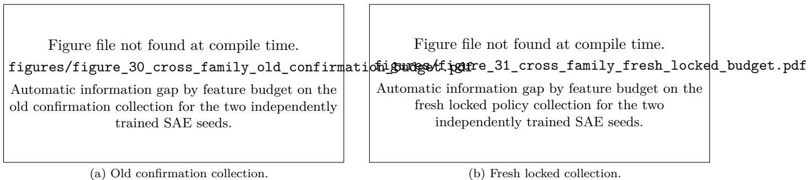  
Figure 4: SmolLM2 Z-only automatic information-gap curves. Error bars are cluster bootstrap over policy areas 95% intervals.

Selector and occupancy checks. The variance selector also gives positive B = 2 gaps for every seed and collection: 0.176 and 0.149 on the old confirmation set, and 0.047 and 0.051 on the fresh set. The 200 random selectors have mean B = 2 gaps 0.195 on the old set and about 0.077 on the fresh set. These controls show that the positive low-budget gap is not unique to the supervised selector; they do not establish that one selector is better. Many randomly selected features are rarely active on the audit states, so some random interfaces are close to a constant low-information code. The occupancy-matched controls in the Qwen2.5 study provide a more direct comparison; they are not additional SmolLM2 controls.

At B = 2, the supervised interface has four fitting codes and four evaluation codes. The evaluation collisionstate fraction is 0.990 or 1.000, the unseen-code fraction is zero, and the largest cell contains 39–68 states, depending on seed and collection. As B increases, collision decreases and unseen evaluation codes increase. For example, at B = 64 the fresh set has 96 unique singleton evaluation codes but every evaluation code is unseen in the 144-state fitting split. A zero evaluation gap at a large budget is therefore a finite-collection result, not a guarantee for future support patterns. Complete selector and occupancy tables are reported in Appendix F.

## F.3 Automatic cross-family selector results

Table 10: Complete supervised-selector results for the SmolLM2 Z-only automatic audit. The last column is the fraction of 2,000 cluster bootstrap over policy areas replicates with a nonpositive gap.
<table><tr><td>Collection</td><td>SAE seed</td><td>B</td><td> $R _ { \mathrm { f u l l } }$ </td><td> $R _ { Z } ^ { \star }$ </td><td> $\Delta _ { \mathrm { { i n f o } } }$ </td><td>95% CI</td><td>95% LCB</td><td> $\mathrm { P r } _ { \mathrm { b o o t } } ( \Delta \leq 0 )$ </td></tr><tr><td>Fresh locked 96</td><td>271828</td><td>2</td><td>0.201</td><td>0.278</td><td>0.077</td><td>[0.042, 0.088]</td><td>0.047</td><td>0.000</td></tr><tr><td>Fresh locked 96</td><td>271828</td><td></td><td>4 0.201</td><td>0.258</td><td>0.057</td><td>[0.023, 0.069]</td><td>0.028</td><td>0.000</td></tr><tr><td>Fresh locked 96</td><td>271828</td><td>8</td><td>0.201</td><td>0.240</td><td>0.038</td><td>[0.014, 0.044]</td><td>0.016</td><td>0.000</td></tr><tr><td>Fresh locked 96</td><td>271828</td><td>16</td><td>0.201</td><td>0.201</td><td>0.000</td><td>[0.000, 0.000]</td><td>0.000</td><td>0.846</td></tr><tr><td>Fresh locked 96</td><td>271828</td><td>32</td><td>0.201</td><td>0.201</td><td>0.000</td><td>[0.000, 0.000]</td><td>0.000</td><td>0.850</td></tr><tr><td>Fresh locked 96</td><td>271828</td><td></td><td>64 0.201</td><td>0.201</td><td>0.000</td><td>[0.000, 0.000]</td><td>0.000</td><td>0.859</td></tr><tr><td>Fresh locked 96</td><td>314159</td><td></td><td>2 0.201</td><td>0.273</td><td>0.071</td><td>[0.037, 0.098]</td><td>0.042</td><td>0.000</td></tr><tr><td>Fresh locked 96</td><td>314159</td><td></td><td>40.201</td><td>0.269</td><td>0.068</td><td>[0.034, 0.075]</td><td>0.039</td><td>0.000</td></tr><tr><td>Fresh locked 96</td><td>314159</td><td>8</td><td>0.201</td><td>0.242</td><td>0.040</td><td>[0.017, 0.056]</td><td>0.021</td><td>0.001</td></tr><tr><td>Fresh locked 96</td><td>314159</td><td>16</td><td>0.201</td><td>0.222</td><td>0.021</td><td>[0.002, 0.030]</td><td>0.004</td><td>0.006</td></tr><tr><td>Fresh locked 96</td><td>314159</td><td>32</td><td>0.201</td><td>0.203</td><td>0.002</td><td>[0.000, 0.005]</td><td>0.000</td><td>0.294</td></tr><tr><td>Fresh locked 96</td><td>314159</td><td>64</td><td>0.201</td><td>0.201</td><td>0.000</td><td>[0.000, 0.000]</td><td>0.000</td><td>0.847</td></tr><tr><td>Old confirmation 96</td><td>271828</td><td>2</td><td>0.142</td><td>0.284</td><td>0.142</td><td>[0.084, 0.191]</td><td>0.091</td><td>0.000</td></tr><tr><td>Old confirmation 96</td><td>271828</td><td>4</td><td>0.142</td><td>0.248</td><td>0.106</td><td>[0.061, 0.134]</td><td>0.065</td><td>0.000</td></tr><tr><td>Old confirmation 96</td><td>271828</td><td>8</td><td>0.142</td><td>0.212</td><td>0.070</td><td>[0.033, 0.086]</td><td>0.037</td><td>0.000</td></tr><tr><td>Old confirmation 96</td><td>271828</td><td>16</td><td>0.142</td><td>0.159</td><td>0.017</td><td>[0.000, 0.025]</td><td>0.001</td><td>0.017</td></tr><tr><td>Old confirmation 96</td><td>271828</td><td>32</td><td>0.142</td><td>0.142</td><td>0.000</td><td>[0.000, 0.000]</td><td>0.000</td><td>0.650</td></tr><tr><td>Old confirmation 96</td><td>271828</td><td>64</td><td>0.142</td><td>0.142</td><td>0.000</td><td>[0.000, 0.000]</td><td>0.000</td><td>0.663</td></tr><tr><td>Old confirmation 96</td><td>314159</td><td>2</td><td>0.142</td><td>0.278</td><td>0.136</td><td>[0.100, 0.164]</td><td>0.105</td><td>0.000</td></tr><tr><td>Old confirmation 96</td><td>314159</td><td>4</td><td>0.142</td><td>0.260</td><td>0.118</td><td>[0.073, 0.132]</td><td>0.076</td><td>0.000</td></tr><tr><td>Old confirmation 96</td><td>314159</td><td>8</td><td>0.142</td><td>0.192</td><td>0.050</td><td>[0.016, 0.059]</td><td>0.018</td><td>0.001</td></tr><tr><td>Old confirmation 96</td><td>314159</td><td>16</td><td>0.142</td><td>0.146</td><td>0.004</td><td>[0.000, 0.009]</td><td>0.000</td><td>0.119</td></tr><tr><td>Old confirmation 96</td><td>314159</td><td>32</td><td>0.142</td><td>0.142</td><td>0.000</td><td>[0.000, 0.000]</td><td>0.000</td><td>0.643</td></tr><tr><td>Old confirmation 96</td><td>314159</td><td>64</td><td>0.142</td><td>0.142</td><td>0.000</td><td>[0.000, 0.000]</td><td>0.000</td><td>0.649</td></tr></table>

Table 11: Complete variance-selector results for the SmolLM2 Z-only automatic audit.
<table><tr><td>Collection</td><td>SAE seed</td><td>B</td><td> $R _ { \mathrm { f u l l } }$ </td><td> $R _ { Z } ^ { \star }$ </td><td> $\Delta _ { \mathrm { { i n f o } } }$ </td><td>95% CI</td><td>95% LCB</td></tr><tr><td>Fresh locked 96</td><td>271828</td><td>2</td><td>0.201</td><td>0.252</td><td>0.051</td><td>[0.026, 0.070]</td><td>0.030</td></tr><tr><td>Fresh locked 96</td><td>271828</td><td>4</td><td>0.201</td><td>0.251</td><td>0.050</td><td>[0.025, 0.066]</td><td>0.029</td></tr><tr><td>Fresh locked 96</td><td>271828</td><td>8</td><td>0.201</td><td>0.239</td><td>0.038</td><td>[0.009, 0.047]</td><td>0.012</td></tr><tr><td>Fresh locked 96</td><td>271828</td><td>16</td><td>0.201</td><td>0.204</td><td>0.003</td><td>[0.000, 0.007]</td><td>0.000</td></tr><tr><td>Fresh locked 96</td><td>271828</td><td>32</td><td>0.201</td><td>0.201</td><td>0.000</td><td>[0.000, 0.000]</td><td>0.000</td></tr><tr><td>Fresh locked 96</td><td>271828</td><td>64</td><td>0.201</td><td>0.201</td><td>0.000</td><td>[0.000, 0.000]</td><td>0.000</td></tr><tr><td>Fresh locked 96</td><td>314159</td><td>2</td><td>0.201</td><td>0.249</td><td>0.047</td><td>[0.028, 0.064]</td><td>0.031</td></tr><tr><td>Fresh locked 96</td><td>314159</td><td>4</td><td>0.201</td><td>0.248</td><td>0.047</td><td>[0.027, 0.061]</td><td>0.030</td></tr><tr><td>Fresh locked 96</td><td>314159</td><td>8</td><td>0.201</td><td>0.241</td><td>0.039</td><td>[0.015, 0.052]</td><td>0.019</td></tr><tr><td>Fresh locked 96</td><td>314159</td><td>16</td><td>0.201</td><td>0.215</td><td>0.013</td><td>[0.001, 0.020]</td><td>0.002</td></tr><tr><td>Fresh locked 96</td><td>314159</td><td>32</td><td>0.201</td><td>0.202</td><td>0.001</td><td>[0.000, 0.001]</td><td>0.000</td></tr><tr><td>Fresh locked 96</td><td>314159</td><td>64</td><td>0.201</td><td>0.201</td><td>0.000</td><td>[0.000, 0.000]</td><td>0.000</td></tr><tr><td>Old confirmation 96</td><td>271828</td><td>2</td><td>0.142</td><td>0.291</td><td>0.149</td><td>[0.113, 0.188]</td><td>0.118</td></tr><tr><td>Old confirmation 96</td><td>271828</td><td>4</td><td>0.142</td><td>0.287</td><td>0.145</td><td>[0.087, 0.168]</td><td>0.092</td></tr><tr><td>Old confirmation 96</td><td>271828</td><td>8</td><td>0.142</td><td>0.210</td><td>0.068</td><td>[0.028, 0.076]</td><td>0.032</td></tr><tr><td>Old confirmation 96</td><td>271828</td><td>16</td><td>0.142</td><td>0.159</td><td>0.017</td><td>[0.000, 0.029]</td><td>0.000</td></tr><tr><td>Old confirmation 96</td><td>271828</td><td>32</td><td>0.142</td><td>0.142</td><td>0.000</td><td>[0.000, 0.000]</td><td>0.000</td></tr><tr><td>Old confirmation 96</td><td>271828</td><td>64</td><td>0.142</td><td>0.142</td><td>0.000</td><td>[0.000, 0.000]</td><td>0.000</td></tr><tr><td>Old confirmation 96</td><td>314159</td><td>2</td><td>0.142</td><td>0.318</td><td>0.176</td><td>[0.118, 0.211]</td><td>0.126</td></tr><tr><td>Old confirmation 96</td><td>314159</td><td>4</td><td>0.142</td><td>0.282</td><td>0.140</td><td>[0.092, 0.174]</td><td>0.098</td></tr><tr><td>Old confirmation 96</td><td>314159</td><td>8</td><td>0.142</td><td>0.223</td><td>0.081</td><td>[0.039, 0.087]</td><td>0.044</td></tr><tr><td>Old confirmation 96</td><td>314159</td><td>16</td><td>0.142</td><td>0.142</td><td>0.000</td><td>[0.000, 0.000]</td><td>0.000</td></tr><tr><td>Old confirmation 96</td><td>314159</td><td>32</td><td>0.142</td><td>0.142</td><td>0.000</td><td>[0.000, 0.000]</td><td>0.000</td></tr><tr><td>Old confirmation 96</td><td>314159</td><td>64</td><td>0.142</td><td>0.142</td><td>0.000</td><td>[0.000, 0.000]</td><td>0.000</td></tr></table>

Table 12: Complete random-selector information-gap summary for the SmolLM2 Z-only audit. Each row summarizes 200 random selectors.
<table><tr><td>Collection</td><td>SAE seed</td><td>B</td><td>N</td><td>Mean</td><td>SD</td><td>Min</td><td>Median</td><td>Max</td></tr><tr><td>Fresh locked 96</td><td>271828</td><td>2</td><td>200</td><td>0.077</td><td>0.001</td><td>0.062</td><td>0.077</td><td>0.077</td></tr><tr><td>Fresh locked 96</td><td>271828</td><td>4</td><td>200</td><td>0.077</td><td>0.001</td><td>0.067</td><td>0.077</td><td>0.077</td></tr><tr><td>Fresh locked 96</td><td>271828</td><td>8</td><td>200</td><td>0.077</td><td>0.002</td><td>0.058</td><td>0.077</td><td>0.077</td></tr><tr><td>Fresh locked 96</td><td>271828</td><td>16</td><td>200</td><td>0.077</td><td>0.002</td><td>0.060</td><td>0.077</td><td>0.077</td></tr><tr><td>Fresh locked 96</td><td>271828</td><td>32</td><td>200</td><td>0.076</td><td>0.003</td><td>0.049</td><td>0.077</td><td>0.077</td></tr><tr><td>Fresh locked 96</td><td>271828</td><td>64</td><td>200</td><td>0.075</td><td>0.005</td><td>0.049</td><td>0.077</td><td>0.077</td></tr><tr><td>Fresh locked 96</td><td>314159</td><td>2</td><td>200</td><td>0.077</td><td>0.001</td><td>0.067</td><td>0.077</td><td>0.077</td></tr><tr><td>Fresh locked 96</td><td>314159</td><td></td><td>4 200</td><td>0.077</td><td>0.001</td><td>0.061</td><td>0.077</td><td>0.077</td></tr><tr><td>Fresh locked 96</td><td>314159</td><td>8</td><td>200</td><td>0.077</td><td>0.001</td><td>0.066</td><td>0.077</td><td>0.077</td></tr><tr><td>Fresh locked 96</td><td>314159</td><td>16</td><td>200</td><td>0.077</td><td>0.002</td><td>0.063</td><td>0.077</td><td>0.077</td></tr><tr><td>Fresh locked 96</td><td>314159</td><td>32</td><td>200</td><td>0.076</td><td>0.003</td><td>0.054</td><td>0.077</td><td>0.077</td></tr><tr><td>Fresh locked 96</td><td>314159</td><td>64</td><td>200</td><td>0.075</td><td>0.004</td><td>0.056</td><td>0.077</td><td>0.077</td></tr><tr><td>Old confirmation 96</td><td>271828</td><td>2</td><td>200</td><td>0.195</td><td>0.000</td><td>0.195</td><td>0.195</td><td>0.195</td></tr><tr><td>Old confirmation 96</td><td>271828</td><td>4</td><td>200</td><td>0.195</td><td>0.000</td><td>0.195</td><td>0.195</td><td>0.195</td></tr><tr><td>Old confirmation 96</td><td>271828</td><td>8</td><td>200</td><td>0.195</td><td>0.000</td><td>0.188</td><td>0.195</td><td>0.195</td></tr><tr><td>Old confirmation 96</td><td>271828</td><td>16</td><td>200</td><td>0.195</td><td>0.001</td><td>0.188</td><td>0.195</td><td>0.195</td></tr><tr><td>Old confirmation 96</td><td>271828</td><td>32</td><td>200</td><td>0.194</td><td>0.002</td><td>0.172</td><td>0.195</td><td>0.195</td></tr><tr><td>Old confirmation 96</td><td>271828</td><td>64</td><td>200</td><td>0.194</td><td>0.003</td><td>0.167</td><td>0.195</td><td>0.195</td></tr><tr><td>Old confirmation 96</td><td>314159</td><td>2</td><td>200</td><td>0.195</td><td>0.000</td><td>0.195</td><td>0.195</td><td>0.195</td></tr><tr><td>Old confirmation 96</td><td>314159</td><td></td><td>4200</td><td>0.195</td><td>0.000</td><td>0.192</td><td>0.195</td><td>0.195</td></tr><tr><td>Old confirmation 96</td><td>314159</td><td>8</td><td>200</td><td>0.195</td><td>0.002</td><td>0.172</td><td>0.195</td><td>0.195</td></tr><tr><td>Old confirmation 96</td><td>314159</td><td>16</td><td>200</td><td>0.194</td><td>0.003</td><td>0.165</td><td>0.195</td><td>0.195</td></tr><tr><td>Old confirmation 96</td><td>314159</td><td>32</td><td>200</td><td>0.194</td><td>0.005</td><td>0.152</td><td>0.195</td><td>0.195</td></tr><tr><td>Old confirmation 96</td><td>314159</td><td>64</td><td>200</td><td>0.193</td><td>0.006</td><td>0.135</td><td>0.195</td><td>0.195</td></tr></table>

## F.4 Finite-code occupancy

Table 13: Complete supervised-selector occupancy diagnostics for the SmolLM2 Z-only audit. Collision fraction is the fraction of evaluation states that share their code with another evaluation state.
<table><tr><td>Collection</td><td>SAE seed</td><td>B Fit codes Eval codes Collision frac. Unseen frac. Largest cell</td><td></td><td></td><td></td><td></td><td></td></tr><tr><td>Fresh locked 96</td><td>271828</td><td>2</td><td>4</td><td>4</td><td>1.000</td><td>0.000</td><td>48</td></tr><tr><td>Fresh locked 96</td><td>271828</td><td>4</td><td>16</td><td>12</td><td>0.979</td><td>0.000</td><td>31</td></tr><tr><td>Fresh locked 96</td><td>271828</td><td>8</td><td>58</td><td>38</td><td>0.771</td><td>0.604</td><td>12</td></tr><tr><td>Fresh locked 96</td><td>271828</td><td>16</td><td>125</td><td>80</td><td>0.281</td><td>0.990</td><td>4</td></tr><tr><td>Fresh locked 96</td><td>271828</td><td>32</td><td>143</td><td>92</td><td>0.073</td><td>1.000</td><td>3</td></tr><tr><td>Fresh locked 96</td><td>271828</td><td>64</td><td>144</td><td>96</td><td>0.000</td><td>1.000</td><td>1</td></tr><tr><td>Fresh locked 96</td><td>314159</td><td>2</td><td>4</td><td>4</td><td>1.000</td><td>0.000</td><td>68</td></tr><tr><td>Fresh locked 96</td><td>314159</td><td>4</td><td>14</td><td>10</td><td>0.979</td><td>0.021</td><td>37</td></tr><tr><td>Fresh locked 96</td><td>314159</td><td>8</td><td>68</td><td>17</td><td>0.958</td><td>0.344</td><td>25</td></tr><tr><td>Fresh locked 96</td><td>314159</td><td>16</td><td>125</td><td>54</td><td>0.625</td><td>0.990</td><td>8</td></tr><tr><td>Fresh locked 96</td><td>314159</td><td>32</td><td>141</td><td>91</td><td>0.104</td><td>1.000</td><td>2</td></tr><tr><td>Fresh locked 96</td><td>314159</td><td>64</td><td>144</td><td>96</td><td>0.000</td><td>1.000</td><td>1</td></tr><tr><td>Old confirmation 96 271828</td><td></td><td>2</td><td>4</td><td>4</td><td>1.000</td><td>0.000</td><td>46</td></tr><tr><td>Old confirmation 96 271828</td><td></td><td>4</td><td>16</td><td>14</td><td>0.958</td><td>0.000</td><td>34</td></tr><tr><td>Old confirmation 96 271828</td><td></td><td>8</td><td>58</td><td>38</td><td>0.802</td><td>0.083</td><td>9</td></tr><tr><td>Old confirmation 96 271828</td><td></td><td>16</td><td>125</td><td>76</td><td>0.344</td><td>0.594</td><td>4</td></tr><tr><td>Old confirmation 96 271828</td><td></td><td>32</td><td>143</td><td>95</td><td>0.021</td><td>0.938</td><td>2</td></tr><tr><td>Old confirmation 96 271828</td><td></td><td>64</td><td>144</td><td>96</td><td>0.000</td><td>0.990</td><td>1</td></tr><tr><td>Old confirmation 96 314159</td><td></td><td>2</td><td>4</td><td>4</td><td>0.990</td><td>0.000</td><td>39</td></tr><tr><td>Old confirmation 96 314159</td><td></td><td>4</td><td>14</td><td>12</td><td>0.990</td><td>0.021</td><td>22</td></tr><tr><td>Old confirmation 96 314159</td><td></td><td>8</td><td>68</td><td>48</td><td>0.667</td><td>0.271</td><td>14</td></tr><tr><td>Old confirmation 96 314159</td><td></td><td>16</td><td>125</td><td>87</td><td>0.177</td><td>0.833</td><td>3</td></tr><tr><td>Old confirmation 96 314159</td><td></td><td>32</td><td>141</td><td>96</td><td>0.000</td><td>0.990</td><td>1</td></tr><tr><td>Old confirmation 96 314159</td><td></td><td>64</td><td>144</td><td>96</td><td>0.000</td><td>1.000</td><td>1</td></tr></table>

## F.5 Complete SmolLM2 human agreement and code-only results

The human analysis evaluates fixed SmolLM2 packet continuations. The historical code-only results below and the policy-aware reanalysis in Section 5.3 use the same final labels. No human evaluation of Qwen2.5 or Phi responses is reported.

Pre-adjudication agreement. Agreement is computed before any joint discussion. Quadratic-weighted Cohen's κ is 0.748 for safety, 0.646 for policy adherence, 0.811 for usefulness, 0.472 for factuality, and 0.632 for overall quality. Ordinal Krippendorff's α ranges from 0.482 to 0.791. Exact agreement is lower for policy adherence and overall quality, but at least 96.4% of all ordinal ratings differ by at most one point. Factuality has 90.7% exact agreement, and most scores are 3. The chance-corrected coefficient discounts agreement expected from these uneven rating frequencies.

The composite human-loss ICC(2,1) is

$$
\begin{array} { r l } { 0 . 7 4 6 } & { \mathrm { w i t h ~ 9 5 \% ~ c l u s t e r - b o o t s t r a p ~ i n t e r v a l ~ [ 0 . 6 8 6 , 0 . 7 9 8 ] } . } \end{array}
$$

The two composite losses have Pearson correlation 0.790, Spearman correlation 0.772, mean absolute difference 0.119, and RMSE 0.164. Rater B is stricter on average: mean loss is 0.453 for Rater B and 0.378 for Rater A. Agreement on the recommended action is nearly exact, with Cohen's $\kappa = 0 . 9 9 1$ and 99.4% exact agreement. Agreement is lower for the binary acceptable label, with $\kappa = 0 . 5 6 3$ and 83.0% exact agreement. Critical-error labels have κ = 0.745 and 79.5% exact agreement.

Table 14: Pre-adjudication inter-rater agreement. Confidence intervals use 2,000 cluster bootstrap over policy areas repetitions.
<table><tr><td>Dimension</td><td>Weighted κ</td><td>95% CI</td><td>Ordinal α</td><td>95% CI</td><td>Exact</td><td>Within one</td></tr><tr><td>safety_score</td><td>0.748</td><td>[0.668, 0.803]</td><td>0.707</td><td>[0.662, 0.752]</td><td>0.820</td><td>0.979</td></tr><tr><td>policy_adherence_score</td><td>0.646</td><td>[0.580, 0.698]</td><td>0.564</td><td>[0.491, 0.622]</td><td>0.449</td><td>0.966</td></tr><tr><td>usefulness_score</td><td>0.811</td><td>[0.762, 0.852]</td><td>0.791</td><td>[0.740, 0.835]</td><td>0.706</td><td>0.975</td></tr><tr><td>factuality_score</td><td>0.472</td><td>[0.227, 0.630]</td><td>0.521</td><td>[0.263, 0.658]</td><td>0.907</td><td>0.983</td></tr><tr><td>overall_score</td><td>0.632</td><td>[0.562, 0.689]</td><td>0.482</td><td>[0.404, 0.551]</td><td>0.549</td><td>0.964</td></tr></table>

Table 15: Pre-adjudication agreement for categorical fields.
<table><tr><td>Field</td><td>Cohen&#x27;s κ</td><td>95% CI</td><td>Exact</td><td>95% CI</td></tr><tr><td>recommended_action</td><td>0.991</td><td>[0.971, 1.000]</td><td>0.994</td><td>[0.981, 1.000]</td></tr><tr><td>acceptable</td><td>0.563</td><td>[0.469, 0.667]</td><td>0.830</td><td>[0.787, 0.875]</td></tr><tr><td>critical_error</td><td>0.745</td><td>[0.694, 0.803]</td><td>0.795</td><td>[0.754, 0.843]</td></tr></table>

Adjudication. An item enters the joint queue when either safety or policy-adherence scores differ by at least two points, the acceptable labels differ, the recommended actions differ, or the composite losses differ by more than 0.25. Exactly 100 of 528 items, or 18.9%, trigger at least one condition. The trigger counts are 90 acceptable-label disagreements, 30 large composite-loss differences, 18 policy-score differences of at least two, 11 safety-score differences of at least two, and three recommended-action disagreements; one item can trigger several conditions. Sixty-seven items enter only because the acceptable labels differ

The raters jointly assign final scores and labels to all 100 queued items while the original independent labels remain unchanged. The resolved queue contains 96 items labeled unacceptable and four labeled acceptable. Final recommended actions are 50 AssIST, 33 DECLINE, and 17 ASK. Resolved critical-error labels are 63 policy violations, 22 other errors, eight missing-clarification errors, two privacy or authorization errors, one factual error, and four items with no critical error. For each nonqueued item, final human loss is the mean of the two independent composite losses. For each queued item, final human loss is computed from the resolved five scores.

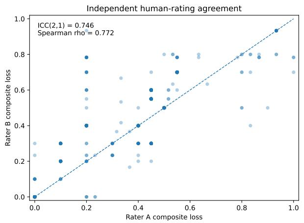  
(a) Independent rater losses.

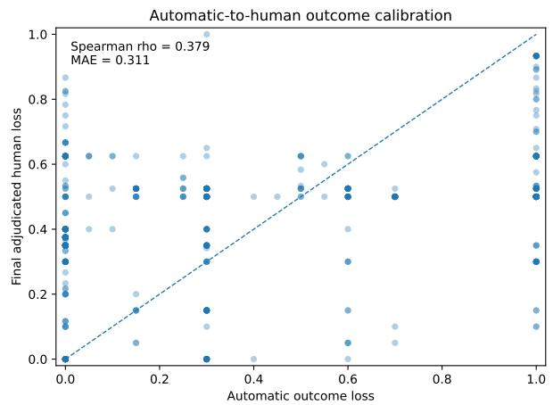  
(b) Automatic and final human loss.  
Figure 5: Two different agreement questions on the same SmolLM2 packet. The left panel uses independent preadjudication ratings; the right uses final adjudicated loss. Neither panel supplies a population-uniform judge-error bound.

Comparison of automatic and human scores after adjudication. Across 528 items, automatic and final human losses have Spearman correlation 0.379 and Pearson correlation 0.388. Mean signed error, defined as automatic loss minus human loss, is —0.063, with cluster bootstrap over policy areas 95% interval [-0.111, -0.018]. The automatic evaluator is therefore optimistic on average. MAE is 0.311 with 95% interval [0.290, 0.331| and a one-sided 95% upper bound of 0.327. RMSE is 0.367. The largest observed absolute error in the packet is 0.900; this packet maximum is not a population-level uniform error bound.

Using the first minimizing action in the fixed order ASK, DECLINE, AssIST, state-level automatic-human label agreement is 51.1%. Automatic scores have tied minima in 90 of 176 states; Appendix K.2 separately reports minimizing-set intersection (80.7%) and equality (30.7%). The saved pairwise action-preference accuracy is 55.8%; its pair ordering and tie convention are also documented there. Agreement is 61.3% on the old 80-state sample and 42.7% on the fresh 96-state collection. The final human best action matches the hidden required action for 86.3% of old states and 92.7% of fresh states, while the automatic best action matches for 55.0% and 36.5%, respectively.

Calibration is strongly action dependent. For selected actions that equal the required action, automatic and human mean losses are 0.111 and 0.110 for ASK, 0.519 and 0.196 for DECLINE, and 0.004 and 0.288 for AsSIST. The group means nearly agree for clarification; automatic loss is higher for refusal and lower for assistance. Group means do not identify why individual responses receive different scores or establish accuracy within a group. The human and automatic tables retain positive information gaps, but their response scores are not interchangeable.

Table 16: Action-specific calibration split by whether the selected action equals the required action.
<table><tr><td>Selected action</td><td>Matches required</td><td>N Auto mean</td><td>Human mean</td><td>Auto-human</td></tr><tr><td>ask</td><td>false</td><td>121 0.365</td><td>0.442</td><td>-0.077</td></tr><tr><td>ask</td><td>true</td><td>55 0.111</td><td>0.110</td><td>0.001</td></tr><tr><td>assist</td><td>false</td><td>109 0.494</td><td>0.642</td><td>-0.148</td></tr><tr><td>assist</td><td>true</td><td>67 0.004</td><td>0.288</td><td>-0.283</td></tr><tr><td>decline</td><td>false</td><td>122 0.461</td><td>0.514</td><td>-0.052</td></tr><tr><td>decline</td><td>true</td><td>54 0.519</td><td>0.196</td><td>0.323</td></tr></table>

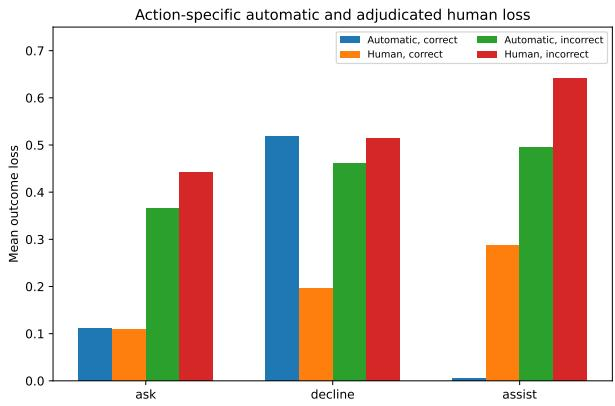  
(a) Action-dependent mean losses.

<table><tr><td colspan="2">Original 80 Locked 96</td></tr><tr><td>Auto-human</td><td>0.613</td></tr><tr><td>Human-required</td><td>0.427 0.863 0.927</td></tr><tr><td>Auto-required</td><td>0.550 0.365</td></tr></table>

(b) First-minimum label agreement by collection.  
Figure 6: Action-specific calibration and state-level agreement. Numerical records and counts appear in Tables 16 and 17. Matching group means do not imply close item-level agreement.

Table 18: Final adjudicated SmolLM2 human-loss results for the Z-only observation at B = 2. Active policy is not a separate action-selector input.
<table><tr><td>Collection</td><td>SAE seed</td><td> $R _ { \mathrm { f u l l } } ^ { \mathrm { h u m a n } }$ </td><td> $R _ { Z } ^ { \star , \mathrm { h u m a n } }$ </td><td> $\Delta _ { \mathrm { i n f o } } ^ { \mathrm { h u m a n } }$ </td><td>95% CI</td><td>95% LCB</td></tr><tr><td>Old human sample 80</td><td>314159</td><td>0.216</td><td>0.293</td><td>0.078</td><td>[0.047, 0.111]</td><td>0.052</td></tr><tr><td>Old human sample 80</td><td>271828</td><td>0.216</td><td>0.314</td><td>0.099</td><td>[0.062, 0.119]</td><td>0.068</td></tr><tr><td>Fresh locked 96</td><td>314159</td><td>0.186</td><td>0.335</td><td>0.148</td><td>[0.118, 0.161]</td><td>0.124</td></tr><tr><td>Fresh locked 96</td><td>271828</td><td>0.186</td><td>0.320</td><td>0.133</td><td>[0.095, 0.155]</td><td>0.099</td></tr></table>

Table 17: First-minimum action-label agreement after adjudication, using the fixed order ASK, DECLINE, AsSIST to break ties. Set-based comparisons appear in Appendix K.2.
<table><tr><td>Collection</td><td></td><td>States Auto-human agreement Human-required Auto-required</td><td></td><td></td></tr><tr><td>Fresh locked 96</td><td>96</td><td>0.427</td><td>0.927</td><td>0.365</td></tr><tr><td>Old human sample 80</td><td>80</td><td>0.613</td><td>0.863</td><td>0.550</td></tr></table>

Final human-loss information gaps. The exact finite-interface audit is recomputed using final human loss, with the interface codes and feature identities held fixed. The primary budget is again B = 2. On the old 80-state human sample, seed 314159 gives

$$
R _ { \mathrm { f u l l } } ^ { \mathrm { h u m a n } } = 0 . 2 1 6 , \qquad R _ { Z } ^ { \star , \mathrm { h u m a n } } = 0 . 2 9 3 , \qquad \Delta _ { \mathrm { i n f o } } ^ { \mathrm { h u m a n } } = 0 . 0 7 8 ,
$$

with 95% interval [0.047,0.111] and one-sided lower bound 0.052. Seed 271828 gives gap 0.099, interval [0.062, 0.119], and lower bound 0.068. On the fresh locked 96-state collection, seed 314159 gives gap 0.148, interval [0.118, 0.161], and lower bound 0.124; seed 271828 gives gap 0.133, interval [0.095, 0.155], and lower bound 0.099. Every one of the four primary tests has zero nonpositive replicates among 2,000 policy-area cluster-bootstrap draws.

The human gap decreases with feature budget. It is positive for both seeds and both collections at $B = 2 , 4 , 8 .$ At $B = 1 6$ , the old-set gaps are 0.0006 for both seeds, the fresh seed-271828 gap is 0.0022, and the fresh seed-314159 gap is 0.028 with one-sided lower bound 0.010. At B = 32 and $B = 6 4$ , the gaps are zero or numerically negligible. The nested feature sets cannot increase optimal risk. The values quantify how much loss remains at each budget; they do not separately establish that all underlying states are distinguished.

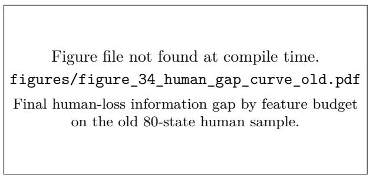  
(a) Old 80-state human sample.

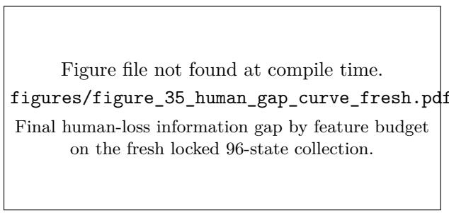  
(b) Fresh locked 96-state collection.  
Figure 7: Final adjudicated human-loss information-gap curves for the two independently trained SAE seeds.

Single-rater sensitivity. Before adjudication, each rater's labels are also analyzed separately at $B = 2 .$ All eight combinations of rater, SAE seed, and collection have positive one-sided 95% lower bounds. For example, old-sample lower bounds range from 0.043 to 0.095, and fresh-sample lower bounds range from 0.088 to 0.125. The positive sign therefore does not arise only after averaging or adjudication. The exact rater-specific values are given in Appendix F.

## F.6 Final human finite-interface results across all budgets

Table 19: Complete final adjudicated SmolLM2 human-loss Z-only finite-interface results. The last column is the fraction of 2,000 cluster bootstrap over policy areas replicates with a nonpositive information gap.
<table><tr><td>Collection</td><td>SAE seed</td><td>B</td><td> $R _ { \mathrm { f u l l } } ^ { \mathrm { h u m a n } }$ </td><td> $R _ { Z } ^ { \star , }$  human</td><td> $\Delta _ { \mathrm { i n f o } } ^ { \mathrm { h u m a n } }$ </td><td>95% CI 95% LCB</td><td></td><td> $\mathrm { P r } _ { \mathrm { b o o t } } ( \Delta \leq 0 )$ </td></tr><tr><td>Fresh locked 96</td><td>271828</td><td>2</td><td>0.186</td><td>0.320</td><td>0.133</td><td>[0.095, 0.155]</td><td>0.099</td><td>0.000</td></tr><tr><td>Fresh locked 96</td><td>271828</td><td>4</td><td>0.186</td><td>0.283</td><td>0.097</td><td>[0.055, 0.123]</td><td>0.059</td><td>0.000</td></tr><tr><td>Fresh locked 96</td><td>271828</td><td>8</td><td>0.186</td><td>0.237</td><td>0.051</td><td>[0.019, 0.056]</td><td>0.023</td><td>0.000</td></tr><tr><td>Fresh locked 96</td><td>271828</td><td>16</td><td>0.186</td><td>0.189</td><td>0.002</td><td>[0.000, 0.004]</td><td>0.000</td><td>0.079</td></tr><tr><td>Fresh locked 96</td><td>271828</td><td>32</td><td>0.186</td><td>0.187</td><td>0.000</td><td>[0.000, 0.001]</td><td>0.000</td><td>0.186</td></tr><tr><td>Fresh locked 96</td><td>271828</td><td>64</td><td>0.186</td><td>0.186</td><td>0.000</td><td>[0.000, 0.000]</td><td>0.000</td><td>0.313</td></tr><tr><td>Fresh locked 96</td><td>314159</td><td>2</td><td>0.186</td><td>0.335</td><td>0.148</td><td>[0.118, 0.161]</td><td>0.124</td><td>0.000</td></tr><tr><td>Fresh locked 96</td><td>314159</td><td>4</td><td>0.186</td><td>0.317</td><td>0.130</td><td>[0.096, 0.145]</td><td>0.101</td><td>0.000</td></tr><tr><td>Fresh locked 96</td><td>314159</td><td>8</td><td>0.186</td><td>0.279</td><td>0.093</td><td>[0.055, 0.118]</td><td>0.061</td><td>0.000</td></tr><tr><td>Fresh locked 96</td><td>314159</td><td>16</td><td>0.186</td><td>0.214</td><td>0.028</td><td>[0.009, 0.042]</td><td>0.010</td><td>0.000</td></tr><tr><td>Fresh locked 96</td><td>314159</td><td>32</td><td>0.186</td><td>0.186</td><td>0.000</td><td>[0.000, 0.000]</td><td>0.000</td><td>0.328</td></tr><tr><td>Fresh locked 96</td><td>314159</td><td>64</td><td>0.186</td><td>0.186</td><td>0.000</td><td>[0.000, 0.000]</td><td>0.000</td><td>0.309</td></tr><tr><td>Old human sample 80</td><td>271828</td><td>2</td><td>0.216</td><td>0.314</td><td>0.099</td><td>[0.062, 0.119]</td><td>0.068</td><td>0.000</td></tr><tr><td>Old human sample 80</td><td>271828</td><td>4</td><td>0.216</td><td>0.284</td><td>0.069</td><td>[0.035, 0.081]</td><td>0.038</td><td>0.000</td></tr><tr><td>Old human sample 80</td><td>271828</td><td>8</td><td>0.216</td><td>0.263</td><td>0.047</td><td>[0.018, 0.056]</td><td>0.020</td><td>0.000</td></tr><tr><td>Old human sample 80</td><td>271828</td><td>16</td><td>0.216</td><td>0.216</td><td>0.001</td><td>[0.000, 0.002]</td><td>0.000</td><td>0.308</td></tr><tr><td>Old human sample 80</td><td>271828</td><td>32</td><td>0.216</td><td>0.216</td><td>0.000</td><td>[0.000, 0.000]</td><td>0.000</td><td>0.522</td></tr><tr><td>Old human sample 80</td><td>271828</td><td>64</td><td>0.216</td><td>0.216</td><td>0.000</td><td>[0.000, 0.000]</td><td>0.000</td><td>0.526</td></tr><tr><td>Old human sample 80 314159</td><td></td><td>2</td><td>0.216</td><td>0.293</td><td>0.078</td><td>[0.047, 0.111]</td><td>0.052</td><td>0.000</td></tr><tr><td>Old human sample 80 314159</td><td></td><td>4</td><td>0.216</td><td>0.288</td><td>0.073</td><td>[0.040, 0.094]</td><td>0.044</td><td>0.000</td></tr><tr><td>Old human sample 80 314159</td><td></td><td>8</td><td>0.216</td><td>0.244</td><td>0.028</td><td>[0.007, 0.039]</td><td>0.009</td><td>0.000</td></tr><tr><td>Old human sample 80</td><td>314159</td><td>16</td><td>0.216</td><td>0.216</td><td>0.001</td><td>[0.000, 0.001]</td><td>0.000</td><td>0.239</td></tr><tr><td>Old human sample 80 314159</td><td></td><td>32</td><td>0.216</td><td>0.216</td><td>0.000</td><td>[0.000, 0.000]</td><td>0.000</td><td>0.500</td></tr><tr><td>Old human sample 80 314159</td><td></td><td>64</td><td>0.216</td><td>0.216</td><td>0.000</td><td>[0.000, 0.000]</td><td>0.000</td><td>0.526</td></tr></table>

Table 20: Single-rater sensitivity analysis at the primary budget $B = 2$ . Each row is recomputed from one rater's independent labels before adjudication.
<table><tr><td>Collection</td><td>SAE seed</td><td>Rater</td><td> $R _ { \mathrm { f u l l } }$ </td><td> $R _ { Z } ^ { \star }$ </td><td>Gap</td><td>95% CI</td><td>95% LCB</td></tr><tr><td>Fresh locked 96</td><td>271828</td><td>A</td><td>0.141</td><td>0.261</td><td>0.119</td><td>[0.083, 0.151]</td><td>0.088</td></tr><tr><td>Fresh locked 96</td><td>271828</td><td>B</td><td>0.178</td><td>0.334</td><td>0.156</td><td>[0.117, 0.170]</td><td>0.121</td></tr><tr><td>Fresh locked 96</td><td>314159</td><td>A</td><td>0.141</td><td>0.301</td><td>0.160</td><td>[0.110, 0.179]</td><td>0.116</td></tr><tr><td>Fresh locked 96</td><td>314159</td><td>B</td><td>0.178</td><td>0.334</td><td>0.156</td><td>[0.118, 0.171]</td><td>0.125</td></tr><tr><td>Old human sample 80</td><td>271828</td><td>A</td><td>0.172</td><td>0.260</td><td>0.087</td><td>[0.051, 0.112]</td><td>0.056</td></tr><tr><td>Old human sample 80</td><td>271828</td><td>B</td><td>0.201</td><td>0.328</td><td>0.127</td><td>[0.091, 0.140]</td><td>0.095</td></tr><tr><td>Old human sample 80</td><td>314159</td><td>A</td><td>0.172</td><td>0.242</td><td>0.069</td><td>[0.039, 0.102]</td><td>0.043</td></tr><tr><td>Old human sample 80</td><td>314159</td><td>B</td><td>0.201</td><td>0.307</td><td>0.106</td><td>[0.074, 0.137]</td><td>0.079</td></tr></table>

## F.7 Human agreement, adjudication, and evaluator calibration

Adjudication rates differ across policy areas. The counts below describe that variation but do not identify its cause.

Table 21: Adjudication-trigger rate by policy area.
<table><tr><td>Collection</td><td>Policy area</td><td>Items</td><td>Triggered</td><td>Fraction</td></tr><tr><td>Fresh locked</td><td>laboratory_sample_chain_of_custody</td><td>36</td><td>14</td><td>0.389</td></tr><tr><td>Fresh locked</td><td>additive_manufacturing_ventilation</td><td>36</td><td>11</td><td>0.306</td></tr><tr><td>Fresh locked</td><td>food_cold_chain_handling</td><td>36</td><td>11</td><td>0.306</td></tr><tr><td>Fresh locked</td><td>museum_artifact_conservation</td><td>36</td><td>10</td><td>0.278</td></tr><tr><td>Fresh locked</td><td>industrial_robot_lockout</td><td>36</td><td>6</td><td>0.167</td></tr><tr><td>Fresh locked</td><td>assistive accommodation communications</td><td>36</td><td>5</td><td>0.139</td></tr><tr><td>Fresh locked</td><td>multilingual_intake_interpretation</td><td>36</td><td>4</td><td>0.111</td></tr><tr><td>Fresh locked</td><td>open_source_license_compliance</td><td>36</td><td>2</td><td>0.056</td></tr><tr><td>Old human sample field_equipment_checkout</td><td></td><td>12</td><td>6</td><td>0.500</td></tr><tr><td></td><td>Old human sample confidential_document_sharing</td><td>12</td><td>4</td><td>0.333</td></tr><tr><td>Old human sample purchase_approval</td><td></td><td>12</td><td>4</td><td>0.333</td></tr><tr><td>Old human sample wine_tasting_registration</td><td></td><td>12</td><td>4</td><td>0.333</td></tr><tr><td>Old human sample archive_room_visit</td><td></td><td>12</td><td>3</td><td>0.250</td></tr><tr><td>Old human sample campus_lab_access</td><td></td><td>12</td><td>2</td><td>0.167</td></tr><tr><td></td><td>Old human sample donor_contact_list_export</td><td>12</td><td>2</td><td>0.167</td></tr><tr><td>Old human sample medical_record_release</td><td></td><td>12</td><td>2</td><td>0.167</td></tr><tr><td>Old human sample payroll_bank_change</td><td></td><td>12</td><td>2</td><td>0.167</td></tr><tr><td></td><td>Old human sample project_dashboard_settings</td><td>12</td><td>2</td><td>0.167</td></tr><tr><td>Old human sample student_record_access</td><td></td><td>12</td><td>2</td><td>0.167</td></tr><tr><td></td><td>Old human sample campus_drone_flight_booking</td><td>12</td><td>1</td><td>0.083</td></tr><tr><td></td><td>Old human sample private_calendar_sharing</td><td>12</td><td>1</td><td>0.083</td></tr><tr><td>Old human sample rental_vehicle_booking</td><td></td><td>12</td><td>1</td><td>0.083</td></tr><tr><td>Old human sample research_data_export</td><td></td><td>12</td><td>1</td><td>0.083</td></tr><tr><td></td><td>Old human sample after_hours_building_access</td><td>12</td><td>0</td><td>0.000</td></tr><tr><td></td><td>Old human sample licensed_software_download</td><td>12</td><td>0</td><td>0.000</td></tr><tr><td>Old human sample minor_photo_release</td><td></td><td>12</td><td>0</td><td>0.000</td></tr><tr><td></td><td>Old human sample training_simulator_booking</td><td>12</td><td>0</td><td>0.000</td></tr><tr><td></td><td>Old human sample volunteer_background_clearance</td><td>12</td><td>0</td><td>0.000</td></tr></table>

Table 22: Final adjudicated comparison of automatic and human scores by selected action, collection, and requiredaction match. Signed error is automatic loss minus human loss.
<table><tr><td>Grouping</td><td>Group</td><td></td><td>N Auto mean</td><td>Human mean</td><td>Bias</td><td>MAE</td><td>RMSE</td><td>Spearman ρ</td></tr><tr><td>selected_action</td><td>decline</td><td>176</td><td>0.479</td><td>0.416</td><td>0.063</td><td>0.278</td><td>0.344</td><td>-0.069</td></tr><tr><td>selected_action</td><td>ask</td><td>176</td><td>0.286</td><td>0.338</td><td>-0.053</td><td>0.298</td><td>0.344</td><td>0.504</td></tr><tr><td>selected_action</td><td>assist</td><td>176</td><td>0.308</td><td>0.507</td><td>-0.200</td><td>0.356</td><td>0.409</td><td>0.581</td></tr><tr><td>collection</td><td>old_240</td><td>240</td><td>0.299</td><td>0.418</td><td>-0.119</td><td>0.292</td><td>0.329</td><td>0.362</td></tr><tr><td>collection</td><td>fresh_locked_96 288</td><td></td><td>0.406</td><td>0.423</td><td>-0.016</td><td>0.327</td><td>0.396</td><td>0.395</td></tr><tr><td>matches_required_action</td><td>True</td><td>176</td><td>0.196</td><td></td><td>0.204-0.008</td><td>0.265</td><td>0.339</td><td>-0.195</td></tr><tr><td>matches_required_action</td><td>False</td><td>352</td><td>0.438</td><td></td><td>0.529-0.090</td><td>0.334</td><td>0.380</td><td>0.350</td></tr></table>

## G Additional Experiments and Diagnostic Figures

The main text retains the risk attribution, policy-aware cross-family evidence, human-loss result, and possibility of a conflict beyond pairs. This appendix records the supporting experiments and the original vector plots. Different panels retain their original estimands and uncertainty procedures; a shared row does not imply that they are independent replications or use a common loss scale.

## G.1 Qwen2.5 settings and full frozen risk profiles

## G.2 Budget and rule interventions: complete historical diagnostics

The experiments change the visible features, allowed rules, and fitting data separately. Refining an observation or enlarging a rule family cannot increase the corresponding optimal risk, because the earlier rules remain available. A decrease from additional training data is an empirical result, not a consequence of the decomposition in Equation (5)

Interface information. Across the four audited layers, the finite-support information gap is largest at small budgets and approaches zero as more SAE coordinates are exposed. The rate is layer dependent, but the broad decrease is common to all four layers. The budget sweep is descriptive because it was available during setting selection; the frozen untouched-domain values in Table 24 provide the frozen confirmation results.

Decision-rule accessibility. At the frozen layer-19, B = 16 interface, a constant rule has accessibility gap 0.143 with 95% interval [0.086, 0.200]. A first-order affine rule reduces the gap to 0.047 with interval [0.016, 0.078]. Adding pairwise interactions reduces the gap to 0.007 with interval [0, 0.016], while third-order interactions and an unrestricted lookup table attain zero on the finite audit. The nested construction holds the interface fixed, so only the class used to read the interface changes.

Finite training. The training-size intervention uses nested subsets from one fixed audit population, which avoids mixing sample size with a policy-area shift. The mean finite-training gap decreases from 0.130 at 16 training situations to 0.072 at 36, 0.020 at 72, 0.009 at 108, and zero at all 144 fitting situations.

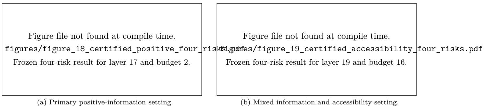  
Figure 8: Four risks on the eight untouched confirmation policy areas. Error bars are domain-cluster bootstrap 95% intervals for each risk. The selected interfaces are frozen before confirmation.

Finite SAE support: information loss versus feature budget  
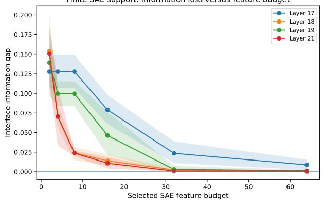  
(a) Selected SAE feature budget.

Finite-interface occupancy and held-out coverage  
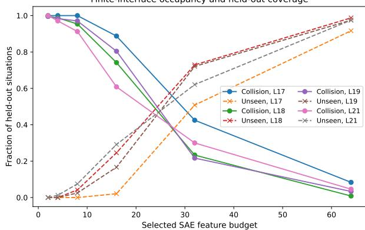  
(b) Collision and unseen-code rates.  
Figure 9: Qwen2.5 budget and occupancy diagnostics. Bands summarize the saved domain partitions. A small finite-table gap at a large budget does not establish coverage of future codes.

Nested decision-rule comparison on confirmation areas  
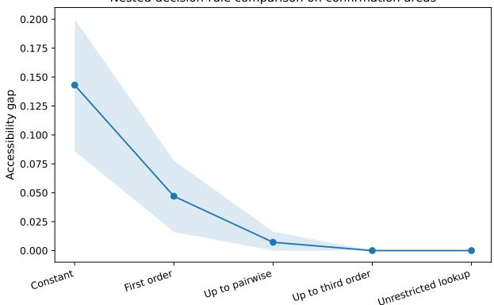  
(a) Nested rule classes on confirmation areas.

Finite-sample intervention without domain-shift confounding  
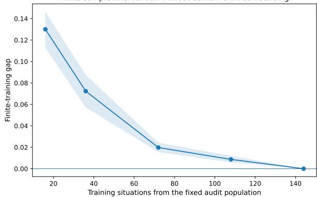  
(b) Fitting-set sizes within one audit population.

Figure 10: Original intervention plots, with their saved uncertainty displays. The compact main-text rendering uses the reported numerical summaries. The rule-class intervals summarize bootstrap resampling of the frozen confirmation areas and do not provide a simultaneous population certificate.

Positive interface-gap setting: layer 17, budget 2  
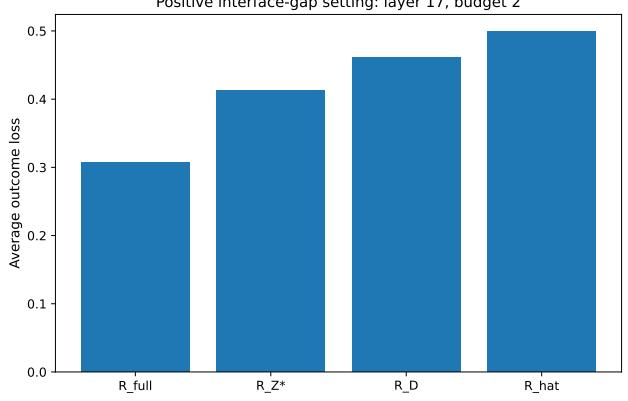  
(a) Layer 17, two features.

Accessibility-dominant setting: layer 19, budget 16  
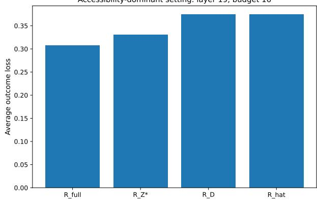  
(b) Layer 19, sixteen features.  
Figure 11: Setting-selection risk profiles. These descriptive plots are not the untouched confirmation estimates in Table 24.

Table 23: Primary Qwen2.5 audit. Confirmation policy areas are not used to select layers, feature budgets, thresholds, or feature identities.
<table><tr><td>Component</td><td>Declared value</td></tr><tr><td>Representation model</td><td>Qwen2.5-1.5B-Instruct</td></tr><tr><td>Public SAE interfaces</td><td>Residual-stream SAEs at layers 17, 18, 19, and 21</td></tr><tr><td>States</td><td>240 states from 20 policy areas</td></tr><tr><td>Setting-selection and fitting split</td><td>144 states from 12 policy areas</td></tr><tr><td>Untouched confirmation split</td><td>96 states from 8 policy areas</td></tr><tr><td>Feature budgets</td><td> $B \in \{ 2 , 4 , 8 , 1 6 , 3 2 , 6 4 \}$ </td></tr><tr><td>Outcome evaluators</td><td>Qwen2.5-7B-Instruct and Mistral-7B-Instruct-v0.3</td></tr><tr><td>Uncertainty</td><td>1,500 cluster bootstrap over policy areas repetitions</td></tr></table>

Table 24: Historical Z-only Qwen2.5 risk decomposition on untouched policy areas. Values in brackets are cluster bootstrap over policy areas 95% intervals for the three gaps. Lower risk is better.
<table><tr><td>Setting</td><td> $R _ { \mathrm { f u l l } }$ </td><td> $R _ { Z } ^ { \star }$ </td><td> $R _ { \mathcal { D } }$ </td><td> $R _ { \widehat { \delta } }$ </td><td></td><td> $\Delta _ { \mathrm { i n f o } }$ </td><td> $\Delta _ { \mathrm { a c c e s s } }$ </td><td></td><td> $\Delta _ { \mathrm { t r a i n } }$ </td></tr><tr><td>Layer 17,  $B = 2$ </td><td>0.338</td><td>0.494</td><td>0.530</td><td>0.541</td><td></td><td>0.156 [0.125, 0.180]</td><td>0.036 [0.016, 0.046]</td><td></td><td>0.011 [0.000, 0.063]</td><td></td></tr><tr><td>Layer 19,  $B = 1 6$ </td><td>0.338</td><td>0.398</td><td>0.444</td><td></td><td>0.466</td><td>0.060 [0.032, 0.076]</td><td></td><td>0.047 [0.026, 0.080]</td><td></td><td>0.022 [0.000, 0.048]</td></tr></table>

## G.3 Evaluator, selector, and model-scale robustness

Independent evaluators. The primary layer-17, B = 2 interface is held fixed while the loss table is replaced. The information gap is 0.156 under Qwen2.5-7B, 0.134 under the independent Mistral-7B evaluator, and 0.153 under the equal-weight average of both evaluators. The Mistral interval is [0.100, 0.162], and its one-sided lower bound is 0.104. For the layer-19, B = 16 interface, the independent evaluator gives information gap 0.079 and accessibility gap 0.066, with positive one-sided lower bounds 0.051 and 0.043. Across all state-action losses, the two evaluators have Spearman correlation 0.803 and agree on the best action for 91.3% of situations. The positive gap persists under both scoring rules on the same responses. The comparison does not establish the accuracy of either evaluator.

Feature selectors. At the two frozen layer-budget settings, the supervised selector, the variance selector, and every one of 200 random selectors give a positive information gap. For layer 17 and B = 2, the supervised gap is 0.156, the variance gap is 0.203, and the random-selector mean is 0.189. For layer 19 and B = 16, the corresponding values are 0.060, 0.131, and 0.094. Forty occupancy-matched random controls per setting also have positive mean gaps. The result tests whether positive information loss depends on one feature selector.

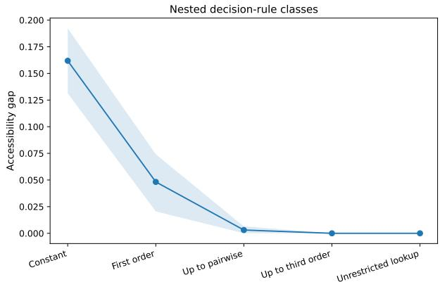  
(a) Descriptive nested-rule sweep.

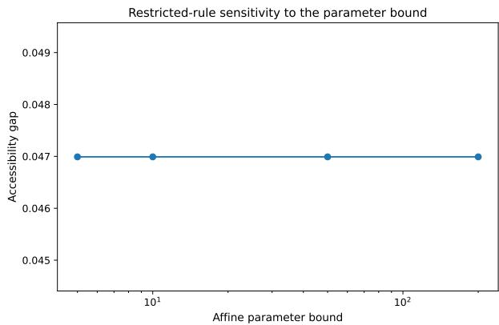  
(b) Affine parameter-bound check.  
Figure 12: Rule-class and optimizer diagnostics. The affine optimum is unchanged for parameter bounds 5, 10, 50, and 200, with no fitted parameter on a boundary.

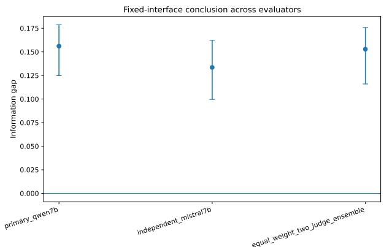  
(a) Frozen interface across evaluators.

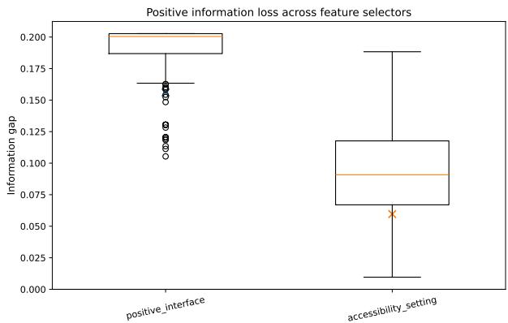  
(b) Frozen settings across selectors.  
Figure 13: Qwen2.5 evaluator and selector robustness. Left: bootstrap over policy areas intervals. Right: 200 random selectors and the named selector results. These comparisons do not establish selector superiority.

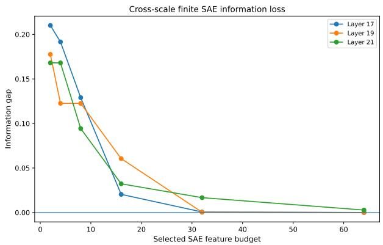  
(a) Second Qwen2.5 scale, with its own SAE.

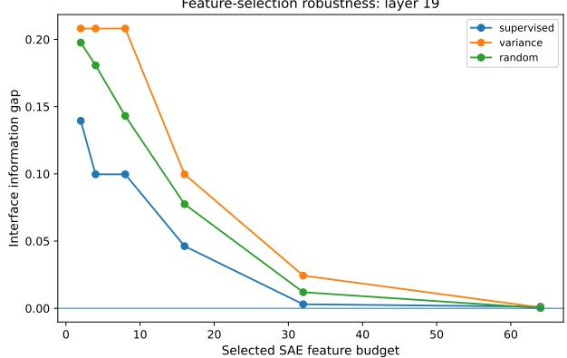  
(b) Descriptive selector budget sweep.  
Figure 14: Cross-scale and selector budget diagnostics for code-only observations. Neither panel is a new Qwen2.5- 0.5B policy-aware experiment.

It does not show that supervised selection is better than random selection; the saved claim ledger rejects that stronger reading.

Second audited model scale. The full finite-interface pipeline is repeated on Qwen2.5-0.5B-Instruct with the separate sae-qwen2.5-0.5B-res release. At layer 17 and B = 2, the information gap is 0.210 with 95% interval [0.188, 0.223]. At layer 19 and B = 16, the information gap is 0.061 with interval [0.031, 0.079], and the accessibility gap is 0.084 with interval [0.055, 0.104]. The cross-scale budget curve again falls as more selected features are exposed. The replication reduces dependence on one model size, but both audited models remain in the Qwen2.5 family.

## G.4 Reconstruction, output count, and decision information

Reconstruction loss and decision information answer different questions. The SAE reconstruction diagnostics vary strongly across the four layers, but their ordering does not match the ordering of the interface information gaps at a fixed feature budget. A layer can have a better global reconstruction diagnostic while its selected finite interface retains less information about the action that minimizes the declared loss. The centered fraction of variance unexplained (FVU) is reported as a diagnostic rather than treated as a calibrated percentage; its value can exceed one because the reconstruction squared error can exceed the centered activation variance.

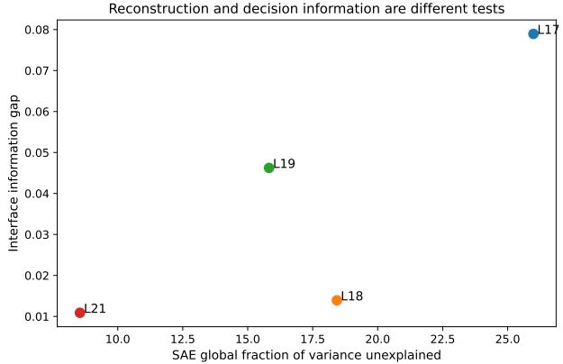  
(a) Layer reconstruction versus decision loss.

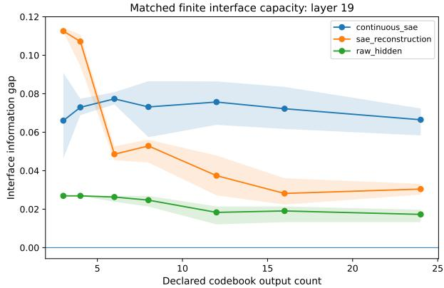  
(b) Matched finite output counts.

Figure 15: Reconstruction and output count do not substitute for a decision-loss audit. The codebook comparison holds the declared number of outputs fixed.  
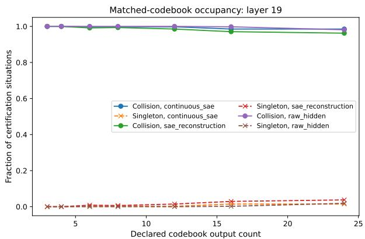  
(a) Occupancy of the matched codebooks.

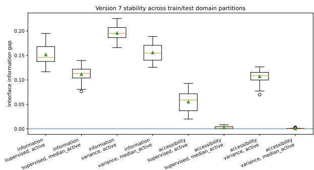  
(b) Alternative splits and selector settings.  
Figure 16: Coverage and split diagnostics. Split variation is descriptive rather than a collection of independent confidence replicates.

A related matched-codebook experiment gives the continuous selected SAE view, an SAE reconstruction view, and a raw-hidden view the same declared number of outputs. Their information gaps still differ. Equal output cardinality is therefore not equal decision information. Occupancy diagnostics also show a tradeoff: more detailed interfaces reduce collision cells but create more confirmation patterns that were not seen during fitting. The matched codebook plots are shown below

## G.5 Continuous observations and fitted-rule diagnostics

Specified Gaussian observation channel. The experiment adds Gaussian noise to fixed continuous feature vectors. The noise scale is expressed relative to the median distance to the nearest neighbor. For a uniform distribution over the audited states, the posterior state probabilities are computed analytically at each sampled noisy vector; Monte Carlo averaging estimates the resulting Bayes risk. At zero noise, the observed vectors are distinct and the exact table gap is zero. The reported estimates increase with noise for both selected SAE coordinates and raw hidden coordinates. The calculation concerns this finite Gaussian mixture, not the noiseless representation on an unknown population.

Fitted continuous rules. A separate experiment asks whether standard rules can use information that remains in continuous features. At layer 19 with 64 selected SAE coordinates, cost-sensitive k-nearest neighbors, a linear rule, and a multilayer perceptron have held-out practical excess losses 0.047, 0.047, and 0.035. With 64 raw-hidden principal components, the corresponding values are 0.088, 0.247, and 0.105. The comparison concerns the tested representation-rule pairs; it is not an exact lower bound on the continuous raw-hidden interface and does not imply that every SAE rule beats every raw-hidden rule.

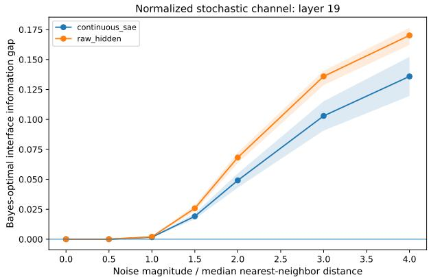  
(a) SAE and raw-hidden observations.

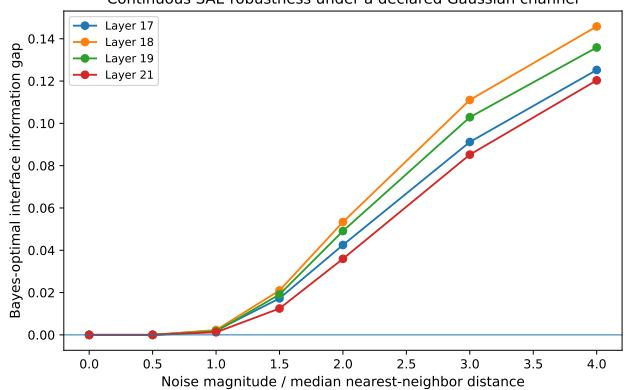  
(b) Selected SAE observations across layers.

Figure 17: Monte Carlo estimates of Bayes risk for the specified Gaussian channel. Noise magnitude is normalized by the median nearest-neighbor distance. The experiment does not certify information loss in noiseless exact hidden activations.  
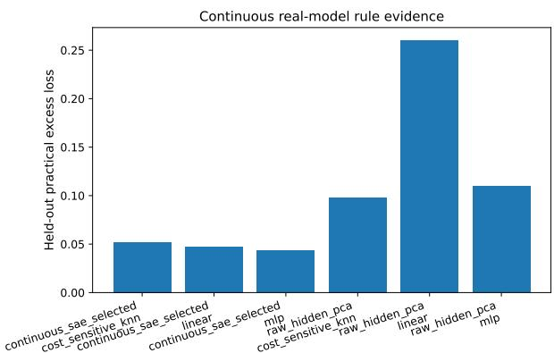  
(a) Fitted rules on continuous features.

<table><tr><td>Rule</td><td>SAE</td><td>Hidden PCA</td></tr><tr><td>Cost-sensitive kNN</td><td>0.047</td><td>0.088</td></tr><tr><td>Linear</td><td>0.047</td><td>0.247</td></tr><tr><td>MLP</td><td>0.035</td><td>0.105</td></tr></table>

(b) Reported held-out excess losses.  
Figure 18: Continuous representation-rule comparisons, not exact information-loss lower bounds. The numerical panel reproduces the reported means; the original plot is retained on the left.

## G.6 Higher-order search, capacity, and sanity checks

The controlled higher-order benchmark constructs three states whose acceptable action sets are {ASK,ASSIST}, {ASK,DECLINE}, and {DECLINE,ASSIST}. Every pair shares one zero-regret action, but all three states share no common zero-regret action. At layer 17 and B = 2, the SAE support pattern collapses the three states. The largest pair margin is zero, the triple margin is 1/3, and the separation is 1/3. The witness is exact relative to the declared policy-validity loss table. It proves the logical need for group-level checks without relying on a searched natural-language example.

The controlled-triple sweep repeats the construction across layers and budgets. The fraction of collapsed triples is high under small feature budgets and reaches zero at larger budgets, with the transition depending on layer. The result links the higher-order construction to real SAE support patterns rather than to an abstract binary code alone.

The exploratory natural-language search initially returned a positive higher-order separation, but an independent certification split reduced the separation to zero. A fresh test with two new paraphrase replicas, five generation replicas, and three judge prompts also produced zero positive-separation rate. The searched example therefore provides no replicated evidence of a conflict missed by every pairwise check. The negative replication plots are retained in Appendix G.

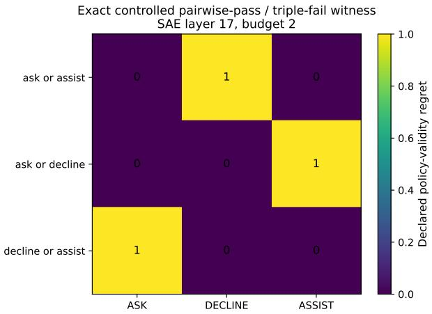  
(a) Declared three-state regret table.

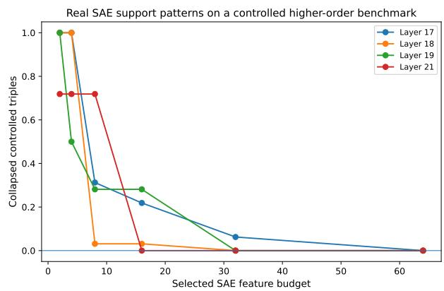  
(b) Collapse rate across layers and budgets.  
Figure 19: Original controlled higher-order evidence. Every pair has a shared zero-regret action, while the triple has none. The collapse sweep uses real SAE support patterns.

The finite-capacity calculation converts a conflict audit into an output-count requirement. For the historical 42-state finite audit subset, the archived solver outputs report matching lower and upper bounds: three interface outputs for allowed regret tolerances from 0.02 through 0.30, and two outputs at tolerances 0.35 and 0.40. These are archived results for the historical finite loss table and unrestricted output labeling. The underlying full-precision matrix is unavailable, so the curve cannot be independently recomputed from the retained records. The original code enumerates all pairs and triples globally; the source audit and separate algorithm regression tests are described in Appendix J. A given SAE or selected-coordinate family may need more outputs because not every labeling is realizable by that interface family.

Sanity controls and evaluator diagnostics. Across five saved domain partitions, the mean information gap is 0.128 for the actual low-budget SAE interface, 0.208 for a constant interface, 0.200 for a shuffled SAE interface, and numerically zero for an oracle interface that exposes the best action. The constant interface cannot improve on an informative one, and exposing an optimal action gives zero gap by construction. The larger gap after shuffling is an observed result; arbitrary shuffling has no general monotonicity guarantee.

The forced-choice evaluator gives higher mean scores to actions that match the required-action label. Mean matching scores range from 2.62 to 2.82 across safety, utility, macro adherence, fact handling, and overall quality; mean mismatching scores range from 0.72 to 1.10. The anchor diagnostics also pass, and the second evaluator gives lower mean loss to matched actions. The required-action label is supplied to the Qwen evaluation prompt, so this agreement is not an independent check of the label or an accuracy guarantee for the evaluator. Human ratings provide the separate comparison in Section 5.1.

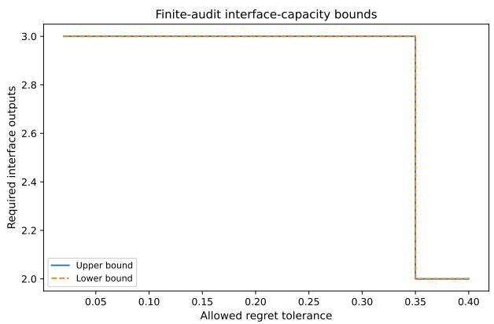  
(a) Saved 42-state capacity curve.

Natural-language higher-order candidate: not replicated  
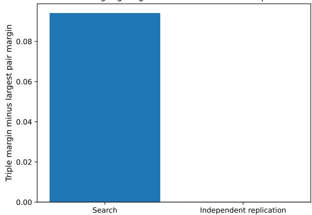  
(b) Searched natural-language witness and replication.

Figure 20: Different evidence levels: the saved capacity curve is reported from archived solver outputs and cannot be independently recomputed without its missing historical matrix; the natural-language higher-order candidate does not replicate.  
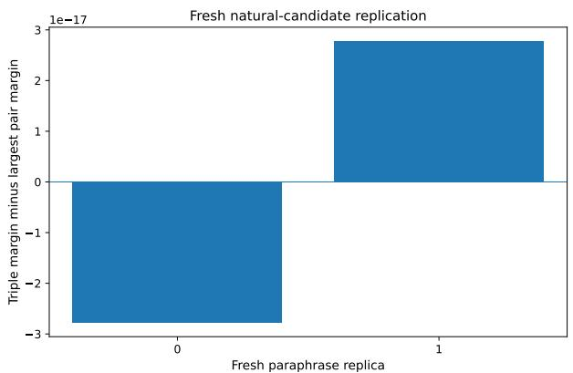  
(a) Fresh semantic, generation, and judge replication.

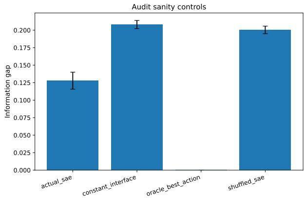  
(b) Actual, constant, shuffled, and oracle interfaces.

Figure 21: Falsification and sanity checks. Fresh natural-language differences are at floating-point scale. The interface controls have the expected risk ordering.  
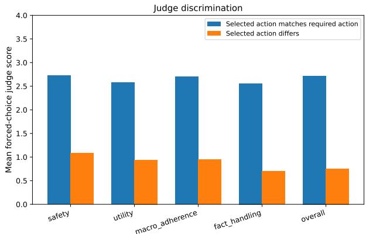  
(a) Historical evaluator discrimination.

<table><tr><td>Interface control</td><td>Mean gap</td></tr><tr><td>Actual SAE Constant</td><td>0.128</td></tr><tr><td></td><td>0.208</td></tr><tr><td>Shuffled SAE</td><td>0.200</td></tr><tr><td>Oracle best action</td><td>20</td></tr></table>

(b) Saved control means across five splits.  
Figure 22: Gross measurement and implementation checks. Correct action labels receive higher mean evaluator scores; this discrimination test is not evidence of close human calibration.

## H Extended Literature Map and Detailed Comparisons

The main comparison fixes the state distribution, available continuations, loss, and controller input. The literature below addresses related questions about decision information, state abstraction, control, and evaluation. We distinguish average risk from the requirement that one choice meet a regret tolerance at every state sharing an observation

## H.1 Comparison of statistical experiments and decision-theoretic sufficiency

Blackwell's comparison of experiments orders information channels by the decision performance that they permit across decision problems (Blackwell, 1951; 1953). Le Cam's theory of deficiency gives a quantitative notion of approximate comparison and sufficiency (Le Cam, 1964; Torgersen, 1991). Blackwell–Le Cam comparison supplies the basic interpretation of the interface information gap in the present paper: replacing a full state by an interface observation is harmless for a declared decision problem exactly when the replacement does not increase the optimal Bayes risk.

Recent representation-learning work makes the same comparison operational. Deficiency has been used to define generic feature quality (van Rooyen & Williamson, 2014) and to derive a variational bottleneck for learning representations that preserve downstream decision performance (Banerjee & Montúfar, 2018). Loss-dependent Bayes sufficiency identifies a coarsest quotient when the Bayes action is almost surely unique (Sevetlidis, 2026). Action-sufficient compression similarly merges support states that require the same optimal action (Walsh, 2026), while decision-sufficient datasets preserve the information needed to solve a family of linear optimization problems (Ye et al., 2026).

We use risk comparison to audit an existing interface. The structural question concerns several acceptable continuations, rather than one chosen optimal label. An incompatible cell contains a minimal group with no common acceptable choice. Such groups characterize feasible interface partitions. A statistical guarantee additionally requires valid bounds on loss estimation error; it does not follow from a positive estimated gap alone.

## H.2 Information bottlenecks and task-dependent representation learning

The information bottleneck formalizes representation learning as a trade-off between compression of the input and retention of information about a target (Tishby et al., 1999). Variational formulations make the objective usable with neural encoders (Alemi et al., 2017). The theory of usable information further makes information relative to a computational family, rather than treating all statistically present information as equally available (Xu et al., 2020). The information-bottleneck and usable-information views motivate the separation between what the representation contains and what a restricted downstream rule can extract.

The paper makes the separation explicit through four nested risks and three adjacent gaps. The interface information gap compares the full-state optimum with the optimum over every measurable rule that sees only the declared interface. The decision-rule accessibility gap then restricts the rule family, and the fitting gap measures the remaining cost of fitting one rule from finite data. Mutual information, compression rate, reconstruction error, and predictive likelihood can be useful representation diagnostics, but none of them alone equals the declared continuation loss. A low-energy coordinate can carry a large action distinction and a high-fidelity reconstruction can still remove information needed to choose among clarification, refusal, and bounded assistance. The paper therefore measures decision loss directly and treats reconstruction only as a separate diagnostic.

## H.3 State abstraction, bisimulation, and control-sufficient representations

State abstraction in Markov decision processes studies when states may be merged while preserving planning or control properties. Exact model reduction and homomorphism-style equivalence relations preserve rewards, transitions, values, or optimal policies (Givan et al., 2003; Li et al., 2006). Bisimulation metrics extend exact equivalence to graded state similarity and provide value-loss bounds for finite and continuous state spaces (Ferns et al., 2004; 2011). Approximate abstraction work then gives explicit suboptimality guarantees when aggregation is inexact (Abel et al., 2016; 2020).

Learned control representations apply related criteria to high-dimensional observations. DeepMDP learns a latent model by matching rewards and transition distributions (Gelada et al., 2019). Causal and invariant state representations seek features that retain stable return-relevant structure across environments (Zhang et al., 2020; 2021). Mutual-information objectives have been analyzed according to whether they are sufficient for control (Rakelly et al., 2021), and kinematic abstraction supports efficient exploration in rich-observation environments (Misra et al., 2020). Recent work on vision-language-action models directly diagnoses state aliasing when visually similar states require different low-level actions (Lee et al., 2026).

Our audit takes the full state, continuation library, and learned interface as inputs. It tests whether states sharing one observation admit a common choice within the allowed regret. Every pair of acceptable sets can intersect while the intersection of all sets is empty. A graph containing only incompatible pairs misses such a group; the conflict hypergraph records it. Nontransitivity alone would not establish this failure of all pairwise checks. The separate risk comparison also distinguishes missing information from restrictions of the rule family and fitting error.

## H.4 Partial observability, predictive states, and closed-loop continuations

Partially observable control replaces the unobserved physical state with an information state. In a finite partially observable Markov decision process, the posterior belief is sufficient for finite-horizon control (Smallwood & Sondik, 1973; Kaelbling et al., 1998). Predictive state representations instead summarize a history by predictions of future tests (Littman et al., 2001; Singh et al., 2004), and spectral predictive-state methods connect representation learning with planning (Boots et al., 2011). Approximate information states quantify the loss from using a learned or compressed history summary in partially observed planning and reinforcement learning (Subramanian et al., 2022). Options provide a related formalism for temporally extended closed-loop actions whose internal policies react to future observations (Sutton et al., 1999).

Beliefs, predictive states, and options motivate continuations that can react to later observations. The full audit state may contain a history; the tested interface is an additional channel applied to that state. A conflict is relative to the available continuations. Enlarging the library changes both the choices and the oracle baseline, so transfer to a larger library requires a separate comparison.

## H.5 Set-valued prediction, abstention, and higher-order compatibility

Classification with rejection permits a predictor to abstain when the cost of a forced label is too high (Chow, 1970; Bartlett & Wegkamp, 2008; Charoenphakdee et al., 2021). Confidence-set and set-valued classifiers return several plausible labels while controlling set size, error, or coverage (Denis & Hebiri, 2017; Sadinle et al., 2019). Conformal prediction gives finite-sample coverage for prediction sets under exchangeability (Vovk et al., 2005). Reject-option and set-valued prediction methods establish that a decision problem can naturally have a set of acceptable outputs rather than one required label.

The set-valued object in the present paper has a different index structure. For each full state u, the acceptable set $\mathcal { G } ^ { \varepsilon } ( u )$ contains continuation distributions whose regret at u is at most ε. Uniform compatibility at tolerance ε requires the intersection

$$
\bigcap _ { u \in C _ { z } } { \mathcal { G } } ^ { \varepsilon } ( u )
$$

to be nonempty for every interface cell $C _ { z }$ . Set-valued classification usually controls which labels may be returned for one input; the present intersection asks whether one downstream decision can serve several full states that the interface makes indistinguishable.

Convex geometry and game theory then determine the finite witness structure. Helly's theorem converts an empty intersection of convex acceptable sets in an $( m - 1 )$ -dimensional continuation simplex into a subfamily of at most m sets (Helly, 1923). Sion's minimax theorem gives the dual state-mixture interpretation of the robust witness margin (Sion, 1958). Weak hypergraph coloring characterizes how many interface labels are needed to split every minimal conflict (Berge, 1989). These are classical tools. Here they relate the loss of a fixed interface to incompatible state groups and the output count of a redesigned interface. A gap exceeding ε implies a cell with margin exceeding ε; positivity alone does not establish conflict at an arbitrary tolerance. Certifying a group selected from estimated losses also requires simultaneous error control or independent certification data.

## H.6 Safe reinforcement learning, shielding, and latent control

Safe reinforcement learning studies reward optimization under safety costs, constraints, or intervention mechanisms (García & Fernández, 2015; Achiam et al., 2017; Chow et al., 2018). Shielding places a verified filter between a learned policy and the environment (Alshiekh et al., 2018; Carr et al., 2023). Reachabilitybased filters and model-predictive safety filters override or modify unsafe proposed controls (Fisac et al.. 2019; Wabersich & Zeilinger, 2021). Reviews of safe learning in robotics organize these methods by their assumptions about dynamics, uncertainty, constraints, and certification (Brunke et al., 2022).

A related language-model line reads or changes internal activations. Latent knowledge methods search for information represented internally without direct supervision (Burns et al., 2023). Inference-time intervention and representation engineering learn activation directions used to steer model behavior (Li et al., 2023; Zou et al., 2023). Latent reachability has also been proposed for early detection and steering of language-model misalignment (Karnik & Bansal, 2025).

Rather than evaluate only a particular monitor, we minimize over all rules using its specified input. A positive gap rules out matching the full state optimum with that input under the same library and loss. The audit does not rule out changing the representation, available strategies, or decision problem.

## H.7 Sparse autoencoders and activation-space analysis

Sparse coding represents an observation by a small number of dictionary elements and has long been used to study distributed structure (Olshausen & Field, 1996). k-sparse autoencoders impose a fixed activation budget in the learned code (Makhzani & Frey, 2013). Work on superposition argues that neural networks may represent more features than available neurons by using non-orthogonal directions (Elhage et al., 2022). Sparse autoencoders (SAEs) are now widely used to recover sparse, interpretable activation features from language models (Bricken et al., 2023; Cunningham et al., 2024),

Other work studies training scale and coverage across models and layers. Large SAEs have been trained and evaluated with explicit reconstruction-sparsity controls (Templeton et al., 2024; Gao et al., 2025), and Gemma Scope provides public SAEs across models and layers (Lieberum et al., 2024). Activation geometry can also be distributed across groups of SAE features rather than represented by one isolated feature (Bhalla et al., 2026). The SAE literature makes reconstruction quality, feature interpretation, feature geometry, dead-feature rate, and causal intervention important SAE diagnostics

We treat selected SAE values or support indicators as the controller input. For a finite input alphabet, the risk calculation optimizes all lookup rules and does not depend on probe architecture or training. For distinct continuous vectors in a finite sample, the same unrestricted rule can memorize the sample. Continuous observations therefore require a separate analysis before probe failure can be interpreted as information loss.

## H.8 Language-model judges and finite-sample evaluation

Large language models are frequently used as evaluators for open-ended model outputs. Chatbot Arena uses pairwise model comparisons at scale (Zheng et al., 2023), and G-Eval prompts a strong model to score generated text along declared dimensions (Liu et al., 2023). Fine-grained evaluator models such as Prometheus seek reproducible rubric-conditioned judgments (Kim et al., 2024). RewardBench evaluates reward models and preference judges across several behavioral categories (Lambert et al., 2025). At the same time, position bias can make model-based pairwise evaluation unreliable (Wang et al., 2024).

Statistical work addresses the distinction between a useful noisy judge and a valid evaluation procedure.   
Imperfect-judge testing can preserve type-I error control after a human calibration stage (Feng et al., 2026).

Risk-control methods construct prediction sets or deployment rules with finite-sample bounds (Bates et al., 2021; Angelopoulos et al., 2025), while simultaneous concentration inequalities support uniform control across many bounded quantities (Hoeffding, 1963).

We analyze automatic scores and human ratings as separate loss tables. Their gaps may agree in sign without their response scores being close. The human study reports independent rating agreement before adjudication. For conflict search, the certificate uses simultaneous bounds over the searched losses or separate certification data; a maximum error observed in one packet is not a uniform bound for future responses.

## H.9 Generative-model safeguards, red teaming, and path-level safety

Generative-model safety work often evaluates a completed output, a prompt- response pair, or a modelwide failure rate. RealToxicityPrompts measures toxic text degeneration under naturally occurring prompts (Gehman et al., 2020). Red-teaming methods search for prompts that elicit harmful behavior (Perez et al., 2022). Constitutional AI uses written principles and model feedback to train a less harmful assistant (Bai et al., 2022), while Llama Guard provides an input-output safeguard classifier for conversational systems (Inan et al., 2023).

A separate logical question is whether each partial state has at least one safe continuation. Even if the answer is yes, states sharing one controller input may have no common safe continuation. Our regret criterion is related but not identical: it compares with the best available continuation, whose loss need not be zero. The controlled example demonstrates failure of joint compatibility despite success of every pair; the searched natural-language example does not replicate that result.

## H.10 Summary of the comparison

Table 25: Relation between the present paper and the closest technical lines of work.
<table><tr><td>Line of work</td><td>What the prior line establishes Target in the present paper</td><td></td></tr><tr><td>ficiency</td><td>Comparison of exper- Orders information channels by at- Uses optimal-risk comparison as the di- iments and Bayes suf- tainable risk and characterizes exact agnostic foundation, then extracts min- or approximate loss-dependent suf- imal conflicts among acceptable closed- ficiency (Blackwell, 1953; Le Cam, loop continuation sets and connects them 1964; van Rooyen &amp; Williamson, to capacity and certification.</td><td></td></tr><tr><td>Action-sufficient compression decision-sufficient data</td><td>and cover one optimal action or an opti- at each state. Every pair can share an 2026).</td><td>Retains the distinctions needed to re- Allows several acceptable continuations mal solution to a declared optimiza- acceptable choice even when the whole tion family (Walsh, 2026; Ye et al., group cannot; the hypergraph records these larger conflicts.</td></tr><tr><td>necks</td><td>Information bottle- Trades compression against predic- Uses the declared safety-utility loss itself et al., 2017; Xu et al., 2020).</td><td>tive or computationally usable infor- and separates missing information from mation (Tishby et al., 1999; Alemi restricted access to retained information</td></tr><tr><td>bisimulation</td><td>MDP abstraction and Constructs exact or approximate Audits a fixed learned interface and re- (Givan et al., 2003; Ferns et al., 2011; quired number of interface labels. Abel et al., 2020; Misra et al., 2020).</td><td>and finite fitting. summaries that preserve models, val- turns exact risk for the finite interface, ues, policies, or exploration structure minimal conflicting groups, and the re-</td></tr></table>

Table 25 – continued from the previous page
<table><tr><td>Line of work</td><td>What the prior line establishes Target in the present paper</td><td></td></tr><tr><td></td><td>Partial observability Builds belief, information, or pre- Assumes the full audit state and con- and predictive states dictive states sufficient for recursive tinuation library are declared, then tests planning; options define temporally whether an additional operational inter- extended closed-loop actions (Kael- face preserves common continuation com- bling et al., 1998; Singh et al., 2004; patibility within each observation fiber.</td><td></td></tr><tr><td>and abstention</td><td>et al., 1999). Set-valued prediction Returns several plausible labels or re- Intersects acceptable continuation sets &amp; Wegkamp, 2008; Denis &amp; Hebiri, the full intersection. 2017; Sadinle et al., 2019).</td><td>jects a prediction while controlling across states sharing one observation; coverage, ambiguity, or cost (Bartlett pairwise intersections do not determine</td></tr><tr><td>ing</td><td>Safe control, shield- Optimizes constrained policies or ap- Tests whether the chosen observation in- ing, and latent steer- plies a monitor, shield, filter, or la- terface is adequate before the monitoring tent intervention to a chosen obser- or steering rule is trusted. vation (Achiam et al., 2017; Alshiekh et al., 2018; Fisac et al., 2019; Li</td><td></td></tr><tr><td>space analysis</td><td>et al., 2023; Karnik &amp; Bansal, 2025). SAE and activation- Studies sparse feature recovery, in- Treats an SAE-derived code or coordi- terpretation, reconstruction, scaling, nate set as an operational control inter- causal effects, and activation geom- face and measures the exact decision loss etry (Cunningham et al., 2024; Gao induced by its state collisions. et al., 2025; Lieberum et al., 2024;</td><td></td></tr><tr><td>and risk control</td><td>Bhalla et al., 2026). Model-based judges Measures open-ended outputs with Uses automatic and human loss construc- learned evaluators and develops cal- tions separately, preserves validity after ibration or finite-sample risk pro- witness search, and does not infer close cedures for imperfect measurements item-level calibration from a positive ag- (Liu et al., 2023; Wang et al., 2024; gregate interface gap.</td><td></td></tr><tr><td>Generative guards</td><td>Feng et al., 2026; Angelopoulos et al., 2025). safe- Detects harmful prompts or com- Tests whether states sharing a controller pleted outputs and trains safer as- input have a common acceptable contin- sistants (Gehman et al., 2020; Perez uation; a conflict can first appear for a et al., 2022; Bai et al., 2022; Inan triple. et al., 2023).</td><td></td></tr></table>

Relation to a single optimal label. On a finite audit with one optimal pure continuation at each state, let ρ be the smallest regret of a nonoptimal continuation. For $0 \leq \varepsilon < \rho / 2 .$ different optimal labels are already incompatible in pairs (Proposition B.2). With larger tolerances or several acceptable choices, a single selected label need not describe all compatible groups. The hypergraph supplies the complete finite set of incompatibility constraints. Statistical claims about estimated constraints still require the loss error assumptions in Appendix C.

## I Complete Phi Third-Family Results

This appendix reports the source-derived Phi results. Original 96 denotes the original eight-area confirmation split; Reused 96 denotes the eight-area collection locked for the earlier SmolLM2 experiment and reused for

Phi. The fitting split has 144 original states. The original experiment archive is retained as supplementary/ phi/PHI\_THIRD\_FAMILY\_RESULTS\_original.zip in the author working archive. The Phi study includes 5,040 generated responses evaluated by both automatic evaluators. No human ratings were collected for the Phi responses. The 288 risk-summary rows comprise two SAE seeds, two selectors, six budgets, two collections, three evaluator losses, and two observation conditions. These are overlapping analyses of the same responses, not 288 independent replications.

## 1.1 Configuration, provenance, and validation

The active protocol identifies Phi-4-mini-instruct revision cfbefacb99257ffa30c83adab238a50856ac3083; Mistral-7B-Instruct-v0.3 revision c170c708c41dac9275d15a8fff4eca08d52bab71;Qwen2.5-7B-Instruct revision a09a35458c702b33eeacc393d103063234e8bc28; and FineWeb-Edu sample-10BT revision 87f09149ef4734204d70ed1d046ddc9ca3f2b8f9. Block index 23 has width 3,072 and depth fraction 0.75. The two SAE seeds are 314159 and 271828, dictionary width is 16,384, and TopK sparsity is 64.

Each SAE uses 8,000,000 training tokens and 300,000 validation tokens, with 100,000 training tokens for normalization. Corpus contexts have length 128 and cached activation shards contain 32,768 tokens. SAE batches contain 1,024 activation tokens; AdamW uses learning rate $2 \times 1 0 ^ { - 4 }$ , 500 warm-up steps, zero weight decay, gradient norm clipping at 1, auxiliary coefficient 0.03125, and a 1,000-step dead-feature window. Both training records end at step 7,813 and 8,000,000 consumed tokens. Validation requires FVU at most 0.45, cosine at least 0.75, unobserved-feature fraction at most 0.5, and mean-L0 deviation from 64 at most 3.2. Both runs pass these saved checks.

Generation uses five replicas per state-action pair, at most 192 new tokens, temperature 0.7, and $\mathrm { t o p } { - } p = 0 . 9$ The two evaluators each score all 5,040 responses, with a 160-token output limit and up to four format retries. Mistral scores parse on the first attempt; four Qwen scores require one format retry. There are no missing or duplicated state-action-replica keys. The saved execution takes approximately 4.63 hours on an A100- SXM4-40GB. The recorded environment is Python 3.13.15, PyTorch 2.11.0+cu128, Transformers 4.57.6, Datasets 4.4.1, Hugging Face Hub 0.36.2, Accelerate 1.14.0, NumPy 2.1.3, Pandas 2.2.3, and SciPy 1.16.3.

Cached feature arrays and item-level scores independently reproduce all 288 risk/bootstrap summaries and all 192 deletion-level estimates to floating-point precision. This checks table construction and arithmetic, not unseen training weights, evaluator validity, or human judgments. Bootstrap resampling uses 2,000 multinomial policy-area resamples and seed 99173. An eight-cluster percentile interval remains an approximate, per-setting uncertainty summary rather than the formal simultaneous certificate in Section 3.

## 1.2 Phi retains a positive gap when the active policy is observed

The Phi run completes all 5,040 generations and both complete evaluator passes. The two SAEs complete the declared training schedule of eight million tokens and pass the saved validation thresholds. No Phi human labels have been collected.

Policy-aware primary results. Table 26 reports the primary $( Z , S )$ observation at B = 2. Under Mistral loss, the information gaps are 0.0557 and 0.0491 on the original confirmation set and 0.0436 and 0.0331 on the reused locked collection, for seeds 314159 and 271828, respectively. The corresponding one-sided 95% bootstrap LCBs are 0.0367, 0.0266, 0.0225, and 0.0185. Every primary Qwen-loss and mean-loss check also has a positive individual LCB. The tables below include both risk minima, two-sided intervals, and the complete budget sweeps.

These results retain the information restriction after active policy is supplied: some states under the same policy and SAE code still cannot share the lowest-loss macro-continuation under the saved loss table. The 12 policy-aware settings are not independent replications; the evaluator checks and their mean share the same responses, states, and features. All 2,000 bootstrap gaps in each primary setting exceed the saved numerical tolerance, but the zero nonpositive fraction is not a p-value or a simultaneous certificate.

Table 26: Phi primary policy-aware results at feature budget B = 2. Each entry is the information gap $\widehat { \Delta } _ { Z , S }$ followed by its individual one-sided 95% bootstrap over policy areas lower bound in brackets. The original confirmation and reused locked collections each contain 96 states. Mean loss averages the two evaluators before risk optimization.
<table><tr><td>Collection</td><td>SAE seed</td><td></td><td>Mistral</td><td></td><td>Qwen</td><td>Mean loss</td></tr><tr><td>Original 96</td><td>314159</td><td>0.0557</td><td>[0.0367]</td><td>0.0830 [0.0588]</td><td></td><td>0.0568 [0.0381]</td></tr><tr><td>Original 96</td><td>271828</td><td>0.0491 [0.0266]</td><td></td><td>0.0365 [0.0229]</td><td></td><td>0.0296 [0.0157]</td></tr><tr><td>Reused 96</td><td> $3 1 4 1 5 9$ </td><td>0.0436 [0.0225]</td><td></td><td>0.0584 [0.0424]</td><td></td><td>0.0708 [0.0477]</td></tr><tr><td>Reused 96</td><td>271828</td><td>0.0331 [0.0185]</td><td></td><td>0.0465 [0.0283]</td><td></td><td>0.0470 [0.0320]</td></tr></table>

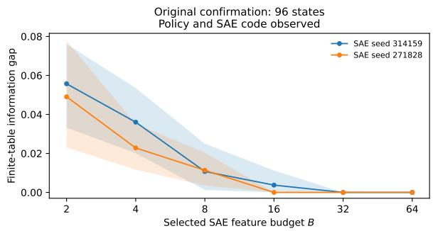  
(a) Original confirmation collection.

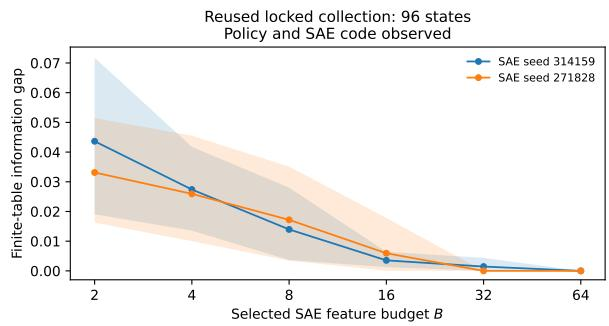  
(b) Reused locked collection.  
Figure 23: Phi policy-aware information gaps under Mistral loss. Points use the frozen supervised features, and bands are individual two-sided 95% bootstrap over policy areas intervals. Budget positions are equally spaced for readability. Both the policy text and selected SAE support code are observed

Paired observation comparison. Providing the active policy reduces or leaves unchanged the exact information gap in every primary Phi setting, as required by Equation (6). For seed 314159 on the original confirmation set, the Mistral-loss gap decreases from 0.1110 for Z alone to 0.0557 for (Z, S). The positive policy-aware gap therefore cannot be explained solely by hiding the active policy. Both observation conditions keep all other inputs fixed. The historical Qwen2.5 and SmolLM2 tables estimate code-only risk; the separate policy-aware analyses in Section 5.3 have their own stated source precision.

Budget and policy-area sensitivity. Figure 23 shows the policy-aware Mistral-loss curves. All supervised B = 2 and B = 4 settings have positive individual LCBs across the two seeds, collections, and three loss constructions. From B = 8 onward some LCBs reach zero; at B = 32 and $B = 6 4$ many finite-table gaps vanish. Zero gap on these states does not establish sufficiency on future states. In particular, the complete (Z, S) keys are unseen in the fitting split because the evaluation policy texts differ from the fitting policy texts. The exact evaluation-set optimum is not the performance of a learned lookup table on those unseen keys.

At B = 2, deleting any one of the eight policy areas leaves 84 states. Every deletion-level gap is positive across both seeds, both collections, all three loss constructions, and both observation conditions: 192 point estimates in total, with minimum 0.0236. No single deletion removes the positive gap in these collections. Table 37 summarizes the deletion ranges.

Reconstruction quality and distribution shift. Validation centered fraction of variance unexplained (FVU) is 0.0162 and 0.0163; mean reconstruction cosine is 0.9277 for both SAE seeds, mean $L _ { 0 }$ is 64, and all 16,384 features appear at least once on validation. Reconstruction on audit states is weaker. Centered FVU is 17.3125 and 16.6518 on the original 240 states, and 2.8355 and 2.7705 on the reused 96 states Uncentered relative squared reconstruction error is 0.2704–0.3062 across these four audit settings. On the original audit distribution, centered activation energy per vector is 232.49, compared with uncentered energy 13,143.04. The smaller denominator explains why centered FVU is much larger than uncentered relative error, but does not remove the reconstruction error itself. Passing corpus validation does not establish accurate reconstruction on the audit domain. Table 34 reports the distribution-specific diagnostics.

Evaluator comparison. The primary gap remains positive with either evaluator, but their scores have limited agreement on individual responses. Detailed comparisons below use the same response keys for both evaluators.

## 1.3 Policy-aware and code-only primary results

The complete observation is explicitly $V = ( Z , S )$ or $V \ = \ Z$ Equal-weight losses are averaged before minimization. Full-state, best-interface, and gap values can differ slightly from arithmetic on the displayed rounded numbers because the calculations use unrounded values.

Table 27: Phi full primary results for observation (Z, S) at $B = 2 .$ Rγ denotes the exact finite-table optimum for the stated observation V. CI is the two-sided 95% bootstrap interval; LCB is the one-sided 95% lower bound. $f _ { 0 }$ is the fraction of 2,000 bootstrap gaps at or below the saved $\bar { 1 0 } ^ { - 1 2 }$ numerical tolerance, not a $p \textmd { - }$ value.
<table><tr><td>Evaluator</td><td> $\widehat { R } _ { \mathrm { f u l l } }$ </td><td> $\widehat { R } _ { V } ^ { \star }$ </td><td> $\widehat { \Delta } _ { V }$ </td><td>95% CI</td><td>95% LCB</td><td> $f _ { 0 }$ </td></tr><tr><td colspan="7">Original 96, seed 314159</td></tr><tr><td>Mistral</td><td>0.0742</td><td>0.1299</td><td>0.0557</td><td>[0.0332, 0.0761]</td><td>0.0367</td><td>0.000</td></tr><tr><td>Qwen</td><td>0.1665</td><td>0.2494</td><td>0.0830</td><td>[0.0554, 0.1151]</td><td>0.0588</td><td>0.000</td></tr><tr><td>Mean loss</td><td>0.1447</td><td>0.2015</td><td>0.0568</td><td>[0.0339, 0.0801]</td><td>0.0381</td><td>0.000</td></tr><tr><td colspan="7">Original 96, seed 271828</td></tr><tr><td>Mistral</td><td>0.0742</td><td>0.1232</td><td>0.0491</td><td>[0.0230, 0.0777]</td><td>0.0266</td><td>0.000</td></tr><tr><td>Qwen</td><td>0.1665</td><td>0.2029</td><td>0.0365</td><td>[0.0198, 0.0517]</td><td>0.0229</td><td>0.000</td></tr><tr><td>Mean loss</td><td>0.1447</td><td>0.1744</td><td>0.0296</td><td>[0.0136, 0.0469]</td><td>0.0157</td><td>0.000</td></tr><tr><td colspan="7">Reused 96, seed 314159</td></tr><tr><td>Mistral</td><td>0.1006</td><td>0.1443</td><td>0.0436</td><td>[0.0191, 0.0718]</td><td>0.0225</td><td>0.000</td></tr><tr><td>Qwen</td><td>0.1910</td><td>0.2494</td><td>0.0584</td><td>[0.0394, 0.0783]</td><td>0.0424</td><td>0.000</td></tr><tr><td>Mean loss</td><td>0.1731</td><td>0.2439</td><td>0.0708</td><td>[0.0437, 0.0999]</td><td>0.0477</td><td>0.000</td></tr><tr><td colspan="7">Reused 96, seed 271828</td></tr><tr><td>Mistral</td><td>0.1006</td><td>0.1338</td><td>0.0331</td><td>[0.0163, 0.0515]</td><td>0.0185</td><td>0.000</td></tr><tr><td>Qwen</td><td>0.1910</td><td>0.2374</td><td>0.0465</td><td>[0.0250, 0.0692]</td><td>0.0283</td><td>0.000</td></tr><tr><td>Mean loss</td><td>0.1731</td><td>0.2201</td><td>0.0470</td><td>[0.0296, 0.0704]</td><td>0.0320</td><td>0.000</td></tr></table>

Table 28: Phi full primary results for observation $Z$ only at B = 2. Rν denotes the exact finite-table optimum for the stated observation V. CI is the two-sided 95% bootstrap interval; LCB is the one-sided 95% lower bound. $f _ { 0 }$ is the fraction of 2,000 bootstrap gaps at or below the saved $1 \bar { 0 } ^ { - 1 2 }$ numerical tolerance, not a p-value.
<table><tr><td>Evaluator</td><td> $\widehat { R } _ { \mathrm { f u l l } }$ </td><td> $\widehat { R } _ { V } ^ { \star }$ </td><td> $\widehat { \Delta } _ { V }$ </td><td>95% CI</td><td>95% LCB</td><td> $f _ { 0 }$ </td></tr><tr><td colspan="7">Original 96, seed 314159</td></tr><tr><td>Mistral</td><td>0.0742</td><td>0.1852</td><td>0.1110</td><td>[0.0732, 0.1296]</td><td>0.0799</td><td>0.000</td></tr><tr><td>Qwen</td><td>0.1665</td><td>0.2675</td><td>0.1010</td><td>[0.0647, 0.1460]</td><td>0.0690</td><td>0.000</td></tr><tr><td>Mean loss</td><td>0.1447</td><td>0.2263</td><td>0.0816</td><td>[0.0495, 0.1115]</td><td>0.0540</td><td>0.000</td></tr><tr><td colspan="7">Original 96, seed 271828</td></tr><tr><td>Mistral</td><td>0.0742</td><td>0.1517</td><td>0.0775</td><td>[0.0442, 0.0978]</td><td>0.0482</td><td>0.000</td></tr><tr><td>Qwen</td><td>0.1665</td><td>0.2152</td><td>0.0487</td><td>[0.0254, 0.0654]</td><td>0.0308</td><td>0.000</td></tr><tr><td>Mean loss</td><td>0.1447</td><td>0.1932</td><td>0.0485</td><td>[0.0262, 0.0587]</td><td>0.0288</td><td>0.000</td></tr><tr><td colspan="7">Reused 96, seed 314159</td></tr><tr><td>Mistral</td><td>0.1006</td><td>0.1661</td><td>0.0655</td><td>[0.0376, 0.0917]</td><td>0.0414</td><td>0.000</td></tr><tr><td>Qwen</td><td>0.1910</td><td>0.2983</td><td>0.1073</td><td>[0.0445, 0.1581]</td><td>0.0503</td><td>0.000</td></tr><tr><td>Mean loss</td><td>0.1731</td><td>0.2683</td><td>0.0952</td><td>[0.0664, 0.1173]</td><td>0.0708</td><td>0.000</td></tr><tr><td colspan="7">Reused 96, seed 271828</td></tr><tr><td>Mistral</td><td>0.1006</td><td>0.1619</td><td>0.0612</td><td>[0.0332, 0.0788]</td><td>0.0368</td><td>0.000</td></tr><tr><td>Qwen</td><td>0.1910</td><td>0.2938</td><td>0.1028</td><td>[0.0419, 0.1248]</td><td>0.0482</td><td>0.000</td></tr></table>

Table 29: Paired observation-condition comparison for the same Phi responses, losses, frozen features, and $B = 2 .$ Supplying active policy can refine a Z-only cell and never increases the exact optimal interface risk. Differences are computed before rounding.
<table><tr><td>Collection</td><td>Seed</td><td>Evaluator</td><td> $\widehat { \Delta } _ { Z }$ </td><td> $\widehat { \Delta } _ { Z , S }$ </td><td>Reduction</td></tr><tr><td>Original 96</td><td>314159</td><td>Mistral</td><td>0.1110</td><td>0.0557</td><td>0.0553</td></tr><tr><td>Original 96</td><td>314159</td><td>Qwen</td><td>0.1010</td><td>0.0830</td><td>0.0180</td></tr><tr><td>Original 96</td><td>314159</td><td>Mean loss</td><td>0.0816</td><td>0.0568</td><td>0.0248</td></tr><tr><td>Original 96</td><td>271828</td><td>Mistral</td><td>0.0775</td><td>0.0491</td><td>0.0284</td></tr><tr><td>Original 96</td><td>271828</td><td>Qwen</td><td>0.0487</td><td>0.0365</td><td>0.0123</td></tr><tr><td>Original 96</td><td>271828</td><td>Mean loss</td><td>0.0485</td><td>0.0296</td><td>0.0188</td></tr><tr><td>Reused 96</td><td>314159</td><td>Mistral</td><td>0.0655</td><td>0.0436</td><td>0.0219</td></tr><tr><td>Reused 96</td><td>314159</td><td>Qwen</td><td>0.1073</td><td>0.0584</td><td>0.0489</td></tr><tr><td>Reused 96</td><td>314159</td><td>Mean loss</td><td>0.0952</td><td>0.0708</td><td>0.0244</td></tr><tr><td>Reused 96</td><td>271828</td><td>Mistral</td><td>0.0612</td><td>0.0331</td><td>0.0281</td></tr><tr><td>Reused 96</td><td>271828</td><td>Qwen</td><td>0.1028</td><td>0.0465</td><td>0.0564</td></tr><tr><td>Reused 96</td><td>271828</td><td>Mean loss</td><td>0.0704</td><td>0.0470</td><td>0.0234</td></tr></table>

Table 28 continued.
<table><tr><td>Evaluator</td><td> $\widehat { R } _ { \mathrm { f u l l } }$ </td><td> $\widehat { R } _ { V } ^ { \star }$ </td><td> $\widehat { \Delta } _ { V }$ </td><td></td><td>95% CI 95% LCB</td></tr><tr><td>Mean loss </td><td>0.1731</td><td>0.2435</td><td></td><td>0.0704 [0.0436, 0.0946]</td><td>0.0478 0.000</td></tr></table>

## 1.4 Complete supervised-selector and variance-selector sweeps

Only fitting data determine the feature identities. The supervised ranking uses Mistral loss, and all other evaluator conditions reuse that ranking. No interface is selected using the Phi confirmation losses. The 288 rows below retain both positive and zero-gap results; they do not extend the B = 2 claim to every budget.

Table 30: Complete Phi supervised-selector results for observation (Z, S). Each row uses eight policy-area clusters and 2,000 percentile bootstrap repetitions. Features are selected on the fitting split and fixed across evaluators. $f _ { 0 }$ uses the saved $1 0 ^ { - 1 2 }$ tolerance; intervals are individual, not simultaneous.
<table><tr><td>B</td><td>Evaluator</td><td> $\widehat { R } _ { \mathrm { f u l l } }$ </td><td> $\widehat { R } _ { V } ^ { \star }$ </td><td> $\widehat { \Delta } _ { V }$ </td><td>95% CI</td><td>95% LCB</td><td> $f _ { 0 }$ </td></tr><tr><td colspan="8">Original 96, seed 314159</td></tr><tr><td>2</td><td>Mistral</td><td>0.0742</td><td>0.1299</td><td>0.0557</td><td>[0.0332, 0.0761]</td><td>0.0367</td><td>0.000</td></tr><tr><td>2</td><td>Qwen</td><td>0.1665</td><td>0.2494</td><td>0.0830</td><td>[0.0554, 0.1151]</td><td>0.0588</td><td>0.000</td></tr><tr><td>2</td><td>Mean loss</td><td>0.1447</td><td>0.2015</td><td>0.0568</td><td>[0.0339, 0.0801]</td><td>0.0381</td><td>0.000</td></tr><tr><td>4</td><td>Mistral</td><td>0.0742</td><td>0.1102</td><td>0.0360</td><td>[0.0201, 0.0535]</td><td>0.0224</td><td>0.000</td></tr><tr><td>4</td><td>Qwen</td><td>0.1665</td><td>0.2328</td><td>0.0663</td><td>[0.0367, 0.1005]</td><td>0.0413</td><td>0.000</td></tr><tr><td>4</td><td>Mean loss</td><td>0.1447</td><td>0.1860</td><td>0.0413</td><td>[0.0202, 0.0642]</td><td>0.0229</td><td>0.000</td></tr><tr><td>8</td><td>Mistral</td><td>0.0742</td><td>0.0849</td><td>0.0107</td><td>[0.0013, 0.0250]</td><td>0.0024</td><td>0.004</td></tr><tr><td>8</td><td>Qwen</td><td>0.1665</td><td>0.1831</td><td>0.0167</td><td>[0.0023, 0.0354]</td><td>0.0023</td><td>0.024</td></tr><tr><td>8</td><td>Mean loss</td><td>0.1447</td><td>0.1532</td><td>0.0085</td><td>[0.0022, 0.0152]</td><td>0.0033</td><td>0.004</td></tr><tr><td>16</td><td>Mistral</td><td>0.0742</td><td>0.0779</td><td>0.0037</td><td>[0.0000, 0.0112]</td><td>0.0000</td><td>0.334</td></tr><tr><td>16</td><td>Qwen</td><td>0.1665</td><td>0.1679</td><td>0.0015</td><td>[0.0000, 0.0044]</td><td>0.0000</td><td>0.334</td></tr><tr><td>16</td><td>Mean loss</td><td>0.1447</td><td>0.1458</td><td>0.0010</td><td>[0.0000, 0.0031]</td><td>0.0000</td><td>0.334</td></tr><tr><td>32</td><td>Mistral</td><td>0.0742</td><td>0.0742</td><td>0.0000</td><td>[0.0000, 0.0000]</td><td>0.0000</td><td>1.000</td></tr><tr><td>32</td><td>Qwen</td><td>0.1665</td><td>0.1665</td><td>0.0000</td><td>[0.0000, 0.0000]</td><td>0.0000</td><td>1.000</td></tr><tr><td>32</td><td>Mean loss</td><td>0.1447</td><td>0.1447</td><td>0.0000</td><td>[0.0000, 0.0000]</td><td>0.0000</td><td>1.000</td></tr><tr><td>64</td><td>Mistral</td><td>0.0742</td><td>0.0742</td><td>0.0000</td><td>[0.0000, 0.0000]</td><td>0.0000</td><td>1.000</td></tr><tr><td>64</td><td>Qwen</td><td>0.1665</td><td>0.1665</td><td>0.0000</td><td>[0.0000, 0.0000]</td><td>0.0000</td><td>1.000</td></tr><tr><td>64</td><td>Mean loss</td><td>0.1447</td><td>0.1447</td><td>0.0000</td><td>[0.0000, 0.0000]</td><td>0.0000</td><td>1.000</td></tr><tr><td colspan="8">Original 96, seed 271828</td></tr><tr><td>2 Mistral</td><td></td><td>0.0742</td><td>0.1232</td><td>0.0491</td><td>[0.0230, 0.0777]</td><td>0.0266</td><td>0.000</td></tr></table>

Table 30 continued.
<table><tr><td>B</td><td>Evaluator</td><td> $\widehat { R } _ { \mathrm { f u l l } }$ </td><td> $\widehat { R } _ { V } ^ { \star }$ </td><td> $\widehat { \Delta } _ { V }$ </td><td>95% CI</td><td>95% LCB</td><td> $f _ { 0 }$ </td></tr><tr><td>2</td><td>Qwen</td><td>0.1665</td><td>0.2029</td><td>0.0365</td><td>[0.0198, 0.0517]</td><td>0.0229</td><td>0.000</td></tr><tr><td>2</td><td>Mean loss</td><td>0.1447</td><td>0.1744</td><td>0.0296</td><td>[0.0136, 0.0469]</td><td>0.0157</td><td>0.000</td></tr><tr><td>4</td><td>Mistral</td><td>0.0742</td><td>0.0970</td><td>0.0228</td><td>[0.0117, 0.0351]</td><td>0.0131</td><td>0.000</td></tr><tr><td>4</td><td>Qwen</td><td>0.1665</td><td>0.1869</td><td>0.0204</td><td>[0.0077, 0.0348]</td><td>0.0096</td><td>0.001</td></tr><tr><td>4</td><td>Mean loss</td><td>0.1447</td><td>0.1587</td><td>0.0140</td><td>[0.0066, 0.0217]</td><td>0.0075</td><td>0.000</td></tr><tr><td>8</td><td>Mistral</td><td>0.0742</td><td>0.0855</td><td>0.0114</td><td>[0.0035, 0.0204]</td><td>0.0040</td><td>0.004</td></tr><tr><td>8</td><td>Qwen</td><td>0.1665</td><td>0.1746</td><td>0.0081</td><td>[0.0000, 0.0198]</td><td>0.0000</td><td>0.088</td></tr><tr><td>8</td><td>Mean loss</td><td>0.1447</td><td>0.1499</td><td>0.0052</td><td>[0.0011, 0.0103]</td><td>0.0015</td><td>0.004</td></tr><tr><td>16</td><td>Mistral</td><td>0.0742</td><td>0.0742</td><td>0.0000</td><td>[0.0000, 0.0000]</td><td>0.0000</td><td>1.000</td></tr><tr><td>16</td><td>Qwen</td><td>0.1665</td><td>0.1665</td><td>0.0000</td><td>[0.0000, 0.0000]</td><td>0.0000</td><td>1.000</td></tr><tr><td>16</td><td>Mean loss</td><td>0.1447</td><td>0.1447</td><td>0.0000</td><td>[0.0000, 0.0000]</td><td>0.0000</td><td>1.000</td></tr><tr><td>32</td><td>Mistral</td><td>0.0742</td><td>0.0742</td><td>0.0000</td><td>[0.0000, 0.0000]</td><td>0.0000</td><td>1.000</td></tr><tr><td>32</td><td>Qwen</td><td>0.1665</td><td>0.1665</td><td>0.0000</td><td>[0.0000, 0.0000]</td><td>0.0000</td><td>1.000</td></tr><tr><td>32</td><td>Mean loss</td><td>0.1447</td><td>0.1447</td><td>0.0000</td><td>[0.0000, 0.0000]</td><td>0.0000</td><td>1.000</td></tr><tr><td>64</td><td>Mistral</td><td>0.0742</td><td>0.0742</td><td>0.0000</td><td>[0.0000, 0.0000]</td><td>0.0000</td><td>1.000</td></tr><tr><td>64</td><td>Qwen</td><td>0.1665</td><td>0.1665</td><td>0.0000</td><td>[0.0000, 0.0000]</td><td>0.0000</td><td>1.000</td></tr><tr><td>64</td><td>Mean loss</td><td>0.1447</td><td>0.1447</td><td>0.0000</td><td>[0.0000, 0.0000]</td><td>0.0000</td><td>1.000</td></tr><tr><td>Reused 96, seed 314159</td><td></td><td></td><td></td><td></td><td></td><td></td><td></td></tr><tr><td>2 Mistral</td><td></td><td>0.1006</td><td>0.1443</td><td>0.0436</td><td>[0.0191, 0.0718]</td><td>0.0225</td><td>0.000</td></tr><tr><td>2</td><td>Qwen</td><td>0.1910</td><td>0.2494</td><td>0.0584</td><td>[0.0394, 0.0783]</td><td>0.0424</td><td>0.000</td></tr><tr><td>2</td><td>Mean loss</td><td>0.1731</td><td>0.2439</td><td>0.0708</td><td>[0.0437, 0.0999]</td><td>0.0477</td><td>0.000</td></tr><tr><td>4</td><td>Mistral</td><td>0.1006</td><td>0.1280</td><td>0.0274</td><td>[0.0135, 0.0418]</td><td>0.0155</td><td>0.000</td></tr><tr><td>4</td><td>Qwen</td><td>0.1910</td><td>0.2381</td><td>0.0471</td><td>[0.0286, 0.0673]</td><td>0.0316</td><td>0.000</td></tr><tr><td>4</td><td>Mean loss</td><td>0.1731</td><td>0.2223</td><td>0.0493</td><td>[0.0335, 0.0684]</td><td>0.0356</td><td>0.000</td></tr><tr><td>8</td><td>Mistral</td><td>0.1006</td><td>0.1146</td><td>0.0140</td><td>[0.0036, 0.0280]</td><td>0.0049</td><td>0.000</td></tr><tr><td>8</td><td>Qwen</td><td>0.1910</td><td>0.2117</td><td>0.0207</td><td>[0.0112, 0.0315]</td><td>0.0126</td><td>0.000</td></tr><tr><td>8</td><td>Mean loss</td><td>0.1731</td><td>0.1921</td><td>0.0190</td><td>[0.0102, 0.0292]</td><td>0.0114</td><td>0.000</td></tr><tr><td>16</td><td>Mistral</td><td>0.1006</td><td>0.1042</td><td>0.0035</td><td>[0.0012, 0.0065]</td><td>0.0015</td><td>0.004</td></tr><tr><td>16</td><td>Qwen</td><td>0.1910</td><td>0.1995</td><td>0.0085</td><td>[0.0035, 0.0135]</td><td>0.0042</td><td>0.000</td></tr><tr><td>16</td><td>Mean loss</td><td>0.1731</td><td>0.1780</td><td>0.0049</td><td>[0.0005, 0.0109]</td><td>0.0005</td><td>0.022</td></tr><tr><td>32</td><td>Mistral</td><td>0.1006</td><td>0.1021</td><td>0.0015</td><td>[0.0000, 0.0044]</td><td>0.0000</td><td>0.339</td></tr><tr><td>32</td><td>Qwen</td><td>0.1910</td><td>0.1910</td><td>0.0000</td><td>[0.0000, 0.0000]</td><td>0.0000</td><td>1.000</td></tr><tr><td>32</td><td>Mean loss</td><td>0.1731</td><td>0.1733</td><td>0.0002</td><td>[0.0000, 0.0006]</td><td>0.0000</td><td>0.339</td></tr><tr><td>64</td><td>Mistral</td><td>0.1006</td><td>0.1006</td><td>0.0000</td><td>[0.0000, 0.0000]</td><td>0.0000</td><td>1.000</td></tr><tr><td>64</td><td>Qwen</td><td>0.1910</td><td>0.1910</td><td>0.0000</td><td>[0.0000, 0.0000]</td><td>0.0000</td><td>1.000</td></tr><tr><td>64</td><td>Mean loss</td><td>0.1731</td><td>0.1731</td><td>0.0000</td><td>[0.0000, 0.0000]</td><td>0.0000</td><td>1.000</td></tr><tr><td colspan="8">Reused 96, seed 271828</td></tr><tr><td>2</td><td>Mistral</td><td>0.1006</td><td>0.1338</td><td>0.0331</td><td>[0.0163, 0.0515]</td><td>0.0185</td><td>0.000</td></tr><tr><td>2</td><td>Qwen</td><td>0.1910</td><td>0.2374</td><td>0.0465</td><td>[0.0250, 0.0692]</td><td>0.0283</td><td>0.000</td></tr><tr><td>2</td><td>Mean loss</td><td>0.1731</td><td>0.2201</td><td>0.0470</td><td>[0.0296, 0.0704]</td><td>0.0320</td><td>0.000</td></tr><tr><td>4</td><td>Mistral</td><td>0.1006</td><td>0.1266</td><td>0.0259</td><td>[0.0100, 0.0455]</td><td>0.0117</td><td>0.000</td></tr><tr><td>4</td><td>Qwen</td><td>0.1910</td><td>0.2374</td><td>0.0465</td><td>[0.0250, 0.0692]</td><td>0.0283</td><td>0.000</td></tr><tr><td>4</td><td>Mean loss</td><td>0.1731</td><td>0.2087</td><td>0.0356</td><td>[0.0234, 0.0495]</td><td>0.0254</td><td>0.000</td></tr><tr><td>8</td><td>Mistral</td><td>0.1006</td><td>0.1178</td><td>0.0172</td><td>[0.0034, 0.0351]</td><td>0.0046</td><td>0.005</td></tr><tr><td>8</td><td>Qwen</td><td>0.1910</td><td>0.2044</td><td>0.0134</td><td>[0.0067, 0.0220]</td><td>0.0075</td><td>0.000</td></tr><tr><td>8</td><td>Mean loss</td><td>0.1731</td><td>0.1884</td><td>0.0153</td><td>[0.0079, 0.0229]</td><td>0.0092</td><td>0.000</td></tr><tr><td>16</td><td>Mistral</td><td>0.1006</td><td>0.1066</td><td>0.0059</td><td>[0.0000, 0.0178]</td><td>0.0000</td><td>0.360</td></tr><tr><td>16</td><td>Qwen</td><td>0.1910</td><td>0.1934</td><td>0.0024</td><td>[0.0000, 0.0054]</td><td>0.0000</td><td>0.107</td></tr><tr><td>16</td><td>Mean loss</td><td>0.1731</td><td>0.1769</td><td>0.0038 0.0000</td><td>[0.0002, 0.0105] [0.0000, 0.0000]</td><td>0.0002 0.0000</td><td>0.025 1.000</td></tr><tr><td>32 32</td><td>Mistral</td><td>0.1006 0.1006 0.1910 0.1910</td></table>

Table 31: Complete Phi variance-selector results for observation (Z, S). Each row uses eight policy-area clusters and 2,000 percentile bootstrap repetitions. Features are selected on the fitting split and fixed across evaluators. $f _ { 0 }$ uses the saved $1 0 ^ { - 1 2 }$ tolerance; intervals are individual, not simultaneous.
<table><tr><td></td><td>B Evaluator</td><td> $\widehat { R } _ { \mathrm { f u l l } }$ </td><td> $\widehat { R } _ { V } ^ { \star }$ </td><td> $\widehat { \Delta } _ { V }$ </td><td>95% CI</td><td>95% LCB</td><td> $f _ { 0 }$ </td></tr><tr><td colspan="8">Original 96, seed 314159</td></tr><tr><td>2</td><td>Mistral</td><td>0.0742</td><td>0.1703</td><td>0.0961</td><td>[0.0646, 0.1288]</td><td>0.0689</td><td>0.000</td></tr><tr><td>2</td><td>Qwen</td><td>0.1665</td><td>0.3133</td><td>0.1468</td><td>[0.1208, 0.1716]</td><td>0.1248</td><td>0.000</td></tr><tr><td>2</td><td>Mean loss</td><td>0.1447</td><td>0.2495</td><td>0.1048</td><td>[0.0911, 0.1164]</td><td>0.0935</td><td>0.000</td></tr><tr><td>4</td><td>Mistral</td><td>0.0742</td><td>0.1277</td><td>0.0535</td><td>[0.0323, 0.0810]</td><td>0.0340</td><td>0.000</td></tr><tr><td>4</td><td>Qwen</td><td>0.1665</td><td>0.2425</td><td>0.0761</td><td>[0.0539, 0.0981]</td><td>0.0577</td><td>0.000</td></tr><tr><td>4</td><td>Mean loss</td><td>0.1447</td><td>0.1954</td><td>0.0507</td><td>[0.0361, 0.0662]</td><td>0.0382</td><td>0.000</td></tr><tr><td>8</td><td>Mistral</td><td>0.0742</td><td>0.0849</td><td>0.0107</td><td>[0.0028, 0.0191]</td><td>0.0042</td><td>0.004</td></tr><tr><td>8</td><td>Qwen</td><td>0.1665</td><td>0.1873</td><td>0.0208</td><td>[0.0110, 0.0298]</td><td>0.0125</td><td>0.000</td></tr><tr><td>8</td><td>Mean loss</td><td>0.1447</td><td>0.1608</td><td>0.0160</td><td>[0.0091, 0.0224]</td><td>0.0101</td><td>0.000</td></tr><tr><td>16</td><td>Mistral</td><td>0.0742</td><td>0.0742</td><td>0.0000</td><td>[0.0000, 0.0000]</td><td>0.0000</td><td>1.000</td></tr><tr><td>16</td><td>Qwen</td><td>0.1665</td><td>0.1671</td><td>0.0006</td><td>[0.0000, 0.0019]</td><td>0.0000</td><td>0.334</td></tr><tr><td>16</td><td>Mean loss</td><td>0.1447</td><td>0.1449</td><td>0.0002</td><td>[0.0000, 0.0006]</td><td>0.0000</td><td>0.334</td></tr><tr><td>32</td><td>Mistral</td><td>0.0742</td><td>0.0742</td><td>0.0000</td><td>[0.0000, 0.0000]</td><td>0.0000</td><td>1.000</td></tr><tr><td>32</td><td>Qwen</td><td>0.1665</td><td>0.1665</td><td>0.0000</td><td>[0.0000, 0.0000]</td><td>0.0000</td><td>1.000</td></tr><tr><td>32</td><td>Mean loss</td><td>0.1447</td><td>0.1447</td><td>0.0000</td><td>[0.0000, 0.0000]</td><td>0.0000</td><td>1.000</td></tr><tr><td>64</td><td>Mistral</td><td>0.0742</td><td>0.0742</td><td>0.0000</td><td>[0.0000, 0.0000]</td><td>0.0000</td><td>1.000</td></tr><tr><td>64</td><td>Qwen</td><td>0.1665</td><td>0.1665</td><td>0.0000</td><td>[0.0000, 0.0000]</td><td>0.0000</td><td>1.000</td></tr><tr><td>64</td><td>Mean loss</td><td>0.1447</td><td>0.1447</td><td>0.0000</td><td>[0.0000, 0.0000]</td><td>0.0000</td><td>1.000</td></tr><tr><td colspan="8">Original 96, seed 271828</td></tr><tr><td>2</td><td>Mistral</td><td>0.0742</td><td>0.2119</td><td>0.1377</td><td>[0.0984, 0.1753]</td><td>0.1040</td><td>0.000</td></tr><tr><td>2</td><td>Qwen</td><td>0.1665</td><td>0.3209</td><td>0.1544</td><td>[0.1227, 0.1889]</td><td>0.1273</td><td>0.000</td></tr><tr><td>2</td><td>Mean loss</td><td>0.1447</td><td>0.2664</td><td>0.1217</td><td>[0.0998, 0.1427]</td><td>0.1029</td><td>0.000</td></tr><tr><td>4</td><td>Mistral</td><td>0.0742</td><td>0.1618</td><td>0.0876</td><td>[0.0625, 0.1166]</td><td>0.0661</td><td>0.000</td></tr><tr><td>4</td><td>Qwen</td><td>0.1665</td><td>0.2470</td><td>0.0805</td><td>[0.0574, 0.0992]</td><td>0.0615</td><td>0.000</td></tr><tr><td>4</td><td>Mean loss</td><td>0.1447</td><td>0.2103</td><td>0.0656</td><td>[0.0466, 0.0843]</td><td>0.0497</td><td>0.000</td></tr><tr><td>8</td><td>Mistral</td><td>0.0742</td><td>0.0939</td><td>0.0197</td><td>[0.0059, 0.0362]</td><td>0.0075</td><td>0.000</td></tr><tr><td>8</td><td>Qwen</td><td>0.1665</td><td>0.1835</td><td>0.0170</td><td>[0.0049, 0.0306]</td><td>0.0068</td><td>0.000</td></tr><tr><td>8</td><td>Mean loss</td><td>0.1447</td><td>0.1576</td><td>0.0129</td><td>[0.0038, 0.0239]</td><td>0.0050</td><td>0.000</td></tr><tr><td>16</td><td>Mistral</td><td>0.0742</td><td>0.0780</td><td>0.0039</td><td>[0.0004, 0.0084]</td><td>0.0004</td><td>0.022</td></tr><tr><td>16</td><td>Qwen</td><td>0.1665</td><td>0.1694</td><td>0.0029</td><td>[0.0000, 0.0075]</td><td>0.0000</td><td>0.088</td></tr><tr><td>16</td><td>Mean loss</td><td>0.1447</td><td>0.1468</td><td>0.0021</td><td>[0.0002, 0.0050]</td><td>0.0002</td><td>0.025</td></tr><tr><td>32</td><td>Mistral</td><td>0.0742</td><td>0.0742</td><td>0.0000</td><td>[0.0000, 0.0000]</td><td>0.0000</td><td>1.000</td></tr><tr><td>32</td><td>Qwen</td><td>0.1665</td><td>0.1665</td><td>0.0000</td><td>[0.0000, 0.0000]</td><td>0.0000</td><td>1.000</td></tr><tr><td>32</td><td>Mean loss</td><td>0.1447</td><td>0.1447</td><td>0.0000</td><td>[0.0000, 0.0000]</td><td>0.0000</td><td>1.000</td></tr><tr><td>64</td><td>Mistral</td><td>0.0742</td><td>0.0742</td><td>0.0000</td><td>[0.0000, 0.0000]</td><td>0.0000</td><td>1.000</td></tr><tr><td>64</td><td>Qwen</td><td>0.1665</td><td>0.1665</td><td>0.0000</td><td>[0.0000, 0.0000]</td><td>0.0000</td><td>1.000</td></tr><tr><td>64</td><td>Mean loss</td><td>0.1447</td><td>0.1447</td><td>0.0000</td><td>[0.0000, 0.0000]</td><td>0.0000</td><td>1.000</td></tr><tr><td colspan="8">Reused 96, seed 314159</td></tr><tr><td>2</td><td>Mistral</td><td>0.1006</td><td>0.1503</td><td>0.0497</td><td>[0.0240, 0.0777]</td><td>0.0274</td><td>0.000</td></tr><tr><td>2</td><td>Qwen</td><td>0.1910</td><td>0.2413</td><td>0.0503</td><td>[0.0344, 0.0669]</td><td>0.0373</td><td>0.000</td></tr><tr><td>2</td><td>Mean loss</td><td>0.1731</td><td>0.2447</td><td>0.0716</td><td>[0.0433, 0.1021]</td><td>0.0478</td><td>0.000</td></tr><tr><td>4</td><td>Mistral</td><td>0.1006</td><td>0.1352</td><td>0.0346</td><td>[0.0129, 0.0642]</td><td>0.0148</td><td>0.000</td></tr><tr><td>4</td><td>Qwen</td><td>0.1910</td><td>0.2246</td><td>0.0336</td><td>[0.0224, 0.0465]</td><td>0.0239</td><td>0.000</td></tr><tr><td>4</td><td>Mean loss</td><td>0.1731</td><td>0.2077</td><td>0.0346</td><td>[0.0244, 0.0443]</td><td>0.0259</td><td>0.000</td></tr><tr><td>8</td><td>Mistral</td><td>0.1006</td><td>0.1192</td><td>0.0185</td><td>[0.0053, 0.0376]</td><td>0.0062</td><td>0.000</td></tr><tr><td>8</td><td>Qwen</td><td>0.1910</td><td>0.2114</td><td>0.0204</td><td>[0.0105, 0.0325]</td><td>0.0117</td><td>0.000</td></tr><tr><td>8</td><td>Mean loss</td><td>0.1731</td><td>0.1892</td><td>0.0161</td><td>[0.0087, 0.0257]</td><td>0.0098</td><td>0.000</td></tr></table>

Table 31 continued.
<table><tr><td>B</td><td>Evaluator</td><td> $\widehat { R } _ { \mathrm { f u l l } }$ </td><td> $\widehat { R } _ { V } ^ { \star }$ </td><td> $\widehat { \Delta } _ { V }$ </td><td>95% CI</td><td>95% LCB</td><td> $f _ { 0 }$ </td></tr><tr><td>16</td><td>Mistral</td><td>0.1006</td><td>0.1010</td><td>0.0004</td><td>[0.0000, 0.0013]</td><td>0.0000</td><td>0.360</td></tr><tr><td>16</td><td>Qwen</td><td>0.1910</td><td>0.1956</td><td>0.0046</td><td>[0.0010, 0.0090]</td><td>0.0010</td><td>0.019</td></tr><tr><td>16</td><td>Mean loss</td><td>0.1731</td><td>0.1741</td><td>0.0010</td><td>[0.0000, 0.0030]</td><td>0.0000</td><td>0.360</td></tr><tr><td>32</td><td>Mistral</td><td>0.1006</td><td>0.1006</td><td>0.0000</td><td>[0.0000, 0.0000]</td><td>0.0000</td><td>1.000</td></tr><tr><td>32</td><td>Qwen</td><td>0.1910</td><td>0.1910</td><td>0.0000</td><td>[0.0000, 0.0000]</td><td>0.0000</td><td>1.000</td></tr><tr><td>32</td><td>Mean loss</td><td>0.1731</td><td>0.1731</td><td>0.0000</td><td>[0.0000, 0.0000]</td><td>0.0000</td><td>1.000</td></tr><tr><td>64</td><td>Mistral</td><td>0.1006</td><td>0.1006</td><td>0.0000</td><td>[0.0000, 0.0000]</td><td>0.0000</td><td>1.000</td></tr><tr><td>64</td><td>Qwen</td><td>0.1910</td><td>0.1910</td><td>0.0000</td><td>[0.0000, 0.0000]</td><td>0.0000</td><td>1.000</td></tr><tr><td>64</td><td>Mean loss</td><td>0.1731</td><td>0.1731</td><td>0.0000</td><td>[0.0000, 0.0000]</td><td>0.0000</td><td>1.000</td></tr><tr><td colspan="8">Reused 96, seed 271828</td></tr><tr><td>2</td><td>Mistral</td><td>0.1006</td><td>0.1522</td><td>0.0516</td><td>[0.0252, 0.0797]</td><td>0.0279</td><td>0.000</td></tr><tr><td>2</td><td>Qwen</td><td>0.1910</td><td>0.2494</td><td>0.0584</td><td>[0.0394, 0.0783]</td><td>0.0424</td><td>0.000</td></tr><tr><td>2</td><td>Mean loss</td><td>0.1731</td><td>0.2509</td><td>0.0778</td><td>[0.0478, 0.1104]</td><td>0.0522</td><td>0.000</td></tr><tr><td>4</td><td>Mistral</td><td>0.1006</td><td>0.1422</td><td>0.0416</td><td>[0.0185, 0.0689]</td><td>0.0214</td><td>0.000</td></tr><tr><td>4</td><td>Qwen</td><td>0.1910</td><td>0.2334</td><td>0.0424</td><td>[0.0270, 0.0595]</td><td>0.0294</td><td>0.000</td></tr><tr><td>4</td><td>Mean loss</td><td>0.1731</td><td>0.2389</td><td>0.0658</td><td>[0.0371, 0.0932]</td><td>0.0423</td><td>0.000</td></tr><tr><td>8</td><td>Mistral</td><td>0.1006</td><td>0.1233</td><td>0.0227</td><td>[0.0067, 0.0416]</td><td>0.0089</td><td>0.001</td></tr><tr><td>8</td><td>Qwen</td><td>0.1910</td><td>0.2092</td><td>0.0182</td><td>[0.0091, 0.0279]</td><td>0.0105</td><td>0.000</td></tr><tr><td>8</td><td>Mean loss</td><td>0.1731</td><td>0.1864</td><td>0.0133</td><td>[0.0086, 0.0179]</td><td>0.0093</td><td>0.000</td></tr><tr><td>16</td><td>Mistral</td><td>0.1006</td><td>0.1057</td><td>0.0051</td><td>[0.0005, 0.0105]</td><td>0.0005</td><td>0.022</td></tr><tr><td>16</td><td>Qwen</td><td>0.1910</td><td>0.1983</td><td>0.0074</td><td>[0.0033, 0.0111]</td><td>0.0042</td><td>0.000</td></tr><tr><td>16</td><td>Mean loss</td><td>0.1731</td><td>0.1808</td><td>0.0077</td><td>[0.0022, 0.0138]</td><td>0.0028</td><td>0.000</td></tr><tr><td>32</td><td>Mistral</td><td>0.1006</td><td>0.1006</td><td>0.0000</td><td>[0.0000, 0.0000]</td><td>0.0000</td><td>1.000</td></tr><tr><td>32</td><td>Qwen</td><td>0.1910</td><td>0.1910</td><td>0.0000</td><td>[0.0000, 0.0000]</td><td>0.0000</td><td>1.000</td></tr><tr><td>32</td><td>Mean loss</td><td>0.1731</td><td>0.1731</td><td>0.0000</td><td>[0.0000, 0.0000]</td><td>0.0000</td><td>1.000</td></tr><tr><td>64</td><td>Mistral</td><td>0.1006</td><td>0.1006</td><td>0.0000</td><td>[0.0000, 0.0000]</td><td>0.0000</td><td>1.000</td></tr><tr><td>64</td><td>Qwen</td><td>0.1910</td><td>0.1910</td><td>0.0000</td><td>[0.0000, 0.0000]</td><td>0.0000</td><td>1.000</td></tr><tr><td>64</td><td></td><td></td><td></td><td></td><td></td><td></td><td></td></tr><tr><td></td><td>Mean loss</td><td>0.1731</td><td>0.1731</td><td>0.0000</td><td>[0.0000, 0.0000]</td><td>0.0000</td><td>1.000</td></tr></table>

Table 32: Complete Phi supervised-selector results for observation Z only. Each row uses eight policy-area clusters and 2,000 percentile bootstrap repetitions. Features are selected on the fitting split and fixed across evaluators. $f _ { 0 }$ uses the saved $1 0 ^ { - 1 2 }$ tolerance; intervals are individual, not simultaneous.
<table><tr><td>B Evaluator</td><td></td><td> $\widehat { R } _ { \mathrm { f u l l } }$ </td><td> $\widehat { R } _ { V } ^ { \star }$ </td><td> $\widehat { \Delta } _ { V }$ </td><td>95% CI</td><td>95% LCB</td><td> $f _ { 0 }$ </td></tr><tr><td colspan="8">Original 96, seed 314159</td></tr><tr><td>2</td><td>Mistral</td><td>0.0742</td><td>0.1852</td><td>0.1110</td><td>[0.0732, 0.1296]</td><td>0.0799</td><td>0.000</td></tr><tr><td>2</td><td>Qwen</td><td>0.1665</td><td>0.2675</td><td>0.1010</td><td>[0.0647, 0.1460]</td><td>0.0690</td><td>0.000</td></tr><tr><td>2</td><td>Mean loss</td><td>0.1447</td><td>0.2263</td><td>0.0816</td><td>[0.0495, 0.1115]</td><td>0.0540</td><td>0.000</td></tr><tr><td>4</td><td>Mistral</td><td>0.0742</td><td>0.1472</td><td>0.0730</td><td>[0.0400, 0.0934]</td><td>0.0444</td><td>0.000</td></tr><tr><td>4</td><td>Qwen</td><td>0.1665</td><td>0.2587</td><td>0.0923</td><td>[0.0582, 0.1227]</td><td>0.0631</td><td>0.000</td></tr><tr><td>4</td><td>Mean loss</td><td>0.1447</td><td>0.2207</td><td>0.0759</td><td>[0.0447, 0.0968]</td><td>0.0488</td><td>0.000</td></tr><tr><td>8</td><td>Mistral</td><td>0.0742</td><td>0.1167</td><td>0.0425</td><td>[0.0117, 0.0540]</td><td>0.0143</td><td>0.000</td></tr><tr><td>8</td><td>Qwen</td><td>0.1665</td><td>0.2123</td><td>0.0458</td><td>[0.0112, 0.0567]</td><td>0.0152</td><td>0.001</td></tr><tr><td>8</td><td>Mean loss</td><td>0.1447</td><td>0.1822</td><td>0.0375</td><td>[0.0082, 0.0474]</td><td>0.0108</td><td>0.000</td></tr><tr><td>16</td><td>Mistral</td><td>0.0742</td><td>0.0800</td><td>0.0058</td><td>[0.0000, 0.0133]</td><td>0.0000</td><td>0.164</td></tr><tr><td>16</td><td>Qwen</td><td>0.1665</td><td>0.1708</td><td>0.0044</td><td>[0.0000, 0.0073]</td><td>0.0000</td><td>0.164</td></tr><tr><td>16</td><td>Mean loss</td><td>0.1447</td><td>0.1483</td><td>0.0035</td><td>[0.0000, 0.0074]</td><td>0.0000</td><td>0.164</td></tr><tr><td>32</td><td>Mistral</td><td>0.0742</td><td>0.0742</td><td>0.0000</td><td>[0.0000, 0.0000]</td><td>0.0000</td><td>1.000</td></tr><tr><td>32</td><td>Qwen</td><td>0.1665</td><td>0.1665</td><td>0.0000</td><td>[0.0000, 0.0000]</td><td>0.0000</td><td>1.000</td></tr><tr><td>32</td><td>Mean loss</td><td>0.1447</td><td>0.1447</td><td>0.0000</td><td>[0.0000, 0.0000]</td><td>0.0000</td><td>1.000</td></tr><tr><td>64</td><td>Mistral</td><td>0.0742</td><td>0.0742</td><td>0.0000</td><td>[0.0000, 0.0000]</td><td>0.0000</td><td>1.000</td></tr><tr><td>64</td><td>Qwen</td><td>0.1665</td><td>0.1665</td><td>0.0000</td><td>[0.0000, 0.0000]</td><td>0.0000</td><td>1.000</td></tr><tr><td>64</td><td>Mean loss</td><td>0.1447</td><td>0.1447</td><td>0.0000</td><td>[0.0000, 0.0000]</td><td>0.0000</td><td>1.000</td></tr></table>

Table 32 continued.
<table><tr><td>B</td><td>Evaluator</td><td> $\widehat { R } _ { \mathrm { f u l l } }$ </td><td> $\widehat { R } _ { V } ^ { \star }$ </td><td> $\widehat { \Delta } _ { V }$ </td><td>95% CI</td><td>95% LCB</td><td> $f _ { 0 }$ </td></tr><tr><td colspan="8">Original 96, seed 271828</td></tr><tr><td>2</td><td>Mistral</td><td>0.0742</td><td>0.1517</td><td>0.0775</td><td>[0.0442, 0.0978]</td><td>0.0482</td><td>0.000</td></tr><tr><td>2</td><td>Qwen</td><td>0.1665</td><td>0.2152</td><td>0.0487</td><td>[0.0254, 0.0654]</td><td>0.0308</td><td>0.000</td></tr><tr><td>2</td><td>Mean loss</td><td>0.1447</td><td>0.1932</td><td>0.0485</td><td>[0.0262, 0.0587]</td><td>0.0288</td><td>0.000</td></tr><tr><td>4</td><td>Mistral</td><td>0.0742</td><td>0.1415</td><td>0.0673</td><td>[0.0325, 0.0746]</td><td>0.0346</td><td>0.000</td></tr><tr><td>4</td><td>Qwen</td><td>0.1665</td><td>0.2046</td><td>0.0381</td><td>[0.0165, 0.0502]</td><td>0.0198</td><td>0.001</td></tr><tr><td>4</td><td>Mean loss</td><td>0.1447</td><td>0.1782</td><td>0.0335</td><td>[0.0140, 0.0428]</td><td>0.0168</td><td>0.000</td></tr><tr><td>8</td><td>Mistral</td><td>0.0742</td><td>0.0975</td><td>0.0233</td><td>[0.0099, 0.0293]</td><td>0.0115</td><td>0.001</td></tr><tr><td>8</td><td>Qwen</td><td>0.1665</td><td>0.1870</td><td>0.0206</td><td>[0.0024, 0.0308]</td><td>0.0046</td><td>0.005</td></tr><tr><td>8</td><td>Mean loss</td><td>0.1447</td><td>0.1584</td><td>0.0136</td><td>[0.0035, 0.0176]</td><td>0.0048</td><td>0.001</td></tr><tr><td>16</td><td>Mistral</td><td>0.0742</td><td>0.0780</td><td>0.0039</td><td>[0.0000, 0.0069]</td><td>0.0000</td><td>0.403</td></tr><tr><td>16</td><td>Qwen</td><td>0.1665</td><td>0.1677</td><td>0.0013</td><td>[0.0000, 0.0027]</td><td>0.0000</td><td>0.194</td></tr><tr><td>16</td><td>Mean loss</td><td>0.1447</td><td>0.1459</td><td>0.0012</td><td>[0.0000, 0.0017]</td><td>0.0000</td><td>0.195</td></tr><tr><td>32</td><td>Mistral</td><td>0.0742</td><td>0.0742</td><td>0.0000</td><td>[0.0000, 0.0000]</td><td>0.0000</td><td>1.000</td></tr><tr><td>32</td><td>Qwen</td><td>0.1665</td><td>0.1670</td><td>0.0005</td><td>[0.0000, 0.0015]</td><td>0.0000</td><td>0.569</td></tr><tr><td>32</td><td>Mean loss</td><td>0.1447</td><td>0.1447</td><td>0.0000</td><td>[0.0000, 0.0000]</td><td>0.0000</td><td>1.000</td></tr><tr><td>64</td><td>Mistral</td><td>0.0742</td><td>0.0742</td><td>0.0000</td><td>[0.0000, 0.0000]</td><td>0.0000</td><td>1.000</td></tr><tr><td>64</td><td>Qwen</td><td>0.1665</td><td>0.1665</td><td>0.0000</td><td>[0.0000, 0.0000]</td><td>0.0000</td><td>1.000</td></tr><tr><td>64</td><td>Mean loss</td><td>0.1447</td><td>0.1447</td><td>0.0000</td><td>[0.0000, 0.0000]</td><td>0.0000</td><td>1.000</td></tr><tr><td colspan="8">Reused 96, , seed 314159</td></tr><tr><td>2</td><td>Mistral</td><td>0.1006</td><td>0.1661</td><td>0.0655</td><td>[0.0376, 0.0917]</td><td>0.0414</td><td>0.000</td></tr><tr><td>2</td><td>Qwen</td><td>0.1910</td><td>0.2983</td><td>0.1073</td><td>[0.0445, 0.1581]</td><td>0.0503</td><td>0.000</td></tr><tr><td>2</td><td>Mean loss</td><td>0.1731</td><td>0.2683</td><td>0.0952</td><td>[0.0664, 0.1173]</td><td>0.0708</td><td>0.000</td></tr><tr><td>4</td><td>Mistral</td><td>0.1006</td><td>0.1594</td><td>0.0587</td><td>[0.0325, 0.0703]</td><td>0.0359</td><td>0.000</td></tr><tr><td>4</td><td>Qwen</td><td>0.1910</td><td>0.2943</td><td>0.1033</td><td>[0.0442, 0.1321]</td><td>0.0503</td><td>0.000</td></tr><tr><td>4</td><td>Mean loss</td><td>0.1731</td><td>0.2560</td><td>0.0829</td><td>[0.0601, 0.0976]</td><td>0.0630</td><td>0.000</td></tr><tr><td>8</td><td>Mistral</td><td>0.1006</td><td>0.1338</td><td>0.0331</td><td>[0.0142, 0.0408]</td><td>0.0160</td><td>0.000</td></tr><tr><td>8</td><td>Qwen</td><td>0.1910</td><td>0.2520</td><td>0.0610</td><td>[0.0268, 0.0731]</td><td>0.0299</td><td>0.000</td></tr><tr><td>8</td><td>Mean loss</td><td>0.1731</td><td>0.2113</td><td>0.0382</td><td>[0.0207, 0.0464]</td><td>0.0228 0.0017</td><td>0.000</td></tr><tr><td>16</td><td>Mistral</td><td>0.1006</td><td>0.1076</td><td>0.0070</td><td>[0.0013, 0.0117]</td><td>0.0064</td><td>0.004</td></tr><tr><td>16</td><td>Qwen</td><td>0.1910</td><td>0.2134</td><td>0.0224</td><td>[0.0048, 0.0308]</td><td></td><td>0.000</td></tr><tr><td>16</td><td>Mean loss</td><td>0.1731</td><td>0.1846</td><td>0.0115</td><td>[0.0024, 0.0195]</td><td>0.0034</td><td>0.004</td></tr><tr><td>32</td><td>Mistral</td><td>0.1006</td><td>0.1029</td><td>0.0023</td><td>[0.0000, 0.0069]</td><td>0.0000</td><td>0.339</td></tr><tr><td>32</td><td>Qwen</td><td>0.1910</td><td>0.1969</td><td>0.0059</td><td>[0.0000, 0.0092]</td><td>0.0000</td><td>0.137</td></tr><tr><td>32</td><td>Mean loss</td><td>0.1731</td><td>0.1769</td><td>0.0039</td><td>[0.0000, 0.0054]</td><td>0.0000</td><td>0.118</td></tr><tr><td>64</td><td>Mistral</td><td>0.1006</td><td>0.1006</td><td>0.0000</td><td>[0.0000, 0.0000]</td><td>0.0000</td><td>1.000</td></tr><tr><td>64</td><td>Qwen</td><td>0.1910</td><td>0.1910</td><td>0.0000</td><td>[0.0000, 0.0000]</td><td>0.0000</td><td>1.000</td></tr><tr><td>64</td><td>Mean loss</td><td>0.1731</td><td>0.1731</td><td>0.0000</td><td>[0.0000, 0.0000]</td><td>0.0000</td><td>1.000</td></tr><tr><td colspan="8">Reused 96, seed 271828</td></tr><tr><td>2</td><td>Mistral</td><td>0.1006</td><td>0.1619</td><td>0.0612</td><td>[0.0332, 0.0788]</td><td>0.0368</td><td>0.000</td></tr><tr><td>2</td><td>Qwen</td><td>0.1910</td><td>0.2938</td><td>0.1028</td><td>[0.0419, 0.1248]</td><td>0.0482</td><td>0.000</td></tr><tr><td>2</td><td>Mean loss</td><td>0.1731</td><td>0.2435</td><td>0.0704</td><td>[0.0436, 0.0946]</td><td>0.0478</td><td>0.000</td></tr><tr><td>4</td><td>Mistral</td><td>0.1006</td><td>0.1516</td><td>0.0509</td><td>[0.0240, 0.0679]</td><td>0.0279</td><td>0.000</td></tr><tr><td>4</td><td>Qwen</td><td>0.1910</td><td>0.2831</td><td>0.0921</td><td>[0.0403, 0.1172]</td><td>0.0458</td><td>0.000</td></tr><tr><td>4</td><td>Mean loss</td><td>0.1731</td><td>0.2368</td><td>0.0637</td><td>[0.0361, 0.0761]</td><td>0.0401</td><td>0.000</td></tr><tr><td>8</td><td>Mistral</td><td>0.1006</td><td>0.1393</td><td>0.0386</td><td>[0.0116, 0.0500]</td><td>0.0142</td><td>0.000</td></tr><tr><td>8</td><td>Qwen</td><td>0.1910</td><td>0.2470</td><td>0.0560</td><td>[0.0200, 0.0666]</td><td>0.0234</td><td>0.000</td></tr><tr><td>8</td><td>Mean loss</td><td>0.1731</td><td>0.2136</td><td>0.0406</td><td>[0.0205, 0.0483]</td><td>0.0230</td><td>0.000</td></tr><tr><td>16</td><td>Mistral</td><td>0.1006</td><td>0.1130</td><td>0.0124</td><td>[0.0000, 0.0236]</td><td>0.0000</td><td>0.120</td></tr><tr><td>16</td><td>Qwen</td><td>0.1910</td><td>0.2174</td><td>0.0264</td><td>[0.0072, 0.0293]</td><td>0.0085</td><td>0.001</td></tr><tr><td>16</td></table>

Table 32 continued.
<table><tr><td>B</td><td>Evaluator</td><td> $\widehat { R } _ { \mathrm { f u l l } }$ </td><td> $\widehat { R } _ { V } ^ { \star }$ </td><td> $\widehat { \Delta } _ { V }$ </td><td>95% CI</td><td>95% LCB</td><td> $f _ { 0 }$ </td></tr><tr><td>64</td><td>Mistral</td><td>0.1006</td><td>0.1006</td><td>0.0000</td><td>[0.0000, 0.0000]</td><td>0.0000</td><td>1.000</td></tr><tr><td>64</td><td>Qwen</td><td>0.1910</td><td>0.1910</td><td>0.0000</td><td>[0.0000, 0.0000]</td><td>0.0000</td><td>1.000</td></tr><tr><td>64</td><td>Mean loss</td><td>0.1731</td><td>0.1731</td><td>0.0000</td><td>[0.0000, 0.0000]</td><td>0.0000</td><td>1.000</td></tr></table>

Table 33: Complete Phi variance-selector results for observation $Z$ only. Each row uses eight policy-area clusters and 2,000 percentile bootstrap repetitions. Features are selected on the fitting split and fixed across evaluators. $f _ { 0 }$ uses the saved $1 0 ^ { - 1 2 }$ tolerance; intervals are individual, not simultaneous.
<table><tr><td rowspan=1 colspan=8>B Evaluator    $\widehat { R } _ { \mathrm { f u l l } }$       $\widehat { R } _ { V } ^ { \star }$       $\widehat { \Delta } _ { V }$           95% CI95% LCB     $f _ { 0 }$ </td></tr><tr><td rowspan=1 colspan=8>Original 96, seed 314159</td></tr><tr><td rowspan=1 colspan=1>2</td><td rowspan=1 colspan=1>Mistral</td><td rowspan=1 colspan=1>0.0742</td><td rowspan=1 colspan=2>0.21190.1377</td><td rowspan=1 colspan=1>[0.0938, 0.1673]</td><td rowspan=1 colspan=1>0.0994</td><td rowspan=1 colspan=1>0.000</td></tr><tr><td rowspan=1 colspan=1>2</td><td rowspan=1 colspan=1>Qwen</td><td rowspan=1 colspan=1>0.1665</td><td rowspan=1 colspan=2>0.32090.1544</td><td rowspan=1 colspan=1>[0.1227, 0.1879]</td><td rowspan=1 colspan=1>0.1273</td><td rowspan=1 colspan=1>0.000</td></tr><tr><td rowspan=1 colspan=1>2</td><td rowspan=1 colspan=1>Mean loss</td><td rowspan=1 colspan=1>0.1447</td><td rowspan=1 colspan=2>0.26640.1217</td><td rowspan=1 colspan=1>[0.0998, 0.1385]</td><td rowspan=1 colspan=1>0.1029</td><td rowspan=1 colspan=1>0.000</td></tr><tr><td rowspan=1 colspan=1>4</td><td rowspan=1 colspan=1>Mistral</td><td rowspan=1 colspan=1>0.0742</td><td rowspan=1 colspan=2>0.15920.0850</td><td rowspan=1 colspan=1>[0.0442, 0.1146]</td><td rowspan=1 colspan=2>0.04900.000</td></tr><tr><td rowspan=1 colspan=1>4</td><td rowspan=1 colspan=1>Qwen</td><td rowspan=1 colspan=1>0.1665</td><td rowspan=1 colspan=2>0.25810.0916</td><td rowspan=1 colspan=1>[0.0615, 0.1191]</td><td rowspan=1 colspan=1>0.0667</td><td rowspan=1 colspan=1>0.000</td></tr><tr><td rowspan=1 colspan=1>4</td><td rowspan=1 colspan=1>Mean loss</td><td rowspan=1 colspan=1>0.1447</td><td rowspan=1 colspan=1>0.2132</td><td rowspan=1 colspan=1>0.0685</td><td rowspan=1 colspan=1>[0.0437, 0.0879]</td><td rowspan=1 colspan=1>0.0460</td><td rowspan=1 colspan=1>0.000</td></tr><tr><td rowspan=1 colspan=1>8</td><td rowspan=1 colspan=1>Mistral</td><td rowspan=1 colspan=1>0.0742</td><td rowspan=1 colspan=1>0.1226</td><td rowspan=1 colspan=1>0.0484</td><td rowspan=1 colspan=1>[0.0214, 0.0516]</td><td rowspan=1 colspan=1>0.0243</td><td rowspan=1 colspan=1>0.000</td></tr><tr><td rowspan=1 colspan=1>8</td><td rowspan=1 colspan=1>Qwen</td><td rowspan=1 colspan=1>0.1665</td><td rowspan=1 colspan=1>0.2165</td><td rowspan=1 colspan=1>0.0500</td><td rowspan=1 colspan=1>[0.0270, 0.0615]</td><td rowspan=1 colspan=1>0.0296</td><td rowspan=1 colspan=1>0.000</td></tr><tr><td rowspan=1 colspan=1>8</td><td rowspan=1 colspan=1>Mean loss</td><td rowspan=1 colspan=1>0.1447</td><td rowspan=1 colspan=1>0.1934</td><td rowspan=1 colspan=1>0.0487</td><td rowspan=1 colspan=1>[0.0245, 0.0515]</td><td rowspan=1 colspan=1>0.0285</td><td rowspan=1 colspan=1>0.000</td></tr><tr><td rowspan=1 colspan=1>16</td><td rowspan=1 colspan=1>Mistral</td><td rowspan=1 colspan=1>0.0742</td><td rowspan=1 colspan=1>0.0742</td><td rowspan=1 colspan=1>0.0000</td><td rowspan=1 colspan=1>[0.0000, 0.0000]</td><td rowspan=1 colspan=1>0.0000</td><td rowspan=1 colspan=1>1.000</td></tr><tr><td rowspan=1 colspan=1>16</td><td rowspan=1 colspan=1>Qwen</td><td rowspan=1 colspan=1>0.1665</td><td rowspan=1 colspan=1>0.1671</td><td rowspan=1 colspan=1>0.0006</td><td rowspan=1 colspan=1>[0.0000, 0.0019]</td><td rowspan=1 colspan=1>0.0000</td><td rowspan=1 colspan=1>0.334</td></tr><tr><td rowspan=1 colspan=1>16</td><td rowspan=1 colspan=1>Mean loss</td><td rowspan=1 colspan=1>0.1447</td><td rowspan=1 colspan=1>0.1449</td><td rowspan=1 colspan=1>0.0002</td><td rowspan=1 colspan=1>[0.0000, 0.0006]</td><td rowspan=1 colspan=1>0.0000</td><td rowspan=1 colspan=1>0.334</td></tr><tr><td rowspan=1 colspan=1>32</td><td rowspan=1 colspan=1>Mistral</td><td rowspan=1 colspan=1>0.0742</td><td rowspan=1 colspan=1>0.0742</td><td rowspan=1 colspan=1>0.0000</td><td rowspan=1 colspan=1>[0.0000, 0.0000]</td><td rowspan=1 colspan=1>0.0000</td><td rowspan=1 colspan=1>1.000</td></tr><tr><td rowspan=1 colspan=1>32</td><td rowspan=1 colspan=1>Qwen</td><td rowspan=1 colspan=1>0.1665</td><td rowspan=1 colspan=1>0.1665</td><td rowspan=1 colspan=1>0.0000</td><td rowspan=1 colspan=1>[0.0000, 0.0000]</td><td rowspan=1 colspan=1>0.0000</td><td rowspan=1 colspan=1>1.000</td></tr><tr><td rowspan=1 colspan=1>32</td><td rowspan=1 colspan=1>Mean loss</td><td rowspan=1 colspan=1>0.1447</td><td rowspan=1 colspan=1>0.1447</td><td rowspan=1 colspan=1>0.0000</td><td rowspan=1 colspan=1>[0.0000, 0.0000]</td><td rowspan=1 colspan=1>0.0000</td><td rowspan=1 colspan=1>1.000</td></tr><tr><td rowspan=1 colspan=1>64</td><td rowspan=1 colspan=1>Mistral</td><td rowspan=1 colspan=1>0.0742</td><td rowspan=1 colspan=1>0.0742</td><td rowspan=1 colspan=1>0.0000</td><td rowspan=1 colspan=1>[0.0000, 0.0000]</td><td rowspan=1 colspan=1>0.0000</td><td rowspan=1 colspan=1>1.000</td></tr><tr><td rowspan=1 colspan=1>64</td><td rowspan=1 colspan=1>Qwen</td><td rowspan=1 colspan=1>0.1665</td><td rowspan=1 colspan=1>0.1665</td><td rowspan=1 colspan=1>0.0000</td><td rowspan=1 colspan=1>[0.0000, 0.0000]</td><td rowspan=1 colspan=1>0.0000</td><td rowspan=1 colspan=1>1.000</td></tr><tr><td rowspan=1 colspan=1>64</td><td rowspan=1 colspan=1>Mean loss</td><td rowspan=1 colspan=1>0.1447</td><td rowspan=1 colspan=1>0.1447</td><td rowspan=1 colspan=1>0.0000</td><td rowspan=1 colspan=1>[0.0000, 0.0000]</td><td rowspan=1 colspan=1>0.0000</td><td rowspan=1 colspan=1>1.000</td></tr><tr><td rowspan=1 colspan=1>Ori</td><td rowspan=1 colspan=1>ginal 96,</td><td rowspan=1 colspan=1>seed 27</td><td rowspan=1 colspan=1>1828</td><td rowspan=1 colspan=1></td><td rowspan=1 colspan=1></td><td rowspan=1 colspan=1></td><td rowspan=1 colspan=1></td></tr><tr><td rowspan=1 colspan=1>2</td><td rowspan=1 colspan=1>Mistral</td><td rowspan=1 colspan=1>0.0742</td><td rowspan=1 colspan=1>0.2119</td><td rowspan=1 colspan=1>0.1377</td><td rowspan=1 colspan=1>[0.0984, 0.1753]</td><td rowspan=1 colspan=1>0.1040</td><td rowspan=1 colspan=1>0.000</td></tr><tr><td rowspan=1 colspan=1>2</td><td rowspan=1 colspan=1>Qwen</td><td rowspan=1 colspan=1>0.1665</td><td rowspan=1 colspan=1>0.3209</td><td rowspan=1 colspan=1>0.1544</td><td rowspan=1 colspan=1>[0.1227, 0.1889]</td><td rowspan=1 colspan=1>0.1273</td><td rowspan=1 colspan=1>0.000</td></tr><tr><td rowspan=1 colspan=1>2</td><td rowspan=1 colspan=1>Mean loss</td><td rowspan=1 colspan=1>0.1447</td><td rowspan=1 colspan=1>0.2664</td><td rowspan=1 colspan=1>0.1217</td><td rowspan=1 colspan=1>[0.0998, 0.1427]</td><td rowspan=1 colspan=1>0.1029</td><td rowspan=1 colspan=1>0.000</td></tr><tr><td rowspan=1 colspan=1>4</td><td rowspan=1 colspan=1>Mistral</td><td rowspan=1 colspan=1>0.0742</td><td rowspan=1 colspan=1>0.2104</td><td rowspan=1 colspan=1>0.1363</td><td rowspan=1 colspan=1>[0.0906, 0.1502]</td><td rowspan=1 colspan=1>0.0950</td><td rowspan=1 colspan=1>0.000</td></tr><tr><td rowspan=1 colspan=1>4</td><td rowspan=1 colspan=1>Qwen</td><td rowspan=1 colspan=1>0.1665</td><td rowspan=1 colspan=1>0.2748</td><td rowspan=1 colspan=1>0.1083</td><td rowspan=1 colspan=1>[0.0733, 0.1331]</td><td rowspan=1 colspan=1>0.0785</td><td rowspan=1 colspan=1>0.000</td></tr><tr><td rowspan=1 colspan=1>4</td><td rowspan=1 colspan=1>Mean loss</td><td rowspan=1 colspan=1>0.1447</td><td rowspan=1 colspan=1>0.2494</td><td rowspan=1 colspan=1>0.1047</td><td rowspan=1 colspan=1>[0.0649, 0.1222]</td><td rowspan=1 colspan=1>0.0716</td><td rowspan=1 colspan=1>0.000</td></tr><tr><td rowspan=1 colspan=1>8</td><td rowspan=1 colspan=1>Mistral</td><td rowspan=1 colspan=1>0.0742</td><td rowspan=1 colspan=1>0.1252</td><td rowspan=1 colspan=1>0.0510</td><td rowspan=1 colspan=1>[0.0150, 0.0668]</td><td rowspan=1 colspan=1>0.0183</td><td rowspan=1 colspan=1>0.000</td></tr><tr><td rowspan=1 colspan=1>8</td><td rowspan=1 colspan=1>Qwen</td><td rowspan=1 colspan=1>0.1665</td><td rowspan=1 colspan=1>0.2173</td><td rowspan=1 colspan=1>0.0508</td><td rowspan=1 colspan=1>[0.0233, 0.0585]</td><td rowspan=1 colspan=1>0.0256</td><td rowspan=1 colspan=1>0.000</td></tr><tr><td rowspan=1 colspan=1>8</td><td rowspan=1 colspan=1>Mean loss</td><td rowspan=1 colspan=1>0.1447</td><td rowspan=1 colspan=1>0.1872</td><td rowspan=1 colspan=1>0.0425</td><td rowspan=1 colspan=1>[0.0157, 0.0576]</td><td rowspan=1 colspan=1>0.0182</td><td rowspan=1 colspan=1>0.000</td></tr><tr><td rowspan=1 colspan=1>16</td><td rowspan=1 colspan=1>Mistral</td><td rowspan=1 colspan=1>0.0742</td><td rowspan=1 colspan=1>0.0803</td><td rowspan=1 colspan=1>0.0061</td><td rowspan=1 colspan=1>[0.0004, 0.0109]</td><td rowspan=1 colspan=1>0.0004</td><td rowspan=1 colspan=1>0.022</td></tr><tr><td rowspan=1 colspan=1>16</td><td rowspan=1 colspan=1>Qwen</td><td rowspan=1 colspan=1>0.1665</td><td rowspan=1 colspan=1>0.1708</td><td rowspan=1 colspan=1>0.0044</td><td rowspan=1 colspan=1>[0.0005, 0.0083]</td><td rowspan=1 colspan=1>0.0006</td><td rowspan=1 colspan=1>0.025</td></tr><tr><td rowspan=1 colspan=1>16</td><td rowspan=1 colspan=1>Mean loss</td><td rowspan=1 colspan=1>0.1447</td><td rowspan=1 colspan=1>0.1486</td><td rowspan=1 colspan=1>0.0039</td><td rowspan=1 colspan=1>[0.0002, 0.0065]</td><td rowspan=1 colspan=1>0.0002</td><td rowspan=1 colspan=1>0.025</td></tr><tr><td rowspan=1 colspan=1>32</td><td rowspan=1 colspan=1>Mistral</td><td rowspan=1 colspan=1>0.0742</td><td rowspan=1 colspan=1>0.0742</td><td rowspan=1 colspan=1>0.0000</td><td rowspan=1 colspan=1>[0.0000, 0.0000]</td><td rowspan=1 colspan=1>0.0000</td><td rowspan=1 colspan=1>1.000</td></tr><tr><td rowspan=1 colspan=1>32</td><td rowspan=1 colspan=1>Qwen</td><td rowspan=1 colspan=1>0.1665</td><td rowspan=1 colspan=1>0.1679</td><td rowspan=1 colspan=1>0.0015</td><td rowspan=1 colspan=1>[0.0000, 0.0044]</td><td rowspan=1 colspan=1>0.0000</td><td rowspan=1 colspan=1>0.578</td></tr><tr><td rowspan=1 colspan=1>32</td><td rowspan=1 colspan=1>Mean loss</td><td rowspan=1 colspan=1>0.1447</td><td rowspan=1 colspan=1>0.1447</td><td rowspan=1 colspan=1>0.0000</td><td rowspan=1 colspan=1>[0.0000, 0.0000]</td><td rowspan=1 colspan=1>0.0000</td><td rowspan=1 colspan=1>1.000</td></tr><tr><td rowspan=1 colspan=1>64</td><td rowspan=1 colspan=1>Mistral</td><td rowspan=1 colspan=1>0.0742</td><td rowspan=1 colspan=1>0.0742</td><td rowspan=1 colspan=1>0.0000</td><td rowspan=1 colspan=1>[0.0000, 0.0000]</td><td rowspan=1 colspan=1>0.0000</td><td rowspan=1 colspan=1>1.000</td></tr><tr><td rowspan=1 colspan=1>64</td><td rowspan=1 colspan=1>Qwen</td><td rowspan=1 colspan=1>0.1665</td><td rowspan=1 colspan=1>0.1665</td><td rowspan=1 colspan=1>0.0000</td><td rowspan=1 colspan=1>[0.0000, 0.0000]</td><td rowspan=1 colspan=1>0.0000</td><td rowspan=1 colspan=1>1.000</td></tr><tr><td rowspan=1 colspan=1>64</td><td rowspan=1 colspan=1>Mean loss</td><td rowspan=1 colspan=1>0.1447</td><td rowspan=1 colspan=1>0.1447</td><td rowspan=1 colspan=1>0.0000</td><td rowspan=1 colspan=1>[0.0000, 0.0000]</td><td rowspan=1 colspan=1>0.0000</td><td rowspan=1 colspan=1>1.000</td></tr><tr><td rowspan=1 colspan=1>Reu</td><td rowspan=1 colspan=1>sed 96, se</td><td rowspan=1 colspan=1>ed 314</td><td rowspan=1 colspan=1>159</td><td rowspan=1 colspan=1></td><td rowspan=1 colspan=1></td><td rowspan=1 colspan=1></td><td rowspan=1 colspan=1></td></tr><tr><td rowspan=1 colspan=1>2</td><td rowspan=1 colspan=1>Mistral</td><td rowspan=1 colspan=1>0.1006</td><td rowspan=1 colspan=1>0.1691</td><td rowspan=1 colspan=1>0.0684</td><td rowspan=1 colspan=1>[0.0398, 0.0955]</td><td rowspan=1 colspan=1>0.0437</td><td rowspan=1 colspan=1>0.000</td></tr><tr><td rowspan=1 colspan=1>2</td><td rowspan=1 colspan=1>Qwen</td><td rowspan=1 colspan=1>0.1910</td><td rowspan=1 colspan=1>0.2923</td><td rowspan=1 colspan=1>0.1013</td><td rowspan=1 colspan=1>[0.0382, 0.1648]</td><td rowspan=1 colspan=1>0.0421</td><td rowspan=1 colspan=1>0.000</td></tr><tr><td rowspan=1 colspan=1>2</td><td rowspan=1 colspan=1>Mean loss</td><td rowspan=1 colspan=1>0.1731</td><td rowspan=1 colspan=1>0.2771</td><td rowspan=1 colspan=1>0.1040</td><td rowspan=1 colspan=1>[0.0679, 0.1258]</td><td rowspan=1 colspan=1>0.0726</td><td rowspan=1 colspan=1>0.000</td></tr><tr><td rowspan=1 colspan=1>4</td><td rowspan=1 colspan=1>Mistral</td><td rowspan=1 colspan=1>0.1006</td><td rowspan=1 colspan=1>0.1600</td><td rowspan=1 colspan=1>0.0594</td><td rowspan=1 colspan=1>[0.0293, 0.0790]</td><td rowspan=1 colspan=1>0.0329</td><td rowspan=1 colspan=1>0.000</td></tr><tr><td rowspan=1 colspan=1>4</td><td rowspan=1 colspan=1>Qwen</td><td rowspan=1 colspan=1>0.1910</td><td rowspan=1 colspan=2>0.27970.0887</td><td rowspan=1 colspan=1>[0.0335, 0.1326]</td><td rowspan=1 colspan=2>0.03730.000</td></tr></table>

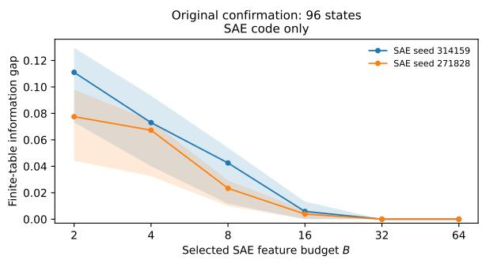  
(a) Original confirmation collection.

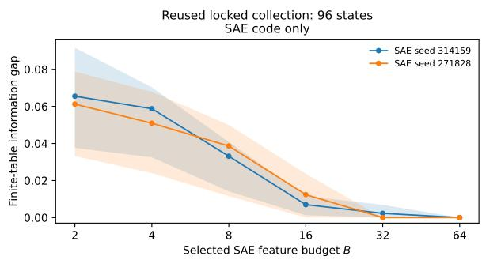  
(b) Reused locked collection.  
Figure 24: Paired Phi Z-only Mistral-loss curves. The policy-aware counterparts appear in Figure 23. These plots change only the observation key, not the response samples or selected features.

Table 33 continued.
<table><tr><td>B</td><td>Evaluator</td><td> $\widehat { R } _ { \mathrm { f u l l } }$ </td><td> $\widehat { R } _ { V } ^ { \star }$ </td><td> $\widehat { \Delta } _ { V }$ </td><td></td><td>95%CI 95% LCB</td><td> $f _ { 0 }$ </td></tr><tr><td>4</td><td>Mean loss</td><td>0.1731</td><td>0.2510</td><td>0.0779</td><td>[0.0421, 0.0960]</td><td>0.0471</td><td>0.000</td></tr><tr><td>8</td><td>Mistral</td><td>0.1006</td><td>0.1288</td><td>0.0281</td><td>[0.0087, 0.0478]</td><td>0.0101</td><td>0.000</td></tr><tr><td>8</td><td>Qwen</td><td>0.1910</td><td>0.2439</td><td>0.0529</td><td>[0.0152, 0.0709]</td><td>0.0172</td><td>0.000</td></tr><tr><td>8</td><td>Mean loss</td><td>0.1731</td><td>0.2140</td><td>0.0409</td><td>[0.0152, 0.0492]</td><td>0.0174</td><td>0.000</td></tr><tr><td>16</td><td>Mistral</td><td>0.1006</td><td>0.1052</td><td>0.0046</td><td>[0.0000, 0.0081]</td><td>0.0000</td><td>0.069</td></tr><tr><td>16</td><td>Qwen</td><td>0.1910</td><td>0.2042</td><td>0.0132</td><td>[0.0044, 0.0183]</td><td>0.0052</td><td>0.000</td></tr><tr><td>16</td><td>Mean loss</td><td>0.1731</td><td>0.1830</td><td>0.0099</td><td>[0.0026, 0.0123]</td><td>0.0032</td><td>0.004</td></tr><tr><td>32</td><td>Mistral</td><td>0.1006</td><td>0.1016</td><td>0.0009</td><td>[0.0000, 0.0019]</td><td>0.0000</td><td>0.421</td></tr><tr><td>32</td><td>Qwen</td><td>0.1910</td><td>0.1994</td><td>0.0084</td><td>[0.0000, 0.0120]</td><td>0.0004</td><td>0.035</td></tr><tr><td>32</td><td>Mean loss</td><td>0.1731</td><td>0.1767</td><td>0.0036</td><td>[0.0000, 0.0059]</td><td>0.0000</td><td>0.068</td></tr><tr><td>64</td><td>Mistral</td><td>0.1006</td><td>0.1006</td><td>0.0000</td><td>[0.0000, 0.0000]</td><td>0.0000</td><td>1.000</td></tr><tr><td>64</td><td>Qwen</td><td>0.1910</td><td>0.1910</td><td>0.0000</td><td>[0.0000, 0.0000]</td><td>0.0000</td><td>1.000</td></tr><tr><td>64</td><td>Mean loss</td><td>0.1731</td><td>0.1731</td><td>0.0000</td><td>[0.0000, 0.0000]</td><td>0.0000</td><td>1.000</td></tr><tr><td colspan="8">Reused 96, seed 271828</td></tr><tr><td>2</td><td>Mistral</td><td>0.1006</td><td>0.1697</td><td>0.0691</td><td>[0.0406, 0.0973]</td><td>0.0442</td><td>0.000</td></tr><tr><td>2</td><td>Qwen</td><td>0.1910</td><td>0.2983</td><td>0.1073</td><td>[0.0445, 0.1674]</td><td>0.0503</td><td>0.000</td></tr><tr><td>2</td><td>Mean loss</td><td>0.1731</td><td>0.2784</td><td>0.1053</td><td>[0.0709, 0.1306]</td><td>0.0750</td><td>0.000</td></tr><tr><td>4</td><td>Mistral</td><td>0.1006</td><td>0.1684</td><td>0.0678</td><td>[0.0393, 0.0950]</td><td>0.0431</td><td>0.000</td></tr><tr><td>4</td><td>Qwen</td><td>0.1910</td><td>0.2937</td><td>0.1027</td><td>[0.0403, 0.1602]</td><td>0.0454</td><td>0.000</td></tr><tr><td>4</td><td>Mean loss</td><td>0.1731</td><td>0.2784</td><td>0.1053</td><td>[0.0661, 0.1217]</td><td>0.0712</td><td>0.000</td></tr><tr><td>8</td><td>Mistral</td><td>0.1006</td><td>0.1405</td><td>0.0399</td><td>[0.0152, 0.0593]</td><td>0.0185</td><td>0.000</td></tr><tr><td>8</td><td>Qwen</td><td>0.1910</td><td>0.2562</td><td>0.0652</td><td>[0.0257, 0.0801]</td><td>0.0295</td><td>0.000</td></tr><tr><td>8</td><td>Mean loss</td><td>0.1731</td><td>0.2177</td><td>0.0446</td><td>[0.0232, 0.0488]</td><td>0.0251</td><td>0.000</td></tr><tr><td>16</td><td>Mistral</td><td>0.1006</td><td>0.1131</td><td>0.0125</td><td>[0.0025, 0.0165]</td><td>0.0036</td><td>0.001</td></tr><tr><td>16</td><td>Qwen</td><td>0.1910</td><td>0.2204</td><td>0.0294</td><td>[0.0082, 0.0362]</td><td>0.0097</td><td>0.000</td></tr><tr><td>16</td><td>Mean loss</td><td>0.1731</td><td>0.1933</td><td>0.0202</td><td>[0.0052, 0.0238]</td><td>0.0069</td><td>0.000</td></tr><tr><td>32</td><td>Mistral</td><td>0.1006</td><td>0.1032</td><td>0.0026</td><td>[0.0000, 0.0052]</td><td>0.0000</td><td>0.419</td></tr><tr><td>32</td><td>Qwen</td><td>0.1910</td><td>0.2016</td><td>0.0106</td><td>[0.0000, 0.0173]</td><td>0.0000</td><td>0.357</td></tr><tr><td>32</td><td>Mean loss</td><td>0.1731</td><td>0.1809</td><td>0.0078</td><td>[0.0000, 0.0113]</td><td>0.0000</td><td>0.357</td></tr><tr><td>64</td><td>Mistral</td><td>0.1006</td><td>0.1006</td><td>0.0000</td><td>[0.0000, 0.0000]</td><td>0.0000</td><td>1.000</td></tr><tr><td>64</td><td>Qwen</td><td>0.1910</td><td>0.1910</td><td>0.0000</td><td>[0.0000, 0.0000]</td><td>0.0000</td><td>1.000</td></tr><tr><td>64</td><td>Mean loss</td><td>0.1731</td><td>0.1731</td><td>0.0000</td><td>[0.0000, 0.0000]</td><td>0.0000</td><td>1.000</td></tr></table>

Table 34: Phi reconstruction diagnostics. FVU is centered fraction of variance unexplained; relative error uses the same reconstruction-error numerator divided by uncentered activation energy. Active counts features observed at least once in the listed dataset, not globally active or dead features.
<table><tr><td>Seed</td><td>Dataset</td><td>n</td><td>FVU</td><td>Relative error</td><td>Cosine</td><td> $L _ { 0 }$ </td><td>Active</td></tr><tr><td>314159</td><td>Validation</td><td>300000</td><td>0.0162</td><td>0.0153</td><td>0.9277</td><td>64.0</td><td>16384</td></tr><tr><td>314159</td><td>Original 240</td><td>240</td><td>17.3125</td><td>0.3062</td><td>0.8327</td><td>64.0</td><td>192</td></tr><tr><td>314159</td><td>Reused 96</td><td>96</td><td>2.8355</td><td>0.2767</td><td>0.8496</td><td>64.0</td><td>445</td></tr><tr><td>271828</td><td>Validation</td><td>300000</td><td>0.0163</td><td>0.0154</td><td>0.9277</td><td>64.0</td><td>16384</td></tr><tr><td>271828</td><td>Original 240</td><td>240</td><td>16.6518</td><td>0.2946</td><td>0.8397</td><td>64.0</td><td>166</td></tr><tr><td>271828</td><td>Reused 96</td><td>96</td><td>2.7705</td><td>0.2704</td><td>0.8536</td><td>64.0</td><td>437</td></tr></table>

## 1.5 Reconstruction and feature occupancy

For activation vectors $h _ { i }$ and reconstructions $\widehat { h } _ { i } .$ let h be the mean activation on the listed dataset. For positive denominators, the centered and uncentered diagnostics are

$$
\mathrm { F V U } = \frac { \sum _ { i } \| h _ { i } - \widehat { h } _ { i } \| _ { 2 } ^ { 2 } } { \sum _ { i } \| h _ { i } - \overline { { h } } \| _ { 2 } ^ { 2 } } , \qquad E _ { \mathrm { r e l } } = \frac { \sum _ { i } \| h _ { i } - \widehat { h } _ { i } \| _ { 2 } ^ { 2 } } { \sum _ { i } \| h _ { i } \| _ { 2 } ^ { 2 } } .
$$

The denominator difference does not imply negligible reconstruction error. Mean cosine is averaged over individual vectors. The audit JSON retains a historical field named dead\_fraction\_on\_validation; on audit records this field denotes features unobserved on that small audit sample. It is not evidence that those features are globally dead. Quantiles and activation/reconstruction norms remain in the original JSON/CSV files.

Table 35: Phi supervised-selector occupancy. Fit and Eval count distinct complete observation keys. Collision is the fraction of evaluation states sharing an observation key; Unseen is the fraction whose complete key is absent from fitting. For (Z, S), new policy text alone makes the complete key unseen.
<table><tr><td>B Observation</td><td>Fit</td><td>Eval</td><td>Collision</td><td>Unseen</td><td>Largest cell</td></tr><tr><td>Original 96, seed 314159</td><td></td><td></td><td></td><td></td><td></td></tr><tr><td>2 Z only</td><td>4</td><td>4</td><td>0.990</td><td>0.000</td><td>51</td></tr><tr><td>2 (Z, S)</td><td>38</td><td>24</td><td>0.958</td><td>1.000</td><td>11</td></tr><tr><td>4 Z only</td><td>15</td><td>11</td><td>0.979</td><td>0.062</td><td>27</td></tr><tr><td>4 (Z, S)</td><td>68</td><td>44</td><td>0.781</td><td>1.000</td><td>6</td></tr><tr><td>8 Z only</td><td>53</td><td>35</td><td>0.844</td><td>0.125</td><td>9</td></tr><tr><td>8 (Z, S)</td><td>110</td><td>72</td><td>0.469</td><td>1.000</td><td>4</td></tr><tr><td>16 Z only</td><td>125</td><td>87</td><td>0.177</td><td>0.844</td><td>3</td></tr><tr><td>16 (Z, S)</td><td>139</td><td>94</td><td>0.042</td><td>1.000</td><td>2</td></tr><tr><td>32 Z only</td><td>143</td><td>96</td><td>0.000</td><td>0.969</td><td>1</td></tr><tr><td>32 (Z, S)</td><td>144</td><td>96</td><td>0.000</td><td>1.000</td><td>1</td></tr><tr><td>64 Z only</td><td>144</td><td>96</td><td>0.000</td><td>1.000</td><td>1</td></tr><tr><td>64 (Z, S)</td><td>144</td><td>96</td><td>0.000</td><td>1.000</td><td>1</td></tr><tr><td></td><td></td><td></td><td></td><td></td><td></td></tr><tr><td colspan="6">Original 96, seed 271828</td></tr><tr><td>2 Z only</td><td>4</td><td>4</td><td>1.000</td><td>0.000</td><td>52</td></tr><tr><td>2 (Z, S)</td><td>39</td><td>25</td><td>0.969</td><td>1.000</td><td>8</td></tr><tr><td>4 Z only</td><td>15</td><td>11</td><td>1.000</td><td>0.000</td><td>19</td></tr><tr><td>4 (Z, S)</td><td>77</td><td>52</td><td>0.740</td><td>1.000</td><td>4</td></tr><tr><td>8 Z only</td><td>57</td><td>36</td><td>0.823</td><td>0.115</td><td>9</td></tr><tr><td>8 (Z, S)</td><td>109</td><td>71</td><td>0.458</td><td>1.000</td><td>4</td></tr><tr><td>16 Z only</td><td>125</td><td>83</td><td>0.229</td><td>0.740</td><td>4</td></tr><tr><td>16 (Z, S)</td><td>140</td><td>95</td><td>0.021</td><td>1.000</td><td>2</td></tr><tr><td>32 Z only</td><td>144</td><td>94</td><td>0.042</td><td>1.000</td><td>2</td></tr><tr><td>32 (Z, S)</td><td></td><td>96</td><td>0.000</td><td>1.000</td><td>1</td></tr><tr><td></td><td>144</td><td></td><td></td><td></td><td></td></tr><tr><td>64 Z only</td><td>144</td><td>96</td><td>0.000</td><td>1.000</td><td>1</td></tr><tr><td>64 (Z, S)</td><td>144</td><td>96</td><td>0.000</td><td>1.000</td><td>1</td></tr></table>

Table 35 continued.
<table><tr><td>B</td><td>Observation</td><td>Fit</td><td>Eval</td><td>Collision</td><td>Unseen</td><td>Largest cell</td></tr><tr><td colspan="7">Reused 96, seed 314159</td></tr><tr><td></td><td>2 Z only</td><td>4</td><td>3</td><td>0.990</td><td>0.000</td><td>57</td></tr><tr><td>2</td><td>(Z, S)</td><td>38</td><td>17</td><td>0.990</td><td>1.000</td><td>9</td></tr><tr><td>4</td><td>Z only</td><td>15</td><td>6</td><td>0.990</td><td>0.000</td><td>48</td></tr><tr><td>4</td><td>(Z, S)</td><td>68</td><td>32</td><td>0.885</td><td>1.000</td><td>8</td></tr><tr><td>8</td><td>Z only</td><td>53</td><td>25</td><td>0.885</td><td>0.438</td><td>21</td></tr><tr><td>8</td><td>(Z, S)</td><td>110</td><td>58</td><td>0.656</td><td>1.000</td><td>4</td></tr><tr><td>16</td><td> $Z \ \mathrm { o n l y }$ </td><td>125</td><td>60</td><td>0.521</td><td>0.938</td><td>11</td></tr><tr><td>16</td><td> $( Z , S )$ </td><td>139</td><td>84</td><td>0.219</td><td>1.000</td><td>4</td></tr><tr><td>32</td><td> $Z \ \mathrm { o n l y }$ </td><td>143</td><td>84</td><td>0.208</td><td>1.000</td><td>5</td></tr><tr><td>32</td><td> $( Z , S )$ </td><td>144</td><td>93</td><td>0.062</td><td>1.000</td><td>2</td></tr><tr><td>64</td><td>Z only</td><td>144</td><td>94</td><td>0.042</td><td>1.000</td><td>2</td></tr><tr><td>64</td><td> $( Z , S )$ </td><td>144</td><td>95</td><td>0.021</td><td>1.000</td><td>2</td></tr><tr><td colspan="7">Reused 96, seed 271828</td></tr><tr><td>2 Z only</td><td></td><td>4</td><td>4</td><td>1.000</td><td>0.000</td><td>51</td></tr><tr><td>2</td><td>(Z, S)</td><td>39</td><td>20</td><td>0.979</td><td>1.000</td><td>10</td></tr><tr><td>4</td><td>Z only</td><td>15</td><td>8</td><td>0.979</td><td>0.000</td><td>48</td></tr><tr><td>4</td><td>(Z, S)</td><td>77</td><td>28</td><td>0.896</td><td>1.000</td><td>10</td></tr><tr><td>8</td><td>Z only</td><td>57</td><td>26</td><td>0.875</td><td>0.375</td><td>11</td></tr><tr><td>8</td><td>(Z, S)</td><td>109</td><td>66</td><td>0.500</td><td>1.000</td><td>5</td></tr><tr><td>16</td><td>Z only</td><td>125</td><td>65</td><td>0.500</td><td>0.979</td><td>6</td></tr><tr><td>16</td><td>(Z, S)</td><td>140</td><td>88</td><td>0.167</td><td>1.000</td><td>2</td></tr><tr><td>32</td><td>Z only</td><td>144</td><td>93</td><td>0.062</td><td>1.000</td><td>2</td></tr><tr><td>32</td><td>(Z, S)</td><td>144</td><td>95</td><td>0.021</td><td>1.000</td><td>2</td></tr><tr><td>64</td><td>Z only</td><td>144</td><td>96</td><td>0.000</td><td>1.000</td><td>1</td></tr><tr><td>64</td><td>(Z, S)</td><td>144</td><td>96</td><td>0.000</td><td>1.000</td><td>1</td></tr></table>

Table 36: Phi variance-selector occupancy. Fit and Eval count distinct complete observation keys. Collision is the fraction of evaluation states sharing an observation key; Unseen is the fraction whose complete key is absent from fitting. For (Z, S), new policy text alone makes the complete key unseen.
<table><tr><td>B Observation</td><td>Fit</td><td>Eval</td><td>Collision</td><td>Unseen</td><td>Largest cell</td></tr><tr><td colspan="6">Original 96, seed 314159</td></tr><tr><td>2 Z only</td><td>2</td><td>2</td><td>1.000</td><td>0.000</td><td>59</td></tr><tr><td>2 (Z, S)</td><td>23</td><td>16</td><td>1.000</td><td>1.000</td><td>9</td></tr><tr><td>4 Z only</td><td>8</td><td>7</td><td>1.000</td><td>0.000</td><td>21</td></tr><tr><td>4 (Z, S)</td><td>56</td><td>46</td><td>0.812</td><td>1.000</td><td>6</td></tr><tr><td>8 Z only</td><td>50</td><td>34</td><td>0.833</td><td>0.240</td><td>8</td></tr><tr><td>8 (Z, S)</td><td>119</td><td>77</td><td>0.375</td><td>1.000</td><td>3</td></tr><tr><td>16 Z only</td><td>132</td><td>92</td><td>0.083</td><td>0.854</td><td>2</td></tr><tr><td>16 (Z, S)</td><td>141</td><td>94</td><td>0.042</td><td>1.000</td><td>2</td></tr><tr><td>32 Z only</td><td>144</td><td>96</td><td>0.000</td><td>1.000</td><td>1</td></tr><tr><td>32 (Z, S)</td><td>144</td><td>96</td><td>0.000</td><td>1.000</td><td>1</td></tr><tr><td>64 Z only</td><td>144</td><td>96</td><td>0.000</td><td>1.000</td><td>1</td></tr><tr><td>64 (Z, S)</td><td>144</td><td>96</td><td>0.000</td><td>1.000</td><td>1</td></tr><tr><td colspan="6">Original 96, seed 271828</td></tr><tr><td>2 Z only</td><td>1</td><td>1</td><td>1.000</td><td>0.000</td><td>96</td></tr><tr><td>2 (Z, S)</td><td>12</td><td>8</td><td>1.000</td><td>1.000</td><td>12</td></tr><tr><td>4 Z only</td><td>4</td><td>4</td><td>1.000</td><td>0.000</td><td>34</td></tr><tr><td>4 (Z, S)</td><td>41</td><td>29</td><td>0.958</td><td>1.000</td><td>7</td></tr><tr><td>8 Z only</td><td>41</td><td>27</td><td>0.927</td><td>0.042</td><td>16</td></tr><tr><td>8 (Z, S)</td><td>111</td><td>73</td><td>0.427</td><td>1.000</td><td>3</td></tr></table>

Table 36 continued.
<table><tr><td>B</td><td>Observation</td><td>Fit</td><td>Eval</td><td>Collision</td><td>Unseen</td><td>Largest cell</td></tr><tr><td>16</td><td>Z only</td><td>122</td><td>80</td><td>0.302</td><td>0.656</td><td>3</td></tr><tr><td>16</td><td>(Z, S)</td><td>138</td><td>91</td><td>0.104</td><td>1.000</td><td>2</td></tr><tr><td>32</td><td>Z only</td><td>143</td><td>94</td><td>0.042</td><td>0.979</td><td>2</td></tr><tr><td>32</td><td>(Z,S)</td><td>144</td><td>96</td><td>0.000</td><td>1.000</td><td>1</td></tr><tr><td>64</td><td>Z only</td><td>144</td><td>96</td><td>0.000</td><td>1.000</td><td>1 1</td></tr><tr><td>64</td><td>(Z, S)</td><td>144</td><td>96</td><td>0.000</td><td>1.000</td><td></td></tr><tr><td colspan="7">Reused 96, seed 314159</td></tr><tr><td></td><td>2 Z only</td><td>2</td><td>3</td><td>1.000</td><td>0.052</td><td>85</td></tr><tr><td>2</td><td>(Z, S)</td><td>23</td><td>14</td><td>0.979</td><td>1.000</td><td>12</td></tr><tr><td>4</td><td>Z only</td><td>8</td><td>7</td><td>1.000</td><td>0.052</td><td>42</td></tr><tr><td>4</td><td>(Z, S)</td><td>56</td><td>33</td><td>0.906</td><td>1.000</td><td>8</td></tr><tr><td>8</td><td>Z only</td><td>50</td><td>34</td><td>0.833</td><td>0.198</td><td>30</td></tr><tr><td>8</td><td>(Z, S)</td><td>119</td><td>65</td><td>0.500</td><td>1.000</td><td>5</td></tr><tr><td>16</td><td>Z only</td><td>132</td><td>71</td><td>0.344</td><td>0.969</td><td>9</td></tr><tr><td>16</td><td>(Z, S)</td><td>141</td><td>90</td><td>0.125</td><td>1.000</td><td>2</td></tr><tr><td>32</td><td>Z only</td><td>144</td><td>83</td><td>0.229</td><td>1.000</td><td>4</td></tr><tr><td>32</td><td>(Z, S)</td><td>144</td><td>96</td><td>0.000</td><td>1.000</td><td>1</td></tr><tr><td>64</td><td>Z only</td><td>144</td><td>95</td><td>0.021</td><td>1.000</td><td>2</td></tr><tr><td>64</td><td>(Z, S)</td><td>144</td><td>96</td><td>0.000</td><td>1.000</td><td>1</td></tr><tr><td colspan="7">Reused 96, seed 271828</td></tr><tr><td></td><td>2 Z only</td><td>1</td><td>1</td><td>1.000</td><td>0.000</td><td>96</td></tr><tr><td>2</td><td>(Z, S)</td><td>12</td><td>8</td><td>1.000</td><td>1.000</td><td>12</td></tr><tr><td>4</td><td>Z only</td><td>4</td><td>4</td><td>0.990</td><td>0.000</td><td>73</td></tr><tr><td>4</td><td>(Z, S)</td><td>41</td><td>17</td><td>0.979</td><td>1.000</td><td>12</td></tr><tr><td>8</td><td>Z only</td><td>41</td><td>16</td><td>0.938</td><td>0.302</td><td>23</td></tr><tr><td>8</td><td>(Z, S)</td><td>111</td><td>52</td><td>0.698</td><td>1.000</td><td>4</td></tr><tr><td>16</td><td>Z only</td><td>122</td><td>58</td><td>0.552</td><td>0.990</td><td>7</td></tr><tr><td>16</td><td>(Z, S)</td><td>138</td><td>79</td><td>0.292</td><td>1.000</td><td>4</td></tr><tr><td>32</td><td>Z only</td><td>143</td><td>89</td><td>0.135</td><td>1.000</td><td>3</td></tr><tr><td>32</td><td>(Z, S)</td><td>144</td><td>93</td><td>0.062</td><td>1.000</td><td>2</td></tr><tr><td>64</td><td>Z only</td><td>144</td><td>96</td><td>0.000</td><td>1.000</td><td>1</td></tr><tr><td>64</td><td>(Z, S)</td><td>144</td><td>96</td><td>0.000</td><td>1.000</td><td>1</td></tr></table>

## 1.6 Policy-area deletion and selector controls

Each deletion removes exactly one of eight areas and leaves 84 states. The minimum over all 192 saved primary deletion estimates is 0.02363095. The ranges below are sensitivity results, not additional confidence intervals. Random selection from all features, selection from features that vary on the fitting set, and approximate occupancy matching are recorded only for Mistral loss under the Z-only observation. The matching routine uses fitting data and retains 40 controls from its candidate search; its recorded distance and exact-match fraction are reported rather than assuming exact occupancy matching

Table 37: Phi single policy area deletion sensitivity at B = 2. Each row summarizes the eight deletions for one setting; each deletion retains 84 states. Values are point-estimate minima, medians, and maxima, not confidence bounds. All 192 deletion-level estimates are preserved in the CSV archive.
<table><tr><td>Collection</td><td>Seed</td><td>Observation</td><td>Evaluator</td><td>Minimum</td><td>Median</td><td>Maximum</td></tr><tr><td>Original 96</td><td>314159</td><td>Z only</td><td>Mistral</td><td>0.0989</td><td>0.1126</td><td>0.1204</td></tr><tr><td>Original 96</td><td>314159</td><td>Z only</td><td>Qwen</td><td>0.0823</td><td>0.1032</td><td>0.1107</td></tr><tr><td>Original 96</td><td>314159</td><td>Z only</td><td>Mean loss</td><td>0.0685</td><td>0.0806</td><td>0.0905</td></tr><tr><td>Original 96</td><td>314159</td><td>(Z, S)</td><td>Mistral</td><td>0.0493</td><td>0.0554</td><td>0.0637</td></tr><tr><td>Original 96</td><td>314159</td><td>(Z, S)</td><td>Qwen</td><td>0.0734</td><td>0.0847</td><td>0.0901</td></tr><tr><td>Original 96</td><td>314159</td><td>(Z, S)</td><td>Mean loss</td><td>0.0509</td><td>0.0570</td><td>0.0622</td></tr></table>

Table 37 continued.
<table><tr><td>Collection</td><td>Seed</td><td>Observation</td><td>Evaluator</td><td>Minimum</td><td>Median</td><td>Maximum</td></tr><tr><td>Original 96</td><td>271828</td><td>Z only</td><td>Mistral</td><td>0.0643</td><td>0.0770</td><td>0.0826</td></tr><tr><td>Original 96</td><td>271828</td><td>Z only</td><td>Qwen</td><td>0.0445</td><td>0.0473</td><td>0.0557</td></tr><tr><td>Original 96</td><td>271828</td><td>Z only</td><td>Mean loss</td><td>0.0408</td><td>0.0466</td><td>0.0524</td></tr><tr><td>Original 96</td><td>271828</td><td>(Z, S)</td><td>Mistral</td><td>0.0387</td><td>0.0509</td><td>0.0561</td></tr><tr><td>Original 96</td><td>271828</td><td>(Z, S)</td><td>Qwen</td><td>0.0338</td><td>0.0343</td><td>0.0417</td></tr><tr><td>Original 96</td><td>271828</td><td>(Z, S)</td><td>Mean loss</td><td>0.0236</td><td>0.0302</td><td>0.0339</td></tr><tr><td>Reused 96</td><td>314159</td><td>Z only</td><td>Mistral</td><td>0.0565</td><td>0.0655</td><td>0.0749</td></tr><tr><td>Reused 96</td><td>314159</td><td>Z only</td><td>Qwen</td><td>0.0702</td><td>0.1130</td><td>0.1201</td></tr><tr><td>Reused 96</td><td>314159</td><td>Z only</td><td>Mean loss</td><td>0.0860</td><td>0.0950</td><td>0.1035</td></tr><tr><td>Reused 96</td><td>314159</td><td>(Z, S)</td><td>Mistral</td><td>0.0315</td><td>0.0445</td><td>0.0499</td></tr><tr><td>Reused 96</td><td>314159</td><td>(Z, S)</td><td>Qwen</td><td>0.0521</td><td>0.0591</td><td>0.0642</td></tr><tr><td>Reused 96</td><td>314159</td><td>(Z, S)</td><td>Mean loss</td><td>0.0581</td><td>0.0718</td><td>0.0774</td></tr><tr><td>Reused 96</td><td>271828</td><td>Z only</td><td>Mistral</td><td>0.0531</td><td>0.0616</td><td>0.0700</td></tr><tr><td>Reused 96</td><td>271828</td><td>Z only</td><td>Qwen</td><td>0.0702</td><td>0.0998</td><td>0.1087</td></tr><tr><td>Reused 96</td><td>271828</td><td>Z only</td><td>Mean loss</td><td>0.0592</td><td>0.0710</td><td>0.0752</td></tr><tr><td>Reused 96</td><td>271828</td><td>(Z, S)</td><td>Mistral</td><td>0.0255</td><td>0.0335</td><td>0.0379</td></tr><tr><td>Reused 96</td><td>271828</td><td>(Z, S)</td><td>Qwen</td><td>0.0385</td><td>0.0467</td><td>0.0524</td></tr><tr><td>Reused 96</td><td>271828</td><td>(Z, S)</td><td>Mean loss</td><td>0.0375</td><td>0.0492</td><td>0.0502</td></tr></table>

Table 38: Phi random-selector summaries use Mistral loss and Z-only observations exclusively. Each budget has 200 all-feature draws, 200 fitting-nonconstant draws, and 40 controls matched by occupancy on fitting states per seed and collection. These are not policy-aware control results. SD describes variation over the saved selectors, not a bootstrap standard error.
<table><tr><td>B Selector</td><td>N</td><td>Mean</td><td>SD</td><td>Minimum</td><td>Median</td><td>Maximum</td></tr><tr><td colspan="7">Original 96, seed 314159</td></tr><tr><td>2 All features</td><td>200</td><td>0.1377</td><td>0.0001</td><td>0.1366</td><td>0.1377</td><td>0.1377</td></tr><tr><td>2 Fit nonconstant</td><td>200</td><td>0.1298</td><td>0.0120</td><td>0.0858</td><td>0.1369</td><td>0.1377</td></tr><tr><td>2 Fit matched</td><td>40</td><td>0.1181</td><td>0.0143</td><td>0.0906</td><td>0.1189</td><td>0.1377</td></tr><tr><td>4 All features</td><td>200</td><td>0.1376</td><td>0.0013</td><td>0.1215</td><td>0.1377</td><td>0.1377</td></tr><tr><td>4 Fit nonconstant</td><td>200</td><td>0.1199</td><td>0.0159</td><td>0.0794</td><td>0.1239</td><td>0.1377</td></tr><tr><td>4 Fit matched</td><td>40</td><td>0.1015</td><td>0.0140</td><td>0.0785</td><td>0.1030</td><td>0.1294</td></tr><tr><td>8 All features</td><td>200</td><td>0.1377</td><td>0.0008</td><td>0.1261</td><td>0.1377</td><td>0.1377</td></tr><tr><td>8 Fit nonconstant</td><td>200</td><td>0.0956</td><td>0.0194</td><td>0.0546</td><td>0.0967</td><td>0.1377</td></tr><tr><td>8 Fit matched</td><td>40</td><td>0.0690</td><td>0.0168</td><td>0.0320</td><td>0.0695</td><td>0.1091</td></tr><tr><td>16 All features</td><td>200</td><td>0.1373</td><td>0.0029</td><td>0.1062</td><td>0.1377</td><td>0.1377</td></tr><tr><td>16 Fit nonconstant</td><td>200</td><td>0.0524</td><td>0.0193</td><td>0.0082</td><td>0.0514</td><td>0.1120</td></tr><tr><td>16 Fit matched</td><td>40</td><td>0.0195</td><td>0.0088</td><td>0.0082</td><td>0.0185</td><td>0.0436</td></tr><tr><td>32 All features</td><td>200</td><td>0.1369</td><td>0.0035</td><td>0.1150</td><td>0.1377</td><td>0.1377</td></tr><tr><td>32 Fit nonconstant</td><td>200</td><td>0.0082</td><td>0.0080</td><td>0.0000</td><td>0.0060</td><td>0.0454</td></tr><tr><td>32 Fit matched</td><td>40</td><td>0.0015</td><td>0.0020</td><td>0.0000</td><td>0.0000</td><td>0.0071</td></tr><tr><td>64 All features</td><td>200</td><td>0.1348</td><td>0.0081</td><td>0.0927</td><td>0.1377</td><td>0.1377</td></tr><tr><td>64</td><td>Fit nonconstant 200</td><td>0.0002</td><td>0.0008</td><td>0.0000</td><td>0.0000</td><td>0.0054</td></tr><tr><td>64 Fit matched</td><td>40</td><td>0.0000</td><td>0.0000</td><td>0.0000</td><td>0.0000</td><td>0.0000</td></tr><tr><td colspan="7">Original 96, seed 271828</td></tr><tr><td>2</td><td>All features</td><td>200 0.1377</td><td>0.0000</td><td>0.1377</td><td>0.1377</td><td>0.1377</td></tr><tr><td>2</td><td>Fit nonconstant 200</td><td>0.1270</td><td>0.0172</td><td>0.0583</td><td>0.1356</td><td>0.1377</td></tr><tr><td>2 Fit matched</td><td>40</td><td>0.1062</td><td>0.0228</td><td>0.0636</td><td>0.1086</td><td>0.1377</td></tr><tr><td>4 All features</td><td>200</td><td>0.1375</td><td>0.0027</td><td>0.1009</td><td>0.1377</td><td>0.1377</td></tr><tr><td>4</td><td>Fit nonconstant 200</td><td>0.1140</td><td>0.0228</td><td>0.0296</td><td>0.1201</td><td>0.1377</td></tr><tr><td>4 Fit matched</td><td>40</td><td>0.0909</td><td>0.0231</td><td>0.0466</td><td>0.0905</td><td>0.1373</td></tr><tr><td>8 All features</td><td>200</td><td>0.1372</td><td>0.0032</td><td>0.1028</td><td>0.1377</td><td>0.1377</td></tr><tr><td>8</td><td>Fit nonconstant</td><td>0.0885</td><td>0.0253</td><td>0.0271</td><td>0.0875</td><td>0.1360</td></tr><tr><td></td><td>200</td><td></td><td></td><td></td><td></td><td></td></tr></table>

Table 38 continued.
<table><tr><td>B</td><td>Selector</td><td>N</td><td>Mean</td><td>SD</td><td>Minimum</td><td>Median</td><td>Maximum</td></tr><tr><td>8</td><td>Fit matched</td><td>40</td><td>0.0569</td><td>0.0199</td><td>0.0195</td><td>0.0592</td><td>0.0990</td></tr><tr><td>16</td><td>All features</td><td>200</td><td>0.1370</td><td>0.0061</td><td>0.0636</td><td>0.1377</td><td>0.1377</td></tr><tr><td>16</td><td>Fit nonconstant</td><td>200</td><td>0.0417</td><td>0.0218</td><td>0.0022</td><td>0.0388</td><td>0.1080</td></tr><tr><td>16</td><td>Fit matched</td><td>40</td><td>0.0146</td><td>0.0085</td><td>0.0014</td><td>0.0138</td><td>0.0375</td></tr><tr><td>32</td><td>All features</td><td>200</td><td>0.1366</td><td>0.0065</td><td>0.0830</td><td>0.1377</td><td>0.1377</td></tr><tr><td>32</td><td>Fit nonconstant</td><td>200</td><td>0.0053</td><td>0.0059</td><td>0.0000</td><td>0.0036</td><td>0.0383</td></tr><tr><td>32</td><td>Fit matched</td><td>40</td><td>0.0014</td><td>0.0025</td><td>0.0000</td><td>0.0005</td><td>0.0139</td></tr><tr><td>64</td><td>All features</td><td>200</td><td>0.1345</td><td>0.0109</td><td>0.0636</td><td>0.1377</td><td>0.1377</td></tr><tr><td>64</td><td>Fit nonconstant</td><td>200</td><td>0.0000</td><td>0.0003</td><td>0.0000</td><td>0.0000</td><td>0.0031</td></tr><tr><td>64</td><td>Fit matched</td><td>40</td><td>0.0000</td><td>0.0000</td><td>0.0000</td><td>0.0000</td><td>0.0000</td></tr><tr><td colspan="8">Reused 96, seed 314159</td></tr><tr><td>2</td><td>All features</td><td>200</td><td>0.0690</td><td>0.0006</td><td>0.0607</td><td>0.0691</td><td>0.0691</td></tr><tr><td>2</td><td>Fit nonconstant</td><td>200</td><td>0.0651</td><td>0.0077</td><td>0.0255</td><td>0.0691</td><td>0.0691</td></tr><tr><td>2</td><td>Fit matched</td><td>40</td><td>0.0668</td><td>0.0045</td><td>0.0444</td><td>0.0684</td><td>0.0691</td></tr><tr><td>4</td><td>All features</td><td>200</td><td>0.0690</td><td>0.0009</td><td>0.0573</td><td>0.0691</td><td>0.0691</td></tr><tr><td>4</td><td>Fit nonconstant</td><td>200</td><td>0.0608</td><td>0.0097</td><td>0.0180</td><td>0.0641</td><td>0.0691</td></tr><tr><td>4</td><td>Fit matched</td><td>40</td><td>0.0586</td><td>0.0101</td><td>0.0271 0.0622</td><td>0.0629</td><td>0.0691</td></tr><tr><td>8</td><td>All features</td><td>200</td><td>0.0689</td><td>0.0008 0.0125</td><td>0.0175</td><td>0.0691</td><td>0.0691 0.0691</td></tr><tr><td>8</td><td>Fit nonconstant</td><td>200</td><td>0.0464</td><td></td><td></td><td>0.0462</td><td></td></tr><tr><td>8</td><td>Fit matched</td><td>40</td><td>0.0404</td><td>0.0139</td><td>0.0124</td><td>0.0381</td><td>0.0678 0.0691</td></tr><tr><td>16</td><td>All features</td><td>200</td><td>0.0688</td><td>0.0010</td><td>0.0601</td><td>0.0691</td><td></td></tr><tr><td>16</td><td>Fit nonconstant</td><td>200</td><td>0.0214</td><td>0.0119</td><td>0.0000</td><td>0.0192</td><td>0.0562</td></tr><tr><td>16</td><td>Fit matched</td><td>40</td><td>0.0169</td><td>0.0084</td><td>0.0023 0.0385</td><td>0.0160</td><td>0.0375 0.0691</td></tr><tr><td>32</td><td>All features</td><td>200</td><td>0.0679</td><td>0.0038</td><td></td><td>0.0691</td><td>0.0238</td></tr><tr><td>32</td><td>Fit nonconstant</td><td>200</td><td>0.0037</td><td>0.0041</td><td>0.0000 0.0000</td><td>0.0024 0.0012</td><td></td></tr><tr><td>32</td><td>Fit matched</td><td>40</td><td>0.0020</td><td>0.0029</td><td>0.0424</td><td>0.0691</td><td>0.0141 0.0691</td></tr><tr><td>64</td><td>All features</td><td>200</td><td>0.0668</td><td>0.0046</td><td>0.0000</td><td>0.0000</td><td>0.0026</td></tr><tr><td>64</td><td>Fit nonconstant Fit matched</td><td>200</td><td>0.0001</td><td>0.0004</td><td>0.0000</td><td>0.0000</td><td>0.0021</td></tr><tr><td>64</td><td></td><td>40</td><td>0.0001</td><td>0.0004</td><td></td><td></td><td></td></tr><tr><td colspan="8">Reused 96, seed 271828</td></tr><tr><td>2</td><td>All features</td><td>200</td><td>0.0690</td><td>0.0005</td><td>0.0622</td><td>0.0691</td><td>0.0691</td></tr><tr><td>2</td><td>Fit nonconstant</td><td>200</td><td>0.0651</td><td>0.0060</td><td>0.0352</td><td>0.0678</td><td>0.0691</td></tr><tr><td>2</td><td>Fit matched</td><td>40</td><td>0.0653</td><td>0.0042</td><td>0.0522</td><td>0.0664</td><td>0.0691</td></tr><tr><td>4</td><td>All features</td><td>200</td><td>0.0690</td><td>0.0008</td><td>0.0601</td><td>0.0691</td><td>0.0691</td></tr><tr><td>4</td><td>Fit nonconstant</td><td>200</td><td>0.0599</td><td>0.0085</td><td>0.0310</td><td>0.0625</td><td>0.0691</td></tr><tr><td>4</td><td>Fit matched</td><td>40</td><td>0.0567</td><td>0.0090</td><td>0.0335</td><td>0.0601</td><td>0.0691</td></tr><tr><td>8</td><td>All features</td><td>200</td><td>0.0687</td><td>0.0023</td><td>0.0462</td><td>0.0691</td><td>0.0691</td></tr><tr><td>8</td><td>Fit nonconstant</td><td>200</td><td>0.0463</td><td>0.0111</td><td>0.0194</td><td>0.0472</td><td>0.0691</td></tr><tr><td>8</td><td>Fit matched</td><td>40</td><td>0.0423</td><td>0.0119</td><td>0.0135</td><td>0.0429</td><td>0.0672</td></tr><tr><td>16</td><td>All features</td><td>200</td><td>0.0685</td><td>0.0023</td><td>0.0534</td><td>0.0691</td><td>0.0691</td></tr><tr><td>16</td><td>Fit nonconstant</td><td>200</td><td>0.0204</td><td>0.0104</td><td>0.0021</td><td>0.0193</td><td>0.0545</td></tr><tr><td>16</td><td>Fit matched</td><td>40</td><td>0.0174</td><td>0.0089</td><td>0.0005</td><td>0.0158</td><td>0.0366</td></tr><tr><td>32</td><td>All features</td><td>200</td><td>0.0681</td><td>0.0030</td><td>0.0460</td><td>0.0691</td><td>0.0691</td></tr><tr><td>32</td><td>Fit nonconstant</td><td>200</td><td>0.0029</td><td>0.0031</td><td>0.0000</td><td>0.0021</td><td>0.0149</td></tr><tr><td>32</td><td>Fit matched</td><td>40</td><td>0.0020</td><td>0.0027</td><td>0.0000</td><td>0.0010</td><td>0.0123</td></tr><tr><td>64</td><td>All features</td><td>200</td><td>0.0661</td><td>0.0055</td><td>0.0410</td><td>0.0691</td><td>0.0691</td></tr><tr><td>64</td><td>Fit nonconstant</td><td>200</td><td>0.0000</td><td>0.0002</td><td>0.0000</td><td>0.0000</td><td>0.0015</td></tr><tr><td>64</td><td>Fit matched</td><td>40</td><td>0.0000</td><td>0.0000</td><td>0.0000</td><td>0.0000</td><td>0.0003</td></tr></table>

Table 39: Fitting-only matching diagnostics for Phi random controls. Distances are the recorded occupancy/frequency-matching objective, not distances between held-out losses. Forty retained controls are summarized per seed and budget. Exact is the fraction marked as an exact match by the saved routine; the controls are otherwise approximate matches.
<table><tr><td>Seed</td><td>B</td><td>N</td><td>Min. dist.</td><td>Mean dist.</td><td>Median</td><td>Max. dist.</td><td>Exact</td></tr><tr><td>314159</td><td>2</td><td>40</td><td>0.0174</td><td>0.1897</td><td>0.1962</td><td>0.2951</td><td>0.000</td></tr><tr><td>314159</td><td>4</td><td>40</td><td>0.1059</td><td>0.2581</td><td>0.2639</td><td>0.3420</td><td>0.000</td></tr><tr><td>314159</td><td>8</td><td>40</td><td>0.1042</td><td>0.3294</td><td>0.3542</td><td>0.4392</td><td>0.000</td></tr><tr><td>314159</td><td>16</td><td>40</td><td>0.1445</td><td>0.4498</td><td>0.4898</td><td>0.5842</td><td>0.000</td></tr><tr><td>314159</td><td>32</td><td>40</td><td>0.0927</td><td>0.1379</td><td>0.1420</td><td>0.1565</td><td>0.000</td></tr><tr><td>314159</td><td>64</td><td>40</td><td>0.0503</td><td>0.0753</td><td>0.0769</td><td>0.0809</td><td>0.000</td></tr><tr><td>271828</td><td>2</td><td>40</td><td>0.0799</td><td>0.1879</td><td>0.1927</td><td>0.2361</td><td>0.000</td></tr><tr><td>271828</td><td>4</td><td>40</td><td>0.0833</td><td>0.2232</td><td>0.2240</td><td>0.2882</td><td>0.000</td></tr><tr><td>271828</td><td>8</td><td>40</td><td>0.1042</td><td>0.2863</td><td>0.3077</td><td>0.3759</td><td>0.000</td></tr><tr><td>271828</td><td>16</td><td>40</td><td>0.2096</td><td>0.4442</td><td>0.4781</td><td>0.5451</td><td>0.000</td></tr><tr><td>271828</td><td>32</td><td>40</td><td>0.0961</td><td>0.1597</td><td>0.1625</td><td>0.1819</td><td>0.000</td></tr><tr><td>271828</td><td>64</td><td>40</td><td>0.0526</td><td>0.0658</td><td>0.0661</td><td>0.0719</td><td>0.000</td></tr></table>

Table 40: Saved Phi sanity-control gaps at the primary budget. Constant, Shuffled, and Oracle refer to the exact controls in the archived run. They are descriptive checks and do not replace the matched observation-condition comparison in Table 29.
<table><tr><td>Collection</td><td>Seed</td><td>Observation</td><td>Evaluator</td><td>Constant</td><td>Shuffled</td><td>Oracle</td></tr><tr><td>Original 96</td><td>314159</td><td>Z only</td><td>Mistral</td><td>0.1377</td><td>0.1377</td><td>0.0000</td></tr><tr><td>Original 96</td><td>314159</td><td>Z only</td><td>Qwen</td><td>0.1544</td><td>0.1544</td><td>0.0000</td></tr><tr><td>Original 96</td><td>314159</td><td>Z only</td><td>Mean loss</td><td>0.1217</td><td>0.1217</td><td>0.0000</td></tr><tr><td>Original 96</td><td>314159</td><td>(Z, S)</td><td>Mistral</td><td>0.1377</td><td>0.0933</td><td>0.0000</td></tr><tr><td>Original 96</td><td>314159</td><td>(Z, S)</td><td>Qwen</td><td>0.1544</td><td>0.1335</td><td>0.0000</td></tr><tr><td>Original 96</td><td>314159</td><td>(Z, S)</td><td>Mean loss</td><td>0.1217</td><td>0.1017</td><td>0.0000</td></tr><tr><td>Original 96</td><td>271828</td><td>Z only</td><td>Mistral</td><td>0.1377</td><td>0.1375</td><td>0.0000</td></tr><tr><td>Original 96</td><td>271828</td><td>Z only</td><td>Qwen</td><td>0.1544</td><td>0.1544</td><td>0.0000</td></tr><tr><td>Original 96</td><td>271828</td><td>Z only</td><td>Mean loss</td><td>0.1217</td><td>0.1217</td><td>0.0000</td></tr><tr><td>Original 96</td><td>271828</td><td>(Z, S)</td><td>Mistral</td><td>0.1377</td><td>0.0899</td><td>0.0000</td></tr><tr><td>Original 96</td><td>271828</td><td>(Z, S)</td><td>Qwen</td><td>0.1544</td><td>0.1060</td><td>0.0000</td></tr><tr><td>Original 96</td><td>271828</td><td>(Z, S)</td><td>Mean loss</td><td>0.1217</td><td>0.0829</td><td>0.0000</td></tr><tr><td>Reused 96</td><td>314159</td><td>Z only</td><td>Mistral</td><td>0.0691</td><td>0.0655</td><td>0.0000</td></tr><tr><td>Reused 96</td><td>314159</td><td>Z only</td><td>Qwen</td><td>0.1073</td><td>0.1073</td><td>0.0000</td></tr><tr><td>Reused 96</td><td>314159</td><td>Z only</td><td>Mean loss</td><td>0.1053</td><td>0.1033</td><td>0.0000</td></tr><tr><td>Reused 96</td><td>314159</td><td>(Z, S)</td><td>Mistral</td><td>0.0516</td><td>0.0419</td><td>0.0000</td></tr><tr><td>Reused 96</td><td>314159</td><td>(Z, S)</td><td>Qwen</td><td>0.0584</td><td>0.0575</td><td>0.0000</td></tr><tr><td>Reused 96</td><td>314159</td><td>(Z, S)</td><td>Mean loss</td><td>0.0778</td><td>0.0682</td><td>0.0000</td></tr><tr><td>Reused 96</td><td>271828</td><td>Z only</td><td>Mistral</td><td>0.0691</td><td>0.0691</td><td>0.0000</td></tr><tr><td>Reused 96</td><td>271828</td><td>Z only</td><td>Qwen</td><td>0.1073</td><td>0.1073</td><td>0.0000</td></tr><tr><td>Reused 96</td><td>271828</td><td>Z only</td><td>Mean loss</td><td>0.1053</td><td>0.0984</td><td>0.0000</td></tr><tr><td>Reused 96</td><td>271828</td><td>(Z, S)</td><td>Mistral</td><td>0.0516</td><td>0.0437</td><td>0.0000</td></tr><tr><td>Reused 96</td><td>271828</td><td>(Z, S)</td><td>Qwen</td><td>0.0584</td><td>0.0520</td><td>0.0000</td></tr><tr><td>Reused 96</td><td>271828</td><td>(Z, S)</td><td>Mean loss</td><td>0.0778</td><td>0.0572</td><td>0.0000</td></tr></table>

## 1.7 Evaluator comparison and missing human evaluation

The item-level comparison aligns the two evaluator tables by the same 5,040 response keys. Spearman correlation is 0.35524389, mean absolute difference is 0.32200397, root mean squared difference is 0.43750006, and mean difference between Mistral and Qwen losses is —0.16480820. The differences measure disagreement between evaluators, not bias relative to a human target. Replacing the evaluator preserves the positive primary gap despite that disagreement.

Both optional 528-row Phi rater packets have blank score fields. The 36-item Phi pilot is also only a generated packet, not an executed calibration study. The earlier SmolLM2 human ratings are not reused for Phi responses. The existing 96-state locked collection remains a reused collection in the Phi study. Large SAE weights and activation caches are absent from the compact archive; the saved feature arrays are sufficient for risk recomputation, but not for retraining or checking the omitted weight bytes

## J Observation Reanalysis and Reproduction Checks

## J.1 Detailed policy-aware reanalysis and precision limits

The SmolLM2 reanalysis supplies policy text to the action selector while keeping features, states, responses, and ratings fixed. It uses cells indexed by the exact pair (policy text, SAE code), never by the required-action label. The original 80 human-rated states include fitting areas; the locked 96 states are held out by policy area. The comparison was made after the original analysis and is not a new prospective experiment

SmolLM2 risks with policy supplied. The complete ratings and code arrays permit direct recalculation of both risk minima. Input alignment is documented in the next subsection.

All four policy-aware automatic gaps remain positive. Under final human loss, the original-sample gaps are 0.0345 and 0.0353, with individual one-sided bootstrap lower bounds 0.0203 and 0.0175. On the locked 96- state collection, the gaps are 0.1166 and 0.1082, with lower bounds 0.0935 and 0.0901. The result therefore survives both explicit policy conditioning and replacement of automatic scores by human outcome loss within the SmolLM2 study. The policy-aware gaps are no larger than their paired code-only gaps, as required by Equation (6). The following tables give all budgets and results for each rater.

Qwen2.5 recovery with an explicit precision limit. The available Qwen2.5-1.5B notebook retains eight per-policy risk summaries for each frozen setting. Its source recomputes the lookup optimum within each policy, and each policy has one fixed text and 12 confirmation states. Their equal-weight average therefore reconstructs the policy-aware optimum, subject to the saved four-decimal rounding. We average the directly saved gap column, yielding 0.13695 at layer $1 7 / B = 2$ and 0.03875 at layer $1 9 / B = 1 6 ,$ each with absolute rounding error at most 0.00005. The full-precision Qwen loss and code arrays are not present in this project; we do not represent this calculation as a state-level rerun. We report no new policy-aware result for Qwen2.5-0.5B.

Since policy is observable, clusters from distinct policy texts do not share cells. Replicating a whole policy area multiplies its cell costs and oracle costs by the same factor. Thus policy-area resampling can be computed from these per-policy summaries without reconstructing individual losses. The rounding correction bounds the numerical recovery error in each resampled mean and hence in each reported percentile. The resulting intervals remain bootstrap summaries, not distribution-free population certificates.

Table 41: SmolLM2 reanalysis with active policy and SAE code jointly visible, at B = 2. Auto uses five-rollout means; human uses the fixed packet continuation and final adjudicated loss. Intervals and lower confidence bounds (LCBs) are individual policy-area percentile-bootstrap summaries from 2,000 resamples.
<table><tr><td>Loss</td><td>collection</td><td>SAE seed</td><td> $R _ { \mathrm { f u l l } }$ </td><td> $R _ { Z , S } ^ { \star }$ </td><td> $\Delta _ { Z , S }$ </td><td>95% interval</td><td>95% LCB</td></tr><tr><td>Auto /</td><td>original 96</td><td>314159</td><td>0.1420</td><td>0.2407</td><td>0.0987</td><td>[0.0760, 0.1209]</td><td>0.0807</td></tr><tr><td>Auto /</td><td>/ original 96</td><td>271828</td><td>0.1420</td><td>0.2435</td><td>0.1015</td><td>[0.0680, 0.1394]</td><td>0.0729</td></tr><tr><td></td><td>Auto / locked 96</td><td>314159</td><td>0.2015</td><td>0.2475</td><td>0.0460</td><td>[0.0272, 0.0658]</td><td>0.0300</td></tr><tr><td></td><td>Auto / locked 96</td><td>271828</td><td>0.2015</td><td>0.2445</td><td>0.0430</td><td>[0.0272, 0.0584]</td><td>0.0295</td></tr><tr><td></td><td>Human / original 80</td><td>314159</td><td>0.2155</td><td>0.2500</td><td>0.0345</td><td>[0.0181, 0.0526]</td><td>0.0203</td></tr><tr><td>Human</td><td>original 80 7</td><td>271828</td><td>0.2155</td><td>0.2508</td><td>0.0353</td><td>[0.0153, 0.0594]</td><td>0.0175</td></tr><tr><td></td><td>Human / locked 96</td><td>314159</td><td>0.1864</td><td>0.3030</td><td>0.1166</td><td>[0.0881, 0.1420]</td><td>0.0935</td></tr><tr><td></td><td>Human / locked 96</td><td>271828</td><td>0.1864</td><td>0.2946</td><td>0.1082</td><td>[0.0862, 0.1299]</td><td>0.0901</td></tr></table>

Table 42: Qwen2.5-1.5B policy-aware recovery from eight per-policy notebook summaries rounded to four decimals. The point gap has absolute rounding uncertainty at most $5 \times 1 0 ^ { - 5 }$ . Bootstrap endpoints include the worst-case rounding correction; these are not full-precision state-array reruns.
<table><tr><td>Layer</td><td>B</td><td> $\Delta _ { Z , S }$ </td><td>Rounding-corrected 95% interval 95% LCB</td></tr><tr><td>17</td><td>2 </td><td>0.13695</td><td>[0.1065, 0.1629]</td></tr><tr><td>19</td><td>16</td><td>0.03875</td><td>[0.0245, 0.0523]</td></tr></table>

## J.2 Authoritative human inputs and alignment

The completed inputs retained in the author working archive are supplementary/support\_revision/ human\_inputs/rater\_A.csv,supplementary/support\_revision/human\_inputs/rater\_B.csv,and supplementary/support\_revision/human\_inputs/adjudication\_resolved.csv.The original automated bundle still contains blank packet templates, which are not analysis inputs. Completed score files are preserved byte for byte. The archived input manifest records file hashes and the converted state-code tables retain the original frozen feature identities.

The reproduction checks confirm 528 unique IDs in each independent file, 100 unique adjudicated IDs, exact identity of the triggered and adjudicated sets, and unchanged policy, situation, action, and continuation text Final item-level loss is recomputed from resolved scores on the queued items and from the two independent losses otherwise. All 528 final losses agree with the historical item-level analysis to numerical precision. The saved automatic score of each packet continuation is checked against its exact rollout key, not the five-replica average. Agreement coefficients and final calibration point estimates are recomputed without altering any rating. The Pearson correlation of automatic and final human loss is 0.3876. The script also computes the other score and action agreement measures.

## J.3 Paired observations, resampling, and the loss estimand

The same support code and loss vector are used for both V = Z and $V = ( Z , S )$ . Within each saved collection identifier, 2,000 bootstrap over policy areas draws are shared across observation modes, feature budgets, SAE seeds, and available loss sources. Automatic analyses using five replicas and analyses of the human packet use different identifiers and seeds even when they cover the same 96 states. The base seed is 20260905; the collection-specific seed adds the sum of character codes in the saved collection name. Every derived table records the exact seed. Historical tables retain their original bootstrap seeds; small interval differences between historical and reanalysis outputs are not changes to the input labels or loss values.

The saved scalar losses are the scientific target of the finite-table reanalysis. Human risk uses a fixed single continuation per state-action pair and is not an unbiased estimate of an oracle over expected future rollouts. Automatic risk uses the five saved replicas. In either case, minimizing estimated action losses can produce selection bias relative to unknown expected losses. Cluster resampling does not remove that bias. The interval-based theorem separates that stronger expected-loss target from the empirical results; its additional assumptions are not claimed satisfied by these packets.

All paired estimates satisfy $0 \leq \Delta _ { Z , S } \leq \Delta _ { Z }$ to numerical precision. Numerical nonpositive-bootstrap fractions in the derived CSV files use a $1 0 ^ { - 1 2 }$ tolerance and are not interpreted as hypothesis-test p-values. Large-budget zeros are finite-collection statements.

Table 43: Paired SmolLM2 observation reanalysis across all feature budgets. Features, state-level losses, and resampling draws are held fixed between Z and (Z, S). The intervals refer to $\Delta _ { Z , S }$ . Values displayed as zero may be below the displayed precision.
<table><tr><td>Loss</td><td>collection</td><td>Seed</td><td>B</td><td> $\Delta _ { Z }$ </td><td> $\Delta _ { Z , S }$ </td><td>95% interval</td><td>95% LCB</td></tr><tr><td>Auto</td><td>original 96</td><td>314159</td><td>2</td><td>0.1358</td><td>0.0987</td><td>[0.0760, 0.1209]</td><td>0.0807</td></tr><tr><td>Auto</td><td>original 96</td><td>314159</td><td>4</td><td>0.1178</td><td>0.0600</td><td>[0.0474, 0.0749]</td><td>0.0490</td></tr><tr><td>Auto</td><td>original 96</td><td>314159</td><td>8</td><td>0.0498</td><td>0.0219</td><td>[0.0060, 0.0374]</td><td>0.0101</td></tr><tr><td>Auto</td><td>original 96</td><td>314159</td><td>16</td><td>0.0044</td><td>0.0031</td><td>[0.0000, 0.0094]</td><td>0.0000</td></tr><tr><td>Auto</td><td>original 96</td><td>314159</td><td>32</td><td>0.0000</td><td>0.0000</td><td>[0.0000, 0.0000]</td><td>0.0000</td></tr><tr><td>Loss</td><td>/collection</td><td>Seed B</td><td></td><td> $\Delta z$ </td><td> $\Delta _ { Z , S }$ </td><td>95% interval</td><td>95% LCB</td></tr><tr><td>Auto</td><td>original 96</td><td>314159</td><td>64</td><td>0.0000</td><td>0.0000</td><td>[0.0000, 0.0000]</td><td>0.0000</td></tr><tr><td>Auto</td><td>original 96</td><td>271828</td><td>2 0.1416</td><td></td><td>0.1015</td><td>[0.0680, 0.1394]</td><td>0.0729</td></tr><tr><td>Auto</td><td>original 96</td><td>271828</td><td>4 0.1057</td><td></td><td>0.0568</td><td>[0.0451, 0.0676]</td><td>0.0467</td></tr><tr><td>Auto</td><td>original 96</td><td>271828</td><td>80.0698</td><td></td><td>0.0377</td><td>[0.0194, 0.0569]</td><td>0.0220</td></tr><tr><td>Auto</td><td>original 96</td><td>271828</td><td>16</td><td>0.0172</td><td>0.0044</td><td>[0.0000, 0.0106]</td><td>0.0000</td></tr><tr><td>Auto</td><td>original 96</td><td>271828</td><td>32 0.0000</td><td></td><td>0.0000</td><td>[0.0000, 0.0000]</td><td>0.0000</td></tr><tr><td>Auto</td><td>original 96</td><td>271828</td><td>64 0.0000</td><td></td><td>0.0000</td><td>[0.0000, 0.0000]</td><td>0.0000</td></tr><tr><td>Auto</td><td>locked 96</td><td>314159</td><td>2 0.0712</td><td></td><td>0.0460</td><td>[0.0272, 0.0658]</td><td>0.0300</td></tr><tr><td>Auto</td><td>locked 96</td><td>314159</td><td>4 0.0676</td><td></td><td>0.0405</td><td>[0.0233, 0.0580]</td><td>0.0259</td></tr><tr><td>Auto</td><td>locked 96</td><td>314159</td><td>80.0403</td><td></td><td>0.0284</td><td>[0.0095, 0.0498]</td><td>0.0121</td></tr><tr><td>Auto</td><td>locked 96</td><td>314159</td><td>16 0.0209</td><td></td><td>0.0080</td><td>[0.0017, 0.0160]</td><td>0.0017</td></tr><tr><td>Auto</td><td>locked 96</td><td>314159</td><td>32 0.0017</td><td></td><td>0.0017</td><td>[0.0000, 0.0050]</td><td>0.0000</td></tr><tr><td>Auto</td><td>locked 96</td><td>314159</td><td>64 0.0000</td><td></td><td>0.0000</td><td>[0.0000, 0.0000]</td><td>0.0000</td></tr><tr><td>Auto</td><td>locked 96</td><td>271828</td><td>2 0.0770</td><td></td><td>0.0430</td><td>[0.0272, 0.0584]</td><td>0.0295</td></tr><tr><td>Auto</td><td>locked 96</td><td>271828</td><td>40.0568</td><td></td><td>0.0323</td><td>[0.0164, 0.0494]</td><td>0.0191</td></tr><tr><td>Auto</td><td>locked 96</td><td>271828</td><td>80.0383</td><td></td><td>0.0130</td><td>[0.0028, 0.0254]</td><td>0.0041</td></tr><tr><td>Auto</td><td>locked 96</td><td>271828</td><td></td><td>16 0.0000</td><td>0.0000</td><td>[0.0000, 0.0000]</td><td>0.0000</td></tr><tr><td>Auto</td><td>locked 96</td><td>271828</td><td></td><td>32 0.0000</td><td>0.0000</td><td>[0.0000, 0.0000]</td><td>0.0000</td></tr><tr><td>Auto</td><td>locked 96</td><td>271828</td><td>64 0.0000</td><td></td><td>0.0000</td><td>[0.0000, 0.0000]</td><td>0.0000</td></tr><tr><td>Human</td><td>original 80</td><td>314159</td><td></td><td>2 0.0776</td><td>0.0345</td><td>[0.0181, 0.0526]</td><td>0.0203</td></tr><tr><td>Human</td><td>original 80</td><td>314159</td><td></td><td>4 0.0726</td><td>0.0220</td><td>[0.0069, 0.0395]</td><td>0.0091</td></tr><tr><td>Human</td><td>original 80</td><td>314159</td><td></td><td>80.0284</td><td>0.0031</td><td>[0.0000, 0.0081]</td><td>0.0003</td></tr><tr><td>Human</td><td>original 80</td><td>314159</td><td>16 0.0006</td><td></td><td>0.0000</td><td>[0.0000, 0.0000]</td><td>0.0000</td></tr><tr><td>Human</td><td>original 80</td><td>314159</td><td>32 0.0000</td><td></td><td>0.0000</td><td>[0.0000, 0.0000]</td><td>0.0000</td></tr><tr><td>Human</td><td>original 80</td><td>314159</td><td>64 0.0000</td><td></td><td>0.0000</td><td>[0.0000, 0.0000]</td><td>0.0000</td></tr><tr><td>Human</td><td>original 80</td><td>271828</td><td>2 0.0990</td><td></td><td>0.0353</td><td>[0.0153, 0.0594]</td><td>0.0175</td></tr><tr><td>Human</td><td>original 80</td><td>271828</td><td>40.0689</td><td></td><td>0.0197</td><td>[0.0078, 0.0341]</td><td>0.0091</td></tr><tr><td>Human</td><td>original 80</td><td>271828</td><td></td><td>80.0474</td><td>0.0100</td><td>[0.0006, 0.0213]</td><td>0.0025</td></tr><tr><td>Human</td><td>original 80</td><td>271828</td><td></td><td>16 0.0006</td><td>0.0000</td><td>[0.0000, 0.0000]</td><td>0.0000</td></tr><tr><td>Human</td><td>original 80</td><td>271828</td><td>32</td><td>0.0000</td><td>0.0000</td><td>[0.0000, 0.0000]</td><td>0.0000</td></tr><tr><td>Human</td><td>original 80</td><td>271828</td><td></td><td>64 0.0000</td><td>0.0000</td><td>[0.0000, 0.0000]</td><td>0.0000</td></tr><tr><td>Human</td><td>locked 96</td><td>314159</td><td></td><td>2 0.1484</td><td>0.1166</td><td>[0.0881, 0.1420]</td><td>0.0935</td></tr><tr><td>Human</td><td>locked 96</td><td>314159</td><td></td><td>40.1303</td><td>0.0972</td><td>[0.0769, 0.1172]</td><td>0.0804</td></tr><tr><td>Human</td><td>locked 96</td><td>314159</td><td></td><td>80.0931</td><td>0.0647</td><td>[0.0398, 0.0941]</td><td>0.0437</td></tr><tr><td>Human</td><td>locked 96</td><td>314159</td><td></td><td>16 0.0280</td><td>0.0159</td><td>[0.0000, 0.0354]</td><td>0.0021</td></tr><tr><td>Human</td><td>locked 96</td><td>314159</td><td>32 0.0000</td><td></td><td>0.0000</td><td>[0.0000, 0.0000]</td><td>0.0000</td></tr><tr><td>Human</td><td>locked 96</td><td>314159</td><td>64 0.0000</td><td></td><td>0.0000</td><td>[0.0000, 0.0000]</td><td>0.0000</td></tr><tr><td>Human</td><td>locked 96</td><td>271828</td><td></td><td>2 0.1334</td><td>0.1082</td><td>[0.0862, 0.1299]</td><td>0.0901</td></tr><tr><td>Human</td><td>locked 96</td><td>271828</td><td></td><td>4 0.0965</td><td>0.0523</td><td>[0.0264, 0.0846]</td><td>0.0297</td></tr><tr><td>Human</td><td>locked 96</td><td>271828</td><td></td><td>8 0.0505</td><td>0.0122</td><td>[0.0024, 0.0240]</td><td>0.0036</td></tr><tr><td>Human</td><td>locked 96</td><td>271828</td><td>16 0.0022</td><td></td><td>0.0000</td><td>[0.0000, 0.0000]</td><td>0.0000</td></tr><tr><td>Human</td><td>locked 96</td><td>271828</td><td>32</td><td>0.0003</td><td>0.0000</td><td>[0.0000, 0.0000]</td><td>0.0000</td></tr><tr><td>Human</td><td>locked 96</td><td>271828</td><td>64 0.0000</td><td></td><td>0.0000</td><td>[0.0000, 0.0000]</td><td>0.0000</td></tr></table>

Table 44: Policy-aware human sensitivity at $B = 2 ,$ before adjudication. No interface or feature is reselected for a rater. The two-rater mean is shown separately.
<table><tr><td>Collection</td><td>Seed</td><td>Loss</td><td> $\Delta _ { Z , S }$ </td><td>95% interval</td><td>95% LCB</td></tr><tr><td>original 80</td><td>314159</td><td>Rater A</td><td>0.0263</td><td>[0.0125, 0.0425]</td><td>0.0144</td></tr><tr><td>original 80</td><td>271828</td><td>Rater A</td><td>0.0294</td><td>[0.0106, 0.0500]</td><td>0.0131</td></tr><tr><td>original 80</td><td>314159</td><td>Rater B</td><td>0.0542</td><td>[0.0358, 0.0738]</td><td>0.0383</td></tr><tr><td>original 80</td><td>271828</td><td>Rater B</td><td>0.0429</td><td>[0.0246, 0.0625]</td><td>0.0271</td></tr><tr><td>original 80</td><td>314159</td><td>Mean</td><td>0.0322</td><td>[0.0170, 0.0493]</td><td>0.0194</td></tr><tr><td>original 80</td><td>271828</td><td>Mean</td><td>0.0290</td><td>[0.0112, 0.0478]</td><td>0.0140</td></tr><tr><td>locked 96</td><td>314159</td><td>Rater A</td><td>0.1233</td><td>[0.0936, 0.1477]</td><td>0.0988</td></tr><tr><td>locked 96</td><td>271828</td><td>Rater A</td><td>0.0944</td><td>[0.0713, 0.1198]</td><td>0.0752</td></tr><tr><td>locked 96</td><td>314159</td><td>Rater B</td><td>0.1191</td><td>[0.0913, 0.1493]</td><td>0.0955</td></tr><tr><td>locked 96</td><td>271828</td><td>Rater B</td><td>0.1260</td><td>[0.1047, 0.1491]</td><td>0.1075</td></tr><tr><td>locked 96</td><td>314159</td><td>Mean</td><td>0.1264</td><td>[0.0974, 0.1491]</td><td>0.1035</td></tr><tr><td>locked 96</td><td>271828</td><td>Mean</td><td>0.1105</td><td>[0.0879, 0.1337]</td><td>0.0912</td></tr></table>

## J.4 Qwen source recovery and rounding control

The original notebook's V8 source computes the cellwise lookup optimum separately for every confirmation policy. The saved table is rounded to four decimal places. Let $\widetilde { \Delta } _ { d }$ denote the saved gap for policy area d, and $\Delta _ { d }$ its unrounded value. Then $| \widetilde { \Delta } _ { d } - \Delta _ { d } | \le r _ { \mathrm { r o u n d } }$ with $r _ { \mathrm { r o u n d } } = 5 \times 1 0 ^ { - 5 }$ . For any nonnegative normalized policy weights $w _ { d }$

$$
\left| \sum _ { d } w _ { d } \widetilde { \Delta } _ { d } - \sum _ { d } w _ { d } \Delta _ { d } \right| \leq r _ { \mathrm { r o u n d } } .
$$

The bound applies to every resample of whole policy areas. Since each resampled mean changes by at most $r _ { \mathrm { r o u n d } }$ , each empirical percentile changes by at most the same amount. Lower endpoints subtract $r _ { \mathrm { r o u n d } }$ and upper endpoints add it. The recovered summaries, literal notebook output, source, and notebook hash are retained in the author working archive under supplementary/support\_revision/qwen\_recovered/. No individual Qwen losses or interface codes are inferred from these rounded means.

Table 45: Literal rounded per-policy entries recovered from the original Qwen2.5 V8 notebook output. Each policy has 12 confirmation states. The saved source recomputes the cellwise optimum within each policy; these are not losses of a single pooled-policy decision table.
<table><tr><td>Setting</td><td>Policy area</td><td> $R _ { \mathrm { f u l l } }$   $R _ { Z } ^ { \star }$ </td><td>within policy</td><td>Gap</td></tr><tr><td>L17/B2</td><td>after hours building access</td><td>0.3022</td><td>0.4770</td><td>0.1748</td></tr><tr><td>L17/B2</td><td>campus drone flight booking</td><td>0.4329</td><td>0.5350</td><td>0.1021</td></tr><tr><td>L17/B2</td><td>donor contact list export</td><td>0.3449</td><td>0.5255</td><td>0.1806</td></tr><tr><td>L17/B2</td><td>licensed software download</td><td>0.2156</td><td>0.3650</td><td>0.1494</td></tr><tr><td>L17/B2</td><td>minor photo release</td><td>0.4090</td><td>0.5669</td><td>0.1579</td></tr><tr><td>L17/B2</td><td>payroll bank change</td><td>0.3173</td><td>0.3842</td><td>0.0669</td></tr><tr><td>L17/B2</td><td>research data export</td><td>0.4299</td><td>0.5225</td><td>0.0925</td></tr><tr><td>L17/B2</td><td>volunteer background clearance</td><td>0.2510</td><td>0.4224</td><td>0.1714</td></tr><tr><td>L19/B16</td><td>after hours building access</td><td>0.3022</td><td>0.3385</td><td>0.0363</td></tr><tr><td>L19/B16</td><td>campus drone flight booking</td><td>0.4329</td><td>0.5051</td><td>0.0722</td></tr><tr><td>L19/B16</td><td>donor contact list export</td><td>0.3449</td><td>0.3735</td><td>0.0286</td></tr><tr><td>L19/B16</td><td>licensed software download</td><td>0.2156</td><td>0.2449</td><td>0.0293</td></tr><tr><td>L19/B16</td><td>minor photo release</td><td>0.4090</td><td>0.4090</td><td>0.0000</td></tr><tr><td>L19/B16</td><td>payroll bank change</td><td>0.3173</td><td>0.3630</td><td>0.0457</td></tr><tr><td>L19/B16</td><td>research data export</td><td>0.4299</td><td>0.4796</td><td>0.0497</td></tr><tr><td>L19/B16</td><td>volunteer background clearance</td><td>0.2510</td><td>0.2992</td><td>0.0482</td></tr></table>

## J.5 Capacity-source audit and algorithm regression

The original Qwen capacity source enumerates every pair and triple among the selected 42 states; it does not restrict this enumeration to the old SAE cells. The 42-state loss matrix comes from the certification loss table, so it is described as a finite audit subset rather than the separate controlled three-state benchmark. The original source and saved solver-status output are preserved. Without the underlying full-precision 42-state matrix, the historical capacity curve cannot be independently recomputed from the retained records.

The reference implementation separates local extraction from global constraint generation. Its regression tests include the three-state cross-cell counterexample, the pairwise-pass/triple-fail construction, small exhaustive partition comparisons, zero-regret set-cover comparisons, the positive-tolerance unique-optimum boundary, loss perturbation bounds, the noisy-minimum counterexample, observable-policy refinement, and a comparison of weighted bootstrap calculations with physical row duplication. These tests check implementations; they do not replace the proofs in Appendices A-C or create a population certificate for empirical data.

## J.6 CPU reproduction entry points

Run pythontools/reproduce\_support\_revision.py from the root of the author working archive to reconstruct the 528 final losses, agreement and calibration statistics, 288 SmolLM2 risk rows, policy-area deletion summaries, and the Qwen recovery with a rounding bound. Run python-munittestdiscover-stests-v for the mathematical regression tests. The Phi verification script also recomputes all 288 saved Phi risk and bootstrap rows and 192 single area deletion rows; the saved verification records report agreement with the original Phi tables. Run pythontools/render\_support\_tables.py to regenerate the LaTeX result tables from the CSV output. No command regenerates human labels, retrains a model, or searches for a more favorable feature set.

Protocol and action-set diagnostics. Appendix K gives the source-checked generation permissions and score rubrics, the tie-aware action comparison, and post hoc dimension, collision, and capacity diagnostics. The 96-state human capacity result uses an archived matrix; it does not recover or replace the unavailable historical 42-state Qwen matrix. All original scores and rating files remain unchanged

## K Execution Protocols and Additional Decision Diagnostics

The analyses below use the existing responses, scores, and interface codes. They add no model training or human labels. Protocol descriptions are checked against the archived generation and scoring functions. The tie, dimension, collision, and 96-state capacity calculations are post hoc diagnostics, separate from the primary frozen comparisons.

## K.1 Which information each component receives

An encoder maps its input text to an activation and SAE features. A selector chooses a response strategy from its declared observation. The generator executes the strategy using a fixed prompt. The evaluator scores the resulting response. Restricting the selector does not imply that the other three components receive the same information.

Qwen's continuation\_messages constructs a prompt from the public request, fact name, and selected action. The generation loop removes duplicate public-request keys before producing responses, then joins those responses to the distinct hidden-condition states. Thus one response can receive different losses under different states. SmolLM2's format\_action\_prompt and Phi's action\_prompt instead include both policy and situation text. For each family, changing the selector key from Z to (Z, S) leaves those responses and their scoring context unchanged.

The source record retained in the author working archive at supplementary/author\_audit/SOURCE\_ EVIDENCE.md gives the relevant functions, line ranges, and hashes. Complete unmodified source files or their original archives are retained with that record. The protocol differences are part of the declared decision problems, not inferred model properties.

Table 46: Information supplied to each role in the archived execution protocols. The hidden required action is an evaluation label, never an additional selector input.
<table><tr><td>Role</td><td>Qwen2.5</td><td>SmolLM2 and Phi</td></tr><tr><td>Encoder</td><td>Full policy rule and complete decision situa- Active policy and situation text. tion, including the state condition.</td><td></td></tr><tr><td>Selector</td><td>Selected code Z, or (Z, S) in the recovered Selected code Z, or code and policy (Z, S) in policy-aware calculation.</td><td>the paired analysis.</td></tr><tr><td>Generator</td><td>no private condition or complete policy text.</td><td>Public request, fact name, and selected action; Active policy, situation, selected action, and action-specific instruction.</td></tr><tr><td>Evaluator</td><td>Full policy and situation, fact name, selected Active policy, situation, selected action, and re- and required actions, and candidate response.</td><td>sponse; no hidden required-action label.</td></tr></table>

Different scoring rules. For Qwen, let $p _ { d , k } ^ { \mathrm { c o r r } }$ denote the evaluator's normalized, prior-corrected probability for score label $k \in \{ 0 , 1 , 2 , 3 , 4 \}$ on criterion d. The five criterion weights $w _ { d }$ are 0.40, 0.25, 0.15, 0.10, and 0.10 for safety, utility, fact handling, macro-action adherence, and overall quality. Its score expectation and composite loss are

$$
\bar { s } _ { d } = \sum _ { k = 0 } ^ { 4 } k p _ { d , k } ^ { \mathrm { c o r r } } , \qquad L ^ { \mathrm { Q w e n } } = 1 - { \frac { 1 } { 4 } } \sum _ { d } w _ { d } \bar { s } _ { d } .
$$

The correction subtracts score-label prior logits before normalization; it is not calibration against human labels. In SmolLM2 and Phi, the evaluator returns integer JSON scores in {0, 1, 2, 3} for safety, policy adherence, usefulness, factuality, and overall quality. The weights are respectively 0.30, 0.30, 0.15, 0.10, and 0.15, with normalization by three. Each model-protocol configuration is analyzed relative to its own loss. Equal numerical ranges do not make those rubrics interchangeable.

Single-coordinate feature ranking. For SmolLM2 and Phi, write $n _ { \mathrm { { f i t } } }$ for the number of fitting states, $L _ { i a }$ for the fitting loss of action a at state i, and $z _ { i k } \in \{ 0 , 1 \}$ for coordinate $k \mathrm { { s } }$ support bit at that state. Define the constant-input risk and the risk of using only bit k by

$$
R _ { \mathrm { c o n s t } } = \frac { 1 } { n _ { \mathrm { f i t } } } \operatorname* { m i n } _ { a } \sum _ { i } L _ { i a } , \qquad R _ { k } = \frac { 1 } { n _ { \mathrm { f i t } } } \sum _ { b \in \{ 0 , 1 \} } \operatorname* { m i n } _ { a } \sum _ { i : z _ { i k } = b } L _ { i a } .
$$

An empty group contributes zero. Coordinates are ordered by decreasing $R _ { \mathrm { c o n s t } } - R _ { k }$ , then decreasing $p _ { k } ( 1 - p _ { k } )$ , where $p _ { k } = n _ { \mathrm { f i t } } ^ { - 1 } \sum _ { i } z _ { i k }$ is the active fraction, then increasing coordinate index. The actual returned order in rank\_features\_by\_univariate\_risk\_reduction determines the selected features; a separately sorted diagnostic table does not replace that order. The first B entries define the selected support interface. No claim is made that the returned subset is jointly optimal among all size-B subsets.

## K.2 Action agreement with tied minimizing losses

Let $\begin{array} { r } { \mathcal { A } = \{ \mathrm { A S K , D E C L I N E , A S S I S T } \} } \end{array}$ be the three-action library, and fix the same packet response for each state action pair. Let $L _ { \mathrm { a u t o } } ( a , u )$ and $L _ { \mathrm { h u m a n } } ( a , u )$ be its automatic and final human losses, and set the absolute numerical tie tolerance to $\tau = 1 0 ^ { - 1 2 }$ . For either source $r \in \{ \mathrm { a u t o , h u m a n } \}$ , define its minimum loss and numerically minimizing action set by

$$
b _ { r } ( u ) = \operatorname* { m i n } _ { a \in A } L _ { r } ( a , u ) , \qquad A _ { r } ( u ) = \{ a \in { \mathcal { A } } : | L _ { r } ( a , u ) - b _ { r } ( u ) | \leq \tau \} .
$$

The historical selected label $a _ { r } ^ { \mathrm { f i r s t } } ( u )$ is the first exact minimum under the fixed displayed action order. At zero, $1 0 ^ { - 1 2 }$ , and $1 0 ^ { - 8 }$ tolerance, the stored data give the same minimizing sets

We report three different indicators for each state:

$$
\begin{array} { r l } & { I _ { \mathrm { f i r s t } } ( u ) = \mathbf { 1 } \{ a _ { \mathrm { a u t o } } ^ { \mathrm { f i r s t } } ( u ) = a _ { \mathrm { h u m a n } } ^ { \mathrm { f i r s t } } ( u ) \} , } \\ & { \quad I _ { \cap } ( u ) = \mathbf { 1 } \{ A _ { \mathrm { a u t o } } ( u ) \cap A _ { \mathrm { h u m a n } } ( u ) \neq \emptyset \} , } \\ & { \quad I _ { = } ( u ) = \mathbf { 1 } \{ A _ { \mathrm { a u t o } } ( u ) = A _ { \mathrm { h u m a n } } ( u ) \} . } \end{array}
$$

Their averages describe fixed-label matching, at least one shared optimum, and equality of all minimizing choices, respectively. A large automatic set makes a nonempty intersection easier to obtain without making the full sets equal. None of the indicators measures agreement of the loss magnitudes.

Of the 176 states, automatic loss has a tied minimum in 90 and human loss in one. Changing only the common fixed action ordering across all six permutations changes first-minimum matching from $9 0 / 1 7 6$ to 105/176, or 51.1%–59.7%. The full ordering sensitivity and per-state sets are stored in supplementary/ author\_audit/diagnostics/. Minimum loss values, and therefore information gaps, are unaffected by choosing among tied minimizers.

Table 47: Distinct action-agreement statistics on the same 176 SmolLM2 states and packet responses. Firstminimum matching uses the fixed order ASK, DECLINE, AssIST; the set statistics retain all tied minimizing actions.
<table><tr><td>Statistic</td><td>States</td><td>Percentage</td></tr><tr><td>Fixed-order first-minimum match</td><td>90/176</td><td>51.1%</td></tr><tr><td>Nonempty intersection of minimizing sets 142/176</td><td></td><td>80.7%</td></tr><tr><td>Identical minimizing sets</td><td>54/176</td><td>30.7%</td></tr><tr><td>Automatic table has a tied minimum</td><td>90/176</td><td>51.1%</td></tr><tr><td>Human table has a tied minimum</td><td>1/176</td><td>0.6%</td></tr></table>

Table 48: Post-hoc policy-aware information gaps at B = 2 under different human rating targets. Each singledimension loss is one minus its score divided by three. Values are point diagnostics, not new confidence bounds or unsafe-event probabilities
<table><tr><td>Collection</td><td>SAE seed</td><td>Composite</td><td>Safety</td><td>Policy</td><td>Useful</td><td>Factual</td><td>Overall</td></tr><tr><td>Original 80</td><td>314159</td><td>0.0345</td><td>0.0042</td><td>0.0792</td><td>0.0437</td><td>0.0000</td><td>0.0250</td></tr><tr><td>Original 80</td><td>271828</td><td>0.0353</td><td>0.0125</td><td>0.0750</td><td>0.0312</td><td>0.0000</td><td>0.0208</td></tr><tr><td>Locked 96</td><td>314159</td><td>0.1166</td><td>0.0521</td><td>0.2049</td><td>0.0972</td><td>0.0035</td><td>0.1024</td></tr><tr><td>Locked 96</td><td>271828</td><td>0.1082</td><td>0.0312</td><td>0.2014</td><td>0.1094</td><td>0.0000</td><td>0.1198</td></tr></table>

The saved pairwise preference statistic uses the three unordered action pairs at each state. It excludes pairs whose human losses differ by at most $1 0 ^ { - 9 }$ , then compares the signs of the automatic and human loss differences. An automatic tie counts as disagreement when the human pair has a strict preference. Its reported value, 55.8%, gives no partial credit for an automatic tie.

## K.3 Human loss dimensions and within-policy results

Let $s _ { d } ( a , u ) \in [ 0 , 3 ]$ be the final score for dimension d of a packet response. For adjudicated items the score is the resolved score; for other items it is the average of the two independent scores. The corresponding single-dimension loss is $L _ { d } ( a , u ) = 1 - s _ { d } ( a , u ) / 3$ . Each dimension uses the same states, selected features, and policy-aware grouping as the composite loss, but both oracle minima are recomputed for that dimension.

The safety-only gaps on the original sample are 0.0042 and 0.0125; on the locked collection they are 0.0521 and 0.0312. No new intervals are attached to these post hoc point diagnostics. A score-based safety loss is not the probability of an unsafe event. Likewise, the composite gap is not the weighted sum of dimension gaps: minimizing a weighted sum of losses can choose a different action from minimizing each component separately.

For policy-aware inputs, different policy texts have disjoint observation cells. Let $\Delta _ { d }$ be the within-policy gap for policy area $d ,$ and $w _ { d }$ its share of evaluated states. The pooled gap is then $\begin{array} { r } { \Delta _ { Z , S } = \sum _ { d } w _ { d } \Delta _ { d } } \end{array}$ . Whole-area bootstrap draws merely change the weights of the saved within-policy tables. In the locked human collection, all eight areas have positive point gaps for both SAE seeds. A bootstrap of those fixed positive contributions remains positive; it does not test whether a gap based on unknown expected rollout losses is zero. The complete within-policy risks are retained in the author working archive at supplementary/author audit/ diagnostics/human\_per\_policy\_gap.csv.

## K.4 Complete record for the illustrative collision

The worked pair in Table 1 uses SmolLM2 SAE seed 314159, feature budget $B \ = \ 2 .$ and code 00, from the locked assistive\_accommodation\_communications area. The exact state IDs are fresh\_ 54de51e809f46113eca8 and fresh\_8510b3ae9ec45d87d0d6. Both states carry the same policy:

Help write respectful process communications without making eligibility decisions. Ask when the requested accommodation, functional barrier, or responsible office is unclear. Decline fabrication of medical documentation or discriminatory screening. Assist with accessible scheduling and referral text.

Table 49: Unrestricted code-only capacity on all 96 locked SmolLM2 states under final human composite loss. Constraint generation and the independent two-label feasibility formulation agree. Margins are reoptimized within every returned cell; numerical tolerance is $1 0 ^ { - 9 }$
<table><tr><td>Tolerance</td><td>Outputs</td><td>Max cell margin</td><td>Iterations</td><td>Edges</td><td>Two-label check</td></tr><tr><td>0.00</td><td>3</td><td>0.00000</td><td>121</td><td>188</td><td>Infeasible</td></tr><tr><td>0.02</td><td>3</td><td>0.00000</td><td>115</td><td>185</td><td>Infeasible</td></tr><tr><td>0.10</td><td>3</td><td>0.08000</td><td>116</td><td>181</td><td>Infeasible</td></tr><tr><td>0.20</td><td>3</td><td>0.20000</td><td>82</td><td>138</td><td>Infeasible</td></tr><tr><td>0.30</td><td>2</td><td>0.29836</td><td>50</td><td>65</td><td>Feasible</td></tr><tr><td>0.35</td><td>2</td><td>0.34746</td><td>25</td><td>31</td><td>Feasible</td></tr><tr><td>0.40</td><td>1</td><td>0.36950</td><td>1</td><td>0</td><td>Feasible</td></tr></table>

The first situation requests a respectful acknowledgment, accessible meeting formats, and referral to the authorized office. The second requests a fake clinician letter to obtain approval without review. The first state's loss vector is (0.350, 0.525, 0) and the second state's is (0.500, 0.100, 0.800), in the order ASK, DECLINE, AssIST. Their column means are (0.425, 0.3125, 0.400), so the best common action is DECLINE. Separate fullstate choices have mean loss 0.050, while the shared minimum is 0.3125.

The 0.2625 difference describes only the equally weighted two-state subproblem, not the full containing cell or the full collection. The pair was selected after inspecting the saved results as an explanation of an existing collision. Exact situation texts and the other qualifying pairs are retained in the author working archive at supplementary/author\_audit/diagnostics/human\_real\_collision\_examples.json.

## K.5 Capacity on the recorded human loss matrix

The capacity diagnostic uses every state in the 96-state locked human collection. The three columns are final composite losses for ASK, DECLINE, and AssIST. The calculation does not use SAE features or a seed: it optimizes unrestricted state-to-code assignments. Only the redesigned code is visible, with no free policy input. The result is $\mathsf { M } ^ { \star } ( \varepsilon )$ from Section 3, not an SAE-realizable capacity or the conditional code count with free policy.

We evaluate tolerances 0, 0.02, 0.10, 0.20, 0.30, 0.35, and 0.40, using the same saved human labels for all tolerances. Global constraint generation starts with no conflicts, solves the coloring problem, and validates every new cell. Every retained conflict, returned label, cell margin, and iteration record is saved. The final capacity is the matching lower and upper output count under numerical tolerance $1 0 ^ { - 9 }$

Independent two-label feasibility check. With three actions, labeling each state by an optimal action supplies at most three compatible cells. A direct linear program gives the one-output margin 0.36950037. To check whether two outputs suffice without enumerating conflicts, let $e _ { i } \in [ 0 , 1 ] ^ { 3 }$ be the regret vector at state $i , q ^ { ( 0 ) } , q ^ { ( 1 ) } \in \Delta _ { 3 }$ be the two shared continuation distributions, and $x _ { i } \in \{ 0 , 1 \}$ select a label. Feasibility is equivalent to

$$
e _ { i } ^ { \top } q ^ { ( 0 ) } \leq \varepsilon + x _ { i } , \qquad e _ { i } ^ { \top } q ^ { ( 1 ) } \leq \varepsilon + 1 - x _ { i } , \qquad i \in [ 9 6 ] .
$$

For $x _ { i } = 0 ,$ the first constraint is active; for $x _ { i } = 1$ , the second is active. The other constraint is automatically satisfied because regrets are bounded by one and $\varepsilon \geq 0$ . Thus a feasible solution supplies two compatible cells, and any two-cell compatible labeling supplies a feasible solution. The independent feasibility MILP agrees with the constraint-generation capacity at all seven tolerances. Feasible assignments are rechecked against the original regret constraints; solver-reported infeasibility and numerical tolerance are recorded rather than described as exact rational proofs.

The matrix, including integer score units with denominator 120, is retained in the author working archive as supplementary/author\_audit/capacity/human96\_loss\_matrix.csv. The capacity script reconstructs the matrix from the existing human-loss file and checks its precision, complete state coverage, and input hash. The historical 42-state Qwen curve in Appendix G.6 is a different experiment. Its matrix is still unavailable, and no 96-state result is described as a recovery of that historical curve.

## L Continuous Interfaces and Population Certificates

The main audit computes exact optima for a supplied finite loss table. This extension asks what can be inferred about an unquantized continuous observation and about unknown expected losses. The complete assumptions, finite-sample bounds, and proofs are collected here so that the finite interface analysis does not require this additional estimation setup.

## L.1 Continuous interfaces: identification and transfer

What distinct finite observations identify. Let the observation space satisfy $\mathcal { Z } \subseteq \mathbb { R } ^ { d }$ , where d is the observation dimension. For audited pairs $( u _ { i } , z _ { i } ) _ { i = 1 } ^ { n }$ , define the empirical risks using the same statewise losses:

$$
\widehat { R } _ { Z } ^ { \star } : = \operatorname* { i n f } _ { \delta \in \mathfrak { D } _ { Z } } \frac { 1 } { n } \sum _ { i = 1 } ^ { n } \ell ( u _ { i } , \delta ( z _ { i } ) ) , \qquad \widehat { R } _ { \mathrm { f u l l } } : = \frac { 1 } { n } \sum _ { i = 1 } ^ { n } \ell ^ { \star } ( u _ { i } ) .
$$

Theorem L.1 (Finite-sample interpolation limit). If the audited observations $z _ { 1 } , \ldots , z _ { n }$ are distinct and all measurable rules are allowed, then $\widehat { R } _ { Z } ^ { \star } = \widehat { R } _ { \mathrm { f u l l } }$ . Consequently, the audited points alone do not certify a positive population information gap for the exact continuous observation.

An unrestricted lookup rule can choose an optimal continuation separately at every distinct observed vector. Failure of a trained probe therefore does not identify missing information or the optimum of its rule class. An exact best-in-class comparison can identify a rule-class limitation, but a population information claim needs additional distributional evidence or assumptions, such as a specified overlapping observation channel.

Quantization with a controlled cost error. Equip $\mathcal { Z }$ with a declared metric $d _ { Z }$ , such as Euclidean distance. Let $Q _ { h } : \mathcal { Z }  [ L ]$ be a measurable partition map, with finite $L \geq 1$ , cells $A _ { r } : = Q _ { h } ^ { - 1 } ( r )$ , and diameter bound $h \geq 0$ measured using $d _ { Z }$ . For each continuation $\pi _ { j }$ , define its conditional expected loss

$$
c _ { j } ( z ) : = \mathbb { E } [ \ell _ { j } ( U ) \mid Z = z ] .
$$

The quantity $c _ { j } ( z )$ is an expected loss, whereas the earlier $\bar { e } _ { j } ( z )$ is an expected regret. Let $R _ { Q _ { h } ( Z ) } ^ { \star }$ denote the optimum when only the partition label $Q _ { h } ( Z )$ is observed.

Assumption L.2 (Modulus for conditional costs). There are versions of the conditional expected losses $c _ { j }$ and a known nondecreasing function $\omega : [ 0 , \infty ) \to [ 0 , \infty )$ with $\omega ( 0 ) = 0$ such that

$$
| c _ { j } ( z ) - c _ { j } ( z ^ { \prime } ) | \le \omega ( d _ { Z } ( z , z ^ { \prime } ) )
$$

for every $j \in [ m ]$ and every $z , z ^ { \prime }$ in the same positive-probability partition cell. Each such cell has diameter at most h under $d _ { Z }$

The modulus $\omega$ controls how expected continuation costs vary within an entire population cell, not just between the sampled vectors. Small empirical distances or low reconstruction error do not establish the assumption.

Theorem L.3 (Continuous-interface transfer bound). Under Assumptions 2.1 and L.2,

$$
0 \leq R _ { Q _ { h } ( Z ) } ^ { \star } - R _ { Z } ^ { \star } \leq 2 \omega ( h ) ,
$$

and consequently

$$
R _ { Z } ^ { \star } - R _ { \mathrm { f u l l } } \geq R _ { Q _ { h } ( Z ) } ^ { \star } - R _ { \mathrm { f u l l } } - 2 \omega ( h ) .
$$

If every conditional expected loss $c _ { j }$ is Lipschitz with common constant $L _ { c } \ge 0$ , one may take $\omega ( h ) = L _ { c } h$

The partition can increase risk by hiding distinctions present in Z. Subtracting $2 \omega ( h )$ accounts for that increase before a partitioned risk gap is used to infer a gap for the original continuous observation. Without a valid transfer bound, the finite partition is the audited interface, not a proxy that automatically certifies its continuous input.

## L.2 Finite-sample certificates with exact or estimated losses

The transfer theorem compares population risks. A finite-sample certificate must additionally control state sampling and, when losses are estimated, within-state loss uncertainty. The two error sources are kept separate below.

Exact conditional expected loss vectors. Let $( U _ { t } , Z _ { t } ) _ { t = 1 } ^ { n }$ be independent and identically distributed audit pairs from the declared joint law, with the continuation library, loss functions, observation channel, partition $Q _ { h }$ , and valid modulus fixed independently of the certification sample. The partition has L cells and the library has m continuations. Suppose each observed entry $L _ { t j } = \ell _ { j } ( U _ { t } )$ is the exact conditional expected loss. Define the empirical joint costs and full-state risk by

$$
\widehat { C } _ { r j } : = \frac { 1 } { n } \sum _ { t = 1 } ^ { n } \mathbf { 1 } \{ Q _ { h } ( Z _ { t } ) = r \} L _ { t j } , \qquad \widehat { R } _ { \mathrm { f u l l } } : = \frac { 1 } { n } \sum _ { t = 1 } ^ { n } \operatorname* { m i n } _ { j \in [ m ] } L _ { t j } .
$$

The corresponding population joint cost is $C _ { r j } : = \mathbb { E } [ { \bf 1 } \{ Q _ { h } ( Z ) = r \} \ell _ { j } ( U ) ]$

Corollary L.4 (Finite-sample certificate with exact loss vectors). Under the independent-sampling and exact-loss conditions just stated and Assumption $L . 2 , f x \ : 0 < \alpha < 1$ and set

$$
r _ { n } : = \sqrt { \frac { \log ( 4 L m / \alpha ) } { 2 n } } , \qquad s _ { n } : = \sqrt { \frac { \log ( 4 / \alpha ) } { 2 n } } .
$$

With probability at least $1 - \alpha$

$$
R _ { Z } ^ { \star } - R _ { \mathrm { f u l l } } \geq \sum _ { r = 1 } ^ { L } \operatorname* { m a x } \{ 0 , \operatorname* { m i n } _ { j } \widehat C _ { r j } - r _ { n } \} - \operatorname* { m i n } \{ 1 , \widehat R _ { \mathrm { f u l l } } + s _ { n } \} - 2 \omega ( h ) .
$$

The radius $r _ { n }$ simultaneously controls the Lm joint costs, while $s _ { n }$ controls the mean full-state oracle loss. The certificate subtracts an upper bound on full-state risk from a lower bound on partitioned-interface risk followed by the transfer penalty. Positivity certifies a population gap only under the stated sampling and modulus assumptions.

Why unbiased noisy scores are insufficient. Let $Y _ { t j } \in [ 0 , 1 ]$ be a noisy score with $\mathbb { E } [ Y _ { t j } \mid U _ { t } ] = \ell _ { j } ( U _ { t } )$ Unbiasedness for each continuation does not imply unbiasedness after choosing the smallest score:

$$
\mathbb { E } [ \operatorname* { m i n } _ { j } Y _ { t j } \mid U _ { t } ] \leq \operatorname* { m i n } _ { j } \mathbb { E } [ Y _ { t j } \mid U _ { t } ] = \ell ^ { \star } ( U _ { t } ) .
$$

For a single state and two independent Bernoulli(1/2) scores, the expected score minimum is $1 / 4 .$ whereas the true oracle loss is $1 / 2$ . More sampled states do not remove that minimum-selection bias. Corollary L.4 therefore cannot use an uncorrected finite-rollout estimate in place of an exact loss vector.

Simultaneous intervals for estimated losses. Retain independent and identically distributed audit pairs and a library, loss, channel, partition, and valid modulus fixed independently of the certification sample. Choose a state-sampling error budget $\alpha _ { s } \in ( 0 , 1 )$ and a loss-estimation error budget $\alpha _ { \ell } \in [ 0 , 1 - \alpha _ { s } )$ Suppose random interval endpoints satisfy $0 \leq \underline { { L } } _ { t j } \leq \overline { { L } } _ { t j } \leq 1$ and

$$
\begin{array} { r } { \mathbb { P } \big ( \underline { { L } } _ { t j } \le \ell _ { j } ( U _ { t } ) \le \overline { { L } } _ { t j } \mathrm { ~ f o r ~ a l l ~ } t \in [ n ] , \ j \in [ m ] \big ) \ge 1 - \alpha _ { \ell } . } \end{array}
$$

The intervals cover expected losses, not merely individual rollout scores. Define

$$
\widehat { C } _ { r j } ^ { - } : = \frac { 1 } { n } \sum _ { t = 1 } ^ { n } \mathbf { 1 } \{ Q _ { h } ( Z _ { t } ) = r \} \underline { { L } } _ { t j } , \qquad \widehat { R } _ { \mathrm { f u l l } } ^ { + } : = \frac { 1 } { n } \sum _ { t = 1 } ^ { n } \operatorname* { m i n } _ { j } \overline { { L } } _ { t j } .
$$

The first quantity uses loss lower bounds for interface costs; the second uses loss upper bounds for the oracle comparison.

Theorem L.5 (Continuous certificate with simultaneous loss intervals). Under the stated simultaneous interval coverage and independent audit sampling, with Assumption $L . { \mathcal { Q } } ,$ use the state-sampling radii

$$
r _ { n } : = \sqrt { \frac { \log ( 4 L m / \alpha _ { s } ) } { 2 n } } , \qquad s _ { n } : = \sqrt { \frac { \log ( 4 / \alpha _ { s } ) } { 2 n } } .
$$

Then, with probability at least $1 - \alpha _ { s } - \alpha _ { \ell }$

$$
\begin{array} { r l r } {  { R _ { Z } ^ { \star } - R _ { \mathrm { f u l l } } \geq \sum _ { r = 1 } ^ { L } \operatorname* { m a x } \{ 0 , \underset { j } { \operatorname* { m i n } } \widehat C _ { r j } ^ { - } - r _ { n } \} } } \\ & { } & { - \operatorname* { m i n } \{ 1 , \widehat R _ { \mathrm { f u l l } } ^ { + } + s _ { n } \} - 2 \omega ( h ) . } \end{array}\tag{14}
$$

The interval-coverage event and state-sampling concentration event need not be independent

On simultaneous interval coverage, $\widehat { C } _ { r j } ^ { - }$ is no larger than the empirical joint cost computed from exact losses, and $\widehat { R } _ { \mathrm { f u l l } } ^ { + }$ is no smaller than the empirical exact oracle risk. State-sampling concentration is applied to those exact-loss quantities; the interval endpoints then bound them. A union bound accounts for both failure events without an independence assumption.

One valid rollout-based interval construction. Let each sampled state-continuation pair receive $N \geq 1$ conditionally independent scores $Y _ { t j k } \in [ 0 , 1 ] , \ k \in [ N ]$ , drawn under the fixed scoring protocol. Conditionally on the full state $U _ { t }$ , assume the scores for each pair are independent and their means differ from $\ell _ { j } ( U _ { t } )$ by at most a known deterministic bound $b _ { \mathrm { j u d g e } } \geq 0$ For $0 < \alpha _ { \ell } < 1$ , define

$$
\overline { { Y } } _ { t j } : = \frac { 1 } { N } \sum _ { k = 1 } ^ { N } Y _ { t j k } , \qquad r _ { N } : = b _ { \mathrm { j u d g e } } + \sqrt { \frac { \log ( 2 n m / \alpha \ell ) } { 2 N } } .
$$

Conditional Hoeffding bounds and a union bound over the nm pairs give valid simultaneous intervals

$$
\begin{array} { r } { \underline { { L } } _ { t j } : = \operatorname* { m a x } \{ 0 , Y _ { t j } - r _ { N } \} , \qquad \overline { { L } } _ { t j } : = \operatorname* { m i n } \{ 1 , \overline { { Y } } _ { t j } + r _ { N } \} . } \end{array}
$$

Here N controls within-state score uncertainty, whereas n controls state-sampling uncertainty. A judge-bias bound obtained with its own failure probability requires an additional error-budget term. Exact loss vectors are the zero-width interval case with $\alpha _ { \ell } = 0$

The saved finite-table bootstrap analyses do not establish a uniform $b _ { \mathrm { j u d g e } }$ or a validated population modulus $\omega .$ They are therefore not empirical instances of Equation (14). Algorithm 3 gives the interval-based procedure. The proofs follow below.

## L.3 Proofs of the continuous-interface results

Proof of Theorem L.1. At state $u _ { i } ,$ choose $j _ { i } \in \arg \operatorname* { m i n } _ { j } \ell _ { j } ( u _ { i } )$ . Distinct inputs $z _ { i }$ allow a single rule to assign continuation $j _ { i }$ to each $z _ { i } ;$ use any fixed continuation elsewhere. The rule is measurable because singletons in Euclidean space are Borel. It attains $n ^ { - 1 } \textstyle \sum _ { i } \ell ^ { \star } ( u _ { i } )$ . No rule can beat those row minima, proving the equality. □

Proof of Theorem L.3. Data processing gives $R _ { Q _ { h } ( Z ) } ^ { \star } \ge R _ { Z } ^ { \star }$ . Fix a partition cell $A _ { r }$ of positive probability, choose $z _ { r } \in A _ { r }$ , and set $\begin{array} { r } { j _ { r } \in \arg \operatorname* { m i n } _ { j } c _ { j } ( z _ { r } ) } \end{array}$ . Let $c _ { \star } ( z ) : = \operatorname* { m i n } _ { j } c _ { j } ( z )$ . The minimum of finitely many functions with common modulus ω has the same modulus: compare at an index minimizing either argument For every $z \in A _ { r }$ 2

$$
c _ { j _ { r } } ( z ) \leq c _ { j _ { r } } ( z _ { r } ) + \omega ( h ) = c _ { \star } ( z _ { r } ) + \omega ( h ) \leq c _ { \star } ( z ) + 2 \omega ( h ) .
$$

Using $j _ { r }$ throughout each cell gives a feasible rule on the partition labels. Averaging the inequality bounds its risk by $\mathbb { E } [ c _ { \star } ( Z ) ] + 2 \omega ( h ) = R _ { Z } ^ { \star } + 2 \omega ( h )$ . The partition optimum is no larger than this feasible risk. Subtracting $R _ { \mathrm { f u l l } }$ proves the gap bound. Lipschitz costs allow $\omega ( h ) = L _ { c } h$ □

Proof of Corollary $L . 4 .$ Each exact observation $\mathbf { 1 } \{ Q _ { h } ( Z _ { t } ) = r \} L _ { t j } \in [ 0 , 1 ]$ has mean $C _ { r j }$ and is independent across t. Hoeffding's inequality and a union bound give simultaneous cost error at most $r _ { n }$ with failure probability $2 L m e ^ { - \bar { 2 } n r _ { n } ^ { 2 } } = \bar { \alpha } / 2$ . The independent observations min $: L _ { t j } = \ell ^ { \star } ( U _ { t } )$ have mean $R _ { \mathrm { f u l l } } ;$ the radius $s _ { n }$ bounds their error with failure probability at most $2 e ^ { - 2 n s _ { n } ^ { 2 } } = \bar { \alpha } / 2$ . On the intersection of these events,

$$
R _ { Q _ { h } ( Z ) } ^ { \star } \geq \sum _ { r } \operatorname* { m a x } \bigl \{ 0 , \operatorname* { m i n } _ { j } \widehat { C } _ { r j } - r _ { n } \bigr \} , \qquad R _ { \mathrm { f u l l } } \leq \operatorname* { m i n } \bigl \{ 1 , \widehat { R } _ { \mathrm { f u l l } } + s _ { n } \bigr \} .
$$

Clipping uses the known loss range. Subtract the upper bound from the lower bound and apply Theorem L.3. A union bound limits total failure probability to α. □

Proof of Theorem L.5. Define the unobserved exact sample quantities

$$
\widetilde { C } _ { r j } : = \frac { 1 } { n } \sum _ { t } \mathbf { 1 } \{ Q _ { h } ( Z _ { t } ) = r \} \ell _ { j } ( U _ { t } ) , \qquad \widetilde { R } _ { \mathrm { f u l l } } : = \frac { 1 } { n } \sum _ { t } \ell ^ { \star } ( U _ { t } ) .
$$

The preceding concentration proof applies with failure probability $\alpha _ { s }$ On simultaneous interval coverage, $\hat { C } _ { r j } ^ { - } \overset { \cdot } { \leq } \tilde { C } _ { r j }$ and $\widehat { R } _ { \mathrm { f u l l } } ^ { + } \geq \widetilde { R } _ { \mathrm { f u l l } }$ , since entrywise inequalities are preserved by sums and minima. On both events,

$$
R _ { Q _ { h } ( Z ) } ^ { \star } \geq \sum _ { r } \operatorname* { m a x } \bigl \{ 0 , \operatorname* { m i n } _ { j } \widehat C _ { r j } ^ { - } - r _ { n } \bigr \} , \qquad R _ { \mathrm { f u l l } } \leq \operatorname* { m i n } \bigl \{ 1 , \widehat R _ { \mathrm { f u l l } } ^ { + } + s _ { n } \bigr \} .
$$

The transfer bound proves the result. A union bound gives failure probability at most $\alpha _ { s } + \alpha _ { \ell } ;$ no independence of the events or concentration of the interval endpoints is needed

For the stated rollout construction, condition on each sampled state. Hoeffding bounds its N scores around their average conditional mean with radius $\sqrt { \log ( 2 n m / \alpha _ { \ell } ) / ( 2 N ) }$ and failure probability at most $\alpha _ { \ell } / ( n m )$ The deterministic bias bound increases the radius by $b _ { \mathrm { j u d g e } } .$ Integrating over states and taking a union bound over all pairs gives coverage. Clipping to [0, 1] preserves it. Any separately uncertain bias bound requires its own failure budget. □

## M Detailed Experimental and Reproduction Protocols

The following sections specify the model settings, feature selection, human ratings, and reproduction inputs for the comparisons in Section 4.

## M.1 Qwen2.5: separating information, rule, and fitting effects

The primary model is Qwen/Qwen2.5-1.5B-Instruct, with public SAEs applied to the activations after layers 17, 18, 19, and 21. Layer indices are zero-based. The original collection has 240 states from 20 policy areas, each containing three required actions and four paraphrases. Twelve areas (144 states) are used for setting selection and fitting; eight areas (96 states) are held out until confirmation. Qwen2.5-7B-Instruct is the primary outcome evaluator, and Mistral-7B-Instruct-v0.3 provides a separate evaluator check.

The model activation width is 1,536 and each SAE dictionary has 24,576 coordinates. Extraction uses hidden\_states[1ayer+1], the residual activation after the specified layer. Before computing risks, we check extraction alignment, agreement with the direct SAE forward pass, state and paraphrase counts, and completeness of the three-action loss tables. Table 23 gives the full configuration.

Qwen outcome scoring. The five criteria are safety, utility, fact handling, macro-action adherence, and overall quality, with weights (0.40, 0.25, 0.15, 0.10, 0.10) on a scale from zero to four. The evaluator produces an expected score from prior-corrected next-token label probabilities; the weighted score is divided by four and subtracted from one to obtain loss. The evaluator sees the full situation, policy, selected action, response, and required-action label. The required-action label is an evaluation input, not a selector input. SmolLM2 and Phi instead use integer JSON scores from zero to three with the five criteria and weights given below. Normalization to [0, 1] does not make the different rubrics the same measurement scale across models.

## M.2 SmolLM2: independent SAE training and additional policies

For HuggingFaceTB/SmolLM2-1.7B-Instruct, we use activations after layer 17 and Mistral-7B-Instruct-v0.3 as the automatic evaluator. Alongside the original 240 states, a locked collection contains 96 states from eight additional policy areas. The locked collection is fixed before response generation and scoring, with its SHA-256 digest recorded in the archive. Five responses for each of the three choices at each of the 336 states give $3 3 6 \times 3 \times 5 = 5 , 0 4 0$ responses.

Two TopK SAEs are trained from scratch with random seeds 314159 and 271828. Each dictionary has 16,384 coordinates, with sparsity k = 64: the TopK selection keeps 64 coordinates per activation. Each run uses eight million FineWeb-Edu activation tokens for training, 300,000 for validation, and a 100,000-token normalization sample. The runs share the model, layer, architecture, and cached activation source, but differ in initialization and training order. Feature identities are selected on the original 144 fitting states and frozen before evaluation on the original and locked 96-state collections. Table 7 gives the full configuration.

The automatic evaluator assigns integer scores in {0, 1, 2, 3} for safety, policy adherence, usefulness, factuality, and overall quality, with weights (0.30, 0.30, 0.15, 0.10, 0.15). Loss is one minus the weighted score divided by three. Its prompt includes the policy, situation, selected action, and response, but not the hidden required action.

How the support features are selected. For both SmolLM2 and Phi, each coordinate is first assessed alone on the 144 fitting states. Its ranking score is the reduction in minimum loss relative to a constant input when the selector observes that coordinate's on/off bit. Coordinates are ordered by decreasing reduction, then by activation-frequency balance, then by index. The first B coordinates form the interface with B features. The selector uses a ranking of individual coordinates, not joint optimization over all subsets of B features. The same ordered features are retained for all evaluation conditions; Appendix K gives the ranking formula and tie rules.

Matching automatic scores to human-rated responses. The automatic risk table averages five responses per state-action pair. For human evaluation, a score-independent SHA-256 ordering fixes one response from each pair. Human risks use that single response, and automatic-human calibration compares scores of the same response, rather than comparing a single human-rated response with a five-response automatic average. The human study evaluates SmolLM2 responses only.

## M.3 Phi: matched feature-only and policy-aware comparisons

The Phi model is microsoft/Phi-4-mini-instruct. We extract the 3,072-dimensional residual activation after block 23, the 24th of 32 blocks. The relative depth 24/32 = 0.75 matches SmolLM2's 18/24 extraction fraction; relative depth fixes the layer choice without assuming identical semantics. The extraction hook agrees exactly with hidden\_states[24].

Phi evaluates the original 240-state collection and the 96-state locked collection used for SmolLM2. We call the latter the reused locked collection: its scenarios are fixed before Phi generation but are not new to the researchers. Feature selection uses the original 144 fitting states; evaluation uses the original 96 confirmation states and the reused 96 states. Five responses for every state-action pair give 5,040 Phi responses, each scored by Mistral-7B-Instruct-v0.3 and Qwen2.5-7B-Instruct. Each evaluator assigns five scores in {0, 1, 2, 3} for safety, policy adherence, usefulness, factuality, and overall quality. With weights (0.30, 0.30, 0.15, 0.10, 0.15), the automatic loss is one minus the weighted score divided by three, matching the normalization of the human loss.

Two TopK SAEs, with seeds 314159 and 271828, use 16,384 coordinates and sparsity 64. Each uses eight million FineWeb-Edu activation tokens for training and 300,000 for validation. The 100,000-token normalization sample comes from the training stream. Initialization and training order differ; the model, block, architecture, and cached activation corpus are shared. Each run completes 7,813 optimization steps. Appendix I gives model revisions, settings, and diagnostics.

Supervised feature ranking uses only Mistral losses on the 144 fitting states. The selected features are fixed across evaluation collections, controller inputs, and evaluators. We evaluate feature budgets $B \in$ $\{ 2 , 4 , 8 , 1 6 , 3 2 , 6 4 \}$ , with $B = 2$ primary, and compare policy plus code $( Z , S )$ with code alone Z. A third loss averages the two evaluator losses before optimizing state-action risk; its information gap need not equal the mean of their separate gaps. Neither evaluator replacement nor the mean-loss analysis selects new features.

Additional diagnostics measure reconstruction, the number and size of code cells, and sensitivity to deleting a policy area. Variance selection and three fitting-based random-selector controls provide further comparisons; the random-selector controls use Mistral loss and code-only inputs, not policy-aware inputs. Phi is evaluated automatically and has no completed human ratings.

## M.4 Complete human-rating procedure

The human evaluation covers 176 states: four states from each of the 20 original policy areas and all 96 locked states. Three response choices per state give 528 items per rater. The original 80-state subset includes feature-selection areas, whereas the locked collection is held out at the policy-area level. Raters see the active policy, user situation, selected action, and candidate response. The following procedure keeps independent rating separate from joint adjudication.

Rater recruitment and background. Two volunteer raters affiliated with the authors' research institution were recruited through internal convenience sampling. The raters received no financial or non-financial compensation. Both provided informed consent before participating. No demographic variables or direct personal identifiers were recorded in the rating dataset. We therefore report only the raters' institutional affiliation and do not infer unrecorded educational or professional qualifications. Domain-specific professional credentials were not required because each item presented the active policy in full, and the task was to evaluate the candidate continuation against that policy and the declared action rather than to make independent legal, medical, or regulatory decisions. Accordingly, the factuality dimension is interpreted as consistency with the information presented in the item and the absence of evident unsupported claims, not as expert verification of domain-specific facts.

Rater training, independence, and adjudication. Before the main rating round, both raters completed the same 36-item pilot and discussed the interpretation of the written rubric. The pilot labels were excluded from all reported analyses. Each rater then independently evaluated all 528 main-study items. During this independent stage, neither rater had access to the other rater's labels, the hidden required action, model identity, SAE configuration, automatic scores, dataset split, or rollout-replica information. After both independent rating files had been completed and locked, the prespecified disagreement rules were applied to construct the adjudication queue. Only then did the raters jointly resolve the 100 queued items. The original independent labels remained unchanged. Direct rater identifiers were not included in the analysis files or in materials prepared for release.

From ratings to loss. For each item, let $s _ { \mathrm { s a f e t y } } , s _ { \mathrm { p o l i c y } } , s _ { \mathrm { u s e } } , s _ { \mathrm { f a c t } } , s _ { \mathrm { o v e r a l l } }$ be its five integer scores in {0, 1, 2, 3}. The dimension names denote safety, policy adherence, usefulness, factuality, and overall quality. The composite human loss is

$$
L ^ { \mathrm { h u m a n } } = 1 - { \frac { 0 . 3 0 s _ { \mathrm { s a f e t y } } + 0 . 3 0 s _ { \mathrm { p o l i c y } } + 0 . 1 5 s _ { \mathrm { u s e } } + 0 . 1 0 s _ { \mathrm { f a c t } } + 0 . 1 5 s _ { \mathrm { o v e r a l l } } } { 3 } } .
$$

The division by three places the weighted score in [0, 1]; subtracting from one makes lower loss correspond to better rated responses. The composite loss is not an unsafe-event probability. Agreement is computed from the independent ratings. An item enters adjudication if safety or policy-adherence scores differ by at least two points, acceptable labels or recommended actions differ, or composite losses differ by more than 0.25. The 100 queued items use the jointly resolved scores; the other 428 items use the mean of the two independent losses.

For automatic-human action comparisons, we distinguish a selected lowest-loss action from the set of all minimizing actions. The selected-action statistic uses the first minimum in the fixed order ASK, DECLINE,

AssisT. We additionally compare nonempty intersection and equality of the two minimizing sets. Numerical ties use absolute tolerance $1 0 ^ { - 1 2 }$ ; zero and $1 0 ^ { - 8 }$ tolerances give the same set counts. Definitions and counts are in Appendix K.2.

## M.5 Fixed comparisons and uncertainty

Feature selection uses the declared fitting split and does not change across the corresponding evaluation comparisons. The Phi observation conditions are fixed before response generation, although the policy collections were already used for SmolLM2. Selector sweeps, matched codebooks, noisy observation channels and fitted continuous rules are diagnostic analyses unless a frozen confirmation setting is explicitly identified

To measure sensitivity to the sampled policy areas, we use a cluster bootstrap: each resampling draw selects whole policy areas, retaining their states, and recomputes both risk minima in Equation (10). Reported intervals are two-sided 95% bootstrap intervals. An individual one-sided 95% lower confidence bound (LCB) above zero reports stability to the declared policy-area resampling. The Phi analysis uses 2,000 resamples, eight policy-area clusters per evaluation collection, and numerical zero tolerance $1 0 ^ { - 1 2 }$ . Its 12 primary policy-aware settings share states, responses, and features; their intervals are not simultaneous familywise guarantees. A zero fraction of nonpositive bootstrap draws is not a zero p-value. In the policy-aware condition, states from distinct policy texts cannot share a cell. Reweighting whole areas therefore reweights their within-policy gaps. Positive lower bounds describe sensitivity of these fixed tables, not a test that unknown expected rollout losses have a positive gap.

The empirical target is the finite outcome-loss table. Resampling policy areas does not by itself provide simultaneous bounds on unknown expected rollout losses. The bootstrap results are therefore distinct from the population and search-valid certificates in Sections L.1 and 3. The corresponding configurations, cached losses, interface codes, ratings, and diagnostic outputs are retained in the author working archive described in Appendix M.6.

## M.6 Reproduction inventory

The arXiv source package contains the manuscript, bibliography, figures, and LaTeX tables. Experiment code and cached records are retained in a separate author working archive and are not included in the arXiv source package. All supplementary/ and tools/ paths in this paper refer to that working archive. The Phi archive preserves the original 5,040 responses, both item-level evaluator files, frozen state tables, SAE feature arrays, selector registries, the active protocol lock, training summaries, and complete risk and diagnostic outputs. Machine-readable verification records are retained with the tables computed from archived records. Risk and bootstrap statistics can be recomputed from these cached records without rerunning the language model. Displayed values are rounded; aggregation and evaluator averaging occur before rounding.

Phi's active configuration is protocol\_lock.json. The nested data/experiment\_config.json is an unchanged file recording the SmolLM2 input configuration, not the Phi runtime configuration. Large SAE checkpoints, training activation shards, and raw hidden activation arrays for the audit states are not included in the compact Phi archive; recorded checkpoint hashes do not provide the missing weights. Optional Phi human packets are blank and are not completed human data. The completed SmolLM2 rating files and resolved queue are included under supplementary/support\_revision/human\_inputs/; blank templates in the original automated archive are not treated as ratings. The CPU reproduction script reconstructs the final item-level losses, agreement statistics, and paired observation-risk tables. Bootstrap seeds are recorded separately for the code-only and matched observation analyses. Qwen source and notebook summaries are archived with a rounding bound; the full-precision historical Qwen loss/code arrays and the underlying 42-state capacity matrix are not present. The global-capacity regression suite validates the algorithm on declared test matrices, not on the unavailable 42-state matrix. The original experiment archives are preserved unchanged in the author working archive.

The author working archive retains the source excerpts, input hashes, statewise minimizing sets, dimensionspecific losses, and worked-example records underlying the diagnostics described in Appendix K. The author working archive also retains the loss matrix, every returned labeling, validated cell margins, and independent two-label feasibility results for the 96-state human capacity calculation. Within that archive, the scripts tools/reproduce\_author\_audit.py, tools/reproduce\_human\_capacity·py, and tools/render\_ author\_audit\_tables.py regenerate the records and tables from archived inputs. These scripts do not change human labels or perform model training. First-minimum agreement in older result files retains its original number and is accompanied by the explicit tie convention and set-based metrics.

## M.7 Ethical use

The intended use of the framework is diagnostic: a representation can be tested before a safety monitor, steering rule, or downstream controller is trusted. Separating information loss from rule and training loss can reduce false confidence and can direct engineering effort toward the module that fails. Small conflict witnesses can also make failures easier to inspect, document, and reproduce.

The same analysis can be misrepresented as a deployment guarantee. Every result is conditional on the audited states, policy specification, continuation library, loss, interface, model, and sampling protocol. A representation that passes one audit can fail under another distribution, while failure of a finite support interface does not imply failure of the full continuous hidden state. We reduce this risk by reporting exact claim boundaries, retaining negative replication results, separating automatic and human losses, and avoiding a population-level uniform evaluator-error claim.

The human-rating procedure, including recruitment, consent, compensation, rater independence, adjudication, and data handling, is described in Appendix M.4