# Discount Yourself: Self-inclusive Freshness-weighted Gossip for Decentralised Learning under Client Outages

Qiyuan Wang

Ke Xiao

Qiyuan.Wang@glasgow.ac.uk

Christos Anagnostopoulos

Ke.Xiao@glasgow.ac.uk

Christos.Anagnostopoulos@glasgow.ac.uk

University of Glasgow

## Abstract

Decentralised federated learning (DFL) trains personalised models on devices that average with their neighbours rather than with a central server. Real devices, however, are often ofline for hours or days, and a client returning from an outage can recover only by aggregating the models its neighbourhood holds. We observe that the stalest of these models is usually the client’s own, a case that existing staleness-aware rules, which discount only the models a client receives, do not address. We formalise aggregation after an outage as estimating the state of a fully available network and derive three principles. First, the receiver must be discounted like any neighbour. Every rule that weights it at least as much as each neighbour has an error that grows without bound with the outage, whereas discounting all candidates by relative staleness keeps the error bounded. Second, staleness must be measured as inherited lag rather than age, since local training resets a model’s age but not the lag it absorbed from stale neighbours. We introduce the efective lag, which tracks this quantity at the cost of one scalar per message. Third, the discount must be steep, because absorbed lag persists in every later round. These principles define Self-inclusive Freshness-weighted Gossip (SFG), a family of drop-in aggregation rules with the communication and computation of decentralised federated averaging, whose guarantees hold for the stale receiver itself. On three image benchmarks and eight outage processes, including real smartphone availability traces, the lag-based members SFG-L and SFG-Cut consistently outperform decentralised federated averaging and recent age-of-information rules, and ablations show that each principle is necessary. The analysis also explains why tuned limited merging from gossip learning is efective.

## 1 Introduction

Federated learning (FL) trains models on data that never leaves the devices that hold it, such as phones, vehicles and edge nodes (Bonawitz et al., 2019; Kairouz et al., 2021). These devices are available only part of the time. In the public FLASH smartphone trace (Yang et al., 2021), 30% of devices never satisfy the usual “screen of, charging and on WiFi” participation rule. Devices that satisfy it at least 5% of the time do so only 18% of the time on average, and their outages last 7.6 hours (Appendix D). For on-device learning, outages are the norm rather than the exception.

Server-based FL has a mature theory of such partial participation (Gu et al., 2021; Jhunjhunwala et al., 2022; Wang & Ji, 2024; Xiang et al., 2024). Its remedies share one convenience. A server always holds a fresh global model, and a returning client can simply download it.

Decentralised federated learning (DFL) gives up this convenience. Clients average models with their neighbours on a communication graph and personalise them by local training (Lian et al., 2017; Koloskova et al., 2020; Sun et al., 2023; Dai et al., 2022). There is no coordinator and no single point of failure. A client that returns after τ rounds ofline, however, has nothing fresh to download. It can only recover by averaging with its neighbours, who may be stale themselves. In the same round, it shares its own outdated model with them.

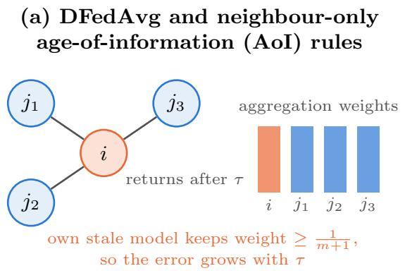

(b) Self-inclusive Freshness-weighted Gossip (SFG, ours)  
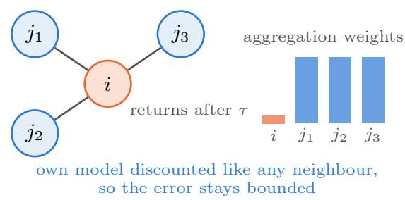  
Figure 1: The stalest model in the room is your own. A client i returns from an outage of τ rounds to neighbours that kept training. (a) Decentralised federated averaging (DFedAvg) and neighbour-only age-of-information (AoI) rules keep the receiver’s own weight at least as large as each neighbour’s. Its stale model therefore always enters the aggregate, and the error grows without bound in τ (Theorem 2). (b) Self-inclusive Freshness-weighted Gossip (SFG), the rule family we propose, treats the receiver as one more candidate and discounts it by its staleness relative to the freshest candidate. This keeps every receiver’s error bounded (Theorem 3).

The convergence of gossip learning is known to degrade with the number of such inaccessible nodes and the duration of their absence (Liu et al., 2024b).

The stalest model in the room is your own. Who, then, is stale when a client returns? Its neighbours have mostly kept training while it was away. The stalest candidate in its aggregation is therefore usually the returning client itself. On three real smartphone traces, this holds in 85–93% of returns (Appendix F).

Existing staleness-aware rules were not built for this case (Fig. 1). Age-of-information (AoI) aggregation, such as DFL-AA (Decentralized Federated Learning with Adaptive AoI-weighted Aggregation), discounts the models a client receives and keeps the receiver’s own weight fixed (Hewa Kaluannakkage & Buyya, 2026). Gossip learning weights models by update counts inherited on merging (Hegedűs et al., 2019). Limited merging discards any model, possibly the receiver’s own, whose count lags by more than a threshold (Danner et al., 2023). These rules are heuristics. None of them says whether the receiver should be discounted, which measure of staleness to use, or how steeply to discount. Without those answers, one cannot predict which rule will work, or why.

This paper. We view aggregation after an outage as an estimation problem. From candidate models of diferent staleness, the receiver should recover the collaborative state that a fully available network would have reached. This view turns the three open questions into three principles, each backed by a formal result.

(i) Whom to discount? Everyone, the receiver included, by staleness relative to the freshest candidate (discount yourself).

(ii) By what measure? By the lag a model has inherited through averaging, which local training does not remove. Age is the wrong measure, because local training resets it (measure inherited staleness).

(iii) How steeply? More steeply than a single aggregation suggests. The receiver carries what it absorbs into later rounds (discount steeply).

Our method. From these principles we derive Self-inclusive Freshness-weighted Gossip (SFG), a family of aggregation rules defined formally in Definition 2. Every member weights each candidate, the receiver included, by a kernel of its staleness relative to the freshest candidate. SFG applies a geometric discount to model ages. SFG-L applies it to efective lags. SFG-Cut keeps only the candidates within a small lag margin of the freshest. SFG-L and SFG-Cut satisfy all three principles, and they are the rules we propose for practice. The family is a drop-in replacement for the averaging weights of DFedAvg. It adds one scalar to each message, which is about one millionth of the CNN we train, and needs no extra communication round and no extra local computation.

Contributions and evidence. Each claim below is tied to the result that supports it.

• Self-inclusion separates bounded from unbounded error (Section 4.2). Under a simple model of staleness, the minimum-error weights are self-inclusive and depend only on relative staleness (Proposition 1). Every rule that keeps the receiver’s own weight at least as large as each neighbour’s has an error that grows without bound in the receiver’s outage (Theorem 2). This class includes DFedAvg and every neighbour-only AoI rule. SFG, in contrast, keeps every receiver’s error within a constant of the freshest candidate’s (Theorem 3).

• A new staleness statistic, the efective lag (Section 4.3). We identify age laundering. A model’s age is reset whenever its client trains, but the lag inherited from stale neighbours is not. The efective lag is computable locally from one scalar per message and bounds the persistent error. It also provably separates cases that any age-based rule must confuse (Proposition 5).

• A horizon analysis that explains steep discounting (Section 4.4). Persistent error survives local training, so the error that matters is summed over future rounds. The optimal weights then steepen and, under nested staleness, form a cut (Proposition 7). Measured on real traces, the efective rate is 1.5–4 times the one-step rate.

• The SFG family (Section 5). Three drop-in rules with the communication and computation of DFedAvg, all covered by our error bounds. To our knowledge, they are the first staleness-aware aggregation rules for decentralised learning with a guarantee that holds for the stale receiver itself, and they compose with a link-reliability correction and with catch-up training.

• A large, paired evaluation (Section 6). We test on CIFAR-10, CIFAR-100 and FEMNIST (Federated Extended MNIST) under five synthetic outage processes and three real smartphone traces, with 120 paired runs per rule. SFG-Cut improves mean personalised accuracy over DFedAvg by +4.0 percentage points (pp) in 119 of 120 runs. It closes 56–60% of the gap to outage-free training, while the best AoI rule gains +1.8 pp. With a link correction, the gain is +4.4 pp in 120 of 120 runs. With catch-up training, it reaches +5.1 pp. Without any extra computation, SFG-Cut gains 2.3 times as much as catch-up training does at 1.71× the computation (Fig. 2a). Removing any single principle costs 1.5–2.1 pp, and a random cut of the same size gains nothing (Fig. 2c). In all ten settings of Fig. 4, which include a six-day trace, learning-rate re-tuning, link failures, three alternative backbones and a pretrained ResNet-18, the best SFG rule gains 2.2–4.6 times as much as the strongest AoI baseline (Fig. 4).

Beyond the rules themselves, the analysis gives a unified account of prior work. Tuned limited merging from gossip learning is strong because it satisfies all three principles. AoI rules are weaker because they measure staleness by age and discount the receiver at best implicitly (Table 1). All appendices referred to in the text follow the references.

## 2 Related work

Unavailability in server-based FL. MIFA reuses stale updates of unavailable devices (Gu et al., 2021). FedVARP reduces the variance of partial participation (Jhunjhunwala et al., 2022). FedAU estimates participation statistics online (Wang & Ji, 2024), building on a unified analysis of arbitrary client participation (Wang & Ji, 2022), and FedAWE amplifies the updates of returning clients (Xiang et al., 2024). Correlated participation has been modelled as a Markov chain (Sun et al., 2025; Rodio et al., 2023). Asynchronous FL discounts stale updates (Xie et al., 2019; Nguyen et al., 2022), and age-based scheduling decides which clients upload (Yang et al., 2020). All of these methods keep a fresh model at the server, and the server is never stale. The question of how a stale receiver should weight itself therefore never arises. We transplant two server-FL ideas to DFL as baselines: model memory, the analogue of MIFA, and update amplification, as in FedAWE.

Decentralised and personalised learning. Decentralised stochastic gradient descent (SGD) converges at rates governed by the mixing of the gossip matrices (Lian et al., 2017; Koloskova et al., 2020; Kong et al.,

Table 1: Which rules satisfy which principle. Self-inclusive: the receiver’s own model is discounted by its staleness. Inherited: staleness survives local training. Steep: a geometric discount with a small γ, or a tight margin. Bound: the aggregation error of a returning receiver is bounded uniformly in its outage under our staleness models. ∗IPW raises the weight of rarely live links, which acts as an implicit self-discount for rarely available receivers (Section 6.4). †Steep only with a tight threshold.
<table><tr><td>Rule</td><td>Self-inclusive</td><td>Inherited</td><td>Steep</td><td>Bound</td></tr><tr><td>DFedAvg (Sun et al., 2023)</td><td></td><td></td><td></td><td></td></tr><tr><td>Neighbour-only AoI</td><td></td><td></td><td>√</td><td></td></tr><tr><td>DFL-AA (Hewa Kaluannakkage &amp; Buyya, 2026)</td><td>implicit*</td><td></td><td>√</td><td></td></tr><tr><td>Gossip-learning model age (Hegedüs et al., 2019)</td><td>√</td><td>max</td><td></td><td></td></tr><tr><td>Limited merging (Danner et al., 2023)</td><td>√</td><td>max</td><td>√†</td><td></td></tr><tr><td>SFG (ours)</td><td>√</td><td></td><td>√</td><td>√(Theorem 3)</td></tr><tr><td>SFG-L (ours)</td><td>√</td><td>mean</td><td>√</td><td>√(Proposition 5)</td></tr><tr><td>SFG-Cut (ours)</td><td>√</td><td>mean</td><td>√</td><td>√(Proposition 7)</td></tr></table>

2021; Vogels et al., 2022), also over random links (Boyd et al., 2006; Kar & Moura, 2009). Asynchronous and sporadic variants tolerate bounded staleness or intermittent computation and communication (Lian et al., 2018; Assran et al., 2019; Bornstein et al., 2023; Liu et al., 2024a; Zehtabi et al., 2025). Decentralised and partial-model personalisation methods (Sun et al., 2023; Dai et al., 2022; Shi et al., 2023; Liu et al., 2024c; Long et al., 2025; Arivazhagan et al., 2019; Collins et al., 2021; Li et al., 2021) do not address outages. SFG is complementary to all of them, because it changes only the averaging weights. We evaluate it with loca momentum, Ditto-style personal models and personal heads.

Staleness-aware aggregation. DFL-AA discounts received models by their age of information relative to the newest neighbour (Hewa Kaluannakkage & Buyya, 2026). It corrects for lossy links by inverse-probability weighting (IPW) and keeps the receiver’s weight fixed. Gossip learning merges models in proportion to their update counts, and a merged model inherits the larger count (Hegedűs et al., 2019; 2021). Limited merging discards the less-updated model, possibly the local one, when counts difer by more than a threshold (Danner et al., 2023). These are the closest prior rules.

Our analysis connects them to SFG. Through the identity $n _ { i } = t - \ell _ { i }$ (Section 4.3), SFG-L is a smooth, self-inclusive relative of limited merging. Its counts are inherited by averaging rather than by the maximum. SFG-Cut applies limited merging’s hard margin to these mean-inherited counts. This change of inheritance is what places SFG-Cut under our error bounds, because a deficit in maximum-inherited counts does not bound a lag diference (Proposition 6). Efective lag is the analogue, for averaged models, of the version age of information in gossip networks (Yates, 2021; Buyukates et al., 2022).

Inverse-variance fusion. Inverse-variance weights that include the receiver are classical in difusion adaptation and consensus (Tu & Sayed, 2011; Zhao et al., 2012; Sayed, 2014; Kamal et al., 2013; Julier & Uhlmann, 1997), where variance comes from observation noise. We compare against the relative-variance combiner of Zhao et al. (2012) and find that, in personalised learning, its distance-based estimates mix staleness with data heterogeneity.

Positioning. Table 1 summarises which principles each rule satisfies. Relative to gossip learning, our contribution is not a better heuristic but an explanation. We show why self-inclusion, inherited staleness and steepness are needed. We derive a staleness statistic for which the resulting rules carry error guarantees. We then verify each principle by ablation.

## 3 Problem setting

Clients and outages. N clients sit on an undirected communication graph $\mathcal { G } = ( V , E )$ and run synchronous rounds $t = 0 , 1 , \dots , T - 1$ . Client i holds a personal model $x _ { i } ^ { t } \in \mathbb { R } ^ { d }$ and private data $\mathcal { D } _ { i }$ . In round t, it is available with indicator $a _ { i } ^ { t } \in \{ 0 , 1 \}$ , drawn from an exogenous outage process. We summarise a process by its

unavailability u, the long-run fraction of client-rounds spent ofline. An unavailable client neither trains nor communicates. Its model is frozen and continues to serve inference, and we evaluate this frozen model.

Aggregation. An available client, the receiver, forms the candidate set of itself and its available neighbours,

$$
S _ { i } ^ { t } = \{ i \} \cup \{ j \in \mathcal { N } ( i ) : a _ { j } ^ { t } = 1 \} .\tag{1}
$$

It aggregates

$$
x _ { i } ^ { t + \frac { 1 } { 2 } } = \sum _ { j \in S _ { i } ^ { t } } w _ { i j } ^ { t } x _ { j } ^ { t } , \qquad \sum _ { j \in S _ { i } ^ { t } } w _ { i j } ^ { t } = 1 , \quad w _ { i j } ^ { t } \geq 0 .\tag{2}
$$

It then runs K local SGD steps on $\mathcal { D } _ { i }$ from $x _ { i } ^ { t + \frac { 1 } { 2 } }$ , which personalises by fine-tuning. Decentralised federated averaging (DFedAvg, Sun et al., 2023) uses uniform weights, $w _ { i j } ^ { t } = 1 / | S _ { i } ^ { t } |$ . The only design choice we study is the weights $w _ { i j } ^ { t }$ . Everything else is held fixed, including what is communicated and how much is computed.

Age. The age $\tau _ { j } ^ { t } \in \mathbb { N }$ of model $\ v x _ { j } ^ { t }$ is the number of rounds since it was last trained. A client that trained in the previous round has age 0. A client returning from an outage of $\tau$ rounds has age τ . Ages are a deterministic function of the outage trace. Each client can piggyback its age on its model as an integer counter.

Aggregation rules. We compare rules of the form wt ∝ $h _ { i j } ^ { t }$ that use only information available at the receiver. Neighbour-only AoI rules set $h _ { i i } = 1$ and $h _ { i j } = \check { h } ( \tau _ { j } ) \leq 1$ for neighbours, for example $h _ { i j } = \gamma ^ { \tau _ { j } }$ . The other baselines are described in Section 2 and Appendix D.

Metrics. We report the mean and the 10th percentile of personalised test accuracy over all N clients at the end of training. Each client is evaluated on a test set drawn from its own data distribution. The 10th percentile tracks the clients that benefit least. We also report communication and local computation.

## 4 What aggregation needs under outages

We now derive the three principles. Throughout, we fix an available receiver i and write $w _ { j }$ for $w _ { i j } ^ { t }$ . We measure the quality of an aggregate by its squared distance to the collaborative state, the model that a fully available network would hold. This estimation view gives optimal weights in closed form, against which any rule can be compared.

The analysis proceeds in three steps. Section 4.2 characterises the error of a single aggregation and isolates what an outage changes. Section 4.3 replaces ages by a dynamic notion of staleness. Section 4.4 extends the objective across rounds. All proofs are in Appendix B, which also lists the statements we checked numerically on random instances.

## 4.1 A model of staleness

Assumption 1 (Staleness). There is a reference trajectory $( c _ { r } ) _ { r \ge 0 }$ , the collaborative state a fully available network would follow. Every candidate at round t satisfies

$$
x _ { j } ^ { t } = c _ { t - \tau _ { j } } + \varepsilon _ { j } .
$$

The dispersions $\varepsilon _ { j }$ are zero-mean, mutually uncorrelated and uncorrelated with $\left( c _ { r } \right)$ , with $\mathbb { E } \Vert \varepsilon _ { j } \Vert ^ { 2 } = \sigma ^ { 2 }$ . The state drifts with lag covariance

$$
\begin{array} { r } { \mathbb { E } \langle c _ { t } - c _ { t - a } , c _ { t } - c _ { t - b } \rangle = \delta ^ { 2 } \kappa ( a , b ) , } \end{array}
$$

where $\kappa \geq 0$ , and $\varphi ( a ) : = \kappa ( a , a )$ is non-decreasing and unbounded with $\varphi ( 0 ) = 0$

The assumption separates the two forces that make a candidate imperfect. The dispersion $\sigma ^ { 2 }$ is the spread of fresh models around the collaborative state, caused by data heterogeneity and SGD noise. The drift $\delta ^ { 2 }$ is how far the state moves per round. Their ratio

$$
\rho = \delta ^ { 2 } / \sigma ^ { 2 }\tag{3}
$$

measures how costly one round of staleness is, relative to that spread. Two canonical cases are random-walk drift (RW), with mutually uncorrelated increments, $\kappa ( a , b ) = \operatorname* { m i n } ( a , b )$ and $\varphi ( a ) = a$ , and persistent drift, with $\kappa ( a , b ) = a b$ and $\varphi ( a ) = a ^ { 2 }$

Write $e _ { j } = x _ { j } ^ { t } - c _ { t }$ for the error of candidate $j .$ . The candidate errors have covariance

$$
\Sigma _ { j k } = \mathbb { E } \langle e _ { j } , e _ { k } \rangle = \sigma ^ { 2 } \big ( { \bf 1 } [ j = k ] + \rho \kappa ( \tau _ { j } , \tau _ { k } ) \big ) ,\tag{4}
$$

so a candidate’s mean squared error grows with its age:

$$
v ( \tau _ { j } ) = \sigma ^ { 2 } \big ( 1 + \rho \varphi ( \tau _ { j } ) \big ) .\tag{5}
$$

The model is deliberately simple. Section 4.3 makes staleness dynamic, and Section 6 tests the predictions.

## 4.2 Principle 1: discount yourself

Proposition 1 (Minimum-error aggregation). The weights that minimise $\begin{array} { r } { \mathbb E \| \sum _ { j \in S } w _ { j } x _ { j } ^ { t } - c _ { t } \| ^ { 2 } } \end{array}$ subject to $\mathbf { 1 } ^ { \top } w = 1$ are

$$
w ^ { \star } = \frac { \Sigma ^ { - 1 } { \bf 1 } } { { \bf 1 } ^ { \top } \Sigma ^ { - 1 } { \bf 1 } } .\tag{6}
$$

Under RW drift, moreover, the following hold.

(i) Relative staleness. $w ^ { \star }$ depends on the ages only through $\Delta _ { j } = \tau _ { j } - \tau _ { \operatorname* { m i n } }$ , where $\tau _ { \operatorname* { m i n } } = \operatorname* { m i n } _ { k \in S } \tau _ { k }$ . The minimum error $i s$

$$
\delta ^ { 2 } \tau _ { \mathrm { m i n } } + \frac { 1 } { \mathbf { 1 } ^ { \top } \Sigma ^ { \prime - 1 } \mathbf { 1 } } , \qquad \Sigma _ { j k } ^ { \prime } = \sigma ^ { 2 } \big ( \mathbf { 1 } [ j = k ] + \rho \operatorname* { m i n } ( \Delta _ { j } , \Delta _ { k } ) \big ) .
$$

(ii) Self-inclusion. $I f$ at most one candidate is older than the youngest, then for every $j \in S$ , including the receiver $j = i$

$$
w _ { j } ^ { \star } \propto \frac { 1 } { 1 + \rho \Delta _ { j } } .
$$

(iii) No outages. If all candidates have the same age, $w ^ { \star }$ is uniform, which is DFedAvg.

Part (i) says that the drift since the freshest candidate was trained is shared by all candidates. No weighting can remove it, so only relative staleness matters. Part (ii) says that the receiver’s own model is just another candidate, discounted by its staleness like any neighbour. Part (iii) says that optimal aggregation reduces to DFedAvg when nothing is stale, so any gain must come from outages. Parts (i) and (ii) both fail for AoI rules, which keep the receiver’s weight fixed. This matters in practice. On real traces, a returning client is strictly the stalest candidate in 85–93% of returns (Appendix F). This is precisely the case that neighbour-only discounting cannot handle.

Theorem 2 (Stale receivers). Let receiver i have age $\tau _ { i }$ and m $\geq 1$ live neighbours, and let Assumption 1 hold. Consider any non-negative rule whose self-weight is at least each neighbour weight, $w _ { i i } \geq w _ { i j }$ . Its aggregation error satisfies

$$
\mathbb { E } { \left. { x } _ { i } ^ { t + \frac { 1 } { 2 } } - c _ { t } \right. } ^ { 2 } \geq \frac { v ( \tau _ { i } ) } { ( m + 1 ) ^ { 2 } } ,\tag{7}
$$

which grows without bound in the outage length. This class includes DFedAvg and every neighbour-only discount $w _ { i j } \propto h ( \tau _ { j } ) \leq h _ { i i } = 1$ . With uncorrelated errors and equally aged, fresher neighbours, such a discount is even worse than uniform averaging (Appendix B).

The theorem is a negative result about an entire class of rules, not about one rule. No choice of neighbour discount can repair a rule that refuses to discount the receiver. Inverse-probability weighting, as in DFL-AA, escapes the theorem. Raising the weight of rarely live links acts as an implicit self-discount for a rarely available receiver (Section 6.4).

A self-inclusive rule. Proposition 1 suggests weighting every candidate, the receiver included, by a decreasing function of its relative staleness $s _ { j }$ . Self-inclusive Freshness-weighted Gossip (SFG) uses a geometric discount:

$$
w _ { i j } ^ { t } = \frac { \gamma ^ { s _ { j } - s _ { \mathrm { m i n } } } } { \sum _ { k \in S _ { i } ^ { t } } \gamma ^ { s _ { k } - s _ { \mathrm { m i n } } } } , \qquad j \in S _ { i } ^ { t } ,\tag{8}
$$

with $s _ { \mathrm { m i n } } = \operatorname* { m i n } _ { k \in S _ { \mathrm { \ast } } ^ { t } } s _ { k }$ and $\gamma \in [ 0 , 1 )$ , using the convention $0 ^ { 0 } = 1$ . The staleness $s _ { j }$ is a scalar sent with the model. It is the age $\tau _ { j }$ for SFG and the efective lag $\ell _ { j }$ of Section 4.3 for SFG-L. The geometric form is robust. It keeps the error bounded for every sub-exponential drift law, whereas hyperbolic weights can fail under fast drift (Proposition 8 in Appendix B).

Theorem 3 (SFG bounds the error of every receiver). Let Assumption 1 hold with RW $d r i f t ,$ and let $s = \tau$ For every candidate set and every configuration of ages,

$$
\begin{array} { r } { \mathbb { E } \big \| x _ { i } ^ { t + \frac { 1 } { 2 } } - c _ { t } \big \| ^ { 2 } \leq \sigma ^ { 2 } \sum _ { j } w _ { j } ^ { 2 } + \delta ^ { 2 } \big ( \tau _ { \operatorname* { m i n } } + \sum _ { j } w _ { j } \Delta _ { j } \big ) } \\ { \leq \sigma ^ { 2 } \sum _ { j } w _ { j } ^ { 2 } + \delta ^ { 2 } \Big ( \tau _ { \operatorname* { m i n } } + \frac { m } { e \ln ( 1 / \gamma ) } \Big ) . } \end{array}\tag{9}
$$

The receiver’s own age therefore enters only through $\tau _ { \operatorname* { m i n } } \le \tau _ { i }$ . SFG coincides with neighbour-only AoI discounting whenever the receiver is fresh $( \tau _ { i } = 0 )$ . It coincides with DFedAvg whenever all candidates have the same $a g e ,$ , in particular without outages.

Corollary 4 (Exact errors for a returning client). Under RW drift, consider a receiver of age τ with m fresh neighbours. In units of $\sigma ^ { 2 }$ , its aggregation error is

$$
\underbrace { \frac { m + 1 + \rho \tau } { ( m + 1 ) ^ { 2 } } } _ { D F e d A v g ~ a n d ~ A o I } , \qquad \underbrace { \frac { m + \gamma ^ { 2 \tau } ( 1 + \rho \tau ) } { ( m + \gamma ^ { \tau } ) ^ { 2 } } } _ { S F G } , \qquad \underbrace { \left( m + \frac { 1 } { 1 + \rho \tau } \right) ^ { - 1 } } _ { o p t i m u m } .\tag{10}
$$

The first grows linearly in τ . The second tends to the optimum.

Theorems 2 and 3 together make the case for self-inclusion. It is what separates unbounded from bounded error. It also costs nothing in the benign cases. When the receiver is fresh, SFG reduces to AoI. When no one is stale, it reduces to DFedAvg. For long outages, SFG approaches the optimum (Fig. 3a).

The first inequality of (9) holds for any non-negative weights. Every rule confined to candidates within an age margin L of the least stale, such as a hard cut, therefore obeys the bound with L in place of $m / ( e \ln ( 1 / \gamma ) )$ ). Proposition $5 ( \mathrm { i v } )$ is the analogue on lags. Cuts on maximum-inherited counts are not covered, because a count deficit does not bound a lag diference (Proposition 6).

Principle 1 (Discount yourself). Weight every candidate, the receiver included, by a decreasing function of its staleness relative to the freshest candidate.

## 4.3 Principle 2: measure inherited staleness, not age

Which staleness should the weights use? A model’s age is reset whenever its client trains. The lag the model inherited by averaging with stale models is not reset. Local training moves the model forward at the pace of the collaborative state, but it cannot recover progress that never reached the model.

Consider a fresh client that averages with a neighbour returning from a long outage. After one round of training, its age is zero. Yet part of the neighbour’s missing progress now lives in its model and will be passed on. We call this age laundering. To quantify it, we let the state evolve with the network.

Assumption 2 (Dynamic staleness). The collaborative state is the counterfactual full-availability trajectory,

$$
\boldsymbol { c } _ { t + 1 } = \boldsymbol { c } _ { t } + \boldsymbol { \xi } _ { t } .
$$

The increments are mutually uncorrelated and uncorrelated with the dispersions, with $\mathbb { E } \lVert \xi _ { t } \rVert ^ { 2 } = \delta ^ { 2 }$ . An available client’s model after aggregation and local training is

$$
x _ { i } ^ { t + 1 } = c _ { t + 1 } + p _ { i } ^ { t + 1 } + \varepsilon _ { i } ^ { t + 1 } , \qquad p _ { i } ^ { t + 1 } = \sum _ { j } w _ { i j } ^ { t } p _ { j } ^ { t } .
$$

The persistent error $p _ { i }$ is inherited: training keeps pace with the state but does not remove inherited error. The dispersion $\varepsilon _ { i } ^ { t + 1 }$ is regenerated by local training. It has variance $\sigma ^ { 2 }$ and is independent of the past and of the other clients’ dispersions. An unavailable client is frozen, so $\boldsymbol { p } _ { i } ^ { t + 1 } = \boldsymbol { p } _ { i } ^ { t } - \boldsymbol { \xi } _ { t }$

Under this assumption the persistent error is a weighted sum of missed increments,

$$
p _ { i } ^ { t } = - \sum _ { r < t } A _ { i r } ^ { t } \xi _ { r } , \quad \quad A _ { i r } ^ { t } \in [ 0 , 1 ] ,\tag{11}
$$

where $A _ { i r } ^ { t }$ is the fraction of increment r that client i has missed. The matrix A evolves linearly. It is multiplied by the aggregation matrix $\widetilde { W } ^ { t }$ , which holds the weights of available clients and identity rows otherwise, and then gains a new column for the round:

$$
{ \cal A } ^ { t + 1 } = \widetilde { W } ^ { t } { \cal A } ^ { t } , \qquad { \cal A } _ { \cdot t } ^ { t + 1 } = { \bf 1 } [ a ^ { t } = 0 ] .\tag{12}
$$

Definition 1 (Efective lag). The efective lag of client i is $\begin{array} { r } { \ell _ { i } ^ { t } = \sum _ { r } A _ { i r } ^ { t } } \end{array}$ , the number of rounds of collaborative progress its model is missing.

Proposition 5 (Age laundering). Under Assumption 2, the following hold.

(i) Lags are computable. The lags obey

$$
\begin{array} { r } { \ell ^ { t + 1 } = \widetilde { W } ^ { t } \ell ^ { t } + { \mathbf 1 } [ a ^ { t } = 0 ] , } \end{array}\tag{13}
$$

so every client tracks its lag from its candidates’ lags with one scalar per message. Moreover, $\mathbb { E } \| p _ { i } ^ { t } \| ^ { 2 } =$ $\begin{array} { r } { \delta ^ { 2 } \sum _ { r } ( \bar { A } _ { i r } ^ { t } ) ^ { 2 } \leq \delta ^ { 2 } \ell _ { i } ^ { t } } \end{array}$ , with equality when the client’s missed increments are not mixed.

(ii) Ages under-report lag, and age-blind rules pay for it. Always $\tau _ { i } ^ { t } \leq \ell _ { i } ^ { t }$ . A client that absorbed lag by averaging is reported as fresh after it trains. Moreover, take any $D > 0$ and any graph with an edge a–b such that a has a neighbour not adjacent to b. Then a and b can have the same ages and availability histories but lags vD and D, where $v < 1$ is the weight the rule gives stale candidates at their return. Consider any rule whose weights depend only on the candidates’ roles, ages and availability histories. In one of the two aggregations of a and b with each other, it incurs persistent error at least $\delta ^ { 2 } ( 1 - v ) D / 4$ more than keeping only the less-lagged candidate.

(iii) Averaging does not remove lag. If the aggregation weights are doubly stochastic, then

$$
\begin{array} { r } { \sum _ { i } \ell _ { i } ^ { t + 1 } = \sum _ { i } \ell _ { i } ^ { t } + | \{ i : a _ { i } ^ { t } = 0 \} | . } \end{array}
$$

Doubly stochastic averaging redistributes the lag injected by outages. It does not remove it.

(iv) SFG on lags. With $s = \ell$ in (8), every available receiver’s aggregation error is at most

$$
\sigma ^ { 2 } \sum _ { j } w _ { j } ^ { 2 } + \delta ^ { 2 } \Big ( \ell _ { \mathrm { m i n } } + \frac { m } { e \ln ( 1 / \gamma ) } \Big ) ,
$$

uniformly in its own lag.

(v) Only the persistent error carries over. The aggregation error splits into two terms. The dispersion term $\sigma ^ { 2 } \textstyle \sum _ { j } w _ { j } ^ { 2 }$ is regenerated by local training in the next round. The persistent error is inherited by every later round and satisfies

$$
\mathbb { E } \bigg \| \sum _ { j } w _ { j } p _ { j } \bigg \| ^ { 2 } = \delta ^ { 2 } w ^ { \top } G w , \qquad G = A A ^ { \top } .\tag{14}
$$

Always $0 \leq G _ { j k } \leq \Lambda _ { j k } : = \operatorname* { m i n } ( \ell _ { j } , \ell _ { k } )$ . Equality holds when the missed increments are nested, that is, when the rows $A _ { j }$ lie in $\{ 0 , 1 \}$ with supports ordered by inclusion.

Part (ii) is the key separation. Some configurations cannot be distinguished by any age-based rule, yet cal for diferent weights. The cost of confusing them grows linearly with the outage. Part (iii) explains why plain averaging cannot “wash out” outages. It only spreads the injected lag across the network.

Age laundering has two consequences. First, models reported as fresh carry hidden lag, so a rate fitted to ages is too small (Section 6.5). Second, rules should run on inherited staleness. The lag also has a simple count interpretation. Define

$$
n _ { i } ^ { t } : = t - \ell _ { i } ^ { t } .\tag{15}
$$

Then $\begin{array} { r } { n _ { i } \gets \sum _ { j } w _ { i j } n _ { j } } \end{array}$ at aggregation, and $n _ { i } \gets n _ { i } + 1$ per training round. So $n _ { i }$ counts the training rounds a model has absorbed, and SFG-L weights candidates by $\gamma ^ { n _ { \mathrm { m a x } } - n _ { j } }$

This links SFG-L to gossip learning. Gossip learning’s model age is also an inherited count, but it is merged by the maximum (Hegedűs et al., 2019). Limited merging drops candidates whose count lags by more than a threshold (Danner et al., 2023). Inherited counts are why those rules outperform AoI rules. The maximum, however, discards exactly the information that matters: a model that absorbed a stale neighbour inherits the larger count and looks fresh.

Proposition 6 (Maximum-inherited counts do not certify lag). Let $n _ { j }$ be update counts inherited by the maximum on merging. For every $D > 0$ and every $v \in ( 0 , 1 ]$ , there are two availability histories with the following properties. At some round, a receiver i has the same candidates, with the same max-inherited counts and the same ages, in both histories. One candidate j has the largest count in both. Its efective lag is 0 in the first history and $v D$ in the second, where v is the weight j gave its own model when it returned from an outage of D rounds. Consequently, any rule whose weights depend on candidates only through their roles, ages and max-inherited counts gives j the same weight w in both histories. If $w _ { j } > 0$ , its persistent error in the second history grows without bound in $D ;$

$$
\mathbb { E } \Big \| \sum _ { k } w _ { k } p _ { k } \Big \| ^ { 2 } \geq \delta ^ { 2 } w _ { j } ^ { 2 } v ^ { 2 } D .\tag{16}
$$

This includes limited merging with any margin $L$ and SFG weights on counts. SFG-Cut drops $j$ in the second history as soon as $v D > \ell _ { \mathrm { m i n } } + L$ , and its persistent error obeys Proposition 7(iii) in both.

Proposition 6 makes the diference between counts and lags precise. In a network where every client runs limited merging with margin $L ,$ a returning client keeps its own model only if $D \leq L ,$ so the lag hidden behind a count is at most vL. This explains why tuned limited merging performs well in our experiments (Section 6.2). Its protection, however, is a property of the whole network’s history, which the counts cannot reveal. It can fail as soon as some clients merge diferently, for instance during a partial deployment, or when some clients run an older or a diferent aggregation rule. The lag-based bounds of Proposition $5 ( \mathrm { i v } )$ and Proposition 7(iii) hold for every weight history, because the efective lag certifies itself. This is the substance of our claim that SFG-Cut carries a guarantee that limited merging does not.

Principle 2 (Measure inherited staleness). Measure a candidate’s staleness by the lag it has inherited through averaging, not by the time since it last trained.

## 4.4 Principle 3: discount steeply

Proposition $5 ( \mathrm { v } )$ shows that the single-aggregation objective of Proposition 1 is myopic. Local training regenerates the dispersion of an aggregate. Its persistent error, however, stays in every later model of the receiver.

To account for this, fix all other aggregations. Let $\Phi ^ { s }$ be the product of the aggregation matrices of rounds $t + 1 , \ldots , s - 1$ , with identity rows for clients that do not aggregate. Let $\psi _ { s } = \Phi _ { i i } ^ { s }$ be the weight that the receiver’s model at round s puts on its own aggregate. We score the dispersion once, as in Proposition 1, and the persistent error at every remaining round:

$$
J ( w ) = \sigma ^ { 2 } \| w \| ^ { 2 } + \sum _ { s = t + 1 } ^ { T } \mathbb { E } \| p _ { i } ^ { s } \| ^ { 2 } .\tag{17}
$$

Proposition 7 (Horizon). Under Assumption 2,

$$
J ( w ) = \sigma ^ { 2 } \Big [ w ^ { \top } \big ( I + H \rho G \big ) w + 2 \rho g ^ { \top } w \Big ] + c o n s t .\tag{18}
$$

Here $\begin{array} { r } { H = \sum _ { s = t + 1 } ^ { T } \psi _ { s } ^ { 2 } \geq 1 } \end{array}$ is the receiver’s self-return. The import term is $g _ { j } \ = \ \langle A _ { j } , B \rangle \ \ge \ 0$ , where $\begin{array} { r } { B = \sum _ { s } \psi _ { s } \sum _ { k \neq i } \Phi _ { i k } ^ { s } A _ { k } ^ { t + 1 } } \end{array}$ collects the missed fractions the receiver will import from others.

(i) Without imported lag $( B = 0 )$ , J is minimised over $\mathbf { 1 } ^ { \top } w = 1$ by the generalised least-squares (GLS) weights for $I + H \rho G$ . Under nesting, these are the weights of Proposition 1 with $( \rho , \tau )$ replaced by $( H \rho , \ell )$ . They tend to uniform weights on the least-lagged candidates as $H \to \infty$

(ii) Under nesting, the minimiser over the simplex is a cut. Its weights are non-increasing in lag. It keeps every candidate below some lag, including the least-lagged candidate $j _ { 0 }$ . Every kept candidate has $\rho ( g _ { j } - g _ { j _ { 0 } } ) < w _ { j _ { 0 } } \leq 1$ . If imports are uniform on the candidates’ missed increments $( B _ { r } = \beta )$ , then $g _ { j } - g _ { j _ { 0 } } = \beta \Delta _ { j }$ , and the margin is below $1 / ( \rho \beta )$

(iii) For $w \ge 0 ,$ , with $\Lambda _ { j k } = \operatorname* { m i n } ( \ell _ { j } , \ell _ { k } )$

$$
\begin{array} { r } { \boldsymbol { w } ^ { \top } \boldsymbol { G } \boldsymbol { w } \leq \boldsymbol { w } ^ { \top } \boldsymbol { \Lambda } \boldsymbol { w } \leq \sum _ { j } w _ { j } \ell _ { j } . } \end{array}
$$

A rule confined to a lag margin L therefore has $w ^ { \top } G w \leq \ell _ { \mathrm { m i n } } + L .$

The intuition is that persistent error returns. The receiver keeps its aggregate through its next outages and gets part of it back from its neighbours. The horizon therefore counts persistent error H times, while dispersion is counted once. Three consequences follow. First, the efective rate exceeds the one-step rate $\rho ,$ which steepens the optimal discount (part i). Second, when lag absorbed now would add to lag imported later, the optimum truncates into a cut (part ii). Third, every rule confined to a margin inherits an error bound (part iii).

How steep, in practice? Dispersion is not fully regenerated by local training either. If it is counted $H _ { \varepsilon }$ times, the efective rate becomes, to first order,

$$
\rho _ { \mathrm { e f f } } \approx \rho \lambda _ { G } \frac { H } { H _ { \varepsilon } } ,\tag{19}
$$

where $\lambda _ { G }$ ≈ 1 converts persistent diferences into lag diferences. Measured along SFG-L trajectories, this rate is $0 . 8 – 9 .$ , against a one-step estimate of 0.4–1.9 (Appendix A.1). The theory therefore establishes that the discount should be steep. A cut additionally needs the nesting and import conditions of part (ii), which fail on the long-outage traces, so we select its margin empirically.

Principle 3 (Discount steeply). Discount more steeply than a single aggregation suggests, down to a hard cut. The receiver carries the lag it absorbs into later rounds.

## 5 The SFG family of aggregation rules

We now turn the principles into the method we propose. Definition 2 states it formally, Algorithm 1 gives one round, and Table 2 lists its three members.

Definition 2 (Self-inclusive Freshness-weighted Gossip, SFG). Let every model carry a scalar staleness $s _ { j } \geq 0$ , let $h : [ 0 , \infty ) \to [ 0 , 1 ]$ be a non-increasing kernel with $h ( 0 ) = 1$ , and let $\kappa _ { j } > 0$ be optional count weights. An available receiver i aggregates over its candidate set $S _ { i } ^ { t }$ , itself included, with

$$
w _ { i j } ^ { t } = \frac { \kappa _ { j } h \big ( s _ { j } - s _ { \mathrm { m i n } } \big ) } { \sum _ { k \in S _ { i } ^ { t } } \kappa _ { k } h \big ( s _ { k } - s _ { \mathrm { m i n } } \big ) } , \qquad s _ { \mathrm { m i n } } = \operatorname* { m i n } _ { k \in S _ { i } ^ { t } } s _ { k } , \qquad j \in S _ { i } ^ { t } .\tag{20}
$$

The three members are

$$
\underbrace { s = \tau , \ h ( \Delta ) = \gamma ^ { \Delta } } _ { \mathrm { S F G } } , \qquad \underbrace { s = \ell , \ h ( \Delta ) = \gamma ^ { \Delta } } _ { \mathrm { S F G - L } } , \qquad \underbrace { s = \ell , \ h ( \Delta ) = { \bf 1 } [ \Delta \le L ] , \ \kappa _ { j } = 1 + t - \ell _ { j } } _ { \mathrm { S F G - C u t } } .
$$

with $\kappa \equiv 1$ unless stated. Lags are inherited by (21).

Two features separate SFG from prior staleness-aware rules. The receiver’s own weight is computed by the same kernel as every neighbour’s, so the receiver is discounted whenever it is stale (Principle 1). The kernel acts on staleness relative to the freshest candidate, so a uniformly stale neighbourhood is averaged as

Algorithm 1 Self-inclusive Freshness-weighted Gossip (one round, client i). SFG uses ages $( s = \tau )$ . SFG-L   
and SFG-Cut use efective lags $( s = \ell )$ . Within the margin, the count weights $1 + t - s _ { j }$ of SFG-Cut are   
uniform up to $O ( L / t )$   
Require: model $x _ { i } .$ , staleness $s _ { i } ,$ discount $\gamma \in [ 0 , 1 ) \ ( 0 ^ { 0 } = 1 )$ or margin $L ,$ local steps K   
1: if i is available then   
2: send $( x _ { i } , s _ { i } )$ to, and receive $( x _ { j } , s _ { j } )$ from, live neighbours $j$   
3: $S \gets \{ i \} \cup$ {live neighbours}, $s _ { \mathrm { m i n } } \gets \operatorname* { m i n } _ { j \in S } s _ { j }$   
4: $h _ { j }  \gamma ^ { s _ { j } - s _ { \mathrm { r } } }$ min (SFG, SFG-L) or $h _ { j }  ( 1 + \bar { t - s } _ { j } ) \bar { \mathbf { 1 } } [ s _ { j } - s _ { \operatorname* { m i n } } \leq L ] \ ( \mathrm { S F G - C u t } ) , \ j \in S$   
5: $\begin{array} { r } { w _ { j }  h _ { j } / \sum _ { k \in S } h _ { k } , \quad x _ { i }  \sum _ { j \in S } w _ { j } x _ { j } } \end{array}$   
6: if lags: $\begin{array} { r } { s _ { i } \gets \sum _ { j \in S } w _ { j } s _ { j } } \end{array}$ {lag is inherited}   
7: run K local SGD steps on $\mathcal { D } _ { i }$ from $x _ { i } .$ , if SFG: $s _ { i } \gets 0$   
8: else   
9: $s _ { i } \gets s _ { i } + 1$ {model frozen}   
10: end if

Table 2: The SFG family. All members discount the receiver like any neighbour and use staleness relative to the freshest candidate. Principles refer to Principles 1 to 3.
<table><tr><td>Rule</td><td>Staleness  $s _ { j }$ </td><td>Unnormalised weight  $h _ { j }$ </td><td>Principles</td><td>Guarantee</td></tr><tr><td>SFG</td><td>age τj</td><td> $\gamma ^ { s _ { j } - s _ { \mathrm { m i n } } }$ </td><td>1, 3</td><td>Theorem 3</td></tr><tr><td>SFG-L</td><td>effective lag  $\ell _ { j }$ </td><td> $\gamma ^ { s _ { j } - s _ { \mathrm { m i n } } }$ </td><td>1, 2, 3</td><td>Proposition 5(iv)</td></tr><tr><td>SFG-Cut</td><td>effective lag  $\ell _ { j }$ </td><td> $( 1 + t - s _ { j } ) \mathbf { 1 } [ s _ { j } - s _ { \operatorname* { m i n } } \leq L ]$ </td><td>1, 2, 3</td><td>Proposition 7(iii)</td></tr></table>

DFedAvg would average it, and only diferences in staleness change the weights. The members difer in the staleness they use (Principle 2) and in how steeply they discount (Principle 3).

SFG weights candidates geometrically by relative age. It satisfies Principle 1 and is the simplest member. It needs only an integer counter.

SFG-L replaces ages by efective lags. Each client keeps a real-valued lag $\ell _ { i } ,$ initially 0, and sends it with its model. After aggregating, it inherits the weighted mean of its candidates’ lags. Every round ofline adds 1:

$$
\ell _ { i } \gets \sum _ { j \in S _ { i } ^ { t } } w _ { i j } ^ { t } \ell _ { j } \quad \mathrm { ( a v a i l a b l e ) } , \qquad \ell _ { i } \gets \ell _ { i } + 1 \quad \mathrm { ( o f f i n e ) } .\tag{21}
$$

SFG-Cut keeps only the candidates whose lag is within a margin L of the smallest, the receiver included. It weights them by their mean-inherited counts:

$$
w _ { i j } ^ { t } \propto ( 1 + t - \ell _ { j } ) { \bf 1 } \big [ \ell _ { j } - \ell _ { \mathrm { m i n } } \leq L \big ] , \qquad j \in S _ { i } ^ { t } .\tag{22}
$$

Within the margin, these weights are nearly uniform. SFG-Cut is limited merging’s hard threshold (Danner et al., 2023) applied to efective lags instead of maximum-inherited counts. This substitution is what brings the cut under the bounds of Propositions 5 and 7.

Eficiency. SFG is as cheap as DFedAvg in every resource that matters. Each message carries one extra scalar next to a model of d parameters, a relative overhead of $1 / d ,$ , which is about $1 0 ^ { - 6 }$ for our CNN $( d = 0 . 8 8 \mathrm { M } )$ and below $1 0 ^ { - 7 }$ for ResNet-18 $( d = 1 1 . 2 \mathrm { M } )$ . Computing the weights takes $O ( | S _ { i } ^ { t } | )$ operations, against the $O ( | S _ { i } ^ { t } | d )$ operations of averaging the models themselves. SFG needs no extra communication round, no global information, no stored copies of past models and no extra local computation. It coincides with DFedAvg whenever no candidate is stale.

Because it changes only the weights in (2), it plugs into any decentralised method that averages models. This includes local momentum (DFedAvgM), Ditto-style personal models and personal heads.

Extensions. Two orthogonal additions compose with every member. The first, + IPW, divides each neighbour’s weight by an online estimate of the probability that its link is live, as in DFL-AA (Hewa Kaluannakkage & Buyya, 2026). The receiver’s own model has estimate 1. The second, + catch-up, lets a returning client run $K ( 1 + \operatorname* { m i n } ( \tau _ { i } , 3 ) )$ local steps. It trades extra computation for accuracy.

Which rule to use. Our default is SFG-Cut with $L \in \{ 1 , 2 \}$ . It has the largest average gain of the deployable rules we tested, and $L = 2$ has a better worst case (Section 6.2). SFG-L with $\gamma \in [ 0 . 2 , 0 . 5 ]$ is the smooth alternative and is preferable with local momentum. Under heterogeneous availability, we recommend adding IPW. With it, SFG-L lifts every availability quartile (Section 6.4). The discount $\gamma = 0 . 5$ and the margin were fixed on a pilot seed. Neither was tuned per dataset or per outage process.

## 6 Experiments

Our experiments answer five questions. Q1 (efectiveness): do the SFG rules improve personalised accuracy under outages, and by how much relative to AoI and gossip-learning rules? Q2 (necessity): is each principle needed? Q3 (mechanism): why does self-inclusive discounting work, and which clients benefit? Q4 (theory meets practice): does the theory predict the right staleness measure and discount rate? Q5 (robustness): do the gains survive changes of protocol, model and network?

## 6.1 Experimental setup

Training and data. N = 100 clients on a 6-nearest-neighbour geometric graph run 300 rounds of $K = 1 0$ local SGD steps (batch 32, learning rate 0.05). The main model is a convolutional neural network (CNN) with 0.88M parameters, and a pretrained ResNet-18 with GroupNorm (ResNet-18-GN) serves as a larger-model check. We use CIFAR-10 and CIFAR-100 with Dirichlet label skew (α = 0.3), and FEMNIST with its natural writer split from the LEAF benchmark (Caldas et al., 2018). Each client is evaluated on a test set drawn from its own distribution.

Outages. We use eight outage processes. Five are synthetic, with unavailability calibrated to $\pm 0 . 0 0 5 \colon$ independent and identically distributed (i.i.d.) outages at $u = 0 . 6$ , bursty two-state Gilbert–Elliott chains with mean outage length 10 at $u \in \{ 0 . 6 , 0 . 8 \}$ , and heterogeneous per-client rates at $u \in \{ 0 . 6 , 0 . 7 7 \}$ . Three come from real smartphone availability, in 10-minute rounds. FLASH (Yang et al., 2021) gives a relaxed regime $( u \approx 0 . 6 2 )$ and a strict one $( u \approx 0 . 8 2$ , mean outage 7.6 h). STUNner (Szabó et al., 2019) gives a “plugged in and on WiFi” regime $( u \approx 0 . 8 2$ , mean outage 8.6 h). The real traces contain the long, correlated, diurnal outages that synthetic processes miss (Fig. 6).

Baselines and protocol. We compare with DFedAvg, local training, server-FL remedies transplanted to DFL (model memory, the analogue of MIFA, and FedAWE-style update amplification), the relative-variance combiner of difusion adaptation, the AoI rules (neighbour-only AoI, AoI + IPW and DFL-AA) and the gossip-learning rules (model age and limited merging). Random controls and oracles with global information test specific hypotheses (Appendix D). All rules share data partitions, graph, initialisation, outage trace and minibatch stream per seed, so every comparison is paired over seeds 1–5. Each rule is evaluated on 24 dataset–outage cells and 120 paired runs, with $\gamma = 0 . 5$ fixed on a pilot seed. Gains are in percentage points (pp) of mean personalised accuracy over DFedAvg. Intervals are 95% stratified t-intervals over the 15 dataset–seed units, and tests are exact sign-flip permutation tests, Holm-corrected over 70 comparisons. When the two disagree, we call the diference unresolved.

What do outages cost? Undiscounted stale parameters are a first-order cost. A client that cannot train but keeps sharing its frozen model costs DFedAvg more than a full outage (10.3–12.6 pp against 7.1–9.6 pp at $u = 0 . 8 )$ , and SFG removes most of that cost (1.2–2.2 pp). Outage structure matters little at a matched rate, with one exception that limits every staleness-based rule. When neighbours fail and return together, a returning client finds no fresher candidate, and SFG’s gain falls from +3.8 to +0.7 pp (Appendix A.3).

## 6.2 Q1: the SFG rules deliver the largest gains

Figure 2 summarises the answer and Table 3 gives the numbers. Every rule, the controls and the per-cell results are in Tables 4 and 12 and Fig. 9.

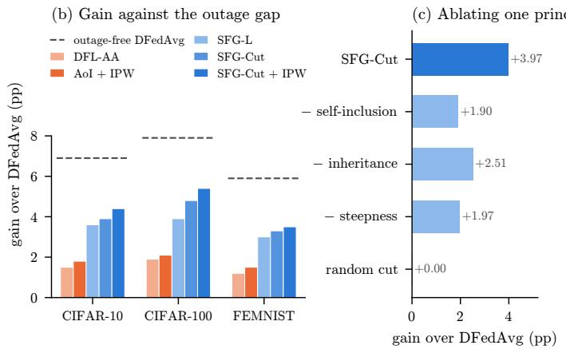

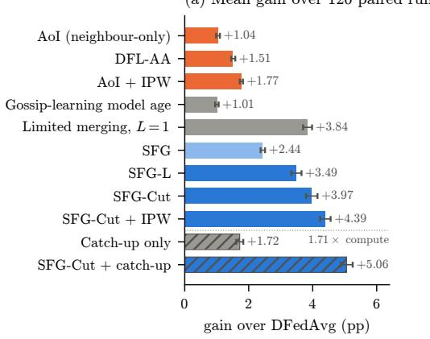  
Figure 2: Efectiveness, eficiency and necessity. (a) Gain in mean personalised accuracy over DFedAvg, with 95% stratified t-intervals over 120 paired runs (Table 3). Orange: age-of-information rules. Grey: gossip learning and catch-up training. Blue: the SFG family. Hatched rules use 1.71× the local computation of DFedAvg, and all others use exactly as much. (b) Gain per dataset, averaged over the eight outage processes. The dashed line marks outage-free DFedAvg, so the height of each bar relative to it is the share of the outage gap that the rule recovers. (c) Removing one principle from SFG-Cut (L = 1): never dropping the receiver, cutting on ages instead of lags, or a loose margin (L = 10). A random cut that keeps the same number of candidates gains nothing (Tables 20 and 31).

Headline. SFG-Cut (L = 1) improves mean personalised accuracy over DFedAvg by +3.97 pp ([3.79, 4.15]). It wins 119 of 120 paired runs and all 24 cells, and closes 56–60% of the gap between DFedAvg with and without outages. The weakest clients gain most, +4.75 pp at the 10th percentile. SFG-L gains +3.49 pp and even SFG, on plain ages, gains +2.44 pp in all 120 runs. With the link correction of IPW, SFG-Cut gains +4.39 pp in 120 of 120 runs and closes 59–69% of the gap. The ranking is the same on every dataset (Fig. 2b).

Accuracy for free. These gains come at the communication and computation of DFedAvg, plus one scalar per message. Spending computation is a much weaker remedy. Catch-up training, which gives returning clients up to four times the local steps, gains +1.72 pp at 1.71× the computation. SFG-Cut gains 2.3 times as much at no extra cost, and the two remedies combine to +5.06 pp.

Baselines. The AoI rules recover a quarter of the gap or less: neighbour-only AoI gains +1.04 pp, DFL-AA +1.51 pp and AoI + IPW +1.77 pp. The lag-based SFG rules roughly double the best of them. Reusing stale information without discounting it is harmful. Model memory costs −15.6 pp and update amplification −1.6 pp (Appendix A.4).

Gossip learning, explained. Tuned limited merging on gossip learning’s maximum-inherited counts gains +3.84 pp at L = 1. Our principles explain why. It is self-inclusive, it uses inherited staleness, and with a tight threshold it is steep. Without steepness, the gain shrinks to +2.55 pp (L = 10), and gossip learning’s plain count weights gain only +1.01 pp. SFG-Cut is 0.13 pp above limited merging, an unresolved diference. What separates them is the guarantee. The efective lag certifies itself, whereas the protection of limited merging rests on every client running it (Proposition 6).

## 6.3 Q2: each principle is necessary

Removing any principle costs 1.5–2.1 pp. We start from SFG-Cut and remove one principle at a time (Fig. 2c, all $p _ { \mathrm { H o l m } } < 0 . 0 1 \AA )$ . Never dropping the receiver costs −2.07 pp, cutting on ages instead of lags −1.46 pp, and a loose margin $( L = 1 0 ) \mathrm { \ - 2 . 0 0 p p }$ . A placebo cut that keeps the same number of candidates at random gains $+ 0 . 0 0 \mathrm { p p }$ , so the benefit lies in which candidates are kept, not in sparsity. Geometric weights confirm the first principle. Applied to neighbours only, they gain 1.5–2.5 pp less on ages, lags and counts alike (Table 31).

Table 3: Main results on 3 datasets, 8 outage processes (five synthetic, three real) and 5 seeds. Accuracy is averaged over the eight processes. Gain: paired diference to DFedAvg in percentage points, mean over 120 runs, in mean and 10th-percentile (p10) client accuracy, with a 95% stratified t-interval over dataset–seed units. Wins: paired runs with a positive gain. Cells: dataset–process cells with a positive mean gain. Local steps: computation relative to DFedAvg. †Gossip-learning update counts, inherited by the maximum on merging. All 25 rules, including the controls and the oracle, are in Table 4. Bold: best value in each column, separately for rules without and with catch-up training (extra computation). The oracle is excluded.
<table><tr><td></td><td colspan="3">Mean accuracy (%)</td><td colspan="3">Gain vs DFedAvg (pp)</td><td>Wins</td><td>Cells</td><td>Local</td></tr><tr><td>Method</td><td>CIFAR-10</td><td>CIFAR-100</td><td>FEMNIST</td><td>mean [95% CI]</td><td></td><td>p10</td><td>/120</td><td>&gt; 0</td><td>steps</td></tr><tr><td>DFedAvg</td><td>66.8</td><td>25.2</td><td>80.8</td><td></td><td></td><td></td><td></td><td></td><td>1.00</td></tr><tr><td>Baselines</td><td></td><td></td><td></td><td></td><td></td><td></td><td></td><td></td><td></td></tr><tr><td>AoI (neighbour-only, ages)</td><td>68.0</td><td>26.2</td><td>81.8</td><td></td><td>+1.04 [0.98, 1.10]</td><td>+1.19</td><td>113</td><td>22</td><td>1.00</td></tr><tr><td>DFL-AA (relative AoI + IPW)</td><td>68.3</td><td>27.1</td><td>82.0</td><td></td><td>+1.51 [1.45, 1.58]</td><td>+1.71</td><td>115</td><td>24</td><td>1.00</td></tr><tr><td>AoI + IPW (absolute AoI)</td><td>68.6</td><td>27.3</td><td>82.3</td><td></td><td>+1.77 [1.72, 1.82]</td><td>+2.06</td><td>120</td><td>24</td><td>1.00</td></tr><tr><td>Limited merging†, L=1</td><td>70.6</td><td>29.7</td><td>84.1</td><td></td><td>+3.84 [3.70, 3.98]</td><td>+4.53</td><td>119</td><td>24</td><td>1.00</td></tr><tr><td>Proposed: the SFG family</td><td></td><td></td><td></td><td></td><td></td><td></td><td></td><td></td><td></td></tr><tr><td>SFG (ages)</td><td>69.4</td><td>28.0</td><td>82.9</td><td></td><td>+2.44 [2.37, 2.51]</td><td>+2.77</td><td>120</td><td>24</td><td>1.00</td></tr><tr><td>SFG-L (lags)</td><td>70.4</td><td>29.1</td><td>83.8</td><td></td><td>+3.49 [3.33, 3.65]</td><td>+4.09</td><td>118</td><td>24</td><td>1.00</td></tr><tr><td>SFG-L + IPW (lags)</td><td>71.0</td><td>30.2</td><td>84.3</td><td></td><td>+4.21 [4.08, 4.33]</td><td>+4.91</td><td>120</td><td>24</td><td>1.00</td></tr><tr><td>SFG-Cut, L=1</td><td>70.7</td><td>30.0</td><td>84.1</td><td></td><td>+3.97 [3.79, 4.15]</td><td>+4.75</td><td>119</td><td>24</td><td>1.00</td></tr><tr><td> $\mathrm { S F G - C u t } , L { = } 1 , + \mathrm { I P W }$ </td><td>71.2</td><td>30.6</td><td>84.3</td><td></td><td>+4.39 [4.23, 4.56]</td><td>+5.17</td><td>120</td><td>24</td><td>1.00</td></tr><tr><td colspan="2">With catch-up training (extra computation)</td><td></td><td></td><td></td><td></td><td></td><td></td><td></td><td></td></tr><tr><td>Catch-up local steps</td><td>68.8</td><td>26.9</td><td>82.4</td><td></td><td>+1.72 [1.61, 1.83]</td><td>+2.11</td><td>117</td><td>24</td><td>1.71</td></tr><tr><td> $\mathrm { S F G - C u t } + \mathrm { c a t c h - u p }$ </td><td>72.0</td><td>31.0</td><td>85.1</td><td></td><td>+5.06 [4.88, 5.25]</td><td>+6.18</td><td>120</td><td>24</td><td>1.71</td></tr></table>

Both halves of self-inclusion, and lags where staleness is widespread. Discounting only stale neighbours or only the receiver’s own stale model each gives about 40% of SFG’s gain. Doing both gives more than the sum (Fig. 3c). Lags add +1.05 pp over ages $( p _ { \mathrm { H o l m } } = 0 . 0 0 4 )$ , concentrated where many neighbours are stale at once. Under bursty outages at u = 0.8, SFG-L gains +6.8 pp against $\mathrm { S F G ^ { \prime } s + 3 . 8 }$ pp (Appendix A.5).

## 6.4 Q3: why self-inclusive discounting works, and who benefits

Returning clients recover faster. Right after aggregation, SFG’s returning clients fit their own data worse than DFedAvg’s, because discounting the stale model gives up its personalised layers. After the K local steps of the same round, however, their models are the best at every outage length (Fig. 3b, Appendix F). Local training quickly restores the personal part of a model but cannot restore stale shared features, and self-inclusive discounting exploits exactly this asymmetry.

The least available clients benefit too. Their own model is usually the stalest. Under heterogeneous rates, neighbour-only AoI does not help the least-available quartile (−0.18 pp), as Theorem 2 predicts, while SFG-L + IPW gains +2.8 to +3.2 pp in every quartile (Fig. 3d). On the real traces, SFG-L’s gain is flat across quartiles (Appendix A.6).

## 6.5 Q4: ages versus lags, and the discount rate

The weights derived from ages are too mild. Proposition 1 also prescribes a rate, through weights $1 / ( 1 + \rho \Delta )$ with $\rho$ identifiable from pairwise distances. We implement this as precision-weighted gossip (PWG), which estimates ρ online from ages. It gains only +1.48 pp, against +2.44 pp for SFG (Table 19). Two efects predicted by our analysis explain the gap, and each accounts for about half of it (Appendix E).

Age laundering explains the first half. Measured against efective lags instead of ages, distances between live models grow 1.4–3.1× faster with staleness, in every rule–dataset combination we logged (Table 10).

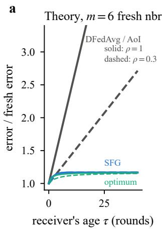

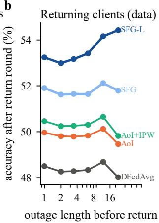

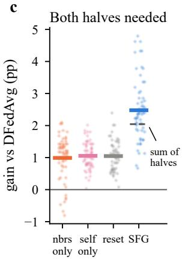

d  
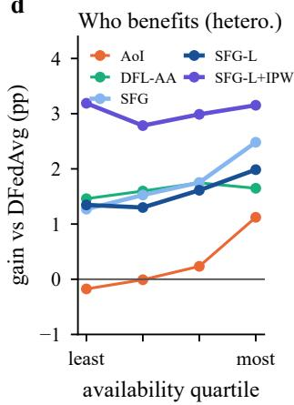  
Figure 3: Why self-inclusive discounting works. (a) Aggregation error of a returning client relative to a fresh one (Corollary 4, six fresh neighbours). (b) Accuracy of returning clients after the local training of their return round, against their outage length (27 runs per rule). (c) Decomposition on bursty u=0.8, heterogeneous u≈0.77, and FLASH relaxed and strict (60 paired runs). Discounting neighbours or oneself alone gives 40–42% of SFG’s gain. (d) Gain by availability quartile under heterogeneous rates (30 paired runs, s.e. 0.12–0.32 pp, Table 34).

Feeding lags instead of ages to the same estimator (PWG-L) lifts the gain from +1.48 to +2.44 pp in 102 of 120 paired runs, halfway to SFG-L (+3.49 pp).

The horizon explains the second half. The receiver carries its persistent error for $H \geq 3$ rounds, and for 8–23 rounds under long or frequent outages, while the dispersion it absorbs fades faster. The efective rate (19) is therefore 0.8–9 rather than the one-step estimate (Tables 22 and 23). Raising PWG-L’s rate to $H \rho = 3$ , 10 and 30, as Proposition 7 prescribes, lifts its gain to +3.35, +3.56 and +3.59 pp (Table 21).

A deployable rule matches the oracle. An oracle that knows the true persistent-error Gram matrix G and minimises the horizon objective gains +3.87 pp, within 0.1 pp of SFG-Cut. A rule that uses one scalar per neighbour thus matches an oracle with global information, which is, in our view, the strongest evidence that the three principles capture what matters. The theory identifies the shape of good weights rather than a unique rule. In a pre-registered test on held-out seeds (Appendix F), parameters measured per process do no better than constants and trail SFG-Cut, which is why we select the margin empirically.

## 6.6 Q5: robustness and generality

Figure 4 condenses this section. In each of ten settings, the best SFG rule gains 2.2–4.6 times as much as the strongest AoI baseline under the same protocol. The settings cover learning rates re-tuned per rule, a six-day real trace with outages of up to 143 hours, three alternative backbones, a pretrained ResNet-18 and unreliable links. The gains also hold for time-averaged accuracy, on Erdős–Rényi and regular graphs, for $N \in \{ 5 0 , 3 0 0 \}$ and for Dirichlet $\alpha \in \{ 0 . 1 , 1 \}$ (Appendix A.7). They are smallest on a ring $\left( + 1 . 6 \mathrm { p p } \right)$ , where each client has only two neighbours to choose from.

## 7 Discussion and limitations

What we achieved. We answered a question that decentralised learning on real devices cannot avoid: how a client that has just returned from an outage should weight the models in front of it, its own included. The answer is three principles, each backed by a formal result and confirmed by an ablation. They yield the SFG family, whose lag-based members are the strongest deployable rules in our benchmark at the cost of one scalar per message, and they explain why AoI rules help little and why limited merging needs a tight threshold.

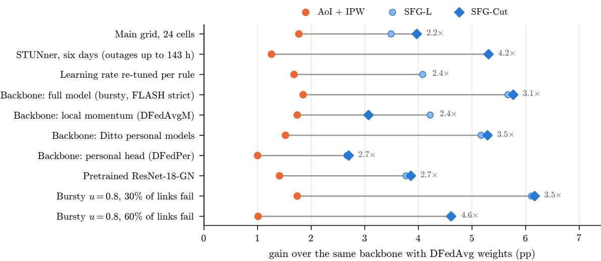  
Figure 4: The advantage holds across protocols, backbones, models and networks. Gain over the same backbone with DFedAvg weights, for the strongest AoI baseline and the two lag-based SFG rules. The label gives the ratio of the best SFG gain to the AoI + IPW gain. Backbone rows use bursty u=0.8 and FLASH strict. Link rows use bursty u=0.8. ResNet-18-GN is the mean over the six cells of Table 14. SFG-Cut was not run in the learning-rate sweep. Sources: Tables 3, 13, 14, 17, 32 and 35.

When the rules help less. The rules rely on fresher candidates being available. Under regional outages, neighbours fail and return together. A returning client then has no fresher candidate, and SFG’s gain falls to +0.7 pp (Section 6.1). On a ring, the gain is +1.6 pp. Under i.i.d. outages, most returns come after one round, and the receiver is the stalest candidate in only 37% of returns (Appendix F). Under heterogeneous availability, SFG-Cut helps the least-available quartile least among the self-inclusive rules. At u = 0.6, SFG-L needs IPW to match DFL-AA. We therefore recommend IPW whenever availability is heterogeneous.

Limitations of the theory. The analysis concerns the error of aggregation under stylised staleness models with mean-inherited lags. It treats personal deviations as noise. It establishes that the discount must be steep. The cut structure, however, requires nesting and import conditions that fail on the long-outage traces, so the margin L is chosen empirically. Convergence of training under staleness-dependent mixing remains outside the analysis, although the mixing matrices are exogenous to the optimisation (Remark 1). For rules on maximum-inherited counts such as limited merging, we show that the counts cannot certify a bound (Proposition 6), but we do not bound their error when every client runs them. Finally, the advantage of steep rules under i.i.d. outages persists against a Ditto reference and remains unexplained.

Limitations of the evaluation. The simulation is synchronous. The real availability traces are mapped at random onto a synthetic geometric graph, whereas real deployments would couple availability with topology. The experiments cover image classification with a small CNN, a pretrained ResNet-18 check, and up to 300 clients.

The pilot that documents the margin L was run after the test-seed results for L ∈ {1, 2} were known. The margin was therefore not chosen blind. We report both values throughout, and they difer by at most 0.16 pp on average. Several close comparisons also remain statistically unresolved, notably SFG-Cut against tuned limited merging and against the oracle QP.

Future work. Several directions follow naturally. A convergence analysis of training under stalenessdependent mixing is the most important. Rules could also adapt the margin online from the measured horizon. Asynchronous and event-driven protocols and availability-aware topologies are natural extensions. Finally, the staleness scalar should be protected against manipulation by malicious clients.

## 8 Conclusion

This paper studied aggregation in decentralised learning when clients go ofline, and identified the case that matters most: after an outage, the stalest model a client aggregates is usually its own. Treating aggregation as estimation of the state of a fully available network, we derived three principles that a good rule must satisfy. It must discount every candidate, the receiver included, by staleness relative to the freshest candidate. It must measure staleness as the lag a model has inherited through averaging, which local training does not remove, rather than as its age. It must discount steeply, because absorbed lag persists in every later round. Each principle is supported by a formal result and confirmed by an ablation that removes it.

These principles define Self-inclusive Freshness-weighted Gossip (SFG), a family of aggregation rules that changes only the averaging weights of DFedAvg and adds one scalar per message. Its lag-based members, SFG-L and SFG-Cut, are to our knowledge the first staleness-aware rules for decentralised learning whose error guarantees hold for the stale receiver itself. Across three datasets, eight outage processes and the robustness settings of Fig. 4, they recover about half or more of the accuracy lost to outages, roughly twice as much as age-of-information rules, without additional communication rounds or local computation. Combined with catch-up training, they recover up to three quarters.

The analysis also ofers a unifying view of prior work. It explains why the inherited counts of gossip learning help and why limited merging needs a tight threshold. The main open questions, discussed in Section 7, are a convergence theory for staleness-dependent mixing and a principled choice of the cut margin. More broadly, our results suggest that robustness to intermittent availability depends less on reusing stale information than on knowing how stale each model is, including one’s own.

## Broader impact statement

This work makes decentralised learning more robust to the intermittent availability of real devices. This can broaden participation in on-device learning. Freshness weighting can, however, benefit frequently available devices most. Availability correlates with device quality, charging habits and connectivity. We therefore report per-availability-quartile efects. SFG-Cut helps the least-available clients least among the self-inclusive rules, while SFG-L with IPW lifts every quartile. We recommend auditing these efects in deployment. Self-reported staleness metadata must also be protected against manipulation.

## Reproducibility statement

All comparisons are paired over seeds 1–5, with data partitions, graph, initialisation, outage trace and minibatch stream shared across rules (Section 6). Every hyperparameter, baseline and trace-processing step is specified in Section D. Three files are provided as ancillary files with this submission: comparisons.csv lists every comparison reported in the paper with its interval, win count and both tests; horizon\_derive.py is the trace-only replay behind the horizon measurements of Proposition 7; and c26b\_prereg.md is the pre-registration of the predictive test. The FLASH trace is public (Yang et al., 2021), and the STUNner trace is available from its authors for non-profit use (Szabó et al., 2019).

## References

Manoj Ghuhan Arivazhagan, Vinay Aggarwal, Aaditya Kumar Singh, and Sunav Choudhary. Federated learning with personalization layers, 2019. arXiv:1912.00818.

Mahmoud Assran, Nicolas Loizou, Nicolas Ballas, and Mike Rabbat. Stochastic gradient push for distributed deep learning. In Proceedings of the 36th International Conference on Machine Learning, volume 97 of PMLR, pp. 344–353, 2019.

Keith Bonawitz, Hubert Eichner, Wolfgang Grieskamp, Dzmitry Huba, Alex Ingerman, Vladimir Ivanov, Chloé Kiddon, Jakub Konečný, Stefano Mazzocchi, Brendan McMahan, Timon Van Overveldt, David Petrou, Daniel Ramage, and Jason Roselander. Towards federated learning at scale: System design. In Proceedings of Machine Learning and Systems, volume 1, pp. 374–388, 2019.

Marco Bornstein, Tahseen Rabbani, Evan Wang, Amrit Bedi, and Furong Huang. SWIFT: Rapid decentralized federated learning via wait-free model communication. In International Conference on Learning Representations, 2023.

Stephen Boyd, Arpita Ghosh, Balaji Prabhakar, and Devavrat Shah. Randomized gossip algorithms. IEEE Transactions on Information Theory, 52(6):2508–2530, 2006. doi: 10.1109/TIT.2006.874516.

Baturalp Buyukates, Melih Bastopcu, and Sennur Ulukus. Version age of information in clustered gossip networks. IEEE Journal on Selected Areas in Information Theory, 3(1):85–97, 2022.

Sebastian Caldas, Sai Meher Karthik Duddu, Peter Wu, Tian Li, Jakub Konečný, H. Brendan McMahan, Virginia Smith, and Ameet Talwalkar. LEAF: A benchmark for federated settings, 2018. arXiv:1812.01097.

Liam Collins, Hamed Hassani, Aryan Mokhtari, and Sanjay Shakkottai. Exploiting shared representations for personalized federated learning. In Proceedings of the 38th International Conference on Machine Learning, volume 139 of PMLR, pp. 2089–2099, 2021.

Rong Dai, Li Shen, Fengxiang He, Xinmei Tian, and Dacheng Tao. DisPFL: Towards communication-eficient personalized federated learning via decentralized sparse training. In Proceedings of the 39th International Conference on Machine Learning, volume 162 of PMLR, pp. 4587–4604, 2022.

Gábor Danner, István Hegedűs, and Márk Jelasity. Improving gossip learning via limited model merging. In Advances in Computational Collective Intelligence (ICCCI 2023), volume 1864 of Communications in Computer and Information Science, pp. 351–363. Springer, 2023. doi: 10.1007/978-3-031-41774-0\_28.

Xinran Gu, Kaixuan Huang, Jingzhao Zhang, and Longbo Huang. Fast federated learning in the presence of arbitrary device unavailability. In Advances in Neural Information Processing Systems, volume 34, pp. 12052–12064, 2021.

István Hegedűs, Gábor Danner, and Márk Jelasity. Gossip learning as a decentralized alternative to federated learning. In Distributed Applications and Interoperable Systems (DAIS 2019), volume 11534 of Lecture Notes in Computer Science, pp. 74–90. Springer, 2019. doi: 10.1007/978-3-030-22496-7\_5.

István Hegedűs, Gábor Danner, and Márk Jelasity. Decentralized learning works: An empirical comparison of gossip learning and federated learning. Journal of Parallel and Distributed Computing, 148:109–124, 2021. doi: 10.1016/j.jpdc.2020.10.006.

Chanuka A. S. Hewa Kaluannakkage and Rajkumar Buyya. Asynchronous decentralized federated learning over lossy wireless links via reception- and age-aware aggregation, 2026. arXiv:2606.10774.

Divyansh Jhunjhunwala, Pranay Sharma, Aushim Nagarkatti, and Gauri Joshi. FedVARP: Tackling the variance due to partial client participation in federated learning. In Proceedings of the Thirty-Eighth Conference on Uncertainty in Artificial Intelligence, volume 180 of PMLR, pp. 906–916, 2022.

Simon J. Julier and Jefrey K. Uhlmann. A non-divergent estimation algorithm in the presence of unknown correlations. In Proceedings of the 1997 American Control Conference, pp. 2369–2373, 1997. doi: 10.1109/ ACC.1997.609105.

Peter Kairouz, H. Brendan McMahan, et al. Advances and open problems in federated learning. Foundations and Trends in Machine Learning, 14(1–2):1–210, 2021. doi: 10.1561/2200000083.

Ahmed T. Kamal, Jay A. Farrell, and Amit K. Roy-Chowdhury. Information weighted consensus filters and their application in distributed camera networks. IEEE Transactions on Automatic Control, 58(12): 3112–3125, 2013. doi: 10.1109/TAC.2013.2277621.

Soummya Kar and José M. F. Moura. Distributed consensus algorithms in sensor networks with imperfect communication: Link failures and channel noise. IEEE Transactions on Signal Processing, 57(1):355–369, 2009.

Anastasia Koloskova, Nicolas Loizou, Sadra Boreiri, Martin Jaggi, and Sebastian Stich. A unified theory of decentralized SGD with changing topology and local updates. In Proceedings of the 37th International Conference on Machine Learning, volume 119 of PMLR, pp. 5381–5393, 2020.

Lingjing Kong, Tao Lin, Anastasia Koloskova, Martin Jaggi, and Sebastian Stich. Consensus control for decentralized deep learning. In Proceedings of the 38th International Conference on Machine Learning, volume 139 of PMLR, pp. 5686–5696, 2021.

Tian Li, Shengyuan Hu, Ahmad Beirami, and Virginia Smith. Ditto: Fair and robust federated learning through personalization. In Proceedings of the 38th International Conference on Machine Learning, volume 139 of PMLR, pp. 6357–6368, 2021.

Xiangru Lian, Ce Zhang, Huan Zhang, Cho-Jui Hsieh, Wei Zhang, and Ji Liu. Can decentralized algorithms outperform centralized algorithms? A case study for decentralized parallel stochastic gradient descent. In Advances in Neural Information Processing Systems, volume 30, 2017.

Xiangru Lian, Wei Zhang, Ce Zhang, and Ji Liu. Asynchronous decentralized parallel stochastic gradient descent. In Proceedings of the 35th International Conference on Machine Learning, volume 80 of PMLR, pp. 3043–3052, 2018.

Ji Liu, Tianshi Che, Yang Zhou, Ruoming Jin, Huaiyu Dai, Dejing Dou, and Patrick Valduriez. AEDFL: Eficient asynchronous decentralized federated learning with heterogeneous devices. In Proceedings of the 2024 SIAM International Conference on Data Mining (SDM), pp. 833–841, 2024a. doi: 10.1137/1. 9781611978032.95.

Tian Liu, Yue Cui, Xueyang Hu, Yecheng Xu, and Bo Liu. On the convergence of gossip learning in the presence of node inaccessibility. In ICC 2024 - IEEE International Conference on Communications, pp. 4197–4202, 2024b. doi: 10.1109/ICC51166.2024.10622167.

Yingqi Liu, Yifan Shi, Qinglun Li, Baoyuan Wu, Xueqian Wang, and Li Shen. Decentralized directed collaboration for personalized federated learning. In Proceedings of the IEEE/CVF Conference on Computer Vision and Pattern Recognition (CVPR), pp. 23168–23178, 2024c. doi: 10.1109/CVPR52733.2024.02186.

Qianyu Long, Qiyuan Wang, Christos Anagnostopoulos, and Daning Bi. Decentralized personalized federated learning based on a conditional “sparse-to-sparser” scheme. IEEE Transactions on Neural Networks and Learning Systems, 36(10):19160–19174, 2025. doi: 10.1109/TNNLS.2025.3580277.

John Nguyen, Kshitiz Malik, Hongyuan Zhan, Ashkan Yousefpour, Mike Rabbat, Mani Malek, and Dzmitry Huba. Federated learning with bufered asynchronous aggregation. In Proceedings of the 25th International Conference on Artificial Intelligence and Statistics, volume 151 of PMLR, pp. 3581–3607, 2022.

Angelo Rodio, Francescomaria Faticanti, Othmane Marfoq, Giovanni Neglia, and Emilio Leonardi. Federated learning under heterogeneous and correlated client availability. In IEEE INFOCOM 2023 - IEEE Conference on Computer Communications, pp. 1–10, 2023. doi: 10.1109/INFOCOM53939.2023.10228876.

Ali H. Sayed. Adaptation, learning, and optimization over networks. Foundations and Trends in Machine Learning, 7(4-5):311–801, 2014. doi: 10.1561/2200000051.

Yifan Shi, Li Shen, Kang Wei, Yan Sun, Bo Yuan, Xueqian Wang, and Dacheng Tao. Improving the model consistency of decentralized federated learning. In Proceedings of the 40th International Conference on Machine Learning, volume 202 of PMLR, pp. 31269–31291, 2023.

Tao Sun, Dongsheng Li, and Bao Wang. Decentralized federated averaging. IEEE Transactions on Pattern Analysis and Machine Intelligence, 45(4):4289–4301, 2023. doi: 10.1109/TPAMI.2022.3196503.

Zhenyu Sun, Ziyang Zhang, Zheng Xu, Gauri Joshi, Pranay Sharma, and Ermin Wei. Debiasing federated learning with correlated client participation. In International Conference on Learning Representations, 2025.

Zoltán Szabó, Krisztián Téglás, Árpád Berta, Márk Jelasity, and Vilmos Bilicki. Stunner: A smart phone trace for developing decentralized edge systems. In Distributed Applications and Interoperable Systems (DAIS 2019), volume 11534 of Lecture Notes in Computer Science, pp. 108–115. Springer, 2019. doi: 10.1007/978-3-030-22496-7\_7.

Sheng-Yuan Tu and Ali H. Sayed. Optimal combination rules for adaptation and learning over networks. In 4th IEEE International Workshop on Computational Advances in Multi-Sensor Adaptive Processing (CAMSAP), pp. 317–320, 2011. doi: 10.1109/CAMSAP.2011.6136014.

Thijs Vogels, Hadrien Hendrikx, and Martin Jaggi. Beyond spectral gap: the role of the topology in decentralized learning. In Advances in Neural Information Processing Systems, volume 35, pp. 15039–15050, 2022.

Shiqiang Wang and Mingyue Ji. A unified analysis of federated learning with arbitrary client participation. In Advances in Neural Information Processing Systems, volume 35, pp. 19124–19137, 2022.

Shiqiang Wang and Mingyue Ji. A lightweight method for tackling unknown participation statistics in federated averaging. In International Conference on Learning Representations, 2024.

Ming Xiang, Stratis Ioannidis, Edmund Yeh, Carlee Joe-Wong, and Lili Su. Eficient federated learning against heterogeneous and non-stationary client unavailability. In Advances in Neural Information Processing Systems, volume 37, pp. 104281–104328, 2024. doi: 10.52202/079017-3313.

Cong Xie, Sanmi Koyejo, and Indranil Gupta. Asynchronous federated optimization, 2019. arXiv:1903.03934.

Chengxu Yang, Qipeng Wang, Mengwei Xu, Zhenpeng Chen, Kaigui Bian, Yunxin Liu, and Xuanzhe Liu. Characterizing impacts of heterogeneity in federated learning upon large-scale smartphone data. In Proceedings of the Web Conference 2021 (WWW ’21), pp. 935–946, 2021. doi: 10.1145/3442381.3449851.

Howard H. Yang, Ahmed Arafa, Tony Q. S. Quek, and H. Vincent Poor. Age-based scheduling policy for federated learning in mobile edge networks. In IEEE International Conference on Acoustics, Speech and Signal Processing (ICASSP), pp. 8743–8747, 2020. doi: 10.1109/ICASSP40776.2020.9053740.

Roy D. Yates. The age of gossip in networks. In IEEE International Symposium on Information Theory (ISIT), pp. 2984–2989, 2021.

Shahryar Zehtabi, Dong-Jun Han, Rohit Parasnis, Seyyedali Hosseinalipour, and Christopher G. Brinton. Decentralized sporadic federated learning: A unified algorithmic framework with convergence guarantees. In International Conference on Learning Representations, 2025.

Xiaochuan Zhao, Sheng-Yuan Tu, and Ali H. Sayed. Difusion adaptation over networks under imperfect information exchange and non-stationary data. IEEE Transactions on Signal Processing, 60(7):3460–3475, 2012. doi: 10.1109/TSP.2012.2192928.

## A Extended results for Sections 4 and 6

This appendix gives the full versions of analyses that the main paper summarises.

## A.1 The horizon in practice

This subsection expands Section 4.4.

How steep, in practice? Dispersion is not fully regenerated either. Suppose a fraction $\theta _ { \varepsilon } ^ { 2 }$ survives each round of local training. The dispersion is then counted $H _ { \varepsilon }$ times instead of once, and $H _ { \varepsilon }$ can be below 1. To first order, the efective rate becomes

$$
\rho _ { \mathrm { e f f } } \approx \rho \lambda _ { G } \frac { H } { H _ { \varepsilon } } ,
$$

where λG ≈ 1 converts persistent diferences into lag diferences (Appendix B). On our models, $\theta _ { \varepsilon } ^ { 2 } \approx 0 . 8 .$ , while nearly all persistent error survives. Along SFG-L trajectories, H is 3.5–23 and $H / H _ { \varepsilon }$ is 1.5–4 (Appendix F). The efective rate is thus 0.8–9, against a one-step estimate $\hat { \rho } \approx 0 . 4 \ – 1 . 9$ . It is steeper than one-step weights, though far milder than a horizon that ignores the carry-over.

The import term of part (ii) is weaker. It truncates the weights only if lag absorbed now adds to the lag the receiver will import. Its slope depends on the neighbours’ rule and on the training length. It is negative on the long-outage traces, where nesting fails. The theory therefore establishes that the discount should be steep. A cut additionally requires the nesting and import conditions of part (ii), so we select its margin empirically.

## A.2 Towards a convergence analysis

Remark 1 (Towards a convergence analysis). Our results bound the error of each aggregation, not the convergence of training. Two properties of SFG make such an analysis tractable. First, its weights depend only on the outage trace, the graph and the rule, never on the models (Appendix F). The mixing matrices are therefore exogenous to the optimisation, as in analyses of decentralised SGD with time-varying gossip (Koloskova et al., 2020). Second, they coincide with DFedAvg’s whenever no candidate is stale, so any analysis of DFedAvg applies between outages. The remaining obstacle is that the matrices are row-stochastic but not doubly stochastic. Fresher models receive more total weight than staler ones, which is the intended efect, but it means that the network average is not preserved. Corrections for column sums, as in push-sum methods (Assran et al., 2019), are one route to a convergence guarantee. We leave this analysis to future work.

## A.3 What do outages cost?

This subsection expands Section 6.1.

Before comparing rules, we ask where the damage comes from.

The rate matters, the structure does not. At matched unavailability, which clients fail together barely changes DFedAvg’s loss. The diference is at most 0.78 pp per dataset over 540 runs (Appendix F).

Sharing a stale model is worse than silence. What an outage disables matters a great deal. A client that cannot train but keeps sharing its frozen model costs DFedAvg more than a full outage: 10.3–12.6 pp against 7.1–9.6 pp at u = 0.8. Under SFG, whose receivers discount that model, the same client costs only $1 . 2 \mathrm { - } 2 . 2 \mathrm { p p }$ . Undiscounted stale parameters are therefore a first-order cost. An aggregation rule alone can remove it.

A limit of any staleness-based rule. When neighbours fail and return together, as in regional outages, a returning client finds no fresher candidate. SFG’s gain then falls from +3.8 to +0.7 pp.

## A.4 Main results, all rules

This subsection expands Section 6.2.

Table 4 lists every rule of the main grid, including the controls and the oracle.

AoI rules recover a quarter of the gap or less. Neighbour-only AoI gains +1.04 pp and DFL-AA +1.51 pp. AoI + IPW on absolute ages gains +1.77 pp, and resetting a returning client’s model +1.0 pp. Every SFG variant beats every AoI variant on average. The lag-based SFG rules roughly double the best AoI gain.

Stale information must be discounted, not reused. Reusing undiscounted stale models is harmful. Model memory costs −15.6 pp and update amplification −1.6 pp. Discounting rescues model memory, turning −15.6 pp into +2.87 pp (Appendix F). The relative-variance combiner costs −2.0 pp. In personalised learning, its distances mix staleness with data heterogeneity.

Gossip learning, explained. Limited merging on gossip learning’s maximum-inherited counts gains +3.84 pp at L = 1 and $+ 3 . 7 0 \mathrm { p p }$ at L = 2. SFG weights on the same counts gain +3.66 pp. Our principles explain this. Tuned limited merging is self-inclusive and uses inherited staleness. With a tight threshold, it is also steep. Removing steepness shrinks the gain. Gossip learning’s plain count weights gain only +1.01 pp, and limited merging with a loose threshold (L = 10) gains +2.55 pp.

Table 4: Main results, all rules on 3 datasets, 8 outage processes (five synthetic, three real) and 5 seeds. Accuracy is averaged over the eight processes. Gain: paired diference to DFedAvg in percentage points, mean over 120 runs, in mean and 10th-percentile (p10) client accuracy, with a 95% stratified t-interval over dataset–seed units. Wins: paired runs with a positive gain. Cells: dataset–process cells with a positive mean gain. Local steps: computation relative to DFedAvg. All rules send the same models as DFedAvg. The staleness-aware rules add one scalar, and model memory stores one model per neighbour. †Gossip-learning update counts, inherited by the maximum on merging. ∗Oracle consistency check that requires global information unavailable to a receiver. Further variants are in Tables 19 to 21. Bold: best value in each column, separately for rules without and with catch-up training (extra computation). The oracle is excluded.
<table><tr><td rowspan="2">Method</td><td colspan="3">Mean accuracy (%)</td><td colspan="3">Gain vs DFedAvg (pp)</td><td rowspan="2">Wins /120</td><td rowspan="2">Cells &gt; 0</td><td rowspan="2">Local steps</td></tr><tr><td>CIFAR-10</td><td>CIFAR-100</td><td>FEMNIST</td><td>mean [95% CI]</td><td></td><td>p10</td></tr><tr><td>Baselines and controls</td><td></td><td></td><td></td><td></td><td></td><td></td><td></td><td></td><td></td></tr><tr><td>Local only</td><td>63.6</td><td>23.3</td><td>73.3</td><td></td><td>-4.23 [−4.52, −3.95]</td><td>-5.08</td><td>5</td><td>1</td><td>1.00</td></tr><tr><td>DFedAvg</td><td>66.8</td><td>25.2</td><td>80.8</td><td></td><td></td><td></td><td>一</td><td>一</td><td>1.00</td></tr><tr><td>Model memory</td><td>56.0</td><td>15.8</td><td>54.3</td><td></td><td>-15.60 [−16.05, -15.14]</td><td>-17.43</td><td>0</td><td>0</td><td>1.00</td></tr><tr><td>Update amplification (×2)</td><td>65.3</td><td>23.8</td><td>78.9</td><td></td><td>−1.63 [−1.72, −1.54]</td><td>-3.31</td><td>9</td><td>0</td><td>1.00</td></tr><tr><td>Relative-variance combiner</td><td>65.6</td><td>23.7</td><td>77.5</td><td></td><td>−2.03 [−2.17, −1.89]</td><td>-2.30</td><td>0</td><td>0</td><td>1.00</td></tr><tr><td>Copy a random candidate</td><td>65.5</td><td>25.5</td><td>79.1</td><td></td><td>-0.97 [−1.17, −0.77]</td><td>-1.70</td><td>24</td><td>4</td><td>1.00</td></tr><tr><td>Placebo cut (random, same size)</td><td>66.8</td><td>25.9</td><td>80.3</td><td></td><td>+0.00 [−0.13, 0.13]</td><td>-0.10</td><td>71</td><td>13</td><td>1.00</td></tr><tr><td>Age-of-information rules</td><td></td><td></td><td></td><td></td><td></td><td></td><td></td><td></td><td></td></tr><tr><td>AoI (neighbour-only, ages)</td><td>68.0</td><td>26.2</td><td>81.8</td><td></td><td>+1.04 [0.98, 1.10]</td><td>+1.19</td><td>113</td><td>22</td><td>1.00</td></tr><tr><td>DFL-AA (relative AoI + IPW)</td><td>68.3</td><td>27.1</td><td>82.0</td><td></td><td>+1.51 [1.45, 1.58]</td><td>+1.71</td><td>115</td><td>24</td><td>1.00</td></tr><tr><td>AoI + IPW (absolute AoI)</td><td>68.6</td><td>27.3</td><td>82.3</td><td></td><td>+1.77 [1.72, 1.82]</td><td>+2.06</td><td>120</td><td>24</td><td>1.00</td></tr><tr><td>Gossip learning</td><td></td><td></td><td></td><td></td><td></td><td></td><td></td><td></td><td></td></tr><tr><td>Gossip-learning model age†</td><td>67.8</td><td>26.1</td><td>82.0</td><td></td><td>+1.01 [0.95, 1.06]</td><td>+1.12</td><td>116</td><td>24</td><td>1.00</td></tr><tr><td>Limited merging†, L=10</td><td>69.4</td><td>27.8</td><td>83.4</td><td></td><td>+2.55 [2.42, 2.68]</td><td>+3.06</td><td>119</td><td>24</td><td>1.00</td></tr><tr><td>Limited merging†, L=1</td><td>70.6</td><td>29.7</td><td>84.1</td><td></td><td>+3.84 [3.70, 3.98]</td><td>+4.53</td><td>119</td><td>24</td><td>1.00</td></tr><tr><td>SFG weights on counts†</td><td>70.5</td><td>29.4</td><td>84.0</td><td></td><td>+3.66 [3.51, 3.80]</td><td>+4.31</td><td>120</td><td>24</td><td>1.00</td></tr><tr><td>SFG weights on counts† + IPW</td><td>71.1</td><td>30.2</td><td>84.4</td><td></td><td>+4.27 [4.16, 4.38]</td><td>+5.10</td><td>120</td><td>24</td><td>1.00</td></tr><tr><td>Proposed: the SFG family</td><td></td><td></td><td></td><td></td><td></td><td></td><td></td><td></td><td></td></tr><tr><td>SFG (ages)</td><td>69.4</td><td>28.0</td><td>82.9</td><td></td><td>+2.44 [2.37, 2.51]</td><td>+2.77</td><td>120</td><td>24</td><td>1.00</td></tr><tr><td>SFG + IPW (ages)</td><td>69.8</td><td>28.8</td><td>83.2</td><td></td><td>+2.97 [2.86, 3.07]</td><td>+3.32</td><td>120</td><td>24</td><td>1.00</td></tr><tr><td>SFG-L (lags)</td><td>70.4</td><td>29.1</td><td>83.8</td><td></td><td>+3.49 [3.33, 3.65]</td><td>+4.09</td><td>118</td><td>24</td><td>1.00</td></tr><tr><td>SFG-L + IPW (lags)</td><td>71.0</td><td>30.2</td><td>84.3</td><td></td><td>+4.21 [4.08, 4.33]</td><td>+4.91</td><td>120</td><td>24</td><td>1.00</td></tr><tr><td>SFG-Cut, L=1</td><td>70.7</td><td>30.0</td><td>84.1</td><td></td><td>+3.97 [3.79, 4.15]</td><td>+4.75</td><td>119</td><td>24</td><td>1.00</td></tr><tr><td>SFG-Cut, L=1, + IPW</td><td>71.2</td><td>30.6</td><td>84.3</td><td></td><td>+4.39 [4.23, 4.56]</td><td>+5.17</td><td>120</td><td>24</td><td>1.00</td></tr><tr><td>Oracle</td><td></td><td></td><td></td><td></td><td></td><td></td><td></td><td></td><td></td></tr><tr><td>Oracle horizon-GLS, Hρ=3*</td><td>70.6</td><td>29.5</td><td>83.9</td><td></td><td>+3.71 [3.57, 3.85]</td><td>+4.34</td><td>120</td><td>24</td><td>1.00</td></tr><tr><td>With catch-up training (extra computation)</td><td></td><td></td><td></td><td></td><td></td><td></td><td></td><td></td><td></td></tr><tr><td>Catch-up local steps</td><td>68.8</td><td>26.9</td><td>82.4</td><td></td><td>+1.72 [1.61, 1.83]</td><td>+2.11</td><td>117</td><td>24</td><td>1.71 1.71</td></tr><tr><td>SFG-L + catch-up</td><td>71.7</td><td>30.3</td><td>84.9</td><td></td><td>+4.65 [4.49, 4.81]</td><td>+5.59</td><td>120</td><td>24</td><td></td></tr><tr><td>SFG-Cut + catch-up</td><td>72.0</td><td>31.0</td><td>85.1</td><td></td><td>+5.06 [4.88, 5.25]</td><td>+6.18</td><td>120</td><td>24</td><td>1.71</td></tr></table>

SFG-Cut is 0.13 pp above limited merging at L = 1. We leave this diference unresolved. The advantage of SFG-Cut is that it is covered by our bounds. Outside i.i.d. outages, the steep rules are on average within 0.2 pp of SFG-L. Under i.i.d. outages, they gain up to 2.9 pp more, and the oracles of Section 6.5 up to 3.2 pp more.

Outage-free DFedAvg is a reference, not a ceiling. Under i.i.d. outages, the steepest rules even exceed outage-free DFedAvg. SFG-Cut with L = 1 does so also at tuned learning rates. We trace this to a mixing efect outside our staleness model, with three pieces of evidence. Averaging two random candidates gains as much without any outages (+1.36 pp). Copying a random candidate gains +0.86 pp without outages but costs −0.97 pp under them. Against an outage-free Ditto reference, the excess disappears. The lead of the steep rules over SFG-L under i.i.d. outages persists with Ditto (2.3 pp) and remains unexplained (Table 25, Appendix F).

Composability. The link correction of IPW is orthogonal to freshness weighting. It adds +0.42 to +0.72 pp to SFG, SFG-L and SFG-Cut. SFG-Cut + IPW gains +4.39 pp ([4.23, 4.56]), wins all 120 runs and closes 59–69% of the gap. SFG-L + IPW (+4.21 pp) and SFG on counts + IPW (+4.27 pp) are within 0.2 pp, an unresolved diference. Catch-up local steps help on their own, gaining +1.72 pp at 1.71× the computation. SFG-Cut + catch-up gains +5.06 pp, wins all 120 runs and closes 73–75% of the gap.

## A.5 Ablations

This subsection expands Section 6.3.

Both halves of self-inclusion are needed. We decompose SFG on four processes: bursty u=0.8, heterogeneous u≈0.77, and FLASH relaxed and strict (60 paired runs, Fig. 3c, Table 8). Discounting only stale neighbours (AoI) gains +0.99 pp over DFedAvg. Discounting only the receiver’s own stale model gains +1.05 pp, as does discarding it on return. Doing both, as SFG does, gains +2.48 pp. The combination is worth more than the sum of the halves (+2.04 pp), and SFG beats self-only discounting in 60 of 60 runs. A constant, age-independent self-weight gains only 0.2–0.7 pp, and as much without outages as with them. SFG adds +2.1 to +3.5 pp on top of this mixing benefit (Table 7).

Lags help where many neighbours are stale at once. SFG-L gains +1.05 pp more than SFG $( p _ { \mathrm { H o l m } } = 0 . 0 0 4 )$ . It leads in 18 of 24 cells, with cell-level $p _ { \mathrm { H o l m } } = 0 . 0 8$ . The gain concentrates where lags and ages disagree most (Section 6.5). Under bursty outages at u = 0.8, SFG-L gains +6.8 pp against SFG’s +3.8 pp. On FLASH strict and STUNner, it gains +4.5 pp against +1.9 and +2.1 pp. On the other five processes, the two rules are within 0.5 pp. Under heterogeneous rates at u = 0.6, SFG-L (+1.2 pp) trails SFG, DFL-AA (+1.7 pp) and limited merging (+1.9 pp). Adding IPW recovers it (+2.5 pp).

## A.6 Who benefits

This subsection expands Section 6.4.

The least available clients benefit too. Rarely available clients are the ones whose own model is usually the stalest (Fig. 3d, Table 34). Under heterogeneous rates, neighbour-only AoI does not help the least-available quartile (−0.18 pp), as Theorem 2 predicts. AoI + IPW and DFL-AA, in contrast, lift it as much as SFG and SFG-L: +1.33 and +1.46 pp, against +1.27 and +1.35 pp. The link correction is an implicit self-discount, outside the scope of Theorem 2.

Among self-inclusive rules, limited merging with L = 2 lifts that quartile most (+1.83 pp), and SFG-Cut with L = 1 least (+1.21 pp). With IPW, SFG-Cut trails SFG-L + IPW by 0.5–1.0 pp in every quartile, while SFG-L + IPW gains +2.8 to +3.2 pp in each. On the real traces, SFG-L’s gain is flat across quartiles, at +3.7 to +3.9 pp. Age-based rules, in contrast, help frequently available clients most.

## A.7 Robustness and generality

This subsection expands Section 6.6.

Protocol. The gains hold for time-averaged accuracy (Table 33). They also hold with learning rates re-tuned per rule, where SFG-L gains +4.1 pp in 36 of 36 runs and AoI + IPW +1.7 pp (Table 32).

A six-day real trace. On a six-day STUNner window, outages last up to 143 hours. SFG-Cut gains +5.3 pp there, and +5.8 pp with IPW. SFG-L gains +5.3 pp, against +0.6 pp for DFL-AA (Table 35). On this longer trace, the advantage of the self-inclusive rules over DFL-AA widens rather than shrinks.

Backbones and a larger model. Under bursty and FLASH-strict outages, SFG-L gains +4.2 pp with local momentum, +5.2 pp with Ditto-style personal models and +2.7 pp with a personal head. AoI + IPW gains +1.0 to +1.7 pp in the same settings (Table 13). With a pretrained ResNet-18-GN, SFG-L gains +3.8 pp in 18 of 18 runs, against +1.4 pp for $\mathrm { A o I + I P W }$ , and +5.9 pp with catch-up (Table 14). SFG-Cut matches SFG-L across these settings, except with local momentum (+3.1 against +4.2 pp, Tables 13, 14 and 17).

Graphs, scale, heterogeneity and links. On CIFAR-10, SFG-L gains +3.5 to +8.6 pp on Erdős–Rényi and regular graphs, with $N \in \{ 5 0 , 3 0 0 \}$ and Dirichlet $\alpha \in \{ 0 . 1 , 1 \}$ . It gains +4.6 to +6.1 pp when 30–60% of links fail (Tables 16 and 17). On a ring, where each client has only two neighbours to choose from, it gains +1.6 pp. With two classes per client, it gains +2.1 pp.

## B Proofs

Notation. Throughout, S is the candidate set of receiver i, with $| S | = m + 1$ . We write $e _ { j } = x _ { j } ^ { t } - c _ { t }$ , and Σ is the error covariance (4). For weights with $\mathbf { 1 } ^ { \top } w = 1$ , we have $\begin{array} { r } { \sum _ { j } w _ { j } x _ { j } ^ { t } - c _ { t } = \sum _ { j } w _ { j } e _ { j } } \end{array}$ . The aggregation error is therefore

$$
\mathcal { E } ( \boldsymbol { w } ) : = \mathbb { E } \Big \Vert \sum _ { j } w _ { j } e _ { j } \Big \Vert ^ { 2 } = \boldsymbol { w } ^ { \top } \boldsymbol { \Sigma } \boldsymbol { w } .\tag{23}
$$

Numerical checks. We also checked the following statements numerically on random instances: Proposition 1, Theorems 2 and 3, Corollary 4, Proposition $5 ( \mathrm { i } ) { - } ( \mathrm { i } \mathrm { i } )$ and (v), Proposition 7, and Proposition 9(ii)–(iii). The instances draw random m, ρ, γ, ages, weights and availability sequences. We used 300–20,000 instances per statement with absolute tolerance $1 0 ^ { - 9 }$ , and found no violation.

Covariance (4). The candidate error decomposes as

$$
e _ { j } = \varepsilon _ { j } - \left( c _ { t } - c _ { t - \tau _ { j } } \right) .
$$

Cross terms between ε and the drift vanish by Assumption 1. The dispersions give $\mathbb { E } \langle \varepsilon _ { j } , \varepsilon _ { k } \rangle = \sigma ^ { 2 } \mathbf { 1 } [ j = k ]$ and the drift gives $\mathbb { E } \langle c _ { t } - c _ { t - \tau _ { i } } , c _ { t } - c _ { t - \tau _ { k } } \rangle = \delta ^ { 2 } \kappa ( \tau _ { j } , \tau _ { k } )$ . Under RW drift, $c _ { t } - c _ { t - \tau }$ is a sum of the last τ increments. Two such sums share exactly min $( \tau _ { j } , \tau _ { k } )$ uncorrelated increments. □

Proof of Proposition 1. Σ is positive definite because $\sigma ^ { 2 } > 0$ . We minimise the convex quadratic $w ^ { \top } \Sigma w$ over the afine set $\mathbf { 1 } ^ { \top } w = 1$ . A Lagrange multiplier gives $\Sigma w = \lambda \mathbf { 1 }$ , hence

$$
\boldsymbol { w } ^ { \star } = \frac { \boldsymbol { \Sigma } ^ { - 1 } \mathbf { 1 } } { \mathbf { 1 } ^ { \top } \boldsymbol { \Sigma } ^ { - 1 } \mathbf { 1 } } , \qquad \boldsymbol { \mathcal { E } } ( \boldsymbol { w } ^ { \star } ) = \frac { 1 } { \mathbf { 1 } ^ { \top } \boldsymbol { \Sigma } ^ { - 1 } \mathbf { 1 } } .
$$

(i) Under RW, split the drift of each candidate $j \in S$ at the youngest candidate:

$$
c _ { t } - c _ { t - \tau _ { j } } = \left( c _ { t } - c _ { t - \tau _ { \mathrm { m i n } } } \right) + \left( c _ { t - \tau _ { \mathrm { m i n } } } - c _ { t - \tau _ { j } } \right) .
$$

The two terms are sums over disjoint sets of increments, so they are uncorrelated. The first is common to all candidates and has second moment $\delta ^ { 2 } \tau _ { \mathrm { m i n } }$ . Hence

$$
\Sigma = \delta ^ { 2 } \tau _ { \mathrm { m i n } } \mathbf { 1 1 } ^ { \top } + \Sigma ^ { \prime } ,
$$

with $\Sigma ^ { \prime }$ as stated. For every w with $\mathbf { 1 } ^ { \top } w = 1$ , this gives $\boldsymbol { w } ^ { \top } \Sigma \boldsymbol { w } = \delta ^ { 2 } \tau _ { \mathrm { m i n } } + \boldsymbol { w } ^ { \top } \Sigma ^ { \prime } \boldsymbol { w }$ . The minimiser is that of $w ^ { \top } \Sigma ^ { \prime } w .$ which depends on ages only through $\Delta _ { j }$

(ii) The of-diagonal entry $\Sigma _ { j k } ^ { \prime } = \sigma ^ { 2 } \rho \operatorname* { m i n } ( \Delta _ { j } , \Delta _ { k } )$ vanishes unless both $\Delta _ { j } > 0$ and $\Delta _ { k } > 0$ . If at most one candidate has $\Delta _ { j } > 0$ , then $\bar { \Sigma ^ { \prime } } = \sigma ^ { 2 } \mathrm { d i a g } ( 1 + \rho \Delta _ { j } )$ , and $w _ { j } ^ { \star } \propto 1 / ( 1 + \rho \Delta _ { j } )$ . Nothing distinguishes $j = i$ from a neighbour.

(iii) Equal ages give $\Delta \equiv 0 .$ , so $\Sigma ^ { \prime } = \sigma ^ { 2 } I$ and $w ^ { \star }$ is uniform.

Proof of Theorem 2. All entries of $\Sigma$ are non-negative because $\kappa \geq 0 .$ , and $w \geq 0$ . Dropping the of-diagonal terms therefore gives

$$
w ^ { \top } \Sigma w \ \geq \ \sum _ { j } w _ { j } ^ { 2 } \Sigma _ { j j } \ \geq \ w _ { i i } ^ { 2 } v ( \tau _ { i } ) .
$$

This step is what excludes signed or extrapolating weights. Since $w _ { i i } \geq w _ { i j }$ for all $j$ and the $m + 1$ weights sum to one, $w _ { i i } \geq 1 / ( m + 1 )$ . As $v ( \tau _ { i } ) = \sigma ^ { 2 } ( 1 + \rho \varphi ( \tau _ { i } ) )$ and $\varphi$ is unbounded, the bound grows without limit in $\tau _ { i }$

The same holds on lags under Assumption 2. An outage of $\tau$ rounds puts $\tau$ unit entries in the receiver’s row of $A ,$ , so $G _ { i i } \geq \tau$ . Since $G \geq 0$ and $w \geq 0$ , the persistent error of the aggregate satisfies

$$
\delta ^ { 2 } w ^ { \top } G w \geq \delta ^ { 2 } w _ { i i } ^ { 2 } G _ { i i } \geq \frac { \delta ^ { 2 } \tau } { ( m + 1 ) ^ { 2 } } .
$$

Worse than uniform. Consider uncorrelated errors and equally aged, fresher neighbours. We show that every neighbour-only discount $g \in ( 0 , 1 )$ is strictly worse than uniform averaging. Write the unnormalised weights as $( 1 , g _ { 1 } , \ldots , g _ { m } )$ , with normaliser $Z = 1 + \textstyle \sum _ { l } g _ { l }$ . For uncorrelated errors with variances $v _ { 0 }$ (receiver) and $v _ { l }$ (neighbours),

$$
\mathcal { E } ( g ) = \frac { v _ { 0 } + \sum _ { l } g _ { l } ^ { 2 } v _ { l } } { Z ^ { 2 } } .
$$

With $g _ { l } \equiv g$ and $v _ { l } \equiv v ,$ this becomes

$$
{ \mathcal { E } } ( g ) = { \frac { v _ { 0 } + m g ^ { 2 } v } { ( 1 + m g ) ^ { 2 } } } , \qquad { \mathcal { E } } ^ { \prime } ( g ) = { \frac { 2 m ( g v - v _ { 0 } ) } { ( 1 + m g ) ^ { 3 } } } .
$$

The derivative is negative for $g < v _ { 0 } / v$ . Hence E is strictly decreasing on $( 0 , v _ { 0 } / v ] \supset ( 0 , 1 ]$ , and every $g < 1$ is worse than $g = 1$ . The minimiser is $g ^ { \star } = v _ { 0 } / v > 1$ . Weights $( 1 , g ^ { \star } , \ldots )$ are proportional to $( 1 / g ^ { \star } , 1 , \ldots )$ , so the optimal rule discounts the receiver by $v / v _ { 0 }$

More generally, for uncorrelated errors,

$$
\frac { \partial \mathcal { E } } { \partial g _ { k } } = \frac { 2 \big [ g _ { k } v _ { k } Z - ( v _ { 0 } + \sum _ { l } g _ { l } ^ { 2 } v _ { l } ) \big ] } { Z ^ { 3 } } , \qquad \left. \frac { \partial \mathcal { E } } { \partial g _ { k } } \right| _ { g = 1 } = \frac { 2 \big [ ( m + 1 ) v _ { k } - \sum _ { l = 0 } ^ { m } v _ { l } \big ] } { ( m + 1 ) ^ { 3 } } .
$$

Starting from uniform weights, an infinitesimal down-weighting of candidate k therefore lowers the error if and only if its error exceeds the candidate average. □

Proof of Theorem 3. By the decomposition in the proof of Proposition 1(i), $\mathcal { E } ( w ) = \delta ^ { 2 } \tau _ { \mathrm { m i n } } + w ^ { \top } \Sigma ^ { \prime } w$ Using min $( \Delta _ { j } , \Delta _ { k } ) \leq \Delta _ { j } , w \geq 0$ and $\textstyle \sum _ { k } w _ { k } = 1$

$$
\begin{array} { r l } & { w ^ { \top } \Sigma ^ { \prime } w = \sigma ^ { 2 } \displaystyle \sum _ { j } w _ { j } ^ { 2 } + \delta ^ { 2 } \sum _ { j , k } w _ { j } w _ { k } \operatorname* { m i n } ( \Delta _ { j } , \Delta _ { k } ) } \\ & { \qquad \leq \sigma ^ { 2 } \displaystyle \sum _ { j } w _ { j } ^ { 2 } + \delta ^ { 2 } \sum _ { j , k } w _ { j } w _ { k } \Delta _ { j } = \sigma ^ { 2 } \displaystyle \sum _ { j } w _ { j } ^ { 2 } + \delta ^ { 2 } \sum _ { j } w _ { j } \Delta _ { j } . } \end{array}
$$

Under SFG, $w _ { j } = \gamma ^ { \Delta _ { j } } / Z$ with $\begin{array} { r } { Z = \sum _ { k } \gamma ^ { \Delta _ { k } } \ge 1 } \end{array}$ , because the youngest candidate contributes $\gamma ^ { 0 } = 1$ . At most m candidates have $\Delta _ { j } \geq 1$ . Moreover,

$$
\operatorname* { m a x } _ { x > 0 } { x \gamma } ^ { x } = \frac { 1 } { e \ln ( 1 / \gamma ) } ,
$$

so $\begin{array} { r } { \sum _ { j } w _ { j } \Delta _ { j } \le m / ( e \ln ( 1 / \gamma ) ) } \end{array}$ . This gives (9).

For the special cases, suppose first that $\tau _ { i } = 0$ . Then $\tau _ { \operatorname* { m i n } } = 0$ , and the SFG weights are $\gamma ^ { \tau _ { j } }$ for neighbours and 1 for the receiver. These are exactly the AoI weights. If all ages are equal, the rule is uniform. □

Proof of Corollary 4. The receiver has age τ and its m neighbours have age 0. Hence $\tau _ { \operatorname* { m i n } } = 0$ and $\Sigma ^ { \prime } = \sigma ^ { 2 } \mathrm { d i a g } ( 1 + \rho \tau , 1 , \dots , 1 )$ . For weights proportional to $( h , 1 , \ldots , 1 )$ ,

$$
\mathcal { E } = \sigma ^ { 2 } \frac { h ^ { 2 } ( 1 + \rho \tau ) + m } { ( h + m ) ^ { 2 } } .
$$

DFedAvg and AoI have $h = 1$ , and SFG has $h = \gamma ^ { \tau }$ . The optimum is $h = 1 / ( 1 + \rho \tau )$ by Proposition 1(ii). Substituting gives

$$
\mathcal { E } ^ { \star } = \sigma ^ { 2 } \frac { \frac { 1 } { 1 + \rho \tau } + m } { \big ( \frac { 1 } { 1 + \rho \tau } + m \big ) ^ { 2 } } = \sigma ^ { 2 } \Big ( m + \frac { 1 } { 1 + \rho \tau } \Big ) ^ { - 1 } .
$$

Proposition 8 (Robustness to the staleness law). Let Assumption 1 hold. Consider shift-invariant rules wj $\propto h ( \Delta _ { j } )$ with $h ( 0 ) = 1$ and h non-increasing.

(i) $\begin{array} { r } { I f \operatorname* { s u p } _ { \Delta } h ( \Delta ) \varphi ( \tau _ { \mathrm { m i n } } + \Delta ) < \infty } \end{array}$ , the aggregation error is bounded uniformly in the receiver’s $a g e$

(ii) Geometric weights $h ( \Delta ) = \gamma ^ { \Delta }$ satisfy this for every sub-exponential law $\varphi .$

(iii) Hyperbolic weights $h ( \Delta ) = ( 1 + \rho ^ { \prime } \Delta ^ { q } ) ^ { - 1 }$ have unbounded error at returning receivers whenever $\varphi ( \Delta ) / \Delta ^ { 2 q } $ ∞.

Proof. Upper bound. $\mathrm { B y }$ convexity of the squared norm,

$$
{ \mathcal E } ( w ) \leq \sum _ { j } w _ { j } v ( \tau _ { j } ) = \sigma ^ { 2 } + \delta ^ { 2 } \sum _ { j } w _ { j } \varphi ( \tau _ { j } ) .
$$

With $w _ { j } = h ( \Delta _ { j } ) / Z$ and $Z \ge h ( 0 ) = 1$ ，

$$
\sum _ { j } w _ { j } \varphi ( \tau _ { j } ) \leq ( m + 1 ) \operatorname* { s u p } _ { \Delta } h ( \Delta ) \varphi ( \tau _ { \operatorname* { m i n } } + \Delta ) ,
$$

which does not depend on $\tau _ { i } .$ . Suppose $h = \gamma ^ { \Delta }$ and $\varphi$ is sub-exponential, meaning $\varphi ( a + \Delta ) e ^ { - \alpha \Delta }  0$ for every $\alpha > 0$ . Then the supremum is finite.

Lower bound. As in Theorem 2, ${ \mathcal { E } } ( w ) \geq w _ { i i } ^ { 2 } v ( \tau _ { i } )$ . Since $h \leq 1 , w _ { i i } = h ( \Delta _ { i } ) / Z \geq h ( \Delta _ { i } ) / ( m + 1 )$ . Fix $\tau _ { \mathrm { m i n } }$ and let $\tau _ { i } \to \infty$ . Then $\varphi ( \tau _ { i } ) \geq \varphi ( \Delta _ { i } )$ . For $h ( \Delta ) = ( 1 + \rho ^ { \prime } \Delta ^ { q } ) ^ { - 1 }$ , the bound is at least a constant times

$$
\frac { \varphi ( \Delta _ { i } ) } { ( 1 + \rho ^ { \prime } \Delta _ { i } ^ { q } ) ^ { 2 } } ,
$$

which diverges under the stated condition.

The proposition is a robustness guarantee. It separates geometric from hyperbolic weights under drift that grows faster than $\Delta ^ { 2 q }$ . For the two canonical laws, both families keep the error bounded. The empirical rate is analysed in Section 6.5.

Identifiability (used by PWG). The diference of two candidates is

$$
x _ { j } - x _ { k } = \left( c _ { t - \tau _ { j } } - c _ { t - \tau _ { k } } \right) + \left( \varepsilon _ { j } - \varepsilon _ { k } \right) .
$$

Under RW, the first term is a sum of $| \tau _ { j } - \tau _ { k } |$ uncorrelated increments. It is uncorrelated with the second term, whose second moment is $2 \sigma ^ { 2 }$ . Hence

$$
\begin{array} { r } { \mathbb { E } \| x _ { j } - x _ { k } \| ^ { 2 } = 2 \sigma ^ { 2 } + \delta ^ { 2 } | \tau _ { j } - \tau _ { k } | . } \end{array}\tag{24}
$$

A regression of squared distances on age diferences with intercept a and slope b therefore identifies $\rho = 2 b / a$ Under Assumption 2, the analogue is

$$
\begin{array} { r } { \mathbb { E } \| x _ { j } - x _ { k } \| ^ { 2 } = 2 \sigma ^ { 2 } + \delta ^ { 2 } \| A _ { j } - A _ { k } \| ^ { 2 } . } \end{array}
$$

This equals $2 \sigma ^ { 2 } + \delta ^ { 2 } | \ell _ { j } - \ell _ { k } |$ only when the rows of A are $0 / 1$ and nested. Regressing on lag diferences (PWG-L) is therefore a heuristic. □

Proof of Proposition 5. Under Assumption 2, an available client’s persistent error after aggregation and training is $\sum _ { j } w _ { i j } p _ { j } ^ { t }$ . An unavailable client’s is $p _ { i } ^ { t } - \xi _ { t }$ . By induction from $\begin{array} { r } { A ^ { 0 } = 0 , p _ { i } ^ { t } = - \sum _ { r < t } A _ { i r } ^ { t } \xi _ { r } } \end{array}$ with the recursion (12). Every entry of A lies in [0, 1]. New columns are $0 / 1$ , and rows of $\widetilde { W } ^ { t }$ are convex combinations.

(i) Summing (12) over columns gives (13). The increments are uncorrelated with second moment $\delta ^ { 2 }$ , so

$$
\mathbb { E } \Vert p _ { i } ^ { t } \Vert ^ { 2 } = \delta ^ { 2 } \sum _ { r } ( A _ { i r } ^ { t } ) ^ { 2 } \leq \delta ^ { 2 } \sum _ { r } A _ { i r } ^ { t } = \delta ^ { 2 } \ell _ { i } ^ { t } ,
$$

because $A \in [ 0 , 1 ]$ . Equality holds if and only if the row has entries in $\{ 0 , 1 \}$

(ii), first claim. Suppose client i has been unavailable for the last $\boldsymbol { \tau } _ { i } ^ { t }$ rounds. Its row received an entry 1 in each of those columns, so $\ell _ { i } ^ { t } \geq \tau _ { i } ^ { t }$ . After it returns, aggregates and trains, $\tau _ { i } = 0$ , while $\begin{array} { r } { \ell _ { i } = \sum _ { j } w _ { i j } \ell _ { j } } \end{array}$ . This is positive unless every candidate has lag 0.

(ii), second claim. We construct the configuration in three steps. First, let neighbours a and b have lag 0, be ofline in the same D rounds, and return together. Second, in the return round, let all of b’s other neighbours be ofline and all of a’s other neighbours be available with lag 0. This needs a neighbour of a that is not adjacent to $b ,$ and common neighbours are ofline. Then b averages only with a, which missed the same increments, and keeps a row of D ones. Client a gives total weight v to the two stale candidates (itself and $b ,$ both of age $D )$ , and gets a row of v’s on the same D columns. Both train. Third, in the next round, let all their other neighbours be ofline. So a aggregates over $\{ a , b \}$ and b over $\{ b , a \}$ . Both clients are now fresh, have the same ages and availability histories, and share the link a–b. A rule whose weights depend only on the candidates’ roles, ages and availability histories therefore assigns the same weights $( w , 1 - w )$ to (receiver, neighbour) in both aggregations. The persistent errors are

$$
\delta ^ { 2 } D \left( v + ( 1 - w ) ( 1 - v ) \right) ^ { 2 } \mathrm { f o r ~ r e c e i v e r ~ } a , \qquad \delta ^ { 2 } D \left( v + w ( 1 - v ) \right) ^ { 2 } \mathrm { f o r ~ r e c e i v e r ~ } b .
$$

The larger of the two is at least $\begin{array} { r } { \delta ^ { 2 } D \left( \frac { 1 + v } { 2 } \right) ^ { 2 } } \end{array}$ . Keeping only the less-lagged a gives $\delta ^ { 2 } v ^ { 2 } D$ in both. The excess is therefore at least

$$
\delta ^ { 2 } D \Big [ \Big ( \frac { 1 + v } { 2 } \Big ) ^ { 2 } - v ^ { 2 } \Big ] = \frac { \delta ^ { 2 } D ( 1 - v ) ( 1 + 3 v ) } { 4 } \geq \frac { \delta ^ { 2 } ( 1 - v ) D } { 4 } .
$$

(iii) If $\mathbf { 1 } ^ { \top } \widetilde { W } ^ { t } = \mathbf { 1 } ^ { \top }$ , then $\mathbf { 1 } ^ { \top } \ell ^ { t + 1 } = \mathbf { 1 } ^ { \top } \ell ^ { t } + \mathbf { 1 } ^ { \top } \mathbf { 1 } [ a ^ { t } = 0 ]$

(iv) The aggregate’s error is $\begin{array} { r } { \sum _ { j } w _ { j } ( p _ { j } + \varepsilon _ { j } ) } \end{array}$ . The dispersions are independent of each other and of the persistent errors. By convexity and (i),

$$
\mathbb { E } \bigg \| \sum _ { j } w _ { j } ( p _ { j } + \varepsilon _ { j } ) \bigg \| ^ { 2 } = \sigma ^ { 2 } \sum _ { j } w _ { j } ^ { 2 } + \mathbb { E } \bigg \| \sum _ { j } w _ { j } p _ { j } \bigg \| ^ { 2 } \leq \sigma ^ { 2 } \sum _ { j } w _ { j } ^ { 2 } + \delta ^ { 2 } \sum _ { j } w _ { j } \ell _ { j } .
$$

With SFG weights on lags, as in the proof of Theorem 3,

$$
\sum _ { j } w _ { j } \ell _ { j } = \ell _ { \mathrm { { m i n } } } + \sum _ { j } w _ { j } ( \ell _ { j } - \ell _ { \mathrm { { m i n } } } ) \leq \ell _ { \mathrm { { m i n } } } + m \operatorname* { m a x } _ { x \geq 0 } x \gamma ^ { x } .
$$

(v) The split is the one in (iv). By Assumption 2, the next round’s dispersion is regenerated independently of the past, while the persistent error of the aggregate is propagated by the recursion for $p .$ Since $\begin{array} { r } { p _ { j } = - \sum _ { r } A _ { j r } \xi _ { r } } \end{array}$ with uncorrelated increments,

$$
\mathbb { E } \bigg \| \sum _ { j } w _ { j } p _ { j } \bigg \| ^ { 2 } = \delta ^ { 2 } \sum _ { r } \bigg ( \sum _ { j } w _ { j } A _ { j r } \bigg ) ^ { 2 } = \delta ^ { 2 } w ^ { \top } G w , \qquad G = A A ^ { \top } .
$$

As $A \in [ 0 , 1 ]$ , we have $\begin{array} { r } { 0 \leq G _ { j k } = \sum _ { r } A _ { j r } A _ { k r } \leq \sum _ { r } A _ { j r } = \ell _ { j } } \end{array}$ , and likewise $G _ { j k } \leq \ell _ { k }$ . Hence $G _ { j k } \leq \operatorname* { m i n } ( \ell _ { j } , \ell _ { k } )$ Under nesting, the rows are $0 / 1$ with supports ordered by inclusion, and $G _ { j k } = | \mathrm { s u p p } A _ { j } \cap \mathrm { s u p p } A _ { k } | =$ min ${ \bf \Xi } ( \ell _ { j } , \ell _ { k } )$ □

Proof of Proposition 6. Take a receiver i with a neighbour $j ,$ and let $j$ have $m \geq 1$ further neighbours $k _ { 1 } , \ldots , k _ { m }$ that are not neighbours of $i .$ Both histories agree everywhere except for client $j$ in rounds $t _ { 0 } - D , \ldots , t _ { 0 } - 1$ . In the first history, j is available throughout. In the second, $j$ is unavailable in rounds $t _ { 0 } - D , \ldots , t _ { 0 } - 1$ and returns at round $t _ { 0 }$ . In both histories, the clients $k _ { 1 } , \ldots , k _ { m }$ are available throughout and have lag 0, and i is unavailable at round $t _ { 0 }$ . At round $t _ { 0 } .$ , client $j$ aggregates with $k _ { 1 } , \ldots , k _ { m }$ , gives its own model weight $v ,$ and then trains. At round $t _ { 0 } + 1$ , i returns and all its neighbours other than $j$ are unavailable, so $\Breve { S } _ { i } ^ { t _ { 0 } + 1 } = \{ i , j \}$

Counts and ages agree. Under maximum inheritance, $j ^ { \cdot } \mathrm { s }$ count after merging with $k _ { 1 } , \ldots , k _ { m }$ at round $t _ { 0 }$ equals the largest count among them, which is the count of a client that never missed a round. After training, $j ^ { \cdot } \mathrm { s }$ count therefore equals its count in the first history. Its age at round $t _ { 0 } + 1$ is 0 in both histories, and i’s count and age are the same in both.

Lags $d i f f e r$ . In the second history, $j ^ { \cdot } \mathrm { s }$ row of A has ones on the $D$ columns of its outage before round $t _ { 0 }$ The rows of $k _ { 1 } , \ldots , k _ { m }$ are zero. After aggregation, $j ^ { \cdot } \mathrm { s }$ row is v on those $D$ columns, and training leaves it unchanged. Hence $\ell _ { j } = v D$ and $\begin{array} { r } { G _ { j j } = \sum _ { r } \hat { A _ { j r } ^ { 2 } } = v ^ { 2 } \hat { D } } \end{array}$ . In the first history, $j ^ { \prime }$ s row is zero.

Error. A rule that depends only on roles, ages and max-inherited counts sees identical inputs at round $t _ { 0 } + 1$ and assigns the same weights in both histories. In the second history, $G \geq 0$ entrywise and $w \geq 0$ , so

$$
\mathbb { E } \bigg \| \sum _ { k } w _ { k } p _ { k } \bigg \| ^ { 2 } = \delta ^ { 2 } w ^ { \top } G w \ \ge \ \delta ^ { 2 } w _ { j } ^ { 2 } G _ { j j } = \delta ^ { 2 } w _ { j } ^ { 2 } v ^ { 2 } D .
$$

Limited merging keeps $j$ for every margin $L \geq 0$ , because $j ^ { \prime }$ s count is the largest. SFG weights on counts give $j$ the weight $h ( 0 ) = 1$ . SFG-Cut sees $\ell _ { j } - \ell _ { \mathrm { m i n } } \ge v D - \ell _ { i }$ and drops $j$ once this exceeds L. In general, its persistent error is bounded by Proposition 7(iii). □

Proof of Proposition 7. Fix every other aggregation, including the receiver’s later ones. The receiver is available at round t. Its row of $A ^ { t + 1 }$ is therefore $a = w ^ { \top } A _ { S }$ , with a zero in column t.

For $s > t ,$ , the columns of $A ^ { s }$ up to t are those of $\Phi ^ { s } A ^ { t + 1 }$ . The later columns are created by later outages and mixed by the fixed Φ, so they do not depend on w. The increments are uncorrelated with second moment $\delta ^ { 2 }$ so

$$
\mathbb { E } \| p _ { i } ^ { s } \| ^ { 2 } = \delta ^ { 2 } \| \psi _ { s } a + b _ { s } \| ^ { 2 } + \mathrm { c o n s t } , \qquad b _ { s } = \sum _ { k \ne i } \Phi _ { i k } ^ { s } A _ { k } ^ { t + 1 } .
$$

Expanding, with $G = A _ { S } A _ { S } ^ { \top }$

$$
\| \psi _ { s } a + b _ { s } \| ^ { 2 } = \psi _ { s } ^ { 2 } w ^ { \top } G w + 2 \psi _ { s } w ^ { \top } A _ { S } b _ { s } + \| b _ { s } \| ^ { 2 } .
$$

Summing over $s = t + 1 , . . . , T$ gives $\begin{array} { r } { H = \sum _ { s } \psi _ { s } ^ { 2 } \ge \psi _ { t + 1 } ^ { 2 } = 1 } \end{array}$ and $g = A _ { S } B$ . Adding $\sigma ^ { 2 } \| w \| ^ { 2 }$ and using $\rho = \delta ^ { 2 } / \bar { \sigma ^ { 2 } }$ gives (18). Finally, $B \geq 0$ because $\Phi \ge 0$ and $A \geq 0$

$( i ) I + H \rho G$ is positive definite. The minimiser over $\mathbf { 1 } ^ { \top } w = 1$ is therefore the GLS solution

$$
w = \frac { ( I + H \rho G ) ^ { - 1 } { \bf 1 } } { { \bf 1 } ^ { \top } ( I + H \rho G ) ^ { - 1 } { \bf 1 } } .
$$

Under nesting, $G = \Lambda$ . This is the covariance of Proposition 1 under RW drift with $( \rho , \tau )$ replaced by $( H \rho , \ell )$ 2 so parts (i) and (ii) of Proposition 1 apply verbatim.

For the limit, write $\Lambda = \ell _ { \mathrm { m i n } } { \bf 1 1 ^ { \top } } + \Lambda ^ { \prime }$ with $\Lambda _ { j k } ^ { \prime } = \operatorname* { m i n } ( \Delta _ { j } , \Delta _ { k } )$ . On $\mathbf { 1 } ^ { \top } w = 1$

$$
w ^ { \top } ( I + H \rho \Lambda ) w = \sum _ { j } w _ { j } ^ { 2 } + H \rho \ell _ { \mathrm { m i n } } + H \rho w ^ { \top } \Lambda ^ { \prime } w , \qquad w ^ { \top } \Lambda ^ { \prime } w = \int _ { 0 } ^ { \infty } \Big ( \sum _ { j : \Delta _ { j } > s } w _ { j } \Big ) ^ { 2 } d s \geq 0 .
$$

As $H \to \infty$ , the minimisers of this quadratic penalty problem converge to the minimiser of $\textstyle \sum _ { j } w _ { j } ^ { 2 }$ over the afine set $\{ \mathbf { 1 } ^ { \top } w = 1 , \ w ^ { \top } \Lambda ^ { \prime } w = 0 \}$ . The second condition holds if and only if the weights on each group of

equal positive $\Delta$ sum to zero. Minimising $\textstyle \sum _ { j } w _ { j } ^ { 2 }$ then sets every positive- $\cdot \Delta$ weight to zero and spreads the unit mass uniformly over $\{ j : \Delta _ { j } = 0 \}$ .

(ii) The objective $f ( w ) = w ^ { \top } ( I + H \rho \Lambda ) w + 2 \rho g ^ { \top }$ w is strictly convex. Its minimiser over the simplex is unique and satisfies the Karush–Kuhn–Tucker (KKT) conditions

$$
2 w _ { j } + s _ { j } = \nu + \mu _ { j } , \qquad s _ { j } : = 2 H \rho ( \Lambda w ) _ { j } + 2 \rho g _ { j } , \qquad \mu _ { j } \geq 0 , \quad \mu _ { j } w _ { j } = 0 .
$$

Hence $w _ { j } = \operatorname* { m a x } \{ 0 , ( \nu - s _ { j } ) / 2 \}$

Under nesting, the supports of the rows are ordered by inclusion. If $\ell _ { k } \leq \ell _ { j }$ , then $\Lambda _ { k l } = \operatorname* { m i n } ( \ell _ { k } , \ell _ { l } ) \le \Lambda _ { j l }$ for every $l ,$ so $( \Lambda w ) _ { k } \leq ( \Lambda w ) _ { j }$ for $w \geq 0$ . Also

$$
g _ { j } - g _ { k } = \sum _ { r \in \mathrm { s u p p } A _ { j } \backslash \mathrm { s u p p } A _ { k } } B _ { r } \geq 0 .
$$

Hence $s _ { k } \leq s _ { j }$ and $w _ { k } \ge w _ { j }$ . The weights are therefore non-increasing in lag. The suppor $\{ j : s _ { j } < \nu \}$ contains every candidate whose lag does not exceed the largest kept lag. It is a cut, and it contains $j _ { 0 }$

For a kept j, subtracting the conditions of $j _ { 0 }$ gives

$$
w _ { j } = w _ { j _ { 0 } } - H \rho \big [ ( \Lambda w ) _ { j } - ( \Lambda w ) _ { j _ { 0 } } \big ] - \rho ( g _ { j } - g _ { j _ { 0 } } ) \leq w _ { j _ { 0 } } - \rho ( g _ { j } - g _ { j _ { 0 } } ) ,
$$

so $\rho ( g _ { j } - g _ { j _ { 0 } } ) < w _ { j _ { 0 } } \leq 1$ . With nested $0 / 1$ rows and $B _ { r } = \beta$ on their supports, $g _ { j } = \beta \ell _ { j }$

(iii) For $w \ge 0 , G \le \Lambda$ entrywise (Proposition $5 ( \mathrm { v } ) )$ gives $w ^ { \top } G w \leq w ^ { \top }$ Λw. Moreover, min $\begin{array} { r } { \small _ { 1 } ( \ell _ { j } , \ell _ { k } ) \leq \frac 1 2 ( \ell _ { j } + \ell _ { k } ) } \end{array}$ gives $\begin{array} { r } { w ^ { \top } \Lambda w \leq \sum _ { j } w _ { j } \ell _ { j } } \end{array}$ . This is at most $\ell _ { \mathrm { m i n } } + L$ for weights supported on $\Delta _ { j } \leq L$ □

Carry-over through local training. Assumption 2 lets training regenerate the dispersion entirely and keep the persistent error entirely. We now relax both. Suppose a fraction $\theta _ { \varepsilon } ^ { 2 }$ of the aggregate’s dispersion energy and a fraction $\theta _ { \delta } ^ { 2 }$ of its persistent-error energy survive each round of local training, independently of the rest. For $x \in \{ \varepsilon , \delta \}$ , define

$D _ { x } ^ { r } = \mathrm { d i a g } ( \theta _ { x }$ for clients that train at round $r ,$ 1 otherwise, $\Phi _ { x } ^ { s } = D _ { x } ^ { s - 1 } \widetilde W ^ { s - 1 } \cdot \cdot \cdot D _ { x } ^ { t + 1 } \widetilde W ^ { t + 1 } D _ { x } ^ { t } .$

The aggregate’s dispersion reaches the receiver’s model at round s with weight $( \Phi _ { \varepsilon } ^ { s } ) _ { i i }$ . Dispersions of diferent aggregations are independent. The computation above then gives

$$
J ( w ) = \sigma ^ { 2 } \Big [ H _ { \varepsilon } \| w \| ^ { 2 } + \rho \big ( H _ { \delta } w ^ { \top } \widetilde { G } w + 2 \widetilde { g } ^ { \top } w \big ) \Big ] + \mathrm { c o n s t } , \qquad H _ { x } = \sum _ { s = t + 1 } ^ { T } ( \Phi _ { x } ^ { s } ) _ { i i } ^ { 2 } .\tag{25}
$$

Here $\widetilde { G }$ and $\tilde { g }$ are defined as before, from missed fractions that also decay by $\theta _ { \delta }$ per training round.

Assumption 2 is the case $\theta _ { \varepsilon } = 0 , \theta _ { \delta } = 1$ . Then $H _ { \varepsilon } = 0$ , since the aggregate’s dispersion never reaches a trained model, and the convention of Proposition 7 counts it once. Dividing by $H _ { \varepsilon } .$ , the efective rate is $\rho H _ { \delta } / H _ { \varepsilon }$ , and the import slope is scaled by $1 / H _ { \varepsilon }$ . With $\theta _ { \delta } = 1$ , as we measure, $\widetilde G = G$ and $\tilde { g } = g$ . Parts (i)–(iii) of Proposition 7 then hold with $H \rho$ replaced by $\rho H _ { \delta } / H _ { \varepsilon }$ , and $\rho$ in the import term replaced by $\rho / H _ { \varepsilon }$

This is a first-order approximation, for two reasons. Carry-over correlates the dispersions of candidates that averaged the same models. The receiver also later imports part of its aggregate’s dispersion back from neighbours. The derivation ignores both. Unlike Proposition 7, it counts dispersion on trained models from round $t + 1$ . So $H _ { \varepsilon }$ can be below 1, and the two conventions do not coincide as $\theta _ { \varepsilon }  0$ . The carry-over extension and Theorem 2 on lags were not checked numerically.

## C A secondary efect: staleness in the fine-tuned geometry

Age laundering (Section 4.3) is not the only reason why a rate fitted to raw distances is too small. Local fine-tuning also changes the appropriate distance-based calibration. The receiver runs K local steps from the aggregate, so the relevant error is the part that survives this fine-tuning.

Proposition 9 (Fine-tuned geometry). Model receiver $\textit { i } \boldsymbol { s }$ local fine-tuning as the afine map

$$
\mathrm { F T } _ { i } ( x ) = x _ { i } ^ { \star } + M ( x - x _ { i } ^ { \star } ) , \qquad M = ( I - \alpha \nabla ^ { 2 } f _ { i } ) ^ { K } .
$$

This is exact for K gradient steps of size α on a quadratic local loss with Hessian $\begin{array} { r } { \nabla ^ { 2 } f _ { i } = \sum _ { k } \lambda _ { k } q _ { k } q _ { k } ^ { \top } } \end{array}$ and $0 \leq \alpha \lambda _ { k } \leq 2$ . Assume RW drift whose increments $\xi _ { r }$ share a covariance $\Sigma _ { \xi }$ , and dispersions that share a covariance $\Sigma _ { \varepsilon }$

(i) The post-fine-tuning error $\mathrm { F T } _ { i } ( \bar { x } ) - \mathrm { F T } _ { i } ( c _ { t } )$ of an aggregate x¯ has the covariance (4), with $( \sigma ^ { 2 } , \delta ^ { 2 } )$ replaced $b y$

$$
\sigma _ { M } ^ { 2 } = \mathrm { t r } ( M \Sigma _ { \varepsilon } M ) , \qquad \delta _ { M } ^ { 2 } = \mathrm { t r } ( M \Sigma _ { \xi } M ) .
$$

The optimal weights are therefore those of Proposition 1 with rate $\rho _ { M } = \delta _ { M } ^ { 2 } / \sigma _ { M } ^ { 2 }$

(ii) $\rho _ { M }$ is identified by post-fine-tuning distances:

$$
\mathbb { E } \Vert \mathrm { F T } _ { i } ( x _ { j } ) - \mathrm { F T } _ { i } ( x _ { k } ) \Vert ^ { 2 } = 2 \sigma _ { M } ^ { 2 } + \delta _ { M } ^ { 2 } | \tau _ { j } - \tau _ { k } | .
$$

(iii) Let $\pi _ { k }$ and $\vartheta _ { k }$ be the fractions of dispersion and drift energy along $q _ { k } .$ , and let $\mu _ { k } = ( 1 - \alpha \lambda _ { k } ) ^ { 2 }$ . Then

$$
\frac { \rho _ { M } } { \rho } = \frac { \sum _ { k } \vartheta _ { k } \mu _ { k } ^ { K } } { \sum _ { k } \pi _ { k } \mu _ { k } ^ { K } } .
$$

Suppose drift is concentrated on flatter directions than dispersion, in the sense that $\vartheta _ { k } / \pi _ { k }$ is non-decreasing in $\mu _ { k }$ . Then $\rho _ { M } \geq \rho ,$ , and $\rho _ { M } / \rho$ is non-decreasing in K.

Why the condition is plausible. The condition in (iii) fits personalised learning. Fresh dispersion is created by local training. Local training moves each client fastest along the high-curvature directions of its own loss, and these are also the directions that local fine-tuning restores. Collaborative progress, in contrast, accumulates along slow, flat directions that a few local steps cannot recover.

A limitation. The shared-covariance assumption has a specific weakness. Each client’s dispersion may lie along its own high-curvature directions. Then the dispersions do not share one covariance, and the receiver’s dispersion is partly the personal signal that personalisation should keep. The proposition is therefore a heuristic for the direction of the efect, not a calibration formula.

Two predictions. The proposition makes two testable predictions. (P1): distances measured after the receiver’s fine-tuning grow faster with age than raw distances, so $\rho _ { M } > \rho . \ ( \bf { P 2 } )$ : the ratio $\rho _ { M } / \rho$ , and with it the best discount, grows with K.

Test. We ran 36 DFedAvg runs: 3 datasets, $K \in \{ 2 , 5 , 1 0 , 2 0 \}$ and 3 seeds, under bursty $u { = } 0 . 8 .$ . Every 10 rounds, up to 16 fresh receivers ran their K local steps from their own model and from every live neighbour’s model, with a common minibatch sequence (Appendix D).

P1 holds in all twelve dataset–K settings (Fig. 5). The rate fitted to post-fine-tuning distances exceeds the raw one by a factor of 1.1–1.8. In each setting, 66–94% of stale pairs have a larger distance ratio after fine-tuning than before. Here a stale pair has neighbour age at least 1, and there are 311–345 pairs per setting. The share is 70–83% on CIFAR-10, 70–94% on CIFAR-100 and 66–77% on FEMNIST across $K$ The efect accounts for part of the observed rate. However, $\rho _ { M }$ stays between 0.24 and 0.64. This is below the $\rho \approx 1 \cdot$ –10 at which distance-calibrated weights match SFG (Table 15).

P2 does not hold. The ratio $\rho _ { M } / \rho$ is largest at $K = 5$ on CIFAR-10 and CIFAR-100, and smallest there on FEMNIST. It falls to 1.1–1.2 at $K = 2 0$ on both CIFAR datasets. The best $\gamma$ does not move with K (Fig. 7d).

The measurements support the predicted direction of the efect, but not its monotonic dependence on local training. Age laundering is the larger efect.

Proof of Proposition 9. $( i ) \operatorname { F T } _ { i }$ is afine with linear part $M ,$ and $\textstyle \sum _ { j } w _ { j } = 1$ . Hence

$$
\mathrm { F T } _ { i } ( \bar { x } ) - \mathrm { F T } _ { i } ( c _ { t } ) = M ( \bar { x } - c _ { t } ) = \sum _ { j } w _ { j } M e _ { j } .
$$

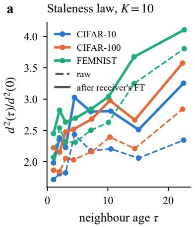

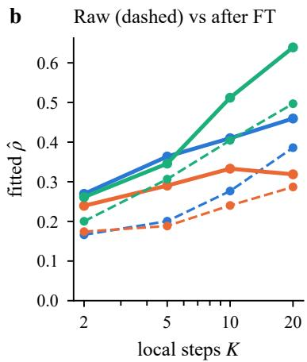  
Figure 5: Fine-tuned geometry (DFedAvg, bursty u=0.8, 3 seeds). (a) Squared distance between a fresh receiver’s model and a neighbour’s, relative to fresh neighbours, against the neighbour’s age. Dashed: before the receiver’s $K = 1 0$ local steps from both models. Solid: after. (b) Rate fitted to the raw and post-fine-tuning distance laws for each $K$

We repeat the covariance computation of Eq. (4) with $M \varepsilon _ { j }$ and $M \xi _ { r }$ in place of $\varepsilon _ { j }$ and $\xi _ { r }$ . Since M is symmetric, this gives

$$
\mathbb { E } \langle M e _ { j } , M e _ { k } \rangle = \sigma _ { M } ^ { 2 } { \bf 1 } [ j = k ] + \delta _ { M } ^ { 2 } \operatorname* { m i n } ( \tau _ { j } , \tau _ { k } ) .
$$

Proposition 1 then applies verbatim.

(ii) $\mathrm { F T } _ { i } ( x _ { j } ) - \mathrm { F T } _ { i } ( x _ { k } ) = M ( x _ { j } - x _ { k } )$ . Apply the identifiability argument of Appendix B to Mε and $M \xi$

(iii) The map is $\begin{array} { r } { M = \sum _ { k } ( 1 - \alpha \lambda _ { k } ) ^ { K } q _ { k } q _ { k } ^ { \top } } \end{array}$ . Hence

$$
\mathrm { t r } ( M \Sigma _ { \varepsilon } M ) = \sum _ { k } \mu _ { k } ^ { K } q _ { k } ^ { \top } \Sigma _ { \varepsilon } q _ { k } = \sigma ^ { 2 } \sum _ { k } \pi _ { k } \mu _ { k } ^ { K } , \qquad \pi _ { k } = \frac { q _ { k } ^ { \top } \Sigma _ { \varepsilon } q _ { k } } { \mathrm { t r } \Sigma _ { \varepsilon } } ,
$$

and likewise $\begin{array} { r } { \delta _ { M } ^ { 2 } = \delta ^ { 2 } \sum _ { k } \vartheta _ { k } \mu _ { k } ^ { K } } \end{array}$ . Define

$$
f ( K ) : = \frac { \rho _ { M } } { \rho } = \frac { \sum _ { k } \vartheta _ { k } \mu _ { k } ^ { K } } { \sum _ { k } \pi _ { k } \mu _ { k } ^ { K } } , \qquad f ( 0 ) = 1 .
$$

Then $f ( K + 1 ) \geq f ( K )$ if and only if $\begin{array} { r } { \sum _ { k , l } \vartheta _ { k } \pi _ { l } \mu _ { k } ^ { K } \mu _ { l } ^ { K } ( \mu _ { k } - \mu _ { l } ) \geq 0 } \end{array}$ . Symmetrising over $( k , l )$ , the left side equals

$$
\frac { 1 } { 2 } \sum _ { k , l } \mu _ { k } ^ { K } \mu _ { l } ^ { K } ( \mu _ { k } - \mu _ { l } ) \big ( \vartheta _ { k } \pi _ { l } - \vartheta _ { l } \pi _ { k } \big ) .
$$

If $\vartheta _ { k } / \pi _ { k }$ is non-decreasing in $\mu _ { k }$ , then $\mu _ { k } > \mu _ { l }$ implies $\vartheta _ { k } \pi _ { l } \geq \vartheta _ { l } \pi _ { k }$ . Every term is then non-negative. Thus $f$ is non-decreasing, and $f ( K ) \geq f ( 0 ) = 1$ □

## D Experimental details

Simulator. All N client models are stored as one flat tensor and trained in parallel with torch.func.vmap. Gossip is a dense row-stochastic matrix product. For a given seed, every method shares the data partition, the graph, the initial model, the outage trace and the minibatch random stream. All comparisons are therefore paired.

Seeds 1–5 are used for evaluation. Seed 0 was used only for pilots. These pilots fixed $\gamma = 0 . 5$ , the DFedAvgM learning rate, the Ditto coeficient, the ResNet learning rate and the margin L of SFG-Cut. All other hyperparameters are shared defaults. The learning rate is re-tuned per method in Table 32. Each run uses one NVIDIA A100, with up to four runs sharing a GPU. A 300-round CNN run takes 2–5 minutes.

Data. CIFAR-10/100. We apply Dirichlet label skew with α = 0.3 over the 50k training images, and every client holds at least 20 images. Each client’s test set has 300 images drawn from the CIFAR test split with the client’s own label distribution. Training uses random horizontal flips. FEMNIST. We use the LEAF writer split (Caldas et al., 2018). Per seed, we draw 100 writers with at least 250 samples, each evaluated on its own LEAF test split, with no augmentation.

On every dataset, 15% of each client’s training data is held out as a validation split. It is used only by diagnostics, never for training or selection.

Models and training. The CNN has two 5 × 5 convolutions (32 and 64 channels) with max-pooling, a 512-unit hidden layer and a linear head. It has 0.88M parameters on CIFAR-10. ResNet-18 uses GroupNorm with 2 groups, so that it has no running statistics, and has 11.2M parameters. Local training is SGD with batch 32, learning rate 0.05 and weight decay 5 · 10−4. Each round runs K = 10 steps, for 300 rounds (CNN). The graph is a 6-nearest-neighbour geometric graph on uniform random positions in the unit square, with N = 100 clients. It is symmetrised and connected if necessary.

ResNet-18 protocol. Trained from scratch on a few hundred images per client, ResNet-18-GN reaches only about 55% on CIFAR-10 without outages. To evaluate a stronger backbone, we start all clients from a common backbone pretrained centrally on public data from the other CIFAR dataset. For the CIFAR-10 federation, we pretrain on CIFAR-100, reaching 69.6% CIFAR-100 test accuracy. For the CIFAR-100 federation, we pretrain on CIFAR-10, reaching 91.9% test accuracy. Pretraining uses SGD with Nesterov momentum, a one-cycle schedule with peak learning rate 0.1, batch 256, crop-and-flip augmentation and 40 epochs. The classifier head is re-initialised. Federated training then runs 150 rounds with learning rate 0.03. This rate was chosen on seed 0 from {0.01, 0.03, 0.05} under bursty outages.

Outage processes. Synthetic traces are resampled until their realised unavailability is within ±0.005 of the target u. The exception is heterogeneous rates at u = 0.8, where clipping makes the target unreachable. i.i.d. Each client is of independently with probability u in every round. Bursty. A two-state Gilbert–Elliott chain per client, with stationary unavailability u and mean outage length 10 rounds. Heterogeneous. Per-client rates are drawn from Beta(2u, 2(1 − u)), rescaled to mean u and clipped at 0.98. Each client then follows a Gilbert–Elliott chain with mean outage length 5. Clipping limits the realised rate to 0.77 for target 0.8. Regional (anatomy only). Regions are k-means clusters of the node positions (spatial), or a random permutation of the same labels (scattered). Each region follows one Gilbert–Elliott chain. Clients additionally fail independently with probability 0.05. The regional rate is set so that the total matches u.

FLASH traces. We use the public state traces released with FLASH (Yang et al., 2021), licensed BSD-2- Clause. They are per-device event logs of 1,000 smartphones, recording screen on/of and lock, charging, and WiFi/cellular state. We forward-fill each device’s state per minute, align it to its first local midnight, and cut 300 rounds of 10 minutes (50 hours). A round counts as available if the rule holds for at least half of its minutes. Strict is the standard “screen of, charging and on WiFi” rule. Relaxed drops charging.

Devices with at least 50 hours of trace and at least 5% availability are eligible. The strict rule leaves 326 devices, with availability 0.180, mean outage 45.5 rounds (≈ 7.6 h) and longest outage 283 rounds. The relaxed rule leaves 512 devices, with availability 0.384 and mean outage 16.6 rounds. Each seed draws 100 eligible devices without replacement and assigns them to clients. Among all 1,000 devices, 29.5% never satisfy the strict rule.

STUNner trace. STUNner (Szabó et al., 2019) logs the network and battery state of Android phones running a measurement app. The data are public for non-profit use. We use the three months from November 2015 to January 2016. During this period, the app took a measurement at least every 30 minutes and on every charger or network change.

A device counts as available when it is plugged in (AC, USB or wireless) and on WiFi. This is the STUNner analogue of FLASH-strict and is close to the definition used in gossip learning (Hegedűs et al., 2019). States are forward-filled from the last measurement. A state older than 45 minutes counts as unavailable, because the phone was of or not reporting.

c

Each device contributes its first 50-hour window that starts at a local midnight, has measurement coverage of at least 60% and availability of at least 5%. The window is discretised into 300 rounds of 10 minutes, as for FLASH. This yields 729 devices with availability 0.177, mean outage 8.6 h (median 4.7 h, longest 47 h) and mean coverage 0.89. Figure 6 compares the three real regimes.

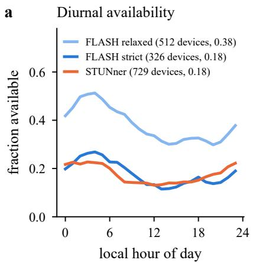

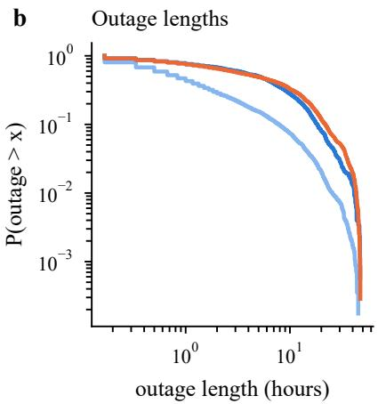

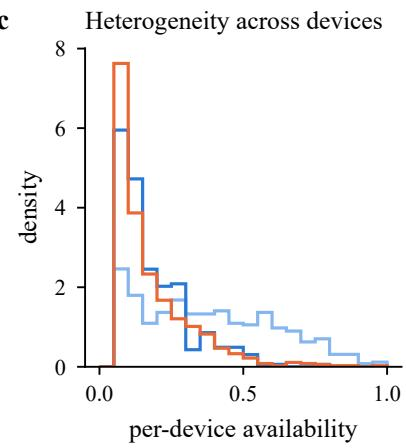  
Figure 6: Real availability traces (10-minute rounds, 50 hours from local midnight). (a) Availability by hour of day. The legend gives the number of devices and the mean availability. (b) Distribution of outage lengths. (c) Per-device availability.

Baselines. All baselines use the same local training and difer only in aggregation or local work. Weights are written unnormalised, $w _ { i j }$ ∝ $h _ { i j }$ over the candidate set.

Stale-information baselines. Model memory. Each receiver keeps the last model received over every edge. It averages that model in, undiscounted, when the neighbour is ofline. It is the model-level analogue of MIFA (Gu et al., 2021), which reuses stale updates at a server. It sends no extra messages. Update amplification (FedAWE-style, Xiang et al., 2024). A returning client scales its local update by $1 + \operatorname* { m i n } ( \tau _ { i } , c )$ , with $c = 1$ Catch-up. A returning client runs $K ( 1 + \operatorname* { m i n } ( \tau _ { i } , 3 ) )$ local steps. On average over the main grid, this is 1.71× the local computation of DFedAvg.

Age-of-information baselines. AoI. $h _ { i i } = 1$ and $h _ { i j } = \gamma ^ { \tau _ { j } }$ on absolute ages. $A o I + I P W .$ AoI weights divided by an exponentially averaged estimate $\hat { q } _ { i j }$ of the probability that link $( i , j )$ is live. The estimate uses factor 0.9 and floor 0.05, and is updated whenever the receiver is available. $D F L  – A A$ (Hewa Kaluannakkage & Buyya, 2026). As AoI + IPW, but with the age of information measured relative to the youngest live neighbour. The receiver keeps $h _ { i i } = 1$ , and

$$
h _ { i j } = \frac { \gamma ^ { \tau _ { j } - \operatorname* { m i n } _ { k \in \mathcal { N } _ { i } ^ { t } } \tau _ { k } } } { \hat { q } _ { i j } } .
$$

Gossip-learning baselines. Gossip-learning model age (Hegedűs et al., 2019). Every model carries an update count $n _ { j }$ , initially 1. An aggregate inherits the largest count among the candidates it merges, and each round of local training adds 1. Every candidate, the receiver included, has weight $h _ { i j } = n _ { j }$ . Limited merging (Danner et al., 2023). The same inherited counts. A candidate whose count is more than L below the largest in the candidate set is discarded, the receiver’s own model included. We use $L \in \{ 2 , 5 , 1 0 , 2 0 , 5 0 \}$ . SFG weights on counts. $h _ { i j } = \gamma ^ { n _ { \mathrm { m a x } } - n _ { j } }$ on the same max-inherited counts, the receiver included, optionally with IPW. $S F G \ – C u t$ (the cut on lags, i.e. limited merging on efective lags). The hard cut applied to mean-inherited counts $n _ { j } = 1 + t - \ell _ { j }$ . Candidates whose lag exceeds the smallest by more than $L \in \{ 1 , 2 , 1 0 \}$ are dropped, the receiver included. The rest are weighted by $n _ { j }$ . Local counts. Variants using per-client counters without inheritance, with $L \in \{ 2 , 1 0 \}$ (Table 19).

Distance- and theory-based baselines. Relative-variance combiner (Zhao et al., 2012). It uses no ages. Receiver i tracks, for every candidate $j$ including itself,

$$
v _ { i j }  ( 1 - \nu ) v _ { i j } + \nu \| x _ { j } - \bar { x } _ { i } ^ { - } \| ^ { 2 } , \qquad h _ { i j } = 1 / v _ { i j } , \qquad \nu = 0 . 2 ,
$$

where $\bar { x } _ { i } ^ { - }$ is its own previous aggregate. PWG (precision-weighted gossip). The weights of Proposition 1(ii) on relative ages, applied to every candidate:

$$
h _ { i j } = \frac { 1 } { 1 + \hat { \rho } \Delta _ { j } } , \quad \quad \Delta _ { j } = \tau _ { j } - \tau _ { \mathrm { m i n } } .
$$

The rate $\hat { \rho }$ is estimated online per client by exponentially forgotten least squares of squared distances on age diferences. The forgetting factor is 0.98, with prior $\rho _ { 0 } = 1$ until five observations. PWG (absolute ages) applies $1 / ( 1 + \hat { \rho } \tau _ { j } )$ to absolute ages. PWG-NP. A non-parametric variant. It estimates the distance ratio $r ( \tau )$ per age bin and uses $h = 1 / ( 2 r ( \tau ) - 1 )$ ). GLS. The exact minimum-error weights ${ \boldsymbol { \Sigma } } ^ { - 1 } \mathbf { 1 }$ of Proposition 1, with Σ from Eq. (4) under RW drift and the online $\hat { \rho } ,$ clipped at zero. Metropolis–Hastings. $w _ { i j } = 1 / ( 1 + \operatorname* { m a x } ( d _ { i } , d _ { j } ) )$ on the live graph.

Controls. Self-weight control. Neighbours weight 1, and the receiver a constant $c \in \{ 0 . 2 5 , 0 . 5 \}$ , regardless of age. Self-only discount. Neighbours weight 1. A returning receiver $( \tau _ { i } \geq 1 )$ with at least one live neighbour weights its own model by $0 . 5 ^ { \tau _ { i } }$ . Reset on return. The same with weight 0. A returning client discards its own model and averages its live neighbours. SFG with base se $\it { ! } f - w e i g h t \ c .$ SFG weights, with the receiver’s weight further multiplied by $c .$ Neighbour-only on lags or counts. $h _ { i i } = 1$ and $h _ { i j } = \gamma ^ { s _ { j } - \operatorname* { m i n } _ { k \in \mathcal { N } _ { i } ^ { t } } s _ { k } }$ over live neighbours. Here s is the efective lag or the deficit of the max-inherited count. This is DFL-AA’s relative AoI without IPW, applied to inherited staleness. Copy a random candidate. Every available receiver replaces its model by one candidate drawn uniformly from itself and its live neighbours, from a separate random stream. It has the sparsity of $\gamma = 0$ without staleness information. Model memory $+ \ S F G / S F G - L$ . Remembered models of ofline neighbours join the candidate set. Their staleness is their age or lag at reception plus the rounds since. All candidates get SFG weights.

Our rules. SFG-Cut is defined above, next to limited merging. SFG. Equation (8) with ages and $\gamma = 0 . 5$ SFG-L. The same weights with ages replaced by efective lags. Every client keeps a real-valued lag $\ell _ { i } .$ , initially $0 ,$ and sends it with its model. After aggregating, an available client sets $\ell _ { i } \gets \sum _ { i } w _ { i j } \ell _ { j }$ with the weights it just used. Training leaves $\ell _ { i }$ unchanged, and each round without training adds 1. The weights depend on lag diferences and are invariant to the common level. PWG-L. PWG with lags in place of ages, both in the weights (relative lags) and in the online regression. + IPW. Neighbour weights divided by the link-reception estimate $\hat { q } _ { i j }$ of $\mathrm { A o I + I P W }$ . The receiver’s own model has $\hat { q } = 1 . ~ + ~ c a t c h – u p .$ . As above. Freshest only $( \gamma = 0$ with $0 ^ { 0 } = \mathrm { { 1 } } )$ . SFG averages uniformly the candidates of minimal age. On real-valued lags, ties are rare after the first outage, so SFG-L with $\gamma = 0$ in efect copies the least-lagged candidate. With rounded ties, the weights use lags rounded to integers, so the rule averages all candidates whose rounded lag is minimal. Pinned receiver. SFG-L’s weights and reference (the least-lagged candidate, the receiver included), but with the receiver’s own weight fixed at 1.

Horizon-based and oracle rules. Horizon rates. PWG-L and the GLS weights of Proposition 1 on lags, with a fixed rate $H \rho \in \{ 3 , 1 0 , 3 0 \}$ in place of the online estimate. Oracle GLS. The simulator tracks the matrix A of missed-increment fractions (Section 4.3). It applies the minimiser of Proposition $\mathsf { 7 } ( \mathrm { i } ) , ( I + H \rho G ) ^ { - 1 } \mathbf { 1 }$ normalised over the candidates, with $G = A \dot { A } ^ { \top }$ , clipped at zero and renormalised. Clipping the afine GLS solution generally difers from minimising over the simplex. The rates $H \rho \in \{ 3 , 1 0 \}$ are taken directly from the PWG-L sweep. This oracle uses global information to test the theory. It is not a deployable rule. Derived rules. These minimise the objective of Proposition 7 with uniform imports, $g _ { j } = \eta \ell _ { j } / \rho _ { ; }$ over the simplex. Sparsemax on lags drops the quadratic term, so w = sparsemax $: ( - \eta \Delta )$ . It has a closed form, and candidates with $\Delta _ { j } \geq 1 / \eta$ get no weight. The $Q P$ on lags minimises

$$
\| w \| ^ { 2 } + a w ^ { \top } \Lambda ^ { \prime } w + 2 \eta \Delta ^ { \top } w , \qquad \Lambda _ { j k } ^ { \prime } = \operatorname* { m i n } ( \Delta _ { j } , \Delta _ { k } ) , \quad a = H \rho .
$$

The oracle $Q P$ uses the exact $G = A A ^ { \top }$ in place of $\Lambda ^ { \prime }$ and is not deployable. QPs are solved by accelerated projected gradient (300 steps, exact simplex projection).

Cut variants. All use $L = 1$ . The placebo cut keeps the same number of candidates as SFG-Cut, but drawn at random, with uniform weights. The cut on ages keeps the candidates within one round of the youngest, with uniform weights. Receiver kept is SFG-Cut with a receiver that is never dropped. The $+ ~ I P W$ and $+ \ c a t c h – u p$ variants are as above.

Choice of the margin. The margin L of SFG-Cut was chosen on the pilot seed 0 from {0.5, 1, 2, 3} (Table 26). This pilot was run after the test-seed results for $L \in \{ 1 , 2 \}$ were known. It documents a choice made with those results available. $L = 1$ is best on average (+3.98 against +3.89 pp for $L = 2 )$ , driven by i.i.d. outages. Without them, $L = 2$ is slightly better (+3.87 against +3.82 pp), as on the test seeds.

Anatomy conditions. Structure uses 300 runs: 5 structures, $u \in \{ 0 . 6 , 0 . 8 \}$ , DFedAvg and SFG, 3 datasets and 5 seeds. The structures are independent bursty chains (mean outage 10), and regional or scattered outages with 5 or 20 groups, as defined above. What an outage disables uses 240 runs, with the same factors and 4 modes. Full outage. The client stops both training and communication. Cannot communicate. The client keeps training on its own data but neither sends nor aggregates, so its age stays 0. Cannot train, still shares. The client keeps sending its frozen model, whose age grows. It does not adopt the aggregate it would have formed. A fourth mode communicates and adopts the aggregate but cannot train. It is reported in Table 5, not in the figure.

STUNner, six days. To test multi-day structure, we cut a second STUNner window of 300 rounds of 30 minutes (6.25 days), with the same availability rule and eligibility criteria. It yields 542 devices with availability 0.158, mean outage 14.6 h (median 8 h, longest 143 h) and mean coverage 0.85. All methods run with the default hyperparameters.

Learning-rate tuning. For DFedAvg, AoI + IPW, SFG and SFG-L, we additionally ran learning rates {0.02, 0.1, 0.2}. These runs cover four processes (bursty u=0.8, heterogeneous $u { = } 0 . 6$ , FLASH strict, STUNner), all three datasets and seeds 1–3. We compare each method at its own best learning rate per dataset (Table 32). The learning rate is selected on the same runs it is evaluated on, which favours every method equally. DFedAvg’s best rate is 0.1 on two of the three datasets, and SFG-L keeps its gain there.

Statistics. All comparisons are paired over seeds 1–5 with shared randomness. The outage processes of a (dataset, seed) pair share the partition, graph and initialisation. The unit of inference is therefore the (dataset, seed) pair. We average each paired diference over the processes of a unit, which gives 15 units. Intervals. Stratified t-intervals over the 15 units, with the variance pooled within datasets (12 degrees of freedom). Primary test. An exact two-sided sign-flip permutation test over the 15 units $( 2 ^ { 1 5 }$ sign patterns). It is Holm-corrected over the family of 70 comparisons listed in the accompanying file comparisons.csv. Secondary test. Wilcoxon signed-rank tests on the 24 cell means, Holm-corrected over the same family. The file lists every comparison with its interval, wins and both tests. Where the interval and the corrected unit test disagree, we treat the diference as unresolved.

In nine comparisons, the interval excludes zero but the corrected test does not. These are copying the least-lagged candidate versus SFG-L (+0.22 pp), limited merging versus SFG weights on counts $\left( + 0 . 0 4 \mathrm { p p } \right)$ SFG-Cut versus limited merging at $L = 2 \ ( + 0 . 1 2 \mathrm { p p } )$ and at $L = 1 \ ( + 0 . 1 3 \mathrm { p p } )$ , least-lagged with rounded ties versus SFG-L (+0.23 pp), GLS on lags versus SFG-L (+0.25 pp), SFG-Cut versus the oracle $\mathrm { Q P }$ of Table 21 $\left( + 0 . 1 0 \mathrm { p p } \right)$ , and SFG-Cut + IPW versus SFG-L + IPW (+0.18 pp) and versus SFG on counts + IPW (+0.12 pp). In 17 further comparisons, the corrected unit test is significant but the corrected cell-level test is not. These diferences are consistent across seeds but not across processes. They include SFG-L versus SFG (18/24 cells), SFG-Cut versus SFG-L (17/24), SFG-Cut with $L = 1$ versus $L = 2 \ ( 1 4 / 2 4 )$ , and the oracle versus SFG-L (14/24).

Design sensitivity. Every unit averages the eight processes, so i.i.d. outages weigh 1/8 in every contrast. The file therefore also reports three further quantities: the number of processes with a positive mean, the range of the mean over the eight leave-one-process-out designs, and the mean without i.i.d. outages with its uncorrected permutation p-value. Without i.i.d. outages, SFG-Cut leads SFG-L by +0.14 pp $( p = 0 . 0 0 2 )$ and the oracle by $+ 0 . 1 7 \mathrm { p p } \ ( p = 0 . 0 0 8 )$ . Three pairs do not difer: SFG-Cut and limited merging at ${ \cal L } = 1 \ ( + 0 . 0 3$ $p = 0 . 5 5 )$ , the oracle and $\mathrm { S F G - L } \ ( - 0 . 0 3 , p = 0 . 4 4 )$ , and SFG-Cut at $L = 1$ and $L = 2 \left( - 0 . 0 4 , p = 0 . 3 3 \right)$

The no-outage control gives the noise floor of paired win counts. There, SFG and DFedAvg are identical up to GPU nondeterminism, and SFG wins 2 of 15 runs $( - 0 . 0 4 \pm 0 . 1 5 \mathrm { p p } )$

Backbones. Full model (default). The whole model is gossiped and fine-tuned. Personal head (DFedPer, Arivazhagan et al., 2019). The classifier head is never averaged. DFedAvgM (Sun et al., 2023). Local heavy-ball momentum 0.9, with learning rate 0.02 chosen on seed 0 from {0.005, 0.01, 0.02}. Ditto (Li et al., 2021). Each client also trains a personal model with a proximal pull towards the post-aggregation shared model, and is evaluated with the personal model. The pull strength $\lambda = 0 . 2$ was chosen on seed 0 from {0.05, 0.2, 1}.

Diagnostics. The diagnostics use a separate random stream and do not afect training. Raw staleness law. Every 5 rounds, for every fresh receiver, we record the squared distance to each live neighbour, divided by the mean fresh–fresh distance, binned by the neighbour’s age. Fine-tuned geometry. Every 10 rounds, up to 16 fresh receivers with at least one fresh and one stale live neighbour run their K local steps from thei own model and from every live neighbour’s model, with a common minibatch sequence. We record distances before and after this fine-tuning, normalised by the fresh-neighbour mean, and validation losses. Lag law. Every 5 rounds, over all live pairs, we record the squared distance, normalised by the mean over pairs with (near-)zero diference. It is binned by the age diference and by the rounded efective-lag diference. Every run tracks efective lags with its own weights, whether or not the rule uses them. Returning clients. At every round, for every client that returns from an outage, we record several quantities on its validation split, binned by its outage length. These are the validation loss of its own stale model, of its post-aggregation model, of the model after that round’s local training, and of its model five rounds later. We also record the loss of each live neighbour’s model and the weight the rule assigns to the client’s own model.

## E Ages versus lags and the discount rate, in detail

This appendix expands Section 6.5.

The puzzle. Proposition 1 also prescribes a rate, through weights $1 / ( 1 + \rho \Delta )$ . The rate $\rho$ is identifiable from pairwise distances. We implement this as precision-weighted gossip (PWG), which estimates $\rho$ online from ages $( \hat { \rho } \approx 0 . 2 – 0 . 7 )$ . The theory-derived rule turns out too mild. It gains +1.48 pp over DFedAvg, against $\mathrm { S F G ^ { \prime } s + 2 . 4 4 p p }$ (Table 19). Yet PWG with a fixed large $\rho \in \{ 1 , 1 0 \}$ matches SFG on CIFAR-10 (Table 15).

Lags explain half of it. Measured against efective lag rather than age, the distance law of DFedAvg trajectories loses its spurious jump at age 1 (Fig. 7a). Its fitted rate is 1.4–3.1× larger in every rule–dataset combination we logged (Table 10). This is age laundering made visible.

Feeding lags instead of ages to the same online estimator (PWG-L) raises $\hat { \rho }$ to 1.0–1.5 under bursty $u { = } 0 . 8 .$ heterogeneous u≈0.77 and FLASH strict (Fig. 7b). It lifts the gain from +1.48 to +2.44 pp, in 102 of 120 paired runs. This closes half of the gap to SFG-L (+3.49 pp, Fig. 7c). Lags also improve SFG itself, by $+ 1 . 0 5 \mathrm { p p } .$ , where the candidates’ relative lags and ages difer most. The diference reaches 2.8–4.2 rounds under bursty u=0.8, FLASH strict and STUNner (Table 9).

The horizon explains the rest. Even on lags, the one-step weights $1 / ( 1 + \hat { \rho } \Delta )$ are too mild. Proposition 7 says why. The receiver carries its persistent error for $H \geq 3$ rounds, and for 8–23 rounds under long or frequent outages. The dispersion it absorbs survives for a shorter time. With the measured carry-over, the efective rate (19) is 0.8–9 (Tables 22 and 23). Raising PWG-L’s rate to $H \rho = 3$ , 10 and 30, as the horizon prescribes, lifts its gain from +2.44 pp to +3.35, +3.56 and +3.59 pp (Table 21).

The theory identifies the shape, not the exact rule. We ran a pre-registered test on held-out seeds (Appendix F). A quadratic program (QP) on lags, with per-process parameters measured on the traces, does no better than constant parameters outside i.i.d. outages $( + 0 . 0 5 \mathrm { p p } , [ - 0 . 0 5 , 0 . 1 6 ] )$ . It trails SFG-Cut with $L = 2 \mathrm { ~ b y ~ } 0 . 2 7 \mathrm { ~ p p ~ } ( [ 0 . 1 4 , 0 . 4 0 ] )$ . An additional comparison, outside the pre-registration, shows a +0.76 pp gain over one-step weights (online PWG-L). The measured horizon thus supports steeper weights, but it does not single out the best rule.

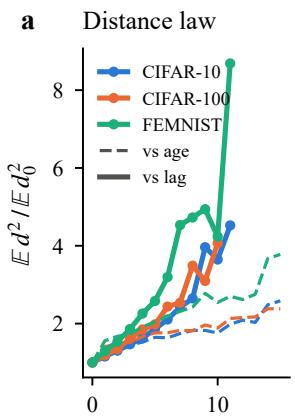

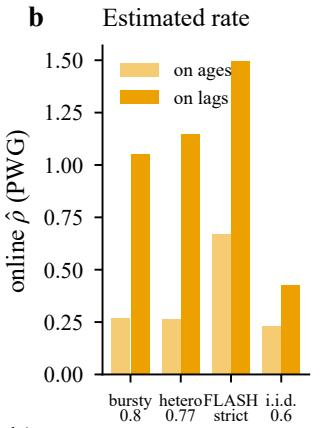

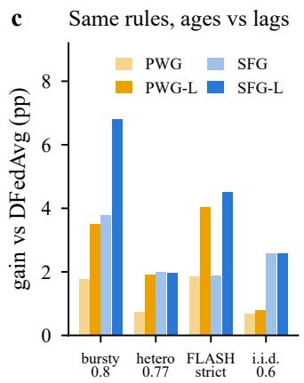  
age / lag difference (rounds)

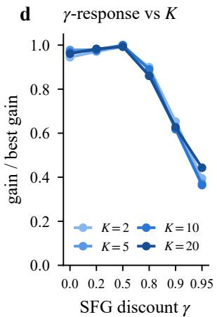  
Figure 7: Ages versus lags. (a) Squared distance between live models, relative to the zero-diference baseline, against their age diference (dashed) and their efective-lag diference (solid). DFedAvg trajectories under bursty $u { = } 0 . 8$ , heterogeneous u≈0.77, FLASH strict and i.i.d. u=0.6, 3 seeds. (b) The online rate estimate of PWG is 1.9–4.3× larger on lags. (c) Gain over DFedAvg of the same rules on ages (light) and on lags (dark), 3 datasets $\times ~ 5$ seeds. (d) SFG’s response to γ has the same shape for every number of local steps $K \ ( \mathrm { b u r s t y } \ u { = } 0 . 8 .$ gain normalised by its best value and averaged over datasets).

A deployable rule matches the oracle. An oracle QP that knows the true persistent-error Gram matrix G gains $+ 3 . 8 7 \mathrm { p p }$ at $H \rho = 1 0$ . This is within 0.1 pp of SFG-Cut, an unresolved diference. The oracle shows the same advantage of steep rules under i.i.d. outages (Table 25). That a rule using only local information matches an oracle with global information is, in our view, the strongest evidence that the three principles capture what matters.

Minimisers on scalar lags trail SFG-Cut by 0.2–0.3 pp. For example, sparsemax at $\eta = 0 . 5$ trails by 0.21 pp $( p _ { \mathrm { H o l m } } = 0 . 0 0 4 )$ . The reason lies in heterogeneous rates at u≈0.77. There, steep weights lose (+0.2 to $+ 1 . 7 \mathrm { p p } )$ , while SFG-Cut and the oracles, which average near-ties, hold up $( + 1 . 1 \mathrm { t o } + 1 . 8 \mathrm { p p } )$

## F Additional results

Throughout this appendix, “the cut” and “cut on lags” denote SFG-Cut (Section 5). “CutL” denotes its margin.

Anatomy of outages. Figure 8 and Table 5 expand Section 6.1. The conditions are described in Appendix D.   
Four findings stand out.

The rate matters, the structure does not. At matched unavailability, the structure of outages changes DFedAvg’s accuracy drop by at most 0.78 pp per dataset at $u = 0 . 6$ , and by at most 0.52 pp at $u = 0 . 8$ Moving between the two rates changes it by 3.8–4.4 pp.

Structure matters for the remedy. SFG’s gain shrinks as outages become more correlated. It falls from $+ 3 . 4 / + 3 . 8 \mathrm { p p }$ under independent outages to $+ 0 . 8 / + 0 . 7 \mathrm { p p }$ when five whole regions fail together. Five scattered groups already halve it at $u = 0 . 8$ . The cause is therefore not spatial proximity but correlated return. Neighbours that fail and return together are equally stale, so a returning client has no fresher candidate to shift weight to.

Under plain averaging, stale sharing is worse than silence. A client that cannot communicate but keeps training costs about half as much as a full outage. It gains nothing from SFG, because its model is never stale. A client that cannot train but keeps sharing its frozen model costs DFedAvg more than a full outage.

Under SFG, the same client costs less than a full outage (1.7 against 4.6 pp at $u = 0 . 8 )$ . Receivers discount its model by its age. A model frozen one or two rounds ago therefore still contributes, while an old one is ignored. If a client that cannot train also adopts the aggregate it forms, the stale models it averages spread further. The cost under DFedAvg is then the largest of all at $u = 0 . 8 .$

Why model memory does not help. Model memory uses older copies, last received while both clients were online. Under bursty $u = 0 . 8 .$ , the receiver’s remembered copy of an ofline neighbour is on average 32.5 rounds old. The neighbour’s current frozen model is only 9.7 rounds old. Only 6.5% of remembered copies are within two rounds, against 19.4% of frozen models (Table 6, traces only, 3 seeds). Discounted memory changes SFG-L’s accuracy by −0.61 pp, with interval [−0.74, −0.49] (comparisons.csv).

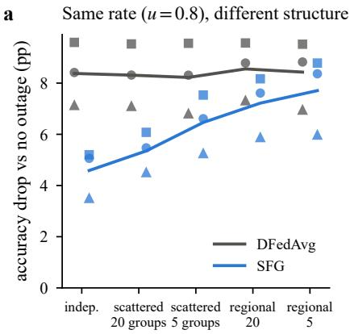

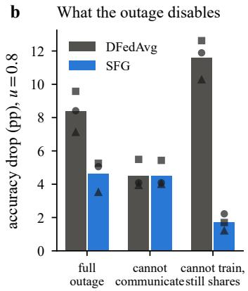  
Figure 8: Anatomy of outages $( u = 0 . 8 )$ . Markers: CIFAR-10 ◦, CIFAR-100 □, FEMNIST △. (a) At a matched rate, outage structure does not change DFedAvg’s loss. Correlated outages, however, leave SFG little to work with. (b) Sharing a model one cannot train hurts more than going silent. SFG neutralises this cost.

Table 5: Anatomy of outages. Accuracy drop relative to DFedAvg without outages (pp, mean over 3 datasets × 5 seeds), and SFG’s gain over DFedAvg. Within a single dataset, DFedAvg’s drop varies across the five structures by at most 0.78 pp $( u = 0 . 6 )$ and 0.52 pp (u = 0.8).
<table><tr><td rowspan="2"></td><td colspan="3"> $u = 0 . 6$ </td><td colspan="3"> $u = 0 . 8$ </td></tr><tr><td>DFedAvg</td><td>SFG</td><td>gain</td><td>DFedAvg</td><td>SFG</td><td>gain</td></tr><tr><td>Outage structure at matched rate</td><td></td><td></td><td></td><td></td><td></td><td></td></tr><tr><td>Independent (bursty)</td><td>4.47</td><td>1.11</td><td>+3.36</td><td>8.38</td><td>4.59</td><td>+3.79</td></tr><tr><td>Scattered, 20 groups</td><td>4.52</td><td>1.28</td><td>+3.24</td><td>8.31</td><td>5.35</td><td>+2.96</td></tr><tr><td>Scattered, 5 groups</td><td>4.23</td><td>1.93</td><td>+2.30</td><td>8.22</td><td>6.46</td><td>+1.76</td></tr><tr><td>Regional, 20 regions</td><td>4.47</td><td>2.74</td><td>+1.73</td><td>8.55</td><td>7.22</td><td>+1.34</td></tr><tr><td>Regional, 5 regions</td><td>4.00</td><td>3.24</td><td>+0.76</td><td>8.43</td><td>7.71</td><td>+0.72</td></tr><tr><td>What the outage disables (bursty chains)</td><td></td><td></td><td></td><td></td><td></td><td></td></tr><tr><td>Full outage</td><td>4.50</td><td>1.05</td><td>+3.45</td><td>8.37</td><td>4.61</td><td>+3.76</td></tr><tr><td>Cannot communicate (still trains)</td><td>2.89</td><td>2.98</td><td>-0.09</td><td>4.50</td><td>4.50</td><td>-0.00</td></tr><tr><td>Cannot train (shares, adopts aggregate)</td><td>7.70</td><td>5.82</td><td>+1.88</td><td>13.29</td><td>9.03</td><td>+4.26</td></tr><tr><td>Cannot train (still shares stale model)</td><td>9.28</td><td>1.09</td><td>+8.20</td><td>11.59</td><td>1.71</td><td>+9.88</td></tr></table>

Controls. Table 7 separates the gain from staleness-aware weighting from the efect of lowering the receiver’s self-weight. Lowering every client’s self-weight to a constant, independent of age, gains 0.2–0.7 pp. It does so equally with and without outages. Metropolis–Hastings weights are slightly worse than uniform. SFG gains $+ 1 . 9 \ \mathrm { t o \ + 3 . 8 p p }$ under outages. Without outages, it is identical to DFedAvg up to GPU nondeterminism $( - 0 . 0 4 \pm 0 . 1 5 \mathrm { p } \mathrm { _ { F } }$ over 15 runs). This is also the noise floor of our win counts. The two efects are orthogonal. On top of the constant self-weight $c = 0 . 2 5$ , SFG adds another +2.1 to +3.5 pp under outages. It beats that control in 15 of 15 paired runs in every outage column.

Table 6: Why model memory does not help SFG-L. For an available receiver and an ofline neighbour, we compare two models. The frozen model is the neighbour’s current model, which the receiver would see if the neighbour kept sharing. The remembered copy was last received while both were online. Traces and graphs only, 3 seeds.
<table><tr><td></td><td colspan="2">mean age (rounds)</td><td colspan="2">within 2 rounds (%)</td></tr><tr><td>Outage process</td><td>frozen model</td><td>remembered copy</td><td>frozen model</td><td>remembered copy</td></tr><tr><td>i.i.d. u=0.6</td><td>2.5</td><td>7.1</td><td>64.3</td><td>16.5</td></tr><tr><td>bursty u=0.6</td><td>9.6</td><td>18.1</td><td>19.8</td><td>9.1</td></tr><tr><td>bursty u=0.8</td><td>9.7</td><td>32.5</td><td>19.4</td><td>6.5</td></tr><tr><td>hetero u=0.6</td><td>4.9</td><td>11.2</td><td>36.5</td><td>15.1</td></tr><tr><td>hetero u≈0.77</td><td>4.9</td><td>17.4</td><td>37.0</td><td>10.4</td></tr><tr><td>FLASH relaxed</td><td>36.9</td><td>50.2</td><td>10.8</td><td>5.6</td></tr><tr><td>FLASH strict</td><td>49.7</td><td>89.7</td><td>4.3</td><td>2.2</td></tr><tr><td>STUNner</td><td>61.9</td><td>106.1</td><td>3.9</td><td>2.0</td></tr><tr><td>STUNner 6-day</td><td>43.0</td><td>86.6</td><td>7.2</td><td>3.3</td></tr></table>

Table 7: Controls. Gain over DFedAvg (pp), pooled over CIFAR-10, CIFAR-100 and FEMNIST, with wins/runs against DFedAvg. The last row is paired against the constant-self-weight control instead. Ageindependent self-weights help a little, and equally without outages. SFG helps only when there are stale models to discount, and its gain adds to a tuned self-weight. Bold: best value in each column, last row excluded.
<table><tr><td>Rule</td><td>no outage</td><td>i.i.d. u=0.6</td><td>bursty u=0.8</td><td>FLASH strict</td></tr><tr><td>Metropolis-Hastings weights</td><td>-0.39 (2/15)</td><td>-0.29 (3/15)</td><td>-0.08 (3/15)</td><td>-0.21 (2/15)</td></tr><tr><td>constant self-weight c=0.5</td><td>+0.35 (15/15)</td><td>+0.47 (13/15)</td><td>+0.29 (14/15)</td><td>+0.21 (12/15)</td></tr><tr><td>constant self-weight c=0.25</td><td>+0.65 (15/15)</td><td>+0.72 (13/15)</td><td>+0.52 (15/15)</td><td>+0.26 (11/15)</td></tr><tr><td>AoI + IPW</td><td>±0 by def.</td><td>+1.78 (15/15)</td><td>+2.46 (15/15)</td><td>+1.25 (15/15)</td></tr><tr><td>SFG</td><td>-0.04 (2/15)</td><td>+2.59 (15/15)</td><td>+3.79 (15/15)</td><td>+1.89 (15/15)</td></tr><tr><td>SFG with base self-weight c=0.25</td><td>+0.64 (15/15)</td><td>+3.20 (15/15)</td><td>+4.03 (15/15)</td><td>+2.33 (15/15)</td></tr><tr><td>Copy a random candidate (no staleness information)</td><td>+0.86 (10/15)</td><td>-0.42 (5/15)</td><td>-0.79 (1/15)</td><td>-2.15 (0/15)</td></tr><tr><td>SFG (c=0.25) − constant self-weight c=0.25</td><td>-0.01 (3/15)</td><td>+2.48 (15/15)</td><td>+3.51 (15/15)</td><td>+2.07 (15/15)</td></tr></table>

Both halves. Table 8 gives the numbers behind Fig. 3c.

Table 8: Both halves of the discount. Bursty u=0.8, heterogeneous u≈0.77, and FLASH relaxed and strict, 3 datasets × 5 seeds. Wins/runs against DFedAvg are in brackets. The last column gives paired wins of SFG over the rule. Bold: best gain.
<table><tr><td>Discounted</td><td>Gain vs DFedAvg (pp)</td><td>SFG wins</td></tr><tr><td>Neighbours only (AoI)</td><td>+0.99 (53/60)</td><td>58/60</td></tr><tr><td>Receiver only (0.5τi)</td><td>+1.05 (60/60)</td><td>60/60</td></tr><tr><td>Receiver only, reset on return</td><td>+1.05 (60/60)</td><td>60/60</td></tr><tr><td>Both, relative (SFG)</td><td>+2.48 (60/60)</td><td></td></tr></table>

How often is the receiver the stalest candidate, and where do lags difer from ages? Table 9 measures the premise of the paper directly from the outage traces and graphs, with no training. At every aggregation of an available client with at least one live neighbour, we record whether the client is returning (τi ≥ 1). If so, we record whether its own model is strictly older than every live neighbour’s.

The premise holds on real traces. On the three real traces of the main grid, a returning client is the strictly stalest candidate in 85–93% of returns, and in 83% on the six-day window. Under i.i.d. outages, most returns come after a single round and neighbours are often just as stale. The premise then holds less often (37%).

Lags difer from ages where SFG-L helps. Lags depend only on the trace, the graph and the weights. The same pass therefore also tracks them along a DFedAvg trajectory. We define the lag–age discrepancy as the mean over candidates of

$$
\left| ( \ell _ { j } - \ell _ { \mathrm { m i n } } ) - ( \tau _ { j } - \tau _ { \mathrm { m i n } } ) \right| .
$$

It measures how far the relative staleness that SFG-L sees difers from the one SFG sees. It is largest on the processes where many neighbours are stale at once $( u \approx 0 . 8$ with homogeneous availability). These are exactly the processes where SFG-L improves on SFG. Relative lags are also more compressed than relative ages. A neighbour that trained after averaging with stale models is young but lagged, and a returning client’s neighbours often carry lag of their own.

Table 9: The stalest model in the room, and where lags difer from ages. kNN graph, $N = 1 0 0 .$ , 300 rounds, mean over 3 seeds. Traces and graphs only, with lags along DFedAvg trajectories. Spread: mean over aggregations of the largest relative age or lag among the candidates. Last column: paired gain of SFG-L over SFG (3 datasets × 5 seeds).
<table><tr><td>Outage process</td><td>returning receivers (%)</td><td>strictly stalest (%)</td><td>no live neighbour (%)</td><td>lag-age discrepancy</td><td>spread of ages / lags</td><td></td><td>SFG-L - SFG (pp)</td></tr><tr><td>i.i.d. u=0.6</td><td>59.9</td><td>36.7</td><td>3.2</td><td>0.8</td><td>3.2 / 1.6</td><td></td><td>-0.01</td></tr><tr><td>bursty u=0.6</td><td>14.8</td><td>79.7</td><td>2.9</td><td>1.3</td><td>4.9 / 3.1</td><td></td><td>+0.43</td></tr><tr><td>bursty u=0.8</td><td>39.6</td><td>68.1</td><td>21.6</td><td>2.8</td><td>8.3 / 2.7</td><td></td><td>+3.03</td></tr><tr><td>hetero u=0.6</td><td>26.6</td><td>63.9</td><td>2.5</td><td>1.2</td><td>4.2 / 3.5</td><td></td><td>-0.37</td></tr><tr><td>hetero u≈0.77</td><td>51.0</td><td>53.0</td><td>10.9</td><td>1.7</td><td>5.4 / 3.1</td><td></td><td>-0.03</td></tr><tr><td>FLASH relaxed</td><td>8.6</td><td>84.8</td><td>2.9</td><td>1.7</td><td>4.5 / 4.4</td><td></td><td>+0.27</td></tr><tr><td>FLASH strict</td><td>7.9</td><td>90.3</td><td>22.4</td><td>3.2</td><td>8.4 / 4.1</td><td></td><td>+2.64</td></tr><tr><td>STUNner</td><td>7.0</td><td>93.0</td><td>26.6</td><td>3.6</td><td></td><td>9.2 / 4.0</td><td>+2.42</td></tr><tr><td>STUNner 6-day</td><td>17.1</td><td>82.8</td><td>27.8</td><td>4.2</td><td>10.9 / 4.5</td><td></td><td>+2.96</td></tr></table>

Table 10: Distance law against ages and against lags. The rate $\rho$ is fitted to $\mathbb { E } d ^ { 2 } / \mathbb { E } d _ { 0 } ^ { 2 } = 1 + \frac { \rho } { 2 } x$ over all live pairs. Here x is the age diference or the (rounded) efective-lag diference, with $1 \leq x \leq 2 0$ . Trajectories of the given rule, four outage processes, 3 seeds. The rate is 1.4–3.1× larger against lags.
<table><tr><td rowspan="2"></td><td colspan="2">CIFAR-10</td><td colspan="2">CIFAR-100</td><td colspan="2">FEMNIST</td></tr><tr><td>Trajectory ages</td><td>lags</td><td>ages</td><td>lags</td><td>ages</td><td>lags</td></tr><tr><td>DFedAvg</td><td>0.18</td><td>0.45</td><td>0.20</td><td>0.48</td><td>0.32</td><td>0.84</td></tr><tr><td>AoI</td><td>0.26</td><td>0.59</td><td>0.26</td><td>0.69</td><td>0.41</td><td>1.25</td></tr><tr><td>PWG</td><td>0.24</td><td>0.45</td><td>0.23</td><td>0.49</td><td>0.42</td><td>0.90</td></tr><tr><td>SFG</td><td>0.48</td><td>0.67</td><td>0.56</td><td>0.83</td><td>0.76</td><td>1.24</td></tr></table>

Returning clients. Table 11 expands Fig. 3b. It reports three quantities for the returning client’s model: the validation loss right after aggregation, the validation accuracy after the local training of the return round, and the accuracy five rounds later. We use bursty $u { = } 0 . 8$ , heterogeneous u≈0.77 and FLASH strict, with 3 datasets × 3 seeds. Bins mix diferent clients, because rarely available clients have longer outages. Comparisons are therefore meaningful within a column.

Discount factor. The discount $\gamma = 0 . 5$ was fixed on a pilot seed. We swept γ under bursty $u { = } 0 . 8$ and FLASH strict, on CIFAR-10 and FEMNIST (Fig. 7d, Tables 15 and 18). Both rules are flat for $\gamma \in [ 0 , 0 . 5 ]$ SFG also tolerates $\gamma = 0 . 8$ . Under bursty outages, $\gamma \geq 0 . 9$ is too mild for SFG, and $\gamma = 0 . 8$ is too mild for SFG-L. FLASH strict tolerates milder discounts. Neighbour-only AoI stays below $+ 1 . 6 \mathrm { p p }$ for every γ. Its deficit is therefore not a tuning problem. Across all eight processes, $\gamma = 0$ is slightly better on average $\left( + 0 . 2 2 \mathrm { p p } \right)$ but fragile (Appendix E). We recommend $\gamma \in [ 0 . 2 , 0 . 5 ]$

Further baselines. Table 19 compares additional variants: local counts without inheritance, PWG on absolute ages, the non-parametric PWG-NP, and stronger update amplification. Counts that are not inherited drift apart under heterogeneous availability. A hard threshold on them then cuts frequently available clients of from everyone else. Inheriting counts, as gossip learning prescribes, removes this failure (Table 3).

Table 11: Returning clients. Loss after aggregation, before local training. Accuracy (%) after the return round’s local training, and five rounds later. Bold: best value in each column, lowest loss and highest accuracy.
<table><tr><td></td><td colspan="3">outage 1</td><td colspan="3">outage 2-4</td><td colspan="3">outage 5-16</td><td colspan="3">outage 17–60</td></tr><tr><td>Rule</td><td>loss agg.</td><td>acc.</td><td> $\mathrm { a c c . + 5 }$ </td><td>loss agg.</td><td>acc.</td><td> $\mathrm { a c c . + 5 }$ </td><td>loss agg.</td><td>acc.</td><td> $\mathrm { a c c . + 5 }$ </td><td>loss agg.</td><td>acc.</td><td>acc.+5</td></tr><tr><td>DFedAvg</td><td>2.13</td><td>48.5</td><td>48.8</td><td>2.14</td><td>48.3</td><td>48.7</td><td>2.14</td><td>48.5</td><td>49.1</td><td>2.23</td><td>47.5</td><td>49.4</td></tr><tr><td>AoI</td><td>2.10</td><td>50.0</td><td>50.4</td><td>2.10</td><td>49.8</td><td>50.2</td><td>2.09</td><td>50.0</td><td>50.7</td><td>2.18</td><td>48.9</td><td>50.8</td></tr><tr><td> $\mathrm { A o I + I P W }$ </td><td>2.14</td><td>50.5</td><td>50.9</td><td>2.16</td><td>50.3</td><td>50.7</td><td>2.18</td><td>50.5</td><td>51.2</td><td>2.36</td><td>49.0</td><td>51.2</td></tr><tr><td>SFG</td><td>2.10</td><td>51.9</td><td>52.4</td><td>2.35</td><td>51.6</td><td>52.2</td><td>2.67</td><td>51.8</td><td>52.6</td><td>2.87</td><td>51.0</td><td>52.8</td></tr><tr><td>SFG-L</td><td>2.13</td><td>53.2</td><td>53.6</td><td>2.28</td><td>53.1</td><td>53.6</td><td>2.48</td><td>53.7</td><td>54.4</td><td>2.73</td><td>53.8</td><td>55.5</td></tr></table>

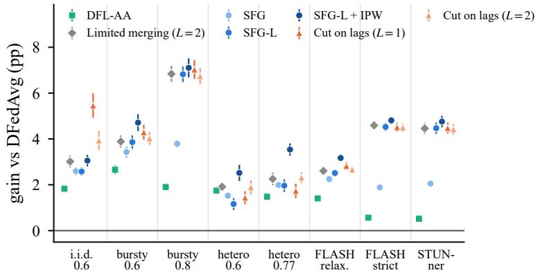  
Figure 9: Gain over DFedAvg by outage process (3 datasets × 5 seeds, bars: s.e. of the paired gains). Lags help where many neighbours are stale at once (bursty u=0.8, FLASH strict, STUNner). Limited merging with $L = 2$ on max-inherited counts (no IPW) tracks SFG-L everywhere, slightly ahead under i.i.d. and heterogeneous rates. The link correction (IPW) adds most under heterogeneous rates. SFG-Cut with $L = 1$ leads under i.i.d. outages and trails under heterogeneous rates. $L = 2$ is the most even.

How staleness is inherited, and how it is used. Table 20 crosses two ways of inheriting staleness through merging with two ways of using it. The inheritance rules are the maximum update count of gossip learning and the weighted mean of efective lag. The uses are the hard cut of limited merging, with countproportional weights among the candidates within a margin L of the least stale, and the geometric discount of SFG. The margin matters most. Both cuts lose 1.1–1.8 pp as L grows from 2 to 10. At a loose margin, $L = 1 0$ , the geometric discount is better for both inheritance rules. The maximum is then slightly better than the mean, by +0.17 pp with the discount and +0.58 pp with the cut. At a tight margin, the order reverses, though not significantly after correction. SFG-Cut gains +3.97 and +3.81 pp at $L = 1$ and 2, against +3.84 and +3.70 pp for the cut on counts. Copying the least-lagged candidate $( \gamma = 0$ on lags, $+ 3 . 7 0 \mathrm { p p } )$ is the $L \to 0$ limit of SFG-Cut.

The horizon, tested. Table 21 compares rules on efective lags that difer only in steepness. Steeper is better on average. Raising the rate of the calibrated weights from the online one-step estimate to the horizon rates $H \rho \in \{ 3 , 1 0 , 3 0 \}$ of Proposition 7 lifts the average gain by up to 1.2 pp. The exact GLS weights at $H \rho = 1 0$ gain more still. The steepest rules are fragile. They lose most under heterogeneous rates, where a frequently available client keeps only itself. Cuts are robust. Cuts at a margin of one or two rounds keep near-ties and retain the average gain. $L = 2$ is the most robust, and $L = 1$ the best on average. The minimisers of the derived objective behave as Proposition 7(ii) predicts. With $\eta \geq 1$ , they keep only exact ties on integer lags and coincide with the nested limit (+3.70 pp, fragile under heterogeneous rates). At the self-consistent slopes $\eta \in [ 0 . 2 5 , 0 . 5 ]$ (Table 22), they gain +3.66 to +3.77 pp on scalar lags and +3.87 pp with the exact G. There, solving the simplex QP instead of clipping GLS adds 0.1 pp. The coherence term changes nothing on average $( - 0 . 0 0 \mathrm { p p } , [ - 0 . 0 6 , 0 . 0 6 ] )$ ).

Table 12: Per-cell results. Mean personalised accuracy $( \% ) \pm { \mathrm { s . d . } }$ . over 5 seeds. Bold: best zero-overhead rule among the columns shown, with ties at the displayed precision bolded jointly. Catch-up uses 1.71× local computation. SFG on counts + IPW is as good as $\mathrm { S F G - L + I P W }$ in Table 3 and is not shown. Limited: limited merging with inherited counts and L=2 (L = 1 is in Table 20). SFG†: SFG weights on the same counts. SFG-L0: SFG-L with γ = 0 (least-lagged candidate only).
<table><tr><td>Data Outage</td><td></td><td>DFedAvg</td><td>AoI+IPW</td><td>DFL-AA</td><td>Limited</td><td>SFG†</td><td>SFG</td><td>SFG+IPW</td><td>SFG-L0</td><td>SFG-L</td><td>SFG-L+IPW</td><td>Cut1</td><td>Cut2</td><td>SFG-L+CU</td></tr><tr><td rowspan="7">CIR-10</td><td>i.i.d. u=0.6</td><td>69.0±0.5</td><td>70.8±0.5</td><td>70.9±0.6</td><td>71.9±0.4</td><td>72.3±0.5</td><td>71.6±0.6</td><td>72.0±0.6</td><td>73.9±0.7</td><td>71.5±0.7</td><td>71.9±0.6</td><td>74.0±0.6</td><td>72.3±0.5</td><td>73.9±0.7</td></tr><tr><td>bursty u=0.6</td><td>68.9±0.4</td><td>71.9±0.4</td><td>71.7±0.4</td><td>73.0±0.6</td><td>72.8±0.6</td><td>72.6±0.5</td><td>73.2±0.7</td><td>73.3±0.6</td><td>73.0±0.6</td><td>73.7±0.5</td><td>73.3±0.5</td><td>73.1±0.5</td><td>74.1±0.9</td></tr><tr><td>bursty u=0.8</td><td>65.3±1.0</td><td>67.6±0.6</td><td>67.0±0.8</td><td>71.6±0.4</td><td>71.6±0.6</td><td>68.6±0.4</td><td>68.8±0.6</td><td>71.8±0.6</td><td>71.6±0.6</td><td>71.8±0.6</td><td>71.8±0.6</td><td>71.6±0.6</td><td>73.0±0.7</td></tr><tr><td>hetero u=0.6</td><td>69.0±0.8</td><td>70.4±0.8</td><td>70.5±0.9</td><td>70.9±1.1</td><td>70.6±1.0</td><td>70.4±0.9</td><td>71.5±0.8</td><td>70.1±1.1</td><td>70.2±1.0</td><td>71.5±0.9</td><td>70.4±0.7</td><td>70.7±0.9</td><td>72.0±1.0</td></tr><tr><td>hetero u≈0.77</td><td>66.2±1.0</td><td>67.6±0.9</td><td>67.5±0.8</td><td>68.6±1.3</td><td>68.4±1.4</td><td>68.4±0.9</td><td>69.1±1.0</td><td>66.9±1.8</td><td>68.3±1.2</td><td>69.6±0.9</td><td>68.0±1.5</td><td>68.7±1.5</td><td>70.6±1.6</td></tr><tr><td>FLASH relaxed</td><td>68.1±0.6</td><td>69.8±0.9</td><td>69.6±0.8</td><td>71.1±0.8</td><td>71.1±0.8</td><td>70.7±0.8</td><td>71.2±0.9</td><td>71.2±0.8</td><td>71.2±0.8</td><td>71.8±0.9</td><td>71.3±0.7</td><td>71.3±1.0</td><td>71.7±1.1</td></tr><tr><td>FLASH strict STUNner</td><td>64.1±0.9</td><td>65.4±1.1</td><td>64.6±0.7</td><td>68.8±0.8</td><td>68.9±0.9</td><td>66.4±1.0</td><td>66.5±0.8</td><td>68.8±1.0</td><td>68.7±0.8</td><td>69.1±0.7</td><td>68.7±0.9</td><td>68.8±0.9</td><td>69.3±0.7</td></tr><tr><td></td><td></td><td>64.3±0.8</td><td>65.4±0.4</td><td>64.9±0.8</td><td>68.6±0.6</td><td>68.6±0.7</td><td>66.4±0.4</td><td>66.3±0.5</td><td>68.6±0.7</td><td>68.6±0.6</td><td>68.9±0.4</td><td>68.5±0.7</td><td>68.5±0.7</td><td>68.8±0.9</td></tr><tr><td></td><td>no outage</td><td>DFedAvg</td><td></td><td></td><td></td><td>73.7. Every staleness-based rule coincides with DFedAvg.</td><td></td><td></td><td></td><td></td><td></td><td></td><td></td><td></td></tr><tr><td></td><td>i.i.d. u=0.6 bursty u=0.6</td><td>28.0±0.6</td><td>30.2±0.6</td><td>30.5±0.7</td><td>32.2±0.7</td><td>32.9±0.8</td><td>31.4±0.5</td><td>32.2±0.6</td><td>36.6±0.4</td><td>31.4±0.8</td><td>32.3±0.9</td><td>36.0±0.8</td><td>34.0±1.0</td><td>33.0±1.0</td></tr><tr><td></td><td>bursty u=0.8</td><td>27.5±0.4</td><td>31.2±0.5</td><td>30.9±0.4</td><td>32.4±0.6</td><td>32.3±0.7</td><td>31.8±0.6</td><td>32.9±0.9</td><td>33.0±0.6</td><td>32.5±0.7</td><td>33.8±0.5</td><td>33.1±0.7</td><td>32.6±0.7</td><td>33.2±0.6</td></tr><tr><td></td><td>hetero u=0.6</td><td>23.5±0.4</td><td>26.2±0.5</td><td>25.6±0.4</td><td>31.9±0.6</td><td>31.9±0.6</td><td>27.8±0.7</td><td>28.2±0.8</td><td>32.2±0.5</td><td>31.8±0.8</td><td>32.5±0.8</td><td>32.4±0.5</td><td>31.8±0.6</td><td>33.1±0.8</td></tr><tr><td></td><td></td><td>27.1±0.8</td><td>29.5±0.6</td><td>29.6±0.7</td><td>29.5±0.7</td><td>29.0±0.8</td><td>29.0±0.7</td><td>30.9±0.7</td><td>28.7±1.0</td><td>29.0±1.1</td><td>30.9±0.8</td><td>29.2±1.3</td><td>29.8±1.1</td><td>31.0±0.8</td></tr><tr><td>CI-10</td><td>hetero u≈0.77</td><td>24.3±0.6</td><td>25.7±0.9</td><td>26.3±0.6</td><td>27.3±1.5</td><td>26.8±1.9</td><td>26.7±0.9</td><td>27.8±0.9</td><td>25.5±2.3</td><td>26.7±1.9</td><td>28.9±0.9</td><td>26.7±1.9</td><td>27.1±1.4</td><td>29.0±1.3</td></tr><tr><td></td><td>FLASH relaxed FLASH strict</td><td>26.2±0.3</td><td>28.0±0.3</td><td>27.7±0.2</td><td>28.7±0.6</td><td>28.6±0.6</td><td>28.2±0.4</td><td>29.0±0.3</td><td>28.9±0.6</td><td>28.5±0.4</td><td>29.5±0.4</td><td>29.1±0.8</td><td>28.8±0.3</td><td>29.3±0.4</td></tr><tr><td></td><td></td><td>22.8±0.7</td><td>24.2±0.6</td><td>23.6±0.7</td><td>27.0±0.6</td><td>26.9±0.7</td><td>24.7±0.7</td><td>25.0±0.9</td><td>26.8±0.6</td><td>27.0±0.6</td><td>27.3±0.6</td><td>26.9±0.5</td><td>27.0±0.6</td><td>27.2±0.9</td></tr><tr><td></td><td>STUNner no outage</td><td>22.5±0.4</td><td>23.5±0.5</td><td>22.8±0.8</td><td>26.2±0.5</td><td>26.3±0.6</td><td>24.2±0.7</td><td>24.3±0.8</td><td>26.3±0.7</td><td>26.2±0.3</td><td>26.6±0.5</td><td>26.3±0.6</td><td>26.3±0.5</td><td>26.5±0.4</td></tr><tr><td></td><td></td><td>DFedAvg</td><td></td><td></td><td></td><td>33.1. Every staleness-based rule coincides with DFedAvg.</td><td></td><td></td><td></td><td></td><td></td><td></td><td></td><td></td></tr><tr><td></td><td>i.i.d. u=0.6</td><td>83.7±0.7</td><td>85.1±1.0</td><td>84.9±0.9</td><td>85.7±0.9</td><td>86.2±0.9</td><td>85.5±0.9</td><td>85.7±0.9</td><td>87.1±1.1</td><td>85.6±0.8</td><td>85.8±0.7</td><td>87.1±1.1</td><td>86.2±0.8</td><td>86.8±0.7</td></tr><tr><td></td><td>bursty u=0.6</td><td>83.6±0.9</td><td>85.5±0.9</td><td>85.3±1.0</td><td>86.2±0.9</td><td>86.2±0.8</td><td>85.8±1.0</td><td>86.2±0.9</td><td>86.4±0.8</td><td>86.0±1.0</td><td>86.6±0.8</td><td>86.4±0.9</td><td>86.2±0.8</td><td>86.8±0.7</td></tr><tr><td></td><td>bursty u=0.8</td><td>79.5±1.1</td><td>81.9±1.0</td><td>81.4±1.1</td><td>85.4±0.8</td><td>85.3±0.7</td><td>83.2±0.9</td><td>83.1±0.9</td><td>85.1±1.0</td><td>85.4±0.7</td><td>85.3±0.7</td><td>85.2±0.8</td><td>85.2±0.8</td><td>86.4±0.4</td></tr><tr><td>FEST</td><td>hetero u=0.6</td><td>83.1±0.4</td><td>84.4±0.6</td><td>84.4±0.4</td><td>84.6±0.4</td><td>84.1±0.6</td><td>84.3±0.5</td><td>84.9±0.5</td><td>83.6±0.4</td><td>83.5±0.3</td><td>84.3±0.3</td><td>83.9±0.4</td><td>84.4±0.1</td><td>85.2±0.8</td></tr><tr><td></td><td>hetero u≈0.77</td><td>80.4±0.9</td><td>81.5±0.9</td><td>81.5±0.7</td><td>81.7±1.1</td><td>81.5±1.0</td><td>81.8±0.8</td><td>82.8±0.7</td><td>79.1±1.1</td><td>81.8±1.1</td><td>83.0±1.0</td><td>81.5±1.3</td><td>82.1±1.2</td><td>83.7±1.1</td></tr><tr><td></td><td>FLASH relaxed</td><td>82.3±0.7</td><td>83.6±0.8</td><td>83.6±0.8</td><td>84.5±0.5</td><td>84.4±0.4</td><td>84.4±0.6</td><td>84.7±0.5</td><td>84.5±0.5</td><td>84.4±0.4</td><td>84.9±0.4</td><td>84.6±0.5</td><td>84.4±0.6</td><td>85.1±0.5</td></tr><tr><td></td><td>FLASH strict</td><td>77.6±0.6</td><td>78.7±0.4</td><td>78.0±0.9</td><td>82.5±0.9</td><td>82.3±1.0</td><td>79.1±0.6</td><td>79.4±0.4</td><td>82.4±0.9</td><td>82.4±0.9</td><td>82.5±0.8</td><td>82.5±0.9</td><td>82.2±0.9</td><td>82.6±1.0</td></tr><tr><td></td><td>STUNner</td><td>76.3±0.4</td><td>77.7±0.2</td><td>76.9±1.0</td><td>81.7±0.9</td><td>81.8±0.8</td><td>78.7±0.4</td><td>78.7±0.3</td><td>81.6±1.1</td><td>81.8±0.9</td><td>82.0±0.9</td><td>81.7±0.9</td><td>81.5±0.9</td><td>82.5±0.7</td></tr><tr><td></td><td>no outage</td><td>DFedAvg</td><td></td><td></td><td></td><td>86.7. Every staleness-based rule coincides with DFedAvg.</td><td></td><td></td><td></td><td></td><td></td><td></td><td></td><td></td></tr></table>

Table 13: Backbones (bursty u=0.8 and FLASH strict, 3 datasets × 5 seeds). Gain over the same backbone with uniform weights, in pp (wins/runs). Bold: best rule in each row.
<table><tr><td>Backbone</td><td>DFedAvg (%)</td><td>AoI + IPW</td><td>Limited, L=2</td><td>SFG</td><td></td><td>SFG-L</td><td>SFG-Cut</td></tr><tr><td>Full model (DFedAvg)</td><td>55.5</td><td>+1.85 (30/30)</td><td></td><td>+5.71 (30/30)</td><td>+2.84 (30/30)</td><td>+5.67 (30/30)</td><td>+5.77 (30/30)</td></tr><tr><td>Local momentum (DFedAvgM)</td><td>55.0</td><td>+1.74 (29/30)</td><td>+3.76 (26/30)</td><td></td><td>+2.11 (27/30)</td><td>+4.22 (28/30)</td><td>+3.07 (25/30)</td></tr><tr><td>Ditto personal models</td><td>56.3</td><td>+1.52 (30/30)</td><td>+5.19 (30/30)</td><td></td><td>+2.53 (30/30)</td><td>+5.17 (30/30)</td><td>+5.29 (30/30)</td></tr><tr><td>Personal head (DFedPer)</td><td>53.4</td><td>+1.00 (30/30)</td><td></td><td>+2.61 (30/30)</td><td>+1.56 (30/30)</td><td>+2.67 (30/30)</td><td>+2.70 (30/30)</td></tr></table>

All these minimisers stay 0.1–0.3 pp below SFG-Cut. For example, SFG-Cut (L = 1) beats sparsemax at η = 0.5 by +0.21 pp $( p _ { \mathrm { H o l m } } = 0 . 0 0 4 )$ . The main reason is that their weights fall within the margin, which makes them steeper under heterogeneous rates.

Measuring the horizon. Lags, the missed-fraction matrix A and the weights of every rule on lags depend only on the outage trace, the graph and the rule. They never depend on the models. We therefore replay each rule’s weight process on the traces of every process, with 3 seeds, N = 100, T = 300 and the 6-nearestneighbour graph. For every aggregation before round 250, we compute the receiver’s self-return H and import vector B of Proposition 7 under the realised future weights (horizon\_derive.py).

Table 22 reports four quantities. These are the self-return H, the efective rate $H \hat { \rho }$ with the online rate of PWG-L on lags, and the import slope pooled over aggregations,

$$
\beta = \frac { \sum _ { j } ( g _ { j } - g _ { j _ { 0 } } ) } { \sum _ { j } \Delta _ { j } } .
$$

The fourth is the self-consistent cut margin. Running the cut with margin L gives a slope $\beta ( L )$ . The best response to it cuts at $1 / ( \hat { \rho } \beta ( L ) )$ . We report where the two agree, interpolated over $L \in \{ 0 . 5 , 1 , 2 , 3 , 5 \}$ These quantities hold given the rule that runs, the training length $( T = 3 0 0 )$ , and the convention that the aggregate’s dispersion counts once. The next paragraph measures how much dispersion survives local training, which lowers the efective multiplier. There are three findings.

Table 14: ResNet-18-GN from a pretrained backbone (150 rounds, learning rate 0.03, 3 seeds). DFedAvg accuracy (%) and gain over DFedAvg (pp, wins/runs). †On gossip-learning counts inherited by the maximum: limited merging with $L = 2 ,$ and SFG weights. CU: catch-up local steps (1.5× computation on average). Bold: best rule without extra computation in each row.
<table><tr><td>Data</td><td>Outage</td><td></td><td>DFedAvg AoI+IPW</td><td>Limited†</td><td>SFG†</td><td>SFG</td><td>SFG-L</td><td>Cut</td><td> $\mathrm { S F G - L + C U }$ </td></tr><tr><td rowspan="3">CIFAR-10</td><td>bursty  $u { = } 0 . 8$ </td><td>83.9</td><td> $+ 0 . 8 6 ~ ( { 3 / 3 } )$ </td><td> $+ 2 . 0 9 \ _ { ( 3 / 3 ) }$ </td><td> $+ 2 . 3 2 \ ( { 3 / 3 } )$ </td><td> $+ 1 . 4 5 \ \scriptscriptstyle { ( 3 / 3 ) }$ </td><td> $+ 2 . 2 8 \ ( 3 / 3 )$ </td><td> $+ 2 . 3 4 \ ( { 3 } / { 3 } )$ </td><td> $+ 3 . 5 9 \ ( 3 / 3 )$ </td></tr><tr><td>FLASH strict</td><td>79.0</td><td> $+ 0 . 9 2 \ ( { 3 / 3 } )$ </td><td> $+ \mathbf { 1 . 8 3 } _ { \ ( 3 / 3 ) }$ </td><td> $+ 1 . 7 2 \ ( 3 / 3 )$ </td><td> $+ 1 . 0 3 \ ( 3 / 3 )$ </td><td> $+ 1 . 4 4 \ ( 3 / 3 )$ </td><td> $+ 1 . 6 2 \ ( 3 / 3 )$ </td><td> $+ 2 . 2 4 \ ( { 3 / 3 } )$ </td></tr><tr><td>STUNner</td><td>67.8</td><td> $- 0 . 0 6 \textrm { } _ { ( 1 / 3 ) }$ </td><td> $+ 0 . 6 2 \ ( { 2 } / { 3 } )$ </td><td> $+ 0 . 5 5 ~ ( 3 / 3 )$ </td><td> $+ 0 . 5 0 \  { ( 2 / 3 ) }$ </td><td> $\mathbf { + 0 . 7 1 \ } _ { ( 3 / 3 ) }$ </td><td> $+ 0 . 6 3 \ ( { 2 } / { 3 } )$ </td><td> $+ 1 . 1 3 \ ( 3 / 3 )$ </td></tr><tr><td rowspan="3">CIFAR-100</td><td>bursty  $u { = } 0 . 8$ </td><td>30.9</td><td> $+ 3 . 9 7 \ _ { ( 3 / 3 ) }$ </td><td> $+ 1 1 . 0 1 \ ( { 3 / 3 } )$ </td><td> $+ 1 0 . 9 7 \ _ { ( 3 / 3 ) }$ </td><td> $+ 6 . 2 2 \ ( 3 / 3 )$ </td><td>+10.74 (3/3)</td><td> $+ \mathbf { 1 1 . 0 8 \ } _ { ( 3 / 3 ) }$ </td><td> $+ 1 7 . 7 2 \ ( 3 / 3 )$ </td></tr><tr><td> $\mathrm { F L A S H \ s t r i c t }$ </td><td>31.3</td><td> $+ 2 . 0 0 \ \scriptscriptstyle { ( 3 / 3 ) }$ </td><td> $+ 4 . 9 4 \ ( 3 / 3 )$ </td><td> $+ 5 . 1 0 \ \scriptscriptstyle { ( 3 / 3 ) }$ </td><td> $+ 3 . 2 6 \ \scriptscriptstyle { ( 3 / 3 ) }$ </td><td> $+ 5 . 1 3 \ ( 3 / 3 )$ </td><td> $+ 5 . 1 7 \ _ { ( 3 / 3 ) }$ </td><td> $+ 6 . 3 5 ~ ( 3 / 3 )$ </td></tr><tr><td>STUNner</td><td>25.5</td><td> $+ 0 . 7 4 \ ( { 2 } / { 3 } )$ </td><td> $+ 2 . 5 4 \ ( 3 / 3 )$ </td><td> $+ 2 . 2 1 \ ( 3 / 3 )$ </td><td> $+ 1 . 3 9 \ _ { ( 3 / 3 ) }$ </td><td> $+ 2 . 3 0 \ _ { ( 3 / 3 ) }$ </td><td> $+ 2 . 3 4 \ ( { 3 / 3 } )$ </td><td> $+ 4 . 4 9 \ _ { ( 3 / 3 ) }$ </td></tr></table>

Table 15: Discount factor and calibrated weights (CIFAR-10, gain over DFedAvg in pp, mean $\pm \ : \mathrm { s . e . }$ over 5 seeds). SFG is flat for $\gamma \in [ 0 . 2 , 0 . 8 ]$ here, and $\gamma = 0$ appears in Fig. 7d. Neighbour-only AoI stays below +1.6 pp for every γ. PWG on absolute ages is too mild with its online estimate $( \hat { \rho } \approx 0 . 2 – 0 . 7 )$ or with a small fixed $\rho .$ It matches SFG with a large fixed $\rho .$ Bold: best value in each column.
<table><tr><td>Rule</td><td>bursty u=0.8</td><td>FLASH strict</td></tr><tr><td> $\mathrm { S F G } \ \gamma { = } 0 . 2$ </td><td> $+ 3 . 1 9 { \pm } 0 . 3 0 $ </td><td> $+ 2 . 1 7 { \pm } 0 . 1 6$ </td></tr><tr><td> $\mathrm { S F G } \ \gamma { = } 0 . 5$ </td><td> $+ { \bf 3 . 3 1 } { \pm } 0 . 3 1$ </td><td> $+ 2 . 2 8 { \pm } 0 . 1 7 $ </td></tr><tr><td> $\mathrm { S F G } \ \gamma { = } 0 . 8$ </td><td> $+ 3 . 0 6 { \pm } 0 . 1 6$ </td><td> $+ { \bf 2 . 3 5 } { \pm } 0 . 1 5$ </td></tr><tr><td> $\mathrm { S F G \ } \gamma { = } 0 . 9 5$ </td><td> $+ 1 . 3 5 { \pm } 0 . 1 1$ </td><td> $+ 2 . 1 5 { \pm } 0 . 2 3 $ </td></tr><tr><td> $\mathrm { A o I } \ \gamma { = } 0 . 2$ </td><td> $+ 1 . 5 0 { \pm } 0 . 1 7 $ </td><td> $+ 1 . 3 9 { \pm } 0 . 1 4$ </td></tr><tr><td> $\mathrm { A o I } \ \gamma { = } 0 . 5$ </td><td> $+ 1 . 5 3 { \pm } 0 . 2 1 $ </td><td> $+ 1 . 3 7 { \pm } 0 . 1 4$ </td></tr><tr><td> $\mathrm { A o I } \ \gamma { = } 0 . 8$ </td><td> $+ 1 . 4 2 { \pm } 0 . 1 6$ </td><td> $+ 1 . 3 2 { \pm } 0 . 1 1$ </td></tr><tr><td> $\operatorname { A o I } \gamma { = } 0 . 9 5$ </td><td> $+ 0 . 7 9 { \pm } 0 . 1 1$ </td><td> $+ 1 . 3 3 { \pm } 0 . 2 0 $ </td></tr><tr><td>PWG, online  $\hat { \rho }$ </td><td> $+ 1 . 4 9 { \pm } 0 . 1 0 $ </td><td> $+ 2 . 0 6 { \pm } 0 . 1 7$ </td></tr><tr><td> $\mathrm { P W G } , \mathrm { f i x e d } \rho { = } 0 . 1$ </td><td> $+ 1 . 4 0 { \pm } 0 . 1 0 $ </td><td> $+ 1 . 9 7 { \pm } 0 . 1 7$ </td></tr><tr><td> $\mathrm { P W G } , \mathrm { f i x e d } \rho { = } 1$ </td><td> $+ 2 . 9 4 { \pm } 0 . 2 5 $ </td><td> $+ 2 . 3 0 { \pm } 0 . 1 9$ </td></tr><tr><td>PWG, fixed  $\rho { = } 1 0$ </td><td> $+ 3 . 1 5 { \pm } 0 . 3 0$ </td><td> $+ 2 . 2 4 { \pm } 0 . 1 7$ </td></tr><tr><td> $\mathrm { P W G , \ q u a d r a t i c \ l a w }$ </td><td> $+ 1 . 2 1 { \pm } 0 . 1 1$ </td><td> $+ 1 . 9 1 { \pm } 0 . 2 5 $ </td></tr><tr><td> $\mathrm { P W G } ,$  exact GLS weights</td><td> $+ 1 . 7 4 { \pm } 0 . 0 9$ </td><td> $+ 2 . 1 0 { \pm } 0 . 1 7$ </td></tr></table>

(1) One-step weights are too mild. $H \geq 3$ on every process and for every rule. Along SFG-L trajectories, H is 8–23 under bursty $u { = } 0 . 8 .$ , heterogeneous u≈0.77, FLASH strict and STUNner. The receiver keeps its aggregate through its next outages. H converges within about 50 rounds. One-step weights $( H = 1 )$ are therefore too mild. PWG-L with its online rate trails every fixed $H \rho \in \{ 3 , 1 0 , 3 0 \}$ on six of the eight processes, all but the two heterogeneous ones.

(2) Hρˆ does not predict the best rate per process. It lies where the calibrated rates are within 0.1 pp of the best on five processes (heterogeneous u=0.6, FLASH relaxed, bursty u=0.8, FLASH strict, STUNner). A constant $H \rho = 3 0$ , however, does so on six. Much steeper weights win under i.i.d. and bursty u=0.6 outages, where $H \hat { \rho } \approx 2$ against a best rate of 30. The online rate wins under heterogeneous rates at u≈0.77. The rank correlation between $H \hat { \rho }$ and the best rate is weak (Spearman about 0.2, $p > 0 . 5 )$ .

(3) The import slope depends on the neighbours’ rule and on the run length. It is positive against freely averaging neighbours, at $\beta = 3 . 5$ –12 along DFedAvg trajectories, which gives a best-response margin below one round. It is smaller as the network’s own rule steepens (0.3–2.3 along SFG-L). It is negative on FLASH strict and STUNner, and, along SFG-Cut with $L = 1$ , also under bursty $u { = } 0 . 8$ . There, imports concentrate on increments that the least-lagged candidate also missed, so nesting fails. The slope grows with the remaining run length. Along DFedAvg under i.i.d. outages, it is 0.62, 1.95 and 3.62 when the sum runs over 10, 50 and all remaining rounds (seed 1).

Table 16: Settings (CIFAR-10, gain over DFedAvg in pp, 5 seeds). aBursty u=0.6 with the given mean outage length. bBursty u=0.8. Gains are small on a ring, where a returning client rarely has a live neighbour. They are also small under a pathological two-class split, where collaboration itself loses to local training. Bold: best rule in each row.
<table><tr><td>Factor</td><td>Setting</td><td>DFedAvg (%)</td><td>Local</td><td>AoI</td><td>PWG</td><td>SFG</td><td>SFG-L</td></tr><tr><td>Mean outage lengthª</td><td>2 rounds</td><td>69.2</td><td></td><td>+0.39</td><td>+0.39</td><td>+1.75</td><td>+1.54</td></tr><tr><td></td><td>5 rounds</td><td>69.3</td><td></td><td>+1.81</td><td>+1.26</td><td>+3.69</td><td>+4.21</td></tr><tr><td></td><td>20 rounds</td><td>68.7</td><td></td><td>+1.96</td><td>+2.54</td><td>+3.38</td><td>+3.77</td></tr><tr><td></td><td>40 rounds</td><td>68.8</td><td></td><td>+1.76</td><td>+2.53</td><td>+2.99</td><td>+3.26</td></tr><tr><td>Topologyb</td><td>Erdős-Rényi</td><td>65.4</td><td></td><td>+1.36</td><td>+1.64</td><td>+3.53</td><td>+7.25</td></tr><tr><td></td><td>random 6-regular</td><td>65.4</td><td></td><td>+1.09</td><td>+1.28</td><td>+3.25</td><td>+6.91</td></tr><tr><td></td><td>ring</td><td>64.4</td><td></td><td>-0.12</td><td>+0.45</td><td>+0.44</td><td>+1.59</td></tr><tr><td>Clientsb</td><td>N=50</td><td>65.6</td><td></td><td>+1.94</td><td>+1.57</td><td>+3.87</td><td>+6.78</td></tr><tr><td></td><td>N=300</td><td>62.8</td><td></td><td>+0.70</td><td>+1.40</td><td>+2.76</td><td>+5.06</td></tr><tr><td>Data skewb</td><td>Dirichlet α=0.1</td><td>77.0</td><td>+0.28</td><td>+0.88</td><td>+0.89</td><td>+1.95</td><td>+3.49</td></tr><tr><td></td><td>Dirichlet α=1.0</td><td>54.4</td><td>-4.94</td><td>+1.31</td><td>+1.92</td><td>+4.46</td><td>+8.57</td></tr><tr><td></td><td>2 classes per client</td><td>80.5</td><td>+5.49</td><td>+1.59</td><td>+0.60</td><td>+0.72</td><td>+2.10</td></tr></table>

Table 17: Unreliable links. Links fail independently every round, on top of bursty outages (u=0.8, 3 datasets × 5 seeds, pp against DFedAvg, wins/runs). Link failures do not change ages or lags. Bold: best rule in each row.
<table><tr><td>Setting (bursty u=0.8)</td><td>DFedAvg (%)</td><td>AoI + IPW</td><td>Limited, L=2</td><td>SFG</td><td>SFG-L</td><td>SFG-Cut</td></tr><tr><td>30% of links fail</td><td>56.0</td><td>+1.74 (15/15)</td><td>+6.11 (15/15)</td><td> $+ 2 . 6 4 \ _ { ( 1 5 / 1 5 ) }$ </td><td>+6.11 (15/15)</td><td>+6.17 (15/15)</td></tr><tr><td>60% of links fail</td><td>55.6</td><td>+1.01 (15/15)</td><td>+4.64 (15/15)</td><td>+1.49 (15/15)</td><td>+4.62 (15/15)</td><td>+4.61 (15/15)</td></tr></table>

The self-consistent margin is 1.9–3.2 rounds on five processes. Under bursty u=0.8, it lies between 3 and 5, where $\beta ( L )$ changes sign. On the two long-outage traces, there is none. At $\hat { \rho } ,$ the exact minimiser of the objective keeps 1.9–3.9 candidates on average along SFG-L trajectories. Its support coincides with that of SFG-Cut at $L = 1$ in 47–92% of aggregations, and in 25–80% along SFG-Cut’s own trajectories. Without the coherence term, it keeps more candidates (2.2–4.0).

The derivation thus explains why the discount must be steep. The cut structure needs nesting and positive imports. These fail on the long-outage traces, so the margin is empirical.

Carry-over through local training. We measure carry-over with the fine-tuned-geometry diagnostic on DFedAvg trajectories. We use four processes (i.i.d. u=0.6, bursty u=0.8, heterogeneous u≈0.77, STUNner) with 3 datasets $\times ~ 2$ seeds. For each fresh receiver and each live neighbour, we record the absolute squared distance between their models before and after the receiver’s K local steps from both. We also record the pair’s lag diference $\Delta \ell .$ . We use rounds $\geq 5 0$ , with 52–925 pairs per run. Under the staleness model, the two distances are

$$
\mathrm { b e f o r e : ~ } 2 \sigma ^ { 2 } + \delta ^ { 2 } | \Delta \ell | , \qquad \mathrm { a f t e r : ~ } 2 \sigma ^ { 2 } \theta _ { \varepsilon } ^ { 2 } + \delta ^ { 2 } \theta _ { \delta } ^ { 2 } | \Delta \ell | .
$$

Per-run least-squares fits therefore give $\theta _ { \varepsilon } ^ { 2 }$ and $\theta _ { \delta } ^ { 2 }$

Findings. Local training keeps most of the dispersion $( \theta _ { \varepsilon } ^ { 2 } \colon$ median 0.80, range 0.62–0.93 over the 24 runs). It keeps nearly all persistent error $( \theta _ { \delta } ^ { 2 }$ : median 0.99). This supports the persistence assumption in Assumption 2, while showing substantial dispersion carry-over.

Efective rate. We set $\theta _ { \varepsilon } ^ { 2 } = 0 . 8 0 5$ and $\theta _ { \delta } = 1$ , and evaluate the horizon terms of the carry-over extension (Appendix B) along SFG-L trajectories. They give $H / H _ { \varepsilon } = 1 . 5 – 4$ and an efective rate $\hat { \rho } \lambda _ { G } H / H _ { \varepsilon }$ of 0.8–9

Table 18: Discount factor of SFG-L (gain over DFedAvg in pp, 5 seeds). The rule is flat for $\gamma \in [ 0 , 0 . 5 ]$ Under bursty outages, lags call for a firmer discount than ages. Bold: best γ in each row.
<table><tr><td> $\operatorname { S F G - L } , \gamma =$ </td><td>0.0</td><td>0.2</td><td>0.5</td><td>0.8</td><td>0.95</td></tr><tr><td>CIFAR-10, bursty</td><td>+6.55</td><td>+6.65</td><td> $+ 6 . 3 3$ </td><td>+3.24</td><td> $+ 0 . 7 2$ </td></tr><tr><td>CIFAR-10, FLASH strict</td><td>+4.69</td><td> $+ 4 . 6 6$ </td><td> $+ 4 . 6 3$ </td><td> $+ 4 . 6 4$ </td><td> $+ 3 . 2 8$ </td></tr><tr><td>FEMNIST, bursty</td><td> $+ 5 . 5 6$ </td><td> $+ 5 . 5 9$ </td><td> $\mathbf { + 5 . 8 4 }$ </td><td> $+ 3 . 4 4$ </td><td> $+ 0 . 8 1$ </td></tr><tr><td>FEMNIST, FLASH strict</td><td> $+ 4 . 7 1$ </td><td> $\mathbf { + 4 . 9 3 }$ </td><td> $+ 4 . 7 1$ </td><td> $+ 4 . 3 6$ </td><td> $+ 3 . 0 8$ </td></tr></table>

Table 19: Further baselines on the main grid. Gain over DFedAvg, 95% stratified t-interval, and wins over paired runs. aSeven processes (no STUNner), 105 runs. Bold: best gain without extra computation.
<table><tr><td>Rule</td><td>Gain vs DFedAvg (pp)</td><td>95% CI</td><td>Wins</td></tr><tr><td>Reset own model on return</td><td>+1.00</td><td>[0.94, 1.06]</td><td>120/120</td></tr><tr><td>Limited merging (counts), L=2</td><td>+3.70</td><td>[3.57, 3.82]</td><td>120/120</td></tr><tr><td>SFG-Cut, L=2</td><td>+3.81</td><td>[3.66, 3.96]</td><td>119/120</td></tr><tr><td>Least-lagged only (γ=0, lags)</td><td>+3.70</td><td>[3.51, 3.90]</td><td>112/120</td></tr><tr><td>PWG-L, horizon rate  $H \rho { = } 1 0$ </td><td>+3.56</td><td>[3.41, 3.71]</td><td>112/120</td></tr><tr><td>Oracle horizon-GLS,  $H \rho { = } 1 0$ </td><td>+3.75</td><td>[3.61, 3.89]</td><td>118/120</td></tr><tr><td>Model memory + SFG-L</td><td>+2.87</td><td>[2.72, 3.03]</td><td>112/120</td></tr><tr><td>PWG (calibrated, relative ages)</td><td>+1.48</td><td>[1.43, 1.54]</td><td>120/120</td></tr><tr><td>PWG, absolute ages</td><td>+1.46</td><td>[1.41, 1.51]</td><td>120/120</td></tr><tr><td>PWG-NP (non-parametric, ages)</td><td>+1.13</td><td>[1.09, 1.17]</td><td>118/120</td></tr><tr><td>PWG-L (calibrated, lags)</td><td>+2.44</td><td>[2.33, 2.54]</td><td>117/120</td></tr><tr><td>Freshest only (SFG, γ=0, ages)</td><td>+2.41</td><td>[2.32, 2.51]</td><td>115/120</td></tr><tr><td>Model memory + SFG (ages)</td><td>+2.13</td><td>[2.06, 2.20]</td><td>120/120</td></tr><tr><td>Limited merging on lags (mean-inherited), L=10</td><td>+1.97</td><td>[1.86, 2.09]</td><td>118/120</td></tr><tr><td>Model-age weighting, local counts</td><td>+0.37</td><td>[0.31, 0.43]</td><td>91/120</td></tr><tr><td>Limited merging, local counts, L=2</td><td>-8.52</td><td>[-8.97, -8.07]</td><td>0/120</td></tr><tr><td>Limited merging, local counts,  $L { = } 1 0$ </td><td>-6.40</td><td>[−7.25, -5.55]</td><td>6/120</td></tr><tr><td>Update amplification,  $c { = } 3 ~ ( \times 4 ) ^ { a }$ </td><td>-12.62</td><td>[-14.37, -10.87]</td><td>1/105</td></tr><tr><td>SFG + catch-up</td><td>+3.88</td><td>[3.78, 3.97]</td><td>120/120</td></tr></table>

(Table 23). Here

$$
\lambda _ { G } = \frac { \sum _ { j } \| A _ { j } - A _ { j _ { 0 } } \| ^ { 2 } } { \sum _ { j } \Delta _ { j } } \in [ 0 . 9 , 1 . 4 ]
$$

converts persistent diferences to lag diferences. Across the measured range $\theta _ { \varepsilon } ^ { 2 } \in [ 0 . 6 2 , 0 . 9 3 ] , H / H _ { \varepsilon }$ is 2.0–6.6 at the lower end and 1.2–2.3 at the upper end. The efective rate is 1.2–15 and 0.7–5.2, respectively.

Caveats. The intercept ratio overstates $\theta _ { \varepsilon } ^ { 2 }$ when persistent diferences are not proportional to the lag diference (non-nested rows). This understates the efective rate. The extension also keeps only the receiver’s own path of its aggregate. It treats the candidates’ dispersions as uncorrelated, although carry-over correlates them. It omits the dispersion the receiver later imports from neighbours that averaged the same candidates. $H / H _ { \varepsilon }$ is therefore a first-order approximation.

Link to the fine-tuned geometry. The ratio $\theta _ { \delta } ^ { 2 } / \theta _ { \varepsilon } ^ { 2 } \approx 1 . 2 3$ matches the rate ratio $\rho _ { M } / \rho = 1 . 1 \ – 1 . 8$ of the fine-tuned geometry (Appendix C). The carry-over is that efect measured in absolute units.

Iteration. Iterating the QP rule’s parameters along its own trajectory does not converge exactly. The parameter a alternates within about ±0.4 under bursty u=0.8 and heterogeneous u≈0.77. The coherence slope η oscillates more and is small (0–0.21 after damping).

A pre-registered predictive test. Before running the predictive test, we recorded the rule, its parameters, the evaluation seeds and five hypotheses in the accompanying c26b\_prereg.md.

Table 20: Inheritance × use on the main grid (gain over DFedAvg in pp, 120 paired runs each, – not run). Bold: best inheritance rule in each column.
<table><tr><td rowspan="2">Staleness inherited by</td><td colspan="5">hard cut at margin L</td><td rowspan="2">geometric</td></tr><tr><td>L=1</td><td>L=2</td><td>L=5</td><td>L=10</td><td>L=50</td></tr><tr><td>none (ages)</td><td>+2.51</td><td></td><td></td><td></td><td></td><td>+2.44</td></tr><tr><td>maximum (gossip-learning counts)</td><td> $+ 3 . 8 4$ </td><td>+3.70</td><td>+3.15</td><td>+2.55</td><td>+1.35</td><td>+3.66</td></tr><tr><td>weighted mean (effective lags)</td><td> $\mathbf { + 3 . 9 7 }$ </td><td> ${ \bf + 3 . 8 1 }$ </td><td></td><td>+1.97</td><td></td><td>+3.49</td></tr></table>

Table 21: The horizon, tested. Rules on efective lags, with gain over DFedAvg in pp, wins over 120 paired runs, the worst of the 24 cells, and the mean gain under heterogeneous rates at u≈0.77. The last eight rows minimise the objective of Proposition 7. They are sparsemax and QP on scalar lags with uniform imports of slope $\eta = \rho \beta ,$ , and the oracle QP on the exact G with the same scalar import term (η = 0: none), not the exact $g = A _ { S } B$ (Appendix D). Bold: best value in each column.
<table><tr><td>Weights on effective lags</td><td>gain (pp)</td><td>wins</td><td>worst cell</td><td>hetero u≈0.77</td></tr><tr><td> $\operatorname { P W G - L } , \operatorname { o n l i n e } \hat { \rho } \left( H = 1 \right)$ </td><td>+2.44</td><td>117/120</td><td>-0.07</td><td>+1.92</td></tr><tr><td> $\mathrm { P W G - L } , H \rho = 3$ </td><td>+3.35</td><td>113/120</td><td>-0.44</td><td>+1.59</td></tr><tr><td> $\mathrm { P W G - L } , H \rho = 1 0$ </td><td>+3.56</td><td>112/120</td><td>-0.80</td><td>+1.01</td></tr><tr><td> $\mathrm { P W G - L } , H \rho = 3 0$ </td><td>+3.59</td><td>107/120</td><td>-0.99</td><td>+0.50</td></tr><tr><td>GLS on lags (nested kernel), Hρ = 10</td><td>+3.74</td><td>107/120</td><td>-0.53</td><td>+0.80</td></tr><tr><td>oracle GLS (exact G),  $H \rho = 3$ </td><td>+3.71</td><td>120/120</td><td>+0.59</td><td>+1.83</td></tr><tr><td>oracle GLS (exact  $G ) , H \rho = 1 0$ </td><td>+3.75</td><td>118/120</td><td>+0.49</td><td>+1.59</td></tr><tr><td>least-lagged only  $( H \to \infty , \gamma = 0 )$ </td><td>+3.70</td><td>112/120</td><td>-1.32</td><td>+0.19</td></tr><tr><td>least-lagged, ties on rounded lags</td><td>+3.71</td><td>113/120</td><td>-1.06</td><td>+0.23</td></tr><tr><td> $\mathrm { S F G - C u t } , L { = } 2$ </td><td>+3.81</td><td>119/120</td><td>+1.27</td><td>+2.32</td></tr><tr><td> $\mathrm { S F G - C u t } , L { = } 1$ </td><td>+3.97</td><td>119/120</td><td>+0.76</td><td>+1.73</td></tr><tr><td> $\mathrm { S F G - L } \ ( \gamma = 0 . 5 )$ </td><td>+3.49</td><td>118/120</td><td>+0.38</td><td>+1.96</td></tr><tr><td>sparsemax on lags, η=2</td><td>+3.70</td><td>112/120</td><td>-1.23</td><td>+0.16</td></tr><tr><td>sparsemax on  ${ \mathrm { l a g s } } , \eta = 1$ </td><td>+3.71</td><td>112/120</td><td>-1.27</td><td>+0.15</td></tr><tr><td>sparsemax on lags, η=0.5</td><td>+3.76</td><td>112/120</td><td>-0.02</td><td>+0.89</td></tr><tr><td>sparsemax on lags, η=0.25</td><td>+3.66</td><td>117/120</td><td>+0.07</td><td>+1.70</td></tr><tr><td> $\mathrm { Q P }$  on lags,  $H \rho { = } 3 , \eta { = } 0 . 5$ </td><td>+3.77</td><td>111/120</td><td>-0.79</td><td>+0.54</td></tr><tr><td> $\mathrm { Q P }$  on lags,  $H \rho { = } 1 0 , \eta { = } 0 . 5$ </td><td>+3.72</td><td>110/120</td><td>-1.08</td><td>+0.30</td></tr><tr><td>oracle QP (exact G),  $H \rho { = } 1 0 , \ \eta { = } 0$ </td><td>+3.87</td><td>115/120</td><td>+0.43</td><td>+1.48</td></tr><tr><td>oracle QP (exact G),  $H \rho { = } 1 0 , \eta { = } 0 . 5$ </td><td>+3.87</td><td>115/120</td><td>+0.05</td><td>+1.11</td></tr></table>

Design. The rule is the QP on scalar lags with the self-consistent per-process parameters of Table 23. These were measured on trace seeds 1–2, with $\hat { \rho }$ from simulator seeds 1–2. The rule is evaluated on the held-out seeds 3–5, with 72 runs per rule. The primary metric is the mean paired diference over the seven processes other than i.i.d., over 9 dataset–seed units. The test was to succeed if two conditions held. The measured rule had to beat the constant $\mathrm { Q P } \ ( a = 1 0 , \eta = 0 . 5 , \mathrm { H 1 } )$ . It also had to come within 0.1 pp of the best of the cuts and SFG-L (H2). The registered criteria are point estimates.

Outcome. The test fails on H2. H1. Against the constant QP, the diference is +0.05 pp. H1 is met as registered, but the interval [−0.05, 0.16] includes zero (6/9 units). H2. Against the best heuristic, SFG-Cut with $L = 2 ,$ , the diference is −0.27 pp ([−0.40, −0.14], 1/9). H2 is rejected. H3. The measured rule is within 0.1 pp of the best comparator on 2 of the 7 processes, where 5 were required. H4. Parameters under the count-once convention do 0.15 pp worse ([0.01, 0.30], 8/9, uncorrected $p = 0 . 0 3 )$ . H4 is met. These parameters are also steeper, however, so this equally says that milder parameters do better outside i.i.d. outages. H5. The coherence term changes nothing there (+0.01 pp, [−0.08, 0.10]). H5 is met as registered, but the efect is negligible. Under i.i.d. outages, in contrast, the term adds +1.93 pp ([1.46, 2.40], 9/9). This is the steepness that pays there.

Table 22: The horizon, measured on the traces (3 seeds, Proposition 7). ρˆ: online rate of PWG-L on lags. H: mean self-return of the receiver along each rule’s trajectory (cut: $L = 1 )$ . Best $H \rho \colon$ the best rate of PWG-L among the online estimate $( H = 1 )$ and {3, 10, 30} in the runs of Table 21. $\beta \colon$ pooled import slope. Self-consistent margin: see text. The bracket 3–5 is where $\beta ( L )$ changes sign.
<table><tr><td></td><td></td><td colspan="3">self-return H</td><td>best</td><td> $H \rho$ </td><td colspan="2">import slope β</td><td>cut margin</td></tr><tr><td>Process</td><td>ρ</td><td>DFedAvg</td><td>SFG-L</td><td>cut</td><td> $H \hat { \rho } \ \mathrm { ( S F G - L ) }$ </td><td>(PWG-L)</td><td>DFedAvg</td><td>SFG-L</td><td>self-consistent</td></tr><tr><td>i.i.d. u=0.6</td><td>0.43</td><td>3.2</td><td>3.5</td><td>5.1</td><td>1.5</td><td>30</td><td>3.6</td><td>2.27</td><td>2.4</td></tr><tr><td>bursty u=0.6</td><td>0.54</td><td>3.4</td><td>4.5</td><td>4.6</td><td>2.4</td><td>30</td><td>4.1</td><td>0.33</td><td>3.2</td></tr><tr><td>bursty u=0.8</td><td>1.05</td><td>8.8</td><td>14.0</td><td>16.6</td><td>14.7</td><td>30</td><td>8.7</td><td>0.49</td><td>3-5</td></tr><tr><td>hetero u=0.6</td><td>0.61</td><td>3.1</td><td>3.9</td><td>4.3</td><td>2.4</td><td>3</td><td>3.5</td><td>0.53</td><td>2.6</td></tr><tr><td>hetero u≈0.77</td><td>1.15</td><td>5.2</td><td>7.8</td><td>9.1</td><td>8.9</td><td>online</td><td>5.7</td><td>0.94</td><td>1.9</td></tr><tr><td>FLASH relaxed</td><td>1.00</td><td>3.6</td><td>4.8</td><td>4.9</td><td>4.8</td><td>3</td><td>4.4</td><td>0.29</td><td>2.6</td></tr><tr><td>FLASH strict</td><td>1.50</td><td>12.4</td><td>19.2</td><td>19.6</td><td>28.9</td><td>30</td><td>12.1</td><td>-0.38</td><td>none</td></tr><tr><td>STUNner</td><td>1.65</td><td>14.3</td><td>22.6</td><td>22.7</td><td>37.3</td><td>30</td><td>12.2</td><td>-1.44</td><td>none</td></tr></table>

Table 23: The horizon with carry-over (trace seeds 1–2, $\theta _ { \varepsilon } ^ { 2 } = 0 . 8 0 5 , \theta _ { \delta } = 1 , \hat { \rho }$ from simulator seeds 1–2). Self-consistent QP: parameters of the QP on scalar lags iterated along its own trajectory, as the mean of the last two of four iterations. This damping was chosen after the oscillation was seen, before launch. Dispersion once: the earlier convention $( H _ { \varepsilon } = 1 )$ along SFG-L trajectories. Both are evaluated in Table 24.
<table><tr><td></td><td></td><td colspan="4">along SFG-L</td><td colspan="2">self-consistent QP</td><td colspan="2">dispersion once</td></tr><tr><td>Process</td><td>ρ</td><td>H</td><td> $H _ { \varepsilon }$ </td><td> $\lambda _ { G }$ </td><td> $\hat { \rho } \lambda _ { G } H / H _ { \varepsilon }$ </td><td>a</td><td>η</td><td>a</td><td>η</td></tr><tr><td>i.i.d. u=0.6</td><td>0.43</td><td>3.5</td><td>2.4</td><td>1.32</td><td>0.84</td><td>0.86</td><td>0.21</td><td>2.0</td><td>0.98</td></tr><tr><td>bursty u=0.6</td><td>0.54</td><td>4.3</td><td>2.4</td><td>0.95</td><td>0.89</td><td>0.86</td><td>0.06</td><td>2.2</td><td>0.17</td></tr><tr><td>bursty u=0.8</td><td>0.96</td><td>14.0</td><td>6.5</td><td>1.41</td><td>2.90</td><td>3.10</td><td>0.07</td><td>18.9</td><td>0.63</td></tr><tr><td>hetero u=0.6</td><td>0.65</td><td>4.0</td><td>2.3</td><td>0.90</td><td>1.02</td><td>1.02</td><td>0.08</td><td>2.3</td><td>0.36</td></tr><tr><td>hetero u≈0.77</td><td>1.37</td><td>7.7</td><td>3.8</td><td>1.01</td><td>2.81</td><td>3.10</td><td>0.11</td><td>10.6</td><td>1.32</td></tr><tr><td>FLASH relaxed</td><td>1.00</td><td>4.6</td><td>2.2</td><td>0.95</td><td>1.96</td><td>1.97</td><td>0.06</td><td>4.4</td><td>0.30</td></tr><tr><td>FLASH strict</td><td>1.48</td><td>19.7</td><td>6.0</td><td>1.14</td><td>5.55</td><td>5.47</td><td>0.00</td><td>33.3</td><td>0.00</td></tr><tr><td>STUNner</td><td>1.85</td><td>22.5</td><td>5.6</td><td>1.21</td><td>8.95</td><td>8.92</td><td>0.00</td><td>50.4</td><td>0.00</td></tr></table>

Exploratory comparisons. The measured rule trails SFG-L by 0.11 pp $( [ - 0 . 2 4 , 0 . 0 2 ] , 3 / 9 )$ . It beats one-step weights (online PWG-L) by 0.76 pp ([0.58, 0.94], 9/9). Horizon-scaled weights thus beat one-step weights. Measured per-process scales, however, do no better than constants and do not select the rule

Disclosure. The comparators’ results on seeds 3–5 were known at registration. No multiplicity correction was registered or applied. The damping rule was added after the oscillation was seen, before launch. The accompanying registration is self-attested.

Table 24: Pre-registered test on held-out seeds 3–5. Gain over SFG-L in pp by outage process, 3 datasets × 3 seeds. Measured: per-process parameters of Table 23. All QPs are on scalar efective lags. Bold: best rule in each column.
<table><tr><td>Gain over SFG-L (pp), seeds 3–5</td><td>i.i.d.</td><td>b.0.6</td><td>b.0.8</td><td>h.0.6</td><td>h.0.77</td><td>F. rel.</td><td>F.str.</td><td>STUN.</td><td>all</td><td>w/o i.i.d.</td></tr><tr><td>QP, measured (a, η)</td><td>+2.18</td><td>+0.09</td><td>+0.13</td><td>-0.13</td><td>-0.68</td><td>+0.19</td><td>-0.17</td><td>-0.24</td><td>+0.17</td><td>-0.11</td></tr><tr><td>QP, measured a, η = 0</td><td>+0.25</td><td>+0.04</td><td>-0.14</td><td>-0.07</td><td>-0.42</td><td>+0.13</td><td>-0.12</td><td>-0.29</td><td>-0.08</td><td>-0.12</td></tr><tr><td>QP, dispersion counted once</td><td>+2.98</td><td>+0.31</td><td>+0.15</td><td>-0.32</td><td>-1.73</td><td>+0.16</td><td>-0.18</td><td>-0.24</td><td>+0.14</td><td>-0.26</td></tr><tr><td>QP, constant (a=10, η=0.5)</td><td>+3.11</td><td>+0.41</td><td>+0.22</td><td>-0.21</td><td>-1.56</td><td>+0.11</td><td>-0.05</td><td>-0.08</td><td>+0.24</td><td>-0.17</td></tr><tr><td>cut, L=1</td><td>+3.02</td><td>+0.40</td><td>+0.19</td><td>+0.27</td><td>-0.10</td><td>+0.24</td><td>-0.02</td><td>-0.02</td><td>+0.50</td><td>+0.14</td></tr><tr><td>cut, L=2</td><td>+1.34</td><td>+0.17</td><td>-0.07</td><td>+0.67</td><td>+0.43</td><td>+0.06</td><td>-0.05</td><td>-0.11</td><td>+0.31</td><td>+0.16</td></tr></table>

Where steepness pays. Table 25 gives each steep rule’s gain over SFG-L by outage process.

Outside i.i.d. outages, all rules with the three properties, including the oracle, are on average within about 0.3 pp of SFG-L. Per process, they are within 0.8 pp, except the steepest rules under heterogeneous rates. The placebo cut loses 0.5–7 pp.

Under i.i.d. outages, most aggregations involve a client returning after one or two rounds. There, the steeper rules gain 1–3 pp more, and so does the oracle of Proposition 7. However, four rules exceed outage-free

DFedAvg there: SFG-Cut with $L = 1$ , copying the least-lagged candidate, the oracle $\mathrm { Q P }$ and the oracle GLS at $H \rho = 1 0$ . They exceed it by 1.23, 1.39, 1.51 and 0.78 pp. No rule can do this under Assumption 2, where any outage adds persistent error. Part of this gain therefore lies outside our staleness model.

The excess is concentrated on CIFAR-100, where SFG-Cut is +2.95 pp above outage-free DFedAvg, against +0.27 on CIFAR-10 and +0.48 on FEMNIST. On CIFAR-100, sparser mixing helps even without outages. Copying a random candidate gains +2.97 pp over outage-free DFedAvg on CIFAR-100 and loses 0.2 pp on the other two datasets. Table 26 gives the seed-0 pilot for the margin of SFG-Cut.

Table 25: Gain over SFG-L by outage process (pp, 3 datasets × 5 seeds). ±: s.e. over the 15 dataset–seed units. b.: bursty. h.: heterogeneous. F.: FLASH. Bold: best rule in each column.
<table><tr><td>Gain over SFG-L (pp)</td><td>i.i.d.</td><td>b.0.6</td><td>b.0.8</td><td>h.0.6</td><td>h.0.77</td><td> $\mathrm { F } , \mathrm { r e l } .$ </td><td> $\mathrm { F } , \mathrm { s t r } .$ </td><td>STUN.</td><td>all</td><td> $\mathrm { w / o \ i . i . d . }$ </td></tr><tr><td>SFG-Cut, L=1</td><td>+2.88 ±0.20</td><td>+0.43 ±0.05</td><td>+0.21 ±0.08</td><td>+0.28 ±0.14</td><td>−0.23 ±0.11</td><td>+0.31 ±0.09</td><td>-0.01 ±0.06</td><td>+0.01 ±0.08</td><td>+0.48 ±0.04</td><td>+0.14±0.03</td></tr><tr><td>SFG-Cut, L=2</td><td>+1.36 ±0.07</td><td>+0.16 ±0.05</td><td>-0.08 ±0.07</td><td>+0.73 ±0.13</td><td>+0.35 ±0.12</td><td>+0.15 ±0.08</td><td>-0.03 ±0.06</td><td>-0.05 ±0.06</td><td>+0.33 ±0.03</td><td>+0.18 ±0.04</td></tr><tr><td>placebo cut (same size, random)</td><td>−2.03 ±0.09</td><td>−2.89 ±0.10</td><td>−6.91 ±0.17</td><td>−0.45 ±0.25</td><td>−2.19 ±0.29</td><td>−1.95 ±0.13</td><td>-5.74 ±0.27</td><td>-5.69 ±0.30</td><td>-3.48 ±0.09</td><td>−3.69 ±0.11</td></tr><tr><td>least-lagged only (γ = 0)</td><td>+3.03 ±0.22</td><td>+0.38 ±0.04</td><td>+0.11 ±0.11</td><td>−0.12 ±0.16</td><td>−1.77 ±0.26</td><td>+0.16 ±0.06</td><td>−0.03 ±0.07</td><td>-0.02 ±0.08</td><td>+0.22 ±0.06</td><td>−0.18 ±0.06</td></tr><tr><td>limited merging, counts, L=2</td><td>+0.44 ±0.08</td><td>+0.03 ±0.05</td><td>+0.02±0.07</td><td>+0.75 ±0.18</td><td>+0.29 ±0.10</td><td>+0.09 ±0.07</td><td>+0.07 ±0.05</td><td>−0.01 ±0.05</td><td>+0.21 ±0.03</td><td>+0.18 ±0.03</td></tr><tr><td>limited merging, counts, L=1</td><td>+2.06 ±0.14</td><td>+0.23 ±0.05</td><td>+0.13 ±0.08</td><td>+0.49 ±0.18</td><td>-0.11 ±0.13</td><td>+0.08 ±0.05</td><td>+0.03 ±0.07</td><td>−0.04 ±0.07</td><td>+0.36 ±0.04</td><td>+0.12 ±0.04</td></tr><tr><td>SFG on counts</td><td>+0.98 ±0.06</td><td>-0.03 ±0.05</td><td>+0.03 ±0.08</td><td>+0.35 ±0.18</td><td>−0.02 ±0.10</td><td>−0.01 ±0.08</td><td>−0.00 ±0.05</td><td>+0.08 ±0.06</td><td>+0.17 ±0.02</td><td>+0.06 ±0.03</td></tr><tr><td> $\mathrm { P W G - L } , H \rho = 1 0$ </td><td>+2.33 ±0.11</td><td>+0.21 ±0.10</td><td>+0.06 ±0.09</td><td>−0.66 ±0.12</td><td>-0.95 ±0.10</td><td>-0.04 ±0.07</td><td>-0.16 ±0.06</td><td>-0.22 ±0.08</td><td>+0.07 ±0.04</td><td>-0.25 ±0.04</td></tr><tr><td>oracle GLS,  $H \rho = 3$ </td><td>+2.01 ±0.10</td><td>+0.19 ±0.03</td><td>-0.44 ±0.12</td><td>+0.09 ±0.09</td><td>-0.14 ±0.13</td><td>+0.23 ±0.08</td><td>-0.10 ±0.09</td><td>-0.05 ±0.10</td><td>+0.22 ±0.04</td><td>-0.03±0.04</td></tr><tr><td>oracle GLS,  $H \rho = 1 0$ </td><td>+2.43 ±0.10</td><td>+0.38 ±0.04</td><td>−0.37 ±0.11</td><td>−0.04 ±0.11</td><td>-0.38 ±0.16</td><td>+0.27 ±0.08</td><td>-0.15 ±0.08</td><td>-0.03 ±0.07</td><td>+0.26 ±0.04</td><td>-0.05 ±0.04</td></tr><tr><td>oracle  $\mathrm { Q P } , \ \dot { H } \rho ^ { ' } = 1 0$ </td><td>+3.16 ±0.12</td><td>+0.34 ±0.04</td><td>+0.04 ±0.10</td><td>-0.08 ±0.17</td><td>-0.48 ±0.14</td><td>+0.23 ±0.05</td><td>-0.09 ±0.07</td><td>-0.04 ±0.08</td><td>+0.38 ±0.04</td><td>-0.01 ±0.04</td></tr><tr><td>sparsemax on lags, η = 0.5</td><td>+2.85 ±0.15</td><td>+0.35 ±0.06</td><td>+0.27 ±0.09</td><td>-0.34 ±0.08</td><td>-1.07 ±0.16</td><td>+0.13 ±0.08</td><td>+0.02 ±0.06</td><td>-0.01 ±0.07</td><td>+0.28 ±0.04</td><td>-0.09 ±0.04</td></tr></table>

Table 26: Pilot for the margin of SFG-Cut (seed 0, 3 datasets, one run per cell, gain over DFedAvg in pp). The pilot was run after the test-seed results for $L \in \{ 1 , 2 \}$ were known. Bold: best rule in each column.
<table><tr><td>Gain over DFedAvg (pp)</td><td>i.i.d.</td><td>b.0.6</td><td>b.0.8</td><td>h.0.6</td><td>h.0.77</td><td>F. rel.</td><td> $\mathrm { F } , \mathrm { s t r } .$ </td><td>STUN.</td><td>all</td><td>w/o i.i.d.</td></tr><tr><td> $\mathrm { S F G - C u t } , \ L { = } 0 . 5$ </td><td>+5.54</td><td>+3.98</td><td>+7.06</td><td>+0.18</td><td>+0.78</td><td>+3.27</td><td>+4.03</td><td>+5.05</td><td>+3.74</td><td>+3.48</td></tr><tr><td> $\mathrm { S F G - C u t } , \ L { = } 1$ </td><td>+5.07</td><td>+4.00</td><td>+7.09</td><td>+1.26</td><td>+1.96</td><td>+3.32</td><td>+4.11</td><td>+5.02</td><td>+3.98</td><td>+3.82</td></tr><tr><td> $\mathrm { S F G - C u t } , \ L { = } 2$ </td><td>+4.04</td><td>+4.40</td><td>+6.61</td><td>+1.92</td><td>+2.13</td><td>+3.06</td><td> $+ 4 . 0 9$ </td><td>+4.86</td><td>+3.89</td><td>+3.87</td></tr><tr><td> $\mathrm { S F G - C u t } , \ L { = } 3$ </td><td>+2.10</td><td>+4.03</td><td>+6.04</td><td>+2.09</td><td>+2.30</td><td>+2.75</td><td>+4.08</td><td>+4.67</td><td>+3.51</td><td>+3.71</td></tr><tr><td> $\mathrm { S F G - L } ~ ( \gamma = 0 . 5 )$ </td><td>+2.53</td><td>+3.88</td><td>+6.77</td><td>+1.27</td><td>+1.94</td><td>+3.04</td><td>+4.08</td><td>+4.76</td><td>+3.53</td><td>+3.68</td></tr></table>

Controls for the i.i.d. efect. Tables 27 and 28 test whether the steep rules’ excess over outage-free DFedAvg under i.i.d. outages is a staleness efect.

Across outage rates (Table 27). SFG-Cut with L = 1 is above the outage-free reference at u = 0.3 (+0.48 pp, 11/15 units) and at u = 0.6 (+1.23 pp). It is far below it at $u = 0 . 8 \ ( - 3 . 4 3 \mathrm { p p } )$ , where every rule loses 3.4–8.5 pp. Its lead over SFG-L is largest at u = 0.6, at +2.88 pp against $+ 0 . 8 3$ at $u = 0 . 3$ and +0.87 at $u = 0 . 8 .$

Not a learning-rate artefact (Table 28). We put every rule and the outage-free reference at their best learning rate per unit among {0.02, 0.05, 0.1}. SFG-Cut still exceeds outage-free DFedAvg by +1.20 pp (12/15 units), with +0.27, +2.80 and +0.53 pp on CIFAR-10, CIFAR-100 and FEMNIST. SFG-L stays 1.50 pp below it.

A mixing efect. Two further controls identify a mixing efect (Table 29). Sparse mixing alone gains as much. Under moderate i.i.d. outages, the steep rules average fewer models per round. The efective number $1 / \textstyle \sum _ { j } w _ { j } ^ { 2 }$ is 1.8 for SFG-Cut, against 3.5 for DFedAvg and about 8 candidates without outages. Sparse mixing alone, without any outages and without regard to staleness, gains as much. Averaging two random candidates beats outage-free DFedAvg by +1.36 pp (14/15 units), with +1.26, +2.51 and +0.33 pp on the three datasets. The excess of SFG-Cut is +1.23 pp. A better-personalised reference removes the excess. With Ditto personal models, which make the reference itself better personalised, no rule exceeds outage-free Ditto under i.i.d. outages. SFG-Cut is 1.31 pp below it (2/15 units), while it still leads SFG-L by 2.3 pp and DFedAvg by 5.0 pp. Ditto halves the benefit of sparse mixing without removing it. Two random candidates with Ditto still beat outage-free Ditto by +0.64 pp (15/15). These controls support a personalisation efect of sparser mixing as the explanation for the excess over outage-free DFedAvg, outside our staleness model. The steep rules’ lead over other rules under i.i.d. outages persists with Ditto, at 2.30 pp over SFG-L against 2.88 pp without. It is explained neither by the model nor by the mixing control.

Gap fractions depend on the reference. Staleness-free sparse mixing beats outage-free DFedAvg. Relative to outage-free random-2 mixing, SFG-Cut closes 46–53% of the gap, against 56–60% relative to DFedAvg. For comparison, SFG-L closes 38–49%, limited merging at L = 1 43–52%, SFG-Cut + IPW 52–56%, and AoI + IPW 20–24%.

Table 27: i.i.d. outage rate. Accuracy minus outage-free DFedAvg (pp, 3 datasets × 5 seeds). Units above the reference are in parentheses. u = 0.6 is the main grid. Bold: best rule in each column.
<table><tr><td>Accuracy minus outage-free DFedAvg (pp)</td><td>i.i.d. u=0.3</td><td>u=0.6</td><td>u=0.8</td></tr><tr><td>DFedAvg</td><td>-1.28 (1/15)</td><td>-4.22 (0/15)</td><td>-8.21 (0/15)</td></tr><tr><td>SFG-L</td><td>-0.35 (4/15)</td><td>-1.65 (0/15)</td><td>-4.31 (0/15)</td></tr><tr><td> $\mathrm { S F G - C u t } , L { = } 2$ </td><td>-0.84 (2/15)</td><td>-0.29 (5/15)</td><td>-4.03 (0/15)</td></tr><tr><td> $\mathrm { S F G - C u t } , L { = } 1$ </td><td>+0.48 (11/15)</td><td>+1.23 (11/15)</td><td>-3.43 (0/15)</td></tr><tr><td>oracle GLS,  $H \rho { = } 3$ </td><td>+0.45 (11/15)</td><td>+0.37 (8/15)</td><td>-4.30 (0/15)</td></tr><tr><td>placebo cut</td><td>-1.00 (0/15)</td><td>-3.68 (0/15)</td><td>-8.46 (0/15)</td></tr></table>

Table 28: Learning rate under i.i.d. outages (u = 0.6). Left: accuracy minus outage-free DFedAvg at the same learning rate. Right: each rule at its best learning rate per unit, against the outage-free reference at its own best (pp, 3 datasets × 5 seeds). Units above the reference are in parentheses. Outage-free DFedAvg diverged on one CIFAR-10 seed at learning rate 0.1. Bold: best rule in each column.
<table><tr><td>i.i.d. u=0.6: accuracy minus outage-free DFedAvg (pp)</td><td>lr 0.02</td><td>lr 0.05</td><td>lr 0.1</td><td>best lr vs best lr</td></tr><tr><td>DFedAvg</td><td>-5.36 (0/15)</td><td>-4.22 (0/15)</td><td>+0.57 (1/15)</td><td>-3.99 (0/15)</td></tr><tr><td>SFG-L</td><td>-2.62 (0/15)</td><td>-1.65 (0/15)</td><td>+3.05 (2/15)</td><td>-1.50 (0/15)</td></tr><tr><td>SFG-Cut, L=2</td><td>-1.68 (1/15)</td><td>-0.29 (5/15)</td><td>+4.33 (10/15)</td><td>-0.04 (7/15)</td></tr><tr><td>SFG-Cut, L=1</td><td>-0.00 (8/15) +1.23 (11/15)</td><td></td><td>+5.36 (11/15)</td><td>+1.20 (12/15)</td></tr><tr><td>outage-free DFedAvg, accuracy (%)</td><td>63.5</td><td>64.5</td><td>60.0</td><td></td></tr></table>

Table 29: Mixing controls for the i.i.d. efect (3 datasets × 5 seeds, pp). Units above the reference are in parentheses. Top: staleness-free random mixing without outages, the last of these rows with Ditto. Bottom: i.i.d. u=0.6 with and without Ditto personal models (λ = 0.2), each against the outage-free reference with the same backbone.
<table><tr><td>Rule</td><td>reference</td><td>CIFAR-10</td><td>CIFAR-100</td><td>FEMNIST</td><td>mean (units &gt; 0)</td></tr><tr><td>copy one random candidate (no outages)</td><td>outage-free DFedAvg</td><td>-0.17</td><td>+2.97</td><td>-0.23</td><td>+0.86 (10/15)</td></tr><tr><td>average 2 random candidates (no outages)</td><td>outage-free DFedAvg</td><td>+1.26</td><td>+2.51</td><td>+0.33</td><td>+1.36 (14/15)</td></tr><tr><td>average 3 random candidates (no outages)</td><td>outage-free DFedAvg</td><td>+0.79</td><td>+1.33</td><td>+0.12</td><td>+0.75 (13/15)</td></tr><tr><td>average 2 random candidates + Ditto (no outages)</td><td>outage-free DFedAvg + Ditto</td><td>+0.44</td><td>+1.02</td><td>+0.47</td><td>+0.64 (15/15)</td></tr><tr><td>DFedAvg + Ditto, i.i.d. u=0.6</td><td>outage-free DFedAvg + Ditto</td><td>-6.41</td><td>-9.77</td><td>-2.83</td><td>-6.34 (0/15)</td></tr><tr><td>DFedAvg, i.i.d. u=0.6</td><td>outage-free DFedAvg</td><td>-4.66</td><td>-5.08</td><td>-2.93</td><td>−4.22 (0/15)</td></tr><tr><td>SFG-L + Ditto, i.i.d. u=0.6</td><td>outage-free DFedAvg + Ditto</td><td>-3.73</td><td>-5.60</td><td>-1.48</td><td>-3.61 (0/15)</td></tr><tr><td>SFG-L, i.i.d. u=0.6</td><td>outage-free DFedAvg</td><td>-2.16</td><td>-1.66</td><td>-1.12</td><td>-1.65 (0/15)</td></tr><tr><td>cut, L=1 + Ditto, i.i.d. u=0.6</td><td>outage-free DFedAvg + Ditto</td><td>-1.66</td><td>-2.09</td><td>-0.17</td><td>-1.31 (2/15)</td></tr><tr><td>cut, L=1, i.i.d. u=0.6</td><td>outage-free DFedAvg</td><td>+0.27</td><td>+2.95</td><td>+0.48</td><td>+1.23 (11/15)</td></tr><tr><td>cut, L=2 + Ditto, i.i.d. u=0.6</td><td>outage-free DFedAvg + Ditto</td><td>-3.40</td><td>-4.36</td><td>-0.88</td><td>-2.88 (1/15)</td></tr><tr><td>cut, L=2, i.i.d. u=0.6</td><td>outage-free DFedAvg</td><td>-1.36</td><td>+0.93</td><td>-0.43</td><td>−0.29 (5/15)</td></tr></table>

The realised objective. To evaluate the realised objective, 20 rules log two terms for every aggregation of an available receiver with a live neighbour: the dispersion $\textstyle \sum _ { j } w _ { j } ^ { 2 } $ , and the exact persistent error $w ^ { \top }$ Gw from the tracked matrix A. We use seeds 1–2, 3 datasets and all eight processes. Table 30 correlates the per-process mean of each term, relative to DFedAvg, with the accuracy gain.

The persistent error separates the staleness-aware rules from the rest. Over all 20 rules, its Spearman correlation with the gain is 0.75–0.89 on six processes, and 0.31–0.40 under heterogeneous rates. Dispersion alone does not separate them.

It does not order the top group. Among the nine staleness-aware rules without IPW, the correlation is positive only under i.i.d. and short bursty outages (0.82 and 0.60). It is near zero on two processes and negative on four $\left( - 0 . 9 2 \ \mathrm { t o \ - } 0 . 4 8 \right)$ . The rule with the least persistent error never has the largest gain.

Why the objective cannot identify H. The persistent diferences between rules (median 44 $\delta ^ { 2 } )$ dwarf the dispersion diferences (median $0 . 0 9 \sigma ^ { 2 } )$ . With $\hat { \rho } \approx 0 . 4 \ – 1 . 7 ,$ the ranking is the same for every $H \in [ 1$ , 100]. The realised objective therefore cannot identify H, which is why we measure it on the traces (Table 22). The largest gains come from rules with IPW, whose link correction lies outside the model.

Table 30: The realised objective separates rules but does not order the top group. Spearman correlation across rules between the accuracy gain over DFedAvg and minus the realised persistent error or dispersion, both relative to DFedAvg. All 20 rules, and the nine staleness-aware rules without IPW.
<table><tr><td></td><td colspan="2">all 20 rules</td><td>top 9</td><td colspan="2"></td></tr><tr><td>Process</td><td>persistent</td><td>dispersion</td><td>persistent</td><td>least persistent error</td><td>largest gain</td></tr><tr><td>i.i.d. u=0.6</td><td>+0.89</td><td>-0.38</td><td>+0.82</td><td>least-lagged</td><td> $\mathrm { c u t } + \mathrm { I P W }$ </td></tr><tr><td>bursty u=0.6</td><td>+0.86</td><td>-0.22</td><td>+0.60</td><td>least-lagged</td><td> $\mathrm { S F G - L + I P W }$ </td></tr><tr><td>bursty u=0.8</td><td>+0.79</td><td>-0.29</td><td>+0.03</td><td>SFG counts</td><td> $\mathrm { c u t } + \mathrm { I P W }$ </td></tr><tr><td>hetero u=0.6</td><td>+0.40</td><td>+0.05</td><td>-0.70</td><td>least-lagged</td><td> $\mathrm { S F G - L + I P W }$ </td></tr><tr><td>hetero u≈0.77</td><td>+0.31</td><td>+0.18</td><td>-0.92</td><td>least-lagged</td><td> $\mathrm { S F G - L + I P W }$ </td></tr><tr><td>FLASH relaxed</td><td>+0.77</td><td>-0.10</td><td>+0.05</td><td>least-lagged</td><td> $\mathrm { c u t } + \mathrm { I P W }$ </td></tr><tr><td>FLASH strict</td><td>+0.75</td><td>-0.26</td><td>-0.57</td><td>oracle</td><td> $\mathrm { c u t } + \mathrm { I P W }$ </td></tr><tr><td>STUNner</td><td>+0.79</td><td>-0.20</td><td>-0.48</td><td>oracle</td><td> $\mathrm { S F G - L + I P W }$ </td></tr></table>

Self-inclusion on every staleness measure. Table 31 applies the same geometric discount $( \gamma = 0 . 5 )$ in two ways. Once to neighbours only, relative to the least-stale live neighbour, with the receiver’s weight fixed at 1. Once to every candidate, the receiver included. Including the receiver adds 1.5–2.5 pp on ages, lags and counts alike. Pinning the receiver’s weight to 1 under SFG-L’s own reference, which changes nothing else, costs 1.76 pp. Inheriting staleness helps self-inclusive rules far more (+1.0 to +1.2 pp over ages) than neighbour-only ones (+0.2 to +0.5 pp). This is expected when the receiver’s own inherited lag is what goes unpriced.

Table 31: Self-inclusion × staleness measure on the main grid (gain over DFedAvg in pp). The last column gives the paired diference with stratified t-interval and wins over 120 runs. Restricted: the discount applied to neighbours only (first three rows), the receiver’s weight pinned at 1, or the receiver never dropped by the cut. The self-inclusive column is the unrestricted rule. Bold: the better variant in each row.
<table><tr><td>Staleness measure</td><td>restricted</td><td>self-inclusive (SFG)</td><td>difference [95% CI], wins</td></tr><tr><td>ages</td><td>+0.94</td><td>+2.44</td><td>+1.50 [1.42, 1.59], 118/120</td></tr><tr><td>effective lags (mean-inherited)</td><td>+1.48</td><td>+3.49</td><td>+2.01 [1.91, 2.11], 117/120</td></tr><tr><td>update counts (max-inherited)</td><td>+1.14</td><td>+3.66</td><td>+2.52 [2.38, 2.66], 119/120</td></tr><tr><td>effective lags, receiver pinned at 1 (same reference)</td><td>+1.73</td><td>+3.49</td><td>+1.76 [1.65, 1.86], 118/120</td></tr><tr><td>SFG-Cut (L=1), receiver never dropped</td><td>+1.90</td><td>+3.97</td><td>+2.07 [1.93, 2.20], 119/120</td></tr></table>

Learning rate. Table 32 re-tunes the learning rate of DFedAvg, AoI + IPW, SFG and SFG-L separately, over {0.02, 0.05, 0.1, 0.2} on four processes. It compares each method at its own best learning rate.

Accuracy over time and ofline clients. The main results evaluate every client, available or not, after the last round. On the real traces, this snapshot falls at about 02:00 local time. Depending on the process, 57–81% of the clients are ofline at that moment (Table 33), so they are evaluated with frozen models. Table 33 therefore also averages accuracy over the last 100 rounds and over the whole run.

The ranking is stable. The steep rules on inherited staleness (limited merging with L = 2, SFG on counts, SFG-L) gain 3.5–3.8 pp under every summary, ahead of every rule on ages. With IPW, they gain 4.1–4.3 pp.

Table 32: Per-method learning-rate tuning (bursty u=0.8, heterogeneous u=0.6, FLASH strict, STUNner, seeds 1–3). Best lr: the learning rate with the highest mean accuracy over the four processes, chosen per method and dataset. Gain: paired diference to DFedAvg at its own best learning rate (pp). Bold: best gain in each row.
<table><tr><td></td><td colspan="2">DFedAvg</td><td colspan="2">AoI + IPW</td><td colspan="2">SFG</td><td colspan="2">SFG-L</td></tr><tr><td>Dataset</td><td></td><td>best lr acc.</td><td>best lr</td><td>gain</td><td>best lr</td><td>gain</td><td>best lr</td><td>gain</td></tr><tr><td>CIFAR-10</td><td>0.05</td><td>65.2</td><td>0.05</td><td>+1.64</td><td>0.05</td><td>+2.35</td><td>0.05</td><td>+4.31</td></tr><tr><td>CIFAR-100</td><td>0.1</td><td>24.2</td><td>0.1</td><td>+1.89</td><td>0.1</td><td>+2.47</td><td>0.05</td><td>+4.24</td></tr><tr><td>FEMNIST</td><td>0.1</td><td>79.8</td><td>0.1</td><td>+1.50</td><td>0.1</td><td>+1.98</td><td>0.1</td><td>+3.69</td></tr><tr><td>Mean gain (wins)</td><td></td><td></td><td></td><td>+1.68 (36/36)</td><td></td><td>+2.27 (36/36)</td><td></td><td>+4.08 (36/36)</td></tr></table>

DFL-AA and limited merging with L = 10 lose a little over time. SFG, which trails the latter at the final round, therefore overtakes it.

Table 33: Accuracy over time. Gain over DFedAvg (pp) on the main grid at the final round, averaged over the evaluations in the last 100 rounds (rounds 210–300), and averaged over all evaluations (every 10 rounds). At the final evaluation, 57–60% of clients are ofline under the u = 0.6 processes and FLASH relaxed, and 75–81% under the others. Bold: best value in each column, separately for rules without and with catch-up training (extra computation).
<table><tr><td>Rule</td><td>final round</td><td>mean over rounds 210–300</td><td>mean over all rounds</td></tr><tr><td> $\mathrm { A o I + I P W }$ </td><td>+1.77</td><td>+1.76</td><td>+1.83</td></tr><tr><td>DFL-AA</td><td>+1.51</td><td>+1.47</td><td>+1.39</td></tr><tr><td>Limited merging, L=10</td><td>+2.55</td><td>+2.46</td><td>+2.41</td></tr><tr><td>Limited merging, L=2</td><td>+3.70</td><td>+3.68</td><td>+3.81</td></tr><tr><td>SFG weights on counts</td><td>+3.66</td><td>+3.65</td><td>+3.84</td></tr><tr><td>SFG weights on counts + IPW</td><td>+4.27</td><td>+4.19</td><td>+4.15</td></tr><tr><td>SFG</td><td>+2.44</td><td>+2.51</td><td>+2.83</td></tr><tr><td>SFG + IPW</td><td>+2.97</td><td>+2.97</td><td>+3.08</td></tr><tr><td>SFG-L</td><td>+3.49</td><td>+3.52</td><td>+3.71</td></tr><tr><td> $\mathrm { S F G - L + I P W }$ </td><td>+4.21</td><td>+4.15</td><td>+4.06</td></tr><tr><td> $\mathrm { S F G - C u t } , L { = } 1$ </td><td>+3.97</td><td>+3.92</td><td>+4.15</td></tr><tr><td> $\mathrm { S F G - C u t } + \mathrm { I P W }$ </td><td>+4.39</td><td>+4.34</td><td>+4.43</td></tr><tr><td> $\mathrm { S F G - L + c a t c h - u p }$ </td><td>+4.65</td><td>+4.80</td><td>+5.69</td></tr><tr><td> $\mathrm { S F G - C u t } + \mathrm { c a t c h - u p }$ </td><td>+5.06</td><td>+5.18</td><td>+6.07</td></tr></table>

Who benefits. Table 34 splits the gain over DFedAvg by the client’s availability quartile within each run.   
It covers all processes with heterogeneous availability.

Six days of STUNner. Table 35 repeats the comparison on a six-day STUNner window with 30-minute rounds (Appendix D). Outages there last up to 143 hours. The self-inclusive rules on inherited staleness keep, and extend, their lead over age-based rules.

Table 34: Gain by availability quartile (pp against DFedAvg). Quartiles are of per-client availability within each run. Heterogeneous rates: 2 processes × 3 datasets × 5 seeds. Real traces: $3 \times 3 \times 5 .$ . Bold: best rule in each column.
<table><tr><td rowspan="2">Rule</td><td colspan="4">Heterogeneous rates  $\left( u { = } 0 . 6 , 0 . 7 7 \right)$ </td><td colspan="4">Real traces (FLASH, STUNner)</td></tr><tr><td>least</td><td>Q2</td><td>Q3</td><td>most</td><td>least</td><td>Q2</td><td>Q3</td><td>most</td></tr><tr><td>AoI</td><td>-0.18</td><td>-0.01</td><td>+0.23</td><td>+1.12</td><td>+0.96</td><td>+1.07</td><td>+1.30</td><td>+1.67</td></tr><tr><td> $\mathrm { A o I + I P W }$ </td><td>+1.33</td><td>+1.38</td><td>+1.51</td><td>+1.83</td><td>+1.18</td><td>+1.27</td><td>+1.35</td><td>+1.52</td></tr><tr><td> $\mathrm { { D F L } \mathrm { { - A A } } }$ </td><td>+1.46</td><td>+1.60</td><td>+1.75</td><td>+1.65</td><td>+0.84</td><td>+0.75</td><td>+0.74</td><td>+0.99</td></tr><tr><td>Limited, L=2</td><td>+1.83</td><td>+1.92</td><td>+2.12</td><td>+2.47</td><td>+3.79</td><td>+3.92</td><td>+3.85</td><td>+3.98</td></tr><tr><td>SFG on counts</td><td>+1.25</td><td>+1.46</td><td>+1.88</td><td>+2.32</td><td>+3.74</td><td>+3.96</td><td>+3.83</td><td>+3.90</td></tr><tr><td>SFG on counts + IPW</td><td>+2.80</td><td>+2.55</td><td>+3.01</td><td>+3.12</td><td>+4.29</td><td>+4.36</td><td>+4.20</td><td>+4.33</td></tr><tr><td>SFG</td><td>+1.27</td><td>+1.53</td><td>+1.75</td><td>+2.48</td><td>+1.73</td><td>+2.00</td><td>+2.17</td><td>+2.35</td></tr><tr><td>SFG + IPW</td><td>+2.50</td><td>+2.64</td><td>+2.90</td><td>+3.21</td><td>+2.11</td><td>+2.28</td><td>+2.41</td><td>+2.48</td></tr><tr><td>SFG-L</td><td>+1.35</td><td>+1.30</td><td>+1.61</td><td>+1.99</td><td>+3.74</td><td>+3.93</td><td>+3.77</td><td>+3.91</td></tr><tr><td> $\mathrm { S F G - L + I P W }$ </td><td>+3.19</td><td>+2.78</td><td>+2.99</td><td>+3.15</td><td>+4.28</td><td>+4.42</td><td>+4.13</td><td>+4.15</td></tr><tr><td>SFG-Cut</td><td>+1.21</td><td>+1.34</td><td>+1.71</td><td>+2.08</td><td>+3.92</td><td>+3.92</td><td>+3.92</td><td>+3.98</td></tr><tr><td> $\mathrm { S F G - C u t } + \mathrm { I P W }$ </td><td>+2.19</td><td>+2.17</td><td>+2.40</td><td>+2.61</td><td>+4.45</td><td>+4.34</td><td>+4.17</td><td>+4.21</td></tr></table>

Table 35: STUNner, six days (300 rounds of 30 minutes, 3 datasets × 5 seeds). Mean accuracy (%), gain over DFedAvg (pp) and paired wins. Bold: best value in each column, separately for rules without and with catch-up training (extra computation).
<table><tr><td>Rule</td><td>CIFAR-10</td><td>CIFAR-100</td><td>FEMNIST</td><td>Gain (pp)</td><td>Wins</td></tr><tr><td>Local only</td><td>62.5</td><td>21.9</td><td>72.3</td><td>-2.31</td><td>1/15</td></tr><tr><td>DFedAvg</td><td>64.3</td><td>22.3</td><td>77.1</td><td></td><td></td></tr><tr><td>Model memory</td><td>49.7</td><td>10.9</td><td>24.9</td><td>-26.09</td><td>0/15</td></tr><tr><td>Update amplification</td><td>64.1</td><td>22.5</td><td>76.7</td><td>-0.12</td><td>8/15</td></tr><tr><td>Gossip-learning model age</td><td>66.0</td><td>24.1</td><td>79.2</td><td>+1.90</td><td>15/15</td></tr><tr><td>Limited merging, L=2</td><td>69.2</td><td>28.2</td><td>82.5</td><td>+5.41</td><td>15/15</td></tr><tr><td>Limited merging, L=5</td><td>69.0</td><td>28.0</td><td>82.2</td><td>+5.19</td><td>15/15</td></tr><tr><td>Limited merging, L=10</td><td>68.9</td><td>27.6</td><td>82.2</td><td>+5.02</td><td>15/15</td></tr><tr><td>Limited merging, L=50</td><td>66.9</td><td>25.3</td><td>80.0</td><td>+2.83</td><td>15/15</td></tr><tr><td>SFG weights on counts</td><td>69.2</td><td>28.2</td><td>82.4</td><td>+5.38</td><td>15/15</td></tr><tr><td>SFG weights on counts + IPW</td><td>69.6</td><td>28.5</td><td>82.8</td><td>+5.76</td><td>15/15</td></tr><tr><td>Relative-variance combiner</td><td>62.5</td><td>21.2</td><td>73.5</td><td>-2.13</td><td>0/15</td></tr><tr><td>AoI</td><td>65.3</td><td>23.5</td><td>78.0</td><td>+1.01</td><td>15/15</td></tr><tr><td>DFL-AA</td><td>64.8</td><td>23.1</td><td>77.5</td><td>+0.59</td><td>14/15</td></tr><tr><td>AoI + IPW</td><td>65.3</td><td>23.8</td><td>78.3</td><td>+1.26</td><td>15/15</td></tr><tr><td>PWG (relative ages)</td><td>66.1</td><td>24.3</td><td>79.1</td><td>+1.96</td><td>15/15</td></tr><tr><td>Freshest only (γ=0)</td><td>66.6</td><td>24.7</td><td>79.1</td><td>+2.23</td><td>15/15</td></tr><tr><td>Reset on return</td><td>65.1</td><td>23.2</td><td>78.0</td><td>+0.90</td><td>15/15</td></tr><tr><td>SFG</td><td>66.6</td><td>24.9</td><td>79.2</td><td>+2.34</td><td>15/15</td></tr><tr><td>PWG-L</td><td>68.5</td><td>26.8</td><td>81.6</td><td>+4.41</td><td>15/15</td></tr><tr><td>Least-lagged only</td><td>69.1</td><td>28.1</td><td>82.3</td><td>+5.28</td><td>15/15</td></tr><tr><td>SFG-L</td><td>69.2</td><td>28.0</td><td>82.4</td><td>+5.30</td><td>15/15</td></tr><tr><td>SFG-L + IPW</td><td>69.5</td><td>28.6</td><td>82.6</td><td>+5.67</td><td>15/15</td></tr><tr><td>SFG-Cut, L=1</td><td>69.2</td><td>28.1</td><td>82.3</td><td>+5.31</td><td>15/15</td></tr><tr><td>SFG-Cut, L=2</td><td>69.1</td><td>28.0</td><td>82.3</td><td>+5.26</td><td>15/15</td></tr><tr><td> $\mathrm { S F G - C u t } + \mathrm { I P W }$ </td><td>69.6</td><td>28.7</td><td>82.7</td><td>+5.79</td><td>15/15</td></tr><tr><td>Catch-up</td><td>65.4</td><td>23.7</td><td>78.4</td><td>+1.28</td><td>15/15</td></tr><tr><td> $\mathrm { S F G - L + c a t c h - u p }$ </td><td>69.9</td><td>28.8</td><td>83.1</td><td>+6.02</td><td>15/15</td></tr></table>