# Do Neural Models Prefer Their Submodels?

Alvaro Ribot´ Harvard University

Yulia Alexandr University of Melbourne

Anna Seigal Harvard University

## Abstract

A neural model is the set of functions that can be expressed by a given neural network architecture. Neural models contain natural submodels, such as those obtained by setting some neurons to be inactive. We study the geometry of neural models and ask whether they prefer their submodels. By this we mean whether local minimizers of the loss function lie in a given submodel. We introduce a geometric framework to determine if this occurs. For shallow multilayer perceptrons, we show that subnetworks with inactive hidden neurons are never preferred. For deep multilayer perceptrons, we give conditions under which subnetworks with inactive hidden neurons are not preferred. For lightning selfattention, lower-rank submodels are usually not preferred, but we identify examples where they are because they lie on a boundary of the model. Our results show that, aside from a few exceptions, preference for submodels cannot be explained by the geometry of the neural model, and must instead come from other sources such as training dynamics.

## 1 INTRODUCTION

A neural model F is the set of functions that can be expressed by a given neural network architecture. Given a target function h, we seek a minimizer of the distance function from h to F. Submodels are subsets of F obtained by reducing hyperparameters, such as rank, or by requiring some neurons to be inactive. We study whether neural models prefer their submodels or, more specifically, whether a local minimizer of the distance from h to F lies in a given submodel F′. We call this behavior proximity bias.

Training a model is known to produce solutions that lie on, or close to, one of these submodels (Frankle and Carbin, 2019; Arora et al., 2019; Shahverdi et al., 2026). This could be due to structure in the data, the optimization dynamics, loss function, or the geometry of the neural model. Identifying why it occurs is important to understand how models generalize and how to change their behavior. We seek to isolate the role of the neural model geometry, which afects the dynamics and loss in a downstream way.

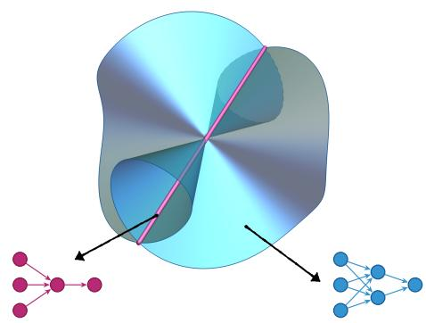  
Figure 1: No proximity bias toward subnetworks of shallow multilayer perceptrons (MLPs).

Compared to general points in a given model, points on submodels may possess more tangent directions to the model or fewer. Proximity bias can occur only in the latter case, since a minimizer must lie in the polar of the tangent cone. We show that proximity bias is governed by the local geometry of the model along its submodel. Figure 1 illustrates our result for shallow MLPs: the submodel obtained using inactive hidden neurons has more tangent directions than a general point, so proximity bias does not occur.

Low-rank matrix approximation sets the scene. The best rank-at-most-r approximation of a matrix M in (e.g.) Frobenius norm has rank exactly r, unless rank(M) < r, due to Eckart and Young (1936). That is, a low-rank matrix model uses available degrees of freedom rather than collapsing to an even-lower-rank submodel. The analogous statement holds for symmetric tensors (Seigal and Sturmfels, 2017). This implies no proximity bias for single-output shallow MLPs with monomial activations. We extend this to deep MLPs and those with analytic activation functions, and to lightning self-attention.

## 1.1 Summary of contributions

We study two classes of neural models (also known as neuromanifolds): those corresponding to multilayer perceptrons and to lightning self-attention. For shallow MLPs, we show that the narrower submodel ob tained by removing a hidden neuron is not preferred. For deep MLPs, inactive neurons are again not preferred in several cases: when one neuron is inactive in every hidden layer, when the earlier layers are wide enough, when the activations are polynomial of suficiently high degree, and when the activations are an alytic but not polynomial. For attention, many lowerrank and singular strata do not exhibit proximity bias, but certain exceptional singular or boundary strata do. We show that singularity alone does not determine whether a submodel is preferred; it is governed by a finer geometry of the neural model; see Figure 2 for examples.

## 1.2 Related work

Implicit and sparsity bias. Trained models have been shown to prefer structured solutions, such as max-margin, low-rank or sparse ones, without them appearing in the objective function. This phenomenon is called implicit bias (Soudry et al., 2018; Gunasekar et al., 2017, 2018; Chizat and Bach, 2020). A preference for networks with fewer active neurons is called sparsity bias: the noise of stochastic gradient descent drives networks toward simpler subnetworks (Chen et al., 2023), and randomly initialized networks contain small subnetworks that perform comparably when trained alone (Frankle and Carbin, 2019). Other works trace a preference for simple functions to the architecture or the parametrization (Valle-P´erez et al., 2019; Mingard et al., 2025). Our notion of proximity bias depends only on the geometry of the neural model and is one possible source of implicit bias.

Singularities and learning. Singular learning theory studies models, including neural networks, that are not identifiable and whose Fisher information matrix is degenerate (Watanabe, 2009; Wei et al., 2022). Such singularities can cause plateaus in gradient-based learning (Amari et al., 2006), although these efects do not imply that singular points are local minimiz ers. These are singularities of the parametrization. We instead consider singularities and boundaries of the neural model itself, in the spirit of neuroalgebraic geometry (Marchetti et al., 2025), and our descriptions of neural models build on Kileel et al. (2019); Kubjas et al. (2024); Henry et al. (2025); Grosdos et al. (2025); Alexandr et al. (2026).

Subnetworks and critical points. Two recent works connect sparsity bias to singularities. Shahverdi et al. (2026) study polynomial MLPs and show that, under mild conditions, subnetworks are singular points of the neural model and are critical points of the loss for an open set of targets. Kohn et al. (2026) study deep monomial networks of high degree and show that the parametrization is critical exactly at subnetworks. However, critical points may be saddles. We ask when these submodels contain local minima for an open set of targets.

## 2 PROXIMITY BIAS

We introduce a geometric framework to study the presence or absence of proximity bias toward submodels. A neural model $\mathcal { F }$ is a subset of a real Hilbert space of functions $\mathcal { H } .$ . For a fixed target function $h \in { \mathcal { H } } .$ , we consider the squared distance

$$
\ell _ { h } : \mathcal { H }  \mathbb { R } , f \mapsto \ell _ { h } ( f ) = \vert \vert h - f \vert \vert ^ { 2 } .
$$

We ask whether minimizing $\ell _ { h }$ over $\mathcal { F }$ selects a distinguished lower-dimensional submodel ${ \mathcal { F } } ^ { \prime } \subset { \mathcal { F } }$ . Such a preference cannot arise through smooth interior points of $\mathcal { F } ;$ it can only occur where the local real geometry is nongeneric, for example along singular or boundary strata; see Proposition 2.4. One may think of the target function $h \in \mathcal H$ as an oracle that best explains the data, or as a teacher from which we try to distill knowledge using students in F (Hinton et al., 2015).

The Voronoi cell (Cifuentes et al., 2022) of $f \in { \mathcal { F } }$ is

$$
\begin{array} { r } { \mathrm { V o r } _ { \mathscr F } ( f ) = \{ h \in \mathscr { H } : \| h - f \| \leq \| h - g \| \mathrm { ~ f o r ~ a l l ~ } g \in \mathscr { F } \} } \\ { = \{ h \in \mathscr { H } : f \mathrm { ~ i s ~ a ~ g l o b a l ~ m i n i m i z e r ~ o f ~ } \ell _ { h } | _ { \mathscr F } \} . } \end{array}
$$

We introduce the local Voronoi cell of $f \in { \mathcal { F } }$ as

$\operatorname { V o r } _ { \mathcal { F } } ^ { \mathrm { l o c } } ( f ) = \{ h \in \mathcal { H } : f$ is a local minimizer of $\ell _ { h } | _ { \mathcal { F } } \}$

More generally, given a set ${ \mathcal { F } } ^ { \prime } \subseteq { \mathcal { F } }$ , we define its Voronoi cell and local Voronoi cell, respectively, as

$$
\operatorname { V o r } _ { \mathscr F } ( \mathscr F ^ { \prime } ) = \bigcup _ { f \in \mathscr F ^ { \prime } } \operatorname { V o r } _ { \mathscr F } ( f ) , \quad \operatorname { V o r } _ { \mathscr F } ^ { \mathrm { l o c } } ( \mathscr F ^ { \prime } ) = \bigcup _ { f \in \mathscr F ^ { \prime } } \operatorname { V o r } _ { \mathscr F } ^ { \mathrm { l o c } } ( f ) .
$$

We say that $\mathcal { F }$ exhibits proximity bias toward ${ \mathcal { F } } ^ { \prime }$ if $\mathrm { V o r } _ { \mathcal { F } } ^ { \mathrm { l o c } } ( \mathcal { F } ^ { \prime } )$ has nonempty interior in H. When H is finite-dimensional and $\mathcal { F }$ and ${ \mathcal { F } } ^ { \prime }$ are semialgebraic sets $( \mathrm { e . g . }$ , for polynomial neural networks), the set $\mathrm { V o r } _ { \mathcal { F } } ^ { \mathrm { l o c } } ( \mathcal { F } ^ { \prime } )$ is semialgebraic and the following are equivalent: $\mathrm { V o r } _ { \mathcal { F } } ^ { \mathrm { l o c } } ( \mathcal { F } ^ { \prime } )$ has nonempty interior in H; $\mathrm { V o r } _ { \mathcal { F } } ^ { \mathrm { l o c } } ( \mathcal { F } ^ { \prime } )$ has a positive Lebesgue measure; dim $\begin{array} { r } { \mathrm { V o r } _ { \mathcal { F } } ^ { \mathrm { l o c } } ( \mathcal { F } ^ { \prime } ) = } \end{array}$ dim H.

Remark 2.1. Voronoi cells are closed convex sets that tessellate the ambient space. Local Voronoi cells are also convex, but may not be closed and may overlap.

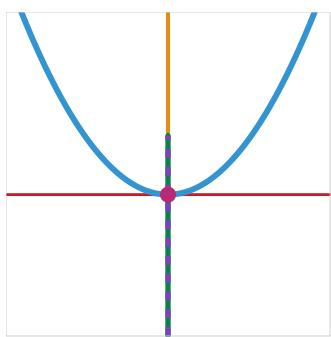  
(a) Smooth

  
(b) Node

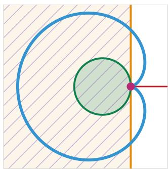  
(c) Cusp

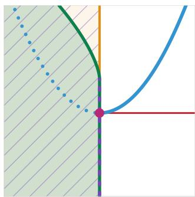  
(d) Boundary  
Figure 2: The presence or absence of proximity bias depends on local geometry. For curve ${ \mathcal { F } } _ { : }$ there is proximity bias toward ${ \mathcal { F } } ^ { \prime } = \{ \mathbf { 0 } \}$ in (c) and (d), but not in (a) and (b), as shown by whether the local Voronoi cell $\mathrm { V o r } _ { \mathcal { F } } ^ { \mathrm { l o c } } ( \mathbf { 0 } )$ (purple dashes) is full-dimensional. We also draw the tangent cone $T _ { \mathcal { F } } ( \mathbf { 0 } )$ , normal cone $N _ { \mathcal { F } } ( 0 )$ , and Voronoi cell $\mathrm { V o r } _ { \mathcal { F } } ( \mathbf { 0 } )$ for comparison. The blue dots in (d) are points in the Zariski closure of ${ \mathcal F }$ . Details in G.2.

We study (local) Voronoi cells using classical notions from variational geometry (Rockafellar and Wets, 1998). Tangent cones and their polar normal cones encode the first-order geometry relevant to local optimality; see Figure 2. Given $f \in { \mathcal { F } }$ , the tangent cone of F at $f ,$ denoted $T _ { \mathcal { F } } ( f )$ , is the set of directions that arise as limits of sequences in $\mathcal { F }$ tending to $f .$ In symbols,

$$
\begin{array} { r } { T _ { \mathcal { F } } ( f ) = \{ v \in \mathcal { H } : \begin{array} { l l } { \exists ( f _ { n } ) _ { n } \subset \mathcal { F } , \exists ( \tau _ { n } ) _ { n } \subset \mathbb { R } _ { > 0 } } \\ { f _ { n }  f , ( f _ { n } - f ) / \tau _ { n }  v } \end{array} \} . } \end{array}
$$

The normal cone of $\mathcal { F }$ at f is the polar cone of $T _ { \mathcal { F } } ( f )$

$$
N _ { \mathcal { F } } ( f ) = \{ w \in \mathcal { H } : \langle v , w \rangle \leq 0 \mathrm { ~ f o r ~ a l l ~ } v \in T _ { \mathcal { F } } ( f ) \} .
$$

When f is a smooth point of F, we recover the classical notions of tangent and normal spaces. The following chain of inclusions relates these sets.

Proposition 2.2. Given any ${ \mathcal { F } } ^ { \prime } \subseteq { \mathcal { F } }$ one has

$$
{ \mathcal { F } } ^ { \prime } \subseteq \operatorname { V o r } _ { { \mathcal { F } } } ( { \mathcal { F } } ^ { \prime } ) \subseteq \operatorname { V o r } _ { { \mathcal { F } } } ^ { \log } ( { \mathcal { F } } ^ { \prime } ) \subseteq \bigcup _ { f \in { \mathcal { F } } ^ { \prime } } { \big ( } f + N _ { { \mathcal { F } } } ( f ) { \big ) } .
$$

Proof idea. The first inclusion follows from $\ell _ { f } ( f ) = 0$ and $\ell _ { f } \ \geq \ 0$ . The second inclusion says that global minimizers are local minimizers. The third uses that $- \nabla \ell _ { h } ( f ) = 2 ( h - f )$ and that this vector lies in $N _ { \mathcal { F } } ( f )$ if f is a local minimizer of $\ell _ { h } | _ { \mathcal { F } }$ . See Appendix A.

The above result uses the specificity of the normal cone to minimizers rather than any critical point.

Corollary 2.3. $I f \bigcup _ { f \in \mathcal { F } ^ { \prime } } \bigl ( f + N _ { \mathcal { F } } ( f ) \bigr )$ has empty interior, then there is no proximity bias toward ${ \mathcal { F } } ^ { \prime }$ $I f \operatorname { V o r } _ { \mathcal { F } } ( \mathcal { F } ^ { \prime } )$ has nonempty interior, then there is proximity bias toward ${ \mathcal { F } } ^ { \prime }$

There is always proximity bias toward equaldimensional submodels and proximity bias toward a lower-dimensional submodel requires points where the normal cone is larger than at smooth points.

Proposition 2.4. Assume dim $\mathcal { H } < \infty$ and consider semialgebraic sets $\mathcal { F } ^ { \prime } \subseteq \mathcal { F } \subseteq \mathcal { H }$ . If dim ${ \mathcal { F } } ^ { \prime } =$ dim ${ \mathcal { F } } ,$ then there is proximity bias toward ${ \mathcal { F } } ^ { \prime }$ . If dim $\mathcal { F } ^ { \prime } <$ dim $\mathcal { F }$ and ${ \mathcal { F } } ^ { \prime }$ is contained in the smooth locus of ${ \mathcal { F } } _ { z }$ then there is no proximity bias toward ${ \mathcal { F } } ^ { \prime }$

Proof idea. First, a full-dimensional semialgebraic subset ${ \mathcal { F } } ^ { \prime }$ of F agrees with $\overline { { \mathcal { F } } }$ near some $f \in \mathcal { F } ^ { \prime }$ so every target close to $f$ has all its nearest points of F in F′. Second, local Voronoi cells of smooth points have dimension at most dim $\mathcal { H } \mathrm { ~ - ~ } \mathrm { d i m } \mathcal { F } \mathrm { ~ < ~ }$ dim ${ \mathcal { H } } - \dim { \mathcal { F } } ^ { \prime }$ □

Remark 2.5 (Other losses). Our setting can be generalized to other nondegenerate losses: Fr´echet diferentiable functions $\ell _ { u } : \mathcal { H } \to { \mathbb R } _ { \geq 0 }$ such that $\ell _ { u } ( u ) = 0$ and $\nabla \ell _ { u } ( f ) = 0$ if and only if $f = u$ . The squared distance $\ell _ { u } ( f ) = \| f - u \| ^ { 2 }$ is a nondegenerate loss because $\nabla \ell _ { u } ( f ) = 2 ( f - u )$ . If H is a finite-dimensional space, then the mean-squared error (MSE) is a nondegenerate loss function provided that the dataset is suficiently general and large enough (Kohn et al., 2022).

## 3 MULTILAYER PERCEPTRONS

Figure 3 conveys the idea behind this section. It shows the cone of functions computed by a single neuron. An inactive neuron computes the zero function, which is the apex of the cone. An inactive neuron can be reactivated in every direction of the cone, so submodels with inactive neurons have many tangent directions and tend not to be preferred. For shallow networks, this idea sufices to show that there is no proximity bias toward subnetworks. For deep networks, one must also take into account how the upstream and downstream layers afect the tangent directions added by inactive neurons, which makes the analysis more challenging.

Definition 3.1. A multilayer perceptron (MLP) with architecture d $\mathbf { \Omega } = \left( d _ { 0 } , \ldots , d _ { L } \right)$ and activation functions $\pmb { \rho } = ( \rho _ { 1 } , \dots , \rho _ { L } )$ is a map

$$
f _ { \mathbf { W } , \mathbf { b } } = \widetilde { \rho } _ { L } \circ A _ { L } \circ \cdots \circ \widetilde { \rho } _ { 1 } \circ A _ { 1 } : \mathbb { R } ^ { d _ { 0 } }  \mathbb { R } ^ { d _ { L } } ,
$$

where $A _ { k } ( x ) ~ = ~ W _ { k } x + b _ { k }$ with $W _ { k } \in \mathbb { R } ^ { d _ { k } \times d _ { k - 1 } }$ $b _ { k } \in \mathbb { R } ^ { d _ { k } }$ , and $\tilde { \rho } _ { k } : \mathbb { R } ^ { d _ { k } }  \mathbb { R } ^ { d _ { k } }$ applies a fixed function $\rho _ { k } : \mathbb { R } \to \mathbb { R }$ coordinatewise. The neural model $\mathcal { F }$ of the MLP is the set of functions $f _ { \mathbf { W } , \mathbf { b } }$ as the weight matrices $\mathbf { W } = \left( W _ { 1 } , \ldots , W _ { L } \right)$ and biases $\mathbf { b } = ( b _ { 1 } , \dots , b _ { L } )$ vary over $\begin{array} { r } { \prod _ { k } \mathbb { R } ^ { d _ { k } \times d _ { k - 1 } } } \end{array}$ and $\prod _ { k } \mathbb { R } ^ { d _ { k } }$ , respectively. The hyperparameter $L$ is the number of layers. We say that an MLP is shallow if $L = 2 ,$ , and deep if $L \geq 3 .$

For simplicity, we assume linear readouts; i.e., the last activation function $\rho _ { L }$ is the identity map. This assumption is mild, since the last activation can be absorbed by the loss function: $\ell _ { h } ( \rho \circ f ) = ( \ell _ { h } \circ \rho ) ( f )$ We assume that all other activations are nonconstant.

Given a fixed MLP architecture and activation functions, we take the ambient space H of the neural model $\mathcal { F }$ to be the completion of its linear span with respect to a fixed inner product: ${ \mathcal { H } } = { \overline { { \operatorname { s p a n } ( { \mathcal { F } } ) } } }$ . When all activations are polynomials, $\mathcal { F }$ consists of (tuples of) polynomials of bounded degree, so H is finite-dimensional and we take the standard inner product of polynomials (Bombieri inner product). When some activation is non-polynomial, the universal approximation theorem implies that span(F) is infinite dimensional, and we take an $L ^ { 2 }$ inner product with respect to a finite compactly-supported Borel measure $\mu$ on $\mathbb { R } ^ { d _ { 0 } }$ , so that $\mathcal { H } = \overline { { \mathrm { s p a n } ( \mathcal { F } ) } } \overset { \vartriangle } { = } L ^ { 2 } ( \mu , \mathbb { R } ^ { d _ { L } } )$ . This implies restricting the support of elements in $\mathcal { F }$ to guarantee that their norm is finite. When the support of $\mu$ is a finite set $\Omega ,$ the functions in the restricted neural model $\mathcal { F } | _ { \Omega }$ are identified with vectors in $\mathbb { R } ^ { | \Omega | \times d _ { L } }$ , a finite-dimensional ambient space. Equipping $\mathbb { R } ^ { | \Omega | \times d _ { L } }$ with the Euclidean inner product corresponds to MSE for the dataset Ω.

## 3.1 Shallow Networks

Consider MLPs with architecture $\mathbf { d } = ( d _ { 0 } , d _ { 1 } , d _ { 2 } )$ and activations $\pmb { \rho } = ( \tilde { \rho } , \mathrm { i d } )$ . The single-neuron cone is

$$
\mathcal { C } = \left\{ f ( x ) = \rho ( \langle w , x \rangle + \beta ) v + b : \begin{array} { l l } { w \in \mathbb { R } ^ { d _ { 0 } } , \beta \in \mathbb { R } } \\ { v , b \in \mathbb { R } ^ { d _ { 2 } } } \end{array} \right\} .
$$

The single-neuron cone is the neural model of MLPs with architecture $( d _ { 0 } , 1 , d _ { 2 } )$ and activations $\pmb { \rho } = ( \tilde { \rho } , \mathrm { i d } )$ : $f ( x )$ above is $f _ { \mathbf { W } , \mathbf { b } }$ with $\begin{array} { r } { \dot { \mathbf { W } } = ( w ^ { \top } , v ) } \end{array}$ and $\mathbf { b } = ( \beta , b )$

Lemma 3.2. The neural model F of a shallow MLP with architecture $( d _ { 0 } , d _ { 1 } , d _ { 2 } )$ is the Minkowski sum of $d _ { 1 }$ single-neuron cones: $\begin{array} { r } { \mathcal { F } = \sum _ { i = 1 } ^ { d _ { 1 } } \mathcal { C } } \end{array}$ . Therefore, $\operatorname { s p a n } ( { \mathcal { C } } ) = \operatorname { s p a n } ( { \mathcal { F } } )$

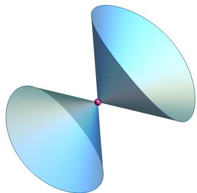  
Figure 3: No proximity bias toward the origin for single-neuron cones: $\mathrm { V o r } _ { \mathscr { C } } ^ { \mathrm { l o c } } ( 0 ) = N _ { \mathscr { C } } ( 0 ) = \{ \bar { 0 } \}$

We think of nonzero elements in C as rank-one functions and elements in $\mathcal { F }$ as rank at most $d _ { 1 }$ functions, by analogy to the following special case.

Example 3.3 (Symmetric matrices). Consider the architecture $\mathbf { d } { = } ( d _ { 0 } , d _ { 1 } , 1 )$ and $\pmb { \rho } = ( \tilde { \rho } , \mathrm { i d } )$ with $\rho ( t ) = t ^ { 2 }$ The MLPs without bias terms $( b _ { k } = 0 )$ and weights $\mathbf { W } = ( W , \lambda )$ are quadratic forms

$$
f _ { \mathbf { W } , \mathbf { 0 } } ( x ) = x ^ { \top } A x , \quad A = \sum _ { i = 1 } ^ { d _ { 1 } } \lambda _ { i } w _ { i } w _ { i } ^ { \top }
$$

where $w _ { i }$ is the i-th row of $W$ . Each hidden neuron contributes a rank-one term $\lambda _ { i } w _ { i } w _ { i } ^ { \top }$ , so rank $A \leq d _ { 1 }$ Let $\mathcal { F }$ be the set of $d _ { 0 } \times d _ { 0 }$ symmetric matrices of rank at most $d _ { 1 }$ , where $d _ { 1 } ~ < ~ d _ { 0 }$ and let ${ \mathcal { F } } ^ { \prime } \subset { \mathcal { F } }$ be its singular locus: points where the rank drops below $d _ { 1 }$ As recalled above, the Eckart-Young theorem implies that a best rank-at-most-r approximation of a matrix $M$ has rank r (not smaller) unless $\operatorname { r a n k } ( M ) < r$ . That is, $\operatorname { V o r } _ { \mathcal { F } } ( \mathcal { F } ^ { \prime } ) = \mathcal { F } ^ { \prime }$

Our next result extends this matrix example in three directions: to all local minimizers (not only global ones), to every inner product and nondegenerate loss, and to every activation function. Informally, we show that given a target function $h ,$ a locally best rank-atmost-d1 approximation of h has rank $d _ { 1 }$ (not smaller) unless rank $h < d _ { 1 }$ . See Figure 1.

Theorem 3.4. Let F be the neural model of a shallow MLP with architecture $\mathbf { d } = ( d _ { 0 } , d _ { 1 } , d _ { 2 } ) , d _ { 1 } \geq 2$ , and activations $( \tilde { \rho } , \mathrm { i d } )$ . Let H be the closure of span $( \mathcal { F } )$ with respect to a fixed inner product, and let ${ \mathcal { F } } ^ { \prime }$ be the submodel with architecture $\mathbf { d } ^ { \prime } = ( d _ { 0 } , d _ { 1 } - 1 , d _ { 2 } )$ . Then,

$$
\operatorname { V o r } _ { \mathcal { F } } ( \mathcal { F } ^ { \prime } ) = \operatorname { V o r } _ { \mathcal { F } } ^ { \mathrm { l o c } } ( \mathcal { F } ^ { \prime } ) = \mathcal { F } ^ { \prime } .
$$

That is, a target function $h \in \mathcal H$ admits a $( l o c a l )$ minimizer of $\ell _ { h } | _ { \mathcal { F } }$ in ${ \mathcal { F } } ^ { \prime }$ if and only if $h \in { \mathcal { F } } ^ { \prime }$ . The same holds with $\mathcal { F }$ and ${ \mathcal { F } } ^ { \prime }$ replaced by their closures.

Proof idea. We have $\begin{array} { r } { \mathcal { F } ^ { \prime } = \sum _ { i = 1 } ^ { d _ { 1 } - 1 } \mathcal { C } } \end{array}$ and $\mathcal { F } = \mathcal { F } ^ { \prime } + \mathcal { C } ,$ by Lemma 3.2. Given any $\bar { f } \in \mathcal { F } ^ { \prime }$ its tangent cone at $\mathcal { F }$ contains ${ \mathcal { C } } ,$ which spans the whole ambient space. Hence, the normal cone $N _ { \mathcal { F } } ( f )$ is zero (see Figure 3) and the conclusion follows from Proposition 2.2.

Details of all proofs in this section are in Appendix $\mathrm { B } ,$ and details of all figures are in Appendix G.

Corollary 3.5. Under the setup from Theorem $\ 3 . 4 ,$ there is no proximity bias toward ${ \mathcal { F } } ^ { \prime }$ whenever ${ \mathcal { F } } ^ { \prime }$ has empty interior in H. Thus, there is also no proximity bias toward (even) smaller subnetworks.

Remark 3.6 (Smallest Voronoi cells). The equalities $\operatorname { V o r } _ { \mathcal { F } } ( \mathcal { F } ^ { \prime } ) = \operatorname { V o r } _ { \mathcal { F } } ^ { \mathrm { l o c } } ( \mathcal { F } ^ { \prime } ) = \mathcal { F } ^ { \prime }$ in Theorem 3.4 mean the cells are as small as possible, by Proposition 2.2.

Remark 3.7 (Saddle points in parameter space). Our results pertain to function space, but have implications in parameter space. Inactive neurons (i.e., subnetworks) lead to critical points of the loss in parameter space for a nonempty open set of target functions (Kohn et al., 2026). Our tangent cone computation implies that these critical points cannot be local extrema at parameters where the parametrization is locally open (unless the loss vanishes there), so they must be saddle points.

Remark 3.8 (Bounding normal cones). Conversely, results in parameter space can have implications in function space. Given a parametrization $\phi : \Theta \to $ ${ \mathcal F } ,$ we have $N _ { \mathcal { F } } ( \phi ( \theta ) ) \subset \mathrm { i m } ( d \phi | _ { \theta } ) ^ { \perp }$ , the orthogonal complement of the image of the diferential of $\phi$ at $\theta .$ This containment can sometimes be used to deduce that there is no proximity bias, but not always (e.g. for MLPs) since we may have strict inequalities dim $N _ { \mathcal { F } } ( \phi ( \theta ) ) ~ <$ dim im $( d \phi \vert _ { \theta } ) ^ { \perp }$ . In Appendix C we use this to show that there is no proximity bias toward subnetworks of convolutional neural networks (CNNs) with polynomial activations.

## 3.2 Deep Networks

In this section, we consider deep MLPs. We start by analyzing proximity bias in the linear case.

Example 3.9 (Deep linear networks). If all activations are the identity, the neural model of architecture $( d _ { 0 } , \ldots , d _ { L } )$ consists of afine maps $\mathbb { R } ^ { d _ { 0 } }  \mathbb { R } ^ { d _ { L } } , x \mapsto$ $W x + b$ with rank $W \leq r : = \mathrm { m i n } _ { k } d _ { k } , \mathrm { s o }$ it is the neural model of the shallow linear network $( d _ { 0 } , r , d _ { L } )$ . If we remove a neuron from a bottleneck layer k (i.e., one with $d _ { k } = r )$ , there is no proximity bias toward the corresponding submodel, by Theorem 3.4. Otherwise, deleting a neuron of a hidden layer does not change the model $( \mathcal { F } ^ { \prime } = \mathcal { F } )$ , so there is proximity bias toward ${ \mathcal { F } } ^ { \prime } .$

Unlike the shallow case, neural models of deep MLPs can no longer be expressed as a sum of single-neuron cones, in general. However, for some neural submodels ${ \mathcal { F } } ^ { \prime } \subseteq { \mathcal { F } }$ we can find a cone $\tilde { \mathcal { C } }$ whose span is dense in H such that ${ \mathcal { F } } ^ { \prime } + { \tilde { \mathcal { C } } } \subseteq { \mathcal { F } }$ . This inclusion is enough to conclude that there is no proximity bias toward ${ \mathcal { F } } ^ { \prime }$

Next, we show that there is no proximity bias toward subnetworks with inactive neurons in diferent situations: when one neuron is inactive in every hidden layer, when a neuron of the first hidden layer is inactive and the subnetwork is small enough, when a neuron of the last hidden layer is inactive and the earlier layers are wide enough, and, for analytic activations or polynomial activations of suficiently high degree, when a neuron of any hidden layer is inactive.

All hidden layers. The idea behind Theorem 3.4 can be generalized to deep MLPs when our submodel is defined by having an inactive neuron in every hidden layer, which we call an inactive path (cf. Alexandr and Mont´ufar (2027)).

Theorem 3.10 (No bias toward inactive paths). Let $\mathcal { F }$ be the neural model $o f$ an MLP with architecture ${ \bf d } = ( d _ { 0 } , d _ { 1 } , \dots , d _ { L - 1 } , d _ { L } )$ and let ${ \mathcal { F } } ^ { \prime }$ be the submodel with architecture $( d _ { 0 } , d _ { 1 } - 1 , \dots , d _ { L - 1 } - 1 , d _ { L } )$ . Assume the activations are continuous. Then,

$$
\operatorname { V o r } _ { \mathcal { F } } ( \mathcal { F } ^ { \prime } ) = \operatorname { V o r } _ { \mathcal { F } } ^ { \mathrm { l o c } } ( \mathcal { F } ^ { \prime } ) = \mathcal { F } ^ { \prime } .
$$

Proof idea. Using the inactive path we construct tangent directions $\rho _ { L - 1 } \circ \cdot \cdot \cdot \circ \rho _ { 1 } ( \langle w , x \rangle + \beta )$ v for all $f \in { \mathcal { F } } ^ { \prime }$ and these directions span a dense subset of H. □

Last hidden layer. We use the observation that a deep MLP is a shallow MLP whose input space is a space of functions rather than the vector space $\mathbb { R } ^ { d _ { 0 } }$ For a parameter $\boldsymbol { \theta } = \left( \mathbf { W } , \mathbf { b } \right)$ let

$$
h _ { \theta } = \rho _ { L - 2 } \circ A _ { L - 2 } \circ \cdots \circ \rho _ { 1 } \circ A _ { 1 } \colon \mathbb { R } ^ { d _ { 0 } } \to \mathbb { R } ^ { d _ { L - 2 } }
$$

be the feature map computed by the first $L - 2$ layers $( h _ { \theta } ( x ) = x$ for $L = 2 )$ Fixing these layers gives a shallow MLP on the features $h _ { \theta }$

$$
f _ { \theta } ( x ) = b _ { L } + \sum _ { i = 1 } ^ { d _ { L - 1 } } \rho _ { L - 1 } \bigl ( \langle w _ { i } , h _ { \theta } ( x ) \rangle + \beta _ { i } \bigr ) v _ { i } ,
$$

where $w _ { i }$ is the i-th row of $W _ { L - 1 } , ~ v _ { i }$ the i-th column of $W _ { L }$ , and $\beta _ { i }$ the i-th entry of $b _ { L - 1 } .$ . For fixed weights in the first $L - 2$ layers, a neuron in the last hidden layer computes $\rho _ { L - 1 } \circ q$ with $q$ in the space of functions $V _ { \theta } =$ span $\{ 1 , h _ { \theta , 1 } , \dotsc , h _ { \theta , d _ { L - 2 } } \}$ spanned by the features, just as a neuron of a shallow network computes $\rho \circ q$ with $q \in$ span $\{ 1 , x _ { 1 } , \ldots , x _ { d _ { 0 } } \}$ : the deep network is a shallow network whose input space is the function space $V _ { \theta }$ . In the language of kernel methods, $V _ { \theta }$ is the reproducing kernel Hilbert space of the kernel $k _ { \theta } ( x , x ^ { \prime } ) = 1 + \langle h _ { \theta } ( x ) , h _ { \theta } ( x ^ { \prime } ) \rangle$

This viewpoint explains what happens when neurons in the last hidden layer $( L - 1 )$ are inactive. Define

$$
\mathcal { C } _ { \theta } = \{ \rho _ { L - 1 } ( \langle w , h _ { \theta } \rangle + \beta ) v : w \in \mathbb { R } ^ { d _ { L - 2 } } , \beta \in \mathbb { R } , v \in \mathbb { R } ^ { d _ { L } } \} ,
$$

the set of functions computed by a single neuron of the last hidden layer with input features $h _ { \theta }$ , which is a symmetric cone. We say that θ has complete $f e a -$ tures if the span of $\mathcal { C } _ { \theta }$ is dense in H, that is, the deep network has the same expressivity as a shallow network defined on a function space. For polynomials, this occurs when hidden layers are wide enough (see Corollary 3.12). In the following, a representation of $f \in { \mathcal { F } } ^ { \prime }$ is a subnetwork parameter θ with $f _ { \boldsymbol { \theta } } = f$

Proposition 3.11. Let $\mathcal { F }$ be the neural model of an MLP with arbitrary activations, $L \ \geq \ 3$ layers, $d _ { L - 1 } \ \geq \ 2$ and let $\mathcal { F } ^ { \prime }$ be the subnetwork with one neuron of the last hidden layer inactive. If every $f \in { \mathcal { F } } ^ { \prime }$ has a representation with complete features, then $\operatorname { V o r } _ { \mathcal { F } } ( \mathcal { F } ^ { \prime } ) = \operatorname { V o r } _ { \mathcal { F } } ^ { \mathrm { l o c } } ( \mathcal { F } ^ { \prime } ) = \mathcal { F } ^ { \prime }$

Proof idea. The deleted neuron of the last hidden layer can be put back with arbitrary incoming weights w and arbitrarily small outgoing weights v of either sign. This gives lines in $\mathcal { F }$ through $f$ in the directions $\rho _ { L - 1 } ( \left. w , h _ { \theta } \right. + \beta ) v \in \mathcal { C } _ { \theta }$ . So $N _ { \mathcal { F } } ( f )$ is orthogonal to span $\mathcal { C } _ { \theta }$ , and it is zero for complete features. □

Corollary 3.12. Under the assumptions of Proposition 3.11 with nonconstant polynomial activations of degree $r _ { 1 } , \ldots , r _ { L - 1 } , 1$ $\begin{array} { r } { i f ~ d _ { k } \geq \left( \begin{array} { c } { d _ { 0 } + r _ { 1 } \cdots r _ { k } } \\ { d _ { 0 } } \end{array} \right) - 1 } \end{array}$ for all $k = 1 , \ldots , L - 2$ , then $\operatorname { V o r } _ { \mathcal { F } } ( \mathcal { F } ^ { \prime } ) = \operatorname { V o r } _ { \mathcal { F } } ^ { \mathrm { l o c } } ( \mathcal { F } ^ { \prime } ) = \mathcal { F } ^ { \prime }$

Proof idea. If the first $L - 2$ layers are wide enough, they can compute a basis of all polynomials of degree at most $r _ { 1 } \cdots r _ { L - 2 }$ . Every function of ${ \mathcal { F } } ^ { \prime }$ can be computed in this basis, and then a single new neuron in layer L − 1 gives all polynomials of degree at most $r _ { 1 } \cdots r _ { L - 1 }$ , so the features are complete. □

First hidden layer. The question of what happens when a neuron is deleted in the first layer reduces to the shallow setting of Section 3.1, but with a diferent loss. Cut the MLP after the afine map of layer 2: $f _ { \mathbf { W } , \mathbf { b } } = \Psi \circ z ,$ , where $z = W _ { 2 } \tilde { \rho } ( W _ { 1 } x + b _ { 1 } ) + b _ { 2 }$ is a shallow MLP with architecture $( d _ { 0 } , d _ { 1 } , d _ { 2 } )$ and Ψ is the map computed by the remaining layers. This gives the pulled-back loss $\tilde { \ell } _ { h } ( z ) = \ell _ { h } ( \Psi \circ z )$ , which may be degenerate. Indeed, its gradient $\nabla \tilde { \ell } _ { h } ( z ) = J ^ { \top } \nabla \ell _ { h } ( f )$ with $J = D \Psi \circ z .$ , vanishes whenever $\nabla \ell _ { h } ( f ) \in \ker J ^ { \top }$ Local Voronoi cells may not be trivial, but we can exclude proximity bias when ${ \mathcal { F } } ^ { \prime }$ is small enough.

Proposition 3.13. Let $\mathcal { F }$ be the neural model of a deep MLP with architecture $\mathbf { 1 } = \left( d _ { 0 } , \ldots , d _ { L } \right)$ and nonconstant polynomial activations $\rho .$ Let deg $\rho _ { 1 } ~ = ~ r _ { 1 }$ and let ${ \mathcal { F } } ^ { \prime }$ be the submodel with width $d _ { 1 } - 1$ in the first hidden layer and all other layers unchanged. If

$$
\dim \mathcal { F } ^ { \prime } < \binom { d _ { 0 } + r _ { 1 } } { d _ { 0 } } = \dim \mathbb { R } [ x _ { 1 } , \dots , x _ { d _ { 0 } } ] \underset { = } { \underbrace { \phantom { . . . } } }
$$

then there is no proximity bias toward ${ \mathcal { F } } ^ { \prime }$

Proof idea. The reinserted neuron gives more linearly independent directions than the dimension of ${ \mathcal { F } } ^ { \prime } ,$ , so the union of translated normal cones from Proposi tion 2.2 has positive codimension. □

Any hidden layer. A neuron of hidden layer k com bines both situations. It reads the features computed by the previous layers, as in the last layer, and its output is processed by the subsequent layers, as in the first layer. Cutting after the afine map of layer $k + 1 , f _ { \theta } = \Psi \circ z .$ , where z is a shallow network on the features $h _ { \theta } ^ { ( k - 1 ) }$ trained with the pulled-back loss $\tilde { \ell } _ { h } ( z ) = \ell _ { h } ( \Psi \circ z )$

For polynomial MLPs, there is no proximity bias toward a submodel ${ \mathcal { F } } ^ { \prime }$ with width $d _ { k } \mathrm { ~ - ~ } 1$ in a hidden layer $k ,$ provided the $d _ { j }$ are suficiently high, by Proposition 3.13 and Corollary 3.12. The width conditions are that $\begin{array} { r } { d _ { j } \geq \binom { d _ { 0 } + r _ { 1 } \cdots r _ { j } } { d _ { 0 } } - 1 } \end{array}$ for all $j < k$ and we also require dim $\mathcal { F } ^ { \prime } < \binom { d _ { 0 } + r _ { 1 } \cdots r _ { k } } { d _ { 0 } }$

These width conditions can be dropped when the activation in layer k has suficiently high degree.

Proposition 3.14. Let $\mathcal { F }$ be the neural model of a deep MLP with architecture $\mathbf { d } = ( d _ { 0 } , \dots , d _ { L } )$ and nonconstant polynomial activations $\rho ,$ and let ${ \mathcal { F } } ^ { \prime }$ be the submodel with width $d _ { k } \mathrm { ~ - ~ } 1$ in a hidden layer k. If $\deg \rho _ { k } \geq \dim \mathcal F ^ { \prime }$ , there is no proximity bias toward ${ \mathcal { F } } ^ { \prime }$

Proof idea. The functions computed by a single neuron in layer k span all polynomials of degree at most deg $\rho _ { k }$ in the features, which gives deg $\rho _ { k } + 1 > \mathrm { d i m } { \mathcal F ^ { \prime } }$ linearly independent constraints on the normal cones. Hence, a dimension count as in Proposition 3.13 concludes the proof. □

For non-polynomial activations, no condition on the dimension of ${ \mathcal { F } } ^ { \prime }$ is needed.

Theorem 3.15. Given a compactly supported finite Borel measure $\mu \neq 0$ on $\mathbb { R } ^ { d _ { 0 } }$ with a Lebesgue density, let $\mathcal { F } \subseteq L ^ { 2 } ( \mu , \mathbb { R } ^ { d _ { L } } )$ be the neural model ofan MLP with architecture d $\mathbf { \Omega } = \left( d _ { 0 } , \ldots , d _ { L } \right)$ and analytic nonconstant activations. Let ${ \mathcal { F } } ^ { \prime }$ be the submodel given by the subarchitecture with width $d _ { k } - 1$ in a hidden layer $k ,$ and suppose that $\rho _ { k }$ is not polynomial. Then, there is no proximity bias toward ${ \mathcal { F } } ^ { \prime }$ . Moreover, if $k = 1$ and $d _ { L } = 1$ , then $\operatorname { V o r } _ { \mathcal { F } } ( \mathcal { F } ^ { \prime } ) = \operatorname { V o r } _ { \mathcal { F } } ^ { \mathrm { l o c } } ( \mathcal { F } ^ { \prime } ) = \dot { \mathcal { F } } ^ { \prime }$

Proof idea. For analytic nonpolynomial $\rho _ { k } .$ , a single neuron can approximate every function of the features, and J vanishes only on a measure zero set. The normal cones need not vanish, but they satisfy more linearly independent constraints than ${ \mathcal { F } } ^ { \prime }$ has parameters. Dimension counts on finite-dimensional slices and the Baire category theorem conclude the proof. □

It remains to understand what happens when we have an inactive neuron in an arbitrary hidden layer for polynomial neural networks with low activation degrees. In some cases, we may obtain a proper submodel ${ \mathcal { F } } ^ { \prime } \subsetneq { \mathcal { F } }$ with dim $F ^ { \prime } = \dim { \mathcal { F } }$ (e.g., Example B.10), in which case there is proximity bias by Proposition 2.4. We conjecture that having a submodel of smaller dimension is suficient to rule out proximity bias, and provide numerical evidence in Appendix F.

Conjecture 3.16. Let $\mathcal { F }$ be the neural model of an $M L P$ with polynomial activations, and consider the submodel ${ \mathcal { F } } ^ { \prime } \subset { \mathcal { F } }$ obtained by making some hidden neurons inactive. If dim $\mathcal { F } ^ { \prime } <$ dim ${ \mathcal { F } } _ { z }$ , then there is no proximity bias toward ${ \mathcal { F } } ^ { \prime }$

## 4 LIGHTNING SELF-ATTENTION

We next study proximity bias in lightning selfattention, following the setup of Henry et al. (2025). Let $X \in \mathbb { R } ^ { d \times t }$ contain t input tokens, and let $Q , K \in$ $\mathbb { R } ^ { a \times d }$ and $V \in \mathbb { R } ^ { d ^ { \prime } \times d }$ be the query, key, and value matrices. Softmax self-attention takes the form

$$
X \longmapsto V X \operatorname { s o f t m a x } ( X ^ { \top } K ^ { \top } Q X ) ,
$$

where softmax is applied columnwise. Lightning self attention omits the softmax normalization, giving

$$
X \longmapsto V X X ^ { \top } K ^ { \top } Q X .
$$

Since K and $Q$ enter only through $A = K ^ { \top } Q$ , we reparametrize the model as

$$
\phi ( A , V ) ( X ) = V X X ^ { \top } A X , \qquad \operatorname { r a n k } ( A ) \leq a ,
$$

and write

$$
\mathcal X _ { a } = \{ \phi ( A , V ) : \mathrm { r a n k } ( A ) \leq a , ~ V \in \mathbb { R } ^ { d ^ { \prime } \times d } \} .
$$

Each output coordinate is a homogeneous cubic polynomial in the dt entries of X. Throughout our analysis of lightning attention, the ambient space is therefore $\mathcal { H } = \mathbb { R } ^ { d ^ { \prime } \times t } \otimes \mathbb { R } [ x _ { 1 } , \ldots , x _ { d t } ] _ { 3 }$ , equipped with a fixed inner product.

For $s \ < \ a$ , let $\mathcal { X } _ { s } \subseteq \mathcal { X } _ { a }$ be the submodel consisting of functions in $\mathcal { X } _ { a }$ that have a parametrization with $\operatorname { r a n k } ( A ) \leq s$ . Thus, $\mathcal { X } _ { 1 } \subseteq \mathcal { X } _ { 2 } \subseteq \cdot \cdot \cdot \subseteq \mathcal { X } _ { a }$ . Our goal is to determine whether there is proximity bias toward these lower-rank submodels or singular loci of the model. The singular locus need not be a submodel ob tained by lowering the rank constraint, so we consider singularities separately. The answer depends on the number of tokens and on the rank. For multiple-token attention, there is no proximity bias toward any proper lower-rank submodel. The only multiple-token proximity bias occurs in the case $a = d ^ { \prime } = 1$ . For singletoken attention, the rank constraint creates boundary strata that give proximity bias.

## 4.1 Multiple-Token Attention

The multiple-token case is $t > 1$ . We assume without loss of generality that $a \leq d ,$ , since for $a > d$ the rank constraint is vacuous and $\chi _ { a - 1 } = \chi _ { a }$ . For $a \ > \ 1$ ， there is no proximity bias toward any proper lower rank attention submodel.

Theorem 4.1. Assume $t > 1$ , and $1 < a \le d$ . Then there is no proximity bias toward $\mathcal { X } _ { s }$ for any $s < a$

Proof idea. At a function with rank $A < a ,$ every rankone change of A and every change of V is a two-sided tangent direction. Outside a small exceptional locus these directions span a space of dimension dim $\lambda _ { d } .$ , so a dimension count shows that the translated normal cones are small enough. □

We next ask whether there is proximity bias toward singular points of the attention model. The algebraic description of the singular loci, obtained by complexifying and projectivizing, is given in Appendix D. For $1 < a < d ,$ , the real singular locus is $\mathcal { X } _ { a - 1 }$ . When $a = d ,$ it is contained in $\mathcal { X } _ { 1 }$ . Thus, Theorem 4.1 implies no proximity bias toward the real singular locus for any $a > 1$

It remains to consider $a = 1$ . There is no nonzero lower-rank submodel in this case, but the singularlocus question can still be posed. When $d ^ { \prime } > 1$ , the nonzero real singular locus is the rank-one locus

$$
Z = \{ \phi ( A , V ) : \operatorname { r a n k } ( A ) = \operatorname { r a n k } ( V ) = 1 \} ,
$$

and again there is no proximity bias toward it.

Proposition 4.2. Assume that $t > 1 , d > 1 , a = 1$ and $d ^ { \prime } > 1$ . Then there is no proximity bias toward the real singular locus of $\mathcal { X } _ { 1 }$

Proof idea. Dimension count for the singular locus $Z ,$ via unique factorization and birationality. □

The scalar-output case $d ^ { \prime } = 1$ is diferent. Writing $A = k q ^ { \top }$ and $\bar { V } = v ^ { \top }$ , with $k , q , v \in \mathbb { R } ^ { d }$ , gives

$$
\phi ( A , V ) ( X ) = \big ( \boldsymbol { v } ^ { \top } \boldsymbol { X } \boldsymbol { X } ^ { \top } \boldsymbol { k } \big ) \boldsymbol { q } ^ { \top } \boldsymbol { X } .
$$

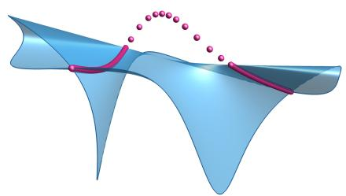  
(a) a = d = 2

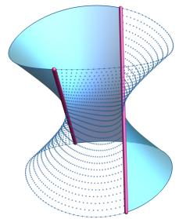  
(b) a = 1, d = 2

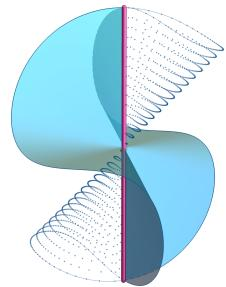  
(c) a = 1, d = 3  
Figure 4: No proximity bias toward submodels of multi-token self-attention mechanisms, except for a rank-one scalar output model $( d ^ { \prime } = a = 1 ) \ O { : }$ see Theorems 4.1 and 4.3. Submodels are the magenta loci, and the dotted parts represent points in the Zariski closure of the respective neural models. Details in G.4.

Since $X X ^ { \top }$ is symmetric, the parametrization is in variant under exchanging v and k, and is therefore generically two-to-one. Setting $\begin{array} { r } { S = \frac { 1 } { 2 } ( \boldsymbol { v } \boldsymbol { k } ^ { \top } + \boldsymbol { k } \boldsymbol { v } ^ { \top } ) } \end{array}$ removes this symmetry and gives

$$
\phi ( A , V ) ( X ) = \left( \sum _ { j = 1 } ^ { t } x _ { j } ^ { \top } S x _ { j } \right) q ^ { \top } X ,
$$

where $x _ { j }$ is the j-th column of X. We therefore write $\psi ( q , S ) ( \bar { X } ) = \phi ( A , V ) ( X )$ and define

$$
U = \{ \psi ( q , S ) : q \in \mathbb { R } ^ { d } , \operatorname { r a n k } ( S ) \leq 1 \} .
$$

In terms of the original parameters, rank $( S ) \leq 1$ exactly when v and k are linearly dependent.

Theorem 4.3. Assume $t > 1 , a = d ^ { \prime } = 1$ , and $d > 1$ There is proximity bias toward U. If d > 2, U is both the real singular locus of $\mathcal { X } _ { 1 }$ and a boundary of the real model. If $d = 2 , U$ is a boundary of the real model.

Proof idea. A real inertia constraint makes U onesided, and the Voronoi cell of U fills an open set.

The two geometric regimes in Theorem 4.3 are visible already in the smallest dimensions; see Figure 4. By Lemma D.9, the map $q \otimes S \mapsto \psi ( q , S )$ is injective for $t > 1$ , so these low-dimensional slices faithfully rep resent the corresponding geometry of $\mathcal { X } _ { 1 }$ . For $d = 2 ,$ the locus U appears as a boundary of the real model despite the algebraic model being smooth, whereas for $d = 3$ it appears as a singular locus.

The multiple-token case is summarized as follows.
<table><tr><td rowspan=1 colspan=1>Regime</td><td rowspan=1 colspan=1> $\overline { { a > 1 \mathrm { ~ o r ~ } d ^ { \prime } > 1 } }$ </td><td rowspan=1 colspan=1> $\overline { { a = d ^ { \prime } = 1 } }$ </td></tr><tr><td rowspan=1 colspan=1>proximity bias?</td><td rowspan=1 colspan=1>No</td><td rowspan=1 colspan=1>Yes</td></tr></table>

## 4.2 Single-Token Attention

The geometry of the attention model changes when $t \ = \ 1$ . Writing $S \ = \ { \textstyle { \frac { 1 } { 2 } } } ( A + A ^ { \top } )$ , we reparametrize

using a symmetric matrix $S \in S ^ { 2 } (  { \mathbb { R } } ^ { d } )$ and $V \in \mathbb { R } ^ { d ^ { \prime } \times d }$

$$
\psi ( S , V ) ( x ) = ( V x ) ( x ^ { \top } S x ) .
$$

For $t > 1$ , the fiber is controlled by the bilinear form $y ^ { \top } A x$ , where rank one is the exceptional reducible case. For $t = 1$ , this is replaced by the quadratic form $x ^ { \top } S x$ , which is reducible over C when $\operatorname { r a n k } ( S ) \leq 2$ Consequently, rank-two symmetric matrices now appear in the singular locus.

The rank constraint is also diferent under symmetrization. Over C, matrices A with ran $\mathfrak { c } ( A ) \ \leq \ a$ give the symmetric matrices S with rank $( S ) \leq \operatorname* { m i n } \{ 2 a , d \}$ ， whereas over R they give those S with at most a positive and at most a negative eigenvalues. These two observations lead to the following.

Theorem 4.4. Assume that $t = 1$

1. If a = d > 1 and $d ^ { \prime } > 1$ , then

$$
\operatorname { S i n g } \big ( \mathbb { P } ( \mathcal { X } _ { d } ^ { \mathbb { C } } ) \big ) = \mathbb { P } \left( \left\{ \psi ( S , V ) : \operatorname { r a n k } ( V ) = 1 , \right\} \right) ,
$$

and there is no proximity bias toward the corresponding real singular locus.

2. If a > 1 and $2 a < d ,$ then

$$
\operatorname { S i n g } \big ( \mathbb { P } ( \mathcal { X } _ { a } ^ { \mathbb { C } } ) \big ) = \mathbb { P } \big ( \{ \psi ( S , V ) : \operatorname { r a n k } ( S ) \leq 2 a - 1 \} \big ) .
$$

The real model $\mathcal { X } _ { a }$ exhibits proximity bias toward the rank-(2a − 1) stratum U where S has inertia $( a , a - 1 , d - 2 a + 1 )$ .

Proof idea. Part 1 is a dimension count as in Proposi tion 4.2. Part 2 is a one-sided argument that implies full-dimensional Voronoi cells, as in Theorem 4.3.

Thus, the larger singular locus in the single-token setting does not by itself produce proximity bias. In the first regime, the rank-two factorization locus is singular but there is no proximity bias toward it. In the second, proximity bias arises from the one-sided boundary induced by the real inertia constraint, paralleling the boundary mechanism in Theorem 4.3. Proofs are given in Appendix E.

## 4.3 Beyond lightning self-attention

Theorem 4.3 identifies a proximity bias toward U in rank-one scalar-output lightning attention. We ask whether this proximity bias is visible under gradientbased training after replacing lightning attention by softmax attention. The change in identifiability caused by normalization is studied in Henry et al. (2025); here we compare the training dynamics empirically.

We take $\textit { d } = \textit { t } = \textit { 2 }$ and $\ a \ = \ d ^ { \prime } \ = \ 1$ . In each run, the target is $h \ = \ \psi ( q _ { * } , S _ { * } )$ , where $q _ { * } \ \in \ \mathbb { R } ^ { 2 }$ is a unit vector and $S _ { * } \succ 0$ has eigenvalues 1 and 0.2. We sample 512 standard Gaussian inputs $X _ { i }$ and use the labels $h ( X _ { i } )$ for both models. We initialize from $k _ { 0 } , q _ { \ast } , v _ { 0 } .$ , with $\begin{array} { r } { S _ { 0 } = \frac { 1 } { 2 } ( v _ { 0 } k _ { 0 } ^ { \top } + k _ { 0 } v _ { 0 } ^ { \top } ) } \end{array}$ having eigenvalues 1 and −0.05, and train $k , q , v$ for 500 steps using Adam and squared loss. For softmax attention, the only change is replacing $\phi ( A , V ) ( X ) = V X X ^ { \top } A X$ by VX softmax(X⊤AX).

At training step t, let $\begin{array} { r } { S _ { t } = \frac { 1 } { 2 } ( v _ { t } k _ { t } ^ { \top } + k _ { t } v _ { t } ^ { \top } ) } \end{array}$ . Figure 5 shows $\sigma _ { 2 } ( S _ { t } ) / \sigma _ { 1 } ( S _ { t } )$ . For lightning attention, the ratio rapidly converges to zero, consistent with Theorem 4.3. For softmax, the ratio decreases at a slower rate.

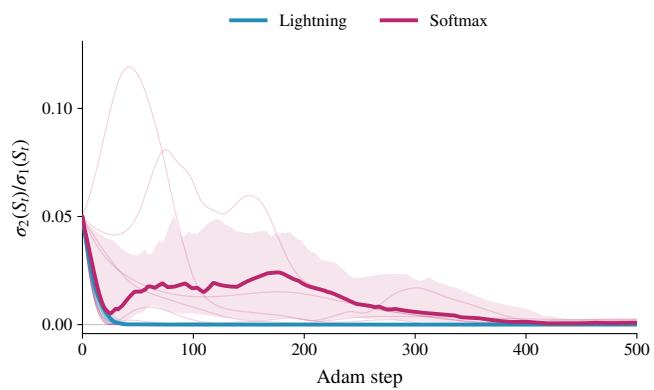  
Figure 5: Implicit bias for softmax attention. Ratio $\sigma _ { 2 } ( S _ { t } ) / \sigma _ { 1 } ( S _ { t } )$ over 500 steps. Both models use the same inputs, labels, and initialization. Thick curves show medians over 30 runs; shaded regions show interquartile ranges; faint curves show 8 individual runs.

## 5 DISCUSSION

Our results show that preference for submodels is not caused by singularities alone. In the models studied here, most lower-rank or inactive-neuron submodels are not preferred, even when they lie in the singular locus of the neural model. The exceptional cases reflect the real geometry, such as one-sided boundary strata or large normal cones. In lightning selfattention, proximity bias arises at one-sided boundaries coming from a real inertia constraint.

It is natural to generalize these results to more expressive models. Low-rank matrix approximation is the starting point, from which one can move toward neural models along two natural hierarchies:

matrix rank −→ tensor rank

−→ shallow MLPs

$$
\longrightarrow \mathrm { d e e p ~ M L P s } \longrightarrow \cdots ,
$$

matrix rank −→ lightning self-attention

−→ self-attention −→ · · · .

This paper takes steps along both hierarchies: from tensor rank and shallow MLPs toward deep networks, and from low-rank matrix approximation to lightning self-attention. The next steps are to understand preference for submodels in deep polynomial $\mathrm { M L P s }$ with arbitrary activation degrees when a neuron from any hidden layer is inactive (cf. Conjecture 3.16) and softmax self-attention. More broadly, when the geometry itself does not prefer a simpler submodel, an important question is whether preferences observed in practice come from the optimization dynamics or from structure in the target.

## AI use statement

In this work, we used generative AI tools for writing code to generate figures using Mathematica, reviewing our proofs, filling in technical details of proofs, and polishing writing. We have not used generative AI tools to come up with the main ideas and solve the main problems in this paper. We have reviewed all AI-assisted work. We take responsibility for the final content of this work, including text, claims, or artifacts produced with the aid of generative AI.

## Acknowledgements

We thank Thomas Grill, Kathl´en Kohn, and Vahid Shahverdi for helpful discussions. AR was supported by fellowships from “la Caixa” Foundation (ID 100010434), under the agreement LCF/BQ/EU23/12010097, from Rafael del Pino Foundation, and from Real Colegio Complutense at Harvard University. AS was supported by NSF DMS 2608217 and an Alfred P. Sloan research fellowship. We acknowledge support from an AMS–Simons Travel Grant (awarded to YA), which allowed AR to visit YA at UCLA to make progress on this project.

## References

Alexandr, Y., Duan, H., and Mont´ufar, G. (2026). Al gebraic invariants of lightning self-attention.

Alexandr, Y. and Mont´ufar, G. (2027). Constraining the outputs of ReLU neural networks. In B¨ulte, C., Burger, M., Hein, M., Kutyniok, G., Pokutta, S., and Steinwart, I., editors, Theoretical Foundations of Deep Learning. Springer, Cham. To appear.

Amari, S.-i., Park, H., and Ozeki, T. (2006). Singularities afect dynamics of learning in neuromanifolds. Neural Computation, 18(5):1007–1065.

Arora, S., Cohen, N., Hu, W., and Luo, Y. (2019). Implicit regularization in deep matrix factorization. In Advances in Neural Information Processing Systems, volume 32.

Bochnak, J., Coste, M., and Roy, M.-F. (1998). Real algebraic geometry. Springer Science & Business Media.

Chen, F., Kunin, D., Yamamura, A., and Ganguli, S. (2023). Stochastic collapse: How gradient noise attracts SGD dynamics towards simpler subnetworks. Advances in Neural Information Processing Systems, 36:35027–35063.

Chizat, L. and Bach, F. (2020). Implicit bias of gradient descent for wide two-layer neural networks trained with the logistic loss. In Proceedings of the Thirty-Third Conference on Learning Theory, volume 125 of Proceedings of Machine Learning Research, pages 1305–1338. PMLR.

Cifuentes, D., Ranestad, K., Sturmfels, B., and Weinstein, M. (2022). Voronoi cells of varieties. Journal of Symbolic Computation, 109:351–366.

Comon, P. and Ottaviani, G. (2012). On the typical rank of real binary forms. Linear and multilinear algebra, 60(6):657–667.

Eckart, C. and Young, G. (1936). The approximation of one matrix by another of lower rank. Psychometrika, 1(3):211–218.

Frankle, J. and Carbin, M. (2019). The lottery ticket hypothesis: Finding sparse, trainable neural networks. In International Conference on Learning Representations.

Grosdos, A., Robeva, E., and Zubkov, M. (2025). Al gebraic geometry of rational neural networks.

Gunasekar, S., Lee, J., Soudry, D., and Srebro, N. (2018). Characterizing implicit bias in terms of optimization geometry. In Proceedings of the 35th International Conference on Machine Learning, volume 80 of Proceedings of Machine Learning Research, pages 1832–1841. PMLR.

Gunasekar, S., Woodworth, B. E., Bhojanapalli, S., Neyshabur, B., and Srebro, N. (2017). Implicit regularization in matrix factorization. In Advances in Neural Information Processing Systems, volume 30.

Harris, J. (1992). Algebraic Geometry: A First Course, volume 133 of Graduate Texts in Mathematics. Springer-Verlag, New York.

Henry, N. W., Marchetti, G. L., and Kohn, K. (2025). Geometry of lightning self-attention: Identifiability and dimension. In The Thirteenth International Conference on Learning Representations.

Hinton, G., Vinyals, O., and Dean, J. (2015). Distilling the knowledge in a neural network. arXiv preprint arXiv:1503.02531.

Kileel, J., Trager, M., and Bruna, J. (2019). On the expressive power of deep polynomial neural networks. In Advances in Neural Information Processing Systems, volume 32, pages 10310–10319.

Kohn, K., Marchetti, G. L., Shabir, F., Shahverdi, V., and Wang, W. (2026). Singular learning and Occam’s razor in deep monomial networks. arXiv preprint arXiv:2606.28464.

Kohn, K., Merkh, T., Mont´ufar, G., and Trager, M. (2022). Geometry of linear convolutional networks. SIAM Journal on Applied Algebra and Geometry, 6(3):368–406.

Kohn, K., Nødland, B. I. U., and Tripoli, P. (2017). Secants, bitangents, and their congruences. In Combinatorial Algebraic Geometry: Selected Papers From the 2016 Apprenticeship Program, pages 87–112. Springer.

Kubjas, K., Li, J., and Wiesmann, M. (2024). Geometry of polynomial neural networks. Algebraic Statistics, 15(2):295–328.

Leshno, M., Lin, V. Y., Pinkus, A., and Schocken, S. (1993). Multilayer feedforward networks with a nonpolynomial activation function can approximate any function. Neural networks, 6(6):861–867.

Marchetti, G. L., Shahverdi, V., Mereta, S., Trager, M., and Kohn, K. (2025). Algebra unveils deep learning - an invitation to neuroalgebraic geometry. In Forty-second International Conference on Machine Learning Position Paper Track.

Mingard, C., Rees, H., Valle-P´erez, G., and Louis, A. A. (2025). Deep neural networks have an inbuilt Occam’s razor. Nature Communications, 16(1):220.

Olikier, G., Mlinari´c, P., Absil, P.-A., and Uschmajew, A. (2026). The tangent cone to the real determinantal variety: Various expressions and a proof. Set-Valued and Variational Analysis, 34:8.

Rockafellar, R. T. and Wets, R. J. (1998). Variational analysis. Springer.

Seigal, A. and Sturmfels, B. (2017). Real rank two geometry. Journal of Algebra, 484:310–333.

Shahverdi, V., Marchetti, G. L., and Kohn, K. (2026). Learning on a razor’s edge: Identifiability and singularity of polynomial neural networks. In International Conference on Learning Representations.

Soudry, D., Hofer, E., Nacson, M. S., Gunasekar, S., and Srebro, N. (2018). The implicit bias of gradient descent on separable data. Journal of Machine Learning Research, 19(70):1–57.

Valle-P´erez, G., Camargo, C. Q., and Louis, A. A. (2019). Deep learning generalizes because the parameter-function map is biased towards simple functions. In International Conference on Learning Representations.

Watanabe, S. (2009). Algebraic geometry and statistical learning theory, volume 25. Cambridge university press.

Wei, S., Murfet, D., Gong, M., Li, H., Gell-Redman, J., and Quella, T. (2022). Deep learning is singular, and that’s good. IEEE Transactions on Neural Networks and Learning Systems, 34(12):10473–10486.

## A PROOFS OF PROPOSITIONS 2.2 AND 2.4

Proposition 2.2. Given any ${ \mathcal { F } } ^ { \prime } \subseteq { \mathcal { F } }$ one has

$$
{ \mathcal { F } } ^ { \prime } \subseteq \operatorname { V o r } _ { { \mathcal { F } } } ( { \mathcal { F } } ^ { \prime } ) \subseteq \operatorname { V o r } _ { { \mathcal { F } } } ^ { \log } ( { \mathcal { F } } ^ { \prime } ) \subseteq \bigcup _ { f \in { \mathcal { F } } ^ { \prime } } { \big ( } f + N _ { { \mathcal { F } } } ( f ) { \big ) } .
$$

Lemma A.1. Let $\ell : \mathcal { H } \to \mathbb { R }$ be Fr´echet diferentiable. $I f f \in { \mathcal { F } }$ is a local minimizer of ℓ| then $- \nabla \ell ( f ) \in N _ { \mathcal { F } } ( f )$

Proof. Let $v \in T _ { \mathcal { F } } ( f )$ and pick sequences $( f _ { n } ) _ { n } \subset \mathcal { F }$ and $( \tau _ { n } ) _ { n } \subset \mathbb { R } _ { > 0 }$ such that $( f _ { n } - f ) / \tau _ { n } \to v$ . Since $f$ is a local minimizer, $\ell ( f _ { n } ) - \ell ( f ) \geq 0$ for all suficiently large n. By Fr´echet diferentiability of $\ell ,$

$$
\ell ( f _ { n } ) - \ell ( f ) = \langle \nabla \ell ( f ) , f _ { n } - f \rangle + o ( \| f _ { n } - f \| ) .
$$

Dividing by $\tau _ { n }$ and taking the limit gives $\langle \nabla \ell ( f ) , v \rangle \geq 0 .$

Proof of Proposition 2.2. We always have $f \in \operatorname { V o r } _ { \mathcal { F } } ( f )$ because $\ell _ { f } ( f ) = 0$ and $\ell _ { f } \geq 0 . \mathrm { I f } h \in \mathrm { V o r } _ { \mathcal { F } } ( f )$ , then f is a global, and hence local, minimizer of $\ell _ { h }$ . If f is a local minimizer, Lemma A.1 gives $- \nabla \ell _ { h } ( f ) = 2 ( h - f ) \in N _ { \mathcal { F } } ( f )$ Since $N _ { \mathcal { F } } ( f )$ is a cone, $h \in f + N _ { \mathcal { F } } ( f )$ □

Corollary A.2. If $N _ { \mathcal { F } } ( f ) = \{ 0 \}$ for every $f \in { \mathcal { F } } ^ { \prime }$ , then Vo $\mathbf { \dot { \sigma } } _ { \mathcal { F } } ( \mathcal { F } ^ { \prime } ) = \mathrm { V o r } _ { \mathcal { F } } ^ { \mathrm { l o c } } ( \mathcal { F } ^ { \prime } ) = \mathcal { F } ^ { \prime }$

Proposition 2.4. Assume dim H $< \infty$ and consider semialgebraic sets $\mathcal { F } ^ { \prime } \subseteq \mathcal { F } \subseteq \mathcal { H }$ . If dim $\mathcal { F } ^ { \prime } =$ dim ${ \mathcal F } ,$ , then there is proximity bias toward ${ \mathcal { F } } ^ { \prime }$ . If dim $\mathcal { F } ^ { \prime } <$ < dim $\mathcal { F }$ and ${ \mathcal { F } } ^ { \prime }$ is contained in the smooth locus of $\mathcal { F }$ , then there is no proximity bias toward ${ \mathcal { F } } ^ { \prime }$

Proof of Proposition 2.4. For the first claim, we use the following facts about semialgebraic sets $A \subseteq \mathbb { R } ^ { n } ;$ $\dim ( { \overline { { A } } } ) = \dim ( A )$ and $\mathrm { d i m } ( \overline { { { A } } } \setminus A ) <$ dim A for $A \neq \varnothing$ (Bochnak et al., 1998, §2.8). Given $f \in { \mathcal { F } } \subset { \mathcal { H } }$ and $\varepsilon > 0$ , denote the ball centered at f of radius ε by $B ( f , \varepsilon ) = \{ h \in \mathscr { H } : \| h - f \| \leq \varepsilon \}$ . We claim that there exists $f \in { \mathcal { F } } ^ { \prime }$ with a neighborhood in the closure $\overline { { \mathcal { F } } }$ that is contained in ${ \mathcal { F } } ^ { \prime }$ . Otherwise every point of ${ \mathcal { F } } ^ { \prime }$ would be a limit of points of $A = \overline { { \mathcal { F } } } \backslash \mathcal { F } ^ { \prime }$ , which implies that ${ \mathcal { F } } ^ { \prime } \subseteq { \overline { { A } } } \backslash$ A and so dim $\mathcal { F } ^ { \prime } <$ dim $A \leq \dim { \mathcal { F } }$ , a contradiction. Assume ε is such that $\overline { { \mathcal { F } } } \cap B ( f , 3 \varepsilon ) \subseteq \mathcal { F } ^ { \prime }$ . Next, we show that $\operatorname { V o r } _ { \mathcal { F } } ^ { \mathrm { l o c } } ( \mathcal { F } ^ { \prime } ) \supseteq B ( f , \varepsilon )$ . Pick any $h \in B ( f , \varepsilon )$ . Then, $\overline { { \mathcal { F } } }$ has a point $\tilde { f }$ closest to h, and $\| h - \tilde { f } \| \leq \| h - f \| \leq \varepsilon .$ , so $\| { \tilde { f } } - f \| \leq 2 \varepsilon$ and $\tilde { f } \in \mathcal { F } ^ { \prime }$ . Hence, ˜f is a global minimizer of $\ell _ { h } | _ { \mathcal { F } }$ and $h \in \mathrm { V o r } _ { \mathscr { F } } ( \mathscr { F } ^ { \prime } ) \subseteq \mathrm { V o r } _ { \mathscr { F } } ^ { \mathrm { l o c } } ( \mathscr { F } ^ { \prime } )$ , so $\operatorname { V o r } _ { \mathcal { F } } ^ { \mathrm { l o c } } ( \mathcal { F } ^ { \prime } ) \supseteq B ( f , \varepsilon )$

For the second claim, assume dim $\mathcal { H } < \infty$ and dim $F ^ { \prime } < \dim { \mathcal { F } } .$ . At a smooth point $f \in { \mathcal { F } }$ , its local Voronoi cell lies in the translated normal space $f + N _ { \mathcal { F } } ( f )$ , of dimension dim ${ \mathcal { H } } - \dim { \mathcal { F } } $ . So over a submodel ${ \mathcal { F } } ^ { \prime }$ of smooth points the (local) Voronoi cells fill a set of dimension at most dim $\mathcal { F } ^ { \prime } +$ dim H − dim $\mathcal { F } <$ dim H. □

## B PROOFS OF MULTILAYER PERCEPTRON RESULTS

## B.1 Shallow MLPs

Theorem 3.4. Let $\mathcal { F }$ be the neural model of a shallow MLP with architecture $\mathbf { d } = ( d _ { 0 } , d _ { 1 } , d _ { 2 } ) , d _ { 1 } \geq 2$ , and activations $( \tilde { \rho } , \mathrm { i d } )$ . Let H be the closure of span(F) with respect to a fixed inner product, and let ${ \mathcal { F } } ^ { \prime }$ be the submodel with architecture $\mathbf { d } ^ { \prime } = ( d _ { 0 } , d _ { 1 } - 1 , d _ { 2 } )$ . Then,

$$
\operatorname { V o r } _ { \mathcal { F } } ( \mathcal { F } ^ { \prime } ) = \operatorname { V o r } _ { \mathcal { F } } ^ { \mathrm { l o c } } ( \mathcal { F } ^ { \prime } ) = \mathcal { F } ^ { \prime } .
$$

That $i s ,$ a target function $h \in \mathcal H$ admits a (local) minimizer of $\ell _ { h } | _ { \mathcal { F } }$ in ${ \mathcal { F } } ^ { \prime }$ if and only if $h \in { \mathcal { F } } ^ { \prime }$ . The same holds with $\mathcal { F }$ and ${ \mathcal { F } } ^ { \prime }$ replaced by their closures.

A cone in a real Hilbert space H is a set $\mathcal { C } \subseteq \mathcal { H }$ that is closed under multiplication by nonnegative scalars, that is, $f \in { \mathcal { C } } , \lambda \geq 0 \implies \lambda f \in { \mathcal { C } } .$ A cone C is symmetric if ${ \mathcal { C } } = - { \mathcal { C } }$ . Equivalently, a symmetric cone is a set $\mathcal { C } \subseteq \mathcal { H }$ that is closed under multiplication by scalars: $f \in { \mathcal { C } } , \lambda \in \mathbb { R } \implies \lambda f \in { \mathcal { C } }$

Lemma B.1. $I f \mathcal { C } \subseteq \mathcal { H }$ is a symmetric cone whose linear span is dense in H, then its polar cone is zero.

Proof. The polar cone of C is equal to its orthogonal complement, because $\mathcal { C }$ is symmetric. The orthogona complement of C equals the orthogonal complement of its linear span, so it is zero. □

Lemma B.2. Let C be a symmetric cone whose linear span is dense in H. $I f { \mathcal { F } } ^ { \prime } + { \mathcal { C } } \subseteq { \mathcal { F } }$ , then $N _ { \mathcal { F } } ( f ) = \{ 0 \}$ for all $f \in { \mathcal { F } } ^ { \prime }$ , and $N _ { \overline { { \mathcal { F } } } } ( f ) = \{ 0 \}$ for all $f \in { \overline { { \mathcal { F } } } } ^ { \prime }$ . Therefore,

$$
\operatorname { V o r } _ { { \mathcal F } } ( { \mathcal F } ^ { \prime } ) = \operatorname { V o r } _ { { \mathcal F } } ^ { \log } ( { \mathcal F } ^ { \prime } ) = { \mathcal F } ^ { \prime } \quad a n d \quad \operatorname { V o r } _ { { \overline { { { \mathcal F } } } } } \left( { \overline { { { \mathcal F } ^ { \prime } } } } \right) = \operatorname { V o r } _ { { \overline { { { \mathcal F } } } } } ^ { \log } \left( { \overline { { { \mathcal F } ^ { \prime } } } } \right) = \overline { { { { \mathcal F } ^ { \prime } } } } .
$$

Proof. It sufices to show that $T _ { \mathcal { F } } ( f )$ contains C for all $f \in { \mathcal { F } } ^ { \prime }$ , by Lemma B.1. Given any $v \in { \mathcal { C } } .$ , we have $f _ { n } ~ = ~ f + { \textstyle \frac { 1 } { n } } v ~ \in ~ { \mathcal { F } }$ for all $n \in \mathbb { N } .$ , so $\begin{array} { r } { v \ = \ \operatorname* { l i m } _ { n \to \infty } ( f _ { n } - f ) / \frac { 1 } { n } \ \in \ T _ { \mathcal { F } } ( f ) } \end{array}$ . Similarly, if $f \in \overline { { \mathcal { F } ^ { \prime } } }$ and $v \in { \mathcal { C } } .$ then $f _ { n } = { \overset { \cdot } { f } } + { \frac { 1 } { n } } v \in { \overline { { \mathcal { F } } } }$ , so the same argument applies. The claims about (local) Voronoi cells follow from Proposition 2.2. □

Proof of Theorem 3.4. Consider the single-neuron cone

$$
\mathcal { C } = \left\{ f ( x ) = \rho ( \langle w _ { 1 } , x \rangle + \beta ) w _ { 2 } + b : w _ { 1 } \in \mathbb { R } ^ { d _ { 0 } } , \beta \in \mathbb { R } , w _ { 2 } , b \in \mathbb { R } ^ { d _ { 2 } } \right\} .
$$

Then $\begin{array} { r } { \mathcal { F } ^ { \prime } = \sum _ { i = 1 } ^ { d _ { 1 } - 1 } \mathcal { C } } \end{array}$ and $\mathcal { F } = \mathcal { F } ^ { \prime } + \mathcal { C }$ . The linear span of C is dense in ${ \mathcal { H } } ,$ because span $( \mathcal { C } ) = \operatorname { s p a n } ( \mathcal { F } )$ . Therefore, the statement follows from Lemma B.2 and Corollary A.2. □

## B.2 Deep MLPs

Neural models of shallow MLPs are sums of cones. This no longer holds for deep MLPs. However, in some cases, we can still find a cone C whose span is dense in H and such that ${ \mathcal { F } } ^ { \prime } { + } { \mathcal { C } } \subseteq { \mathcal { F } }$ . In such cases, Lemma B.2 implies that $\mathcal { F } ^ { \prime } = \mathrm { V o r } _ { \mathcal { F } } ( \mathcal { F } ^ { \prime } ) = \mathrm { V o r } _ { \mathcal { F } } ^ { \mathrm { l o c } } ( \mathcal { F } ^ { \prime } )$ . Note that unlike in the shallow case we may not have the equality $F ^ { \prime } { + } C = { \mathcal { F } }$

We define the features of layer j recursively by $h _ { \theta } ^ { ( 0 ) } ( x ) = x$ and $h _ { \theta } ^ { ( j ) } = \rho _ { j } ( W _ { j } h _ { \theta } ^ { ( j - 1 ) } { + } b _ { j } )$ ; then $f _ { \theta } = W _ { L } h _ { \theta } ^ { ( L - 1 ) } + b _ { L }$ and we write $h _ { \theta } \ = \ h _ { \theta } ^ { ( L - 2 ) }$ for the features that feed the last hidden layer, as in Section 3.2. We consider two scenarios, as in Section 3: (1) all activations are polynomials and $\mathcal { H } = \operatorname { s p a n } \mathcal { F }$ is finite-dimensional with any inner product, (2) the activations are continuous, $\mu$ is a finite Borel measure with compact support $K ,$ and $\mathcal { H } = \overline { { \mathrm { s p a n } \mathcal { F } } } \subseteq L ^ { 2 } ( \mu ; \mathbb { R } ^ { d _ { L } } )$ . The loss that we use is the squared distance $\ell _ { h } ( f ) = \| h - f \| ^ { 2 }$ . We write $\mathcal { P } _ { \leq n } = \mathbb { R } [ x _ { 1 } , \ldots , x _ { d _ { 0 } } ] _ { \leq n }$ for the polynomials of degree at most n in $d _ { 0 }$ variables, so dim ${ \mathcal { P } } _ { \leq n } = { \binom { d _ { 0 } + n } { d _ { 0 } } }$

Theorem 3.10 (No bias toward inactive paths). Let F be the neural model of an MLP with architecture $\mathbf { d } = ( d _ { 0 } , d _ { 1 } , \dots , d _ { L - 1 } , d _ { L } )$ and let ${ \mathcal { F } } ^ { \prime }$ be the submodel with architecture $( d _ { 0 } , d _ { 1 } - 1 , \ldots , d _ { L - 1 } - 1 , d _ { L } )$ . Assume the activations are continuous. Then,

$$
\operatorname { V o r } _ { \mathcal { F } } ( \mathcal { F } ^ { \prime } ) = \operatorname { V o r } _ { \mathcal { F } } ^ { \mathrm { l o c } } ( \mathcal { F } ^ { \prime } ) = \mathcal { F } ^ { \prime } .
$$

Lemma B.3. Let F be the neural model ofan MLP with architecture d $\mathsf { l } = \left( d _ { 0 } , d _ { 1 } , \ldots , d _ { L - 1 } , d _ { L } \right)$ , let ${ \mathcal { F } } ^ { \prime }$ be the submodel with architecture $( d _ { 0 } , d _ { 1 } - 1 , \dots , d _ { { \cal L } - 1 } - 1 , d _ { { \cal L } } )$ , and let $\tilde { \mathcal { C } }$ be the submodel with architecture $( d _ { 0 } , 1 , \ldots , 1 , d _ { L } )$ . Then $\tilde { \mathcal { C } }$ is a symmetric cone and ${ \mathcal { F } } ^ { \prime } + { \tilde { \mathcal { C } } } \subseteq { \mathcal { F } }$

Proof. Given parameters $\theta ^ { \prime }$ of ${ \mathcal { F } } ^ { \prime }$ and $\tilde { \theta }$ of ${ \tilde { \mathcal { C } } } .$ define a parameter θ of F with block-diagonal weight matrices $W _ { j } = \mathrm { d i a g } ( W _ { j } ^ { \prime } , \tilde { W } _ { j } )$ and biases $b _ { j } = ( b _ { j } ^ { \prime } , \tilde { b } _ { j } )$ , except that $\mathrm { \dot { W } _ { 1 } ^ { \top } } = ( { W _ { 1 } ^ { \prime } } ^ { \top } \ \tilde { W } _ { 1 } ^ { \top } ) , W _ { L } = ( W _ { L } ^ { \prime } \ \tilde { \tilde { W } _ { L } } )$ and $b _ { L } = b _ { L } ^ { \prime } + \tilde { b } _ { L }$ Since activations act coordinatewise, $f _ { \theta } = f _ { \theta ^ { \prime } } + f _ { \widetilde { \theta } }$ . Scaling $( \tilde { W } _ { L } , \tilde { b } _ { L } )$ scales $f _ { \tilde { \theta } } { }$ , so $\tilde { \mathcal { C } }$ is a symmetric cone. □

To prove Theorem 3.10 it sufices to show that the span of the symmetric cone $\tilde { \mathcal { C } }$ of the architecture $( d _ { 0 } , 1 , \ldots , 1 , d _ { L } )$ is dense in $\mathcal { H } .$ , by Lemma B.3 and Lemma B.2. We do this separately for the two cases: the polynomial (finite-dimensional) case, and the case where not all activations are polynomial (which lives in an infinite dimensional function space).

Lemma B.4. If σ is a polynomial of degree $R \geq 1$ , then span $\{ \sigma ( q ) : q \in \mathcal { P } _ { \leq n } \} = \mathcal { P } _ { \leq R n }$

Proof. Let $V = \operatorname { s p a n } \{ \sigma ( q ) : q \in { \mathcal { P } } _ { \leq n } \}$ . Every polynomial in V has degree at most $R n ,$ hence $V \subseteq \mathcal { P } _ { \leq R n }$ Conversely, every monomial of degree at most $R n$ is a product $m _ { 1 } \cdots m _ { k }$ of $k \leq R$ monomials of degree at most $n .$ . For $t \in \mathbb { R } ^ { k }$ and $s \in \mathbb R$ , the polynomial $q = t _ { 1 } m _ { 1 } + \cdot \cdot \cdot + t _ { k } m _ { k } + s$ lies in ${ \mathcal { P } } _ { \leq n } , \operatorname { s o } \sigma ( q ) \in V .$ . Expanding $\sigma ( q )$ as a polynomial in $( t , s )$ , only the top-degree term $\sigma _ { R } q ^ { R }$ of σ contributes to the monomial $t _ { 1 } \cdot \cdot \cdot t _ { k } s ^ { R - k }$ , and its coeficient is $\sigma _ { R } { \frac { R ! } { ( R - k ) ! } } \boldsymbol { m } _ { 1 } \cdot \cdot \cdot \boldsymbol { m } _ { k }$ with $\sigma _ { R } \neq 0$ . Since every coeficient of a polynomial map $( t , s ) \mapsto \sigma ( q )$ with values in V is a linear combination of finitely many of its values, it lies in $V .$ Hence $m _ { 1 } \cdots m _ { k } \in V$ □

In what follows, we use the universal approximation theorem (Leshno et al., 1993), and abbreviate it to UAT: if $\sigma : \mathbb { R } $ R is continuous and not a polynomial, then for every compact set $Y \subset \mathbb { R } ^ { m }$ the functions $y \mapsto \sigma ( \langle a , y \rangle + b )$ with $a \in \mathbb { R } ^ { m }$ and $b \in$ R span a dense subset of the continuous functions $C ( Y )$ . In our case, since $\mu$ is finite with compact support $K , C ( K )$ is dense in $L ^ { 2 } ( K )$ and uniform convergence on K implies convergence in $L ^ { 2 } ( K )$ . The next lemma extends UAT to paths of single neurons, one per hidden layer.

Lemma B.5. Let activation functions $\rho _ { 1 } , . . . , \rho _ { L - 1 } \colon \mathbb { R } \to \mathbb { R }$ be continuous and nonconstant, not all polynomials, and let $K \subseteq \mathbb { R } ^ { d _ { 0 } }$ be compact. Let $\Pi _ { i }$ be the set of functions computed by the neuron in layer i of a network with architecture $( d _ { 0 } , 1 , \ldots , 1 )$ , that is, $\Pi _ { 1 } = \{ \rho _ { 1 } ( \langle a , x \rangle + b ) \}$ and $\Pi _ { i } = \{ \rho _ { i } ( w p + c ) : p \in \Pi _ { i - 1 } , w , c \in \mathbb { R } \}$ for $1 < i < L$ . Then span $\Pi _ { L - 1 } \ i s$ dense in $C ( K )$

Proof. Let $V _ { i }$ be the uniform closure of span Π in $C ( K )$ . If $p \in \Pi _ { i - 1 }$ and $\varphi$ is a uniform limit on compact intervals of linear combinations of $s \mapsto \rho _ { i } ( w s + c )$ , then $\varphi \circ p \in V _ { i }$ , by substituting $s = p ( x )$ . The identity $\varphi ( s ) = s$ is such a limit: if $\rho _ { i }$ is a polynomial of degree $R \geq 1$ , the functions $\rho _ { i } ( w s + c )$ span all polynomials of degree at most R in s by Lemma B.4; otherwise apply UAT with $m = 1$ . Hence $V _ { 1 } \subseteq \cdots \subseteq V _ { L - 1 }$ . Now let $\rho _ { i }$ be non-polynomial. Choose $w _ { j } , c _ { j }$ so that $\tau = \rho _ { i - 1 } ( w _ { i - 1 } \rho _ { i - 2 } ( \cdot \cdot \cdot \rho _ { 1 } ( \cdot ) \cdot \cdot \cdot ) + c _ { i - 1 } )$ is nonconstant $( \tau = \mathrm { i d } \mathrm { i f } i = 1 )$ By UAT with input dimension $m = 1 , \varphi =$ arctan is a uniform limit on compact intervals of combinations of $\rho _ { i } ( w s + c )$ , so $\psi ( \langle a , x \rangle + b ) \in V _ { i }$ for all $a , b .$ where ψ = arctan ◦τ. Since $\psi$ is bounded and nonconstant, it is not a polynomial, and UAT gives $V _ { i } = C ( K )$ . Therefore $V _ { L - 1 } = V _ { i } = C ( K )$ □

Proof of Theorem 3.10. It sufices to show that span $\tilde { \mathcal { C } }$ is dense in H, by Lemma B.3 and Lemma B.2. If al activations are polynomials, this follows from Lemma B.4 applied to $\sigma = \rho _ { L - 1 } \circ \cdot \cdot \cdot \circ \rho _ { 1 }$ , whose degree $r _ { 1 } \cdots r _ { L - 1 }$ bounds the degree of every function in F. Otherwise, it follows from Lemma B.5. □

Proposition 3.11. Let $\mathcal { F }$ be the neural model of an MLP with arbitrary activations, $L \geq 3$ layers, $d _ { L - 1 } \geq 2$ and let ${ \mathcal { F } } ^ { \prime }$ be the subnetwork with one neuron of the last hidden layer inactive. If every $f \in { \mathcal { F } } ^ { \prime }$ has a representation with complete features, then $\operatorname { V o r } _ { \mathcal { F } } ( \mathcal { F } ^ { \prime } ) = \operatorname { V o r } _ { \mathcal { F } } ^ { \mathrm { l o c } } ( \mathcal { F } ^ { \prime } ) = \mathcal { F } ^ { \prime }$

Given a network parameter $\theta ,$ recall that $\mathcal { C } _ { \theta } = \{ \rho _ { L - 1 } ( \langle w , h _ { \theta } \rangle + \beta ) v : w \in \mathbb { R } ^ { d _ { L - 2 } } , \beta \in \mathbb { R } , v \in \mathbb { R } ^ { d _ { L } } \}$ is the symmetric cone consisting of functions computed by a single neuron of the last hidden layer with input features $h _ { \theta }$ . We say that θ has complete features if ${ \overline { { \operatorname { s p a n } { \mathcal { C } } _ { \theta } } } } = { \mathcal { H } }$ . Now we can apply a point-wise analog of Lemma B.2.

Proof of Proposition 3.11. We have $f _ { \theta } + { \mathcal { C } } _ { \theta } \subseteq { \mathcal { F } }$ for each representation $\theta$ of the subnetwork. Since $\mathcal { C } _ { \theta }$ depends on $\theta ,$ we cannot write ${ \mathcal { F } } ^ { \prime } { \mathrm { + } } { \mathcal { C } } _ { \theta } \subseteq { \mathcal { F } }$ and apply Lemma B.2 directly. However, the proof of Lemma B.2 is pointwise, so the same argument shows that $N _ { \mathcal { F } } ( f _ { \theta } ) = \{ 0 \}$ and $\operatorname { V o r } _ { \mathscr { F } } ( f _ { \theta } ) = \operatorname { V o r } _ { \mathscr { F } } ^ { \mathrm { l o c } } ( f _ { \theta } ) = \bar { \{ f _ { \theta } \} }$ if $f _ { \theta }$ has complete features. Since every $f \in { \mathcal { F } } ^ { \prime }$ has a representation with complete features, the claim follows. □

Corollary 3.12. Under the assumptions of Proposition 3.11 with nonconstant polynomial activations of degree $r _ { 1 } , \hdots , r _ { L - 1 } , \lambda , i f d _ { k } \ge \binom { d _ { 0 } + r _ { 1 } \cdots r _ { k } } { d _ { 0 } } \stackrel { \setminus } { - } 1$ for all $k = 1 , \ldots , L - 2$ , then V $\mathrm { o r } _ { \mathcal { F } } ( \mathcal { F } ^ { \prime } ) = \mathrm { V o r } _ { \mathcal { F } } ^ { \mathrm { l o c } } ( \mathcal { F } ^ { \prime } ) = \mathcal { F } ^ { \prime }$

Proof of Corollary 3.12. It sufices to find, for every $f \in { \mathcal { F } } ^ { \prime }$ , a representation θ such that $\mathcal { C } _ { \theta }$ spans the ambient space H = span $\mathcal { F } \subseteq \mathbb { R } ^ { d _ { L } } \otimes \mathcal { P } _ { \leq r _ { 1 } \cdots r _ { L - 1 } } ,$ by Proposition 3.11. The width condition allows us to choose the first $L - 2$ layers so that span $\{ 1 , h _ { 1 } ^ { ( j ) } , \ldots , h _ { d _ { j } } ^ { ( j ) } \} = \mathcal { P } _ { \leq r _ { 1 } \cdots r _ { j } }$ for all $j \le L - 2$ , by Lemma B.4 and induction on $j .$ . In any representation of $f ,$ the pre-activations of layer $L - 1$ lie in $\mathcal { P } _ { \leq r _ { 1 } \cdots r _ { L - 2 } } = \operatorname { s p a n } \{ 1 , h _ { 1 } ^ { ( L - 2 ) } , \dots , h _ { d _ { L - 2 } } ^ { ( L - 2 ) } \}$ , so they can be written as $\tilde { W } h ^ { ( L - 2 ) } + \tilde { b }$ . Then span ${ \mathcal { C } } _ { \theta } = { \mathcal { H } } .$ , by Lemma B.4. □

Proposition 3.13. Let $\mathcal { F }$ be the neural model of a deep MLP with architecture d $\mathbf { l } = \left( d _ { 0 } , \ldots , d _ { L } \right)$ and nonconstant polynomial activations $\rho .$ . Let deg $\rho _ { 1 } = r _ { 1 }$ and let ${ \mathcal { F } } ^ { \prime }$ be the submodel with width $d _ { 1 } - 1$ in the first hidden layer

and all other layers unchanged. If

$$
\dim { \mathcal { F } } ^ { \prime } < \left( { \begin{array} { c } { d _ { 0 } + r _ { 1 } } \\ { d _ { 0 } } \end{array} } \right) = \dim \mathbb { R } [ x _ { 1 } , \dots , x _ { d _ { 0 } } ] { \underline { { \array} } } _ { r _ { 1 } }
$$

then there is no proximity bias toward ${ \mathcal { F } } ^ { \prime }$

When all activation functions are polynomial, ${ \mathcal { H } } = \operatorname { s p a n } { \mathcal { F } }$ is finite dimensional.

Lemma B.6. $I f \gamma : ( - \varepsilon , \varepsilon ) \to \mathcal { F } \subseteq \mathcal { H }$ with $\gamma ( 0 ) = f$ and $\gamma$ is diferentiable at 0, then $N _ { \mathcal { F } } ( f ) \perp \gamma ^ { \prime } ( 0 )$ . Thus if there exists $c \in \mathcal H$ such that $f + t c \in \mathcal { F }$ for all t ∈ R, then $N _ { \mathcal { F } } ( f ) \perp c$

Proof. For each $n \in \mathbb { N } ,$ , take $f _ { n } = \gamma ( \pm 1 / n )$ and $\tau _ { n } = 1 / n ,$ , so both $\gamma ^ { \prime } ( 0 )$ and $- \gamma ^ { \prime } ( 0 )$ lie in $T _ { \mathcal { F } } ( f )$ . Hence, every $w \in N _ { \mathcal { F } } ( f )$ satisfies $\langle w , \pm \gamma ^ { \prime } ( 0 ) \rangle \le 0$ □

Lemma B.7. If F be the neural model of an MLP with biases, then $N _ { \mathcal { F } } ( c ) = \{ 0 \}$ for every constant function c.

Proof. The model $\mathcal { F }$ is a symmetric cone that contains the constant functions, so $c + \mathcal { F } = \mathcal { F }$ for all constants c and the claim follows from Lemma B.2. □

Next, we show that if the normal cone at each point of a semialgebraic set S is cut down by at least m independent linear constraints, then the union of translated normal cones over S has codimension at least $m - \dim S$ . When m > dim S, this union has positive codimension, ruling out proximity bias toward S by Proposition 2.2.

Lemma B.8. Let $\Theta \subseteq \mathbb { R } ^ { P }$ be semialgebraic and let $\Phi , v _ { 1 } , \ldots , v _ { r } \colon \Theta \to \mathcal { H }$ be semialgebraic maps with $\Phi ( \Theta ) \subseteq { \mathcal { F } }$ and $N _ { \mathcal { F } } ( \Phi ( \boldsymbol { \theta } ) ) \perp v _ { i } ( \boldsymbol { \theta } )$ for all $\theta , i$ . Let $n = \dim \mathcal { H }$ , let $S \subseteq \Phi ( \Theta )$ be semialgebraic and assume that for every $f \in S$ the vectors $v _ { i } ( \theta )$ with $\Phi ( \theta ) = f$ span a space of dimension at least m. Then $\textstyle \bigcup _ { f \in S } ( f + N _ { \mathcal { F } } ( f ) )$ lies in a semialgebraic set of dimension at most dim $S + n - m$

Proof. The set $E = \{ ( f , \nu ) \in S \times \mathcal { H } : \forall \theta ( \Phi ( \theta ) = f \Rightarrow \langle \nu , v _ { i } ( \theta ) \rangle = 0 \forall i ) \}$ is semialgebraic, by the Tarski– Seidenberg Theorem. Its fiber over $f$ is a linear space of dimension at most $n - m$ containing $N _ { \mathcal { F } } ( f )$ , so dim $E \leq \dim S + n - m$ , and $\{ f + \nu : ( f , \nu ) \in E \}$ is its image under a linear map. □

Proof of Proposition 3.13. Let $n = \dim \mathcal { H }$ and $m = \left( { \begin{array} { c } { { d _ { 0 } + r _ { 1 } } } \\ { { d _ { 0 } } } \end{array} } \right)$ . We show that the normal cone at every nonconstant $f \in { \mathcal { F } } ^ { \prime }$ lies in a subspace of codimension $m ,$ and use Proposition 2.2 to conclude that $\mathrm { V o r } _ { \mathcal { F } } ^ { \mathrm { l o c } } ( \mathcal { F } ^ { \prime } )$ lies in a semialgebraic set of dimension less than n, so it has empty interior.

Let $\theta ^ { \prime }$ be a parameter of the submodel ${ \mathcal { F } } ^ { \prime }$ and define $f = f _ { \theta ^ { \prime } }$ . Write $f = \Psi ( z )$ , where z is the input of the second activation $( \mathrm { s o ~ } z = W _ { 2 } \rho _ { 1 } ( W _ { 1 } x + b _ { 1 } ) + b _ { 2 } )$ and Ψ the polynomial map computed by the subsequent layers. Let $J = D \Psi \circ z .$ . That is, $J ( x ) = D \Psi ( z ( x ) )$ is the $d _ { L } \times d _ { 2 }$ Jacobian of Ψ evaluated at z(x) to give a matrix of polynomials in x. We write el for the l-th standard basis vector of $\mathbb { R } ^ { d _ { 2 } }$ , so Jel is the l-th column of J and for a polynomial $g , J g e _ { l }$ denotes the vector of polynomials $\boldsymbol { g } \cdot \boldsymbol { J } \boldsymbol { e } _ { l }$

Adding a neuron to the first hidden layer with incoming weights $( a , b )$ and outgoing weights tw with nonzero w gives $f _ { t } = \Psi ( z + t w \rho _ { 1 } ( \langle a , x \rangle + b ) ) \in \mathcal { F }$ , a polynomial curve whose derivative at $t = 0$ is Jw $\rho _ { 1 } ( \langle a , x \rangle + b )$ . The curve passes through f at $t = 0 .$ , so Lemma B.6 gives $N _ { \mathcal { F } } ( f ) \perp J w \rho _ { 1 } ( \langle a , x \rangle + b )$ for all $w \in \mathbb { R } ^ { d _ { 2 } } , a \in \mathbb { R } ^ { d _ { 0 } } , b \in \mathbb { R }$ Taking $w = e _ { l }$ for $l = 1 , \ldots , d _ { 2 }$ and linear combinations over $( a , b )$ gives $N _ { \mathcal { F } } ( f ) \perp J g e _ { l }$ for all l and all $g \in \mathcal { P } _ { \leq r _ { 1 } }$ by Lemma B.4.

These directions give m independent constraints whenever f is not constant, as follows. Let $p _ { 1 } , \ldots , p _ { m }$ be a basis of $\mathcal { P } _ { \leq r _ { 1 } }$ . Since f is nonconstant, the chain rule gives 0 $\begin{array} { r } { \neq D f = J D z = \sum _ { l } ( J e _ { l } ) ( \nabla z _ { l } ) ^ { \top } } \end{array}$ , so some column $J e _ { l }$ is a nonzero vector of polynomials. Hence, $g \mapsto J g e _ { l }$ is injective and so the m functions $J p _ { 1 } e _ { l } , \ldots , J p _ { m } e _ { l }$ are linearly independent.

Let Θ be the parameter space of ${ \mathcal { F } } ^ { \prime } .$ , and apply Lemma B.8 to $v _ { l , j } ( \theta ^ { \prime } ) = J _ { \theta ^ { \prime } } p _ { j } e _ { l } .$ , and the set $S$ of nonconstant elements of ${ \mathcal { F } } ^ { \prime } \colon$ the union of $f + N _ { \mathcal { F } } ( f )$ over $f \in S$ lies in a semialgebraic set of dimension ≤ dim $\mathcal { F } ^ { \prime } + n - m < n .$ Constant f contribute only f itself (Lemma B.7), a set of dimension at most dim ${ \mathcal { F } } ^ { \prime } < m \leq n ;$ here $m \leq n$ because $S \neq \emptyset$ (as $d _ { 1 } - 1 \geq 1 )$ and the previous paragraph gives m independent vectors in H. □

The upper bound in Proposition 3.13 can be improved for polynomial neural networks with no biases $( b _ { i } = 0 )$ In this case, the dimension of homogeneous forms of degree $r _ { 1 }$ is dim $\mathbb { R } [ x _ { 1 } , \dots , x _ { d _ { 0 } } ] _ { r _ { 1 } } = { \binom { d _ { 0 } + r _ { 1 } - 1 } { r _ { 1 } } }$

Proposition B.9. Let $\mathcal { F }$ be the neural model of a deep biasless MLP with monomial activations $\rho _ { j } ( t ) = t ^ { r _ { j } }$ $r _ { j } \geq 1$ , and let ${ \mathcal { F } } ^ { \prime }$ be the submodel with width $d _ { 1 } - 1$ in the first hidden layer. $I f$ dim $\mathcal { F } ^ { \prime } < \binom { d _ { 0 } + r _ { 1 } - 1 } { r _ { 1 } }$ , then there is no proximity bias toward ${ \mathcal { F } } ^ { \prime }$

Proof. The proof of Proposition 3.13 applies with $m = \binom { d _ { 0 } + r _ { 1 } - 1 } { r _ { 1 } }$ and the following two changes. First, the reinserted neuron now computes $\langle a , x \rangle ^ { r _ { 1 } }$ , and these powers span the space $\mathbb { R } [ x _ { 1 } , \ldots , x _ { d _ { 0 } } ] _ { r _ { 1 } }$ of forms of degree $r _ { 1 }$ . Hence $N _ { \mathcal { F } } ( f ) ~ \bot ~ J g e _ { l }$ for all $g \in \mathbb { R } [ x _ { 1 } , \ldots , x _ { d _ { 0 } } ] _ { r _ { 1 } }$ . The only constant function in $\mathcal { F }$ is 0, because every $f \in { \mathcal { F } }$ is homogeneous of degree $r _ { 1 } \cdot \cdot \cdot r _ { L - 1 } \geq 1$ . Let $p _ { 1 } , \ldots , p _ { m }$ be a basis of $\mathbb { R } [ x _ { 1 } , \ldots , x _ { d _ { 0 } } ] _ { r _ { 1 } }$ . For nonconstant $f ,$ the m functions $J p _ { 1 } e _ { l } , \ldots , J p _ { m } e _ { l }$ are linearly independent by the same injectivity argument as the one in Proposition 3.13. Since scaling $W _ { L }$ gives $t { \mathcal { F } } \subseteq { \mathcal { F } }$ for all $t \in \mathbb R$ , Lemma B.6 gives $N _ { \mathcal { F } } ( 0 ) ~ \bot$ span $\mathcal { F } = \mathcal { H }$ , so $N _ { \mathcal { F } } ( 0 ) = \{ 0 \}$ □

The following example shows that the bound in Proposition B.9 is sharp.

Example B.10 (Rank two versus rank three). Let $\mathbf { d } = ( 2 , 3 , 1 , 1 )$ and $\rho _ { 1 } = \rho _ { 2 } : t \mapsto t ^ { 3 }$ , and no bias terms. Every real binary cubic is a sum of three cubes of real linear forms, and it is a sum of two cubes if and only if it is a cube or has negative discriminant (one real and two complex conjugate roots); see, e.g., Comon and Ottavian (2012). Hence $\mathcal { F } = \{ p ^ { 3 } : p$ a binary cubic} and $\mathcal { F } ^ { \prime } = \{ p ^ { 3 } : \operatorname { d i s c } ( p ) < 0 \} \cup \{ \ell ^ { 9 } \}$ : the model consists of the cubes of the cubics of real rank at most three, the submodel of those of real rank at most two. Since $p \mapsto p ^ { 3 }$ is injective, dim $\mathcal { F } ^ { \prime } = \dim \mathcal { F } = 4$ , and $\mathcal { F } ^ { \prime } \neq \mathcal { F }$ . By Proposition 2.4 the local Voronoi cell $\mathrm { V o r } _ { \mathcal { F } } ^ { \mathrm { l o c } } ( \mathcal { F } ^ { \prime } )$ has nonempty interior: every target close to $p _ { 0 } ^ { 3 }$ with disc ${ \bf \nabla } \cdot ( p _ { 0 } ) < 0$ has all its nearest points of $\mathcal { F }$ in ${ \mathcal { F } } ^ { \prime }$ . Here dim $\mathcal { F } ^ { \prime } = 4 = \overset { \cdot } { ( } \overset { 2 + 3 - 1 } { 3 } \overset { . } { \quad }$ , so the bound in Proposition B.9 cannot be relaxed.

Proposition 3.14. Let F be the neural model of a deep MLP with architecture d $\mathbf { \Omega } _ { \cdot } = \left( d _ { 0 } , \ldots , d _ { L } \right)$ and nonconstant polynomial activations $\rho ,$ and let ${ \mathcal { F } } ^ { \prime }$ be the submodel with width $d _ { k } - 1$ in a hidden layer k. $I f \deg \rho _ { k } \geq \dim { \mathcal { F } } ^ { \prime } ,$ there is no proximity bias toward ${ \mathcal { F } } ^ { \prime }$

Proof. The argument is the same as the one in Proposition 3.13, but applied at layer k instead of layer 1. Let $R = \deg \rho _ { k }$ . We show that the functions computed by a single neuron in layer k span all polynomials of degree at most R in the features. This gives $R + 1$ linear constraints on the normal cones $N _ { \mathcal { F } } ( f )$ for nonconstant $f \in { \mathcal { F } } ^ { \prime }$ We then apply the dimension count from Lemma B.8.

For a parameter $\theta ^ { \prime }$ of ${ \mathcal { F } } ^ { \prime }$ , let $\eta = h _ { \theta ^ { \prime } } ^ { ( k - 1 ) }$ be the features that are the input to layer $k ,$ and write $f = f _ { \theta ^ { \prime } } = \Psi \circ z$ where $z = W _ { k + 1 } \tilde { \rho } _ { k } ( W _ { k } \eta + b _ { k } ) + b _ { k + 1 }$ and Ψ is the map computed by the remaining layers. Let $J = D \Psi \circ z$ . As in the proof of Proposition 3.13, with the features η in place of the input variables $x ,$ the inactive neuron gives $N _ { \mathcal { F } } ( f ) \perp J e _ { l } g ( \eta )$ for all l and all polynomials g of degree at most R. If $f$ is nonconstant, some $J e _ { l }$ is nonzero and some coordinate $\eta _ { i }$ is nonconstant. So the $R + 1$ functions Je ηj with $0 \le j \le R$ are linearly independent. By Lemma B.8 with $m = R + 1$ , applied to $v _ { j } ( \theta ^ { \prime } ) = J e _ { l } \eta _ { i } ^ { j }$ with $0 \le j \le R$ and the set S of nonconstant functions in ${ \mathcal { F } } ^ { \prime }$ , the union of $f + N _ { \mathcal { F } } ( f )$ over $f \in S$ has codimension at least R + 1 − dim $\mathcal { F } ^ { \prime } > 0$ . Constant $f$ contribute only $f$ itself (Lemma B.7), so $\mathrm { V o r } _ { \mathcal { F } } ^ { \mathrm { l o c } } ( \mathcal { F } ^ { \prime } )$ has empty interior by Proposition 2.2. □

Theorem 3.15. Given a compactly supported finite Borel measure $\mu \neq 0$ on $\mathbb { R } ^ { d _ { 0 } }$ with a Lebesgue density, let $\mathcal { F } \subseteq L ^ { 2 } ( \mu , \mathbb { R } ^ { d _ { L } } )$ be the neural model of an MLP with architecture $\mathbf { d } = \left( d _ { 0 } , \ldots , d _ { L } \right)$ and analytic nonconstant activations. Let ${ \mathcal { F } } ^ { \prime }$ be the submodel given by the subarchitecture with width $d _ { k } \mathrm { ~ - ~ } 1$ in a hidden layer $k ,$ and suppose that $\rho _ { k }$ is not polynomial. Then, there is no proximity bias toward ${ \mathcal { F } } ^ { \prime }$ . Moreover, $i f k = 1$ and $d _ { L } = 1$ ， then $\mathrm { V o r } _ { \mathcal { F } } ( \mathcal { F } ^ { \prime } ) = \mathrm { V o r } _ { \mathcal { F } } ^ { \mathrm { l o c } } ( \bar { \mathcal { F } ^ { \prime } } ) = \mathcal { F } ^ { \prime }$

Notation: $\theta ^ { \prime }$ is a parameter of the submodel, $\eta = h _ { \theta ^ { \prime } } ^ { ( k - 1 ) }$ the features that are the input to layer k $( \eta ( x ) = x$ if $k = 1 ) , z$ the pre-activations of layer $k + 1$ , Ψ the map computed by the layers above, so that $f _ { \theta ^ { \prime } } = \Psi \circ z$ , and $J = D \Psi \circ z \ ( J = I { \mathrm { ~ i f ~ } } k = L - 1 )$ . All these maps are real-analytic in $( \theta ^ { \prime } , x )$

Lemma B.11. For every continuous γ : $\mathbb { R } ^ { d _ { k - 1 } }  \mathbb { R }$ and every l: $J e _ { l } \left( \gamma \circ \eta \right) \in \mathcal { H }$ and $N _ { \mathcal { F } } ( f _ { \theta ^ { \prime } } ) \perp J e _ { l } \left( \gamma \circ \eta \right)$

Proof. Adding back the inactive neuron with incoming weights $( a , b )$ and outgoing weights te gives the curve $f _ { t } = \Psi ( z + t e _ { l } \phi ) \in \mathcal { F } , \phi = \rho _ { k } ( \langle a , \eta \rangle + b )$ . Since DΨ is uniformly continuous on compact sets, $( f _ { t } - f ) / t \to J e _ { l } \phi$ uniformly on K. Hence in H, and $N _ { \mathcal { F } } ( f ) \perp$ Jelϕ by Lemma B.6. Then, $\gamma \circ \eta$ is a uniform limit on K of linear combinations of such $\phi ,$ by UAT applied on the compact set $\eta ( K )$ since J is bounded on $K .$ □

Lemma B.12. Let µ have a Lebesgue density. (i) A real-analytic function on $\mathbb { R } ^ { d _ { 0 } }$ that is not identically zero vanishes only on a set of Lebesgue measure zero. (ii) If f is not constant, there are l and a nonconstant coordinate ηi of η such that $J e _ { l } \neq 0 ~ \mu$ -almost everywhere, and for every N the functions $J e _ { l } \eta _ { i } ^ { j } , 0 \le j \le N$ , are linearly independent in H.

Proof. (i) Induction on $d _ { 0 }$ with Fubini: for $d _ { 0 } = 1$ the zeros are isolated; in general, the set of $x ^ { \prime }$ for which $x _ { d _ { 0 } } \mapsto g ( x ^ { \prime } , x _ { d _ { 0 } } )$ vanishes identically is the common zero set of the analytic functions $x ^ { \prime } \mapsto \partial _ { x _ { d _ { 0 } } } ^ { m } g ( x ^ { \prime } , 0 )$ , which is null unless all of them vanish, i.e. unless $g = 0$ . (ii) $D f _ { \theta ^ { \prime } } = J D z \neq 0 .$ , so some entry of some column $J e _ { l }$ is a nonzero analytic function, nonzero almost everywhere by (i). Since $f _ { \theta ^ { \prime } }$ is a function of $\eta ,$ some $\eta _ { i }$ is nonconstant. If $J e _ { l } p ( \eta _ { i } ) = 0$ almost everywhere for a polynomial $p ,$ then $p ( \eta _ { i } ) = 0$ almost everywhere. Therefore, (i) implies that $p = 0$ on the interval $\eta _ { i } \big ( \mathbb { R } ^ { d _ { 0 } } \big )$ , so $p = 0$ □

Lemma B.13. Let V be a finite-dimensional Euclidean space, $\Theta \subseteq \mathbb { R } ^ { P }$ compact, and $A \colon \Theta \to \operatorname { H o m } ( V , \mathbb { R } ^ { M } )$ 2 $c \colon \Theta \to \mathbb { R } ^ { M }$ Lipschitz with rank $A ( \theta ) \geq P + 1$ for all θ. Then $S = \{ v \in V : \ A ( \theta ) v = c ( \theta )$ for some $\theta \in \Theta \}$ has Lebesgue measure zero.

Proof. By compactness and continuity there are $\sigma _ { 0 } > 0$ and, for each $\theta ,$ a subspace $W _ { \theta }$ of dimension $P + 1$ with $| A ( \theta ) w | \geq \sigma _ { 0 } | w |$ on $W _ { \theta } .$ . Fix R and cover Θ by $M _ { \varepsilon } \leq C _ { 1 } \varepsilon ^ { - P }$ balls of radius ε centered at $\theta _ { i } .$ . If $| v | \leq R$ and $A ( \theta ) v = c ( \theta )$ with $| \theta - \theta _ { i } | \leq \varepsilon$ , then $| A ( \theta _ { i } ) v - c ( \theta _ { i } ) | \leq C _ { 2 } \varepsilon$ , so v lies in a set whose sections parallel to $W _ { \theta _ { i } }$ have diameter $\leq 2 C _ { 2 } \varepsilon / \sigma _ { 0 } ;$ its volume $\mathrm { i s } \le C _ { 3 } \varepsilon ^ { P + 1 }$ by Fubini. Hence $\lambda ( S \cap \{ | v | \leq R \} ) \leq C _ { 1 } C _ { 3 } \varepsilon \to 0$ □

Proof of Theorem 3.15. We start with the case $k = 1 , d _ { L } = 1$ , where the normal cones vanish. Let $f \in { \mathcal { F } } ^ { \prime }$ and $\nu \in N _ { \mathcal { F } } ( f )$ . If f is constant, $\nu = 0$ , by Lemma B.7. Otherwise take $\theta ^ { \prime }$ representing f and l as in Lemma B.12. Here, $\eta ( x ) = x$ and $J e _ { l }$ is a bounded scalar function that is nonzero almost everywhere. Then $\nu \perp J e _ { l } g$ for all $g \in L ^ { 2 } ( \mu )$ , by Lemma B.11 and density of $C ( K )$ in $L ^ { 2 } ( \mu )$ . Taking $g = J e _ { l } \nu$ gives $\begin{array} { r } { \int ( J e _ { l } ) ^ { 2 } \nu ^ { 2 } d \mu = 0 } \end{array}$ , so $\nu = 0$ Thus $N _ { \mathcal { F } } ( f ) = \{ 0 \}$ on ${ \mathcal { F } } ^ { \prime }$ , and $\operatorname { V o r } _ { \mathcal { F } } ^ { \mathrm { l o c } } ( \mathcal { F } ^ { \prime } ) = \mathcal { F } ^ { \prime }$ , by Corollary $\mathrm { A . 2 }$

For general k and $d _ { L }$ the normal cones need not vanish, but they satisfy more independent linear constraints than ${ \mathcal { F } } ^ { \prime }$ has parameters. In finite dimension a dimension count would finish the proof; in H we run the count on finite-dimensional slices and conclude with the Baire category theorem. Let $P ^ { \prime }$ be the number of parameters of the subnetwork and, for $\alpha = ( l , i , j )$ with $j \le P ^ { \prime }$ , let $\chi _ { \alpha } ( \theta ^ { \prime } ) = J _ { \theta ^ { \prime } } e _ { l } ( \eta _ { \theta ^ { \prime } , i } ) ^ { j }$ . If $h \in \mathrm { V o r } _ { \mathcal { F } } ^ { \mathrm { l o c } } ( \mathcal { F } ^ { \prime } )$ has the local minimizer $f = f _ { \theta ^ { \prime } } \in \mathcal { F } ^ { \prime }$ , then $h - f \in N _ { \mathcal { F } } ( f ) \perp \chi _ { \alpha } ( \theta ^ { \prime } )$ for all $\alpha ,$ by Lemma B.11. For $n \geq 1$ let

$$
\begin{array} { r } { \Theta _ { n } = \{ \theta ^ { \prime } : | \theta ^ { \prime } | \leq n , \ \mathrm { d i s t } ( f _ { \theta ^ { \prime } } , \mathcal { C } ) \geq 1 / n \} , \qquad B _ { n } = \{ h : \ \exists \theta ^ { \prime } \in \Theta _ { n } \langle h - f _ { \theta ^ { \prime } } , \chi _ { \alpha } ( \theta ^ { \prime } ) \rangle = 0 \forall \alpha \} , } \end{array}
$$

where C is the space of constant functions. A constant local minimizer equals h, so $\textstyle \operatorname { V o r } _ { { \mathcal { F } } } ^ { \log } ( { \mathcal { F } } ^ { \prime } ) \subseteq { \mathcal { C } } \cup \bigcup _ { n } B _ { n }$ , by Lemma B.7. The maps $\theta ^ { \prime } \mapsto f _ { \theta ^ { \prime } }$ and $\theta ^ { \prime } \mapsto \chi _ { \alpha } ( \theta ^ { \prime } )$ are Lipschitz from $\left\{ \left| \theta ^ { \prime } \right| \leq n \right\}$ to H (their $\theta ^ { \prime } .$ -derivatives are bounded on $\{ | \theta ^ { \prime } | \leq n \} \times K )$ . Hence $\Theta _ { n }$ is compact and $B _ { n }$ is closed.

Next we show that each $B _ { n }$ is nowhere dense. For each $\vartheta \in \Theta _ { n }$ there are $P ^ { \prime } + 1$ indices $\alpha _ { 0 } , \ldots , \alpha _ { P ^ { \prime } }$ with $\chi _ { \alpha _ { T } } ( \vartheta )$ linearly independent, by Lemma B.12(ii). The matrix $( \langle \chi _ { \alpha _ { r } } ( \vartheta ) , \chi _ { \alpha _ { s } } ( \theta ^ { \prime } ) \rangle ) _ { r , s }$ is then invertible for $\theta ^ { \prime }$ near ϑ. Covering the compact set $\Theta _ { n }$ by finitely many such neighborhoods, the finite-dimensional space V spanned by the corresponding $\chi _ { \alpha } ( \vartheta _ { m } )$ has the property that $A _ { \theta ^ { \prime } } \colon v \mapsto (  { \langle v , \chi _ { \alpha } ( \theta ^ { \prime } ) \rangle } ) _ { c }$ has rank $\geq P ^ { \prime } + 1$ on V for all $\theta ^ { \prime } \in \Theta _ { n } .$ For any $h _ { 0 } \in \mathcal { H }$ $h _ { 0 } + v \in B _ { n }$ if $A _ { \theta ^ { \prime } } v = ( \langle f _ { \theta ^ { \prime } } - h _ { 0 } , \chi _ { \alpha } ( \theta ^ { \prime } ) \rangle ) _ { \alpha }$ for some $\theta ^ { \prime } \in \Theta _ { n }$ , so every slice $\left\{ v \in V : h _ { 0 } + v \in B _ { n } \right\}$ has measure zero by Lemma B.13. A closed set containing a ball would contain a ball of $h _ { 0 } + V$ in some slice, so $B _ { n }$ is nowhere dense.

Finally, C is a proper closed subspace, hence nowhere dense. So $\mathrm { V o r } _ { \mathcal { F } } ^ { \mathrm { l o c } } ( \mathcal { F } ^ { \prime } )$ is contained in a countable union of closed nowhere dense sets, and by the Baire category theorem it has empty interior. □

## C CONVOLUTIONAL NEURAL NETWORKS

A one-dimensional convolutional neural network (CNN) with $L \geq 2$ layers, filters $w _ { l } \in \mathbb { R } ^ { k _ { l } }$ and strides $s _ { l }$ is the map

$$
f _ { \mathbf { w } } ( x ) = w _ { L } \star _ { s _ { L } } \sigma \big ( \cdot \cdot \cdot \sigma ( w _ { 1 } \star _ { s _ { 1 } } x ) \big ) ,
$$

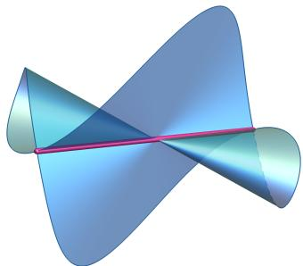  
Figure 6: No proximity bias toward subnetworks of polynomial CNNs.

where $\begin{array} { r } { ( w \star _ { s } h ) [ i ] = \sum _ { i = 1 } ^ { k } w [ j ] h [ s ( i - 1 ) + j ] } \end{array}$ , with one channel and no bias terms. We assume that the activation σ is a generic polynomial of large enough degree depending on L (Shahverdi et al., 2026) such that $\sigma ( 0 ) = 0$ Then the neural model $\mathcal { F } = \{ f _ { \mathbf { w } } \}$ is a semialgebraic subset of a finite-dimensional space H of polynomial maps, which we equip with any inner product. The natural submodels have smaller filters: for integers $0 \le A _ { l } < k _ { l }$ not all $\mathrm { z e r o } , \mathcal { F } _ { \mathbf { A } }$ consists of the functions $f _ { \mathbf { w } }$ such that, for every l, the first or the last $A _ { l }$ entries of $w _ { l }$ vanish.

Proposition C.1. Let F be the neural model of a CNN with a generic polynomial activation σ of large enough degree such that $\sigma ( 0 ) = 0$ , and let ${ \mathcal { F } } ^ { \prime } \subseteq { \mathcal { F } }$ be a semialgebraic subset with dim $\mathcal { F } ^ { \prime } <$ dim ${ \mathcal F } .$ . Then, $\bar { \mathrm { V o r } } _ { \mathcal { F } } ^ { \mathrm { l o c } } ( \bar { \mathcal { F } } ^ { \prime } )$ is contained in a semialgebraic set of dimension at most dim $\mathcal { H } - ( \mathrm { d i m } \mathcal { F } - \mathrm { d i m } \mathcal { F } ^ { \prime } )$ . Therefore, $\mathcal { F }$ exhibits no proximity bias toward any submodel $\mathcal { F } _ { \mathbf { A } }$ with smaller filters, nor toward its singular locus.

Proof. Let $\varphi \colon \mathbb { R } ^ { m }  \mathcal { H } , \ : \mathbf { w } \mapsto f _ { \mathbf { w } } ,$ , be the parametrization and n = dim H. By Shahverdi et al. (2026, Theo rem $4 . 4 ) , d \varphi _ { \bf w }$ is injective whenever $f _ { \mathbf { w } } \neq 0$ , so dim ${ \mathcal { F } } = m$ . We have $N _ { \mathcal { F } } ( f _ { \mathbf { w } } ) \subseteq ( \mathrm { i m } d \varphi _ { \mathbf { w } } ) ^ { \perp }$ , a space of dimension $n - m$ , for every $f _ { \mathbf { w } } \in \mathcal { F } ^ { \prime } \backslash \{ 0 \}$ . Hence, $\begin{array} { r } { \bigcup _ { f \in \mathcal { F } ^ { \prime } \setminus \{ 0 \} } ( f + N _ { \mathcal { F } } ( f ) ) } \end{array}$ ) lies in a semialgebraic set of dimension at most dim ${ \mathcal { F } } ^ { \prime } + n - m$ , by Lemma B.8. At the origin, $t { \mathcal { F } } \subseteq { \mathcal { F } }$ for all $t \in \mathbb { R }$ , so $N _ { \mathcal { F } } ( 0 ) \subseteq ( \operatorname { s p a n } \mathcal { F } ) ^ { \bot }$ , of dimension at most $n - m$ . By Proposition 2.2, $\mathrm { V o r } _ { \mathcal { F } } ^ { \mathrm { l o c } } ( \mathcal { F } ^ { \prime } )$ lies in a semialgebraic set of dimension at most n − (dim $\mathcal { F } - \mathrm { d i m } \mathcal { F } ^ { \prime } ) < n .$ Finally, $\mathcal { F } _ { \mathbf { A } }$ is a finite union of images of coordinate subspaces of dimension $\begin{array} { r } { m - \sum _ { l } A _ { l } < m . } \end{array}$ , and the singular locus of the Zariski closure X of $\mathcal { F }$ is a proper algebraic subset of the irreducible variety $X ,$ so both have dimension less than dim ${ \mathcal F } .$ See Figure 6. □

## D PROOFS OF THE MULTIPLE-TOKEN RESULTS

Throughout this section, assume that $t > 1$ and $d > 1$

## D.1 Lower-rank submodels

Theorem 4.1. Assume $t > 1$ , and $1 < a \leq d .$ Then there is no proximity bias toward $\chi _ { s } ~ f o r$ any $s < a$

We first record the tangent directions available at a rank-deficient attention matrix. Let $D _ { a } = \{ A \in \mathbb { R } ^ { d \times d }$ $\operatorname { r a n k } ( A ) \leq a \}$

Proposition D.1. Suppose that $A \in D _ { a }$ has rank $s < a$ and a decomposition $\begin{array} { r } { A = \sum _ { i = 1 } ^ { s } k _ { i } q _ { i } ^ { \top } } \end{array}$ . Then

$$
T _ { D _ { a } } ( A ) = \left\{ \sum _ { i = 1 } ^ { s } ( \dot { k } _ { i } q _ { i } ^ { \top } + k _ { i } \dot { q } _ { i } ^ { \top } ) + \displaystyle \sum _ { j = 1 } ^ { a - s } u _ { j } v _ { j } ^ { \top } ~ { : } ~ \dot { k } _ { i } , \dot { q } _ { i } , u _ { j } , v _ { j } \in \mathbb { R } ^ { d } \right\} .
$$

Proof. Let ${ \mathcal { R } } _ { s } = \{ A \in \mathbb { R } ^ { d \times d } : \operatorname { r a n k } ( A ) = s \}$ denote the rank-s stratum. By (Olikier et al., 2026, Theorem 4.1), $T _ { D _ { a } } ( A ) = T _ { { \mathcal R } _ { s } } ( A ) + D _ { a - s }$ . Diferentiating $\begin{array} { r } { A = \sum _ { i = 1 } ^ { s } k _ { i } q _ { i } ^ { \top } } \end{array}$ gives $\begin{array} { r } { T _ { \mathcal { R } _ { s } } ( A ) = \{ \sum _ { i } ( \dot { k } _ { i } q _ { i } ^ { \top } + k _ { i } \dot { q } _ { i } ^ { \top } ) \} } \end{array}$ . Since every matrix in $D _ { a - s }$ is a sum of at most $a - s$ rank-one matrices, the result follows. □

The proposition describes the possible first-order variations of the attention matrix A. We now use these variations to obtain tangent directions to $\mathcal { X } _ { a }$ . Let $p = \phi ( A , V )$ , where rank $\operatorname { \Pi } ( A ) = s < a .$ , and let $B \in T _ { D _ { a } } ( A )$

Writing B as in Proposition D.1, define

$$
A ( t ) = \sum _ { i = 1 } ^ { s } ( k _ { i } + t \dot { k } _ { i } ) ( q _ { i } + t \dot { q } _ { i } ) ^ { \top } + t \sum _ { j = 1 } ^ { a - s } u _ { j } v _ { j } ^ { \top } .
$$

Then $A ( t ) \in D _ { a } , A ( 0 ) = A$ , and $A ^ { \prime } ( 0 ) = B$ . For $\dot { V } \in \mathbb { R } ^ { d ^ { \prime } \times d }$ , set $V ( t ) = V + t \dot { V }$ . Diferentiating $\phi ( A ( t ) , V ( t ) )$ at t = 0 gives $\begin{array} { r } { \frac { d } { d t } \phi ( A ( t ) , V ( t ) ) ( X ) | _ { t = 0 } = \dot { V } X X ^ { \top } A X + V X X ^ { \top } B X . } \end{array}$ . Therefore,

$$
T _ { \mathcal { X } _ { a } } ( p ) \supseteq \left\{ \dot { V } X X ^ { \top } A X + V X X ^ { \top } B X : \dot { V } \in \mathbb { R } ^ { d ^ { \prime } \times d } , \ B \in T _ { D _ { a } } ( A ) \right\} .
$$

For $p = \phi ( A , V )$ , define

$$
\mathcal { I } _ { A , V } = \left. \dot { V } X X ^ { \top } A X + V X X ^ { \top } B X : \dot { V } \in \mathbb { R } ^ { d ^ { \prime } \times d } , ~ B \in \mathbb { R } ^ { d \times d } \right. .
$$

Proposition D.2. Let $p = \phi ( A , V )$ , where ran $\mathfrak { s } ( A ) < a$ . Then $N _ { \mathcal { X } _ { a } } ( p ) \subseteq \mathcal { T } _ { A , V } ^ { \perp }$

Proof. Since rank $\operatorname { \Pi } ( A ) = s < a$ , every rank-one matrix B and its negative belong to $D _ { a - s } \subseteq T _ { D _ { a } } ( A )$ . Hence $T _ { \mathcal { X } _ { a } } ( p )$ contains both $V X X ^ { \top } B X$ and $- V X X ^ { \top } B X$ for every rank-one B. Varying V similarly gives both ${ \dot { V } } X X ^ { \top } { \bar { A } } { \bar { X } }$ and $- \dot { V } X X ^ { \top } A X$ for every $\dot { V } .$

If $w \in N _ { \mathscr { X } _ { a } } ( p )$ , every one of these directions is therefore orthogonal to $w .$ Since rank-one matrices span $\mathbb { R } ^ { d \times d }$ , w is orthogonal to all of ${ \mathcal { I } } _ { A , V }$ □

The dimension of the normal cone determines whether a lower-dimensional stratum can exhibit proximity bias. Indeed, if $S \subseteq { \mathcal { X } } _ { a }$ has dimension r and dim $N _ { { \mathcal { X } } _ { a } } ( p ) \leq n - m$ for every $p \in S$ , where n is the ambient dimension, then

$$
\mathrm { d i m } \left( \bigcup _ { p \in { \mathcal { S } } } \left( p + N _ { { \mathcal { X } } _ { a } } ( p ) \right) \right) \leq r + n - m .
$$

Thus, $s$ cannot exhibit proximity bias whenever $r < m$

If $p$ is a smooth point of $\mathcal { X } _ { a }$ , then dim $N _ { \mathcal { X } _ { a } } ( p ) = n - \dim \mathcal { X } _ { a }$ . Hence a proper lower-dimensional submodel cannot exhibit proximity bias through its smooth points. Only points that are singular in $\mathcal { X } _ { a }$ can have suficiently enlarged normal cones to potentially compensate for the lower dimension of the submodel. We show below that the exceptional lower-rank strata still do not have suficiently large normal cones. By Proposition D.2, for a point $p = \phi ( A , V )$ with $\operatorname { r a n k } ( A ) < a$ , it sufices to lower bound dim ${ \mathcal { I } } _ { A , V }$

Lemma D.3. Suppose that $A \neq 0$ and $V \neq 0$ . If there do not exist nonzero vectors $k , q , h$ such that $A = k q ^ { \top }$ and $V = h k ^ { \top }$ , then dim $\mathcal { T } _ { A , V } = d ^ { 2 } + d d ^ { \prime } - 1 . \ I f \ A = k q ^ { \top }$ and $V = h k ^ { \top }$ , then dim $\mathcal { T } _ { A , V } = d ^ { 2 } + d d ^ { \prime } - d .$

Proof. Let $( B , \dot { V } )$ lie in the kernel of the diferential. Since $t > 1$ , comparing terms involving two distinct input columns x and y gives $( { \dot { V } } y ) ( y ^ { \top } A x ) + ( V y ) ( y ^ { \top } B x ) = 0$ for all $x , y \in \mathbb { R } ^ { d }$ . If $v _ { i } ^ { \top }$ and $\dot { v } _ { i } ^ { \top }$ are the ith rows of V and $\dot { V }$ , then $( \dot { v } _ { i } ^ { \top } y ) ( y ^ { \top } A x ) + ( v _ { i } ^ { \top } y ) ( y ^ { \top } B x ) = 0$

Suppose that, for some i and $x ,$ the nonzero linear forms $v _ { i } ^ { \top } y$ and $y ^ { \top } A \mathfrak { z }$ x are not proportional. Since they are relatively prime, the identity implies $\dot { v } _ { i } = - \lambda v _ { i }$ and $B x = \lambda A x$ for some $\lambda \in \mathbb { R }$ . Varying i and x then gives $\dot { V } = - \lambda V$ and $B = \lambda A$ . Thus the kernel is one-dimensional.

Otherwise, every nonzero row of V is proportional to every nonzero vector in $\operatorname { i m } ( A )$ . Hence $A = k q ^ { \top }$ and $V = h k ^ { \top }$ . Substituting and cancelling $k ^ { \top } y$ gives $( q ^ { \top } x ) \dot { V } y + h y ^ { \top } B x = 0$ . Taking $x \in \ker ( q ^ { \top } )$ shows that $B = r q ^ { \top }$ for some $r \in \mathbb { R } ^ { d }$ , and then $\dot { V } = - h \dot { r } ^ { \top }$ . Thus the kernel is d-dimensional. □

For $s < a ,$ , let $\mathcal U _ { s } \subseteq \mathcal X _ { s } \setminus \mathcal X _ { s - 1 }$ be the set of points p admitting a rank-s parametrization $p = \phi ( A , V )$ such that dim $\mathcal { T } _ { A , V } = d ^ { 2 } + d d ^ { \prime } - 1 = \dim \mathcal { X } _ { d }$

Proposition D.4. There is no proximity bias toward $\mathcal { U } _ { s }$ in $\mathcal { X } _ { a }$ .

Proof. Let n denote the ambient dimension. For every $p \in \mathcal { U } _ { s }$ , Proposition D.2 gives dim $N _ { \mathcal { X } _ { a } } ( p ) \leq n - \dim \mathcal { X } _ { d } .$ Therefore

$$
\dim \left( \bigcup _ { p \in \mathcal { U } _ { s } } ( p + N _ { \mathcal { X } _ { a } } ( p ) ) \right) \leq \dim \mathcal { U } _ { s } + n - \dim \mathcal { X } _ { d } \leq \dim \mathcal { X } _ { s } + n - \dim \mathcal { X } _ { d } = n - ( d - s ) ^ { 2 } < n ,
$$

where we used (Henry et al., 2025) to obtain dim $\mathcal { X } _ { s } = 2 s d + d d ^ { \prime } - s ^ { 2 } - 1$ and dim $\mathcal { X } _ { d } = d ^ { 2 } + d d ^ { \prime } - 1$ . Thus, there is no proximity bias toward $\mathcal { U } _ { s }$ by Proposition 2.2. □

For $s \geq 2$ , Lemma D.3 shows that $\mathcal { U } _ { s } = \mathcal { X } _ { s } \ \backslash \ \mathcal { X } _ { s - 1 }$ . For $s = 1$ , the only points not covered by Proposition D.4 are contained in

$$
Y = \{ \phi ( k q ^ { \top } , h k ^ { \top } ) : k , q \in \mathbb { R } ^ { d } \setminus \{ 0 \} , \ h \in \mathbb { R } ^ { d ^ { \prime } } \setminus \{ 0 \} \} .\tag{1}
$$

Proposition D.5. Suppose that $a > 1$ . There is no proximity bias toward Y in $\mathcal { X } _ { a }$

Proof. We have dim $Y \leq d ^ { \prime } + 2 d - 2$ , by counting $k , q , h$ and subtracting the two scaling symmetries. By Lemma D.3, dim $\mathcal { T } _ { A , V } = d ^ { 2 } + d d ^ { \prime } - d$ at a parametrization $A = k q ^ { \top } , V = h k ^ { \top }$ . Hence Proposition D.2 gives dim $N _ { { \mathcal { X } } _ { a } } ( p ) \leq n - ( d ^ { 2 } + d d ^ { \prime } - d )$ for $p \in Y$ . Therefore

$$
\dim \left( \bigcup _ { p \in Y } ( p + N _ { { \mathcal X } _ { a } } ( p ) ) \right) \leq n - ( d - 1 ) ( d + d ^ { \prime } - 2 ) < n .
$$

Thus the union of the corresponding translated normal cones is not full-dimensional, so there is no proximity bias toward $Y .$ □

Proof of Theorem 4.1. Proposition D.4 and Proposition D.5 show there is no proximity bias toward any nonzero rank-exactly-r stratum with $r < a$ . At the origin, since $\mathcal { X } _ { a }$ is a cone and $\mathcal { X } _ { a } = - \mathcal { X } _ { a } .$ , we have $N _ { \mathcal { X } _ { a } } ( 0 ) = \operatorname { s p a n } ( \mathcal { X } _ { a } ) ^ { \bot }$ which is a proper linear subspace of the ambient space. Hence there is no proximity bias toward the origin. Since each $\mathcal { X } _ { s }$ with $s < a$ is the finite union of the origin and the rank-r strata with $r \leq s ,$ there is no proximity bias toward $\mathcal { X } _ { s }$ □

## D.2 Singular loci

For the algebraic analysis in this subsection, we work over C. Let $D _ { a } ^ { \mathbb { C } } = \{ A \in \mathbb { C } ^ { d \times d } : \operatorname { r a n k } ( A ) \leq a \}$ , let $\mathcal { X } _ { a } ^ { \mathbb { C } }$ denote the complexification of $\mathcal { X } _ { a }$ , and let $\mathbb { P } ( \mathcal { X } _ { a } ^ { \mathbb { C } } )$ denote its projectivization. We also set

$$
Z ^ { \mathbb { C } } = \{ \phi ( A , V ) : A \in \mathbb { C } ^ { d \times d } , V \in \mathbb { C } ^ { d ^ { \prime } \times d } , \mathrm { \ r a n k } ( A ) = \mathrm { r a n k } ( V ) = 1 \} .
$$

Lemma D.6. Assume that either $a > 1$ or $d ^ { \prime } > 1$ . Then

$$
\operatorname { S i n g } \bigl ( \mathbb { P } ( \mathcal { X } _ { a } ^ { \mathbb { C } } ) \bigr ) = \left\{ \begin{array} { l l } { \mathbb { P } ( \mathcal { X } _ { a - 1 } ^ { \mathbb { C } } ) , } & { 1 < a < d , } \\ { \mathbb { P } ( Z ^ { \mathbb { C } } ) , } & { a = d \ o r ( a = 1 , \ d ^ { \prime } > 1 ) . } \end{array} \right.
$$

We first establish the finite-birational statement used in the proof.

Proposition D.7. The projectivized parametrization $\overline { { \phi } } : \mathbb { P } ( D _ { a } ^ { \mathbb { C } } ) \times \mathbb { P } ( \mathbb { C } ^ { d ^ { \prime } \times d } ) \longrightarrow \mathbb { P } ( \mathcal { X } _ { a } ^ { \mathbb { C } } )$ has finite fibers. It is birational when $a > 1$ , and also when $a = 1$ and $d ^ { \prime } > 1$ . When $a = d ^ { \prime } = 1$ , it is generically two-to-one.

Proof. Suppose that $\phi ( A , V ) = \phi ( A ^ { \prime } , V ^ { \prime } )$ . Since $t > 1$ , comparing terms involving two distinct input columns gives $( v _ { i } ^ { \top } y ) ( y ^ { \top } A x ) = ( v _ { i } ^ { \prime \top } y ) ( y ^ { \top } A ^ { \prime } x )$ for every row i and all $x , y \in \mathbb { C } ^ { d }$ . If rank(A) > 1, the bilinear form $y ^ { \top }$ Ax is irreducible. Unique factorization therefore gives $A ^ { \prime } = \lambda A$ and $V ^ { \prime } = \lambda ^ { - 1 } V$ , so the projective fiber is a singleton.

Suppose now that rank $\boldsymbol { \cdot } ( \boldsymbol { A } ) = 1$ and write $A = k q ^ { \top }$ . Unique factorization first gives $A ^ { \prime } = k ^ { \prime } q ^ { \intercal }$ , up to scaling, and then $( v _ { i } ^ { \top } y ) ( k ^ { \top } y ) = ( \check { v } _ { i } ^ { \prime \top } y ) ( k ^ { \prime \top } y )$ . If $\operatorname { r a n k } ( V ) > 1$ , two nonproportional rows of V determine the common factor $k ^ { \top } y$ , so the projective fiber is again a singleton.

Finally, if ran $\operatorname { k } ( V ) = 1$ , write $V = h \boldsymbol { v } ^ { \intercal }$ . Up to scaling, the only possibilities are $( A ^ { \prime } , V ^ { \prime } ) = ( k q ^ { \top } , h v ^ { \top } )$ or $( A ^ { \prime } , V ^ { \prime } ) = ( v q ^ { \top } , h k ^ { \top } )$ . Thus every projective fiber contains at most two points. Since the source is projective, the map is proper; finite fibers therefore imply that it is finite.

If $a > 1$ , a general $A \in D _ { a } ^ { \mathbb { C } }$ has rank greater than one, so the general fiber is a singleton. If $a = 1$ and $d ^ { \prime } > 1$ a general V has rank greater than one, so again the general fiber is a singleton. Hence the map is birational in these cases. If $a = d ^ { \prime } = 1$ , then for general nonproportional k and v the two projective preimages above are distinct, so the map is generically two-to-one. □

We also recall the following standard criterion. It is stated in this form in (Kohn et al., 2017, Lemma 3.2); see also (Harris, 1992, Theorem 14.9) for the classical criterion for finite morphisms underlying the result.

Lemma D.8. Let $f : X \to Y$ be a finite birational surjective morphism between irreducible projective varieties. Then Y is smooth at y if and only if $f ^ { - 1 } ( y )$ consists of a single point $x ,$ the variety X is smooth at $x ,$ and $d _ { x } f$ is injective.

Proof of Lemma D.6. Suppose first that $1 < a < d .$ . If $p \in \mathbb { P } ( \mathcal { X } _ { a - 1 } ^ { \mathbb { C } } )$ , then p has a preimage with $\operatorname { r a n k } ( A ) < a$ Since Sing $\mathbf { \Phi } ^ { \prime } D _ { a } ^ { \mathbb { C } } ) = D _ { a - 1 } ^ { \mathbb { C } }$ , the source is singular at this preimage. Hence p is singular by Lemma D.8.

Conversely, let $p \notin \mathbb { P } ( \mathcal { X } _ { a - 1 } ^ { \mathbb { C } } )$ . Its unique projective preimage has rank $\operatorname { \mathrm { \Omega } } ( A ) = a > 1$ by Proposition D.7, and the source is smooth there. The proof of Lemma D.3 is algebraic and applies over $\mathbb { C } ;$ since rank $\operatorname { \partial } ( A ) > 1$ , its afine kernel consists only of the scaling direction. Thus the projective diferential is injective, and $p$ is smooth by Lemma D.8. Therefore Sing $\bigl ( \mathbb { P } ( \mathcal { X } _ { a } ^ { \bar { \mathbb { C } } } ) \bigr ) = \mathbb { P } ( \mathcal { X } _ { a - 1 } ^ { \mathbb { C } } )$

Now suppose that $a = d .$ . The parameter space $D _ { d } ^ { \mathbb { C } }$ is smooth. Let $p \in \mathbb { P } ( Z ^ { \mathbb { C } } )$ , with $A = k q ^ { \top }$ and $V = h v ^ { \top }$ . If k and v are not proportional, Proposition D.7 gives two distinct projective preimages. If k and v are proportional, the fiber is a singleton, but Lemma D.3 gives a d-dimensional afine kernel, so the projective diferential is not injective. Thus p is singular in either case.

If $p \notin \mathbb { P } ( Z ^ { \mathbb { C } } )$ , its projective fiber is a singleton and the exceptional case in Lemma D.3 does not occur. The source is smooth and the projective diferential is injective, so p is smooth. Therefore Sing $\big ( \mathbb { P } ( \mathcal { X } _ { d } ^ { \mathbb { C } } ) \big ) = \mathbb { P } ( Z ^ { \mathbb { C } } )$ .

Finally, suppose that $a = 1$ and $d ^ { \prime } > 1$ . The projective determinantal variety $\mathbb { P } ( D _ { 1 } ^ { \mathbb { C } } )$ is smooth, and Proposi tion D.7 shows that the projectivized parametrization is finite and birational.

Let $p \in \mathbb { P } ( Z ^ { \mathbb { C } } )$ and write $A = k q ^ { \top } , V = h v ^ { \top }$ . If k and v are not proportional, the fiber contains the two distinct projective points obtained by exchanging k and v. If they are proportional, the fiber is a singleton, but Lemma D.3 gives a d-dimensional afine kernel. Thus p is singular.

Conversely, if $p \notin \mathbb { P } ( Z ^ { \mathbb { C } } )$ , then $\operatorname { r a n k } ( V ) > 1$ . The projective fiber is a singleton and the afine kernel of the diferential is only the scaling direction. Hence p is smooth, and Sing $\big ( \mathbb { P } ( \mathcal { X } _ { 1 } ^ { \mathbb { C } } ) \big ) = \mathbb { P } ( Z ^ { \mathbb { C } } )$ □

The work of (Henry et al., 2025) characterizes the nontrivial fibers and critical points of the attention parametrization, which account for two possible sources of singularities. When $a < d ,$ there is an additional source: the parameter space $D _ { a } ^ { \mathbb { C } }$ is itself singular, with $\mathrm { S i n g } ( D _ { a } ^ { \mathbb { C } } ) = D _ { a - 1 } ^ { \mathbb { C } }$ . Together with the fiber and diferential analysis above, this gives the singular-locus description in Lemma D.6.

For $1 < a < d _ { \colon }$ the corresponding real singular locus is $\mathcal { X } _ { a - 1 }$ , while for $a = d$ it is contained in $\mathcal { X } _ { 1 }$ . Thus, in both cases, the absence of proximity bias toward the real singular locus follows from Theorem 4.1. When $a = 1$ and $d ^ { \prime } > 1$ , the nonzero real singular locus is the real counterpart $Z$ of $Z ^ { \mathbb { C } }$ ; the absence of proximity bias toward this locus is proved next.

## D.3 The rank-one model with $d ^ { \prime } > 1$

Proposition 4.2. Assume that $t > 1 , d > 1 , a = 1$ , and $d ^ { \prime } > 1$ . Then there is no proximity bias toward the real singular locus of $\mathcal { X } _ { 1 }$

Proof of Proposition 4.2. Since $a = 1$ , the projective determinantal variety $\mathbb { P } ( D _ { 1 } ^ { \mathbb { C } } )$ is smooth, and hence so is the source of the projectivized parametrization. Proposition D.7 shows that the projectivized parametrization is finite and birational.

Let $p \in \mathbb { P } ( Z ^ { \mathbb { C } } )$ and write $A = k q ^ { \top } , V = h v ^ { \top }$ . If k and v are not proportional, the fiber contains the two distinct projective points obtained by exchanging k and v. If they are proportional, the fiber is a singleton, but Lemma D.3 gives a d-dimensional afine kernel. Since $d > 1$ , the projective diferential is therefore not injective. Thus $p$ is singular by Lemma D.8.

Conversely, if $p \notin \mathbb { P } ( Z ^ { \mathbb { C } } )$ , then rank $( V ) > 1$ . The projective fiber is a singleton and the afine kernel of the diferential is only the scaling direction, so the projective diferential is injective. Hence $p$ is smooth, and $\mathrm { S i n g } ( \mathbb { P } ( \mathcal { X } _ { 1 } ^ { \mathbb { C } } ) ) = \mathbb { P } ( Z ^ { \mathbb { C } } )$

We now return to the real model. Let Z denote the real counterpart of $Z ^ { \mathbb { C } }$ and retain the locus Y defined in Equation 1. For any real preimage $( A , V )$ of $p ,$ the image of the diferential restricted to $T _ { D _ { 1 } } ( A ) \times \mathbb { R } ^ { d ^ { \prime } \times d }$ is contained in $T _ { \mathcal { X } _ { 1 } } ( p )$ . Consequently,

$$
N _ { \mathcal { X } _ { 1 } } ( p ) \subseteq \mathrm { i m } \left( d \phi \vert _ { { T _ { D _ { 1 } } ( A ) \times \mathbb { R } ^ { d ^ { \prime } \times d } } } \right) ^ { \perp } .
$$

At a point $p \in Z \backslash Y$ , choose a parametrization with $A = k q ^ { \top }$ and $V = h v ^ { \top }$ , where v is not proportional to $k .$ The tangent space of $D _ { 1 }$ at A has dimension $2 d - 1$ , and the restricted diferential has only the one-dimensional scaling kernel. Its image therefore has dimension $2 d + d d ^ { \prime } - 2 = \dim \chi _ { 1 }$ . Since dim $Z = 3 d + d ^ { \prime } - 3$ 2

$$
\dim \left( \bigcup _ { p \in Z \backslash Y } ( p + N _ { X _ { 1 } } ( p ) ) \right) \leq 3 d + d ^ { \prime } - 3 + n - ( 2 d + d d ^ { \prime } - 2 ) = n - ( d - 1 ) ( d ^ { \prime } - 1 ) < n .
$$

For $p \in Y$ , the d-dimensional kernel from Lemma D.3 lies in $T _ { D _ { 1 } } ( A ) \times \mathbb { R } ^ { d ^ { \prime } \times d }$ . Hence the restricted diferentia has rank $d + d d ^ { \prime } - 1$ . Since dim $Y \leq d ^ { \prime } + 2 d - 2$

$$
\mathrm { d i m } \left( \bigcup _ { p \in Y } \left( p + N _ { \mathcal { X } _ { 1 } } ( p ) \right) \right) \leq d ^ { \prime } + 2 d - 2 + n - ( d + d d ^ { \prime } - 1 ) = n - ( d - 1 ) ( d ^ { \prime } - 1 ) < n .
$$

Finally, since $\mathcal { X } _ { 1 }$ is a symmetric cone, we get $N _ { \mathcal { X } _ { 1 } } ( 0 ) = \operatorname { s p a n } ( \mathcal { X } _ { 1 } ) ^ { \bot }$ , which is a proper linear subspace. Thus the union of the translated normal cones over the real singular locus is not full-dimensional, so there is no proximity bias toward the real singular locus. □

## D.4 The scalar-output rank-one model

When $d ^ { \prime } = 1$ , the dimension-counting argument of the previous subsection no longer rules out proximity bias: the upper bounds there become $n - ( d - 1 ) ( d ^ { \prime } - 1 ) = n$ . Moreover, in this case the parametrization is generically two to-one due to the symmetry exchanging k and $v ,$ and at the locus where k and v are proportional its diferential has a d-dimensional kernel. Thus these parameters do not $\mathrm { g i }$ ve local coordinates on the model at the points of interest. We therefore introduce an injective parametrization that removes this symmetry. Write

$$
\psi ( q , S ) ( X ) = \left( \sum _ { j = 1 } ^ { t } x _ { j } ^ { \top } S x _ { j } \right) q ^ { \top } X ,
$$

and define $U = \{ \psi ( q , S ) : q \in \mathbb { R } ^ { d }$ , rank $( S ) \leq 1 \}$ and $U ^ { \mathbb { C } } = \{ \psi ( q , S ) : q \in \mathbb { C } ^ { d }$ , rank $\left( S \right) \leq 1 \}$

Theorem 4.3. Assume $t > 1 , a = d ^ { \prime } = 1$ , and $d > 1$ . There is proximity bias toward U. $I f d > 2 , U$ is both the real singular locus of $\mathcal { X } _ { 1 }$ and a boundary of the real model. $I f d = 2 , U$ is a boundary of the real model.

Figure 4 illustrates the two geometric regimes in the smallest cases $d = 2$ and $d = 3$ . As shown in Lemma D.9, the map $q \otimes S \mapsto \psi ( q , S )$ is injective for $t > 1$ , so these low-dimensional slices faithfully represent the corresponding geometry of $\mathcal { X } _ { 1 }$ . For $d = 2 .$ , the locus U lies on the boundary of the real model despite the algebraic model being smooth, whereas for $d = 3$ it appears as a singular locus.

Lemma D.9. Suppose that $a = d ^ { \prime } = 1$ . Write $A = k q ^ { \top } , V = v ^ { \top }$ , and set $S = ( v k ^ { \top } + k v ^ { \top } ) / 2$ . Then $\phi ( A , V ) = \psi ( q , S )$

For $\mathbb { F } = \mathbb { R } o r \mathbb { C } .$ , the map $q \otimes S \mapsto \psi ( q , S )$ is an injective linear map from $\mathbb { F } ^ { d } \otimes S ^ { 2 } ( \mathbb { F } ^ { d } )$ into the ambient function space. $O v e r \mathbb { C }$ , the matrices $S$ arising in this way are exactly the symmetric matrices of rank at most two. Over R, they are exactly the symmetric matrices having at most one positive and at most one negative eigenvalue.

Proof. The formula for $\phi$ follows from $\begin{array} { r } { \boldsymbol { v } ^ { \top } \boldsymbol { X } \boldsymbol { X } ^ { \top } \boldsymbol { k } = \sum _ { i } ( \boldsymbol { v } ^ { \top } \boldsymbol { x } _ { j } ) ( \boldsymbol { k } ^ { \top } \boldsymbol { x } _ { j } ) } \end{array}$

For injectivity, consider two distinct tokens. In the output coordinate corresponding to the first token, the terms linear in $x _ { 1 }$ and quadratic in $x _ { 2 }$ are $( q ^ { \top } x _ { 1 } ) ( x _ { 2 } ^ { \top } S x _ { 2 } )$ , whose coeficients recover $q \otimes S$

Clearly ran $\mathfrak { c } ( S ) ~ \le ~ 2$ . Conversely, over $\mathbb { C } ,$ every symmetric matrix of rank at most two can be written as $\boldsymbol { S } = u \boldsymbol { u } ^ { \intercal } + w \boldsymbol { w } ^ { \intercal }$ . Taking $v = u + i w$ and $k = u - i w$ gives $S = ( v k ^ { \top } + k v ^ { \top } ) / 2$

Over R, set $p = ( v + k ) / 2$ and $r = ( v - k ) / 2$ . Then $S = p p ^ { \top } - r r ^ { \top }$ , so S has at most one positive and at most one negative eigenvalue. Conversely, every symmetric matrix with this property can be written as $p p ^ { \top } - r r ^ { \top }$ , and hence arises from $v = p + r$ and $k = p - r$ □

Set ${ \mathcal { D } } _ { 2 } ^ { \mathrm { s y m } } = \{ S \in S ^ { 2 } ( \mathbb { C } ^ { d } ) : \operatorname { r a n k } ( S ) \leq 2 \}$ . By Lemma $\mathrm { D } . 9 , \mathbb { P } ( \mathcal { X } _ { 1 } ^ { \mathbb { C } } )$ is linearly isomorphic to the Segre embedding of $\bar { \mathbb { P } ^ { d - 1 } } \times \bar { \mathbb { P } } ( \mathbf { \tilde { D } _ { 2 } ^ { s y m } } )$

Lemma D.10. $I f d > 2$ , then the singular locus $o f \mathbb { P } ( \mathcal { D } _ { 2 } ^ { \mathrm { s y m } } )$ is its rank-one locus. $I f d = 2 , \mathbb { P } ( \mathcal { D } _ { 2 } ^ { \mathrm { s y m } } )$ is smooth.

Proof. If $d = 2 .$ , every symmetric matrix has rank at most two, so ${ \mathcal { D } } _ { 2 } ^ { \mathrm { s y m } } = { S ^ { 2 } } { ( \mathbb { C } ^ { 2 } ) }$ . Suppose that $d > 2$ . At a rank-two matrix $S _ { ; }$ choose coordinates with $\begin{array} { r } { S = \left( \begin{array} { c c } { S _ { 0 } } & { 0 } \\ { 0 } & { 0 } \end{array} \right) } \end{array}$ , where $S _ { 0 }$ is invertible. A nearby symmetric matrix can be written as $\left( \begin{array} { c } { { P _ { } } } \\ { { Q ^ { \top } } } \end{array} \right)$ . Since $P$ remains invertible, the rank-at-most-two condition is locally equivalent to $R = Q ^ { \top } P ^ { - 1 } Q .$ . Hence the variety is smooth at S. The variety is defined by its $3 \times 3$ minors. At a matrix of rank at most one, the diferential of every such minor vanishes, since every partial derivative is a $2 \times 2$ minor. Thus the Zariski tangent space is the full ambient space. Since $\mathcal { D } _ { 2 } ^ { \mathrm { s y m } }$ is proper for $d > 2$ , every projective rank-one point is singular. □

We now return to the real model. Let

${ \mathcal { R } } _ { 1 } = \{ S \in S ^ { 2 } ( \mathbb { R } ^ { d } ) : S$ has at most one positive and at most one negative eigenvalue}.

By Lemma D $\rangle . 9 , \mathcal { X } _ { 1 } = \{ \psi ( q , S ) : q \in \mathbb { R } ^ { d } , \ S \in \mathcal { R } _ { 1 } \}$

Lemma D.11. Let $S \in \mathcal { R } _ { 1 }$ be positive semidefinite of rank one and $K = \ker ( S )$ , so dim $K = d - 1$ . Since $K ^ { \perp }$ is one-dimensional, with respect to $\mathbb { R } ^ { d } = K ^ { \bot } \oplus K$ write

$$
S = \binom { s _ { 0 } } { 0 } , \qquad s _ { 0 } > 0 .
$$

$I f B _ { 2 2 }$ denotes the $K \times K$ block of B, then

$$
T _ { \mathcal { R } _ { 1 } } ( S ) = \{ B : B _ { 2 2 } \preceq 0 , { \mathrm { ~ r a n k } } ( B _ { 2 2 } ) \leq 1 \} ,
$$

and

$$
N _ { \mathcal { R } _ { 1 } } ( S ) = \{ W : W = P _ { K } W P _ { K } , W | _ { K } \succeq 0 \} .
$$

Proof. Write a nearby matrix as $S ^ { \prime } = \left( { \begin{array} { c } { P } \\ { Q ^ { \top } } \end{array} } _ { R } ^ { Q } \right)$ . Since $s _ { 0 } > 0$ , the block P remains positive. By the Schur complement formula, the remaining positive and negative eigenvalues of $S ^ { \prime }$ are those of $C = R - Q ^ { \top } P ^ { - 1 } Q$ Since $S ^ { \prime } \in \mathcal { R } _ { 1 }$ , the matrix C must be negative semidefinite and have rank at most one. Taking first-order terms gives $B _ { 2 2 } \preceq 0$ and rank $( B _ { 2 2 } ) \leq 1$

Conversely, if $B _ { 2 2 }$ satisfies these conditions, then

$$
S ( t ) = \binom { s _ { 0 } + t B _ { 1 1 } } { t B _ { 1 2 } ^ { \top } } \quad t B _ { 2 2 } + t ^ { 2 } B _ { 1 2 } ^ { \top } ( s _ { 0 } + t B _ { 1 1 } ) ^ { - 1 } B _ { 1 2 } \bigg )
$$

lies in $\mathcal { R } _ { 1 }$ for small $t > 0$ and has derivative $B$ at zero.

For the normal cone, the $B _ { 1 1 }$ and $B _ { 1 2 }$ blocks vary with both signs, so a normal vector must be supported on $K .$ The remaining tangent directions contain $B _ { 2 2 } = - z z ^ { \top }$ for every $z \in K$ . Polarity therefore gives $W | _ { K } \succeq 0$ □

Proposition D.12. The union of the Voronoi cells of points in U contains a nonempty open subset of the ambient space; that is, int $\begin{array} { r } { \left( \bigcup _ { p \in U } \operatorname { V o r } _ { \mathcal { X } _ { 1 } } ( p ) \right) \neq \emptyset } \end{array}$ . Hence there is proximity bias toward U.

Proof. The proof proceeds in three steps. First, fix $p = \psi ( q , S ) \in U \backslash 0$ with $S \succeq 0$ of rank one and let $K = \ker ( S )$ For nearby points of $\mathcal { X } _ { 1 }$ , the $K \times K$ block of the Schur complement is negative semidefinite; pairing it with a positive definite matrix W supported on $K$ produces directions w such that $p + w \in \mathrm { V o r } _ { \mathcal { X } _ { 1 } } ( p )$ . Second, we show that, as W varies, these directions fill an open subset of the normal space $T _ { U } ( p ) ^ { \perp }$ . Finally, allowing p to vary in $U$ and applying the inverse function theorem to $( p , w ) \mapsto p + w$ , we show that the corresponding Voronoi cells sweep out a nonempty open subset of the ambient space.

Consider the unrestricted symmetric model $\widetilde { X } \ = \ \{ \psi ( q , S ) : q \in \mathbb { R } ^ { d } , \ S \in S ^ { 2 } ( \mathbb { R } ^ { d } ) \}$ . At a nonzero pair $( q , S )$ the kernel of $d \psi _ { ( q , S ) }$ is the one-dimensional scaling direction $( q , - S )$ . Thus, after fixing the scaling locally, $( q , S ) \mapsto \psi ( q , S )$ is a local difeomorphism onto $\widetilde { X }$

Fix $p \in U \backslash \{ 0 \}$ and write $p = \psi ( q , S )$ with $q \neq 0$ and $S \succeq 0$ of rank one. Let $K = \ker ( S )$ and choose $W \in S ^ { 2 } ( \mathbb { R } ^ { d } )$ supported on K with $W | _ { K } \succ 0$ . There is a unique vector $w _ { W } \in T _ { \widetilde { X } } ( p )$ satisfying $\langle w _ { W } , d \psi _ { ( q , S ) } ( \dot { q } , B ) \rangle = \langle W , B \rangle$ Indeed, the right-hand side vanishes on the scaling direction since $\langle \bar { W } , S \rangle = 0$

We show that, for suficiently small perturbations w of wW in the directions normal to $\widetilde { X }$ , the point $p + w$ belongs to $\mathrm { V o r } _ { \mathcal { X } _ { 1 } } ( p )$ . Let $x = \psi ( q ^ { \prime } , S ^ { \prime } ) \in \mathcal { X } _ { 1 }$ be suficiently close to $p ,$ with $( q ^ { \prime } , S ^ { \prime } )$ chosen close to $( q , S )$ . With respect to $K ^ { \perp } \oplus K$ , write

$$
S ^ { \prime } = \left( { \underset { Q ^ { \top } } { P } } \quad { \underset { R } { Q } } \right) .
$$

Since $S ^ { \prime } \in \mathcal { R } _ { 1 }$ and $P > 0$ , its Schur complement $C = R - Q ^ { \top } P ^ { - 1 } Q$ satisfies $C \preceq 0$ . Hence

$$
\langle W , S ^ { \prime } - S \rangle = \langle W , C \rangle + \langle W , Q ^ { \top } P ^ { - 1 } Q \rangle \leq c _ { 0 } \| S ^ { \prime } - S \| ^ { 2 }
$$

for some $c _ { 0 } > 0$ . Taylor expansion of $\psi$ and the local inverse then give $\langle w _ { W } , x - p \rangle \leq c \| x - p \| ^ { 2 }$ for all $x \in \mathcal { X } _ { 1 }$ suficiently close to p. The same estimate holds for $w = w _ { W } + \eta .$ , with $\eta \in T _ { \widetilde { X } } ( p ) ^ { \bot }$ , since $\widetilde { X }$ is smooth at $p$ and hence $\langle \eta , x - p \rangle = O ( \| x - p \| ^ { 2 } )$ . Therefore, for suficiently small such w and every $x \in \mathcal { X } _ { 1 } \setminus \{ p \}$ suficiently close to $p ,$ we get

$$
\| x - ( p + w ) \| ^ { 2 } - \| p - ( p + w ) \| ^ { 2 } = \| x - p \| ^ { 2 } - 2 \langle w , x - p \rangle > 0 .
$$

For suficiently small $w ,$ points of $\mathcal { X } _ { 1 }$ outside a fixed neighborhood of $p$ are also farther from $p + w$ than $p .$ Thus $p + w \in \operatorname { V o r } _ { \mathcal { X } _ { 1 } } ( p )$

It remains to show that these subsets of the Voronoi cells sweep out an open subset of the ambient space as $p$ varies in $U \backslash \{ 0 \}$ . Since dim $S ^ { 2 } ( \mathbb { R } ^ { d } ) = { \binom { d + 1 } { 2 } }$ , we have dim $\overset { \sim } { X } = \overset { \cdot } { d } + \overset { ( d + 1 ) } { 2 } - 1$ and dim $U = 2 d - 1$ . Therefore

$$
\mathrm { c o d i m } _ { \tilde { X } } ( U ) = \binom { d + 1 } { 2 } - d = \binom { d } { 2 } = \dim S ^ { 2 } ( K ) .
$$

The map $W \mapsto w _ { W }$ is injective and tangent directions to U have zero $K \times K$ block, so w ${ \bf \Gamma } _ { V } \in T _ { U } ( p ) ^ { \perp } \cap T _ { \widetilde { X } } ( p )$ The dimension equality above therefore implies that, as W varies, the vectors $w _ { W }$ fill $T _ { U } ( p ) ^ { \perp } \cap T _ { \widetilde { X } } ( p )$ . Allowing $\eta \in T _ { \widetilde { X } } ( p ) ^ { \bot }$ gives all of $T _ { U } ( p ) ^ { \perp }$

Since the condition $W | _ { K } \succ 0$ is open, the preceding construction gives an open subset of the normal bundle of $U \backslash \{ 0 \}$ consisting of suficiently small vectors w such that $p + w \in \operatorname { V o r } _ { \mathcal { X } _ { 1 } } ( p )$ . Consider the addition map $\Theta ( p , w ) = p + w$ . Along the zero section, $d \Theta _ { ( p , 0 ) } ( v , \xi ) = v + \xi ,$ which is an isomorphism since $T _ { U } ( p ) \oplus T _ { U } ( p ) ^ { \perp }$ is the ambient space. Hence dΘ remains invertible at suficiently small admissible nonzero vectors. By the inverse function theorem, the image of these vectors contains a nonempty open subset of the ambient space. Since every point in this image belongs to $\operatorname { V o r } _ { \mathcal { X } _ { 1 } } ( p )$ for some $p \in U$ , we obtain int $\begin{array} { r } { \left( \bigcup _ { p \in U } \operatorname { V o r } _ { \mathcal { X } _ { 1 } } ( p ) \right) \neq \emptyset } \end{array}$ □

Proof of Theorem 4.3. By Lemma $\mathrm { D } . 9 , \mathbb { P } ( \mathcal { X } _ { 1 } ^ { \mathbb { C } } )$ is linearly isomorphic to the Segre embedding of $\mathbb { P } ^ { d - 1 } \times \mathbb { P } ( \mathcal { D } _ { 2 } ^ { \mathrm { s y m } } )$ If $d > 2$ , Lemma D.10 shows that the singular locus is exactly the image of the rank-one locus in $\mathcal { D } _ { 2 } ^ { \mathrm { s y m } }$ , namely $\mathbb { P } ( U ^ { \mathbb { C } } )$ . If $d = 2$ , then ${ \mathcal { D } } _ { 2 } ^ { \mathrm { s y m } } = S ^ { 2 } ( \mathbb { C } ^ { 2 } )$ , so $\mathbb { P } ( \mathcal { X } _ { 1 } ^ { \mathbb { C } } )$ is smooth.

Over R, the model is parametrized by $S \in \mathcal { R } _ { 1 }$ . At every positive semidefinite rank-one matrix, Lemma D.11 gives a nontrivial one-sided normal cone, so these points lie on the boundary of the real model. Replacing S by $- S$ gives the same conclusion for the negative semidefinite rank-one matrices. Thus the nonzero locus U is a boundary of the real model. Finally, Proposition D.12 gives proximity bias toward $U$ □

## E PROOFS OF THE SINGLE-TOKEN RESULTS

Throughout this section, assume that $t \ = \ 1$ . Writing $S \ = \ { \textstyle { \frac { 1 } { 2 } } } ( A + A ^ { \top } )$ , the attention map takes the form $\psi ( S , V ) ( x ) = ( V x ) ( x ^ { \top } S x )$

Theorem 4.4. Assume that $t = 1$

1. If $a = d > 1$ and $d ^ { \prime } > 1$ , then

$$
\operatorname { S i n g } \left( \mathbb { P } ( \mathcal { X } _ { d } ^ { \mathbb { C } } ) \right) = \mathbb { P } \left( \left\{ \psi ( S , V ) : \operatorname { r a n k } ( V ) = 1 , \right\} \right) ,
$$

and there is no proximity bias toward the corresponding real singular locus.

2. If $a > 1$ and $2 a < d ,$ then

$$
\operatorname { S i n g } \big ( \mathbb { P } ( \mathcal { X } _ { a } ^ { \mathbb { C } } ) \big ) = \mathbb { P } \big ( \{ \psi ( S , V ) : \operatorname { r a n k } ( S ) \leq 2 a - 1 \} \big ) .
$$

The real model $\mathcal { X } _ { a }$ exhibits proximity bias toward the rank- $( 2 a - 1 )$ stratum U where $S$ has inertia $( a , a -$ $1 , d - 2 a + 1 )$

## E.1 Factorization singularities

The main diference from the multiple-token case is that the relevant factor is now the quadratic form $Q _ { S } ( x ) =$ $x ^ { \top } S x$

Lemma E.1. Let $S \in S ^ { 2 } ( \mathbb { C } ^ { d } )$ . The quadratic form $Q _ { S }$ is reducible if and only if rank $( S ) \le 2$

Every nonzero projective fiber of ψ is finite. Moreover, the projective fiber is a singleton unless rank $( V ) = 1$ and rank $\left( S \right) \leq 2$ . I $f V = h v ^ { \top }$ , the diferential drops rank precisely when $v ^ { \top } x$ divides $Q _ { S } ( x )$ . In that case the afine kernel has dimension $d ;$ otherwise it consists only of the scaling direction.

Proof. A quadratic form over C factors into two linear forms precisely when its symmetric matrix has rank at most two. Now suppose $\psi ( S , V ) = \psi ( S ^ { \prime } , V ^ { \prime } ) \neq 0$ . If $\operatorname { r a n k } ( V ) > 1$ , two nonproportional rows of $V ,$ , together with unique factorization, determine $Q _ { S }$ and hence $( S , V )$ up to scaling. If rank $( V ) = 1$ , write $V = h v ^ { \top }$ . When $Q _ { S }$ is irreducible, unique factorization again gives only the scaling ambiguity. Thus nontrivial fibers can occur only when rank $( V ) = 1$ and $\operatorname { r a n k } ( S ) \leq 2$ . When rank $( V ) = 1$ and $Q _ { S }$ is reducible, unique factorization shows that any other preimage is obtained by assigning one of the finitely many linear factors of $( v ^ { \top } x ) Q _ { S } ( x )$ to $V ^ { \prime }$ , so the projective fiber is finite.

For the diferential, write $\dot { v } _ { i } ^ { \top }$ for the rows of $\dot { V }$ . The kernel equation is

$$
( \dot { v } _ { i } ^ { \top } x ) Q _ { S } ( x ) + ( v _ { i } ^ { \top } x ) Q _ { B } ( x ) = 0 .
$$

The same factorization argument gives only the scaling direction unless $V = h v ^ { \top }$ and $v ^ { \top } x$ divides $Q _ { S } ( x )$ . In the latter case, writing $Q _ { S } ( x ) = ( v ^ { \top } x ) ( w ^ { \top } x )$ , the kernel is parametrized by $\boldsymbol { r } ~ \in ~ \mathbb { C } ^ { d }$ through $\dot { V } = h r ^ { \top }$ and $Q _ { B } ( x ) = - ( r ^ { \top } x ) ( w ^ { \top } x )$ , and therefore has dimension d. □

Over C, let $Z ^ { \mathbb { C } } = \{ \psi ( S , V ) : \operatorname { r a n k } ( V ) = 1$ , ran $\tau ( S ) \leq 2 \}$ , and let Z denote the corresponding locus over R.

Proposition E.2. Assume that $a = d > 1$ and $d ^ { \prime } > 1$ . Then Sing $\left( \mathbb { P } ( \mathcal { X } _ { d } ^ { \mathbb { C } } ) \right) = \mathbb { P } ( Z ^ { \mathbb { C } } )$ and there is no proximity bias toward the corresponding real singular locus Z.

Proof. By Lemma E.1, the projectivized parametrization has finite fibers and is generically one-to-one. Since its source is smooth, the finite-birational criterion from Lemma D.8 shows that the singular points are exactly those in $\mathbb { P } ( Z ^ { \mathbb { C } } )$ : outside $Z ^ { \mathbb { C } }$ the fiber is a singleton and the projective diferential is injective, whereas on $Z ^ { \mathbb { C } }$ there is either a nontrivial fiber or a critical preimage.

We now work over R. For $p \in \mathcal { X } _ { d }$ , set $\begin{array} { r } { { \mathcal { L } } _ { p } = p + \bigcap _ { ( S , V ) \in \psi ^ { - 1 } ( p ) } \operatorname { i m } ( d \psi _ { ( S , V ) } ) ^ { \perp } } \end{array}$ . Since every image of the diferential is contained in $T _ { \mathcal { X } _ { d } } ( p )$ , we have $\mathrm { V o r } _ { \mathcal { X } _ { d } } ^ { \mathrm { l o c } } ( p ) \subseteq p + N _ { \mathcal { X } _ { d } } ( p ) \subseteq \mathcal { L } _ { p } .$

To bound ${ \mathcal { L } } _ { p }$ over the real singular locus $Z ,$ we separate the exceptional locus $Y = \{ \psi ( v ^ { \otimes 2 } , h v ^ { \top } ) : v \neq 0$ , h ̸= $0 \} \subseteq Z$ . For points in $Z \backslash Y$ , there is always a noncritical preimage, which gives the stronger dimension bound below. On Y , the unique projective preimage is critical, so a separate bound is needed.

Set $n = d ^ { \prime } ( { } _ { 3 } ^ { d + 2 } )$ and $m = d d ^ { \prime } + \binom { d + 1 } { 2 }$ , so that dim $\mathcal { X } _ { d } = m - 1$

Let $p \in Z \setminus ( Y \cup \{ 0 \} )$ . If p already has a noncritical preimage, there is nothing to show. Otherwise, choose a critical preimage (S, V). By Lemma E.1, we may write $V = h v ^ { \top }$ and $Q _ { S } ( x ) = ( v ^ { \top } x ) ( w ^ { \top } x )$ . Since $p \notin Y$ we have w $\parallel \boldsymbol { v }$ . The same output then has a parametrization with $V ^ { \prime } = h w ^ { \top }$ and $Q _ { S ^ { \prime } } ( x ) = ( v ^ { \top } x ) ^ { 2 }$ , which is noncritical. Hence dim $\mathcal { L } _ { p } \leq n - ( m - 1 )$ . Since dim $Z \leq d ^ { \prime } + 3 d - 3$

$$
\dim \left( \bigcup _ { p \in Z \backslash ( Y \cup \{ 0 \} ) } \mathcal { L } _ { p } \right) \leq n - \frac { ( d - 1 ) ( 2 d ^ { \prime } + d - 4 ) } { 2 } < n .
$$

For $p \in Y$ , the projective preimage is unique and Lemma E.1 gives a d-dimensional afine kernel. Thus dim $\mathcal { L } _ { p } =$ $n - ( m - d )$ . Since dim $Y = d ^ { \prime } + d - 1$

$$
\dim \left( \bigcup _ { p \in Y } \mathcal { L } _ { p } \right) \leq n - \frac { ( d - 1 ) ( 2 d ^ { \prime } + d - 2 ) } { 2 } < n .
$$

Finally, since $\mathcal { X } _ { d }$ is a symmetric cone, its local Voronoi cell at the origin is contained in a proper linear subspace. Hence the union of the local Voronoi cells over Z has empty interior. □

## E.2 Rank-constrained models

The second new feature in the regime $t = 1$ is that symmetrization interacts diferently with the rank constraint over C and over R.

Proposition E.3. Let $1 \leq a <$ d and let $\begin{array} { r } { S = \frac { 1 } { 2 } ( A + A ^ { \top } ) } \end{array}$ . Over C, the possible symmetric parts of matrices satisfying ran $\mathrm { k } ( A ) \ \leq$ a are exactly $\{ S \in S ^ { 2 } ( \mathbb { C } ^ { d } ) : \operatorname { r a n k } ( S ) \leq \operatorname* { m i n } \{ 2 a , d \} \}$ . Over $\mathbb { R } _ { : }$ they are exactly $\mathcal { R } _ { a } \ =$ $\{ S \in S ^ { 2 } ( \mathbb { R } ^ { d } ) : n _ { + } ( S ) \leq a , \ n _ { - } ( S ) \leq a \}$ , where $n _ { + } ( S )$ and $n _ { - } ( S )$ denote the numbers of positive and negative eigenvalues of S, respectively.

Proof. The inclusion ran $\left( S \right) \leq 2$ a over C is immediate. Conversely, write $\begin{array} { r } { S = \sum _ { i = 1 } ^ { r } u _ { i } u _ { i } ^ { \top } } \end{array}$ with $r \leq 2 a$ . Pairing the summands and using $\dot { \mathrm { S y m } } ( ( u + i v ) ( u - i v ) ^ { \top } ) = u u ^ { \top } + v v ^ { \top }$ expresses S as the symmetric part of a sum of at most $\lceil r / 2 \rceil \leq a$ rank-one matrices.

Over R, if $A = K ^ { \top } Q$ with $K , Q \in \mathbb { R } ^ { a \times d }$ , then $\operatorname { S y m } ( A ) = P P ^ { \top } - R R ^ { \top }$ for suitable $P , R \in \mathbb { R } ^ { d \times a }$ , so it has at most a positive and at most a negative eigenvalues. The converse follows by reversing this construction. □

If $2 a \geq d ,$ the complexified model is therefore the same as in the unconstrained case. The genuinely new regime is $2 a < d .$

Proposition E.4. Assume that $a > 1$ and $2 a < d .$ Then Sing $\cdot \bigl ( \mathbb { P } ( \mathscr { X } _ { a } ^ { \mathbb C } ) \bigr ) = \mathbb { P } \bigl ( \{ \psi ( S , V ) : \mathrm { r a n k } ( S ) \leq 2 a - 1 \} \bigr )$

Proof. Proposition E.3 implies that the complex parameter space for S is the symmetric determinantal variety ${ \mathcal { D } } _ { 2 a } = \{ S \in S ^ { 2 } ( \mathbb { C } ^ { d } ) : \operatorname { r a n k } ( S ) \leq 2 a \}$ , whose singular locus is $\mathcal { D } _ { 2 a - 1 }$

Outside $\mathcal { D } _ { 2 a - 1 }$ , the matrix S has rank $2 a > 2$ , so $Q _ { S }$ is irreducible. Hence the projective fiber is a singleton and the projective diferential is injective. By Lemma E.1, the projectivized parametrization has finite fibers and is generically one-to-one, hence is finite and birational. The finite-birational criterion D.8 therefore gives smoothness there. Conversely, every point in the displayed locus has a preimage in the singular locus $\mathcal { D } _ { 2 a - 1 }$ of the parameter space, and is therefore singular. □

Let U be the locus of points $\psi ( S , V )$ with $V \neq 0$ and inertia $( S ) = ( a , a - 1 , d - 2 a + 1 )$ . Since $\psi ( S , V ) = \psi ( - S , - V )$ inertia $( a - 1 , a , d - 2 a + 1 )$ gives the same set.

Lemma E.5. Let $S \in \mathcal { R } _ { a }$ have inertia $( a , a - 1 , k )$ , where $k = d - 2 a + 1$ , and let $K = \ker ( S )$ . With respect to $\mathbb { R } ^ { d } = K ^ { \bot } \oplus K$ , write $\begin{array} { r } { S = \left( \begin{array} { c c } { S _ { 0 } } & { 0 } \\ { 0 } & { 0 } \end{array} \right) } \end{array}$ , and let $B _ { 2 2 }$ denote the $K \times K$ block of B. Then

$$
\begin{array} { r } { T _ { \mathbb { R } _ { a } } ( S ) = \{ B : B _ { 2 2 } \preceq 0 , \ \mathrm { r a n k } ( B _ { 2 2 } ) \leq 1 \} , \qquad N _ { \mathbb { R } _ { a } } ( S ) = \{ W : W = P _ { K } W P _ { K } , \ W | _ { K } \succeq 0 \} . } \end{array}
$$

For inertia $( a - 1 , a , k )$ , the inequalities are reversed.

Proof. For a nearby matrix $S ^ { \prime } = \left( { \begin{array} { c } { P } \\ { Q ^ { \top } } \end{array} } { \stackrel { Q } { } } \right)$ , the block P has inertia $( a , a - 1 )$ . Hence the inertia constraint on $S ^ { \prime }$ is, to first order, equivalent to requiring the Schur complement $R - Q ^ { \top } P ^ { - 1 } Q$ to be negative semidefinite of rank at most one. Conversely, if $B _ { 2 2 } \preceq 0$ and rank $( B _ { 2 2 } ) \leq 1$ , choosing a curve whose Schur complement is $t B _ { 2 2 }$ realizes B as a tangent direction. Taking the polar gives the normal cone. The other case follows by replacing S by $- S$ □

Proposition E.6. Assume that $a > 1$ and $2 a < d .$ There is proximity bias toward $U$

Proof. The argument is the same normal-bundle argument used in Proposition D.12.

Fix $p = \psi ( S , V ) \in U$ and let $K = \ker ( S )$ . Since rank $\because ( S ) = 2 a - 1 > 2$ , the unrestricted symmetric parametrization is, after quotienting by scaling, a local difeomorphism near $p .$ Choose W supported on K with $W | _ { K } \succ 0$ , and transport it through this local parametrization to a normal direction wW at $p .$ By Lemma E.5 and the Schur complement, for $x \in \mathcal { X } _ { a }$ suficiently close to $p$ we have $\langle w _ { W } , x - p \rangle \leq c \| x - p \| ^ { 2 }$ . Hence suficiently small points in the direction $w _ { W }$ belong to $\operatorname { V o r } _ { \mathbf { \boldsymbol { X } } _ { a } } ( p )$

Writing $k = d - 2 a + 1$ , the admissible matrices W form an open subset of $S ^ { 2 } ( K )$ , and dim $S ^ { 2 } ( K ) = { \binom { k + 1 } { 2 } } =$ $\operatorname { c o d i m } _ { \mathcal { X } _ { d } } ( U )$ . Together with the directions normal to $\mathcal { X } _ { d }$ , these directions fill $T _ { U } ( p ) ^ { \perp }$ . The inverse-functiontheorem argument from Proposition D.12 therefore shows that $\textstyle \bigcup _ { p \in U } \operatorname { V o r } _ { \mathcal { X } _ { a } } ( p )$ contains a nonempty open subset of the ambient space. □

Propositions E.2, E.4, and E.6 prove Theorem 4.4.

## F NUMERICAL EVIDENCE FOR CONJECTURE 3.16

Let $n = \dim \mathcal { H } .$ . For $f \in { \mathcal { F } } ^ { \prime }$ , let $m ( f )$ be the dimension of the span of im $d \Phi _ { \theta }$ over all parameters $\theta$ of the full network with $f _ { \theta } = f$ , where $\Phi : \theta \mapsto f _ { \theta }$ is the parametrization of ${ \mathcal F } .$ . The normal cone $N _ { \mathcal { F } } ( f )$ lies in a space of dimension $n - m ( f )$ , by Remark 3.8. So there is no proximity bias toward $\mathcal { F } ^ { \prime } \mathrm { i f } \ m ( f )$ exceeds the dimension of every subset of ${ \mathcal { F } } ^ { \prime }$ on which it is constant, by Lemma B.8. At a generic point of ${ \mathcal { F } } ^ { \prime }$ , this means $m ( f ) > \dim { \mathcal { F } } ^ { \prime }$

We computed $m ( f )$ at random parameters, with exact linear algebra modulo a large prime. To explore the fiber of $f ,$ we gave the inactive neurons random incoming weights and merged constant or proportional neurons into the next layer.

We tested 10,768 networks with bias terms: $d _ { 0 } \leq 2 , L \in \{ 3 , 4 \}$ , hidden widths at most 3, $d _ { L } \leq 2$ , activations $t ^ { 2 } , t ^ { 3 }$ or generic quadratics and cubics, and one or two inactive neurons.

<table><tr><td>inactive neurons</td><td>cases dim</td><td> ${ \mathcal { F } } ^ { \prime } < \dim { \mathcal { F } }$  with</td></tr><tr><td>one, in one layer</td><td>5088</td><td>2884 2884</td></tr><tr><td>two, in one layer</td><td>2544</td><td>2148 2148</td></tr><tr><td>one in each of two layers</td><td>3136</td><td>2666 2666</td></tr></table>

The condition holds in all 7,698 cases with dim $\mathcal { F } ^ { \prime } <$ dim ${ \mathcal F } .$ . In the 3,070 cases with dim $F ^ { \prime } = \dim { \mathcal { F } }$ , where there is proximity bias by Proposition 2.4, we found $m = \dim { \mathcal { F } } ^ { \prime }$

We also tested 40,000 degenerate subsets of $F ^ { \prime } { } .$ , taken from 1,600 of these cases. They are defined by zero weights, inactive or dead neurons, equal, opposite or proportional neurons, or zero biases. The condition holds on all of them, except those consisting of constant functions, where $N _ { \mathcal { F } } = \{ 0 \}$ because of the output bias.

The ranks are exact with high probability but not certified, and only some degenerate subsets were tested. They provide evidence for the conjecture. For a fixed small architecture, an exact symbolic computation of the strata of ${ \mathcal { F } } ^ { \prime }$ on which $m ( f )$ is constant would give a proof.

## G DETAILS FOR FIGURES

All three-dimensional figures show the intersection of a neural model with a three-dimensional afine slice of its ambient space, clipped to a ball. The real model is drawn in blue and the submodel or singular locus in magenta; dots are points of the Zariski closure that are not in the real model. We write sym $( B ) = { \textstyle \frac { 1 } { 2 } } ( B + B ^ { \top } )$ ).

## G.1 Figure 1

Shallow MLP $\mathbf { d } = ( 3 , 2 , 1 ) , \rho ( t ) = t ^ { 2 }$ , without biases. Then $f ( x ) = x ^ { \top }$ Ax with $\begin{array} { r } { A = \sum _ { i < 2 } \lambda _ { i } w _ { i } w _ { i } ^ { \top } } \end{array}$ , so $\mathcal { H } =$ $S ^ { 2 } ( \mathbb { R } ^ { 3 } ) , \mathcal { F } = \left\{ \operatorname { r a n k } A \leq 2 \right\}$ , and the subnetwork (3, 1, 1) is $\mathcal { F } ^ { \prime } = \left\{ \mathrm { r a n k } A \leq 1 \right\}$ . We take the linear slice

$$
\begin{array}{c} A = S ( x , y , z ) = { \binom { z } { x } } \ x \quad 0 \\ { 0 \quad y \quad x \end{array} } ) .
$$

Then ${ \mathcal { F } } \cap \{ S ( x , y , z ) \} = \{ z ( x ^ { 2 } - y ^ { 2 } ) = x ^ { 3 } \}$ , the cone over a nodal cubic, and $\mathcal { F } ^ { \prime } \cap \{ S ( x , y , z ) \}$ is the z-axis $\{ x = y = 0 \}$ , along which the two sheets of the cone cross. The figure shows the ball of radius 2.4 about the origin.

## G.2 Figure 2

See Figure 7 for a detailed description of Figure 2.

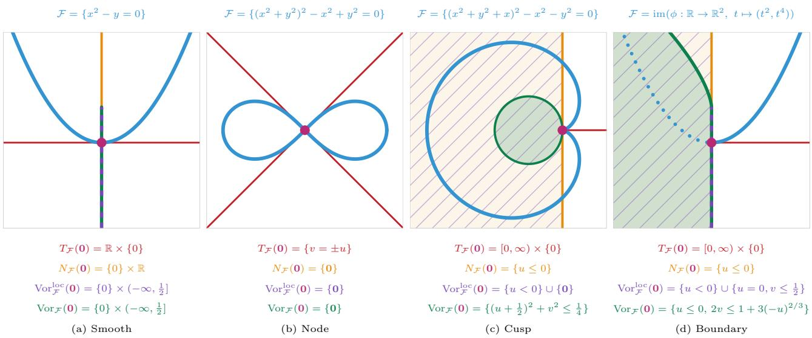  
Figure 7: Details for Figure 2.

## G.3 Figure 3

The single-neuron cone of architecture $\mathbf { d } = ( 2 , 1 , 1 )$ and activation $\rho ( t ) = t ^ { 2 } .$ , without biases: $f ( x ) = v ( w ^ { \top } x ) ^ { 2 }$ Writing $f = z x _ { 1 } ^ { 2 } + 2 y x _ { 1 } x _ { 2 } + x x _ { 2 } ^ { 2 }$ , we have $\mathcal { H } \cong \mathbb { R } ^ { 3 }$ and $\mathcal { C } = \{ ( x , y , z ) : \ x z = y ^ { 2 } \}$ , the cone of symmetric $2 \times 2$ matrices of rank at most one. Since ${ \mathcal { C } } = - { \mathcal { C } }$ and span ${ \mathcal { C } } = { \mathcal { H } } .$ , we have $N c ( 0 ) = \{ 0 \}$ and $\mathrm { V o r } _ { \mathscr { C } } ^ { \mathrm { l o c } } ( 0 ) = \{ 0 \}$

## G.4 Figure 4

All panels use $d ^ { \prime } = 1$ and $t = 2 \colon$ ; write $V = v ^ { \top }$ . For $t \geq 2$ the function $\phi ( A , V )$ is determined, by an injective linear map, by the tuple of symmetric matrices s $\operatorname { y m } ( A e _ { q } v ^ { \top } ) , q \leq d ;$ equivalently, by the tuple of quadratic forms $Q _ { q } ( x ) = ( e _ { q } ^ { \top } \dot { A } ^ { \top } x ) ( v ^ { \top } x )$

(a) $a = d = 2$ . Here $\mathcal { H } \cong S ^ { 2 } ( \mathbb { R } ^ { 2 } ) ^ { 2 } \cong \mathbb { R } ^ { 6 }$ , and $\mathcal { X } _ { 2 }$ is the set of pairs $( Q _ { 1 } , Q _ { 2 } )$ of binary quadratic forms with a common real linear factor. Its Zariski closure is the hypersurface $\operatorname { R e s } ( Q _ { 1 } , Q _ { 2 } ) = 0$ , that is, $\begin{array} { r } { \mathtt { 1 } \delta _ { 1 2 } \delta _ { 2 3 } - \delta _ { 1 3 } ^ { 2 } = 0 . } \end{array}$ where $\delta _ { i j }$ is the minor in columns $i , j$ of the $2 \times 3$ matrix with rows $\big ( ( M _ { q } ) _ { 1 1 } , ( M _ { q } ) _ { 1 2 } , ( M _ { q } ) _ { 2 2 } \big ) , M _ { q } = \mathrm { s y m } ( A e _ { q } v ^ { \top } )$ Its real points are $\mathcal { X } _ { 2 }$ together with the pairs $( \lambda S , \mu S )$ with S definite. The submodel $\mathcal { X } _ { 1 } = \{ \mathrm { r a n k } A \leq 1 \}$ consists of the pairs $( \lambda S , \mu S )$ with det $S \leq 0$ , and it is the double curve of the surface. We take the afine slice

$$
M _ { 1 } = \left( \begin{array} { c c } { { - 2 y - z } } & { { y - 1 } } \\ { { y - 1 } } & { { x - 1 } } \end{array} \right) , \qquad M _ { 2 } = \left( \begin{array} { c c } { { 1 + x } } & { { x - z } } \\ { { x - z } } & { { x + y } } \end{array} \right) ,
$$

in the ball of radius 2.4 about $( - 0 . 2 , 0 . 8 , - 0 . 5 )$ The slice meets the double curve of proportional pairs in a twisted cubic. It is drawn solid where det $S < 0$ (points of $\mathcal { X } _ { 1 } )$ and dotted where det $S > 0$ (Zariski closure only).

(b) $a = 1 , d = 2 $ . By Lemma D.9, $\mathcal { X } _ { 1 } \cong \{ q \otimes S \colon q \in \mathbb { R } ^ { 2 }$ , det $S \leq 0 \}$ . We write $q \otimes S$ as the $2 \times 3$ matrix with rows $q _ { i } \left( S _ { 1 1 } , S _ { 1 2 } , S _ { 2 2 } \right)$ , so the Zariski closure of $\mathcal { X } _ { 1 }$ is the set of matrices of rank at most one. We take the afine slice

$$
M ( u , w , z ) = \left( \begin{array} { c c c } { { u } } & { { w } } & { { u } } \\ { { z } } & { { 1 - u } } & { { z } } \end{array} \right) .
$$

In this slice, the Zariski closure is the hyperboloid $w z = u ( 1 - u )$ , the real model is its part $u ^ { 2 } + z ^ { 2 } \leq w ^ { 2 } + ( 1 - u ) ^ { 2 }$ and $U = \{ \mathrm { r a n k } S \leq 1 \}$ is the pair of lines $( r , r , 1 - r )$ and $( r , - r , r - 1 ) , r \in \mathbb { R }$ . The figure shows the ball of radius 2.6 about $( \textstyle { \frac { 1 } { 2 } } , 0 , 0 )$

(c) $a = 1 , d = 3$ . We fix q and take the linear slice $S = S ( x , y , z )$ of $S ^ { 2 } ( \mathbb { R } ^ { 3 } )$ from G.1. The Zariski closure is the cone $z ( x ^ { 2 } - y ^ { 2 } ) = x ^ { 3 }$ . The real model, i.e. the matrices on this cone with at most one positive and one negative eigenvalue, is its part $y ^ { 2 } \geq x ^ { 2 }$ . The locus $U = \{ \mathrm { r a n k } S \leq 1 \}$ is the z-axis, which is a singular line of the Zariski closure and a boundary of the real model. The figure shows the ball of radius 2.4 about the origin.

## G.5 Figure 5

The setting is that of Section 4.3: $d = t = 2 , a = d ^ { \prime } = 1$ , target $h = \psi ( q _ { * } , S _ { * } )$ with $q _ { * }$ a unit vector and $S _ { * } \succ 0$ with eigenvalues 1 and 0.2, 512 standard Gaussian inputs, initialization $k _ { 0 } , q _ { * } , v _ { 0 }$ with $S _ { 0 } = \textstyle \frac { 1 } { 2 } ( v _ { 0 } k _ { 0 } ^ { \top } + k _ { 0 } v _ { 0 } ^ { \top } )$ of eigenvalues 1 and −0.05, and 500 Adam steps on $k , q , v$ with the squared loss. Softmax attention replaces $V X X ^ { \top } A X$ by VX softmax $( X ^ { \top } A X )$ ). We report the medians, interquartile ranges and eight individual runs of $\sigma _ { 2 } ( S _ { t } ) / \sigma _ { 1 } ( S _ { t } )$ over 30 runs.

## G.6 Figure 6

One-dimensional CNN with $L = 2$ , filters $w _ { 1 } = ( a , b )$ and $w _ { 2 } = ( c , e )$ , strides one, $\sigma ( z ) = z ^ { 2 }$ . Then

$$
f ( x ) = c ( a x _ { 1 } + b x _ { 2 } ) ^ { 2 } + e ( a x _ { 2 } + b x _ { 3 } ) ^ { 2 } = F _ { 1 1 } x _ { 1 } ^ { 2 } + 2 F _ { 1 2 } x _ { 1 } x _ { 2 } + F _ { 2 2 } x _ { 2 } ^ { 2 } + 2 F _ { 2 3 } x _ { 2 } x _ { 3 } + F _ { 3 3 } x _ { 3 } ^ { 2 } ,
$$

so $\mathcal { H } \cong \mathbb { R } ^ { 5 }$ . The neural model is the real zero set of

$$
\begin{array} { r l } & { F _ { 1 2 } F _ { 2 3 } - F _ { 1 1 } F _ { 3 3 } , \qquad F _ { 1 2 } ^ { 3 } - F _ { 1 1 } F _ { 1 2 } F _ { 2 2 } + F _ { 1 1 } ^ { 2 } F _ { 2 3 } , } \\ & { F _ { 1 1 } F _ { 2 3 } ^ { 2 } + F _ { 1 2 } ^ { 2 } F _ { 3 3 } - F _ { 1 1 } F _ { 2 2 } F _ { 3 3 } , \qquad F _ { 2 3 } ^ { 3 } - F _ { 2 2 } F _ { 2 3 } F _ { 3 3 } + F _ { 1 2 } F _ { 3 3 } ^ { 2 } , } \end{array}
$$

and its singular locus is the line $\mathbb { R } x _ { 2 } ^ { 2 } .$ This line is computed by the two subnetworks $( ( 0 , b ) , ( c , 0 ) )$ and $( ( b , 0 ) , ( 0 , c ) )$ , and two branches of F cross transversally along it. We take the linear slice $\{ F _ { 1 1 } = F _ { 2 3 } , \ F _ { 1 2 } = F _ { 3 3 } \}$ with coordinates $( \xi , \eta , \zeta ) = ( F _ { 1 1 } , F _ { 1 2 } , F _ { 2 2 } )$ . Then

$$
\mathcal { F } \cap \{ F _ { 1 1 } = F _ { 2 3 } , ~ F _ { 1 2 } = F _ { 3 3 } \} = \{ \xi ^ { 3 } + \eta ^ { 3 } = \xi \eta \zeta \} ,
$$

the cone over the folium of Descartes, whose double line $\xi = \eta = 0$ is the singular line $\mathbb { R } x _ { 2 } ^ { 2 } .$ . The figure uses the coordinates $( \sqrt { 3 } \xi , \sqrt { 3 } \eta , \zeta )$ , which are orthonormal for the Bombieri inner product, and shows the ball of radius 1.6 about the origin.