# EEG-Based Classification of Hypnotic Susceptibility Using Two-Dimensional Convolutional Neural Networks

Krzysztof Wrobel1,\*, Grzegorz M. Wojcik1, Filip Postepski1, Andrzej Kawiak1, Katarzyna Zemla2, and Grzegorz Sedek2

1Department of Neuroinformatics and Biomedical Engineering, Institute of Computer Science, Maria Curie-Skłodowska University, Akademicka 9, 20-031 Lublin, Poland 2Institute of Psychology, SWPS University, Chodakowska 19/31, 03-815 Warsaw, Poland Corresponding author: krzysztof.wrobel@mail.umcs.pl

## Abstract

Background/Objectives: Guided Imagery (GI) is a mind-based relaxation technique widely used in clinical and therapeutic settings. Objectively assessing whether a patient has entered a relaxed state remains a challenge for clinicians. This study investigates electroencephalography (EEG)-based classification of hypnotic susceptibility using two-dimensional Convolutional Neural Networks (2D CNNs) applied to minimally preprocessed signals, without manual feature extraction. Methods: Data were collected from 62 male participants (32 Control, 30 Hypno) using a 256-channel dense array amplifier during Guided Imagery or cognitive task conditions. A sliding-window framework evaluated up to 868 independent models across seven anatomically defined brain regions and 124 ten-second time windows. Segment-level randomsplit screening was followed by Leave-One-Subject-Out (LOSO) cross-validation to obtain subject-independent performance estimates, and an ensemble approach combined predictions across K = 10 windows. Results: The best single-window model achieved accuracy of 0.82 on the random split. Under LOSO, anterior regions generalised better across subjects: the frontal region achieved mean accuracy of 0.646 (AUC: 0.692). An ensemble of K = 10 windows further improved the prefrontal region to mean accuracy of 0.738. The occipital region, dominant in random-split screening, collapsed to near-chance under LOSO, revealing subject-specific EEG fingerprinting rather than genuine group diferences. Conclusions: Bandpass filtering and z-score normalisation sufice for competitive EEG classification without manual feature extraction. Anterior cortical regions are identified as the most generalisable neural markers of hypnotic susceptibility.

Keywords: brain regions; convolutional neural network; deep learning; EEG; Guided Imagery; hypnotic susceptibility; leave-one-subject-out; sliding window

## 1 Introduction

Relaxation techniques have demonstrated considerable eficacy in supporting patients sufering from various medical conditions and mental health disorders. Studies indicate that oncological patients who incorporated relaxation practices into their care routines exhibited improved responses to clinical treatment. Consequently, further development and promotion of relaxationbased interventions may represent a meaningful strategy for enhancing overall patient quality of life.

Guided Imagery (GI) is a mind-based therapeutic approach that leverages the imaginative capacity of an individual to induce changes across physical, emotional, and spiritual dimensions [1]. Widely employed within psychotherapeutic practice, this method integrates relaxation strategies with the deliberate construction of mental imagery engaging all five sensory modalities: vision, audition, touch, taste, and olfaction. The fundamental objective of this technique is to consciously evoke particular mental representations capable of modifying both physiological responses and emotional states through the use of imagination [2]. As a relaxation intervention, GI has been extensively utilized and demonstrated to be efective in alleviating test anxiety and managing stress arising from diverse sources [3–5]. A study investigating the reduction of state anxiety conducted by Nguyen et al. [5] employed both nature-based visualizations (e.g., forest environments) and non-nature-based settings (e.g., urban and ofice surroundings). Nature-oriented imagery was found to yield superior anxiolytic efects. Furthermore, the application of Guided Imagery in the context of chronic pain conditions [6] has shown notable benefits, as soothing mental images may serve to interrupt nociceptive signaling. Given that GI is also employed to alleviate cancer-related pain, investigating its broader influence on patients’ psychological and physiological states warrants further attention [7]. Additionally, emerging evidence suggests that Guided Imagery holds promise in the management of sleep disorders, with the visualization of serene environments — such as a tranquil beach or forest setting — shown to attenuate both physical and cognitive arousal that impedes sleep onset [8].

Guided Imagery employs mental visualization to elicit sensory experiences and is widely regarded as one of the oldest known healing modalities. It is conceptualized as an internal perception of an event in the absence of actual external stimuli, encompassing both sensory and cognitive dimensions [9]. Guided Imagery and meditation share notable similarities, as both incorporate relaxation techniques and mental visualization to influence physical and emotional states. These practices are efective in calming the mind and body, reducing stress and anxiety, and promoting an overall sense of well-being. With respect to the Focused Attention (FA) and Open Monitoring (OM) forms of meditation, Guided Imagery may integrate elements of both modalities. During a Guided Imagery session, individuals may direct their attention toward specific mental images or scenarios (FA) while simultaneously remaining open to the sensory impressions and emotional responses that arise throughout the visualization process (OM). Accordingly, Guided Imagery may be conceptualized as a synthesis of FA and OM meditation approaches, ofering a structured framework for visualization while allowing for unrestricted awareness of internal experiences [10]. Guided Imagery is recognized for its capacity to influence a range of physiological systems, including the respiratory, cardiovascular, metabolic, gastrointestinal, and immune systems. Its efects on these systems are mediated through the modulation of hypothalamic-pituitary-adrenal axis activity, thereby facilitating a state of relaxation and promoting overall physiological well-being [11, 12].

Electroencephalography (EEG) represents a viable methodology for assessing whether patients have attained a state of relaxation. Scalp EEG is a non-invasive technique employed to record the bioelectrical activity of the human brain. In comparison to alternative neuroimaging modalities, such as positron emission tomography (PET) or magnetic resonance imaging (MRI), it ofers the advantages of lower cost and reduced patient burden [13, 14]. Nevertheless, the manual analysis of multichannel EEG signals remains a challenging and time-intensive procedure. Machine learning and deep learning approaches have been broadly adopted for the classification of diverse data types, ranging from image data [15] to various forms of biomedical signals [16, 17]. The present study aims to propose an EEG signal classification framework based on two-dimensional Convolutional Neural Networks (2D CNNs), utilizing minimally preprocessed raw signals subjected to basic bandpass filtering and z-score normalization as input data.

In the classification of various EEG signal types, classical machine learning (ML) algorithms, such as Support Vector Machines (SVM), have been widely employed [18]. In the context of altered states of consciousness and hypnosis-related EEG research, SVM-based approaches have demonstrated classification accuracy (ACC) of approximately 80% [19].

Among state-of-the-art classification methodologies, Convolutional Neural Networks (CNNs) have been successfully applied to EEG signal analysis [20]. Moreover, traditional ML methods are progressively being superseded by deep learning frameworks in this domain. CNNs have proven particularly efective across a broad spectrum of EEG-related applications, including motor imagery decoding [21], epileptic seizure detection [22], emotion recognition [23], as well as research directed toward Brain-Computer Interfaces (BCIs) employing CNN-based EEG feature extraction [24], and extending even to biometric identity authentication [25].

The predominant approach to EEG signal classification involves providing the classifier with frequency band-derived features. The EEG signal is conventionally decomposed into discrete frequency ranges, comprising delta waves (below 4 Hz), theta waves (4–7 Hz), alpha waves (8–12 Hz), beta waves (13–30 Hz), and gamma waves (above 30 Hz). It has been demonstrated that SVM-based classifiers can be efectively constructed using a selected subset of these frequency bands [19, 26]. Such an approach, however, necessitates the computation of power across specific frequency ranges. It would therefore be advantageous to bypass manual feature extraction and instead employ CNN-based feature extraction directly from the raw signal — a strategy that has already been successfully adopted in the context of emotion recognition [27, 28]. Experiments reported by Baydemir et al. demonstrated the feasibility of classifying EEG signals reflecting low and high cognitive load using a 1D-CNN architecture with high classification accuracy [29]. Similarly, CNN-based classification of combined fNIRS-EEG mental workload signals yielded satisfactory accuracy of 89% [30]. Nevertheless, the number of studies specifically employing 1D Convolutional Neural Networks for binary classification of relaxation and mental workload states using raw EEG signals remains limited, indicating a need for further investigation in this area.

In our prior work, a classical classification approach was applied to distinguish between Guided Imagery and Mental Task experimental groups [31]. The Generalized Linear Model (GLM) utilized in that study attained 81% accuracy when operating on a narrowly defined time segment (779–839 s) extracted from the full recording. To achieve this level of performance, the classifier required input comprising five EEG frequency bands — alpha, beta, delta, theta, and gamma — extracted from a 60-second raw signal segment. When applied to the complete recording, however, the model yielded a substantially higher accuracy of 90.77%.

The objective of the study is to check whether it is possible to find the best brain areas and electrodes for classification. In this manner, all 256 channels were available for inclusion in the training procedure. No additional preprocessing steps or artifact removal techniques were applied, and no manual feature extraction was performed on the signal.

## 2 Materials and Methods

The signal used in this study was collected from a group of 62 male participants aged 19–24 years. Among them, 32 were assigned to the Control Group and 30 to the Hipno Group. The described experiments were evaluated and approved by the Bioethical Commission of Maria Curie-Skłodowska University. All procedures were carried out in accordance with established experimental standards and guidelines, under the supervision of qualified psychologists. Each participant consented to the EEG recording, was informed about the aim of the study, and provided written informed consent prior to participation.

## 2.1 Inclusion and Exclusion Criteria

The inclusion criteria required participants to be healthy individuals between 19 and 24 years of age, male, with short hair and fluent command of Polish. Short hair was necessary to ensure higher EEG signal quality; therefore, participants were instructed not to wash their hair or apply any conditioners on the day of the examination, with the latest wash permitted no later than one day prior to the study. Eligible individuals had no history of chronic illnesses, were not using prescribed or recreational drugs, and were able to attend study sessions without any specific technological constraints. Moreover, they were asked to refrain from consuming alcohol or taking any medications for at least 72 hours before the experiment.

Exclusion criteria included being under 19 or over 24 years old, having long hair, insuficient proficiency in Polish, the presence of serious or chronic medical conditions, current use of medication or psychoactive substances, recent medical procedures, or inability to attend the scheduled sessions. Individuals who did not meet the inclusion requirements or who reported serious conditions, including mental health disorders, were excluded from the study. Before participation, all subjects received information about the EEG procedures and technology and provided informed consent to take part in the research.

Several factors motivated the recruitment of participants aged 19–24 and exclusively male subjects. First, individuals within this age group are predominantly university students, especially those enrolled in undergraduate and graduate programs. Second, the Institute of Computer Science is characterized by a clear predominance of male students, which made it dificult to establish both experimental and control groups that included female participants.

Additionally, it was observed that a large proportion of female computer science students had long hair, which posed practical challenges for EEG data acquisition. Previous research has also reported diferences in electroencephalographic patterns between males and females [32, 33]. To maintain greater homogeneity within the sample, the study ultimately focused solely on male participants. As a result, the conclusions drawn apply only to men, which we acknowledge as an important limitation of this study.

All participants provided written informed consent prior to the study. One half of the sample was assigned to the Hipno Group and listened to a Guided Imagery relaxation recording developed by a psychologist. The remaining participants formed the Control Group and were instructed to mentally retrieve specific categories of information, such as the names of Zodiac signs, Polish voivodships, U.S. states, and European capitals. In both conditions, the instructions were delivered through recordings prepared by the same psychologist.

Following each task instruction, a silent interval was included to allow participants time to think. The Hipno Group was expected to remain relaxed throughout the session, whereas the Control Group was deliberately exposed to cognitive efort. At the start of the experiment, members of the Control Group were informed that they would be required to write down all recalled information after the session, thereby increasing task engagement. Each task was time-limited. The assumption that this procedure would elicit mental workload was supported by previous findings indicating that task dificulty and time constraints contribute to increased cognitive load [34].

Both the Guided Imagery and mental task recordings lasted 20 minutes. Participants were instructed to keep their eyes closed, and each session was conducted with subjects lying down in a darkened room to minimize muscle artifacts, electrical interference, and external distractions that could afect the EEG recordings.

The experiments were conducted in the EEG Laboratory of the Department of Neuroinformatics and Biomedical Engineering of Maria Curie-Skłodowska University (UMCS) in Lublin, Poland (Figure 1). All trial signals were recorded at the sampling frequency of 250 Hz with the use of a 256-channel dense array EGI GSN 130 series cap (Figure 1). For signal acquisition, the EGI Net Station 4.5.4 software was used.

Our dense array amplifier recorded the signal from all 256 electrodes. The objective of the study is to identify the cortical regions and corresponding electrode subsets that exhibit the greatest sensitivity to hypnosis-related neural patterns.

## 2.2 Signal Preprocessing and Data Preparation

EEG signals were preprocessed using the MNE Python library (version 1.6.0) [35]. Channels exhibiting excessive noise were identified, removed, and subsequently reconstructed through interpolation to ensure consistent data dimensionality across all samples. Automatic detection of bad channels was performed using the RANSAC algorithm, available within the pyprep toolkit [36], which is itself derived from the PREP pipeline originally developed for EEG preprocessing in

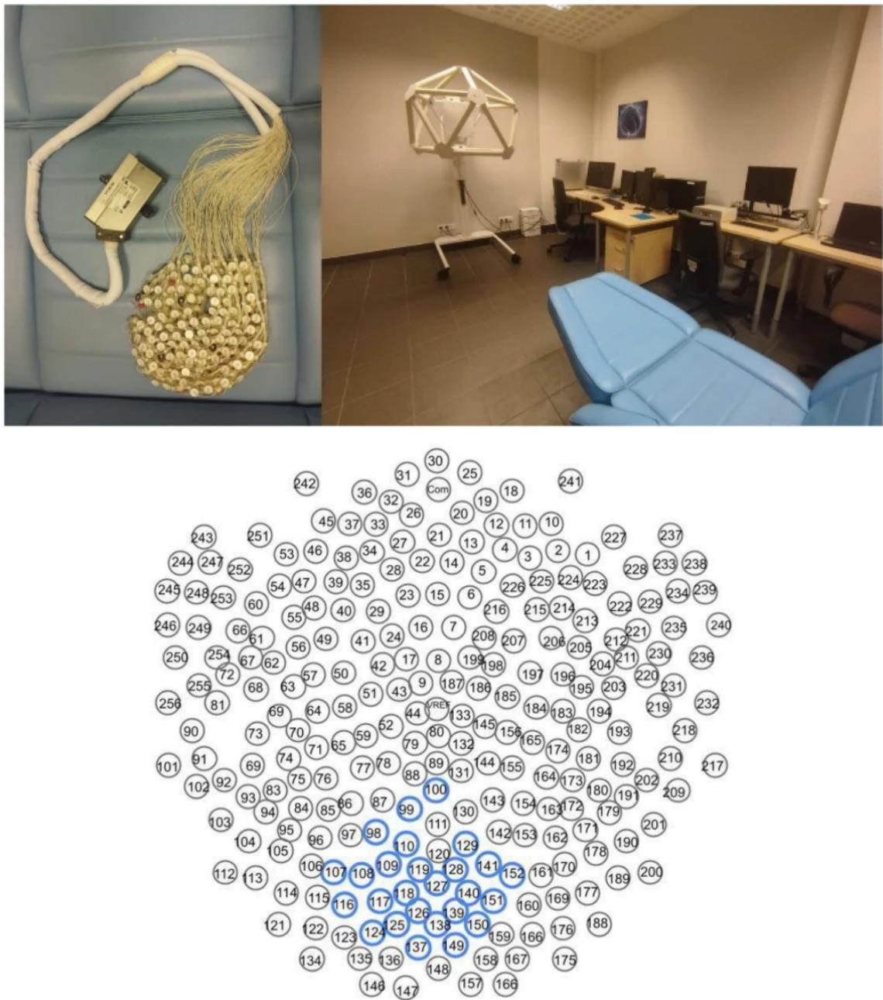  
Figure 1: Top: overview of the EEG Laboratory at UMCS, Lublin, Poland. Bottom: EGI 256-channel EEG cap.

MATLAB [37]. Although MATLAB was not employed in this study, both environments yielded comparable outcomes. Each trial’s signal was bandpass filtered within the 1–40 Hz frequency range. Following filtering, each signal was z-score normalised per channel:

$$
{ \hat { x } } = { \frac { x - \mu } { \sigma } }\tag{1}
$$

where $\mu$ and $\sigma$ denote the channel mean and standard deviation, respectively, computed over the entire recording segment.

To examine the entire signal, 10-second windows are isolated simultaneously for each brain region. Such a large volume of computation would be infeasible in a standard sequential environment; the asynchronous capabilities of Python were therefore leveraged, specifically the event-loop mechanism and the built-in asyncio library combined with ProcessPoolExecutor for parallel model training.

## 2.3 Brain Region Electrode Selection

Seven anatomically defined brain regions were investigated: prefrontal, frontal, temporal, central, parietal, occipital, and facial. Each region was represented by a predefined subset of electrodes from the 256-channel EGI cap, selected according to standard neuroanatomical landmarks [38]. Table 1 lists the electrode subsets assigned to each region.

Table 1: Electrode subsets per brain region in the 256-channel EGI GSN 130 cap. Electrode identifiers follow the EGI convention (En); consecutive identifiers are shown as ranges. N is the number of electrodes per region.
<table><tr><td>Region</td><td>N</td><td>Electrode identifiers (sorted)</td></tr><tr><td>Prefrontal</td><td>22</td><td>E2, E3, E10–E12, E18–E20, E25–E27, E31–E34, E37–E39, E46–E48, E222</td></tr><tr><td>Frontal</td><td>20</td><td>E4–E6, E13–E15, E21–E23, E28–E30, E35, E36, E40, E41, E214, E215, E223, E224</td></tr><tr><td>Temporal</td><td>72</td><td>E1, E49, E54–E58, E61–E64, E67–E75, E82, E83, E91–E95, E102– E104, E173, E178, E180, E181, E189–E195, E200–E204, E208–E213, E216–E221, E225–E229, E232, E233, E250–E256</td></tr><tr><td>Central</td><td>25</td><td>E7–E9, E16, E17, E24, E42–E44, E50–E52, E59, E65, E182–E184, E186, E195–E198, E205–E207</td></tr><tr><td>Parietal</td><td>41</td><td>E45, E53, E60, E66, E77–E81, E84–E90, E96–E101, E129–E132, E141- E144, E152–E155, E161–E164, E170, E171, E179</td></tr><tr><td>Occipital</td><td>40</td><td>E105–E119, E121–E128, E138–E140, E149–E151, E158–E160, E167- E169, E175-E177, E188, E199</td></tr><tr><td>Facial</td><td>30</td><td>E67, E73, E82, E91, E216–E219, E225–E230, E232, E233, E235, E236, E240, E243, E245, E246, E248, E250–E256</td></tr></table>

## 2.4 CNN Architecture

Based on prior research within this project [39], a 2D CNN architecture was selected over recurrent models such as LSTM. The classification operates on short, independent 50-sample sub-segments (0.2 s at 250 Hz). LSTM is designed for tasks in which the temporal order of a sequence of segments carries meaning (e.g., predicting the next token or tracking a trajectory). Here, each sub-segment is classified in isolation — there is no recurrence between segments, so LSTM’s sequential memory provides no benefit.

Furthermore, the core experiment trains a separate model per 10-second window, meaning each model operates exclusively on data within that window; no cross-window temporal dependencies are modelled. The pipeline trains up to $1 2 4 \times 7 = 8 6 8$ individual models in parallel. An LSTMbased model has more parameters, longer convergence time, and is more prone to vanishing gradients on short EEG segments, making the lightweight 2D CNN better suited to this large-scale sliding-window design.

## 2.4.1 Convolutional Block 1

The first block begins with a Conv2D layer with 32 filters of size 3 × 3 and ReLU activation, which learns local spatial-temporal features across neighbouring electrodes and time points simultaneously. The feature maps are then spatially downsampled by a MaxPooling2D layer with a 2 × 2 pool size, reducing spatial dimensions by half and retaining only the most prominent activations. A Dropout layer with a rate of 0.25 is applied afterwards to prevent co-adaptation of feature detectors during training.

## 2.4.2 Convolutional Block 2

The second block follows the same structure but doubles the number of filters to 64, allowing the network to learn more abstract and diverse feature representations at a coarser spatial resolution. A Conv2D layer with 64 filters of size 3 × 3 and ReLU activation is followed by another MaxPooling2D layer (2 × 2) and a Dropout layer with rate 0.25.

## 2.4.3 Classifier Head

After the two convolutional blocks, a Flatten layer linearises the 3D feature maps into a single 1D vector. This is passed to a Dense layer with 64 units and ReLU activation, which learns a non-linear combination of the extracted features. A Dropout layer with a higher rate of 0.50 is applied here to strongly regularise the dense representation. The final output Dense layer has 2 units with Softmax activation, producing a probability distribution over the two classes: HIPNO and CONTROL.

## 2.4.4 Training Configuration

The model is compiled with the Adam optimiser and sparse categorical cross-entropy loss. Training runs for 20 epochs with a batch size of 32. The dataset is split into 90% training and 10% test sets using a fixed random seed of 42, ensuring reproducibility. A separate model is trained independently for each combination of brain region and 10-second time window, yielding up to 868 models in total across the full experiment.

## 2.4.5 Design Rationale

Treating the EEG segment as a 2D matrix with electrodes along one axis and time samples along the other allows the 3 × 3 convolutional kernels to capture joint spatial and temporal patterns — that is, correlated activations across neighbouring electrodes within a short time horizon. Doubling filter depth in the second block follows standard CNN design practice, enabling the extraction of increasingly abstract representations while progressively compressing spatial information through pooling. The relatively high dropout rate of 0.50 in the dense layers compensates for the limited number of training examples available per window-level model.

## 2.5 Cross-Validation Protocol

The initial screening experiment evaluates each window–region combination using a segment-level 90%/10% random train-test split with a fixed random seed of 42. Because consecutive 50-sample sub-segments extracted from the same 10-second recording window of the same subject may appear in both the training and test sets, this split does not guarantee subject-independent generalisation; a classifier may learn subject-specific EEG fingerprints rather than group-level diferences. This procedure is used exclusively for the sliding-window screening of all $1 2 4 \times 7$ window–region combinations.

To obtain a subject-independent performance estimate, Leave-One-Subject-Out (LOSO) cross-validation was applied to the best-performing window per discriminative region. In each of the 62 folds, the model was trained from scratch on data from 61 subjects and evaluated on all segments of the held-out subject. Per-fold accuracy is reported as mean ± standard deviation across the 62 folds; aggregate F1, precision, recall, and AUC are computed from the concatenated predictions of all folds with the HIPNO group as the positive class.

To assess whether aggregating predictions across multiple temporal windows improves subjectlevel generalisation, an ensemble variant of LOSO was additionally evaluated. In each fold, K independently trained models — each operating on a distinct top-ranked 10-second window of the region — averaged their softmax probability outputs (soft voting) to produce a single per-subject prediction. Two ensemble sizes were compared: K = 3 and $K = 1 0$

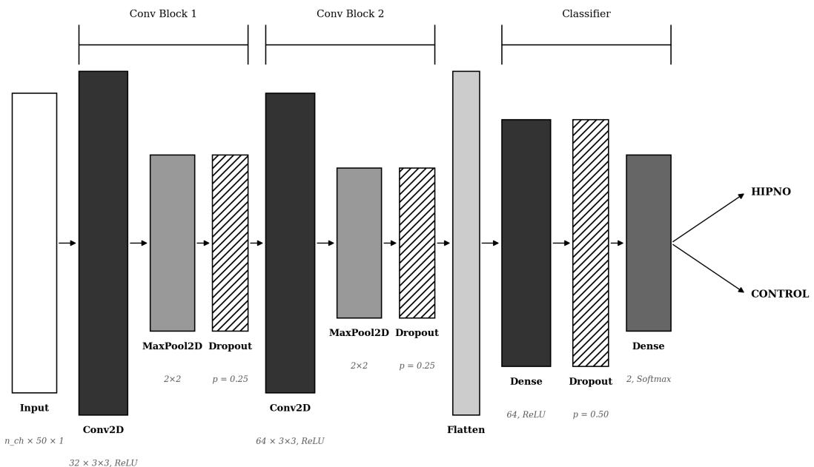  
InputConv2D / Dense + ReLUMaxPool2DDropoutFlattenDense (Softmax)  
Figure 2: 2D-CNN architecture used for HIPNO/CONTROL EEG classification.

## 2.6 Evaluation Metrics

The primary performance metric is classification accuracy, ACC = (TP + TN) / (TP + TN + FP + FN), where TP, TN, FP, and FN denote true positives, true negatives, false positives, and false negatives. A window is considered discriminative when ACC > 0.67. Per-region summary statistics include the number and proportion of discriminative windows, peak accuracy, and mean accuracy across discriminative windows.

For the best-performing window of each discriminative region, the following metrics are additionally reported, with the HIPNO group treated as the positive class: precision (Prec = $\mathrm { T P / ( T P + F P ) } )$ ), recall $\mathrm { ( R e c = T P / ( T P + F N ) } )$ , and F1 score (F1 = 2 Prec · Rec / (Prec + Rec)). Receiver Operating Characteristic (ROC) curves are computed from the model’s softmax probability outputs, and the Area Under the Curve (AUC) is reported as a threshold-independent measure of class separability. Normalised confusion matrices are presented to characterise the distribution of classification errors across both classes.

## 3 Results

All experiments were implemented using TensorFlow 2.18.0 and Keras 3.6.0 with Python 3.11.9. The hardware used was an Apple MacBook Pro equipped with Apple Silicon M3 Max and 64 GB RAM, running macOS 14 Sonoma. No hardware overclocking was applied.

The CNN model achieved classification accuracy exceeding the 0.67 threshold in five out of seven evaluated brain regions. The occipital region demonstrated the highest proportion of discriminative windows (112/124, 90.3%), with a peak accuracy of 0.8026 and a mean accuracy of 0.7206, indicating robust and consistent group separation in posterior cortex. The parietal region followed closely, yielding 95/124 (76.6%) discriminative windows, a peak accuracy of 0.7730, and a mean accuracy of 0.7087.

Anterior regions showed substantially lower proportions of discriminative windows, though with competitive peak accuracies. The prefrontal region achieved the highest single-window accuracy across all regions (0.8224), with 24/124 (19.4%) windows above threshold and a mean accuracy of 0.7086. The central and frontal regions produced 20/124 (16.1%) and 13/124 (10.5%) discriminative windows, reaching peak accuracies of 0.8026 and 0.7829, respectively. The temporal and facial regions yielded no windows above the accuracy threshold, indicating an absence of discriminative EEG signal in these areas within the applied classification framework.

Table 2: Classification performance of the CNN model across EEG brain regions. Discriminative windows are those exceeding the 0.67 accuracy threshold. Total number of analysed windows per region: 124.
<table><tr><td>Brain Region</td><td>Discriminative windows</td><td>Proportion (%)</td><td>Peak ACC</td><td>Mean ACC</td></tr><tr><td>Occipital</td><td>112/124</td><td>90.3</td><td>0.8026</td><td>0.7206</td></tr><tr><td>Parietal</td><td>95/124</td><td>76.6</td><td>0.7730</td><td>0.7087</td></tr><tr><td>Prefrontal</td><td>24/124</td><td>19.4</td><td>0.8224</td><td>0.7086</td></tr><tr><td>Central</td><td>20/124</td><td>16.1</td><td>0.8026</td><td>0.6998</td></tr><tr><td>Frontal</td><td>13/124</td><td>10.5</td><td>0.7829</td><td>0.7105</td></tr><tr><td>Temporal</td><td>0/124</td><td>0.0</td><td></td><td></td></tr><tr><td>Facial</td><td>0/124</td><td>0.0</td><td></td><td></td></tr></table>

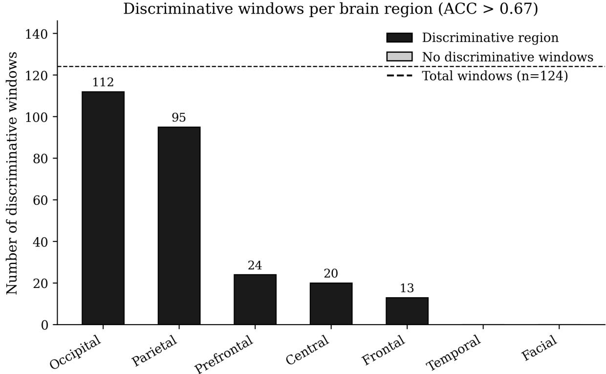  
Figure 3: Number of discriminative windows (ACC > 0.67) per brain region out of 124 total analysed windows.

These findings collectively suggest a posterior-dominant pattern of EEG-based group discrimination, in which occipital and parietal regions provide the most consistent separability between HIPNO and CONTROL groups across time, while anterior regions — despite occasionally reach ing competitive peak accuracies — exhibit limited temporal stability of the discriminative signal. The absence of classification above threshold in temporal and facial regions further delimits the spatial specificity of hypnosis-related neural markers within the applied framework.

To characterise classification quality beyond accuracy, the best-performing window per discriminative region was re-trained and evaluated using precision, recall, F1 score, and ROC AUC (Table 3). Normalised confusion matrices and ROC curves are presented in Figures 6 and 7.

Proportion of discriminative windows per brain region  
Peak and mean classification accuracy per brain region  
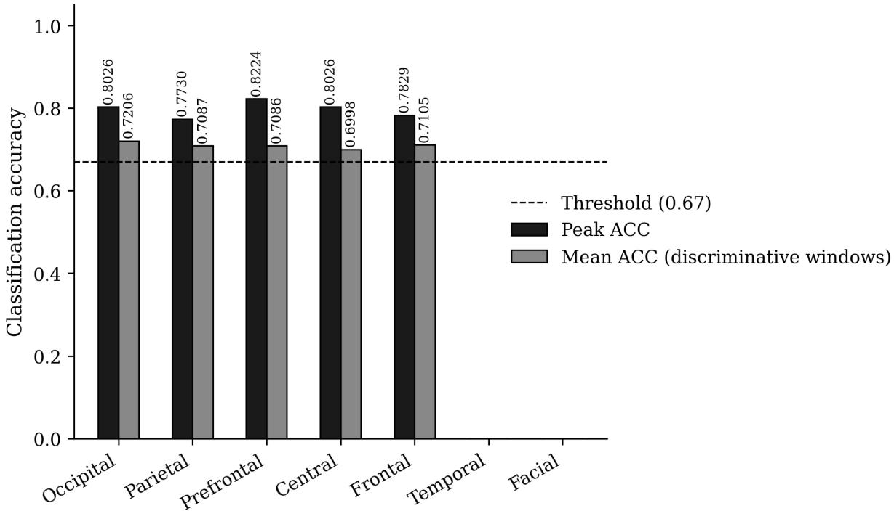  
Figure 4: Peak and mean classification accuracy per brain region for regions with at least one discrimi native window.

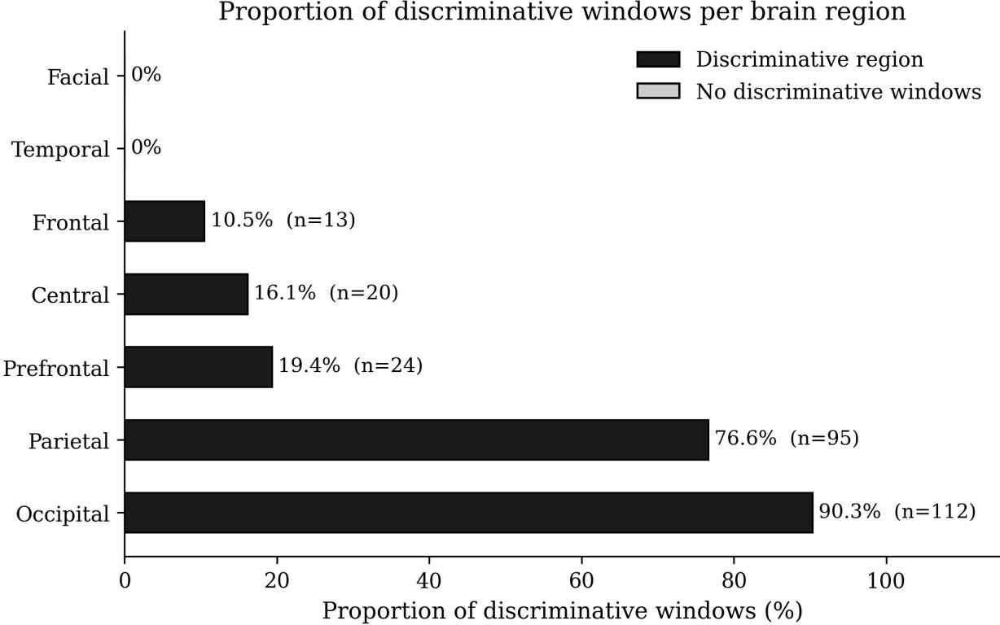  
Figure 5: Proportion (%) of discriminative windows (ACC > 0.67) out of 124 total windows per brain region.

Table 3: Classification metrics for the best-performing window per discriminative region (HIPNO as positive class). Values are obtained by re-training the identified best window with a fixed random seed; run generate\_best\_metrics.py to reproduce.
<table><tr><td>Region</td><td>Window (s)</td><td>ACC</td><td>F1</td><td>Precision</td><td>Recall</td><td>AUC</td></tr><tr><td>Occipital</td><td>771-781</td><td>0.766</td><td>0.760</td><td>0.789</td><td>0.732</td><td>0.848</td></tr><tr><td>Parietal</td><td>1121-1131</td><td>0.799</td><td>0.800</td><td>0.803</td><td>0.797</td><td>0.899</td></tr><tr><td>Prefrontal</td><td>1101-1111</td><td>0.753</td><td>0.767</td><td>0.732</td><td>0.804</td><td>0.829</td></tr><tr><td>Central</td><td>1101-1111</td><td>0.688</td><td>0.678</td><td>0.704</td><td>0.654</td><td>0.757</td></tr><tr><td>Frontal</td><td>1121-1131</td><td>0.766</td><td>0.749</td><td>0.815</td><td>0.693</td><td>0.855</td></tr></table>

Normalised confusion matrices — best window per region  
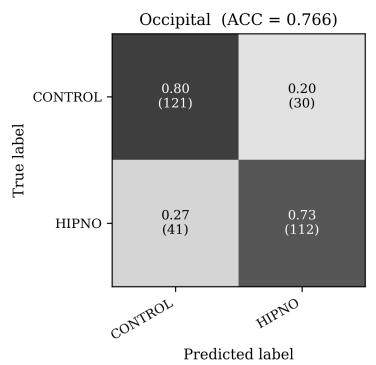

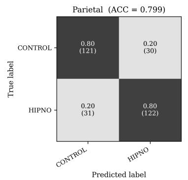

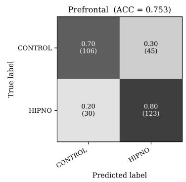

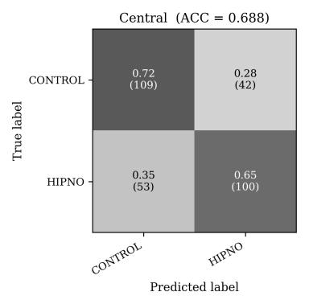

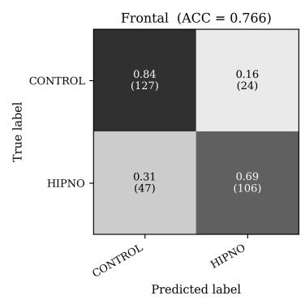  
Figure 6: Normalised confusion matrices for the best-performing window per discriminative brain region. Values represent row-normalised proportions; raw counts are shown in parentheses. Rows correspond to true labels; columns to predicted labels.

## 3.1 Leave-One-Subject-Out Cross-Validation

Leave-One-Subject-Out (LOSO) cross-validation was applied to the best-performing window per discriminative region to provide a subject-independent generalisation estimate free from segmentlevel data leakage, as described in Materials and Methods (run generate\_loso\_metrics.py to reproduce). Results across the 62 folds are summarised in Table 4.

## 3.2 Ensemble LOSO Cross-Validation

An ensemble variant of LOSO cross-validation was applied to examine whether aggregating predictions across multiple temporal windows improves subject-level generalisation, as described in Materials and Methods. Two ensemble sizes were evaluated: K = 3 and K = 10. Table 5 reports results for K = 10 alongside the single-window LOSO baseline; Figures 11, 12, and 13 present the corresponding per-subject accuracy distributions, confusion matrices, and ROC curves.

The ensemble approach yielded the largest gain for the prefrontal region, which improved

ROC curves per brain region (best window, HIPNO vs. CONTROL)

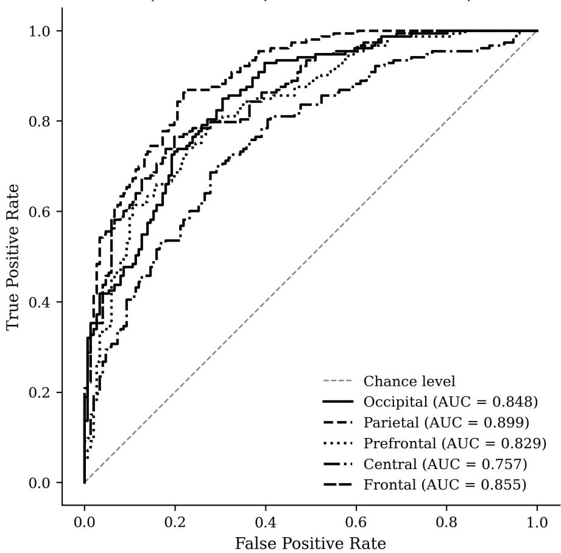  
Figure 7: ROC curves for the five discriminative brain regions, computed from the best-performing window per region. Line styles distinguish regions for monochrome reproduction. AUC values are shown in the legend.

Table 4: LOSO cross-validation results for the best window per discriminative region. ACC is mean ± std across 62 folds; F1, Precision, Recall, and AUC are computed on concatenated fold predictions (HIPNO as positive class).
<table><tr><td>Region</td><td>Window (s)</td><td>Mean ACC ± Std</td><td>F1</td><td>Precision</td><td>Recall</td><td>AUC</td></tr><tr><td>Occipital</td><td>771-781</td><td> $\overline { { 0 . 4 5 3 \pm 0 . 2 3 5 } }$ </td><td>0.434</td><td>0.435</td><td>0.434</td><td>0.429</td></tr><tr><td>Parietal</td><td>1121-1131</td><td> $0 . 6 3 1 \pm 0 . 2 2 8$ </td><td>0.627</td><td>0.613</td><td>0.641</td><td>0.680</td></tr><tr><td>Prefrontal</td><td>1101-1111</td><td> $0 . 6 2 4 \pm 0 . 3 5 3$ </td><td>0.616</td><td>0.608</td><td>0.624</td><td>0.681</td></tr><tr><td>Central</td><td>1101-1111</td><td> $0 . 5 9 1 \pm 0 . 2 4 3$ </td><td>0.582</td><td>0.576</td><td>0.588</td><td>0.599</td></tr><tr><td>Frontal</td><td>1121-1131</td><td> $0 . 6 4 6 \pm 0 . 3 0 2$ </td><td>0.638</td><td>0.633</td><td>0.641</td><td>0.692</td></tr></table>

from a single-window mean accuracy of 0.624 to 0.738 with $\mathrm { K } = 1 0 \ ( \Delta \ \mathrm { A C C } = + 0 . 1 1 4 )$ . Frontal and central regions showed smaller but positive improvements of +0.021 and +0.038, respectively. In contrast, the parietal region showed no benefit from ensembling $( \Delta \mathrm { \ A C C = - 0 . 0 2 2 } )$ , and the occipital region remained near chance $\mathrm { ( A U C = 0 . 4 7 2 ) }$ regardless of ensemble size, confirming that aggregating windows cannot compensate for the absence of a generalisable discriminative signal.

Comparing $\mathrm { K } = 3$ and $\mathrm { K } = 1 0$ reveals diminishing returns beyond the smaller ensemble size. The prefrontal region gained only marginally from $\mathrm { K } = 3 \mathrm { t o } \mathrm { K } = 1 0 \ : ( + 0 . 0 0 7 \mathrm { i n } \mathrm { A C C } )$ while frontal, central, and parietal regions performed better with K = 3 than with $\mathrm { { K } = 1 0 }$ suggesting that including additional, less discriminative windows introduces noise into the softvote average. The high per-subject standard deviation (0.34–0.36 across all regions) reflects a bimodal distribution of per-fold outcomes, where individual subjects are either classified with high accuracy or near chance, consistent with the heterogeneity of individual EEG signatures under a subject-independent evaluation scheme.

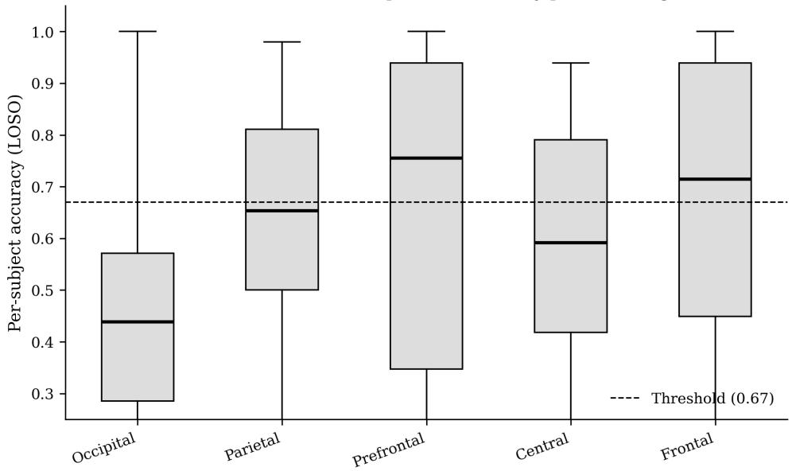  
Figure 8: Per-subject accuracy distributions from LOSO cross-validation for each discriminative brain region. Each box represents the distribution of 62 fold accuracies. The dashed line marks the 0.67 discriminative threshold.  
Aggregated normalised confusion matrices — LOSO CV (best window per region)

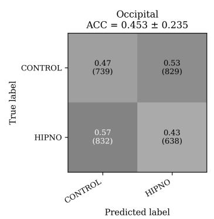

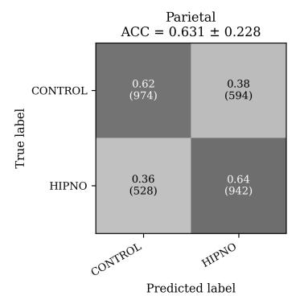

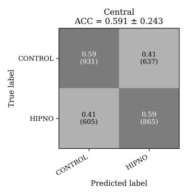

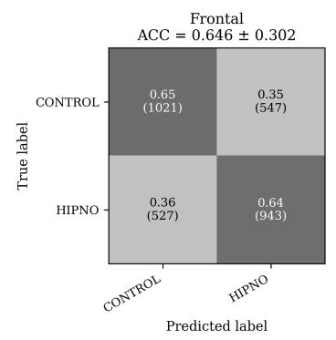  
Figure 9: Aggregated normalised confusion matrices from LOSO cross-validation. Values are computed from the concatenated predictions of all 62 folds. Row-normalised proportions are shown; raw counts in parentheses.

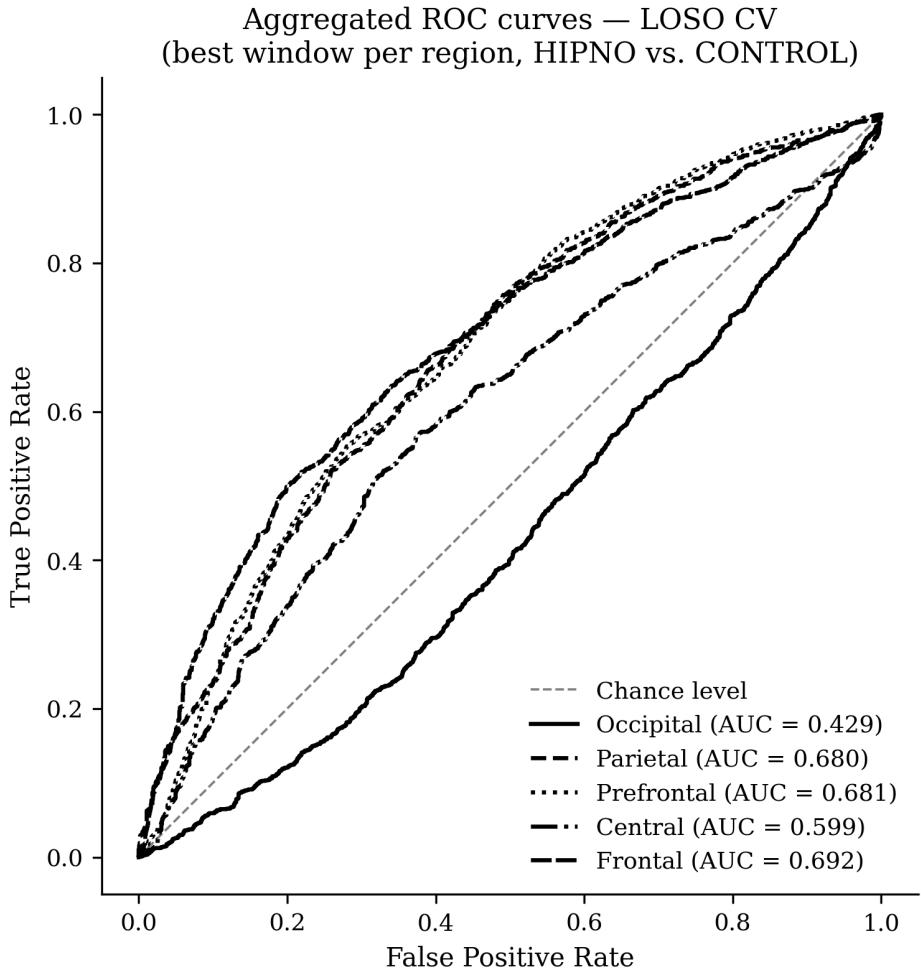  
Figure 10: Aggregated ROC curves from LOSO cross-validation, computed from concatenated fold predictions. AUC values are shown in the legend.

Table 5: Ensemble LOSO results with K = 10 windows (soft voting). Single-window LOSO accuracy is included as reference. ∆ ACC is relative to the single-window baseline. ACC is mean ± std across 62 folds; F1, Precision, Recall, and AUC are computed on concatenated fold predictions (HIPNO as positive class).
<table><tr><td>Region</td><td>Single ACC</td><td>Mean ACC ± Std</td><td>∆ ACC</td><td>F1</td><td>Precision</td><td>Recall</td><td>AUC</td></tr><tr><td>Prefrontal</td><td>0.624</td><td>0.738 ± 0.361</td><td>+0.114</td><td>0.722</td><td>0.744</td><td>0.701</td><td>0.761</td></tr><tr><td>Frontal</td><td>0.646</td><td> $0 . 6 6 7 \pm 0 . 3 4 7$ </td><td>+0.021</td><td>0.635</td><td>0.675</td><td>0.600</td><td>0.723</td></tr><tr><td>Central</td><td>0.591</td><td> $0 . 6 2 9 \pm 0 . 3 3 8$ </td><td>+0.038</td><td>0.584</td><td>0.637</td><td>0.539</td><td>0.629</td></tr><tr><td>Parietal</td><td>0.631</td><td> $0 . 6 0 9 \pm 0 . 3 5 2$ </td><td>-0.022</td><td>0.564</td><td>0.612</td><td>0.522</td><td>0.639</td></tr><tr><td>Occipital</td><td>0.453</td><td> $0 . 4 6 2 \pm 0 . 3 5 2$ </td><td>+0.009</td><td>0.429</td><td>0.441</td><td>0.417</td><td>0.472</td></tr></table>

## 4 Discussion

There are well-established approaches to applying Convolutional Neural Networks in biomedical signal classification [20], and deep learning methods are increasingly adopted in systems aimed at supporting clinical and therapeutic practice [31]. The aim of this study was to verify whether a minimally preprocessed EEG signal, without manual feature extraction, is suficient to classify hypnotic susceptibility across distinct brain regions using a 2D CNN in a sliding-window framework.

The results reveal a clear posterior-anterior gradient in classification performance. Training and evaluating up to 868 independent models across seven brain regions demonstrated that the occipital and parietal regions provide the most consistent group separation, while anterior regions — though occasionally reaching competitive peak accuracies — exhibit substantially lower temporal stability of the discriminative signal.

Single-window vs ensemble LOSO (K=10) per brain region  
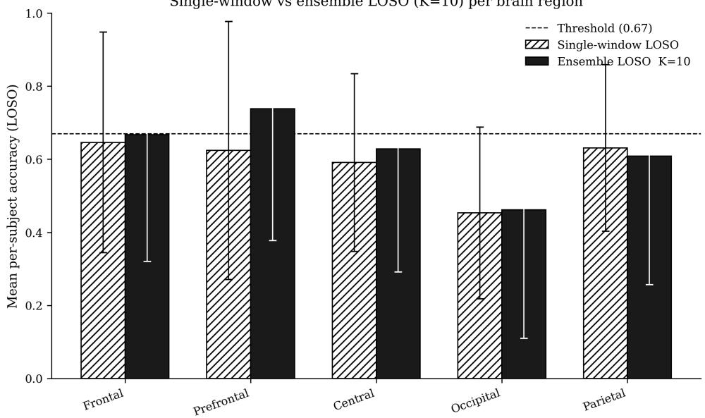  
Figure 11: Per-subject accuracy distributions from ensemble LOSO cross-validation (K = 10) for each discriminative brain region. The dashed line marks the 0.67 discriminative threshold.  
Aggregated confusion matrices — ensemble LOSO K=10

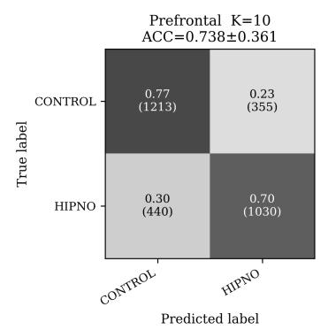

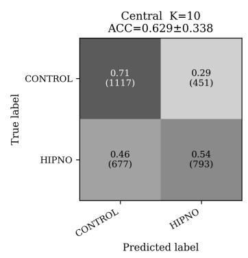

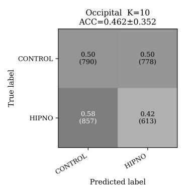

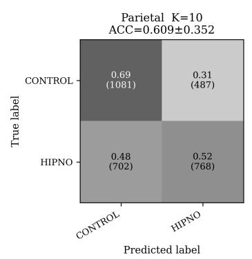  
Figure 12: Aggregated normalised confusion matrices from ensemble LOSO cross-validation (K = 10), computed from concatenated predictions across all 62 folds. Row-normalised proportions are shown; raw counts in parentheses.

The dominance of the occipital region (90.3% of windows above threshold, mean ACC 0.7206) is consistent with the role of the visual cortex in hypnosis-related processing. Guided Imagery, by its nature, engages mental visual imagery, and it is well established that occipital alpha oscillations are modulated during hypnotic induction and imagery-based tasks [40, 41]. The strong and temporally stable discriminability in this region suggests that hypnosis-related neural signatures are not confined to brief moments of induction but persist throughout much of the 20-minute session, supporting the notion of a sustained altered state rather than a transient response. The parietal region, which ranked second in both proportion of discriminative windows (76.6%) and mean accuracy (0.7087), is anatomically and functionally linked to attentional reorientation and multisensory integration — cognitive processes known to be modulated during hypnosis [42, 43]. Together, these posterior regions appear to carry the most reliable neural markers of hypnotic susceptibility at the level of 10-second EEG epochs.

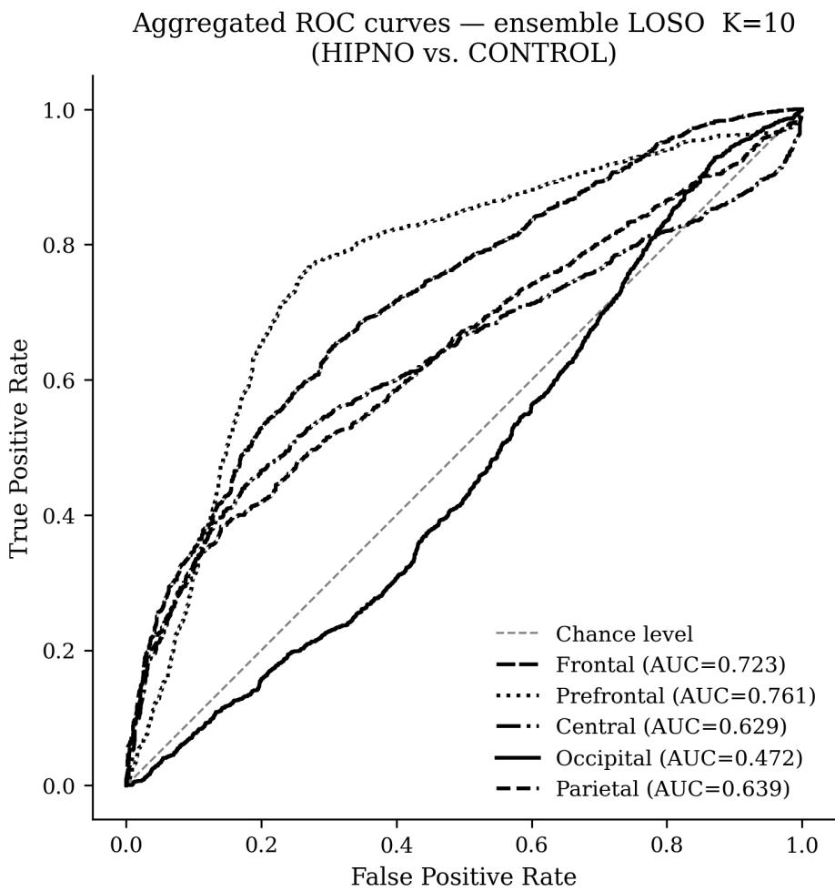  
Figure 13: Aggregated ROC curves from ensemble LOSO cross-validation (K = 10), computed from concatenated fold predictions. AUC values are shown in the legend.

The prefrontal region presented a contrasting profile: the highest single-window accuracy of the entire experiment (0.8224) but only 19.4% of windows above threshold. This dissociation between peak and temporal consistency suggests that frontal discriminability is transient, potentially reflecting episodic engagement of top-down executive control during specific moments of the recording rather than a sustained hypnotic state marker [44]. Similar transient frontal efects have been reported in EEG studies of meditation and altered states of consciousness, where prefrontal activity fluctuates in relation to depth of relaxation [45]. The central and frontal regions showed analogous patterns of low window proportions combined with moderate peak accuracies, further supporting the interpretation that anterior cortical responses to hypnosis are time-locked to specific procedural events rather than constituting a stable baseline diference between groups.

The complete absence of discriminative windows in the temporal and facial regions warrants attention. Despite both groups listening to audio recordings throughout the session — difering only in content (relaxation versus cognitive task) — no systematic EEG diference was detected at the temporal level. This suggests that the neural distinction between the HIPNO and CONTROL conditions is not primarily driven by diferential auditory processing but rather by higher-order cognitive and imagery-related mechanisms. The facial region, predominantly reflecting peripheral muscle activity rather than cortical dynamics, was expected to contribute little to group classification, and the results confirm this expectation.

The classification performance achieved by the 2D CNN is broadly comparable to results reported for classical ML approaches in similar paradigms. SVM-based classifiers applied to hypnosis and relaxation-related EEG have achieved accuracies of approximately 80% [19], and the GLM approach used in our previous work [31] attained 81% on a selected 60-second time segment using handcrafted frequency-band features. The present framework matches and in some windows exceeds these benchmarks without requiring manual feature extraction, operating instead directly on bandpass-filtered and z-score-normalised raw signal. This supports the argument that CNN-based end-to-end learning is a viable alternative to feature-engineered pipelines for EEG-based state classification. Simple filtering and z-score normalisation of the signal appear to be suficient for achieving classification performance comparable to that of state-of-the-art methods.

The strict subject-independent evaluation provided by LOSO cross-validation substantially revises the spatial picture suggested by the random-split results. The occipital region, which achieved the highest random-split accuracy (mean ACC 0.7206) and discriminated 90.3% of windows above threshold, collapsed to near-chance performance under LOSO (mean ACC 0.453, AUC 0.429 — below the 0.5 chance level). This reversal indicates that the high randomsplit accuracy was driven by subject-specific EEG fingerprints rather than genuine group-level diferences related to hypnotic susceptibility. EEG signals are known to contain highly individual spectral and spatial characteristics that can serve as biometric identifiers [25]; when segments from the same recording session appear in both training and test sets, a classifier can learn to identify individuals rather than groups, artificially inflating apparent accuracy. The occipital region is particularly susceptible to this efect given the high within-session stability of posterior alpha rhythms.

In contrast, the frontal and prefrontal regions — which showed lower and less consistent discriminability in the random-split analysis — maintained moderate, above-chance performance under LOSO: frontal (mean ACC 0.646, AUC 0.692), prefrontal (0.624, AUC 0.681), and parietal (0.631, AUC 0.680). This suggests that anterior and parietal EEG features carry more genuinely generalisable neural signatures of the HIPNO/CONTROL distinction than the random-split results implied. The inversion of the posterior-anterior ranking under cross-subject evaluation underscores the necessity of subject-independent validation in EEG-based classification studies.

The ensemble LOSO experiments further demonstrate that aggregating predictions across multiple temporal windows most benefits the prefrontal region, which improved from 0.624 to 0.738 with K = 10 windows (∆ ACC = +0.114). This finding aligns with the interpretation that prefrontal hypnosis-related activity is episodic and temporally heterogeneous: no single 10-second window reliably captures the discriminative signal, but combining predictions from multiple windows reduces variance and recovers a more stable classification boundary. The diminishing returns from K = 3 to K = 10 for most regions suggest that an ensemble of three windows already captures the most informative temporal variation for frontal, central, and parietal regions, and that including additional windows of lower discriminability introduces noise rather than signal. The bimodal distribution of per-subject outcomes — where individual subjects are classified with either high accuracy or near chance — may additionally reflect genuine inter-individual heterogeneity in the depth of GI-induced relaxation: subjects who engage deeply with the imagery task are likely to produce more pronounced and temporally stable anterior

EEG signatures, whereas subjects who do not reliably enter the relaxed state would be expected to yield near-chance classification under a group-level model. This interpretation is consistent with the well-documented variability in hypnotic susceptibility across individuals and represents an inherent challenge for any EEG-based mental-state classifier trained on binary group labels.

The main limitation of this work is the relatively small number of subjects available for training. The initial train-test split (90%/10%) was applied at the segment level rather than at the subject level, allowing signal from the same individual to appear in both training and test sets and inflating accuracy estimates — an efect confirmed by the occipital results collapsing to below chance under LOSO. This limitation was addressed by the LOSO and ensemble LOSO experiments reported above, which provide a subject-independent estimate of generalisation performance. The study also recruited exclusively male participants aged 19–24, limiting the generalisability of the findings; prior research has documented sex-related diferences in EEG spectral characteristics [32, 33], and it remains to be established whether the observed spatial patterns of discriminability replicate in female cohorts. More broadly, the cohort consisted of healthy volunteers with no history of chronic illness or medication use; the extent to which a model trained on this population generalises to clinical groups — including patients with comorbid conditions, psychiatric disorders, elderly individuals, or those undergoing pharmacological treatment — remains an open and important question for translational validation. No artifact rejection or independent component analysis (ICA) was performed, meaning that residual ocular and muscle artifacts may have contributed to classification performance in certain electrode regions — although the absence of discriminative windows in the facial region suggests that this factor did not introduce systematic group diferences. In particular, frontal and prefrontal electrode subsets overlap spatially with peri-orbital artefact sources; although all participants performed the tasks with eyes closed in a darkened room — substantially reducing eye-blink artefacts — residual slow ocular movements and electrode drift near the orbit cannot be fully excluded as contributors to the anterior classification signal without ICA-based source separation. There is still room for improving these models by collecting data from more subjects and testing more complex architectures. Additionally, investigating alternative electrode subsets — for instance based on the 10–20 international system [46] — could inform whether reduced-channel configurations retain the discriminative power of the full 256-electrode setup. The 256-channel EGI dense array system requires trained personnel, conductive gel, and extended setup time, which limits its practicality in frontline clinical environments such as oncology day wards, pain clinics, or outpatient psychology departments; future work should assess whether reduced-channel or consumer-grade EEG devices can achieve comparable classification performance. Furthermore, all participants in this study were drug-naive, whereas clinical patients are frequently receiving pharmacological treatments — including opioids, benzodiazepines, antidepressants, or chemotherapy agents — many of which are known to alter EEG spectral characteristics. Whether the classifier’s performance is maintained in medicated patient populations requires dedicated investigation.

A further conceptual limitation concerns the asymmetry between experimental conditions. Although both groups performed the tasks with eyes closed while listening to audio recordings — controlling for basic sensory input — the GI group engaged in a passive, self-referential relaxation task while the Control group performed active memorisation under time pressure. The classifier therefore operates on a composite contrast encompassing diferences in cognitive load, task engagement, and attentional focus, in addition to any efects specific to hypnotic state induction. Disentangling the contribution of hypnotic suggestibility from the broader relaxation-versuscognitive-efort contrast would require an additional control condition — such as passive listening to a non-GI audio recording — that matches the GI condition in sensory input while withholding the induction element. This represents an important direction for future experimental work. It should also be noted that the study classifies EEG states during GI exposure versus cognitive task performance, rather than trait hypnotic susceptibility. Future work should examine whether the EEG features identified here correlate with standardised susceptibility scores, which would be a necessary step toward predicting individual treatment response.

## 5 Conclusions

It was demonstrated that a 2D Convolutional Neural Network trained on minimally preprocessed EEG signal can discriminate between subjects with high hypnotic susceptibility and control subjects with accuracy exceeding the 0.67 threshold in five out of seven evaluated brain regions. The occipital and parietal regions emerged as the most reliable sources of discriminative neural information, exhibiting sustained group separation across the majority of the 20-minute recording. The prefrontal region, while yielding the highest peak accuracy (0.8224), showed limited temporal stability, indicating transient rather than sustained frontal engagement. Temporal and facial regions provided no discriminative signal within the applied framework.

The results show that simple filtering and normalisation of the raw signal, combined with a lightweight 2D CNN, are suficient to achieve classification performance comparable to classical machine learning methods employing handcrafted frequency-band features. The sliding-window approach proved efective in identifying temporally localised periods of maximal group separability, ofering a data-driven alternative to expert-defined time-segment selection.

Research using electroencephalography to study hypnotic susceptibility could significantly contribute to the development of brain-computer interfaces tailored for therapeutic applications. By analysing EEG patterns associated with distinct neurological states induced by Guided Imagery, researchers can identify specific biomarkers indicative of a hypnosis-prone state such as alterations in occipital and parietal brainwave activity commonly linked to relaxation and heightened imaginative engagement. Integrating these EEG-derived biomarkers into a real-time BCI system could allow therapists to receive objective feedback on a patient’s depth of immersion in the Guided Imagery process, enabling them to optimise the timing and efectiveness of therapeutic interventions.

So, as shown above, the research presented here can shed new light on the engineering of new brain-computer interfaces with application for psycho-therapists and neuro-therapists using relaxation techniques and the Guided Imagery method.

## Author Contributions

Conceptualization, K.W. and G.M.W.; methodology, K.W. and F.P.; software, K.W.; validation, K.W., F.P. and A.K.; formal analysis, K.W.; investigation, K.Z. and G.S.; resources, K.Z.; data curation, K.W.; writing—original draft preparation, K.W.; writing—review and editing, G.M.W., F.P., A.K., K.Z. and G.S.; visualization, K.W.; supervision, G.M.W.; project administration, G.M.W.; funding acquisition, G.M.W. All authors have read and agreed to the current version of the manuscript.

## Institutional Review Board Statement

The studies involving human participants were reviewed and approved by the Maria Curie-Skłodowska University Bioethical Commission (approval code: 76/WSP/20, approval date: 09/07/2021). Data collection was conducted between 15/09/2021 and 30/11/2021.

## Informed Consent Statement

The participants provided their written informed consent to participate in this study. Informed consent was obtained from all subjects involved in the study.

## Data Availability Statement

The datasets generated and analysed during the current study are available from the corresponding author on reasonable request. All analysis code is available in the project repository.

## Acknowledgments

The authors thank all participants for their time and cooperation. During the preparation of this manuscript, the author(s) used GPT-5.6 Luna for minor editorial support. The authors have reviewed and edited the output and take full responsibility for the content of this publication.

## Conflicts of Interest

The authors declare no conflicts of interest.

## References

[1] Maura Fitzgerald and Mary Langevin. 5 imagery. Complementary & Alternative Therapies in Nursing, page 63, 2009.

[2] Martin J La Roche, Cynthia Batista, and Eugene D’Angelo. A content analyses of guided imagery scripts: A strategy for the development of cultural adaptations. Journal of Clinical Psychology, 67(1):45–57, 2011.

[3] C. Urech, N. S. Fink, I. Hoesli, F. H. Wilhelm, J. Bitzer, and J. Alder. Efects of relaxation on psychobiological wellbeing during pregnancy: A randomized controlled trial. Psychoneuroendocrinology, 35(9):1348–1355, 2010. ISSN 0306-4530. doi: https: //doi.org/10.1016/j.psyneuen.2010.03.008.

[4] R. L. Stephens. Imagery: a treatment for nursing student anxiety, 1992.

[5] J. Nguyen and E. Brymer. Nature-based guided imagery as an intervention for state anxiety. Frontiers in Psychology, 9:1858, 2018.

[6] Carol L Baird and Laura Sands. A pilot study of the efectiveness of guided imagery with progressive muscle relaxation to reduce chronic pain and mobility dificulties of osteoarthritis. Pain Management Nursing, 5(3):97–104, 2004.

[7] Liz Rofe, Katja Schmidt, and Edzard Ernst. A systematic review of guided imagery as an adjuvant cancer therapy. Psycho-Oncology, 14(8):607–617, 2005.

[8] Charles M Morin and Colin A Espie. Insomnia: A clinical guide to assessment and treatment. Springer Science & Business Media, 2007.

[9] Judie A Heinschel. A descriptive study of the interactive guided imagery experience. Journal of Holistic Nursing, 20(4):325–346, 2002.

[10] Heidi Gerard Ed Kaduson and Charles E Schaefer. Play therapy with children: Modalities for change. American Psychological Association, 2021.

[11] Giulia De Paolis, Alessia Naccarato, Filomena Cibelli, Andrea D’Alete, Chiara Mastroianni, Laura Surdo, Giuseppe Casale, and Caterina Magnani. The efectiveness of progressive muscle relaxation and interactive guided imagery as a pain-reducing intervention in advanced cancer patients: A multicentre randomised controlled non-pharmacological trial. Complementary therapies in clinical practice, 34:280–287, 2019.

[12] Dean Sabatinelli, Peter J Lang, Margaret M Bradley, and Tobias Flaisch. The neural basis of narrative imagery: emotion and action. Progress in brain research, 156:93–103, 2006.

[13] K. J. Murphy and J. A. Brunberg. Adult claustrophobia, anxiety and sedation in mri. Magnetic Resonance Imaging, 15(1):51–54, 1997. ISSN 0730-725X. doi: https://doi.org/10. 1016/S0730-725X(96)00351-7.

[14] S. Sanei and J. A. Chambers. Introduction to Electroencephalography, chapter 1, pages 1–14. John Wiley & Sons, Ltd, 2021. ISBN 9781119386957. doi: https://doi.org/10.1002/ 9781119386957.ch1.

[15] A. Krizhevsky, I. Sutskever, and G. E. Hinton. Imagenet classification with deep convolutional neural networks. Communications of the ACM, 60(6):84–90, 2017. ISSN 0001-0782. doi: 10.1145/3065386.

[16] Zain Nasrullah and Yue Zhao. Music artist classification with convolutional recurrent neural networks. In 2019 International Joint Conference on Neural Networks (IJCNN), pages 1–8, 2019. doi: 10.1109/IJCNN.2019.8851988.

[17] Jinyong Cheng, Qingxu Zou, and Yunxiang Zhao. Ecg signal classification based on deep cnn and bilstm. BMC medical informatics and decision making, 21:1–12, 2021.

[18] K. S. Bayram, M. A. Kizrak, and B. Bolat. Classification of eeg signals by using support vector machines. In 2013 IEEE INISTA, pages 1–3, 2013. doi: 10.1109/INISTA.2013.6577636.

[19] S. D. You. Classification of relaxation and concentration mental states with eeg. Information, 12(5), 2021. doi: 10.3390/info12050187.

[20] Shu Lih Oh, Jahmunah Vicnesh, E. J. Ciaccio, Rajamanickam Yuvaraj, and U Rajendra Acharya. Deep convolutional neural network model for automated diagnosis of schizophrenia using eeg signals. Applied Sciences, 9(14), 2019. doi: 10.3390/app9142870.

[21] Gaowei Xu, Xiaoang Shen, Sirui Chen, Yongshuo Zong, Canyang Zhang, Hongyang Yue, Min Liu, Fei Chen, and Wenliang Che. A deep transfer convolutional neural network framework for eeg signal classification. IEEE Access, 7:112767–112776, 2019.

[22] Mengni Zhou, Cheng Tian, Rui Cao, Bin Wang, Yan Niu, Ting Hu, Hao Guo, and Jie Xiang. Epileptic seizure detection based on eeg signals and cnn. Frontiers in neuroinformatics, 12: 95, 2018.

[23] Yaqing Zhang, Jinling Chen, Jen Hong Tan, Yuxuan Chen, Yunyi Chen, Dihan Li, Lei Yang, Jian Su, Xin Huang, and Wenliang Che. An investigation of deep learning models for eeg-based emotion recognition. Frontiers in Neuroscience, 14:622759, 2020.

[24] Duo Chen, Ke Liu, Jiayang Guo, Luzheng Bi, and Jing Xiang. Brain-computer interface and its applications. Frontiers in Neurorobotics, 17:1140508, 2023.

[25] Rongkai Zhang, Ying Zeng, Li Tong, Jun Shu, Runnan Lu, Zhongrui Li, Kai Yang, and Bin Yan. Eeg identity authentication in multi-domain features: A multi-scale 3d-cnn approach. Frontiers in Neurorobotics, 16:901765, 2022.

[26] S. Li and H. Feng. Eeg signal classification method based on feature priority analysis and cnn. In 2019 International Conference on Communications, Information System and Computer Engineering (CISCE), pages 403–406, 2019. doi: 10.1109/CISCE.2019.00095.

[27] J. X. Chen, P. W. Zhang, Z. J. Mao, Y. F. Huang, D. M. Jiang, and Y. N. Zhang. Accurate eeg-based emotion recognition on combined features using deep convolutional neural networks. IEEE Access, 7:44317–44328, 2019. doi: 10.1109/ACCESS.2019.2908285.

[28] M. Yanagimoto and C. Sugimoto. Recognition of persisting emotional valence from eeg using convolutional neural networks. In 2016 IEEE 9th International Workshop on Computational Intelligence and Applications (IWCIA), pages 27–32, 2016. doi: 10.1109/IWCIA.2016. 7805744.

[29] R. Baydemir, F. Latifoglu, and F. Orhanbulucu. Classification mental workload levels from eeg signals with 1d convolutional neural network. The European Journal of Research and Development, 2(4):13–23, 2022.

[30] M. Saadati, J. Nelson, and H. Ayaz. Convolutional Neural Network for Hybrid fNIRS-EEG Mental Workload Classification, pages 221–232. Springer, 2020. ISBN 978-3-030-20472-3. doi: 10.1007/978-3-030-20473-0\_22.

[31] K. Zemla, G. M. Wojcik, F. Postepski, K. Wróbel, A. Kawiak, and G. Sedek. Modeling of brain cortical activity during relaxation and mental workload tasks based on eeg signal collection. Applied Sciences, 13(7), 2023. doi: 10.3390/app13074472.

[32] Yuji Wada, Yuko Takizawa, Jiang Zheng-Yan, and Nariyoshi Yamaguchi. Gender diferences in quantitative eeg at rest and during photic stimulation in normal young adults. Clinical Electroencephalography, 25(2):81–85, 1994.

[33] Jessica Cantillo-Negrete, Rubén Isaac Carino-Escobar, Paul Carrillo-Mora, Teodoro Bernardo Flores-Rodríguez, David Elias-Vinas, and Josefina Gutierrez-Martinez. Gender diferences in quantitative electroencephalogram during a simple hand movement task in young adults. Revista de Investigación Clinica, 68(5):245–255, 2016.

[34] Edith Galy, Magali Cariou, and Claudine Mélan. What is the relationship between mental workload factors and cognitive load types? International journal of psychophysiology, 83(3): 269–275, 2012.

[35] A. Gramfort, M. Luessi, E. Larson, D. Engemann, D. Strohmeier, C. Brodbeck, R. Goj, M. Jas, T. Brooks, L. Parkkonen, and M. Hämäläinen. MEG and EEG data analysis with MNE-Python. Frontiers in Neuroscience, 7, 2013. ISSN 1662-453X. doi: 10.3389/fnins.2013. 00267.

[36] Stefan Appelhof, Austin J. Hurst, Aamna Lawrence, Adam Li, Yorguin José Mantilla Ramos, Christian O’Reilly, Liang Xiang, Jonte Dancker, Mathieu Scheltienne, and Ole Bialas. PyPREP: A Python implementation of the preprocessing pipeline (PREP) for EEG data, oct 2023.

[37] Nima Bigdely-Shamlo, Tim Mullen, Christian Kothe, Kyung-Min Su, and Kay A. Robbins. The PREP pipeline: standardized preprocessing for large-scale EEG analysis. Frontiers in Neuroinformatics, 9, 2015. ISSN 1662-5196. doi: 10.3389/fninf.2015.00016.

[38] I Electrical Geodesics. Geodesic photogrammetry system technical manual, 2009.

[39] Filip Postepski, Grzegorz M. Wojcik, Krzysztof Wrobel, Andrzej Kawiak, Katarzyna Zemla, and Grzegorz Sedek. Recurrent and convolutional neural networks in classification of EEG signal for guided imagery and mental workload detection. Scientific Reports, 15:10521, 2025. doi: 10.1038/s41598-025-92378-x.

[40] Neil F. Grafin, William J. Ray, and Raymond Lundy. Eeg concomitants of hypnosis and hypnotic susceptibility. Journal of Abnormal Psychology, 104(1):123–131, 1995. doi: 10.1037/0021-843X.104.1.123.

[41] Mark P. Jensen, Tomonori Adachi, Catarina Tomé-Pires, Jikwan Lee, Zubaidah Jamil Osman, and Jordi Miró. Mechanisms of hypnosis: toward the development of a biopsychosocial model. International Journal of Clinical and Experimental Hypnosis, 63(1):34–75, 2015. doi: 10.1080/00207144.2014.961875.

[42] Pierre Rainville, Regine K. Hofbauer, M. Catherine Bushnell, Gary H. Duncan, and Donald D. Price. Hypnosis modulates activity in brain structures involved in the regulation of consciousness. Journal of Cognitive Neuroscience, 14(6):887–901, 2002. doi: 10.1162/089892902760191117.

[43] Mathieu Landry, Michael Lifshitz, and Amir Raz. Brain correlates of hypnosis: A systematic review and meta-analytic exploration. Neuroscience & Biobehavioral Reviews, 81:75–98, 2017. doi: 10.1016/j.neubiorev.2017.02.020.

[44] Tobias Egner, Graham Jamieson, and John Gruzelier. Hypnosis decouples cognitive control from conflict monitoring processes of the frontal lobe. NeuroImage, 27(4):969–978, 2005. doi: 10.1016/j.neuroimage.2005.05.002.

[45] Sara W. Lazar, George Bush, Randy L. Gollub, Gregory L. Fricchione, Gurucharan Khalsa, and Herbert Benson. Functional brain mapping of the relaxation response and meditation. NeuroReport, 11(7):1581–1585, 2000. doi: 10.1097/00001756-200005150-00042.

[46] G. E. Chatrian, E. Lettich, and P. L. Nelson. Ten percent electrode system for topographic studies of spontaneous and evoked eeg activities. American Journal of EEG technology, 25 (2):83–92, 1985.