# ELICITATION OR EXPANSION? DEMYSTIFYING GAINS FROM AGENT HARNESS OPTIMIZATION

Younghyun Kim<sup>1∗</sup>, Wooseok Seo<sup>1,</sup> <sup>2∗</sup>, Minseo Kim<sup>3</sup>, Seunghyuk Oh<sup>1</sup>, Minjae Lee<sup>1</sup> Donghoon Kim<sup>1</sup>, Hyung Il Koo<sup>1</sup>, Jaehyung Kim<sup>2†</sup>, Wonjun Kang<sup>1†</sup>

<sup>1</sup>FuriosaAI <sup>2</sup>Yonsei University <sup>3</sup>University of California, Berkeley

<sup>€</sup> Project page: furiosa-air.github.io/elicitation-or-expansion

<sup>§</sup> Code: github.com/furiosa-ai/elicitation-or-expansion

Dataset: datasets/furiosa-ai/elicitation-or-expansion-trajectories

## ABSTRACT

Recent studies in harness optimization have shown substantial performance gains in language model agents without updating model weights. A well-designed harness more effectively leverages the underlying model’s capabilities by shaping context, tool use, and execution workflows. However, na¨ıve success rates alone do not fully characterize whether optimized harness yields more reliable success on tasks already within reach (elicitation) or a broader range of solvable tasks (expansion). This distinction is crucial for recursive self-improvement and evolutionary search, as expansion may provide a broader range of successful experiences to push the capability boundaries. Despite the growing significance, this distinction remains underexplored in harness optimization. We conduct a systematic analysis to study the effect of gains from harness optimization. Building on pass@k analyses in the reinforcement learning (RL) literature that compare models before and after RL training, we compare optimized harnesses with their pre-optimization counterparts. Specifically, we assess changes in reachable task coverage, compare harness optimization with model scaling and increased inference-time compute, and examine how gains vary with task difficulty. Across static prediction and dynamic tasks, we find that pass@1 advantages of harness over stronger interventions can reverse at larger attempt budgets and aggregate gains conceal shortfalls on hard tasks, underscoring the need for a fine-grained diagnosis.

## 1 INTRODUCTION

The ability of a language model agent is influenced by the design of its harness, which governs prompting, context management, tool use, and execution logic (Young, 2025; OpenAI, 2026). Refining these components can substantially improve agent performance without updating model parameters, motivating growing interest in harness optimization. By broadening the scope of harness optimization beyond prompts (Agrawal et al., 2026) and context (Zhang et al., 2026d) to agent code and execution workflows (Hu et al., 2025; Lee et al., 2026b), recent methods have achieved huge performance gains across diverse tasks. However, these aggregate benchmark gains alone do not reveal which aspects of the agent system have improved. For instance, comparable gains arise either from simply reformatting otherwise correct answers to satisfy the evaluation protocol or from enabling the agent to more effectively leverage its environment and external feedback to deal with previously unsolved tasks. This distinction is especially important for approaches that leverage successful experience for subsequent improvement, including recursive self-improvement (Zhang et al., 2026b; Lee et al., 2026a). In these settings, even rare successes on previously unreachable tasks can provide a foundation for further search or learning.

Recent studies have begun to examine the nature of harness gains by relating prompt edits to taskdependent performance changes (Gong & Wen, 2026), attributing improvements to recoverable execution defects (Yang et al., 2026), and comparing harness evolution with simple retries (Wang et al., 2026). However, these analyses leave open how task coverage under the original and optimized harnesses differs as the attempt budget increases. Whether the task coverage of optimized harness persists, disappears, or reverses matters for assessing how far the optimized harness can extend an agent’s practical problem-solving reach without further model training. A closely related debate in reinforcement learning (RL) provides a useful diagnostic perspective. Comparisons between RLtrained models and their pre-RL counterparts show that improvements in pass@1 can diminish or reverse at larger sampling budgets, suggesting improved sampling efficiency rather than broader task coverage (Yue et al., 2025). Other studies report broader coverage under the valid reasoning evaluation (Wen et al., 2026) or additional tool use (Zhai et al., 2026), while controlled experiments show that coverage gains depend on pre-training exposure and training-task difficulty (Zhang et al., 2026a). Together, these studies lay the ground for examining how improvements behave across sampling budgets and task conditions, rather than inferring their nature from a single aggregate score.

In this work, we investigate whether harness optimization makes success more frequent on tasks already solved by the baseline (elicitation) or broadens observed task coverage (expansion) through the lens of pass@k (Chen et al., 2021). We complement this analysis by comparing optimized harnesses with base harness using larger models from the same family or higher reasoning effort. These baselines provide empirical reference for assessing how far harness optimization alone enhances an agent’s capability. Finally, we examine whether gains are concentrated on easier tasks or extend to harder ones. Figure 1 depicts why these multiaxis analyses matter. Here, overall pass@1 gain does not fully characterize harness gains; the optimized harness leaves the agent less capable of solving harder problems than under the original harness. Our analysis thus unveils concealed coverage loss on harder tasks.<sup>1</sup>

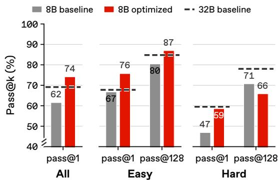  
Figure 1: On HotpotQA, the optimized harness enables Qwen3-8B to outperform even 32B under base harness in overall pass@1. On easy questions, this advantage holds at both pass@1 and pass@128. On hard questions, however, the optimized harness outperforms the original 8B baseline at pass@1 but falls below it at pass@128.

The heterogeneous effects recur throughout our analyses on various benchmarks. First, advantages over stronger references can reverse as the attempt budget increases: on LawBench (Fei et al., 2024), the optimized GPT-OSS-20B harness exceeds the GPT-OSS-120B baseline by 16.05 percentage points (pp) at pass@1, but trails it by 4.00 pp at pass@64. Second, on HotpotQA (Yang et al., 2018) and AppWorld (Trivedi et al., 2024), the selected harnesses approach or exceed stronger references in aggregate but do not surpass them on hard subsets. Third, the transferred text-classification harness falls below its baseline at pass@64 on all out-of-distribution datasets, despite small pass@1 gains on two. This heterogeneity makes systematic analysis necessary: understanding harness gains requires distinguishing reliability from coverage and examining how both change across attempt budgets, task groups, reference systems.

## 2 RELATED WORK

## 2.1 HARNESS OPTIMIZATION

Harness optimization adapts agent’s prompts, context, and execution logic through repeated evaluation and revision. TextGrad (Yuksekgonul et al., 2025) and GEPA (Agrawal et al., 2026) refine prompts through natural-language feedback, while ACE (Zhang et al., 2026d) incorporates lessons from execution into an evolving context playbook. Methods that search over agent code (Hu et al., 2025; Zhang et al., 2026b;e) use execution feedback to diagnose failures and guide revisions across harness components (Lin et al., 2026a; Zhang et al., 2026c; Park et al., 2026; Yue et al., 2026). Our study focuses on Meta-Harness (Lee et al., 2026b), which uses a coding-agent proposer to selectively inspects prior harness code, evaluation scores, and execution traces for new candidates.

## 2.2 INTERPRETING CAPABILITY GAINS

Analyses of reinforcement learning show that higher pass@1 can accompany reduced coverage at large sampling budgets (Yue et al., 2025), while other studies find broader coverage under different training and evaluation conditions (Wen et al., 2026; Zhang et al., 2026a). Recent work further documents smaller gains on harder problems under standard reinforcement learning and shows that adaptive sampling can improve learning on these problems (Noukhovitch et al., 2026). Studies of repeated sampling (Brown et al., 2024) and agent interaction budgets (Zhai et al., 2026) examine how additional attempts and interactions affect coverage, while test-time scaling analyses show that effective compute allocation depends on task difficulty (Snell et al., 2025). For harness optimization, analyses compare evolution with test-time search (Wang et al., 2026), trace gains to execution repairs (Yang et al., 2026), and examine the repeatability (Zhao et al., 2026) and model dependence (Lin et al., 2026b) of improvements. We analyze optimized harnesses across attempt budgets and difficulty levels, distinguishing coverage gains over the original baseline from advantages that persist against baselines with larger models or more inference compute.

## 3 ANALYSIS SETUP

## 3.1 PRELIMINARY: HARNESS OPTIMIZATION

Let M denote a solver model and H its harness, which controls model inputs, tool interactions, and execution state. On a task x, executing $( { \mathcal { M } } , H )$ yields a complete trajectory τ $\sim \pi _ { \mathcal { M } , H } ( \cdot \mid x )$ , evaluated by a task-specific scoring function $r ( \tau , x )$ . Given a task distribution $x ,$ , harness optimization seeks to maximize the expected task score $\dot { J } ( \mathcal { M } , H )$ by revising H while keeping M fixed:

$$
\operatorname* { m a x } _ { H } \ J ( \mathcal { M } , H ) , \qquad J ( \mathcal { M } , H ) = \mathbb { E } _ { x \sim \mathcal { X } , \tau \sim \pi _ { \mathcal { M } , H } ( \cdot \vert x ) } { \big [ } r ( \tau , x ) { \big ] } .
$$

For our main experiments, we use Meta-Harness (Lee et al., 2026b), whose coding agent, called proposer, selectively inspects previous harness code, evaluation scores, and execution traces to diagnose failures and propose revised harnesses. Each candidate is evaluated, and its code and execution feedback are retained to guide subsequent proposals. Our analysis compares the initial harness $H _ { 0 }$ with an optimized harness $H ^ { \star }$ selected based on validation performance. We estimate their pass@k from repeated executions on a common test set under the same task-specific scorer (Appendix A).

## 3.2 MOTIVATION: BEYOND MEAN ACCURACY

For a fixed set of tasks and number of attempts (k) per task, pass@1 determines the expected number of successful executions $( i . e .$ , mean accuracy), whereas pass@k measures the expected fraction of tasks solved at least once in k complete executions (Chen et al., 2021) $( i . e . ,$ coverage). A harness can therefore achieve higher mean accuracy but low coverage, by repeatedly solving the same tasks without obtaining successes on additional ones. When generated solutions are used for self-training (Zelikman et al., 2022) or verifier-based selection (Cobbe et al., 2021), coverage is particularly important as it captures the breadth of tasks for which a successful example or solution is available.

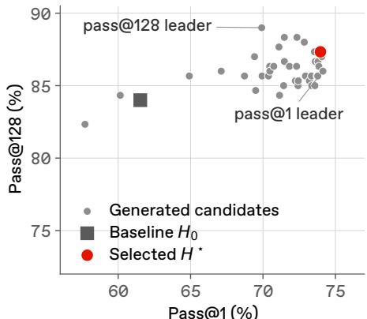  
Figure 2: Mean accuracy and coverage for harnesses from one optimization run.

evaluated on the same 300 HotpotQA tasks with $k = 1 2 8$ executions per task. Although the two metrics broadly track one another, the candidate with the highest estimated pass@1 differs from the one with the highest observed pass@128. Repeated evaluation can improve the precision of pass@1, but does not make it a substitute for measuring task coverage at larger budgets.

## 4 EVALUATION SETUP

We refer to $( M , H _ { 0 } )$ and $( M , H ^ { \star } )$ as the baseline and optimized system, respectively. The reference $\left( \mathcal { M } _ { \mathrm { r e f } } , H _ { 0 } \right)$ ) uses the base harness with a larger solver model or the same solver model at higher reasoning effort. We compare each system on a large k attempts. More details are in Appendix B.

## 4.1 STATIC TASKS

Text classification. Following Lee et al. (2026b), we jointly optimize a single harness across three static prediction datasets: Symptom2Disease (Gretel AI, 2023) for diagnosis from symptom descriptions, LawBench (Fei et al., 2024) for charge-set prediction, and USPTO (Schneider et al., 2016) for reactant-SMILES set prediction. In these tasks, the harness constructs reference context to support prediction. We use a few-shot harness as $H _ { 0 } ,$ , since directly supplying labeled examples provides a simple way to construct such context. The optimized harness $\grave { H } ^ { \star }$ prepares memory from the same pool and retrieves relevant information to construct context for each test input. Across repetitions, $H _ { 0 }$ resamples demonstrations and $H ^ { \star }$ rebuilds memory (Appendix C.2). For out-of-distribution (OOD) transfer, we reuse $H ^ { \star }$ obtained from in-distribution (ID) datasets to FiNER (Loukas et al., 2022), GoEmotions (Demszky et al., 2020), and Banking77 (Casanueva et al., 2020). We use GPT-OSS-20B (Agarwal et al., 2025) as M and GPT-OSS-120B as $\mathcal { M } _ { \mathrm { r e f } }$ for comparison.

## 4.2 DYNAMIC TASKS

Multi-hop QA. On HotpotQA (Yang et al., 2018), the harness coordinates evidence retrieval and answer generation. The base harness $H _ { 0 }$ follows multi-hop program of GEPA (Agrawal et al., 2026): it retrieves passages, generates a follow-up query from the retrieved evidence, and answers using summaries accumulated across the two retrieval rounds. We obtain $H ^ { \star }$ by optimizing the harness code governing query construction, evidence processing, and answer generation, while keeping the BM25 retriever fixed. Evaluation uses 300 test questions with their original difficulty labels. We use Qwen3-8B (Yang et al., 2025) as M and Qwen3-32B as $\mathcal { M } _ { \mathrm { r e f } }$ for comparison.

Agentic task. On AppWorld (Trivedi et al., 2024), the harness coordinates multi-turn interactions with simulated applications, where actions change the environment and execution feedback informs subsequent decisions. The baseline harness $H _ { 0 }$ follows the benchmark’s simplified ReAct implementation (Yao et al., 2023), alternating Python code generation and execution. Evaluation uses the 168 tasks in test normal with their original difficulty labels. We use GPT-OSS-120B for both M and $\mathcal { M } _ { \mathrm { r e f } }$ . The solver’s reasoning effort is fixed at medium during harness optimization and for the base and optimized systems; the reference system uses high reasoning effort.

## 5 EXPERIMENTAL RESULTS

## 5.1 DO OPTIMIZED HARNESSES PROVIDE GAINS OVER STRONGER REFERENCES?

## Observation

The optimized GPT-OSS-20B harness falls below the GPT-OSS-120B reference at pass@64 on all three static benchmarks, despite its varying relative performance at pass@1. As shown in Figure 3 (a-c), pass@1 of optimized harness nearly matches the 120B reference on Symptom2Disease, exceeds it on LawBench, and falls below it on USPTO. LawBench provides a particularly clear example: the 16.05 pp pass@1 advantage reverses at $k = 1 1 ;$ at pass@64, the optimized harness reaches 56% versus the reference’s 60%. Thus, a substantial single-attempt advantage does not necessarily translate into broader coverage under repeated attempts. Additional results on static tasks are in Appendix C.2.

On the dynamic benchmarks, the selected harnesses attain overall pass@1 and pass@128 close to those of their stronger references. On HotpotQA, both optimized Qwen3-8B harnesses exceed the 32B reference at pass@1, but only one remains above it at pass@128. On AppWorld, both optimized medium-effort harnesses fall below the high-effort reference at these endpoints, although one briefly exceeds it at k = 2. Comparisons within a single optimization run in Figure 8 (a) further illustrate that advantages in single-attempt success and finite-budget coverage do not coincide. Additional results on dynamic tasks are in Appendix C.3.

## Discussion

Baseline success patterns help explain the heterogeneous gains from harness optimization. To interpret the text-classification results, we compare the task-level success distributions of the

reference · H<sub>0</sub>  
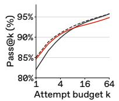  
(a) Symptom2Disease

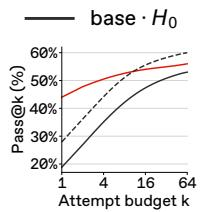  
(b) LawBench

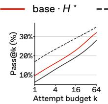  
(c) USPTO

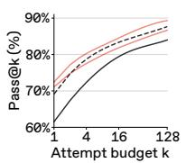  
(d) HotpotQA

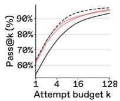  
(e) AppWorld

Figure 3: pass@k curves for the base solver with baseline $( H _ { 0 } )$ and selected optimized (H<sup>⋆</sup>) harnesses, compared with a stronger reference using $H _ { 0 } . \ \mathrm { ^ { * } b a s e ^ { ? } }$ and “reference” denote GPT-OSS-20B and GPT-OSS-120B for text classification (a-c), Qwen3-8B and Qwen3-32B for HotpotQA (d), and GPT-OSS-120B at medium and high reasoning effort for AppWorld (e), respectively. Each red curve represents a harness selected from one optimization run.  
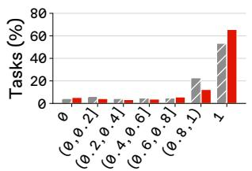  
(a) Symptom2Disease

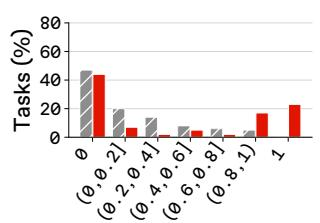

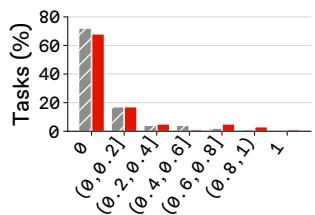  
(b) LawBench  
Observed success fraction  
(c) USPTO  
Figure 4: Distributions of task-level observed success fractions for GPT-OSS-20B with baseline $( \bar { H _ { 0 } } )$ and optimized $( H ^ { \star } )$ harnesses. Bars show the percentage of tasks within each dataset falling in each bin, computed separately for each harness.

## Discussion (continued)

baseline and optimized harnesses with GPT-OSS-20B in Figure 4. For each task x, we compute its observed success fraction $c / n$ separately under each harness, where $\begin{array} { r } { c = \sum _ { j = 1 } ^ { n } r ( \tau _ { j } , x ) } \end{array}$ . We then construct a separate distribution for each harness by grouping tasks according to these fractions, distinguishing no observed success, intermittent success, and success on every attempt. On Symptom2Disease, frequent baseline success leaves limited pass@1 headroom (Figure 4 (a)). Optimization improves reliable successes but with the slight decrease in pass@64 coverage. On LawBench, optimization primarily makes existing successes more frequent (Figure 4 (b)). Of the 53 tasks solved by the baseline within 64 attempts, the optimized harness retains 49 and loses 4, while newly solving 7 others; the retained tasks account for 21.02 pp of the 25.14 pp pass@1 gain (Appendix C.2). Consequently, the gain over the baseline narrows to 3.00 pp at pass@64 (Figure 3 (b)). On USPTO, observed coverage increases at pass@64, but 68 of 100 tasks still yield no success, leaving substantial headroom unrealized (Figure 4 (c)). These patterns suggest that opportunities for harness improvement depend on both the frequency and breadth of baseline successes. These patterns motivate a possible analogy to the Matthew effect reported by Noukhovitch et al. (2026), where RL gains tend to favor tasks with greater initial model ability. Harness optimization similarly concentrates gains on tasks with existing baseline successes.

Environment interaction provides additional opportunities for harness optimization. On dynamic tasks, optimized harness also shapes actions and hence subsequent observations, creating opportunities to acquire additional information. For instance, in our HotpotQA experiment, the base harness restates the question as its second retrieval query, leaving the “George Litto” abstract unreachable in all 128 rollouts and ultimately reporting that the producer of Blow Out is not mentioned. By instead querying the newly resolved bridge entity, the optimized harness reaches the relevant abstract in 125 of 128 rollouts and answers correctly in 122 times, turning previously inaccessible external evidence into usable context. This aligns with prior work showing that structuring action loops and agent interfaces can improve performance without up-

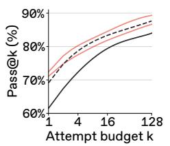  
(a) All tasks

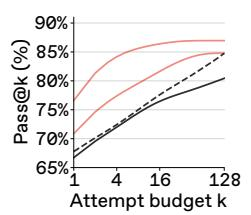  
(b) Easy

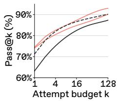  
(c) Medium

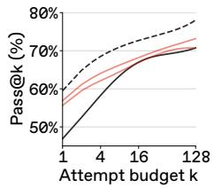  
(d) Hard  
Figure 5: HotpotQA pass@k curves for the Qwen3-8B baseline $( H _ { 0 } )$ and selected optimized harnesses $( H ^ { \star } )$ , with a Qwen3-32B baseline. Each red curve represents one selection from two optimization runs. Neither selected harness exceeds the Qwen3-32B baseline on the hard subset.

$$
\mathsf { G P T } \cdot \mathsf { O S S } \cdot 1 2 0 \mathsf { B } \cdot H _ { 0 }
$$

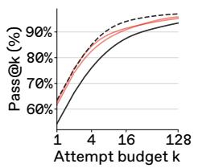  
(a) All tasks

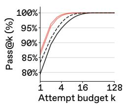  
(b) Easy

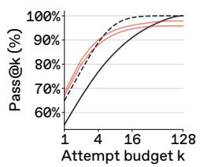  
(c) Medium

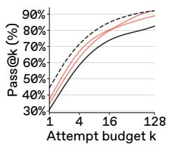  
(d) Hard  
Figure 6: AppWorld pass@k curves for the GPT-OSS-120B baseline $( H _ { 0 } )$ and selected optimized harnesses $( \bar { H ^ { \star } } )$ at medium reasoning effort, with a high-effort baseline. Each red curve represents one selection from two optimization runs. Neither selected harness exceeds the high-effort baseline on the hard subset.

## Discussion (continued)

dating model weights (Yao et al., 2023; Yang et al., 2024), while complementary evidence from tool-use RL suggests that improved sequential information gathering can broaden observed task coverage (Zhai et al., 2026). Such opportunities are absent or more limited in the static tasks in Figures 3 (a)-(c), where harness optimization mainly reshapes how the solver uses a fixed input. This contrast may help explain why, in the dynamic tasks in Figures 3 (d)-(e), the selected optimized harnesses produce pass@k curves that closely track those of the stronger references.

## Takeaway

Harness optimization can yield substantial pass@1 gains without matching stronger references at larger k, especially on static tasks. On dynamic tasks, improved environment interaction can expand accessible evidence, helping optimized harnesses more closely track stronger references.

## 5.2 DO OPTIMIZED HARNESS GAINS DIFFER BY TASK DIFFICULTY?

## Observation

Aggregate curves can conceal shortfalls on hard tasks. As shown in Figures 5 (a) and 6 (a), the selected harnesses approach or exceed their stronger references when evaluated across all tasks. However, as shown in Figures 5 (d) and 6 (d), these pooled curves obscure a consistent pattern on the hard subsets: none of the selected harnesses exceeds its stronger reference at any evaluated attempt budget. Stratifying the curves by difficulty labels provided by benchmark makes this contrast explicit. On easy HotpotQA questions, the selected harnesses with 8B model match or exceed the stronger 32B reference throughout the evaluated budgets (Figure 5 (b)); on easy AppWorld tasks, all systems eventually reach complete observed coverage (Figure 6 (b)). On hard HotpotQA questions, the selected harnesses improve pass@1 over the 8B baseline but

Hard  
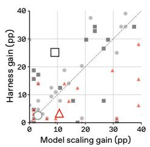  
(a) Text classification

Easy  
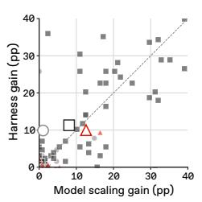  
(b) HotpotQA

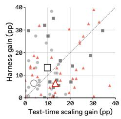  
(c) AppWorld

Figure 7: Task-level pass@1 gains (pp) from harness optimization versus model scaling (Text: GPT-OSS-20B to 120B; HotpotQA: Qwen3-8B to 32B) or reasoning effort (AppWorld: medium to high). Small markers denote tasks; outlined symbols show equal-task group means. The diagonal indicates equal gains.  
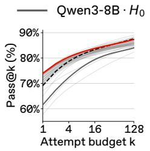  
(a) All tasks

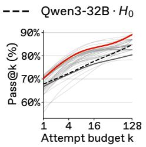  
(b) Easy

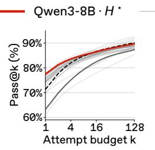  
(c) Medium

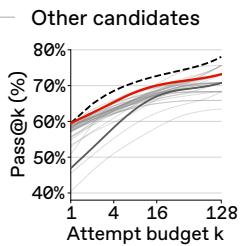  
(d) Hard  
Figure 8: HotpotQA pass@k curves for all 40 Qwen3-8B candidates generated in one optimization run, including the selected harness (red). On the hard subset, all candidate curves remain below the Qwen3-32B baseline.

## Observation (continued)

yield little additional coverage at pass@128, reaching 70.73-73.17%, compared with 70.73% for the baseline and 78.05% for the 32B reference (Figure 5 (d)). On hard AppWorld tasks, coverage gains over the medium-effort baseline are larger: the selected harnesses reach 88.89- 92.06% at pass@128, compared with the baseline’s 82.54%, but at best match the high-effort reference’s 92.06% (Figure 6 (d)). Thus, viewing the curves only in aggregate would miss a consistent limitation: parity or gains over stronger references across all tasks do not translate into an advantage on hard tasks.

## Discussion

Across all three benchmark panels, scaling yields larger mean pass@1 gains on hard groups than harness optimization. In Figure 7, we compare task-level pass@1 gains from harness optimization and model or effort scaling relative to the same original baseline. Here, the text classification groups are dataset-level proxies informed by the success distributions in Figure 4, whereas HotpotQA and AppWorld use their original difficulty labels. Across all three benchmark panels, the hard group means consistently favor scaling, highlighting that aggregate performance can conceal differences in where the two interventions provide their gains.

The hard task shortfall is shared by all candidates during the evolution. We study all 40 Qwen3-8B candidate harnesses from one optimization run in Figure 8. On easy and medium questions, some candidates match or exceed the 32B reference, with their relative performance varying across attempt budgets. On hard questions, however, every candidate’s pass@k curve remains below the 32B reference throughout k. Alternative candidates offer higher hard task coverage than the selected harness, but still fall short of the stronger reference. The selected harness achieves the highest hard task pass@1 among these candidates, yet does not attain the highest pass@128.

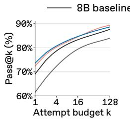  
(a) All tasks

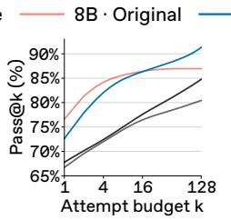  
(b) Easy

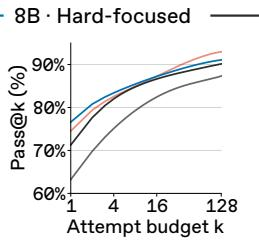  
(c) Medium

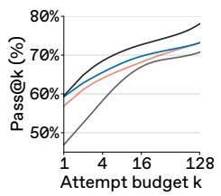  
(d) Hard

Figure 9: pass@k curves for Qwen3-8B harnesses optimized with the original and hard-focused task mixtures, alongside the 8B and 32B baselines, overall and by difficulty.  
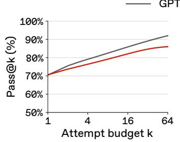  
(a) FiNER

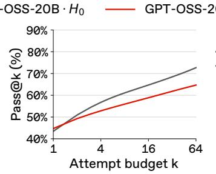  
(b) GoEmotions

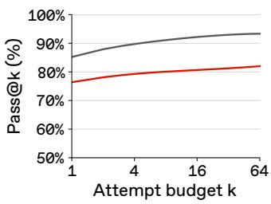  
(c) Banking77  
Figure 10: Harness transfer to new text-classification datasets. pass@k curves for GPT-OSS-20B with the baseline $( H _ { 0 } )$ and in-distribution selected harness $( H ^ { \star } )$ on out-of-distribution benchmarks; FiNER, GoEmotions, and Banking77.

## Discussion (continued)

The hard task shortfall persists even after optimization is redirected. One possible way to address the shared hard task shortfall is to give hard questions greater emphasis during optimization. To this end, we re-optimize the Qwen3-8B harness with a hard focused task mixture and examine whether this targeted intervention broadens coverage on hard test questions. As shown in Figure 9 (d), the resulting harness improves hard task pass@1 from the original optimized harness’s 56.88% to 59.28%, nearly matching the 32B reference’s 59.51%. At pass@128, however, coverage remains at 73.17%, unchanged from the original optimized harness and 4.88 percentage points below the reference’s 78.05%. Thus, even after explicitly redirecting optimization toward hard questions, the gain amounts to more frequent success without an increase in the number of hard questions solved within 128 attempts.

## Takeaway

When hard task coverage matters, evaluate whether harness optimization expands coverage on that subset at the intended attempt budget. Neither aggregate gains nor improved hard task pass@1 after hard-focused optimization establish broader coverage. Compare the optimized harness with feasible larger-model or higher-effort alternatives on the same subset.

## 5.3 DO OPTIMIZED HARNESSES TRANSFER TO OOD TASKS?

## Observation

The distinction between pass@1 and pass@64 also matters when the selected harness is transferred to new domains. We transfer the ID-selected GPT-OSS-20B harness used in Section 5.1 to OOD domains: FiNER, GoEmotions, and Banking77, with both base and optimized harnesses given labeled target-domain examples. As shown in Figure 10, the transferred harness’s pass@64

```python
(a) Base Harness
1 answer = solver(query, shuffle(labeled_examples))
2 return parse_final_answer(answer)
(b) Selected Harness
1 if average_label_length > 40:
2 return use_anchor_prompt(query, context)
3 elif number_of_labels >= 30 and average_label_length < 40:
4 return use_catalog_constrained_prompt(query, context)
5 else:
6 return use_plain_classification_prompt(query, context)
```  
Figure 11: Pseudocode derived from the base harness (a) and the subpart of the selected harness (b).

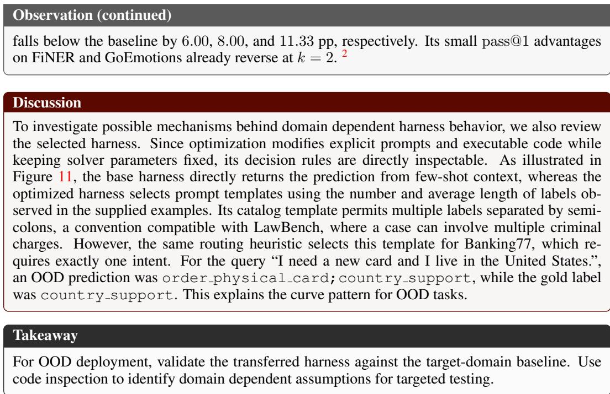

## 6 CONCLUSION

We provide a diagnostic lens for understanding what harness optimization improves, where its gains persist, and where performance shortfalls remain. By combining pass@k curves with stronger reference systems and analyses across task difficulty, we distinguish more reliable success from broader observed task coverage. These diagnostics help assess whether a harness suits an intended attempt budget and task group.

Limitations and future work. Achieving consistent capability expansion on hard tasks remains an important open challenge for harness optimization, especially when successful executions support recursive self-improvement or evolutionary search. This motivates search and selection methods that reward validated successes on previously uncovered hard tasks and retain candidates with complementary successes. Large-budget pass@k analysis provides a diagnostic basis. Our experimental results are bounded by the evaluated benchmarks, solver families, and optimization runs examined in this study.

## REFERENCES

Sandhini Agarwal, Lama Ahmad, Jason Ai, Sam Altman, Andy Applebaum, Edwin Arbus, Rahul K Arora, Yu Bai, Bowen Baker, Haiming Bao, et al. gpt-oss-120b & gpt-oss-20b model card. arXiv preprint arXiv:2508.10925, 2025.

Lakshya A Agrawal, Shangyin Tan, Dilara Soylu, Noah Ziems, Rishi Khare, Krista Opsahl-Ong, Arnav Singhvi, Herumb Shandilya, Michael J Ryan, Meng Jiang, Christopher Potts, Koushik Sen, Alex Dimakis, Ion Stoica, Dan Klein, Matei Zaharia, and Omar Khattab. GEPA: Reflective prompt evolution can outperform reinforcement learning. In The Fourteenth International Conference on Learning Representations, 2026. URL https://openreview.net/forum?id= RQm2KQTM5r.

Bradley Brown, Jordan Juravsky, Ryan Ehrlich, Ronald Clark, Quoc V Le, Christopher Re, and´ Azalia Mirhoseini. Large language monkeys: Scaling inference compute with repeated sampling. arXiv preprint arXiv:2407.21787, 2024.

Inigo Casanueva, Tadas Tem ˜ cinas, Daniela Gerz, Matthew Henderson, and Ivan Vuli ˇ c. Efficient ´ intent detection with dual sentence encoders. In Proceedings of the 2nd workshop on natural language processing for conversational AI, pp. 38–45, 2020.

Mark Chen, Jerry Tworek, Heewoo Jun, Qiming Yuan, Henrique Ponde de Oliveira Pinto, Jared Kaplan, Harri Edwards, Yuri Burda, Nicholas Joseph, Greg Brockman, Alex Ray, Raul Puri, Gretchen Krueger, Michael Petrov, Heidy Khlaaf, Girish Sastry, Pamela Mishkin, Brooke Chan, Scott Gray, Nick Ryder, Mikhail Pavlov, Alethea Power, Lukasz Kaiser, Mohammad Bavarian, Clemens Winter, Philippe Tillet, Felipe Petroski Such, Dave Cummings, Matthias Plappert, Fotios Chantzis, Elizabeth Barnes, Ariel Herbert-Voss, William Hebgen Guss, Alex Nichol, Alex Paino, Nikolas Tezak, Jie Tang, Igor Babuschkin, Suchir Balaji, Shantanu Jain, William Saunders, Christopher Hesse, Andrew N. Carr, Jan Leike, Josh Achiam, Vedant Misra, Evan Morikawa, Alec Radford, Matthew Knight, Miles Brundage, Mira Murati, Katie Mayer, Peter Welinder, Bob McGrew, Dario Amodei, Sam McCandlish, Ilya Sutskever, and Wojciech Zaremba. Evaluating large language models trained on code. arXiv preprint arXiv:2107.03374, 2021. URL https://arxiv.org/abs/2107.03374.

Karl Cobbe, Vineet Kosaraju, Mohammad Bavarian, Mark Chen, Heewoo Jun, Lukasz Kaiser, Matthias Plappert, Jerry Tworek, Jacob Hilton, Reiichiro Nakano, Christopher Hesse, and John Schulman. Training verifiers to solve math word problems. arXiv preprint arXiv:2110.14168, 2021. URL https://arxiv.org/abs/2110.14168.

Dorottya Demszky, Dana Movshovitz-Attias, Jeongwoo Ko, Alan Cowen, Gaurav Nemade, and Sujith Ravi. Goemotions: A dataset of fine-grained emotions. In Proceedings ofthe 58th annual meeting ofthe associationfor computational linguistics, pp. 4040–4054, 2020.

Zhiwei Fei, Xiaoyu Shen, Dawei Zhu, Fengzhe Zhou, Zhuo Han, Alan Huang, Songyang Zhang, Kai Chen, Zhixin Yin, Zongwen Shen, Jidong Ge, and Vincent Ng. LawBench: Benchmarking legal knowledge of large language models. In Proceedings ofthe 2024 Conference on Empirical Methods in Natural Language Processing, pp. 7933–7962. Association for Computational Linguistics, 2024. doi: 10.18653/v1/2024.emnlp-main.452. URL https://aclanthology. org/2024.emnlp-main.452/.

Shuzhi Gong and Hechuan Wen. Why prompt optimization works, and why it sometimes doesn’t: A causal-inspired edit-level analysis. arXiv preprint arXiv:2605.26655, 2026.

Gretel AI. Symptom to diagnosis dataset. Hugging Face dataset, 2023. URL https:// huggingface.co/datasets/gretelai/symptom\_to\_diagnosis.

Shengran Hu, Cong Lu, and Jeff Clune. Automated design of agentic systems. In International Conference on Learning Representations, volume 2025, pp. 21344–21377, 2025.

Hyunin Lee, Jinglue Xu, Jeffrey Seely, Donghyun Lee, Matei Zaharia, and Yujin Tang. Recursive harness self-improvement. arXiv preprint arXiv:2607.15524, 2026a.

Yoonho Lee, Roshen Sanjay Nair, Qizheng Zhang, Kangwook Lee, Omar Khattab, and Chelsea Finn. Meta-harness: End-to-end optimization of model harnesses. In Third Conference on Language Modeling, 2026b. URL https://openreview.net/forum?id=tmbOUyFx3R.

Jiahang Lin, Shichun Liu, Chengjun Pan, Lizhi Lin, Shihan Dou, Zhiheng Xi, Xuanjing Huang, Hang Yan, Zhenhua Han, Tao Gui, and Yu-Gang Jiang. Agentic harness engineering: Observability-driven automatic evolution of coding-agent harnesses. arXiv preprint arXiv:2604.25850, 2026a. URL https://arxiv.org/abs/2604.25850v4.

Minhua Lin, Juncheng Wu, Zijun Wang, Zhan Shi, Yisi Sang, Bing He, Zewen Liu, Tianxin Wei, Zongyu Wu, Zhiwei Zhang, et al. Harness updating is not harness benefit: Disentangling evolution capabilities in self-evolving llm agents. arXiv preprint arXiv:2605.30621, 2026b.

Lefteris Loukas, Manos Fergadiotis, Ilias Chalkidis, Eirini Spyropoulou, Prodromos Malakasiotis, Ion Androutsopoulos, and Georgios Paliouras. Finer: Financial numeric entity recognition for xbrl tagging. In Proceedings of the 60th Annual Meeting of the Association for Computational Linguistics (Volume 1: Long Papers), pp. 4419–4431, 2022.

Michael Noukhovitch, Hamish Ivison, Nathan Lambert, and Aaron Courville. Learning to solve hard problems in rl for llms by never giving up. arXiv preprint arXiv:2609.13443, 2026.

OpenAI. Harness engineering: leveraging Codex in an agent-first world. https://openai. com/index/harness-engineering/, February 2026. OpenAI Blog.

Sungho Park, Wonjoong Kim, Rongyuan Tan, Jue Zhang, Wook-Shin Han, Pengfei Gao, Chanyoung Park, Yongqiang Yao, Rao Fu, Elsie Nallipogu, et al. Autosaddler: Automatic harness optimization with durable updates from agent execution traces. arXiv preprint arXiv:2608.23041, 2026.

Nadine Schneider, Nikolaus Stiefl, and Gregory A. Landrum. What’s what: The (nearly) definitive guide to reaction role assignment. Journal ofChemical Information and Modeling, 56(12):2336– 2346, 2016. doi: 10.1021/acs.jcim.6b00564. URL https://doi.org/10.1021/acs. jcim.6b00564.

Charlie Victor Snell, Jaehoon Lee, Kelvin Xu, and Aviral Kumar. Scaling LLM test-time compute optimally can be more effective than scaling parameters for reasoning. In The Thirteenth International Conference on Learning Representations, 2025. URL https://openreview.net/ forum?id=4FWAwZtd2n.

Harsh Trivedi, Tushar Khot, Mareike Hartmann, Ruskin Manku, Vinty Dong, Edward Li, Shashank Gupta, Ashish Sabharwal, and Niranjan Balasubramanian. Appworld: A controllable world of apps and people for benchmarking interactive coding agents. In Proceedings ofthe 62nd Annual Meeting of the Association for Computational Linguistics (Volume 1: Long Papers), pp. 16022– 16076, 2024.

Yike Wang, Huaisheng Zhu, Zhengyu Hu, Yige Yuan, Zhengyu Chen, Shakti Senthil, Hannaneh Hajishirzi, Yulia Tsvetkov, Pradeep Dasigi, and Teng Xiao. Rethinking the evaluation of harness evolution for agents. In COLM 2026 The 2nd Workshop on Lifelong Agents: Learning, Aligning, and Evolving, 2026.

Xumeng Wen, Zihan Liu, Shun Zheng, Shengyu Ye, Zhirong Wu, Yang Wang, Zhijian Xu, Xiao Liang, Junjie Li, Ziming Miao, Jiang Bian, and Mao Yang. Reinforcement learning with verifiable rewards implicitly incentivizes correct reasoning in base LLMs. In The Fourteenth International Conference on Learning Representations, 2026. URL https://openreview.net/forum? id=jGbRWwIidy.

An Yang, Anfeng Li, Baosong Yang, Beichen Zhang, Binyuan Hui, Bo Zheng, Bowen Yu, Chang Gao, Chengen Huang, Chenxu Lv, et al. Qwen3 technical report. arXiv preprint arXiv:2505.09388, 2025.

John Yang, Carlos E Jimenez, Alexander Wettig, Kilian Lieret, Shunyu Yao, Karthik R Narasimhan, and Ofir Press. SWE-agent: Agent-computer interfaces enable automated software engineering. In The Thirty-eighth Annual Conference on Neural Information Processing Systems, 2024. URL https://openreview.net/forum?id=mXpq6ut8J3.

Siqi Yang, Qianlan Yang, Yu-Xiong Wang, Saurabh Pujar, and Martin Hirzel. One recipe, many harnesses: What self-evolution encodes across languages and models. arXiv preprint arXiv:2608.10178, 2026.

Zhilin Yang, Peng Qi, Saizheng Zhang, Yoshua Bengio, William Cohen, Ruslan Salakhutdinov, and Christopher D Manning. Hotpotqa: A dataset for diverse, explainable multi-hop question answering. In Proceedings of the 2018 conference on empirical methods in natural language processing, pp. 2369–2380, 2018.

Shunyu Yao, Jeffrey Zhao, Dian Yu, Nan Du, Izhak Shafran, Karthik R Narasimhan, and Yuan Cao. React: Synergizing reasoning and acting in language models. In The Eleventh International Conference on Learning Representations, 2023. URL https://openreview.net/forum? id=WE\_vluYUL-X.

Haoran Ye, Xuning He, Vincent Arak, Haonan Dong, and Guojie Song. Meta context engineering via agentic skill evolution. In Forty-third International Conference on Machine Learning, 2026. URL https://openreview.net/forum?id=P1jHroBS5E.

Justin Young. Effective harnesses for long-running agents. https://anthropic.com/ engineering/effective-harnesses-for-long-running-agents, November 2025. Anthropic Engineering Blog.

Ruiqing Yue, Yu Cui, Zhuoyu Sun, Sicheng Pan, Xianhong Xue, Tingyu Li, Ting Li, Wenzhuo Zhu, Yi Chen, Yifei Liu, et al. Ecdysis: Efficient and effective training of runtime harnesses for llm agents. arXiv preprint arXiv:2609.11677, 2026.

Yang Yue, Zhiqi Chen, Rui Lu, Andrew Zhao, Zhaokai Wang, Yang Yue, Shiji Song, and Gao Huang. Does reinforcement learning really incentivize reasoning capacity in LLMs beyond the base model? In The Thirty-ninth Annual Conference on Neural Information Processing Systems, 2025. URL https://openreview.net/forum?id=4OsgYD7em5.

Mert Yuksekgonul, Federico Bianchi, Joseph Boen, Sheng Liu, Pan Lu, Zhi Huang, Carlos Guestrin, and James Zou. Optimizing generative ai by backpropagating language model feedback. Nature, 639:609–616, 2025.

Eric Zelikman, Yuhuai Wu, Jesse Mu, and Noah Goodman. STar: Bootstrapping reasoning with reasoning. In Alice H. Oh, Alekh Agarwal, Danielle Belgrave, and Kyunghyun Cho (eds.), Ad vances in Neural Information Processing Systems, 2022. URL https://openreview.net/ forum?id=\_3ELRdg2sgI.

Zhiyuan Zhai, Wenjing Yan, Xiaodan Shao, and Xin Wang. Does rl expand the capability boundary of llm agents? a pass@(k, t) analysis. arXiv preprint arXiv:2604.14877, 2026.

Charlie Zhang, Graham Neubig, and Xiang Yue. On the interplay of pre-training, mid-training, and RL on reasoning language models. In Forty-third International Conference on Machine Learning, 2026a. URL https://openreview.net/forum?id=TBaUfO9znF.

Jenny Zhang, Shengran Hu, Cong Lu, Robert Tjarko Lange, and Jeff Clune. Darwin godel ma-¨ chine: Open-ended evolution of self-improving agents. In The Fourteenth International Conference on Learning Representations, 2026b. URL https://openreview.net/forum?id= pUpzQZTvGY.

Luan Zhang, Ruochen Zhou, Dandan Song, Zhengyu Chen, Yuhang Tian, Jun Yang, Huipeng Ma, Chenhao Li, Guangyuan Feng, Xudong Li, et al. Harnesscompass: Guiding automatic harness evolution toward generalizable and effective agent harnesses. arXiv preprint arXiv:2608.01918, 2026c.

Qizheng Zhang, Changran Hu, Shubhangi Upasani, Boyuan Ma, Fenglu Hong, Vamsidhar Kamanuru, Jay Rainton, Chen Wu, Mengmeng Ji, Hanchen Li, Urmish Thakker, James Zou, and Kunle Olukotun. Agentic context engineering: Evolving contexts for self-improving language models. In The Fourteenth International Conference on Learning Representations, 2026d. URL https://openreview.net/forum?id=eC4ygDs02R.

Yifan Zhang, Yutong Dai, Juntao Tan, Luyu Yang, Rishi Mullur, Thai Hoang, Zhiyuan Hu, James Zhu, Phil Mui, Silvio Savarese, et al. Darwinx: Evolving agent harnesses through natural selection. arXiv preprint arXiv:2608.07545, 2026e.

Cen Mia Zhao, Haibo Ruan, Wenjie Chen, Pei fen Tu, Usman Abbasi, and Joel Hesch. Beyond prompts: Measuring and optimizing llm tool-agent harnesses, 2026. URL https://arxiv. org/abs/2609.05736.

## A REPEATED EVALUATION AND pass@k

We repeat complete executions of each fixed solver–harness pair on the same $N$ test tasks, including all internal model calls and tool interactions. Let $n$ be the number of rollouts and $c _ { i }$ be the number of successes of task $x _ { i }$ . We estimate coverage within k attempts following Chen et al. (2021):

$$
\mathrm { p a s s } \ @ k ( M , H ) = \frac { 1 } { N } \sum _ { i = 1 } ^ { N } \left[ 1 - \frac { { \binom { n - c _ { i } } { k } } } { { \binom { n } { k } } } \right] , \qquad 1 \le k \le n ,\tag{1}
$$

where the numerator is zero when $n - c _ { i } < k$ . Tasks are weighted equally within each dataset or benchmark; text macro averages weight datasets equally. $\mathrm { A t } \ k = 1$ , this is mean task success; at $k = n$ for equal-sized pools, it is the fraction solved at least once. Equation 1 is unbiased under independent, identically distributed attempts from a fixed policy.

## B EXPERIMENTAL DETAILS

## B.1 DATASETS AND SPLITS

We follow prior split protocols, with sample sizes and adaptations in Table 1. Symptom2Disease, LawBench, USPTO, and FiNER use the MCE splits (Ye et al., 2026) distributed with Meta-Harness (Lee et al., 2026b); GoEmotions (Demszky et al., 2020) and Banking77 (Casanueva et al., 2020) derive from their public releases. We subsample only examples with one annotated label from official splits for GoEmotions to ease the evaluation. HotpotQA follows GEPA’s split sizes (Agrawal et al., 2026) using disjoint subsets of the official fullwiki training set. AppWorld retains the official train, development, and test\_normal partitions (Trivedi et al., 2024). Both dynamic benchmarks retain their original difficulty labels.

Table 1: Dataset sizes and split roles. Prep. supplies examples or tasks to the harness; search/validation supplies optimization feedback. Reused selection shares the validation set.
<table><tr><td>Dataset</td><td>Prep.</td><td>Search/val.</td><td>Select.</td><td>Test</td></tr><tr><td>Symptom2Disease (ID)</td><td>200</td><td>50</td><td>reused</td><td>212</td></tr><tr><td>LawBench (ID)</td><td>200</td><td>50</td><td>reused</td><td>100</td></tr><tr><td>USPTO (ID)</td><td>50</td><td>30</td><td>reused</td><td>100</td></tr><tr><td>FiNER (OOD)</td><td>200</td><td></td><td></td><td>100</td></tr><tr><td>GoEmotions (OOD)</td><td>200</td><td></td><td></td><td>150</td></tr><tr><td>Banking77 (OOD)</td><td>200</td><td></td><td></td><td>150</td></tr><tr><td>HotpotQA</td><td>150</td><td>300</td><td>300</td><td>300</td></tr><tr><td>AppWorld</td><td>30</td><td>60</td><td>57</td><td>168</td></tr></table>

## B.2 BASELINES AND HARNESS OPTIMIZATION

We use Meta-Harness (Lee et al., 2026b) with Claude Opus 5 as the coding-agent proposer, keeping solver weights fixed. Each optimization allows 20 iterations with up to two proposals per iteration.

Text classification. We use GPT-OSS-20B for the baseline and optimized harness, with GPT-OSS-120B as the stronger reference; all use medium reasoning effort and temperature 0. Both baselines adapt the few-shot harness of Lee et al. (2026b), resampling demonstrations for each query and repetition within a pre-defined character budget. We select by equal-dataset mean validation accuracy. The selected harness rebuilds memory from preparation examples for each repetition. OOD evaluation uses GPT-OSS-20B with the same preparation policy on target-domain examples, without further code optimization.

HotpotQA. We use Qwen3-8B with Qwen3-32B as the stronger reference, both at temperature $0 . 6 .$ The baseline follows GEPA’s multihop seed program (Agrawal et al., 2026) with BM25 retrieval. The optimized harnesses are capped at four solver calls, two retrievals, and seven passages per retrieval as well as the baseline. We shortlist candidates using validation performance and select by exact match (EM) on a separate selection set.

AppWorld. We use GPT-OSS-120B at medium reasoning effort, with a high-effort baseline as the stronger reference. Repeated evaluation uses temperature 1. The baseline ports AppWorld’s simplified ReAct agent (Trivedi et al., 2024). Each attempt permits 50 solver calls and 50 environment steps, with a 2,400-second timeout extended to 7,200 seconds for high effort. Search and selection use temperature zero and original TGC, with final selection on the development set.

## B.3 SUCCESS SCORERS

We apply the same scorer to all systems within each benchmark, relaxing format requirements where necessary to better distinguish task completion from format compliance. In text classification, we use binary correctness after dataset-specific surface normalization. In HotpotQA, to accept correct answers embedded in longer responses, we use Judge = (Contain ∧ CORRECT): answer containment with an LLM judgment confirming correctness. Table 2 gives examples that illustrate the failure mode from the Qwen3-32B baseline in Figure 5. Each complete response states the reference answer but receives EM = 0. With 128 attempts per task, EM gives the Qwen3-32B lower pass@1 than Qwen3-8B, which is counterintuitive, whereas Judge reverses this ordering. In AppWorld, we use arity-fixed TGC: original successes remain successful, and an action attempt is additionally accepted only if all state checks pass, no execution error is recorded, and its sole failed check concerns an unrequested answer. With 128 attempts per task, original TGC ranks the GPT-OSS-120B below GPT-OSS-20B at pass@1; arity-fixed TGC reverses this ordering.

Table 2: Exact-match false negatives from the Qwen3-32B HotpotQA baseline. Bold spans mark reference answers in the complete recorded responses.
<table><tr><td>Question</td><td></td><td>Reference answer Complete recorded answer</td></tr><tr><td>Which band was formed first, Loudspeakers or Marcy Playground Marcy Playground was formed first. Marcy Playground?</td><td></td><td></td></tr><tr><td>Which dog is larger, the Cirneco dell&#x27;Etna or Siberian Husky the Siberian Husky?</td><td></td><td>The Siberian Husky is larger than the Cirneco dell&#x27;Etna.</td></tr><tr><td>John Alexander is the uncle of the player who right-back plays what position for Liverpool?</td><td></td><td>The player is a right-back for Liverpool.</td></tr><tr><td>Intimidad de los parques was based on a short Argentine story by the novelist and essayist of what nationality?</td><td></td><td>The novelist and essayist was Argentine.</td></tr><tr><td>When was the direct-to-video movie that borrows heavily from a 1988 American action film starring Bruce Willis released?</td><td>1996</td><td>The direct-to-video movie was released in 1996.</td></tr></table>

GPT-OSS-120B · H<sub>0</sub>

## C ADDITIONAL EXPERIMENTAL RESULTS

## C.1 VARIATION ACROSS OPTIMIZATION RUNS

We repeat harness optimization three times per benchmark and evaluate the selected harness from each run. Figure 12 shows the mean and sample standard deviation (SD) across runs. Evaluation uses 64 attempts per task for text classification and 128 for HotpotQA and AppWorld. Mean gains over the original baseline shrink from pass@1 to the largest evaluated budget in all three benchmarks. The amount of the gain varies across runs, but improved single-attempt success does not consistently yield an advantage over stronger references at larger budgets. In text classification, all three optimized systems fall below the larger-model reference at pass@64. On hard HotpotQA and AppWorld tasks, none exceeds the larger-model or higher-effort reference, respectively, anywhere along the evaluated curves. SD includes evaluation and preparation; it does not isolate optimizer variance.

## Text Classification

GPT-OSS-20B · H<sub>0</sub>

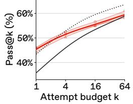  
(a) ID macro

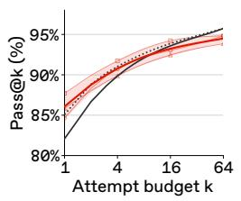  
(b) Symptom2Disease

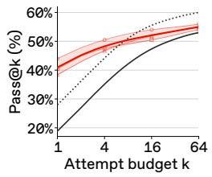  
(c) LawBench

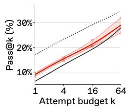  
(d) USPTO

HotpotQA  
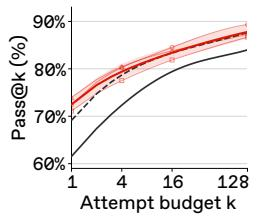  
(e) All tasks

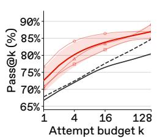  
(f) Easy

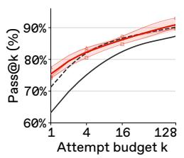  
(g) Medium

Qwen3-32B · H<sub>0</sub>  
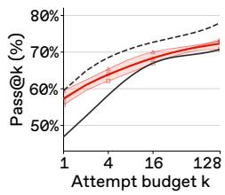  
(h) Hard

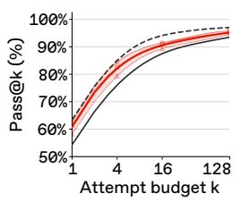  
(i) All tasks

AppWorld  
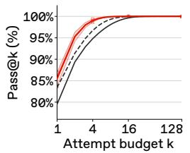  
(j) Easy

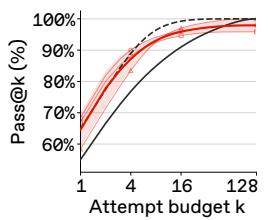  
(k) Medium

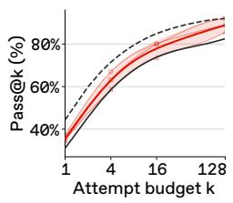  
(l) Hard  
Figure 12: pass@k across three optimization runs: mean ±1 sample SD (thick red curves and bands), individual runs (marked curves), and shared baselines (gray).

## C.2 STATIC TASKS

Additional results on GPT-OSS-120B. Single-attempt gains also do not improve pass@64 for GPT-OSS-120B. In Figure 13, LawBench pass@1 increases from 27.95% to 38.66%, while pass@64 decreases from 60% to 59%. The optimized harness also has lower pass@64 on Symptom2Disease, and its USPTO curve remains below the baseline throughout.

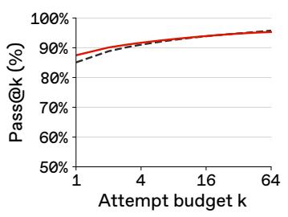  
(a) Symptom2Disease

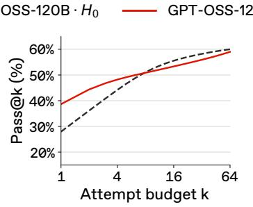  
(b) LawBench

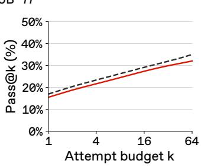  
(c) USPTO  
Figure 13: Text-classification pass@k curves for the GPT-OSS-120B baseline $( H _ { 0 } )$ and selected optimized harnesses $( H ^ { \star } )$ .

Task-level changes in observed success sets. Net coverage changes on the static tasks combine newly solved and lost tasks across each dataset, as shown in Table 3.

Table 3: Changes in observed success sets from the GPT-OSS-20B base harness $( H _ { 0 } )$ to the selected harness $( H ^ { \star } )$ in Figure 3 (a)-(c), with $n = k = 6 4 . \ S _ { 0 }$ and $S _ { \star }$ are the tasks with at least one success under $H _ { 0 }$ and $H ^ { \star }$
<table><tr><td></td><td></td><td colspan="3">Tasks</td><td colspan="4">pass@1 gain (pp)</td></tr><tr><td>Dataset</td><td> $| S _ { 0 } |  | S _ { \star } |$ </td><td> $S _ { \star } \setminus S _ { 0 }$ </td><td> $S _ { 0 } \setminus S _ { \star }$ </td><td> $S _ { 0 } \cap S _ { \star }$ </td><td>Total</td><td> $S _ { 0 } \cap S _ { \star }$ </td><td>S* \ S0</td><td> $S _ { 0 } \backslash S _ { \star }$ </td></tr><tr><td>Symptom2Disease</td><td> $2 0 3  2 0 1$ </td><td>3</td><td>5</td><td>198</td><td>+2.57</td><td>+2.63</td><td>+0.38</td><td>-0.43</td></tr><tr><td>LawBench</td><td> $5 3  5 6$ </td><td>7</td><td>4</td><td>49</td><td>+25.14</td><td>+21.02</td><td>+4.64</td><td>-0.52</td></tr><tr><td>USPTO</td><td> $2 8  3 2$ </td><td>7</td><td>3</td><td>25</td><td>+3.39</td><td>+3.25</td><td>+0.19</td><td>-0.05</td></tr></table>

Frozen memory. Reusing one prepared memory across repetitions, instead of rebuilding it for each repetition, leaves the pattern in Figure 3 (a)-(c) unchanged, as shown in Table 4. With either memory policy, the selected GPT-OSS-20B harness improves pass@1 over $H _ { 0 }$ on all three datasets, while at pass@64 it falls below $H _ { 0 }$ on Symptom2Disease, its LawBench gain narrows, and it remains below the GPT-OSS-120B reference on every dataset.

Table 4: pass@1 and pass@64 (%) for the text-classification in Figure 3 (a)-(c), with $n \ : = \ : 6 4 .$ Rebuilt and Frozen denote the selected GPT-OSS-20B harness $( H ^ { \star } )$ with memory rebuilt for each repetition, as in the figure, or prepared once per dataset and reused.
<table><tr><td></td><td colspan="4">pass@1</td><td colspan="4">pass@64</td></tr><tr><td>Dataset</td><td>20B  $H _ { 0 }$ </td><td>Rebuilt</td><td>Frozen</td><td>120B  $H _ { 0 }$ </td><td>20B  $H _ { 0 }$ </td><td>Rebuilt</td><td>Frozen</td><td>120B  $H _ { 0 }$ </td></tr><tr><td>Symptom2Disease</td><td>82.08</td><td>84.66</td><td>86.34</td><td>85.08</td><td>95.75</td><td>94.81</td><td>92.45</td><td>95.75</td></tr><tr><td>LawBench</td><td>18.86</td><td>44.00</td><td>43.53</td><td>27.95</td><td>53.00</td><td>56.00</td><td>53.00</td><td>60.00</td></tr><tr><td>USPTO</td><td>6.25</td><td>9.64</td><td>10.03</td><td>16.94</td><td>28.00</td><td>32.00</td><td>30.00</td><td>35.00</td></tr></table>

Random guessing on static tasks. Both harnesses exceed uniform-guessing coverage on the four single-label datasets at smaller k, as shown in Table 5. Independent uniform guesses over L labels yield expected coverage $1 - ( 1 - 1 / L ) ^ { k }$

Table 5: Coverage (%) for uniform-label guessing and the GPT-OSS-20B baseline $( H _ { 0 } )$ and selected harness $( H ^ { \star } )$ in Figures 3 and 10. Guessing values are analytical; harness estimates use $n = 6 4$
<table><tr><td rowspan="2">Dataset</td><td colspan="3">pass@4</td><td colspan="3">pass@8</td></tr><tr><td>Guessing</td><td> $H _ { 0 }$ </td><td> $H ^ { \star }$ </td><td>Guessing</td><td> $H _ { 0 }$ </td><td> $H ^ { \star }$ </td></tr><tr><td>In-distribution</td><td></td><td></td><td></td><td></td><td></td><td></td></tr><tr><td>Symptom2Disease</td><td>16.98</td><td>89.86</td><td>90.72</td><td>31.08</td><td>92.08</td><td>92.16</td></tr><tr><td>LawBench</td><td></td><td>35.12</td><td>50.51</td><td></td><td>42.15</td><td>52.59</td></tr><tr><td>USPTO</td><td></td><td>12.90</td><td>16.10</td><td></td><td>16.08</td><td>19.30</td></tr><tr><td>Out-of-distribution</td><td></td><td></td><td></td><td></td><td></td><td></td></tr><tr><td>FiNER</td><td>29.39</td><td>79.11</td><td>76.39</td><td>50.15</td><td>82.44</td><td>79.17</td></tr><tr><td>GoEmotions</td><td>13.54</td><td>56.74</td><td>52.84</td><td>25.24</td><td>61.08</td><td>55.92</td></tr><tr><td>Banking77</td><td>5.09</td><td>89.73</td><td>79.29</td><td>9.93</td><td>91.10</td><td>80.07</td></tr></table>

Guessing samples the complete label inventory uniformly with replacement. This single-label reference is not applicable to LawBench and USPTO, which require open-ended structured outputs.

## C.3 DYNAMIC TASKS

We also optimize a harness for GPT-OSS-20B on each dynamic benchmark, as shown in $\mathrm { F i g \mathrm { - } }$ ure 14. The optimized system exceeds the 120B baseline on HotpotQA at pass@128 (89.00% versus 85.33%), while remaining slightly below it on AppWorld at pass@64 (91.07% versus 91.67%).

$$
\begin{array} { r l r l r l } & { \_ } & { \mathsf { G P T ^ { - } O S S ^ { - } 2 0 B } \cdot H _ { 0 } } & { \_ } & { \mathsf { G P T ^ { - } O S S ^ { - } 2 0 B } \cdot H ^ { \cdot } } & { \_ } & { \mathsf { G P T ^ { - } O S S ^ { - } 1 2 0 B } \cdot H _ { 0 } } \end{array}
$$

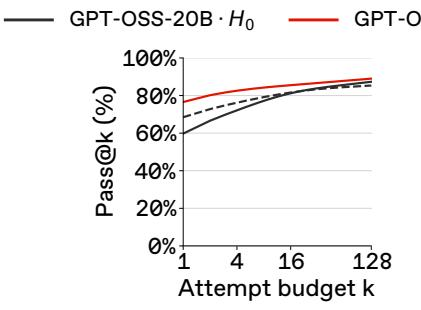  
(a) HotpotQA

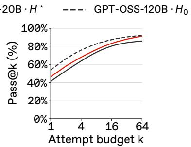  
(b) AppWorld  
Figure 14: pass@k curves for the GPT-OSS-20B baseline $( H _ { 0 } )$ and selected optimized harnesses $( \bar { H } ^ { \star } )$ , with a GPT-OSS-120B baseline.

Optimization with aligned scorers. We repeat optimization and selection with the success scorers defined in Appendix B.3. We retain the original test sets and difficulty groups and evaluate through $k = 1 2 8$ . Figures 15 and 16 are consistent with the main findings in Section 5.2. Overall gains over the original baselines narrow from pass@1 to pass@128, while the displayed harnesses remain below the larger-model or higher-effort reference on hard tasks throughout k.

  
(a) All tasks

  
(b) Easy

  
(c) Medium

  
(d) Hard  
Figure 15: HotpotQA pass@k with Judge used for optimization, selection, and evaluation.

  
(a) All tasks

  
(b) Easy

  
(c) Medium

  
(d) Hard  
Figure 16: AppWorld pass@k with arity-fixed TGC used for optimization, selection, and evaluation.

## C.4 OPTIMIZATION CONDITIONS

Relaxed resource limits do not yield higher mean coverage at $k = 1 2 8$ in these runs. We compare three Qwen3-8B optimization runs per setting, with caps of 4 solver calls, 2 retrievals, and 7 passages per retrieval (tight) versus 12/12/20 (relaxed). Each run proposes 40 candidates on the same optimization splits; the caps apply during both optimization and evaluation.

Table 6: HotpotQA Judge scores (%) on 300 test questions with $n = 1 2 8$ , reported as mean ± sample SD across three runs per cap setting.
<table><tr><td>Caps</td><td>pass@1</td><td>pass@128</td></tr><tr><td>Relaxed</td><td> $7 3 . 3 9 \pm 1 . 6 0$ </td><td> $8 7 . 2 2 \pm 1 . 5 4$ </td></tr><tr><td>Tight</td><td> $7 2 . 5 0 \pm 1 . 4 3$ </td><td> $8 7 . 7 8 \pm 1 . 3 9$ </td></tr></table>