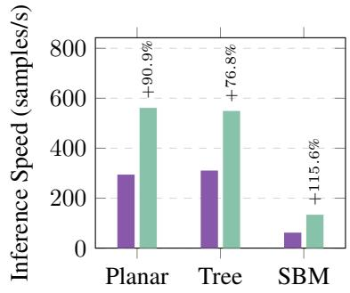
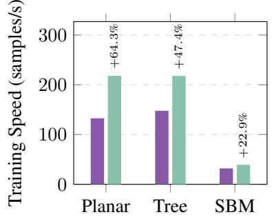
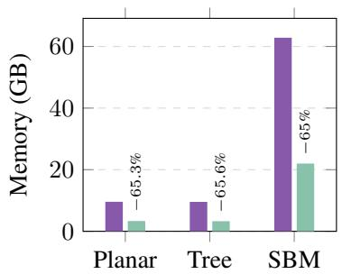
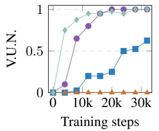
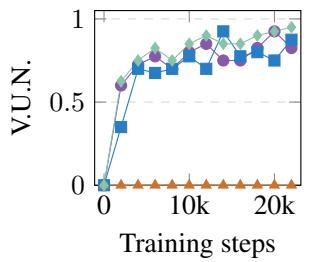
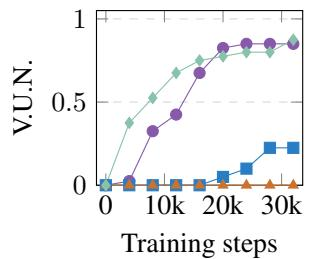
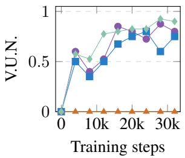
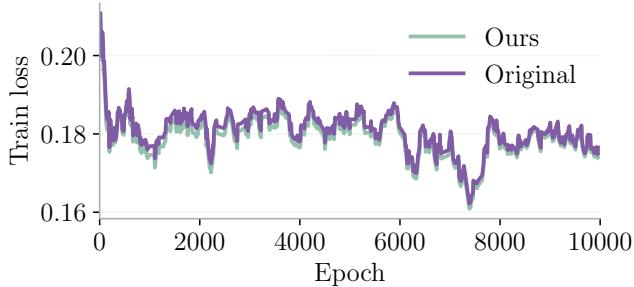
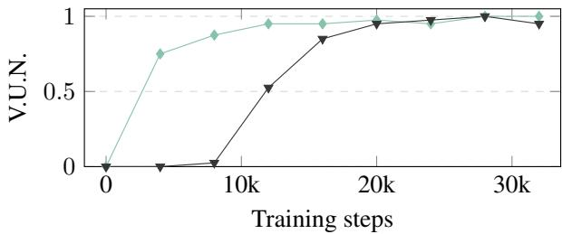
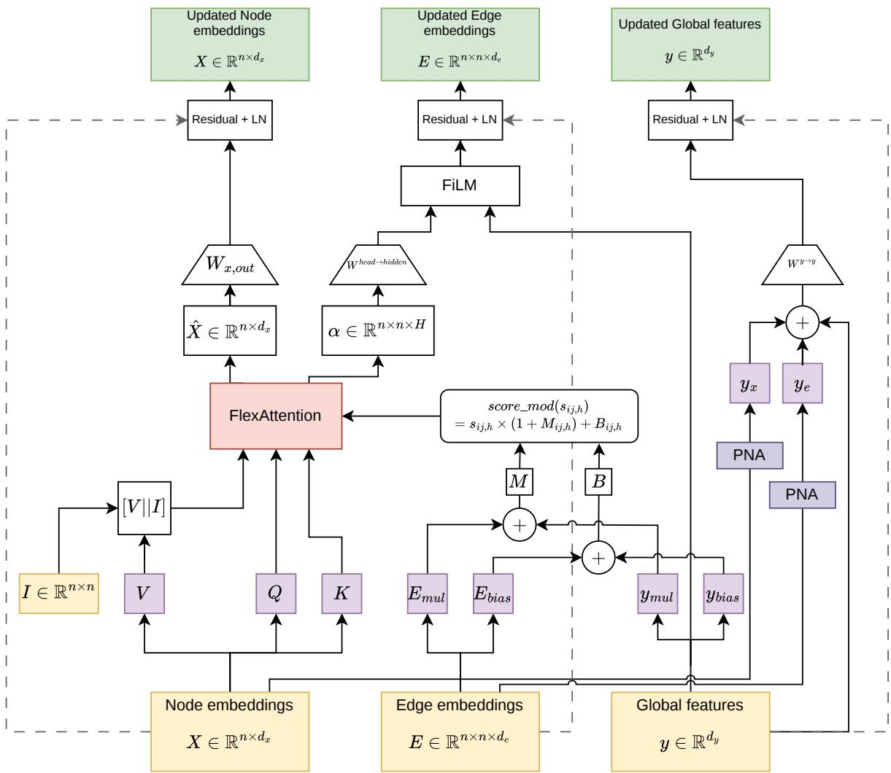

# Efficient Edge-aware Attention Network for Graph Generation

Vincent Jung \* 1 2 Alba Carballo-Castro \* 1 Yiming Qin \* 1 Lonneke van der Plas 2 Pascal Frossard 1

## Abstract

Graph generative models commonly use graphspecific Transformer architectures to jointly update node and edge features. However, these architectures do not directly benefit from recent hardware-aware attention implementations, limiting their scalability. The adaptation is, however, non-trivial: edge and graph-level features must be injected into pairwise attention scores, graph masks must be respected, and dynamic edge updates remain a major source of quadratic memory usage. We propose an edge-aware attention layer for graph generation that incorporates structural information through head-wise score modulation, while updating edge representations with a lightweight residual mechanism that retains attention-score dependent edge updates. This layer can be effectively implemented using Py-Torch’s FlexAttention. We achieve similar generation quality to our baseline while reducing peak GPU memory by around 65% and substantially improving training and sampling throughput. These results suggest that the proposed architecture is a practical step toward scalable graph foundation models.

§ Code

## 1. Introduction

Graph generation (Simonovsky & Komodakis, 2018; Martinkus et al., 2022; Jo et al., 2024) has advanced substantially with discrete diffusion and flow-based models. A particularly influential line of work, initiated by the diffusion model DiGress (Vignac et al., 2023), and then flowbased models such as CatFlow (Eijkelboom et al., 2024), DeFoG (Qin et al., 2025a), BWFlow (Jiang et al., 2026), and VBFN (Xiong et al., 2026), and diffusion models such as Cometh (Siraudin et al., 2025), relies on a specific transformer backbone to denoise categorical node and edge features. This architecture is inspired by the original Graph Transformer (Dwivedi & Bresson, 2021), which already updates edge states from attention scores and uses edge states to modulate self-attention. The main differences are that it computes attention between all nodes as opposed to restricting it to neighbors, maintains a graph-level feature vector and uses FiLM (Perez et al., 2018) modules to couple node, edge, and graph-level features. This dense, layered interaction is central to its success in graph generation, where the model must capture both local connectivity and global graph structure.

However, this expressivity comes with a computational cost. Since the model must maintain dense pairwise edge states, both attention computation and dynamic edge representations scale quadratically with the number of nodes, making training expensive and difficult under limited GPU resources. A large body of work addresses this bottleneck through sparse attention patterns (Shirzad et al., 2023); hybrid local-global designs (Rampa´sek et al.ˇ , 2022); linear and operator-based alternatives (Deng et al., 2024; Sancak et al., 2025); or tokenization-based formulations that cast graphs as sequences of node and edge tokens and apply standard Transformers with minimal graph-specific modifications (Kim et al., 2022). These methods are effective, but typically modify or replace dense self-attention altogether. In graph generation specifically, SparseDiff (Qin et al., 2025b) exploits sparsity to enable training on larger graphs, although this increases sampling time.

In this work, we take a complementary route and ask whether the original dense edge-aware architecture can be implemented more efficiently while fully preserving its inductive bias. We focus on the computationally-expensive and memory-hungry attention layer in the original implementation, and design a kernel-friendly version which still modulates attention scores using edge and global features, respects graph masks, and enables edge features update from its attention map. This version can be implemented entirely using FlexAttention (Dong et al., 2025), which supports custom attention score modifications and masking. This enables us to use fused attention kernels, bringing throughput and memory gains.

Empirically, our proposed model (FlexAttentionGT) matches the generation quality of DeFoG (Qin et al., 2025a)’s original backbone while reducing peak memory by 65% and improving training and inference throughput by 45% and 94% on average. Ablations show that the edge update is critical: simplifying it causes generation collapse, whereas reducing model size leads to slower convergence and worse final performance. Together, these results demonstrate that edge-aware graph Transformers can be made more efficient with tailored design while preserving their expressivity, supporting their scalability to the larger graphs encountered in foundation model settings.

## 2. Background and related work

Generative Graph Transformer Recent works in graph generation such as DiGress (Vignac et al., 2023) or BWFlow (Jiang et al., 2026) employ a Graph Transformer (GT) backbone that jointly updates node features $\boldsymbol { X } \in$ $\mathbb { R } ^ { N \times d _ { x } }$ , edge features $\pmb { { E } } \in \mathbf { \bar { \mathbb { R } } ^ { N \times N \times d _ { e } } }$ , and graph-level features $\boldsymbol { y } \in \mathbb { R } ^ { d _ { y } }$ , with N the number of nodes of the largest graph in a batch. In contrast to the original Graph Transformer (Dwivedi & Bresson, 2021), this backbone keeps dense edge features and graph-level features, and injects them into node attention through FiLM-style score modulation (Perez et al., 2018) (Further details in Appendix C.1). The attention map is then reused to update edge features, while graph-level features are updated from pooled node and edge representations. This design is effective for graph generation because it tightly couples node-, edge-, and graph-level information. However, it bottlenecks efficiency: the model maintains dense pairwise edge states E, which need to be included in the node attention, and themselves updated using these attention scores, resulting in quadratic computational and memory costs per layer.

Structural attention biases and edge-aware architectures. A central approach to injecting graph structure into Transformers is modulating attention logits with structural features. Graphormer (Ying et al., 2021) introduced spatial and edge encodings as additive biases on pre-softmax logits. EGT (Hussain et al., 2022) proposed bidirectional coupling between explicit edge channels and node attention, architecturally close to the generative GT backbone we build upon. Relational Attention (Diao & Loynd, 2023) similarly updates edge vectors at each layer. Our work preserves this dense edge coupling while making it compatible with fused attention kernels.

Adjacency masking and hybrid designs. Exphormer (Shirzad et al., 2023) builds sparse attention from local neighborhoods, expander graphs and virtual global nodes, yielding a scalable graph transformer; GraphGPS (Rampa´sek et al.ˇ , 2022) runs a local MPNN and a global Transformer in parallel, avoiding committing entirely to dense or sparse attention. In graph generation, SparseDiff (Qin et al., 2025b) exploits graph sparsity to scale to larger graphs, but relies on message-passing layers that are less amenable to efficient parallel computation.

Scalable alternatives. Polynormer (Deng et al., 2024) combines linear-time attention with a polynomial-expressive formulation to balance scalability and expressivity, GECO (Sancak et al., 2025) proposes a scalable operatorbased alternative, and tokenization-based methods (Kim et al., 2022) apply standard Transformers to node and edge token sequences with minimal graph-specific modifications. These approaches are effective, but typically modify or replace dense attention altogether.

Graph foundation models. As graph learning scales toward foundation model settings, the cost of dense edge-aware attention becomes increasingly prohibitive. GraphBFF (Bechler-Speicher et al., 2026) addresses this for large heterogeneous graphs by replacing dense attention with type-aware sparse attention. Our work takes a complementary route: rather than replacing the dense backbone, we make it hardware-efficient through fused kernels, preserving the inductive bias that drives generation quality and enabling its application at larger scales.

We refer the reader to Appendix A for a more detailed overview of the relevant literature.

## 3. Efficient Attention Layers for Graph Generation

We identify three challenges in making the generative GT backbone compatible with fused attention kernels. (i) The original architecture uses element-wise outer-product attention, producing a $d _ { f }$ -dimensional tensor per node pair that standard fused kernels cannot process. (ii) Edge and global features must still modulate pairwise attention scores in a way that is both expressive and kernel-compatible. (iii) Edge representations depend on the softmax attention probabilities α, which fused kernels do not materialize in global memory. We address each challenge in turn, with further implementation details in Appendices C.2 and C.3.

FlexAttention. We leverage FlexAttention (Dong et al., 2025), a PyTorch interface that lowers customized attention variants to fused Triton kernels. It exposes two hooks: score mod modifies each pre-softmax attention logit, enabling structural biases and edge-dependent score modulation; mask mod specifies which query-key pairs are valid, compiled into a block-sparse BlockMask that allows the kernel to skip fully-masked blocks. This interface is well-suited for injecting graph masks and structural biases into attention; however, it does not natively support the edge update used in generative graph Transformers, since it only returns the attended node values. We address this below.

From element-wise to scalar dot-product attention. The original backbone computes an unnormalized attention tensor $\pmb { Y } \in \mathbb { R } ^ { N \times N \times H \times \dot { d } _ { f } }$ via the element-wise outer product $Y _ { i j , h } = \pmb { q } _ { i , h } \odot \pmb { k } _ { j , h }$ , retaining a df-dimensional feature vector per node pair and head. Softmax is then applied independently per channel, yielding $d _ { f }$ separate attention distributions per query-head pair. While expressive, this formulation cannot be lowered to a standard fused kernel. We replace it with standard scaled dot-product attention. The unnormalized scalar logit for each head h is

$$
s _ { i j , h } = \frac { \pmb q _ { i , h } \cdot \pmb k _ { j , h } } { \sqrt { d _ { f } } } \in \mathbb { R } ,\tag{1}
$$

giving a single attention distribution per query-head pair and making the node-update compatible with standard Flex-Attention.

Head-wise structural FiLM layer To inject edge features $\pmb { { \cal E } } \in \mathbb { R } ^ { N \times N \times d _ { e } }$ and global features $\pmb { y } \in \mathbb { R } ^ { d _ { y } }$ into attention, we learn one scalar per edge and attention head:

$$
s _ { i j , h } ^ { \prime } = s _ { i j , h } \cdot \left( E _ { i j , h } ^ { \mathrm { m u l } } + 1 \right) + E _ { i j , h } ^ { \mathrm { a d d } } ,\tag{2}
$$

where Emul, $E ^ { \mathrm { a d d } } \in \mathbb { R } ^ { N \times N \times H }$ are obtained by linearly projecting E and y to H-dimensional vectors. This headwise FiLM-style modulation is applied inside the fused kernel via the score mod hook, so no quadratic tensor is written to global memory during the attention pass. Padding and graph masks are handled via a BlockMask, allowing the kernel to skip fully-masked blocks.

Single-pass node and edge update via ${ \cal I } _ { N }$ concatenation. A key challenge is that edge representations in the original backbone are updated from pre-softmax attention scores, which FlexAttention does not return. Instead, we use the normalized attention coefficients $\pmb { \alpha } \in \mathbb { R } ^ { N \times N \times H }$ and recover them in a single FlexAttention call by concatenating an identity matrix $\breve { I } _ { N } \in \mathbb { R } ^ { N \times N }$ to the value matrix:

$$
{ \mathrm { F l e x A t t n } } ( Q , K , [ V \parallel I _ { N } ] ) ~ = ~ { \alpha } [ V \parallel I _ { N } ] ~ = ~ [ \alpha V \parallel \alpha ] .\tag{3}
$$

The kernel simultaneously produces the aggregated node values $V ^ { \prime } = \alpha V \in \bar { \mathbb { R } } ^ { \bar { N } \times \bar { H } \times d _ { f } }$ and the attention maps $\pmb { \alpha } \in \mathbb { R } ^ { N \times H \times N }$ as the trailing output channels. Edge representations are updated using:

$$
E _ { i j } ^ { \prime } = \mathrm { L i n e a r } ( \alpha _ { i j } \odot \phi ( \pmb { y } ) ) + E _ { i j } ,\tag{4}
$$

where $\phi ( \pmb { y } )$ provides a FiLM scale and bias learned from the global features y. Node and edge updates thus share a single function call. This works well for the benchmark datasets we consider here, which contain graphs with fewer than 256 nodes. For larger graphs, the concatenation of N channels to the value vectors increases the SRAM requirements, which necessitates a smaller block size and leads to worse throughput. In these cases, we calculate the attention output and the attention map in two separate passes, which allows us to keep an appropriate block size. We address this in more details in Appendix B.2.

The edge update remains quadratic in N, but the dominant constant is reduced because the heavy attention computation itself is handled by FlexAttention.

## 4. Experiments

We train our FlexAttentionGT architecture and the original GT backbone using the DeFoG (Qin et al., 2025a) framework, and evaluate on the Planar, SBM, and Tree datasets originally used in DeFoG, while keeping all training hyperparameters fixed across configurations. Performance is assessed using validity, uniqueness, and novelty (V.U.N. ↑), as well as the Ratio ↓ metric comparing graph-statistic distances between generated and test graphs relative to the train–test baseline.

## 4.1. Graph generation performance

Table 1 reports generation quality across all datasets. Our updated architecture matches or slightly improves upon the original GT on V.U.N. metrics, including a small gain on SBM. Although the Ratio metric is marginally higher on the SBM dataset, the differences remain within one standard deviation, which indicates comparable structural fidelity overall.

Table 1. Generation performance on Planar, Tree, and SBM.
<table><tr><td>Model</td><td>V.U.N. ↑</td><td>Ratio ↓</td></tr><tr><td colspan="3">Planar</td></tr><tr><td>Train set</td><td>100</td><td>1.00</td></tr><tr><td>GT (Original)</td><td> $9 9 . 5 \pm 1 . 0$ </td><td> $2 . 4 7 \pm 0 . 3 3$ </td></tr><tr><td>FlexAttentionGT (Ours)</td><td> ${ \bf 1 0 0 . 0 \pm 0 . 0 }$ </td><td> ${ \bf 2 . 2 1 \pm 0 . 9 5 }$ </td></tr><tr><td></td><td>Tree</td><td></td></tr><tr><td>Train set</td><td>100</td><td>1.00</td></tr><tr><td>GT (Original)</td><td> ${ \bf 9 7 . 0 \pm 3 . 7 }$ </td><td> $2 . 2 4 \pm 0 . 6 3$ </td></tr><tr><td>FlexAttentionGT (Ours)</td><td> ${ \bf 9 7 . 0 \pm 1 . 9 }$ </td><td> ${ \bf 2 . 1 2 \pm 0 . 8 7 }$ </td></tr><tr><td></td><td>SBM</td><td></td></tr><tr><td>Train set</td><td>85.9</td><td>1.00</td></tr><tr><td>GT (Original)</td><td> $8 5 . 0 \pm 5 . 3$ </td><td> ${ \bf 3 . 3 9 \pm 1 . 0 8 }$ </td></tr><tr><td>FlexAttentionGT (Ours)</td><td> ${ \bf 8 9 . 5 \pm 5 . 7 }$ </td><td> $3 . 7 0 \pm 1 . 0 8$ </td></tr></table>

  
(a) Inference Speed

  
(b) Training Speed

  
(c) Memory Consumption  
GT (Original) FlexAttentionGT (Ours)

Figure 1. Computational efficiency across datasets. Percentages denote the relative change compared to the original implementation.  
  
(a) Planar: 1000 gen. steps

  
(b) SBM: 1000 gen. steps

  
(c) Planar: 50 gen. steps

  
(d) SBM: 50 gen. steps  
GT (Original) GT (Scaled Down) GT (Light Edge) FlexAttentionGT (Ours)  
Figure 2. V.U.N. curves over training steps on the Planar and SBM datasets, comparing FlexAttentionGT against the original GT and its lightweight variants. We evaluate 1000 and 50 generation steps, respectively.

## 4.2. Speedup and memory usage improvement

Figure 1 compares inference throughput, training speed, and peak GPU memory across datasets. Our model is substantially faster than the original one on both training and inference, with speedups ranging from 23% to 116% depending on the dataset and regime. Peak memory is reduced by approximately 65% across all datasets, roughly one third of the original. These gains are consistent across datasets, indicating that the efficiency improvements are not datasetspecific.

## 4.3. Additional experiments

To isolate the contribution of our key design choices, we explore the effect of the number of generation steps (1000 vs. 50), model size via a scaled-down version of the original implementation (Scaled Down), and the edge update strategy via a variant without per-edge modulation of attention scores (Light Edge), both matched to our architecture in peak memory.

Generation quality across training with 1000 steps. Figures 2a and 2b show V.U.N. curves on Planar and SBM with 1000 generation steps. Our model matches or improves on all baselines on convergence and final performance. GT (Scaled Down) learns more slowly and underperforms, showing that matching memory by reducing capacity is a poor trade-off. GT (Light Edge) fails to learn entirely, confirming that per-edge modulation of attention scores is a critical component. The effect is most pronounced on Planar, but our model also converges fastest on SBM.

Generation quality across training with 50 steps. Figures 2c and 2d repeat the same comparison under a reduced budget of 50 generation steps. Under this constrained setting, GT (Light Edge) again fails to learn, and GT (Scaled Down) also fails in the Planar dataset. The original GT shows moderate but inconsistent performance, while our model achieves the best and most stable results across training, demonstrating improved sample efficiency and robustness in the low-step regime.

Training dynamics. Figure 3 shows training loss curves on Planar for the original and updated models. The two curves overlap closely throughout training, indicating that the architectural changes do not alter the optimization landscape. This suggests that the observed quality differences are unlikely to originate from a change in how the model optimizes, but rather a benefit of the inductive biases of our attention layer.

  
Figure 3. Training loss comparison between FlexAttentionGT (Ours) and GT (Original), smoothed with a window size of 20. Similar optimization dynamics suggest that gains stem from the attention layer’s inductive bias.

Edge update using normalized attention coefficients. Our edge updates use the normalized attention coefficients αij,h recovered using (Eq. 3), whereas the baseline implementation uses unnormalized attention scores. To isolate the effect of this change, we implement a version of Flex-AttentionGT which separately calculates the unnormalized attention coefficients and uses those for edge updates. We train this version on the planar dataset and report the V.U.N. curves with 1000 generation steps for both implementations in Figure 4. The unnormalized variant converges more slowly, showing that the normalization provided by softmax is beneficial for stable edge feature learning.

  
FlexAttentionGT FlexAttentionGT (Unnormalized)  
Figure 4. V.U.N. curves comparing normalized and unnormalized networks over training steps on the Planar dataset, evaluated with 1000 generation steps.

## 5. Conclusion

In this work, we presented an efficient and expressive edgeaware graph Transformer that leverages recent fused attention kernels for graph generation. By shifting from elementto head-wise FiLM transformations, we eliminated major memory bottlenecks while preserving nuanced structural bias injection. Furthermore, our approach allows us to seamlessly extract the attention map and concurrently update edge features within a single kernel pass.

Our empirical benchmarks across Planar, Tree, and SBM datasets demonstrate that this architectural refinement yields an average of 44.8% speedup in training, an average of 94.4% speedup in inference, and consumes 65% less peak GPU memory compared to the original dense implementation, with no loss in generation fidelity. These gains can be particularly relevant in the context of graph foundation models, where scaling edge-aware architectures to larger and more diverse graphs is a key challenge.

Beyond graph generation, the design principles introduced here (head-wise structural conditioning inside a fused kernel and single-pass node-edge updates) could be applicable to any edge-aware transformer setting, including those used in graph classification, regression, and link prediction, offering a practical path toward more scalable graph learning.

## Acknowledgements

This project was supported by the Swiss National Science Foundation (SNSF grant 10001445). Vincent Jung is partially supported by the Swiss National Science Foundation (SNSF grant 205121 207437: C-LING) and the Fondazione Aldo e Cele Dacco.\`

## Use of Large Language Models

Large Language Models (LLMs) were used as a coding and writing assistant tool in the preparation of this manuscript and its experiments. Specifically, they were employed to aid in writing, checking spelling, and editing for clarity. They were also used to assist in coding and plotting of the results. Nonetheless, all text and code produced with the assistance of LLMs was carefully reviewed, verified, and revised by the authors to ensure accuracy and appropriateness. The use of LLMs was limited to these support functions, and the authors take full responsibility for the final contents.

## Impact Statement

The primary objective of this paper is to advance graph generation with a more efficient network. While this development has the potential to bring about both positive and negative societal or ethical impacts, particularly in areas like biomedical and chemical research, we currently do not foresee any immediate societal concerns associated with the proposed methodology.

## References

Bae, J., Han, D., and Kim, M.-S. FlexGNN: A highperformance, large-scale full-graph GNN system with best-effort training plan optimization. ACM SIGKDD Conference on Knowledge Discovery and Data Mining, 2025. URL https://dl.acm.org/doi/10. 1145/3711896.3736964.

Bechler-Speicher, M., Gottlieb, Y., Isakov, A., Abensur, D., Tavory, A., Haimovich, D., Guy, I., and Weinsberg, U. Billion-scale graph foundation models. arXiv preprint arXiv:2602.04768, 2026. URL https:// arxiv.org/abs/2602.04768.

Buterez, D., Janet, J. P., Oglic, D., and Lio, P. An end-to-end\` attention-based approach for learning on graphs. Nature Communications, 16(1):5244, June 2025. ISSN 2041- 1723. doi: 10.1038/s41467-025-60252-z. URL https: //doi.org/10.1038/s41467-025-60252-z.

Dao, T., Fu, D., Ermon, S., Rudra, A., and Re, C. FlashAt-´ tention: Fast and memory-efficient exact attention with IO-awareness. Advances in Neural Information Processing Systems (NeurIPS), 35:16344–16359, 2022. URL https://arxiv.org/abs/2205.14135.

Deng, C., Yue, Z., and Zhang, Z. Polynormer: Polynomialexpressive graph transformer in linear time. International Conference on Learning Representations (ICLR), 2024. URL https://arxiv.org/abs/2403.01232.

Diao, C. and Loynd, R. Relational attention: Generalizing transformers for graph-structured tasks. International Conference on Learning Representations (ICLR), 2023. URL https://arxiv.org/abs/2210.05062.

Dong, J., Feng, B., Guessous, D., Liang, Y., and He, H. FlexAttention: A programming model for generating fused attention variants. Proceedings of Machine Learning and Systems (MLSys), 7, 2025. URL https://arxiv.org/abs/2412.05496.

Dwivedi, V. P. and Bresson, X. A generalization of transformer networks to graphs. AAAI Workshop on Deep Learning on Graphs: Methods and Applications, 2021. URL https://arxiv.org/abs/2012.09699.

Eijkelboom, F., Bartosh, G., Naesseth, C. A., Welling, M., and van de Meent, J.-W. Variational Flow Matching for Graph Generation. Advances in Neural Information Processing Systems (NeurIPS), 2024. URL https:// arxiv.org/abs/2406.04843.

Hussain, M. S., Zaki, M. J., and Subramanian, D. Global self-attention as a replacement for graph convolution. ACM SIGKDD Conference on Knowledge Discovery and Data Mining, 2022. URL http://dx.doi.org/10. 1145/3534678.3539296.

Jiang, K., Cui, J., Dong, X., and Toni, L. Bures-Wasserstein flow matching for graph generation. International Conference on Learning Representations (ICLR), 2026. URL https://arxiv.org/abs/2506.14020.

Jo, J., Kim, D., and Hwang, S. J. Graph Generation with Diffusion Mixture. International Conference on Machine Learning (ICML), 2024. URL https://arxiv.org/ abs/2302.03596.

Kim, J., Nguyen, T. D., Min, S., Cho, S., Lee, M., Lee, H., and Hong, S. Pure transformers are powerful graph learners. Advances in Neural Information Processing Systems (NeurIPS), 2022. URL https://arxiv.org/abs/ 2207.02505.

Li, C., Chen, J., Hopcroft, J. E., and He, K. DAM-GT: Dual positional encoding-based attention masking graph transformer for node classification. arXiv preprint arXiv:2505.17660, 2025. URL https:// arxiv.org/abs/2505.17660.

Ma, L., Pal, S., Zhang, Y., Torr, P., and Coates, M. Plain transformers can be powerful graph learners. Transactions on Machine Learning Research (TMLR), 2026. ISSN 2835-8856. URL https://openreview. net/forum?id=bEmDvP0fdv.

Martinkus, K., Loukas, A., Perraudin, N., and Wattenhofer, R. SPECTRE: Spectral Conditioning Helps to Overcome the Expressivity Limits of One-shot Graph Generators. International Conference on Machine Learning (ICML), 2022. URL https://arxiv.org/abs/ 2204.01613.

Perez, E., Strub, F., de Vries, H., Dumoulin, V., and Courville, A. FiLM: Visual reasoning with a general conditioning layer. AAAI Conference on Artificial Intelligence (AAAI), 2018. URL https://arxiv.org/ abs/1709.07871.

Qin, Y., Madeira, M., Thanou, D., and Frossard, P. DeFoG: Discrete Flow Matching for Graph Generation. International Conference on Machine Learning (ICML), 2025a. URL https://arxiv.org/abs/2410.04263.

Qin, Y., Vignac, C., and Frossard, P. SparseDiff: Sparse Discrete Diffusion for Scalable Graph Generation. Transactions on Machine Learning Research (TMLR), 2025b. URL https://openreview.net/forum? id=kuJ3lpxnVC.

Rampa´sek, L., Galkin, M., Dwivedi, V. P., Luu, A. T.,ˇ Wolf, G., and Beaini, D. Recipe for a general, powerful, scalable graph transformer. Advances in Neural Information Processing Systems (NeurIPS), 2022. URL https://arxiv.org/abs/2205.12454.

Sancak, K., Hua, Z., Fang, J., Xie, Y., Malevich, A., Long, B., Balin, M. F., and C¸ atalyurek,¨ U. V.¨ A scalable and effective alternative to graph transformers. AAAI Conference on Artificial Intelligence (AAAI), 2025. URL https://dl.acm.org/doi/ 10.1609/aaai.v39i19.34231.

Shehzad, A., Xia, F., Abid, S., Peng, C., Yu, S., Zhang, D., and Verspoor, K. Graph transformers: A survey. IEEE Transactions on Neural Networks and Learning Systems, 37(7):3052–3071, 2026. URL https://ieeexplore.ieee.org/stamp/ stamp.jsp?arnumber=11345288.

Shirzad, H., Velingker, A., Venkatachalam, B., Sutherland, D. J., and Sinop, A. K. Exphormer: Sparse transformers for graphs. International Conference on Machine Learning (ICML), 2023. URL https://arxiv.org/ abs/2303.06147.

Simonovsky, M. and Komodakis, N. GraphVAE: Towards Generation of Small Graphs Using Variational Autoencoders. Artificial Neural Networks and Machine Learning (ICANN), 2018. URL https://link.springer.com/chapter/10. 1007/978-3-030-01418-6\_41.

Siraudin, A., Malliaros, F. D., and Morris, C. Cometh: A continuous-time discrete-state graph diffusion model. Transactions on Machine Learning Research (TMLR), 2025. URL https://openreview.net/forum? id=nuN1mRrrjX.

Stoll, T., Muller, L., and Morris, C. Generalizable insights¨ for graph transformers in theory and practice. Advances in Neural Information Processing Systems (NeurIPS), 2025. URL https://arxiv.org/abs/2511.08028.

Tomczak, N. and Kuppannagari, S. Longer attention span: Increasing transformer context length with sparse graph processing techniques. IEEE International Parallel and Distributed Processing Symposium (IPDPS), 2025. URL https://arxiv.org/abs/2502.01659.

Vignac, C., Krawczuk, I., Siraudin, A., Wang, B., Cevher, V., and Frossard, P. DiGress: Discrete denoising diffusion for graph generation. International Conference on Learning Representations (ICLR), 2023. URL https://arxiv. org/abs/2209.14734.

Xiong, Y., Chen, J., Gong, X., Wu, J., Pan, S., and Hu, W. Variational Bayesian flow network for graph generation. International Conference on Machine Learning (ICML), 2026. URL https://arxiv.org/abs/ 2601.22524.

Ying, C., Cai, T., Luo, S., Zheng, S., Ke, G., He, D., Shen, Y., and Liu, T.-Y. Do transformers really perform bad for graph representation? Advances in Neural Information Processing Systems (NeurIPS), 2021. URL https:// arxiv.org/abs/2106.05234.

Yuan, C., Zhao, K., Kuruoglu, E. E., Wang, L., Xu, T., Huang, W., Zhao, D., Cheng, H., and Rong, Y. A survey of graph transformers: Architectures, theories and applications. ACM Computing Surveys, 58(15):1– 35, 2026. URL https://dl.acm.org/doi/10. 1145/3834764.

Zhang, Z., Wang, X., Guan, C., Zhang, Z., Li, H., and Zhu, W. AutoGT: Automated graph transformer architecture search. International Conference on Learning Representations (ICLR), 2023. URL https://openreview. net/forum?id=GcM7qfl5zY.

Zhuo, J., Liu, Y., Lu, Y., Ma, Z., Fu, K., Wang, C., Guo, Y., Wang, Z., Cao, X., and Yang, L. DUALFormer: Dual graph transformer. International Conference on Learning Representations (ICLR), 2025a. URL https: //openreview.net/forum?id=4v4RcAODj9.

Zhuo, J., Ma, Z., Lu, Y., Liu, Y., Fu, K., Jin, D., Wang, C., Wu, W., Wang, Z., Cao, X., and Yang, L. A closer look at graph transformers: Cross-aggregation and beyond. Advances in Neural Information Processing Systems (NeurIPS), 2025b. URL https:// openreview.net/forum?id=7FhWZFoVem.

## A. Extended Related Work

In the following, we take a deeper look and position our work within the broader literature on Graph Transformers. We cover structural attention biases, attention masking, efficient attention mechanisms, and more recent graph transformer architectures motivated by graph foundation models. We refer the reader to recent surveys for a more exhaustive and complementary overview (Shehzad et al., 2026; Yuan et al., 2026).

## A.1. Graph Transformers with Structural Attention Biases

A central challenge in applying Transformers to graphs is injecting graph-structural information into the attention computation. Graphormer (Ying et al., 2021) introduced centrality, spatial, and edge encodings that modulate pre-softmax logits and node input features, enabling standard dot-product attention to be directly conditioned on shortest-path distances and edge features, showing that well-designed structural biases suffice to bring a vanilla Transformer to state-of-the-art performance on graph-level tasks. Edge-augmented Graph Transformer (EGT; Hussain et al. 2022) proposed explicit residual edge channels that are bidirectionally coupled with node attention: edge embeddings bias the attention weights, and the resulting pre-softmax scores in turn update the edge representations. This bidirectional coupling is architecturally close to the generative GT backbone built on (Dwivedi & Bresson, 2021), the latter differing mainly in its use of FiLM-style modulation and the joint maintenance of graph-level features. Relational Attention (Diao & Loynd, 2023) generalizes Transformer attention to jointly consider and update edge vectors at each layer, achieving strong results on algorithmic reasoning benchmarks. Finally, the Generalized-Distance Transformer (GDT; Stoll et al. 2025) offers a unified analysis of structural encodings and attention mechanisms across a large evaluation suite, distilling design choices that consistently transfer across tasks and scales.

Our work shares the same spirit of preserving dense edge representations, but focuses instead on making the resulting architecture compatible with hardware-fused attention kernels without sacrificing expressivity.

## A.2. Graph Transformers with Adjacency Masking

An alternative to score-level structural biases is to mask the attention matrix so that each node attends only to a structured neighborhood. Exphormer (Shirzad et al., 2023) builds a sparse attention graph from expander edges, virtual global nodes and local neighborhood edges, achieving attention cost linear in the number of nodes and edges. GraphGPS (Rampa´sek et al. ˇ , 2022) introduced a hybrid architecture that runs a local MPNN and a global Transformer in parallel, adding their outputs at each layer; this recipe has become a strong baseline for graph learning precisely because it avoids committing entirely to either sparse or dense attention. Edge-set Attention (Buterez et al. 2025) explores graphs as edge sets and vertically interleaves masked and vanilla self-attention modules, demonstrating that simple connectivity-based masking can match or exceed more complex graph transformers, including on long-range benchmarks. More recently, DAM-GT (Li et al., 2025) introduced a masking scheme and an attribute-aware dual positional encoding, specifically designed to prevent attention diversion in neighborhood-token architectures for node classification.

## A.3. Scalable and Efficient Attention for Graphs

Reducing the quadratic computational and memory cost associated with dense attention has become a major focus of research in recent years, tackled from several complementary angles.

Linear and operator-based alternatives. Polynormer (Deng et al., 2024) combines linear-time attention with a polynomial-expressive formulation to balance scalability and expressivity, while GECO (Sancak et al., 2025) proposes a scalable operator-based alternative to full graph Transformers. DUALFormer (Zhuo et al., 2025a) introduces a dual-dimensional design that performs self-attention in the feature dimension rather than the node dimension, achieving scalability with linear-complexity attention. UGCFormer (Zhuo et al., 2025b) identifies a shared cross-aggregation mechanism underlying existing Graph Transformers and proposes a linearized dual cross-attention module (DCA) to realize it. Powerful Plain Graph Transformers (PPGT, Ma et al. 2026) demonstrates that three minimal modifications to the standard Transformer $( L _ { 2 }$ attention, adaptive RMS normalization, and an MLP-based stem for positional encoding) suffice to achieve competitive graph learning without any message-passing components, narrowing the gap between general-purpose and graph-specific architectures.

Sparse implementations. Tomczak & Kuppannagari (2025) treat sparse attention masks as graph adjacency patterns and develop graph processing algorithms to obtain work-optimal attention implementations; their framework complements our fused-kernel approach by targeting scenarios where true sparsity can be exploited. In the graph-generation setting specifically, SparseDiff (Qin et al., 2025b) exploits graph sparsity to scale discrete diffusion to larger graphs, but relies on message-passing layers which are less easily parallelizable. FlexGNN (Bae et al., 2025) addresses full-graph GNN training at scale by managing intermediate data and optimizing inter-GPU communication plans, and is orthogonal to our work on attention kernel efficiency.

Towards graph foundation models. GraphBFF (Bechler-Speicher et al., 2026) is an end-to-end recipe for billionparameter Graph Foundation Models on heterogeneous graphs. In particular, they present the GraphBFF transformer, which replaces dense attention with type-aware sparse attention and degree-constrained neighbor sampling, enabling scalable learning on highly heterogeneous, large-scale graphs. The need for these efficiency mechanisms highlights the importance of reducing the memory cost of dense, edge-aware graph architectures.

## A.4. Architecture Search and Tokenization-Based Methods

AutoGT (Zhang et al., 2023) proposes an automated search over the joint space of graph encoding strategies and Transformer architectures, unifying most existing designs into a single searchable framework. Kim et al. (2022) reformulate graphs as sequences of node and edge tokens and apply a standard Transformer with minimal graph-specific modifications, highlighting that carefully designed tokenization can compensate for the absence of explicit structural biases. The GDT analysis (Stol et al., 2025) also supports edge-level tokenization.

## B. Efficiency Benchmarks

## B.1. Detailed efficiency benchmarks on Planar, Tree and SBM

In this section, we provide the exact numerical values corresponding to the barplots presented in Section 4. Table 2 summarizes the inference speed, training speed, and peak GPU memory consumption during training for both implementations across the evaluated datasets.

Table 2. Detailed computational efficiency results for the Planar, Tree, and SBM datasets. Inference and training speeds are measured in samples per second. Memory is reported during training, in MB. Tested on A100 GPU.
<table><tr><td rowspan="2">Dataset</td><td colspan="2">Inference (samples/s) ↑</td><td colspan="2">Training (samples/s) ↑</td><td colspan="2">Memory (MB) ↓</td></tr><tr><td>GT</td><td>FlexAttentionGT</td><td>GT</td><td>FlexAttentionGT</td><td>GT</td><td>FlexAttentionGT</td></tr><tr><td>Planar</td><td>294.2</td><td>561.5</td><td>132.6</td><td>217.9</td><td>9,580</td><td>3,323</td></tr><tr><td>Tree</td><td>310.6</td><td>549.1</td><td>147.7</td><td>217.7</td><td>9,538</td><td>3,281</td></tr><tr><td>SBM</td><td>62</td><td>133.7</td><td>31.9</td><td>39.2</td><td>62,840</td><td>21,991</td></tr></table>

## B.2. Efficiency benchmark on larger graphs

The $I _ { N }$ concatenation trick used in our single-pass edge update strategy increases the SRAM requirements for each block in the FlexAttention kernel. For large graphs above 256 nodes, this forces us to reduce the block size leading to a slowdown because of the larger number of kernel calls. We implement a two-pass version of our architecture where the attention output and the attention map are calculated in two separate passes, allowing us to keep a larger block size. We compare the throughput and memory requirement of this implementation with the single-pass version on the SBM dataset generated with graphs of size 400 to 600 nodes. The results are shown in Table 3. We observe that the two-pass version achieves higher throughput than the single-pass version while being mathematically equivalent, and still delivering large gains compared to the original implementation.

Future work can explore custom kernels which perform the update of the attention map using input edge features and the subsequent edge feature updates using said attention map in a block-wise manner, removing the need to extract the entire attention map to global memory and thus preserving the linear memory scaling of FlexAttention even with the edge update. This should be feasible since the inclusion of edge features and the edge update are both pointwise operations that can be performed for a pair of nodes (i,j) independently of other pairs, at least when using unnormalized attention coefficients for the edge updates. This could not only reduce memory requirements due to the attention calculation itself, but also reduce the amount of intermediate edge features that need to be stored in global memory, which become the major bottleneck for large graphs.

Table 3. Efficiency benchmark on the SBM-Large dataset (batch size 2), with an average size of 500 nodes. Inference and training speeds are measured in samples per second. Memory is reported in MB. Tested on A100 GPU.
<table><tr><td rowspan="2">Model</td><td colspan="2">Inference</td><td colspan="2">Training</td></tr><tr><td>Samples/s ↑</td><td>Mem (MB) ↓</td><td>Samples/s ↑</td><td>Mem (MB) ↓</td></tr><tr><td>GT (Original)</td><td>6.6</td><td>10,412</td><td>3.4</td><td>43,429</td></tr><tr><td>FlexAttentionGT (Single-pass)</td><td>13.2</td><td>2,584</td><td>0.9</td><td>15,320</td></tr><tr><td>FlexAttentionGT (Two-pass)</td><td>13.7</td><td>2,595</td><td>6.1</td><td>15,316</td></tr></table>

## C. Graph Transformer Layer Details

We describe the two layer variants in full detail. Throughout, let N denote the number of nodes, H the number of attention heads, and $d _ { f } = d _ { x } / H$ the per-head feature dimension. We write $\boldsymbol { X } \in \mathbb { R } ^ { N \times d _ { \boldsymbol { x } } } , \boldsymbol { E } \in \mathbb { R } ^ { N \times N \times d _ { \boldsymbol { \epsilon } } }$ , and $\boldsymbol { y } \in \mathbb { R } ^ { d _ { y } }$ for the node, edge, and global feature matrices respectively. All linear projections are written as Linear(·) with output dimensions indicated in context. We use $\odot$ for element-wise multiplication and $[ \cdot \| \cdot ]$ for concatenation along the last axis.

## C.1. Original Layer

Query, key, and value projections. Node features are projected to queries, keys, and values:

$$
Q = \operatorname { L i n e a r } _ { d _ { x } } ( X ) , \quad K = \operatorname { L i n e a r } _ { d _ { x } } ( X ) , \quad V = \operatorname { L i n e a r } _ { d _ { x } } ( X ) ,\tag{5}
$$

each of shape $\mathbb { R } ^ { N \times d _ { x } }$ , then reshaped to $\mathbb { R } ^ { N \times H \times d _ { f } }$

Element-wise outer-product attention. Rather than computing a scalar dot product, the original layer forms a $d _ { f } .$ dimensional bilinear tensor per edge:

$$
Y _ { i j , h } = \frac { q _ { i , h } \odot k _ { j , h } } { \sqrt { d _ { f } } } \in \mathbb { R } ^ { d _ { f } } ,\tag{6}
$$

yielding $Y \in \mathbb { R } ^ { N \times N \times H \times d _ { f } }$ . This retains the full per-channel interaction between $q _ { i , h }$ and $k _ { j , h }$

Edge FiLM on attention scores. Edge features are projected to per-channel multiplicative and additive modifiers:

$$
\begin{array} { r } { E ^ { \mathrm { m u l } } = \mathrm { L i n e a r } _ { d _ { x } } ( E ) , \quad E ^ { \mathrm { a d d } } = \mathrm { L i n e a r } _ { d _ { x } } ( E ) , } \end{array}\tag{7}
$$

both reshaped to $\mathbb { R } ^ { N \times N \times H \times d _ { f } }$ , and applied as a FiLM transform (Perez et al., 2018) over the full feature dimension:

$$
Y _ { i j , h } \gets Y _ { i j , h } \odot \left( E _ { i j , h } ^ { \mathrm { m u l } } + 1 \right) + E _ { i j , h } ^ { \mathrm { a d d } } .\tag{8}
$$

Edge update. The modulated tensor $Y$ is flattened to $\mathbb { R } ^ { N \times N \times d _ { x } }$ and conditioned on global features via a second FiLM transform:

$$
\begin{array} { r } { \hat { E } _ { i j } = \mathrm { L i n e a r } _ { d _ { y } } ( y ) + \left( \mathrm { L i n e a r } _ { d _ { y } } ( y ) + 1 \right) \odot Y _ { i j } ^ { \mathrm { f a t } } , } \end{array}\tag{9}
$$

followed by a final linear projection to $\mathbb { R } ^ { d _ { e } }$

Per-channel softmax and node update. Softmax is applied over the key dimension independently for each channel:

$$
\alpha _ { i j , h , c } = \frac { \exp ( Y _ { i j , h , c } ) } { \sum _ { j ^ { \prime } } \exp ( Y _ { i j ^ { \prime } , h , c } ) } , \quad c = 1 , \ldots , d _ { f } ,\tag{10}
$$

yielding $d _ { f }$ independent attention distributions per query-head pair. The weighted sum over values is then:

$$
\hat { x } _ { i , h , c } = \sum _ { j } \alpha _ { i j , h , c } \cdot v _ { j , h , c } ,\tag{11}
$$

and the result is flattened to $\updownarrow ^ { N \times d _ { x } }$

Global FiLM on node update and node output. Global features modulate the aggregated node representations before the output projection:

$$
\hat { X }  \mathrm { L i n e a r } _ { d _ { y } } ( y ) + ( \mathrm { L i n e a r } _ { d _ { y } } ( y ) + 1 ) \odot \hat { X } .\tag{12}
$$

Global feature update. The global representation is updated by pooling node and edge features:

$$
y  \mathrm { M L P } \big ( y + \mathrm { P o o l } ( X ) + \mathrm { P o o l } ( E ) \big ) ,\tag{13}
$$

where Pool denotes principal neighborhood aggregation (PNA) over nodes and edges respectively.

## C.2. FlexAttention Layer

The FlexAttention layer preserves the three-stream structure of the original but replaces the element-wise outer product with standard dot-product attention, compresses the FiLM modulation to head-wise scalars, and recovers the attention map for the edge update in a single function call. The overall architecture is illustrated in Figure 5.

Query, key, and value projections. Projections are identical to the original:

$$
Q , K , V = \operatorname { L i n e a r } _ { d _ { x } } ( X ) , \quad \operatorname { e a c h } \in \mathbb { R } ^ { N \times H \times d _ { f } } ,\tag{14}
$$

then transposed to $\mathbb { R } ^ { H \times N \times d _ { f } }$ as required by the FlexAttention interface.

Scalar dot-product attention logits. The unnormalized attention logit for head h is a scalar:

$$
s _ { i j , h } = \frac { q _ { i , h } \cdot k _ { j , h } } { \sqrt { d _ { f } } } \in \mathbb { R } .\tag{15}
$$

Head-wise structural FiLM via score mod. Edge and global features are projected to head-wise scalar modifiers:

$$
E _ { \mathrm { m u l } } = \mathrm { L i n e a r } _ { H } ( E ) \in \mathbb { R } ^ { N \times N \times H } ,\tag{16}
$$

$$
E _ { \mathrm { b i a s } } = \mathrm { L i n e a r } _ { H } ( E ) \in \mathbb { R } ^ { N \times N \times H } ,\tag{17}
$$

$$
y _ { \mathrm { m u l } } = \mathrm { L i n e a r } _ { H } ( y ) \in \mathbb { R } ^ { H } ,\tag{18}
$$

$$
y _ { \mathrm { b i a s } } = \operatorname { L i n e a r } _ { H } ( y ) \in \mathbb { R } ^ { H } .\tag{19}
$$

These are combined into a multiplicative modifier $M \in \mathbb { R } ^ { N \times N \times H }$ and an additive bias $B \in \mathbb { R } ^ { N \times N \times H }$

$$
\begin{array} { r } { M _ { i j , h } = \sigma \big ( E _ { \mathrm { m u l } , i j , h } + y _ { \mathrm { m u l } , h } \big ) , \quad B _ { i j , h } = \sigma \big ( E _ { \mathrm { b i a s } , i j , h } + y _ { \mathrm { b i a s } , h } \big ) , } \end{array}\tag{20}
$$

where $\sigma$ denotes the softsign function $\sigma ( z ) = z / ( 1 + | z | )$ , used to bound the modifiers and stabilize training. The modified score passed to the fused kernel is:

$$
s _ { i j , h } ^ { \prime } = \mathsf { s c o r e \_ m o d } ( s _ { i j , h } ) = s _ { i j , h } \cdot ( 1 + M _ { i j , h } ) + B _ { i j , h } .\tag{21}
$$

Graph padding masks are handled via a BlockMask, which instructs the kernel to skip fully-masked blocks and enforces that $s _ { i j , h } ^ { \prime } \to - \infty$ for invalid pairs.

Single-pass node and edge update via ${ \cal I } _ { N }$ concatenation. FlexAttention does not materialize the softmax probabilities $\alpha _ { i j , h }$ in global memory. To recover them for the edge update without a second kernel pass, we concatenate the $N \times N$ identity matrix $I \in \mathbb { R } ^ { \dot { N } \times N }$ to the value matrix along the feature axis:

$$
\operatorname { F l e x A t t n } ( Q , K , [ V \parallel I ] ) = \alpha [ V \parallel I ] = [ \underbrace { \alpha V } _ { \hat { X } } \parallel \underbrace { \alpha } _ { \alpha } ] ,\tag{22}
$$

where $\alpha \in \mathbb { R } ^ { N \times N \times H }$ are the softmax-normalized attention weights. The first $d _ { f }$ output channels give the aggregated node values $\hat { X } \in \mathbb { R } ^ { N \times d _ { x } }$ , and the trailing N channels recover the full attention map α. Node and edge representations are thus both obtained from a single invocation of the fused kernel.

Edge update. The recovered attention map $\alpha \in \mathbb { R } ^ { N \times N \times H }$ is projected to the edge feature space and conditioned on global features:

$$
E _ { i j } ^ { \prime } = \mathrm { L i n e a r } _ { d _ { e } } \big ( \big ( \mathrm { L i n e a r } _ { d _ { x } } ( y ) + 1 \big ) \odot W _ { \mathrm { h e a d } } \alpha _ { i j } \big ) + \mathrm { L i n e a r } _ { d _ { e } } ( y ) + E _ { i j } ,\tag{23}
$$

where $W _ { \mathrm { h e a d } } \in \mathbb { R } ^ { d _ { x } \times H }$ lifts the H head scalars to $d _ { x }$ before the global FiLM and final projection. The two linear maps and the y-FiLM are fused algebraically into a single einsum, avoiding an explicit $N ^ { 2 } \times d _ { x }$ intermediate tensor.

Global feature update. Identical to the original layer:

$$
y \gets \mathrm { M L P } \big ( y + \mathrm { P N A } ( X ) + \mathrm { P N A } ( E ) \big ) .\tag{24}
$$

Comparison summary. Table 4 summarizes the key differences between the two layer variants.

Table 4. Comparison of the original and FlexAttention layer variants.
<table><tr><td></td><td>GT (Original)</td><td>FlexAttentionGT (Ours)</td></tr><tr><td>Attention logit</td><td> $q _ { i , h } \odot k _ { j , h } \in \mathbb { R } ^ { d _ { f } }$ </td><td> $q _ { i , h } \cdot k _ { j , h } \in \mathbb { R }$ </td></tr><tr><td>Softmax</td><td>Per-channel  $( d _ { f }$  distributions per (i, h))</td><td>Standard (1 distribution per (i, h))</td></tr><tr><td>Edge FiLM bandwidth</td><td> $d _ { x } = H \cdot d _ { f }$  channels</td><td>H scalars</td></tr><tr><td>Edge FiLM location</td><td>Applied to  $\dot { \boldsymbol { Y } } \in \mathbb { R } ^ { N \times N \times H \times d _ { f } }$ </td><td>Inside fused kernel via score_mod</td></tr><tr><td>Edge update source</td><td>Full  $d _ { x }$  -dim bilinear  $Y ^ { \mathrm { { f l a t } } }$ </td><td>H-dim attention map α</td></tr><tr><td>Node &amp; edge update</td><td>Two separate passes</td><td>Single fused kernel call</td></tr></table>

## C.3. Further FlexAttention details

FlexAttention uses a FlashAttention-style (Dao et al., 2022) algorithm, tiling the query, key and value matrices and using the online softmax trick to never materialize the whole attention matrix at once which enables it to have a linear memory complexity with the number of queries/keys/values. The size of the tiling blocks and the specific backend that FlexAttention uses depends on the GPU type, available kernels and hidden dimensions of the query, key and value vectors.

The tiled blocks of the query, key and value matrix have to fit into SRAM, which is limited and depends on the GPU. We have found good performance with blocks of size 32x32, but these parameters may need to be changed depending on the environment available and dataset used. Moreover, on recent GPUs, FlexAttention may select different kernels as a backend. Due to the identity matrix concatenation to the value matrix, its hidden dimension can be different from a power of 2 which kernels different from the default Triton one do not deal well with. We found more success forcing the backend to be Triton with the kernel options argument in FlexAttention.

  
Figure 5. Schematic of the FlexAttentionGT architecture.

## D. Experiments Setup.

Dataset size We report the dataset size in Table 5.

Table 5. Sizes for different datasets we use in experiments.
<table><tr><td>Dataset</td><td>Min Nodes Max Nodes</td></tr><tr><td>Planar</td><td>64 64</td></tr><tr><td>Tree</td><td>64 64</td></tr><tr><td>SBM 44</td><td>187</td></tr><tr><td>SBM-Large</td><td>401 599</td></tr></table>

Sampling hyperparameters and training setup. We report in Table 6 the machine used for training, the number of training steps, and the sampling hyperparameters for the original GT architecture and our FlexAttention version. These settings correspond to the results in Table 1 and the training curves in Figure 2. For both the 50-step and 1000-step sampling curves, we evaluate checkpoints throughout training using the same sampling hyperparameters as in the official DeFoG implementation. All other training settings also follow the default configuration of the official DeFoG implementation. For the final reported results in Table 1, we select the best-performing hyperparameters for each model.

Table 6. Training and sampling settings for Planar, Tree, and SBM.
<table><tr><td>Model</td><td>Initial Distribution</td><td>Train Distortion Sample Distortion</td><td></td><td>ω</td><td>η</td><td></td><td>GPU Type Training steps</td></tr><tr><td colspan="8">Planar</td></tr><tr><td>GT (Original)</td><td>Marginal</td><td>Polydec</td><td>Polydec</td><td>50</td><td>0.05</td><td>V100</td><td>34000</td></tr><tr><td>FlexAttentionGT (Ours)</td><td>Marginal</td><td>Polydec</td><td>Polydec</td><td>50</td><td>0.02</td><td>V100</td><td>34000</td></tr><tr><td colspan="8">Tree</td></tr><tr><td>GT (Original)</td><td>Marginal</td><td>Polydec</td><td>Polydec</td><td>0</td><td>0</td><td>V100</td><td>26000</td></tr><tr><td>FlexAttentionGT (Ours)</td><td>Marginal</td><td>Polydec</td><td>Polydec</td><td>0</td><td>0</td><td>V100</td><td>16500</td></tr><tr><td colspan="8">SBM</td></tr><tr><td>GT (Original)</td><td>Absorbing</td><td>Identity</td><td>Identity</td><td>0.0</td><td>0.0</td><td>GH200</td><td>28000</td></tr><tr><td>FlexAttentionGT (Ours)</td><td>Absorbing</td><td>Identity</td><td>Identity</td><td>0.0</td><td>0.0</td><td>GH200</td><td>28000</td></tr></table>