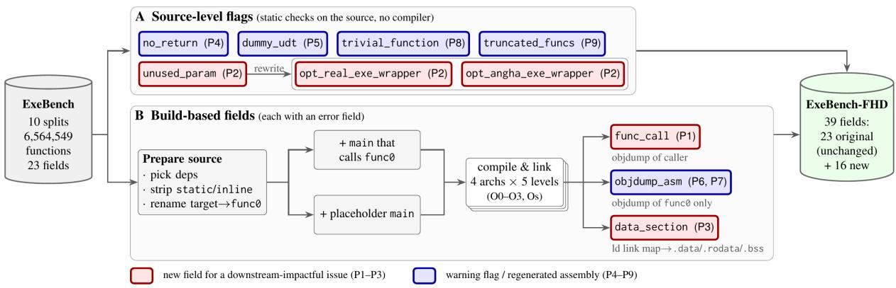
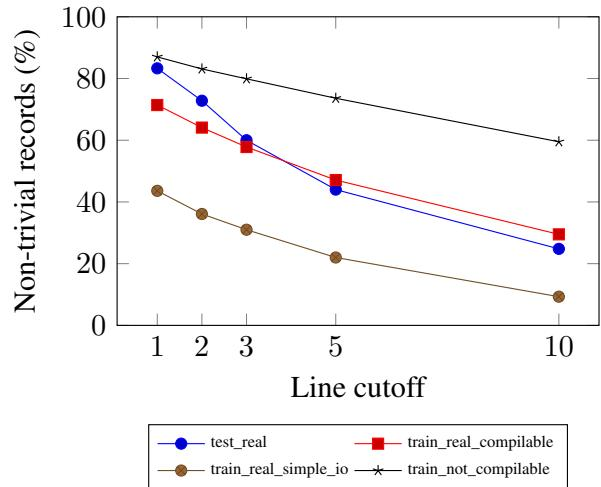

# ExeBench-FHD: Addressing Fidelity Issues in Decompiler Evaluation

Akarsh Ashok<sup>1</sup>, Dinil Mon Divakaran<sup>2</sup>, Vivek Balachandran<sup>1</sup>,

<sup>1</sup>Singapore Institute of Technology

<sup>2</sup>A\*STAR Institute of Advanced Intelligence and Computing

2403937@sit.singaporetech.edu.sg, dinil\_divakaran@a-star.edu.sg, vivek.b@singaporetech.edu.sg

## Abstract

ExeBench is one of the most widely used benchmarks for evaluating LLM-based decompilers. We analyze ExeBench and identify nine issues that affect how faithfully a test measures a decompiler. Three of them prevent LLM decompilers from recovering C code from ExeBench’s function. These are ambiguous parameter order when integer and floating-point types are mixed, unused parameters that optimized assembly may drop, and constants stored outside the function’s assembly code. Six more affect test validity: non-void functions without a return, placeholder types, static or inline functions removed by the optimizer, functions named main, trivial bodies and truncated definitions. We present ExeBench-FHD, a backwardcompatible revision of ExeBench that adds 16 new fields: call-site assembly, data sections, test wrappers, linked-binary disassembly and five warning flags. In ExeBench, 38.9% of functions have at least one of the five flags; dropping records with any of the four warning flags (all except unused\_param, which marks functions that the new wrappers make evaluable) keeps 63.9% of the corpus. In an evaluation at -O2 on four architectures, the new fields raise GPT 6 Sol’s re-execution rate by up to 26.5%, 19.1% and 21.0% on functions that read data sections, mix parameter types and have unused parameters, respectively.

## 1 Introduction

Binary decompilation is the process of recovering source code from a compiled binary, and it is a core step in reverse engineering. Compilation is a lossy process. Information that helps humans understand code, such as variable names, data types, comments and macro definitions, is transformed or removed; the higher the level of binary optimization, the harder the binary is to understand. Commercial and open-source decompilers such as IDA Pro (Hex-Rays SA, 2024) and Ghidra (National Security Agency, 2019) use algorithms and heuristics to recover source code from the binary, but their output still deviates from the original source code.

Large Language Models (LLMs) have recently grown popular not only for coding but also for decompilation. Researchers have proposed approaches that use LLMs in decompilation pipelines (Wang et al., 2026; Jiang et al., 2025; Armengol-Estapé et al., 2024; Tan et al., 2024). However, only a few datasets contain both source code and the corresponding assembly. These include AnghaBench (da Silva et al., 2021), ExeBench (Armengol-Estapé et al., 2022), HumanEval-Decompile (Tan et al., 2024), and, most recently, DecompileBench (Gao et al., 2025) and Decompile-Bench (Tan et al., 2025).

Among these, ExeBench is one of the most widely used for training and testing. It contains 6.56M C functions from GitHub and AnghaBench, split into ten training, validation and test sets (Table 1), and most are stand-alone compilable. Each function comes with assembly for x86 and ARM and with input-output (IO) examples. ExeBench also provides a script for evaluating decompilers on its test splits: the decompiled function is recompiled, linked into a test wrapper that feeds it each example input, and checked against the corresponding expected output.

To utilize this test to fairly measure a decompiler, the input should contain what the function needs to be re-created, namely the function’s signature (parameter order and count) and any constants it reads. The wrapper calls the function with its original signature, but ExeBench’s assembly of the compiled function may not retain the parameter order, unused parameters and constant values. This is a problem with the evaluation, not with the decompiler.

A decompiler can translate the assembly correctly and still fail the test. Functions often require information that a binary in practice has, but the assembly in the dataset does not: real-world binaries also contain callers and data sections, whereas

ExeBench provides only the function’s own body. Consequently, a test failure on ExeBench does not (necessarily) indicate a decompiler made a mistake. We call thesefidelity issues affecting evaluations.

We identify nine fidelity issues (Table 2). In three of them, the function’s assembly in ExeBench lacks information that in practice a binary provides: mixed integer and floating-point parameters (P1, 1.5% of the corpus but 11.5% of test\_real), unused parameters that the optimizer may remove (P2, 7.6% of the corpus) and constants stored in data sections (P3, 16.2% at -O2). Two make the test oracle unreliable: non-void functions without a return (P4, 1.7%) and placeholder types (P5, 9.3%). Three prevent a usable source–assembly pair: static or inline functions, which the optimizer may remove at higher optimization levels (P6, 36.3%); functions named main, which fail to link with the driver main (P7, 6.3%); and truncated definitions, which fail to compile (P9, 0.6%). Finally, trivial bodies (P8, 27.8%) are easy to decompile and raise average scores.

To address these issues, we introduce ExeBench-FHD<sup>1</sup>, a backward-compatible revision of ExeBench that adds 16 new fields and modifies none of the existing ones. The new fields supply the parts of the binary that the function’s assembly leaves out alongside the assembly (Section 3): data sections for constants (P3), call-site assembly (the assembly code of a function call) for parameter order (P1), and test wrappers that accept either all parameters or only the used ones (P2). They also provide disassembly regenerated from the linked binary and five warning flags for the remaining issues. Each field that depends on compilation has a diagnostic field recording why it is empty. Because no inherited field changes, existing ExeBench pipelines keep working and can adopt the new fields one at a time (Section 4).

This work makes three contributions:

1. An analysis of ExeBench. We analyse all ExeBench functions with automated checks and identify nine fidelity issues. In three of them, the function’s assembly in ExeBench lacks information that a real-world binary provides (parameter order, unused parameters and constants), which can affect downstream uses such as LLM-based decompilation (Section 3).

2. ExeBench-FHD. We release a backwardcompatible revision of ExeBench with 16 new fields that supply the missing context (data sections, call-site assembly, either-form test wrappers), regenerated disassembly and five warning flags (Sections A and 4).

3. An evaluation study. On test split of ExeBench across four architectures (x86, x86- 64, ARM32, ARM64), the new fields improve GPT 6 Sol’s re-execution rate by up to 26.5%, 19.1% and 21.0% on functions that read data sections, mix parameter types and have unused parameters, respectively (Section 6).

## 2 Related Work

For the decompilation task, there are only a handful of datasets for both training and testing. AnghaBench (da Silva et al., 2021) is a collection of 1 million C functions scraped from GitHub. It uses the type-inference tool Psyche-C (Melo et al., 2017) to add missing external dependencies, so that each function can be compiled into an object file. However, since Psyche-C only declares the dependencies, GCC treats them as forward declarations: it produces an object file but cannot link it into an executable.

Armengol-Estapé et al. (2022) observe the need for an executable dataset for machine learning and introduce ExeBench, whose source functions are scraped from GitHub and which extends AnghaBench by adding dependencies to the C code. ExeBench walks through each function’s repository to find the relevant dependencies and turns the function into a stand-alone compilable file. If the dependencies are not present in the repository, ExeBench searches a larger GitHub dataset, and if more than one repository has the same definition, it chooses the one with more stars. If the real dependencies are not available on GitHub, synthetic definitions are generated and injected into the code. ExeBench also provides IO examples, produced by an automatic generator that synthesizes inputs for each parameter type from the function signature using a seed and records the outputs.

ExeBench has ten splits: six for training and four for validation and testing (Table 1). Real splits use dependencies found on GitHub, synth splits use synthesised ones, and simple/rich IO separates trivially satisfiable IO pairs from richer ones.

Meanwhile, the authors of LLM4Decompile take another approach: they translate the 164 handwritten Python problems of HumanEval (Chen et al., 2021) and their assertions into C, creating HumanEval-Decompile (Tan et al., 2024).

<table><tr><td rowspan=1 colspan=1>Split                        Functions</td></tr><tr><td rowspan=1 colspan=1>train_not_compilable       715,700</td></tr><tr><td rowspan=1 colspan=1>train_real_compilable      885,074</td></tr><tr><td rowspan=1 colspan=1>train_synth_compilable   4,159,373</td></tr><tr><td rowspan=1 colspan=1>train_real_simple_io        42,769</td></tr><tr><td rowspan=1 colspan=1>train_synth_simple_io      640,116</td></tr><tr><td rowspan=2 colspan=1>train_synth_rich_io         107,250valid_real                      2,133valid_synth                     5,000test_real                       2,134test_synth                      5,000</td></tr><tr><td rowspan=1 colspan=1></td></tr><tr><td rowspan=1 colspan=1>Whole corpus                6,564,549</td></tr></table>

Table 1: The ten ExeBench splits and their number of functions.

In 2025, two benchmarks with similar names appeared. Decompile-Bench (Tan et al., 2025) contains two million binary-source function pairs mined from binaries compiled from permissively licensed GitHub projects. It uses a source-trace algorithm based on DWARF (DWARF Debugging Information Format Committee, 2017) and tree-sitter (Brunsfeld and Tree-Sitter Contributors, 2024) to match each assembly function to its source function. The dataset has an uneven number of assembly versions per source function (1 to 6), and the released data lacks the optimization-level field and generation code, so we cannot determine the cause.

DecompileBench (Gao et al., 2025) selects around 20k functions from 130 OSS-Fuzz (Serebryany, 2017) projects, keeping those that a fuzzer can trigger. Like ExeBench, it extracts each function’s dependencies and builds a shared library containing it. A decompiled function is rebuilt into a library and counts as correct if re-running the fuzzer with the same seed gives the same output as the original. However, its assembly is generated from object code rather than a linked binary, so call targets and data references remain unresolved relocations. ExeBench-FHD avoids this by disassembling linked executables.

Our contribution ExeBench-FHD is a highfidelity revision of ExeBench for evaluating decompilers on optimized binaries: it supplies the information that ExeBench’s assembly lacks, adds flags for unreliable test cases, and leaves the original fields unchanged.

## 3 Fidelity Issues in ExeBench

ExeBench contains both source code and assembly code, and is therefore used for training and testing machine learning models. Each record holds 23 fields (Section A); about 55% of records cannot be linked into an executable because ExeBench does not capture their dependencies (Table 22). In this section, we analyze the full dataset covering all ten official splits, and report the issues that are crucial for evaluating decompilation. Each issue is numbered, and Section 4 addresses it under the same number. Table 2 gives the share of the corpus and of test\_real affected by each issue.

<table><tr><td>ID</td><td>Issue</td><td>Corpus %</td><td>test_real %</td></tr><tr><td>P1</td><td>Mixed int/float parameters</td><td>1.46</td><td>11.48</td></tr><tr><td>P2</td><td>Unused parameter</td><td>7.56</td><td>7.40</td></tr><tr><td>P3</td><td>Reads a data section (-02)</td><td>16.18</td><td>16.31</td></tr><tr><td>P4</td><td>Non-void without return</td><td>1.73</td><td>0.19</td></tr><tr><td>P5</td><td>Dummy UDT dependency</td><td>9.27</td><td>0.52</td></tr><tr><td>P6</td><td>static/inline definition</td><td>36.31</td><td>28.73</td></tr><tr><td>P7</td><td>Function named main</td><td>6.30</td><td>0.00</td></tr><tr><td>P8</td><td>Trivial body</td><td>27.84</td><td>27.41</td></tr><tr><td>P9</td><td>Truncated definition</td><td>0.63</td><td>0.00</td></tr></table>

Table 2: Prevalence of the nine issues over all 6,564,549 functions and over test\_real (2,134). P3: non-empty data section at -O2 on at least one architecture. P6: static or inline modifier.

## P1: Parameter order not visible in the assembly

On 32-bit Intel (x86), function arguments are passed on the stack, which preserves their order regardless of type. On 64-bit Intel, 32-bit ARM and 64-bit ARM, however, parameters are passed in different sets of registers depending on their data type. Table 3 shows how each architecture passes parameters (Lu et al., 2025; Arm Limited, 2026b,a). In ExeBench’s test\_real split, 11.5% of functions have mixed parameter types (1.5% of the corpus). If their parameter order is not recovered correctly, the corresponding test fail.

If all parameters have the same data type (first two functions of Listing 1), LLM-based decompilers can potentially identify the parameter order from the register sequence. However, if a function mixes data types, such as int and float (last two functions of Listing 1), the order cannot be recovered from the function’s assembly alone (as in ExeBench). This limitation occurs because each data type uses a separate register sequence. For example, the System V x86-64 Application Binary Interface (ABI) (Lu et al., 2025) independently allocates integer arguments are assigned to [rdi, rsi, . . . ] and floating-point arguments to [xmm0, xmm1, . . . ].

<table><tr><td>Arch.</td><td>int</td><td>float</td></tr><tr><td>x86</td><td>stack</td><td>stack</td></tr><tr><td>x86-64</td><td>rdi,rsi,rdx,rcx,r8,r9</td><td>xmm0 - xmm7</td></tr><tr><td>ARM32</td><td>r0 - r3</td><td>s0 - s15</td></tr><tr><td>ARM64</td><td>x0 - x7</td><td>s0 - s7</td></tr></table>

Table 3: Registers for int and float arguments (ARM32: hard-float ABI).

```c
1 int sum ( int a , int b ) ;
2 // a -> rdi , b -> rsi
3 float sum ( float a, float b);
4 // a -> xmm0 , b -> xmm1
5 float sum ( int a, float b);
6 // a -> rdi , b -> xmm0
7 float sum ( float a, int b);
8 // a -> xmm0 , b -> rdi
```

Listing 1: Functions with same-type and mixed-type parameters. The last two have opposite parameter orders but use the same registers.

A function taking an int followed by a float, and one taking a float followed by an int, therefore read the same registers and compile to identical assembly. This comes from the design of the calling convention, and is not a weakness of a particular decompiler or a bug in ExeBench. Consequently, even a perfect decompiler can only guess the parameter order from ExeBench’s assembly. This creates an evaluation problem: ExeBench’s test calls the function with the original order, but the dataset’s assembly provides only the isolated assembly of the function. Real-world binaries include calls that reveal the order, but ExeBench does not provide them. As a result, a correct decompilation with swapped parameters fails the test.

## P2: Unused parameters may be removed from optimized assembly

Some ExeBench functions do not use all of their parameters. In Listing 2, sum is declared with three parameters, a, b and c, but the C source only uses a and c. At O0, all three parameters are visible in the function’s assembly. At higher optimization levels the callee never reads the unused argument, and the compiler handles it in one of two ways. In some builds it keeps each used parameter in its original register, so the assembly still implies all three parameters (a in rdi, c in rdx). In others it moves the used parameters into the first registers, so the assembly implies only two (a in rdi, c in rsi). Which happens depends on the build, even for the same source function, so a decompiler faithful to the assembly can legitimately recover either form, and a test that evaluates one marks the other as wrong. In a real-world binary, the callers of an externally visible function still pass all three arguments, but ExeBench does not provide them.

static int sum (int a , int b , int c ) {   
2 return a + c; // b is never read   
3 }   
4   
5 // O0: a, b and c are all visible in   
the assembly   
6 // (edi = a, esi = b, edx = c)   
7   
8 // O1 and above : one of two forms   
9 // Form 1: three parameters implied   
10 // lea eax , [rdi+rdx]   
11   
12 // Form 2: two parameters implied   
13 // lea eax , [rdi+rsi]   
14   
15 // Test case => sum (5, 6, 7);   
Listing 2: Function with an unused parameter

## P3: Constants stored outside the function’s code

Apart from immediate values (and constructs like ARM32 jump tables or embedded literal pools), instructions in the .text section use references to access non-immediate data. The actual data typically resides in separate sections such as .rodata, .data, and .bss. In practice, a complete binary includes these sections, but ExeBench’s asm field provides only the isolated code of the function. Consequently, these data values cannot be recovered from the dataset’s assembly (as shown in Listing 3).

1 float sum(int a, int b){   
2 float c = 74454.235;   
3 return a+b+c;   
4 }

## Listing 3: Function with a float value

For example, line two of Listing 3 assigns the value 74454.235 to the float variable c. Once compiled, the value is stored in the .rodata section, and the assembly only references its address. In Listing 4, the float value 74454.235 is stored as 1e6b9147 (little-endian) at address 0x2004.

```csv
<sum >:
2 endbr64
3 add %esi ,% edi
4 pxor %xmm0 ,% xmm0
5 cvtsi2ss %edi ,% xmm0
addss 0 xea5 (% rip) ,% xmm0 # 2004
< _IO_stdin_used +0x4 >
7 ret
8
Contents of section .rodata :
10 2000 01000200 1 e6b9147 25660000
00000000
11 2010 000000 c0 132 ef240
```

Listing 4: Assembly code of Listing 3

## P4: Non-void function without a return

In ExeBench, about 114k functions are declared non-void (e.g., int, char, float, double, or their modified forms), but their bodies contain no return statement. Often a parameter is an array and the function operates on it in place. The code compiles, but if a caller uses the return value, the behavior is undefined (ISO), since no value is returned.

```c
int sum(int *line , int len ){
2 int n =0;
3 while (n< len ){
line [n ]+=5;
5 n ++;
6 }
7 }
```  
Listing 5: Non-void function without a return statement

Listing 5 shows one such example: the return type is int, but the function contains no return statement.

## P5: Dummy placeholder type in real split

ExeBench is built around stand-alone, executable source-assembly pairs. To achieve this, it mines dependencies from each function’s GitHub repository and, when none are found, injects dummy dependencies generated with Psyche-C. Around 9.3% of the corpus contains functions with dummy userdefined type (UDT) definitions (Listing 6). Since these placeholder types carry no real content, the source-assembly pair is not faithful to the original program. A test on such a function checks the placeholder rather than the real type.

1 struct rectangle { int dummy ; };   
2 struct square { int dummy ; };   
3   
4 int sum ( struct rectangle a , struct   
square b){   
5   
6 }  
Listing 6: Dummy UDT dependency

## P6: Static/inline functions eliminated in optimized assembly

Some ExeBench functions carry modifiers such as static or inline. These modifiers are common in real-world code. At O1 and above, however, the compiler may inline such functions or discard them entirely. No assembly then remains for the target function, so it cannot be evaluated at that level. In ExeBench, 36.3% of functions are static or inline, and 62% of these have no code for the target at -O3.

```c
static int sum(int a, int b){
2 return a+b +5;
3 }
Listing 7: Static function
```

For example, Listing 7 defines a function with the static modifier; if the function is trivial, the compiler will constant-folds and inlines it. Without the static modifier, its code is retained, because the compiler must assume it may be called from another .c file via extern.

## P7: Functions named main

Since ExeBench is sourced from real-world GitHub repositories, some functions (6.3% of the corpus) are named main. Extracting assembly from an executable requires linking the function with a driver main; when the function itself is named main, linking fails with a redefinition error.

## P8: Trivial function bodies

Some functions have trivial bodies: even though they have parameters and a return type, the body is empty, a single return statement, or at most two lines of code. Although these bodies are valid, around one-third of the functions in train\_real\_compilable are trivial. They are easy to decompile, so a high share of them raises average scores without reflecting harder code.

## P9: Truncated definition

About 41k ExeBench functions (39k of them in train\_not\_compilable) have a truncated definition, cut off either at the start or at the end, so they fail to compile. While checking for truncation, we also find functions written in the legacy K&R style, where the parameter types are declared after the function signature but before the opening brace. Since C compilers still accept this style, we do not treat it as an issue.

```solidity
1 {
2
3 " func_def ":" nt sum ( char a, char b )
{ return a + b ;}",
4 " signature ":[" int ", " char ", " char "
],
5 ...
6 }
```  
Listing 8: Truncated function

In ExeBench, the signature field lists the function’s return type (at index zero) followed by its parameter types. Some records have truncated types in signature, and some lack a function header entirely, containing only a series of statements without a header or closing brace.

<table><tr><td>Field</td><td>Type</td><td>Issue</td></tr><tr><td>func_call</td><td>dict</td><td>P1</td></tr><tr><td>unused_param</td><td>bool</td><td>P2</td></tr><tr><td>opt_real_exe_wrapper opt_angha_exe_wrapper</td><td>str</td><td>P2</td></tr><tr><td>data_section</td><td>dict</td><td>P3</td></tr><tr><td>no_return</td><td>bool</td><td>P4</td></tr><tr><td>dummy_udt</td><td>bool</td><td>P5</td></tr><tr><td>objdump_asm</td><td>dict</td><td>P6, P7</td></tr><tr><td>trivial_function</td><td>bool</td><td>P8</td></tr><tr><td>truncated_funcs</td><td>bool</td><td>P9</td></tr><tr><td>*_errors</td><td>str</td><td></td></tr></table>

Table 4: New fields introduced by ExeBench-FHD.

## 4 The ExeBench-FHD Dataset

Based on our analysis of ExeBench, we group the identified issues into two categories. (1) Issues where the assembly in ExeBench lacks information that a real-world binary provides, which can affect downstream uses such as LLM-based decompilation (P1–P3). (2) Issues that affect what a test outcome means or whether a function can be evaluated at all (P4–P9). ExeBench-FHD addresses each with a new field or flag, described below. ExeBench-FHD preserves ExeBench’s licensing and our added fields are released under the MIT license.

## 4.1 Design Principles

ExeBench-FHD follows two design principles. The first is additivity: existing ExeBench fields are not modified; every fix or flag is added as a new field, so ExeBench-FHD is a drop-in replacement for ExeBench and existing pipelines keep working. The second is flagging over filtering: for some problems, we add flags instead of modifying or filtering the dataset, leaving downstream users free to decide how to handle each issue.

## 4.2 Schema and New Fields

Table 4 lists each new field, its type and the issue it addresses. The func\_call and data\_section fields have a subfield for each architecture (x86, x86-64, ARM32 and ARM64), and objdump\_asm additionally has one per optimization level; the remaining fields are scalar.

## 4.3 Construction Pipeline

Figure 1 gives an overview of the construction pipeline. Each field in Table 4 is implemented as an independent, unit-tested module. Fields such as func\_call, data\_section and objdump\_asm require compiling each function, which makes them the most expensive step in the pipeline. Each of these fields has a companion error field that records what went wrong when the field is empty or null. Once all modules are implemented and tested, a unified script combines them and generates the new splits in a single pass. For P6 and P7, the disassembly script strips static/inline modifiers before compiling and omits the driver main when the function itself is named main.

## 4.4 Fixes for Issues That Directly Affect Evaluation

In ExeBench-FHD, we first address the issues that directly affect evaluation: P1–P3.

The main issue is P1: parameter order is ambiguous when a function has at least one floating-point parameter (float, double) and at least one integer or pointer parameter. To solve this, we introduce a new field, func\_call, which holds the assembly of a call to the function on all four architectures: x86, x86-64, ARM32 and ARM64. On x86, arguments are pushed onto the stack from right to left, so the first parameter ends up at the lowest address; the push order and the callee’s stack offsets are therefore enough to recover the parameter order. On the other three architectures, the driver derives each argument from argv in declaration order, so the call site shows which argument is loaded into which register and thus the order of the parameters.

About 7.6% of ExeBench functions have unused parameters (P2). In ExeBench, each function has a C++ test wrapper (real\_exe\_wrapper, angha\_exe\_wrapper) that reads the function’s IO examples according to its parameter count (from the signature field). When functions are compiled at O1 or above, however, the assembly may imply all parameters or only the used ones, depending on the build. A decompiler that recovers only the used parameters fails against this harness, which passes every parameter, used or unused. We therefore introduce two new C++ wrappers, opt\_real\_exe\_wrapper and opt\_angha\_exe\_wrapper, that accept either form.

A decompilation passes if it re-executes correctly when called with all parameters or with only the used parameters.

As described in P3, data is stored in several sections, and the .text section only contains references to it. We therefore introduce a data\_section field for all four architectures (x86, x86-64, ARM32 and ARM64), which holds the contents of every relevant section that is present (.data, .rodata, .bss, etc.). Since not every record compiles, data\_section is present only for records that build.

  
Figure 1: Overview of the ExeBench-FHD construction pipeline.

## 4.5 Fixes for Issues Flagged as Warning

Issues P4–P9 do not hide information from the decompiler, but they affect what a test outcome means or whether a function can be evaluated. For P4, P5, P8 and P9, we add separate flag fields rather than modifying the dataset. These flags let users exclude such functions or report them separately during evaluation. For P6 and P7, a new script (released with the dataset) produces the objdump\_asm field. It regenerates each function’s assembly from the linked binary (the .out file), whereas ExeBench’s asm field is generated from the .o file. The script supports all four architectures (x86, x86-64, ARM32 and ARM64).

## 5 Analysis of ExeBench-FHD

Mixed parameters. Functions with mixed parameter types (P1) make up 11.5% of test\_real and 11.1% of valid\_real, but only 1.4–3.3% of the other splits listed (Table 10 in Section B). Some parameter types are hard to build from argv: structures passed by value, SIMD (single instruction, multiple data) vector types and complex numbers. Functions with these types make up 10% of the corpus but only 0.14% of test\_real, and func\_call skips them.

Data sections. Table 5 reports the share of functions in each split whose program has a non-empty data section (P3). On the real splits, the share is lower on ARM32 because ARM32 keeps most constants in small pools inside .text (literal pools), where they are already visible in the assembly.

<table><tr><td>Split</td><td>x86</td><td>x86-64</td><td>ARM32</td><td>ARM64</td></tr><tr><td>test_real</td><td>9.4</td><td>15.8</td><td>2.5</td><td>5.9</td></tr><tr><td>test_synth</td><td>27.6</td><td>28.3</td><td>26.9</td><td>27.6</td></tr><tr><td>valid_real</td><td>10.2</td><td>16.5</td><td>3.0</td><td>6.5</td></tr><tr><td>valid_synth</td><td>25.9</td><td>26.5</td><td>25.2</td><td>25.8</td></tr><tr><td>train_real_compilable</td><td>16.9</td><td>22.2</td><td>18.9</td><td>20.0</td></tr><tr><td>train_synth_compilable</td><td>16.4</td><td>17.4</td><td>16.6</td><td>17.0</td></tr></table>

Table 5: Records with a non-empty data section at -O2 (%). All ten splits in Table 23.

Warning flags. Per-split flag rates are in Table 11. Truncated functions are rare, but the flag helps explain compilation failures. Non-void functions without a return are also rare, but they compile, so without the flag they would be considered in evaluation. A placeholder definition often prevents linking, so dummy\_udt records are less common among disassembled functions (9.3% of the corpus vs. 4.5% of disassembled records, Section C.1). Removing records with any of the four warning flags keeps 63.9% of the corpus and 72.2% of test\_real (Table 16). Whether to exclude trivial functions is left to the user.

The fifth flag, unused\_param, is not part of this filter. Our modified wrapper makes sure that the functions are called correctly during evaluation. One can use this flag only to measure the evaluation efficiency separately (Section 6).

## 6 Impact on Decompiler Evaluation

Setup. We use GPT 6 Sol, a frontier commercial model, as such with no training on ExeBench’s format for decompilation. If a model of this strength still fails on P1–P3, the cause is the information in the input, not model capacity. We call the model twice for decompilation: once with just the function’s assembly (asm) code, and once with the assembly code along with the data\_section and func\_call (+ctx, where ctx is short for the added context, i.e. data\_section and func\_call). The only difference between the two runs is the added context in the input. The results therefore show what the added fields make possible; they do not rank decompilers or show how iterative or agentic pipelines would behave.

<table><tr><td>Subset</td><td>x86-64</td><td>x86</td><td>ARM64</td><td>ARM32</td></tr><tr><td>Non-empty data sec. (P3)</td><td>+19.5</td><td>+18.1</td><td>+26.5</td><td>+10.0</td></tr><tr><td>Mixed param. types (P1)</td><td>+17.0</td><td>+9.8</td><td>+19.1</td><td>+12.5</td></tr><tr><td>Unused param. (P2)</td><td>+17.6</td><td>+18.0</td><td>+17.1</td><td>+21.0</td></tr></table>

Table 6: Gain in re-execution rate (percentage) for GPT 6 Sol when func\_call and data\_section are added to the assembly (test\_real, -O2).

We use test\_real, ExeBench’s test split with real dependencies (2,134 functions), compiled with GCC at -O2, a level commonly used for released software. GPT 6 Sol (default settings, one answer per function) decompiles each function twice: under (asm), and (+ctx). We keep every function that can be built and tested on a given architecture, 1,657–1,857 per architecture; functions with an unused parameter, identified by the unused\_param flag, are scored separately. A decompiled function re-executes if, compiled into ExeBench’s test wrapper, it reproduces the expected output on every IO example; the re-execution rate is the share of functions that do. To check that a gain is not due to chance, we use an exact paired sign test (also known as the exact McNemar test), which compares only the functions whose outcome changes between the two runs (details in Section E).

Results. Table 6 shows the change in reexecution rate when data\_section and func\_call are added to the assembly, on the functions affected by each issue. Adding the context improves re-execution on every architecture and for every issue: by 10.0–26.5% on functions with a non-empty data section (P3), 9.8–19.1% on functions with mixed parameter types (P1), and 17.1–21.0% on functions with an unused parameter (P2).

P1: parameter order. For mixed-type parameters, the call-site assembly in func\_call shows which argument is loaded into which register, and thus the parameter order. Without it, the asm-only predictions often have the wrong parameter order or count and do not compile against the test wrapper. With context, re-compilation rises by 13–20% on the three register architectures, and re-execution rises by 12–19%. x86, which passes arguments on the stack in order, gains least (+9.8%) (Table 21).

P2: unused parameters. ExeBench-FHD’s wrapper (opt\_real\_exe\_wrapper) is executed to test if a decompiled code executes correctly. Our modified wrapper contains two separate function call wrappers. One with all the parameters used in the original source code and one with only the parameters used in the function after compiler optimizations. This enables us to cater for various disassembler behaviours based on what it infers from the assembly pattern implications. Our wrapper raises the re-execution on functions with unused parameters by 17–21%, from 58–64% to 76–82% (Table 18; $p < 1 0 ^ { - 3 }$ on every architecture). The call-site assembly helps here because it shows how many arguments the caller passes, which the function’s own assembly does not.

P3: data sections. Where constants live in data sections, appending data\_section raises reexecution by 18–27% on x86, x86-64 and ARM64, and by 10% on ARM32 (Table 20).

Without the data section, a floating-point constant or a lookup table is visible to the model only as an address, so it has to guess the value. ARM32 has fewer affected functions because it keeps most constants in literal pools inside .text.

## 7 Conclusion

We analyzed all 6.56M functions in ExeBench and found nine fidelity issues: three cases of missing context, where normal compilation removes information that ExeBench’s tests still expect, and six warning-level issues. ExeBench-FHD added the missing context as new fields and added warning flags for the rest. The added context raised GPT 6 Sol’s re-execution rate by up to 26.5% on the affected functions. Because we focus on evaluation and give a single general-purpose LLM the context in a single pass, the gains isolate the effect of the context itself. This sets up two natural next steps: testing whether agents can retrieve this context on their own, and whether training decompilers with func\_call or data\_section improves them. We hope this work encourages the community to treat evaluation fidelity as a priority in decompilation benchmarks.

## Limitations

ExeBench-FHD has three main limitations. First, every compilation-dependent field (func\_call, data\_section and objdump\_asm) is built with GCC only, so the assembly and data sections may differ from what other compilers such as Clang emit. Second, ExeBench-FHD inherits limitations of ExeBench that we leave for future work. About 55% of records fail to link because ExeBench does not capture their dependencies, so these fields are sparse on the synth splits (Table 22). The func\_call generator skips unsupported parameter types and functions named main (16.4% of the corpus: 10.1% and 6.3% respectively, Table 24) and uses a generated driver instead of the function’s real callers. We also flag issues without repairing the source, such as signature fields that disagree with the function definition (Table 10). Third, the warning flags are rules of thumb: trivial\_function depends on a line-count cutoff that is a design choice (Figure 2), and no\_return and truncated\_funcs use syntactic checks that can miss or misfire on some cases.

## Acknowledgments

We thank the SIT x NVIDIA AI Centre (SNAIC) and the NVIDIA AI Technology Centre (NVAITC) for supporting this research.

## Generative AI Usage

We use generative AI tools to paraphrase and improve the language of the manuscript, and to add comments and clean up the code. The ideas, logic, analysis, dataset design and experiments are the authors’ own, and the authors review and edit all AI-assisted text and code as needed. The authors take full responsibility for the content of the paper.

## Data and Code Availability

The scripts used to generate the dataset are available at https://github.com/Akchy/ ExeBench-FHD, and the dataset is available at https://huggingface.co/datasets/ davish007/ExeBench-FHD.

## References

Arm Limited. 2026a. Procedure call standard for the Arm 64-bit architecture (AAPCS64). Technical report, Arm Limited.

Arm Limited. 2026b. Procedure call standard for the Arm architecture (AAPCS32). Technical report, Arm Limited.

Jordi Armengol-Estapé, Jackson Woodruff, Alexander Brauckmann, José Wesley de Souza Magalhães, and Michael F. P. O’Boyle. 2022. Exebench: an ml-scale dataset of executable c functions. In Proceedings of the 6th ACM SIGPLAN International Symposium on Machine Programming, page 50–59, New York, NY, USA. Association for Computing Machinery.

Jordi Armengol-Estapé, Jackson Woodruff, Chris Cummins, and Michael F. P. O’Boyle. 2024. Slade: A portable small language model decompiler for optimized assembly. In Proceedings of the 2024 IEEE/ACM International Symposium on Code Generation and Optimization, page 67–80. IEEE Press.

Max Brunsfeld and Tree-Sitter Contributors. 2024. Tree-Sitter. https://github.com/tree-sitter/ tree-sitter. Accessed 2026-09-21.

Mark Chen et al. 2021. Evaluating large language models trained on code. Preprint, arXiv:2107.03374.

Anderson Faustino da Silva, Bruno Conde Kind, José Wesley de Souza Magalhães, Jerônimo Nunes Rocha, Breno Campos Ferreira Guimarães, and Fernando Magno Quinão Pereira. 2021. Anghabench: A suite with one million compilable c benchmarks for code-size reduction. In 2021 IEEE/ACM International Symposium on Code Generation and Optimization (CGO), pages 378–390.

DWARF Debugging Information Format Committee. 2017. DWARF Debugging Information Format Standard. http://dwarfstd.org. Accessed: 2026-09- 22.

Zeyu Gao, Yuxin Cui, Hao Wang, Siliang Qin, Yuanda Wang, Zhang Bolun, and Chao Zhang. 2025. DecompileBench: A comprehensive benchmark for evaluating decompilers in real-world scenarios. In Findings ofthe Associationfor Computational Linguistics: ACL 2025, pages 23250–23267, Vienna, Austria. Association for Computational Linguistics.

Hex-Rays SA. 2024. IDA pro: A cross-platform multiprocessor disassembler and debugger. https:// hex-rays.com/ida-pro/. Accessed 2026-09-21.

ISO. 2024. ISO/IEC 9899:2024 Information technology – Programming languages – C, 5th edition. International Organization for Standardization.

Nan Jiang, Chengxiao Wang, Kevin Liu, Xiangzhe Xu, Lin Tan, Xiangyu Zhang, and Babkin Petr. 2025. Nova: Generative language models for assembly code with hierarchical attention and contrastive learning. In The Thirteenth International Conference on Learning Representations.

H. J. Lu, Michael Matz, Milind Girkar, Jan Hubicka, An-ˇ dreas Jaeger, and Mark Mitchell. 2025. System V application binary interface: AMD64 architecture processor supplement. Technical report, x86-64 psABI. Version 1.0.

Leandro T. C. Melo, Rodrigo G. Ribeiro, Marcus R. de Araújo, and Fernando Magno Quintão Pereira. 2017. Inference of static semantics for incomplete c programs. Proc. ACM Program. Lang., 2(POPL).

National Security Agency. 2019. Ghidra software reverse engineering framework. https:// ghidra-sre.org. Accessed 2026-09-21.

Kostya Serebryany. 2017. OSS-Fuzz - google’s continuous fuzzing service for open source software. In 26th USENIX Security Symposium (USENIX Security 17), Vancouver, BC. USENIX Association.

Hanzhuo Tan, Qi Luo, Jing Li, and Yuqun Zhang. 2024. LLM4Decompile: Decompiling binary code with large language models. In Proceedings of the 2024 Conference on Empirical Methods in Natural Language Processing, pages 3473–3487, Miami, Florida, USA. Association for Computational Linguistics.

Hanzhuo Tan, Xiaolong Tian, Hanrui Qi, Jiaming Liu, Zuchen Gao, Siyi Wang, Qi Luo, Jing Li, and Yuqun Zhang. 2025. Decompile-bench: Millionscale binary-source function pairs for real-world binary decompilation. Preprint, arXiv:2505.12668.

Yuanchao Wang, Ye Tian, Hongmei Wei, and Fei Wang. 2026. Large language models for binary decompilation: Paradigms, evaluation, and challenges. In Proceedings of the 2026 6th International Conference on Computer Network Security and Software Engineering, page 212–218, New York, NY, USA. Association for Computing Machinery.

## A Full ExeBench-FHD Record Schema

Every record in the released dataset has the same 39 fields: 23 inherited unchanged from ExeBench and 16 added by ExeBench-FHD. Following the additivity principle (Section 4.1), no inherited field is modified. In particular, ExeBench’s asm field is shipped as-is, and the regenerated, binary-level disassembly that addresses P6 and P7 lives in the separate objdump\_asm field. Tables 7 to 9 list every field.

<table><tr><td>Field</td><td>Origin</td><td>Issue</td></tr><tr><td>asm</td><td>ExeBench</td><td></td></tr><tr><td>real_iospec, angha_iospec</td><td>ExeBench</td><td></td></tr><tr><td>real_io_pairs, angha_io_pairs</td><td>ExeBench</td><td></td></tr><tr><td>func_call</td><td>New</td><td>P1</td></tr><tr><td>func_call_errors</td><td>New</td><td>P1 (diag.)</td></tr><tr><td>data_section</td><td>New</td><td>P3</td></tr><tr><td>data_section_errors</td><td>New</td><td>P3 (diag.)</td></tr><tr><td>objdump_asm</td><td>New</td><td>P6, P7</td></tr><tr><td>objdump_asm_errors</td><td>New</td><td>P6, P7 (diag.)</td></tr></table>

Table 7: Fields holding nested JavaScript Object Notation (JSON) objects (11). diag.: diagnostic field that records why the main field is empty. func\_call, data\_section and their error fields are indexed by architecture (x86, x86-64, ARM32, ARM64); objdump\_asm and its error field are indexed by architecture and then by optimization level (O0–O3, Os). An error entry is null exactly when that build succeeded.

<table><tr><td>Field</td><td>Origin</td><td>Issue</td></tr><tr><td>path, ref, fname, doc</td><td>ExeBench</td><td></td></tr><tr><td>func_def, func_head, func_head_types</td><td>ExeBench</td><td></td></tr><tr><td>real_deps, angha_deps</td><td>ExeBench</td><td></td></tr><tr><td>real_error, angha_error</td><td>ExeBench</td><td></td></tr><tr><td>real_io_error,angha_io_error</td><td>ExeBench</td><td></td></tr><tr><td>real_exe_wrapper, angha_exe_wrapper</td><td>ExeBench</td><td></td></tr><tr><td>func_call_skip_reason</td><td>New</td><td>P1 (diag.)</td></tr><tr><td>opt_real_exe_wrapper</td><td>New</td><td>P2</td></tr><tr><td>opt_angha_exe_wrapper</td><td>New</td><td>P2</td></tr><tr><td>opt_real_exe_wrapper_error</td><td>New</td><td>P2 (diag.)</td></tr><tr><td>opt_angha_exe_wrapper_error</td><td>New</td><td>P2 (diag.)</td></tr></table>

Table 8: String fields that may be empty (null) (20).

<table><tr><td>Field</td><td>Origin</td><td>Issue</td></tr><tr><td>real_io_pairs_are_trivial angha_io_pairs_are_trivial</td><td>ExeBench ExeBench</td><td></td></tr><tr><td>signature (list of strings)</td><td>ExeBench</td><td></td></tr><tr><td>unused_param</td><td>New</td><td>P2</td></tr><tr><td>no_return</td><td>New</td><td>P4</td></tr><tr><td>dummy_udt</td><td>New</td><td>P5</td></tr><tr><td>trivial_function</td><td>New</td><td>P8</td></tr><tr><td>truncated_funcs</td><td>New</td><td>P9</td></tr></table>

Table 9: Boolean fields and the single list-valued field (8).

func\_call\_skip\_reason records why func\_call is empty. It takes one of three values: unsupported\_param\_type:<kind> and fname\_is\_main (never attempted, and func\_call\_errors is null), or all\_architectures\_failed (attempted on all four targets, and func\_call\_errors holds the per-architecture reasons).

## B Mixed Parameter Types per Split

Table 10 gives the share of functions with mixed parameter types (P1) per split. It also reports how often ExeBench’s signature field (the list of the function’s return and parameter types) does not match the number of parameters in the definition (func\_def).

<table><tr><td>Split</td><td>Mixed types</td><td>Mismatch</td></tr><tr><td>test_real</td><td>11.5</td><td>3.8</td></tr><tr><td>test_synth</td><td>3.3</td><td>0.1</td></tr><tr><td>valid_real</td><td>11.1</td><td>4.2</td></tr><tr><td>valid_synth</td><td>3.2</td><td>0.2</td></tr><tr><td>train_real_compilable</td><td>2.1</td><td>1.9</td></tr><tr><td>train_synth_compilable</td><td>1.4</td><td>0.9</td></tr><tr><td>train_not_compilable</td><td>1.5</td><td>10.7</td></tr></table>

Table 10: Mixed parameter types (%). Mismatch: signature lists a different number of types than the definition.

## C Warning Flags: Extended Analysis

## C.1 Flag Rates Among Disassembled Functions

Table 11 reports each warning flag over every record. A user who evaluates on the regenerated assembly, however, only sees records whose function could be compiled, linked and disassembled. We count a record as disassembled if objdump\_asm succeeded for at least one of the 20 (architecture, optimization level) combinations: 2,227,780 records, or 33.9% of the corpus (Table 12). Table 13 gives the flag rates over all records and over this subset.

The disassembled subset is more trivial than the corpus (39.7% vs. 27.8% flagged trivial\_function), because short, selfcontained functions are the ones most likely to build. The effect is largest where few records build: on test\_synth and valid\_synth, where only about 45% of records disassemble, the trivial share rises by about 15%. Conversely, dummy\_udt roughly halves (9.3% to 4.5%), since a placeholder type often prevents the build altogether, and truncated\_funcs almost disappears (0.016%, 362 records).

## C.2 Flag Co-occurrence and Compounded Filtering

Table 14 reports how often each pair of warning flags fires on the same record. Over all splits, 61.1% of records carry none of the five flags, ranging from 34.6% (train\_real\_simple\_io) to 72.4% (valid\_real) per split. The most common combination is trivial\_function with unused\_param (3.5% of the corpus). The next is dummy\_udt with trivial\_function (2.4%), consistent with dummy-type records skewing toward short bodies.

For evaluation, the two flags that matter most are dummy\_udt (the function often cannot be built, and when it can, it tests a placeholder type) and trivial\_function (the function gives a decompiler almost nothing to recover). Table 15 applies only these two to the evaluation splits. Over all splits, 4,289,066 records (65.34%) survive the same filter.

## C.3 Sensitivity of the Triviality Cutoff

trivial\_function flags a body that is empty, a single return statement, or at most two nonblank, non-comment lines. Over the corpus, every record whose body has at most two lines is flagged (1,803,896 records). The remaining 23,797 flagged records (0.36%) are single return statements that span more than two lines. Figure 2 shows how the share of non-trivial records (those a user keeps after dropping trivial ones) changes as the line cutoff is raised. The share falls steadily, with no point where it suddenly drops, so the cutoff is a trade-off rather than a property of the data. train\_real\_simple\_io is the most trivial split at every cutoff, and train\_not\_compilable the least. Requiring the body to also be branch-free (no if/for/while/switch) flattens the curves: at a 10- line cutoff, 53.4% of test\_real is still non-trivial, against 24.8% under the line-count rule without it.

## D Filtering Funnel and Field Eligibility

Table 17 extends Table 16 with the share of each split that can use each compilation-dependent field. The eligibility columns are independent of the filter and of each other. func\_call and data\_section count as eligible when at least one of the four architectures built successfully (for data\_section, this includes builds that simply had no data to report). IO-executable means the record has a non-empty real\_io\_pairs or angha\_io\_pairs.

<table><tr><td>Split</td><td>no_ret.</td><td>dummy</td><td>trivial</td><td>trunc.</td><td>unused</td></tr><tr><td>test_real</td><td>0.2</td><td>0.5</td><td>27.4</td><td>0.0</td><td>7.4</td></tr><tr><td>test_synth</td><td>0.3</td><td>6.2</td><td>31.7</td><td>0.0</td><td>5.9</td></tr><tr><td>valid_real</td><td>0.2</td><td>0.4</td><td>25.4</td><td>0.0</td><td>7.3</td></tr><tr><td>valid_synth</td><td>0.3</td><td>6.0</td><td>33.0</td><td>0.0</td><td>6.2</td></tr><tr><td>train_real_compilable</td><td>1.5</td><td>4.1</td><td>36.1</td><td>0.07</td><td>6.2</td></tr><tr><td>train_synth_compilable</td><td>0.7</td><td>11.2</td><td>24.7</td><td>0.03</td><td>6.9</td></tr><tr><td>train_real_simple_io</td><td>0.4</td><td>0.7</td><td>64.5</td><td>0.0</td><td>10.5</td></tr><tr><td>train_synth_simple_io</td><td>0.6</td><td>15.3</td><td>45.9</td><td>0.0</td><td>8.7</td></tr><tr><td>train_synth_rich_io</td><td>0.3</td><td>6.0</td><td>32.4</td><td>0.0</td><td>5.9</td></tr><tr><td>train_not_compilable</td><td>9.4</td><td>0.0</td><td>16.8</td><td>5.45</td><td>12.1</td></tr><tr><td>Whole corpus</td><td>1.7</td><td>9.3</td><td>27.8</td><td>0.63</td><td>7.6</td></tr></table>

Table 11: Percentage of records with each warning flag set, per split. Columns are no\_return, dummy\_udt, trivial\_function, truncated\_funcs, unused\_param.
<table><tr><td>Split</td><td>Records</td><td>Disassembled</td><td>≥1 of 20 (%)</td><td>All 20 (%)</td></tr><tr><td>test_real</td><td>2,134</td><td>2,108</td><td>98.8</td><td>85.8</td></tr><tr><td>test_synth</td><td>5,000</td><td>2,269</td><td>45.4</td><td>44.8</td></tr><tr><td>valid_real</td><td>2,133</td><td>2,107</td><td>98.8</td><td>86.2</td></tr><tr><td>valid_synth</td><td>5,000</td><td>2,225</td><td>44.5</td><td>43.8</td></tr><tr><td>train_real_compilable</td><td>885,074</td><td>534,111</td><td>60.3</td><td>49.4</td></tr><tr><td>train_synth_compilable</td><td>4,159,373</td><td>1,384,908</td><td>33.3</td><td>31.4</td></tr><tr><td>train_real_simple_io</td><td>42,769</td><td>42,397</td><td>99.1</td><td>88.3</td></tr><tr><td>train_synth_simple_io</td><td>640,116</td><td>207,256</td><td>32.4</td><td>31.1</td></tr><tr><td>train_synth_rich_io</td><td>107,250</td><td>48,745</td><td>45.4</td><td>45.1</td></tr><tr><td>train_not_compilable</td><td>715,700</td><td>1,654</td><td>0.2</td><td>0.1</td></tr><tr><td>Whole corpus</td><td>6,564,549</td><td>2,227,780</td><td>33.9</td><td>31.0</td></tr></table>

Table 12: Coverage of objdump\_asm per split. ${ } ^ { 6 6 } \geq 1$ of $2 0 ^ { \circ }$ is the share of records disassembled for at least one of the 20 (architecture, optimization level) combinations (x86, x86-64, ARM32, ARM64 × -O0–-O3, -Os); “All 20” is the share that succeeded on every combination.

## E Effect on Decompiler Evaluation: Details

Setup. We decompile the -O2 build of every test\_real function that can be prompted and evaluated on a given architecture (it has IO examples, a test wrapper, a successful objdump\_asm and a func\_call), using GPT 6 Sol with its default decoding settings and one sample per function. Each function is decompiled twice: from its disassembly (asm), and from the same disassembly followed by its data\_section and func\_call (+ctx). The system prompt, the assembly and the output format are identical in both conditions; only the context block differs. A prediction re-compiles if it builds inside the function’s test wrapper, and re-executes if the resulting program reproduces the expected output on every IO example. We use the unused\_param flag to exclude the 144–153 functions per architecture that have an unused parameter from the main results and analyze them separately below. This leaves 1,657 (x86) to 1,857 (x86-64) functions, of which 1,605 are evaluable on all four architectures. Significance is assessed with an exact paired sign test (equivalently, exact McNemar) on the per-function re-execution outcomes.

Overall. With context, re-execution improves on every architecture (Table 19), by 3.6% on x86-64, 3.0 on ARM64, 2.8 on x86 and 1.5 on ARM32. The ordering is the same on the 1,605 functions shared by all four architectures, so it is not caused by the different numbers of functions per architecture. The gains are significant on x86-64, x86 and ARM64 $( p < 1 0 ^ { - 3 } )$ and only just significant on ARM32 $( p = 0 . 0 4 9 )$ . Re-compilation barely moves (≤2.2%). The context mainly helps the model produce a function that behaves correctly, not one that merely compiles. The effect is concentrated in the functions affected by P1–P3, as the next three paragraphs show.

P3: data sections. For the functions that read at least one byte outside .text (Table 20), the context raises re-execution by 19.5% on x86-64, 18.1 on x86 and 26.5 on ARM64 $( p \ < \ 1 0 ^ { - 5 }$ each). Without the data section, a floating-point constant or a lookup table is visible to the model only as an address, so the model has to guess the value. The ARM32 subset is small (50 functions), because ARM32 keeps most constants in literal pools inside .text. Its +10.0% are not significant $( p = 0 . 2 7 )$ . The gain on ARM64 cannot be credited to func\_call, because only 18 of its 117 data-section functions also have mixed parameters.

<table><tr><td>Split</td><td>no_ret.</td><td>dummy</td><td>trivial</td><td>trunc.</td><td>unused</td></tr><tr><td>test_real</td><td>0.2 / 0.2</td><td>0.5 / 0.5</td><td>27.4 /27.5</td><td>0.0 / 0.0</td><td>7.4/7.3</td></tr><tr><td>test_synth</td><td>0.3 / 0.4</td><td>6.2 / 3.5</td><td>31.7 / 46.3</td><td>0.0 / 0.0</td><td>5.9 / 6.9</td></tr><tr><td>valid_real</td><td>0.2 / 0.2</td><td>0.4 / 0.4</td><td>25.4 / 25.3</td><td>0.0 / 0.0</td><td>7.3 / 7.3</td></tr><tr><td>valid_synth</td><td>0.3 / 0.2</td><td>6.0 / 4.0</td><td>33.0 / 48.4</td><td>0.0 / 0.0</td><td>6.2 / 8.2</td></tr><tr><td>train_real_compilable</td><td>1.5 / 1.6</td><td>4.1 / 1.9</td><td>36.1 / 39.3</td><td>0.07 / 0.03</td><td>6.2 / 7.9</td></tr><tr><td>train_synth_compilable</td><td>0.7 / 1.0</td><td>11.2 /5.1</td><td>24.7 / 35.6</td><td>0.03 / 0.02</td><td>6.9 / 8.0</td></tr><tr><td>train_real_simple_io</td><td>0.4 / 0.4</td><td>0.7 / 0.7</td><td>64.5 / 64.5</td><td>0.0 / 0.0</td><td>10.5 / 10.4</td></tr><tr><td>train_synth_simple_io</td><td>0.6 / 1.0</td><td>15.3 / 8.7</td><td>45.9 / 61.0</td><td>0.0 / 0.0</td><td>8.7 / 15.1</td></tr><tr><td>train_synth_rich_io</td><td>0.3 / 0.3</td><td>6.0 / 3.4</td><td>32.4 / 47.5</td><td>0.0 / 0.0</td><td>5.9 / 7.0</td></tr><tr><td>train_not_compilable</td><td>9.4 / 1.5</td><td>0.0 / 0.0</td><td>16.8 / 66.0</td><td>5.45 / 0.24</td><td>12.1 / 7.1</td></tr><tr><td>Whole corpus</td><td>1.7 / 1.1</td><td>9.3 / 4.5</td><td>27.8 / 39.7</td><td>0.63 / 0.02</td><td>7.6/8.6</td></tr></table>

Table 13: Percentage of records with each warning flag set, as all records / disassembled records. The second value is over the records counted in the Disassembled column of Table 12. A record can carry several flags.

<table><tr><td>Flag pair</td><td>Records</td><td> $\%$ </td></tr><tr><td>trivial &amp; unused_param</td><td>229,487</td><td>3.496</td></tr><tr><td>dummy_udt &amp; trivial</td><td>160,783</td><td>2.449</td></tr><tr><td>dummy_udt &amp; unused_param</td><td>112,514</td><td>1.714</td></tr><tr><td>no_return &amp; trivial</td><td>44,305</td><td>0.675</td></tr><tr><td>no_return &amp; unused_param</td><td>41,105</td><td>0.626</td></tr><tr><td>trivial &amp; truncated</td><td>9,044</td><td>0.138</td></tr><tr><td>truncated &amp; unused_param</td><td>4,534</td><td>0.069</td></tr><tr><td>no_return &amp; truncated</td><td>2,854</td><td>0.043</td></tr><tr><td>no_return &amp; dummy_udt</td><td>2,209</td><td>0.034</td></tr><tr><td>dummy_udt &amp; truncated</td><td>49</td><td>0.001</td></tr></table>

Table 14: Pairwise flag co-occurrence over all 6,564,549 records. Percentages are of the full corpus, not conditional on either flag.

<table><tr><td>Split</td><td>Raw</td><td>Dropped</td><td>Kept (%)</td></tr><tr><td>test_real</td><td>2,134</td><td>592</td><td>72.26</td></tr><tr><td>test_synth</td><td>5,000</td><td>1,847</td><td>63.06</td></tr><tr><td>valid_real</td><td>2,133</td><td>547</td><td>74.36</td></tr><tr><td>valid_synth</td><td>5,000</td><td>1,902</td><td>61.96</td></tr></table>

Table 15: Evaluation-split size after dropping records with dummy\_udt or trivial\_function set.

P1: parameter order. For functions whose signature mixes floating-point and integer (including char) or pointer parameters (Table 21), the context raises re-execution by 19.1% on ARM64, 17.0 on x86-64 and 12.5 on ARM32 $( p < 1 0 ^ { - 3 }$ each). Re-compilation rises by 13–20% on these three architectures as well. The asm-only predictions often have the wrong parameter order or number of parameters, so they do not even compile against the test wrapper. On ARM32 only two of the 199 functions also have a data section, so the gain there comes from func\_call. On x86-64, by contrast, 77 of the 199 also have a data section, so part of its gain may be due to data\_section. x86 is a useful comparison. Its standard calling convention (cdecl, short for C declaration) passes all arguments on the stack in declaration order, so the assembly already yields the signature: asm-only re-compilation is 88.7% on x86, against 60–63% on the other three architectures. Its re-execution gain is correspondingly the smallest (+9.8%, $p = 0 . 0 0 5 )$ . The remaining gain is likely due to func\_call also showing the argument types and sizes at the call site.

  
Figure 2: Percentage of records not classified as trivial when the triviality rule is “body has at most k non-blank lines”, for $k \in \{ 1 , 2 , 3 , 5 , 1 0 \}$ , on four representative splits. Percentages are over records whose body could be located by matching braces: 99.74% of the corpus, and 98.3% of train\_not\_compilable, which holds most truncated definitions. At k = 2 each curve is within 0.6% of 100%− the trivial\_function rate in Table 11. The gap is the multi-line single-return bodies described in Section C.3.

P2: unused parameters. Table 18 scores the functions with an unused parameter (144– 153 per architecture) against the original wrapper, which passes every parameter, and against ExeBench-FHD’s wrapper, which also accepts a call with only the used parameters. Against the original wrapper alone, the model’s re-execution is 28–31% for asm-only and 63–75% with context: with the call site it recovers all original parameters, including the unused one. With ExeBench-FHD’s wrapper, which counts a prediction as correct if it passes either form, re-execution rises from 58– 64% to 76–82% (17.1–21.0%, $p < 1 0 ^ { - 3 }$ on every architecture).

<table><tr><td>Split</td><td>Raw</td><td>After filter (%)</td></tr><tr><td>test_real</td><td>2,134</td><td>72.21</td></tr><tr><td>test_synth</td><td>5,000</td><td>62.90</td></tr><tr><td>valid_real</td><td>2,133</td><td>74.31</td></tr><tr><td>valid_synth</td><td>5,000</td><td>61.72</td></tr><tr><td>train_real_compilable</td><td>885,074</td><td>60.73</td></tr><tr><td>train_synth_compilable</td><td>4,159,373</td><td>66.06</td></tr><tr><td>train_real_simple_io</td><td>42,769</td><td>35.06</td></tr><tr><td>train_synth_simple_io</td><td>640,116</td><td>45.50</td></tr><tr><td>train_synth_rich_io</td><td>107,250</td><td>62.47</td></tr><tr><td>train_not_compilable</td><td>715,700</td><td>73.20 63.85</td></tr><tr><td colspan="3">Corpus (6,564,549)</td></tr></table>

Table 16: Filtering funnel per split. After filter is the percentage of the split’s raw count surviving the drop of all four warning flags (dummy\_udt, truncated\_funcs, no\_return, trivial\_function); unused\_param is not dropped because the either-form wrappers already make those functions evaluable.

```asm
; source : * pdb1 -= 1.5; * pdb2 += 1.5;
movsd (% rdi) ,% xmm1
movsd 0 xeb8 (% rip ) ,% xmm0
subsd %xmm0 ,% xmm1
movsd %xmm1 ,(% rdi )
addsd (% rsi) ,% xmm0
movsd %xmm0 ,(% rsi )
ret
added data_section ( .rodata ):
00 00 00 00 00 00 f8 3f
asm ( fails ): *a -= 1.0; *b += 1.0;
+ ctx ( passes ): *a -= 1.5; *b += 1.5;
```  
Listing 9: P3 example (test\_real:2009, x86-64, -O2). The constant 1.5 is stored in .rodata, so the assembly alone does not show it. GPT 6 Sol’s prediction without context compiles but uses the wrong constant.

## E.1 Worked Examples

The two examples below are functions from test\_real where GPT 6 Sol fails from the assembly alone and succeeds with the added context.

## F Build Outcomes and Cross-Architecture Portability

## F.1 Compile and Link Outcomes

Table 22 gives the outcome of building data\_section on each architecture over all records. Every record is attempted, including those named main. Linking, not compiling, is the dominant failure on every architecture. A record fails to link when its function calls another function, or refers to a global, that ExeBench does not capture: this is a consequence of storing one function per record, not of the target.

```asm
; source : void f( double x, double * y_pointer )
movapd %xmm0 ,% xmm1
movsd 0 xeb8 (% rip ) ,% xmm0
divsd %xmm1 ,% xmm0
movsd %xmm0 ,(% rdi )
ret
; added func_call :
argv [1] -> strtod -> xmm0 ( double )
argv [2] -> rdi ( pointer )
asm ( fails ): void f( double *out , double x)
+ ctx ( passes ): void f( double x, double * out )
```  
Listing 10: P1 example (test\_real:1125, x86-64, -O2). The double and the pointer use separate register sequences, so the assembly does not show their order. Swapping them makes the test call fail.

Table 23 extends Table 5 to all ten splits and adds the build-failure rate. x86 fails more often than x86- 64 on every split except train\_not\_compilable, most visibly on the real splits (e.g. 9.6% vs. 0.6% on test\_real). ARM32 and ARM64, by contrast, fail at almost identical rates (within 0.1%) on every split. train\_not\_compilable almost never builds, as its name says.

The same constant does not always end up as the same bytes in the data section on every architecture. Among records where all four architectures produced a .rodata section, that section is byteidentical on all four in 45.4% of cases over all splits (208,405 of 459,033 sections). This rises to 63.6% on valid\_real (28 of 44) and is 42.1% on train\_real\_compilable. This is expected rather than a defect. ARM can build many constants directly from instruction immediates instead of storing them in memory, and pointer width and alignment differ between the 32-bit and 64-bit targets. This is why data\_section is stored per architecture rather than once per record.

## F.2 Portability of the func\_call Field

Table 24 breaks the func\_call outcome down by how many of the four architectures succeeded. Over all splits, 7.5% of records build on all four and 16.4% are never attempted: 10.1% have a parameter type the call-site generator does not support (struct or union by value, SIMD vector, \_Complex, etc.) and 6.3% are functions named main. Records that succeed on exactly two architectures (12.5% of the corpus) are almost all concentrated in the synthetic-dependency splits. On test\_synth and valid\_synth, every one of the 3,586 two-architecture records succeeds on x86-64 and ARM64 and fails on both 32-bit targets, for a single reason: the synthetic dependency header generated for these splits declares typedef unsigned long size\_t, which conflicts with the 32-bit C library’s unsigned int definition. Only 0.15% of the corpus builds on the x86 targets but not the ARM targets, and 0.01% on the ARM targets but not the x86 targets. Their errors cluster around inline assembly and special built-in functions for hardware input/output ports that exist on one instruction set only.

<table><tr><td>Split</td><td>Raw</td><td>-dummy_udt (%)</td><td>All four flags (%)</td><td>func_call elig. (%)</td><td>data_section elig. (%)</td><td>IO-executable (%)</td></tr><tr><td>test_real</td><td>2,134</td><td>99.48</td><td>72.21</td><td>92.74</td><td>98.78</td><td>100.00</td></tr><tr><td>test_synth</td><td>5,000</td><td>93.78</td><td>62.90</td><td>37.82</td><td>44.58</td><td>100.00</td></tr><tr><td>valid_real</td><td>2,133</td><td>99.58</td><td>74.31</td><td>92.36</td><td>98.78</td><td>100.00</td></tr><tr><td>valid_synth</td><td>5,000</td><td>93.96</td><td>61.72</td><td>36.82</td><td>43.94</td><td>100.00</td></tr><tr><td>train_real_compilable</td><td>885,074</td><td>95.90</td><td>60.73</td><td>44.29</td><td>58.47</td><td>16.11</td></tr><tr><td>train_synth_compilable</td><td>4,159,373</td><td>88.78</td><td>66.06</td><td>20.22</td><td>32.69</td><td>17.94</td></tr><tr><td>train_real_simple_io</td><td>42,769</td><td>99.28</td><td>35.06</td><td>71.46</td><td>99.06</td><td>100.00</td></tr><tr><td>train_synth_simple_io</td><td>640,116</td><td>84.67</td><td>45.50</td><td>21.81</td><td>31.84</td><td>100.00</td></tr><tr><td>train_synth_rich_io</td><td>107,250</td><td>94.05</td><td>62.47</td><td>38.22</td><td>44.68</td><td>100.00</td></tr><tr><td>train_not_compilable</td><td>715,700</td><td>100.00</td><td>73.20</td><td>0.55</td><td>0.22</td><td>0.00</td></tr><tr><td>Corpus (6,564,549)</td><td></td><td>90.73</td><td>63.85</td><td>22.17</td><td>33.23</td><td>25.79</td></tr></table>

Table 17: Filtering funnel and per-field eligibility (elig.: the field is available for the record). −dummy\_udt keeps records without dummy\_udt. All four flags additionally drops truncated\_funcs, no\_return and trivial\_function, and equals the After filter column of Table 16. IO examples are present for almost every record, because of how the splits were built, on the evaluation and IO-focused training splits, but not on the two general \*\_compilable splits or train\_not\_compilable.

<table><tr><td rowspan="2">Arch</td><td rowspan="2">Test form</td><td colspan="3">Re-compile (%)</td><td colspan="3">Re-execute (%)</td></tr><tr><td>n</td><td>asm</td><td>+ctx</td><td>asm</td><td>+ctx</td><td>∆</td></tr><tr><td rowspan="2">x86-64</td><td>original</td><td>153</td><td>30.7</td><td>77.1</td><td>29.4</td><td>75.2</td><td>+45.8</td></tr><tr><td>ExeBench-FHD</td><td>153</td><td>82.4</td><td>83.0</td><td>63.4</td><td>81.0</td><td>+17.6</td></tr><tr><td rowspan="2">x86</td><td>original</td><td>144</td><td>31.2</td><td>64.6</td><td>29.2</td><td>63.2</td><td>+34.0</td></tr><tr><td>ExeBench-FHD</td><td>144</td><td>84.0</td><td>84.7</td><td>63.9</td><td>81.9</td><td>+18.0</td></tr><tr><td rowspan="2">ARM64</td><td>original</td><td>152</td><td>31.6</td><td>72.4</td><td>30.9</td><td>69.7</td><td>+38.8</td></tr><tr><td>ExeBench-FHD</td><td>152</td><td>75.0</td><td>80.9</td><td>58.6</td><td>75.7</td><td>+17.1</td></tr><tr><td rowspan="2">ARM32</td><td>original</td><td>152</td><td>29.6</td><td>73.0</td><td>27.6</td><td>71.7</td><td>+44.1</td></tr><tr><td>ExeBench-FHD</td><td>152</td><td>75.7</td><td>80.3</td><td>57.9</td><td>78.9</td><td>+21.0</td></tr></table>

Table 18: Functions with a parameter the -O2 code never uses, scored against the original wrapper (real\_exe\_wrapper, all parameters) and against ExeBench-FHD’s wrapper (opt\_real\_exe\_wrapper), which also accepts the used-only call and counts a prediction as correct if it passes either form. With context the model recovers all original parameters from func\_call. The gain is significant on every architecture $( p < 1 0 ^ { - 3 }$ , exact paired sign test).

## G Size Distribution of objdump\_asm

Across the 43,348,789 non-empty (record, architecture, optimization level) disassembly instances, the median is 16 instruction lines, the mean 33.7, and the 99th percentile 247. 50,475 records (0.77%) have at least one instance over 300 lines. Table 25 buckets them by their largest instance. 91.1% fall between 301 and 1,000 lines and are ordinary large functions, e.g. a long formula written out by hand. The largest remaining instance has 254,806 lines (Integrand\_3loop\_fun33, a generated function for numerical integration, at x86-64 -O0).

<table><tr><td rowspan="2">Arch</td><td colspan="3">Re-compile (%)</td><td colspan="3">Re-execute (%)</td></tr><tr><td>n</td><td>asm</td><td>+ctx</td><td>asm</td><td>+ctx</td><td>∆</td></tr><tr><td>x86-64</td><td>1857</td><td>88.0</td><td>89.8</td><td>80.5</td><td>84.1</td><td>+3.6</td></tr><tr><td>x86</td><td>1657</td><td>86.9</td><td>86.8</td><td>76.0</td><td>78.8</td><td>+2.8</td></tr><tr><td>ARM64</td><td>1773</td><td>86.5</td><td>87.9</td><td>73.8</td><td>76.8</td><td>+3.0</td></tr><tr><td>ARM32</td><td>1752</td><td>79.9</td><td>81.4</td><td>73.6</td><td>75.1</td><td>+1.5</td></tr><tr><td>Functions evaluable on all four architectures</td><td></td><td></td><td></td><td></td><td></td><td></td></tr><tr><td>x86-64</td><td>1605</td><td>89.5</td><td>91.7</td><td>81.9</td><td>86.2</td><td>+4.3</td></tr><tr><td>x86</td><td>1605</td><td>86.9</td><td>86.9</td><td>76.0</td><td>78.9</td><td>+2.9</td></tr><tr><td>ARM64</td><td>1605</td><td>88.2</td><td>89.8</td><td>75.3</td><td>78.5</td><td>+3.2</td></tr><tr><td>ARM32</td><td>1605</td><td>82.1</td><td>83.6</td><td>75.9</td><td>77.3</td><td>+1.4</td></tr></table>

Table 19: GPT 6 Sol decompilation of test\_real at -O2: assembly only (asm) vs. assembly plus data\_section and func\_call (+ctx). Functions with an unused parameter are excluded (see Table 18). Top: every function that can be prompted and evaluated on that architecture; bottom: the 1,605 functions evaluable on all four, so rates are comparable across architectures. n: number of functions; ∆: re-execution gain from the context.

## G.1 Oversized Assembly Codes

One record, GCC’s gcc.dg/long-branch-middle.c, is excluded from Table 25. Its body is a single inlineassembly directive, .fill 32\*1024\*1024, 4, 0x12345678, which emits 33,554,432 four-byte words (about 134 MB) of filler. objdump cannot tell this filler from code and disassembles it into 33.5 million instruction lines, about $1 0 ^ { 6 }$ times the corpus mean of 33.7. We therefore omit objdump\_asm for this record. A search for similar constructs among the 50,475 oversized records (.fill/.space/.skip/.zero/.rept directives, long runs of data directives, or a path inside a compiler test suite) matches only 668 (1.3%). Of these, 620 are compiler test-suite files and 48 contain data-emitting assembly. The very large functions are therefore mostly genuine code, not artificial compiler stress tests.

<table><tr><td rowspan="2">Arch</td><td colspan="3">Re-compile (%)</td><td colspan="3">Re-execute (%)</td></tr><tr><td>n</td><td>asm</td><td>+ctx</td><td>asm</td><td>+ctx</td><td>∆</td></tr><tr><td>x86-64</td><td>287</td><td>82.9</td><td>87.8</td><td>56.1</td><td>75.6</td><td>+19.5</td></tr><tr><td>x86</td><td>177</td><td>83.6</td><td>85.3</td><td>42.9</td><td>61.0</td><td>+18.1</td></tr><tr><td>ARM64</td><td>117</td><td>85.5</td><td>88.9</td><td>47.0</td><td>73.5</td><td>+26.5</td></tr><tr><td>ARM32</td><td>50</td><td>72.0</td><td>74.0</td><td>46.0</td><td>56.0</td><td>+10.0</td></tr></table>

Table 20: Functions that read bytes outside .text (nonempty data\_section), e.g. floating-point constants or lookup tables in .rodata. Same setup as Table 19. ARM32 keeps most constants in literal pools inside .text, and ARM64 builds many constants directly in instructions, hence the smaller n.
<table><tr><td rowspan="2">Arch</td><td colspan="3">Re-compile (%)</td><td colspan="3">Re-execute (%)</td></tr><tr><td>n</td><td>asm</td><td>+ctx</td><td>asm</td><td>+ctx</td><td>∆</td></tr><tr><td>x86-64</td><td>199</td><td>62.8</td><td>75.9</td><td>52.8</td><td>69.8</td><td>+17.0</td></tr><tr><td>x86</td><td>195</td><td>88.7</td><td>91.3</td><td>65.6</td><td>75.4</td><td>+9.8</td></tr><tr><td>ARM64</td><td>199</td><td>62.3</td><td>81.9</td><td>44.7</td><td>63.8</td><td>+19.1</td></tr><tr><td>ARM32</td><td>199</td><td>59.8</td><td>73.4</td><td>51.3</td><td>63.8</td><td>+12.5</td></tr></table>

Table 21: Functions whose signature mixes floatingpoint and integer/pointer parameters, where the function’s own assembly does not show the parameter order but the call in func\_call does. 32-bit x86 passes all arguments on the stack in order, so the function’s assembly already shows it and the gain is smallest there.

<table><tr><td>Arch</td><td>Compile fail (%)</td><td>Link fail (%)</td><td>OK (%)</td></tr><tr><td>x86</td><td>15.69</td><td>53.62</td><td>30.69</td></tr><tr><td>x86-64</td><td>11.86</td><td>55.04</td><td>33.10</td></tr><tr><td>ARM32</td><td>12.26</td><td>54.94</td><td>32.80</td></tr><tr><td>ARM64</td><td>12.25</td><td>54.97</td><td>32.78</td></tr></table>

Table 22: Build outcome of the data\_section field over all 6,564,549 records, by architecture. Compiler timeouts (60 s limit) affect fewer than 15 records per architecture and are omitted.

<table><tr><td colspan="4">Has data (%)</td><td colspan="4">Build fails (%)</td></tr><tr><td>Split</td><td>x86</td><td>x86-64</td><td>ARM32</td><td>ARM64</td><td>x86</td><td>x86-64</td><td>ARM32</td><td>ARM64</td></tr><tr><td>test_real</td><td>9.4</td><td>15.8</td><td>2.5</td><td>5.9</td><td>9.6</td><td>0.6</td><td>4.5</td><td>4.5</td></tr><tr><td>test_synth</td><td>27.6</td><td>28.3</td><td>26.9</td><td>27.6</td><td>55.1</td><td>54.6</td><td>54.7</td><td>54.7</td></tr><tr><td>valid_real</td><td>10.2</td><td>16.5</td><td>3.0</td><td>6.5</td><td>9.4</td><td>1.1</td><td>5.5</td><td>5.5</td></tr><tr><td>valid_synth</td><td>25.9</td><td>26.5</td><td>25.2</td><td>25.8</td><td>55.8</td><td>55.4</td><td>55.4</td><td>55.4</td></tr><tr><td>train_real_compilable</td><td>16.9</td><td>22.2</td><td>18.9</td><td>20.0</td><td>48.9</td><td>39.8</td><td>41.4</td><td>41.4</td></tr><tr><td>train_synth_compilable</td><td>16.4</td><td>17.4</td><td>16.6</td><td>17.0</td><td>68.0</td><td>66.5</td><td>66.6</td><td>66.7</td></tr><tr><td>train_real_simple_io</td><td>8.3</td><td>10.7</td><td>5.7</td><td>7.1</td><td>10.5</td><td>0.9</td><td>2.0</td><td>2.1</td></tr><tr><td>train_synth_simple_io</td><td>13.9</td><td>14.8</td><td>14.2</td><td>14.4</td><td>68.8</td><td>67.6</td><td>67.6</td><td>67.6</td></tr><tr><td>train_synth_rich_io</td><td>27.1</td><td>27.7</td><td>26.4</td><td>27.0</td><td>54.8</td><td>54.5</td><td>54.6</td><td>54.6</td></tr><tr><td>train_not_compilable</td><td>0.0</td><td>0.0</td><td>0.0</td><td>0.0</td><td>99.9</td><td>99.9</td><td>99.8</td><td>99.8</td></tr></table>

Table 23: data\_section outcome per split and architecture at -O2. Has data is the share of records with at least one non-empty data section. Build fails is the share where compiling or linking failed, as opposed to succeeding with no data to report. The remainder built successfully and reference no data outside .text.
<table><tr><td>Split</td><td>All 4</td><td>2-3 of 4</td><td>1of4</td><td>Failed on all</td><td>Skipped</td></tr><tr><td>test_real</td><td>80.6</td><td>10.7</td><td>1.4</td><td>7.1</td><td>0.1</td></tr><tr><td>test_synth</td><td>1.1</td><td>36.7</td><td>0.1</td><td>53.6</td><td>8.6</td></tr><tr><td>valid_real</td><td>80.2</td><td>10.6</td><td>1.6</td><td>7.6</td><td>0.0</td></tr><tr><td>valid_synth</td><td>1.0</td><td>35.8</td><td>0.0</td><td>53.3</td><td>9.9</td></tr><tr><td>train_real_compilable</td><td>33.7</td><td>9.9</td><td>0.6</td><td>39.5</td><td>16.2</td></tr><tr><td>train_synth_compilable</td><td>3.4</td><td>16.8</td><td>0.1</td><td>62.9</td><td>16.8</td></tr><tr><td>train_real_simple_io</td><td>61.2</td><td>10.0</td><td>0.2</td><td>25.9</td><td>2.6</td></tr><tr><td>train_synth_simple_io</td><td>2.8</td><td>18.9</td><td>0.0</td><td>63.9</td><td>14.3</td></tr><tr><td>train_synth_rich_io</td><td>1.1</td><td>37.1</td><td>0.0</td><td>52.9</td><td>8.9</td></tr><tr><td>train_not_compilable</td><td>0.4</td><td>0.1</td><td>0.1</td><td>81.7</td><td>17.7</td></tr><tr><td>Whole corpus</td><td>7.5</td><td>14.6</td><td>0.15</td><td>61.5</td><td>16.4</td></tr></table>

Table 24: Outcome of building func\_call on the four target architectures, as a percentage of each split. Skipped records are never attempted (unsupported parameter type, or a function named main). Failed on all records are attempted on all four architectures and fail on each. Rows sum to 100 up to rounding.

<table><tr><td>Largest instance (lines)</td><td>Records</td></tr><tr><td>301-1,000</td><td>45,969</td></tr><tr><td>1,001-5,000</td><td>4,135</td></tr><tr><td>5,001-10,000</td><td>220</td></tr><tr><td>10,001–50,000</td><td>113</td></tr><tr><td>50,001-100,000</td><td>28</td></tr><tr><td>100,001–500,000</td><td>10</td></tr><tr><td>Total (&gt;300)</td><td>50,475</td></tr></table>

Table 25: Records with at least one objdump\_asm instance over 300 instruction lines, bucketed by the record’s largest instance over all architectures and optimization levels. The one unusual record whose objdump\_asm is omitted (Section G.1) is not counted.