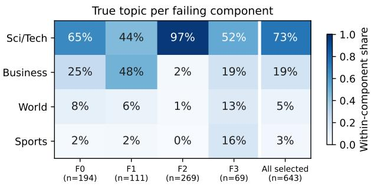
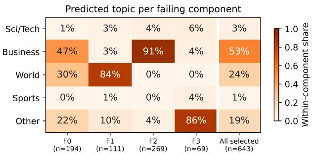
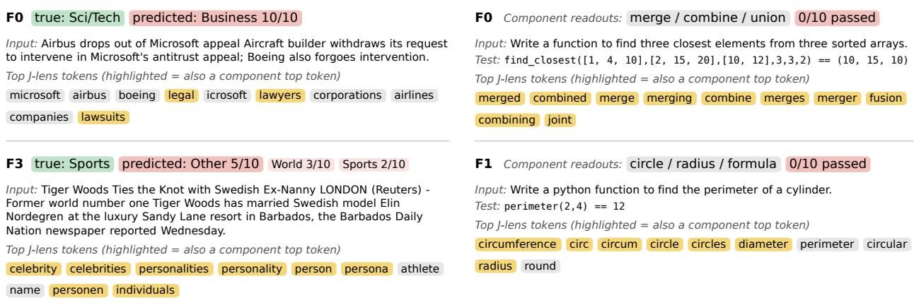
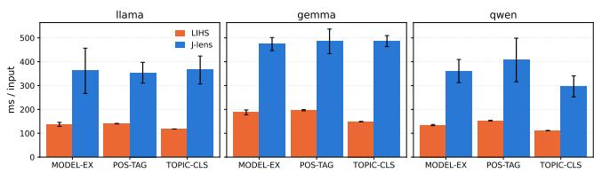
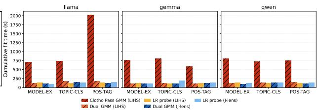

# FOREWORD: PRE-GENERATION PREDICTION AND CHARACTERISATION OF LLM TEST FAILURES USING THE JACOBIAN LENS

A PREPRINT

Somin Kim KAIST Republic of Korea somin.kim@kaist.ac.kr

Robert Feldt Chalmers University of Technology Sweden robert.feldt@chalmers.se

Shin Yoo   
KAIST   
Republic of Korea   
shin.yoo@kaist.ac.kr

October 21, 2026

## ABSTRACT

Testing LLM-based software is expensive: each input needs several sampled responses, each judged by a costly oracle. Further, every prompt or model change calls for re-testing. Pre-generation adequacy measures cut this cost by ranking inputs by failure risk based on the model’s internal state. However, the state of the art, Clotho, models only passing reference inputs, and its hidden-state representation says nothing about why inputs fail. We present FOREWORD, a framework built on two ideas: learn from both passing and failing references, and represent inputs through the Jacobian lens (J-lens), an interpretability technique that reads intermediate activations out as scores over vocabulary tokens. FOREWORD pairs these representations with two estimators: a sparse logistic-regression probe or dual Gaussian Mixture Models (dual GMMs), which also yield a reference density (to flag inputs the references do not cover) and failing-class components (to group similar failures). On ten tasks and three open-weight LLMs, all four combinations of representations and estimators outperform Clotho on average, both for prediction of failure (ROC-AUC improves by 0.14 on average and by up to 0.31) and test prioritisation (15% more failures among the 100 top-ranked inputs on average, up to 33%). Prioritisation obtained using small models also transfers better to proprietary models (on average 22% and up to 41% more failures in the first quarter of prioritised inputs). Importantly, our qualitative case study shows that FOREWORD supports semantic characterisation of failures by pointing to ambiguities in labels or task specifications. Combined, FOREWORD can support testers for prioritising inputs, checking support for a prediction, and characterising specific failures, all without generating output.

Keywords Test Adequacy, Large Language Model

## 1 Introduction

Large Language Models (LLMs) now power software in a growing number of domains, from education [Chu et al.(2025)] and health care [Qiu et al.(2024)] to software development itself [Agarwal et al.(2026)]. Such software must be tested thoroughly, but LLM testing is expensive. LLMs can react to the same input differently each time, so a reliable aggregate verdict on one input may take several iterations, each judged by an oracle that is some times itself an LLM [Tan et al.(2025)]. Every change to a prompt, model, or configuration can also require testing again. Testers would therefore like to predict which inputs are likely to fail, understand what failing inputs have in common, and assess when such predictions are supported. Shared failure patterns could help guide fixes and help choose tests that cover different kinds of failure. Yet current LLM testing tools give little guidance even on which inputs to run first [Dobslaw et al.(2026)].

Recently, Clotho [Yoon et al.(2026)], a pre-generation test adequacy measure, was proposed to estimate the likelihood of failure before an output is generated. The key insight is that output uncertainty can be approximated from the

LLM’s internal latent space: if a new input’s hidden-state representation is an outlier relative to inputs known to produce correct outputs, it is more likely to fail. Empirical results show that the ranking lets testers execute inputs likely to fail first, without generating any outputs for the remaining ones. However, Clotho neither characterises shared failure patterns nor distinguishes familiar failures from inputs unlike its references.

We present FOREWORD, a framework that extends Clotho in two ways: (1) learning from both passing and failing reference inputs, and (2) representing inputs through readouts from the Jacobian lens (J-lens), a mechanistic interpretability technique [Gurnee et al.(2026)]. Learning from both outcomes allows us to fit a predictor that distinguishes passing from failing inputs. The J-lens expresses intermediate LLM activations as vocabulary-token scores that reveal concepts the model has available for verbalisation. Unlike Clotho’s opaque hidden-state vectors, these scores correspond to readable tokens, offering a basis for describing individual inputs and groups of failures.

FOREWORD represents inputs through vocabulary-aligned J-lens Readout Scores (JRS) and supports two failure estimators that learn from both passing and failing reference inputs. The dual Gaussian Mixture Model (GMM) estimator extends Clotho by fitting separate distributions to passing and failing references. Together, the two GMMs yield a failure score, a reference-density signal for flagging weakly supported inputs, and component groups whose token profiles can be inspected separately. Alternatively, a simpler Logistic Regression (LR) estimator can learn the boundary between passing and failing inputs focusing more directly on failure prediction.

Across ten tasks, including two Python program-synthesis benchmarks with executable tests, our evaluation of FORE-WORD separates representation choice from estimator choice by pairing both estimators with JRS and Clotho’s Lasttoken Input Hidden States (LIHS). All four configurations improve average ROC-AUC over Clotho; LR performs best overall. J-lens features provide readable token profiles with similar average discrimination to LIHS, although differences vary by task. In our topic-classification case study, component profiles describe separate failure groups, whereas the inspected global LR weight rankings mix several concepts.

Our contributions are as follows:

• FOREWORD, a pre-generation test adequacy framework that learns from passing and failing references using J-lens features, with LR and dual GMMs as complementary estimators.

• An empirical evaluation across ten tasks and six open-weight and three proprietary LLMs, comparing against Clotho and post-generation uncertainty metrics and assessing prediction, prioritisation, reference support, transfer, and cost.

• A qualitative case study examining how J-lens token profiles characterise failure groups, including groups sharing the same label confusion.

The replication package of FOREWORD is publicly available [Anonymous(2026)].

## 2 Background

This section presents background information relevant to our work.

## 2.1 Test Adequacy for Large Language Models

Test adequacy measures how well a given test input, or a set of inputs, checks the target System Under Test (SUT). A good adequacy metric is expected to be correlated with fault detection capability: an input with a higher adequacy value should be more likely to reveal unexpected behaviour. Such metrics can be used to assess the quality of existing test inputs [Zhu et al.(1997)], or to prioritise inputs with the aim of revealing unexpected behaviour as early as possible [Elbaum et al.(2001)].

Test adequacy is crucial for efficient testing of LLM-based systems, as their test oracles tend to be expensive, be it human judgement or LLM-as-judges [Tan et al.(2025)]. A reliable test adequacy metric will prioritise inputs according to their likelihood of failing (i.e., producing undesired responses), allowing the test efforts to be focused on those problematic inputs. However, many of the traditional adequacy criteria are white-box, code-based metrics, such as structural coverage [Zhu et al.(1997)]. Consequently, they do not directly apply to Large Language Models (LLMs) that are generative models with no interpretable structural units.

To mitigate the high oracle cost, confidence metrics have been widely adopted. If the LLM response to a given test input has low confidence, it is more likely that the response is not correct. Various confidence metrics have been studied in this context, including token-level likelihood and entropy [Manakul et al.(2023)], and the semantic-level entropy [Farquhar et al.(2024)]. While the uncertainty measures can be used to prioritise test inputs, their common limitation is that uncertainty becomes available only after the full response generation, highlighting the fact that it is a metric for outputs, not inputs.

Clotho is a recently proposed pre-generation test adequacy metric [Yoon et al.(2026)]. It approximates the uncertainty with out-of-distribution measures at pre-generation stage: the reference distribution is obtained by fitting a Gaussian Mixture Model (GMM) using a reference set of passing input with respect to a specific task, iteratively sampled with user labelling. The test adequacy value of an unseen input is the negative log likelihood given by the trained GMM. Since the GMM is fitted with passing inputs, the adequacy score is correlated to the likelihood of the input generating correct output, and therefore can be used to prioritise inputs. Notably, Clotho computes its test adequacy pre-generation, based on the Last-token Input Hidden State (LIHS), i.e., the hidden state of the last input token at a layer two thirds of the way through the Transformer decoder. This representation is known to contain rich semantic information about the given context [Azaria and Mitchell(2023), Zhou et al.(2025)].

## 2.2 Jacobian Lens

Hidden states such as LIHS are informative but not human-readable. Lens techniques address this by decoding intermediate activations into the model’s vocabulary. In a decoder-only Transformer, each layer reads from and write to a residual stream, whose value after layer ℓ at token position $p$ we denote $a _ { \ell , p } .$ . After the last layer, a final normalisation (norm) and the unembedding matrix $( W _ { U } )$ convert the residual stream into next-token logits. The logit lens [nostalgebraist(2020)] applies norm and $W _ { U }$ directly to intermediate activations. However, this assumes that intermediate layers encode information in the same way as the final layer, which holds only for the last few layers.

The Jacobian lens (J-lens) [Gurnee et al.(2026)] addresses this by first mapping activations into the final layer’s representation space, using the average Jacobian $J _ { \ell } = \mathbb { E } _ { x , p , p ^ { \prime } \geq p } [ \bar { \partial a } _ { \mathrm { f i n a l } , p ^ { \prime } } ( x ) \bar { / } \partial \bar { a } _ { \ell , p } ( x ) ]$ , where x ranges over prompts from a generic text corpus, p over source positions, and $p ^ { \prime }$ over the current and all later positions. The readout of an activation a at layer ℓ is then $W _ { U } \mathrm { n o r m } ( \bar { J _ { \ell } } a )$ . Since $J _ { \ell }$ is averaged over many contexts, the readout reflects what the activation would generally lead the model to say, rather than what it leads to in one particular context. Gurnee et al. call the representations revealed by the J-lens verbalisable, and the space they form the J-space. They show that the J-space behaves like a global workspace. The model can report, hold, and reason with its contents, and pass them on to downstream computations. Although the J-space spans the entire vocabulary, only a few tokens are strongly active in it at any one time, yielding a sparse representation. In the models they study, these properties are most evident in the middle workspace layers; readouts are noisy in the early layers and, in the final layers, mostly reflect the output the model is about to produce.

Like LIHS, J-lens readouts can be computed from the input alone, before any response is generated. They express the content of the model’s workspace in vocabulary coordinates, with each feature corresponding to a token. We therefore investigate them as an input representation for pre-generation test adequacy.

## 3 FOREWORD

FOREWORD is a framework for pre-generation input adequacy: it supports two input representations, and two adequacy estimators. In addition to the Last-token Input Hidden States (LIHS) of Clotho, FOREWORD can also represent inputs using J-lens readouts [Gurnee et al.(2026)], which capture what the model is poised to verbalise. For estimators, FOREWORD supports Logistic Regression to predict pass or fail outcome of the output to be generated from the given input. Further, unlike Clotho, FOREWORD also learns from failing inputs, so that familiar failure patterns can be recognised, using dual GMM.

Given a target model, a task-specific prompt template $T ,$ and a candidate pool ${ \mathcal { P } } _ { : }$ we extract a representation $h ( x ) =$ $\phi ( T ( x ) )$ for each input x without decoding a response. To label an input, we sample 10 responses and use a taskspecific oracle to compute u(x), the fraction judged correct. We assign y(x) = pass if a strict majority of the responses are correct and $y ( x ) =$ fail otherwise. The labelled inputs form the reference set $\mathcal { R } _ { t }$ at acquisition round t, with passing and failing subsets $\mathcal { R } _ { t , P }$ and $\mathcal { R } _ { t , F }$ . Once fitted on $\mathcal { R } _ { t } ,$ the estimators score new inputs from $h ( x )$ alone. Algorithm 1 constructs $\mathcal { R } _ { t }$ adaptively, labelling new inputs and refitting the estimators in each round until the labelling budget is exhausted.

The remainder of this section describes input representations (Section 3.1), adequacy estimators (Sections 3.2 and 3.3), and the adaptive construction of the reference set (Section 3.4).

## 3.1 Input Representations

We consider two representations extracted before response generation. Last-token Input Hidden States (LIHS) use a model activation directly. Jacobian-lens Readout Scores (JRS) is a vocabulary-aligned feature vector constructed from J-lens readouts. Either representation can be paired with either estimator.

LIHS Following Clotho [Yoon et al.(2026)], we extract the hidden state at the last token of the input prompt from the residual stream after the transformer layer located at two-thirds of the model’s depth.

JRS Let $a _ { \ell , p } ( x )$ denote the residual-stream activation at layer ℓ and prompt position p. The J-lens maps intermediate activations through an averaged Jacobian $J _ { \ell } ,$ , followed by the model’s final normalisation and unembedding [Gurnee et al.(2026)]. We extract readouts at a fixed token position $p _ { \mathrm { J } }$ in the chat-formatted input prompt, before any response tokens are generated. For each selected layer $\ell \in \mathcal L$ , the resulting pre-softmax vocabulary scores are: $r _ { \ell } ( x ) = W _ { U }$ norm $( J _ { \ell } a _ { \ell , p _ { \mathrm { J } } } ( x ) ) \in \mathbb { R } ^ { | V | }$ , where $W _ { U }$ is the unembedding matrix and $V$ is the model vocabulary. The set of layers, ${ \mathcal { L } } ,$ is chosen from a middle-to-late layer band $[ \ell _ { \mathrm { l o } } , \ell _ { \mathrm { h i } } ]$ , covering approximately 45% to 90% of each model’s depth, following the workspace analysis of Gurnee et al. [Gurnee et al.(2026)]. The exact layer bounds for each model are reported in the experimental setup.

To place readouts from different layers on a comparable scale, we standardize each $r _ { \ell } ( x )$ to zero mean and unit variance across its $| V |$ coordinates, obtaining $\widetilde r _ { \ell } ( x )$ , and average over layers in $\begin{array} { r } { \mathcal { L } \colon \bar { r } ( x ) \ = \ \frac { 1 } { | \mathcal { L } | } \sum _ { \ell \in \mathcal { L } } \widetilde { r } _ { \ell } ( x ) } \end{array}$ . Each coordinate $\bar { r } _ { v } ( x )$ is thus the standardised score of token $v \in V ,$ averaged over the selected layers. This pooling preserves the vocabulary alignment of the readouts but yields a $| V |$ -dimensional vector, which is costly to model downstream. Because the informative variation in J-lens readouts tends to concentrate in a relatively small subset of vocabulary coordinates [Gurnee et al.(2026)], we retain only the set $V _ { K } \subset V$ of $K = 2 0 0 0$ tokens with the largest variance $\begin{array} { r } { \dot { \mathrm { V a r } } _ { x \in \mathcal { P } } [ \bar { r } _ { v } ( x ) ] } \end{array}$ over the candidate pool, and use $[ \bar { r _ { v } } ( x ) ] _ { v \in V _ { K } } \in \mathbb { R } ^ { K }$ as the representation. The selected set $V _ { K }$ and its ordering are fixed and reused for all subsequent inputs.

In the remainder of this section, $h ( x )$ denotes either the LIHS or JRS. Two adequacy estimators take the same $h ( x )$ as input but differ in how they use the passing and failing references: the LR probe learns to separate two classes, whereas the dual GMM models the distribution of each class.

## 3.2 Learning to Separate Pass from Fail using Logistic-Regression Estimator

The most direct way to score failure from the references is to learn a decision boundary between the two classes, i.e., pass and fail. At each round t, we fit an $\ell _ { 1 }$ -regularised logistic-regression probe to $\mathcal { R } _ { t }$ on $h ( x )$ , and define its failure score as $s _ { \mathrm { L } , t } ( x ) = \sigma \big ( \mathbf { w } _ { t } ^ { \top } h ( x ) + b _ { t } \big )$ , where $\sigma$ is the logistic function and $\mathbf { w } _ { t }$ and $b _ { t }$ are the fitted weights and bias. The $\ell _ { 1 }$ penalty keeps the probe sparse to cater for the high dimensionality as well as the small size of the reference sets in the early rounds.

## 3.3 Modelling Passing and Failing Distributions using dual GMM Estimator

The second estimator is dual Gaussian Mixture Models (dual GMMs), which is an extension of the GMM used by Clotho. The motivation for dual GMM is two-fold. First, the LR probe models only the boundary between the classes, pass and fail, but not how each class is distributed, providing no measure of how well the references support an input. Second, by modelling supports for both passing and failing inputs (hence the duality), FOREWORD aims to identify groups of similar failures.

The dual GMM projects the representations into a shared PCA space and fits a separate GMM to each outcome class. Together, the two class models yield three outputs: a posterior failure score comparable to that of the LR probe, a reference density that identifies inputs weakly supported by the references, and component memberships that group inputs within each class and provide a basis for investigating recurring failure patterns. We first define these outputs and then describe how the model configuration adapts as the reference set grows.

## 3.3.1 Class models and derived scores.

At round t, both classes share a PCA transformation $A _ { t } ,$ fitted on the candidate pool P and retaining $D _ { t }$ dimensions, which maps each input to $z _ { t } ( x ) = A _ { t } h ( x ) \in \mathbb { R } ^ { D _ { t } }$ . Sharing the transformation places the passing and failing densities in the same coordinates; $A _ { t }$ is stored with the fitted models and reused to score new inputs. In this space, we fit a Gaussian Mixture Model $p _ { t , c }$ to each class $c \in \{ P , F \}$ on $\mathcal { R } _ { t , c } ,$ with a class-specific number of components and covariance structure selected as described below. With class priors $\pi _ { t , c } = | \mathcal { R } _ { t , c } | / | \mathcal { R } _ { t } |$ , the posterior failure score is:

Algorithm 1: Adaptive reference-set construction in FOREWORD, shown for the dual GMM   
Input: candidate pool ${ \mathcal { P } } ,$ prompt template $T ,$ representation ϕ, initial reference size $N _ { 0 } ,$ labelling budget N, batch size $B ,$   
minimum references per class mmin   
Output: class models $\mathcal { M } _ { t , P } , \mathcal { M } _ { t , F }$ , or ⊥ if either class has fewer than $m _ { \mathrm { m i n } }$ references   
1 Construct and cache $h ( x ) \stackrel { \cdot } { = } \phi ( T ( x ) )$ for all $x \in { \mathcal { P } } ;$   
2 $\mathcal { R } _ { 0 } $ RandomSam $\mathrm { 1 p l e } ( \mathcal { P } , N _ { 0 } )$ ; label $\mathcal { R } _ { 0 } ;$   
3 $\mathcal { U } _ { 0 }  \mathcal { P } \setminus \mathcal { R } _ { 0 } ; t  0 ;$   
4 while true do   
5 $\mathcal { R } _ { t , P } \gets \{ x \in \mathcal { R } _ { t } : y ( x ) = \mathrm { p a s s } \} ; \mathcal { R } _ { t , F } \gets \{ x \in \mathcal { R } _ { t } : y ( x ) = \mathrm { f a i l } \} ;$   
6 if min $( | \mathcal { R } _ { t , P } | , | \mathcal { R } _ { t , F } | ) \geq m _ { \operatorname* { m i n } }$ then   
7 $( A _ { t } , \theta _ { t , P } , \theta _ { t , F } ) \gets .$ SelectConfigurations $( h ( \mathcal { P } ) , \mathcal { R } _ { t } ) ;$   
8 foreach $c \in \{ \dot { P } , { \cal F } \}$ do   
9 $\pi _ { t , c } \gets | \dot { \mathcal { R } } _ { t , c } | \big / | \mathcal { R } _ { t } | ;$   
10 $\mathcal { M } _ { t , c }  \mathrm { F }$ itDistribution $( h ( \mathcal { R } _ { t , c } ) ; A _ { t } , \theta _ { t , c } , \pi _ { t , c } ) ;$   
11 else   
12 $\mathcal { M } _ { t , P } , \mathcal { M } _ { t , F } \gets \bot , \bot ;$   
13 if $\left| \mathcal { R } _ { t } \right| \geq N$ or ${ { \mathcal { U } } _ { t } } = \emptyset$ then   
14 return $\mathcal { M } _ { t , P } , \mathcal { M } _ { t , F } ;$   
15 $B _ { t } \gets \operatorname* { m i n } ( B , N - | \mathcal { R } _ { t } | , | \mathcal { U } _ { t } | ) ;$   
16 if $\mathcal { M } _ { t , P } \neq \dot { \perp }$ and $\mathcal { M } _ { t , F } \neq \perp$ then   
17 $\dot { B _ { \mathrm { a c q } } }  \lceil B _ { t } / 2 \rceil ;$   
18 $C _ { \mathrm { a c q } }  \mathrm { t o p } { - } B _ { \mathrm { a c q } }$ inputs $x \in \mathcal { U } _ { t }$ b $H ( s _ { \mathrm { G } , t } ( x ) ) ;$   
19 else   
20 $B _ { \mathrm { a c q } }  0 ; C _ { \mathrm { a c q } }  \emptyset ;$   
21 $B _ { \mathrm { d i v } } \gets B _ { t } - B _ { \mathrm { a c q } } ;$   
22 $C _ { \mathrm { d i v } } $ FarthestPointSample(Ut $\backslash C _ { \mathrm { a c q } } , \mathcal { R } _ { t } \cup C _ { \mathrm { a c q } } , B _ { \mathrm { d i v } } ; h ) ;$   
23 $C _ { t } \gets C _ { \mathrm { { a c q } } } \cup C _ { \mathrm { { d i v } } } ;$ label $C _ { t } \mathrm { : }$   
24 $\mathcal { R } _ { t + 1 }  \dot { \mathcal { R } _ { t } } \cup C _ { t } ; \mathcal { U } _ { t + 1 }  \mathcal { U } _ { t } \setminus C _ { t } ; t  t + 1 ;$

$$
s _ { \mathrm { G } , t } ( x ) = \frac { \pi _ { t , F } p _ { t , F } ( z _ { t } ( x ) ) } { \pi _ { t , P } p _ { t , P } ( z _ { t } ( x ) ) + \pi _ { t , F } p _ { t , F } ( z _ { t } ( x ) ) } .\tag{1}
$$

Higher scores indicate stronger evidence for failure relative to passing under the fitted models: we use this score to prioritise inputs before generation.

Modelling the class densities explicitly has a useful by-product with no counterpart in the LR probe: the normalizing term of Eq. (1) is itself informative. Its logarithm,

$$
d _ { t } ( \boldsymbol { x } ) = \log [ \pi _ { t , P } p _ { t , P } ( z _ { t } ( \boldsymbol { x } ) ) + \pi _ { t , F } p _ { t , F } ( z _ { t } ( \boldsymbol { x } ) ) ] ,\tag{2}
$$

is the log marginal density of $z _ { t } ( x )$ under the fitted class models, which we call the reference density. It measures how well the current references, pooled across both classes, support an input, regardless of which outcome the posterior favours. Computing the posterior already yields $d _ { t }$ , so the reference density comes at no additional cost; we compute both in log space for numerical stability. Pooling both classes distinguishes the reference density from the score by which Clotho ranks inputs: the density under a GMM fitted to passing references only. That score is low both for inputs that resemble failures and for inputs that resemble no reference, whereas the reference density is low only for the latter. Consequently, we can either prioritise inputs using the posterior failure score, or detect out-of-distribution inputs using the reference density

Finally, each class mixture groups the inputs of its class into components: we assign an input to the component of $p _ { t , c }$ with the highest posterior responsibility. Among failing references, these component memberships provide the basis for investigating recurring failure patterns.

## 3.3.2 Adaptive configuration selection.

As in Clotho [Yoon et al.(2026)], we adapt the configuration of the dual GMM as the reference set grows, since the appropriate model complexity depends on both the task and the number of available references. The configuration consists of the shared PCA dimensionality $D _ { t }$ and, for each class $c ,$ the number of mixture components and the covariance structure, $\theta _ { t , c }$ . Searching over all combinations of these settings would require fitting many pairs of class models at every refit. Instead, each time the class models are refitted (line 7 of Algorithm 1), we update the configuration in two steps, each a local search around the previous configuration: we first select the dimensionality with the component counts held fixed, and then reselect the component counts for the chosen dimensionality.

First, we select the dimensionality. The first fit uses 30 dimensions, since no component counts are yet available for evaluating alternatives; at each subsequent refit, we compare the previous dimensionality with ±10 dimensions. Using 3-fold cross-validation on $\mathcal { R } _ { t } ,$ we fit the class models to the training references, compute the passing log odds of each held-out reference x, log[ $\pi _ { P } p _ { P } ( z ( x ) ) / \pi _ { F } p _ { F } ( z ( x ) ) ]$ , and compute their Spearman correlation to the observed success rates u(x). We keep the dimensionality with the highest mean correlation across folds.

Second, we reselect the number of components of each class using the newly chosen dimensionality. Ideally, this number matches the number of clusters that the inputs of the class form, but that number is not only unknown in advance but also depends on the dimensionality as well as the reference set. For each class, the number of components we choose is the one that maximises the 3-fold cross-validated log likelihood of the class reference set, i.e., one that fits the existing references the best. Note that, since log likelihoods cannot be compared across different dimensions, the number of components is chosen second. It is also capped at min $( 1 0 , \lfloor \vert \mathcal { R } _ { t , c } \vert / 1 0 \rfloor )$ , so that each component is fitted to at least ten references on average. The first fit considers every count up to this cap; subsequent refits consider only the previous count and its ±1 neighbouring values. We use full covariance matrices by default and fall back to diagonal ones whenever a class has too few references to estimate them, i.e., fewer references than the free parameters of the full-covariance.

## 3.4 Adaptive Reference-Set Construction

Algorithm 1 constructs the reference set iteratively, refitting the estimator as new labels are acquired. We present it for the dual GMM and describe the LR variant at the end of this section. Given the candidate pool $\dot { \mathcal { P } }$ and a labelling budget N, the algorithm first constructs and caches the representations of all candidates (line 1). It then labels $N _ { 0 }$ randomly selected inputs as the initial references and initialises the unlabelled pool (lines 2–3). At each round t, it partitions the references by outcome (line 5). Once both classes contain at least $m _ { \mathrm { m i n } }$ references, it selects the PCA transformation and the class-specific mixture configurations $\theta _ { t , P }$ and $\theta _ { t , F }$ as described in Section 3.3 (line 7), estimates the clas priors, and fits the class models $\mathcal { M } _ { t , P }$ and $\mathcal { M } _ { t , F }$ (lines 9–10). Otherwise, no fitted scorer is available (line 12). The stopping check follows this fit: if the budget is exhausted or the unlabelled pool is empty, the algorithm returns the scorer fitted on the current reference set, or ⊥ if either class still lacks $m _ { \mathrm { m i n } }$ references (line 14). If acquisition continues, the next batch size $B _ { t }$ is limited by the remaining budget and pool size (line 15). When the scorer is available, $\lceil B _ { t } / 2 \rceil$ inputs are selected by the model-based acquisition criterion MARGIN (lines 17–18), which ranks unlabelled inputs by the binary entropy $H ( s _ { \mathrm { G } , t } ( x ) )$ of their posterior failure scores, favouring inputs near the fitted pass/fail boundary. Diversity sampling fills the remaining positions by repeatedly choosing the input with the greatest minimum Euclidean distance in h-space from the references and inputs already selected for this batch (lines 21–22). If the scorer is unavailable, diversity sampling selects the entire batch (line 20). The batch is then labelled, added to the references, and removed from the unlabelled pool before the next round (lines 23–24). The LR variant uses the same acquisition loop. Lines 7–10 instead fit the probe defined in Section 3.2 to $\mathcal { R } _ { t } .$ , and MARGIN uses $s _ { \mathrm { L } , t }$ in place of $s _ { \mathrm { G } , t }$

## 4 Experimental Setup

This section details the experimental setup used to evaluate FOREWORD.

## 4.1 Research Questions

We organise the study around the following research questions.

## 4.1.1 RQ1. How effectively does FOREWORD predict failing inputs and prioritise them for testing?

We evaluate each method on held-out inputs drawn from the same task. This assesses whether pre-generation scores separate failure-inducing inputs from passing ones, and whether ranking inputs by predicted failure risks enables earlier failure discovery under limited execution budgets.

Compared Methods. We compare FOREWORD with the pre-generation baseline Clotho [Yoon et al.(2026)] and three post-generation adequacy metrics: Token Probability $( \mathrm { T O K } _ { p r o b } )$ and Token Entropy $( \mathrm { T O K } _ { e n t } )$ [Manakul et al.(2023)], and Last Output-token Hidden State Variance $\left( \mathrm { L O H S } _ { v a r } \right)$ . We compare

FOREWORD to all the above for evaluation of failure prediction, and only to pre-generation methods as well as random for evaluation of prioritisation. We study the 2 by 2 combinations of representations (LIHS and JRS) and estimators (LR and dual GMM) to separate their contributions.

Evaluation Metrics. We report ROC-AUC for failure prediction study, which measures how well risk scores rank inputs labelled fail above those labelled pass. For prioritisation, we report Failure@N, which counts failed inputs among the $N ~ \in ~ \{ 1 0 0 , 3 0 0 , 5 0 0 \}$ highest-risk candidates. For both, we report means over ten seeds, and provide details in our replication package [Anonymous(2026)].

## 4.1.2 RQ2. How reliably does FOREWORD identify inputs that fall outside its task-specific distribution?

Before acting on a learned failure score, a tester may ask: Can I trust this score for this input? For this, we evaluate whether studied estimators can reliably distinguish inputs within the task distribution from those out of distribution, based on the small set of labelled reference inputs.

Evaluation Setup. For each target task, we partition inputs into three disjoint sets: reference, calibration, and evaluation. The references fit the estimators; the remaining target-task inputs, both passing and failing, are divided roughly evenly between calibration and evaluation. We sample 500 out-of-distribution inputs from four randomly chosen remaining tasks, and inject their input into the target task’s prompt template to extract the same representation.

Compared Methods. For each seed, we fit a dual GMM and an $\ell _ { 1 }$ -regularised LR probe on the same labelled LIHS references, using each estimator’s preprocessing procedure. We compare the dual GMM marginal reference log-density $d _ { t } ( x ) \left( \mathrm { E q . } \overline { { ( 2 ) } } \right)$ , and the LR pass probability $P ( \operatorname { p a s s } \mid x ) .$ 1

Evaluation Metrics. For each target, seed, and score, we set a threshold τ to retain 95% of the in-distribution calibration inputs, then report the False Positive Rate (FPR)@95 when we apply τ to the held-out target task inputs as well as OOD inputs. We also compute ROC-AUC for each OOD source against the held-out target inputs, treating the latter as positive. FPR@95 is the lower the better, ROC-AUC the higher the better. We report means and standard deviations over ten seeds.

## 4.1.3 RQ3. Can FOREWORD help characterise LLM failures?

As JRS is tied to specific tokens, we can represent observed failure patterns as tokens. This is more straightforward with failure components of dual GMM: we can pool all inputs belonging to each failure component, and apply J-lens to read the tokens. LR, on the other hand, simply fits a hyperplane in the JRS space which best separates passing and failing input representations. Consequently, we can read out the tokens that have the highest influence on the separation from the normalised weights of the fitted LR models. We qualitatively analyse whether such readouts can characterise different groups of failures taken from TOPIC-CLS and MBPP tasks using Llama-3.1-8B.

Failure Patterns. On TOPIC-CLS, we examine the failing-class GMM components through two complementary analyses. First, we assess whether they show distinctive failure patterns, characterised by each input’s ground truth topic and the predicted topic. Second, we examine whether the tokens we read out of the failing input representation reveal semantic characteristics of the failure pattern. To evaluate whether components group failures with similar observed patterns, we measure associations between component membership and ground-truth topics, predicted topics, and true–predicted topic pairs using Cramer’s´ V [Cramer(1946)]. We report means and standard deviations over ten´ random seeds, and illustrate the patterns using one run (seed 0).

Semantic Characterisation. For each input x and token $v \in V _ { K }$ , we average the token’s J-lens readout across the workspace bands to obtain $\bar { r } _ { v } ( x )$ , i.e., JRS. We then rank tokens by the difference between the mean of $\bar { r } _ { v } ( x )$ over $F _ { j }$ and its mean over the entire input set, to highlight tokens elevated in $F _ { j }$ . After merging case and punctuation variants, we inspect the top 20 tokens of each component, identify the concept they express, and examine how its prominence in the model’s representation relates to the component’s failures. For TOPIC-CLS, at the task level, we also rank tokens by their weights in the LR, separately for positive weights (towards failure) and negative weights (towards passing), and inspect the top 20 of each after the same merging. Finally, to show how FOREWORD can assist analysis of individual cases, we report top tokens from failing inputs randomly sampled from held-out sets, i.e., those not labelled during GMM fitting. We do this on both TOPIC-CLS and MBPP. For MBPP, we also compare the readouts with the generated programs and reference solutions.

Table 1: Target tasks, datasets, and pass rates (p = 0.5) of the studied open-weight LLMs.
<table><tr><td>Task</td><td>Inputs</td><td>Description</td><td>Llama 3.1 8B</td><td>Gemma 2 9B</td><td>Qwen 3 8B</td></tr><tr><td>ODD-ADD</td><td>6,000</td><td>Odd-number summation [Yoon et al.(2026)]</td><td>0.60</td><td>0.60</td><td>0.69</td></tr><tr><td>GH-TYPO</td><td>10,000</td><td>Github Typo correction [Hagiwara and Mita(2019)]</td><td>0.51</td><td>0.64</td><td>0.58</td></tr><tr><td>JSON-FIX</td><td>6,563</td><td>Repair invalid JSON [de Jong(2022)]</td><td>0.75</td><td>0.83</td><td>0.94</td></tr><tr><td>MODEL-EX</td><td>9,810</td><td>Extract ML model names [CShorten(2022)]</td><td>0.55</td><td>0.67</td><td>0.75</td></tr><tr><td>POS-TAG</td><td>15,359</td><td>Detect Part-of-speech tags [Silveira et al.(2014)]</td><td>0.77</td><td>0.81</td><td>0.79</td></tr><tr><td>SPELL-CHK</td><td>10,000</td><td>Fix misspelt words [Fellbaum(1998), Mitton et al.(1980)]</td><td>0.82</td><td>0.88</td><td>0.86</td></tr><tr><td>SYN-BUG</td><td>20,518</td><td>Find code lines with syntactic bugs [Lee et al.(2024)]</td><td>0.36</td><td>0.42</td><td>0.47</td></tr><tr><td>TOPIC-CLS</td><td>7,600</td><td>Classify topics of news articles [Żhang et al.(2015)]</td><td>0.78</td><td>0.82</td><td>0.77</td></tr><tr><td>MBPP</td><td>974</td><td>Python synthesis (MBPP [Austin et al.(2021)])</td><td>0.63</td><td>0.64</td><td>0.71</td></tr><tr><td>LCB</td><td>1,055</td><td>Python synthesis (LiveCodeBench [Jain et al.(2025)])</td><td>0.20</td><td>0.26</td><td>0.50</td></tr></table>

## 4.1.4 RQ4. How effectively can FOREWORD scores obtained from smaller open-weight models prioritize failures in larger or proprietary target models?

FOREWORD requires hidden states, which are not available from proprietary models and expensive to extract from larger open-weight models. Clotho showed that pass-only scores from smaller open-weight models transfer to proprietary models [Yoon et al.(2026)]; we ask whether better modelling of failures in smaller models can improve these transfers. To test this, we fit estimators using source representations from smaller models, and use target outcomes to evaluate the orderings obtained using the estimator scores (see Section 4.2.2 for model pairs).

Compared Methods. We compare all RQ1 methods with Clotho and random ordering.

Evaluation Metrics. Following Clotho, we use a fixed random subset of 2,000 inputs per task, or all non-training inputs for the smaller MBPP and LCB datasets. The inputs are shared across sources, targets, methods, and seeds. Each estimator prioritises them from the most to the least likely to fail. We report normalised failure@25%: the number of failing inputs among the first N = 25% of the ordering, divided by min(F, N), where F is the number of failing inputs in the evaluation set. A perfect prioritisation scores failure@25% of 1.0, whereas random prioritisation would on average score 0.25. Results are averaged over ten seeds.

## 4.1.5 RQ5. What computational cost does FOREWORD incur?

We measure computational cost on three randomly chosen tasks (MODEL-EX, POS-TAG, and TOPIC-CLS) at a fixed seed. Because representations are cached and reused across fitting runs, we time extraction and fitting separately. All timings are taken on one machine with a single NVIDIA GeForce RTX 3090 GPU at batch size 1.

Compared Methods. We compare computational costs of all methods studied in RQ1. Each estimator uses the same configuration and active-learning loop as in RQ1.

Evaluation Metrics. For LIHS and JRS, we time the extraction of the same 25 inputs per dataset, three times each, and report the mean and standard deviation of per-input wall-clock time, which for JRS includes the readout operations. For fitting, we compare Clotho’s passing-class GMM with full covariance on LIHS [Yoon et al.(2026)], the dual GMM, and the LR probe, fitting the latter two on both LIHS and J-lens, and report wall-clock times.

## 4.2 Experimental Details

The experimental details for our study is provided.

## 4.2.1 Target Tasks and Datasets

We evaluate FOREWORD on the eight benchmark tasks used in Clotho [Yoon et al.(2026)], as well as two python program synthesis benchmarks: Mostly Basic Python Problems (MBPP) [Austin et al.(2021)] and Live CodeBench [Jain et al.(2025)]. Table 1 summarizes the tasks and their corresponding datasets.

## 4.2.2 Subject Models and Transfer Targets

We evaluate FOREWORD using Llama 3.1 8B [AI@Meta(2024)], Gemma 2 9B [Team(2024)], and Qwen 3 8B [Team(2025)], for which pretrained J-lens models are publicly available [Neuronpedia(0000)]. The last three columns of table 1 reports the fraction of inputs each model passes on each task. For RQ4, we additionally evaluate

Table 2: ROC-AUC for pre-generation pass/fail prediction (Best, second best)
<table><tr><td rowspan="2">Task ID</td><td colspan="5"> $\mathrm { G e m m a } { \cdot } 2 { \cdot } 9 \mathrm { B }$ </td><td colspan="5">Llama-3.1-8B</td><td colspan="5"> $\mathbf { Q } \mathrm { w e n } 3 - 8 \mathbf { B }$ </td></tr><tr><td>Clotho</td><td> ${ \mathrm { L I H S } } _ { \mathrm { D G } }$ </td><td> $\mathrm { L I H S } _ { \mathrm { L R } }$ </td><td> ${ \mathrm { J R S } } _ { \mathrm { D G } }$ </td><td> $\mathrm { J R S } _ { \mathrm { L R } }$ </td><td>Clotho</td><td> ${ \mathrm { L I H S } } _ { \mathrm { D G } }$ </td><td> $\mathrm { L I H S } _ { \mathrm { L R } }$ </td><td> $\mathrm { J R S } _ { \mathrm { D G } }$ </td><td> $\scriptstyle \mathrm { J R S } _ { \mathrm { L R } }$ </td><td>Clotho</td><td> ${ \mathrm { L I H S } } _ { \mathrm { D G } }$ </td><td> $\mathrm { L I H S } _ { \mathrm { L R } }$ </td><td> ${ \mathrm { J R S } } _ { \mathrm { D G } }$ </td><td> $\scriptstyle { \mathrm { J R S } } _ { \mathrm { L R } }$ </td></tr><tr><td>ODD-ADD</td><td>0.682</td><td>0.799</td><td>0.838</td><td>0.809</td><td>0.836</td><td>0.811</td><td>0.880</td><td>0.901</td><td>0.858</td><td>0.896</td><td>0.726</td><td>0.792</td><td>0.828</td><td>0.818</td><td>0.837</td></tr><tr><td>GH-TYPO</td><td>0.676</td><td>0.811</td><td>0.838</td><td>0.790</td><td>0.851</td><td>0.723</td><td>0.807</td><td>0.848</td><td>0.801</td><td>0.848</td><td>0.621</td><td>0.723</td><td>0.813</td><td>0.779</td><td>0.839</td></tr><tr><td>JSON-FIX</td><td>0.726</td><td>0.818</td><td>0.866</td><td>0.752</td><td>0.859</td><td>0.721</td><td>0.758</td><td>0.823</td><td>0.764</td><td>0.812</td><td>0.595</td><td>0.709</td><td>0.800</td><td>0.751</td><td>0.828</td></tr><tr><td>MODEL-EX</td><td>0.624</td><td>0.848</td><td>0.890</td><td>0.846</td><td>0.873</td><td>0.673</td><td>0.820</td><td>0.858</td><td>0.782</td><td>0.859</td><td>0.471</td><td>0.720</td><td>0.773</td><td>0.723</td><td>0.785</td></tr><tr><td>POS-TAG</td><td>0.631</td><td>0.628</td><td>0.708</td><td>0.712</td><td>0.740</td><td>0.561</td><td>0.622</td><td>0.697</td><td>0.683</td><td>0.731</td><td>0.596</td><td>0.674</td><td>0.745</td><td>0.668</td><td>0.752</td></tr><tr><td>SPELL-CHK</td><td>0.855</td><td>0.886</td><td>0.905</td><td>0.894</td><td>0.919</td><td>0.747</td><td>0.871</td><td>0.894</td><td>0.839</td><td>0.890</td><td>0.693</td><td>0.838</td><td>0.879</td><td>0.816</td><td>0.878</td></tr><tr><td>SYN-BUG</td><td>0.888</td><td>0.936</td><td>0.954</td><td>0.887</td><td>0.943</td><td>0.718</td><td>0.849</td><td>0.928</td><td>0.931</td><td>0.950</td><td>0.744</td><td>0.868</td><td>0.895</td><td>0.918</td><td>0.923</td></tr><tr><td>TOPIC-CLS</td><td>0.607</td><td>0.807</td><td>0.816</td><td>0.864</td><td>0.864</td><td>0.614</td><td>0.803</td><td>0.808</td><td>0.854</td><td>0.827</td><td>0.563</td><td>0.717</td><td>0.781</td><td>0.847</td><td>0.830</td></tr><tr><td>MBPP LCB</td><td>0.639 0.623</td><td>0.684 0.749</td><td>0.798 0.831</td><td>0.689 0.714</td><td>0.759 0.695</td><td>0.643 0.786</td><td>0.733 0.785</td><td>0.843 0.903</td><td>0.750 0.708</td><td>0.828 0.841</td><td>0.593 0.707</td><td>0.733</td><td>0.812 0.891</td><td>0.708 0.774</td><td>0.807 0.798</td></tr><tr><td></td><td></td><td></td><td></td><td></td><td></td><td></td><td></td><td></td><td></td><td></td><td></td><td>0.846</td><td></td><td></td><td></td></tr><tr><td>Average</td><td>0.695</td><td>0.797</td><td>0.844</td><td>0.796</td><td>0.834</td><td>0.700</td><td>0.793</td><td>0.850</td><td>0.797</td><td>0.848</td><td>0.631</td><td>0.762</td><td>0.822</td><td>0.780</td><td>0.828</td></tr></table>

larger models from the same families – Llama 3.3 70B [AI@Meta(2024)], Gemma 3 27B [Team(2024)], and Qwen 3 32B [Team(2025)] – to investigate the effect of model scale. We further include three proprietary models, GPT-4o mini [OpenAI(0000)], Gemini 3.5 Flash Lite [Google(0000)], and Claude Haiku 4.5 [Anthropic(2025)].

## 4.2.3 Evaluation Protocol and Implementation Details

The reference set is initialised with ten inputs, sampled uniformly at random from a pool of unlabelled inputs and then labelled, and is subsequently expanded in increments of ten until a total labelling budget of $N = 5 0 0$ inputs is reached.

We implement the logistic regression probe and the density estimators using LogisticRegression from sklearn.linear model and GaussianMixture from sklearn.mixture, respectively [Pedregosa et al.(2011)]. For logistic regression, we use the liblinear solver. We tune the inverse regularisation strength C by crossvalidation, choosing the value with the highest AUROC among ten values between $1 0 ^ { - 2 }$ and 10. When there are too few references for cross-validation, we set $C = 1$ . For density estimation, separate GMMs are fitted to the passing and failing references in a shared PCA space, and their configuration is selected adaptively as described in Section 3.3.2. We restrict the PCA dimensionality to the range of 10 to 50. When cross-validation scores are unavailable for a class, we select its number of components using the Bayesian information criterion (BIC) instead. Expectation–maximisation terminates when the change in the average log-likelihood lower bound falls below $1 0 ^ { - 3 }$ or after 200 iterations, whichever occurs first.

To construct JRS, we extract representations at the model-specific assistant-header position immediately preceding response generation, and average per-layer-standardised Jacobian-lens readouts over a mid-to-late workspace band: layers 14–28 of 32 for Llama-3.1-8B, 18–37 of 42 for Gemma-2-9B, and 16–32 of 36 for Qwen3-8B (0-indexed, inclusive).

## 5 Results

This section presents the results of our experiments.

## 5.1 RQ1: In-distribution Failure Prediction and Test Prioritisation

## 5.1.1 RQ1-1: Failure Prediction.

Table 2 reports ROC-AUC with 500 labelled references. All four configurations of FOREWORD separate failing from passing inputs better than Clotho: their mean ROC-AUC is 0.784 for $\mathrm { L I H S } _ { \mathrm { D G } } , 0 . 7 9 1$ for ${ \mathrm { J R S } } _ { \mathrm { D G } }$ , 0.839 for $\mathrm { L I H S } _ { \mathrm { L R } }$ and 0.837 for $\mathrm { J R S } _ { \mathrm { L R } }$ , compared with 0.675 for Clotho. The improvement holds on every task: averaged over LLMs, each configuration exceeds Clotho on all ten tasks, and both LR configurations do so in all 30 task–LLM combinations. Part of this gain may reflect label usage: Clotho models only the passing-input distribution and discards the failing examples during label acquisition, whereas FOREWORD learns from both.

To assess estimator and representation effects, we use four paired contrasts: LR versus dual GMM within each representation, and JRS versus LIHS within each estimator. We treat tasks as the unit of inference, averaging each contrast over seeds and the three LLMs within a task. For the ten resulting differences, we report a Hodges–Lehmann (HL) estimate and 95% confidence interval, test against zero with a two-sided exact Wilcoxon signed-rank test, and apply Holm’s correction to the four p-values for each metric. Estimator choice shows the clearer pattern. LR gains about 0.05 ROC-AUC over dual GMM with either representation (Holm-adjusted $p \leq 0 . 0 1 2 )$ , leading on every task with LIHS and all but TOPIC-CLS with JRS. The JRS–LIHS contrasts are near zero (ROC-AUC +0.003) under both estimators, with confidence intervals spanning zero; we find no clear overall representation advantage. On the two program-synthesis tasks, MBPP and LCB, $\mathrm { L I H S } _ { \mathrm { L R } }$ achieves mean ${ \mathrm { R O C } } { \mathrm { - A U C s } }$ of 0.82 and 0.88, versus 0.80 and 0.78 for $\mathrm { J R S } _ { \mathrm { L R } }$ and 0.63 and 0.71 for Clotho. $\mathrm { J R S } _ { \mathrm { L R } }$ instead outperforms $\mathrm { L I H S } _ { \mathrm { L R } }$ on TOPIC-CLS and POS-TAG, showing that the preferred representation varies by task.

Table 3: ROC-AUC for post-generation pass/fail prediction, with $\mathrm { L I H S } _ { \mathrm { L R } }$ as the pre-generation reference.
<table><tr><td rowspan="2">Task ID</td><td colspan="4"> $\mathrm { G e m m a } { - 2 { - } 9 } \mathrm { B }$ </td><td colspan="4"> $\mathrm { L l a m a } { - } 3 . 1 { - } 8 \mathrm { B }$ </td><td colspan="4"> $\mathrm { Q w e n } 3 { - } 8 \mathrm { B }$ </td></tr><tr><td> $\mathrm { L O H S } _ { \mathrm { v a r } }$ </td><td> $\mathrm { T O K } _ { \mathrm { p r o b } }$ </td><td> $\mathrm { T O K } _ { \mathrm { e n t } }$ </td><td> $\mathrm { L I H S } _ { \mathrm { L R } }$ </td><td> $\mathrm { L O H S } _ { \mathrm { v a r } }$ </td><td> $\mathrm { T O K } _ { \mathrm { p r o b } }$ </td><td> $\mathrm { T O K } _ { \mathrm { e n t } }$ </td><td> $\mathrm { L I H S } _ { \mathrm { L R } }$ </td><td> $\mathrm { L O H S } _ { \mathrm { v a r } }$ </td><td> $\mathrm { T O K } _ { \mathrm { p r o b } }$ </td><td> $\mathrm { T O K } _ { \mathrm { e n t } }$ </td><td> $\mathrm { L I H S } _ { \mathrm { L R } }$ </td></tr><tr><td>ODD-ADD</td><td>0.742</td><td>0.434</td><td>0.755</td><td>0.838</td><td>0.705</td><td>0.764</td><td>0.714</td><td>0.901</td><td>0.723</td><td>0.825</td><td>0.831</td><td>0.828</td></tr><tr><td>GH-TYPO</td><td>0.868</td><td>0.657</td><td>0.800</td><td>0.838</td><td>0.868</td><td>0.710</td><td>0.755</td><td>0.848</td><td>0.870</td><td>0.829</td><td>0.857</td><td>0.813</td></tr><tr><td>JSON-FIX</td><td>0.736</td><td>0.545</td><td>0.604</td><td>0.866</td><td>0.827</td><td>0.628</td><td>0.645</td><td>0.823</td><td>0.617</td><td>0.531</td><td>0.539</td><td>0.800</td></tr><tr><td>MODEL-EX</td><td>0.808</td><td>0.391</td><td>0.581</td><td>0.890</td><td>0.846</td><td>0.599</td><td>0.611</td><td>0.858</td><td>0.776</td><td>0.547</td><td>0.558</td><td>0.773</td></tr><tr><td>POS-TAG</td><td>0.772</td><td>0.526</td><td>0.627</td><td>0.708</td><td>0.803</td><td>0.628</td><td>0.651</td><td>0.697</td><td>0.711</td><td>0.596</td><td>0.623</td><td>0.745</td></tr><tr><td>SPELL-CHK</td><td>0.896</td><td>0.705</td><td>0.831</td><td>0.905</td><td>0.884</td><td>0.755</td><td>0.785</td><td>0.894</td><td>0.845</td><td>0.714</td><td>0.755</td><td>0.879</td></tr><tr><td>SYN-BUG</td><td>0.525</td><td>0.522</td><td>0.569</td><td>0.954</td><td>0.689</td><td>0.670</td><td>0.697</td><td>0.928</td><td>0.577</td><td>0.573</td><td>0.612</td><td>0.895</td></tr><tr><td>TOPIC-CLS</td><td>0.631</td><td>0.535</td><td>0.578</td><td>0.816</td><td>0.762</td><td>0.584</td><td>0.589</td><td>0.808</td><td>0.684</td><td>0.569</td><td>0.583</td><td>0.781</td></tr><tr><td>MBPP</td><td>0.636</td><td>0.417</td><td>0.608</td><td>0.798</td><td>0.719</td><td>0.715</td><td>0.732</td><td>0.843</td><td>0.713</td><td>0.675</td><td>0.687</td><td>0.812</td></tr><tr><td>LCB</td><td>0.806</td><td>0.398</td><td>0.765</td><td>0.831</td><td>0.613</td><td>0.616</td><td>0.640</td><td>0.903</td><td>0.842</td><td>0.809</td><td>0.818</td><td>0.891</td></tr><tr><td>Average</td><td>0.742</td><td>0.513</td><td>0.672</td><td>0.844</td><td>0.772</td><td>0.667</td><td>0.682</td><td>0.850</td><td>0.736</td><td>0.667</td><td>0.686</td><td>0.822</td></tr></table>

Table 3 compares $\mathrm { L I H S } _ { \mathrm { L R } }$ with three post-generation signals for pass/fail prediction. Across the 30 task–model combinations, ${ \mathrm { L I H S } } _ { \mathrm { L R } }$ achieves the highest mean ROC-AUC of 0.839, ahead of $\mathrm { L O H S } _ { \mathrm { v a r } }$ at 0.750, $\mathrm { T O K } _ { \mathrm { e n t } }$ at 0.680, and $\mathrm { T O K } _ { \mathrm { p r o b } }$ at 0.616. It outperforms every post-generation signal in 22 of the 30 combinations. Note that the methods have different requirements: the post-generation signals use generated outputs but need no reference labels, whereas $\mathrm { L I H S } _ { \mathrm { L R } }$ is trained on $N = 5 0 0$ labelled examples and can score inputs before generation.

## 5.1.2 RQ1-2: Test Prioritisation

To assess whether these discrimination gains translate into earlier failure discovery, Table 4 reports failure@N for each task and LLM. Across the 84 task–LLM–N combinations (MBPP and LCB excluded for $\bar { N = 5 0 0 }$ due to small dataset size), each configuration finds more failure-inducing inputs than Clotho in 63 to 76 of them $( \mathrm { L I H S } _ { \mathrm { L R } } \colon 7 6 )$ and more than random ordering in at least 83. These results demonstrate the practical benefit of the learned scores: testers can discover more failures on average within the same execution budget.

Answer to RQ1: FOREWORD supports pre-generation failure prediction and earlier failure discovery on held-out inputs from the same task distribution. Across both representations and estimators, the learned scores outperform Clotho on average in difficulty ranking, pass/fail discrimination, and failure discovery within a fixed execution budget. LR provides the most consistent gains, while representation advantages depend on the task and model.

## 5.2 RQ2: Out-of-distribution Input Detection

Before using a predicted failure risk to prioritise an input, a tester may ask whether the labelled references contain comparable inputs. RQ2 tests whether FOREWORD’s dual GMM marginal reference density identifies inputs drawn from other tasks, and whether the LR can provide the same signal.

Across every target–source pair, reference density achieves lower mean FPR95 and higher mean ROC-AUC than either LR-derived score (Table 5). Averaged over the four OOD sources, its FPR95 is 0.185 for JSON-FIX and 0.164 for TOPIC-CLS, compared with 0.879 and 0.639 for pass probability. At these thresholds, reference density retains 94.7% and 95.2% of held-out in-distribution inputs, close to the 95% calibration target. The practical implication is clear. At thresholds that retain 95% of ID inputs, LR pass probability accept most OOD inputs as in-distribution; maximumsoftmax confidence accepts over 95% of them for both targets. A high pass probability, or softmax confidence, therefore does not indicate that an input belongs to the reference task, and neither score can serve as a reliable OOD detection filter under this protocol.

Detection difficulty nonetheless varies across sources, which may partly reflect characteristics shared with the target task. For JSON-FIX, FPR95 is relatively high on SYN-BUG inputs, possibly because JSON and source code share syntactic structure. For TOPIC-CLS, the higher FPR95 on MODEL-EX inputs may reflect the expository prose common to abstracts and news text, which may partially explain the difficulty to separate them.

Table 4: Mean Failure@N $( N \in$ {100, 300, 500}) for pre-generation methods and baselines.
<table><tr><td></td><td></td><td colspan="6">Gemma-2-9B</td><td colspan="6">Llama-3.1-8B</td><td colspan="6">Qwen3-8B</td></tr><tr><td rowspan="2">Task ID</td><td rowspan="2">N 100</td><td>Clotho</td><td> $\mathrm { L I H S _ { D G } }$ </td><td>LIHSLR 100.0</td><td>JRSDG 100.0</td><td> $\scriptstyle { \mathrm { J R S } } _ { \mathrm { L R } }$ </td><td>Rand.</td><td>Clotho  $\mathrm { L I H S _ { D G } }$ </td><td> $\mathrm { L I H S } _ { \mathrm { L R } }$ </td><td> $\mathbf { J } \mathbf { R } \mathbf { S } _ { \mathrm { D G } }$ </td><td> $\mathrm { J R S } _ { \mathrm { L R } }$ </td><td>Rand.</td><td>Clotho</td><td>LIHSDG</td><td>LIHSLR</td><td>JRSDG</td><td>JRSLR</td><td>Rand.</td></tr><tr><td>100.0</td><td>100.0</td><td></td><td>100.0</td><td>38.4</td><td>99.2</td><td>93.7</td><td>99.0</td><td>90.4</td><td>99.3</td><td>44.3</td><td>83.7</td><td>94.5</td><td>93.4</td><td>73.1</td><td>95.4</td><td>36.8</td></tr><tr><td rowspan="3">ODD-ADD</td><td>300</td><td>299.9 463.9</td><td>299.9 472.1</td><td>299.7 479.0</td><td>300.0 484.8</td><td>298.2 481.6</td><td>115.5 193.3</td><td>292.9 278.5 476.5</td><td>296.0</td><td>272.0</td><td>296.1</td><td>132.2</td><td>228.3</td><td>263.4</td><td>265.2</td><td>234.0</td><td>270.5</td><td>99.4 165.2</td></tr><tr><td>500</td><td></td><td></td><td></td><td></td><td></td><td></td><td>461.9 91.9</td><td>487.9</td><td>446.8</td><td>488.4</td><td>221.7</td><td>360.2</td><td>413.6</td><td>424.9</td><td>394.7</td><td>431.9</td><td></td></tr><tr><td>100</td><td>83.3</td><td>89.9</td><td>89.9</td><td>90.2</td><td>94.4 35.1</td><td></td><td>96.1</td><td>98.3</td><td>91.1</td><td>95.1</td><td>52.3</td><td>73.2</td><td>86.2</td><td>94.1</td><td>87.0</td><td>96.1</td><td>42.3</td></tr><tr><td rowspan="3">GH-TYPO</td><td>300 500</td><td>223.6 358.5</td><td>265.5 439.5</td><td>267.4 268.5 441.0 441.2</td><td>278.5 455.7</td><td>106.0 182.2</td><td>272.4 448.3</td><td>291.7</td><td>295.1</td><td>279.0</td><td>288.3</td><td>151.8</td><td>211.4</td><td>246.1</td><td>273.2</td><td>260.1</td><td>280.6</td><td>128.5</td></tr><tr><td></td><td></td><td></td><td></td><td></td><td></td><td></td><td>484.4</td><td>489.7</td><td>465.3</td><td>480.3</td><td>254.9</td><td>337.9</td><td>404.1</td><td>447.3</td><td>427.9</td><td>462.9</td><td>210.8</td></tr><tr><td>100</td><td>86.1</td><td>84.8</td><td>88.8</td><td>82.2</td><td>20.0</td><td>94.2</td><td>90.1</td><td>93.6</td><td>94.1</td><td>94.5</td><td>32.3</td><td>13.2</td><td>39.6</td><td>60.1</td><td>70.3</td><td>60.6</td><td>6.2</td></tr><tr><td rowspan="3">JSON-FIX</td><td>300 500</td><td>237.3 342.3</td><td>90.2 262.1 393.3</td><td>244.3 263.0</td><td>235.2</td><td>63.3</td><td>249.6</td><td>253.6</td><td>258.8</td><td>258.1</td><td>265.0</td><td>100.4</td><td>32.1</td><td>84.3</td><td>137.3</td><td>140.5</td><td>142.7</td><td>19.5</td></tr><tr><td></td><td></td><td></td><td></td><td>383.8</td><td>104.5</td><td></td><td></td><td></td><td></td><td></td><td>165.5</td><td>51.1</td><td>117.2</td><td>178.6</td><td>171.9</td><td>193.5</td><td>35.7</td></tr><tr><td></td><td></td><td>386.6 96.8</td><td>424.6 87.5</td><td>94.5</td><td></td><td>367.3 81.0</td><td>379.8</td><td>408.2</td><td>386.8</td><td>407.9</td><td></td><td></td><td></td><td></td><td></td><td></td><td></td></tr><tr><td rowspan="3">MODEL-EX</td><td>100 300 500</td><td>59.5 165.6</td><td>85.7 248.7</td><td></td><td></td><td>34.0</td><td></td><td>86.8</td><td>95.1</td><td>82.3</td><td>91.1</td><td>48.2</td><td>23.1</td><td>50.3</td><td>73.3</td><td>62.2</td><td>79.3</td><td>26.1</td></tr><tr><td></td><td></td><td>284.5</td><td>264.8</td><td>278.0</td><td>100.3</td><td>226.6</td><td>251.2</td><td>279.3</td><td>245.7</td><td>268.5</td><td>143.4</td><td>69.7</td><td>151.5</td><td>204.2</td><td>189.0</td><td>223.3</td><td>79.5</td></tr><tr><td>268.3</td><td></td><td>463.0</td><td>430.9</td><td>455.4</td><td>167.2</td><td>367.0</td><td>415.2</td><td>458.8</td><td>407.2</td><td>443.7</td><td>235.7</td><td>114.3</td><td>251.2</td><td>328.2</td><td>305.7</td><td>357.6</td><td>134.4</td></tr><tr><td rowspan="3">POS-TAG</td><td>100 300</td><td>84.9 220.2</td><td>405.7 84.3 240.4</td><td>80.3</td><td>87.7 85.5</td><td>20.5</td><td>76.3</td><td>74.5</td><td>81.4</td><td>63.7</td><td>74.7</td><td>26.7</td><td>81.6</td><td>84.9</td><td>91.2</td><td>77.3</td><td>78.0</td><td>22.1</td></tr><tr><td></td><td></td><td>208.3</td><td>255.8</td><td>234.6</td><td>60.5</td><td>175.3</td><td>189.8</td><td>219.3</td><td>186.7</td><td>211.7</td><td>76.8</td><td>189.8</td><td>205.9</td><td>237.1</td><td>217.4</td><td>221.3</td><td>67.8</td></tr><tr><td>319.7</td><td></td><td>326.2</td><td>386.1</td><td>368.0</td><td>102.7</td><td>253.6</td><td>293.1</td><td>342.7</td><td>314.7</td><td>335.3</td><td>128.2</td><td>278.6</td><td>311.3</td><td>354.1</td><td>344.7</td><td>350.2</td><td>114.7</td></tr><tr><td rowspan="3">SPELL-CHK</td><td>500 100 300</td><td>85.7 234.1</td><td>341.0 85.0</td><td>88.9</td><td></td><td></td><td></td><td></td><td></td><td></td><td></td><td></td><td></td><td></td><td></td><td></td><td></td><td>13.5</td></tr><tr><td></td><td></td><td>232.0</td><td>83.2</td><td>84.7 242.1</td><td>12.0 34.4</td><td>76.5 214.4</td><td>82.4</td><td>90.1</td><td>79.6</td><td>86.2</td><td>19.1</td><td>75.7 194.7</td><td>81.3</td><td>81.1</td><td>78.5</td><td>79.8 227.9</td><td>41.9</td></tr><tr><td></td><td></td><td>244.5 379.8</td><td>229.7 356.5</td><td>379.9</td><td>57.5</td><td>329.2</td><td>243.3 392.0</td><td>255.4 414.5</td><td>230.7</td><td>251.8</td><td>57.5 96.4</td><td>285.0</td><td>228.5 353.8</td><td>234.8 372.8</td><td>223.8</td><td></td><td></td></tr><tr><td rowspan="3">SYN-BUG</td><td>500 100 300</td><td>356.8 97.2</td><td>355.8 95.6</td><td>96.3</td><td></td><td></td><td></td><td></td><td></td><td>370.7</td><td>404.6</td><td></td><td></td><td></td><td></td><td>351.3</td><td>368.8</td><td>70.4</td></tr><tr><td></td><td></td><td>287.2</td><td>97.0</td><td>97.1</td><td>56.3</td><td>89.4</td><td>86.8 267.5</td><td>96.5 287.8</td><td>95.0 290.5</td><td>98.6 294.4</td><td>64.8 196.9</td><td>90.8 264.1</td><td>88.7 265.4</td><td>95.5 286.2</td><td>96.0 290.4</td><td>87.6 273.9</td><td>53.7 159.4</td></tr><tr><td>292.1 500 487.6</td><td></td><td>292.9 483.3 489.0</td><td>290.0 482.2</td><td>292.2 488.6</td><td>174.3 293.5</td><td>266.4 444.5</td></table>

Table 5: Per-source and average out-of-distribution detection results.
<table><tr><td colspan="6">Dual GMM</td><td colspan="7">LR</td></tr><tr><td>Target</td><td colspan="2">JSON-FIX</td><td>| Target</td><td colspan="2">TOPIC-CLS</td><td>| Target</td><td colspan="2">JSON-FIX</td><td>| Target</td><td colspan="2">TOPIC-CLS</td></tr><tr><td>OOD Source</td><td>FPR95</td><td>ROC-AUC</td><td>OOD Source</td><td>FPR95</td><td>ROC-AUC</td><td>OOD Source</td><td>FPR95</td><td>ROC-AUC</td><td>OOD Source</td><td>FPR95</td><td>ROC-AUC</td></tr><tr><td>TOPIC-CLS</td><td> $0 . 3 4 2 \pm 0 . 2 8$ </td><td> $0 . 9 4 0 \pm 0 . 0 5$ </td><td>JSON-FIX</td><td> $0 . 0 0 4 \pm 0 . 0 0$ </td><td> $0 . 9 9 9 \pm 0 . 0 0$ </td><td>TOPIC-CLS</td><td> $0 . 8 1 2 \pm 0 . 2 5$ </td><td> $0 . 6 2 9 \pm 0 . 2 3$ </td><td>JSON-FIX</td><td> $0 . 3 7 2 \pm 0 . 2 6$ </td><td> $0 . 8 6 1 \pm 0 . 1 3$ </td></tr><tr><td>SPELL-CHK</td><td> $0 . 1 7 2 \pm 0 . 1 1$ </td><td> $0 . 9 7 3 \pm 0 . 0 2$ </td><td>SPELL-CHK</td><td> $0 . 1 9 6 \pm 0 . 0 7$ </td><td> $0 . 9 6 5 \pm 0 . 0 1$ </td><td>SPELL-CHK</td><td> $0 . 9 6 1 \pm 0 . 0 5$ </td><td> $0 . 4 4 1 \pm 0 . 2 0$ </td><td>SPELL-CHK</td><td> $0 . 3 5 3 \pm 0 . 1 3$ </td><td> $0 . 8 7 1 \pm 0 . 0 6$ </td></tr><tr><td>SYN-BUG</td><td> $0 . 2 2 2 \pm 0 . 1 5$ </td><td> $0 . 9 5 2 \pm 0 . 0 3$ </td><td>SYN-BUG</td><td> $0 . 0 0 1 \pm 0 . 0 0$ </td><td> $0 . 9 9 9 \pm 0 . 0 0$ </td><td>SYN-BUG</td><td> $0 . 7 8 2 \pm 0 . 3 0$ </td><td> $0 . 5 8 1 \pm 0 . 2 6$ </td><td>SYN-BUG</td><td> $0 . 8 7 4 \pm 0 . 1 1$ </td><td> $0 . 4 1 1 \pm 0 . 2 3$ </td></tr><tr><td>MODEL-EX</td><td> $0 . 0 0 5 \pm 0 . 0 0$ </td><td> $0 . 9 9 9 \pm 0 . 0 0$ </td><td>MODEL-EX</td><td> $0 . 4 5 5 \pm 0 . 1 1$ </td><td> $0 . 8 9 2 \pm 0 . 0 3$ </td><td>MODEL-EX</td><td> $0 . 9 5 9 \pm 0 . 0 7$ </td><td> $0 . 2 2 7 \pm 0 . 2 4$ </td><td>MODEL-EX</td><td> $0 . 9 5 8 \pm 0 . 0 4$ </td><td> $0 . 5 5 1 \pm 0 . 2 3$ </td></tr><tr><td>Average</td><td> $0 . 1 8 5 \pm 0 . 1 3$ </td><td> $0 . 9 6 6 \pm 0 . 0 2$ </td><td>Average</td><td> $0 . 1 6 4 \pm 0 . 0 3$ </td><td> $0 . 9 6 4 \pm 0 . 0 0$ </td><td>Average</td><td> $0 . 8 7 9 \pm 0 . 1 0$ </td><td> $0 . 4 6 9 \pm 0 . 1 8$ </td><td>Average</td><td> $0 . 6 3 9 \pm 0 . 1 1$ </td><td> $0 . 6 7 4 \pm 0 . 1 0$ </td></tr></table>

Answer to RQ2: FOREWORD’s dual GMM reference-density score detects the evaluated cross-task inputs substantially more effectively than LR-derived pass probability or confidence, outperforming both on every target–source pair while retaining approximately 95% of held-out in-distribution inputs. Detection effectiveness nonetheless remains source-dependent.

## 5.3 RQ3: Characterisation of Failure Patterns

For failing-class component $j ,$ we select inputs whose posterior failure probability and responsibility within the failingclass GMM for $j$ are both at least 0.95, then retain those observed to fail under the evaluation’s pass/fail criterion. We denote the resulting set by $F _ { j }$

## 5.3.1 RQ3-1: Failure Patterns Across Components

Fig. 1 shows the true-topic (left) and predicted-topic (right) distributions of components $F _ { 0 } { - } F _ { 3 }$ for seed $0 ,$ with the final column of each panel giving the pooled distribution across all four components. Read together, the panels show different failure patterns. Sci/Tech accounts for 73% of the failures in these sets and appears in several components, but the components’ true–predicted topic differ. $F _ { 2 }$ isolates a single Sci/Tech→Business confusion, whereas $F _ { 1 }$ gathers inputs from several true topics that the model mispredicts as World, and $F _ { 3 }$ concentrates on inputs mispredicted as Other. $F _ { 0 }$ , by contrast, remains mixed and shows no dominant pattern. Combined, these patterns suggest that the components capture variations in how inputs are misclassified, although distinct behaviour may not be evident in every component.

Component $F _ { 2 }$ concentrates on Sci/Tech→Business errors: 97% of its inputs have ground-truth topic Sci/Tech but 91% are predicted as Business. $F _ { 1 }$ mixes Business (48%) and Sci/Tech (44%) inputs, but 84% of its predictions are World. In $F _ { 3 } ,$ 86% of predictions fall outside the four topic labels $( ^ { 6 6 } \mathrm { O t h e r } ^ { 7 3 } )$ . $F _ { 0 }$ has more varied predictions: Business (47%), World (30%), and Other (22%) but 65% are actually labelled Sci/Tech.

  
Figure 1: True-topic (left) and predicted-topic (right) distributions among selected failures in each failing-class component of FOREWORD on TOPIC-CLS with Llama3-8B (seed 0).

Table 6: Failing-class component tokens on TOPIC-CLS and the top 20 tokens with positive (LR+, failure) or negative (LR−, passing) LR probe weights.
<table><tr><td></td><td>|Fj|</td><td>Top-20 tokens</td></tr><tr><td> $F _ { 0 }$ </td><td>194</td><td>law, legal, legality, laws, legally, legislation, legislative, lawyers, juris, lawyer, lawsuits, legis, jur, judicial, legislature, government, courtroom, justice, legisl, regulatory</td></tr><tr><td> $F _ { 1 }$ </td><td>111</td><td>global, international, globally, worldwide, geopol, globalization, geopolitical, internationally, internacional, globe, diplomatic, world, geography, glob, ernational, diplomacy, diplom, unesco, globals, europe</td></tr><tr><td> $F _ { 2 }$ </td><td>269</td><td>companies, company, tech, business, businesses, technology, corporations, corporate, software, microsoft, industry, computer, industries, empresas, corporation, empresa, ibm, marketing, computers, manufacturers</td></tr><tr><td> $F _ { 3 }$ </td><td>69</td><td>entertainment, celebrity, celebrities, personality, cultural, persona, hobby, fandom, person, personalities, recreational, personas, personen, musician, individuals, science, history, human, humanity, americans</td></tr><tr><td>LR⁺</td><td></td><td>mvp, wereld, cultural, etsy, climate, locals, entertainment, administration, countryside, vendor, lawsuits, globals, china, lobbyist, healthcare, venture, travel, incidents, salesforce, nokia</td></tr><tr><td>LR⁻</td><td></td><td>nationally, wrestling, juventus, uruguay, ski, asia, yemen, 科学[science], surname, african, terms, ge, [industry], products, automotive, otechnology, retail, monarch, brokerage, corp</td></tr></table>

Across ten seeds, the dual GMM identifies 3.3 ± 1.1 failing-class components on average. We measure association using Cramer’s´ V, where 0 means no association and 1 means maximal association. Component membership is associated with true–predicted topic pairs $( V ~ = ~ 0 . 7 1 \pm 0 . 0 7 )$ , more strongly with predicted topics $( 0 . 6 7 \pm 0 . 0 8 )$ than with true topics $( 0 . 4 0 \pm 0 . 0 { \bar { 7 } } )$ . Thus, knowing an input’s component gives information about its observed error, particularly which label the LLM predicts. A failure score can only rank inputs by predicted risk; the failing-class components additionally group failures by recurring error patterns, although some remain mixed.

## 5.3.2 RQ3-2: Semantic Characterisation

True and predicted topics describe the observed failures but J-lens profiles can add descriptions in vocabulary terms. Table 6 lists the tokens whose average J-lens scores are most increased among each component’s failures, compared with their averages across all inputs: legal terms in $F _ { 0 }$ , international terms in $F _ { 1 }$ , corporate and technology terms in $F _ { 2 } .$ , and celebrity and entertainment terms in $F _ { 3 }$ . As we saw above, both $F _ { 0 }$ and $F _ { 2 }$ contain Sci/Tech articles predicted as Business, but their profiles distinguish legal $( F _ { 0 } )$ from corporate and technology concepts $( F _ { 2 } )$ . The readout tokens can thus distinguish groups that share a failure pattern but not the same emphasised terms.

JRS can also make LR weights readable as tokens. LR learns a single scoring direction to separate passing from failing inputs, so its global weight ranking combines token contributions across different failure groups. The inspected positive and negative weight rankings (last rows of Table 6) consequently mix several concepts. The GMM component profiles give more focused descriptions, including differences between groups that share a label confusion.

At the input level, the readouts give finer details. Fig. 2a shows one failing input from each of two components of TOPIC-CLS, $F _ { 0 }$ and $F _ { 3 }$ , with its leading tokens. In the $F _ { 0 }$ article about Airbus withdrawing from Microsoft’s antitrust appeal, the readout includes company names alongside legal (legal, lawyers, lawsuits) and corporate (corporations, companies) terms. All ten responses predict Business, although the article ground truth label is Sci/Tech. In the Sports-labelled article about Tiger Woods’ wedding, the $F _ { 3 }$ readout includes athlete but is led by terms like celebrity and personalities; five of ten responses predict Other.

  
(a) TOPIC-CLS  
(b) MBPP  
Figure 2: Representative failures of the failing-class components

Reading Microsoft’s antitrust appeal as Business, or a golfer’s wedding as celebrity news, is defensible. These cases suggest possible ambiguity in the category boundaries and ground-truth labels, rather than necessarily a misunderstanding of the articles by the LLM. Together with the inputs and generated responses, the readouts can help an analyst identify plausible alternative interpretations that a failure score alone does not describe.

The value of J-lens readouts also extends to program synthesis. In Fig. 2b, on the MBPP task, $F _ { 0 }$ emphasises merging (merge, combine), while $F _ { 1 }$ emphasises circle geometry (circumference, radius). In the $F _ { 0 }$ case, the task asks for the three closest elements, one from each of three sorted arrays. All ten leading J-lens tokens concern merging or combining, but a majority of the responses merge the arrays without enforcing the one-per-array constraint; none passes. In the $F _ { 1 }$ case, the task asks for the perimeter of a cylinder. The benchmark expects the perimeter of its side-view rectangle, 2(d + h), but the task does not say so. The leading J-lens tokens are circle terms (circumference, circle, radius), with no rectangle term among them, and all ten responses build circle-based formulas with $\pi ;$ none passes. The readout and generated programs together suggest an alternative interpretation of an underspecified task.

These cases show how pre-generation readouts can help characterise failures and identify possible ambiguity in task specifications. The cylinder’s perimeter has no standard definition, making an alternative interpretation defensible. A with the golfer’s wedding in TOPIC-CLS, the readout and generated responses together help an analyst assess whether the failure reflects an LLM error or ambiguity in the task specification or ground-truth label. However, the readouts do not establish that the highlighted concepts caused the failures. A readout may also suggest an appropriate approach without revealing whether the generated program will implement it correctly.

Answer to RQ3: FOREWORD helps characterise failure groups and individual cases through J-lens token profiles. On TOPIC-CLS, GMM component profiles distinguish concepts even between groups sharing a label confusion. Individual readouts on TOPIC-CLS and MBPP can suggest ambiguity in labels or task specifications. LR weights are also token-readable, but their global rankings mix concepts rather than providing group-specific profiles.

Table 7: Normalised failure@25% on each target model, grouped by the open-weight source model used for scoring, averaged over ten tasks and ten seeds.
<table><tr><td>Target</td><td>Source</td><td>Clotho</td><td> $\mathrm { L I H S _ { D G } }$ </td><td> $\mathrm { L I H S } _ { \mathrm { L R } }$ </td><td> $\mathrm { J R S } _ { \mathrm { D G } }$ </td><td> $\mathrm { J R S } _ { \mathrm { L R } }$ </td><td>Target</td><td>Source</td><td>Clotho</td><td> ${ \mathrm { L I H S } } _ { \mathrm { D G } }$ </td><td> $\mathrm { L I H S } _ { \mathrm { L R } }$ </td><td>JRSDG</td><td> $\scriptstyle \mathrm { J R S } _ { \mathrm { L R } }$ </td></tr><tr><td rowspan="3">Llama-3.3-70B</td><td>Llama-3.1-8B</td><td>0.546</td><td>0.562</td><td>0.614</td><td>0.545</td><td>0.610</td><td rowspan="3">GPT-4o-mini</td><td>Llama-3.1-8B</td><td>0.515 0.477</td><td>0.547 0.590</td><td>0.597</td><td>0.564</td><td>0.607</td></tr><tr><td>Gemma-2-9B</td><td>0.483</td><td>0.574</td><td>0.634</td><td>0.586</td><td>0.626</td><td>Gemma-2-9B</td><td></td><td></td><td>0.644</td><td>0.591</td><td>0.648</td></tr><tr><td>Qwen3-8B</td><td>0.488</td><td>0.574</td><td>0.621</td><td>0.577</td><td>0.633</td><td>Qwen3-8B</td><td>0.481</td><td>0.590</td><td></td><td>0.662 0.622</td><td>0.676</td></tr><tr><td rowspan="3">Gemma-3-27B</td><td>Llama-3.1-8B</td><td>0.522</td><td>0.573</td><td>0.617</td><td>0.581</td><td>0.611</td><td></td><td>Llama-3.1-8B</td><td>0.479</td><td>0.498</td><td>0.537</td><td>0.475</td><td>0.528</td></tr><tr><td>Gemma-2-9B</td><td>0.520</td><td>0.606</td><td>0.664</td><td>0.619</td><td>0.673</td><td>Claude Haiku 4.5</td><td>Gemma-2-9B</td><td>0.415</td><td>0.492</td><td>0.553</td><td>0.502</td><td>0.556</td></tr><tr><td>Qwen3-8B</td><td>0.482</td><td>0.580</td><td>0.652</td><td>0.613</td><td>0.656</td><td></td><td>Qwen3-8B</td><td>0.435</td><td>0.513</td><td>0.582</td><td>0.533</td><td>0.587</td></tr><tr><td rowspan="3">Qwen3-32B</td><td>Llama-3.1-8B</td><td>0.494</td><td>0.516</td><td>0.549</td><td>0.493</td><td>0.549</td><td rowspan="3">Gemini 3.5 Flash Lite</td><td>Llama-3.1-8B</td><td>0.453</td><td>0.481</td><td>0.517</td><td>0.474</td><td>0.508</td></tr><tr><td>Gemma-2-9B</td><td>0.432 0.455</td><td>0.515</td><td>0.579</td><td>0.531</td><td>0.572</td><td>Gemma-2-9B</td><td>0.447</td><td>0.519</td><td>0.587</td><td>0.535</td><td>0.586</td></tr><tr><td>Qwen3-8B</td><td></td><td>0.533</td><td>0.578</td><td>0.541</td><td>0.604</td><td>Qwen3-8B</td><td>0.430</td><td>0.512</td><td>0.588</td><td>0.548</td><td>0.585</td></tr></table>

## 5.4 RQ4: Transferability of Failure Predictions

Table 7 reports normalised failure@25%. A value of 0.6 means that the first quarter of an ordering contains 60% as many failures as a perfect ordering would place there. Across the six targets, Clotho’s pass-only score [Yoon et al.(2026)] averages 0.48. Both LR probes exceed Clotho on every source–target pair, averaging 0.60, a gain of 0.12. The dual GMM scorers average 0.55, a gain of 0.07 that depends more on the source: 0.09 for Gemma-2-9B and 0.10 for Qwen3-8B, but 0.02 for Llama-3.1-8B. Scorer choice has the larger effect. With the representation fixed, LR exceeds dual GMM in all 36 comparisons, by 0.05 on average. With the scorer fixed, LIHS and J-lens differ by only 0.01 on average, with J-lens ahead in 23 of the 36.

The gains extend to all three proprietary targets. Claude Haiku 4.5 and Gemini 3.5 Flash Lite pass most inputs, with mean pass rates of 0.857 and 0.860 across tasks. Even on these two targets, all twelve LR scores exceed their sourcematched Clotho scores; their mean normalised failure@25% is 0.559 versus 0.443. The larger open-weight targets also let us assess the role of model family. We compare each source’s lead over the other two sources on its own-family target with its lead on the other open-weight targets. Sharing a family gives an average advantage of about 0.02, much smaller than the LR probes’ gain over Clotho. It does not overcome source quality: Llama-3.1-8B is the weakest source in 22 of the 24 target–scorer combinations, including all four combinations in Llama-3.3-70B.

Answer to RQ4: Scores from smaller open-weight models can prioritise failures in larger and proprietary models better than Clotho. The LR scores transfer the best, improving normalised failure@25% over Clotho on every source–target pair by 0.12 on average; on GPT-4o-mini, J-lens LR from Qwen3-8B reaches 0.676, against 0.481 for Clotho. The effectiveness of transfer is slightly better within the same model family, but specific source and target pairs matter more.

## 5.5 RQ5: Computational Cost

Figure 3a shows extraction time per input. J-lens takes 0.40 s per input on average, compared with 0.15 s for LIHS, or 2.7 times as long. This is expected, as LIHS is the hidden state read directly from the forward pass, whereas J-lens must further map that state into vocabulary space through the Jacobian lens [Gurnee et al.(2026)]. Gemma, the largest of the three studied LLMs, is the slowest against both representations, yet J-lens extraction stays below half a second per input in every setting on a single consumer GPU.

  
(a) Average extraction time per input

  
(b) Cumulative fitting time  
Figure 3: Computational cost of representation extraction and scorer fitting for each task–model combination.

Figure 3b shows the cumulative fitting time over the 500-label active-learning loop. Clotho is by far the slowest: fitting its passing-class GMM takes 874 s per run on average, about seven times the roughly two-minute average of the other four pairs. We attribute the difference mainly to how the covariance is modelled. Both GMM-based methods fit PCA-reduced features, but Clotho estimates a full covariance matrix for each mixture component, whereas the dual GMM usually falls back to diagonal covariance because each class has too few references to estimate a full one.

Among these four pairs, the representation has a small, scorer-dependent effect: J-lens lowers the dual GMM’s average fitting time from 133 s to 113 s (15%) but raises the LR probe’s from 122 s to 131 s (7%). The scorer likewise has a small, representation-dependent effect: replacing the dual GMM with the LR probe lowers the average from 133 s to 122 s on LIHS (8%) but raises it from 113 s to 131 s on J-lens (16%). As a result, the dual GMM on J-lens is the cheapest of the five pairs on average. The two scorers have comparable costs even though a GMM is the more complex model, because both spend most of their time on hyperparameter search: the dual GMM runs about 500 small fits per iteration on PCA-reduced features, whereas the LR probe runs about 50 L1-regularised fits on all original feature space. This parity is specific to RQ1’s search configuration rather than a general property of GMMs versus logistic regression.

Answer to RQ5: FOREWORD’s additional cost lies in extraction: J-lens adds about 0.25 s per input over LIHS, yet stays below 0.5 s per input on a consumer GPU. On J-lens, the dual GMM and the LR probe each take about two minutes to fit over the 500-label loop, whereas Clotho’s passing-class GMM takes 7.7× as long as the dual GMM and 6.7× as long as the LR probe.

## 6 Discussion

What J-lens contributes. Derived from the same forward pass as LIHS, JRS adds a readable basis for characterising failures rather than new information. Its comparable average discrimination suggests little predictive cost for this readability. Task differences remain: $\mathrm { J R S } _ { \mathrm { L R } }$ leads on TOPIC-CLS and POS-TAG, while $\mathrm { L I H S } _ { \mathrm { L R } }$ leads on MBPP and LCB. These differences may reflect how the corpus used to estimate the Jacobians and token selection shape the task relevant information JRS retains. Varying this corpus, vocabulary size, and layer range could assess sensitivity to these choices.

J-lens readouts are essentially decoded internal layer activations. Consequently, while some may support failure characterisation, fundamentally they lack any self-reflective diagnosis capabilities. For example, we observe that Jlens readouts correctly point to dynamic programming as the approach towards the solution for MBPP, only to fail to generate a correct implementation. Further studies are required to explore whether self-diagnostic prompting can elicit deeper characterisation.

Component profiles characterise failure groups through prominent tokens, while individual readouts can suggest alternative interpretations of inputs or task specifications. These descriptions come at the extra extraction cost reported in Section 5.5. Readouts could also characterise LIHS-fitted groups; whether fitting in JRS yields more coherent groups remains untested. Our descriptive interpretation is limited to a few cases. Future studies, potentially involving human users, should assess whether readouts help analysts characterise failures and revise task prompts beyond what inputs and generated responses alone support.

Concept-level test coverage. FOREWORD characterises groups of failing inputs through their prominent readout tokens. Such group-level summaries may obscure the multiple concepts within an individual input, as the Airbus article illustrates (Section 5.3.2). Future work could jointly identify shared concepts and overlapping groups of inputs, allowing an input to belong to several groups. Concept combinations could then serve as discrete, interpretable units of test coverage. Testers could prioritise combinations associated with frequent failures and generate inputs for combinations poorly represented in the test set. Defining the relevant concept space and establishing criteria for adequate coverage remain open questions.

## 7 Threats to Validity

Threats to internal validity concern anything that could interfere with the observed effect of FOREWORD, namely its predictive and characterising power. JRS depends on subsets of tokens the LLM is ready to verbalise, hence we cannot rule out possibilities that certain tokens are correlated with failures without actually causing them. We try to minimise such threats by presenting the actual readout tokens in RQ3 for a qualitative analysis. However, only a full understanding of LLM internals can fundamentally rid us of such threats. External validity lies on the degree of generalisation of the reported results. Our study primarily reports on J-lenses for three 8-9B open weight LLMs, against ten tasks; similarly, the transfer study only concerns three proprietary models. Other architectures, such as reasoning models, may produce different Jacobian workspaces, resulting in different results. RQ2 also operationalises distribution shift using other tasks’ inputs placed into the target prompt; such inputs may be easier to detect than drift encountered in deployment. Only further experimentation can reduce threats to external validity. Finally, threats to construct validity concerns whether we are measuring what we intend to observe. We use established measures (ROC-AUC, Failure@N, FPR95), as well as scikit-learn implementations that have withstood public scrutiny, to mitigate threats. However, these measures fundamentally remain proxies.

## 8 Conclusion

We propose FOREWORD, a pre-generation test adequacy framework for LLMs that learns from both passing and failing reference inputs. FOREWORD represents each input either as hidden states or as vocabulary-aligned J-lens readouts. Across ten tasks and three open-weight LLMs, FOREWORD outperforms Clotho, the existing state-of-the-art pregeneration adequacy metric. The LR probe performs the best for failure prediction, with the average ROC-AUC 0.84 over 0.68 of Clotho; the dual GMM provides a reference density, which can flag out-of-distribution inputs with much lower false positive rates than LR. Most importantly, dual GMMs can group failures that share the same confusion; further, J-lens readouts can characterise those failures semantically. Finally, scores computed on small models transfer to larger and proprietary targets, raising normalised failure@25% from 0.48 to 0.60, allowing testers to prioritise inputs for expensive models before querying them. In future work, we plan to build on these concept-level groupings to measure concept-level test coverage and to generate inputs for poorly covered concept combinations.

## References

[Agarwal et al.(2026)] Shyam Agarwal, Hao He, and Bogdan Vasilescu. 2026. AI IDEs or Autonomous Agents? Measuring the Impact of Coding Agents on Software Development. In Proceedings of the 23rd International Conference on Mining Software Repositories. 857–862. doi:10.1145/3793302.3793589

[AI@Meta(2024)] AI@Meta. 2024. Llama 3 Model Card. (2024). https://github.com/meta-llama/llama3/ blob/main/MODEL\_CARD.md

[Anonymous(2026)] Anonymous. 2026. Replication Package for Foreword. https://anonymous.4open. science/r/foreword-3. Accessed: 2026-10-03.

[Anthropic(2025)] Anthropic. 2025. Introducing Claude Haiku 4.5. https://www.anthropic.com/news/ claude-haiku-4-5.

[Austin et al.(2021)] Jacob Austin, Augustus Odena, Maxwell Nye, Maarten Bosma, Henryk Michalewski, David Dohan, Ellen Jiang, Carrie Cai, Michael Terry, Quoc Le, et al. 2021. Program synthesis with large language models. arXiv preprint arXiv:2108.07732 (2021).

[Azaria and Mitchell(2023)] Amos Azaria and Tom Mitchell. 2023. The Internal State of an LLM Knows When It’s Lying. In Findings ofthe Associationfor Computational Linguistics: EMNLP 2023, Houda Bouamor, Juan Pino, and Kalika Bali (Eds.). Association for Computational Linguistics, Singapore, 967–976. doi:10.18653/v1/ 2023.findings-emnlp.68

[Chu et al.(2025)] Zhendong Chu, Shen Wang, Jian Xie, Tinghui Zhu, Yibo Yan, Jingheng Ye, Aoxiao Zhong, Xuming Hu, Jing Liang, S Yu Philip, et al. 2025. LLM Agents for Education: Advances and Applications. EMNLP (Findings) (2025), 13782–13810. doi:10.18653/v1/2025.findings-emnlp.743

[Cramer(1946)] ´ Harald Cramer. 1946. ´ Mathematical Methods of Statistics. Princeton University Press, Princeton, NJ.

[CShorten(2022)] CShorten. 2022. arXiv Dataset: Hugging Face Dataset Card. https://huggingface.co/ datasets/CShorten/Last-Week-on-ML-ArXiv. Accessed: 2025-09-11.

[de Jong(2022)] Jos de Jong. 2022. JSON Repair: How to fix JSON and validate it with ease. https:// jsoneditoronline.org/indepth/parse/fix-json/. Accessed: 2025-09-11.

[Dobslaw et al.(2026)] Felix Dobslaw, Robert Feldt, Juyeon Yoon, and Shin Yoo. 2026. Challenges in Testing Large Language Model-Based Software: A Faceted Taxonomy. ACM Transactions on Software Engineering and Methodology 35, 9 (2026), 261:1–261:24. doi:10.1145/3806396

[Elbaum et al.(2001)] Sebastian G. Elbaum, Alexey G. Malishevsky, and Gregg Rothermel. 2001. Incorporating Varying Test Costs and Fault Severities into Test Case Prioritization. In Proceedings of the International Conference on Software Engineering (ICSE 2001). ACM Press, 329–338.

[Farquhar et al.(2024)] Sebastian Farquhar, Jannik Kossen, Lorenz Kuhn, and Yarin Gal. 2024. Detecting halluci nations in large language models using semantic entropy. Nature 630, 8017 (2024), 625–630. doi:10.1038/ s41586-024-07421-0

[Fellbaum(1998)] Christiane Fellbaum. 1998. WordNet: An electronic lexical database. MIT press.

[Google(0000)] Google. [n. d.]. Gemini 3.5 Flash Lite Model. https://ai.google.dev/gemini-api/docs/ models/gemini-3.5-flash-lite.

[Gurnee et al.(2026)] Wes Gurnee, Nicholas Sofroniew, Adam Pearce, Mateusz Piotrowski, Isaac Kauvar, Runjin Chen, Anna Soligo, Paul Bogdan, Euan Ong, Rowan Wang, et al. 2026. Verbalizable representations form a global workspace in language models. arXiv preprint arXiv:2607.15495 (2026).

[Hagiwara and Mita(2019)] Masato Hagiwara and Masato Mita. 2019. GitHub typo corpus: A large-scale multilin gual dataset of misspellings and grammatical errors. arXiv preprint arXiv:1911.12893 (2019).

[Jain et al.(2025)] Naman Jain, Alex Gu, Wen-Ding Li, Fanjia Yan, Tianjun Zhang, Sida Wang, Armando Solar Lezama, Koushik Sen, and Ion Stoica. 2025. Livecodebench: Holistic and contamination free evaluation of large

language models for code. In International Conference on Learning Representations, Vol. 2025. 58791–58831. doi:10.48550/arXiv.2403.07974

[Lee et al.(2024)] Hokyung Lee, Sumanyu Sharma, and Bing Hu. 2024. Bug in the code stack: Can llms find bugs in large python code stacks. arXiv preprint arXiv:2406.15325 (2024).

[Manakul et al.(2023)] Potsawee Manakul, Adian Liusie, and Mark Gales. 2023. SelfCheckGPT: Zero-Resource Black-Box Hallucination Detection for Generative Large Language Models. In Proceedings ofthe 2023 Conference on Empirical Methods in Natural Language Processing, Houda Bouamor, Juan Pino, and Kalika Bali (Eds.). Association for Computational Linguistics, Singapore, 9004–9017. doi:10.18653/v1/2023.emnlp-main.557

[Mitton et al.(1980)] Roger Mitton et al. 1980. Birkbeck spelling error corpus. Oxford Text Archive Legacy Collection (1980).

[Neuronpedia(0000)] Neuronpedia. [n. d.]. neuronpedia/jacobian-lens. https://huggingface.co/neuronpedia/ jacobian-lens.

[nostalgebraist(2020)] nostalgebraist. 2020. interpreting GPT: the logit lens. LessWrong. https://www. lesswrong.com/posts/AcKRB8wDpdaN6v6ru/interpreting-gpt-the-logit-lens

[OpenAI(0000)] OpenAI. [n. d.]. GPT-4o Mini Model. https://developers.openai.com/api/docs/models/ gpt-4o-mini.

[Pedregosa et al.(2011)] F. Pedregosa, G. Varoquaux, A. Gramfort, V. Michel, B. Thirion, O. Grisel, M. Blondel, P. Prettenhofer, R. Weiss, V. Dubourg, J. Vanderplas, A. Passos, D. Cournapeau, M. Brucher, M. Perrot, and E. Duchesnay. 2011. Scikit-learn: Machine Learning in Python. Journal ofMachine Learning Research 12 (2011), 2825–2830. doi:10.5555/1953048.2078195

[Qiu et al.(2024)] Jianing Qiu, Kyle Lam, Guohao Li, Amish Acharya, Tien Yin Wong, Ara Darzi, Wu Yuan, and Eric J Topol. 2024. LLM-based agentic systems in medicine and healthcare. Nature Machine Intelligence 6, 12 (2024), 1418–1420. doi:10.1038/s42256-024-00944-1

[Silveira et al.(2014)] Natalia Silveira, Timothy Dozat, Marie-Catherine de Marneffe, Samuel Bowman, Miriam Connor, John Bauer, and Christopher D. Manning. 2014. A Gold Standard Dependency Corpus for English. In Proceedings ofthe Ninth International Conference on Language Resources and Evaluation (LREC-2014).

[Tan et al.(2025)] Sijun Tan, Siyuan Zhuang, Kyle Montgomery, William Tang, Alejandro Cuadron, Chenguang Wang, Raluca Popa, and Ion Stoica. 2025. Judgebench: A benchmark for evaluating llm-based judges. In International Conference on Learning Representations, Vol. 2025. 63277–63303.

[Team(2024)] Gemma Team. 2024. Gemma. (2024). doi:10.34740/KAGGLE/M/3301

[Team(2025)] Qwen Team. 2025. Qwen3 Technical Report. arXiv:2505.09388 [cs.CL] https://arxiv.org/abs/ 2505.09388

[Yoon et al.(2026)] Juyeon Yoon, Somin Kim, Robert Feldt, and Shin Yoo. 2026. Clotho: Measuring task-specific pre-generation test adequacy for LLM inputs. Proceedings of the ACM on Software Engineering 3, FSE (2026), 1910–1932. doi:10.1145/3797114

[Zhang et al.(2015)] Xiang Zhang, Junbo Zhao, and Yann LeCun. 2015. Character-level convolutional networks for text classification. In Proceedings of the 29th International Conference on Neural Information Processing Systems - Volume 1 (Montreal, Canada) (NIPS’15). MIT Press, Cambridge, MA, USA, 649–657.

[Zhou et al.(2025)] Shide Zhou, Tianlin Li, Kailong Wang, Yihao Huang, Ling Shi, Yang Liu, and Haoyu Wang. 2025. Understanding the Effectiveness of Coverage Criteria for Large Language Models: A Special Angle from Jailbreak Attacks . In 2025 IEEE/ACM 47th International Conference on Software Engineering (ICSE). IEEE Computer Society, Los Alamitos, CA, USA, 730–742. doi:10.1109/ICSE55347.2025.00209

[Zhu et al.(1997)] Hong Zhu, Patrick A. V. Hall, and John H. R. May. 1997. Software unit test coverage and adequacy. ACM Comput. Surv. 29, 4 (Dec. 1997), 366–427. doi:10.1145/267580.267590