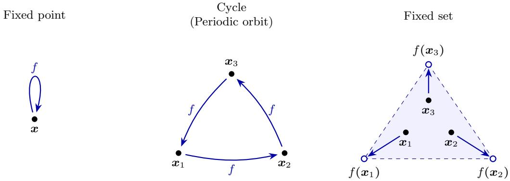
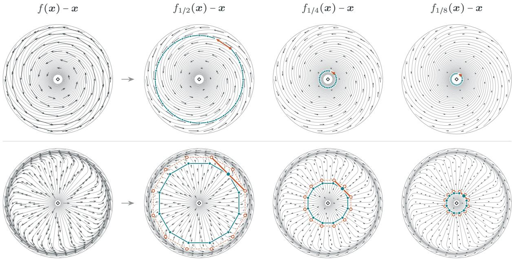
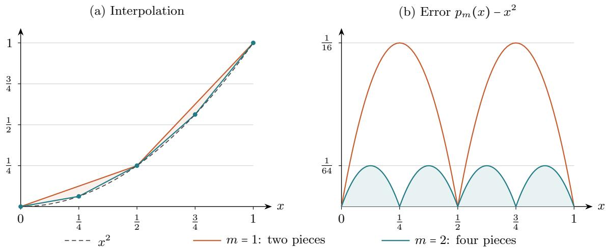

# Fixed Sets and the Hardness of Computing Correlated Equilibria

Ioannis Anagnostides∗ Constantinos Daskalakis† Gabriele Farina‡ Noah Golowich§ Tuomas Sandholm¶ Brian Hu Zhang‖

## Abstract

We show that computing an approximate correlated equilibrium of a polytope game is PPAD-complete, and thus polynomial-time equivalent to finding a Nash equilibrium. This challenges the conventional view in game theory that correlated equilibria are more tractable objects than Nash equilibria.

From a conceptual standpoint, we connect correlated equilibria to a natural generalization of fixed points, which we call fixed sets. A fixed set of a continuous function f is a nonempty finite set S such that S conv f S . Our main technical contribution is to prove that computing a fixed set is PPAD-hard even at inverse polynomial precision.

## 1 Introduction

The correlated equilibrium (CE), introduced by Aumann [1974], is a central solution concept in economics. It is a generalization of Nash equilibrium [Nash, 1950], enabling correlation between the players’ strategies, and is in many ways more natural than its predecessor: in the words of Roger Myerson, “if there is intelligent life on other planets, in a majority of them, they would have discovered correlated equilibrium before Nash equilibrium” [Shoham and Leyton-Brown, 2009, p. 83]. Any student of game theory learns early that a correlated equilibrium can be obtained as a solution to a linear program. For an explicitly represented game in normal form, this yields a polynomial-time algorithm. Taking a step further, a celebrated result by Papadimitriou and Roughgarden [2008] extended this tractability frontier even in multi-player succinct games, in which case the linear program describing the set of correlated equilibria contains exponentially many variables. Their algorithm—aptly named “ellipsoid against hope”—assumes a natural condition they refer to as the polynomial expectation property, which requires that expected utilities under product distributions can be computed in polynomial time. Another crucial premise in their algorithm is that the game is of polynomial type, meaning that the number of pure strategies available to each player is polynomial in the description. However, this is rarely the case in realistic strategic interactions, where players have complex strategy spaces. The complexity of computing correlated equilibria beyond games of polynomial type has remained an enigmatic question, despite the fact that correlated equilibria have played a central role in the development of game theory for more than 50 years.

In stark contrast to correlated equilibria, which can be phrased as solutions to linear programs and thereby form a convex set, Nash equilibria are topologically more complex objects [Datta, 2003, Balkenborg and Vermeulen, 2019]. Indeed, Nash’s famous proof of existence hinges on a fixed-point argument, and in fact, fixed points are computationally equivalent to Nash equilibria [Daskalakis, Goldberg, and Papadimitriou, 2008, Chen, Deng, and Teng, 2009, Etessami and Yannakakis, 2007]. These celebrated results have reafirmed the view that correlated equilibria are computationally more tractable objects than Nash equilibria. As discussed, this is certainly the case in games of polynomial type; but is this viewpoint justified beyond that?

## 1.1 Our results

To cast light on this fundamental question, one of our key conceptual contributions is to connect correlated equilibria to a natural relaxation of fixed points, which we call fixed sets. A fixed set of $f : \mathcal { X }  \mathcal { X }$ is a nonempty finite set $S \subseteq { \mathcal { X } }$ such that S ⊆ conv f(S) (Figure 1, right). A fixed set supported on a single point is nothing other than a fixed point (Figure 1, left). Another special case is a cycle or periodic orbit under $f ,$ whereby $S \subseteq f ( S )$ (Figure 1, center). At the heart of our approach is the use of fixed sets as a stepping stone toward characterizing the complexity of correlated equilibria. (Theorem 3.2 gives the approximate version used in our computational results.)

  
Figure 1: A fixed point, a periodic-3 orbit, and a fixed set supported on 3 points.

Our main technical result establishes that computing a fixed set is as hard as computing a fixed point.

Main Theorem 1 (Hardness of fixed sets). For every fixed $C \geq 1$ , there is a constant $c > 0$ such that the following problem is PPAD-hard: given a Lipschitz function $f : [ 0 , 1 ] ^ { d } \to [ 0 , 1 ] ^ { d }$ that can be evaluated in polynomial time, compute a $d ^ { - c }$ -fixed set S of f with $\vert S \vert \le d ^ { C }$

It is worth pointing out that this hardness result, and subsequent implications thereof, extend—under randomized reductions—to distributions with superpolynomial support of size at most $K ,$ provided the output admits polynomial-time sampling and log K is polynomial in the input size (Theorem 4.2). Also, the tradeof between precision and support in Main Theorem 1 is essential: there is a simple FPTAS for computing an ϵ-fixed set based on iterating f, supported on $O ( 1 / \epsilon )$ points (Theorem 4.3).

As alluded to, the connection we make between fixed sets and correlated equilibria yields the following direct consequence for quadratic concave games.1

Main Theorem 2 (CE hardness in concave games). For every fixed $C \geq 1$ , there is a constant $c > 0$ such that computing a $d ^ { - c }$ -correlated equilibrium supported on at most $\setminus d ^ { C }$ strategy profiles is PPAD-hard, even in two-player concave games with $\bar { \mathcal { X } _ { 1 } } = \mathcal { X } _ { 2 } = [ 0 , 1 \bar { ] } ^ { \bar { d } }$ where each utility is quadratic in the player’s own strategy.

That is, surprisingly, computing a correlated equilibrium is as hard as computing a Nash equilibrium, challenging the conventional view in game theory. Main Theorem 2 follows from Main Theorem 1 using the standard two-player imitation game $( e . g .$ , McLennan and Tourky, 2010, Babichenko, 2016, Rubinstein, 2016), with utilities $u _ { 1 } ( { \pmb x } , { \pmb y } ) = - \| { \pmb x } - { \pmb y } \| _ { 2 } ^ { 2 }$ and $u _ { 2 } ( { \pmb x } , { \pmb y } ) = - \big \| { \pmb y } - { f } ( { \pmb x } ) \big \| _ { 2 } ^ { 2 }$ (Theorem 3.6).

Moreover, the same reduction readily gives an unconditional lower bound in the query model.

Main Theorem 3 (Query hardness). For every fixed $C \ 2 \ 1$ , there is a constant $c > 0$ such that any randomized algorithm that, with probability at least $2 / 3$ , computes a d−c-correlated equilibrium supported on at most $d ^ { C }$ profiles requires $2 ^ { \Omega ( d / \log d ) }$ utility queries in the worst case. This holds even in two-player concave games on $[ 0 , 1 ] ^ { d }$ , where each utility is quadratic in the player’s own strategy.

To see this, we start from the $2 ^ { \Omega ( d _ { 0 } ) }$ randomized query lower bound for finding a fixed point of a Lipschitz map on $[ 0 , 1 ] ^ { d _ { 0 } }$ , which holds even when the Lipschitz and precision parameters are absolute constants [Hirsch, Papadimitriou, and Vavasis, 1989, Rubinstein, 2016]. For a prescribed polynomial support bound, our reduction constructs a game of dimension $d = O ( d _ { 0 } \log d _ { 0 } )$ in which each utility query can be simulated with $O ( \log d _ { 0 } )$ queries to the original map.

Finally, we obtain hardness for multilinear games on explicitly represented polytopes.

Main Theorem 4 (CE hardness in multilinear polytope games). Let N be the binary encoding length of the game’s description. For every fixed $C \geq 1$ , computing an ϵ-correlated equilibrium supported on at most $N ^ { C }$ profiles in a multilinear game on explicit rational polytopes is

(i) PPAD-hard at accuracy $\epsilon = 2 ^ { - \mathrm { p o l y } ( N ) }$ ;

(ii) PPAD-hard at accuracy $\epsilon = N ^ { - c }$ for some constant $c > 0$ , assuming the $P C P - f o r - P P A D$ conjecture (Theorem $\it 2 . 3 ) . ^ { 2 }$

Both statements hold even when the number of players is an absolute constant.

It is interesting to point out that our results immediately also imply PPAD-hardness for computing a point in the convex hull of Nash equilibrium distributions—which is another problem we have been curious about— under the same output representation and support-accuracy tradeof. Indeed, every convex combination of Nash equilibrium distributions is a correlated equilibrium.

## 1.2 Technical overview

We now give an informal sketch of the proof of Main Theorem 1, setting aside issues such as approximation.   
The quantitative version of the argument appears in Section 4.

It is instructive to first treat an intermediate case between fixed points and fixed sets—periodic orbits. In this special case, hardness follows directly from a scaling argument, which has the efect of amplifying the length of any periodic orbit. In particular, given an L-Lipschitz map $f : [ 0 , 1 ] ^ { d } \to [ 0 , 1 ] ^ { d }$ , we define $f _ { \alpha } ( { \pmb x } ) = ( 1 - \alpha ) { \pmb x } + \alpha f ( { \pmb x } )$ for a small parameter α $\in ( 0 , 1 ]$ . If $\pmb { x } _ { 1 } , \ldots , \pmb { x } _ { k }$ form a periodic orbit of $f _ { \alpha }$ , with ${ \pmb x } _ { k + 1 } = { \pmb x } _ { 1 }$ , then consecutive points are at distance at most α in the normalized Euclidean norm, so the orbit has diameter at most kα. Moreover, summing around the orbit gives $\textstyle \sum _ { i = 1 } ^ { k } ( f ( { \pmb x } _ { i } ) - { \pmb x } _ { i } ) = 0$ , and hence

$$
\| f ( \pmb { x } _ { 1 } ) - \pmb { x } _ { 1 } \| _ { 2 } \leq \frac { 1 } { k } \sum _ { i = 1 } ^ { k } \| \big ( f ( \pmb { x } _ { 1 } ) - \pmb { x } _ { 1 } \big ) - \big ( f ( \pmb { x } _ { i } ) - \pmb { x } _ { i } \big ) \| _ { 2 } \leq \big ( L + 1 \big ) k \alpha .
$$

Thus, choosing $\alpha \leq \delta / ( ( L + 1 ) k )$ ensures that any orbit of length at most k yields a δ-fixed point of $f .$

However, the challenge for a general fixed set is that each point is a convex combination of images of other points, rather than the image of a single predecessor. Instead of using a single scale, the key idea is to use several scales simultaneously: the same transition matrix must form a fixed set at every scale, and we exploit this constraint to recover an approximate fixed point.

Specifically, we construct a function $g : [ 0 , 1 ] ^ { d r }  [ 0 , 1 ] ^ { d r }$ , where r will be picked later, as follows: we pick $\alpha _ { 1 } , \ldots , \alpha _ { r } \in \left( 0 , 1 \right]$ , and set

$$
g ( \pmb { x } ^ { ( 1 ) } , \dots , \pmb { x } ^ { ( r ) } ) = \big ( f _ { \alpha _ { 1 } } ( \pmb { x } ^ { ( 1 ) } ) , \dots , f _ { \alpha _ { r } } ( \pmb { x } ^ { ( r ) } ) \big ) .
$$

(This lifting is illustrated in Figure 2.) Let $S = \{ \pmb { x } _ { 1 } , \ldots , \pmb { x } _ { k } \}$ be a fixed set of $^ { g , }$ and let P be a transition matrix satisfying $\pmb { x } _ { i } = \mathbb { E } _ { j \sim P ( i ) } g ( \pmb { x } _ { j } )$ for every $i \in [ k ]$ . Our goal is to show that $S$ yields an approximate fixed point of $f ;$ indeed, we will show that there are i ∈ [k] and $\ell \in [ r ]$ for which $\pmb { x } _ { i } ^ { ( \ell ) }$ is an approximate fixed point of $f$

The key observation is the following. For $\ell \in [ r ]$ let $S _ { \ell } = \{ \pmb { x } _ { 1 } ^ { ( \ell ) } , \ldots , \pmb { x } _ { k } ^ { ( \ell ) } \}$ . Then, by definition, $S _ { \ell }$ is a fixed set of $f _ { \alpha _ { \ell } }$ with transition matrix P. Therefore, we have constructed fixed sets at multiple “scales” of $f ,$ that

  
Figure 2: Top row. The original rotation $f$ and three scaled maps $f _ { \alpha } ,$ with common fixed point $\pmb { x } _ { * } = 0$ . Gray curves depict the displacement flow, and black arrows show $f _ { \alpha } ( { \pmb x } ) - { \pmb x }$ . Teal points form approximate fixed sets with the same transition matrix and equal error across the three scales.

Bottom row. A diferent map $f$ and its three scaled maps. Teal points form regular $1 2 \mathrm { - g o n s ; }$ hollow orange points are their images under $f _ { \alpha }$ . Each support point is the midpoint of the images of its two neighbors, as illustrated by the orange chord. Thus, $P ( i , i - 1 ) = P ( i , i + 1 ) = 1 / 2$ works at all three scales, with uniform stationary distribution.

use the same transition matrix. We show that if we do this for “enough” values of $\alpha \in ( 0 , 1 ]$ , then we must find a fixed point.

Proposition 1.1. Let $P : [ k ] \to \Delta ( k )$ be a transition matrix. For every $\alpha \in ( 0 , 1 ]$ let $S _ { \alpha }$ be a fixed set of $f _ { \alpha }$ with transition matrix P. Then the closure $o f \cup _ { \alpha \in ( 0 , 1 ] } S _ { \alpha }$ contains a fixed point $o f f$

Proof. Assume WLOG that the transition graph of P is strongly connected; otherwise, replace it with a sink strongly connected component. Let $S _ { \alpha } = \{ \bar { \pmb { x } } _ { 1 } ^ { ( \alpha ) } , \dots , \pmb { x } _ { k } ^ { ( \alpha ) } \}$ . Then we have

$$
\pmb { x } _ { i } ^ { ( \alpha ) } = \underset { j \sim P ( i ) } { \mathbb { E } } \Big [ ( 1 - \alpha ) \pmb { x } _ { j } ^ { ( \alpha ) } + \alpha f ( \pmb { x } _ { j } ^ { ( \alpha ) } ) \Big ] .\tag{1}
$$

Let $\{ \alpha _ { r } \} _ { r = 1 } ^ { \infty }$ be a sequence converging to 0, and $\begin{array} { r } { \pmb { x } _ { i } = \operatorname* { l i m } _ { r  \infty } \pmb { x } _ { i } ^ { ( \alpha _ { r } ) } } \end{array}$ . (If this limit does not exist, replace $\{ \alpha _ { r } \}$ by a subsequence so that it does; this is allowed because of compactness.) Replacing this limit in (1) yields

$$
\pmb { x } _ { i } = \mathbb { E } _ { j \sim P ( i ) } \pmb { x } _ { j } .
$$

We claim now that $\pmb { x } _ { 1 } = \cdots = \pmb { x } _ { k }$ . Indeed, consider any direction a and let i be chosen to maximize $\left. \pmb { a } , \pmb { x } _ { i } \right.$ Then

$$
\langle \pmb { a } , \pmb { x } _ { i } \rangle = \underset { j \sim P ( i ) } { \mathbb { E } } \big \langle \pmb { a } , \pmb { x } _ { j } \big \rangle .
$$

By induction and strong connectivity of the transition graph, it follows that $\langle { \pmb a } , { \pmb x } _ { j } \rangle = \langle { \pmb a } , { \pmb x } _ { i } \rangle$ for every $j .$ Since this is true for every a, we have $\pmb { x } _ { 1 } = \cdots = \pmb { x } _ { k } = : \pmb { x }$

Moreover, taking expectations in (1) over the stationary distribution $\mu ,$ and dividing by $\alpha > 0 ,$ yields

$$
\underset { i \sim \mu } { \mathbb { E } } \pmb { x } _ { i } ^ { ( \alpha ) } = \underset { i \sim \mu } { \mathbb { E } } f ( \pmb { x } _ { i } ^ { ( \alpha ) } ) .\tag{2}
$$

Since $\pmb { x } _ { i } ^ { ( \alpha _ { r } ) }  \pmb { x }$ for all $i ,$ taking the limit $r  \infty$ now $_ \mathrm { y }$ ields $\pmb { x } = f ( \pmb { x } )$

The multilinear extension. We now explain how to go from concave quadratic utilities to a multilinear polytope game. The obvious approach that comes to mind here is to employ some form of discretization. However, the issue is that this would make the game description grow polynomially with the inverse accuracy. At the same time, Main Theorem 1 prescribes that the accuracy needs to be small enough relative to the size of the support. As a result, it is not clear whether there is a discretization that can handle any polynomial support bound.

Instead, to arrive at Main Theorem 4, the key step is to essentially transfer the quadratic imitation term from the utility into the strategy constraints. Indeed, since $- \| \mathbf { \boldsymbol { x } } - \mathbf { \boldsymbol { y } } \| _ { 2 } ^ { 2 } = \mathbf { \nabla } _ { d } ^ { 2 } \langle \pmb { x } , \pmb { y } \rangle - \| \pmb { x } \| _ { 2 } ^ { 2 } - \| \pmb { y } \| _ { 2 } ^ { 2 }$ (in relative $\ell _ { 2 }$ norm), it sufices to incorporate an auxiliary variable whose value approximates $\left\| \mathbf { x } \right\| _ { 2 } ^ { 2 } .$ , for ${ \pmb x } ;$ the last term does not depend on x, while the interaction term is already bilinear. The challenge is to express these auxiliary variables with few linear constraints. To do so, we rely on an approach in approximation theory (e.g., Yarotsky, 2017), whereby each term $x _ { i } ^ { 2 }$ in $\| \pmb { x } \| _ { 2 } ^ { 2 }$ is replaced by a piecewise-linear interpolation that can be described with only $O ( m )$ auxiliary variables and inequalities.

To cast the remaining polynomial interactions into multilinear form, we use the standard trick of assigning diferent factors of each monomial to diferent “copy players.” In particular, we can start with a polynomial map $f : [ 0 , 1 ] ^ { d }  [ 0 , 1 ] ^ { d }$ of constant degree whose approximate fixed points are PPAD-hard to compute. Since f has constant degree, we require only a constant number of players. These steps are described at greater length in Section 5.

## 1.3 Further related work

We now elaborate on related threads of research.

Computing correlated equilibria beyond polynomial type. For games of polynomial type, as discussed, there are polynomial-time algorithms computing exact CE [Papadimitriou and Roughgarden, 2008, Jiang and Leyton-Brown, 2015]. The closest predecessor to our work is Anagnostides, Daskalakis, Farina, Golowich, Sandholm, and Zhang [2026a], who introduced convex expected fixed points and established hardness of computing CE in concave quadratic games relative to the problem of finding a fixed point of a contraction [Fearnley, Gordon, Mehta, and Savani, 2020]. We strengthen this computational barrier to PPAD-hardness, and further extend it to multilinear games on explicitly represented polytopes. A complementary positive result was obtained by Anagnostides, Daskalakis, Farina, Golowich, Sandholm, and Zhang [2026b], who showed that CEs can be computed eficiently in finite-horizon Markov games with a fixed number of players. Related hardness results concern sparse coarse correlated equilibria (CCE), represented as mixtures of a small number of product distributions: Foster, Golowich, and Kakade [2023] established hardness in Markov games, yielding lower bounds for independent learning. Analogous hardness results were later established in extensive-form games [Anagnostides, Kalavasis, Sandholm, and Zampetakis, 2024, Peng and Rubinstein, 2024a]. Unlike these latter two results for extensive-form games, which apply even to coarse correlated equilibria, our main result rules out eficient computation for any prescribed polynomial support bound.

Tractable relaxations. One fruitful research direction has been to obtain tractable equilibrium concepts by restricting the set of deviations. Farina and Pipis [2024] gave a polynomial-time algorithm for linear Φ-equilibria—whereby only linear deviations are considered—in polyhedral games, while Daskalakis, Farina, Fishelson, Pipis, and Schneider [2025] established eficient learning and computation in general convex games. Arunachaleswaran, Collina, Mansour, Mohri, Schneider, and Sivan [2025] introduced profile swap regret for polytope games and gave eficient algorithms guaranteeing sublinear profile swap regret, which they showed is necessary and suficient for non-manipulability. This extends the non-manipulability guarantee of swap regret in normal-form games [Deng, Schneider, and Sivan, 2019], where a strategic opponent cannot asymptotically obtain more than its Stackelberg payof against a learner with sublinear swap regret; we recall that sublinear swap regret leads to correlated equilibria [Hart and Mas-Colell, 2000, Blum and Mansour, 2007]. Zhang, Anagnostides, Tewolde, Berker, Farina, Conitzer, and Sandholm [2025] considered a class of nonlinear deviations, including low-degree polynomial deviations. These developments build on the connection between fixed-point computation and regret minimization [Hazan and Kale, 2007, Gordon, Greenwald, and Marks, 2008]. A central ingredient in their approach is the notion of an expected fixed point, which can be computed eficiently [Zhang et al., 2025]. Our fixed sets correspond instead to convex expected fixed points, revealing a computational separation between these two relaxations of fixed points.

Learning with large strategy spaces. Stoltz and Lugosi [2007] examined convergence to correlated equilibria in games with convex strategy sets, and Stein, Parillo, and Ozdaglar [2007] developed approximation algorithms for correlated equilibria in continuous games, including polynomial games. More recently, Peng and Rubinstein [2024b], Dagan, Daskalakis, Fishelson, and Golowich [2024] obtained algorithms for minimizing swap regret even in large strategy spaces, yielding a polynomial-time approximation scheme for correlated equilibria in, for example, extensive-form games. However, the learning hardness result of Anagnostides et al. [2026a] rules out swap-regret guarantees polynomial in the game size and inverse accuracy. Such lower bounds leave open the possibility of eficient equilibrium computation, which is the focus of our paper. On the technical side, our entropy argument is related in spirit to the information-theoretic approach of Harrow, Natarajan, and Wu [2016] for approximating Nash equilibria.

Calibration and economic motivation. Correlated equilibria are also intimately connected to forecasting and calibration. Foster and Vohra [1997] showed that best responses to calibrated forecasts of opponents play lead the empirical distribution toward correlated equilibria. This connection has been further cultivated in recent years, where improved algorithms for minimizing swap regret [Dagan et al., 2024, Peng and Rubinstein, 2024b] have led to eficient algorithms for high-dimensional calibration [Peng, 2025, Fishelson, Golowich, Mohri, and Schneider, 2025]. Another use of swap regret is in the context of algorithmic collusion [Calvano, Calzolari, Denicolo, and Pastorello, 2020], where it can be used to mitigate supracompetitive pricing [Hartline, Long, and Zhang, 2024, Hartline, Wang, and Zhang, 2025]. Indeed, vanishing external regret alone can still permit collusive behavior. Recently, Hartline, Wang, and Zhang [2026] introduced the notion of information-value-free correlated equilibria, and showed that they can be computed eficiently ofline but cannot be learned by a broad class of learning algorithms. These connections show the importance of understanding the computational complexity of equilibrium concepts stronger than coarse correlated equilibria, which is what motivates our paper.

## 2 Preliminaries

We work in the standard Turing model. All numbers are rational numbers encoded in binary. Functions are given as arithmetic circuits with standard gates, see $e . g .$ , Rubinstein [2016]. These choices are not crucial to our results; indeed, our results will follow from black-box reductions from Brouwer fixed points to our problems of interest.

Following Rubinstein [2016], for $\pmb { x } \in \mathbb { R } ^ { d }$ and $1 \leq p < \infty$ we adopt the normalized norm convention

$$
\left\| { \pmb x } \right\| _ { p } = \left( \frac { 1 } { d } \sum _ { i = 1 } ^ { d } | x _ { i } | ^ { p } \right) ^ { 1 / p } .
$$

Inner products are defined as usual without any normalization: $\begin{array} { r } { \langle \pmb { x } , \pmb { y } \rangle = \sum _ { i = 1 } ^ { d } x _ { i } y _ { i } , \mathrm { s o } \ \lvert \langle \pmb { x } , \pmb { y } \rangle \rvert / d \leq \lVert \pmb { x } \rVert _ { 2 } \lVert \pmb { y } \rVert _ { 2 } } \end{array}$ Definition 2.1. Let $f : \mathcal { X }  \mathcal { X }$ , where $\mathcal { X } \subseteq \mathbb { R } ^ { d }$ . An ϵ-fixed point of $f$ is a point x ∈ X such that

$$
\begin{array} { r } { \| f ( \pmb { x } ) - \pmb { x } \| _ { 2 } \leq \epsilon , } \end{array}
$$

where $\left\| \cdot \right\| _ { 2 }$ is the normalized Euclidean norm. A 0-fixed point is simply called a fixed point.

To avoid measure-theoretic issues, we assume throughout that distributions have finite support. Algorithms that output distributions will give outputs by explicitly listing all the support points and their associated probabilities. A polynomial-time algorithm can therefore output only distributions supported on polynomially many points, with probabilities of polynomial bit length.

## 2.1 Concave games and correlated equilibria

An n-player concave game Γ is given by convex compact strategy sets $\mathcal { X } _ { i } \subset \mathbb { R } ^ { d _ { i } }$ and utilities $u _ { i } : \mathcal { X }  \mathbb { R }$ , for $i \in [ n ]$ , where $\textstyle { \mathcal { X } } = \prod _ { i = 1 } ^ { n } { \mathcal { X } } _ { i }$ . For each player $i , u _ { i } ( { \pmb x } _ { i } , { \pmb x } _ { - i } )$ is concave in $\mathbf { \Delta } _ { \mathbf { \mathcal { X } } _ { i } }$ for every fixed profile $\mathbf { \delta _ { x } } _ { - i }$ of the other players’ strategies.

A multilinear polytope game is a special case in which each $\mathcal { X } _ { i }$ is a compact polytope and each utility is a multilinear polynomial, so that every monomial contains at most one coordinate of each player’s strategy (raised to the first power). Thus, each utility is afine in a player’s strategy when the other players’ strategies are fixed. We represent each polytope by an explicit list of linear inequalities with rational coeficients and each utility by an explicit list of monomials with rational coeficients. We write N for the total encoding length of this game description.

Definition 2.2 (Aumann, 1974). An ϵ-correlated equilibrium $( \epsilon - C E )$ of a game Γ is a distribution $\mu \in \Delta ( \mathcal { X } )$ such that

$$
\underset { { \pmb x } \sim \mu } { \mathbb { E } } \big [ u _ { i } \big ( \phi _ { i } ( { \pmb x } _ { i } ) , { \pmb x } _ { - i } \big ) - u _ { i } ( { \pmb x } ) \big ] \leq \epsilon
$$

for every player $i \in [ n ]$ and function $\phi _ { i } : \mathcal { X } _ { i }  \mathcal { X } _ { i }$

## 2.2 The PCP-for-PPAD conjecture

We now state the precise version of the PCP-for-PPAD conjecture of Babichenko, Papadimitriou, and Rubinstein [2016] we need for Main Theorem 4. A generalized circuit assigns a value in [0, 1] to each of d nodes, each of which is the output of exactly one gate. Gates have at most two inputs and cycles are allowed. The circuit has fan-out two if each node occurs in at most two input positions. All gate parameters $\beta$ are rationa numbers in [0, 1]. For input values a, b and output value $c ,$ the arithmetic gates are satisfied at tolerance τ when the following conditions hold depending on the type of the gate:

• constant: $| c - \beta | \le \tau ;$

• scaling: $| c - \beta a | \le \tau ;$

• copying: $| c - a | \leq \tau ;$

• addition: $\left| c - \operatorname* { m i n } \{ a + b , 1 \} \right| \leq \tau ;$ and

• subtraction: $\left| c - \operatorname* { m a x } \{ a - b , 0 \} \right| \leq \tau .$

Finally, the comparison gate is satisfied when both implications

$$
a < b - \tau \implies c \geq 1 - \tau { \mathrm { ~ a n d ~ } } a > b + \tau \implies c \leq \tau
$$

hold. We are ready to state the formal version of the conjecture.

Assumption 2.3 (PCP-for-PPAD). There are absolute constants $0 < \tau < 1 / 4$ and $0 < \gamma < 1$ such that the following problem is PPAD-hard: given a generalized circuit with fan-out two, compute an assignment satisfying at least $( 1 - \gamma ) d$ gates at tolerance τ.

That is, this postulates that PPAD-hardness of generalized circuits persists even when an arbitrary set of at most $\gamma d$ gates can fail.

## 3 Fixed sets and convex expected fixed points

In this section, we introduce the notion of a fixed $s e t ,$ and connect it to an earlier definition by Anagnostides et al. [2026a]. Let $\boldsymbol { \mathcal { X } } \subset \mathbb { R } ^ { d }$ be convex and compact, and $f : \mathcal { X }  \mathcal { X }$ be a continuous function.

Definition 3.1 (Anagnostides et al., 2026a). An ϵ-convex expected fixed point (hereafter convex EFP) of $f$ is a distribution $\mu \in \Delta ( \mathcal { X } )$ such that

$$
\underset { { \pmb { x } } \sim \mu } { \mathbb { E } } [ Q ( { \pmb { x } } ) - Q ( f ( { \pmb { x } } ) ) ] \leq \epsilon
$$

for every convex $Q : \mathcal { X }  \mathbb { R }$ that is 1-Lipschitz under $\left\| \cdot \right\| _ { 2 }$

Restricting $Q$ to linear 1-Lipschitz functions gives the condition $\| \mathbb { E } _ { \pmb { x } \sim \mu } [ \pmb { x } - \pmb { f } ( \pmb { x } ) ] \| _ { 2 } \leq \epsilon$ , known simply as an expected fixed point [Zhang, Anagnostides, Farina, and Sandholm, 2024], which was shown to admit a polynomial-time algorithm [Zhang et al., 2025].

Definition 3.2. An ϵ-fixed set of f is a finite set $S = \{ \pmb { x } _ { 1 } , \dots , \pmb { x } _ { k } \} \subset \mathcal { X }$ such that there is some Markov chain transition function $P : [ k ] \to \Delta ( [ k ] )$ , and stationary distribution $\mu$ of $P$ , such that

$$
\underset { i \sim \mu } { \mathbb { E } } \left. \pmb { x } _ { i } - \underset { j \sim P ( i ) } { \mathbb { E } } f ( \pmb { x } _ { j } ) \right. _ { 2 } \leq \epsilon .
$$

Using duality, it turns out that the previous two definitions are equivalent.

Theorem 3.3. The above two definitions are equivalent. That is, the support $o f$ an ϵ-convex $E F P$ is also an ϵ-fixed set; conversely, given an ϵ-fixed set, the corresponding stationary distribution $\mu$ is an ϵ-convex $E F P$

Proof. Let $S$ be an ϵ-fixed set, $P$ its corresponding transition matrix, and $\mu$ be its stationary distribution. Then for any convex 1-Lipschitz $Q .$ , we have

$$
\begin{array} { r } { \frac { \mathbb { E } } { x } [ Q ( { \pmb x } ) - Q ( f ( { \pmb x } ) ) ] = \frac { \mathbb { E } } { x } Q ( { \pmb x } ) - \frac { \mathbb { E } } { x } \operatorname { \mathbb { E } } Q ( f ( { \pmb x } ^ { \prime } ) ) \leq \frac { \mathbb { E } } { x } \bigg [ Q ( { \pmb x } ) - Q \Big ( \frac { \mathbb { E } } { x ^ { \prime } | x } f ( { \pmb x } ^ { \prime } ) \Big ) \bigg ] \leq \frac { \mathbb { E } } { x } \bigg \| { \pmb x } - \frac { \mathbb { E } } { x ^ { \prime } | x } f ( { \pmb x } ^ { \prime } ) \bigg \| _ { 2 } \leq \epsilon , } \end{array}
$$

where $\mathbfit { \Delta } x \sim \mu$ and $\mathbf { \Delta } \mathbf { x } ^ { \prime } \mid$ x means $\mathbf { x } ^ { \prime } \sim P _ { \mathbf { x } }$ . The first equality uses stationarity of $\mu$ under $P .$ The inequalities are, in order, Jensen and Lipschitzness of $Q$

Conversely, let $\mu$ be an ϵ-convex EFP with support $\{ \pmb { x } _ { 1 } , \ldots , \pmb { x } _ { k } \}$ . We need to show that there is a transition matrix $P$ satisfying the fixed set condition. To do this, consider the following convex program.

$$
\operatorname* { m i n } _ { \mathbf { W } \geq \mathbf { 0 } } \quad \sum _ { i } \left\| \sum _ { j } W _ { i j } ( \pmb { x } _ { i } - f ( \pmb { x } _ { j } ) ) \right\| _ { 2 } \quad \mathrm { s . t . } \quad \mathbf { W } ^ { \top } \mathbf { 1 } = \mathbf { W } \mathbf { 1 } = \mu .
$$

It sufices to show that the value of this program is $\leq \epsilon .$ because then it would be enough to use the transition matrix $P ( j \mid i ) = W _ { i j } / \mu _ { i }$ . Using $\begin{array} { r } { \| \pmb { v } \| _ { 2 } = \operatorname* { m a x } _ { \| \pmb { a } \| _ { 2 } \leq 1 } \langle \pmb { a } , \pmb { v } \rangle / d . } \end{array}$ , the dual of this problem is

$$
\operatorname* { m a x } _ { i \sim \mu } \mathbb { E } \left[ b _ { i } - c _ { i } \right] \quad \mathrm { s . t . } \quad \frac { 1 } { d } \langle \pmb { a } _ { i } , \pmb { x } _ { i } - \pmb { f } ( \pmb { x } _ { j } ) \rangle \geq b _ { i } - c _ { j } , \quad \| \pmb { a } _ { i } \| _ { 2 } \leq 1 .
$$

For any dual-feasible solution, we consider the function

$$
\begin{array} { r } { Q ( \pmb { x } ) = \operatorname* { m a x } _ { i } \{ b _ { i } + \frac { 1 } { d } \langle \pmb { a } _ { i } , \pmb { x } - \pmb { x } _ { i } \rangle \} . } \end{array}
$$

Then $Q$ is 1-Lipschitz and convex. Moreover, we have $Q ( { \pmb x } _ { i } ) \geq b _ { i }$ and $Q ( f ( \pmb { x } _ { i } ) ) \leq c _ { i }$ , so

$$
\underset { i \sim \mu } { \mathbb { E } } \big [ b _ { i } - c _ { i } \big ] \leq \underset { i \sim \mu } { \mathbb { E } } \big [ Q ( \pmb { x } _ { i } ) - Q ( f ( \pmb { x } _ { i } ) ) \big ] \leq \epsilon .
$$

Remark 3.4. An alternative way to see this equivalence is through Strassen’s theorem [Gozlan, Roberto, Samson, and Tetali, 2017], which asserts that for probability measures $\mu , \nu$ on $\mathbb { R } ^ { d }$ with finite first moments, $\textstyle \int Q d \mu \leq \int Q$ dν for every convex and Lipschitz $Q$ if and only if they admit a coupling $( X , Y )$ with $\mathbb { E } [ Y \mid$ $X ] = X$ . The approximate version [Gozlan et al., 2017, Remark 3.4] states that

$$
\int Q d \mu - \int Q d \nu \leq \epsilon \quad \mathrm { f o r ~ e v e r y ~ c o n v e x ~ 1 \mathrm { - } L i p s c h i t z ~ } Q
$$

if and only if there is a coupling $X \sim \mu , Y \sim \nu$ satisfying

$$
\mathbb { E } \| X - \mathbb { E } [ Y | X ] \| _ { 2 } \leq \epsilon .
$$

To apply this to Theorem 3.3, let ν be the law of $f ( X )$ for $X \sim \mu .$ . The convex EFP condition gives the coupling above. Lift Y to $X ^ { \prime } \sim \mu$ by sampling from µ conditional on $f ( X ^ { \prime } ) = Y$ , independently of X given Y. Then $f ( X ^ { \prime } ) = Y$ , and $P ( \mathbf { x } ^ { \prime } \mid x ) = \operatorname* { P r } ( X ^ { \prime } = \mathbf { x } ^ { \prime } \mid X = \pmb { x } )$ has stationary distribution $\mu ,$ since both X and $X ^ { \prime }$ have law $\mu .$ The coupling inequality is precisely the ϵ-fixed-set condition. The converse follows directly from Jensen’s inequality and Lipschitzness.

Remark 3.5 (Contractions). If f is L-Lipschitz for $L < 1$ , with unique fixed point ${ \pmb x } _ { \ast }$ , then every ϵ-fixed set satisfies

$$
\underset { i \sim \mu } { \mathbb { E } } \Vert \pmb { x } _ { i } - \pmb { x } _ { * } \Vert _ { 2 } \leq \frac { \epsilon } { 1 - L } .
$$

Indeed, applying the convex EFP condition to $Q ( { \pmb x } ) = \| { \pmb x } - { \pmb x } _ { * } \| _ { 2 }$ gives

$$
\begin{array} { r } { \big ( 1 - L \big ) \underset { i \sim \mu } { \mathbb { E } } \big \| \pmb { x } _ { i } - \pmb { x } _ { * } \big \| _ { 2 } \leq \underset { i \sim \mu } { \mathbb { E } } \big [ Q \big ( \pmb { x } _ { i } \big ) - Q \big ( f \big ( \pmb { x } _ { i } \big ) \big ) \big ] \leq \epsilon . } \end{array}
$$

In particular, for an exact fixed set, the stationary distribution $\mu$ is concentrated on $\mathbf { x } _ { \ast }$

## 3.1 Correlated equilibria and fixed sets

The following reduction connects correlated equilibria to fixed sets. It follows the proof of Anagnostides et al. [2026a, Theorem 3.1], but we include the argument for completeness.

Proposition 3.6 (Reducing fixed sets to correlated equilibria). Given a map $f : [ 0 , 1 ] ^ { d } \to [ 0 , 1 ] ^ { d }$ , we construct the two-player concave game on $\mathcal { X } _ { 1 } = \mathcal { X } _ { 2 } = [ 0 , 1 ] ^ { d }$ with utilities

$$
u _ { 1 } ( { \pmb x } , { \pmb y } ) = - \| { \pmb x } - { \pmb y } \| _ { 2 } ^ { 2 } , \quad u _ { 2 } ( { \pmb x } , { \pmb y } ) = - \| { \pmb y } - f ( { \pmb x } ) \| _ { 2 } ^ { 2 } .
$$

For every $\epsilon \geq 0$ and every $\epsilon { - } C E \mu$ of this game, $S = \operatorname { s u p p } \mu _ { x }$ is a $2 \sqrt { \epsilon } .$ -fixed set of f with $\left| S \right| \leq \left| \operatorname { s u p p } \mu \right|$ , with a transition matrix whose stationary distribution is $\mu _ { x }$

Proof. Each utility is concave and quadratic in its player’s own strategy. The CE conditions imply

$$
\begin{array} { r } { \underset { \ b { x } } { \mathbb { E } } \bigg \| \ b { x } - \underset { \ b { y } | \ b { x } } { \mathbb { E } } \ b { y } \bigg \| _ { 2 } ^ { 2 } \leq \epsilon , \quad \underset { \ b { y } } { \mathbb { E } } \bigg \| \ b { y } - \underset { \ b { x } | \ b { y } } { \mathbb { E } } \ b { f } ( \ b { x } ) \bigg \| _ { 2 } ^ { 2 } \leq \epsilon , } \end{array}\tag{3}
$$

where $\mathbb { E } _ { x }$ and $\mathbb { E } _ { y }$ denote sampling from the marginals of $\mu ,$ and $\mathbb { E } _ { \pmb { x } \vert \pmb { y } }$ and $\mathbb { E } _ { y \mid x }$ denote sampling from the conditional distributions of $\mu$ given y and x, respectively. Then

$$
\begin{array} { r l } &  \begin{array} { r } { \underset { x } { \mathbb { E } } \Big \lVert x - \underset { y \mid x , x ^ { \prime } \mid y } { \mathbb { E } } f ( { x ^ { \prime } } ) \Big \rVert _ { 2 } \leq \underset { x } { \mathbb { E } } \Bigg [ \Big \lVert x - \underset { y \mid x } { \mathbb { E } } y \Big \rVert _ { 2 } + \Big \lVert \underset { y \mid x } { \mathbb { E } } \big [ y - \underset { x ^ { \prime } \mid y } { \mathbb { E } } f ( { x ^ { \prime } } ) \big ] \Big \rVert _ { 2 } \Bigg ] } \\ & { \qquad \leq \underset { x } { \mathbb { E } } \Bigg [ \Big \lVert x - \underset { y \mid x } { \mathbb { E } } y \Big \rVert _ { 2 } + \underset { y \mid x } { \mathbb { E } } \Big \rVert y - \underset { x ^ { \prime } \mid y } { \mathbb { E } } f ( { x ^ { \prime } } ) \Big \rVert _ { 2 } \Bigg ] } \\ & { \qquad \leq \Bigg ( \sqrt { \underset { x } { \mathbb { E } } \Bigg [ \Big \lVert x - \underset { y \mid x } { \mathbb { E } } y \Big \rVert _ { 2 } ^ { 2 } \Bigg ] + \sqrt { \underset { y } { \mathbb { E } } \Bigg [ \Big \lVert y - \underset { x ^ { \prime } \mid y } { \mathbb { E } } f ( { x ^ { \prime } } ) \Big \rVert _ { 2 } ^ { 2 } \Bigg ] } \Bigg ) } \\ & { \qquad \leq 2 \sqrt { \epsilon } , } \end{array} } \end{array}
$$

where we use, in order, the triangle inequality, Jensen, Cauchy-Schwarz, and finally $( 3 )$ . Set $S = \mathrm { s u p p } \mu _ { x }$ and $\begin{array} { r } { P ( \pmb { x } ^ { \prime } \mid \pmb { x } ) = \sum _ { \pmb { y } } \mu ( \pmb { y } \mid \pmb { x } ) \mu ( \pmb { x } ^ { \prime } \mid \pmb { y } ) } \end{array}$ . This transition matrix has stationary distribution $\mu _ { x } .$ , since

$$
\sum _ { x } \mu _ { x } ( x ) P ( x ^ { \prime } \mid x ) = \sum _ { y } \mu _ { y } ( y ) \mu ( x ^ { \prime } \mid y ) = \mu _ { x } ( x ^ { \prime } ) .
$$

This is precisely the $2 \sqrt { \epsilon } .$ fixed-set condition.

## 4 Hardness of computing fixed sets

Let $f : [ 0 , 1 ] ^ { d } \to [ 0 , 1 ] ^ { d }$ be L-Lipschitz. It is known that computing a δ-fixed point of f is PPAD-hard, even when $L \geq 1$ and $0 < \delta \leq 1$ are absolute constants [Rubinstein, 2016]. Our goal is to prove the following.

Main Theorem 1 (Hardness of fixed sets). For every fixed $C \geq 1$ , there is a constant $c > 0$ such that the following problem is PPAD-hard: given a Lipschitz function $f : [ 0 , 1 ] ^ { d } \to [ 0 , 1 ] ^ { d }$ that can be evaluated in polynomial time, compute a $d ^ { - c }$ -fixed set S of f with $| S | \le d ^ { C }$

The proof essentially makes the argument described in our technical overview quantitative. The remainder of this section is dedicated to its proof. To begin with, we construct the map

$$
g ( \pmb { x } ^ { ( 1 ) } , \dots , \pmb { x } ^ { ( r ) } ) = \big ( f _ { \alpha _ { 1 } } ( \pmb { x } ^ { ( 1 ) } ) , \dots , f _ { \alpha _ { r } } ( \pmb { x } ^ { ( r ) } ) \big ) ,
$$

where the parameters $\alpha _ { 1 } , \ldots , \alpha _ { r }$ will be chosen later. We let $S = \{ \pmb { x } _ { 1 } , \ldots , \pmb { x } _ { k } \}$ be an ϵ-fixed set of $g$ with $k \leq K$ , for a support bound $K \geq 2$ and precision $\epsilon > 0$ to be chosen later, and let $P$ and $\mu$ be the corresponding transition matrix and stationary distribution. In lieu of passing to the limit, we will select a layer $\ell \in [ r ]$ at which $\pmb { x } ^ { ( \ell ) }$ will have the same function as the limit x in the proof of Theorem 1.1. Our goal is to show that there is an $i \in [ k ]$ and $\ell \in [ r ]$ such that $\pmb { x } _ { i } ^ { ( \ell ) }$ is a δ-fixed point of $f .$

For a parameter $0 < t \leq 1$ , we define

$$
P ( t ) : = \underset { a \sim \mathrm { G e o } ( t ) } { \mathbb { E } } P ^ { a } = t \sum _ { a = 0 } ^ { \infty } ( 1 - t ) ^ { a } P ^ { a } = t ( \mathbf { I } - ( 1 - t ) P ) ^ { - 1 } , \quad h ( t ) : = \underset { i \sim \mu } { \mathbb { E } } H ( P _ { i } ( t ) )
$$

where H is entropy with natural logarithms and $P ( 1 ) = \mathbf { I }$

Lemma 4.1. h is nonincreasing.

Proof. For $0 < t < s \leq 1$ , the stochastic matrix

$$
\mathbf { K } ( t , s ) = \frac { t } { s } \mathbf { I } + \bigg ( 1 - \frac { t } { s } \bigg ) P P ( t )
$$

satisfies $P ( t ) = \mathbf { K } ( t , s ) P ( s ) = P ( s ) \mathbf { K } ( t , s )$ and has stationary distribution $\mu .$ . But then we have

$$
\begin{array} { r l } & { h ( t ) - h ( s ) = \underset { i \sim \mu } { \mathbb { E } } H ( P _ { i } ( t ) ) - \underset { j \sim \mu } { \mathbb { E } } H ( P _ { j } ( s ) ) } \\ & { \quad \quad = \underset { i \sim \mu , j \sim \mathbf { K } _ { i } } { \mathbb { E } } [ H ( P _ { i } ( t ) ) - H ( P _ { j } ( s ) ) ] } \\ & { \quad \quad = \underset { i \sim \mu , j \sim \mathbf { K } _ { i } } { \mathbb { E } } d _ { \mathrm { K L } } ( P _ { j } ( s ) \| P _ { i } ( t ) ) \geq 0 , } \end{array}\tag{4}
$$

where $d _ { \mathrm { K L } } ( \cdot \| \cdot )$ denotes the KL divergence.

Moreover, $P _ { i } ( t )$ is a distribution on k items, so $h ( t )$ is bounded in $[ 0 , \log k ]$ . Thus, if we pick values $1 = : t _ { 0 } > t _ { 1 } > t _ { 2 } > \dots > t _ { r } > 0$ , there will be some value $\ell \leq r$ at which

$$
h ( t _ { \ell } ) - h ( t _ { \ell - 1 } ) \leq \frac { \log k } { r } .
$$

The use of entropy here is crucial, since we will later need the fact that the above bound is logarithmic in k. We fix this value of $\ell ,$ and for the rest of the proof, let $\pmb { x } _ { i } : = \pmb { x } _ { i } ^ { ( \ell ) } , \alpha : = \alpha _ { \ell } , t : = t _ { \ell }$

Controlling the conditional variance. For any $s \in [ t , 1 ]$ , we define

$$
\bar { \pmb { x } } _ { i } ( s ) : = \underset { j \sim P _ { i } ( s ) } { \mathbb { E } } \pmb { x } _ { j } , \quad V ( s ) : = \underset { i \sim \mu , j \sim P _ { i } ( s ) } { \mathbb { E } } \| \pmb { x } _ { j } - \bar { \pmb { x } } _ { i } ( s ) \| _ { 2 } ^ { 2 } .
$$

The quantity $V ( s )$ is the variance of $\mathbf { \Delta } _ { \mathbf { x } _ { j } }$ under $j \sim P _ { i } ( s )$ , averaged over $i \sim \mu ;$ our goal is to show that $V ( t )$ is small, so that these conditional distributions have small variance on average. We write

$$
\pmb { x } _ { j } = \mathbb { E } _ { a \sim P _ { j } } \big [ \pmb { x } _ { a } + \alpha \Delta _ { a } \big ] + \pmb { e } _ { j } ,
$$

where $\Delta _ { j } ~ = ~ f ( \pmb { x } _ { j } ) - \pmb { x } _ { j }$ . For a vector $\pmb { v } \in \mathbb { R } ^ { d r }$ with d-dimensional blocks, the normalized norms satisfy $\left\| \pmb { v } ^ { ( \ell ) } \right\| _ { 2 } \leq \sqrt { r } \left\| \pmb { v } \right\| _ { 2 }$ , so the mean error in this layer is at most $\eta : = \sqrt { r } \epsilon \mathrm { ~ i f ~ } \| \pmb { v } \| \le \epsilon$ . Thus,

$$
\mathbb { E } _ { j \sim \mu } \| e _ { j } \| _ { 2 } \leq \eta .
$$

For any i, taking expectations over $P _ { i } ( s )$ gives

$$
\underset { j \sim P _ { i } ( s ) , a \sim P _ { j } } { \mathbb { E } } \big [ \alpha \Delta _ { a } + e _ { j } \big ] = \underset { j \sim P _ { i } ( s ) , a \sim P _ { j } } { \mathbb { E } } \big [ \pmb { x } _ { j } - \pmb { x } _ { a } \big ] = \langle P _ { i } ( s ) ( \mathbf { I } - P ) , \pmb { x } \rangle ,\tag{5}
$$

where we use the notation $\begin{array} { r } { \langle \mu , \pmb { x } \rangle : = \sum _ { i = 1 } ^ { k } \mu _ { i } \pmb { x } _ { i } } \end{array}$

For $s < 1$ , recall that $P ( s ) = s ( \mathbf { I } - ( 1 - s ) P ) ^ { - 1 }$ . Rearranging, we have

$$
P ( s ) ( \mathbf { I } - P ) = \frac { s } { 1 - s } ( \mathbf { I } - P ( s ) )\tag{6}
$$

Substituting into (5) gives

$$
\underset { j \sim P _ { i } ( s ) , a \sim P _ { j } } { \mathbb { E } } \left[ \alpha \Delta _ { a } + e _ { j } \right] = \frac { s } { 1 - s } \big ( \mathbf { { x } } _ { i } - \langle P _ { i } ( s ) , \mathbf { { x } } \rangle \big ) = \frac { s } { 1 - s } \big ( \mathbf { { x } } _ { i } - \hat { \mathbf { { x } } } _ { i } ( s ) \big ) .\tag{7}
$$

By triangle inequality, and taking expectations over $\mu ,$ it follows that

$$
\underset { i \sim \mu } { \mathbb { E } } \Vert \mathbf { x } _ { i } - \bar { \mathbf { x } } _ { i } ( s ) \Vert _ { 2 } \leq \frac { 1 - s } { s } \underset { i \sim \mu , j \sim P _ { i } ( s ) , a \sim P _ { j } } { \mathbb { E } } [ \alpha \Vert \Delta _ { a } \Vert _ { 2 } + \Vert e _ { j } \Vert _ { 2 } ] \leq \frac { 1 } { s } ( \alpha + \eta )\tag{8}
$$

where in the last inequality we use the trivial bounds $\| \Delta _ { a } \| _ { 2 } \leq 1$ and $s \leq 1$ , as well as the fact that $\mu$ is stationary under $P ( s )$

Since $\bar { \pmb { x } } _ { i } ( s )$ is the mean of $\mathbf { \Delta } _ { \mathbf { \mathcal { X } } _ { j } }$ over $P _ { i } ( s )$ , it minimizes the mean-squared error in $V ( s )$ . Therefore, we have

$$
\begin{array} { r l } & { V ( s ) \underset { \overset { . } { = } \overset { . } { d } , \overset { . } { \sim } \overset { \mathbb { E } } { \rho } , \overset { . } { \sim } \overset { } { \mathbb { E } } _ { i } ( s ) } { \| \mathbf { x } _ { j } - \mathbf { x } _ { i } \| _ { 2 } ^ { 2 } } } \\ & { \quad \quad = \overset { 2 } { \underset { \textit { d i } \sim \mu , \overset { . } { \sim } \overset { } { \rho } } { \frac { \mathbb { E } } { \rho } } } \langle \mathbf { x } _ { i } - \mathbf { x } _ { j } , \mathbf { x } _ { i } \rangle } \\ & { \quad \quad = \overset { 2 } { \underset { \textit { d i } \sim \mu } { \frac { \mathbb { E } } { \rho } } } \langle \mathbf { x } _ { i } - \bar { \mathbf { x } } _ { i } ( s ) , \mathbf { x } _ { i } \rangle } \\ & { \quad \quad \leq 2 \underset { \overset { . } { \sim } \mu \sim } { \frac { \mathbb { E } } { \mathbb { E } } } \| \mathbf { x } _ { i } - \bar { \mathbf { x } } _ { i } ( s ) \| _ { 2 } } \\ & { \quad \quad \leq \frac { 2 } { s } ( \alpha + \eta ) . } \end{array}
$$

where the first equality uses the fact that i and $j$ have the same distribution (because $\mu$ is stationary), the second uses the definition of $\bar { \pmb { x } } _ { i } ( s )$ , and the final two inequalities use Cauchy-Schwarz with $\| \pmb { x } _ { i } \| _ { 2 } \leq 1$ and (8).

Now set $\mathbf { K } : = \mathbf { K } ( t , s )$ . Then

$$
\bar { \pmb { x } } _ { i } ( t ) = \underset { j \sim P _ { i } ( t ) } { \mathbb { E } } \pmb { x } _ { j } = \underset { a \sim \mathbf { K } _ { i } , j \sim P _ { a } ( s ) } { \mathbb { E } } \pmb { x } _ { j } = \underset { j \sim \mathbf { K } _ { i } } { \mathbb { E } } \bar { \pmb { x } } _ { j } ( s ) .\tag{9}
$$

Therefore,

$$
\begin{array} { r l } { V ( t ) - V ( s ) = } & { \frac { E } { s \cdot w ^ { 2 } } [ | \frac { 1 } { z _ { s } } ( s _ { i } ) | ^ { 2 } _ { 2 } ^ { 2 } - | \mathcal { F } _ { \mathrm { t r } } ( s ) | ^ { 2 } ] } \\ & { = } & { \frac { E } { s \cdot w ^ { 2 } } \cdot \frac { 1 } { z _ { s } } \cdot \frac { 1 } { z _ { s } } \cdot \overline { { u } } _ { s } ( s ) - \mathcal { X } _ { \mathrm { t r } } ( t ) | _ { 2 } ^ { 2 } } \\ & { = } & { \frac { E } { s \cdot w ^ { 2 } } \cdot \mathbf { E } _ { \mathrm { t r } } \Bigg \| \sum _ { \alpha } ( P _ { j \alpha } ( s ) - P _ { \alpha \alpha } ( t ) ) x _ { \alpha } \Bigg \| _ { 2 } ^ { 2 } } \\ & { \leq } & { \frac { E } { s \cdot w ^ { 2 } } \cdot \mathbf { E } _ { \mathrm { t r } } \Bigg \{ \Bigg ( \sum _ { \alpha } | P _ { j \alpha } ( s ) - P _ { \alpha \alpha } ( t ) | \mathbf { 1 } x _ { \alpha } \Bigg | _ { 2 } ^ { 2 } \Bigg ) ^ { 2 } \Bigg \} } \\ & { \leq } & { \frac { E } { s \cdot w ^ { 2 } } \cdot \mathbf { E } _ { \mathrm { t r } } \Bigg \{ \Bigg ( \sum _ { \alpha } | P _ { j \alpha } ( s ) - P _ { \alpha \alpha } ( t ) | \Bigg ) ^ { 2 } } \\ &  \leq \frac { E } { s \cdot w ^ { 2 } + \mathbf { E } _ { \mathrm { t r } } } . \mathbf { d } _ { \alpha } \Bigg \} \\ & { \leq 2 \cdot \frac { E } { s \cdot w ^ { 2 } + \mathbf { E } _ { \mathrm { t r } } } , \frac { d _ { \alpha } ( t ) } { d t \cdot ( P _ { j \alpha } ( s ) \cdot ( P _ { \alpha \alpha } ( t ) ) } } \\ &  = 2 \cdot \frac { 1 }  w ^ { 2 } + \mathbf { E } _ { \mathrm { t r } } ( s ) \cdot ( w ( s )  \end{array}
$$

The first equality uses stationarity and the variance identity; the second uses (9) and stationarity under K. The inequalities use the triangle inequality, $\| \pmb { x } _ { a } \| _ { 2 } \le 1$ , and Pinsker’s inequality for the unnormalized sum of absolute probability diferences. The final equality is (4). For $s = 1 , V ( 1 ) = 0$ , so the preceding bound on $V ( s )$ also holds at this endpoint.

Taking $t = t _ { \ell }$ and $s = t _ { \ell - 1 }$ therefore gives

$$
V ( t ) \leq \frac { 2 \log k } { r } + V ( s ) \leq \frac { 2 \log k } { r } + \frac { 2 } { s } ( \alpha + \eta ) .
$$

Dividing by α. Starting from (7), taking $s = t ,$ rearranging, and dividing by α yields

$$
\mathbb { E } \underset { j \sim P _ { i } ( t ) , a \sim P _ { j } } { \mathbb { E } } \Delta _ { a } = \frac { t } { \alpha ( 1 - t ) } ( \pmb { x } _ { i } - \bar { \pmb { x } } _ { i } ( t ) ) - \frac { 1 } { \alpha } \underset { j \sim P _ { i } ( t ) , a \sim P _ { j } } { \mathbb { E } } e _ { j } .
$$

On the other hand, applying (6) to $( \Delta _ { 1 } , \ldots , \Delta _ { k } )$ gives

$$
\underset { j \sim P _ { i } ( t ) } { \mathbb { E } } \Delta _ { j } - \underset { j \sim P _ { i } ( t ) , a \sim P _ { j } } { \mathbb { E } } \Delta _ { a } = \frac { t } { 1 - t } \Bigg ( \Delta _ { i } - \underset { j \sim P _ { i } ( t ) } { \mathbb { E } } \Delta _ { j } \Bigg ) .
$$

Adding and using the triangle inequality with $t \leq 1 / 2$ , as ensured by our parameter choices below, and the bounds $\alpha \leq 1$ and $\| { \pmb x } \| _ { 2 } \le 1$ for $\pmb { x } \in [ 0 , 1 ] ^ { d }$ gives

$$
\begin{array} { r l } & { \left\| \underset { j \sim P _ { i } ( t ) } { \mathbb { E } } \Delta _ { j } \right\| _ { 2 } \leq \frac { 2 t } { \alpha } \| \pmb { x } _ { i } - \bar { \pmb { x } } _ { i } ( t ) \| _ { 2 } + \frac { 1 } { \alpha } \underset { j \sim P _ { i } ( t ) , a \sim P _ { j } } { \mathbb { E } } \| \pmb { e } _ { j } \| _ { 2 } + 2 t \biggr ( \| \Delta _ { i } \| _ { 2 } + \underset { j \sim P _ { i } ( t ) } { \mathbb { E } } \| \Delta _ { j } \| _ { 2 } \biggr ) . } \\ & { \qquad \leq \frac { 8 t } { \alpha } + \frac { 1 } { \alpha } \underset { j \sim P _ { i } ( t ) , a \sim P _ { j } } { \mathbb { E } } \| \pmb { e } _ { j } \| _ { 2 } . } \end{array}
$$

Averaging over $i \sim \mu .$ we have

$$
\mathbb { E } _ { i \sim \mu } \bigg \| _ { j \sim P _ { i } ( t ) } \Delta _ { j } \bigg \| _ { 2 } \leq \frac { 8 t + \eta } { \alpha } = : \gamma
$$

This is the quantitative version of (2).

Using continuity of f. The final step is to use continuity of f to conclude that we have found a fixed point. For independent draws $j , a \sim P _ { i } ( t )$ , we have

$$
\frac { 1 } { 2 } \operatorname* { \mathbb { E } } _ { j , a \sim P _ { i } ( t ) } \left\| { \pmb x } _ { j } - { \pmb x } _ { a } \right\| _ { 2 } ^ { 2 } = \operatorname* { \mathbb { E } } _ { j \sim P _ { i } ( t ) } \left\| { \pmb x } _ { j } - { \bar { \pmb x } } _ { i } ( t ) \right\| _ { 2 } ^ { 2 } .
$$

Here, $\bar { \pmb { x } } _ { i } ( t )$ is the mean of $\mathbf { \Delta } _ { \mathbf { \mathcal { X } } _ { j } }$ over $P _ { i } ( t )$ . Therefore, we have

$$
\begin{array} { r l } & { \quad \underset { j \to P _ { i } ( t ) } { \mathbb { E } } \| \Delta _ { j } \| _ { 2 } \leq \sqrt { \underset { j \to P _ { i } ( t ) } { \mathbb { E } } \| \Delta _ { j } \| _ { 2 } ^ { 2 } } } \\ & { \qquad \leq \left\| \underset { j \to P _ { i } ( t ) } { \mathbb { E } } \Delta _ { j } \right\| _ { 2 } + \sqrt { \frac { 1 } { 2 } \underset { j , a \sim P _ { i } ( t ) } { \mathbb { E } } \| \Delta _ { j } - \Delta _ { a } \| _ { 2 } ^ { 2 } } } \\ & { \qquad \leq \left\| \underset { j \sim P _ { i } ( t ) } { \mathbb { E } } \Delta _ { j } \right\| _ { 2 } + 2 L \sqrt { \frac { 1 } { 2 } \underset { j , a \sim P _ { i } ( t ) } { \mathbb { E } } \| \boldsymbol { x } _ { j } - \boldsymbol { x } _ { a } \| _ { 2 } ^ { 2 } } } \\ & { \qquad \leq \left\| \underset { j \sim P _ { i } ( t ) } { \mathbb { E } } \Delta _ { j } \right\| _ { 2 } + 2 L \sqrt { \underset { j \sim P _ { i } ( t ) } { \mathbb { E } } \| \boldsymbol { x } _ { j } - \bar { \boldsymbol { x } } _ { i } ( t ) \| _ { 2 } ^ { 2 } } . } \end{array}
$$

where we use, in order: Cauchy-Schwarz; the inequality ${ \sqrt { a + b } } \leq { \sqrt { a } } + { \sqrt { b } }$ together with variance decomposition; Lipschitzness of $f$ with the bound $L \geq 1 ;$ ; and finally the previous identity. Taking expectations over $\mu ,$ using the fact that $\mu$ is stationary, and applying Jensen now yields

$$
\underset { i \sim \mu } { \mathbb { E } } \Vert \Delta _ { i } \Vert _ { 2 } \leq \gamma + 2 L \sqrt { V ( t ) } \leq \frac { 8 t + \eta } { \alpha } + 2 L \sqrt { \frac { 2 \log k } { r } + \frac { 2 ( \alpha + \eta ) } { s } } .\tag{10}
$$

We now take $\alpha _ { \ell } = b ^ { - \ell }$ and set $t _ { \ell } = \delta \alpha _ { \ell } / 6 4$ , for a base $b \geq 2$ to be chosen below. This makes $8 t / \alpha = \delta / 8$ . Since $s = t _ { \ell - 1 }$ and $t _ { 0 } = 1$ , we also have $\alpha / s \le 6 4 / ( \delta b )$ and $1 / s \le 6 4 b ^ { r - 1 } / \delta$ . Substituting in (10) gives

$$
\operatorname* { \mathbb { E } } _ { i \sim \mu } \| \Delta _ { i } \| _ { 2 } \leq \frac { \delta } { 8 } + \eta b ^ { r } + 2 L \sqrt { \frac { 2 \log k } { r } + \frac { 1 2 8 } { \delta b } + \frac { 1 2 8 \eta b ^ { r - 1 } } { \delta } } .
$$

The remaining parameter choices bound the three terms under the square root. Taking $r = ( 1 { + } \lceil \log _ { 2 } K \rceil ) [ 1 2 8 ( L +$ $1 ) ^ { 2 } / \delta ^ { 2 } ]$ bounds the entropy term by $\delta ^ { 2 } / ( 6 4 ( L + 1 ) ^ { 2 } )$ , since $k \leq K$ . Taking $b = \lceil \operatorname* { m a x } \{ 2 , 2 ^ { 1 4 } ( L + \dot { 1 } ) ^ { 2 } / \bar { \delta ^ { 3 } } \} \rceil$ bounds the next term by $\delta ^ { 2 } / ( 1 2 8 ( L + 1 ) ^ { 2 } )$ . Finally, we choose $\epsilon = \delta / ( 1 6 r b ^ { r } )$ . Recalling that $\eta = \sqrt { r } \epsilon$ , this gives $\eta b ^ { r } \leq \delta / 1 6$ and bounds the last term under the square root by $\delta ^ { 2 } / ( 2 0 4 8 ( L + 1 ) ^ { 2 } )$ . Thus,

$$
\operatorname* { \mathbb { E } } _ { i \sim \mu } \| \Delta _ { i } \| _ { 2 } \leq \frac { 3 \delta } { 1 6 } + 2 L \sqrt { \frac { \delta ^ { 2 } } { 6 4 ( L + 1 ) ^ { 2 } } + \frac { \delta ^ { 2 } } { 1 2 8 ( L + 1 ) ^ { 2 } } + \frac { \delta ^ { 2 } } { 2 0 4 8 ( L + 1 ) ^ { 2 } } } < \frac { \delta } { 2 } .
$$

This shows that a supported point in this layer has residual less than $\delta / 2$ . For fixed $L , \delta ,$ we have $r = O ( \log K )$ and $b = \Theta ( 1 )$ , so $\epsilon = \delta / ( 1 6 r b ^ { r } ) \geq K ^ { - c _ { 0 } }$ for a suficiently large absolute constant $c _ { 0 }$ . The construction takes time polynomial in the input and log $K .$ , and extracting a fixed point takes time polynomial in the returned support encoding. To obtain the formulation stated in the theorem, for a fixed $C \geq 1$ , we take $K = d ^ { 2 \lceil C \rceil }$ The constructed map $g$ has dimension $D = d r = O ( d \log d )$ , so $D ^ { C } \leq K$ for all suficiently large d. Taking $c = 2 \lceil C \rceil c _ { 0 }$ , we also have $D ^ { - c } \leq d ^ { - c } = K ^ { - c _ { 0 } } \leq \epsilon .$ . This proves Main Theorem 1.

Remark 4.2 (Beyond explicit support). Instead of explicitly listing each point in the support, one may instead take the output of the algorithm to be a probabilistic Turing machine, which samples a stationary distribution $\mu$ corresponding to an ϵ-fixed set. For a support bound $K \ge 2$ and accuracy $\epsilon = K ^ { - c }$ for a suficiently large absolute constant c, the proof of Main Theorem 1, applied with accuracy $\delta / 2$ , uses $O ( \log K )$ layers and, with suitable parameter choices, gives $\begin{array} { r } { \mathop { \mathbb { E } _ { { \pmb x } \sim { \mu } } } \| f ( { \pmb x } ^ { ( \ell ) } ) - \bar { { \pmb x } } ^ { ( \ell ) } \| _ { 2 } \leq \delta / 4 } \end{array}$ for some layer ℓ. By Markov’s inequality, two independent samples contain a point with residual at most $\delta / 2$ in that layer with probability at least $3 / 4$ . Thus, we can test every layer to obtain a δ-fixed point with probability at least $3 / 4$ without access to the transition matrix. As a result, the same proof establishes hardness under randomized reductions even for superpolynomial support, provided log K is polynomial in the input size.

Remark 4.3. The hardness in Main Theorem 1 applies when the accuracy is small enough relative to a prescribed support bound. Without that restriction, approximate fixed sets admit a simple FPTAS: start from any point $\mathbf { x } _ { 1 } = \mathbf { 0 }$ , and at each step, set $\pmb { x } _ { t + 1 } = f \big ( \pmb { x } _ { t } \big )$ . With $O ( 1 / \epsilon )$ iterations, the uniform distribution over that sequence of points is an ϵ-fixed set.

## 5 Hardness of Correlated Equilibria in Multilinear Games

We next consider games in which each strategy set $\mathcal { X } _ { i }$ is a compact rational polytope, given by an explicit list of linear inequalities, and each utility is an explicit multilinear polynomial. Our goal is to prove Main Theorem 4, which we restate below.

Main Theorem 4 (CE hardness in multilinear polytope games). Let N be the binary encoding length of the game’s description. For every fixed $C \geq 1$ , computing an ϵ-correlated equilibrium supported on at most $N ^ { C }$ profiles in a multilinear game on explicit rational polytopes is

(i) PPAD-hard at accuracy $\epsilon = 2 ^ { - \mathrm { p o l y } ( N ) }$ ;

(ii) PPAD-hard at accuracy $\epsilon = N ^ { - c }$ for some constant $c > 0$ , assuming the $P C P - f o r - P P A D$ conjecture (Theorem ${ \it 2 . 3 ) . }$ 3

Both statements hold even when the number of players is an absolute constant.

The basic idea is to implement quadratic imitation utilities using linear costs on a larger strategy polytope, through the use of auxiliary coordinates. We then use a constant number of additional players to evaluate a polynomial fixed-point map through a multilinear game, using an additional gadget to enforce agreement among the copies.

## 5.1 Exponential precision

Proof of Main Theorem $\mathit { 4 } ( i )$ . To begin with, we convert the hard fixed-point problem into one with a polynomial function. This step is standard, but we include it for completeness.

A polynomial map. It is known that satisfying a generalized circuit with fan-out two is PPAD-hard at some constant tolerance $0 < \tau < 1 / 4$ [Rubinstein, 2015]. Let d be its number of nodes and $n \geq d$ its encoding length. Each gate will be replaced by a continuous function of its inputs. For arithmetic gates, we use the clipping operation to make sure that the output stays in [0, 1]. For Boolean and comparison gates, we write $a , b \in [ 0 , 1 ]$ for the input values, and define

$$
R _ { \tau } ( x ) = \mathrm { c l i p } { \left( \frac { x - \tau } { 1 - 2 \tau } \right) } .
$$

This rescaling ensures that approximately Boolean inputs yield exact Boolean outputs, leaving some slack for the subsequent approximation. We will use the following gates.4

• Comparison: $\begin{array} { r } { h _ { < } ( a , b ) = \mathrm { c l i p } _ { [ 0 , 1 ] } \big ( \frac { 1 } { 2 } + \frac { b - a } { 2 \tau } \big ) } \end{array}$

• OR: $h _ { \mathrm { O R } } ( a , b ) = R _ { \tau } ( \operatorname* { m a x } \{ a , b \} )$

• AND: $h _ { \mathrm { A N D } } ( a , b ) = R _ { \tau } ( \operatorname* { m i n } \{ a , b \} )$

$\mathrm { N O T : } \ h _ { \mathrm { N O T } } ( a ) = 1 - R _ { \tau } ( a ) .$

For a constant $\lambda \geq 1$ , each gate map satisfies $| h _ { i } ( a , b ) - h _ { i } ( a ^ { \prime } , b ^ { \prime } ) | \leq \lambda ( | a - a ^ { \prime } | + | b - b ^ { \prime } | )$ , and each variable occurs in at most three input positions. We will use a suficiently accurate constant-degree polynomia approximation of each $h _ { i } ,$ making sure that it preserves the range [0, 1] and has bounded derivatives. In particular, we make use of the Bernstein approximation [Lorentz, 2012]:

$$
f _ { i } ( a , b ) = \underset { \xi _ { a } \sim \mathrm { B i n } ( p , a ) , \xi _ { b } \sim \mathrm { B i n } ( p , b ) } { \mathbb { E } } h _ { i } ( \xi _ { a } / p , \xi _ { b } / p ) ,
$$

where the binomial variables above are independent. We will use the following basic properties of the Bernstein approximation $[ \mathrm { L o r e n t z } , \ 2 0 1 2 ] ;$ ; we include the short proofs for completeness.

Claim 5.1. For every integer $p \geq 1$ , $f _ { i }$ is a polynomial of degree at most p in each input (for a total degree at most $2 p )$ . For all $( a , b ) \in [ 0 , 1 ] ^ { 2 }$

$$
0 \leq f _ { i } ( a , b ) \leq 1 , | f _ { i } ( a , b ) - h _ { i } ( a , b ) | \leq \frac { \lambda } { \sqrt { p } } , | \partial _ { a } f _ { i } ( a , b ) | , | \partial _ { b } f _ { i } ( a , b ) | \leq \lambda .
$$

Proof. The range bound follows because $f _ { i }$ averages values in [0, 1]. The degree bound follows by expanding the binomial probabilities. Lipschitzness of $h _ { i }$ together with the binomial variance bound give

$$
| f _ { i } ( a , b ) - h _ { i } ( a , b ) | \leq \lambda \big ( \mathbb { E } \big | \xi _ { a } \big / p - a \big | + \mathbb { E } \big | \xi _ { b } \big / p - b \big | \big ) \leq \lambda \Bigg ( \sqrt { \frac { a ( 1 - a ) } { p } } + \sqrt { \frac { b ( 1 - b ) } { p } } \Bigg ) \leq \frac { \lambda } { \sqrt { p } } .
$$

The derivative bounds follow by diferentiation and the Lipschitznes of $h _ { i }$

In what follows, we fix an integer $p \ge ( 4 \lambda / \tau ) ^ { 2 }$ . By Theorem 5.1, the approximation error is at most $\tau / 4$ Because every input appears at most three times, it follows that the Euclidean operator norm of f is at most $\sqrt { 6 } \lambda \leq 3 \lambda$ , giving a Lipschitz bound $L = 3 \lambda$ for f in the normalized norm as well.

We now set $\delta = \tau / ( 4 d )$ . If $\| f ( \pmb { x } ) - \pmb { x } \| _ { 2 } \leq \delta ,$ each coordinate residual is at most $\sqrt { d } \delta \leq \tau / 4$ . Accounting for the approximation error, this satisfies every original gate at tolerance τ . Thus, finding such a point is PPAD-hard.

Amplifying the support bound. We next apply the amplification argument from Section 4. In particular, if $K \geq 2$ is the support, we set

$$
r : = \left( 1 + \lceil \log _ { 2 } K \rceil \right) \lceil 1 2 8 ( L + 1 ) ^ { 2 } / \delta ^ { 2 } \rceil \mathrm { ~ a n d ~ } b : = \lceil \operatorname* { m a x } \{ 2 , 2 \lambda + 1 , 2 ^ { 1 4 } ( L + 1 ) ^ { 2 } / \delta ^ { 3 } \} \rceil ,\tag{11}
$$

and define $g : [ 0 , 1 ] ^ { d r }  [ 0 , 1 ] ^ { d r }$ by

$$
g ( \pmb { x } ^ { ( 1 ) } , \ldots , \pmb { x } ^ { ( r ) } ) = \big ( \big ( 1 - b ^ { - \ell } \big ) \pmb { x } ^ { ( \ell ) } + b ^ { - \ell } f ( \pmb { x } ^ { ( \ell ) } ) \big ) _ { \ell = 1 } ^ { r } .
$$

Moreover, $\zeta : = \delta / ( 1 6 r b ^ { r } )$ . The following bound follows directly from the argument in Section 4.

Claim 5.2 (Extracting a fixed point). If µ has support size at most K and satisfies $\mathbb { E } [ Q ( { \pmb x } ) - Q ( g ( { \pmb x } ) ) ] \le \zeta$ for every convex 1-Lipschitz Q, then some x ∈ supp µ and $\ell \in [ r ]$ satisfy $\| f ( \pmb { x } ^ { ( \ell ) } ) - \pmb { x } ^ { ( \ell ) } \| _ { 2 } \leq \delta \qquad $

Encoding the quadratic penalty into the constraints. Let $T : [ 0 , 1 ] \ni x \mapsto \operatorname* { m i n } \{ 2 x , 2 ( 1 - x ) \}$ and

$$
p _ { m } ( x ) = x - \sum _ { j = 1 } ^ { m } 4 ^ { - j } T ^ { ( j ) } ( x ) ,
$$

where $T ^ { ( j ) }$ denotes the jth composition of T with itself. The function $p _ { m }$ linearly interpolates $x ^ { 2 }$ on the mesh $2 ^ { - m } \mathbb { Z } \cap [ 0 , 1 ]$ , as illustrated in Figure 3. On a mesh interval [a, b], its error is $( x - a ) ( b - x )$ , so

$$
x ^ { 2 } \leq p _ { m } ( x ) \leq x ^ { 2 } + 4 ^ { - ( m + 1 ) } .
$$

Although this interpolant has exponentially many pieces, it will sufice to consider the following compact polytope:

$$
\begin{array} { c c } { { } } & { { 0 \leq x , t , w _ { 1 } , \ldots , w _ { m } \leq 1 , \quad w _ { 0 } = x , } } \\ { { } } & { { } } \\ { { w _ { j } \leq 2 w _ { j - 1 } , \quad w _ { j } \leq 2 \bigl ( 1 - w _ { j - 1 } \bigr ) \quad \mathrm { f o r ~ } j \in [ m ] , \quad t \geq x - \displaystyle \sum _ { j = 1 } ^ { m } 4 ^ { - j } w _ { j } . } } \end{array}\tag{12}
$$

Crucially, in the game constructed below, t enters the player’s utility as a linear cost, so the player will be incentivized to choose a lift minimizing t. This choice recovers $p _ { m } ( x )$ , as formalized below.

  
Figure 3: The piecewise-linear interpolants $p _ { 1 }$ and $p _ { 2 }$ relative to $x ^ { 2 }$ . Each successive refinement doubles the number of pieces and divides the maximum error by four.

Claim 5.3. For every fixed $x \in [ 0 , 1 ]$ , the minimum feasible t in (12) is $p _ { m } ( x )$ , attained when $w _ { j } = T ^ { ( j ) } ( x )$

Proof. We show that minimizing t forces $w _ { j } = T ( w _ { j - 1 } )$ . For the sake of contradiction, we consider the first coordinate $w _ { j }$ for which $w _ { j } < T \big ( w _ { j - 1 } \big )$ . If $w _ { j }$ is increased by $\Delta .$ , later coordinates can be reduced to retain feasibility, losing at most $2 ^ { s - j } \Delta$ at position $s > j$ . Indeed, after setting $w _ { j } ^ { \prime } = w _ { j } + \Delta$ , recursively choosing $w _ { s } ^ { \prime } = \operatorname* { m i n } \{ w _ { s } , T ( w _ { s - 1 } ^ { \prime } ) \}$ preserves feasibility, and the 2-Lipschitz property of T implies $0 \leq w _ { s } - w _ { s } ^ { \prime } \leq 2 ^ { s - j } \Delta$ by induction. As a result, the gain in $\Sigma _ { s } 4 ^ { - s } w _ { s }$ is at least

$$
4 ^ { - j } \Delta \biggl ( 1 - \sum _ { h = 1 } ^ { m - j } 2 ^ { - h } \biggr ) > 0 ,
$$

which is a contradiction. We conclude that every minimizing lift satisfies $w _ { j } = T ^ { ( j ) } ( x )$ and $t = p _ { m } ( x )$ , as claimed. □

Let S be the product of $d r$ copies of (12). We write a lifted strategy as $\pmb { \mathscr { s } } = \left( \pmb { x } , \pmb { t } , \pmb { w } _ { 1 } , \dots , \pmb { w } _ { m } \right) \in \mathcal { S }$ , where each of these vectors lies in $[ 0 , 1 ] ^ { d r }$ . We denote by $\pmb { x } ( s ) = \pmb { x }$ its projection onto the original coordinates and $\begin{array} { r } { c ( \pmb { s } ) : = ( d r ) ^ { - 1 } \sum _ { a } t _ { a } } \end{array}$ its linear cost. The basic property we need is that

$$
c ( \pmb { \mathscr { s } } ) \geq \Vert \pmb { x } ( \pmb { \mathscr { s } } ) \Vert _ { 2 } ^ { 2 } , \quad \mathrm { a n d ~ e v e r y ~ } \pmb { x } \mathrm { ~ h a s ~ a ~ l i f t ~ w i t h } \quad c ( \pmb { \mathscr { s } } ) \leq \Vert \pmb { x } \Vert _ { 2 } ^ { 2 } + 4 ^ { - ( m + 1 ) } .
$$

We have therefore replaced the quadratic cost by a linear one using only O(drm) variables and inequalities.

Evaluating the map with copies. To implement each $f _ { i } ( a , b )$ as a multilinear function, we write each binomial variable as a sum of p independent Bernoulli variables controlled by diferent players. In particular, if coordinate i has inputs $a _ { i } , b _ { i }$ , we set

$$
\widetilde { f } _ { i } \big ( z ^ { ( 1 ) } , \ldots , z ^ { ( 2 p ) } \big ) = \mathbb { E } h _ { i } \left( \frac { 1 } { p } \sum _ { j = 1 } ^ { p } \xi _ { j } , \frac { 1 } { p } \sum _ { j = p + 1 } ^ { 2 p } \xi _ { j } \right) ,
$$

where the $\xi _ { j }$ are independent, with success probabilities $z _ { a _ { i } } ^ { ( j ) }$ for $j \le p$ and $z _ { b _ { i } } ^ { ( j ) }$ otherwise. This multilinear polynomial takes values in [0, 1] even when the copies disagree, and equals $f _ { i } ( { \pmb x } )$ when all copies equal x.

Moreover, we use one more copy for the retained coordinate in each layer of $^ { g , }$ for a total of $q = 2 p + 1$ copies. Writing $\tilde { z } ^ { ( j , \ell ) }$ for the ℓth d-dimensional block of copy $j ,$ we define

$$
\widetilde { g } ^ { ( \ell ) } ( z ^ { ( 1 ) } , \ldots , z ^ { ( q ) } ) = \big ( 1 - b ^ { - \ell } \big ) z ^ { ( q , \ell ) } + b ^ { - \ell } \widetilde { f } \big ( z ^ { ( 1 , \ell ) } , \ldots , z ^ { ( 2 p , \ell ) } \big ) .
$$

This map takes values in $[ 0 , 1 ] ^ { d r }$ and equals $g ( { \pmb x } )$ when all copies equal x. Since each output uses at most q inputs and each input occurs at most three times in a fixed copy, Cauchy-Schwarz yields

$$
\left\| \widetilde { g } ( z ^ { ( 1 ) } , \ldots , z ^ { ( q ) } ) - g ( { \pmb x } ) \right\| _ { 2 } \leq 3 q \sqrt { \sum _ { j = 1 } ^ { q } \left\| z ^ { ( j ) } - { \pmb x } \right\| _ { 2 } ^ { 2 } } .\tag{13}
$$

The final construction. The game contains $q + 2$ players, each of whom has strategy set ${ \mathcal { S } } .$ For a strategy profile $( s _ { x } , s _ { y } , s _ { 1 } , \ldots , s _ { q } )$ , we write ${ \pmb x } = { \pmb x } ( { \pmb s } _ { x } ) , { \pmb y } = { \pmb x } ( { \pmb s } _ { y } )$ , and $\boldsymbol { z } ^ { ( j ) } = \boldsymbol { x } ( \boldsymbol { s } _ { j } )$ for the projected vectors. All players use the cost function c defined above.

The roles of x and y are inherited from the quadratic game in Section 4: x tries to imitate y, while y tries to imitate the map evaluated at x. To make the utilities multilinear, we first replace the quadratic costs by the lifted linear cost c and then evaluate the map using $\widetilde { g } ( z ^ { ( 1 ) } , \dots , z ^ { ( q ) } )$ , where each copy player is imitating x. Moreover, we reward x for matching the copies, assigning a weight $M \geq 1$ per copy. When $M \gg 1$ and the imitation is suficiently accurate, each copy will be forced to be close to x. At the same time, we retain the incentive for x to imitate y.

In this context, we define the utilities

$$
\begin{array} { l } { { \displaystyle u _ { x } \big ( s _ { x } , s _ { y } , s _ { 1 } , \ldots , s _ { q } \big ) = \frac { 2 } { d r \big ( 1 + q M \big ) } \big \langle { \pmb x } , { \pmb y } + M \sum _ { j } { \pmb z } ^ { ( j ) } \big \rangle - c \big ( { \pmb s } _ { x } \big ) } , }  \\ { { \displaystyle u _ { y } \big ( { \pmb s } _ { x } , { \pmb s } _ { y } , { \pmb s } _ { 1 } , \ldots , { \pmb s } _ { q } \big ) = \frac { 2 } { d r } \big \langle { \pmb y } , \widetilde { { \pmb g } } \big ( { \pmb z } ^ { ( 1 ) } , \ldots , { \pmb z } ^ { ( q ) } \big ) \big \rangle - c \big ( { \pmb s } _ { y } \big ) } , }  \\ { { \displaystyle u _ { j } \big ( { \pmb s } _ { x } , { \pmb s } _ { y } , { \pmb s } _ { 1 } , \ldots , { \pmb s } _ { q } \big ) = \frac { 2 } { d r } \big \langle { \pmb z } ^ { ( j ) } , { \pmb x } \big \rangle - c \big ( { \pmb s } _ { j } \big ) \quad \mathrm { f o r ~ } j \in [ q ] } . }  \end{array}
$$

(The factors $( d r ) ^ { - 1 }$ are used per our normalized norm convention.) Each utility is multilinear and lies in $[ - 1 , 2 ]$ . Shifting and scaling would place the utilities in $[ 0 , 1 ]$ , changing the CE accuracy by only a constant factor, so we can work directly with the utilities above.

Claim 5.4. Let $\mu$ be an ϵ-correlated equilibrium of the constructed game and $\rho ~ = ~ \sqrt { \epsilon + 4 ^ { - ( m + 1 ) } }$ . The xmarginal of µ is an η-convex EFP of g, where

$$
\eta = 2 \bigl ( 1 + q M \bigr ) \rho + 3 q \sqrt { M ^ { - 1 } + \bigl ( 2 q + 1 \bigr ) \rho } .\tag{14}
$$

Proof. We define the deviations

$$
\widehat { \pmb { x } } = \mathbb { E } \bigg [ \frac { \pmb { y } + M \sum _ { j } \pmb { z } ^ { ( j ) } } { 1 + q M } \bigg | \pmb { s } _ { x } \bigg ] , \quad \widehat { \pmb { z } } ^ { ( j ) } = \mathbb { E } \big [ \pmb { x } \big | \pmb { s } _ { j } \big ] , \quad \widehat { \pmb { y } } = \mathbb { E } \big [ \widetilde { g } \big ( \pmb { z } ^ { ( 1 ) } , . . . , \pmb { z } ^ { ( q ) } \big ) \big | \pmb { s } _ { y } \big ] .
$$

For each recommendation $s _ { x } .$ , we let $\boldsymbol { s } _ { x } ^ { \prime }$ be the minimum-cost lift of x̂. Theorem 5.3 gives

$$
\pmb { x } \big ( \pmb { s } _ { x } ^ { \prime } \big ) = \widehat { \pmb { x } } , \quad c \big ( \pmb { s } _ { x } ^ { \prime } \big ) \leq \big \| \widehat { \pmb { x } } \big \| _ { 2 } ^ { 2 } + 4 ^ { - ( m + 1 ) } .
$$

Writing $\pmb { s } _ { - x }$ for the other players’ recommendations, the conditional utility gain is

$$
\begin{array} { r l } & { \displaystyle \mathbb { E } \big [ u _ { x } \big ( { s } _ { x } ^ { \prime } , { s } _ { - x } \big ) - u _ { x } \big ( { s } _ { x } , { s } _ { - x } \big ) \big | { s } _ { x } \big ] = \frac { 2 } { d r } \langle \widehat { { \boldsymbol x } } - { \boldsymbol x } , \widehat { { \boldsymbol x } } \rangle + c \big ( { s } _ { x } \big ) - c \big ( { s } _ { x } ^ { \prime } \big ) } \\ & { \qquad \ge 2 \left\| \widehat { \boldsymbol x } \right\| _ { 2 } ^ { 2 } - \frac { 2 } { d r } \langle { \boldsymbol x } , \widehat { { \boldsymbol x } } \rangle + c \big ( { s } _ { x } \big ) - \left\| \widehat { \boldsymbol x } \right\| _ { 2 } ^ { 2 } - 4 ^ { - ( m + 1 ) } } \\ & { \qquad = \left\| { \boldsymbol x } - \widehat { { \boldsymbol x } } \right\| _ { 2 } ^ { 2 } + c \big ( { s } _ { x } \big ) - \left\| { \boldsymbol x } \right\| _ { 2 } ^ { 2 } - 4 ^ { - ( m + 1 ) } } \\ & { \qquad \ge \left\| { \boldsymbol x } - \widehat { { \boldsymbol x } } \right\| _ { 2 } ^ { 2 } - 4 ^ { - ( m + 1 ) } , } \end{array}
$$

where the first equality uses the definition of x̂ and the last inequality uses $c ( \pmb { s } _ { x } ) \geq \| \pmb { x } \| _ { 2 } ^ { 2 }$ . Taking expectations and using the fact that $\mu$ is an ϵ-correlated equilibrium,

$$
\begin{array} { r } { \mathbb { E } \big \| \pmb { x } - \pmb { \widehat { x } } \big \| _ { 2 } ^ { 2 } \leq 4 ^ { - ( m + 1 ) } + \epsilon = \rho ^ { 2 } . } \end{array}
$$

Similarly, we obtain

$$
\begin{array} { r } { \mathbb { E } \big \| \pmb { x } - \pmb { \widehat { x } } \big \| _ { 2 } ^ { 2 } \leq \rho ^ { 2 } , \quad \mathbb { E } \big \| z ^ { ( j ) } - \widehat { \pmb { z } } ^ { ( j ) } \big \| _ { 2 } ^ { 2 } \leq \rho ^ { 2 } , \quad \mathbb { E } \big \| \pmb { y } - \pmb { \widehat { y } } \big \| _ { 2 } ^ { 2 } \leq \rho ^ { 2 } . } \end{array}\tag{15}
$$

We now argue that the copies are close to x in mean square. Indeed, we have

$$
\left( 1 + q M \right) \mathbb { E } \langle { \pmb x } , \pmb { \widehat x } \rangle = \mathbb { E } \langle { \pmb x } , { \pmb y } \rangle + M \sum _ { j } \mathbb { E } \langle { \pmb x } , { \pmb z } ^ { ( j ) } \rangle , \quad \mathbb { E } \langle { \pmb z } ^ { ( j ) } , \pmb { \widehat z } ^ { ( j ) } \rangle = \mathbb { E } \langle { \pmb z } ^ { ( j ) } , { \pmb x } \rangle .
$$

Thus,

$$
\begin{array} { r l r } {  { M \sum _ { j } \mathbb { E } \| z ^ { ( j ) } - { \pmb x } \| _ { 2 } ^ { 2 } = \frac { 1 } { d r } \mathbb { E } \big \langle { \pmb x } , { \pmb y } - { \pmb x } \big \rangle + \frac { 1 + q M } { d r } \mathbb { E } \big \langle { \pmb x } , { \pmb x } - \widehat { \pmb x } \big \rangle + \frac { M } { d r } \sum _ { j } \mathbb { E } \big \langle { \pmb z } ^ { ( j ) } , { \pmb z } ^ { ( j ) } - \widehat { \pmb z } ^ { ( j ) } \big \rangle } } \\ & { } & { \le 1 + \big ( 1 + 2 q M \big ) \rho . } \end{array}
$$

To establish the inequality, we bound each of the three terms separately. First, since x, ${ \pmb y } \in [ 0 , 1 ] ^ { d r }$ , we have $\| { \pmb x } \| _ { 2 } \le 1$ and $\left\| \pmb { y } - \pmb { x } \right\| _ { 2 } \leq 1$ in the normalized norm, so

$$
\frac { 1 } { d r } \mathbb { E } \langle { \pmb x } , { \pmb y } - { \pmb x } \rangle \le \mathbb { E } [ \| { \pmb x } \| _ { 2 } \| { \pmb y } - { \pmb x } \| _ { 2 } ] \le 1 .
$$

Next, for the other two terms, Cauchy-Schwarz together with (15) imply

$$
\begin{array} { r l } & { \displaystyle \frac { 1 } { d r } \big | \mathbb { E } \big \langle \pmb { x } , \pmb { x } - \widehat { \pmb { x } } \big \rangle \big | \leq \sqrt { \mathbb { E } \| \pmb { x } \| _ { 2 } ^ { 2 } } \sqrt { \mathbb { E } \big \| \pmb { x } - \widehat { \pmb { x } } \big \| _ { 2 } ^ { 2 } } \leq \rho , } \\ & { \displaystyle \frac { 1 } { d r } \Big | \mathbb { E } \big \langle z ^ { ( j ) } , z ^ { ( j ) } - \widehat { z } ^ { ( j ) } \big \rangle \Big | \leq \sqrt { \mathbb { E } \big \| z ^ { ( j ) } \big \| _ { 2 } ^ { 2 } } \sqrt { \mathbb { E } \big \| z ^ { ( j ) } - \widehat { z } ^ { ( j ) } \big \| _ { 2 } ^ { 2 } } \leq \rho . } \end{array}
$$

It remains to establish the convex EFP condition. For a convex 1-Lipschitz function Q, (15) implies

$$
\begin{array} { r } { \mathbb { E } Q ( { \pmb x } ) \leq \mathbb { E } Q ( \widehat { \pmb x } ) + \mathbb { E } \| { \pmb x } - \widehat { \pmb x } \| _ { 2 } \leq \mathbb { E } Q ( \widehat { \pmb x } ) + \sqrt { \mathbb { E } \| { \pmb x } - \widehat { \pmb x } \| _ { 2 } ^ { 2 } } \leq \mathbb { E } Q ( \widehat { \pmb x } ) + \rho . } \end{array}
$$

Next, applying Jensen’s inequality,

$$
Q ( \widehat { \pmb x } ) \le \mathbb { E } \Bigg [ Q \Bigg ( \frac { \pmb y + M \sum _ { j } \pmb z ^ { ( j ) } } { 1 + q M } \Bigg ) \Bigg | \pmb s _ { x } \Bigg ] \le \mathbb { E } \Bigg [ \frac { Q ( \pmb y ) + M \sum _ { j } Q ( \pmb z ^ { ( j ) } ) } { 1 + q M } \Bigg | \pmb s _ { x } \Bigg ] .
$$

Taking expectations,

$$
\mathbb { E } Q ( \pmb { x } ) \le \frac { \mathbb { E } Q ( \pmb { y } ) + M \sum _ { j } \mathbb { E } Q ( z ^ { ( j ) } ) } { 1 + q M } + \rho .\tag{16}
$$

Similarly, we obtain

$$
\begin{array} { r l } & { \mathbb { E } Q ( z ^ { ( j ) } ) \leq \mathbb { E } Q ( \mathfrak { T } ^ { ( j ) } ) + \rho = \mathbb { E } Q ( \mathbb { E } [ \mathbf { x } \mid s _ { j } ] ) + \rho \leq \mathbb { E } Q ( \mathbf { x } ) + \rho , } \\ & { \quad \mathbb { E } Q ( \pmb { y } ) \leq \mathbb { E } Q ( \mathfrak { F } ) + \rho \leq \mathbb { E } Q ( \widetilde { g } ( z ^ { ( 1 ) } , \ldots , z ^ { ( q ) } ) ) + \rho . } \end{array}
$$

Combining the first inequality with (16),

$$
\begin{array} { r } { ( 1 + q M ) \mathbb { E } Q ( { \pmb x } ) \le \mathbb { E } Q ( { \pmb y } ) + q M \mathbb { E } Q ( { \pmb x } ) + ( 1 + 2 q M ) \rho \iff \mathbb { E } Q ( { \pmb x } ) \le \mathbb { E } Q ( { \pmb y } ) + ( 1 + 2 q M ) \rho . } \end{array}
$$

Using the bound for E $Q ( \boldsymbol { y } )$ ),

$$
\begin{array} { r } { \mathbb { E } Q ( \pmb { x } ) \leq \mathbb { E } Q ( \widetilde { g } ( z ^ { ( 1 ) } , \dots , z ^ { ( q ) } ) ) + 2 ( 1 + q M ) \rho . } \end{array}
$$

Finally, Lipschitzness of Q, (13), and Cauchy-Schwarz yield

$$
\mathbb { E } \big [ Q ( \widetilde { g } ( z ^ { ( 1 ) } , \dots , z ^ { ( q ) } ) ) - Q ( g ( x ) ) \big ] \leq 3 q \sqrt { \sum _ { j } \mathbb { E } \| z ^ { ( j ) } - x \| _ { 2 } ^ { 2 } } \leq 3 q \sqrt { M ^ { - 1 } + ( 2 q + 1 ) \rho } .
$$

Combining these bounds gives $\mathbb { E } [ Q ( { \pmb x } ) - Q ( g ( { \pmb x } ) ) ] \leq \eta .$

In other words, increasing M enforces agreement between the copies, while decreasing ϵ makes imitation suficiently accurate.

Choosing the parameters. To conclude, we define the parameters as

$$
M = \bigl \lceil 6 4 \bigl ( 3 q + 1 \bigr ) ^ { 2 } / \zeta ^ { 2 } \bigr \rceil , \quad \rho _ { 0 } = \frac { \zeta } { 3 2 \bigl ( q + 1 \bigr ) M } , \quad \epsilon = 2 ^ { - \bigl \lceil \log _ { 2 } ( 4 / \rho _ { 0 } ^ { 2 } ) \bigr \rceil } ,\tag{17}
$$

and choose the least positive m such that $4 ^ { - ( m + 1 ) } \leq \rho _ { 0 } ^ { 2 } / 4$ . The choice of ϵ guarantees that $\rho \le \rho _ { 0 }$ . The first term in (14) satisfies

$$
2 ( 1 + q M ) \rho \leq \frac { \zeta } { 1 6 } \frac { 1 + q M } { ( q + 1 ) M } \leq \frac { \zeta } { 1 6 } ,
$$

where the last inequality uses $M \geq 1$ . For the second term, since $\zeta \leq 1$ , we have

$$
( 2 q + 1 ) \rho \leq \frac { ( 2 q + 1 ) \zeta } { 3 2 ( q + 1 ) M } \leq \frac { 1 } { M } ,
$$

so

$$
3 q \sqrt { M ^ { - 1 } + ( 2 q + 1 ) \rho } \leq 3 q \sqrt { \frac { 2 } { M } } \leq \frac { \sqrt { 2 } \zeta } { 8 } \frac { 3 q } { 3 q + 1 } \leq \frac { \sqrt { 2 } \zeta } { 8 } .
$$

Thus, $\eta < \zeta .$ By Theorems 5.2 and $5 . 4 ,$ any such correlated equilibrium supported on at most $2 ^ { n }$ points yields a δ-fixed point of $f .$ Since $\delta ^ { - 1 } = O ( d )$ , r and b are polynomial in $n ,$ and $\log ( 1 / \zeta ) = O ( r \log b + \log ( r / \delta ) ) =$ poly(n). As a result, m, log M, and $\log ( 1 / \epsilon )$ are polynomial in n. The polytope has $O ( d r m )$ variables and inequalities, and the utilities contain $O ( d r )$ monomials. Thus, $N = \mathrm { p o l y } ( n )$ . For every fixed $C ,$ we have $N ^ { C } \leq 2 ^ { n }$ for all suficiently large n. □

## 5.2 Polynomial precision under PCP-for-PPAD

Proof of Main Theorem $4 ( i i )$ . We now operate under Theorem 2.3. We follow the same construction, with a minor change in the input circuit and the parameters.

We start from the circuit corresponding to Theorem 2.3, assumed to have d nodes and encoding length $n \geq d .$ We use again the Bernstein approximation with $p \ge ( 4 \lambda / \tau ) ^ { 2 }$ , and choose a parameter δ such that ${ \delta ^ { 2 } \leq \gamma \tau ^ { 2 } / 6 4 }$ If $\| f ( \pmb { x } ) - \pmb { x } \| _ { 2 } \leq \delta$ , then

$$
\frac { 1 } { d } \big | \{ i : | f _ { i } ( x ) - x _ { i } | > \tau / 4 \} \big | \le \frac { 1 6 \delta ^ { 2 } } { \tau ^ { 2 } } \le \frac { \gamma } { 4 } .
$$

Every other coordinate satisfies $| h _ { i } ( { \pmb x } ) - x _ { i } | \leq \tau / 2$ by the Bernstein error bound, so the corresponding gate is satisfied at tolerance τ. The assignment therefore satisfies at least $( 1 - \gamma ) d$ gates and can be decoded in polynomial time using Theorem 2.3. This shows that, under Theorem 2.3, the problem is PPAD-hard even at constant accuracy $\delta = \Theta ( 1 )$ .

The rest of the steps are the same. To begin with, we choose r and b per (11), and $\zeta = \delta / ( 1 6 r b ^ { r } )$ . Now b is constant, $r = O ( \log n )$ , and $\zeta = n ^ { - O ( 1 ) }$ . Moreover, the parameter choices in (17) give $M = \Theta ( \zeta ^ { - 2 } )$ $\rho _ { 0 } = \Theta ( \zeta ^ { 3 } ) , \epsilon = \Theta ( \zeta ^ { 6 } ) = n ^ { - O ( 1 ) } , m = O ( \log n )$ . As a result, there are $O ( d \log ^ { 2 } n )$ variables and inequalities and $O ( d \log { n } )$ monomials in each utility. □

## AI Disclosure

The proofs of Main Theorem 1 and Main Theorem 4 were AI-assisted. We have been examining the com plexity of fixed sets for the best part of the last year. We were able to show that constant-support fixed sets are PPAD-hard in low dimensions, and have been trying to strengthen this in higher dimensions through some gap amplification argument. With this as input, Astra $\mathrm { G P T - 6 . 0 }$ provided the multi-scale argument that led to Main Theorem 1. We then significantly simplified and rewrote the proof, isolating Theorem 1.1 as an intuitive roadmap. For Main Theorem $^ { 4 , }$ Astra $\mathrm { G P T - 6 . 0 }$ suggested the use of the piecewise linear interpolator, and helped us formalize some of the intermediate steps. All writing is due to the authors, and we take full responsibility for the correctness of the results.

## Acknowledgments

I.A. and T.S. are supported by NIH award A240108S001, the Vannevar Bush Faculty Fellowship ONR N00014-23-1-2876, and National Science Foundation grant RI-2312342. I.A. thanks Aviad Rubinstein for a discussion concerning fixed sets. C.D. was supported by a Simons Investigator Award, a Simons Collaboration on Algorithmic Fairness, ONR MURI grant N00014-25-1-2116, ONR grant N00014-25-1-2296. G.F. was supported in part by the National Science Foundation award CCF-2443068, the Ofice of Naval Research grant N000142512296, and an AI2050 Early Career Fellowship.

## References

Ioannis Anagnostides, Alkis Kalavasis, Tuomas Sandholm, and Manolis Zampetakis. On the complexity of computing sparse equilibria and lower bounds for no-regret learning in games. In Theoretical Computer Science Conference (ITCS), 2024.

Ioannis Anagnostides, Constantinos Daskalakis, Gabriele Farina, Noah Golowich, Tuomas Sandholm, and Brian Hu Zhang. On the complexity of correlated equilibria beyond normal-form games. arXiv preprint arXiv:2605.17665, 2026a.

Ioannis Anagnostides, Constantinos Daskalakis, Gabriele Farina, Noah Golowich, Tuomas Sandholm, and Brian Hu Zhang. Normal-form correlation in Markov games. arXiv:2610.03621, 2026b.

Eshwar Ram Arunachaleswaran, Natalie Collina, Yishay Mansour, Mehryar Mohri, Jon Schneider, and Balasubramanian Sivan. Swap regret and correlated equilibria beyond normal-form games. In Conference on Economics and Computation (EC), 2025.

Robert Aumann. Subjectivity and correlation in randomized strategies. Journal of Mathematical Economics, 1:67–96, 1974.

Yakov Babichenko. Query complexity of approximate Nash equilibria. Journal of the ACM, 63(4):36:1–36:24, 2016.

Yakov Babichenko, Christos Papadimitriou, and Aviad Rubinstein. Can almost everybody be almost happy? In Innovations in Theoretical Computer Science (ITCS), 2016.

Dieter Balkenborg and Dries Vermeulen. On the topology of the set of Nash equilibria. Games and Economic Behavior, 118:1–6, 2019.

Avrim Blum and Yishay Mansour. From external to internal regret. J. Mach. Learn. Res., 8:1307–1324, 2007.

Emilio Calvano, Giacomo Calzolari, Vincenzo Denicolo, and Sergio Pastorello. Artificial intelligence, algorithmic pricing, and collusion. American Economic Review, 110(10):3267–3297, 2020.

Xi Chen, Xiaotie Deng, and Shang-Hua Teng. Settling the complexity of computing two-player Nash equilibria. Journal of the ACM, 2009.

Yuval Dagan, Constantinos Daskalakis, Maxwell Fishelson, and Noah Golowich. From external to swap regret 2.0: An eficient reduction for large action spaces. In Symposium on Theory of Computing (STOC), 2024.

Constantinos Daskalakis, Paul Goldberg, and Christos Papadimitriou. The complexity of computing a Nash equilibrium. SIAM Journal on Computing, 2008.

Constantinos Daskalakis, Gabriele Farina, Maxwell Fishelson, Charilaos Pipis, and Jon Schneider. Eficient learning and computation of linear correlated equilibrium in general convex games. In Symposium on Theory of Computing (STOC), 2025.

Ruchira S Datta. Universality of Nash equilibria. Mathematics of Operations Research, 28(3):424–432, 2003.

Yuan Deng, Jon Schneider, and Balasubramanian Sivan. Strategizing against no-regret learners. In Neural Information Processing Systems (NeurIPS), 2019.

Kousha Etessami and Mihalis Yannakakis. On the complexity of Nash equilibria and other fixed points (extended abstract). In Symposium on Foundations of Computer Science (FOCS), 2007.

Gabriele Farina and Charilaos Pipis. Polynomial-time computation of exact Phi-equilibria in polyhedral games. In Neural Information Processing Systems (NeurIPS), 2024.

John Fearnley, Spencer Gordon, Ruta Mehta, and Rahul Savani. Unique end of potential line. Journal of Computer and System Sciences, 114:1–35, 2020.

Aris Filos-Ratsikas, Yiannis Giannakopoulos, Alexandros Hollender, Philip Lazos, and Diogo Po¸cas. On the complexity of equilibrium computation in first-price auctions. SIAM Journal of Computing, 52(1):80–131, 2023.

Maxwell Fishelson, Noah Golowich, Mehryar Mohri, and Jon Schneider. High-dimensional calibration from swap regret. In Neural Information Processing Systems (NeurIPS), 2025.

Dean Foster and Rakesh Vohra. Calibrated learning and correlated equilibrium. Games and Economic Behavior, 21:40–55, 1997.

Dylan J. Foster, Noah Golowich, and Sham M. Kakade. Hardness of independent learning and sparse equilibrium computation in Markov games. In International Conference on Machine Learning (ICML), 2023.

Geofrey J Gordon, Amy Greenwald, and Casey Marks. No-regret learning in convex games. In International Conference on Machine Learning (ICML), 2008.

Nathael Gozlan, Cyril Roberto, Paul-Marie Samson, and Prasad Tetali. Kantorovich duality for general transport costs and applications. Journal of Functional Analysis, 273(11):3327–3405, 2017.

Aram W. Harrow, Anand Natarajan, and Xiaodi Wu. Tight SoS-degree bounds for approximate Nash equilibria. In Ran Raz, editor, Conference on Computational Complexity (CCC), 2016.

Sergiu Hart and Andreu Mas-Colell. A simple adaptive procedure leading to correlated equilibrium. Econometrica, 68:1127–1150, 2000.

Jason D. Hartline, Sheng Long, and Chenhao Zhang. Regulation of algorithmic collusion. In Symposium on Computer Science and Law (CSLAW), 2024.

Jason D. Hartline, Chang Wang, and Chenhao Zhang. Regulation of algorithmic collusion, refined: Testing pessimistic calibrated regret. In Symposium on Computer Science and Law (CSLAW), 2025.

Jason D. Hartline, Chang Wang, and Chenhao Zhang. The computable but not learnable information-valuefree equilibria and regulation of algorithmic collusion. In Conference on Economics and Computation (EC), 2026.

Elad Hazan and Satyen Kale. Computational equivalence of fixed points and no regret algorithms, and convergence to equilibria. In Neural Information Processing Systems (NIPS), 2007.

Michael D. Hirsch, Christos H. Papadimitriou, and Stephen A. Vavasis. Exponential lower bounds for finding brouwer fix points. Journal of Complexity, 5(4):379–416, 1989.

Albert Xin Jiang and Kevin Leyton-Brown. Polynomial-time computation of exact correlated equilibrium in compact games. Games Econ. Behav., 91:347–359, 2015.

George G Lorentz. Bernstein polynomials. American Mathematical Soc., 2012.

Andrew McLennan and Rabee Tourky. Simple complexity from imitation games. Games and Economic Behavior (GEB), 68(2):683–688, 2010.

John Nash. Equilibrium points in n-person games. Proceedings of the National Academy of Sciences, 36: 48–49, 1950.

Christos H. Papadimitriou and Tim Roughgarden. Computing correlated equilibria in multi-player games. Journal of the ACM, 55(3):14:1–14:29, 2008.

Binghui Peng. High dimensional online calibration in polynomial time. In Symposium on Foundations of Computer Science (FOCS), 2025.

Binghui Peng and Aviad Rubinstein. The complexity of approximate (coarse) correlated equilibrium for incomplete information games. In Conference on Learning Theory (COLT), 2024a.

Binghui Peng and Aviad Rubinstein. Fast swap regret minimization and applications to approximate correlated equilibria. In Symposium on Theory of Computing (STOC), 2024b.

Aviad Rubinstein. Inapproximability of Nash equilibrium. In Symposium on Theory of Computing (STOC), 2015.

Aviad Rubinstein. Settling the complexity of computing approximate two-player Nash equilibria. In Symposium on Foundations of Computer Science (FOCS), 2016.

Yoav Shoham and Kevin Leyton-Brown. Multiagent systems: Algorithmic, game-theoretic, and logical foundations. Cambridge University Press, 2009.

Noah D. Stein, Pablo A. Parillo, and Asuman Ozdaglar. Characterization and computation of correlated equilibria in infinite games. In Conference on Decision and Control (CDC), 2007.

Gilles Stoltz and G´abor Lugosi. Learning correlated equilibria in games with compact sets of strategies. Games Econ. Behav., 59(1):187–208, 2007.

Dmitry Yarotsky. Error bounds for approximations with deep relu networks. Neural networks, 94:103–114, 2017.

Brian Hu Zhang, Ioannis Anagnostides, Gabriele Farina, and Tuomas Sandholm. Eficient Φ-regret minimization with low-degree swap deviations in extensive-form games. In Neural Information Processing Systems (NeurIPS), 2024.

Brian Hu Zhang, Ioannis Anagnostides, Emanuel Tewolde, Ratip Emin Berker, Gabriele Farina, Vincent Conitzer, and Tuomas Sandholm. Learning and computation of Φ-equilibria at the frontier of tractability, 2025.