# Foundations of the Scaling Law

Tianyu Zhao ♦, Zhixiang Ren ♦#

♦LingQiong AI Lab, Shanghai Smart Logic Technology

\# Corresponding author: jason.zhixiang.ren@outlook.com

## ABSTRACT

Empirical scaling laws relate validation loss to model size, training exposure and compute, providing a quantitative basis for allocating resources. This technical note explains these relationships through three linked analyses. Geometric approximation connects spatial resolution, intrinsic dimension and smoothness to function error; the loss function determines how that error transfers to task risk. Spectral analysis combines feature visibility, covariance eigenvalues and target alignment to describe how additional data reduce unresolved predictive mass. Constrained optimization then gives the parameter–data balance and the training–inference trade-off. We also examine emergence and grokking, separating scoring thresholds from learning dynamics, and test-time scaling, separating candidate coverage from selected-answer accuracy. Applications to vision and molecular prediction show how domain-specific coordinates change the resource comparison. An SE(3) case study quantifies the dimension dependence of quotient-space approximation gains and compares optimized compute frontiers, alongside separate analyses of conformational coverage and correlated-sample precision.

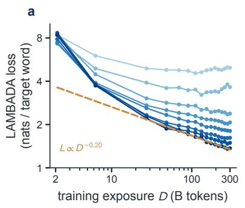

b  
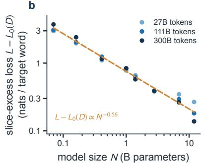

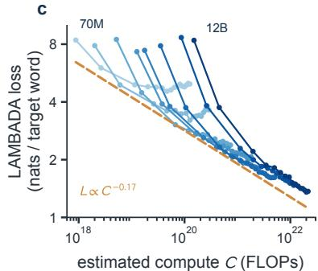  
Fig. 1: Pythia scaling across exposure, size and compute. Pythia evaluations [1], replotted as zero-shot LAMBADA loss L = ln PPL (nats per target word). (a) Small models plateau with exposure D; larger models improve. (b) Three slices of $L - L _ { 0 } ( D )$ versus nominal N, jointly fitted with shared A, α and separate offsets. (c) Estimated FLOPs $C \simeq 6 N D$ . Orange dashes: 12B late-stage trend (a), shared fit (b), frontier guide (c).

## Contents

1 Introduction: The Empirical Scaling Frontier 2 5 Emergence, Capability Thresholds and   
2 Geometry: Resolution, Approximation and Grokking 13   
Task Risk 4 6 Test-Time Scaling: Search and Verification 15   
3 Information Spectra and Data Scaling 6 7 Extending the Framework Beyond LLMs 17   
4 Compute Allocation: Training and References 22   
Deployment 11

## 1. Introduction: The Empirical Scaling Frontier

With a fixed compute budget, should we train a larger model, use more data, or spend more effort on each prediction? Scaling laws help quantify these choices by relating prediction error to resource use. Language-model training studies provide a starting point: they fit validation loss against model size, training exposure and computation within controlled model families [2, 3]. Figure 1 uses Pythia’s public checkpoint evaluations to illustrate these resource coordinates on a common prediction task [1].

Larger models, more data and additional computation address different bottlenecks. A model needs enough capacity to represent the task, while data must reveal the structure it needs to learn. We use geometry to study representation error and information spectra to study the predictive information exposed by additional data. Connecting these limits to task loss and computational cost provides a basis for comparing model capacity, training data and inference effort.

To make the resource comparison precise, let N denote active parameter count, D training exposure, and C realized training FLOPs. Exposure counts processed tokens, not necessarily independent examples, and FLOPs measure work rather than elapsed time. Dense training at fixed architectural conventions has approximate cost $C \approx \kappa N D$ , where κ includes the accounting convention. A univariate curve is a controlled slice in which the other resource coordinates are fixed or optimized under a stated rule.

## 1.1. How a Power Law Relates Resources to Loss

Empirical power-law intervals occur in several prediction tasks [4, 5]. Their existence does not identify a unique cause: variance-limited and resolution-limited models can produce different rates [6]. Let $X \in \{ N , D , C \}$ be the controlled resource and let $\epsilon _ { X } ( X ) : = L ( X ) - L _ { \infty } > 0$ . On a connected positive resource interval, a constant logarithmic slope $\alpha _ { X } > 0$ integrates to a power law with amplitude $A _ { X } > 0 \colon$

$$
\frac { \mathrm { d } \log \epsilon _ { X } } { \mathrm { d } \log X } = - \alpha _ { X } \Longleftrightarrow L ( X ) - L _ { \infty } = A _ { X } X ^ { - \alpha _ { X } } .\tag{1}
$$

Figure 2 distinguishes this interval from the small-data plateau and the error floor. The fitted range should be supported by the observed learning curve.

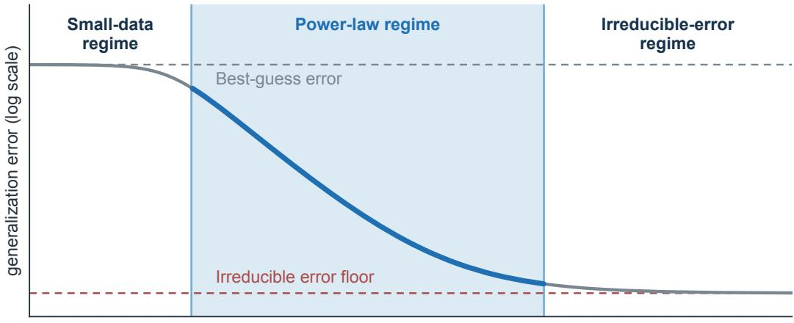  
training dataset size (log scale)  
Fig. 2: Scaling has a finite power-law regime. As training data D increase, error passes from a best-guess plateau through power-law decay to the irreducible error floor $L _ { \infty } ,$ the remaining prediction uncertainty at large data. Redrawn after Hestness et al. [4, Fig. 6]; a single exponent describes the middle interval rather than both plateaus.

A tenfold increase in X multiplies excess loss by $1 0 ^ { - \alpha _ { X } }$ . The floor and exponent must be checked

when the distribution or training protocol changes; transfer studies and broken-slope fits provide examples of this limitation [7, 8]. An exponent is therefore a property of a measured family and interval, rather than a label for an architecture alone.

## 1.2. Predicting Loss at Larger Scales

Pilot runs can support forecasts within a tested model family [9, 10]. For a proposed scale $C _ { f }$ beyond the largest pilot $C _ { 0 } .$ , a fitted floor, amplitude and exponent give

$$
\widehat { L } ( C _ { f } ) = \widehat { L } _ { \infty } + \widehat { A } _ { C } C _ { f } ^ { - \widehat { \alpha } _ { C } } .\tag{2}
$$

The reliability of this forecast is an empirical question. Hold out one or more pilot scales, inspect residuals, and repeat training seeds before using the fit to allocate a frontier budget. Joint floor uncertainty, optimization changes and distribution shift require checks beyond a regression interval.

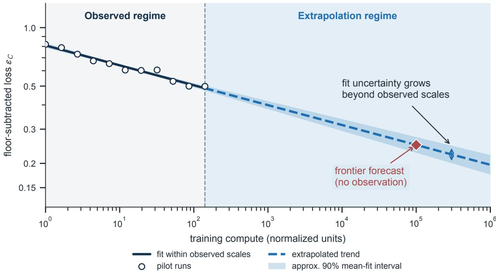  
Fig. 3: Extrapolation magnifies uncertainty in the loss forecast. Synthetic pilot runs (circles) fit excess loss $\epsilon _ { C } : = L ( C ) - L _ { \infty }$ above a fixed floor; solid and dashed lines show the fit and extrapolation to the diamond forecast. The approximate 90% band for mean log-excess loss widens with extrapolation distance, conditional on the floor and power-law model.

In the fixed-floor regression of Figure 3, exponent uncertainty grows in effect with logarithmic distance from the pilot range. An estimated floor introduces another source of uncertainty, coupled to the fitted amplitude and slope.

## 1.3. The Resources Needed to Reduce Error

The common resource question is how much task error an additional unit of compute, data, or capacity removes. Differentiating the fitted curve gives $| L ^ { \prime } ( X ) | = \alpha _ { X } A _ { X } X ^ { - ( \alpha _ { X } + 1 ) }$ , so marginal gains decline with scale. Its inverse, $X ( \epsilon ) = ( A _ { X } / \epsilon ) ^ { 1 / \alpha _ { X } }$ , gives the resource required for a target excess loss. Halving that loss multiplies the modeled requirement by $2 ^ { 1 / \alpha _ { X } }$ . This multiplier becomes large when $\alpha { X }$ is small; comparing resource directions also requires their costs.

The three views answer complementary parts of one scaling question. Geometry identifies the representation burden; spectra describe the predictive information that data can expose; compute constraints turn these error reductions into allocation choices. Their connection depends on the stated task-loss mapping and cost model, which the following sections make explicit.

Table 1: How the framework links error, information and resource decisions. Assumptions belong to the corresponding derivation.
<table><tr><td>Model</td><td>Assumptions</td><td>Quantity explained; main limitation</td></tr><tr><td>Geometry</td><td>Compact support, regular cells, local approximation class</td><td>Uniform function error; task-risk map- ping is additional</td></tr><tr><td>Predictive spectrum</td><td>Independent draws, aligned predic- tive mass, learning on observation</td><td>Data-loss decay through unresolved pre- dictive mass</td></tr><tr><td>Training allocation</td><td>Separable loss, fixed dense FLOP fac- tor</td><td>An interior training optimum; excludes serving costs</td></tr><tr><td>Candidate search</td><td>Query-specific proposals and a cali- brated selection protocol</td><td>Coverage or selected accuracy; the two are distinct</td></tr></table>

Throughout this article, analytical curves and schematic maps illustrate the stated mathematical models; empirical results are identified by their sources.

## 2. Geometry: Resolution, Approximation and Task Risk

Geometry explains the representation burden behind parameter scaling: a finite model must resolve a target function on the support of its inputs. Manifold approximation and resolutionbased scaling models formalize this idea [6, 11]. We first derive a function-error rate, then connect that rate to task risk; the loss mapping determines which exponent is relevant to Section 1.

## 2.1. When Data Occupies a Lower-Dimensional Space

Let observations lie on a compact support $\mathcal { M } \subset \mathbb { R } ^ { m }$ with intrinsic dimension $d : = \dim ( { \mathcal { M } } )$ The manifold hypothesis describes tasks for which d can be much smaller than the ambient coordinate count $m$ . Manifold and compositional regression results require restrictions on the support and target class [11, 12]. The dimension relevant to one tolerance or target need not describe another. A fine-resolution fit should therefore be checked rather than inferred from a coarse-resolution exponent.

## 2.2. Relating Parameter Count to Representation Capacity

To approximate a function on $\mathcal { M } ,$ divide its support into K small cells and fit a simple function within each cell. The largest discrepancy over the support is the uniform approximation error:

$$
\eta ( f , { \widehat { f } } _ { K } ) : = \| f - { \widehat { f } } _ { K } \| _ { \infty } = \operatorname* { s u p } _ { x \in { \mathcal { M } } } | f ( x ) - { \widehat { f } } _ { K } ( x ) | .
$$

More cells allow finer spatial resolution. For a fixed architecture family, let $0 < N _ { e } \le N$ count the effective parameters used for this resolution and model the attainable cell budget by

$$
K ( N _ { e } ) = \chi N _ { e } ^ { \gamma } .\tag{3}
$$

Here $\chi > 0$ measures partition efficiency and $\gamma > 0$ captures how the construction reuses parameters. We evaluate this envelope at parameter budgets for which K is a positive integer; rounding between these points changes only the fixed prefactor. The architecture is assumed to realize the local approximants used below, including their cell placement and target-dependent coefficients.

Depth and composition can increase expressivity beyond parameter count alone [13, 14], while equivariance can share representations across symmetry-related inputs [15]. These mechanisms motivate the capacity model. Its usable cells require a realizable approximation construction, which raw region counts alone do not supply. The partition efficiency $\chi$ is distinct from the training FLOP coefficient κ.

## 2.3. From Spatial Resolution to Function Error and Task Loss

How does a finer partition reduce approximation error? First consider the cell size. On a $d -$ dimensional support, a cell of diameter h occupies a volume proportional to $h ^ { d }$ . A regular partition into K cells therefore has a resolution scale proportional to $K ^ { - 1 / d }$ . Writing $h _ { K }$ for the largest cell diameter in local coordinates gives the covering bound

$$
h _ { K } \leq C _ { \mathcal { M } } K ^ { - 1 / d } .\tag{4}
$$

This construction uses a smooth compact manifold with a finite atlas and cells of comparable size and bounded aspect ratio. The constant $C _ { \mathcal { M } } > 0$ accounts for the geometry, chart distortion and partition regularity, independently of $K$

Next, approximate the target within each cell. Smoothness of order $s > 0$ means that a local Taylor polynomial of degree $\lceil s \rceil - 1$ leaves a remainder bounded by a constant times the cell diameter raised to s. For targets in a fixed Hölder ball $\mathcal { H } _ { s }$ , this gives

$$
\eta \leq c _ { s } h _ { K } ^ { s } \leq c _ { s } C _ { \mathcal { M } } ^ { s } K ^ { - s / d } .\tag{5}
$$

The Hölder ball fixes a common bound on the derivatives and their continuity; its remainder constant $c _ { s } > 0$ is independent of K. For noninteger s, the highest Taylor derivative has Hölder exponent $s - \lceil s \rceil + 1 ;$ at integer s, the corresponding Lipschitz remainder condition suffices.

Finally, substitute the cell budget from Equation 3 into Equation 5. Define the geometric prefactor $A _ { g } : = c _ { s } C _ { \mathcal { M } } ^ { s } \chi ^ { - s / d }$ . The parameter-error bound is

$$
\eta ( N _ { e } ) \leq A _ { g } N _ { e } ^ { - \gamma s / d } .\tag{6}
$$

For a Lipschitz target $( s = 1 )$ , linear cell growth $( \gamma = 1 )$ and full parameter use $( N _ { e } = N )$ , this becomes $\eta ( N ) \leq A _ { g } N ^ { - 1 / d }$ . Higher smoothness improves the local fit; higher dimension requires more cells to reach the same resolution. Figure 4 illustrates the partition and the local remainder.

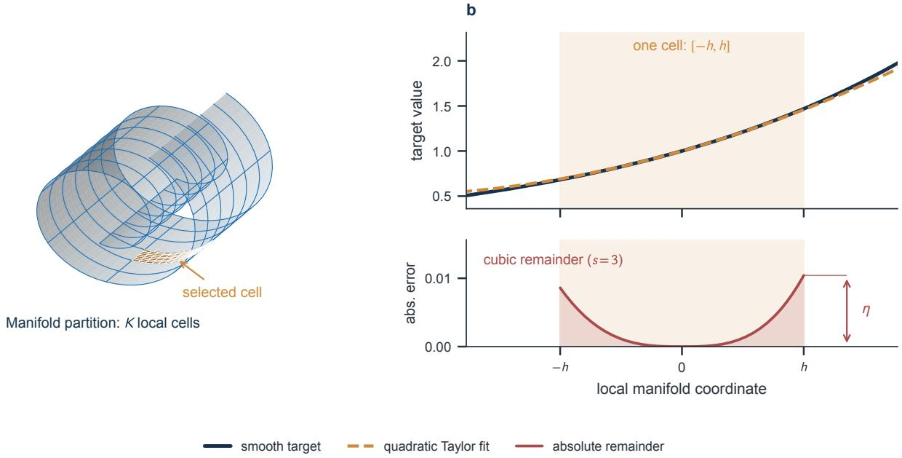  
Fig. 4: Finer cells and smoother targets reduce approximation error. (a) A d-dimensional manifold is covered by K regular cells with size $h \propto K ^ { - 1 / d }$ . (b) A quadratic Taylor approximation (dashed orange) to a smooth target (navy) leaves a uniform error $\eta$ (maximum red residual) bounded by a constant times $h ^ { 3 }$ . More generally, smoothness s gives a bound scaling as $K ^ { - s / d }$

For the fixed-degree piecewise-polynomial space $\mathcal { P } _ { K }$ on this partition, the best uniform approximation error, maximized over $\mathcal { H } _ { s }$ , lies between $c _ { - } K ^ { - s / d }$ and $c _ { + } K ^ { - s / d }$ , with positive constants independent of K. A rescaled smooth bump gives the lower bound and Taylor approximation gives the upper bound. This matching rate concerns that local approximation class; a network realizing it inherits the upper bound. Neural approximation results specify their own architecture and target classes [16], and deep or adaptive constructions can have different rates [17, 18].

A risk bound requires a specified loss. Define $\mathcal { R } ( g ) : = \mathbb { E } [ \ell ( g ( x ) , y ) ]$ and assume the compared risks are finite. Lipschitz losses: if $\ell ( \widehat { f } ( x ) , y )$ is G-Lipschitz in its prediction argument throughout the relevant range, then

$$
\begin{array} { r } { | \mathcal { R } ( \widehat { f } ) - \mathcal { R } ( f ) | \leq G \eta . } \end{array}\tag{7}
$$

This transfers an $h ^ { s }$ uniform function-error bound to an $h ^ { s }$ upper bound on the risk difference, with G fixed.

Squared loss: assume $\mathbb { E } [ y ^ { 2 } ] < \infty$ and take the approximation target to be the Bayes regression function $f ^ { \star } ( x ) = \mathbb { E } [ y \mid x ]$ . Conditional expectation is an $L ^ { 2 }$ contraction, so $f ^ { \star }$ is square-integrable; a finite uniform error η then makes $\widehat { f }$ square-integrable under the input probability measure. Cauchy–Schwarz makes the cross term integrable, and conditional expectation gives $\mathbb { E } [ ( y -$ ${ f ^ { \star } } ) ( \widehat { f } - f ^ { \star } ) ] = 0$ . Expanding squared loss therefore yields the finite-risk identity

$$
\mathcal { R } ( \widehat { f } ) - \mathcal { R } ( f ^ { \star } ) = \mathbb { E } [ ( \widehat { f } - f ^ { \star } ) ^ { 2 } ] \leq \eta ^ { 2 } .\tag{8}
$$

Thus an $h ^ { s }$ function-error rate can yield an $h ^ { 2 s }$ upper bound for squared risk.

Categorical cross-entropy: for finitely many classes, let $p ( x )$ and ${ \widehat { p } } ( x )$ be normalized true and predicted conditional probability vectors. Assume a common lower bound $\widehat { p } _ { i } ( x ) \geq \delta _ { 0 } > 0$ for every input and class. The inequality log $u \leq u - 1$ gives

$$
\begin{array} { r } { \mathcal { R } _ { \mathrm { C E } } ( \widehat { p } ) - \mathcal { R } _ { \mathrm { C E } } ( p ) = \mathbb { E } _ { x } \mathrm { K L } ( p ( x ) \| \widehat { p } ( x ) ) \leq \delta _ { 0 } ^ { - 1 } \mathbb { E } _ { x } \| p ( x ) - \widehat { p } ( x ) \| _ { 2 } ^ { 2 } . } \end{array}\tag{9}
$$

The probability lower bound controls the logarithm near zero. A geometric rate for this risk therefore requires a bound on the probability-vector error in the chosen representation norm.

## 2.4. Comparing Representations at Matched Quality

Representation changes may alter $d , \gamma , \mathsf { o r } \chi$ . Their engineering value still requires a comparison at matched task quality, including preprocessing, training and serving costs. Retrieval, routing and symmetry constraints can change the feasible approximation class, but a geometric improvement alone does not show that they cost less than increasing N.

## Key Insight — A Rate With an Explicit Error Metric

Halving the target upper bound requires a region-budget multiplier $2 ^ { d / s }$ , or an effectiveparameter multiplier $2 ^ { d / ( \gamma s ) }$ , in the continuous power-law envelope. The task-risk map and total cost determine the practical value of this geometric improvement.

## 3. Information Spectra and Data Scaling

Data scaling depends on how quickly observations expose predictive structure. We first combine feature frequencies with their contributions to error, retaining the smooth probability that a feature remains unseen. We then connect predictive mass to covariance spectra, regularized learning and information gain [19, 20].

## 3.1. How Much Data Is Needed to Observe a Feature

Let $q ( r )$ be the occurrence probability of feature rank r, and let $\lambda ( r )$ be its predictive mass. A representation covariance can motivate $\lambda ,$ but using covariance eigenvalues as predictive

weights requires a target-alignment assumption [20]. Occurrence, covariance magnitude and task relevance are different objects.

For D independent draws, the probability of seeing feature r at least once is

$$
P _ { r } ( D ) = 1 - ( 1 - q ( r ) ) ^ { D } \approx 1 - \exp [ - D q ( r ) ] .\tag{10}
$$

The exponential approximation requires small $q ( r )$ . An expected count $D q ( r ) \approx 1$ marks visibility, not reliable estimation; even many observations can be inadequate with noise, weak alignment or a complex feature estimator. Correlated token exposure also need not constitute D independent draws.

## 3.2. Deriving a Data Scaling Rate from Unseen Features

Feature-frequency models can generate power-law learning curves under explicit sampling rules [21]. Consider

$$
q ( r ) = Z ^ { - 1 } r ^ { - \zeta } , \qquad \lambda ( r ) = B r ^ { - \beta } , \qquad \zeta > 1 , \quad \beta > 1 , \quad B > 0 .\tag{11}
$$

Here $\begin{array} { r } { Z = \sum _ { r = 1 } ^ { \infty } r ^ { - \zeta } } \end{array}$ normalizes occurrences. Assume independent draws, exact learning on first observation and additive contributions from unseen features. Their expected unresolved predictive mass is then

$$
U ( D ) = \sum _ { r = 1 } ^ { \infty } B r ^ { - \beta } ( 1 - Z ^ { - 1 } r ^ { - \zeta } ) ^ { D } .\tag{12}
$$

This expression retains the observation probability of Equation 10. The learning-on-observation assumption isolates a coverage mechanism; noise, repeated estimation and regularization enter more detailed learning curves [22, 23].

Poissonizing the draw count with mean D makes the unseen probability exactly $\exp [ - D q ( r ) ]$ In the continuum approximation to the rank sum, put $t = D / Z$ and $p = ( \beta - 1 ) / \zeta > 0$ . The substitution $u = t r ^ { - \zeta }$ gives

$$
\begin{array} { l } { I ( t ) = \displaystyle \int _ { 1 } ^ { \infty } B r ^ { - \beta } e ^ { - t r ^ { - \zeta } } \mathrm { d } r } \\ { \displaystyle \qquad = \frac { B } { \zeta } t ^ { - p } \displaystyle \int _ { 0 } ^ { t } u ^ { p - 1 } e ^ { - u } \mathrm { d } u . } \end{array}\tag{13}
$$

The incomplete Gamma integral converges to $\Gamma ( p ) \mathsf { a s } t \to \infty$ . Write $U _ { c } ( D ) : = I ( D / Z )$ for the continuum residual. Substitution retains the full leading coefficient:

$$
U _ { c } ( D ) \sim \frac { B \Gamma ( \alpha _ { D } ) } { \zeta } Z ^ { \alpha _ { D } } D ^ { - \alpha _ { D } } , \qquad \alpha _ { D } = \frac { \beta - 1 } { \zeta } .\tag{14}
$$

In the continuum coverage model, measuring predictive mass in loss units sets $L ( D ) - L _ { \infty } : =$ $U _ { c } ( D )$ . The data exponent combines feature-coverage growth with predictive-mass decay. Since $t = D / Z$ , the normalization contributes $Z ^ { \alpha _ { D } }$ to the leading coefficient.

The omitted tail is explicit: with $\textstyle \Gamma ( p , t ) : = \int _ { t } ^ { \infty } u ^ { p - 1 } e ^ { - u } \mathrm { d } u$ , the difference between the leading term and $I ( t )$ is $B t ^ { - p } \Gamma ( p , t ) / \zeta \sim B e ^ { - t } / ( \zeta t ) \overset { \sim } { \mathsf { a s } } t \to \infty$

A hard cutoff gives a useful geometric picture of the same transition. Define $r _ { v }$ by $D q ( r _ { v } ) = 1$ , so $r _ { v } = t ^ { 1 / \zeta }$ . Replacing the smooth unseen probability by the indicator $r > r _ { v }$ produces

$$
H ( t ) = \int _ { t ^ { 1 / \zeta } } ^ { \infty } B r ^ { - \beta } \mathrm { d } r = \frac { B } { \beta - 1 } t ^ { - p } ,
$$

$$
\frac { I ( t ) } { H ( t ) } \longrightarrow p \Gamma ( p ) = \Gamma ( 1 + p ) .\tag{15}
$$

The smooth and hard descriptions share an exponent, with generally different constants. Figure 5 compares the hard-tail shading with the smoothly weighted unseen mass; Figure 6 maps the common exponent across spectral and frequency slopes.

Finite support changes the late-data regime. With final rank $r _ { \mathrm { m a x } } .$ , the hard-tail mass is $B ( r _ { v } ^ { 1 - \beta }$ $r _ { \operatorname* { m a x } } ^ { 1 - \beta } ) / ( \beta - 1 )$ until the cutoff reaches $r _ { \mathrm { m a x } } ,$ and is zero thereafter. The smooth unseen mass instead approaches zero continuously; with finitely many positive occurrence probabilities, its asymptotic decay is exponential. For $\beta \leq 1$ , the infinite-rank predictive mass diverges, so a finite-support model or a different tail is required.

## 3.3. From Dimension to Spectral Decay

Weyl’s law concerns a specified differential operator [24]. Let $\mathcal { M }$ be a smooth compact $d -$ dimensional Riemannian manifold without boundary. Use the nonnegative self-adjoint Laplace– Beltrami operator $\Delta _ { \mathcal { M } } = - \operatorname { d i v } _ { g } \nabla _ { g }$ on $L ^ { 2 } ( \mathcal { M } , \mathrm { v o l } _ { g } )$ , with domain $H ^ { 2 } ( \mathcal { M } )$ and eigenvalues $\mu _ { r } \geq 0$ For $a > 0$ and $s _ { c } > d / 2$ , the covariance $T = ( a I + \Delta _ { \mathcal { M } } ) ^ { - s _ { c } }$ is positive and trace-class [25]. Let $\omega _ { d }$ be the Euclidean unit-ball volume and define $w _ { \mathcal { M } } : = ( 2 \pi ) ^ { 2 } [ \omega _ { d } \mathrm { V o l } ( \mathcal { M } ) ] ^ { - 2 / d }$ . Weyl’s law and substitution give

$$
\begin{array} { r l } { \mu _ { r } \sim w _ { \mathcal { M } } r ^ { 2 / d } , } & { { } } \\ { \lambda _ { r } = ( a + \mu _ { r } ) ^ { - s _ { c } } \sim w _ { \mathcal { M } } ^ { - s _ { c } } r ^ { - 2 s _ { c } / d } \quad } & { { } ( r  \infty ) . } \end{array}\tag{16}
$$

To specify predictive alignment, normalize Riemannian volume to an input probability measure ϖ and let $\{ \phi _ { r } \}$ be the covariance eigenbasis orthonormal in $L ^ { 2 } ( \varpi )$ . For a fixed square-integrable target $\begin{array} { r } { f ^ { \star } = \sum _ { r } a _ { r } \phi _ { r } } \end{array}$ , its ideal spectral truncation $f _ { R } ^ { \star }$ has squared error

$$
\Vert f ^ { \star } - f _ { R } ^ { \star } \Vert _ { L ^ { 2 } ( \varpi ) } ^ { 2 } = \sum _ { r > R } | a _ { r } | ^ { 2 } .\tag{17}
$$

The target coefficients must carry power in these covariance modes. We use the predictivealignment condition $| a _ { r } | ^ { 2 } \sim b \lambda ,$ as $r  \infty$ , with $b > 0 [ 2 0 ]$ . Identifying the predictive mass as $\lambda ( r ) = | a _ { r } | ^ { 2 }$ then transfers both the spectral exponent and its amplitude, $B = b w _ { \mathcal { M } } ^ { - s _ { c } }$ , to the unseen-mass model.

Weaker two-sided bounds, $c _ { a } \lambda _ { r } \leq | a _ { r } | ^ { 2 } \leq C _ { a } \lambda _ { i }$ with $0 < c _ { a } \le C _ { a } < \infty$ , retain the decay exponent without fixing a leading coefficient. A random-target model with $\mathbb { E } | a _ { r } | ^ { 2 } = \lambda$ instead describes a prior-averaged tail. In each case the mass measures squared function error; other losses use the transfer conditions of Section 2.

Under this predictive alignment and the earlier sampling and learning assumptions, the unseenmass model gives

$$
\begin{array} { c } { { \displaystyle \beta = \frac { 2 s _ { c } } { d } , } } \\ { { \displaystyle \alpha _ { D } = \frac { 2 s _ { c } / d - 1 } { \zeta } , \qquad s _ { c } > d / 2 . } } \end{array}\tag{18}
$$

The trace condition ensures finite total covariance mass; alignment and sampling determine how that mass enters the data exponent.

For a manifold Matérn family with regularity $\nu ,$ the covariance order is $s _ { c } = \nu + d / 2 \left[ 2 5 \right]$ . Under the same predictive-alignment assumption, Equation 18 then gives $\beta = 1 + 2 \nu / d$ . This covariance order is distinct from approximation smoothness s in Section 2; the two describe different operators and error objects.

Regularization replaces an abrupt spectral truncation by a smooth filter. With ridge parameter $\tau >$ 0, minimizing $\| f - f ^ { \star } \| _ { L ^ { 2 } ( \varpi ) } ^ { 2 } + \tau \| T ^ { - \mathrm { i } / 2 } f \| _ { L ^ { 2 } ( \varpi ) } ^ { 2 }$ over the domain of $T ^ { - 1 / 2 }$ gives $f _ { \tau } = T ( T + \tau I ) ^ { - 1 } f ^ { \star }$

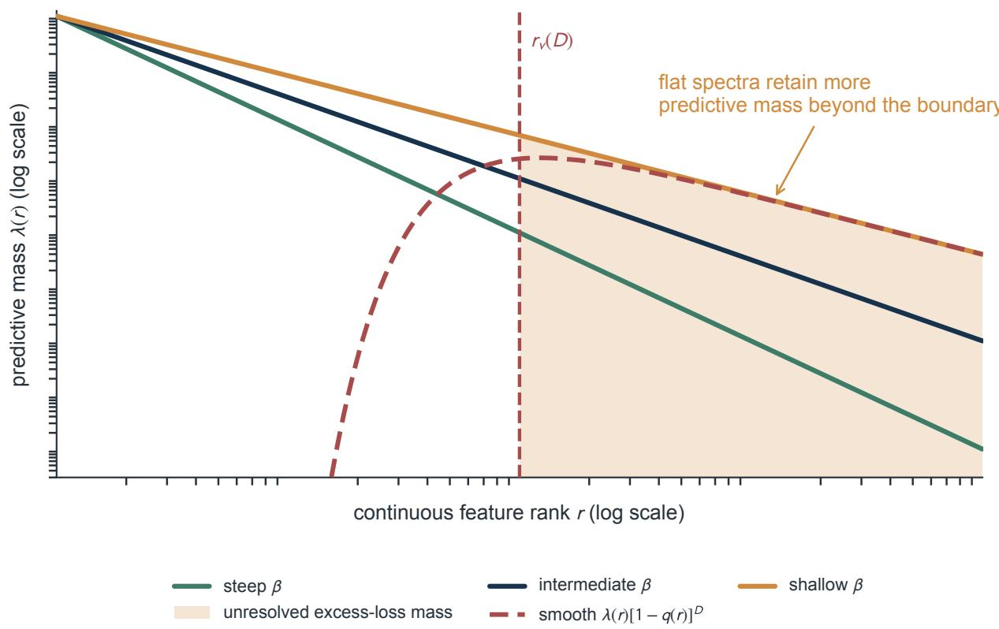

Fig. 5: Feature visibility converts spectral tails into data scaling. Rank r carries predictive mass $\lambda ( r ) \propto r ^ { - \beta }$ and occurrence probability $q ( r ) \propto r ^ { - \zeta } ;$ sample count D sets the boundary $D q ( r _ { v } ) = 1$ . For the shallow spectrum, hard-tail shading and smooth unseen mass $\lambda ( r ) [ 1 - q ( r ) ] ^ { D }$ (red dashed) yield the same large-data exponent $( \beta - 1 ) / \zeta$ in the coverage model.  
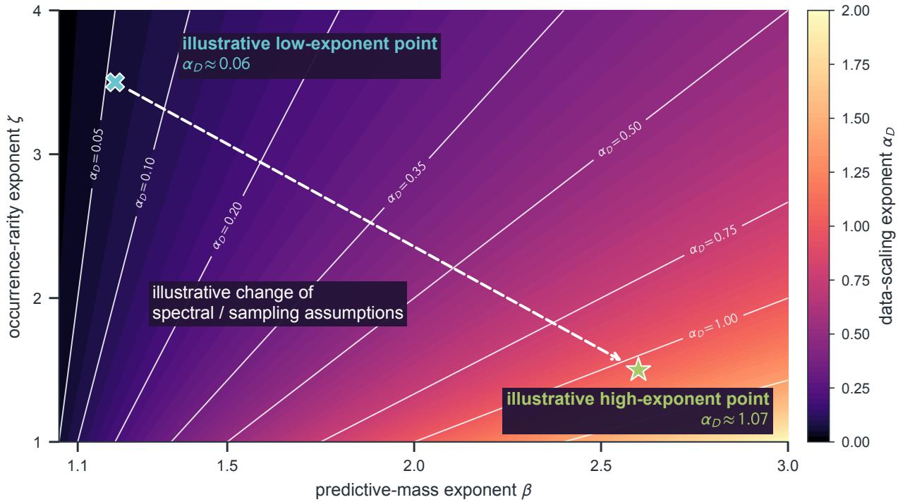  
Fig. 6: Predictive concentration and feature rarity jointly set the data exponent. Color and contours give $\alpha _ { D } = ( \beta - 1 ) / \zeta$ , where $\beta$ controls predictive-mass decay across feature ranks and $\zeta$ controls occurrence-frequency decay. The dashed arrow compares assumed profiles: concentrating mass toward low ranks $( \mathsf { l a r g e r } \beta )$ or making tail features less rare (smaller ζ) increases the predicted loss-decay exponent.

Expanding in the same eigenbasis gives the squared bias and effective dimension

$$
\begin{array} { c } { { \displaystyle { \| f ^ { \star } - f _ { \tau } \| _ { L ^ { 2 } ( \varpi ) } ^ { 2 } = \sum _ { r } \left( \frac { \tau } { \lambda _ { r } + \tau } \right) ^ { 2 } | a _ { r } | ^ { 2 } } , } } \\ { { d _ { e } ( \tau ) = \sum _ { r } \displaystyle { \frac { \lambda _ { r } } { \lambda _ { r } + \tau } } . } } \end{array}\tag{19}
$$

Modes near $\lambda _ { r } \approx \tau$ form a gradual resolution boundary. The bias depends on target power, whereas the effective dimension counts modes weighted by the filter. Finite-sample prediction combines this bias with sampling and noise effects [20, 23].

## 3.4. Distinguishing New Information from Repeated Exposure

A Gaussian observation model makes the spectrum–information connection explicit. Retain R modes, put $\boldsymbol { \Lambda } _ { R } = \mathrm { d i a g } ( \lambda _ { 1 } , \ldots , \lambda _ { R } )$ , and draw their coefficients $\Theta \sim \mathcal { N } ( 0 , \Lambda _ { R } )$ . Observe ${ \bf { \mathscr { y } } } =$ $\Phi _ { D } \Theta + \varepsilon$ , where row i of $\Phi _ { D }$ contains the basis values at input $x _ { i } ,$ , and independent noise has distribution $\varepsilon \sim \mathcal { N } ( 0 , \sigma ^ { 2 } I )$ with $\sigma ^ { 2 } > 0$ . The posterior covariance is $\Sigma _ { D } = ( \bar { \Lambda _ { R } ^ { - 1 } } + \sigma ^ { - 2 } \Phi _ { D } ^ { \top } \Phi _ { D } ) ^ { - 1 }$ Subtracting the Gaussian posterior differential entropy from its prior entropy yields

$$
I ( \Theta ; y | \Phi _ { D } ) = \frac { 1 } { 2 } \log \operatorname * { d e t } \Bigl ( I _ { R } + \sigma ^ { - 2 } \Lambda _ { R } ^ { 1 / 2 } \Phi _ { D } ^ { \mathsf { T } } \Phi _ { D } \Lambda _ { R } ^ { 1 / 2 } \Bigr ) .\tag{20}
$$

Thus information depends on both the covariance spectrum and which directions the observation design measures.

For an orthogonal normalized design, $\Phi _ { D } ^ { \mathsf { T } } \Phi _ { D } = D I _ { R }$ with $R \leq D$ , this expression reduces to a spectral sum. Extending D continuously as observation intensity gives

$$
\begin{array} { l } { \displaystyle { I _ { R } ( D ) = \frac { 1 } { 2 } \sum _ { r = 1 } ^ { R } \log \left( 1 + \frac { D \lambda _ { r } } { \sigma ^ { 2 } } \right) , } } \\ { \displaystyle { \frac { \mathrm { d } I _ { R } } { \mathrm { d } \log D } = \frac { 1 } { 2 } \sum _ { r = 1 } ^ { R } \frac { \lambda _ { r } } { \lambda _ { r } + \sigma ^ { 2 } / D } = \frac { 1 } { 2 } d _ { e , R } ( \sigma ^ { 2 } / D ) . } } \end{array}\tag{21}
$$

Here $d _ { e , R }$ is the finite-mode version of Equation 19. Increasing observation intensity lowers the spectral resolution scale $\sigma ^ { 2 } / D ;$ its information gain is governed by the same smooth filter. For general sampled inputs, the design-dependent determinant remains the relevant expression.

This model also supplies a concrete selection score. Given the current data and a candidate input x, write ${ \phi } ( x ) = ( \phi _ { 1 } ( x ) , \ldots , \phi _ { R } ( x ) ) ^ { \top }$ . The expected information in one new noisy response is $\textstyle { \frac { 1 } { 2 } } \log [ 1 + \phi ( x ) ^ { \mathsf { T } } \Sigma _ { D } \phi ( x ) / \sigma ^ { 2 } ]$ , obtained from its predictive variance. Repeated measurements in an already resolved direction have diminishing gain. Selecting by this score targets uncertainty in the specified latent function; deployment loss supplies the separate task criterion.

Deduplication and repeated-data experiments distinguish the value of new evidence from that of additional exposure [26, 27]. Data pruning can also change learning curves, although the gains depend on the selection rule and task [28]. Together, these findings motivate asking whether model-based information scores improve held-out prediction beyond simpler dataquality proxies.

For document-level selection, duplicate-cluster membership or a task-specific quality score provides a concrete ranking rule. Comparing that rule with an unfiltered control at a matched total FLOP budget, including scoring, filtering and training, tests whether its predictive benefit justifies the selection cost. Held-out loss across repeated seeds and rare-task slices reveals where the benefit occurs, while a separate oversampling ablation distinguishes useful tail signal from amplified noise.

## Key Insight — Connect Coverage, Resolution and Information

Feature frequencies determine how quickly predictive mass is observed. Covariance and target spectra determine what regularized learning can resolve, while the observation design determines information gain. Test data-selection rules against held-out task loss and their full computational cost.

## 4. Compute Allocation: Training and Deployment

A training optimum and a deployment optimum solve different problems. The former allocates a training FLOP budget; the latter includes repeated serving work at matched quality. This section separates historical fits, the stationary point of a separable model, and a lifecycle comparison.

## 4.1. Early Estimates of How to Split Training Compute

Kaplan et al. fitted the following allocation under their original non-embedding parameter and training conventions [2]:

$$
N _ { \mathrm { o p t } } \propto C ^ { 0 . 7 3 } , \qquad D _ { \mathrm { o p t } } \propto C ^ { 0 . 2 7 } .\tag{22}
$$

The parameter exponent exceeds the token exponent in this fit. GPT-3’s 175-billion-parameter model used roughly 300 billion training tokens, or about 1.7 tokens per parameter [29]. Accounting conventions and experimental scale qualify comparisons with later prescriptions [30]; the exponents do not specify an architecture-independent allocation rule.

## 4.2. Choosing Model Size and Data at Fixed Compute

The Chinchilla study motivates a separable approximation to loss [3]. With positive amplitudes and exponents, assume

$$
L ( N , D ) = L _ { \infty } + A N ^ { - \alpha _ { N } } + B D ^ { - \alpha _ { D } } , \qquad C = \kappa N D .\tag{23}
$$

Here $\alpha _ { N }$ and $\alpha _ { D }$ are local loss exponents; they are not the predictive spectral exponent $\beta .$ . At fixed C, substituting $D = C / ( \kappa N )$ and differentiating with respect to log N gives

$$
\alpha _ { N } A N ^ { - \alpha _ { N } } = \alpha _ { D } B D ^ { - \alpha _ { D } } .\tag{24}
$$

At fixed C, excess loss is strictly convex in log N because its second derivative is positive. Its first derivative changes from negative to positive as N increases from zero to infinity. The stationary point is therefore the unique global minimum over positive allocations. Combining it with the constraint yields

$$
\begin{array} { r l } & { N _ { \mathrm { o p t } } ( C ) = \left( \frac { \alpha _ { N } A } { \alpha _ { D } B } \right) ^ { 1 / ( \alpha _ { N } + \alpha _ { D } ) } \left( \frac { C } { \kappa } \right) ^ { \alpha _ { D } / ( \alpha _ { N } + \alpha _ { D } ) } , } \\ & { D _ { \mathrm { o p t } } ( C ) = \left( \frac { \alpha _ { D } B } { \alpha _ { N } A } \right) ^ { 1 / ( \alpha _ { N } + \alpha _ { D } ) } \left( \frac { C } { \kappa } \right) ^ { \alpha _ { N } / ( \alpha _ { N } + \alpha _ { D } ) } . } \end{array}\tag{25}
$$

Substituting these allocations gives the exact positive envelope coefficient

$$
H ( A , B ; \alpha _ { N } , \alpha _ { D } ) = ( \alpha _ { N } + \alpha _ { D } ) \left( \frac { A } { \alpha _ { D } } \right) ^ { \alpha _ { D } / ( \alpha _ { N } + \alpha _ { D } ) } \left( \frac { B } { \alpha _ { N } } \right) ^ { \alpha _ { N } / ( \alpha _ { N } + \alpha _ { D } ) } .\tag{26}
$$

Both loss contributions have compute exponent $\begin{array} { r } { \alpha _ { C } : = \frac { \alpha _ { N } \alpha _ { D } } { \alpha _ { N } + \alpha _ { D } } } \end{array}$ . The compute-optimal loss is therefore

$$
L _ { \mathrm { o p t } } ( C ) - L _ { \infty } = H ( A , B ; \alpha _ { N } , \alpha _ { D } ) \left( \frac { \kappa } { C } \right) ^ { \alpha _ { C } } .\tag{27}
$$

This supplies the compute-loss curve of Section 1 within the stated separable model [30]. The risk upper bounds in Section 2 cannot be substituted as matching loss rates without an additional argument.

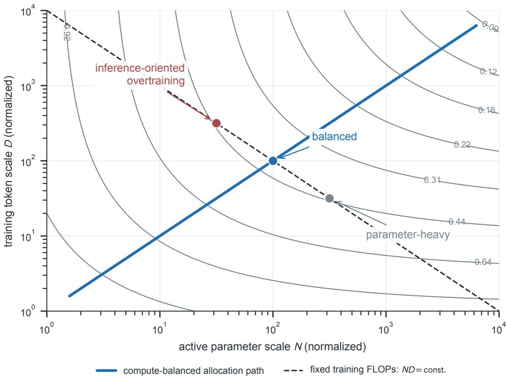  
Fig. 7: Training-optimal allocation differs from serving-oriented allocation. Gray contours hold excess loss fixed across active parameters N and training tokens $D ;$ the balanced path (blue) meets the fixed-compute line $C = \kappa N D$ (dashed, FLOP coefficient κ) at minimum-loss tangency. Moving toward smaller N and larger D reduces serving work per token but departs from this training optimum.

When the two exponents are close, the optimal parameter and exposure allocations grow at comparable rates. The calibration $D / N \approx 2 0$ belongs to one training regime; it is not an invariant ratio. Equation 24 applies to the stated separable objective and fixed dense cost factor. In Figure 7, the marked allocations share a training FLOP budget, and the tangency identifies the lowest modeled loss along that constraint. Moving toward a smaller model does not preserve quality automatically.

Repeated exposure is not new independent coverage. Experiments on repeated corpora show useful extra epochs in some regimes and declining gains in others [27, 31]. A fitted data coordinate must specify whether it counts unique examples, processed tokens or repeated epochs.

## 4.3. Total Compute Across Training and Deployment

Inference-aware scaling includes the workload after checkpoint creation [32]. Let $Q$ be the lifetime number of output tokens. A homogeneous dense FLOP model is

$$
C _ { \mathrm { l i f e } } ( N , D ; Q ) = \kappa N D + \rho N Q .\tag{28}
$$

The training term is paid once, while inference recurs. The shared inference factor $\rho$ assumes comparable context lengths, generation protocols and accounting across models. Memory, batching, cache use and utilization can invalidate that simplification.

FLOPs still do not determine price or latency. Distributed schedules change communication and utilization, and IO-aware attention changes memory traffic [33, 34]. Report those quantities separately when choosing a deployment configuration.

## 4.4. When Extra Training Reduces Total Compute

The Llama 3 family illustrates training small models beyond a local pre-training optimum [35]. Its rounded 8B parameters and 15T training tokens correspond to about 1,875 tokens per parameter.

Compare a small checkpoint $( N _ { S } , D _ { S } )$ with a large checkpoint $( N _ { L } , D _ { L } )$ at matched deployment quality, using one workload and resource unit. Define the training premium $\Delta C _ { t } = C _ { \mathrm { t r a i n } , S }$ $C _ { \mathrm { t r a i n } , L }$ and per-token serving saving $\Delta c _ { s } = c _ { \mathrm { i n f e r } , L } - c _ { \mathrm { i n f e r } , S }$ . Their total cost difference is $\Delta C _ { t } -$ $\Delta c _ { s } Q$ , so the equal-cost volume for nonzero serving saving is

$$
\begin{array} { c l c r } { \displaystyle { Q ^ { \star } = \frac { \Delta C _ { t } } { \Delta c _ { s } } = \frac { C _ { \mathrm { t r a i n } , S } - C _ { \mathrm { t r a i n } , L } } { c _ { \mathrm { i n f e r } , L } - c _ { \mathrm { i n f e r } , S } } } } \\ { \displaystyle { \mathsf { d e n s e m o d e l } \frac { \kappa ( N _ { S } D _ { S } - N _ { L } D _ { L } ) } { \rho ( N _ { L } - N _ { S } ) } . } } \end{array}\tag{29}
$$

The last equality specializes to the shared coefficients of Equation 28; measured costs govern the general comparison. The usual overtraining trade-off has a higher upfront training cost and lower per-token serving cost, so $\Delta C _ { t } > 0$ and $\Delta c _ { s } > 0$ . Serving savings then amortize the training premium once output volume exceeds $Q ^ { \star }$ . (A smaller checkpoint with lower training cost but higher serving cost is preferable only below $Q ^ { \star }$ . A checkpoint no costlier in either component and strictly cheaper in at least one dominates at every positive volume; with equal per-token costs, training cost alone decides.)

Uncertain demand introduces a distinction between expected cost and the probability of saving resources. Let $Q \geq 0$ be random with finite mean, holding the matched-quality training and per-token costs fixed. Linearity gives

$$
\mathbb { E } [ C _ { S } - C _ { L } ] = \Delta G _ { t } - \Delta c _ { s } \mathbb { E } [ Q ] .\tag{30}
$$

A risk-neutral comparison uses this expectation. Workload-dependent unit costs require their full joint expectation, rather than this fixed-coefficient formula.

In the positive-premium, positive-saving case, the probability of a saving is $\operatorname* { P r } ( Q > Q ^ { \star } )$ , which depends on the demand distribution rather than its mean alone. Expected cost and the probability of a saving therefore answer different deployment questions.

## Key Insight — Compare at Matched Quality

Estimate training costs, per-output-token serving costs and expected volume under one workload protocol. The crossover supports a decision only if both checkpoints meet the quality target and the relevant memory and latency constraints.

## 5. Emergence, Capability Thresholds and Grokking

An abrupt score change can arise from a nonlinear metric or from a change in the learned solution. Reports of emergent abilities motivate examining both explanations [36]. They require different evidence; neither follows from the geometric or spectral rate alone.

## 5.1. How Scoring Can Make Progress Look Abrupt

Metric-choice experiments show how scoring rules can create apparent emergence [37]. Consider an r-step task whose conditional success probability at each step, given earlier success, is q. The chain rule gives

$$
P _ { \mathrm { t a s k } } ( q ) = q ^ { r } , \qquad { \frac { \mathrm { d } P _ { \mathrm { t a s k } } } { \mathrm { d } q } } = r q ^ { r - 1 } .\tag{31}
$$

For a long chain, moderate per-step success leaves exact-match accuracy near zero. A continuous change in q can then appear abrupt under thresholded reporting, without a discontinuity in the underlying prediction process. Figure 8 uses the same prescribed $q ( X )$ for all chain lengths; the exact-match curves differ because success is scored as $q ^ { r }$

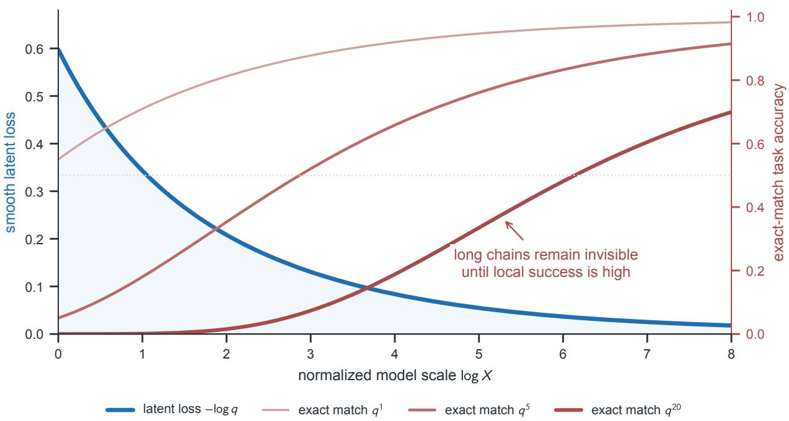  
Fig. 8: Nonlinear scoring can make smooth progress appear abrupt. As model scale log X grows, per-step success $q ( X )$ improves smoothly and latent loss $- \log q$ (blue) falls. Exact-match success $q ^ { r }$ for an r-step chain (red) stays low until per-step reliability is high, producing sharper apparent thresholds for longer chains.

Use continuous scores and partial credit to probe whether a scoring threshold creates the apparent transition. Separately, mechanistic progress measures and representation probes can test the formation of reusable solutions [38, 39]. Compare both diagnostics across model scales and repeated seeds, while checking calibration and prompt sensitivity.

## 5.2. Grokking: Training Fit Before Generalization

Grokking denotes delayed generalization after training interpolation in controlled tasks [40]. Training loss is already near zero at fitting time $t _ { \mathrm { { f i t } } }$ , while test loss improves substantially only at a later time $t _ { \mathrm { g e n } } \gg t _ { \mathrm { f i t } }$ . Interpolation is insufficient: networks can fit arbitrary labels [41]. Grokking also occurs beyond the original algorithmic examples, with dependence on initialization, regularization and the task [42]. A scaling study should distinguish changes across model size from changes along one model’s optimization trajectory.

## 5.3. Why a Preferred Solution May Not Be Reached

For an explicit $L _ { 2 }$ penalty, write

$$
J ( \pmb \theta ) = L _ { \mathrm { t r a i n } } ( \pmb \theta ) + \lambda \| \pmb \theta \| _ { 2 } ^ { 2 } , \qquad \lambda > 0 .\tag{32}
$$

Adaptive optimizers distinguish this explicit penalty from decoupled weight decay. Circuitefficiency models compare memorizing and generalizing mechanisms [43]: at equal training loss, the mechanism with lower parameter norm has lower J. Reaching that mechanism remains a dynamical question. For example, gradient descent started at zero remains stationary for $( x ^ { 2 } - 1 ) ^ { 2 }$ , despite lower minima elsewhere.

A specific dynamical result holds for unregularized logistic regression with homogeneous linear predictors on linearly separable data. With a sufficiently small positive fixed step size, gradient descent converges in direction to the $L _ { 2 }$ maximum-margin separator [44]. This identifies a limiting parameter direction, rather than the emergence time of a generalizing circuit in a deep network.

## Key Insight — Test a Mechanism, Not Only a Score

A validation-loss drop alone does not identify circuit compression. Compare mechanism probes, ablations and optimizer controls alongside the loss trajectory, and account for the parameterization dependence of Euclidean norms.

## 6. Test-Time Scaling: Search and Verification

Test-time scaling studies how task performance changes as inference compute increases. Here the model parameters are fixed, and extra compute is spent on proposals, refinement and selection. Compare selected-answer quality under a measured inference budget.

## 6.1. Counting Generation, Verification and Coordination Costs

An autoregressive model supplies proposals by sampling $y _ { t } \sim p _ { \pmb \theta } ( y _ { t } \mid x , y _ { < t } ) [ 2 9 ]$ . At fixed architecture, a response of $T _ { \mathrm { o u t } }$ tokens has approximate dense generation cost

$$
C _ { \mathrm { b a s e } } \approx \rho N T _ { \mathrm { o u t } } .\tag{33}
$$

Intermediate reasoning changes token exposure during inference [45]. Self-consistency aggregates sampled answers, while Tree of Thoughts adds explicit exploration and backtracking [46, 47]. These methods need different workload measurements even when they share a base checkpoint.

For k proposals with representative proposal cost $C _ { p }$ , verification cost $C _ { v }$ , and orchestration cost $C _ { o } ,$ a simple accounting model is

$$
\begin{array} { r } { C _ { \mathrm { t e s t } } ( k ) \approx k ( C _ { p } + C _ { v } ) + C _ { o } . } \end{array}\tag{34}
$$

Variable proposal lengths or batched verification require measured costs instead. Outcome verifiers and process supervision can guide selection [48, 49]. Neither nonzero proposal success nor a useful verifier guarantees that adding a candidate improves the selected answer.

## 6.2. Generating a Correct Answer Versus Selecting It

Repeated-sampling studies distinguish the presence of a correct candidate from accuracy after selection [50]. Fix one query x and let $p$ be its single-proposal success probability. Under independent proposals,

$$
\begin{array} { r } { P _ { \mathrm { c o v } } ( k ) = 1 - ( 1 - p ) ^ { k } , \qquad \Delta P _ { \mathrm { c o v } , k } = P _ { \mathrm { c o v } } ( k + 1 ) - P _ { \mathrm { c o v } } ( k ) = p ( 1 - p ) ^ { k } . } \end{array}\tag{35}
$$

A perfect selector returns a correct answer whenever one is present, so selected accuracy equals candidate coverage. With an imperfect selector, an additional wrong candidate can displace a correct answer and reduce selected accuracy. Figure 9 uses a restricted selection model to illustrate the distinction, rather than assuming every verifier has a constant accuracy ceiling.

For $0 < p < 1$ and permitted coverage failure $\delta \in ( 0 , 1 )$ , the minimum integer width is

$$
k _ { \mathrm { m i n } } = \left\lceil \frac { \log \delta } { \log ( 1 - p ) } \right\rceil , \qquad k _ { \mathrm { m i n } } \approx \frac { \log ( 1 / \delta ) } { p } \quad ( p \ll 1 ) .\tag{36}
$$

If $p = 0 .$ , no finite width succeeds; if $p = 1$ , one proposal suffices. Correlation invalidates the independent formula, and pairwise positive correlation alone does not determine the probability

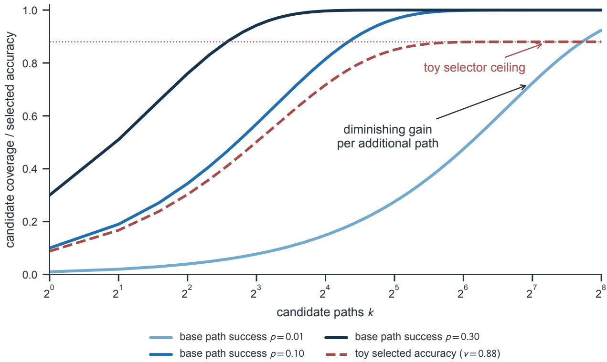  
Fig. 9: Finding a correct candidate does not ensure selecting it. For k independent proposals with per-path success $p ,$ coverage $P _ { \mathrm { c o v } } ( k ) = 1 - ( 1 - p ) ^ { k }$ (solid) approaches one with diminishing gains. The red dashed example multiplies the $p = 0 . 1 0$ coverage by conditional selection success $v = 0 . 8 8$ , giving delivered accuracy $A _ { \mathrm { s e l } } = v P _ { \mathrm { c o v } }$ and a selector-imposed ceiling.

that every proposal fails. A shared-failure model or a measured joint failure distribution is needed to predict its effect.

Query heterogeneity also matters. If half the queries have $p = 0$ and half have $p = 1$ , mean coverage at $k = 2$ is $1 / 2$ , whereas substituting the mean $p = 1 / 2$ gives $3 / 4$ . Estimate coverage within difficulty strata before aggregating, rather than pooling success probabilities first.

## 6.3. Deciding Whether Another Candidate Is Worth Its Cost

The ideal coverage gain per additional FLOP is

$$
{ \frac { \Delta P _ { \mathrm { c o v } , k } } { C _ { p } + C _ { v } } } = { \frac { p ( 1 - p ) ^ { k } } { C _ { p } + C _ { v } } } .\tag{37}
$$

This ratio alone is not a stopping rule for selected accuracy. Inference studies find different compute-optimal strategies across query difficulty and model strength [51, 52]. A serving policy must measure the checkpoint, proposal procedure and selector together.

For selected accuracy $A _ { \mathrm { s e l } } ( k \mid b )$ in a held-out difficulty stratum b, estimate the paired accuracy change and the positive incremental cost, including verification and orchestration. A practical expansion policy compares the accuracy gain per added FLOP with a minimum acceptable return $\tau _ { s }$ set by the deployment budget or utility rule. A conservative implementation can use a calibrated lower confidence bound on the paired gain. Its confidence level controls statistical uncertainty, whereas $\tau _ { s }$ has units of accuracy gain per FLOP and expresses the deployment tradeoff.

Evaluate this policy against a fixed-budget baseline, accounting for repeated decisions and latency limits. Its use requires a reliable correctness signal for calibration; candidate coverage alone measures a different quantity.

## Key Insight — Measure the Answer That Is Delivered

Report candidate coverage and selected accuracy separately, by difficulty and compute budget. Additional proposals are useful only if the measured selection protocol converts them into enough task benefit to justify their full inference cost.

## 7. Extending the Framework Beyond LLMs

The framework extends beyond language by asking the same three questions: what structure must be represented, what information the data supplies, and how much computation resolves it. Visual prediction introduces spatial and temporal resolution costs. Molecular prediction makes independent structural evidence and the meaning of the target especially important. These examples show how to apply the framework with domain-specific loss and resource coordinates.

## 7.1. Visual Resolution: Prediction Error and Compute Cost

Vision Transformers and VideoMAE represent images or videos as patch sequences [53, 54]. For image dimensions H, W, spatial patch width $P _ { s }$ frame count T and temporal tubelet width τ, a divisible grid has token count $M _ { \mathrm { v i s } } = ( H W / P ^ { 2 } ) ( T / \tau )$ . At fixed depth and width, the dense attention component scales as

$$
C _ { \mathrm { a t t n } } \propto \left( \frac { H W } { P ^ { 2 } } \frac { T } { \tau } \right) ^ { 2 } .\tag{38}
$$

Halving P multiplies tokens by four and dense attention work by sixteen when all other dimensions are fixed. Neither multiplier describes total end-to-end training cost.

Vision scaling studies jointly vary model, data and compute [55]. Within a fixed spatial/temporal sampling protocol, let $R = M _ { \mathrm { v i s } }$ index token resolution and let D count example presentations. A local separable loss ansatz is

$$
L ( N , D , R ) = L _ { \infty } + A _ { N } N ^ { - \alpha _ { N } } + A _ { D } D ^ { - \alpha _ { D } } + A _ { R } R ^ { - \alpha _ { R } } .\tag{39}
$$

Equal token counts need not preserve image detail when aspect ratio or temporal sampling changes. Those protocols therefore remain part of the model definition.

A fixed-depth dense Transformer with negligible embedding contribution has parameter count proportional to hidden width squared. Tokenwise work scales with parameter count, while the quadratic attention term scales linearly with width; replacing width by $\sqrt { N }$ therefore suggests the illustrative cost surface

$$
C _ { \mathrm { v i s } } ( N , D , R ) = D \left( a N R + b \sqrt { N } R ^ { 2 } \right) + C _ { \mathrm { d e c } } , \quad a , b > 0 .\tag{40}
$$

The terms represent tokenwise work, quadratic attention and a separately accounted decoder.

To allocate the budget across N, D and $R ,$ differentiate the full cost surface. Include decoder-cost derivatives whenever decoder work varies with those coordinates. Treat decoder cost as constant only when the compared configurations use the same decoder workload. At a differentiable interior optimum with positive cost derivatives, constrained optimization gives

$$
\frac { - \partial _ { x } L } { \partial _ { x } C _ { \mathrm { v i s } } } = \lambda _ { \mathrm { c o s t } } , \qquad x \in \{ N , D , R \} .\tag{41}
$$

Boundary solutions and discrete patch choices require feasible comparisons or KKT conditions. Applying the local loss and cost models to a system requires fitting the loss surface and profiling its full workload.

Masked autoencoders reduce the encoder input while retaining a reconstruction decoder [54, 56]. For mask fraction $\mu \in [ 0 , 1 )$ ,

$$
M _ { \mathrm { e n c } } = ( 1 - \mu ) M _ { \mathrm { v i s } } , \qquad { \frac { C _ { \mathrm { a t t n , e n c } } } { C _ { \mathrm { a t t n } } } } \approx ( 1 - \mu ) ^ { 2 } .\tag{42}
$$

The ratio concerns encoder attention alone.

A paired held-out comparison at fixed N, D and sampling protocol isolates the effect of increasing resolution. Seed and evaluation uncertainty determine whether the task gain is distinguishable at the chosen tolerance, while the added full training cost, including the decoder, determines its computational price.

## 7.2. What Molecular Models Predict and Learn From

Protein structure prediction maps sequence and biological context to a structural target [57]. The AlphaFold stages in Table 2 change both the target scope and the output construction. AF2 uses local frames and invariant point attention, whereas $\tt A F 3 ^ { \prime } s$ diffusion module operates directly on atom coordinates without rotational frames or equivariant processing [58]. These choices connect molecular modeling to the representation and resource questions of Sections 2–4.

Table 2: Different prediction mechanisms across the AlphaFold stages. These changes preclude attributing their accuracy differences to parameter count alone.
<table><tr><td>Stage</td><td>Evidence/target</td><td>Output construction</td></tr><tr><td>AF1 [59]</td><td>protein structure</td><td>Sequence-derived evidence; Predicted distance distributions guide structure opti- mization</td></tr><tr><td>AF2 [57]</td><td>tions; protein structure</td><td>Alignments, pair representa- Evoformer with an end-to-end structure module</td></tr><tr><td>AF3 [58]</td><td></td><td>Joint biomolecular complexesDiffusion-based coordinate generation</td></tr></table>

Global rigid motion changes a molecular pose while preserving internal shape. For labelled, noncollinear configurations on a regular d-dimensional configuration space M, the free, proper action of $G = \mathrm { S E } ( 3 )$ has orbit dimension $d _ { G } = 6$ . Removing the center of mass and then quotienting rotations gives the shape space $B = { \mathcal { M } } / G$ , with $d _ { \mathrm { i n t } } = d - d _ { G } > 0$ . Translation is removed before selecting a compact shape domain. An invariant scalar target, such as internal energy, satisfies $f ^ { \star } ( g x ) = f ^ { \star } ( x )$ and hence factors through B. Equivariant coordinate outputs also transform with the pose; local-frame components describe them through shape together with a reconstruction of that pose.

The covering model of Section 2 quantifies the cost of resolving these coordinates. Compare a regular local construction covering bounded pose charts with one resolving internal shape directly, with common smoothness s and capacity exponent $\gamma .$ For $j \in$ {pose, shape} set $d _ { \mathrm { p o s e } } : = d$ and $d _ { \mathrm { s h a p e } } : = d _ { \mathrm { i n t } }$ . Let $C _ { j } , c _ { s } ^ { ( j ) }$ and $\chi ^ { ( j ) }$ be the corresponding covering, remainder and capacity constants. Using the same integer-budget envelope as Section 2.2, set $M _ { j } : = c _ { s } ^ { ( j ) } C _ { j } ^ { s } ( \chi ^ { ( j ) } ) ^ { - s / d _ { j } }$ Equation 6 then gives

$$
\begin{array} { r l } & { \eta _ { \mathrm { p o s e } } \leq M _ { \mathrm { p o s e } } N _ { e } ^ { - \gamma s / d } , } \\ & { \eta _ { \mathrm { s h a p e } } \leq M _ { \mathrm { s h a p e } } N _ { e } ^ { - \gamma s / d _ { \mathrm { i n t } } } . } \end{array}\tag{43}
$$

The relative increase in the exponents of these envelopes is

$$
\frac { \gamma s / d _ { \mathrm { i n t } } } { \gamma s / d } - 1 = \frac { d _ { G } } { d _ { \mathrm { i n t } } } .\tag{44}
$$

The absolute difference is $\gamma s d _ { G } / [ d ( d - d _ { G } ) ] ;$ at fixed $s , \gamma , d _ { G }$ , multiplying it by $d ^ { 2 }$ gives a limit of $\gamma _ { S } d _ { G }$ as $d \to \infty$ . The relative gain is $6 / d _ { \mathrm { i n t } }$ . The squared-loss transfer doubles the upper-bound exponents, and a learner that discovers the same symmetry can use the reduced representation too.

The spectral calculation should likewise order the modes of the invariant task. Suppose B is a smooth compact Riemannian manifold without boundary, and use its nonnegative self-adjoint Laplace–Beltrami operator $\Delta { } _ { B } .$ For $a > 0$ and $s _ { c } > d _ { \mathrm { i n t } } / 2 ,$ , take $T _ { B } = ( a I + \Delta _ { B } ) ^ { - s _ { c } }$ . Let w be the Weyl constant of Equation 16 with M, d replaced by $B , d _ { \mathrm { i n t } }$ . Then

$$
\begin{array} { r l } & { \mu _ { r } ^ { \mathcal { B } } \sim w _ { \mathcal { B } } r ^ { 2 / d _ { \mathrm { i n t } } } , } \\ & { \lambda _ { r } ^ { \mathcal { B } } \sim w _ { \mathcal { B } } ^ { - s _ { c } } r ^ { - 2 s _ { c } / d _ { \mathrm { i n t } } } , } \\ & { \alpha _ { D } ^ { \mathcal { B } } = \frac { 2 s _ { c } / d _ { \mathrm { i n t } } - 1 } { \zeta } . } \end{array}\tag{45}
$$

The last relation imports predictive alignment within these modes and the observation model of Section 3. Invariant targets have zero coefficients in symmetry-forbidden directions. Counting those directions in a full-space covariance spectrum would therefore violate the alignment premise; quotienting exposes the relevant spectrum rather than creating new predictive mass. The quotient dimension also requires regular orbits: collinear configurations have rotational stabilizers and belong to a different stratum.

To compare architecture costs, apply the separable loss model at one target, metric and floor. For $j \in \{ \mathrm { e q } , \mathrm { d e n s e } \}$ , let $A _ { j } , B _ { j } > 0$ be loss amplitudes, $\alpha _ { N } ^ { ( j ) } , \alpha _ { D } ^ { ( j ) } > 0$ the task-loss exponents, and $\kappa ^ { ( j ) }$ the FLOP coefficient in $C = \kappa ^ { ( j ) } N D$ . Use the closed coefficient $H _ { j } : = H ( A _ { j } , B _ { j } ; \alpha _ { N } ^ { ( j ) } , \alpha _ { D } ^ { ( j ) } )$ from Equation 26 and set $\begin{array} { r } { p _ { j } : = \frac { \alpha _ { N } ^ { ( j ) } \alpha _ { D } ^ { ( j ) } } { \alpha _ { N } ^ { ( j ) } + \alpha _ { D } ^ { ( j ) } } } \end{array}$ . The optimal frontier is

$$
L _ { \mathrm { o p t } , j } ( C ) - L _ { \infty } = H _ { j } \left( \frac { \kappa ^ { ( j ) } } { C } \right) ^ { p _ { j } } .\tag{46}
$$

Using actual loss exponents here keeps the allocation calculation distinct from a function-error rate or risk upper bound. Dividing the two frontiers gives the equal-compute decision:

$$
\frac { L _ { \mathrm { o p t , d e n s e } } ( C ) - L _ { \infty } } { L _ { \mathrm { o p t , e q } } ( C ) - L _ { \infty } } = \frac { H _ { \mathrm { d e n s e } } } { H _ { \mathrm { e q } } } \frac { ( \kappa ^ { ( \mathrm { d e n s e } ) } ) ^ { p _ { \mathrm { d e n s e } } } } { ( \kappa ^ { ( \mathrm { e q } ) } ) ^ { p _ { \mathrm { e q } } } } C ^ { p _ { \mathrm { e q } } - p _ { \mathrm { d e n s e } } } < 1 .\tag{47}
$$

The inequality selects the dense model. Figure 10(a) plots the dimension dependence of the relative and normalized absolute exponent gains. Their decline motivates comparing narrower loss-exponent gaps, which panel (b) varies independently with specified loss exponents and cost coefficients.

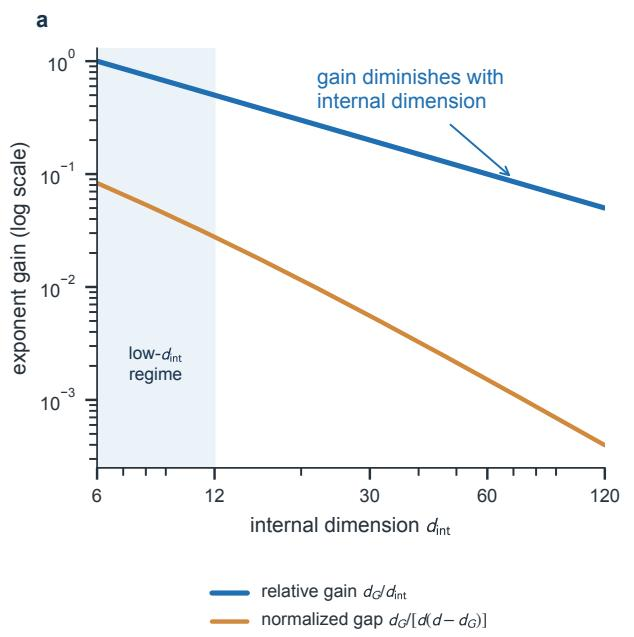

b  
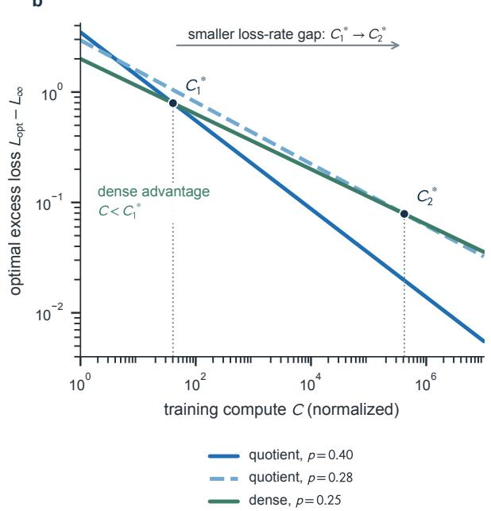  
Fig. 10: Dimension dilutes geometric gains; compute cost shifts crossovers. (a) Removing $d _ { G } = 6$ rigid-pose coordinates from total dimension d leaves internal dimension $d _ { \mathrm { i n t } } = d - d _ { G } ;$ both relative and normalized exponent gains decline. (b) Optimal excess loss scales as $L _ { \mathrm { o p t } } - L _ { \infty }$ ∝ $C ^ { - p } \colon$ the costlier quotient model wins above each crossing $C _ { i } ^ { \star }$ , while a smaller loss-exponent gap delays that crossing.

The dimension-dependent gain in Equation 44 concerns approximation, while the equal-compute choice also depends on task-loss amplitudes and measured FLOP coefficients. Equal loss exponents give a budget-independent ratio; a positive exponent advantage can eventually outweigh a fixed cost premium. $\tt A F 3 ^ { \prime } S$ simpler coordinate construction therefore motivates profiling these coefficients on matched tasks, with hardware throughput entering a time-cost comparison separately from FLOP counts.

Symmetry-aware representations reduce the cost of resolving admissible coordinates, while reliable prediction also requires independent observations of relevant conformations. The Protein Data Bank (PDB) archives experimental structures [60], whereas AlphaFold DB supplies predicted structures [61]. Repeated records, related sequence families and predicted outputs consequently contribute different kinds of evidence and cannot be counted as interchangeable independent experimental observations. Conformational coverage can remain a bottleneck even when the representation is efficient.

An equilibrium sampling example isolates one coverage issue. AF3 outputs from different model seeds or diffusion samples should not be interpreted as a Boltzmann-weighted equilibrium conformational ensemble [58]; the example instead assumes independent equilibrium draws. At fixed context and temperature $T _ { \mathrm { p h y s } }$ , two basins with integrated free-energy difference $\Delta F > 0$ have probability ratio $\begin{array} { r } { p _ { \mathrm { a l t } } / p _ { \mathrm { d o m } } = e ^ { - \Delta F / ( k _ { B } T _ { \mathrm { p h y s } } ) } } \end{array}$ . The minimum integer sample count giving an expected count of at least one in the alternative basin is

$$
D _ { \mathrm { o b s e r v e } } = \left\lceil \frac { 1 } { p _ { \mathrm { a l t } } } \right\rceil = \left\lceil \frac { e ^ { \Delta F / ( k _ { B } T _ { \mathrm { p h y s } } ) } } { p _ { \mathrm { d o m } } } \right\rceil .\tag{48}
$$

The observation count gives an order-one chance, not high-confidence coverage, under independent equilibrium draws. Free-energy estimation must account for correlated observations [62]; experimental structure databases need not be equilibrium samples. The synthetic observations in Figure 11(a) illustrate uneven state coverage. Panel (b) traces a chosen path; its marked maximum relative to the start is distinct from the integrated basin free-energy difference in Equation 48.

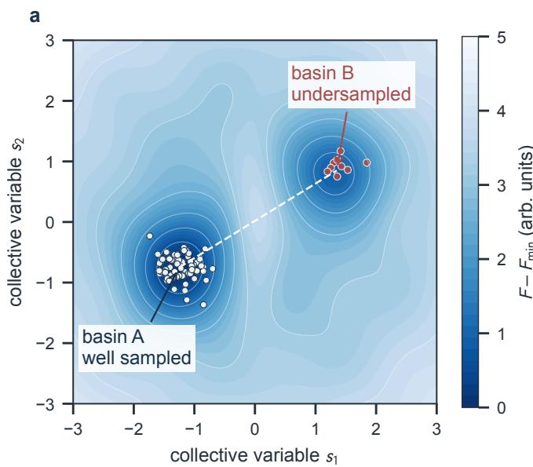

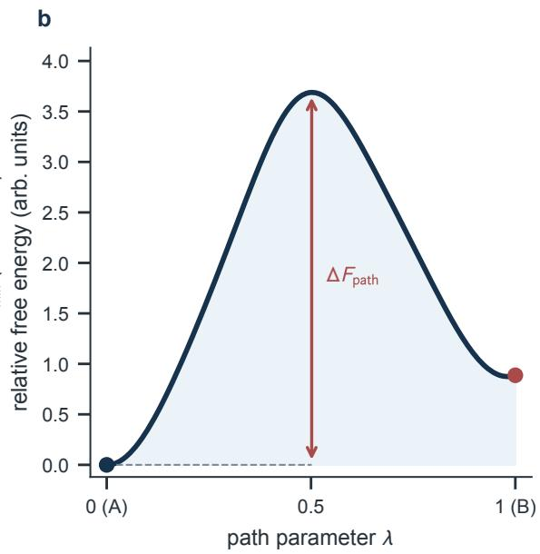  
Fig. 11: Rare conformations can remain poorly covered. (a) Example observations occupy basin A more densely than B on a free-energy surface in collective variables $s _ { 1 } , s _ { 2 }$ . (b) Along path parameter λ, $\Delta F _ { \mathrm { p a t h } }$ marks the maximum above $\mathsf { A } ;$ equilibrium rarity depends on integrated basin weights. More records need not resolve rare basins.

A separate precision calculation concerns repeated measurements of one common scalar estimand. Suppose clusters are independent, individual variances equal $\sigma ^ { 2 }$ , and within-cluster correlations are exchangeable $\varrho _ { j } \in [ 0 , 1 ]$ . The mean ${ \bar { Y } } _ { j }$ of cluster j then has variance $\sigma ^ { 2 } [ 1 + ( n _ { j } - 1 ) \varrho _ { j } ] / n _ { j }$ Independent cluster precisions add under inverse-variance weighting; dividing the resulting precision by $1 / \sigma ^ { 2 }$ gives equivalent precision count

$$
n _ { p } = \sum _ { j } \frac { n _ { j } } { 1 + ( n _ { j } - 1 ) \varrho _ { j } } .\tag{49}
$$

The precision count $n _ { p }$ is specific to inverse-variance weighting. An equally record-weighted mean generally has a different effective sample size, and neither count measures the number of structural states covered. Report precision, unique targets and state coverage separately.

## 7.3. Comparing Scaling Across Tasks and Architectures

Next-token cross-entropy, reconstruction error and structural error have different units and floors. $\tt A F 2 ^ { \prime } \tt S$ frame-aligned point error also depends on alignment, normalization and clipping [57]. For metric $j$ in a fixed run family, a reference scale $X _ { \mathrm { r e f } }$ with positive excess loss permits

$$
{ \widetilde { \epsilon } } _ { j } ( X ) = { \frac { L _ { j } ( X ) - L _ { j , \infty } } { L _ { j } ( X _ { \mathrm { r e f } } ) - L _ { j , \infty } } } .\tag{50}
$$

If the excess loss follows $A _ { j } X ^ { - \alpha _ { j } }$ on the comparison interval, this normalization yields $\tilde { \epsilon } _ { j } ( X ) =$ $( X / X _ { \mathrm { r e f } } ) ^ { - \alpha _ { j } }$ . In general it compares fractional reductions within each metric, while the scientific meaning remains task-specific.

Meaningful cross-architecture comparisons hold data splits, related-family controls, training cutoffs, masks and clipping conventions fixed [57, 58], while accounting jointly for active and resident parameters, processed exposure, unique evaluation-relevant targets and measured FLOPs. Resident parameter count alone does not measure computational work, because dense

Transformers, state-space models and sparse mixtures execute different operations under a given workload.

Inference is another controlled axis. In AF3-style generation, denoising steps update one candidate, whereas additional samples expand the candidate set (Section 6). A denoising step is not a physical time step. In the reported low-homology antibody–antigen evaluation, AF3’s seed-scaling comparison ranks interfaces by protein–protein ipTM and evaluates DockQ-based success; the pronounced seed benefit is not general across other molecule classes [58]. This task-specific result concerns ranked structural prediction, not equilibrium basin weights. Validate confidence-based selection against held-out structural correctness before treating it as a scientific accuracy measure.

## 7.4. Connecting Representation, Data and Resource Decisions

Geometry, information spectra and compute constraints form a unified analytical framework for scaling. Geometry describes the cost of resolving a target; spectra explain how data reveals predictive components; compute accounting determines which improvement is feasible during training or deployment. Capability metrics and selection protocols then determine how a loss reduction becomes a reported task gain. An architecture change can alter representation error, data coverage or execution cost; a domain change can also alter the target and the risk mapping.

The framework makes concrete evaluation demands. Hold out resource scales when testing forecasts, map approximation error to the task risk, and compare allocation choices at matched quality and full cost. Across domains, redefine the target and independent evidence before transferring an exponent.

## References

[1] S. Biderman et al. “Pythia: A Suite for Analyzing Large Language Models Across Training and Scaling”. 2023. arXiv: 2304.01373 [cs.CL].

[2] J. Kaplan, S. McCandlish, T. Henighan, T. B. Brown, B. Chess, R. Child, S. Gray, A. Radford, J. Wu, and D. Amodei. “Scaling Laws for Neural Language Models”. 2020. arXiv: 2001. 08361 [cs.LG].

[3] J. Hoffmann et al. “Training Compute-Optimal Large Language Models”. 2022. arXiv: 2203.15556 [cs.CL].

[4] J. Hestness, S. Narang, N. Ardalani, G. Diamos, H. Jun, H. Kianinejad, M. M. A. Patwary, Y. Yang, and Y. Zhou. “Deep Learning Scaling is Predictable, Empirically”. 2017. arXiv: 1712.00409 [cs.LG].

[5] T. Henighan et al. “Scaling Laws for Autoregressive Generative Modeling”. 2020. arXiv: 2010.14701 [cs.LG].

[6] Y. Bahri, E. Dyer, J. Kaplan, J. Lee, and U. Sharma. “Explaining Neural Scaling Laws”. 2021. arXiv: 2102.06701 [cs.LG].

[7] D. Hernandez, J. Kaplan, T. Henighan, and S. McCandlish. “Scaling Laws for Transfer”. 2021. arXiv: 2102.01293 [cs.LG].

[8] E. Caballero, K. Gupta, I. Rish, and D. Krueger. “Broken Neural Scaling Laws”. 2022. arXiv: 2210.14891 [cs.LG].

[9] J. S. Rosenfeld, A. Rosenfeld, Y. Belinkov, and N. Shavit. “A Constructive Prediction of the Generalization Error Across Scales”. 2019. arXiv: 1909.12673 [cs.LG].

[10] OpenAI et al. “GPT-4 Technical Report”. 2023. arXiv: 2303.08774 [cs.CL].

[11] U. Shaham, A. Cloninger, and R. R. Coifman. “Provable approximation properties for deep neural networks”. 2015. arXiv: 1509.07385 [stat.ML].

[12] J. Schmidt-Hieber. “Nonparametric regression using deep neural networks with ReLU activation function”. In: Ann. Stat. 48(4) (2020), 1875–1897. DOI: 10.1214/19-aos1875.

[13] G. Montúfar, R. Pascanu, K. Cho, and Y. Bengio. “On the Number of Linear Regions of Deep Neural Networks”. 2014. arXiv: 1402.1869 [stat.ML].

[14] M. Raghu, B. Poole, J. Kleinberg, S. Ganguli, and J. Sohl-Dickstein. “On the Expressive Power of Deep Neural Networks”. 2016. arXiv: 1606.05336 [stat.ML].

[15] T. S. Cohen and M. Welling. “Group Equivariant Convolutional Networks”. 2016. arXiv: 1602.07576 [cs.LG].

[16] D. Yarotsky. “Error bounds for approximations with deep ReLU networks”. In: Neural Networks 94 (2017), 103–114. DOI: 10.1016/j.neunet.2017.07.002.

[17] D. Yarotsky. “Optimal approximation of continuous functions by very deep ReLU networks”. 2018. arXiv: 1802.03620 [cs.NE].

[18] T. Suzuki. “Adaptivity of deep ReLU network for learning in Besov and mixed smooth Besov spaces: optimal rate and curse of dimensionality”. 2018. arXiv: 1810.08033 [stat.ML].

[19] B. Bordelon, A. Canatar, and C. Pehlevan. “Spectrum Dependent Learning Curves in Kernel Regression and Wide Neural Networks”. 2020. arXiv: 2002.02561 [cs.LG].

[20] A. Canatar, B. Bordelon, and C. Pehlevan. “Spectral Bias and Task-Model Alignment Explain Generalization in Kernel Regression and Infinitely Wide Neural Networks”. 2020. arXiv: 2006.13198 [stat.ML].

[21] M. Hutter. “Learning Curve Theory”. 2021. arXiv: 2102.04074 [cs.LG].

[22] S. Spigler, M. Geiger, and M. Wyart. “Asymptotic learning curves of kernel methods: empirical data v.s. Teacher-Student paradigm”. 2019. arXiv: 1905.10843 [stat.ML].

[23] A. Caponnetto and E. De Vito. “Optimal Rates for the Regularized Least-Squares Algorithm”. In: Found. Comput. Math. 7(3) (2007), 331–368. DOI: 10.1007/s10208-006- 0196-8.

[24] H. Weyl. “Das asymptotische Verteilungsgesetz der Eigenwerte linearer partieller Differentialgleichungen (mit einer Anwendung auf die Theorie der Hohlraumstrahlung)”. In: Math. Ann. 71(4) (1912), 441–479. DOI: 10.1007/bf01456804.

[25] V. Borovitskiy, A. Terenin, P. Mostowsky, and M. P. Deisenroth. “Matérn Gaussian processes on Riemannian manifolds”. 2020. arXiv: 2006.10160 [stat.ML].

[26] K. Lee, D. Ippolito, A. Nystrom, C. Zhang, D. Eck, C. Callison-Burch, and N. Carlini. “Deduplicating Training Data Makes Language Models Better”. 2021. arXiv: 2107 . 06499 [cs.CL].

[27] N. Muennighoff, A. M. Rush, B. Barak, T. L. Scao, A. Piktus, N. Tazi, S. Pyysalo, T. Wolf, and C. Raffel. “Scaling Data-Constrained Language Models”. 2023. arXiv: 2305.16264 [cs.CL].

[28] B. Sorscher, R. Geirhos, S. Shekhar, S. Ganguli, and A. S. Morcos. “Beyond neural scaling laws: beating power law scaling via data pruning”. 2022. arXiv: 2206.14486 [cs.LG].

[29] T. B. Brown et al. “Language Models are Few-Shot Learners”. 2020. arXiv: 2005.14165 [cs.CL].

[30] T. Pearce and J. Song. “Reconciling Kaplan and Chinchilla Scaling Laws”. 2024. arXiv: 2406.12907 [cs.LG].

[31] D. Hernandez et al. “Scaling Laws and Interpretability of Learning from Repeated Data”. 2022. arXiv: 2205.10487 [cs.LG].

[32] N. Sardana, J. Portes, S. Doubov, and J. Frankle. “Beyond Chinchilla-Optimal: Accounting for Inference in Language Model Scaling Laws”. 2023. arXiv: 2401.00448 [cs.LG].

[33] D. Narayanan et al. “Efficient Large-Scale Language Model Training on GPU Clusters Using Megatron-LM”. 2021. arXiv: 2104.04473 [cs.CL].

[34] T. Dao, D. Y. Fu, S. Ermon, A. Rudra, and C. Ré. “FlashAttention: Fast and Memory-Efficient Exact Attention with IO-Awareness”. 2022. arXiv: 2205.14135 [cs.LG].

[35] A. Grattafiori et al. “The Llama 3 Herd of Models”. 2024. arXiv: 2407.21783 [cs.AI].

[36] J. Wei et al. “Emergent Abilities of Large Language Models”. 2022. arXiv: 2206.07682 [cs.CL].

[37] R. Schaeffer, B. Miranda, and S. Koyejo. “Are Emergent Abilities of Large Language Models a Mirage?” 2023. arXiv: 2304.15004 [cs.AI].

[38] N. Nanda, L. Chan, T. Lieberum, J. Smith, and J. Steinhardt. “Progress measures for grokking via mechanistic interpretability”. 2023. arXiv: 2301.05217 [cs.LG].

[39] Z. Liu, O. Kitouni, N. Nolte, E. J. Michaud, M. Tegmark, and M. Williams. “Towards Understanding Grokking: An Effective Theory of Representation Learning”. 2022. arXiv: 2205.10343 [cs.LG].

[40] A. Power, Y. Burda, H. Edwards, I. Babuschkin, and V. Misra. “Grokking: Generalization Beyond Overfitting on Small Algorithmic Datasets”. 2022. arXiv: 2201.02177 [cs.LG].

[41] C. Zhang, S. Bengio, M. Hardt, B. Recht, and O. Vinyals. “Understanding deep learning requires rethinking generalization”. 2016. arXiv: 1611.03530 [cs.LG].

[42] Z. Liu, E. J. Michaud, and M. Tegmark. “Omnigrok: Grokking Beyond Algorithmic Data”. 2022. arXiv: 2210.01117 [cs.LG].

[43] V. Varma, R. Shah, Z. Kenton, J. Kramár, and R. Kumar. “Explaining grokking through circuit efficiency”. 2023. arXiv: 2309.02390 [cs.LG].

[44] D. Soudry, E. Hoffer, M. S. Nacson, S. Gunasekar, and N. Srebro. “The Implicit Bias of Gradient Descent on Separable Data”. 2017. arXiv: 1710.10345 [stat.ML].

[45] J. Wei, X. Wang, D. Schuurmans, M. Bosma, B. Ichter, F. Xia, E. Chi, Q. Le, and D. Zhou. “Chain-of-Thought Prompting Elicits Reasoning in Large Language Models”. 2022. arXiv: 2201.11903 [cs.CL].

[46] X. Wang, J. Wei, D. Schuurmans, Q. Le, E. Chi, S. Narang, A. Chowdhery, and D. Zhou. “Self-Consistency Improves Chain of Thought Reasoning in Language Models”. 2022. arXiv: 2203.11171 [cs.CL].

[47] S. Yao, D. Yu, J. Zhao, I. Shafran, T. L. Griffiths, Y. Cao, and K. Narasimhan. “Tree ofThoughts: Deliberate Problem Solving with Large Language Models”. 2023. arXiv: 2305.10601 [cs.CL].

[48] K. Cobbe et al. “Training Verifiers to Solve Math Word Problems”. 2021. arXiv: 2110. 14168 [cs.LG].

[49] H. Lightman, V. Kosaraju, Y. Burda, H. Edwards, B. Baker, T. Lee, J. Leike, J. Schulman, I. Sutskever, and K. Cobbe. “Let’s Verify Step by Step”. 2023. arXiv: 2305.20050 [cs.LG].

[50] B. Brown, J. Juravsky, R. Ehrlich, R. Clark, Q. V. Le, C. Ré, and A. Mirhoseini. “Large Language Monkeys: Scaling Inference Compute with Repeated Sampling”. 2024. arXiv: 2407 . 21787 [cs.LG].

[51] C. Snell, J. Lee, K. Xu, and A. Kumar. “Scaling LLM Test-Time Compute Optimally can be More Effective than Scaling Model Parameters”. 2024. arXiv: 2408.03314 [cs.LG].

[52] Y. Wu, Z. Sun, S. Li, S. Welleck, and Y. Yang. “Inference Scaling Laws: An Empirical Analysis of Compute-Optimal Inference for Problem-Solving with Language Models”. 2024. arXiv: 2408.00724 [cs.AI].

[53] A. Dosovitskiy et al. “An Image is Worth 16x16 Words: Transformers for Image Recognition at Scale”. 2020. arXiv: 2010.11929 [cs.CV].

[54] Z. Tong, Y. Song, J. Wang, and L. Wang. “VideoMAE: Masked Autoencoders are Data-Efficient Learners for Self-Supervised Video Pre-Training”. 2022. arXiv: 2203.12602 [cs.CV].

[55] X. Zhai, A. Kolesnikov, N. Houlsby, and L. Beyer. “Scaling Vision Transformers”. 2021. arXiv: 2106.04560 [cs.CV].

[56] K. He, X. Chen, S. Xie, Y. Li, P. Dollár, and R. Girshick. “Masked Autoencoders Are Scalable Vision Learners”. 2021. arXiv: 2111.06377 [cs.CV].

[57] J. Jumper et al. “Highly accurate protein structure prediction with AlphaFold”. In: Nature 596(7873) (2021), 583–589. DOI: 10.1038/s41586-021-03819-2.

[58] J. Abramson et al. “Accurate structure prediction of biomolecular interactions with AlphaFold 3”. In: Nature 630(8016) (2024), 493–500. DOI: 10.1038/s41586-024- 07487-w.

[59] A. W. Senior et al. “Improved protein structure prediction using potentials from deep learning”. In: Nature 577(7792) (2020), 706–710. DOI: 10.1038/s41586-019-1923- 7.

[60] H. M. Berman. “The Protein Data Bank”. In: Nucleic Acids Res. 28(1) (2000), 235–242. DOI: 10.1093/nar/28.1.235.

[61] M. Varadi et al. “AlphaFold Protein Structure Database in 2024: providing structure coverage for over 214 million protein sequences”. In: Nucleic Acids Res. 52(D1) (2024), D368–D375. DOI: 10.1093/nar/gkad1011.

[62] M. R. Shirts and J. D. Chodera. “Statistically optimal analysis of samples from multiple equilibrium states”. In: J. Chem. Phys. 129(12) (2008). DOI: 10.1063/1.2978177.